# LEARNING SOURCE STRUCTURE: BAYESIAN PREDICTION WITH TRANSFORMERS

Meir Feder   
School of Electrical and Computer Engineering   
Tel Aviv University, Tel Aviv, Israel   
meir@tau.ac.il   
Ruediger Urbanke   
School of Computer and Communication Sciences   
EPFL, Lausanne, Switzerland   
rudiger.urbanke@epfl.ch

## ABSTRACT

A transformer trained on sequences whose source parameters are drawn afresh each time can learn only what the sequences share: the source family and its prior. The Bayesian predictor that knows both, which we call informed Bayes, is the unique minimizer of the training loss and is computable from the family alone; we use it as a quantitative, falsifiable reference. Where earlier work compared transformers with Bayes on sources whose contexts can be learned independently, we build Markov sources with up to 64 symbols in which observations in one context inform prediction in another: product sources with known or hidden encodings, transition rows sharing an unknown base law and depth, and a mixture of three families. Informed Bayes is evaluated numerically from the row integrals of the layered simplex architecture. Our main result is that informed Bayes predicts, from the family and prior alone, how a trained transformer behaves in four tests that go beyond the learning curve: the loss that remains under a source outside the training family (predicted 2.237 bits, measured 2.309), the doubling of the extra loss when two independent components change rather than one (0.345 predicted, 0.350 measured), the benefit of other contexts when a token appears for the first time, and the depth at which copying an earlier continuation starts to pay. On the learning curves themselves, small transformers match informed Bayes when the shared structure is visible in the tokens, and hidden structure needs more layers and training, with gaps below 0.01 bits per token for the largest models. We explain why the imitation is possible and where it must fail: informed Bayes decomposes into sufficient statistics that attention selects and accumulates and an estimator, fixed by the prior, that the feed-forward network learns; in the architecture-as-prior framework, training pays the complexity of informed Bayes under the architecture’s prior, and finite-memory universal prediction bounds how closely a bounded network can reach it.

## 1 INTRODUCTION

A transformer that is trained on many sequences can learn what their sources have in common. Suppose every sequence comes from a source with freshly drawn parameters. Then training cannot reveal the parameters of the next sequence. It can reveal the family of sources, and how the parameters within one source are related: each token may be a pair whose two parts follow independent chains, or all contexts may share a preference for certain tokens. A predictor that knows such a relation can pool observations across contexts. How well does a transformer learn to use this shared structure?

There is a natural yardstick. The informed Bayesian predictor, informed Bayes for short, is told the source family and the prior. It is not told the parameters of the sequence at hand; after each token it updates its posterior belief about them and averages the next-token prediction over this belief. When sequences are drawn from the family and the prior, no predictor that sees the same tokens has a smaller expected log loss. The transformer is trained to minimize this same loss and has the memory to approximate the informed Bayes. We ask two questions. How close does a transformer, which must learn the family from examples, get to informed Bayes, even in shared structure? And can this correspondence predict the transformer’s behavior from what we can infer for informed Bayes?

Earlier work points out the following. The prediction over a new test sequence (prompt) was called in-context learning and has been explained as inference about a hidden source (Xie et al., 2022). Networks trained on samples from a prior learn to predict like the posterior (Muller et al.¨ , 2022). Regression experiments find Bayesian behavior within and across task families (Panwar et al., 2024). Information-theoretic work separates what is learned across tasks from what is inferred within a new task (Jeon et al., 2024). Meta-trained transformers and LSTMs were shown to reach the universal predictor of their training class (Grau-Moya et al., 2024). For sequential sources, the closest studies use Markov chains with independently drawn transition rows (Edelman et al., 2024; Bondaschi et al., 2026), smoothing across context orders (D’Angelo et al., 2026), variable-order context trees (Zhou et al., 2026), and hidden causal structures (Wei et al., 2026). None of this guarantees that a trained network reaches the Bayesian optimum; we measure in bits how close it gets when contexts are tied together (Appendix A compares these papers in detail).

In the experiments reported in this paper each of the sources tests one kind of shared structure. Coins test whether the prior on one unknown bias is learned. In product sources every token is a pair of independent coordinates. The table that maps pairs to token labels, the encoding, is either known or hidden. In the shared-base source all transition rows are built from one unknown base law and one unknown depth, so tokens seen in one context help in every other context. The uniform-base source, with a known uniform base law, is a control, and in pooled training the family itself is unknown. The Bayesian predictors are built from the row integrals of the layered simplex architecture (LSA) (Feder et al., 2026).

Our main finding is that informed Bayes predicts, in bits, how a trained transformer responds in four tests that deviate from the training conditions (Section 4; Table 1). In each test we first work out what informed Bayes does, from the family and prior alone, and then measure the transformer. Two tests change the test source: permuting the token labels of a product source, where Bayes predicts the loss that remains however long the sequence is, and replacing one or both transition matrices mid-sequence, where Bayes predicts that two new matrices cost twice as much as one. Two stay inside the training family: whether tokens seen in other contexts help when a token appears for the first time, and at which source depth copying an earlier continuation starts to pay. The transformer meets all four predictions.

The precondition for these predictions is that the transformers learn the shared structure at all, and Section 3 shows that they do. Two-layer models are close to informed Bayes when the structure is visible in the tokens: for coins, for the known encoding and for the uniform base. When the encoding or the base law is hidden, two layers are not enough, and eight-layer models trained on four times as many sequences close most of the remaining gap.

Section 5 asks why the transformer can imitate (approximately) the informed Bayes: the training objective is minimized by informed Bayes whose prediction structure is a function of some statistics of the prefix that attention can select and accumulate, leaving only a map from, e.g., counts to a forecast to be learned. In the framework where an architecture is a prior over predictors (Feder et al., 2025), training pays the complexity of informed Bayes under that transformer architecture’s prior, while informed Bayes pays the complexity of the source under the family’s prior. What the sources examples discussed here add is that these statistics are global rather than local, which explains which sources need more capacity and training, and where the residual gap sits.

## 2 SOURCES AND PREDICTION

A sourcefamily is a set of sources $\{ P _ { \theta } \} _ { \theta \in \Theta }$ . Each $P _ { \theta }$ assigns a probability to every token sequence. To generate one sequence, we draw the parameters θ from a prior π on Θ and then draw the tokens from $P _ { \theta }$ . Every sequence gets a fresh θ.

## 2.1 THE SOURCE FAMILIES

All sources except the coins are first-order Markov chains; the context of a prediction is the previous token, and its transition row is the distribution of the next token. Table 2 in Appendix B summarizes, for each source, what all sequences share and what each sequence draws afresh.

Coins. The tokens are zeros and ones. Draw a bias $\theta$ once per sequence, then draw the tokens independently with probability θ of one. We use two priors in separate training conditions:

$$
\textstyle \operatorname* { P r } \{ \theta = 0 . 2 \} = \operatorname* { P r } \{ \theta = 0 . 8 \} = { \frac { 1 } { 2 } } , \qquad { \mathrm { o r } } \qquad \theta \sim \operatorname { U n i f } [ 0 , 1 ] .
$$

LSA row prior. The other sources draw their transition rows from the following prior (Feder et al., 2026): draw L independent vectors uniformly from the simplex on d symbols, multiply them entry by entry, and normalize. We write $\mathcal { D } _ { d , L }$ for the resulting distribution and call $L$ its depth. For $L = 0$ the vector is uniform, for $L = 1$ uniform on the simplex, and the larger $L$ , the more it concentrates on a few symbols.

Product source: known encoding. Each token is a pair $( u , v )$ with $u \in \{ 1 , \ldots , d _ { 1 } \}$ and $v \in$ $\{ 1 , \ldots , d _ { 2 } \}$ . A fixed and known table, the encoding, maps the $d = d _ { 1 } d _ { 2 }$ pairs to token labels. The two coordinates follow independent Markov chains, so $\dot { P _ { \theta } } ( u ^ { \prime } , v ^ { \prime } \mid u , v ) \dot { = } T _ { 1 } ( u ^ { \prime } \mid u ) T _ { 2 } ( v ^ { \prime } \mid v )$ . For each coordinate $i ,$ draw a depth $L _ { i }$ uniformly from $\{ 1 , \ldots , L _ { \mathrm { m a x } } \}$ , and then draw every row of T independently from $\mathcal { D } _ { d _ { i } , L _ { i } } ;$ the initial coordinates are independent and uniform. We use $d _ { 1 } = d _ { 2 } = 8$ and $L _ { \operatorname* { m a x } } = 8$ . The factorization helps because two $8 \times 8$ matrices are learned from far fewer tokens than one 64 × 64 matrix.

Product source: hidden encoding. Here the encoding is hidden, and it changes from sequence to sequence. For each sequence, draw every row of $T _ { 1 }$ and of $T _ { 2 }$ from $\mathcal { D } _ { d _ { i } , 1 }$ , draw a one-to-one table $\sigma : \{ 1 , \dots , d _ { 1 } \} \times \{ 1 , \dots , d _ { 2 } \}  \{ 1 , \dots , d _ { 1 } d _ { 2 } \}$ uniformly at random, and run the two coordinate chains $( U _ { t } )$ and $( V _ { t } )$ from independent uniform starting states. The observed token is $X _ { t } = \sigma ( U _ { t } , V _ { t } )$ so $P _ { \theta } \big ( \sigma ( u ^ { \prime } , v ^ { \prime } ) \mid \sigma ( u , v ) \big ) = T _ { 1 } ( u ^ { \prime } \mid u ) T _ { 2 } ( v ^ { \prime } \mid v )$ . The matrices and the encoding stay fixed within one sequence and are drawn anew for the next, so the same label can stand for different pairs in different sequences. Informed Bayes knows $d _ { 1 } , d _ { 2 }$ and the sampling rule, but none of the drawn quantities; it integrates over the matrices in closed form and sums over all encodings (Appendix B.4). We use $d _ { 1 } = 2$ and $d _ { 2 } = 8$ , giving 16 labels.

Uniform-base source. Set $d = 6 4$ , draw one depth $L$ uniformly from $\{ 0 , \ldots , 8 \}$ , draw each of the 64 rows independently from $\mathcal { D } _ { d , L }$ , and start from a uniform token. The rows share the depth and nothing else. This is the case $\alpha = 0$ of the next source, with a known uniform base law.

Shared-base source. Tokens are $\{ 1 , \ldots , d \}$ with $d = 6 4 .$ Draw independently an exponent α uniformly from [0.5, 1.5], a depth L uniformly from $\{ 0 , \ldots , 8 \}$ , and a uniform random permutation σ of the tokens. The base law $q$ is a Zipf distribution with exponent $\alpha ,$ and σ assigns its ranks to the tokens:

$$
q _ { \sigma ( r ) } = \frac { r ^ { - \alpha } } { \sum _ { j = 1 } ^ { d } j ^ { - \alpha } } , \qquad r = 1 , \ldots , d .
$$

For each context $^ { a , }$ draw a probability vector $V _ { a }$ from $\mathcal { D } _ { d , L }$ independently, and set the transition row:

$$
T ( b \mid a ) = \frac { q _ { b } V _ { a } ( b ) } { \sum _ { c } q _ { c } V _ { a } ( c ) } .
$$

Draw $X _ { 1 }$ from $q$ and $X _ { t + 1 }$ from $T ( \cdot \mid X _ { t } )$ . One base law, one depth and one transition matrix are used for the whole sequence. For $L = 0$ every row equals $q ,$ and the tokens are independent. For $L > 0$ every row is the shared base law $q ,$ reshaped by the row’s own vector $V _ { a }$ . Because $q$ and $L$ are shared by all rows, tokens seen in one context help prediction in every other context.

Pooled families. For each sequence, draw one of the three 64-symbol families (product with known encoding, uniform base, shared base) with probability $1 / 3$ each, and then draw a source from that family as above. Neither the family nor the parameters are revealed.

## 2.2 WHAT THE PREDICTORS KNOW

The transformer is trained by next-token prediction on sequences drawn from its family and prior, never seeing the parameters. With its weights fixed, on a test sequence it sees $\boldsymbol { x } ^ { t } = ( x _ { 1 } , \dots , x _ { t } )$ and predicts token $t + 1$ ; the first token is given and not scored.

Informed Bayes, written $B ,$ is told the training family and prior but not the parameters of the test sequence. Its probability for a sequence and for the next token are

$$
Q _ { B } ( x ^ { n } ) = \int P _ { \theta } ( x ^ { n } ) \pi ( d \theta ) , \qquad Q _ { B } ( b \mid x ^ { t } ) = \frac { Q _ { B } ( x ^ { t } b ) } { Q _ { B } ( x ^ { t } ) } .\tag{1}
$$

Equation (1) averages over all source parameters using the likelihood of the entire sequence. Parameters shared across context rows appear in several factors of this likelihood, so observations in one context affect predictions in another, with no separate parameter estimation. In pooled training, θ also includes the unknown family, so the same formula averages the three families’ predictions with their posterior weights. Appendix B gives the formulas and numerical methods for each source.

## 2.3 PREDICTION ACCURACY

All losses are in bits. Let $Q _ { M } ( \cdot \mid x ^ { t } )$ be the next-token probabilities of a predictor M. We write $M = \mathrm { T F }$ for a trained transformer and $M = B$ for informed Bayes; thus $Q _ { \mathrm { T F } }$ is the transformer’s predictive distribution. Let $\pi _ { \mathrm { t e s t } }$ denote the distribution of source parameters used in the test. It equals the training prior π in full-prior tests; in fixed-setting tests, the specified parameters are held fixed. The regret of M after t observed tokens is the expected extra loss compared with a predictor that knows the parameters θ of the sequence:

$$
\begin{array} { r } { r _ { M } ( t ) = \mathop { \mathbb { E } } _ { \theta \sim \pi _ { \mathrm { t e s t } } } \left[ D _ { \mathrm { K L } , 2 } \big ( P _ { \theta } ( \cdot \mid X ^ { t } ) \| Q _ { M } ( \cdot \mid X ^ { t } ) \big ) \right] . } \\ { X ^ { t } { \sim } P _ { \theta } } \end{array}\tag{2}
$$

Here $D _ { \mathrm { K L , 2 } }$ is the Kullback–Leibler divergence in bits. The expectation first draws the source parameters from $\pi _ { \mathrm { t e s t } }$ and then the observed sequence from that source. The gap to Bayes of the transformer is

$$
\Delta ( t ) = r _ { \mathrm { T F } } ( t ) - r _ { B } ( t ) = \mathbb { E } { \underset { X ^ { t + 1 } \sim P _ { \theta } } { \operatorname { \mathbb { E } } } } \left[ \log _ { 2 } \frac { Q _ { B } ( X _ { t + 1 } \mid X ^ { t } ) } { Q _ { \mathrm { T F } } ( X _ { t + 1 } \mid X ^ { t } ) } \right] .\tag{3}
$$

In afull-prior test the parameters of each test sequence are drawn from the training prior π; then the next token given $X ^ { t }$ has distribution $Q _ { B } ( \cdot \mid X ^ { t } )$ by (1), and

$$
\begin{array} { r } { \Delta ( t ) = \mathbb { E } _ { \stackrel { \theta \sim \pi } { X ^ { t } \sim P _ { \theta } } } \left[ D _ { \mathrm { K L , 2 } } \big ( Q _ { B } ( \cdot \vert X ^ { t } ) \vert \vert Q _ { \mathrm { T F } } ( \cdot \vert X ^ { t } ) \big ) \right] \geq 0 . } \end{array}\tag{4}
$$

In a full-prior test no predictor has a smaller expected loss than informed Bayes, and the gap measures how far the two predictive distributions are apart. The identity holds with any predictor in place of $Q _ { \mathrm { T F } } ;$ this is the sense in which $Q _ { B }$ is the universal probability for the source family (Merhav & Feder, 1998). In a fixed-setting test we fix some parameters, for example $\alpha = 1$ and $L = 4$ , and draw the others from the prior; informed Bayes still uses the full prior, and the gap can then be negative.

Both predictors are evaluated on the same test sequences; differences are formed within each sequence before averaging, and each ± denotes one standard error of the mean across sequences. Cumulative quantities sum over all scored predictions (Appendix D.1.2).

## 3 HOW CLOSE DO TRANSFORMERS GET TO INFORMED BAYES?

Figure 1 compares trained transformers with informed Bayes on six sources, from a prior on one coin bias to a mixture of families. Where shared structure is visible, two-layer transformers are close to informed Bayes, and increasing capacity brings them closer still. When the structure is hidden, more layers and training close most of the gap. Table 16 in Appendix F summarizes the gaps; Appendix D gives the models, training, test sets and numerical checks.

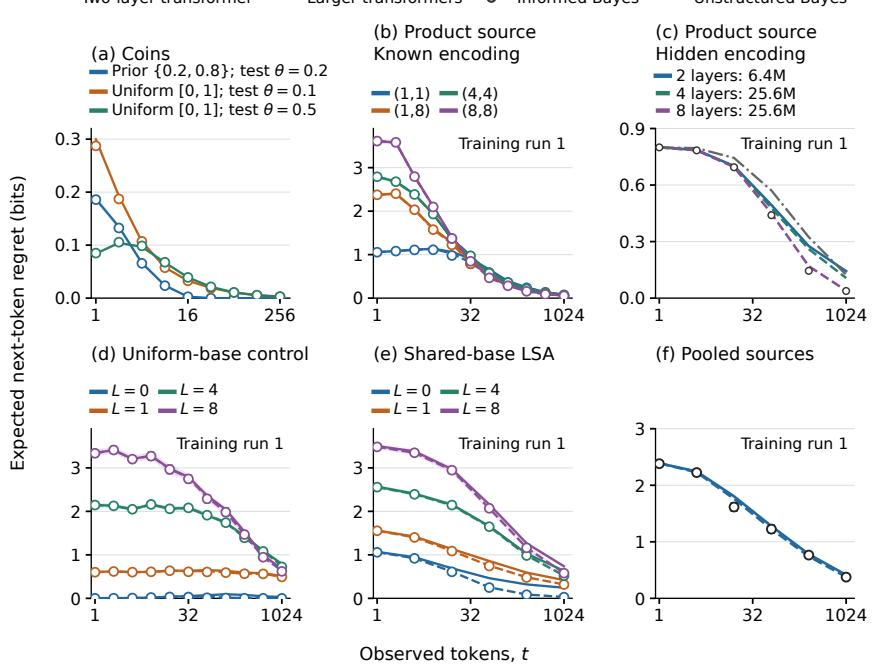  
Figure 1: Transformers and informed Bayes on six sources. Expected next-token regret on held-out test sequences. Solid curves show two-layer transformers; dashed curves show four layers in $\mathrm { ( b , d , f ) }$ four or eight in (c), and eight in (e). Open circles show informed Bayes. Colors distinguish source settings in $^ { ( \mathrm { a } , \mathrm { b } , \mathrm { d } , \mathrm { e } ) }$ and models in (c). (a) Coins: two-point prior at $\theta = 0 . 2 ;$ uniform prior at $\theta = 0 . 1 , 0 . 5$ . (b) Known $8 \times 8$ product encoding at four depth pairs. (c) Hidden $2 \times 8$ encoding. Gray dash-dot “Unstructured Bayes” treats the 16 symbols as one Markov chain with independent transition rows, each under a uniform Dirichlet prior, ignoring the product factorization. (d) Uniform base and (e) shared base with $\alpha = 1$ , at $L = 0 ,$ 1, 4, 8. Bayes points in (e) extend through t = 1024 at all four depths. (f) Equal mixture of three 64-symbol families; Bayes points through $t = 1 0 2 4$ . Panels (b)–(f) show run 1. Appendix D gives both runs and protocols, including the additional training for larger models in (c,e); budgets are equal within $\mathrm { ( b , d , f ) }$

## 3.1 A SOURCE PRIOR: COINS

We train one two-layer model on biases 0.2 and 0.8 with equal probability, and another on biases drawn uniformly from [0, 1]. Both follow informed Bayes at all tested biases and all t (panel (a); Appendix D.2 shows the other biases).

What is the prior worth? We test both models on the same sequences with bias 0.2 or 0.8. Over 256 predictions, the two-point-prior model loses $2 . 2 9 3 \pm 0 . 0 1 5$ bits less than the uniform-prior model; for the two Bayesian predictors the difference is $2 . 2 9 0 \pm 0 . 0 1 5$ bits. The transformer has learned what the prior is worth.

## 3.2 A KNOWN ENCODING: PRODUCT SOURCE

With a known $8 \times 8$ encoding, the two-layer transformer is close to informed Bayes (panel (b)). Four-layer models trained on the same number of sequences reduce the largest gap from 0.124 bits to 0.044 and 0.049 bits in two runs (Appendix D.3). The Bayesian curve also predicts how many tokens are needed to reach a target regret (Appendix D.3.1).

## 3.3 DISCOVERING A FACTORIZATION: HIDDEN ENCODING

When the encoding is hidden, the transformer must find out in each sequence which labels belong together (panel (c)). After 1024 tokens, the two-layer models have regrets of 0.1430 and 0.1335

bits, near the 0.124 bits of unstructured Bayes, which ignores the product factorization. Eight-layer models with more training reach 0.0402 and 0.0397 bits, close to the 0.0378 bits of informed Bayes. Four-layer models lie in between; Appendix D.4 gives the full capacity and training comparisons.

## 3.4 A KNOWN BASE LAW: UNIFORM-BASE SOURCE

With the base law known, increasing capacity brings the transformer close to informed Bayes at all four depths (panel (d)). With the same training budget, four layers reduce the largest gap from 0.087 bits to 0.037 and 0.041 bits in two runs. At $\bar { L } = 0$ the tokens are independent and informed Bayes soon predicts uniformly; the four-layer models learn this behavior too (Appendix D.5).

## 3.5 AN UNKNOWN SHARED BASE LAW: SHARED-BASE SOURCE

With the base law unknown, eight-layer models with more training close most of the two-layer gap (panel (e)). For both runs, all four depths and all tested $t \leq 6 4$ , the gap is below 0.007 bits. At t = 256 and $t = 1 0 2 4$ , its absolute value is below 0.0052 bits at all four depths. All shared-base tests use $\alpha = 1 ;$ Appendix D.6 gives the capacity and training comparisons.

## 3.6 INFERRING THE SOURCE FAMILY: POOLED TRAINING

Here neither predictor is told which family generated the sequence (panel (f)). We train on an equal mixture of the three 64-symbol families; informed Bayes combines their predictions with posterior family weights. Panel (f) shows Bayes points through $t = 1 0 2 4$ ; the paired comparisons reported here use $t = 1 , 4 ( \mathrm { A }$ ppendix D.7). On 1024 new sequences per family, they show that the transformer reproduces this mixture prediction. With the same training sequences, four-layer models reduce the gap after four tokens from 0.0197 and 0.0190 bits to 0.0052 and 0.0025 bits in the two runs (Appendix D.7).

Appendix D.7.1 compares the cumulative cost of not knowing the family with its Bayesian prediction.

## 4 FOUR PREDICTIONS BEYOND THE LEARNING CURVE

We now test trained transformers in four further, more challenging, ways. In every test the transformer keeps its weights, informed Bayes keeps the training family and prior, and neither is told anything about the test. Each test yields a number that the family and prior fix in advance; Table 1 collects them next to the measured values, Figure 2 shows the curves, and Appendix E gives derivations and all results.

## 4.1 SOURCE MISMATCH

The transformer was trained on product sources with a known $8 \times 8$ encoding. In the test we apply a random permutation to the 64 labels of a product source, fixed throughout the sequence, which neither predictor is told. Both still read every label as a pair $( U , V )$ with the training encoding, but under the permutation the two coordinates are no longer independent chains. Informed Bayes can only fit a product of two chains, and its regret approaches

$$
R _ { \infty } = H ( U ^ { \prime } \mid U ) + H ( V ^ { \prime } \mid V ) - H ( U ^ { \prime } , V ^ { \prime } \mid U , V ) ,\tag{5}
$$

where $( U ^ { \prime } , V ^ { \prime } )$ follows $( U , V )$ and the entropies are those of the test source: the information a product of two chains cannot use.

After 1024 tokens, the two-layer transformer closely matches informed Bayes at both tested depths (panel (a)). Increasing capacity brings the intermediate predictions closer too: with the same training budget, both four-layer runs reduce the depth-four gap at 32 tokens from 0.209 to 0.062 bits, about 70%. Appendix E.2.1 gives the predicted limits and both runs at both depths.

## 4.2 TIME-VARYING SOURCE

The transformer was trained on product sources that do not change, and informed Bayes uses that family and prior. The test source starts as a product source from the family. After 256 tokens, one coordinate or both coordinates switch to a new transition matrix, drawn independently from the same prior. The current state and the encoding carry over. The predictors see only the tokens; they are not reset and are not told about the change.

Table 1: Predicted versus measured. Each row is a quantity that informed Bayes fixes from the family and prior alone, next to the trained transformer’s value on the same test sequences. Bits; ± one standard error; “Bayes” is the reference’s own value on the same sequences where it is a random quantity.
<table><tr><td>Test (§)</td><td>Quantity</td><td>Predicted</td><td>Bayes</td><td>Transformer</td></tr><tr><td>Prior (3.1)</td><td>bits saved by the two-point prior (256 tokens)</td><td></td><td>2.290±0.015</td><td>2.293±0.015</td></tr><tr><td>Mismatch (4.1)</td><td>residual regret, depths  $( 1 , 1 ) , t = 1 0 2 4$ </td><td> $0 . 9 6 6 { \pm } 0 . 0 0 3$ </td><td>1.039</td><td>1.040</td></tr><tr><td></td><td>residual regret, depths (4, 4), t=1024</td><td> $2 . 2 3 7 { \scriptstyle \pm 0 . 0 0 7 }$ </td><td>2.299</td><td>2.309</td></tr><tr><td>Change (4.2)</td><td>extra regret, two new matrices, t=1024</td><td> $0 . 3 4 5 \left( 2 \times 0 . 1 7 3 \right)$ </td><td></td><td>0.350</td></tr><tr><td>Unseen (4.3)</td><td>gain over uniform, shared base,  $L { = } 1 , t { = } 6 4$ </td><td></td><td>0.799</td><td>0.793</td></tr><tr><td></td><td>gain over uniform, uniform base, any  $L , t$ </td><td>0</td><td>0</td><td>&lt; 0.0005</td></tr><tr><td>Copying (4.4)</td><td>gain from token order,  $L = 0$ </td><td>≤ 0</td><td>&lt; 0, all t</td><td>&lt; 0, all t</td></tr><tr><td></td><td>gain from token order,  $L { = } 3 , t { = } 6 4$ </td><td></td><td>0.262±0.027 0.263±0.028</td><td></td></tr></table>

Informed Bayes keeps updating as if the source had not changed. At each prediction, both the true next-token law and Bayes’s forecast factor across the two coordinates. Their KL divergence therefore adds across coordinates. Let $r _ { u } ( t )$ be the expected regret of one coordinate when its matrix stays unchanged, and $r _ { c } ( t )$ when it is redrawn. The coordinates have identical laws and priors, and changing one affects neither the data nor the forecast for the other. Consequently, the expected regrets with no, one, and two new matrices are $2 r _ { u } ( t ) , r _ { u } ( t ) + r _ { c } ( t )$ , and $2 r _ { c } ( t )$ , respectively. Subtracting the no-change regret gives, at every t after the change:

$$
r _ { B } ^ { \mathrm { b o t h } } ( t ) - r _ { B } ^ { \mathrm { s t a t i o n a r y } } ( t ) = 2 \big [ r _ { B } ^ { \mathrm { o n e } } ( t ) - r _ { B } ^ { \mathrm { s t a t i o n a r y } } ( t ) \big ] .\tag{6}
$$

Panel (b) shows close transformer–Bayes agreement before the switch, through the jump at the change, and during the subsequent decline. The additional regret also agrees with the factor of two (panel (c)). Simultaneous 95% bands for the paired differences include zero at both depths and all 14 tested times after the change. Any predictor that treats the coordinates separately and symmetrically has this doubling. Panel (c) therefore tests whether the transformer retains the factorization; panel (b) tests whether its regret matches informed Bayes. Appendix E.3.1 gives the derivation and full comparison.

## 4.3 AN UNSEEN CONTEXT

We look at the predictions made when the current token appears for the first time, so that nothing has been observed of its transition row, and measure the bits saved over a uniform prediction; a predictor that uses only token counts is added for comparison. In the shared-base source informed Bayes can still predict, because transitions out of other tokens tell it about the shared base law; in the uniform-base source the rows share no base law and it predicts uniformly.

The transformers do the same (panels (d–f)): both eight-layer shared-base models are within 0.015 bits of informed Bayes at every tested depth and context length. The token-count predictor is close to Bayes at small depth, where token frequencies approximate the base law, but at $\bar { L } = 8$ and t = 64 it loses $0 . 2 1 1 \pm 0 . \dot { 0 4 } 9$ bits to Bayes while the transformer loses $0 . 0 1 2 \pm 0 . 0 1 1$ . In the uniform-base source the transformer predicts almost uniformly, while token counts increase loss. Each transformer thus uses the other contexts exactly when its family makes them informative (Appendix E.4).

## 4.4 WHEN COPYING STARTS TO PAY

When token a appears again, a copying predictor raises the probability of the token that followed a before. This uses the order of the tokens, which a frequency-only predictor cannot. At depth $L = 0$ every row of the shared-base source equals the base law, so the order is worth nothing and looking for it costs; at positive depth the order helps once enough tokens have been seen. We ask whether copying emerges in the transformer where informed Bayes says it should. Next to informed Bayes B

Two-layer transformer Larger transformers

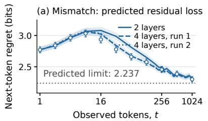  
Informed Bayes Token counts

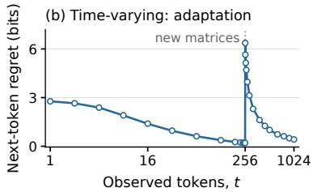

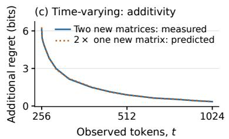

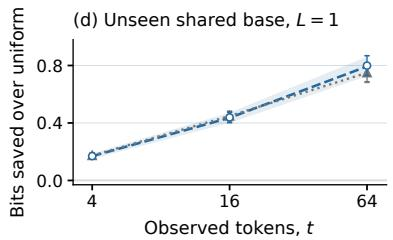

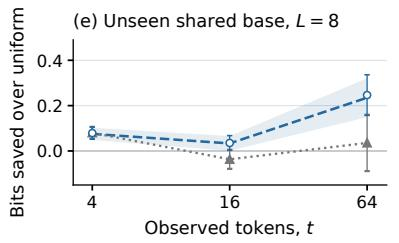

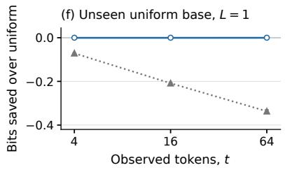

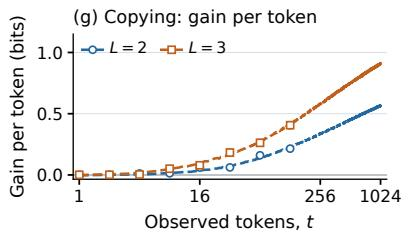

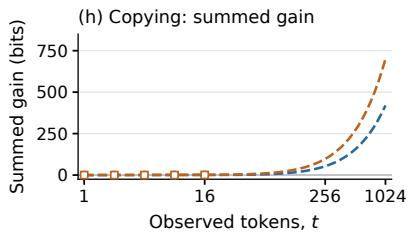  
Figure 2: Four further tests of trained transformers against informed Bayes. (a) Regret under randomly permuted product labels; gray dotted line: predicted limit $R _ { \infty } . \ ( \mathfrak { b } , \mathfrak { c } )$ New transition matrices at $t = 2 5 6 \colon$ regret with two new matrices (b); additional regret with two versus twice that with one (c). Panels $\mathrm { ( a ) - ( c ) }$ use depths (4, 4). (d)–(f) Bits saved over uniform prediction when the current token is new: shared base at $L = 1$ , 8 (d,e); uniform base at $L = 1 \left( \mathrm { f } \right)$ . (g,h) Run-1 shuffled-trained minus ordered-trained loss, per token (g) and cumulative (h), compared with the Bayesian gain over its frequency-only predictor through $t = 1 6$ , and at $t = 3 2 , 6 4$ , 128 in (g). At $t = 1 2 8$ , Bayes uses 256 sequences for each of $L = 2 , 3$ . Curves show transformers; open markers show Bayes in matching colors. Solid curves show two layers; dashed curves show four layers in $\scriptstyle ( \mathrm { a , g , h } )$ and eight in $^ { ( \mathrm { d } , \mathrm { e } ) }$ . The second four-layer run in (a) is dotted. Gray curves show controls, including token counts in (d)–(f). In $^ { ( \mathrm { g , h } ) }$ , blue circles denote $L = 2$ and orange squares $L = 3$ Horizontal axes use base-2 scales; shared-base panels use $\alpha = 1$ . Intervals are pointwise 95% in (a)–(c), (g) and (h); markers in (d)–(h) show one sequence standard error.

we use a Bayesian predictor $B _ { \mathrm { f r e q } }$ that keeps the same prior and first-token law but models every later token as an independent draw from the stationary law of the source (Appendix E.5.1); it approximates the training law of the shuffled-trained transformer below. With $\ell _ { M } ( t )$ the loss of predictor M on token $t + 1$ , the gain from the order and its running sum are

$$
g _ { B } ( t ) = \mathbb { E } [ \ell _ { B _ { \mathrm { f r e q } } } ( t ) - \ell _ { B } ( t ) ] , \qquad G _ { B } ( n ) = \sum _ { t = 1 } ^ { n } g _ { B } ( t ) .\tag{7}
$$

For the transformer we compare a matched pair of four-layer models. One sees ordered training sequences; the other sees positions $2 , \ldots , 1 0 2 5$ shuffled within each sequence, preserving the first token and all token counts. It can learn frequencies but cannot learn to copy. Both are tested on the same ordered sequences; their loss difference $g _ { \mathrm { T F } } ( t )$ and its running sum $G _ { \mathrm { T F } } ( n )$ measure what copying is worth to the transformer.

Copying emerges where Bayes says it should. At $L = 0$ both gains are negative at every measured context. At $L \stackrel { = } { = } 2$ and $L = \dot { 3 }$ both gains become positive, larger at the greater depth, and of the same size at the measured contexts. At $\bar { L } = 3$ and $t = 6 4$ , Bayes gains $0 . 2 6 2 \pm 0 . 0 2 7$ bits and the run-1 transformer gains $0 . 2 6 3 \pm 0 . 0 2 8$ bits. The shuffled-trained transformer matches $B _ { \mathrm { f r e q } }$ within 0.0043 bits at all sixteen tokens, so it has learned the frequencies and nothing more. At longer contexts the transformer’s gain keeps growing, to 0.57 and 0.91 bits per token at t = 1024 for $\bar { L } = 2 , 3$ (panels (g,h)); Appendix E.5.1 gives both runs and matched training settings.

## 5 WHY A TRANSFORMER CAN APPROXIMATELY IMITATE INFORMED BAYES

Three facts make the imitation possible. First, informed Bayes minimizes expected training loss: for any predictor $Q ,$ , when source parameters follow the training prior π,

$$
\begin{array} { r l } { \mathbb { E } _ { \underset { X ^ { t + 1 } \sim P _ { \theta } } { \theta \sim \pi } } \left[ - \log _ { 2 } Q ( X _ { t + 1 } \mid X ^ { t } ) \right] = \mathbb { E } _ { \underset { X ^ { t + 1 } \sim P _ { \theta } } { \theta \sim \pi } } \left[ - \log _ { 2 } Q _ { B } ( X _ { t + 1 } \mid X ^ { t } ) \right] } & { } \\ { + \mathbb { E } _ { \underset { X ^ { t } \sim P _ { \theta } } { \theta \sim \pi } } \left[ D _ { \mathrm { K L , 2 } } \big ( Q _ { B } ( \cdot \mid X ^ { t } ) \| Q ( \cdot \mid X ^ { t } ) \big ) \right] , } \end{array}\tag{8}
$$

because $X _ { t + 1 } \mid X ^ { t }$ has distribution $Q _ { B } ( \cdot \mid X ^ { t } )$ . The divergence vanishes only when $Q = Q _ { B }$ , so $\Delta ( t )$ in (4) measures the remaining excess training loss without requiring parameter labels. Ignoring structure means using the universal probability of a larger family and paying its larger regret (Merhav & Feder, 1998), as in Figure 1(c). The same argument explains why transformers and LSTMs meta-trained on random tree sources reach, e.g., the loss of the universal context-tree-weighting mixture (Grau-Moya et al., 2024).

Second, informed Bayes needs memory even for memoryless sources: coin prediction uses the counts of zeros and ones. Shared-base prediction uses all rows; pooled prediction also uses each family’s evidence. A transformer reads the prefix and can approximate this growing state. Finite-state prediction bounds relate the remaining regret to the number of states (Meron & Feder, 2004; Ingber & Feder, 2006; Dar & Feder, 2011); likewise, a transformer’s context, width, depth and training limit its approximation. In the framework of Feder et al. (2025), the randomly initialized architecture is a prior over predictors and the sequences needed to reach a target are set by the target’s complexity under that architecture prior; here the target is $Q _ { B }$ , so the transformer pays two universality costs: across sequences for $Q _ { B }$ relative to the architecture, and within a sequence for θ relative to the family; the gaps of Sections 3,4 measure the first.

Third, Bayesian prediction decomposes as $Q _ { B } ( b \mid x ^ { t } ) = F ( S ( x ^ { t } ) ) _ { b } \colon$ sufficient statistics S followed by a forecast map $F .$ For the independent-row chain of Edelman et al. (2024), S counts successors in the current context and F is the add-one rule. Attention to earlier occurrences of the current token supplies selection and accumulation; the feed-forward network learns the prior-specific estimator $F .$ . Here $S$ is global: the shared base and depth use all rows, the hidden partition must be inferred from the count matrix, and family selection uses a softmax of accumulated evidence. Appendix C develops this decomposition, its relation to architecture-based complexity, and its implications for capacity and training.

## 6 DISCUSSION

Training on freshly drawn source parameters teaches transformers what sequences share, and their predictions approach informed Bayes, with larger models and more training needed when the encoding or base law is hidden. From the family and prior alone, informed Bayes predicts the costs of a wrong factorization and a source change, the benefit of other contexts for a new token, and when copying starts to pay. A trained network can fail each prediction, so these tests measure what it has learned and give circuit and training-dynamics studies a target (Raventos et al.´ , 2023; Falck et al., 2024).

The same account makes predictions for language models, where the family is not specified: documents sharing latent structure across contexts are the shared-base case, and the unseen-context test says when a model should generalize to a context never seen continued; retrieval of a first-occurrence continuation is the copying test, with a depth-dependent onset; the mismatch test says that a model keeps paying its training family’s price on out-of-distribution text however long the prompt, and the change test that adaptation to a shift is as slow as a stationary posterior. When pretraining data are not fresh draws from a stable class (Raventos et al.´ , 2023; Chan et al., 2022; Falck et al., 2024) there is no informed Bayes to imitate, and that is where the correspondence should break.

Our evidence is limited to synthetic sources, alphabets of at most 64 symbols, at most 26 million parameters, some baselines with one training run, and shared-base tests at α = 1; the hidden-encoding and shared-base comparisons change size, training amount and schedule together. Agreement in loss does not establish posterior computation. Section 5 suggests a design to test: learned selection, exact accumulation, and the family’s closed-form estimator.

## AI USE STATEMENT

We used large language models to write and test the code for the sources, the Bayesian predictors, the training and the evaluation, to draft and edit the text, to search the literature and to make the figures. They did not propose experiments. The authors checked all derivations, numerical results and citations, and take full responsibility for the content of the paper.

## REPRODUCIBILITY STATEMENT

Appendix B defines all Bayesian predictors. Appendices D and E give the models, the training settings, the test sets and the numerical checks, including the numerical error allowances applied to every reported Bayesian value. The code is available at https://github.com/urbanke/l earning-source-structure.

## REFERENCES

Ekin Akyurek, Bailin Wang, Yoon Kim, and Jacob Andreas. In-context language learning: Architec-¨ tures and algorithms. In International Conference on Machine Learning, 2024. arXiv:2401.12973.

Tatsuya Aoyama, Ethan Gotlieb Wilcox, and Nathan Schneider. Predicting the emergence of induction heads in language model pretraining. In International Conference on Machine Learning, 2026. URL https://arxiv.org/abs/2511.16893v3. arXiv:2511.16893v3, revised 5 July 2026.

Yu Bai, Fan Chen, Huan Wang, Caiming Xiong, and Song Mei. Transformers as statisticians: Provable in-context learning with in-context algorithm selection. In Advances in Neural Information Processing Systems, volume 36, 2023. URL https://proceedings.neurips.cc/pap er\_files/paper/2023/hash/b2e63e36c57e153b9015fece2352a9f9-Abstr act-Conference.html. arXiv:2306.04637.

Alberto Bietti, Vivien Cabannes, Diane Bouchacourt, Herve Jegou, and Leon Bottou. Birth of a transformer: A memory viewpoint. In Advances in Neural Information Processing Systems, volume 36, 2023. arXiv:2306.00802.

Marco Bondaschi, Nived Rajaraman, Xiuying Wei, Kannan Ramchandran, Razvan Pascanu, Caglar Gulcehre, Michael Gastpar, and Ashok Vardhan Makkuva. From Markov to Laplace: How Mamba in-context learns Markov chains. arXiv:2502.10178v2, 2026. URL https://arxiv.org/ab s/2502.10178v2. Revised 22 June 2026.

Stephanie C. Y. Chan, Adam Santoro, Andrew K. Lampinen, Jane X. Wang, Aaditya Singh, Pierre H. Richemond, James McClelland, and Felix Hill. Data distributional properties drive emergent in-context learning in transformers. In Advances in Neural Information Processing Systems, volume 35, 2022. arXiv:2205.05055.

Bertrand S. Clarke and Andrew R. Barron. Information-theoretic asymptotics of Bayes methods. IEEE Transactions on Information Theory, 36(3):453–471, 1990.

Imre Csiszar and Paul C. Shields. The consistency of the BIC Markov order estimator. ´ The Annals of Statistics, 28(6):1601–1619, 2000.

Francesco D’Angelo, Francesco Croce, and Nicolas Flammarion. Selective induction heads: How transformers select causal structures in context. In International Conference on Learning Representations, 2025. URL https://proceedings.iclr.cc/paper\_files/paper/20 25/file/d7ed243b13831bdd468f35039936bcef-Paper-Conference.pdf.

Francesco D’Angelo, Oguz Kaan Y˘ uksel, Swathi Shree Narashiman, and Nicolas Flammarion.¨ Induction heads interpolate N-grams. In International Conference on Machine Learning, 2026. URL https://arxiv.org/abs/2607.02800v1. arXiv:2607.02800v1.

Ronen Dar and Meir Feder. Finite-memory prediction as well as the empirical mean. In Proceedings of the IEEE International Symposium on Information Theory, 2011. Extended version: arXiv:1102.2836.

Puneesh Deora, Bhavya Vasudeva, Tina Behnia, and Christos Thrampoulidis. In-context Occam’s razor: How transformers prefer simpler hypotheses on the fly. In Second Conference on Language Modeling, 2025. URL https://openreview.net/forum?id=ZSMnX3LBva. arXiv:2506.19351v1.

Ezra Edelman, Nikolaos Tsilivis, Benjamin L. Edelman, Eran Malach, and Surbhi Goel. The evolution of statistical induction heads: In-context learning Markov chains. In Advances in Neural Information Processing Systems, volume 37, 2024. arXiv:2402.11004.

Nelson Elhage, Neel Nanda, Catherine Olsson, et al. A mathematical framework for transformer circuits. Transformer Circuits Thread, https://transformer-circuits.pub/2021/f ramework/index.html, 2021.

Eric Elmoznino, Tom Marty, Tejas Kasetty, Leo Gagnon, Sarthak Mittal, Mahan Fathi, Dhanya Sridhar, and Guillaume Lajoie. In-context learning and Occam’s razor. In Proceedings ofthe 42nd International Conference on Machine Learning, volume 267 of Proceedings ofMachine Learning Research, pp. 15296–15319, 2025. URL https://proceedings.mlr.press/v267/e lmoznino25b.html.

Fabian Falck, Ziyu Wang, and Christopher C. Holmes. Is in-context learning in large language models Bayesian? A martingale perspective. In Proceedings of the 41st International Conference on Machine Learning, volume 235 of Proceedings of Machine Learning Research, pp. 12784–12805, 2024. URL https://proceedings.mlr.press/v235/falck24a.html.

Meir Feder and Neri Merhav. Hierarchical universal coding. IEEE Transactions on Information Theory, 42(5):1354–1364, 1996.

Meir Feder, Ruediger Urbanke, and Yaniv Fogel. Information-theoretic framework for understanding modern machine-learning. arXiv preprint arXiv:2506.07661, 2025.

Meir Feder, Yaniv Fogel, and Ruediger Urbanke. A layered simplex architecture for large alphabets. arXiv preprint arXiv:2608.19908, 2026.

Tim Genewein, Gregoire Deletang, Anian Ruoss, Li Kevin Wenliang, Elliot Catt, Vincent Dutordoir, Jordi Grau-Moya, Laurent Orseau, Marcus Hutter, and Joel Veness. Memory-based meta-learning on non-stationary distributions. In Proceedings ofthe 40th International Conference on Machine Learning, volume 202 of Proceedings ofMachine Learning Research, pp. 11173–11195, 2023. URL https://proceedings.mlr.press/v202/genewein23a.html.

Jordi Grau-Moya, Tim Genewein, Marcus Hutter, Laurent Orseau, Gregoire Del´ etang, Elliot Catt,´ Anian Ruoss, Li Kevin Wenliang, Christopher Mattern, Matthew Aitchison, and Joel Veness. Learning universal predictors. In Proceedings ofthe 41st International Conference on Machine Learning, volume 235 of Proceedings ofMachine Learning Research, 2024. arXiv:2401.14953.

David Haussler and Manfred Opper. Mutual information, metric entropy and cumulative relative entropy risk. The Annals ofStatistics, 25(6):2451–2492, 1997.

Amir Ingber and Meir Feder. Prediction of individual sequences using universal deterministic finite state machines. In Proceedings of the IEEE International Symposium on Information Theory, pp. 421–425, 2006.

Hong Jun Jeon, Jason D. Lee, Qi Lei, and Benjamin Van Roy. An information-theoretic analysis of in-context learning. In Proceedings ofthe 41st International Conference on Machine Learning, volume 235 of Proceedings of Machine Learning Research, pp. 21522–21554, 2024. URL https://proceedings.mlr.press/v235/jeon24a.html.

Raphail Krichevsky and Victor Trofimov. The performance of universal encoding. IEEE Transactions on Information Theory, 27(2):199–207, 1981.

David J. C. MacKay and Linda C. Bauman Peto. A hierarchical Dirichlet language model. Natural Language Engineering, 1(3):289–308, 1995.

Neri Merhav and Meir Feder. Universal prediction. IEEE Transactions on Information Theory, 44(6): 2124–2147, 1998.

Neri Merhav, Michael Gutman, and Jacob Ziv. On the estimation of the order of a Markov chain and universal data compression. IEEE Transactions on Information Theory, 35(5):1014–1019, 1989.

Eado Meron and Meir Feder. Finite-memory universal prediction of individual sequences. IEEE Transactions on Information Theory, 50(7):1506–1523, 2004.

Samuel Muller, Noah Hollmann, Sebastian Pineda Arango, Josif Grabocka, and Frank Hutter.¨ Transformers can do Bayesian inference. In International Conference on Learning Representations, 2022. URL https://openreview.net/forum?id=KSugKcbNf9. arXiv:2112.10510.

Eshaan Nichani, Alex Damian, and Jason D. Lee. How transformers learn causal structure with gradient descent. In Proceedings of the 41st International Conference on Machine Learning, volume 235 of Proceedings of Machine Learning Research, pp. 38018–38070, 2024. URL https://proceedings.mlr.press/v235/nichani24a.html.

Catherine Olsson, Nelson Elhage, Neel Nanda, et al. In-context learning and induction heads. Transformer Circuits Thread; arXiv:2209.11895, https://transformer-circuits.pu b/2022/in-context-learning-and-induction-heads/index.html, 2022.

Madhur Panwar, Kabir Ahuja, and Navin Goyal. In-context learning through the Bayesian prism. In International Conference on Learning Representations, 2024. URL https://arxiv.org/ab s/2306.04891. arXiv:2306.04891v2.

Nived Rajaraman, Marco Bondaschi, Kannan Ramchandran, Michael Gastpar, and Ashok Vardhan Makkuva. Transformers on Markov data: Constant depth suffices. In Advances in Neural Information Processing Systems, volume 37, 2024. URL https://arxiv.org/abs/2407 .17686. arXiv:2407.17686.

Allan Raventos, Mansheej Paul, Feng Chen, and Surya Ganguli. Pretraining task diversity and the ´ emergence of non-Bayesian in-context learning for regression. In Advances in Neural Information Processing Systems, volume 36, 2023. arXiv:2306.15063.

Jorma Rissanen. Modeling by shortest data description. Automatica, 14(5):465–471, 1978.

Jorma Rissanen. Universal coding, information, prediction, and estimation. IEEE Transactions on Information Theory, 30(4):629–636, 1984.

Boris Ya. Ryabko. Twice-universal coding. Problems of Information Transmission, 20(3):173–177, 1984.

Aaditya K. Singh, Ted Moskovitz, Felix Hill, Stephanie C. Y. Chan, and Andrew M. Saxe. What needs to go right for an induction head? A mechanistic study of in-context learning circuits and their formation. In Proceedings of the 41st International Conference on Machine Learning, volume 235 of Proceedings of Machine Learning Research, pp. 45637–45662, 2024. URL https://proceedings.mlr.press/v235/singh24c.html.

Anzo Teh, Mark Jabbour, and Yury Polyanskiy. Solving empirical Bayes via transformers. arXiv:2502.09844, 2025.

Yee Whye Teh. A hierarchical Bayesian language model based on Pitman–Yor processes. In Proceedings ofthe 21st International Conference on Computational Linguistics and 44th Annual Meeting of the ACL, pp. 985–992, 2006.

Tim van Erven, Peter Grunwald, and Steven de Rooij. Catching up faster in Bayesian model selection¨ and model averaging. In Advances in Neural Information Processing Systems, volume 20, 2007.

Tim van Erven, Peter Grunwald, and Steven de Rooij. Catching up faster by switching sooner: A¨ predictive approach to adaptive estimation with an application to the AIC–BIC dilemma. Journal of the Royal Statistical Society: Series B, 74(3):361–417, 2012.

Jianzhe Wei, Siyu Chen, Jianliang He, and Zhuoran Yang. How transformers learn causal structures in-context: Explainable mechanism meets theoretical guarantee. In International Conference on Learning Representations, 2026. URL https://proceedings.iclr.cc/paper\_file s/paper/2026/hash/934ebba637be11105cff78e86a99eb08-Abstract-Con ference.html.

Frans M. J. Willems, Yuri M. Shtarkov, and Tjalling J. Tjalkens. The context-tree weighting method: Basic properties. IEEE Transactions on Information Theory, 41(3):653–664, 1995.

Qun Xie and Andrew R. Barron. Asymptotic minimax regret for data compression, gambling, and prediction. IEEE Transactions on Information Theory, 46(2):431–445, 2000.

Sang Michael Xie, Aditi Raghunathan, Percy Liang, and Tengyu Ma. An explanation of in-context learning as implicit Bayesian inference. In International Conference on Learning Representations, 2022. URL https://openreview.net/forum?id=RdJVFCHjUMI. arXiv:2111.02080.

Yufeng Zhang, Fengzhuo Zhang, Zhuoran Yang, and Zhaoran Wang. What and how does in-context learning learn? Bayesian model averaging, parameterization, and generalization. In Proceedings of the 28th International Conference on Artificial Intelligence and Statistics, volume 258 of Proceedings ofMachine Learning Research, pp. 1684–1692, 2025. URL https://proceedi ngs.mlr.press/v258/zhang25d.html.

Ruida Zhou, Chao Tian, and Suhas Diggavi. An information-theoretic approach to understanding transformers’ in-context learning of variable-order Markov chains. In Proceedings of the 29th International Conference on Artificial Intelligence and Statistics, volume 300 of Proceedings of Machine Learning Research, pp. 1351–1359, 2026. URL https://proceedings.mlr.pr ess/v300/zhou26b.html. arXiv:2410.05493v3.

## A RELATED WORK: BAYESIAN PREDICTION AND LEARNED SOURCE STRUCTURE

This paper brings together four lines of work: Bayesian accounts of in-context learning, transformer prediction on sequential sources, hierarchical models that share information across contexts, and universal prediction under log loss. The Bayesian interpretation itself is established in prior work. Our use of it is quantitative: for fully specified structured source priors, we compute the informed posterior predictive distribution at every number of observed tokens and ask whether it predicts both transformer loss and the response to controlled interventions.

## A.1 BAYESIAN ACCOUNTS OF IN-CONTEXT LEARNING

Xie et al. (2022) model pretraining data as a mixture of latent concepts and explain in-context learning as implicit Bayesian inference of the concept generating the prompt. Their analysis gives asymptotic guarantees for a hidden-Markov construction. Muller et al.¨ (2022) take a complementary amortized-inference approach: prior-data fitted networks are trained on samples from a specified prior and learn its posterior predictive map. Together, these works establish the central possibility used here: training examples can convey a prior, while the prompt updates beliefs about the latent parameters of a new example.

Several subsequent results sharpen that connection. In regression, Panwar et al. (2024) find that sufficiently capable transformers track tractable Bayesian predictors across individual function families and mixtures of families, while also documenting departures from the Bayesian rule outside the training families. Zhang et al. (2025) show that perfect pretraining implements Bayesian model averaging under their dynamic prompt model, and separate the resulting in-context error from approximation and pretraining errors. Jeon et al. (2024) decompose Bayes-optimal prediction error into learning the task distribution across sequences and learning the current task within a sequence. This distinction corresponds directly to our setup: the transformer must acquire the source family and prior during training, then infer the freshly drawn parameters from the test prefix. Bai et al. (2023) provide a different, constructive route: a transformer can run several statistical procedures in context and select among them using validation. Our pooled predictor averages source families with their posterior probabilities, so both constructions address algorithm selection but implement different decision rules.

Bayesian behavior cannot be inferred from good average loss alone. Raventos et al.´ (2023) show that the effective in-context estimator in linear regression changes with pretraining task diversity. Falck et al. (2024) derive a necessary martingale condition for Bayesian prediction in exchangeable settings and find violations in language models. We therefore treat informed Bayes as an optimal, numerically testable reference rather than as an assumption about a trained network. Relative to these works, our focus is next-token prediction from dependent discrete sequences, with the complete training prior specified and with transformer and Bayesian losses evaluated on the same prefixes. The source interventions in Section 4 test additional consequences of the same posterior predictive rule rather than relying on a single agreement in average loss.

## A.2 MARKOV SOURCES, INDUCTION HEADS, AND LEARNED ESTIMATORS

The copying mechanism associated with Markov prediction has a well-developed mechanistic literature. Elhage et al. (2021) identify induction-head circuits that use an earlier occurrence of a token to retrieve its continuation. Olsson et al. (2022) connect the formation of such heads to a sharp change in in-context learning during training, with causal evidence in small attention-only transformers and correlational evidence in larger models. Singh et al. (2024) causally isolate interacting subcircuits that drive induction-head formation, while Aoyama et al. (2026) relate formation time to repetition, continuation reliability and the amount of training data. These works motivate our experiments on token order, but our claims concern predictive distributions and losses, not the presence of a particular attention circuit.

Random Markov sources make the learned estimator explicit. Edelman et al. (2024) show a training progression from uniform to unigram and then bigram prediction, and identify statistical induction heads that estimate bigram probabilities in context. Rajaraman et al. (2024) show that a constant-depth transformer can represent the in-context conditional empirical distribution for Markov sources of arbitrary fixed order, while their attention-only construction composes induction heads. Bondaschi et al. (2026) show that a single-layer Mamba can implement Laplace smoothing for Markov chains and compare this behavior with transformers. Akyurek et al.¨ (2024) likewise find that transformers trained on random formal languages use in-context n-gram statistics. These papers establish counting and smoothing of context-conditioned continuations as learned sequential algorithms.

Other work lets the dependency structure itself vary. For variable-order Markov chains, Zhou et al. (2026) use context-tree weighting as the reference, construct a transformer that implements it exactly, and find that two or more layers can learn the task empirically. Wei et al. (2026) study prompts with randomly sampled causal dependencies and show that a two-layer transformer can implement, and trained models can approximate, Bayesian model averaging over those structures. Their numerical transition kernel is shared across the data set, whereas our source parameters are drawn afresh for every sequence. D’Angelo et al. (2026) show that induction heads need not merely count exact matches: finite attention scales interpolate across partial context matches, while a beginning-of-sequence token supplies Dirichlet-like pseudo-count smoothing. Their hierarchical Dirichlet experiment also shows that trained models use suffix-related evidence from other contexts. It compares learned smoothing with count-based baselines; our comparison evaluates the full posterior predictive distribution under a different shared hierarchy. D’Angelo et al. (2025) show that transformers can select the relevant lag when examples with different Markov orders are interleaved, locating an explicit circuit for context-dependent structural selection. Work on training dynamics explains how such rules arise. For example, Bietti et al. (2023) analyze the staged formation of associative memories, and Nichani et al. (2024) prove that gradient descent can learn latent causal structure in a simplified prediction problem.

Our sequential experiments start from these results and change what must be inferred. Product sources test a known or sequence-specific hidden factorization; shared-base sources couple all transition rows through an unknown base law and depth; pooled training adds uncertainty over the source family. Rather than compare only with empirical counts or a generic smoothing rule, we marginalize the stated prior and compare the transformer with that finite-sample posterior predictive distribution. The result complements representational and optimization analyses: it identifies the prediction that full use of the training distribution would produce and separates that output-level question from the circuit and training path that realize it.

## A.3 HIERARCHICAL PRIORS, SHARED STRUCTURE, AND TRANSFER

Sharing statistical strength across contexts is classical in language modeling. MacKay & Peto (1995) couple multinomial contexts through a hierarchical Dirichlet model, and Teh (2006) use hierarchical Pitman–Yor processes to share information across n-gram contexts while retaining power-law behavior. These models supply direct precedents for our shared-base source: observations from one transition row can improve prediction in another because the rows have common latent parameters. Our row prior and latent variables differ, but the pooling principle is the same and belongs to this hierarchical Bayesian tradition.

Transformers have also been studied as learners of an unknown population prior. Teh et al. (2025) train transformers for Poisson empirical Bayes and prove that sufficiently wide models can approach an oracle that knows the prior, while small models perform competitively in experiments. At the level of pretraining distributions, Chan et al. (2022) show that properties such as within-sequence burstiness and token meaning across sequences determine whether in-context learning emerges, and Raventos et al.´ (2023) show that task diversity changes whether a network behaves like inference over a finite task set or like a continuous prior predictor. Deora et al. (2025) explain selection among Markov orders through posterior weights that trade data fit against model complexity. Elmoznino et al. (2025) interpret next-token loss as prequential coding and connect in-context hypothesis choice to an Occam tradeoff. These results all emphasize that the structure of the training distribution, rather than sequence data alone, determines the learned rule.

There are also direct precedents for two applications in Section 4. Genewein et al. (2023) train memory-based sequence models, including transformers, on piecewise stationary sources and compare them with Bayesian algorithms that infer latent change points and segment parameters. Our sourcechange experiment freezes predictors trained on stationary sources, gives them no switching model, and tests the additive response implied by two independent components. Comparing early and cumulative log loss also belongs to the catch-up and switching literature (van Erven et al., 2007;

2012). Our ordered-versus-shuffled experiment uses this accounting to measure when copying an earlier continuation pays for fixed trained predictors; it does not propose a switching distribution.

The present paper makes that dependence directly measurable for sequential sources. Every sequence redraws its local parameters, while the training distribution fixes which coordinates, transition rows, and source families are related. The informed Bayesian predictor therefore isolates the value of each relation. The unseen-context experiment measures transfer through a shared base law; the sourcechange experiment tests additivity across independent latent components; the relabeling experiment measures the cost of retaining a factorization outside its assumed family; and the pooled experiment performs posterior averaging over source families. These are controlled consequences of the stated source priors, rather than a claim that hierarchical pooling or Bayesian model selection is new.

## A.4 UNIVERSAL PREDICTION AND COMPUTABLE SOURCE PRIORS

Under log loss, the cumulative loss of a sequential probability assignment is a codelength. A Bayesian mixture is optimal in expectation under its stated prior. Universal and minimax codes instead control redundancy or regret over a source class (Merhav & Feder, 1998; Rissanen, 1984; Clarke & Barron, 1990; Xie & Barron, 2000). The Krichevsky–Trofimov probability gives a canonical universal code for unknown symbol probabilities (Krichevsky & Trofimov, 1981), while contexttree weighting averages efficiently over variable-memory sources (Willems et al., 1995). Mixtures across source classes and hierarchical universal coding extend this principle to uncertainty over the model itself (Ryabko, 1984; Feder & Merhav, 1996); classical work also connects compression to selection of Markov order (Merhav et al., 1989; Csiszar & Shields´ , 2000). Bayesian redundancy and cumulative prediction risk are also characterized through mutual information (Haussler & Opper, 1997). The minimum-description-length principle supplies a complementary model-selection interpretation (Rissanen, 1978). Our regret definitions and family mixtures use this established prediction–compression framework. A separate strand asks what a predictor with limited resources can achieve: Meron & Feder (2004) characterize the regret of finite-state universal predictors of individual binary sequences as a function of the number of states, Ingber & Feder (2006) design deterministic finite-state predictors non-asymptotically, and Dar & Feder (2011) extend the finitememory analysis to continuous sequences. Our comparison of transformers of increasing depth and training with the unconstrained Bayesian predictor is the analogous question for a different resource, and Appendix C makes the connection explicit.

Feder et al. (2025) propose an information-theoretic framework for modern machine learning in which a randomly initialized architecture is a prior over predictors and learning is universal prediction with respect to that prior. The cost of learning a target predictor is its architecture-based complexity, the negative log of the prior mass that the architecture places near the target, and the distribution of this cost over targets—the architecture’s complexity spectrum—is what distinguishes one architecture from another. Feder et al. (2026) carry the program out exactly for the layered simplex architecture: its prior on large-alphabet distributions has a computable Bayesian mixture, a computable learning curve and a complexity spectrum that is broad where a symmetric Dirichlet prior is narrow. The present paper uses that architecture in the opposite role. The LSA prior is here the source prior, and its row integrals are the building blocks from which informed Bayes is assembled for known and hidden products, shared latent bases and depths, and mixtures over source families; where these combinations no longer have closed forms, we use controlled numerical marginalization and validate the resulting predictive probabilities as described in Appendix D.1.3. The transformer, meanwhile, is the architecture whose prior over predictors is being probed, and informed Bayes is the target whose architecture-based complexity training has to pay. Appendix C.2 states this two-level picture.

Thus universal coding, the Bayesian interpretation of in-context learning, and Markov prediction by induction mechanisms all precede this work. Our contribution is to join them in a set of source families for which the learned structure has a quantitative price: informed Bayes predicts the learning curves, and the same source model predicts transfer, adaptation, misspecification loss, and the emergence of copying.

Table 2: The six sources. Training can teach what the middle column lists. A new sequence must reveal what the right column lists.
<table><tr><td>Source</td><td>Shared by all sequences</td><td>Drawn afresh for every sequence</td></tr><tr><td>Coins</td><td>the prior on the bias</td><td>the bias</td></tr><tr><td>Known encoding</td><td>the two coordinates, the encoding, the prior on the depths</td><td>the two depths and the two transi- tion matrices</td></tr><tr><td>Hidden encoding</td><td>the two coordinates</td><td>the encoding and the two transition matrices</td></tr><tr><td>Uniform base</td><td>the uniform base law, the prior on the depth</td><td>the depth and the 64 transition rows</td></tr><tr><td>Shared base</td><td>one base law reshaped by every row, the priors on α and on the depth</td><td> $\alpha ,$  the ranks of the tokens, the depth and the rows</td></tr><tr><td>Pooled families</td><td>the three families and their priors</td><td>the family and its parameters</td></tr></table>

## B SUPPLEMENTAL MATERIAL FOR SECTION 2: THE BAYESIAN PREDICTORS

This appendix defines the Bayesian predictors used in the paper. For coins the posterior prediction has a simple formula. For the LSA-based sources we first derive the probability of the counts in one row from the integrals of Feder et al. (2026), and then combine the rows into the probability of a sequence. We then sum over the unknown encoding of the product source. The mixture over families is described with its experiment in Appendix D.7. The frequency-only predictor of Section 4.4 is defined in Appendix E.5.1. Table 2 summarizes the sources.

## B.1 COINS: SEQUENCE PROBABILITY AND PREDICTION

For a prefix $x ^ { n }$ , let $\textstyle n _ { 1 } = \sum _ { i = 1 } ^ { n } x _ { i }$ be its number of ones and $n _ { 0 } = n - n _ { 1 }$ its number of zeros. Under a prior π on the coin bias, the Bayesian probability of this particular ordered sequence is

$$
Q _ { B } ( x ^ { n } ) = \mathbb { E } _ { \theta \sim \pi } [ \theta ^ { n _ { 1 } } ( 1 - \theta ) ^ { n _ { 0 } } ] .
$$

For the two priors used here, this gives

$$
Q _ { B } ( x ^ { n } ) = \left\{ \begin{array} { l l } { \frac { 1 } { 2 } \left[ 0 . 2 ^ { n _ { 1 } } 0 . 8 ^ { n _ { 0 } } + 0 . 8 ^ { n _ { 1 } } 0 . 2 ^ { n _ { 0 } } \right] , } & { \mathrm { e q u a l p r i o r m a s s ~ a t 0 . 2 , 0 . 8 , } } \\ { \frac { n _ { 1 } ! n _ { 0 } ! } { ( n + 1 ) ! } , } & { \mathrm { u n i f o r m ~ p r i o r ~ o n ~ } [ 0 , 1 ] . } \end{array} \right.
$$

The probability of a one next is the ratio of the probability of the prefix followed by a one to that of the prefix itself:

$$
Q _ { B } ( 1 \mid x ^ { n } ) = \frac { Q _ { B } ( x ^ { n } 1 ) } { Q _ { B } ( x ^ { n } ) } .
$$

For the two-point prior, this ratio is the average of the biases 0.2 and 0.8 weighted by their posterior probabilities, which are proportional to $\theta ^ { n _ { 1 } } ( 1 - \theta ) ^ { n _ { 0 } }$ . For the uniform prior, the ratio gives $( n _ { 1 } +$ $1 ) / ( n + 2 )$ . In both cases, the counts include the first token, although its loss is not scored.

## B.2 LSA ROW PRIOR: ROW PROBABILITY AND PREDICTION

Let $m = ( m _ { 1 } , \ldots , m _ { d } )$ be a vector of nonnegative integer counts, with $k = \textstyle \sum _ { b } m _ { b }$ . A row with depth L and base probability vector $w = ( w _ { 1 } , \dots , w _ { d } )$ , where $w _ { b } > 0$ and $\textstyle \sum _ { b } w _ { b } = 1$ , has the representation

$$
W _ { L , b } = \prod _ { h = 1 } ^ { L } E _ { b , h } , \qquad P _ { b } = \frac { w _ { b } W _ { L , b } } { \sum _ { c } w _ { c } W _ { L , c } } , \qquad E _ { b , h } \overset { \mathrm { i i d } } { \sim } \mathrm { E x p } ( 1 ) .
$$

Here $W _ { 0 , b } = 1$ ; the simplex-factor normalizations cancel. The probability of a particular ordered sequence of row observations with counts m is

$$
Z _ { L } ( \boldsymbol { m } ; \boldsymbol { w } ) = \mathbb { E } _ { \left\{ E _ { b , h } \right\} } \left[ \prod _ { b } P _ { b } ^ { m _ { b } } \right] , \qquad Z _ { L } ( 0 ; \boldsymbol { w } ) = 1 .
$$

The expectation averages over the independent exponential factors above, with $L$ and w fixed. The next-token prediction is $Z _ { L } ( m + e _ { b } ; w ) / Z _ { L } ( m ; w )$ .

Define the transforms

$$
\begin{array} { r } { \phi _ { L , r } ( s ) = \mathbb { E } _ { W _ { L } } \left[ W _ { L } ^ { r } e ^ { - s W _ { L } } \right] , \qquad r \mathrm { ~ \geq ~ 0 , ~ } } \end{array}
$$

where $W _ { L }$ has the common distribution of the $W _ { L , b }$ and r is an integer. Conditioning on the last exponential factor gives

$$
\phi _ { 0 , r } ( s ) = e ^ { - s } , \qquad \phi _ { L , r } ( s ) = \int _ { 0 } ^ { \infty } e ^ { - x } x ^ { r } \phi _ { L - 1 , r } ( s x ) d x \quad ( L \ge 1 ) .\tag{9}
$$

In particular, $\phi _ { 1 , r } ( s ) = r ! / ( 1 + s ) ^ { r + 1 }$

Lemma 1. For $k \geq 1$ , the row probability is

$$
Z _ { L } ( m ; w ) = \frac { 1 } { \Gamma ( k ) } \int _ { 0 } ^ { \infty } s ^ { k - 1 } \prod _ { b = 1 } ^ { d } w _ { b } ^ { m _ { b } } \phi _ { L , m _ { b } } ( s w _ { b } ) d s .\tag{10}
$$

For a uniform base, write $Q _ { L } ( m ) = Z _ { L } ( m ; { \bf 1 } / d )$ . Then

$$
Q _ { L } ( m ) = \frac { 1 } { \Gamma ( k ) } \int _ { 0 } ^ { \infty } s ^ { k - 1 } \prod _ { b = 1 } ^ { d } \phi _ { L , m _ { b } } ( s ) d s .\tag{11}
$$

Proof. Set $\begin{array} { r } { S = \sum _ { b } w _ { b } W _ { L , b } } \end{array}$ . Substitute $\begin{array} { r } { S ^ { - k } = \Gamma ( k ) ^ { - 1 } \int _ { 0 } ^ { \infty } s ^ { k - 1 } e ^ { - s S } } \end{array}$ ds into the definition of $Z _ { L }$ exchange the nonnegative integral and expectation, and use independence of the $W _ { L , b }$ . For the uniform base, change the integration variable by a factor d. □

At depth zero, $\begin{array} { r } { Z _ { 0 } ( m ; w ) = \prod _ { b } w _ { b } ^ { m _ { b } } } \end{array}$ . At depth one with a uniform base,

$$
Q _ { 1 } ( m ) = \frac { ( d - 1 ) ! \prod _ { b } m _ { b } ! } { ( k + d - 1 ) ! } , \qquad \frac { Q _ { 1 } ( m + e _ { b } ) } { Q _ { 1 } ( m ) } = \frac { m _ { b } + 1 } { k + d } .\tag{12}
$$

## B.3 LSA-BASED SOURCES: SEQUENCE PROBABILITY AND PREDICTION

Shared latent parameters must be averaged after multiplying the context-row probabilities. Let $M _ { a } ( b )$ count transitions from a to b in the observed sequence, and write $h = ( \alpha , L , \sigma )$ for the shared parameters with their stated prior $\pi ( d h )$ . Then

$$
Q _ { B } ( x ^ { n } ) = \mathbb { E } _ { h } \Bigg [ q ( x _ { 1 } ) \prod _ { a = 1 } ^ { d } Z _ { L } ( M _ { a } ; q ) \Bigg ] .\tag{13}
$$

The average over the base and depth is outside the product over contexts. For the uniform-base control, only the common depth is averaged. For a product chain, each coordinate has a uniform base, an initial factor $1 / d _ { i }$ and its own depth prior, giving $Q _ { B } ( x ^ { n } ) = Q _ { B , 1 } ( u ^ { n } ) Q _ { B , 2 } ( v ^ { n } )$ . For the shared-base source, the informative factor $q ( x _ { 1 } )$ remains in the inference even though the first token is not scored.

For the shared-base source, the posterior is

$$
\pi ( d h \mid x ^ { t } ) = { \frac { q ( x _ { 1 } ) \prod _ { a } Z _ { L } ( M _ { a } ; q ) } { Q _ { B } ( x ^ { t } ) } } \pi ( d h ) .\tag{14}
$$

Here $q$ is determined by α and $\sigma .$ . The next-token prediction is therefore

$$
Q _ { B } ( b \mid x ^ { t } ) = \int { \frac { Z _ { L } ( M _ { x _ { t } } + e _ { b } ; q ) } { Z _ { L } ( M _ { x _ { t } } ; q ) } } \pi ( d h \mid x ^ { t } ) .\tag{15}
$$

All contexts and the initial token inform the joint posterior on exponent, rank assignment and depth.

## B.4 PRODUCT SOURCE WITH HIDDEN ENCODING: EXACT MARGINALIZATION

For a candidate encoding $\sigma ,$ decode $x ^ { n }$ into two coordinate sequences. Let $m _ { i , a , b } ^ { \sigma }$ count transitions from a to b in coordinate i, whose alphabet has size $d _ { i } .$ . Integrating its independent uniform-simplex rows gives

$$
Q _ { \sigma } ( x ^ { n } ) = \frac { 1 } { d _ { 1 } d _ { 2 } } \prod _ { i = 1 } ^ { 2 } \prod _ { a = 1 } ^ { d _ { i } } \frac { \Gamma ( d _ { i } ) \prod _ { b = 1 } ^ { d _ { i } } \Gamma ( 1 + m _ { i , a , b } ^ { \sigma } ) } { \Gamma ( d _ { i } + \sum _ { b } m _ { i , a , b } ^ { \sigma } ) } .\tag{16}
$$

Conditional on $\sigma ,$ the forecast multiplies two add-one coordinate predictions and maps back to observed labels. Bayes averages these forecasts with weights proportional to $Q _ { \sigma } ( x ^ { n } )$ .

Relabeling either coordinate leaves its prior unchanged; when $d _ { 1 } = d _ { 2 }$ , interchanging the coordinates does too. Consequently we need only one encoding from each equivalence class, with a uniform prior on the

$$
K _ { d _ { 1 } , d _ { 2 } } = { \frac { ( d _ { 1 } d _ { 2 } ) ! } { d _ { 1 } ! d _ { 2 } ! } } \left\{ 1 , \begin{array} { l l } { { } } & { { d _ { 1 } \ne d _ { 2 } , } } \\ { { 1 / 2 , } } & { { d _ { 1 } = d _ { 2 } } } \end{array} \right.
$$

classes. The marginal probability is $\begin{array} { r } { Q _ { B } ( x ^ { n } ) = K _ { d _ { 1 } , d _ { 2 } } ^ { - 1 } \sum _ { \sigma } Q _ { \sigma } ( x ^ { n } ) } \end{array}$ . This is exact finite summation with analytic row probabilities; no sampling approximation to the posterior is required. Its cost grows rapidly: the $2 \times 8$ source used here has $K _ { 2 , 8 } = 2 5 9$ 459 200 equivalence classes.

Relative to a reference given the encoding $\sigma _ { * }$ but not the transition matrices, cumulative excess loss is $\log _ { 2 } [ Q _ { \sigma _ { * } } ( x ^ { n } ) / Q _ { B } ( \bar { x ^ { n } } ) ] \leq \log _ { 2 } K _ { d _ { 1 } , d _ { 2 } }$ . The first-token law is identical, so excluding that token preserves the bound. The prior-averaged cost of encoding uncertainty need not attain it.

## C WHY A TRANSFORMER CAN APPROXIMATE AN INFORMED BAYES: THE MECHANISM IN DETAIL

This appendix expands Section 5: first the objective, then the decomposition of informed Bayes into selection, accumulation and estimation, what each of the present sources adds to it, why and how the shared structure is selected, and what the decomposition predicts about capacity, training and context. The mechanistic statements are hypotheses; the learning curves of Section 3 are the evidence we have for them.

## C.1 THE OBJECTIVE, CAPACITY-EXPRESSIBILITY AND TRAINING

Identity (8) says that the population training loss is the loss of the informed Bayes plus the expected divergence of the network’s forecast from it. Two things separate a trained network from that target. The first is its capacity, or expressibility: the architecture must contain a function of $x ^ { t }$ that approximates $Q _ { B } ( \cdot \mid x ^ { t } )$ on the prefixes the prior generates. The second is training: the population loss is estimated from a finite number of sequences, and the optimizer must find the approximation. The regret curves of Figure 1 separate the two only partly, but both are visible: the hidden-encoding source is matched at 1024 tokens by eight layers and not by two, and doubling the training of the eight-layer models still lowers their loss. In the language of Jeon et al. (2024), the weights learn the family and the prior across sequences; the activations then carry, for each sequence, whatever statistics of the prefix the posterior needs.

The required capacity question has a classical form. Universal prediction with a finite number of states asks how much regret a K-state machine must pay against the best constant or Markov predictor of an individual sequence; Meron & Feder (2004) bound the achievable regret as a function of K for deterministic and randomized machines under the 0–1, square and self-information losses, Ingber & Feder (2006) give non-asymptotic constructions with deterministic machines, and Dar & Feder (2011) extend the analysis to continuous sequences, where regret against the empirical mean decays as a power of $K .$ In each case a resource-limited predictor pays a regret that vanishes only as the resource grows, and the rate is a property of the class. The transformer gaps of Section 3 are the same object for a different resource: depth and width, and the amount of training, in place of states. The ordering of sources by the capacity they need (Appendix C.6) is a first, qualitative version of such a rate for these classes.

The reason informed Bayes is the right target, and not merely a convenient one, is its regret guarantee. For a smooth k-parameter family with a positive prior, the cumulative regret of $Q _ { B }$ against every $\theta$ is about ${ \frac { k } { 2 } } \log _ { 2 } t$ plus a constant that depends on the prior mass near θ (Merhav & Feder, 1998); for a finite mixture over m hypotheses it is at most $\log _ { 2 } m$ in total. A predictor that ignores part of the structure pays the regret of a larger family, and one that assumes a wrong family pays a loss that does not vanish with t (Section 4.1). The structure is therefore not optional for a network trained on the family: the objective rewards exactly those computations that use it.

## C.2 TWO UNIVERSALITIES: THE SOURCE FAMILY AND THE ARCHITECTURE

The regret guarantee just stated concerns the inner problem, prediction within one sequence, where the class is the source family and the price of not knowing θ is paid in tokens. A trained transformer faces a second, outer problem, and the framework of Feder et al. (2025) gives it the same form. A randomly initialized architecture defines a prior $\rho$ over the predictors it can realize; training on sequences from the family is universal prediction with respect to $\rho ;$ and the price of reaching a target predictor $Q$ is its architecture-based complexity, $- \log _ { 2 } \rho ($ (predictors within ϵ of $Q )$ , paid in training sequences rather than in tokens. Here the target is informed Bayes itself. A network trained on $N$ sequences of length n therefore carries, at test time, a residual expected loss of the order of the architecture-based complexity of $Q _ { B }$ divided by $N n .$ , on top of the inner regret ${ \frac { k } { 2 } } \log _ { 2 } t$ t that $Q _ { B }$ pays against $\theta .$ The decomposition of Jeon et al. (2024) into across-task and within-task terms is this two-level structure stated for Bayes-optimal meta-learning; the framework adds that the across-task term is determined by how much of the architecture’s prior mass lies near $Q _ { B }$

Three consequences connect this picture to the experiments. First, the gap $\Delta ( t )$ of (4) measures the outer cost that training has not yet paid, at each inner time $t ;$ a network with enough training and capacity drives it to zero at every $t ,$ and the shared-base and hidden-encoding curves of Figure 1 show it doing so. Second, the ordering of sources by required depth is an ordering of the targets $Q _ { B }$ by their architecture-based complexity under the transformer prior. The decomposition $Q _ { B } = F \circ S$ of Appendix C.3 says why: a target whose statistic S is one attention head’s worth of selection and counting, and whose estimator $\bar { F }$ is a smooth map of a few numbers, sits in a region of predictor space that shallow transformers reach with high prior mass; a target that needs a partition inferred from a count matrix before $F$ can be applied sits where only deep compositions reach, and the prior mass there is small until the depth is available. Third, the same framework explains a transformer’s preference among predictors that fit the training data equally well: it prefers those of low architecturebased complexity, so when the family leaves a choice open, as the pooled and depth posteriors do, the network’s tie-breaking is the architecture’s, not the data’s; Appendix C.5 discusses where this can and cannot be distinguished from the Bayesian Occam factor of the family.

The training-size data already in hand give a first test of the outer cost. If the architecture can represent $Q _ { B }$ , the residual gap should fall roughly as the inverse of the number of training sequences; if it cannot, the gap should stall at a floor set by capacity. Both regimes appear. For the hidden encoding, the two-layer gap at $t = 1 0 2 4$ falls only from 0.105 to 0.091 bits when training grows four-fold from 6.4 to 25.6 million sequences (Table 6), a floor; the eight-layer gap falls from 0.0057 to 0.0024 bits when training doubles from 12.8 to 25.6 million, close to the inverse-proportional rate. For the shared-base source the four-layer gap at $\left( L , t \right) = \left( 0 , 1 0 2 4 \right)$ changes by less than 0.0002 bits under the same four-fold increase while the eight-layer gap is still falling (Appendix D.6). The pattern is what the framework predicts: a target of low architecture-based complexity under the deeper prior is reached at the universal rate, and one of high complexity under the shallow prior is not reached at all. A dedicated scaling study, with several training sizes per architecture, would turn this into a measured exponent.

Two remarks on scope. The complexity spectrum of the layered simplex architecture is computable (Feder et al., 2026), and that is why the LSA prior serves here as the source prior: informed Bayes can be evaluated. The complexity spectrum of a transformer is not computable in the same sense, and the present paper does not attempt it; what it measures is, for six computable targets, how much depth, width and training the architecture needs to reach them, which is the empirical shadow of that spectrum. The meta-learning experiments of Grau-Moya et al. (2024) are the same measurement for a different target, the context-tree-weighting mixture and, aspirationally, Solomonoff’s mixture, and their finding that transformers and LSTMs reach the same loss says that both architectures place adequate prior mass near that target at the scale they used; which of the two does so with the smaller complexity, and hence with fewer sequences, is the question the framework poses and their length-generalization results begin to answer.

## C.3 SELECTION, ACCUMULATION, ESTIMATION

For every source studied here the Bayesian prediction can be written as a composition $Q _ { B } ( b \mid x ^ { t } ) =$ $F \big ( S ( x ^ { t } ) \big ) _ { b }$ , where S is a set of statistics of the prefix and $F$ maps these statistics to a distribution over the alphabet. The simplest case, and the one in which the imitation has been observed mechanistically, is a Markov chain whose rows are drawn independently from the uniform simplex (Edelman et al., 2024). There S consists of the successor counts in the current context, $m _ { a } ( b ) = \# \{ s < t : x _ { s } =$ $a , x _ { s + 1 } = b \}$ with $a = x _ { t }$ , and $F$ is the add-one rule $\begin{array} { r } { ( m _ { a } ( b ) + 1 ) / ( \sum _ { c } m _ { a } ( c ) + d ) ; } \end{array}$ equation (12) gives the LSA generalization at depth one. A transformer realizes this in two steps. An attention head whose query is the current token and whose keys are the past tokens attends to the positions s with $x _ { s } = x _ { t }$ , and averages the one-hot successors at those positions; the output is the empirical successor distribution in the current context, and the number of matches is recoverable from the attention mass on the start token. This is the statistical induction head. The feed-forward blocks and the unembedding then have to represent F. Attention thus supplies two of the three ingredients for free—selection of the positions that share the current situation, and accumulation of counts over them—and the third, the estimator F, is learned by the feed-forward network. The estimator is what the prior fixes: the same counts lead to different predictions under different priors, and the coin experiment of Section 3.1 is the case with no selection at all, where the two-point-prior model and the uniform-prior model must and do learn the two different maps of (24).

Three properties of this decomposition carry over to the harder sources. Selection is content-addressed and need not be consecutive, so the same mechanism serves a context defined by the current token, by one of its coordinates, or by the whole prefix. Accumulation is exact and costs no parameters. Estimation has to be learned on the count configurations that the prior actually produces; the network is never trained on configurations it will not see, and it is trained most on the ones that occur most, which is why the residual gap depends on t in the way described in Appendix C.6.

## C.4 WHAT IS DIFFERENT ABOUT THE PRESENT SOURCES

In the independent-row chain, and in the coins, regression tasks and n-gram families of earlier work, the statistics S are local: the prediction in context a depends on the prefix only through the counts in row $^ { a , }$ and F acts row by row. The sources of Section 2 break this locality in three distinct ways, and each way has a distinct signature.

Global statistics: the shared-base source. Under the shared-base prior the prediction in row a is, by (15), the posterior average of $Z _ { L } ( { \cal M } _ { a } + e _ { b } ; q ) / Z _ { L } ( { \cal M } _ { a } ; q )$ over the base law q (that is, over the exponent α and the rank permutation σ) and the common depth L. The row’s own counts $M _ { a }$ enter as before, but q and L are inferred from all rows together: the rank assignment mainly from the total token frequencies $\begin{array} { r } { N _ { b } = \sum _ { a } M _ { a } ( b ) } \end{array}$ , which order the labels; the exponent from how steeply those totals fall; and the depth from how concentrated every row looks, i.e. from the count profiles of the rows. So the sufficient statistics contain a global part—the totals and the profiles—that requires attention over all past positions, not only the matching ones, and the estimator has to combine the global part with the local counts. The uniform-base control removes the global part: q is known, and the only shared quantity is the depth, which matters little for prediction. The unseen-context test of Section 4.3 isolates the global part experimentally. When the current token appears for the first time, the local counts are empty and the prediction is the posterior mean of the base law, $\scriptstyle \int q \pi ( d q \mid x ^ { t } )$ which is a function of the global statistics alone. The transformer’s gain over uniform there, 0.793 bits against Bayes’s 0.799 at $L = 1 , t = 6 4$ , and its near-zero gain on the uniform-base control where Bayes predicts none, is direct evidence that it computes the global statistics and uses them where the family says they are informative, and only there.

A hidden partition: the product source. With a known encoding, the product structure changes selection but not estimation: the head for coordinate u must attend to the positions whose token shares the current token’s u-coordinate, which is a fixed linear function of the token embedding, and the two coordinate predictions are multiplied. Two heads and one layer suffice in principle, and the two-layer model is matched to Bayes at 1024 tokens. With a hidden encoding the partition of the 16 labels into $2 \times 8$ coordinates is itself a latent variable of the sequence. Bayes handles it by summing the factorized evidence $Q _ { \sigma } ( x ^ { n } )$ over all 259 459 200 equivalence classes of encodings (Appendix B.4); no network can enumerate them, so a transformer has to infer the partition from statistics of the prefix. Labels that share a coordinate have successor distributions that agree on that coordinate’s marginal, so the partition is readable from the $1 6 \times 1 6$ count matrix, but only after the counts are formed: one layer to accumulate per-label successor statistics, further layers to compare them and form a soft partition, and then the factorized estimate. This is, we suggest, why the hidden-encoding source needed eight layers and 25.6 million sequences where the known-encoding source needed two layers and 6.4 million, and why the residual gap concentrates at intermediate contexts: at 256 tokens the gap is 0.022–0.025 bits while at 1024 it is 0.002, and 256 tokens is where the posterior over encodings is neither flat nor concentrated, so that the soft sum over encodings—the hardest part of $F$ to imitate—matters most (Figure 4, Table 6).

Selecting the family: pooled training. Under pooled training the family f is one more latent variable. The Bayesian prediction is the mixture (20)–(21) of Appendix D.7, whose weights are a softmax of the cumulative log-likelihoods of the three family predictors. Family selection is therefore the same computation as parameter selection one level up: each family’s evidence is a sum over positions of that family’s per-position log-probabilities, a quantity attention can accumulate, and the weights are a softmax of those sums. A network trained on the pooled prior has to carry three family-specific predictions and their running evidences at once, which requires the network to combine within-family inference with an additional weighting step. At four observed tokens, increasing the model from two to four layers reduces the gap to the Bayesian mixture from 0.0197 to 0.0052 bits in run 1 and from 0.0190 to 0.0025 bits in run 2, at the same training budget.

## C.5 WHY AND HOW THE STRUCTURE IS SELECTED

Why a trained network uses the shared structure rather than ignoring it follows from Section 5: under the training prior, ignoring the structure costs regret at every context length, and the objective is the expected loss over exactly that prior. The size of the incentive is the difference between the regret of the family and the regret of the larger family the network would otherwise be learning. For the shared-base source at depth zero, the family has the $d - 1$ parameters of the base law and the tokens are independent; a predictor that treats the 64 rows as independent would have to learn 64 × 63 parameters from the same tokens, and its regret would be far larger at every tested t. The pooled setting makes the incentive explicit: not knowing the family costs Bayes at most $\log _ { 2 } 3$ bits cumulatively (Appendix D.7.1), whereas predicting with the wrong family costs $R _ { \infty }$ bits on every token (Section 4.1). A network that did not select would pay the second cost; one that selects as Bayes does pays the first.

How the structure is selected is the posterior over the discrete latent variables—the family, the depth, the encoding—which is a softmax of accumulated log-evidence, and the posterior over the continuous parameters, which the estimator $F$ represents implicitly. Two consequences follow. First, selection is soft and stays soft: the posterior over families does not always concentrate, because the shared-base and uniform-base priors both place positive mass on every positive transition matrix and remain ambiguous with unlimited data (inequality (23)). A network imitating $Q _ { B }$ must remain equally undecided, and the pooled comparisons at longer contexts, once the Bayesian references are complete, test exactly this. Second, the preference for the simpler structure that transformers display when the evidence is ambiguous (Deora et al., 2025) is, in our setting, the prior’s preference and not the architecture’s: when one family is nested in another, or a lower depth is nested in a higher one, the evidence of the smaller family integrates over fewer parameters, so its posterior weight is larger at short contexts and yields only as the counts accumulate. This is the Bayesian universality or Occam factor. A network that imitates $Q _ { B }$ inherits it, and departs from it only where it departs from $Q _ { B } ;$ the depth posterior of the shared-base source, which selects the lower depth until the row profiles rule it out, is the place to test this directly. Where the network does depart from $Q _ { B }$ , the architecture’s own preference of Appendix C.2—for predictors of low architecture-based complexity—is the natural candidate for the direction of the departure, and a test that separates the two universality factors would compare the network’s family weights with the Bayesian ones on prefixes where the family evidence is balanced.

## C.6 WHAT THIS PREDICTS ABOUT CAPACITY, TRAINING AND CONTEXT

The decomposition turns the open questions of the introduction into concrete expectations, which the present experiments partly test and future ones can test further.

Capacity which allows the expressibility of the approximated target is set by the depth of the composition $S  F$ and by the size of ${ \dot { S } } .$ Local counts need one layer of selection and one map; a hidden partition needs layers to form statistics, compare them and select; global statistics need width to carry d totals and row profiles beside the local counts. The sources here order themselves accordingly: coins and the known-encoding product are already well approximated by two layers; four layers improve both the known-encoding and uniform-base comparisons; and eight layers bring the hidden-encoding and shared-base models close to informed Bayes. Four layers also improve the pooled model, which must carry three family-specific predictions.

Training is set by how many distinct count configurations the estimator has to be learned on. Configurations that the prior produces rarely are learned last; for the shared-base source these are the deep, sparse rows at long contexts, and it is at $t = 1 0 2 4$ that doubling the eight-layer training still helps at every depth (Figure 7).

Context enters through the nonlinearity of F. At short contexts the posterior is close to the prior and $F$ is nearly constant; at long contexts the posterior is concentrated and $F$ is nearly the empirical frequency; in between, $F$ is most curved and the network’s approximation is weakest. This predicts that the residual gap peaks at intermediate $t ,$ and this occurs in several comparisons: at $t = 3 2$ for the two-layer depth-(1, 1) product model (Figure 3), at $t = 1 2 8$ for the two-layer uniform-base $L = 0$ control, and at $t = 2 5 6$ for the hidden encoding (Section 3.3). The Bayesian curve says where the hard part of each source lies, and the transformer’s gap sits there.

These expectations are consistent with the comparisons reported here; they are not established by them. A direct test of the mechanism would read the attention patterns and the count-like activations against the statistics that $Q _ { B }$ needs, source by source.

## D DETAILS FOR SECTION 3: HOW CLOSE TRANSFORMERS GET TO INFORMED BAYES

This appendix follows the same progression as Section 3 and Figure 1. Appendix D.1.1 first gives the common experimental and numerical protocol. The remaining subsections then treat the six inference problems in panel order: a source prior, a known factorization, a hidden factorization, fixed shared structure, inferred shared structure, and an unknown source family.

## D.1 COMMON EXPERIMENTAL AND NUMERICAL PROTOCOL

## D.1.1 MODELS, TRAINING AND TEST SETS

All models are decoder-only transformers with learned token and positional embeddings, pre-layernormalized causal-attention and feed-forward blocks, residual connections, a final layer normalization and linear output. The feed-forward width is four times the model width, with GELU and no dropout. Table 3 specifies every model used in Section 3. Run 1 uses random seed 0 and run 2 uses seed 1. Within a run, all tests of a model at a given training length use the same saved weights.

Training minimizes mean next-token cross-entropy in single precision. AdamW uses $( \beta _ { 1 } , \beta _ { 2 } ) =$ (0.9, 0.95), matrix-parameter weight decay 0.1 (none for biases or layer-normalization parameters), and gradient norm clipping at 1. The learning rate rises linearly to $\mathrm { { \dot { 3 } } \cdot 1 0 ^ { - 4 } }$ then follows a cosine schedule to $3 \cdot 1 0 ^ { - 5 }$ . Warmup lasts 500 updates for coins, 3000 for the pooled model, and 1000 for the other models. Continuations instead retain the final learning rate for their additional 300000 updates. The eight-layer models use a cosine schedule over 400000 updates; their final evaluations therefore change size, amount of training and learning-rate schedule relative to the earlier 100000-update models. All next-token positions enter the training loss; each sequence receives newly drawn source parameters under its full training prior. The pooled training schedule balances the three families, giving 6.4 million sequences per family and 19.2 million in total. Training, monitoring and test data come from separate random streams. The code repository lists the configuration and the command for every model and every figure. In the product source with known encoding, the generator also relabels the values of each coordinate at random for every sequence. This does not change the distribution of the source, because the rows are independent and exchangeable.

<table><tr><td>Source and model</td><td>Layers</td><td>Width</td><td>Heads</td><td>Parameters</td><td>Updates</td><td>Seq.  $( 1 0 ^ { 6 } )$ </td><td>Runs</td></tr><tr><td>Coins, each prior</td><td>2</td><td>64</td><td>4</td><td>116736</td><td>20000</td><td>1.28</td><td>1</td></tr><tr><td>Product, known  $8 \times 8$  encoding</td><td>2</td><td>128</td><td>4</td><td>544256</td><td>100000</td><td>6.4</td><td>1</td></tr><tr><td>Product, known, four-layer</td><td>4</td><td>256</td><td>8</td><td>3454464</td><td>100000</td><td>6.4</td><td>2</td></tr><tr><td>Product, hidden, two-layer</td><td>2</td><td>128</td><td>4</td><td>531968</td><td>100000</td><td>6.4</td><td>2</td></tr><tr><td>Product, hidden, continued</td><td>2</td><td>128</td><td>4</td><td>531968</td><td>400000</td><td>25.6</td><td>2</td></tr><tr><td>Product, hidden, four-layer</td><td>4</td><td>256</td><td>8</td><td>3429888</td><td>100000</td><td>6.4</td><td>2</td></tr><tr><td>Product, hidden, four-layer continued</td><td>4</td><td>256</td><td>8</td><td>3429888</td><td>400000</td><td>25.6</td><td>2</td></tr><tr><td>Product, hidden, eight-layer</td><td>8</td><td>512</td><td>8</td><td>25760768</td><td>400000</td><td>25.6</td><td>2</td></tr><tr><td>Uniform-base LSA, d = 64</td><td>2</td><td>128</td><td>4</td><td>544256</td><td>100000</td><td>6.4</td><td>1</td></tr><tr><td>Uniform-base LSA, four-layer</td><td>4</td><td>256</td><td>8</td><td>3454464</td><td>100000</td><td>6.4</td><td>2</td></tr><tr><td>Shared-base LSA, two-layer</td><td>2</td><td>128</td><td>4</td><td>544256</td><td>100000</td><td>6.4</td><td>2</td></tr><tr><td>Shared-base LSA, four-layer</td><td>4</td><td>256</td><td>8</td><td>3454464</td><td>100000</td><td>6.4</td><td>2</td></tr><tr><td>Shared-base LSA, four-layer, shuffled</td><td>4</td><td>256</td><td>8</td><td>3454464</td><td>100000</td><td>6.4</td><td>2</td></tr><tr><td>Shared-base LSA, four-layer continued</td><td>4</td><td>256</td><td>8</td><td>3454464</td><td>400000</td><td>25.6</td><td>2</td></tr><tr><td>Shared-base LSA, eight-layer</td><td>8</td><td>512</td><td>8</td><td>25809920</td><td>400000</td><td>25.6</td><td>2</td></tr><tr><td>Pooled, three families</td><td>2</td><td>128</td><td>4</td><td>544256</td><td>300000</td><td>19.2</td><td>2</td></tr><tr><td>Pooled, four-layer</td><td>4</td><td>256</td><td>8</td><td>3454464</td><td>300000</td><td>19.2</td><td>2</td></tr></table>

Table 3: Training settings for the reported models. Contexts are 256 tokens for coins and 1024 otherwise; sequences contain one additional target token. Every update uses 64 fresh sequences. Continued models retain their checkpoint parameters and optimizer state; other model sizes are trained from fresh initialization.
<table><tr><td>Source</td><td>Fixed test condition</td><td>Sequences</td><td>Length</td></tr><tr><td>Two-point coins</td><td> $\theta = 0 . 2 ; 0 . 8$ </td><td>2076; 2020</td><td>257</td></tr><tr><td>Uniform-prior coins</td><td>Each  $\theta = 0 . 1 , 0 . 3 , 0 . 5 , 0 . 7 , 0 . 9$ </td><td>4096</td><td>257</td></tr><tr><td>Product  $8 \times 8$ </td><td>Each (1, 1), (1, 8), (4, 4), (8, 8)</td><td>256</td><td>1025</td></tr><tr><td>Hidden encoding</td><td>Full prior</td><td>3840</td><td>1025</td></tr><tr><td>Uniform-base LSA</td><td> $L = { \bar { 0 } } , 1 , 4 , 8 ,$  respectively</td><td>112, 101, 115, 119</td><td>1025</td></tr><tr><td>Shared-base LSA</td><td> $\alpha = 1 \cdot$  each  $L = \bar { 0 } , 1 , 4 , 8$ </td><td>256</td><td>1025</td></tr><tr><td>Pooled families</td><td>Each family&#x27;s full prior</td><td>1024</td><td>1025</td></tr></table>

Table 4: Test sets for the main comparisons. The parameters that define a test setting are never shown to the predictors. The uniform-base groups are parts of one full-prior test set of 1024 sequences. The hidden-encoding test set leaves out the 256 sequences that we used while developing the experiment.

The four-layer known-product and uniform-base models use the same source priors, training budgets and learning-rate schedules as their two-layer counterparts, with independently drawn training sequences. Both larger runs are compared with the same two-layer checkpoint on the same test sequences. For pooled training, the two sizes additionally receive the same indexed training sequences within each run. All comparisons use the final checkpoint; no run is selected by its test performance.

## D.1.2 SCORING AND UNCERTAINTY

A sequence of length N + 1 supplies N scored predictions: after observing $X ^ { t }$ , the predictor scores $X _ { t + 1 }$ , for $t = 1 , \ldots , N$ . The first token informs inference but is not scored. Conditional expected next-token loss is

$$
h _ { t } ( Q ; \theta ) = - \sum _ { b } P _ { \theta } ( b \mid X ^ { t } ) \log _ { 2 } Q ( b \mid X ^ { t } ) .\tag{17}
$$

We suppress θ when the realized source is understood. For a Markov source the scoring law is its current true transition row. Subtracting that row’s entropy and averaging gives (2). Source parameters are used only for scoring and grouping, never supplied to the predictors. Histories follow the specified initial law; stationarity is not assumed.

With the first token supplied, cumulative loss and regret through token n are

$$
\mathcal { L } _ { M } ( x ^ { n } ) = - \sum _ { t = 1 } ^ { n - 1 } \log _ { 2 } Q _ { M } ( x _ { t + 1 } \mid x ^ { t } ) , \qquad R _ { M } ( n ) = \sum _ { t = 1 } ^ { n - 1 } r _ { M } ( t ) .\tag{18}
$$

In particular, $\mathcal { L } _ { B } ( x ^ { n } ) = - \log _ { 2 } [ Q _ { B } ( x ^ { n } ) / Q _ { B } ( x _ { 1 } ) ]$ . For independent sequences $j = 1 , \dots , N$ uncertainty in a statistic $Y _ { j }$ uses

$$
\overline { { Y } } = N ^ { - 1 } \sum _ { j } Y _ { j } , \qquad \mathrm { S E } ( \overline { { Y } } ) = \left[ \frac { \sum _ { j } ( Y _ { j } - \overline { { Y } } ) ^ { 2 } } { N ( N - 1 ) } \right] ^ { 1 / 2 } .
$$

Model differences and cumulative sums are formed within each sequence before aggregation. Tokens are not independent replicates; training-run variation is reported separately. Unless stated otherwise, numerical values give one standard error across sequences, not numerical integration error or simultaneous coverage across times.

Averaging over the full training prior π gives the population identity

$$
r _ { M } ( t ) - r _ { B } ( t ) = \mathbb { E } _ { \pi } D _ { \mathrm { K L , 2 } } \big ( Q _ { B } ( \cdot \vert X ^ { t } ) \vert \vert Q _ { M } ( \cdot \vert X ^ { t } ) \big ) \geq 0 .
$$

An estimated gap can nevertheless be negative through sampling error. If evaluation fixes parameters or selects a different source distribution while Bayes retains its training prior, the identity and ordering need not hold even in the population.

## D.1.3 BAYESIAN EVALUATION AND NUMERICAL PRECISION

Rows, coins and known-encoding chains. We tabulate the transforms in (9) once and reuse them. The row integral is computed on a grid in $u = \ln s$ . Products are evaluated as sums of logarithms, and a base weight $w _ { b }$ enters as the shift u + ln $w _ { b }$ . For sources with a common depth, the row probabilities are multiplied first, and the average over the depth is taken afterwards. Independent coordinates are then combined. We check the results in four ways: against the closed forms at depth zero and depth one, against the product factorization, by comparing sequential with batch evaluation, and by refining the grid. In 198 row checks with up to 1024 observed tokens, a wider integration range and half the grid spacing changed the log probabilities by less than $9 \cdot 1 \dot { 0 } ^ { - 1 2 }$ bits, and the closed-form cases agreed within $\bar { 6 } \cdot 1 0 ^ { - 1 1 }$ bits. These checks cover the tested count vectors, not every possible history. For coins, closed-form count formulas and finite binomial sums check the Bayesian predictions and regrets. A separate script recomputes every reported number from the saved predictions. It checks the identity of source and model, that every prediction uses only earlier tokens, that the probabilities sum to one, and the averages and paired standard errors. We never rescale probabilities to make results agree.

Shared-base inference. $\mathbf { A t } ~ t = 1 , 4$ , we sum over the ranks of observed labels and integrate over exponent and shared depth. There are 15 repetition patterns at four tokens. Small-alphabet enumeration checks this calculation; refinement changes the reported regrets by less than $2 \cdot 1 0 ^ { - 1 4 }$ bits. $\mathrm { A t } t = 1 6 , 6 4$ , posterior sampling covers the unknown rank assignment and exponent while integrating over the common depth and rows. Every sequence has two independently seeded calculations at 16 and 32 exponent nodes, each with four chains and 16384 warmup moves. Retained draws are extended from 4096 to as many as 65536 per chain at $t = 1 6$ , and 262144 at $t = 6 4 .$ . A separate script checks chain agreement, effective sample sizes, predictive moments and refinement of both integration rules, requiring split $\widehat { R } < 1 . 0 5$ for all monitored coordinates, probability effective sample sizes at least 200, maximum probability Monte Carlo standard error at most 0.005, and raw conditional and averaged predictive normalization errors at most $1 0 ^ { - 7 }$

Numerical error is assessed separately from source-to-source variation. For a test set of N sequences, the numerical variance of its mean is the sum of individual numerical variances divided by $\dot { N } ^ { 2 }$ . The numerical error bound combines twice the numerical standard error and twice the estimated bias from taking a logarithm of a sampled probability. It must be below $0 . 0 1 / 3$ bits and below one quarter of the sequence standard error after subtracting estimated numerical variance. All 256 sequences enter every reported depth-specific mean. The largest accepted numerical error bounds are 0.0023 bits at $t = 1 6 \mathrm { a n d } 0 . 0 0 1 7 \mathrm { a t } t = 6 4 ;$ ; the largest time-64 change between integration orders is 0.00050 bits. All 2048 individual time-64 references (two orders for each of four test sets of 256 sequences) pass the checks.

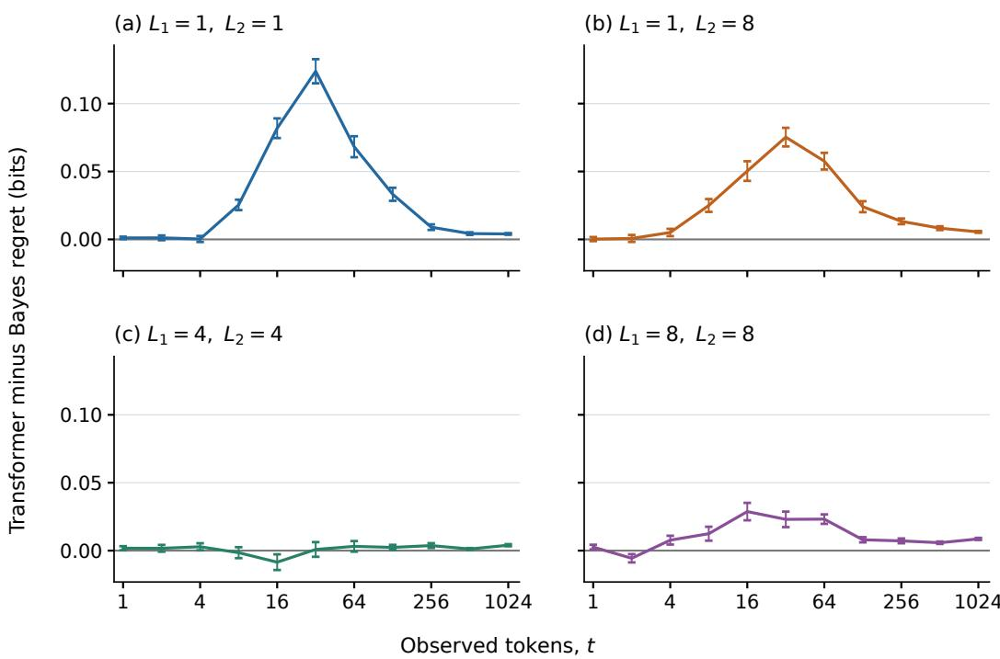  
Figure 3: A known factorization: the two-layer gap to informed Bayes. Each panel uses 256 independent sequences at its fixed coordinate-depth pair, matching panel (b) of Figure 1. Positive values mean larger expected next-token loss for the transformer. Bars give one standard error of the paired differences across sequences. The common vertical scale makes the different transient gaps visible.

## D.2 A SOURCE PRIOR: COINS

The other coin comparisons confirm that the transformer learns the training prior. Figure 1 shows $t = 1 , 2 , 4 , \dots , 2 5 6$ . For the two-point prior, the test sequences at $\theta = 0 . 2$ and at $\theta = 0 . 8$ are the two parts of one full-prior test set. For the uniform prior we drew new sequences at each displayed bias. Closed-form binomial sums confirm the means of informed Bayes.

For 4096 independent full-prior sequences per coin model, cumulative gap over 256 predictions is $0 . 0 0 1 7 \pm 0 . 0 0 1 3$ bits for the two-point prior and $- 0 . 0 0 0 2 \pm 0 . 0 0 1 4$ for the uniform prior. The sequence-averaged predictive divergences are respectively $( 9 . 4 7 { \pm } 0 . 2 0 ) { \cdot } 1 0 ^ { - 6 }$ and $( 1 . 2 0 { \pm } 0 . 0 4 ) { \cdot } 1 0 ^ { - 5 }$ bits. We reconstruct binary probabilities from the saved probability of the observed token, verify them against full vectors and replay fixed sequences against the checkpoints, avoiding lower-precision vectors when estimating these small divergences.

## D.3 A KNOWN ENCODING: PRODUCT SOURCE

Four layers bring the transformer closer to informed Bayes at the same training budget. Across the four depth pairs, the gaps after 1024 observed tokens are 0.0012–0.0031 bits in run 1 and 0.0026– 0.0056 bits in run 2, compared with 0.004–0.009 bits for the two-layer model. The largest gaps across the evaluated contexts are $0 . 0 4 4 \pm 0 . 0 0 5$ and $0 . 0 4 9 \pm 0 . 0 0 6$ bits for the four-layer runs, both at $( L _ { 1 } , L _ { 2 } ) = ( 1 , 1 )$ after 16 tokens; the two-layer maximum is $0 . 1 2 4 \pm 0 . 0 0 9$ bits after 32 tokens. The comparison uses the same 256 sequences at each depth pair and $t = 1 , 2 , 4 , \dots , 1 0 2 4 . \mathrm { F i g u r e } 5$ shows both larger runs.

The full-distribution comparison also measures the two-layer model’s agreement. Figure 6(a) reports $D _ { t } = D _ { \mathrm { K L , 2 } } ( Q _ { B } ( \cdot \vert X ^ { t } ) \vert \vert Q _ { \mathrm { T F } } ( \cdot \vert X ^ { t } ) )$ at every evaluated context. On 128 independent full-prior sequences, its accumulated transient contributes a cumulative gap of $7 . 2 3 \pm 0 . { \bar { 5 } } 0$ bits over 1024 predictions.

<table><tr><td></td><td colspan="2"> $\epsilon = 0 . 1$ </td><td colspan="2"> $\epsilon = 0 . 2$ </td><td colspan="2"> $\epsilon = 0 . 5$ </td></tr><tr><td>Depths</td><td>Inf. Bayes</td><td>Transformer</td><td>Inf. Bayes</td><td>Transformer</td><td>Inf. Bayes</td><td>Transformer</td></tr><tr><td>(1, 1)</td><td>725</td><td>862</td><td>363</td><td>363</td><td>91</td><td>108</td></tr><tr><td>(1,8)</td><td>609</td><td>725</td><td>256</td><td>305</td><td>77</td><td>91</td></tr><tr><td>(4,4)</td><td>725</td><td>725</td><td>305</td><td>305</td><td>91</td><td>91</td></tr><tr><td>(8,8)</td><td>512</td><td>512</td><td>216</td><td>216</td><td>64</td><td>77</td></tr></table>

Table 5: First tested context reaching each regret target. Six pairs coincide; six differ by one grid step, a ratio of about 1.18–1.20. Simultaneous uncertainty sets overlap for every pair; the two predictors therefore require the same context within the resolution of this experiment.

## D.3.1 PREDICTING THE REQUIRED CONTEXT

For target regret ϵ and tested times T, define

$$
n _ { M } ( \epsilon ; T ) = \operatorname* { m i n } \{ t \in { \mathcal { T } } : r _ { M } ( t ) \leq \epsilon \} ,\tag{19}
$$

with nonattainment if the set is empty. Close curves can have different crossings near a flat region. We therefore fixed targets $\epsilon = 0 . 1 , \mathsf { \bar { 0 } . \bar { 2 } , 0 . 5 }$ bits and a refined grid before independent confirmation. Starting with $\{ 1 , 2 , 4 , \dots , 1 0 2 4 \}$ , we added $\lceil n _ { B } 2 ^ { j / 4 } \rceil , j = - 4 , . . . , 4 .$ , around each development Bayesian crossing $n _ { B } .$ , clipped to [1, 1024]. The resulting grid has 26 times. At each of four depth pairs, 1024 fresh sequences of length 1025 were drawn; all Bayesian forecasts were saved before evaluating the trained transformer. Neither predictor receives the source depths. No interpolation, monotonic smoothing or deletion of unreached outcomes is used.

For uncertainty, 4096 whole-sequence bootstrap resamples retain all times and both predictors together within each depth condition, while conditions are resampled independently. The maximum standardized mean deviation gives a simultaneous 95% band with multiplier 3.60. A crossing time is compatible if its lower bound reaches the target and no earlier upper bound forces a crossing; nonattainment is retained if every upper bound remains above the target. Both sets are finite and overlap in all twelve comparisons. This concerns one fixed model. Exact depth-one checks, wider integration, causal token-index tests and independent aggregation of all 4096 sequences pass.

## D.4 DISCOVERING A FACTORIZATION: HIDDEN ENCODING

The $2 \times 8$ source makes the factorization latent while retaining an exact informed Bayes. Every draw has fresh transition matrices and a fresh encoding. $\mathrm { A t } \ t = 1 , 4 , 1 6 , 6 4 , 2 5 6 , 1 0 2 4$ , each transformer and informed Bayes receive the same tokens; informed Bayes integrates over the unknown encoding. An oracle that is told the encoding provides a separate measure of the cost of discovering the factorization.

Scaling brings the transformer to the informed Bayesian curve. $\mathbf { A } \mathbf { t } \ t = 1 0 2 4$ , the two-layer models have regrets 0.1430 and 0.1335 bits in the two runs, compared with 0.03781 bits for informed Bayes. The eight-layer models trained on 25.6 million sequences reach 0.0402 and 0.0397 bits, leaving gaps of $0 . 0 \bar { 0 } 2 4 0 \dot { \pm } 0 . 0 0 0 1 6$ and $0 . 0 0 1 8 4 \pm 0 . 0 0 0 1 0$ bits. Doubling their training from 12.8 to 25.6 million sequences reduces the final gap by a further 0.0033 bits in each run.

The intermediate models show the same progression. Increasing the two-layer models’ training from 6.4 to 25.6 million sequences reduces their endpoint regret by $0 . 0 1 4 7 \pm 0 . 0 0 0 5$ and $0 . 0 1 3 6 \pm 0 . 0 0 0 5$ bits. At 6.4 million sequences, moving from two to four layers reduces it by $0 . 0 3 3 9 \pm 0 . 0 0 0 7$ and $0 . 0 5 8 3 \pm 0 . 0 0 1 0$ bits. The final four-layer regrets are 0.1067 and 0.0563 bits, establishing the contribution of size before the eight-layer models nearly close the remaining gap.

The oracle comparison separates this scaling result from the intrinsic cost of the hidden encoding. $\mathbf { A } \mathbf { t } t = 1 0 2 4 .$ , regret is 0.03781 bits when the encoding is hidden and 0.03727 when it is revealed; integrating this difference over 1024 predictions gives $2 7 . 5 0 \pm 0 . 0 3$ bits. The two-layer transformers have additional cumulative gaps of $\bar { 1 } 0 8 . 3 8 \pm 0 . \bar { 6 } 3$ and $1 0 5 . 3 5 \pm 0 . 6 2$ bits, which size and training reduce to $9 . 5 7 \pm 0 . 1 0$ and $8 . 4 9 \pm 0 . 0 9$ bits.

All reported comparisons use the same 3840 evaluation sequences and exclude the 256 development sequences. A separate script checks the test set, the checkpoint identities, the informed-Bayes values, the model scores and the paired statistics. Table 6 gives the endpoint values; Figure 4 gives both runs at every context.

<table><tr><td>Predictor</td><td></td><td>Run Next-token regret Gap to informed Bayes</td><td></td><td>s Cumulative gap</td></tr><tr><td>Informed Bayes</td><td>一</td><td> $0 . 0 3 7 8 \pm 0 . 0 0 0 4$ </td><td>0</td><td>0</td></tr><tr><td>2 layers, 6.4M</td><td>1</td><td> $0 . 1 4 3 0 \pm 0 . 0 0 1 4$ </td><td> $0 . 1 0 5 2 \pm 0 . 0 0 1 3$ </td><td> $1 0 8 . 3 8 \pm 0 . 6 3$ </td></tr><tr><td>2 layers, 6.4M</td><td>2</td><td> $0 . 1 3 3 5 \pm 0 . 0 0 1 3$ </td><td> $0 . 0 9 5 7 \pm 0 . 0 0 1 2$ </td><td> $1 0 5 . 3 5 \pm 0 . 6 2$ </td></tr><tr><td>2 layers, 25.6M</td><td>1</td><td> $0 . 1 2 8 3 \pm 0 . 0 0 1 3$ </td><td> $0 . 0 9 0 5 \pm 0 . 0 0 1 2$ </td><td> $9 9 . 8 1 \pm 0 . 5 9$ </td></tr><tr><td>2 layers, 25.6M</td><td>2</td><td> $0 . 1 1 9 9 \pm 0 . 0 0 1 2$ </td><td> $0 . 0 8 2 1 \pm 0 . 0 0 1 1$ </td><td> $9 8 . 6 3 \pm 0 . 5 8 $ </td></tr><tr><td>4 layers, 6.4M</td><td>1</td><td> $0 . 1 0 9 1 \pm 0 . 0 0 1 1$ </td><td> $0 . 0 7 1 3 \pm 0 . 0 0 1 0$ </td><td> $9 4 . 0 7 \pm 0 . 5 8$ </td></tr><tr><td>4 layers, 6.4M</td><td>2</td><td> $0 . 0 7 5 1 \pm 0 . 0 0 0 8$ </td><td> $0 . 0 3 7 3 \pm 0 . 0 0 0 7$ </td><td> $5 5 . 9 9 \pm 0 . 4 1$ </td></tr><tr><td>4 layers, 25.6M</td><td>1</td><td> $0 . 1 0 6 7 \pm 0 . 0 0 1 1$ </td><td> $0 . 0 6 8 9 \pm 0 . 0 0 0 9$ </td><td> $8 8 . 8 3 \pm 0 . 5 3$ </td></tr><tr><td>4 layers, 25.6M</td><td>2</td><td> $0 . 0 5 6 3 \pm 0 . 0 0 0 7$ </td><td> $0 . 0 1 8 5 \pm 0 . 0 0 0 5$ </td><td> $3 7 . 1 9 \pm 0 . 2 8$ </td></tr><tr><td>8 layers, 25.6M</td><td>1</td><td> $0 . 0 4 0 2 \pm 0 . 0 0 0 5$ </td><td> $0 . 0 0 2 4 \pm 0 . 0 0 0 2$ </td><td> $9 . 5 7 \pm 0 . 1 0$ </td></tr><tr><td>8 layers, 25.6M</td><td>2</td><td> $0 . 0 3 9 7 \pm 0 . 0 0 0 5$ </td><td> $0 . 0 0 1 8 \pm 0 . 0 0 0 1$ </td><td> $8 . 4 9 \pm 0 . 0 9$ </td></tr></table>

Table 6: Discovering a factorization: scaling toward informed Bayes. All quantities are in bits, averaged over the same 3840 test sequences of length 1025, excluding the 256 development sequences. Next-token regret scores prediction of token 1025; the gap subtracts the informed Bayesian regret. The cumulative gap sums the loss difference over predictions of tokens 2 through 1025. Uncertainties are one standard error across sequences, using paired differences for both gap columns.

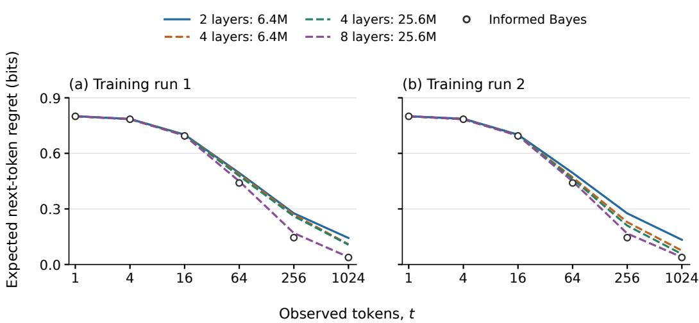  
Figure 4: Discovering a factorization: size and training. Left: training run 1; right: training run 2. Each panel shows the two-layer transformer as a solid curve and the larger transformers as dashed curves; colors distinguish their sizes and training lengths. Legend numbers give training sequences in millions. Unconnected open circles show informed Bayes. All comparisons use the same 3840 test sequences and axes. Shading and bars give one standard error across sequences.

## D.5 A KNOWN BASE LAW: UNIFORM-BASE SOURCE

With a known, uniform base law, this source tests whether the transformer learns the prior on the rows. Increasing the model from two to four layers at the same training budget improves agreement at all four displayed depths (Figure 5). $\mathbf { A } \mathbf { t } ~ t = 1 0 2 4$ , the four-layer gaps range from 0.00007 to 0.02762 bits in run 1 and 0.00003 to 0.01460 bits in run 2. In particular, both models nearly close the two-layer model’s 0.030-bit endpoint gap at $L = 0$ . Their largest gaps over the evaluated contexts are $0 . 0 3 7 \pm 0 . 0 1 6$ and $0 . 0 4 1 \pm 0 . 0 1 7$ bits, both at $L = 8 , t = 6 4$

Figure 6(b) shows the two-layer model’s full-predictive divergence. On 128 independent full-prior sequences, the transient gives a cumulative gap of $3 1 . 6 8 \pm 1 . 5 \bar { 7 }$ bits over 1024 predictions. Together, the two panels compare the two-layer models in the known-product and uniform-base experiments.

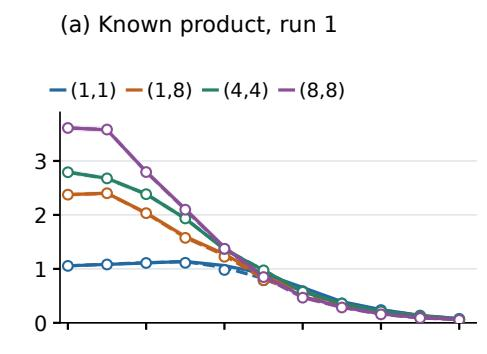  
(c) Uniform base, run 1

(b) Known product, run 2  
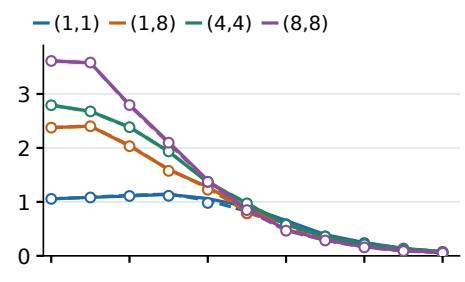

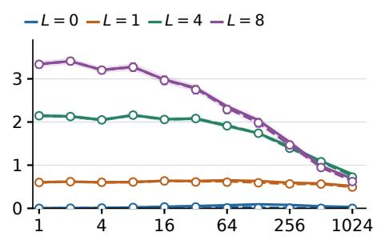

(d) Uniform base, run 2  
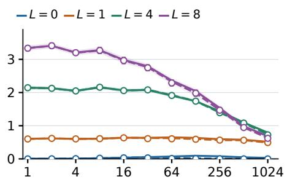  
Observed tokens, t  
Figure 5: Known structure: increasing model size at fixed training budget. Rows show the known $8 \times 8$ product encoding and the uniform-base source; columns show the two independent four-layer runs. Solid curves show the same two-layer baseline in both columns, dashed curves the four-layer model, and open circles informed Bayes. All models receive 6.4 million training sequences from the corresponding prior and use the fixed test sets in Table 4. Colors identify the same source settings as Figure 1; shading and bars give one standard error across test sequences.

## D.6 AN UNKNOWN SHARED BASE LAW: SHARED-BASE SOURCE

More layers and more training brings both runs close to informed Bayes. After 64 tokens, the eight-layer models’ gap ranges from −0.0017 to 0.0066 bits across all four depths and both runs. The two-layer models have gaps as large as 0.220 bits, while the four-layer models trained on the same 6.4 million sequences reduce the largest gap to 0.040 bits. Table 7 gives the paired comparison at every depth.

Training the eight-layer models for 25.6 rather than 12.8 million sequences reduces their regret after 1024 tokens at every depth and in both runs, by $0 . 0 0 4 5 { - } 0 . 0 0 9 6$ bits. At $\left( L , t \right) = \left( 0 , 1 0 2 4 \right)$ , the final eight-layer gaps are $0 . 0 0 4 0 9 { \scriptstyle \pm 0 . 0 0 0 1 7 }$ and 0.00246±0.00014 bits, compared with 0.00899±0.00033 and $0 . 0 0 8 4 6 \pm 0 . 0 0 0 3 0$ for the four-layer models at 6.4 million sequences. Figure 7 shows the complete scaling sequence. All models are evaluated on the same 256 sequences per depth, with checkpoints fixed before evaluation.

The long-sequence calculations in Appendix D.6.1 apply the same independent-chain and integrationorder checks at 256 and 1024 tokens. All eight depth-and-context combinations use complete test sets of 256 sequences. Their numerical error bounds are at most 0.000605 bits and are reported separately from source variation in Table 8.

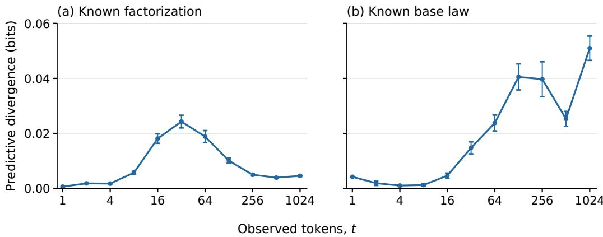

Figure 6: Informed-Bayes-to-transformer predictive divergence. Full-distribution comparison of the two-layer models for (a) the known $8 \times 8$ product factorization and (b) the uniform-base LSA source at $d = 6 4$ . The horizontal axis counts observed tokens. Points show the mean of $D _ { \mathrm { K L , 2 } } ( Q _ { B } \Vert Q _ { \mathrm { T F } } )$ , in bits, over 128 independent sequences of length 1025 from each training prior; bars give one standard error. Lines join the evaluated contexts. Both panels use the same vertical scale.
<table><tr><td></td><td>L Run</td><td>2 layers, 6.4M</td><td></td><td>4 layers, 6.4M 4 layers, 25.6M</td><td>8 layers, 25.6M</td></tr><tr><td>0</td><td>1</td><td> $0 . 2 1 6 7 \pm 0 . 0 0 8 8$ </td><td> $0 . 0 3 9 5 \pm 0 . 0 0 3 8$ </td><td> $0 . 0 2 8 1 \pm 0 . 0 0 3 0$ </td><td> $0 . 0 0 6 5 \pm 0 . 0 0 1 0$ </td></tr><tr><td>0</td><td>2</td><td> $0 . 2 1 9 9 \pm 0 . 0 0 9 0$ </td><td> $0 . 0 2 8 7 \pm 0 . 0 0 3 2$ </td><td> $0 . 0 2 6 3 \pm 0 . 0 0 2 9$ </td><td> $0 . 0 0 3 4 \pm 0 . 0 0 0 8$ </td></tr><tr><td>1</td><td>1</td><td> $0 . 1 1 4 9 \pm 0 . 0 0 9 9$ </td><td> $0 . 0 1 6 9 \pm 0 . 0 0 4 3$ </td><td> $0 . 0 1 4 4 \pm 0 . 0 0 3 9$ </td><td> $0 . 0 0 6 6 \pm 0 . 0 0 1 5$ </td></tr><tr><td>1</td><td>2</td><td> $0 . 1 2 1 3 \pm 0 . 0 0 9 3$ </td><td> $0 . 0 1 0 3 \pm 0 . 0 0 3 9$ </td><td> $0 . 0 0 7 9 \pm 0 . 0 0 3 5$ </td><td> $0 . 0 0 0 5 \pm 0 . 0 0 1 3$ </td></tr><tr><td>4</td><td>1</td><td> $0 . 0 1 2 2 \pm 0 . 0 1 1 6$ </td><td> $0 . 0 1 4 6 \pm 0 . 0 0 5 7$ </td><td> $0 . 0 1 0 3 \pm 0 . 0 0 5 2$ </td><td> $0 . 0 0 2 6 \pm 0 . 0 0 2 6$ </td></tr><tr><td>4</td><td>2</td><td> $0 . 0 2 2 7 \pm 0 . 0 1 1 8$ </td><td> $0 . 0 1 4 1 \pm 0 . 0 0 5 5$ </td><td> $0 . 0 1 2 9 \pm 0 . 0 0 5 5$ </td><td> $0 . 0 0 3 7 \pm 0 . 0 0 2 1$ </td></tr><tr><td>8</td><td>1</td><td> $0 . 0 8 9 2 \pm 0 . 0 1 2 8$ </td><td> $0 . 0 0 4 9 \pm 0 . 0 0 4 8$ </td><td> $0 . 0 0 5 6 \pm 0 . 0 0 4 3$ </td><td> $- 0 . 0 0 1 7 \pm 0 . 0 0 2 0$ </td></tr><tr><td>8</td><td>2</td><td> $0 . 0 8 2 2 \pm 0 . 0 1 3 0$ </td><td> $0 . 0 1 0 3 \pm 0 . 0 0 4 3$ </td><td> $0 . 0 1 2 9 \pm 0 . 0 0 4 9$ </td><td> $0 . 0 0 2 8 \pm 0 . 0 0 2 1$ </td></tr></table>

Table 7: Inferring shared structure: the gap to informed Bayes after 64 tokens. Next-token loss differences in bits at $\alpha = 1$ , averaged over 256 paired sequences per depth. Uncertainties are one standard error across sequences.

## D.6.1 AGREEMENT AT LARGE t

Table 8 gives the comparisons at all four depths after 256 and 1024 tokens, on 256 sequences each. Every sequence is evaluated twice with different random seeds, using 16 and 32 integration nodes, or 32 and 64 nodes for $\left( L , t \right) = \left( 0 , 1 0 2 4 \right)$ . We report a mean only if every sequence and the mean itself pass the numerical checks of Appendix D.1.3. Sequences from an earlier trial with eight sequences are included in the 256 and are not counted twice.

The numerical Monte Carlo uncertainty is distinct from variation between sources. The table reports one source standard error for regret and paired differences, and the separate numerical error bound. Informed Bayesian optimality is prior-averaged, so fixed-setting differences can have either sign.

At $L = 0 , t = 1 0 2 4$ , four-layer models after 100000 updates have gaps $0 . 0 0 8 9 9 \pm 0 . 0 0 0 3 3$ and 0.00846 ± 0.00030 bits. Extending training to 400000 gives $0 . 0 0 8 8 6 \pm 0 . 0 0 0 3 2$ and $0 . 0 0 8 4 3 \pm$ 0.00029. The final eight-layer models reduce these gaps to 0.00409±0.00017 and $0 . 0 0 2 4 6 { \pm } 0 . 0 0 0 1 4$ bits. This comparison uses both runs and the models at the end of training. No model was selected by its test performance.

## D.7 INFERRING THE SOURCE FAMILY: POOLED TRAINING

The pooled transformers closely reproduce the informed Bayesian mixture. After four tokens, increasing from two to four layers reduces the gap from 0.0197 to 0.0052 bits in run 1 and from

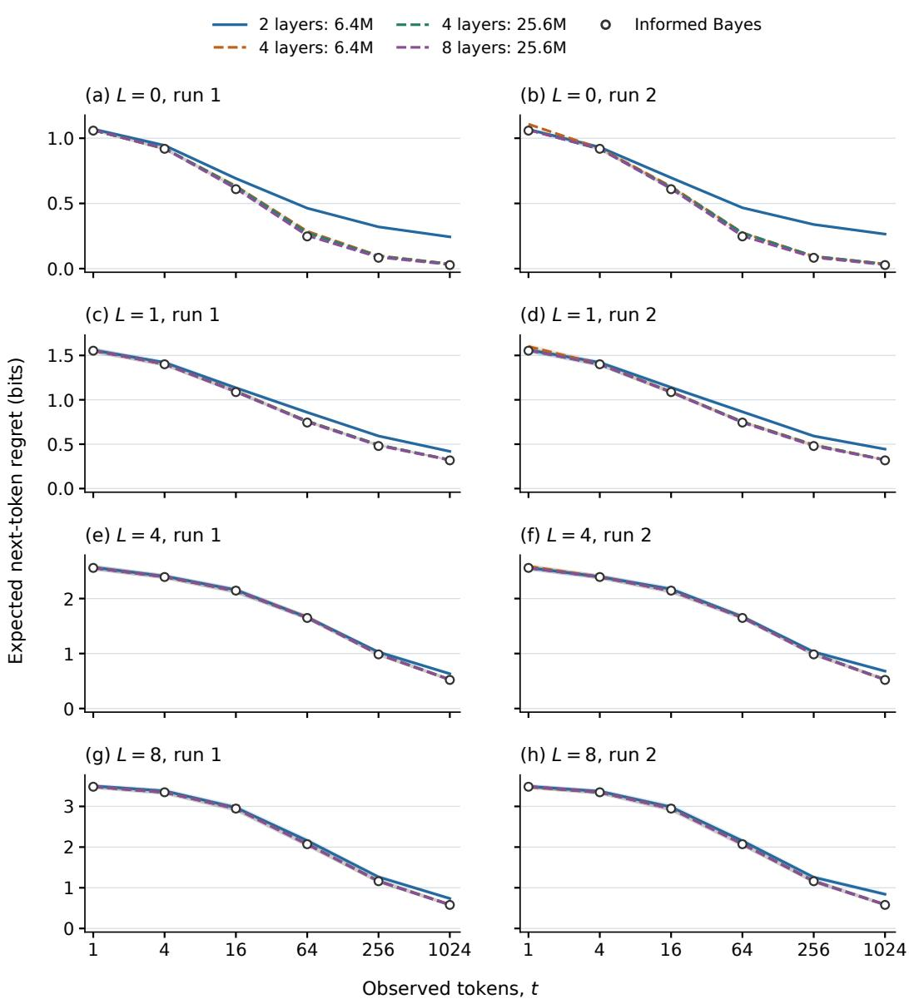  
Figure 7: Inferring shared structure: size and training. Rows show source depths $L = 0 , 1 , 4 , 8 ;$ columns show the two training runs. Each panel shows the two-layer transformer as a solid curve and the larger transformers as dashed curves; colors distinguish their sizes and training lengths. Legend numbers give training sequences in millions. Unconnected open circles show informed Bayes at all six displayed contexts. Each depth uses the same 256 sequences for every predictor, and the two runs share a vertical scale. Shading and bars give one standard error.

<table><tr><td>L</td><td></td><td>t Informed Bayesian regret</td><td>Run 1 gap</td><td></td><td>Run 2 gap Numerical error bound</td></tr><tr><td>0</td><td>256</td><td> $0 . 0 8 3 2 3 \pm 0 . 0 0 1 2 3$ </td><td> $0 . 0 0 4 7 0 \pm 0 . 0 0 0 5 1$ </td><td> $0 . 0 0 3 0 3 \pm 0 . 0 0 0 3 4$ </td><td>0.000108</td></tr><tr><td></td><td>0 1024</td><td> $0 . 0 2 7 3 9 \pm 0 . 0 0 0 4 0$ </td><td> $0 . 0 0 4 0 9 \pm 0 . 0 0 0 1 7$ </td><td> $0 . 0 0 2 4 6 \pm 0 . 0 0 0 1 4$ </td><td>0.000033</td></tr><tr><td></td><td>256</td><td> $0 . 4 7 9 4 5 \pm 0 . 0 1 2 6 5$ </td><td> $0 . 0 0 5 0 8 \pm 0 . 0 0 1 3 7$ </td><td> $0 . 0 0 1 3 0 \pm 0 . 0 0 1 1 4$ </td><td>0.000443</td></tr><tr><td></td><td>1 1024</td><td> $0 . 3 1 7 7 6 \pm 0 . 0 1 1 1 6$ </td><td> $0 . 0 0 2 4 0 \pm 0 . 0 0 0 8 9$ </td><td> $0 . 0 0 3 1 5 \pm 0 . 0 0 0 7 0$ </td><td>0.000147</td></tr><tr><td>4</td><td>256</td><td> $0 . 9 8 5 0 1 \pm 0 . 0 3 9 1 4$ </td><td> $0 . 0 0 3 1 8 \pm 0 . 0 0 1 5 1$ </td><td> $0 . 0 0 2 6 3 \pm 0 . 0 0 1 3 3$ </td><td>0.000551</td></tr><tr><td></td><td>4 1024</td><td> $0 . 5 2 0 1 1 \pm 0 . 0 2 9 1 7$ </td><td> $0 . 0 0 3 2 7 \pm 0 . 0 0 0 9 7$ </td><td> $0 . 0 0 1 4 1 \pm 0 . 0 0 1 0 4$ </td><td>0.000242</td></tr><tr><td>8</td><td>256</td><td> $1 . 1 6 1 2 8 \pm 0 . 0 5 6 6 8$ </td><td> $0 . 0 0 0 7 8 \pm 0 . 0 0 1 7 9$ </td><td> $- 0 . 0 0 1 0 3 \pm 0 . 0 0 1 6 3$ </td><td>0.000605</td></tr><tr><td>8</td><td>1024</td><td> $0 . 5 7 8 8 5 \pm 0 . 0 3 9 8 7$ </td><td> $0 . 0 0 1 5 8 \pm 0 . 0 0 1 2 9$ </td><td> $0 . 0 0 4 2 3 \pm 0 . 0 0 1 1 6$ </td><td>0.000359</td></tr></table>

Table 8: Inferring shared structure at large t. All quantities are in bits and use 256 paired sequences per row. The transformer gaps use the eight-layer 400000-update checkpoints. The last column is the numerical error bound of the Bayesian value, not a source standard error; its uncertainty is shared by the two model comparisons in that row.

Table 9: Two-layer cumulative gap to the informed Bayesian mixture. Loss differences over four predictions, in bits. Each family has 1024 independent test sequences; the final row averages the three family means equally. Values are means ± one paired standard error.
<table><tr><td>Generating family</td><td>Training run 1</td><td>Training run 2</td></tr><tr><td>Product</td><td> $0 . 0 2 3 \pm 0 . 0 1 1$ </td><td> $- 0 . 0 1 8 \pm 0 . 0 1 1$ </td></tr><tr><td>Shared-base LSA</td><td> $0 . 1 0 5 \pm 0 . 0 1 4$ </td><td> $0 . 1 3 1 \pm 0 . 0 1 5$ </td></tr><tr><td>Uniform-base control</td><td> $- 0 . 0 2 7 \pm 0 . 0 0 9$ </td><td> $- 0 . 0 0 5 \pm 0 . 0 0 9$ </td></tr><tr><td>Equal-family average</td><td> $0 . 0 3 4 \pm 0 . 0 0 7$ </td><td> $0 . 0 3 6 \pm 0 . 0 0 7$ </td></tr></table>

0.0190 to 0.0025 bits in run 2. After one token, the four-layer gaps are 0.0080 and 0.0067 bits. Thus the same agreement holds when prediction requires both inference within each source family and inference over the family itself.

Each model is trained without family labels on equal proportions of product, shared-base and uniform-base sources, receiving 6.4 million sequences per family. For the family probability $Q _ { f } ( x ^ { t } )$ integrated over its prior, informed Bayes uses

$$
w _ { f } ( t ) = \frac { Q _ { f } ( x ^ { t } ) } { \sum _ { g = 1 } ^ { 3 } Q _ { g } ( x ^ { t } ) } = \frac { 2 ^ { - \mathscr { L } _ { f } ( x ^ { t } ) } } { \sum _ { g = 1 } ^ { 3 } 2 ^ { - \mathscr { L } _ { g } ( x ^ { t } ) } } ,\tag{20}
$$

$$
Q _ { \operatorname* { m i x } } ( b \mid x ^ { t } ) = \sum _ { f = 1 } ^ { 3 } w _ { f } ( t ) Q _ { f } ( b \mid x ^ { t } ) .\tag{21}
$$

All three initial-token probabilities are $1 / 6 4 .$ , and every component probability and prediction concern the same observed history.

The test set has 1024 independent sequences from each family, drawn from its full prior. We average within families and then weight families equally; the variance of this average is the sum of familymean variances divided by nine. Both runs use the same test set. Figure 8 compares both model sizes with informed Bayes through $t = 1 0 2 4$ . Bayesian estimates at t = 16, 64, 256, 1024 use a fixed subset of 64 histories per family. $\mathrm { A t } t = 1 0 2 4$ , the four-layer models have regrets 0.3787 and 0.3751 bits, improving on the two-layer models by $0 . 0 3 6 0 \pm 0 . 0 0 1 3$ and $0 . 0 3 5 7 \overset { \cdot } { \pm } 0 . 0 0 1 3$ bits. Table 9 gives the two-layer models’ cumulative comparison through four predictions. Conditional family differences may have either sign because Bayesian optimality applies to the complete mixture prior.

Reference validation. Product and uniform-base probabilities use the checked row integrals and common-depth averaging. At $t = 1 , 4$ , shared-base probabilities use exhaustive short-pattern integration over exponent, depth and permutation. Its raw normalization error is below $1 . 5 { \cdot } 1 0 ^ { - \mathrm { { \bar { 1 } } 1 } }$ , and an independent initial-prediction check agrees within $5 . 5 \cdot 1 0 ^ { - 1 3 }$ . Sequential mixture predictions and direct $\bar { Q } _ { \mathrm { m i x } } ( x ^ { t + 1 } ) / \bar { Q _ { \mathrm { m i x } } } ( x _ { 1 } )$ agree within $7 . 1 \cdot 1 0 ^ { - 1 2 }$ bits on 24 sequences through four predictions. For longer histories, annealed sequential Monte Carlo estimates the shared-base sequence and successor probabilities jointly. Their ratio gives the predictive probabilities used in the mixture.

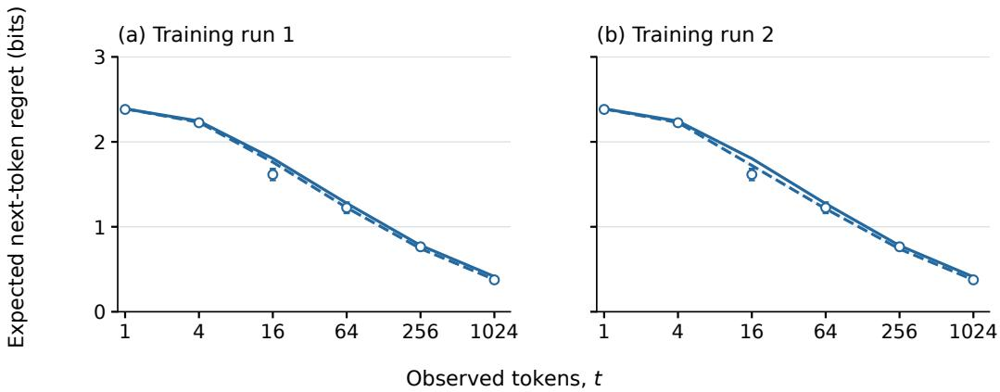  
Figure 8: Inferring the source family: two independent runs. Each panel compares a two-layer transformer (solid curve) and a four-layer transformer (dashed curve), trained on the same 19.2 million indexed sequences from the three 64-symbol families. Open circles show the informed Bayesian mixture through $t = 1 0 2 4$ . Transformer curves and Bayes at $t = 1$ , 4 use 1024 histories per family; Bayes at longer contexts uses 64 per family. Both runs share their test histories. Shading and bars give one standard error across histories.

The estimate at $t = 1 0 2 4$ uses eight repetitions per history. $\mathbf { A } \mathbf { t } \ t = 1 6 .$ , each of the 192 histories uses 32 independent repetitions with 8192 particles. Separate particle, exponent and row-integration refinements give a total numerical allowance of 0.00205 bits for the pooled mean, below the 0.01/3- bit budget. This numerical allowance is distinct from the standard error across test histories.

## D.7.1 THE COST OF FAMILY UNCERTAINTY

Following Bayesian model-averaging comparisons (Zhang et al., 2025; Bai et al., 2023; Panwar et al., 2024; Deora et al., 2025), let $\mathcal { L } _ { F } ( n )$ score tokens $2 , \ldots , n + 1$ with the generating family known but its parameters unknown. Define

$$
C _ { B } ( n ) = \mathbb { E } [ \mathcal { L } _ { \operatorname* { m i x } } ( n ) - \mathcal { L } _ { F } ( n ) ] , \qquad C _ { \mathrm { T F } } ( n ) = \mathbb { E } [ \mathcal { L } _ { \mathrm { T F } } ( n ) - \mathcal { L } _ { F } ( n ) ] .\tag{22}
$$

Every family assigns $X _ { 1 }$ the same probability, so

$$
C _ { B } ( n ) = I ( F ; X _ { 2 } , \ldots , X _ { n + 1 } \mid X _ { 1 } ) = \log _ { 2 } 3 - H ( F \mid X _ { 1 } , \ldots , X _ { n + 1 } ) .
$$

Thus $\log _ { 2 }$ 3 bounds the cost; $C _ { \mathrm { T F } } - C _ { B }$ is the cumulative transformer–mixture gap in Table 9.

For $n \leq 4$ , validated component likelihoods allow a population sum. Separate coordinate relabeling represents each history by equality patterns $u , v ,$ with multiplicity $M ( u , v ) = ( 8 ) _ { k _ { u } } ( 8 ) _ { k _ { v } }$ ; there are at most $5 2 ^ { 2 } = 2 7 0 4$ pairs for five tokens. For representatives $x ( u , v )$

$$
C _ { B } ( n ) = \frac { 1 } { 3 } \sum _ { f } \sum _ { u , v } M ( u , v ) Q _ { f } ( x ( u , v ) ) \log _ { 2 } \frac { Q _ { f } ( x ( u , v ) ) } { Q _ { \operatorname* { m i x } } ( x ( u , v ) ) } .
$$

Total-mass checks pass without renormalization. For $\begin{array} { r l r } { n } & { { } = } & { 1 , 2 , 3 , 4 } \end{array}$ the costs are $0 . 0 1 1 6 3 , 0 . 0 4 4 1 5 , 0 . 1 0 2 2 7 , 0 . 1 7 5 6 2$ bits, without test-sample uncertainty. Adding the paired transformer–mixture sample mean gives $C _ { \mathrm { T F } } ( 4 ) ~ = ~ 0 . 2 0 9 \bar { 3 } \pm 0 . 0 0 6 6$ and $0 . 2 1 1 6 \overset { \cdot } { \pm } 0 . 0 0 6 9$ bits for runs 1 and 2. This paired estimate has variance equal to the sum of within-family paired variances divided by 9 · 1024; numerical error is assessed separately. Informed Bayes explains most of the early cost.

Residual family ambiguity. The limiting cost obeys

$$
\log _ { 2 } 3 - \frac { 1 6 } { 2 7 } \ \leq \ \operatorname * { l i m } _ { n \to \infty } C _ { B } ( n ) \ < \ \log _ { 2 } 3 .\tag{23}
$$

An infinite trajectory identifies its positive transition matrix T through empirical transition frequencies. Conditional on $( T , X _ { 1 } )$ , future tokens contain no further information about F, so the limit is $I ( F ; T )$ $X _ { 1 } )$ The product prior lies on the lower-dimensional set of product matrices; the depth-zero shared-base and uniform-base priors give identical nonuniform Zipf rows and the uniform matrix, respectively. These components are mutually singular, so F is identified almost surely there.

The positive-depth shared-base and uniform-base priors instead have positive densities over all positive transition matrices. At depth one, uniform-simplex rows multiplied by positive base weights and normalized are an invertible smooth image of the simplex interior; conditioning on the other factors extends absolute continuity to larger depths. Thus both families remain possible on this continuous component, whose prior mass is $2 ( 1 / \hat { 3 } ) ( 8 / 9 ) = 1 6 / 2 7$ . At most one bit of family entropy remains there and strictly positive entropy does remain. Hence $0 < H ( F \mid T , X _ { 1 } ) \le 1 6 / 2 7$ , proving the bound. Even unlimited data need not identify the generating family.

Across all six source constructions, the detailed comparisons support the same progression as Section 3. The two-layer transformer closely tracks informed Bayes when the relevant structure is directly accessible; more layers and more training closes the gap when the encoding or shared structure must be inferred; and pooled training extends the same correspondence to inference over source families.

## E DETAILS FOR SECTION 4: FOUR FURTHER TESTS

This appendix follows the four scenarios in Section 4 and Figure 2: source mismatch, a timevarying source, an unseen context, and the emergence of copying. Each subsection first specifies the scenario and the informed Bayesian response, then gives the complete transformer comparison and its numerical checks.

## E.1 COMMON EXPERIMENTAL AND NUMERICAL PROTOCOL

The transformer’s weights are fixed before evaluation. Informed Bayes continues to use the family and prior represented in the transformer’s training sequences. During evaluation, neither predictor receives the test parameters or a signal identifying the test condition. Test sets are independent at the level of complete source draws or sequences. Paired conditions share histories, source parameters and the random numbers that drive the source wherever their test laws permit.

All losses and regrets are in bits. Means compare predictions on the same histories, and uncertainty is computed across whole sequences, preserving all tested times and paired conditions. Unless a caption states otherwise, curves show pointwise 95% intervals and textual ± values give one standard error. Training-run variation is reported separately from sequence-to-sequence variation.

Exact finite sums are used when available. Calculations with continuous or latent variables are repeated with independent integration rules or chains, and, except for explicitly marked preliminary estimates, test-set means are reported only after every required reference passes the criteria in Appendix D. Saved forecasts are checked in raw probability space; none is clipped or renormalized for agreement.

## E.2 SOURCE MISMATCH

The fixed predictors receive sequences from a product test source whose 64 states have random token labels, rather than the coordinate-revealing labels used in training. This source has the same entropy and predictability as the ordinary product source, but its labels hide the coordinate factorization. Informed Bayes retains the training product prior and approaches the product projection derived below. At $( L _ { 1 } , L _ { 2 } ) \stackrel { \cdot } { = } ( 1 , 1 )$ and (4, 4), its predicted stationary regrets are 0.966 ± 0.003 and 2.237 ± 0.007 bits. At depth four and $t = 1 0 2 4$ , informed Bayes has regret 2.299 bits. The two-layer transformer has 2.309 bits, and the two four-layer runs have 2.300 and 2.305 bits.

## E.2.1 MATCHED PRODUCT TEST CONDITIONS

We use run 1 of the known-encoding $8 \times 8$ product transformer (two layers, width 128, 544256 parameters, 100000 updates) and its informed Bayesian predictor. Bayes assigns independent uniform depth priors on $\{ 1 , \ldots , 8 \}$ to the two coordinates, with each coordinate’s depth shared across its rows.

For the random-label condition we also evaluate both four-layer known-encoding product models: width 256, eight heads and 3454464 parameters. All three transformers have 100000 updates and see 6.4 million sequences from the same training prior, with independently drawn training sequences. The two four-layer runs use the same 1024 test histories per depth and the same Bayesian forecast as the two-layer model. We report the runs separately.

At each of $( L _ { 1 } , L _ { 2 } ) = ( 1 , 1 )$ and $( 4 , 4 )$ , we generate 1024 matched sets of four test histories: a stationary product source, a product source observed through random joint labels, a time-varying source with one new coordinate matrix after the change point, and a time-varying source with two. The initial state is uniform. The random-label condition uses a fresh uniform permutation η of the 64 labels,

$$
T ^ { \eta } ( b \mid a ) = T { \left( \eta ^ { - 1 } ( b ) \mid \eta ^ { - 1 } ( a ) \right) } , \qquad T = T _ { 1 } \otimes T _ { 2 } ,
$$

without shuffling token positions. Common initial states and uniform random numbers pair all four conditions. Histories extend untruncated through the transformer’s limit of 1024 tokens.

Regret is the KL divergence from the actual current transition row to the forecast. We also measure the paired transformer-minus-Bayes regret and $D _ { \mathrm { K L , 2 } } ( Q _ { B } \vert \vert Q _ { \mathrm { T F } } )$

Pairing, the random label mapping and the parameter boundary are checked against the full 64-state matrices. Sixteen test histories spanning all conditions and depths pass wider-integration and exact depth-one checks; the largest depth-one probability discrepancy is below $1 0 ^ { - 1 3 }$ . All saved forecasts pass raw normalization checks and agree on the shared prefixes. The four-layer forecasts also pass separate-prefix causal checks. Their regrets, predictive divergences and paired standard errors are recomputed from the saved forecasts on all test histories.

## E.2.2 PRODUCT PROJECTION AND RESIDUAL INFORMATION LOSS

The product projection identifies the exact information excluded by the visible factorization and therefore predicts the random-label mismatch cost.

Let $P _ { u v , u ^ { \prime } v ^ { \prime } } > 0$ be the true transition matrix on the visible $8 \times 8$ states, with stationary law $\mu _ { u v }$ and stationary pair law $J _ { u v , u ^ { \prime } v ^ { \prime } } = \mu _ { u v } P _ { u v , u ^ { \prime } v ^ { \prime } }$ . The assumed model is $Q _ { A , B } ( u ^ { \prime } , v ^ { \prime } \mid u , v ) = A _ { u u ^ { \prime } } B _ { v v ^ { \prime } }$ Maximizing its stationary expected log likelihood separately over each stochastic row gives

$$
\begin{array} { r l } & { A _ { u u ^ { \prime } } ^ { * } = \cfrac { \sum _ { v , v ^ { \prime } } J _ { u v , u ^ { \prime } v ^ { \prime } } } { \sum _ { v } \mu _ { u v } } = P ( U ^ { \prime } = u ^ { \prime } \mid U = u ) , } \\ & { B _ { v v ^ { \prime } } ^ { * } = \cfrac { \sum _ { u , u ^ { \prime } } J _ { u v , u ^ { \prime } v ^ { \prime } } } { \sum _ { u } \mu _ { u v } } = P ( V ^ { \prime } = v ^ { \prime } \mid V = v ) . } \end{array}
$$

The coordinate processes need not themselves be Markov: these are conditionals of stationary pairs.   
Positivity makes the full chain ergodic and both row-wise maximizers unique.

For every history, the assumed likelihood factors into coordinate transition-count likelihoods. Independent factor priors therefore give independent posteriors even when the true coordinates are dependent. Empirical pair frequencies converge to the marginals of J. Each factor prior gives positive mass to every neighborhood of every positive transition matrix, since its depth-one component has independent uniform Dirichlet rows. The limiting log likelihood has the unique maximizer $( A ^ { * } , B ^ { * } )$ , so posterior mass outside its neighborhoods vanishes and the predictive matrix approaches $\mathring { Q } ^ { \ast } = \mathring { A } ^ { \ast } \otimes \mathring { B } ^ { \ast }$ . Averaging over depth shared across rows changes the predictions at finite $t ,$ but not this limit.

Residual information loss. The stationary regret of this product projection is

$$
\begin{array} { l } { { \displaystyle R _ { \infty } = \sum _ { u , v , u ^ { \prime } , v ^ { \prime } } J _ { u v , u ^ { \prime } v ^ { \prime } } \log _ { 2 } \frac { P _ { u v , u ^ { \prime } v ^ { \prime } } } { A _ { u u ^ { \prime } } ^ { * } B _ { v v ^ { \prime } } ^ { * } } } } \\ { { \displaystyle \ = H ( U ^ { \prime } \mid U ) + H ( V ^ { \prime } \mid V ) - H ( U ^ { \prime } , V ^ { \prime } \mid U , V ) } } \\ { { \displaystyle \ = I ( U ^ { \prime } ; V \mid U ) + I ( V ^ { \prime } ; U \mid V ) + I ( U ^ { \prime } ; V ^ { \prime } \mid U , V ) . } } \end{array}
$$

<table><tr><td> $( L _ { 1 } , L _ { 2 } )$ </td><td>t</td><td>Two layers</td><td>Four layers, run 1</td><td>Four layers, run 2</td></tr><tr><td>1,1</td><td>32</td><td> $0 . 3 2 0 1 \pm 0 . 0 0 5 3$ </td><td> $0 . 0 8 9 9 \pm 0 . 0 0 2 1$ </td><td> $0 . 0 8 7 0 \pm 0 . 0 0 2 2$ </td></tr><tr><td>1,1</td><td>1024</td><td> $0 . 0 0 0 4 \pm 0 . 0 0 0 5$ </td><td> $- 0 . 0 0 5 1 \pm 0 . 0 0 0 4$ </td><td> $- 0 . 0 0 0 4 \pm 0 . 0 0 0 7$ </td></tr><tr><td>4,4</td><td>32</td><td> $0 . 2 0 9 0 \pm 0 . 0 0 8 4$ </td><td> $0 . 0 6 1 7 \pm 0 . 0 0 3 5$ </td><td> $0 . 0 6 2 4 \pm 0 . 0 0 3 6$ </td></tr><tr><td>4,4</td><td>1024</td><td> $0 . 0 1 0 0 \pm 0 . 0 0 1 6$ </td><td> $0 . 0 0 0 3 \pm 0 . 0 0 0 8$ </td><td> $0 . 0 0 6 1 \pm 0 . 0 0 1 5$ </td></tr></table>

Table 10: Product mismatch with two- and four-layer transformers. Paired transformer-minus-Bayes regret, mean ± one standard error in bits, on the same 1024 random-label histories per depth. All models have the same training prior and sequence budget. Negative differences are possible because the test source lies outside the training family.
<table><tr><td> $( L _ { 1 } , L _ { 2 } )$ </td><td>Condition</td><td>Transformer</td><td>Bayes</td><td>Paired difference</td></tr><tr><td>1,1</td><td>Visible product labels</td><td> $0 . 0 7 5 9 \pm 0 . 0 0 1 1$ </td><td> $0 . 0 7 2 3 \pm 0 . 0 0 1 0$ </td><td> $0 . 0 0 3 6 \pm 0 . 0 0 0 3$ </td></tr><tr><td>1,1</td><td>Random joint labels</td><td> $1 . 0 3 9 6 \pm 0 . 0 0 9 5$ </td><td> $1 . 0 3 9 2 \pm 0 . 0 0 9 5$ </td><td> $0 . 0 0 0 4 \pm 0 . 0 0 0 5$ </td></tr><tr><td>1,1</td><td>One new matrix after  $t = 2 5 6$ </td><td> $0 . 1 5 6 1 \pm 0 . 0 0 2 6$ </td><td> $0 . 1 5 3 0 \pm 0 . 0 0 2 6$ </td><td> $0 . 0 0 3 1 \pm 0 . 0 0 0 3$ </td></tr><tr><td>1,1</td><td>Two new matrices after  $t = 2 5 6$ </td><td> $0 . 2 4 0 9 \pm 0 . 0 0 3 7$ </td><td> $0 . 2 3 7 8 \pm 0 . 0 0 3 7$ </td><td> $0 . 0 0 3 1 \pm 0 . 0 0 0 4$ </td></tr><tr><td>4,4</td><td>Visible product labels</td><td> $0 . 0 6 6 4 \pm 0 . 0 0 1 6$ </td><td> $0 . 0 6 1 9 \pm 0 . 0 0 1 5$ </td><td> $0 . 0 0 4 4 \pm 0 . 0 0 0 3$ </td></tr><tr><td>4,4</td><td>Random joint labels</td><td> $2 . 3 0 9 3 \pm 0 . 0 2 2 2$ </td><td> $2 . 2 9 9 3 \pm 0 . 0 2 1 7$ </td><td> $0 . 0 1 0 0 \pm 0 . 0 0 1 6$ </td></tr><tr><td>4,4</td><td>One new matrix after  $t = 2 5 6$ </td><td> $0 . 2 3 8 9 \pm 0 . 0 0 7 4$ </td><td> $0 . 2 3 6 1 \pm 0 . 0 0 7 5$ </td><td> $0 . 0 0 2 7 \pm 0 . 0 0 0 5$ </td></tr><tr><td>4,4</td><td>Two new matrices after  $t = 2 5 6$ </td><td> $0 . 4 1 6 4 \pm 0 . 0 1 0 6$ </td><td> $0 . 4 1 7 1 \pm 0 . 0 1 0 7$ </td><td> $- 0 . 0 0 0 7 \pm 0 . 0 0 0 7$ </td></tr></table>

Table 11: Regret after 1024 tokens under four product test sources. The transformer has two layers. Mean ± one standard error in bits over 1024 paired test sets per depth. The last column is the paired transformer–Bayes difference; informed Bayes retains its training product prior in every condition.

These are the predictive dependencies excluded by the assumed factorization. They vanish with visible product labels. The random-label test law has the same entropy rate $h = H ( \bar { U } ^ { \prime } , V ^ { \prime } \mid U , V )$ but generally contains predictive dependencies that visible-product Bayes excludes, making $R _ { \infty } > 0$ Since uniform prediction is itself a product of two coordinate predictions, $0 \leq R _ { \infty } \leq 6 - h$ . This bounds the optimal stationary product regret, not the regret at every finite t. The stationary average also differs from the realized current-row regret, which varies with state.

For each saved random-label test condition, we calculate the stationary law from its two coordinate matrices and saved label mapping. The finite sums above then give the following means ± one standard error over the 1024 test sources per depth, without fitting any prediction curve:
<table><tr><td> $( L _ { 1 } , L _ { 2 } )$ </td><td>h</td><td>limiting expected loss</td><td> $R _ { \infty }$ </td></tr><tr><td>(1, 1)</td><td> $\overline { { 4 . 9 5 4 9 \pm 0 . 0 0 3 9 } }$ </td><td> $\overline { { 5 . 9 2 0 5 \pm 0 . 0 0 1 0 } }$ </td><td> $\overline { { 0 . 9 6 5 7 \pm 0 . 0 0 3 5 } }$ </td></tr><tr><td>(4,4)</td><td> $3 . 1 0 8 0 \pm 0 . 0 1 2 6$ </td><td> $5 . 3 4 4 9 \pm 0 . 0 1 3 1$ </td><td> $2 . 2 3 6 9 \pm 0 . 0 0 6 9$ </td></tr></table>

A direct 64-state KL calculation agrees with the entropy formula within $2 . 1 \cdot 1 0 ^ { - 1 5 }$ bits; an independent stationary solve agrees within $1 . 1 \cdot 1 0 ^ { - 1 5 }$ . These are unbounded-history informed-Bayesian limits. The experiments start from a uniform state and stop at 1024 tokens; their curves at finite t approach the limits from that common initial law.

## E.2.3 COMPLETE PRODUCT COMPARISONS

Table 11 gives all eight two-layer endpoint comparisons, and Figure 9 gives the complete depth-one curves. For this model, final predictive divergence is below 0.005 bits in every condition. On the random-label test sequences, its gap reaches 0.320 bits at depth one and 0.209 bits at depth four, both after 32 tokens, before the gap becomes small.

Both four-layer runs reduce this intermediate-context gap (Table 10). Their largest gaps on the tested grid occur after 16 tokens: 0.129 and 0.137 bits at depth one, and 0.087 and 0.095 bits at depth four. Predictive divergence $D _ { \mathrm { K L , 2 } } ( Q _ { B } \Vert Q _ { \mathrm { T F } } )$ also decreases at $t = 3 2 \colon$ from 0.0795 to 0.0117 and 0.0115 bits at depth one, and from 0.0724 to 0.0137 and 0.0140 bits at depth four.

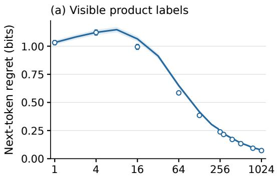

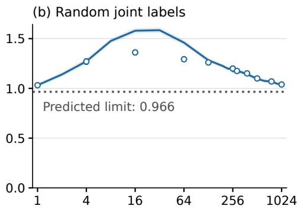

(c) One new matrix after t = 256  
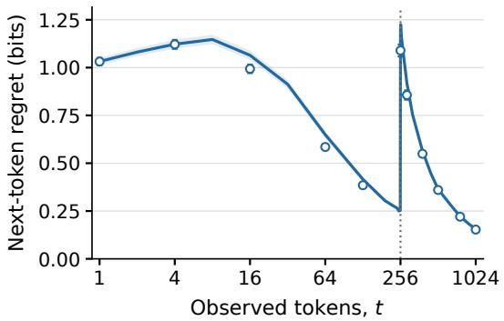

(d) Two new matrices after t = 256  
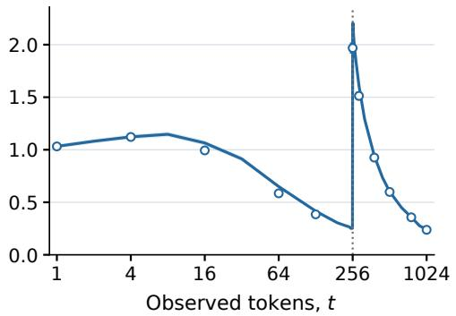  
Figure 9: Complete product comparisons at depth one. Source depths are $L _ { 1 } = L _ { 2 } = 1$ . Solid curves show the two-layer transformer and unconnected open circles show informed Bayes; all conditions average 1024 paired draws, with pointwise 95% intervals. The dotted random-label limit, 0.966 bits, is calculated from the test-source matrices.

## E.3 TIME-VARYING SOURCE

Both fixed predictors receive sequences from a time-varying product source. One condition uses a new transition matrix for one coordinate after 256 tokens; the other uses new matrices for both coordinates. The state, encoding and observed history continue across the boundary, so the first new matrix generates $X _ { 2 5 7 }$ from the observed $X _ { 2 5 6 }$ . Neither predictor is reset or receives a change signal. The new matrices have the same fixed depths, and the one- and two-matrix conditions use the same new first matrix. Informed Bayes updates under its stationary product prior and predicts that two independent changes produce twice the additional regret of one. The transformer follows both the Bayesian adaptation curve and this factor-of-two prediction.

## E.3.1 ADDITIVITY FOR A TIME-VARYING SOURCE

The factor of two in (6) is an exact population identity at every t for additional regret in the paired experiment of Appendix E.2.1.

Factorization and additivity. The independent coordinate priors imply, for every history,

$$
Q _ { B } ( u ^ { \prime } , v ^ { \prime } \mid u ^ { t } , v ^ { t } ) = Q _ { B } ^ { ( 1 ) } ( u ^ { \prime } \mid u ^ { t } ) Q _ { B } ^ { ( 2 ) } ( v ^ { \prime } \mid v ^ { t } ) .
$$

A common depth couples rows within each coordinate, but not the two coordinates. Bayes continues to use this stationary product model when the test source varies with time. The actual post-boundary next-token law also factors into current rows $p _ { 1 } , p _ { 2 }$ . Therefore, for every sequence,

$$
D _ { \mathrm { K L , 2 } } ( p _ { 1 } \otimes p _ { 2 } | | q _ { 1 } \otimes q _ { 2 } ) = D _ { \mathrm { K L , 2 } } ( p _ { 1 } | | q _ { 1 } ) + D _ { \mathrm { K L , 2 } } ( p _ { 2 } | | q _ { 2 } ) .
$$

Let $r _ { u } ( t )$ be the expected regret of a coordinate that continues with its first matrix and $r _ { c } ( t )$ that of a coordinate using a new matrix. The coordinate alphabets, depth laws, initial-state laws and predictor priors are identical, so

$$
r _ { B } ^ { \mathrm { s t a t i o n a r y } } = 2 r _ { u } , \qquad r _ { B } ^ { \mathrm { o n e } } = r _ { c } + r _ { u } , \qquad r _ { B } ^ { \mathrm { b o t h } } = 2 r _ { c } .
$$

Subtracting the stationary regret proves the doubling identity. No equilibrium start or large-context approximation is required. Different coordinate laws would still yield additive contributions, but not generally equal contributions. A transformer’s predictions need not factor, so the same relation is a separate behavioral test.

Paired contrast and simultaneous uncertainty. For source draw i and predictor $M ,$ define

$$
Z _ { M , i } ( t ) = \rho _ { M , i } ^ { \mathrm { b o t h } } ( t ) - 2 \rho _ { M , i } ^ { \mathrm { o n e } } ( t ) + \rho _ { M , i } ^ { \mathrm { s t a t i o n a r y } } ( t ) ,
$$

where $\rho$ is conditional next-token regret. The paired construction makes $Z _ { B }$ the difference between the two coordinates’ additional regrets. Hence $\mathbb { E } Z _ { B } = 0$ , although individual $Z _ { B , i }$ need not vanish. We estimate uncertainty from whole paired test sets, preserving correlations across conditions and times.

A centered nonparametric bootstrap resamples the test sets of the two depths independently, retaining both predictors and all 14 post-change times $( t = 2 5 6 , \dots , 1 0 2 4$ on the tested grid) within each draw. For each of 10000 resamples we take the largest absolute mean deviation divided by its reported paired standard error over all 56 depth/predictor/time combinations. The 95% quantile is 3.156; the largest observed standardized discrepancy is 2.272. All contrasts lie within these simultaneous bands. At depth four and $t = 1 0 2 4$ , transformer additional regret with two new matrices is 0.3500 bits versus the predicted 0.3451 from twice the one-new-matrix condition; the paired contrast is $0 . 0 0 4 9 \pm 0 . 0 1 0 6$ bits (one standard error). Thus the transformer reproduces the additive mean relation derived from the source factorization.

## E.3.2 EXACT COIN CONTROL

Models and scoring. We use the coin transformers trained with equal mass on {0.2, 0.8} or a uniform bias on [0, 1] (two layers, width 64, 116736 parameters, 20000 updates). Three independent test sets contain 4096 sequences of length 257 each: iid Bernoulli(0.4), or a time-varying source with bias 0.2 for the first $\tau = 6 4$ or 128 tokens and bias 0.8 thereafter. Both trained models receive the same sequences, keep all tokens and receive no signal at the boundary. The new bias first affects $X _ { \tau + 1 }$ , so the prediction at $t = \tau$ uses only old tokens from before the change to predict a token from after it. At every $t = 1 , \ldots , 2 5 6$ , we score conditional expected log loss relative to the actual next-token bias. Intervals are across independent test sequences; there is one trained model per prior.

Exact count formulas. For equal prior weights on a and $1 - a , 0 < a < 1 / 2$ , a prefix with $n _ { 1 }$ ones in n tokens has posterior odds $\bar { [ ( 1 - a ) / a ] } ^ { 2 n _ { 1 } ^ { - } - n }$ in favor of $1 - a .$ . Thus

$$
q _ { n } ( n _ { 1 } ) = a + { \frac { 1 - 2 a } { 1 + [ ( 1 - a ) / a ] ^ { n - 2 n _ { 1 } } } } ; \qquad q _ { n } ^ { \mathrm { u n i f o r m } } ( n _ { 1 } ) = { \frac { n _ { 1 } + 1 } { n + 2 } } .\tag{24}
$$

Write $\begin{array} { r } { b _ { n , \theta } ( n _ { 1 } ) = { \binom { n } { n _ { 1 } } } \theta ^ { n _ { 1 } } ( 1 - \theta ) ^ { n - n _ { 1 } } } \end{array}$ and let $D _ { \mathrm { b i n } }$ denote the binary KL divergence in bits. Under iid test bias θ, the exact expected next-token regret is

$$
r _ { B } ( n ; \theta ) = \sum _ { n _ { 1 } = 0 } ^ { n } b _ { n , \theta } ( n _ { 1 } ) D _ { \mathrm { b i n } } \bigl ( \theta \| q _ { n } ( n _ { 1 } ) \bigr ) .\tag{25}
$$

Let $\begin{array} { r } { N _ { 1 } ( n ) = \sum _ { i = 1 } ^ { n } X _ { i } } \end{array}$ denote the random number of ones. For $\theta < 1 / 2 .$ , the law of large numbers gives $q _ { n } ( N _ { 1 } ( n ) ) { \\\\xrightarrow { } } a ;$ bounded convergence, since $q _ { n } \in [ a , 1 - a ]$ , gives $r _ { B } ( n ; \theta ) \to D _ { \mathrm { b i n } } ( \theta | | a )$ $\mathrm { A t } a = 0 . 2 , \theta = 0 . 4$ the residual is 0.151 bits. The uniform prior instead includes the true bias and its regret vanishes.

After τ tokens at bias $\theta _ { - }$ and m at $\theta _ { + }$ , the two independent numbers of ones have laws $b _ { \tau , \theta }$ and $b _ { m , \theta _ { + } }$ . Their convolution gives the exact regret for this time-varying test source:

$$
r _ { B , \tau } ^ { \mathrm { c h a n g e } } ( m ) = \sum _ { n _ { 1 } = 0 } ^ { \tau + m } ( b _ { \tau , \theta _ { - } } * b _ { m , \theta _ { + } } ) ( n _ { 1 } ) D _ { \mathrm { b i n } } \big ( \theta _ { + } \| q _ { \tau + m } ( n _ { 1 } ) \big ) .\tag{26}
$$

Twice the one-new-matrix value

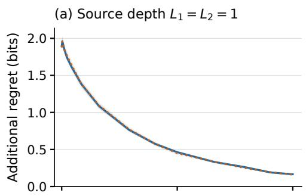

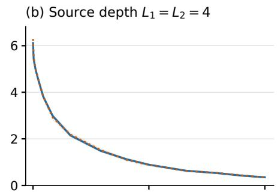  
Two-layer transformer

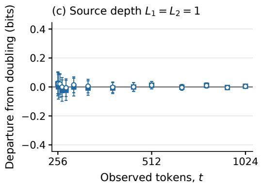  
Informed Bayes

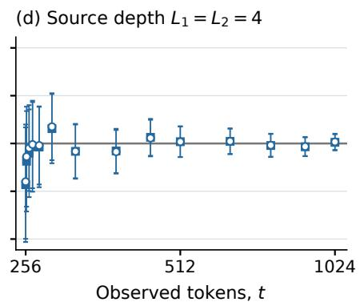  
Figure 10: Doubling prediction and paired departures. Top: transformer additional regret with two new matrices (solid) and twice the one-new-matrix value (dotted), at both depths. Bottom: $Z _ { M } ( t )$ for the transformer (filled squares) and informed Bayes (open circles), without connecting lines. Bars give approximate 95% simultaneous intervals over both depths, predictors and all post-change grid points. Every interval includes zero. Each depth averages 1024 paired draws; the multiplier two is fixed by the Bayesian identity.

Before the switch, use (25) with $\theta _ { - }$ . These are population expectations with no fitted parameters or Monte Carlo error. Enumerating all binary histories through eight tokens, including a switch after three, verifies the count formulas within $1 . 3 \cdot 1 0 ^ { - 1 5 }$ bits.

The learned prior determines adaptation. The uniform-prior transformer follows the exact Bayesian regrets closely: the maximum absolute paired mean regret difference across the three tested curves is below 0.009 bits. The two-point prior predicts persistent mismatch and delayed adaptation, and the transformer reproduces both effects (Figure 11). For iid bias 0.4, its largest paired difference is −0.0391 bits at $t = 9 7 ;$ for the τ = 128 change it reaches −0.1741 bits at $t = 2 2 8$ . For $\tau = 6 4$ the largest magnitude is 0.1425 bits at t = 150. These are the largest values on the grid of tested $t ;$ Table 12 reports all endpoints. On these two-bias test sequences, the two-point transformer’s smaller transient regret reflects prediction outside the training prior.

The saved float32 weights are evaluated with float64 log-softmax and scoring. Checks reproduce sources from fixed seeds, verify raw normalization and causal prefix predictions, and independently recompute saved summaries. Bayesian sample means additionally pass simultaneous Bernstein checks against the exact expectations over all six curves and 256 times. Predictions are neither clipped nor renormalized to pass validation.

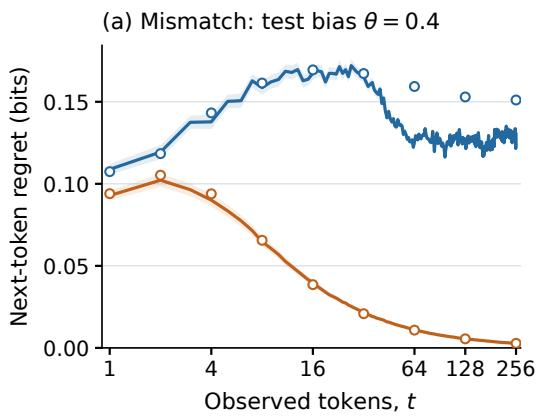

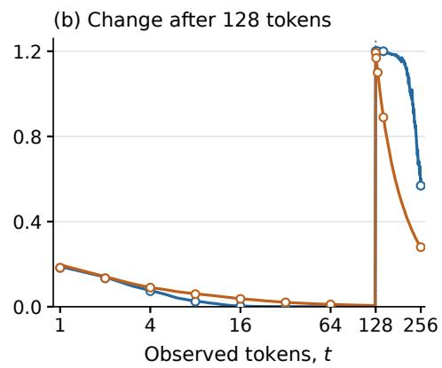

Figure 11: Exact coin predictions under mismatch and time variation. Regret under fixed bias 0.4 (a) and under a time-varying source with bias 0.2 through 128 tokens and 0.8 thereafter (b). Solid curves are trained transformers; open circles are exact informed-Bayesian expectations. Color denotes the two-point (blue) or uniform (orange) training prior. Shading gives pointwise 95% intervals over 4096 sequences; exact expectations have no Monte Carlo error.
<table><tr><td>Training prior</td><td>Test source</td><td>Transformer</td><td>Exact Bayes</td><td>Paired difference</td></tr><tr><td>Two-point</td><td> $\theta = 0 . 4$ </td><td> $0 . 1 3 0 2 2 \pm 0 . 0 0 0 4 0$ </td><td>0.15109</td><td> $- 0 . 0 2 0 7 1 \pm 0 . 0 0 0 4 0$ </td></tr><tr><td>Uniform</td><td> $\theta = 0 . 4$ </td><td> $0 . 0 0 2 7 9 \pm 0 . 0 0 0 0 6$ </td><td>0.00279</td><td> $( 9 . 5 1 \pm 2 . 3 2 ) \cdot 1 0 ^ { - 6 }$ </td></tr><tr><td>Two-point</td><td>0.2 through 64, then 0.8</td><td> $0 . 0 0 0 5 9 \pm 0 . 0 0 0 0 2$ </td><td> $3 . 7 5 \cdot 1 0 ^ { - 9 }$ </td><td> $0 . 0 0 0 5 9 \pm 0 . 0 0 0 0 2$ </td></tr><tr><td>Uniform</td><td>0.2 through 64, then 0.8</td><td> $0 . 0 7 9 6 4 \pm 0 . 0 0 0 3 7$ </td><td>0.08086</td><td> $- 0 . 0 0 1 7 0 \pm 0 . 0 0 0 0 2$ </td></tr><tr><td>Two-point</td><td>0.2 through 128, then 0.8</td><td> $0 . 5 9 8 2 0 \pm 0 . 0 0 4 1 5$ </td><td>0.56871</td><td> $0 . 0 3 0 6 8 \pm 0 . 0 0 5 8 1$ </td></tr><tr><td>Uniform</td><td>0.2 through 128, then 0.8</td><td> $0 . 2 7 6 2 9 \pm 0 . 0 0 0 6 6$ </td><td>0.27985</td><td> $- 0 . 0 0 2 8 9 \pm 0 . 0 0 0 0 3$ </td></tr></table>

Table 12: Coin regret after 256 tokens, in bits. Transformer means and paired differences show one standard error across 4096 sequences. The Bayesian column is a population expectation; the last column instead subtracts Bayesian regret on each sampled prefix and therefore need not equal the difference of the preceding columns.

## E.4 AN UNSEEN CONTEXT

When the current token appears for the first time, no continuation from its transition row has been observed. Shared-base Bayes nevertheless uses the other rows to infer their common latent base; uniform-base Bayes instead predicts uniformly. The transformers reproduce both responses. Across all twelve shared-base depth–time conditions, both larger-model runs remain within 0.015 bit of informed Bayes. In the uniform-base control, the transformer’s loss above the exact uniform prediction is only 0.00035–0.00052 bits, compared with 0.071–0.411 bits for token counts.

## E.4.1 SHARED-BASE TRANSFER FROM EARLIER CONTEXTS

Select histories satisfying $E _ { t } = \{ M _ { X _ { t } } ( X ^ { t } ) = 0 \}$ : no continuation of the current token has previously been observed. Equivalently, $X _ { t }$ first appears at time t. Selection depends only on the observed tokens, so Equation (15) reduces to

$$
Q _ { B } ( b \mid x ^ { t } , E _ { t } ) = \int Z _ { L } ( e _ { b } ; q ) \pi ( d \alpha , d L , d \sigma \mid x ^ { t } ) .\tag{27}
$$

Other rows and the initial token inform the shared posterior. At positive depth, the posterior mean row $Z _ { L } ( e _ { b } ; q )$ is generally different from $q _ { b } ;$ with uniform base weights it is exactly 1/64 at every depth.

<table><tr><td>L</td><td>t</td><td>n</td><td>Larger, run 1</td><td> $\operatorname { L a r g e r , r u n } 2$ </td><td>Token counts</td></tr><tr><td>0</td><td>4</td><td>210</td><td> $0 . 0 0 1 8 \pm 0 . 0 0 1 1$ </td><td> $0 . 0 0 2 3 \pm 0 . 0 0 1 2$ </td><td> $0 . 0 0 6 7 \pm 0 . 0 0 3 0$ </td></tr><tr><td>0</td><td>16</td><td>136</td><td> $0 . 0 1 0 6 \pm 0 . 0 0 2 2$ </td><td> $0 . 0 0 9 0 \pm 0 . 0 0 2 2$ </td><td> $0 . 0 1 7 3 \pm 0 . 0 0 6 2$ </td></tr><tr><td>0</td><td>64</td><td>64</td><td> $0 . 0 1 4 3 \pm 0 . 0 0 2 6$ </td><td> $0 . 0 1 2 3 \pm 0 . 0 0 1 8$ </td><td> $0 . 0 5 5 2 \pm 0 . 0 0 4 6$ </td></tr><tr><td>1</td><td>4</td><td>214</td><td> $0 . 0 0 0 5 \pm 0 . 0 0 1 6$ </td><td> $0 . 0 0 2 6 \pm 0 . 0 0 2 0$ </td><td> $- 0 . 0 0 3 8 \pm 0 . 0 0 3 8$ </td></tr><tr><td>1</td><td>16</td><td>136</td><td> $0 . 0 0 2 7 \pm 0 . 0 0 3 3$ </td><td> $- 0 . 0 0 3 0 \pm 0 . 0 0 3 1$ </td><td> $- 0 . 0 0 9 8 \pm 0 . 0 1 0 8$ </td></tr><tr><td>1</td><td>64</td><td>59</td><td> $0 . 0 0 5 7 \pm 0 . 0 0 5 8$ </td><td> $0 . 0 0 0 3 \pm 0 . 0 0 5 8$ </td><td> $0 . 0 4 9 7 \pm 0 . 0 1 0 7$ </td></tr><tr><td>4</td><td>4</td><td>223</td><td> $0 . 0 0 2 4 \pm 0 . 0 0 2 1$ </td><td> $0 . 0 0 4 1 \pm 0 . 0 0 2 2$ </td><td> $- 0 . 0 0 5 9 \pm 0 . 0 0 3 7$ </td></tr><tr><td>4</td><td>16</td><td>145</td><td> $- 0 . 0 0 3 1 \pm 0 . 0 0 4 2$ </td><td> $- 0 . 0 0 5 9 \pm 0 . 0 0 4 0$ </td><td> $0 . 0 1 3 7 \pm 0 . 0 1 4 4$ </td></tr><tr><td>4</td><td>64</td><td>66</td><td> $0 . 0 1 3 9 \pm 0 . 0 1 0 9$ </td><td> $0 . 0 1 0 6 \pm 0 . 0 0 9 8$ </td><td> $0 . 0 3 1 7 \pm 0 . 0 2 7 1$ </td></tr><tr><td>8</td><td>4</td><td>228</td><td> $0 . 0 0 3 5 \pm 0 . 0 0 2 8$ </td><td> $- 0 . 0 0 1 1 \pm 0 . 0 0 2 9$ </td><td> $- 0 . 0 0 1 3 \pm 0 . 0 0 5 1$ </td></tr><tr><td>8</td><td>16</td><td>161</td><td> $0 . 0 0 2 1 \pm 0 . 0 0 4 1$ </td><td> $0 . 0 0 7 6 \pm 0 . 0 0 4 2$ </td><td> $0 . 0 7 2 1 \pm 0 . 0 1 6 9$ </td></tr><tr><td>8</td><td>64</td><td>57</td><td> $0 . 0 1 1 7 \pm 0 . 0 1 1 0$ </td><td> $0 . 0 0 6 7 \pm 0 . 0 0 9 8$ </td><td> $0 . 2 1 1 0 \pm 0 . 0 4 8 7$ </td></tr></table>

Table 13: Loss above informed Bayes after a new token. Shared-base source at $\alpha = 1 \colon$ expected next-token loss difference in bits, plus or minus one standard error across the n selected sequences. Positive values favor informed Bayes. Both larger-model runs use the same histories; Bayesian numerical error is assessed separately.

With expected loss $h _ { t }$ from (17), define

$$
\operatorname { s a v } _ { M } ( t ; L ) = \mathbb { E } [ 6 - h _ { t } ( Q _ { M } ) \mid E _ { t } , \alpha = 1 , L ] , \qquad Q _ { K \mathrm { T } } ( b \mid x ^ { t } ) = { \frac { N _ { b } ( x ^ { t } ) + 1 / 2 } { t + 3 2 } } .\tag{28}
$$

The saving over uniform measures useful prediction before a continuation has been seen. The comparison uses 256 independent shared-base sequences of length 1025 per depth $L = 0 , 1 , 4 , 8$ with $\alpha = 1$ . Selection varies with time, and all differences pair predictions on the same eligible histories.

## E.4.2 UNIFORM-BASE CONTROL

By symmetry and conditional row independence, an unobserved row has posterior mean $U _ { 6 4 }$ , also conditional on any fixed generating depth. Hence

$$
\mathbb { E } [ h _ { t } ( Q ) - h _ { t } ( U _ { 6 4 } ) \mid X ^ { t } , E _ { t } ] = - \frac { 1 } { 6 4 } \sum _ { b } \log _ { 2 } Q ( b \mid X ^ { t } ) - 6 = D _ { \mathrm { K L , 2 } } ( U _ { 6 4 } \| Q ) .\tag{29}
$$

The two-layer uniform-base transformer of Section 3.4 is evaluated on 1024 sequences whose depth is uniform on $0 , \ldots , 8$ . At depths 0, 1, 4, 8, the eligible counts at times $4 / 1 6 { \dot { / } } 6 4$ are respectively $1 0 7 / 8 4 / 5 2 , 9 8 / 8 0 / 4 0 , 1 1 0 / 8 \bar { 1 } / 3 7$ and $1 1 0 / 8 4 / 3 5$ . Every eligible sequence enters. $\mathrm { A t } \ L = 1 , t =$ 64, transformer and token-count losses above the uniform prediction are 0.000365 ± 0.000018 and $0 . 3 3 6 9 \pm 0 . 0 0 6 3$ bits.

## E.4.3 NUMERICAL VALIDATION

Time 4 uses deterministic rank marginalization; times 16 and 64 use independent 16- and 32-node calculations with the criteria in Appendix D. All twelve selected test sets pass. At time 64, the refinements retain all 66 and 57 eligible histories at $L = 4 , 8 .$ Their coarse/refined numerical error bounds are 0.00213/0.00207 and $0 . 0 0 2 4 3 / 0 . 0 0 2 1 7$ bits, below the 0.00333-bit budget; the corresponding integration-rule shifts are 0.00111 and 0.00271 bits. A separate script recomputes and checks source identities, probabilities and paired loss statistics.

## E.5 WHEN COPYING STARTS TO PAY

The final comparison asks when a fixed predictor begins to profit from copying an earlier continuation of the current token. The shared-base ordered-versus-shuffled experiment measures this for the transformer: shuffling preserves token frequencies but destroys the order. Informed Bayes and the frequency-only Bayesian predictor $B _ { \mathrm { f r e q } }$ give the corresponding Bayesian prediction. Their next-token gains through sixteen tokens and at $t = 3 2$ agree in size and depth ordering; the longer transformer curves show how the gain from copying grows with the number of tokens.

<table><tr><td>Depth</td><td>Run</td><td>Next-token gain at 1024</td><td>Cumulative gain through 1024</td></tr><tr><td>0</td><td>1</td><td> $- 0 . 0 0 3 8 6 \pm 0 . 0 0 0 3 4$ </td><td> $- 9 . 4 0 \pm 0 . 4 1$ </td></tr><tr><td>0</td><td>2</td><td> $- 0 . 0 0 3 2 3 \pm 0 . 0 0 0 3 2$ </td><td> $- 6 . 5 9 \pm 0 . 3 3$ </td></tr><tr><td>2</td><td>1</td><td> $0 . 5 6 9 0 \pm 0 . 0 1 9 3$ </td><td> $4 1 6 . 8 \pm 3 . 8$ </td></tr><tr><td>2</td><td>2</td><td> $0 . 5 6 8 5 \pm 0 . 0 1 8 9$ </td><td> $4 1 7 . 6 \pm 3 . 8$ </td></tr><tr><td>3</td><td>1</td><td> $0 . 8 7 9 5 \pm 0 . 0 2 8 0$ </td><td> $7 0 3 . 5 \pm 5 . 3$ </td></tr><tr><td>3</td><td>2</td><td> $0 . 8 8 2 7 \pm 0 . 0 2 7 8$ </td><td> $7 0 4 . 5 \pm 5 . 4$ </td></tr></table>

Table 14: The gain from copying increases with source depth. Loss of the shuffled-trained model minus that of the ordered-trained model, in bits; means ± paired standard errors across 256 sequences per depth. Positive values favor the model that can learn context–successor associations.

## E.5.1 BEHAVIORAL EMERGENCE OF COPYING

The matched control isolates the context–successor associations used for copying while preserving every sequence’s token counts. The tables compare both training runs on the same 256 test sources per depth. The transformer curves use 16384 sources per depth: run 1 through 1024 tokens in Figure 2(g,h), and both runs through 16 tokens in Figure 12. The Bayesian points through $t = 6 4$ use the paired 256-source test set. Both training runs show the same depth ordering. $\mathbf { A } \mathfrak { t } t = 1 0 2 4$ , run 1 gains 0.569 bits per prediction at $L = 2$ and 0.880 bits at $L = 3$ , with cumulative gains of about 417 and 704 bits; run 2 gives 0.568 and 0.883 bits per prediction and cumulative gains of about 418 and 705 bits. The $L = 0$ control remains negative in both runs. The matched experiment therefore measures when learning transitions becomes useful, without identifying a particular internal circuit.

Matched training and evaluation. For each shared-base training sequence $x _ { 1 } , \ldots , x _ { 1 0 2 5 } .$ , the control keeps $x _ { 1 }$ and independently permutes positions $2 , \ldots , 1 0 2 5$ . This preserves the first token and full count vector exactly. Token frequencies estimate the realized stationary law $\nu T = \nu ,$ , rather than generally the latent base $q ;$ conditional on $x _ { 1 }$ , the shuffled training law is invariant to the order of the remaining tokens.

Each of two ordered/shuffled model pairs shares its initialization, matched batches of 64 source sequences, architecture, optimizer and learning-rate schedule. Both receive 100000 updates and 6.4 million sequences. The four-layer, width-256 models have 3454464 parameters. Indexed batch regeneration, independent replay and first-token/count preservation verify the match. The paired tables use the same 256 ordered sequences of length 1025 per condition, with $\alpha = 1$ and $L = { \bar { 0 } } , 2 , 3 ;$ neither model receives these test parameters. Let $h _ { t }$ be the expected loss under the true row, from (17). The difference between the shuffled-trained and the ordered-trained model, $h _ { t } ( \mathrm { T F _ { s h u f } } ) - h _ { t } ( \mathrm { T F _ { o r d } } )$ defines the transformer gain $g _ { \mathrm { T F } } ( t )$ of (7), and its sum within a sequence defines $G _ { \mathrm { T F } } ( n )$ . Wholesequence resampling retains all times and pairings. For the 16384-source evaluation, the endpoint gains at $L = 2 , 3 { \mathrm { ~ a r e ~ } } 0 . 5 6 7 8 \pm 0 . 0 0 2 5$ and $\bar { 0 } . 9 0 8 \bar { 7 } \pm 0 . 0 0 3 6$ bits per token, with cumulative gains of $\bar { 4 } 1 9 . 8 3 \pm 0 . 4 9$ and $7 0 0 . 4 0 \pm 0 . 6 9$ bits. The $L = 0$ control gives $\bar { - } 0 . 0 0 4 1 0 \pm 0 . 0 0 0 0 5$ bits per token. Figure $2 ( \mathrm { g , h } )$ uses 1000 paired whole-sequence bootstrap replicates for its pointwise 95% bands.

The first tokens. Figure 12 shows how copying begins to pay. At both depths, the mean next-token gain is positive from $t = 2$ in both training runs. Cumulative mean gains become positive within the first seven observations, and the benefit grows more quickly at $L = 3$

The frequency-only Bayesian predictor. For comparison we need a Bayesian predictor that, like the shuffled-trained transformer, can use token frequencies but not token order. Draw $( q , T )$ from the training prior and let $\nu ( T )$ be its stationary law. The corresponding independent-token surrogate, retaining the distinguished first-token law, is

$$
m _ { \mathrm { f r e q } } ( x ^ { t } ) = \mathbb { E } _ { q , T } \left[ q _ { x _ { 1 } } \prod _ { s = 2 } ^ { t } \nu ( T ) _ { x _ { s } } \right] , \qquad B _ { \mathrm { f r e q } } ( b \mid x ^ { t } ) = \frac { m _ { \mathrm { f r e q } } ( x ^ { t } b ) } { m _ { \mathrm { f r e q } } ( x ^ { t } ) } .\tag{30}
$$

This predictor integrates the source prior and receives none of the test source’s $q , T$ or $\nu .$ . It learns frequencies rather than transitions and approximates the finite shuffled-training law.

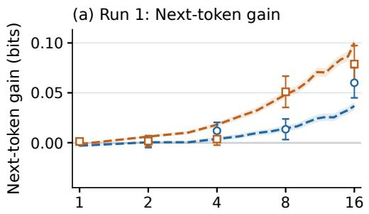  
(c) Run 1: Cumulative gain

(b) Run 2: Next-token gain  
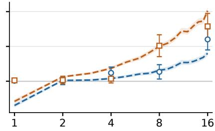  
(d) Run 2: Cumulative gain

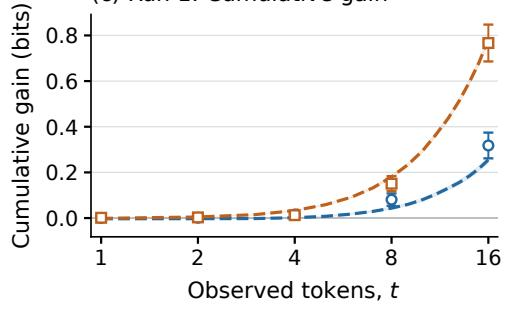

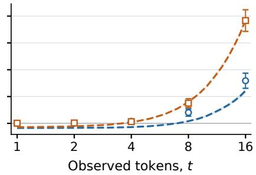

Figure 12: The early gain from copying increases with source depth. The first 16 tokens at $L = 2$ (blue) and $L = 3$ (orange), with training runs in separate columns. Rows show next-token and cumulative gains. Dashed curves compare the four-layer ordered- and shuffled-trained transformers on 16384 sources per depth. Open circles and squares compare informed Bayes with the frequency-only predictor on 256 sources per depth. Shading gives pointwise 95% paired whole-sequence bootstrap intervals; bars give one standard error for Bayes. Zero marks equal loss.
<table><tr><td>Depth</td><td>t</td><td>Informed Bayes</td><td>Transformer run 1</td><td>Transformer run 2</td></tr><tr><td>0</td><td>16</td><td> $- 0 . 0 6 4 2 \pm 0 . 0 0 7 7$ </td><td> $- 0 . 0 8 5 4 \pm 0 . 0 0 8 9$ </td><td> $- 0 . 0 8 5 8 \pm 0 . 0 0 8 8$ </td></tr><tr><td>2</td><td>16</td><td> $0 . 0 6 0 1 \pm 0 . 0 1 5 1$ </td><td> $0 . 0 5 3 7 \pm 0 . 0 1 5 8$ </td><td> $0 . 0 5 9 9 \pm 0 . 0 1 5 0$ </td></tr><tr><td>3</td><td>16</td><td> $0 . 0 7 8 8 \pm 0 . 0 1 8 5$ </td><td> $0 . 0 8 3 9 \pm 0 . 0 1 9 0$ </td><td> $0 . 0 8 4 8 \pm 0 . 0 1 8 2$ </td></tr><tr><td>0</td><td>32</td><td> $- 0 . 0 3 1 1 \pm 0 . 0 0 4 5$ </td><td> $- 0 . 0 6 7 0 \pm 0 . 0 0 6 6$ </td><td> $- 0 . 0 6 0 7 \pm 0 . 0 0 6 5$ </td></tr><tr><td>2</td><td>32</td><td> $0 . 0 6 1 6 \pm 0 . 0 1 6 3$ </td><td> $0 . 0 5 4 5 \pm 0 . 0 1 7 2$ </td><td> $0 . 0 5 6 8 \pm 0 . 0 1 6 5$ </td></tr><tr><td>3</td><td>32</td><td> $0 . 1 8 2 9 \pm 0 . 0 2 6 5$ </td><td> $0 . 1 8 4 2 \pm 0 . 0 2 7 4$ </td><td> $0 . 1 8 1 3 \pm 0 . 0 2 6 9$ </td></tr></table>

Table 15: The Bayesian and transformer gains from token order. Next-token gain after 16 and 32 observations, in bits; means ± paired standard errors on the same 256 test sources per depth. Bayes is compared with its stationary-frequency predictor, and each transformer with its matched shuffled-trained model.

At every $t = 1 , \ldots , 1 6 .$ , its mean expected loss is within 0.0043 bits of either shuffled transformer across $\dot { L } = 0 , 2 , 3 .$ . After one token it gives a repeat of that token probability 0.06790, close to the 0.06491 of informed Bayes. The Bayesian order gain $h _ { t } ( B _ { \mathrm { f r e q } } ) - \dot { h } _ { t } ( B )$ and its cumulative sum are negative throughout at $L = 0$ and positive from $t = 1$ at $L = 2 , 3$ . At t = 16, the per-token gains are $0 . 0 6 0 1 \pm 0 . 0 1 5 1$ and $0 . 0 7 8 8 \pm 0 . 0 1 8 5$ bits, and the cumulative gains are $0 . 3 1 7 9 \pm 0 . 0 5 6 3$ and $0 . 7 6 6 7 \pm 0 . 0 8 0 7$ bits.

Table 15 compares the predictors on the same histories. The surrogate is specified entirely by the source prior, independently of transformer scores. Its calculation averages alphabet permutations analytically over 256 independent source banks, with 32- and 16-node exponent rules and equal weight on depths $0 , \ldots , 8 .$ . The informed Bayesian calculation uses 16- and 32-node exponent rules on all 768 histories at each $t = 5 , \ldots , 1 6$ and at $t = 3 2$ ; the first four tokens use deterministic rank marginalization. Shared canonical references and shared source banks are accounted for in the numerical uncertainty. All 96 per-token and cumulative coordinates through $t = 1 6$ , and the three next-token coordinates at $t = 3 2 .$ , pass the sampler, integration-order and aggregate-precision checks. The largest numerical allowance is 0.00311394 bits; each coordinate must stay below both 0.00333333 bits and one quarter of its sequence standard error.

The preliminary $t = 1 2 8$ estimates use the first 32 test sequences per depth and the same frequencyonly predictor, evaluated with one integration bank, 32 exponent nodes, and one draw at each positive depth. The depth-zero contribution and equal prior weights on $L = 0 , \ldots , 8$ are retained.

## F SUMMARY OF TRANSFORMER–BAYES GAPS

Table 16 summarizes the gaps of Section 3 across models, settings and training runs; the underlying comparisons are in Appendix D.

Table 16: Gap between transformer and informed Bayes, in bits per token. “Largest $\mathrm { g a p ' }$ ranges over the displayed settings; “last gap” uses their largest t. Pooled rows summarize $t \leq 4 .$ . Two values separated by a slash are the two training runs; ranges include all listed settings and runs.
<table><tr><td>Source</td><td></td><td></td><td>Layers Runs Largest gap</td><td>Last gap</td></tr><tr><td>Known encoding</td><td>2</td><td>1</td><td> $0 . 1 2 4 \ : ( t = 3 2 )$ </td><td> $0 . 0 0 4 \substack { - 0 . 0 0 9 } \left( t = 1 0 2 4 \right)$ </td></tr><tr><td>Known encoding</td><td>4</td><td>2</td><td> $0 . 0 4 4 / 0 . 0 4 9 ( t = 1 6 )$ </td><td> $0 . 0 0 1 2 \substack { - 0 . 0 0 5 6 } ( t = 1 0 2 4 )$ </td></tr><tr><td>Hidden encoding</td><td>2</td><td>2</td><td> $0 . 1 3 / 0 . 1 3 ( t = 2 5 6 )$ </td><td> $0 . 1 0 5 / 0 . 0 9 6 ( t = 1 0 2 4 )$ </td></tr><tr><td>Hidden encoding</td><td>8</td><td>2</td><td> $0 . 0 2 5 / 0 . 0 2 2 ( t = 2 5 6 )$ </td><td> $0 . 0 0 2 4 / 0 . 0 0 1 8 ( t = 1 0 2 4 )$ </td></tr><tr><td>Uniform base</td><td>2</td><td>1</td><td> $0 . 0 8 7 \left( L = 0 , t = 1 2 8 \right)$ </td><td> $0 . 0 2 4 - 0 . 0 6 8 \ : ( t = 1 0 2 4 )$ </td></tr><tr><td>Uniform base</td><td>4</td><td>2</td><td> $0 . 0 3 7 / 0 . 0 4 1 ( L = 8 , t = 6 4 )$ </td><td> $0 . 0 0 0 0 3 - 0 . 0 2 8 ( t = 1 0 2 4 )$ </td></tr><tr><td>Shared base</td><td>2</td><td>2</td><td> $0 . 2 1 7 / 0 . 2 2 0 ( L = 0 , t = 6 4 )$ </td><td></td></tr><tr><td>Shared base</td><td>8</td><td>2</td><td> $0 . 0 0 6 6 / 0 . 0 0 5 2 ( t \leq 6 4 )$ </td><td> $- 0 . 0 0 1 0 \mathrm { { - } 0 . 0 0 5 1 \mathrm { { \ : } ( } t \geq 2 5 6 ) }$ </td></tr><tr><td>Pooled families</td><td>2</td><td>2</td><td> $0 . 0 1 9 7 / 0 . 0 1 9 0 ( t = 4 )$ </td><td> $0 . 0 1 9 7 / 0 . 0 1 9 0 ( t = 4 )$ </td></tr><tr><td>Pooled families</td><td>4</td><td>2</td><td> $0 . 0 0 8 0 / 0 . 0 0 6 7 ( t = 1 )$ </td><td> $0 . 0 0 5 2 / 0 . 0 0 2 5 ( t = 4 )$ </td></tr></table>