# Learning Distributions from Samples and Qualities

Marc Jourdan

Nicolas Flammarion

EPFL, Lausanne, Switzerland

## Abstract

We study parameter estimation when each sample from a continuous parametric distribution is accompanied by a binary quality label governed by the same unknown parameter. By imposing hard feasibility constraints, deterministic labels can accelerate estimation from the classical $n ^ { - 1 / 2 }$ rate of smooth quality-aware M-estimators to $n ^ { - 1 }$ Combining PAC guarantees with local error-toparameter conversions, we establish this rate for both identifiable and finitely ambiguous quality classifiers, with likelihood information resolving the latter ambiguity. When the quality model is known only up to an additive constant, we construct threshold-free pairwise preferences from oppositely labeled samples and retain the accelerated rate despite the unknown threshold. We further show that pointwise qualities and pairwise preferences are incomparable: either can be strictly more informative than the other. Our assumptions hold for Gaussian, Laplace, and exponential families under thresholded log-likelihood rewards. Finally, a minimax lower bound establishes the optimal $n ^ { - 1 }$ dependence on sample size, up to logarithmic and dimension-dependent factors, while experiments confirm the benefits of constraint-based estimation.

## 1 INTRODUCTION

Modern learning systems increasingly rely on two forms of feedback: pointwise quality labels, which evaluate individual observations, and pairwise preferences, which compare their relative quality. Such feedback may be provided by humans or automated evaluators and used to filter, reweight, or rank training data (Zhou et al., 2023; Wang et al., 2023; Ouyang et al., 2022; Rafailov et al., 2023). In a controlled statistical setting, deterministic preferences have recently been shown to accelerate parameter estimation from the classical $n ^ { - 1 / 2 }$ rate to $n ^ { - 1 }$ (Jourdan et al., 2025). We ask whether pointwise quality feedback can yield the same accel eration and whether either form of feedback can be strictly more informative than the other.

We study a continuous parametric model in which the same unknown parameter $\theta ^ { \star }$ governs both the sample distribution $p _ { \theta } \cdot$ ⋆ and a reward function $r _ { \theta ^ { \star } }$ , whose sign determines sample quality. Each i.i.d. sample is accompanied by the resulting binary quality label. Our canonical example uses the thresholded log-likelihood reward $r _ { \theta } = \log p _ { \theta } + \eta .$ , which labels a sample as good whenever its likelihood exceeds a fixed threshold. This formulation links quality feedback to the likelihood while capturing mechanisms used in machine learning (Ouyang et al., 2022; Zhu et al., 2023).

How quality labels are used is crucial. Smooth quality-aware M-estimators retain the classical $n ^ { - 1 / 2 }$ rate (van der Vaart, 1998) and may even be inconsistent under deterministic feedback. By contrast, enforcing deterministic labels as hard constraints can yield the accelerated $n ^ { - 1 }$ rate. We establish this rate by combining uniform error bounds for consistent classifiers (Hanneke, 2016) with an error-to-parameter conversion. Our analysis also covers finitely ambiguous models, where likelihood information selects the true parameter among the remaining candidates, and unknown thresholds, which we eliminate by constructing pairwise preferences from oppositely labeled samples. Pointwise qualities can be strictly more informative: for exponential distributions with thresholded log-likelihood rewards, they yield the accelerated rate even though pairwise log-likelihood differences provide no localization. A converse example shows that preferences can also be more informative, so neither feedback model uniformly dominates the other.

Gaussian Example. For a univariate Gaussian location family with thresholded log-likelihood quality, good samples constrain the unknown mean to intervals whose intersection is determined by observations closest to the quality boundaries. Because these observations approach the boundaries at rate $1 / n$ , the consistent parameter set contracts at rate $1 / n ,$ compared with $n ^ { - 1 / 2 }$ for the sample mean. The acceleration remains attainable without knowing the threshold by pairing oppositely labeled samples to form threshold-free preference constraints. Our analysis probes the generality of this phenomenon by identifying sufficient conditions under which it extends beyond this simple example. Appendix B discusses practical connections and extensions beyond wellspecified deterministic feedback.

## 1.1 Contributions

We show that enforcing deterministic quality labels as hard constraints can accelerate parametric estimation from the $n ^ { - 1 / 2 }$ rate attained by standard smooth quality-aware Mestimators to nearly $n ^ { - 1 }$

1. We introduce estimators that enforce consistency with the observed quality labels. Combining PAC guarantees with local error-to-parameter conversions yields high-probability $\widetilde { \mathcal { O } } ( n ^ { - 1 } )$ rates under finite-VC and geometric conditions on $( p _ { \theta } , r _ { \theta } )$ . Our framework also accommodates finite ambiguity, which we resolve through constrained negative log-likelihood minimization. For thresholded log-likelihood rewards, we verify the required conditions for Gaussian, Laplace, and exponential families. Thus, pointwise qualities can be strictly more informative than pairwise preferences.

2. When the quality threshold is unknown, pairing oppositely labeled samples yields threshold-free pairwise preferences. Despite the unknown additive threshold and the strong dependence among the resulting preference constraints, we retain fast rates, verifying the required conditions for Gaussian and Laplace families.

3. We establish a minimax $\Omega ( n ^ { - 1 } )$ lower bound, showing that our upper bounds are optimal in their dependence on the sample size, up to logarithmic and dimension-dependent factors. Experiments support the predicted separation between smooth quality-aware M-estimators and constraint-based estimators.

## 1.2 Related Work

Learning Parametric Distributions. Parametric estimation classically proceeds by maximizing the likelihood of the observed samples (Lehmann and Casella, 1998; Wasserman, 2004). Under regularity conditions, the MLE is asymptotically normal and achieves the $n ^ { - 1 / 2 }$ rate characterized by Fisher information and the Cramér–Rao bound (Cramér, 1946; van der Vaart, 1998; Ibragimov and Has’minskii, 1981). Finite-sample upper bounds and information-theoretic lower bounds further characterize the difficulty of such problems (Birgé and Massart, 1993; Spokoiny, 2012; Le Cam, 1973; Fano, 1952; Assouad, 1983). We depart from the sample-only setting by observing a parameter-dependent quality labels. The discontinuity introduced by deterministic labels permits faster rate.

Level-set Estimation and Binary Quality Feedback. A deterministic quality label specifies membership in the parameter-dependent super-level set $\{ x : r _ { \theta ^ { \star } } ( x ) \geq 0 \}$ . This connects our model to density level-set and excess-mass estimation, as well as prediction-set construction (Hartigan, 1987; Polonik, 1995; Tsybakov, 2009; Cadre, 2006; Rigollet and Vert, 2009; Lei et al., 2013). Classical work seeks to recover the level set itself from unlabeled samples, with rates controlled by smoothness, margin, and geometric assumptions. Our objective is different: the level-set memberships are observed, and we use them as side information for estimating the finite-dimensional parameter that determines both the distribution and the level set.

Preference-based Estimation. The closest work is Jourdan et al. (2025), which estimates a parametric distribution from samples and reward-based pairwise preferences. We instead observe pointwise quality labels. When the quality threshold is unknown, these labels can be converted into preferences by pairing good and bad samples, allowing threshold-invariant reward differences to be used. However, our comparisons are constructed from a common set of observations and are therefore strongly dependent, whereas the comparisons in Jourdan et al. (2025) are directly observed from independent sample pairs. Moreover, our separation examples show that pointwise quality and pairwise preference feedback contain genuinely different information. Our results complement the broader literature on Bradley–Terry models, ranking, reward learning, and preference-based optimization (Bradley and Terry, 1952; Hajek et al., 2014; Shah et al., 2016; Shah and Wainwright, 2018; Zhu et al., 2023; Ge et al., 2024; Yao et al., 2025).

PAC Learning and Version Spaces. Our analysis draws on realizable PAC learning (Valiant, 1984) and the characterization of distribution-free learnability through VC dimension (Vapnik and Chervonenkis, 1971; Blumer et al., 1989). For a class of VC dimension $d ,$ classical results bound the error uniformly over all classifiers in the version space by $\mathcal { O } ( ( d \log ( n / d ) + \log ( 1 / \delta ) ) / n )$ . This differs by a logarithmic factor from the distribution-free minimax lower bound $\Omega ( ( d + \log ( 1 / \delta ) ) / n )$ (Ehrenfeucht et al., 1989), motivating refined analyses of consistent learners. Sample-compression schemes instead control generalization through the number of observations needed to reconstruct a consistent classifier (Floyd and Warmuth, 1995). For consistent monotone compression rules, Hanneke (2016) remove the additional logarithmic factor and obtain the optimal $1 / n$ dependence. In our setting, classification is an intermediate device: geometric conditions convert these uniform classification-error bounds into parameter-localization guarantees.

## 2 PROBLEM STATEMENT

Parameter Estimation. Let $\boldsymbol \Theta \subseteq \mathbb { R } ^ { k }$ be a set of parameters for a class of continuous probability distributions $\mathcal { F }$ over $\mathcal { X } \subseteq \mathbb { R } ^ { d }$ . Let $\theta ^ { \star } \in \Theta$ be an unknown parameter to estimate. Our samples are drawn i.i.d. from $p _ { \theta ^ { \star } }$ . As illustrative examples, we use three classes of distributions: $\mathcal { F } _ { \mathcal { N } , \Sigma }$ for multivariate Gaussian with known covariance Σ and natural parameters Θ; $\mathcal { F } _ { \mathrm { L a p } , b }$ for Laplace with known scale b and natural parameters Θ; $\mathcal { F } _ { \mathrm { E x p } }$ for exponential and natural parameters Θ.

Quality Feedback. To model sample quality, we use a parametric reward model $r _ { \theta } : \mathcal { X }  \mathbb { R } .$ . A sample is good if its reward is positive and bad if its reward is negative;

equivalently, its quality label is $\mathrm { s i g n } ( r _ { \theta } ( x ) ) \in \{ \pm 1 , 0 \}$ As a concrete example used in our derivations, we take the reward to be a thresholded log-probability, $r _ { \theta } ( x ) : =$ log $p _ { \theta } ( x ) + \eta$ , where $\eta \in \mathbb { R }$ is a threshold. In this case, good samples are those whose model likelihood exceeds $e ^ { - \eta } .$ , making the reward a natural measure of whether a sample lies in a typical region of the model.

We model the quality feedback as deterministic labels, and refer to Section 2.2 for a treatment of noisy feedback with stochastic labels. Let qθ denote the joint density function of (X, Z), i.e., for all $( x , z ) \in \mathcal { X } \times \{ \pm 1 , 0 \}$

$$
q _ { \theta } ( x , z ) : = p _ { \theta } ( x ) \mathbb { 1 } \left( z = \mathrm { s i g n } ( r _ { \theta } ( x ) ) \right) .
$$

In our examples, $p _ { \theta ^ { \star } } ( r _ { \theta ^ { \star } } ( X ) = 0 ) = 0$ , so zero labels occur with probability zero; otherwise they are treated as uninformative boundary observations. Our observations are drawn i.i.d. from $q _ { \theta } ,$ ⋆ , namely $( X _ { i } , Z _ { i } ) _ { i \in [ n ] } \sim q _ { \theta ^ { \star } } ^ { \otimes n }$

In practice, such feedback may be provided by a human or automated annotator indicating whether each sample meets a prescribed quality criterion, with deterministic labels corre sponding to reproducible assessments and stochastic labels capturing variability or noise in this evaluation.

Goal: Estimators with a Fast Estimation Rate. Given sample–quality pairs, we seek estimators $\widehat { \theta } _ { n }$ achieving a fast estimation rate, namely $\lVert \widehat { { \boldsymbol { \theta } } } _ { n } - { \boldsymbol { \theta } } ^ { \star } \rVert = \widetilde { \mathcal { O } } ( 1 / n )$ with high probability for all sufficiently large n. Here, $\bar { \mathcal { O } } ( \cdot )$ suppresses factors in $\log ( n )$ and in the dimension k.

Outline. Sections 2.1 and 2.2 show that sample-only and stochastic-quality M-estimators retain the classical $\dot { n } ^ { - 1 / 2 }$ rate, while the same smooth objective may be inconsistent under deterministic feedback. Sections 3 and 4 instead exploit hard constraints to attain $\widetilde { \mathcal { O } } ( n ^ { - 1 } )$ rates when the reward is known exactly or up to an additive constant. Section 5 establishes a matching $\Omega ( n ^ { - 1 } )$ minimax dependence on n, and Section 6 provides empirical validation.

## 2.1 Sample-only MLE

In the absence of quality observations, a natural baseline is to estimate $\theta ^ { \star }$ directly from the observations. The sampleonly MLE (SO MLE) is

$$
\begin{array} { r l } & { \widehat { \theta } _ { n } ^ { \mathrm { S O } } \in \arg \operatorname* { m i n } \{ L _ { n } ^ { \mathrm { S O } } ( \theta ) \mid \theta \in \Theta \} } \\ & { \mathrm { w i t h } \quad L _ { n } ^ { \mathrm { S O } } ( \theta ) : = - \sum _ { i \in [ n ] } \log p _ { \theta } ( X _ { i } ) . } \end{array}\tag{SO MLE}
$$

Asymptotic Behavior of SO. Under standard regularity conditions (van der Vaart, 1998), SO MLE is asymptotically normal: $\sqrt { n } ( \widehat { \theta } _ { n } ^ { \mathrm { S O } } - \theta ^ { \star } )  _ { n \to + \infty } \mathcal { N } ( 0 _ { k } , \mathcal { T } ( p _ { \theta ^ { \star } } ) ^ { - 1 } )$ , where $\begin{array} { r } { \mathcal { T } ( p _ { \theta } ) : = \mathbb { E } _ { p _ { \theta } } [ \nabla _ { \theta } \log p _ { \theta } ( \nabla _ { \theta } \log p _ { \theta } ) ^ { \top } ] } \end{array}$ is the Fisher information matrix of $\dot { p } _ { \theta }$ and ⇝ denotes convergence in distribution. By the Cramér–Rao bound (Rao, 1945), SO MLE has optimal asymptotic covariance among unbiased sample-only estimators: any such estimator with asymptotic covariance

V satisfies $V \succeq \mathcal { T } ( p _ { \theta ^ { \star } } ) ^ { - 1 }$ , where ⪰ denotes the Loewner order on positive semidefinite matrices.

By “standard regularity,” we mean the usual identifiability and local regularity conditions ensuring that the population negative log-likelihood is uniquely minimized at $\theta ^ { \star }$ , and that the MLE is consistent and asymptotically normal; see, $\mathrm { e . g . }$ , van der Vaart (1998, Ch. 5). These include, in particular, continuity of $\theta \mapsto \mathrm { K L } ( p _ { \theta ^ { \star } } , p _ { \theta } )$ . Classical smoothlikelihood theory applies to $\mathcal { F } _ { \mathcal { N } , \Sigma }$ and $\mathcal { F } _ { \mathrm { E x p } }$ . For ${ \mathcal { F } } _ { \mathrm { L a p } , b } ,$ whose MLE is a sample median, the same conclusions follow from nonsmooth M-estimation theory.

## 2.2 Quality-based M-estimators

To model noisy quality feedback, we use the sigmoid link $\sigma ( x ) : = ( 1 + e ^ { - x } ) ^ { - 1 }$ and define

$$
\forall ( x , z ) \in \mathcal { X } \times \{ \pm 1 \} , \quad q _ { \theta } ^ { \mathrm { s t o } } ( x , z ) : = p _ { \theta } ( x ) \sigma ( z r _ { \theta } ( x ) ) .
$$

The corresponding negative log-likelihood augments $L _ { n } ^ { \mathrm { S O } }$ with a logistic classification loss, yielding the stochastic quality MLE (SQ MLE)

$$
\begin{array} { r l } & { \widehat { \theta } _ { n } ^ { \mathrm { S Q } } \in \arg \operatorname* { m i n } \{ L _ { n } ^ { \mathrm { S Q } } ( \theta ) \mid \theta \in \Theta \} \mathrm { w i t h } ( \mathrm { S Q M L E } ) } \\ & { L _ { n } ^ { \mathrm { S Q } } ( \theta ) : = L _ { n } ^ { \mathrm { S O } } ( \theta ) - \sum _ { i \in [ n ] } \log \sigma ( Z _ { i } r _ { \theta } ( X _ { i } ) ) . } \end{array}
$$

We distinguish its behavior under stochastic and deterministic quality labels by writing the resulting estimators as $\mathrm { S Q } _ { \mathrm { s t o } }$ and $\mathrm { S Q } _ { \mathrm { d e t } } ,$ respectively.

Stochastic Qualities. Under standard regularity conditions (van der Vaart, $1 9 9 8 ) , \mathrm { S Q _ { \mathrm { s t o } } }$ is asymptotically normal: $\sqrt { n } ( \widehat { \theta } _ { n } ^ { \mathrm { S Q } _ { \mathrm { s t o } } } - \theta ^ { \star } )  _ { n \to + \infty } \mathcal { N } ( 0 _ { k } , \mathcal { Z } ( q _ { \theta ^ { \star } } ^ { \mathrm { s t o } } ) ^ { - 1 } )$ . This covariance is optimal among unbiased estimators using stochastic qualities with the sigmoid link (Rao, 1945). Lemma 19 (Appendix F) gives conditions under which $\mathrm { S Q } _ { \mathrm { s t o } }$ improves asymptotically over the sample-only MLE.

Deterministic Qualities. Applying the same smooth objective to deterministic labels produces a misspecified Mestimator. Its population objective is

$$
M _ { \mathrm { d e t } } ( \theta ) : = \mathbb { E } _ { X \sim p _ { \theta ^ { \star } } } \left[ \log q _ { \theta } ^ { \mathrm { s t o } } \bigl ( X , \mathrm { s i g n } ( r _ { \theta ^ { \star } } ( X ) ) \bigr ) \right] ,
$$

so, under standard regularity conditions, $\widehat { \theta } _ { n } ^ { \mathrm { S Q _ { d e t } } }$ converges to a maximizer of $M _ { \mathrm { d e t } } .$ , which need not be $\theta ^ { \star }$ . Thus, $\mathrm { S Q } _ { \mathrm { d e t } }$ may be inconsistent. Even when it is consistent, it generally remains asymptotically normal and need not improve upon SO MLE. Appendix F gives Gaussian, Laplace, and exponential examples illustrating both phenomena.

Deterministic versus Stochastic Feedback. Under the smooth sigmoid model, regular estimators are asymptotically normal and retain the classical $\Theta ( n ^ { - 1 / 2 } )$ rate. By contrast, deterministic labels create a discontinuity at the quality boundary, which hard consistency constraints exploit to achieve faster estimation rates.

## 3 ESTIMATORS FOR DETERMINISTIC QUALITIES

When the reward model is known exactly, we establish accelerated $\widetilde { \mathcal { O } } ( 1 / n )$ rates for a broad class of parametric distributions. Pointwise quality labels can be strictly more informative than pairwise preferences: the rate acceleration persists even when preference feedback provides no localization.

Quality-based Estimators. We define ${ \mathcal { C } } _ { n }$ as the set of parameters that perfectly classify all training examples (namely, minimize the empirical 0–1 loss), i.e.,

$$
\begin{array} { r } { \mathcal { C } _ { n } : = \underset { \theta \in \Theta } { \arg \operatorname* { m i n } } \sum _ { i \in [ n ] } \mathbb { 1 } \left( Z _ { i } r _ { \theta } ( X _ { i } ) < 0 \right) } \\ { = \{ \theta \in \Theta \ \vert \ \forall i \in [ n ] , \ Z _ { i } r _ { \theta } ( X _ { i } ) \geq 0 \} \ , } \end{array}\tag{1}
$$

which is non-empty as $\theta ^ { \star } \in { \mathcal { C } } _ { n } .$ . Let ${ \mathcal { C } } _ { n } ^ { + }$ denote the positiveonly (PO) analogue, defined using only constraints from good samples ${ \mathcal { T } } _ { n } ^ { + } : = \{ i \in [ n ] \ | \ Z _ { i } = 1 \}$

Any member of these feasibility sets can be used as an estimator of $\theta ^ { \star }$ . However, this discards some of the likelihood information contained in the samples themselves. Therefore, we minimize the negative log-likelihood of the samples within these feasibility sets. Specifically, we define the deterministic quality MLE (DQ MLE) as

$$
\widehat { \theta } _ { n } ^ { \mathrm { D Q } } \in \arg \operatorname* { m i n } \{ L _ { n } ^ { \mathrm { S O } } ( \theta ) \ | \ \theta \in \mathcal { C } _ { n } \} .\tag{DQ MLE}
$$

Positive-only Identifiability. Let ${ \mathcal { D } } ^ { + } ( \theta ^ { \star } , \theta ) : = \{ x \in \mathcal { X } \mid$ $r _ { \theta ^ { \star } } ( x ) > 0 , r _ { \theta } ( x ) < 0 \}$ be the set of truly good observations misclassified as bad by $\theta ,$ and $p _ { \theta ^ { \star } } ( \mathcal { D } ^ { + } ( \theta ^ { \star } , \theta ) )$ be its associated disagreement probability. Let $\mathcal { C } ^ { + } ( \theta ^ { \star } ) : = \{ \theta \in$ $\Theta \mid p _ { \theta ^ { \star } } ( { \mathcal { D } } ^ { + } ( \theta ^ { \star } , \theta ) ) = 0 \}$ be the parameters whose induced classifier labels as good pθ⋆ -almost every observation that is good under θ⋆. A model is positive-only identifiable at $\theta ^ { \star }$ if $\mathcal { C } ^ { + } ( \theta ^ { \star } ) = \{ \theta ^ { \star } \}$ . Deterministic positive-only quality labels alone distinguish $\theta ^ { \star }$ from the other elements of Θ.

For thresholded log-likelihood rewards with $\mathcal { F } _ { \mathcal { N } , \Sigma }$ or ${ \mathcal { F } } _ { \mathrm { L a p } , b } .$ , the model is positive-only identifiable. Theorem 1 gives a $\widetilde { \mathcal { O } } ( 1 / n )$ bound on $\operatorname* { s u p } _ { \theta \in { \mathcal { C } } _ { n } ^ { + } } \left\| \theta - \theta ^ { \star } \right\|$ with high probability; thus fast convergence rates for any $\widehat { \theta } _ { n } \in { \mathcal { C } } _ { n } ^ { + }$

Theorem 1. $L e t ~ \delta ~ \in ~ ( 0 , 1 ) , ~ \eta _ { 0 } ~ = ~ \frac { 1 } { 2 } \log ( ( 2 \pi ) ^ { d } | \Sigma | )$ for $\mathcal { F } _ { \mathcal { N } , \Sigma }$ and $\eta _ { 0 } ~ = ~ \log ( 2 b )$ for $\mathcal { F } _ { \mathrm { L a p } , b }$ with $d \ = \ 1$ . For thresholded log-likelihood rewards with known threshold $\eta ~ \in ~ ( \eta _ { 0 } , + \infty )$ , there exist $\varepsilon _ { \mathcal { F } , \eta } , \alpha _ { \mathcal { F } , \eta } ~ > ~ 0 ~ s . t .$ , for all $\theta ^ { \star } \in \mathbb { R } ^ { d }$ and all $\begin{array} { r } { n \ge \mathcal { O } \left( \frac { \log \left( 1 / \delta \right) } { \varepsilon { \mathcal { F } } , \eta \alpha { \mathcal { F } } , \eta } \right) } \end{array}$ , with probability $1 - \delta ,$

$$
\mathcal { F } _ { \mathrm { L a p } , b } o r \mathcal { F } _ { \mathcal { N } , \sigma ^ { 2 } } : \quad \operatorname* { s u p } _ { \theta \in \mathcal { C } _ { n } ^ { + } } \vert \theta - \theta ^ { \star } \vert \le \frac { 4 2 + 1 6 \log \left( \frac { 3 } { \delta } \right) } { n \alpha _ { \mathcal { F } , \eta } } ,
$$

$$
\mathcal { F } _ { \mathcal { N } , \Sigma } : \quad \operatorname* { s u p } _ { \theta \in \mathcal { C } _ { n } ^ { + } } \| \theta - \theta ^ { \star } \| _ { \Sigma } \leq \frac { \mathcal { O } \left( d \log \left( \frac { n } { d } \right) + \log \left( \frac { 1 } { \delta } \right) \right) } { n \alpha _ { \mathcal { F } , \eta } } ,
$$

where $\| x \| _ { \Sigma } : = { \sqrt { x ^ { \intercal } \Sigma x } } .$

Computational Benefits of Positive-only Constraints. Although $\mathcal { C } _ { n } ^ { + }$ discards constraints from bad samples, Theorem 1 shows that any estimator in $\mathcal { C } _ { n } ^ { + }$ achieves the fast rate. Moreover, if $\theta \mapsto r _ { \theta } ( x )$ is quasi-concave, then $\mathcal { C } _ { n } ^ { + }$ is an intersection of convex sets—ellipsoids for Gaussian location families and intervals for the univariate Laplace family. Thus, our guarantees can be attained through convex feasibility, or convex likelihood minimization, without solving the generally non-convex full-feedback problem. See Appendix G.1 for details.

Proof Intuition and Structural Conditions. The accelerated rate rests on three key features. First, deterministic feedback creates a hard boundary: moving the parameter across this boundary changes the observed label discontinuously. Second, every identifiable parameter direction must move the induced classifier. Third, a displacement of size t must sweep out a region of probability mass of order t. A realizable PAC bound first controls the disagreement probability of every feasible classifier at rate $\widetilde { \mathcal { O } } ( 1 / n )$ ; the linear boundary-mass condition then converts this directly into $\widetilde { \mathcal { O } } ( 1 / n )$ parameter localization. More generally, if the disagreement probability grows as $\| \theta - \theta ^ { \star } \| ^ { \kappa }$ , the same argument would yield a rate $\widetilde { \mathcal { O } } ( n ^ { - 1 / \kappa } )$ ). Appendix B discusses how these conditions can be verified and weakened.

For $\mathcal { F } _ { \mathrm { L a p } , b }$ and $\mathcal { F } _ { \mathcal { N } , \sigma ^ { 2 } }$ , monotone compression rules of size at most 2 remove the logarithmic dependence on n (Hanneke, 2016, Theorem 3). Section 3.1 formalizes these two ingredients for general reward and distribution models (Theorem 3).

Finite Ambiguity. Let $\begin{array} { r c l c r c l } { { \mathcal { D } ( \theta ^ { \star } , \theta ) } } & { { : = } } & { { \{ x } } & { { \in } } & { { \chi } } & { { | } } \end{array}$ $r _ { \theta ^ { \star } } ( x ) r _ { \theta } ( x ) < 0 \}$ be the set of observations on which θ and $\theta ^ { \star }$ induce opposite classifiers, and $p _ { \theta ^ { \star } } ( \mathcal { D } ( \theta ^ { \star } , \theta ) )$ be its associated disagreement probability. Let ${ \mathcal { C } } ( \theta ^ { \star } ) : = \{ \theta \in $ $\Theta \mid p _ { \theta ^ { \star } } ( { \mathcal { D } } ( \theta ^ { \star } , \theta ) ) = 0 \}$ be the set of parameters whose induced classifier agrees with that of $\theta ^ { \star } \ : p _ { \theta }$ ⋆ -almost surely. A model is finitely ambiguous at $\theta ^ { \star } \operatorname { i f } { \mathcal { C } } ( \theta ^ { \star } ) \setminus \left\{ \theta ^ { \star } \right\}$ is finite and nonempty. Quality labels alone cannot distinguish these observationally equivalent parameters, so we use the sample likelihood to resolve the remaining ambiguity.

For thresholded log-likelihood rewards with $\mathcal { F } _ { \mathrm { E x p } }$ , the model is ambiguous, with $\left| { \mathcal { C } } ( \theta ^ { \star } ) \right| ~ = ~ 2$ . Despite this ambiguity, Theorem 2 shows a fast convergence rate for ${ \widehat { \theta } } _ { n } ^ { \mathrm { D Q } }$

Theorem 2. Let $\delta \in ( 0 , 1 )$ . For thresholded log-likelihood rewards with known threshold $\eta \in \mathbb { R }$ and $\mathcal { F } _ { \mathrm { E x p } }$ with $\theta ^ { \star } \in$ $( e ^ { - \eta } , + \infty ) \setminus \{ e ^ { 1 - \eta } \}$ , there exist $\varepsilon _ { \star , \eta } , \alpha _ { \star , \eta } > 0$ such that, for all $n \geq \mathcal { O } \left( \log ( 1 / \delta ) \right)$ ), with probability $1 - \delta ,$

$$
\vert \widehat { \theta } _ { n } ^ { \mathrm { D Q } } - \theta ^ { \star } \vert \leq \frac { 4 2 + 1 6 \log \left( 6 / \delta \right) } { n \alpha _ { \star , \eta } } .
$$

The quality constraints first localize $\mathcal { C } _ { n }$ around the finite set $\mathcal { C } ( \theta ^ { \star } )$ at rate $\mathcal { O } ( 1 / n )$ . Although the sample-only MLE converges at the slower $\mathcal { O } ( n ^ { - 1 / 2 } )$ rate, the sample likelihood identifies the component containing $\theta ^ { \star }$ , preserving the fast localization rate. Section 3.2 extends this argument to finitely ambiguous models under general geometric and likelihood-concentration conditions (Theorem 4).

Theorem 2 excludes two regimes. Parameters in $( 0 , e ^ { - \eta } ]$ all induce the same all-negative classifier, while at $\theta ^ { \star } = e ^ { 1 - \eta }$ the good region is locally insensitive to parameter perturbations. A uniform-in-θ⋆ version of Theorem 2 therefore requires staying away from these regimes.

Pointwise Qualities versus Pairwise Preferences. For Gaussian and Laplace location families, Theorem 1 matches the fast rate obtained from pairwise preferences by Jourdan et al. (2025). For the exponential family, however, Theorem 2 shows that pointwise qualities yield fast estimation even though the corresponding preferences provide no localization. Therefore, pointwise qualities can be more informative than pairwise preferences.

Conversely, pairwise preferences can be strictly more informative than pointwise qualities. Let $\eta _ { 0 }$ denote the critical threshold introduced in Theorem 1 for thresholded loglikelihood rewards under $\mathcal { F } _ { \mathcal { N } , \Sigma }$ and $\mathcal { F } _ { \mathrm { L a p } , b }$ . When $\eta < \eta _ { 0 }$ all pointwise labels are negative and provide no information beyond the samples. Pairwise preferences nevertheless remain informative because the additive threshold cancels in reward differences, allowing fast estimation rates (Jourdan et al., 2025).

A similar separation can arise when all pointwise labels are positive. Consider a Gaussian location family truncated to $[ - 1 , 1 ]$ , with $\theta \in [ - 1 / 2 , 1 / 2 ]$ , and choose the threshold large enough so that all pointwise quality labels are positive. These labels are again uninformative, whereas each pairwise preference reveals on which side of a random midpoint $\theta ^ { \star }$ lies. Since these midpoints have positive density around $\theta ^ { \star }$ pairwise preferences yield an $\mathcal { O } ( 1 / n )$ localization rate. In Appendix $\mathrm { C } . 7 ,$ , we provide a less degenerate separation in which both pointwise labels occur with positive probability but remain uninformative.

Unknown Threshold. Suppose that the true reward is $r _ { \theta ^ { \star } } = \log p _ { \theta ^ { \star } } + \eta ^ { \star }$ , while the constraints are constructed using a candidate threshold $\eta .$ When $\eta \neq \eta ^ { \star }$ , the full constraints eventually exclude $\theta ^ { \star }$ , whereas the positive-only constraints become either too restrictive or too permissive, depending on the direction of misspecification. Section 4 circumvents this issue by constructing threshold-free pairwise preferences from oppositely labeled samples.

## 3.1 Positive-only Identifiability

We propose suitable geometric assumptions on $r _ { \theta }$ and $p _ { \theta }$ to obtain fast convergence rates for any $\widehat { \theta } _ { n } \in { \mathcal { C } } _ { n } ^ { + }$

Uniform PAC Bound. The VC (Vapnik and Chervonenkis, 1971) dimension of a set A of subsets of X is

$$
\operatorname { v c } ( A ) : = \operatorname* { s u p } \left\{ | S | \mid S \subseteq \mathcal { X } , \ \left\{ S \cap A : A \in \mathcal { A } \right\} = 2 ^ { S } \right\} .
$$

The VC dimension of a set H of classifiers is defined as $\mathfrak { r c } ( \mathcal { H } ) : = \mathrm { v c } ( \{ \{ x : h ( x ) = + 1 \} : h \in \mathcal { H } \} )$ . Let $\mathcal { H } _ { \star } ^ { + } : =$ $\{ h _ { \theta } ^ { + } \mid \theta \in \Theta \}$ denote the class of classifiers restricted to the positive region induced by $\theta ^ { \star }$ , namely

$$
\forall x \in { \mathcal { X } } , h _ { \theta } ^ { + } ( x ) : = { \left\{ \begin{array} { l l } { - 1 } & { { \mathrm { i f ~ } } r _ { \theta ^ { \star } } ( x ) > 0 { \mathrm { ~ a n d ~ } } r _ { \theta } ( x ) < 0 } \\ { + 1 } & { { \mathrm { o t h e r w i s e } } } \end{array} \right. } .
$$

The setting is realizable as $h _ { \theta ^ { \star } } ^ { + } \in \mathcal { H } _ { \star } ^ { + }$ , and $h _ { \theta ^ { \star } } ^ { + } \equiv 1$ Assumption 1. $d _ { \star } ^ { + } : = \mathrm { v c } ( \mathcal { H } _ { \star } ^ { + } )$ is finite.

In the terminology of realizable PAC learning, ${ \mathcal { C } } _ { n } ^ { + }$ is the version space of parameters consistent with its observed labels, while $p _ { \theta ^ { \star } } ( \mathcal { D } ^ { + } ( \theta ^ { \star } , \theta ) )$ is the classification error of $h _ { \theta } ^ { + }$ relative to $h _ { \theta ^ { \star } } ^ { + }$ . Namely, we have

$$
\begin{array} { r l } & { \mathcal { C } _ { n } ^ { + } = \{ \theta \mid \forall i \in [ n ] , h _ { \theta } ^ { + } ( X _ { i } ) = h _ { \theta ^ { \star } } ^ { + } ( X _ { i } ) \} , } \\ & { p _ { \theta ^ { \star } } ( \mathcal { D } ^ { + } ( \theta ^ { \star } , \theta ) ) = p _ { \theta ^ { \star } } ( \{ x \mid h _ { \theta } ^ { + } ( x ) \neq h _ { \theta ^ { \star } } ^ { + } ( x ) \} ) . } \end{array}
$$

For consistent learning rules, the uniform control on the classification error has been extensively studied in the realizable case. Under Assumption 1, Hanneke $( 2 0 1 6 ,$ Theorem 11) yields, with probability at least $1 - \delta ,$

$$
\operatorname* { s u p } _ { \theta \in \mathcal { C } _ { n } ^ { + } } p _ { \theta ^ { \star } } \bigl ( \mathcal { D } ^ { + } ( \theta ^ { \star } , \theta ) \bigr ) \leq \frac { \mathcal { O } \left( d _ { \star } ^ { + } \log \left( n / d _ { \star } ^ { + } \right) + \log \left( 1 / \delta \right) \right) } { n } .
$$

Local Error-to-parameter Conversion. Assumption 2 turns the control of the disagreement probability into a bound on the parameter error. In particular, it implies that the model is positive-only identifiable at $\theta ^ { \star }$

Assumption 2. There exist $\alpha _ { \star } ^ { + } , \varepsilon _ { \star } ^ { + } > 0$ such that

$$
\forall \theta \in \Theta , \quad p _ { \theta ^ { \star } } ( \mathcal { D } ^ { + } ( \theta ^ { \star } , \theta ) ) \geq \alpha _ { \star } ^ { + } \operatorname* { m i n } \left\{ \| \theta - \theta ^ { \star } \| , \varepsilon _ { \star } ^ { + } \right\} .
$$

Fast Estimation Rate. Under these assumptions, Theorem 3 gives a $\widetilde { \mathcal { O } } ( 1 / n )$ bound on $\operatorname* { s u p } _ { \theta \in { \mathcal { C } } _ { n } ^ { + } } \| \theta - \theta ^ { \star } \|$ with high probability; thus fast convergence rates on $\mathcal { C } _ { n } ^ { + }$

Theorem 3. Let $\delta \in ( 0 , 1 )$ . Let $\theta ^ { \star } \in \Theta$ such that Assumptions 1 and 2 hold true. For all $\begin{array} { r } { n \ge \mathcal { O } \left( \frac { \log ( 1 / \delta ) } { \varepsilon _ { \star } ^ { + } \alpha _ { \star } ^ { + } } \right) } \end{array}$ , with probability at least $1 - \delta ,$

$$
\operatorname* { s u p } _ { \theta \in \mathcal { C } _ { n } ^ { + } } \| \theta - \theta ^ { \star } \| \leq \frac { \mathcal { O } \left( d _ { \star } ^ { + } \log \left( n / d _ { \star } ^ { + } \right) + \log \left( 1 / \delta \right) \right) } { n \alpha _ { \star } ^ { + } } .
$$

## 3.2 Finite Ambiguity

We now allow the quality classifier to identify only a finite set of observationally equivalent parameters. Unlike in Section 3.1, the quality constraints may therefore localize $\theta ^ { \star }$ only up to $\mathcal { C } ( \theta ^ { \star } )$ . The sample likelihood will resolve this remaining ambiguity. Let $\mathcal { H } _ { \star } : = \{ h _ { \theta } \ | \ \theta \in \Theta \}$ be the class of classifiers induced by $\theta ^ { \star }$ , namely $h _ { \theta } ( x ) = - 1$ if $r _ { \theta ^ { \star } } ( x ) r _ { \theta } ( x ) < 0 .$ , and $h _ { \theta } ( x ) = + 1$ otherwise.

Then, ${ \mathcal { C } } _ { n }$ is the corresponding version space and the classification error associated with θ is $p _ { \theta ^ { \star } } ( \mathcal { D } ( \theta ^ { \star } , \theta ) )$ .

Assumption 3. $d _ { \star } : = \mathrm { v c } ( \mathcal { H } _ { \star } ) i s f i n i t {  \epsilon }$ .

Assumption 4. $\mathcal { C } ( \theta ^ { \star } )$ is finite. There exist $\alpha _ { \star } , \varepsilon _ { \star } > 0 \ : s . t .$

$$
\forall \theta \in \Theta , \quad p _ { \theta ^ { \star } } ( \mathcal { D } ( \theta ^ { \star } , \theta ) ) \geq \alpha _ { \star } \operatorname* { m i n } \left\{ \mathrm { d i s t } ( \theta , \mathcal { C } ( \theta ^ { \star } ) ) , \varepsilon _ { \star } \right\}
$$

where dist $\begin{array} { r } { : ( \theta , \mathcal { C } ( \theta ^ { \star } ) ) : = \operatorname* { i n f } _ { \lambda \in \mathcal { C } ( \theta ^ { \star } ) } \| \theta - \lambda \| . } \end{array}$

Assumptions 3 and 4, together with the same PAC argument as in Section 3.1, localize ${ \mathcal { C } } _ { n }$ within $\widetilde { \mathcal { O } } ( 1 / n )$ of $\mathcal { C } ( \theta ^ { \star } )$ . To select the component containing $\theta ^ { \star }$ , we impose the following standard uniform concentration condition on the sample negative log-likelihood (Assumption 5).

Assumption 5. For every compact $K \subset \Theta$ , there exist $C _ { K } , D _ { K } \geq 0$ such that, for all $( n , \delta ) \in \mathbb { N } \times ( 0 , 1 )$ , with probability at least $1 - \delta$

$$
\begin{array} { r l } & { \displaystyle \operatorname* { s u p } _ { \theta \in K } \big \vert ( L _ { n } ^ { \mathrm { S O } } ( \theta ) - L _ { n } ^ { \mathrm { S O } } ( \theta ^ { \star } ) ) / n - \mathrm { K L } ( p _ { \theta ^ { \star } } , p _ { \theta } ) \big \vert } \\ & { \quad \leq C _ { K } \sqrt { \frac { \log ( 2 / \delta ) } { n } } + D _ { K } \frac { \log ( 2 / \delta ) } { n } . } \end{array}
$$

Because ${ \mathcal { C } } ( \theta ^ { \star } )$ is finite and $\mathrm { K L } ( p _ { \theta ^ { \star } } , p _ { \theta } ) > 0$ for $\theta \neq \theta ^ { \star }$ Assumption 5 ensures that the constrained likelihood selects the component containing $\theta ^ { \star }$ . Therefore, ${ \widehat { \theta } } _ { n } ^ { \mathrm { D Q } }$ achieves the same fast rate as in the identifiable case (Theorem 4).

Theorem 4. Let $\delta \in ( 0 , 1 )$ . Let $\theta ^ { \star } \in \Theta$ such that Assumptions 3, 4 and 5 hold true. For all $n \geq \mathcal { O } \left( \log ( 1 / \delta \right) ,$ ), with probability at least $1 - \delta ,$

$$
\lVert \widehat { \theta } _ { n } ^ { \mathrm { D Q } } - \theta ^ { \star } \rVert \leq \frac { \mathcal { O } \left( d _ { \star } \log \left( n / d _ { \star } \right) + \log \left( 1 / \delta \right) \right) } { n \alpha _ { \star } } .
$$

## 4 THRESHOLD-FREE ESTIMATORS

When the reward model is known only up to an additive constant, we construct pairwise reward-based preferences from deterministic binary quality labels. Despite this misspecification, we recover an accelerated $\widetilde { \mathcal { O } } ( 1 / \bar { n } )$ rate. This reduction leads to the preference-based estimators of Jourdan et al. (2025), but requires a new analysis because the threshold is unknown and the preferences are correlated.

Preference-based Estimators. Define the reward-based preference model $\ell _ { \theta } ( x , y ) : = r _ { \theta } ( x ) - r _ { \theta } ( y )$ . A sample x is preferred to $y$ when $\ell _ { \theta } ( x , y ) > 0 .$ . Because additive constants cancel in pairwise differences, $\ell _ { \theta }$ remains known even when $r _ { \theta }$ is known only up to such a constant.

We construct preferences by pairing every good sample with every bad one. Let ${ \mathcal { T } } _ { n } ^ { - } : = \{ i \in [ n ] \ | \ Z _ { i } = - 1 \}$ . Then, $\ell _ { \theta ^ { \star } } ( X _ { i } , X _ { j } ) > 0$ for all $( i , j ) \in \mathcal { T } _ { n } ^ { + } \times \mathcal { T } _ { n } ^ { - }$ . This motivates the feasible set

$$
\mathcal { C } _ { n } ^ { \mathrm { a l l } } : = \left\{ \theta \ | \ \forall ( i , j ) \in \mathbb { Z } _ { n } ^ { + } \times \mathbb { Z } _ { n } ^ { - } , \ \ell _ { \theta } ( X _ { i } , X _ { j } ) \geq 0 \right\}\tag{2}
$$

It is nonempty because $\theta ^ { \star } \in \mathcal { C } _ { n } ^ { \mathrm { a l l } }$ , and requires knowledge of $r _ { \theta }$ only up to an additive constant.

Threshold Misspecification. For ease of exposition, consider thresholded log-likelihood rewards with an unknown threshold. Eliminating the threshold has different effects across distribution families. For ${ \mathcal { F } } _ { \mathrm { E x p } } ,$ the resulting preferences provide no localization, since $\bar { \mathcal { C } } _ { n } ^ { \mathrm { a l l } } = \Theta$ . By contrast, for $\mathcal { F } _ { \mathcal { N } , \Sigma }$ and $\mathcal { F } _ { \mathrm { L a p } , b }$ , Theorem 5 shows that $\mathcal { C } _ { n } ^ { \mathrm { a l l } }$ contracts around $\theta ^ { \star }$ at rate $\widetilde { \mathcal { O } } ( 1 / n )$ . Thus, any estimator $\widehat { \theta } _ { n } \in { \mathcal { C } } _ { n } ^ { \mathrm { a l l } }$ achieves the fast rate despite the unknown threshold.

Theorem 5. Let $\delta \in ( 0 , 1 )$ and $\eta _ { 0 }$ as in Theorem 1. For thresholded log-likelihood rewards with unknown threshold $\eta \in ( \eta _ { 0 } , + \infty )$ , there exist $\varepsilon _ { \mathcal { F } , \eta } ^ { \mathrm { a l l } } , \alpha _ { \mathcal { F } , \eta } ^ { \mathrm { a l l } } > 0 s . t .$ , for all $\theta ^ { \star } \in$ $\mathbb { R } ^ { d }$ and all $\begin{array} { r } { n \ge \mathcal { O } \left( \frac { \log ( 1 / \delta ) } { \varepsilon _ { \mathcal { F } , \eta } ^ { \mathrm { a l l } } \alpha _ { \mathcal { F } , \eta } ^ { \mathrm { a l l } } } \right) } \end{array}$ , with probability $1 - \delta ,$

$$
\begin{array} { r l } & { \mathcal { F } _ { \mathrm { L a p } , b } o r \mathcal { F } _ { \mathcal { N } , \sigma ^ { 2 } } : \quad \underset { \theta \in \mathcal { C } _ { n } ^ { \mathrm { a l l } } } { \operatorname* { s u p } } \vert \theta - \theta ^ { \star } \vert \le \frac { 8 4 + 1 6 \log \left( \frac { 3 } { \delta } \right) } { n \alpha _ { \mathcal { F } , \eta } ^ { \mathrm { a l l } } } , } \\ & { \mathcal { F } _ { \mathcal { N } , \Sigma } : \quad \underset { \theta \in \mathcal { C } _ { n } ^ { \mathrm { a l l } } } { \operatorname* { s u p } } \vert \vert \theta - \theta ^ { \star } \vert \vert _ { \Sigma } \le \frac { \mathcal { O } \left( d \log \left( \frac { n } { d } \right) + \log \left( \frac { 1 } { \delta } \right) \right) } { n \alpha _ { \mathcal { F } , \eta } ^ { \mathrm { a l l } } } . } \end{array}
$$

The proof follows the PAC and error-to-parameter strategy of Theorem 1, but controls the minimum classification error over the unknown threshold. For $\mathcal { F } _ { \mathrm { L a p } , b }$ and $\mathcal { F } _ { \mathcal { N } , \sigma ^ { 2 } }$ monotone compression rules of size at most 4 remove the logarithmic dependence on $n .$ . Under suitable geometric conditions on $r _ { \theta }$ and $p _ { \theta }$ , Theorem 14 (Appendix D.1) extends this result beyond thresholded log-likelihood rewards to reward models known up to an additive constant.

Comparison with Jourdan et al. (2025). For thresholded log-likelihood rewards under $\mathcal { F } _ { \mathcal { N } , \Sigma } \ : \mathrm { o r } \ : \mathcal { F } _ { \mathrm { L a p } , b } .$ , Theorem 5 recovers the fast rate of Jourdan et al. (2025) despite the unknown threshold. Both approaches use the same feasible set $\mathcal { C } _ { n } ^ { \mathrm { a l l } }$ , but construct its constraints from different observations. In Jourdan et al. (2025), preferences between sample pairs are observed directly; here, they are inferred by pairing every positively labeled sample with every negatively labeled one. Accordingly, their localization is driven by comparisons between samples close to $\theta ^ { \star }$ , whereas ours is driven by cross-boundary pairs with opposite quality labels.

This distinction requires a different analysis. The preference constraints in Jourdan et al. (2025) are independent, whereas the quadratic number of constraints defining $\mathcal { C } _ { n } ^ { \mathrm { a l l } }$ share observations and are strongly dependent. We control $\mathcal { C } _ { n } ^ { \mathrm { a l l } }$ through a PAC-learning argument for consistent classifiers and then convert classification error into parameter error. This yields the sharp $\widetilde { \mathcal { O } } ( 1 / n )$ rate for univariate Gaussian and Laplace families while extending beyond their specific geometry. Our local error-to-parameter condition, Assumption 8, plays a role analogous to Jourdan et al. (2025, Assumption 4.7), but is formulated through classification error and applies beyond their specific order-statistic geometry.

## 5 MINIMAX LOWER BOUND

We provide a minimax lower bound $\Omega ( 1 / n )$ , showing that our rate is optimal up to factors in log(n) and in the dimension k. The proof relies on Assouad’s lemma (Assouad, 1983; Tsybakov, 2009). It provides lower bounds via the total variation (TV) distance, which can be controlled with the squared Hellinger $\mathrm { ( H ^ { 2 } ) }$ distance as

$$
\forall ( \theta , \lambda ) \in \Theta ^ { 2 } , \quad \mathrm { T V } ( q _ { \theta } ^ { \otimes n } , q _ { \lambda } ^ { \otimes n } ) \leq \sqrt { 2 n \mathrm { H } ^ { 2 } ( q _ { \theta } , q _ { \lambda } ) } .
$$

Assumption 6 ensures that nearby parameters induce sufficiently similar sample–quality distributions, thereby providing the hard-to-distinguish alternatives underlying our minimax lower bound (Theorem 6). Although restrictive, it holds for $\mathcal { F } _ { \mathcal { N } , \Sigma } , \mathcal { F } _ { \mathrm { L a p } , b }$ , and $\mathcal { F } _ { \mathrm { E x p } }$ with thresholded loglikelihood rewards.

Assumption 6. There exists a set $\Theta _ { 1 } \subseteq \Theta$ with non-empty interior and positive constants $\gamma _ { \mathcal { F } } ( k ) , \beta _ { \mathcal { F } } ( k )$ , and $c _ { 1 }$ such that, for all $( \theta ^ { \star } , \theta ) \in \Theta _ { 1 } \times \Theta$ with $\| \theta - \theta ^ { \star } \| \in ( 0 , \gamma _ { \mathcal { F } } ( k ) )$

$$
\begin{array} { r } { \mathrm { H } ^ { 2 } ( q _ { \theta ^ { \star } } , q _ { \theta } ) \leq \beta _ { \mathcal { F } } ( k ) \| \theta ^ { \star } - \theta \| + c _ { 1 } \| \theta ^ { \star } - \theta \| ^ { 2 } . } \end{array}
$$

Theorem 6. Suppose Assumption 6 holds. Then,

$$
\begin{array} { r l r } & { } & { \underset { \theta _ { n } : ( \mathcal { X } \times \{ \pm 1 , 0 \} ) ^ { n } \to \Theta \theta ^ { \star } \in \Theta _ { 1 } } { \operatorname* { s u p } } \mathbb { E } _ { q _ { \theta ^ { \star } } ^ { \otimes n } } \left[ \| \widehat { \theta } _ { n } - \theta ^ { \star } \| \right] } \\ & { } & { \geq \Omega \left( \operatorname* { m i n } \left\{ \beta _ { \mathcal { F } } ( k ) ^ { - 1 } \sqrt { k } / n , \sqrt { k / n } \right\} \right) . } \end{array}
$$

For thresholded log-likelihood rewards, the estimators based on $\mathcal { C } _ { n } ~ ( \mathrm { r e s p . } ~ \mathcal { C } _ { n } ^ { \mathrm { a l l } } )$ achieve the minimax optimal rate—up to logarithmic and dimension-dependent constants—for $\mathcal { F } _ { \mathcal { N } , \Sigma }$ or $\mathcal { F } _ { \mathrm { L a p } , b } \ : \mathrm { b y }$ Theorem 1 (resp. Theorem 5); and for $\mathcal { F } _ { \mathrm { E x p } }$ by Theorem 2 when the threshold is known.

Lower-bound Intuition. The same boundary phenomenon driving the upper bound also explains the minimax scale. A perturbation of size t changes labels on a region of probability mass $\mathcal { O } ( t )$ , making the squared Hellinger distance linear rather than quadratic in t. Thus, distinguishability requires $n t \asymp 1$ , yielding the $n ^ { - 1 }$ minimax scale.

Dimensionality Gap. In higher dimensions, there is a dimensionality gap between our upper and lower bounds. We illustrate this gap with thresholded log-likelihood rewards for $\mathcal { F } _ { \mathcal { N } , I _ { d } }$ . To avoid class imbalance, we consider the special case of $2 \eta ( d ) : = d \log ( 2 \pi ) + F _ { \chi ^ { 2 } ( d ) } ^ { - 1 } ( 1 / 2 ) $ , satisfying that $p _ { \theta ^ { \star } } ( r _ { \theta ^ { \star } } > 0 ) = 1 / 2$ . Let $\alpha _ { I _ { d } , \eta ( d ) }$ as in Lemma 7 and $\beta _ { I _ { d } , \eta ( d ) }$ as in Lemma 16 be the explicit constants for which Theorems 1 and 6 hold. Using Stirling’s formula, one can show that $\beta _ { I _ { d } , \eta ( d ) } / \alpha _ { I _ { d } , \eta ( d ) }  _ { d  + \infty } 2$ (see Appendix B.4). Since the lower bound scales as $\Omega \left( \frac { \sqrt { d } } { n \beta _ { I _ { d } , \eta ( d ) } } \right)$ and the upper bound scales as $\begin{array} { r } { \widetilde { O } \left( \frac { d } { n \alpha _ { I _ { d } , \eta ( d ) } } \right) } \end{array}$ , there is an asymptotic multiplicative gap of ${ \sqrt { d } } .$ Closing this gap requires either sharper upper/lower bounds or more efficient estimators that better exploit deterministic quality feedback.

## 6 EXPERIMENTS

In this section, we compare the empirical performance of the proposed estimators for Gaussian distributions with thresholded log-likelihood. We defer experiments on other distributions to Appendix G.2: Laplace distributions with known scale or known center, Rayleigh, Exponential, and Pareto distributions (Figures 3 and 4). We consider a uniformly drawn natural parameter $\theta ^ { \star } \sim \mathcal { U } ( [ 1 , 2 ] ^ { d } )$ and covariance $\Sigma = I _ { d }$ . We compute the estimation error $\| { \widehat { \theta } } _ { n } - \theta ^ { \star } \| _ { 2 }$ for n up to $1 0 ^ { 4 }$ . For various choices of d, we repeat this process over $N _ { \mathrm { r u n s } }$ independent instances. The error bars show the variability of the averaged error $\| { \widehat { \theta } } _ { n } - \theta ^ { \star } \| _ { 2 }$ , with symmetric and asymmetric 2-standard-error bars computed on the original and $\log _ { 1 0 }$ error scales, respectively.

Computational Cost. We have $\begin{array} { r } { \widehat { \theta } _ { n } ^ { \mathrm { S O } } = \frac { 1 } { n } \sum _ { i \in [ n ] } X _ { i } } \end{array}$ , and we define $\begin{array} { r } { \widehat { \theta } _ { n } ^ { \mathrm { P O } } ~ = ~ | \mathcal { Z } _ { n } ^ { + } | ^ { - 1 } \sum _ { i \in [ n ] } \mathbb { 1 } \left( Z _ { i } = 1 \right) \dot { X } _ { i \cdot } \mathrm { S Q } _ { \mathrm { s t o } } } \end{array}$ (resp. $\mathrm { S Q } _ { \mathrm { d e t } } )$ is defined in Eq. (SQ MLE) for stochastic (resp. deterministic) labels; it is an unconstrained convex minimization problem. Let $c _ { \eta } : = \sqrt { 2 \eta - d \log ( 2 \pi ) }$ . To mitigate class imbalance, we use $\eta ( d )$ such that $c _ { \eta ( d ) } ^ { 2 } : =$ $F _ { \chi ^ { 2 } ( d ) } ^ { - 1 } ( 1 / 2 )$ , thus $p _ { \theta ^ { \star } } ( r _ { \theta ^ { \star } } > 0 ) = 1 / 2$ . Then,

$$
\begin{array} { r l } & { \widehat { \theta } _ { n } ^ { \mathrm { D Q } } \in \mathop { \mathrm { a r g ~ m i n } } \| \theta - \widehat { \theta } _ { n } ^ { \mathrm { S O } } \| _ { 2 } ^ { 2 } , } \\ & { \mathcal { C } _ { n } = \{ \theta \mid \forall i \in [ n ] , Z _ { i } ( c _ { \eta } ^ { 2 } - \| X _ { i } - \theta \| _ { 2 } ^ { 2 } ) \geq 0 \} . } \end{array}
$$

While ${ \mathcal { C } } _ { n }$ can be non-convex for $d \geq 2 ,$ , it is an interval $\mathcal { C } _ { n } ~ = ~ [ L _ { n } , U _ { n } ]$ that can be efficiently implemented for $d \ = \ 1 .$ For $d \ = \ 1$ , we define the center estimator $\widehat { \theta } _ { n } ^ { \mathrm { C E } } : = ( L _ { n } + U _ { n } ) / 2$ and the oracle worst-case estimator (WE) by $\widehat { \theta } _ { n } ^ { \mathrm { W E } } : = \arg \operatorname* { m a x } _ { \theta \in \{ L _ { n } , U _ { n } \} } | \theta - \theta ^ { \star } |$ . For $d = 1$ ${ \mathcal { C } } _ { n } ^ { + }$ and $\mathcal { C } _ { n } ^ { \mathrm { a l l } }$ are also intervals with efficient implementation. Likewise, the PO (resp. all) estimators are defined based on $\begin{array} { r } { \mathcal { C } _ { n } ^ { + } = \bigcap _ { i \in \mathcal { T } _ { n } ^ { + } } B _ { 2 } ( X _ { i } , c _ { \eta } ) } \end{array}$ (resp. $\mathcal { C } _ { n } ^ { \mathrm { a l l } } )$ instead of ${ \mathcal { C } } _ { n }$ . Solving DQ (PO) is a convex minimization problem over the convex set $\mathcal { C } _ { n } ^ { + }$ . Solving DQ (all) is a convex minimization problem over the polytope $\mathcal { C } _ { n } ^ { \mathrm { a l l } }$ defined by at most a quadratic number of linear constraints. For $d \geq 2 , \mathrm { D Q }$ (loc) is a local numerical solution as ${ \mathcal { C } } _ { n }$ is non-convex, and AE (PO) is an arbitrary estimator $\left( \operatorname { A E } \right) { \widehat { \theta } } _ { n }$ in the convex set $\mathcal { C } _ { n } ^ { + }$ . See Appendix G.1 for additional implementation details.

Dependence on the Sample Size. Figure 1(a-b) empirically confirms the difference in estimation rates between the M-estimators (SO, $\mathrm { S Q } _ { \mathrm { s t o } } ,$ , and $\mathrm { S Q } _ { \mathrm { d e t } } )$ and PO, which obtain the ${ \mathcal { O } } ( 1 / { \sqrt { n } } )$ ) rate, and our estimators based on quality constraints, which achieve the $\mathcal { O } ( 1 / n )$ rate. Figure 2 shows that the slight advantage of PO over SO for $d = 1$ disappears as d increases. As expected, $\mathrm { S Q } _ { \mathrm { s t o } }$ and $\mathrm { S Q } _ { \mathrm { d e t } }$ slightly outperform SO. Moreover, estimators using ${ \mathcal { C } } _ { n }$ consistently outperform their counterparts using $\mathcal { C } _ { n } ^ { + }$ or $\mathcal { C } _ { n } ^ { \mathrm { a l l } }$

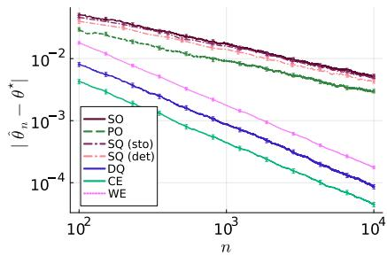

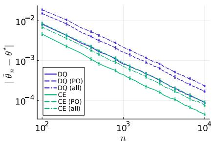

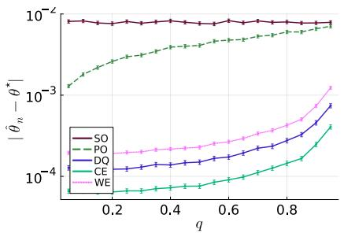

Figure 1: Estimation errors of $\mathcal { N } ( \theta ^ { \star } , 1 )$ with $\theta ^ { \star } \sim \mathcal { U } ( [ 1 , 2 ] )$ and $N _ { \mathrm { r u n s } } = 1 0 ^ { 3 }$ at (a-b) η(1/2) ≈ 1.15 and (c) $n = 1 0 ^ { 4 }$ where $c _ { \eta ( q ) } ^ { 2 } : = F _ { \chi ^ { 2 } ( 1 ) } ^ { - 1 } ( q )$ . Error bars are ±2 standard errors.  
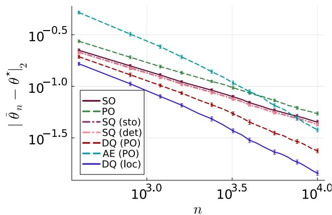

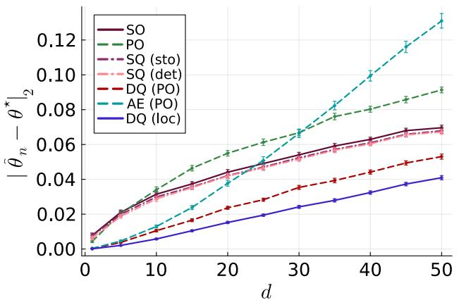  
Figure 2: Estimation errors of $\mathcal { N } ( \theta ^ { \star } , I _ { d } )$ with $\theta ^ { \star } \sim \mathcal { U } ( [ 1 , 2 ] ^ { d } )$ and $N _ { \mathrm { r u n s } } = 1 0 ^ { 2 }$ at (a) $d = 2 0$ and (b) $n = 1 0 ^ { 4 }$ where $c _ { \eta ( d ) } ^ { 2 } : = F _ { \chi ^ { 2 } ( d ) } ^ { - 1 } ( 1 / 2 )$ . Error bars are ±2 standard errors.

Dependence on the Threshold. We study the effects of class imbalance by choosing thresholds η(q) such that $c _ { \eta ( q ) } ^ { 2 } : = F _ { \chi ^ { 2 } ( 1 ) } ^ { - 1 } ( q )$ so that $\mathbb { P } _ { \mathcal { N } ( \theta ^ { \star } , 1 ) } ( r _ { \theta ^ { \star } } > 0 ) = q .$ Figure 1(c) shows that the findings above remain robust under class imbalance. As the constraints become less informative for larger $\eta ,$ performance degrades as $q \to 1$ . For larger $d ,$ Figure 6 in Appendix G.3 further illustrates the impact of class imbalance under alternative threshold choices.

Dependence on the Dimension. Figure 2(b) reinforces the empirical observations above. At a fixed sample size, the performance of AE (PO) deteriorates rapidly as d increases, and DQ achieves the best estimation error. Overall, DQ consistently outperforms the other estimators across all regimes.

## 7 CONCLUSION

We have shown that deterministic binary quality feedback can accelerate parameter estimation from the classical $n ^ { - 1 / 2 }$ rate to $\widetilde { \mathcal { O } } ( n ^ { - 1 } )$ when incorporated as hard constraints. Our framework covers identifiable models, including Gaussian and Laplace families, as well as finitely ambiguous models such as the exponential family, where likelihood information resolves the remaining ambiguity. When the reward is known only up to an additive constant, we retain the accelerated rate by constructing threshold-free pairwise preferences from oppositely labeled samples. Our examples further show that pointwise qualities and pairwise preferences are generally incomparable: either can localize the parameter when the other cannot. Finally, our minimax lower bound proves that the $1 / n$ rate is optimal, for fixed dimension, up to logarithmic and dimension-dependent factors, while our experiments confirm the benefits of combining likelihood information with deterministic quality constraints.

Several questions remain open. First, it would be valuable to identify minimal structural conditions on $( p _ { \theta } , r _ { \theta } )$ that determine whether quality feedback is more informative than preference feedback, less informative, or statistically equivalent. Second, understanding how the accelerated $1 / n$ rate degrades as deterministic labels become noisy would help bridge the deterministic and smooth stochastic regimes. Finally, closing the gap between our upper and lower bounds in higher dimensions may require sharper geometric analyses or estimators exploiting the constraint structure.

## AI use statement

We used generative AI tools for editing, including grammar, spelling, and word-choice suggestions. We also used these tools to accelerate the initial implementation of experimental code and to refine constants in our initial proofs through integral computations. All AI-assisted mathematical derivations, experimental code, and textual edits were independently reviewed and verified by the authors. We take responsibility for the final content of this work, including all text, claims, and artifacts produced with the aid of generative AI.

## Acknowledgements

This work was supported by the Swiss National Science Foundation (grant number 212111) and by an unrestricted gift from Google. We thank reviewers of an earlier version of this paper for insightful discussions and valuable feedback.

## References

Patrice Assouad. Deux remarques sur l’estimation. Comptes rendus des séances de l’Académie des sciences. Série 1, Mathématique, 296(23):1021–1024, 1983.

Anirudhan Badrinath, Prabhat Agarwal, and Jiajing Xu. Unified preference optimization: Language model alignment beyond the preference frontier. Transactions on Machine Learning Research, 2025.

Jeff Bezanson, Alan Edelman, Stefan Karpinski, and Viral B Shah. Julia: A fresh approach to numerical computing. SIAM Review, 59(1):65–98, 2017.

Lucien Birgé and Pascal Massart. Rates of convergence for minimum contrast estimators. Probability Theory and Related Fields, 97:113–150, 1993.

Anselm Blumer, Andrzej Ehrenfeucht, David Haussler, and Manfred K Warmuth. Learnability and the Vapnik– Chervonenkis dimension. Journal of the ACM, 36(4): 929–965, 1989.

Ralph Allan Bradley and Milton E Terry. Rank analysis of incomplete block designs: I. the method of paired comparisons. Biometrika, 39(3/4):324–345, 1952.

Benoît Cadre. Kernel estimation of density level sets. Journal ofmultivariate analysis, 97(4):999–1023, 2006.

Tianchi Cai, Xierui Song, Jiyan Jiang, Fei Teng, Jinjie Gu, and Guannan Zhang. ULMA: Unified language model alignment with human demonstration and point-wise preference. arXiv preprint arXiv:2312.02554, 2023.

Harald Cramér. Mathematical Methods of Statistics, volume 9 of Princeton Mathematical Series. Princeton University Press, Princeton, NJ, 1946.

Andrzej Ehrenfeucht, David Haussler, Michael Kearns, and Leslie Valiant. A general lower bound on the number of examples needed for learning. Information and Computation, 82(3):247–261, 1989.

Kawin Ethayarajh, Winnie Xu, Niklas Muennighoff, Dan Jurafsky, and Douwe Kiela. Model alignment as prospect

theoretic optimization. In Proceedings of the 41st International Conference on Machine Learning, ICML’24, 2024.

RM Fano. Class notes for transmission of information. In Course 6.574. MIT Cambridge, MA, 1952.

Sally Floyd and Manfred Warmuth. Sample compression, learnability, and the vapnik-chervonenkis dimension. Machine learning, 21(3):269–304, 1995.

Leo Gao, Stella Biderman, Sid Black, Laurence Golding, Travis Hoppe, Charles Foster, Jason Phang, Horace He, Anish Thite, Noa Nabeshima, et al. The pile: An 800GB dataset of diverse text for language modeling. arXiv preprint arXiv:2101.00027, 2020.

Luise Ge, Brendan Juba, and Yevgeniy Vorobeychik. Learning linear utility functions from pairwise comparison queries. arXiv preprint arXiv:2405.02612, 2024.

Bruce Hajek, Sewoong Oh, and Jiaming Xu. Minimaxoptimal inference from partial rankings. Advances in Neural Information Processing Systems, 27, 2014.

Steve Hanneke. Refined error bounds for several learning algorithms. Journal ofMachine Learning Research, 17 (135):1–55, 2016.

John A Hartigan. Estimation of a convex density contour in two dimensions. Journal of the American Statistical Association, 82(397):267–270, 1987.

Ildar A. Ibragimov and Rafail Z. Has’minskii. Statistical Estimation: Asymptotic Theory, volume 16 of Stochastic Modelling and Applied Probability. Springer, 1981.

Ruili Jiang, Kehai Chen, Xuefeng Bai, Zhixuan He, Juntao Li, Muyun Yang, Tiejun Zhao, Liqiang Nie, and Min Zhang. A survey on human preference learning for aligning large language models. ACM Comput. Surv., 58(6), 2025.

Marc Jourdan, Gizem Yüce, and Nicolas Flammarion. Learning parametric distributions from samples and preferences. In Proceedings ofthe 42nd International Conference on Machine Learning, volume 267 of Proceedings of Machine Learning Research, pages 28418–28445. PMLR, 2025.

Lucien Le Cam. Convergence of estimates under dimensionality restrictions. The Annals ofStatistics, pages 38–53, 1973.

Katherine Lee, Daphne Ippolito, Andrew Nystrom, Chiyuan Zhang, Douglas Eck, Chris Callison-Burch, and Nicholas Carlini. Deduplicating training data makes language models better. In Proceedings of the 60th Annual Meeting of the Associationfor Computational Linguistics (Volume 1: Long Papers), pages 8424–8445, 2022.

Erich Leo Lehmann and George Casella. Theory of point estimation. Springer, 1998.

Jing Lei, James Robins, and Larry Wasserman. Distributionfree prediction sets. Journal ofthe American Statistical Association, 108(501):278–287, 2013.

Zhenghao Lin, Zhibin Gou, Yeyun Gong, Xiao Liu, Yelong Shen, Ruochen Xu, Chen Lin, Yujiu Yang, Jian Jiao, Nan Duan, et al. Not all tokens are what you need for pretraining. Advances in Neural Information Processing Systems, 37:29029–29063, 2024.

Miles Lubin, Oscar Dowson, Joaquim Dias Garcia, Joey Huchette, Benoît Legat, and Juan Pablo Vielma. JuMP 1.0: Recent improvements to a modeling language for mathematical optimization. Mathematical Programming Computation, 15(3):581–589, 2023.

Yu Meng, Mengzhou Xia, and Danqi Chen. SimPO: Simple preference optimization with a reference-free reward. Advances in Neural Information Processing Systems, 37: 124198–124235, 2024.

Patrick K. Mogensen and Asbjørn N. Riseth. Optim: A mathematical optimization package for Julia. Journal of Open Source Software, 3(24):615, 2018.

Long Ouyang, Jeffrey Wu, Xu Jiang, Diogo Almeida, Carroll Wainwright, Pamela Mishkin, Chong Zhang, Sandhini Agarwal, Katarina Slama, Alex Ray, et al. Training language models to follow instructions with human feedback. Advances in neural information processing systems, 35:27730–27744, 2022.

Guilherme Penedo, Quentin Malartic, Daniel Hesslow, Ruxandra Cojocaru, Hamza Alobeidli, Alessandro Cappelli, Baptiste Pannier, Ebtesam Almazrouei, and Julien Launay. The refinedweb dataset for Falcon LLM: outperforming curated corpora with web data only. In Proceedings of the 37th International Conference on Neural Information Processing Systems. Curran Associates Inc., 2023.

Guilherme Penedo, Hynek Kydlícek, Anton Lozhkov, Mar-ˇ garet Mitchell, Colin Raffel, Leandro Von Werra, Thomas Wolf, et al. The FineWeb datasets: Decanting the web for the finest text data at scale. Advances in Neural Information Processing Systems, 37:30811–30849, 2024.

Wolfgang Polonik. Measuring mass concentrations and estimating density contour clusters-an excess mass approach. The Annals ofStatistics, pages 855–881, 1995.

Rafael Rafailov, Archit Sharma, Eric Mitchell, Christopher D Manning, Stefano Ermon, and Chelsea Finn. Direct preference optimization: Your language model is secretly a reward model. Advances in Neural Information Processing Systems, 36:53728–53741, 2023.

Colin Raffel, Noam Shazeer, Adam Roberts, Katherine Lee, Sharan Narang, Michael Matena, Yanqi Zhou, Wei Li, and Peter J Liu. Exploring the limits of transfer learning with a unified text-to-text transformer. Journal ofmachine learning research, 21(140):1–67, 2020.

C Radhakrishna Rao. Information and the accuracy attainable in the estimation of statistical parameters. Bull. Calcutta Math. Soc, 37(3):81–91, 1945.

Philippe Rigollet and Régis Vert. Optimal rates for plug-in estimators of density level sets. Bernoulli, pages 1154– 1178, 2009.

John Schulman, Filip Wolski, Prafulla Dhariwal, Alec Radford, and Oleg Klimov. Proximal policy optimization algorithms. arXiv preprint arXiv:1707.06347, 2017.

Nihar B Shah and Martin J Wainwright. Simple, robust and optimal ranking from pairwise comparisons. Journal of machine learning research, 18(199):1–38, 2018.

Nihar B Shah, Sivaraman Balakrishnan, Joseph Bradley, Abhay Parekh, Kannan Ramchandran, and Martin J Wainwright. Estimation from pairwise comparisons: Sharp minimax bounds with topology dependence. Journal of Machine Learning Research, 17(58):1–47, 2016.

Vladimir Spokoiny. Parametric estimation. Finite sample theory. The Annals ofStatistics, 40(6):2877 – 2909, 2012.

Yunhao Tang, Zhaohan Daniel Guo, Zeyu Zheng, Daniele Calandriello, Remi Munos, Mark Rowland, Pierre Harvey Richemond, Michal Valko, Bernardo Avila Pires, and Bilal Piot. Generalized preference optimization: A unified approach to offline alignment. In Proceedings ofthe 41st International Conference on Machine Learning, volume 235 of Proceedings of Machine Learning Research, pages 47725–47742. PMLR, 2024.

Alexandre B Tsybakov. Introduction to nonparametric estimation, volume 11. Springer, 2009.

L. G. Valiant. A theory of the learnable. Communications ofthe ACM, 27(11):1134–1142, 1984.

A. W. van der Vaart. Asymptotic Statistics. Cambridge Series in Statistical and Probabilistic Mathematics. Cambridge University Press, 1998.

Vladimir N. Vapnik and Alexey Ya. Chervonenkis. On the uniform convergence of relative frequencies of events to their probabilities. Theory of Probability & Its Applications, 16(2):264–280, 1971.

Andreas Wächter and Lorenz T Biegler. On the implementation of an interior-point filter line-search algorithm for large-scale nonlinear programming. Mathematical programming, 106:25–57, 2006.

Yizhong Wang, Yeganeh Kordi, Swaroop Mishra, Alisa Liu, Noah A Smith, Daniel Khashabi, and Hannaneh Hajishirzi. Self-instruct: Aligning language models with self-generated instructions. In Proceedings of the 61st annual meeting ofthe associationfor computational linguistics (volume 1: long papers), pages 13484–13508, 2023.

Larry Wasserman. All of statistics: a concise course in statistical inference, volume 26. Springer, 2004.

Sang Michael Xie, Hieu Pham, Xuanyi Dong, Nan Du, Hanxiao Liu, Yifeng Lu, Percy S Liang, Quoc V Le, Tengyu Ma, and Adams Wei Yu. DoReMi: Optimizing data mixtures speeds up language model pretraining. Advances in Neural Information Processing Systems, 36: 69798–69818, 2023.

Yunzhen Yao, Lie He, and Michael Gastpar. Leveraging sparsity for sample-efficient preference learning: A theoretical perspective. In International Conference on Machine Learning, pages 71739–71764. PMLR, 2025.

Zichun Yu, Spandan Das, and Chenyan Xiong. MATES: Model-aware data selection for efficient pretraining with data influence models. Advances in Neural Information Processing Systems, 37:108735–108759, 2024.

Chunting Zhou, Pengfei Liu, Puxin Xu, Srinivasan Iyer, Jiao Sun, Yuning Mao, Xuezhe Ma, Avia Efrat, Ping Yu, Lili Yu, et al. LIMA: Less is more for alignment. Advances in Neural Information Processing Systems, 36: 55006–55021, 2023.

Banghua Zhu, Michael Jordan, and Jiantao Jiao. Principled reinforcement learning with human feedback from pairwise or k-wise comparisons. In International Conference on Machine Learning, pages 43037–43067. PMLR, 2023.

Daniel M Ziegler, Nisan Stiennon, Jeffrey Wu, Tom B Brown, Alec Radford, Dario Amodei, Paul Christiano, and Geoffrey Irving. Fine-tuning language models from human preferences. arXiv preprint arXiv:1909.08593, 2019.

## CHECKLIST

1. For all models and algorithms presented, check if you include:

(a) A clear description of the mathematical setting, assumptions, algorithm, and/or model. Yes. See Sections 2, 3, 4, 5 and 6.

(b) An analysis of the properties and complexity (time, space, sample size) of any algorithm. Yes. See Sections 3 and 6, as well as Appendix G.1.

(c) (Optional) Anonymized source code, with specification of all dependencies, including external libraries. Yes. See Appendix G.1 and the code provided in the supplementary material.

2. For any theoretical claim, check if you include:

(a) Statements of the full set of assumptions of all theoretical results. Yes. See Sections 3, 4 and 5, as well as Appendices B, C, D, E and F.

(b) Complete proofs of all theoretical results. Yes. See Sections 3, 4 and 5, as well as Appendices B, C, D, E and F.

(c) Clear explanations of any assumptions. Yes. See Sections 3, 4 and 5, as well as Appendices B, C, D, E and F.

3. For all figures and tables that present empirical results, check if you include:

(a) The code, data, and instructions needed to reproduce the main experimental results (either in the supplemental material or as a URL). Yes. See Appendix G.1 and the code provided in the supplementary material.

(b) All the training details (e.g., data splits, hyperparameters, how they were chosen). Yes. See details in Section 6 and Appendix G.1.

(c) A clear definition of the specific measure or statistics and error bars (e.g., with respect to the random seed after running experiments multiple times). Yes. See details in Section 6.

(d) A description of the computing infrastructure used. (e.g., type of GPUs, internal cluster, or cloud provider). Yes. See details in Appendix G.1.

4. If you are using existing assets (e.g., code, data, models) or curating/releasing new assets, check if you include:

(a) Citations of the creator If your work uses existing assets. Not Applicable.

(b) The license information of the assets, if applicable. Not Applicable.

(c) New assets either in the supplemental material or as a URL, if applicable. Not Applicable.

(d) Information about consent from data providers/curators. Not Applicable.

(e) Discussion of sensible content if applicable, e.g., personally identifiable information or offensive content. Not Applicable.

5. If you used crowdsourcing or conducted research with human subjects, check if you include:

(a) The full text of instructions given to participants and screenshots. Not Applicable.

(b) Descriptions of potential participant risks, with links to Institutional Review Board (IRB) approvals if applicable. Not Applicable.

(c) The estimated hourly wage paid to participants and the total amount spent on participant compen sation. Not Applicable.

## A OUTLINE

The appendices are organized as follows:

• In Appendix B, we provide additional related work, detailed discussions on our geometric assumptions, sources of misspecification, and the dimensionality gap between our upper and lower bounds.

• Appendix C contains the proofs of the results presented in Section 3: Theorems 1, 2, 3, and 4. For thresholded log-likelihood rewards, Assumption 2 is shown for $\mathcal { F } _ { \mathcal { N } , \Sigma }$ (Lemma 7) and $\mathcal { F } _ { \mathrm { L a p } , b }$ (Lemma 8); and Assumption 4 is shown for $\mathcal { F } _ { \mathrm { E x p } }$ (Lemma 9). We also detail several examples where preference feedback is more informative than quality feedback.

• Appendix D contains the proof of Theorem 5 presented in Section 4, and its extension, Theorem 14 in Appendix D.1, under suitable assumptions on $r _ { \theta }$ and $p _ { \theta }$ (Assumptions 7, 8 and 9).

• Appendix E contains the proofs of the results presented in Section 5: Theorem 6, and Assumption 6 for thresholded log-likelihood rewards with $\mathcal { F } _ { \mathcal { N } , \Sigma }$ (Lemma 16), $\mathcal { F } _ { \mathrm { L a p } , b }$ (Lemma 17) and $\mathcal { F } _ { \mathrm { E x p } }$ (Lemma 18).

• In Appendix F, we discuss the asymptotic behavior of $\mathrm { S Q } _ { \mathrm { s t o } }$ and $\mathrm { S Q } _ { \mathrm { d e t } }$ from Section 2.2 in greater depth.

• In Appendix G, we provide implementation details for reproducibility, extended discussions on the computational cost of our estimators, and supplementary experiments to support our theoretical findings. The code is available as supplementary material.

## B EXTENDED DISCUSSIONS

We provide extended discussions on additional related work (Appendix B.1), our geometric assumptions (Appendix B.2), sources of misspecification (Appendix B.3), and the dimensionality gap between our upper and lower bounds (Appendix B.4).

## B.1 Additional Related Work

Quality-aware Data Selection in Pretraining. Large-scale pretraining pipelines rely on curated, filtered, and deduplicated corpora such as C4, the Pile, RefinedWeb, and FineWeb (Raffel et al., 2020; Gao et al., 2020; Lee et al., 2022; Penedo et al., 2023, 2024). Beyond static corpus construction, adaptive methods such as DoReMi, Rho-1, and MATES select or reweight data using domain, reference-model, or influence-based signals (Xie et al., 2023; Lin et al., 2024; Yu et al., 2024). These works demonstrate the empirical importance of quality signals throughout the training pipeline.

Fine-tuning and Alignment with Preference/Quality Data. Language-model post-training increasingly relies on feedback beyond next-token prediction. RLHF learns a reward model from human preferences and then optimizes the policy, e.g., PPO (Ziegler et al., 2019; Schulman et al., 2017; Ouyang et al., 2022), whereas DPO and related direct-alignment methods replace the reinforcement-learning step with supervised preference objectives (Rafailov et al., 2023; Meng et al., 2024; Tang et al., 2024). Although most alignment methods use pairwise preferences, recent approaches also exploit pointwise or binary quality signals: ULMA combines demonstrations with pointwise preferences (Cai et al., 2023), KTO trains on desirable/undesirable labels (Ethayarajh et al., 2024), and UPO incorporates auxiliary objectives that are not naturally expressed as pairwise comparisons (Badrinath et al., 2025); see Jiang et al. (2025) for a survey. These empirical works motivate the study of quality feedback. Our contribution is theoretical: we isolate a parametric statistical setting in which quality labels can be analyzed directly, and we characterize when such labels improve estimation rates rather than merely constant factors.

## B.2 Geometric Assumptions

Finite VC Dimension. Assumption 7 implies both Assumptions 3 and 1; more precisely, $d _ { \star } ^ { + } \leq d _ { \star } \leq d ^ { \mathrm { a l l } }$ . Indeed, $h _ { \theta } ^ { + }$ is obtained from $h _ { \theta }$ by restricting its disagreement region to the fixed set $\left\{ r _ { \theta ^ { \star } } \ > \ 0 \right\}$ , which cannot increase VC dimension. Moreover, $h _ { \theta }$ is the disagreement classifier between the fixed classifier $h _ { \theta ^ { \star } , 0 } ^ { \mathrm { a l l } }$ and $\left\{ h _ { \theta . 0 } ^ { \mathrm { a l l } } : \theta \in \Theta \right\} \subseteq \mathcal { H } ^ { \mathrm { a l l } }$ . Taking disagreement with a fixed classifier merely flips a sample-dependent fixed subset of labels and therefore preserves VC dimension.

Finite VC dimension is a standard distribution-free complexity condition. It can usually be verified by identifying the geometry of the thresholded reward regions $\{ x : r _ { \theta } ( x ) > 0 \}$ , or of their pairwise analogues, and invoking standard VC bounds for the resulting class. In particular, half-spaces, intervals, balls, and, more generally, semi-algebraic sets with uniformly bounded description complexity have finite VC dimension. This directly covers our Gaussian, Laplace, and exponential examples. Finite-dimensional parametrization alone is not sufficient: a pathological parametrization may encode arbitrarily complex decision regions and hence have infinite VC dimension.

The $\mathrm { v c }$ assumptions can also be weakened. Since our proofs only use a uniform bound on the disagreement class under $p _ { \theta ^ { \star } }$ they may be replaced by an appropriate distribution-dependent uniform-convergence condition, for example one based on covering numbers, bracketing entropy, or a localized Rademacher complexity. Such replacements can be useful when the class has infinite global VC dimension but substantially smaller complexity in a neighborhood of $\theta ^ { \star }$

Local Error-to-parameter Conversion. Assumption 2 implies Assumption 4. Indeed, ${ \mathcal { D } } ^ { + } ( \theta ^ { \star } , \theta ) \subseteq { \mathcal { D } } ( \theta ^ { \star } , \theta )$ , and the former assumption implies $\mathcal { C } ( \theta ^ { \star } ) = \{ \theta ^ { \star } \}$ . Thus the latter holds with $\alpha _ { \star } = \alpha _ { \star } ^ { + }$ and $\varepsilon _ { \star } = \varepsilon _ { \star } ^ { + }$ . The converse need not hold: full feedback can distinguish parameters that agree with $\theta ^ { \star }$ throughout its positive region.

These assumptions require the disagreement probability to grow at least linearly with the distance to the relevant equivalence class in a neighborhood of $\theta ^ { \star }$ . The truncation by $\varepsilon _ { \star } ^ { + } \ \mathrm { o r } \ \varepsilon _ { \star }$ only requires a uniform positive separation outside this neighborhood. A useful way to verify them is through a local boundary argument. Suppose that the zero level set $\{ x : r _ { \theta ^ { \star } } ( x ) = 0 \}$ is a regular hypersurface, that $p _ { \theta } ,$ ⋆ is bounded below in a neighborhood of this boundary, and that the boundary moves transversally in every identifiable parameter direction. Then a perturbation of size $\lVert \theta - \theta ^ { \star } \rVert$ displaces the reward boundary by the same order. $\operatorname { I f } p _ { \theta }$ ⋆ is bounded below near that boundary, the region lying between the original and perturbed boundaries therefore has probability mass proportional to $\lVert \theta - \theta ^ { \star } \rVert$ . This yields the desired local linear bound. Uniform separation outside this local neighborhood can then often be obtained by continuity and compactness, after identifying parameters belonging to the same finite ambiguity class.

This perspective also clarifies the possible failures: the feedback may be insensitive to some parameter directions; symmetries may produce a non-trivial equivalence class; the boundary may have zero density; or its displacement may vanish to first order. The latter case need not preclude consistency, but generally yields a weaker modulus. More generally, the linear lower bound can be replaced by

$$
p _ { \theta ^ { \star } } ( { \cal D } ( \theta ^ { \star } , \theta ) ) \geq c \mathrm { d i s t } ( \theta , \mathcal { C } ( \theta ^ { \star } ) ) ^ { \kappa }
$$

locally, for some $\kappa > 0 ,$ and analogously for positive-only feedback. The same proof strategy then yields a parameter rate of order $\widetilde { \mathcal { O } } ( n ^ { - 1 / \kappa } )$ ; the present assumptions correspond to the regular, transversal case $\kappa = 1$

The profiled error condition (Assumption 8) for unknown thresholds is stronger still. Since $\operatorname { e r } _ { \mathrm { p r o f } } ( \theta ^ { \star } , \theta ) \leq p _ { \theta ^ { \star } } ( \mathcal { D } ( \theta ^ { \star } , \theta ) )$ , a lower bound on the profiled error implies the corresponding full-feedback conversion bound, but not conversely. It rules out parameter changes that can be compensated by shifting the threshold: it therefore requires the shape of the reward level sets, and not merely one thresholded positive region, to identify the parameter.

Likelihood Concentration. Assumption 5 is a local uniform law of large numbers with Bernstein-type tails for the negative log-likelihood. It is standard for regular parametric models. On each compact $K \subset \Theta$ , it can typically be verified by combining continuity (or local Lipschitz continuity) of $\theta \mapsto - \log p _ { \theta } ( x )$ with an integrable envelope for the class $\left\{ - \log p _ { \theta } + \log p _ { \theta ^ { \star } } : \theta \in K \right\}$ , and suitable uniform variance or exponential-moment bounds. Standard empirical process arguments then yield the displayed $\sqrt { \log ( 1 / \delta ) / n } + \log ( 1 / \delta ) / n$ control. These conditions hold for the Gaussian, Laplace, and exponential families considered in this paper.

Its role is only to select, among the finitely many feedback-compatible components, the component containing $\theta ^ { \star }$ . In particular, the proof does not rely on the specific Bernstein rate: any high-probability uniform deviation bound that converges to zero on the relevant compact set is sufficient for eventual component selection. The assumption can therefore be weakened to a uniform law of large numbers, possibly with an unspecified deterministic modulus $a _ { n } ( \delta ) \to 0$ . One may also replace the global compact-set condition by concentration on a random or deterministic neighborhood known to contain the feedback version space with high probability.

Closure of Strict Consistency. Assumption 9 is a geometric regularity condition: $\mathcal { C } _ { n } ^ { \mathrm { a l l } } = \overline { { \mathcal { C } _ { n , > } ^ { \mathrm { a l l } } } }$ almost surely. It excludes isolated weakly feasible parameters that satisfy one or more sample constraints only through exact equalities and cannot be approximated by strictly feasible parameters. Its sole role is to transfer the PAC bound established for $\mathcal { C } _ { n , > } ^ { \mathrm { a l l } }$ to the weak version space $\mathcal { C } _ { n } ^ { \mathrm { a l l } }$

A direct way to verify the condition is to show that every weakly feasible θ can be moved by an arbitrarily small amount toward a strictly feasible point while preserving all weak inequalities. For example, if the sample constraints are affine in θ, the weak and strict feasible sets are respectively an intersection of closed and open half-spaces. If $\cdot \theta ^ { \star }$ satisfies all constraints strictly, then, for every $\theta \in { \mathcal { C } } _ { n } ^ { \mathrm { a l l } }$ and $t \in ( 0 , 1 ]$ , the point $( 1 - t ) \theta + t \theta ^ { \star }$ is strictly feasible and converges to θ as $t \downarrow 0 .$ . This verifies the assumption for Gaussian log-likelihood rewards. More generally, the same argument applies whenever the feasible set is star-shaped with respect to a strictly feasible point, or whenever a suitable constraint qualification guarantees that weak feasibility can be perturbed into strict feasibility.

The condition can be weakened in several equivalent ways. It is enough that every weakly feasible parameter have the same classifier, or the same relevant error, as a limit of strictly feasible parameters. Alternatively, one may formulate the PAC guarantee directly for the weak constraint class, using a fixed convention for ties. This avoids the closure assumption altogether, at the cost of controlling classifiers arising from equality cases. In settings where ties occur with probability zero, it also suffices to establish the closure property outside a null event.

Hellinger Control for the Lower Bound. Assumption 6 ensures that two nearby parameters induce sufficiently similar sample–quality distributions. It supplies the hard-to-distinguish local alternatives used in the minimax lower bound of Theorem 6. The linear term is specific to deterministic quality feedback: even when the underlying statistical model is quadratically regular in Hellinger distance, moving a deterministic decision boundary generally changes the labels on a region of probability mass proportional to the boundary displacement.

A useful route for verifying the assumption is to decompose the distance between $q _ { \theta } ,$ ⋆ and $q _ { \theta }$ into two effects: the change in the marginal sample distribution $p _ { \theta } ,$ ⋆ versus $p _ { \theta }$ , and the change in the thresholded reward region. For regular parametric families, the first is typically quadratic, $\mathrm { H } ^ { 2 } ( p _ { \theta ^ { \star } } , p _ { \theta } ) \leq C \| \theta - \theta ^ { \star } \| ^ { 2 }$ locally. For the deterministic labels, it then remains to bound the probability mass of the region on which the two quality rules differ. A regular-boundary argument—using a bounded density near $\{ r _ { \theta ^ { \star } } = 0 \}$ and a locally Lipschitz, transversal motion of this boundary—typically yields a linear bound. This is the mechanism used in the Gaussian, Laplace, and exponential examples.

The assumption may be weakened by replacing the displayed linear–quadratic modulus with any local modulus

$$
\begin{array} { r } { \mathrm { H } ^ { 2 } ( q _ { \theta ^ { \star } } , q _ { \theta } ) \leq \omega ( \| \theta - \theta ^ { \star } \| ) , \qquad \omega ( t ) \downarrow 0 . } \end{array}
$$

The resulting lower bound is then determined by the inverse modulus at scale $1 / n$ . For example, if $\omega ( t ) \lesssim t ^ { \kappa }$ , the same two-point argument yields a local minimax lower bound of order $n ^ { - 1 / \kappa }$ . Thus the current assumption captures the regular deterministic-boundary regime $\kappa = 1$ , which leads to the fast $n ^ { - 1 }$ lower-bound scale. It is also enough for the assumption to hold on a nonempty open subset of parameters, as stated: minimax lower bounds are local, so no global control over the entire parameter space is needed.

## B.3 Sources of Misspecification

Parameter Space. When $\theta ^ { \star } \notin \Theta$ , separability within Θ is not guaranteed by deterministic qualities alone. The definition of DQ MLE should be modified to combine the cross-entropy loss and the classification 0-1 loss, i.e.,

$$
\widehat { \theta } _ { n } ^ { \mathrm { D Q } } \in \mathop { \mathrm { a r g } } \operatorname* { m i n } _ { \theta \in \Theta } \left\{ L _ { n } ^ { \mathrm { S O } } ( \theta ) + \lambda \sum _ { i \in [ n ] } \mathbb { 1 } \left( Z _ { i } r _ { \theta } ( X _ { i } ) < 0 \right) \right\} ,\tag{3}
$$

where $\lambda > 0$ is a regularization between those two losses. Without separability, solving Eq. (3) can be NP-hard. Under sufficient regularity, ${ \widehat { \theta } } _ { n } ^ { \mathrm { D Q } }$ θbDQ converges to $\theta _ { 0 } \in \arg \operatorname* { m i n } _ { \theta \in \Theta } \{ \mathrm { K L } ( \theta ^ { \star } , \theta ) + \lambda m ( \theta ^ { \star } , \theta ) \}$ where $m ( { \theta ^ { \star } } , \theta ) : = p _ { \theta ^ { \star } } \left( { \mathcal { D } } ( { \theta ^ { \star } } , \theta ) \right)$ and $\theta _ { 0 } \neq \theta ^ { \star }$ . Computing $\theta _ { 0 }$ might be challenging since $\theta \mapsto m ( \theta ^ { \star } , \theta )$ can be non-convex. To obtain tractable and robust estimators, we need a tractable surrogate or relaxation for this optimization problem. Since $\theta _ { 0 }$ lies on the boundary of Θ, proving an accelerated rate requires controlling the maximal deviation from $\theta _ { 0 }$ along directions that point toward the interior of Θ. Parts of our analysis may still apply, yet sharper technical arguments are needed.

Parametric Models. The true distribution $p ^ { \star }$ of the observations may not belong to the model class ${ \mathcal { F } } ,$ , that is, $p ^ { \star } \notin \mathcal { F }$ Such misspecification arises when $\mathcal { F }$ fails to capture the true data-generating structure, for instance because the truth lies in another parametric or non-parametric class of distributions. In this setting, $L _ { n } ^ { \mathrm { S O } } ( \theta )$ can be interpreted as a quasi-loglikelihood. We refer to the estimator defined in Eq. (SO MLE) for this quasi-log-likelihood as the $\mathrm { S O }$ quasi-MLE. Under suitable regularity conditions, the SO quasi-MLE converges to $\theta _ { 0 } \in \arg \operatorname* { m i n } _ { \theta \in \Theta } \mathrm { K L } ( p ^ { \star } , p _ { \theta } )$ where, in general, $p ^ { \star } \neq p _ { \theta _ { \mathrm { { c } } } }$ even though $p _ { \theta _ { 0 } } \in \mathcal { F }$

Similarly, the true reward $r ^ { \star }$ associated with $p ^ { \star }$ may not belong to the class of reward models In the absence of separability induced by well-specified deterministic qualities, we define the DQ quasi-MLE as in Eq. (3). Under suitable regularity conditions, the DQ quasi-MLE converges to $\begin{array} { r } { \theta _ { 0 } \in \arg \operatorname* { m i n } _ { \theta \in \Theta } \{ \mathrm { K L } ( p ^ { \star } , p _ { \theta } ) + \lambda p ^ { \star } \left( \mathcal { D } ( \theta ) \right) \} } \end{array}$ } where ${ \mathcal { D } } ( \theta ) : = \{ x \in \mathcal { X } \mid$ $r ^ { \star } ( x ) r _ { \theta } ( x ) < 0 \}$

Brittleness of Exact Interpolation. Exact feasibility is sensitive to persistent errors in the feedback model. For example, suppose that the labels are generated using the threshold $\eta ^ { \star }$ , whereas the constraints use $\eta ,$ and let

$$
m ( \eta , \eta ^ { \star } ) : = p _ { \theta ^ { \star } } ( \mathrm { s i g n } ( \log p _ { \theta ^ { \star } } ( X ) + \eta ) \neq \mathrm { s i g n } ( \log p _ { \theta ^ { \star } } ( X ) + \eta ^ { \star } ) ) \ .
$$

Then the true parameter satisfies all full-feedback constraints with probability $( 1 - m ( \eta , \eta ^ { \star } ) ) ^ { n }$ . Whenever $m ( \eta , \eta ^ { \star } ) > 0$ this probability converges exponentially fast to zero. Under the regular-boundary conditions discussed in Appendix $\mathrm { B } . 2 .$ , one typically has $m ( \eta , \eta ^ { \star } ) \asymp | \eta - \eta ^ { \star } |$ locally. Similarly, under independent label flips with probability $\rho ,$ the probability that $\theta ^ { \star }$ interpolates all observed labels is $( 1 - \rho ) ^ { n }$ . Consequently, any fixed nonzero threshold error or flip probability invalidates exact interpolation asymptotically; for interpolation to hold with probability tending to one, one needs, respectively, $n | \eta _ { n } - \eta ^ { \star } |  0 \mathrm { o r } n \rho _ { n }  0 .$ , up to the corresponding boundary-mass constants. The all-pairs construction $\mathcal { C } _ { n } ^ { \mathrm { a l l } }$ removes a common additive threshold error, when the resulting preferences remain identifying, but does not by itself protect against corrupted labels, which may contaminate many constructed comparisons.

Intermediate Noise Regimes. The failure of exact interpolation should be distinguished from the loss of the $1 / n$ statistical rate. In particular, a fixed symmetric flip probability $\rho < 1 / 2$ destroys interpolation but leaves a discontinuity of size $1 - 2 \rho$ in the conditional label distribution across the quality boundary. Robust estimators that allow label violations may therefore retain change-point-type $1 / n$ rates, with constants deteriorating as $\rho$ approaches $1 / 2 .$ . This differs fundamentally from the smooth sigmoid model of Section 2.2: there, the conditional label distribution varies smoothly with the parameter, the experiment is locally regular, and the classical $n ^ { - 1 / 2 }$ rate is recovered. More generally, the transition is governed by the local modulus of separation between the induced sample–label distributions, rather than by the mere presence of noise. For instance, if the label discontinuity has magnitude $a _ { n }$ and the local squared Hellinger distance behaves heuristically as

$$
H ^ { 2 } ( q _ { \theta ^ { \star } } , q _ { \theta } ) \asymp a _ { n } ^ { 2 } \| \theta - \theta ^ { \star } \| + \| \theta - \theta ^ { \star } \| ^ { 2 } ,
$$

the corresponding distinguishability scale solves $n ( a _ { n } ^ { 2 } t + t ^ { 2 } ) \asymp 1$ : it interpolates between $1 / ( n a _ { n } ^ { 2 } )$ and $1 / \sqrt { n }$ , with a transition around $\bar { a } _ { n } \asymp n ^ { \bar { - } 1 / 4 }$ . Establishing matching guarantees for robust, slackened constraints under general corruption mechanisms is an interesting direction for future work.

## B.4 Dimensionality Gap between Upper and Lower Bounds

We detail the dimensional dependence discussed in Section 5 for the Gaussian location family ${ \mathcal { F } } _ { { \mathcal { N } } , I _ { d } }$ with thresholded log-likelihood rewards. Let $m _ { d } : = F _ { \chi ^ { 2 } ( d ) } ^ { - 1 } ( 1 / 2 )$ and $2 \eta ( d ) : = d \log ( 2 \pi ) + m _ { d } .$ . Since

$$
- 2 \log p _ { \theta ^ { \star } } ( X ) - d \log ( 2 \pi ) = \| X - \theta ^ { \star } \| _ { 2 } ^ { 2 } \sim \chi ^ { 2 } ( d ) ,
$$

this choice yields balanced quality labels: $p _ { \theta ^ { \star } } \left( r _ { \theta ^ { \star } } ( X ) > 0 \right) = 1 / 2$

We compare the constants $\alpha _ { I _ { d } , \eta ( d ) }$ and $\beta _ { I _ { d } , \eta ( d ) }$ appearing respectively in the upper bound of Theorem 1 and the lower bound of Theorem 6. Throughout this subsection, we consider $d \geq 3$ , which is sufficient for the asymptotic comparison.

Asymptotic Behavior of the Upper-bound Constant. By Lemma 7, for $d \geq 2 .$

$$
{ \alpha } _ { I _ { d } , \eta ( d ) } = { \kappa } _ { d - 1 } s _ { d } ( 2 \pi ) ^ { - d / 2 } e ^ { - m _ { d } / 2 } m _ { d } ^ { ( d - 1 ) / 2 } ,
$$

where $\begin{array} { r } { \kappa _ { d - 1 } = \frac { \pi ^ { ( d - 1 ) / 2 } } { \Gamma \left( \frac { d + 1 } { 2 } \right) } } \end{array}$ and $\begin{array} { r } { s _ { d } = \left( 1 - \frac { 1 } { 1 6 d ^ { 2 } } \right) ^ { ( d - 1 ) / 2 } } \end{array}$ . Clearly, $s _ { d } = 1 + \mathcal { O } ( d ^ { - 1 } )$ . Set $\begin{array} { r } { z _ { d } : = \frac { d + 1 } { 2 } } \end{array}$ and $\begin{array} { r } { x _ { d } : = \frac { m _ { d } } { 2 } } \end{array}$ . The standard expansion of the median of a chi-squared distribution gives

$$
m _ { d } = d - { \frac { 2 } { 3 } } + \mathcal { O } ( d ^ { - 1 } ) , \qquad x _ { d } = z _ { d } - { \frac { 5 } { 6 } } + \mathcal { O } ( d ^ { - 1 } ) .
$$

Rearranging the expression above yields

$$
\alpha _ { I _ { d } , \eta ( d ) } = \frac { s _ { d } } { \sqrt { 2 \pi } } \frac { x _ { d } ^ { z _ { d } - 1 } e ^ { - x _ { d } } } { \Gamma ( z _ { d } ) } .
$$

Since $x _ { d } = z _ { d } + \mathcal { O } ( 1 )$ , Stirling’s formula gives

$$
\frac { x _ { d } ^ { z _ { d } - 1 } e ^ { - x _ { d } } } { \Gamma ( z _ { d } ) } = \frac { 1 + \mathcal { O } ( d ^ { - 1 } ) } { \sqrt { 2 \pi z _ { d } } } .
$$

Consequently,

$$
\alpha _ { I _ { d } , \eta ( d ) } = \frac { 1 + \mathcal { O } ( d ^ { - 1 } ) } { 2 \pi \sqrt { z _ { d } } } = \frac { 1 + o ( 1 ) } { \sqrt { 2 } \pi \sqrt { d } } .
$$

Asymptotic Behavior of the Lower-bound Constant. By Lemma 16, for d $\geq 3 ,$

$$
\beta _ { I _ { d } , \eta ( d ) } = \operatorname * { m i n } \left\{ \frac { 2 \kappa _ { d - 1 } m _ { d } ^ { ( d - 1 ) / 2 } } { ( 2 \pi ) ^ { d / 2 } } , 2 \sqrt { \frac { 2 } { \pi } } M _ { d - 1 } \right\} ,
$$

where

$$
M _ { d - 1 } = \frac { ( d - 3 ) ^ { ( d - 3 ) / 2 } e ^ { - ( d - 3 ) / 2 } } { 2 ^ { ( d - 1 ) / 2 } \Gamma \big ( \frac { d - 1 } { 2 } \big ) }
$$

is the maximum of the density of a $\chi ^ { 2 } ( d - 1 )$ random variable. The first term in the minimum can be related directly to the upper-bound constant:

$$
\frac { 2 \kappa _ { d - 1 } m _ { d } ^ { ( d - 1 ) / 2 } } { ( 2 \pi ) ^ { d / 2 } } = \frac { 2 e ^ { m _ { d } / 2 } } { s _ { d } } \alpha _ { I _ { d } , \eta ( d ) } .
$$

Using the above and $m _ { d } = d + { \mathcal { O } } ( 1 )$ , this term grows exponentially in d. It therefore cannot determine the minimum for all sufficiently large d.

To analyze the second term, let $w _ { d } = ( d - 1 ) / 2 .$ . Then,

$$
M _ { d - 1 } = \frac { ( w _ { d } - 1 ) ^ { w _ { d } - 1 } e ^ { - ( w _ { d } - 1 ) } } { 2 \Gamma ( w _ { d } ) } .
$$

Another application of Stirling’s formula gives

$$
M _ { d - 1 } = \frac { 1 + o ( 1 ) } { 2 \sqrt { 2 \pi w _ { d } } } = \frac { 1 + o ( 1 ) } { 2 \sqrt { \pi d } } .
$$

Hence, for all sufficiently large $d ,$

$$
\beta _ { I _ { d } , \eta ( d ) } = 2 \sqrt { \frac { 2 } { \pi } } M _ { d - 1 } = \frac { \sqrt { 2 } + o ( 1 ) } { \pi \sqrt { d } } .
$$

Combining both results, we obtain

$$
\frac { \beta _ { I _ { d } , \eta ( d ) } } { \alpha _ { I _ { d } , \eta ( d ) } }  _ { d  + \infty } 2 .
$$

Therefore, the ratio between the upper and lower bounds (Theorems 1 and 6) is $\widetilde { \mathcal { O } } ( \sqrt { d } )$

Different Statistical Objects. These two bounds concern different statistical objects. The upper bound controls the most distant point of $\mathcal { C } _ { n } ^ { + }$ and consequently applies to every estimator selected from this feasible set. Its d-dependence arises from uniformly controlling the version space, whose associated classifier class has VC dimension of order d. By contrast, the lower bound concerns the risk of the best possible estimator and uses an Assouad construction that aggregates coordinatewise perturbations into a $\sqrt { d }$ estimation loss.

The present results therefore do not determine whether the gap is due to a loose minimax lower bound, to the uniform control of the entire feasible set, or to a genuine suboptimality of arbitrary feasible estimators. In particular, a carefully selected estimator, such as the projected-likelihood DQ on ${ \mathcal { C } } _ { n }$ or $\mathcal { C } _ { n } ^ { + }$ , may have better dimensional dependence even when the diameter of ${ \mathcal { C } } _ { n } ^ { + }$ remains large. This interpretation is consistent with the experiments, where projected-likelihood estimators substantially outperform arbitrary feasible estimators. Closing the gap likely requires either an estimator-specific upper-bound analysis or a lower bound tailored to the diameter of the feasible set.

## C PROOFS OF SECTION 3

In this appendix, we prove the results presented in Section 3: Theorem 1 in Appendix C.1, Theorem 2 in Appendix C.2, Theorem 3 in Appendix C.3, and Theorem 4 in Appendix C.4. Appendix C.5 contains the proof of the local error-to-parameter conversion for thresholded log-likelihood rewards: Assumption 2 holds for $\mathcal { F } _ { \mathcal { N } , \Sigma }$ (Lemma 7) and $\mathcal { F } _ { \mathrm { L a p } , b }$ (Lemma 8), and Assumption 4 holds for $\mathcal { F } _ { \mathrm { E x p } }$ (Lemma 9). Appendix C.6 contains useful technical results for thresholded log-likelihood rewards with $\mathcal { F } _ { \mathrm { E x p } } .$ . Appendix C.7 contains several examples where preference feedback is more informative than quality feedback.

## C.1 Proof of Theorem 3

Let $\delta \in ( 0 , 1 )$ . Let $\theta ^ { \star } \in \Theta$ such that Assumptions 1 and 2 hold true for $d _ { \star } ^ { + } : = \mathrm { v c } ( \mathcal { H } _ { \star } ^ { + } )$ and $\alpha _ { \star } ^ { + } , \varepsilon _ { \star } ^ { + } > 0 .$ . Using these assumptions and notation from Section 3, Hanneke (2016, Theorem 11) yields, with probability at least $1 - \delta$

$$
\alpha _ { \star } ^ { + } \operatorname* { m i n } \left\{ \operatorname* { s u p } _ { \theta \in \mathcal { C } _ { n } ^ { + } } \| \theta - \theta ^ { \star } \| , \varepsilon _ { \star } ^ { + } \right\} \leq \operatorname* { s u p } _ { \theta \in \mathcal { C } _ { n } ^ { + } } p _ { \theta } \cdot ( \mathcal { D } ^ { + } ( \theta ^ { \star } , \theta ) ) \leq \frac { 8 } { n } \left( d _ { \star } ^ { + } \log \left( \frac { 4 9 e n } { d _ { \star } ^ { + } } + 3 7 \right) + 8 \log \left( \frac { 6 } { \delta } \right) \right) .
$$

Let us define

$$
n _ { \star } ^ { + } ( \delta ) : = 1 + \left\lceil \operatorname* { m a x } \left\{ d _ { \star } ^ { + } , \frac { 1 2 8 } { \varepsilon _ { \star } ^ { + } \alpha _ { \star } ^ { + } } \log \frac { 6 } { \delta } , \frac { 3 2 d _ { \star } ^ { + } } { \varepsilon _ { \star } ^ { + } \alpha _ { \star } ^ { + } } \log \left( e + \frac { 3 2 ( 4 9 e + 3 7 ) } { \varepsilon _ { \star } ^ { + } \alpha _ { \star } ^ { + } } \right) \right\} \right\rceil = _ { \delta \to 0 } \mathcal { O } \left( \frac { \log \left( 1 / \delta \right) } { \varepsilon _ { \star } ^ { + } \alpha _ { \star } ^ { + } } \right) .
$$

For all $n \ge n _ { \star } ^ { + } ( \delta )$ , we have

$$
\alpha _ { \star } ^ { + } \varepsilon _ { \star } ^ { + } > \frac { 8 } { n } \left( d _ { \star } ^ { + } \log \left( \frac { 4 9 e n } { d _ { \star } ^ { + } } + 3 7 \right) + 8 \log \left( \frac { 6 } { \delta } \right) \right) .
$$

Therefore, for all $n \ge n _ { \star } ^ { + } ( \delta )$ , we have, with probability at least $1 - \delta ,$

$$
\operatorname* { s u p } _ { \theta \in \mathcal { C } _ { n } ^ { + } } \| \theta - \theta ^ { \star } \| \leq \frac { 8 } { \alpha _ { \star } ^ { + } n } \left( d _ { \star } ^ { + } \log \left( \frac { 4 9 e n } { d _ { \star } ^ { + } } + 3 7 \right) + 8 \log \left( \frac { 6 } { \delta } \right) \right) .
$$

This concludes the proof.

## C.2 Proof of Theorem 4

Let $\delta \in ( 0 , 1 )$ . Let $\theta ^ { \star } \in \Theta$ such that Assumptions 3, 4 and 5 hold true for $d _ { \star } : = \mathrm { v c } ( \mathcal { H } _ { \star } )$ and $\alpha _ { \star } , \varepsilon _ { \star } > 0$ . Recall that dist $( u , \mathcal { V } ) : = \operatorname* { i n f } _ { v \in \mathcal { V } } \| u - v \|$ . Using the notation from Section 3 and similar to Section 3.1, the setting is realizable as $h _ { \theta ^ { \star } } \in \mathcal { H } _ { \star } , h _ { \theta ^ { \star } } \equiv 1$ and

$$
\begin{array} { r l } & { \mathcal { C } _ { n } = \{ \theta \mid \forall i \in [ n ] , h _ { \theta } ( X _ { i } ) = h _ { \theta ^ { \star } } ( X _ { i } ) \} , } \\ & { p _ { \theta ^ { \star } } ( \mathcal { D } ( \theta ^ { \star } , \theta ) ) = p _ { \theta ^ { \star } } ( \{ x \mid h _ { \theta } ( x ) \neq h _ { \theta ^ { \star } } ( x ) \} ) . } \end{array}
$$

Using these assumptions, Hanneke (2016, Theorem 11) yields, with probability at least $1 - \delta / 2$

$$
\alpha _ { \star } \operatorname* { m i n } \left\{ \operatorname* { s u p } _ { \theta \in \mathcal { C } _ { n } } \operatorname { d i s t } ( \theta , \mathcal { C } ( \theta ^ { \star } ) ) , \varepsilon _ { \star } \right\} \leq \operatorname* { s u p } _ { \theta \in \mathcal { C } _ { n } } p _ { \theta ^ { \star } } ( \mathcal { D } ( \theta ^ { \star } , \theta ) ) \leq \frac { 8 } { n } \left( d _ { \star } \log \left( \frac { 4 9 e n } { d _ { \star } } + 3 7 \right) + 8 \log \left( \frac { 1 2 } { \delta } \right) \right) .
$$

Let $\mathcal { C } ^ { - } ( \theta ^ { \star } ) : = \mathcal { C } ( \theta ^ { \star } ) \setminus \{ \theta ^ { \star } \}$ . Since $\mathcal { C } ( \theta ^ { \star } )$ is finite, choose $\rho _ { \star } > 0$ such that, for all $\lambda \in { \mathcal { C } } ( \theta ^ { \star } )$ , the balls $B ( \lambda , \rho _ { \star } )$ for the norm $\| \cdot \|$ are pairwise disjoint and their union is contained in a compact subset of Θ. Define $\begin{array} { r } { K _ { \star } ^ { - } : = \bigcup _ { \lambda \in { \mathcal { C } } ^ { - } ( \theta ^ { \star } ) } B ( \lambda , \rho _ { \star } ) } \end{array}$ By continuity of $\theta \mapsto \mathrm { K L } ( p _ { \theta ^ { \star } } , p _ { \theta } )$ and uniqueness of its minimizer (see, the standard regularity conditions from Section 2), we have

$$
\gamma _ { \star } : = \operatorname* { i n f } _ { \theta \in K _ { \star } ^ { - } } \mathrm { K L } ( p _ { \theta ^ { \star } } , p _ { \theta } ) > 0 .
$$

Let $C _ { \star } : = C _ { K _ { \star } ^ { - } }$ and $D _ { \star } : = D _ { K _ { \star } ^ { - } }$ , as given by Assumption 5. Then, with probability at least $1 - \delta / 2$

$$
\operatorname* { s u p } _ { \theta \in K _ { \star } ^ { - } } \big | ( L _ { n } ^ { \mathrm { S O } } ( \theta ) - L _ { n } ^ { \mathrm { S O } } ( \theta ^ { \star } ) ) / n - \mathrm { K L } ( p _ { \theta ^ { \star } } , p _ { \theta } ) \big | \leq C _ { \star } \sqrt { \frac { \log ( 4 / \delta ) } { n } } + D _ { \star } \frac { \log ( 4 / \delta ) } { n } .
$$

Let us define $q _ { \star } : = \alpha _ { \star }$ ⋆ min $\{ \varepsilon _ { \star } , \rho _ { \star } \}$ and $n _ { \star } ( \delta ) : = \operatorname* { m a x } \left\{ n _ { \star , 1 } ( \delta ) , n _ { \star , 2 } ( \delta ) \right\}$ where

$$
n _ { \star , 1 } ( \delta ) : = 1 + \left\lceil \operatorname* { m a x } \left\{ d _ { \star } , \frac { 1 2 8 } { q _ { \star } } \log \frac { 1 2 } { \delta } , \frac { 3 2 d _ { \star } } { q _ { \star } } \log \left( e + \frac { 3 2 ( 4 9 e + 3 7 ) } { q _ { \star } } \right) \right\} \right\rceil \quad \mathrm { a n d }
$$

$$
n _ { \star , 2 } ( \delta ) : = 1 + \left\lceil \operatorname* { m a x } \left\{ \frac { 4 C _ { \star } ^ { 2 } } { \gamma _ { \star } ^ { 2 } } \log \frac { 4 } { \delta } , \frac { 2 D _ { \star } } { \gamma _ { \star } } \log \frac { 4 } { \delta } \right\} \right\rceil .
$$

We have $n _ { \star } ( \delta ) = _ { \delta  0 } \mathcal { O } ( \log ( 1 / \delta ) )$ ) where the constants are hidden for simplicity of exposition. For all $n \ge n _ { \star } ( \delta )$

$$
\alpha _ { \star } \varepsilon _ { \star } > \frac { 8 } { n } \left( d _ { \star } \log \left( \frac { 4 9 e n } { d _ { \star } } + 3 7 \right) + 8 \log \left( \frac { 1 2 } { \delta } \right) \right) \quad \mathrm { a n d } \quad \gamma _ { \star } > C _ { \star } \sqrt { \frac { \log ( 4 / \delta ) } { n } } + D _ { \star } \frac { \log ( 4 / \delta ) } { n } .
$$

A direct union bound over the two events above (each holding with probability at least $1 - \delta / 2 )$ , yields, with probability at least $1 - \delta$

$$
\mathrm { d i s t } ( \widehat { \theta } _ { n } ^ { \mathrm { D Q } } , \mathcal { C } ( \theta ^ { \star } ) ) \leq \frac { 8 } { n \alpha _ { \star } } \left( d _ { \star } \log \left( \frac { 4 9 e n } { d _ { \star } } + 3 7 \right) + 8 \log \left( \frac { 1 2 } { \delta } \right) \right) \quad \mathrm { a n d } \quad \operatorname* { i n f } _ { \theta \in K _ { \star } ^ { \star } } \left\{ L _ { n } ^ { \mathrm { S O } } ( \theta ) - L _ { n } ^ { \mathrm { S O } } ( \theta ^ { \star } ) \right\} > 0 \ .
$$

Since $\theta ^ { \star } \in \mathcal { C } _ { n }$ and $\begin{array} { r } { \widehat { \theta } _ { n } ^ { \mathrm { D Q } } \in \arg \operatorname* { m i n } _ { \theta \in \mathcal { C } _ { n } } L _ { n } ^ { \mathrm { S O } } ( \theta ) } \end{array}$ , we necessarily have

$$
\widehat { \theta } _ { n } ^ { \mathrm { D Q } } \notin K _ { \star } ^ { - } \quad \mathrm { a n d } \quad \mathrm { d i s t } ( \widehat { \theta } _ { n } ^ { \mathrm { D Q } } , \mathcal { C } ( \theta ^ { \star } ) ) = \| \widehat { \theta } _ { n } ^ { \mathrm { D Q } } - \theta ^ { \star } \| .
$$

Therefore, for all $n \ge n _ { \star } ( \delta )$ , we have, with probability at least $1 - \delta ,$

$$
\| \hat { \theta } _ { n } ^ { \mathrm { D Q } } - \theta ^ { \star } \| \leq \frac { 8 } { n \alpha _ { \star } } \left( d _ { \star } \log \left( \frac { 4 9 e n } { d _ { \star } } + 3 7 \right) + 8 \log \left( \frac { 1 2 } { \delta } \right) \right) .
$$

This concludes the proof.

## C.3 Proof of Theorem 1

Let $\begin{array} { r } { \delta \in ( 0 , 1 ) , \eta _ { 0 } = \frac { 1 } { 2 } \log ( ( 2 \pi ) ^ { d } | \Sigma | ) } \end{array}$ for $\mathcal { F } _ { \mathcal { N } , \Sigma }$ and $\eta _ { 0 } = \log ( 2 b )$ for $\mathcal { F } _ { \mathrm { L a p } , b }$ with $d = 1$ . Recall that $\| x \| _ { \Sigma } : = { \sqrt { x ^ { \intercal } \Sigma x } }$ . Let $\eta \in ( \eta _ { 0 } , + \infty )$ be a known threshold, and define $\bar { \eta } : = \eta - \eta _ { 0 }$ . For thresholded log-likelihood rewards, we have

$$
\begin{array} { r l r l r l } { r _ { \theta } ( x ) : = \bar { \eta } - \{ \frac { 1 } { b } | x - \theta | } & { \mathrm { f o r ~ } \mathcal { F } _ { \mathrm { L a p } , b } } & { } & { , } & { c _ { \eta } : = \{ \begin{array} { l l } { b \bar { \eta } } & { \mathrm { f o r ~ } \mathcal { F } _ { \mathrm { L a p } , b } } \\ { \sqrt { 2 \bar { \eta } } } & { \mathrm { f o r ~ } \mathcal { F } _ { N , \Sigma } } \end{array}  } & { \mathrm { a n d } } & { r _ { \eta } : = \{ \begin{array} { l l } { b \bar { \eta } } & { \mathrm { f o r ~ } \mathcal { F } _ { \mathrm { L a p } , b } } \\ { \sigma \sqrt { 2 \bar { \eta } } } & { \mathrm { f o r ~ } \mathcal { F } _ { N , \Sigma } } \end{array}  . } \end{array}
$$

To keep the same argument for both families, we define

$$
m _ { \theta } : = \left\{ { \begin{array} { l l } { \theta , } & { { \mathcal { F } } _ { \mathrm { L a p } , b } , } \\ { \sigma ^ { 2 } \theta , } & { { \mathcal { F } } _ { \mathcal { N } , \sigma ^ { 2 } } . } \end{array} } \right.
$$

Case $\mathcal { F } _ { \mathrm { L a p } , b }$ and $\mathcal { F } _ { \mathcal { N } , { \sigma } ^ { 2 } }$ . For all $x _ { 1 : n } \in \mathcal X ^ { n }$ , let us define

$$
C _ { n } ^ { + } ( x _ { 1 : n } ) : = \{ \theta \mid \forall i \in [ n ] \mathrm { ~ s . t . ~ } r _ { \theta ^ { * } } ( x _ { i } ) > 0 , \ r _ { \theta } ( x _ { i } ) \geq 0 \} \quad , \quad \psi _ { n } ^ { + } ( x _ { 1 : n } ) : = \bigcup _ { \theta \in C _ { n } ^ { + } ( x _ { 1 : n } ) } \mathcal { D } ^ { + } ( \theta ^ { \star } , \theta ) ,
$$

$$
x _ { n , \mathrm { m i n } } ^ { + } : = \operatorname* { m i n } \{ x _ { i } \mid r _ { \theta ^ { \star } } ( x _ { i } ) > 0 \} \quad \mathrm { a n d } \quad x _ { n , \mathrm { m a x } } ^ { + } : = \operatorname* { m a x } \{ x _ { i } \mid r _ { \theta ^ { \star } } ( x _ { i } ) > 0 \} ,
$$

with the usual conventions $+ \infty$ and −∞ if $\{ i \mid r _ { \theta ^ { \star } } ( x _ { i } ) > 0 \} = \emptyset$ . Up to endpoints of pθ⋆ -measure zero, we have

$$
\psi _ { n } ^ { + } ( x _ { 1 : n } ) = \left( ( m _ { \theta ^ { \star } } - r _ { \eta } , x _ { n , \operatorname* { m i n } } ^ { + } ) \cup ( x _ { n , \operatorname* { m a x } } ^ { + } , m _ { \theta ^ { \star } } + r _ { \eta } ) \right) \cap ( m _ { \theta ^ { \star } } - r _ { \eta } , m _ { \theta ^ { \star } } + r _ { \eta } ) .
$$

Therefore, this defines a consistent monotone sample compression rules of size at most 2. Since $\begin{array} { r } { \mathcal { C } _ { n } ^ { + } : = C _ { n } ^ { + } ( X _ { 1 : n } ) } \end{array}$ , (Hanneke, 2016, Theorem 3) yields, with probability at least $1 - \delta .$

$$
\operatorname* { s u p } _ { \theta \in \mathcal { C } _ { n } ^ { + } } p _ { \theta ^ { \star } } \bigl ( \mathcal { D } ^ { + } ( \theta ^ { \star } , \theta ) \bigr ) \leq p _ { \theta ^ { \star } } \bigl ( \psi _ { n } ^ { + } ( X _ { 1 : n } ) \bigr ) \leq \frac { 1 } { n } \left( 4 2 + 1 6 \log \left( \frac { 3 } { \delta } \right) \right) .
$$

Let $\varepsilon _ { \mathcal { F } , \eta } , \alpha _ { \mathcal { F } , \eta } > 0$ as in Eq. (5) of Lemma 7 for $\mathcal { F } _ { \mathcal { N } , \sigma ^ { 2 } }$ and as in Eq. (8) of Lemma 8 for $\mathcal { F } _ { \mathrm { L a p } , b }$ . Since

$$
\forall \theta \in \mathbb { R } , \quad p _ { \theta ^ { \star } } \left( \mathcal { D } ^ { + } ( \theta ^ { \star } , \theta ) \right) \geq \alpha _ { \mathcal { F } , \eta } \operatorname* { m i n } \left\{ | \theta - \theta ^ { \star } | , \varepsilon _ { \mathcal { F } , \eta } \right\} ,
$$

we obtain that, with probability at least $1 - \delta .$

$$
\alpha _ { \mathcal { F } , \eta } \operatorname* { m i n } \left\{ \operatorname* { s u p } _ { \theta \in \mathcal { C } _ { n } ^ { + } } \vert \theta - \theta ^ { \star } \vert , \varepsilon _ { \mathcal { F } , \eta } \right\} \leq \frac { 1 } { n } \left( 4 2 + 1 6 \log \left( \frac { 3 } { \delta } \right) \right) .
$$

Let us define

$$
n _ { \mathcal { F } , \eta } ( \delta ) : = 1 + \left\lceil \frac { 4 2 + 1 6 \log \left( \frac { 3 } { \delta } \right) } { \alpha _ { \mathcal { F } , \eta } \varepsilon _ { \mathcal { F } , \eta } } \right\rceil = _ { \delta \to 0 } \mathcal { O } \left( \frac { \log ( 1 / \delta ) } { \alpha _ { \mathcal { F } , \eta } \varepsilon _ { \mathcal { F } , \eta } } \right) .
$$

Therefore, for all $n \geq n _ { \mathcal { F } , \eta } ( \delta )$ , we have, with probability at least $1 - \delta .$

$$
\operatorname* { s u p } _ { \theta \in \mathcal { C } _ { n } ^ { + } } \left. \theta - \theta ^ { \star } \right. \leq \frac { 4 2 + 1 6 \log \left( \frac { 3 } { \delta } \right) } { n \alpha _ { \mathcal { F } , \eta } } .
$$

This concludes the proof of the first result on $\mathcal { F } _ { \mathrm { L a p } , b }$ and $\mathcal { F } _ { \mathcal { N } , \sigma ^ { 2 } }$

Case $\mathcal { F } _ { \mathcal { N } , \Sigma }$ . We have $\bar { \eta } > 0 , c _ { \eta } = \sqrt { 2 \bar { \eta } }$ and Σ is positive definite. Let $E _ { \theta } : = \{ x \in \mathbb { R } ^ { d } \ | \ \| \Sigma ^ { - 1 } x - \theta \| _ { \Sigma } < c _ { \eta } \}$ for all $\theta \in \mathbb { R } ^ { d }$ . Recall that $\overline { { X } }$ denotes the closure of the set X. Using the notation from Section 3.1, we have $\mathcal { H } _ { \star } ^ { + } : = \{ h _ { \theta } ^ { + } \ | \ \theta \in \mathbb { R } ^ { d } \}$ where

$$
\forall x \in \mathbb { R } ^ { d } , h _ { \theta } ^ { + } ( x ) : = \left\{ { \begin{array} { l l } { - 1 } & { { \mathrm { i f ~ } } x \in E _ { \theta ^ { \star } } \setminus { \overline { { E _ { \theta } } } } } \\ { + 1 } & { { \mathrm { o t h e r w i s e } } } \end{array} } \right. .
$$

Based on an invertible mapping, $\{ E _ { \theta } : \theta \in \mathbb { R } ^ { d } \}$ is a class of Euclidean balls with a fixed radius. It is therefore a subclass of the class of all Euclidean balls in $\mathbb { R } ^ { d }$ , whose VC dimension is $d + 1$ . Taking complements and intersecting every set with the same fixed set $E _ { \theta ^ { \star } }$ cannot increase the VC dimension. Assumption 1 holds true with explicit constant d + 1 since

$$
d _ { \star } ^ { + } = \mathrm { v c } ( \mathcal { H } _ { \star } ^ { + } ) \leq d + 1 < \infty .
$$

Using Lemma 7, Assumption 2 also holds true with explicit constants $\alpha _ { \Sigma , \eta }$ and $\varepsilon _ { \Sigma , \eta }$ as in Eq. (5) for the norm $\| \cdot \| _ { \Sigma }$

Both Assumptions 1 and 2 are shown with constants that are independent of $\theta ^ { \star }$ . Therefore, the second result on $\mathcal { F } _ { \mathcal { N } , \Sigma }$ is a corollary of Theorem 3, applied uniformly over $\theta ^ { \star }$

## C.4 Proof of Theorem 2

We use the technical results for $\mathcal { F } _ { \mathrm { E x p } }$ established in Appendix C.6, together with the notation introduced therein. In particular, let $\theta _ { 0 } : = e ^ { - \eta } , \widetilde \theta _ { 0 } : = e ^ { 1 - \eta } , x _ { 0 } : = e ^ { \eta - 1 }$ and the function $\begin{array} { r } { f _ { \eta } ( y ) : = \frac { \eta + \log y } { y } } \end{array}$ for all $y > 0 .$ . Let $\theta ^ { \star } \in ( \theta _ { 0 } , + \infty ) \setminus \{ \widetilde { \theta } _ { 0 } \}$ and write $x _ { \eta } ^ { \star } : = f _ { \eta } ( \theta ^ { \star } ) \in \left( 0 , x _ { 0 } \right]$

For all $x _ { 1 : n } \in \mathcal X ^ { n }$ , let us define

$$
C _ { n } ( x _ { 1 : n } ) : = \{ \theta \mid \forall i \in [ n ] \mathrm { ~ s . t . ~ } r _ { \theta ^ { \star } } ( x _ { i } ) r _ { \theta } ( x _ { i } ) \geq 0 \} \quad , \quad \psi _ { n } ( x _ { 1 : n } ) : = \bigcup _ { \theta \in C _ { n } ( x _ { 1 : n } ) } \mathcal { D } ( \theta ^ { \star } , \theta ) ,
$$

$$
x _ { n , { \mathrm { m a x } } } ^ { + } : = { \mathrm { m a x } } \left( \left\{ x _ { i } : r _ { \theta ^ { \star } } ( x _ { i } ) > 0 \right\} \cup \left\{ 0 \right\} \right) \quad { \mathrm { a n d } } \quad x _ { n , { \mathrm { m i n } } } ^ { - } : = { \mathrm { m i n } } \left( \left\{ x _ { i } : r _ { \theta ^ { \star } } ( x _ { i } ) < 0 \right\} \cup \left\{ x _ { 0 } \right\} \right) .
$$

By Lemma $1 0 , r _ { \theta } ( x ) > 0$ if and only if $x < f _ { \eta } ( \theta )$ and $f _ { \eta } ( \theta ) \in ( 0 , x _ { 0 } ]$ for every $\theta > \theta _ { 0 }$ . Up to endpoints,

$$
\begin{array} { r } { \theta \in C _ { n } ( x _ { 1 : n } ) \quad \iff \quad f _ { \eta } ( \theta ) \in \left[ x _ { n , \operatorname* { m a x } } ^ { + } , x _ { n , \operatorname* { m i n } } ^ { - } \right] . } \end{array}
$$

Moreover, Lemma 11 shows that every threshold $x \in ( 0 , x _ { 0 } )$ is attained by some $\theta > \theta _ { 0 } ;$ ; indeed, it is attained by the two inverse branches $\theta _ { \eta , 0 } ( x )$ and $\theta _ { \eta , - 1 } ( x )$ . Since ${ \cal { D } } ( \theta ^ { \star } , \theta ) = \left( \operatorname* { m i n } \{ x _ { \eta } ^ { \star } , f _ { \eta } ( \theta ) \} \right.$ , max $\{ x _ { \eta } ^ { \star } , f _ { \eta } ( \theta ) \} \ )$ , we have, up to endpoints of pθ⋆ -measure zero

$$
\psi _ { n } ( x _ { 1 : n } ) = ( x _ { n , \mathrm { m a x } } ^ { + } , x _ { \eta } ^ { \star } ) \cup ( x _ { \eta } ^ { \star } , x _ { n , \mathrm { m i n } } ^ { - } ) .
$$

Therefore, this defines a consistent monotone sample compression rules of size at most 2. Since $ { \mathcal { C } } _ { n } : = C _ { n } ( X _ { 1 : n } )$ , (Hanneke, 2016, Theorem 3) yields, with probability at least $1 - \delta / 2$

$$
\operatorname* { s u p } _ { \theta \in \mathcal { C } _ { n } } p _ { \theta ^ { \star } } ( \mathcal { D } ( \theta ^ { \star } , \theta ) ) \leq p _ { \theta ^ { \star } } \left( \psi _ { n } ( X _ { 1 : n } ) \right) \leq \frac { 1 } { n } \left( 4 2 + 1 6 \log \left( \frac { 6 } { \delta } \right) \right) .
$$

Using Lemma 9, Assumption 4 holds true with explicit constants $\alpha _ { \star , \eta } , \varepsilon _ { \star , \eta } > 0$ as in Eq. (9) for the norm $| \cdot | .$

Let $K \subset ( 0 , + \infty )$ be a compact. Assumption 5 also holds for $\mathcal { F } _ { \mathrm { E x p } }$ with constants

$$
C _ { K } : = \frac { \sqrt 2 } { \theta ^ { \star } } \operatorname* { s u p } _ { \theta \in K } \left| \theta - \theta ^ { \star } \right| \quad \mathrm { a n d } \quad D _ { K } : = \frac { 1 } { \theta ^ { \star } } \operatorname* { s u p } _ { \theta \in K } \left| \theta - \theta ^ { \star } \right| ,\tag{4}
$$

because

$$
\operatorname* { s u p } _ { \theta \in K } \left. \frac { L _ { n } ^ { \mathrm { S O } } ( \theta ) - L _ { n } ^ { \mathrm { S O } } ( \theta ^ { \star } ) } { n } - \mathrm { K L } ( p _ { \theta ^ { \star } } , p _ { \theta } ) \right. = \operatorname* { s u p } _ { \theta \in K } \vert \theta - \theta ^ { \star } \vert \left. \overline { { X } } _ { n } - \frac { 1 } { \theta ^ { \star } } \right. ,
$$

and the centered exponential variable $X - 1 / \theta ^ { \star }$ is sub-gamma with variance factor $1 / ( \theta ^ { \star } ) ^ { 2 }$ and scale parameter $1 / \theta ^ { \star }$

Combining these results, we can conclude using the same proof as in Appendix C.2. Let $q _ { 0 } , q _ { - 1 }$ as in Lemma 9. Then, as in in Appendix C.2, we can choose $\rho ^ { \star } = | q _ { 0 } - q _ { - 1 } | / 4$ to define $K _ { \star } ^ { - }$ and $\gamma ^ { \star }$ , then take the associated $C _ { \star }$ and $D _ { \star }$ . Note that the explicit definition of $n _ { \star } ( \delta )$ should be modified to account for the improved PAC bound consistent monotone sample compression rules of size at most 2. As our statement hides explicit positive constants with the notation $n _ { \star } ( \delta ) = _ { \delta  0 }$ ${ \mathcal { O } } ( \log ( 1 / \delta ) )$ , we do not need to define it explicitly.

## C.5 Local Error-to-parameter Conversion

In this appendix, we prove the local error-to-parameter conversion for thresholded log-likelihood rewards.

Assumption 2 holds for FN,Σ (Lemma 7)

Lemma 7. Let $\begin{array} { r } { \eta > \frac { 1 } { 2 } \log \left( ( 2 \pi ) ^ { d } | \Sigma | \right) } \end{array}$ and define

$$
\begin{array} { r l } & { \alpha _ { \Sigma , \eta } : = \left\{ \begin{array} { l l } { \sigma ^ { 2 } e ^ { - \eta } } & { i f d = 1 } \\ { \kappa _ { d - 1 } \beta _ { d } \vert \Sigma \vert ^ { 1 / 2 } e ^ { - \eta } \left( 2 \eta - \log \left( ( 2 \pi ) ^ { d } \vert \Sigma \vert \right) \right) ^ { ( d - 1 ) / 2 } } & { o t h e r w i s e } \end{array} \right. 0 } \\ & { a n d \quad \varepsilon _ { \Sigma , \eta } : = \left\{ \begin{array} { l l } { \frac { 2 } { \sigma } \sqrt { 2 \eta - \log ( 2 \pi \sigma ^ { 2 } ) ) } } & { i f d = 1 } \\ { \frac { 1 } { 2 d } \sqrt { 2 \eta - \log ( ( 2 \pi ) ^ { d } \vert \Sigma \vert ) } } & { o t h e r w i s e } \end{array} \right. 0 , } \end{array}\tag{5}
$$

where $\begin{array} { r } { \kappa _ { d - 1 } : = \frac { \pi ^ { ( d - 1 ) / 2 } } { \Gamma \left( \frac { d + 1 } { 2 } \right) } } \end{array}$ and $\begin{array} { r } { \beta _ { d } : = \left( 1 - \frac { 1 } { 1 6 d ^ { 2 } } \right) ^ { ( d - 1 ) / 2 } } \end{array}$ . Then, for every $( \theta ^ { \star } , \theta ) \in \mathbb { R } ^ { d } \times \mathbb { R } ^ { d } ,$

$$
p _ { \theta ^ { \star } } \left( \mathcal D ^ { + } ( \theta ^ { \star } , \theta ) \right) \geq \left\{ \begin{array} { l l } { \alpha _ { \Sigma , \eta } \operatorname* { m i n } \left\{ \vert \theta - \theta ^ { \star } \vert , \varepsilon _ { \Sigma , \eta } \right\} } & { i f d = 1 } \\ { \alpha _ { \Sigma , \eta } \operatorname* { m i n } \left\{ \Vert \theta - \theta ^ { \star } \Vert _ { \Sigma } , \varepsilon _ { \Sigma , \eta } \right\} } & { o t h e r w i s e } \end{array} \right. .
$$

Proof. Let $c _ { \eta } : = \sqrt { 2 \bar { \eta } }$ and $E _ { \theta } : = \{ x \in \mathbb { R } ^ { d } \ | \ \| \Sigma ^ { - 1 } x - \theta \| _ { \Sigma } < c _ { \eta } \}$ . Then, $\mathcal { D } ^ { + } ( \theta ^ { \star } , \theta ) = E _ { \theta ^ { \star } } \setminus \overline { { E _ { \theta } } } .$

Case $d = 1 .$ . Let $Y : = X / \sigma ^ { 2 }$ and define the disagreement region in the transformed coordinates by

$$
\mathcal { D } _ { Y } ^ { + } ( \theta ^ { \star } , \theta ) : = \left\{ y \in \mathbb { R } : \sigma ^ { 2 } y \in \mathcal { D } ^ { + } ( \theta ^ { \star } , \theta ) \right\} .
$$

Set $r _ { \eta } : = c _ { \eta } / \sigma$ and $\Delta : = \theta - \theta ^ { \star }$ . In these coordinates, the two relevant intervals have radius $r _ { \eta \cdot } \mathrm { ~ I f ~ } 0 < \Delta < 2 r _ { \eta }$ , then $\mathcal { D } _ { Y } ^ { + } ( \dot { \theta ^ { \star } } , \theta ) \dot { = } ( \theta ^ { \star } - r _ { \eta } , \theta - r _ { \eta } )$ , whereas, $\mathrm { i f } - 2 r _ { \eta } < \Delta < 0$ , then $\mathcal { D } _ { Y } ^ { + } ( \theta ^ { \star } , \theta ) = ( \theta + r _ { \eta } , \theta ^ { \star } + r _ { \eta } )$ . Finally, if $| \Delta | \geq 2 r _ { \eta }$ , the two intervals are disjoint and $\mathcal { D } _ { Y } ^ { + } ( \theta ^ { \star } , \theta ) = ( \theta ^ { \star } - r _ { \eta } , \theta ^ { \star } + r _ { \eta } )$

Under $p _ { \theta ^ { \star } } , Y - \theta ^ { \star } \sim \mathcal { N } ( 0 , \sigma ^ { - 2 } )$ , whose density is

$$
f _ { \Sigma } ( t ) = \sqrt { \frac { \sigma ^ { 2 } } { 2 \pi } } \exp \left( - \frac { \sigma ^ { 2 } t ^ { 2 } } { 2 } \right) \quad \mathrm { w i t h } \quad \operatorname* { i n f } _ { | t | \leq r _ { \eta } } f _ { \Sigma } ( t ) = \alpha _ { \Sigma , \eta } : = \sqrt { \frac { \sigma ^ { 2 } } { 2 \pi } } \exp \left( - \frac { c _ { \eta } ^ { 2 } } { 2 } \right) .
$$

Since

$$
p _ { \theta ^ { \star } } \bigl ( \mathcal { D } ^ { + } ( \theta ^ { \star } , \theta ) \bigr ) = \mathbb { P } \bigl ( Y \in \mathcal { D } _ { Y } ^ { + } ( \theta ^ { \star } , \theta ) \bigr ) ,
$$

we obtain, when $| \Delta | < 2 r _ { \eta }$

$$
p _ { \theta ^ { \star } } \bigl ( \mathcal { D } ^ { + } ( \theta ^ { \star } , \theta ) \bigr ) \geq \alpha _ { \Sigma , \eta } | \Delta | .
$$

When $| \Delta | \geq 2 r _ { \eta }$

$$
p _ { \theta ^ { \star } } \bigl ( \mathcal { D } ^ { + } ( \theta ^ { \star } , \theta ) \bigr ) = \int _ { - r _ { \eta } } ^ { r _ { \eta } } f _ { \Sigma } ( t ) \mathrm { d } t \geq 2 r _ { \eta } \alpha _ { \Sigma , \eta } .
$$

This concludes the proof.

Case $d > 1$ . Let $Z : = \Sigma ^ { - 1 / 2 } X - \Sigma ^ { 1 / 2 } \theta ^ { \star } \sim \mathcal { N } ( 0 , I _ { d } )$ and

$$
v : = \Sigma ^ { 1 / 2 } ( \theta - \theta ^ { \star } ) , \qquad \rho : = \| v \| _ { 2 } = \| \theta - \theta ^ { \star } \| _ { \Sigma } .
$$

After an orthogonal rotation, we may assume that $v = \rho e _ { 1 }$ . Thus

$$
p _ { \theta ^ { \star } } \bigl ( \mathcal { D } ^ { + } ( \theta ^ { \star } , \theta ) \bigr ) = \mathbb { P } \bigl ( \| Z \| _ { 2 } < c _ { \eta } , \| Z - \rho e _ { 1 } \| _ { 2 } \geq c _ { \eta } \bigr ) \ .
$$

We first consider $0 < \rho \leq c _ { \eta } / ( 2 d )$ . Let $\begin{array} { r } { \kappa _ { d - 1 } : = \frac { \pi ^ { ( d - 1 ) / 2 } } { \Gamma \left( \frac { d + 1 } { 2 } \right) } } \end{array}$ denote the volume of the unit ball in $\mathbb { R } ^ { d - 1 }$ . Since the standard Gaussian density is bounded below on $B ( 0 , c _ { \eta } )$ by $( 2 \pi ) ^ { - d / 2 } e ^ { - c _ { \eta } ^ { 2 } / 2 }$ , we obtain

$$
p _ { \theta ^ { \star } } \left( \mathcal D ^ { + } ( \theta ^ { \star } , \theta ) \right) \geq \frac { e ^ { - c _ { \eta } ^ { 2 } / 2 } } { ( 2 \pi ) ^ { d / 2 } } \operatorname { L e b } \left( B ( 0 , c _ { \eta } ) \backslash B ( \rho e _ { 1 } , c _ { \eta } ) \right) .
$$

Slicing the two balls orthogonally to $e _ { 1 }$ gives

$$
\mathrm { L e b } \left( { \cal B } ( 0 , c _ { \eta } ) \backslash { \cal B } ( \rho e _ { 1 } , c _ { \eta } ) \right) = \kappa _ { d - 1 } \int _ { - \rho / 2 } ^ { \rho / 2 } \left( c _ { \eta } ^ { 2 } - t ^ { 2 } \right) ^ { ( d - 1 ) / 2 } \mathrm { d } t .\tag{6}
$$

Indeed, the hyperplane $\{ x _ { 1 } = \rho / 2 \}$ is the perpendicular bisector of the two centers, and the contributions outside the central slab cancel after translating one of the balls by $\rho e _ { 1 }$

Let us define $\textstyle \beta _ { d } : = \left( 1 - { \frac { 1 } { 1 6 d ^ { 2 } } } \right) ^ { ( d - 1 ) / 2 }$ . Since $| t | \leq \rho / 2$ throughout the integral,

$$
\mathrm { L e b } ( B ( 0 , c _ { \eta } ) \setminus B ( \rho e _ { 1 } , c _ { \eta } ) ) \geq \kappa _ { d - 1 } \rho \left( c _ { \eta } ^ { 2 } - \frac { \rho ^ { 2 } } { 4 } \right) ^ { ( d - 1 ) / 2 } \geq \kappa _ { d - 1 } c _ { \eta } ^ { d - 1 } \beta _ { d } \rho ,
$$

where we used that $\rho \leq c _ { \eta } / ( 2 d )$ . Thus, for $\rho \in ( 0 , c _ { \eta } / 2 )$ , we have

$$
p _ { \theta ^ { \star } } \left( \mathcal { D } ^ { + } ( \theta ^ { \star } , \theta ) \right) \geq \kappa _ { d - 1 } \beta _ { d } \frac { c _ { \eta } ^ { d - 1 } e ^ { - c _ { \eta } ^ { 2 } / 2 } } { ( 2 \pi ) ^ { d / 2 } } \| \theta - \theta ^ { \star } \| _ { \Sigma } .
$$

For $\rho \geq c _ { \eta } / ( 2 d )$ , the map $\rho \mapsto \mathbb { P } \left( Z \in B ( 0 , c _ { \eta } ) \setminus B ( \rho e _ { 1 } , c _ { \eta } ) \right)$ is nondecreasing. Indeed, its complement inside $B ( 0 , c _ { \eta } )$ has probability

$$
\int _ { \mathbb { R } ^ { d } } \varphi _ { d } ( z ) \mathbb { 1 } \left( z \in B ( 0 , c _ { \eta } ) \right) \mathbb { 1 } \left( z - \rho e _ { 1 } \in B ( 0 , c _ { \eta } ) \right) \mathrm { d } z ,
$$

where $\varphi _ { d }$ is the standard Gaussian density. This is the convolution of two nonnegative radially symmetric nonincreasing functions, and is therefore radially nonincreasing in $\rho .$ Consequently, applying the above result at $\rho = c _ { \eta } / ( 2 d )$ gives

$$
p _ { \theta ^ { \star } } \left( \mathcal { D } ^ { + } ( \theta ^ { \star } , \theta ) \right) \geq \kappa _ { d - 1 } \beta _ { d } \frac { c _ { \eta } ^ { d - 1 } e ^ { - c _ { \eta } ^ { 2 } / 2 } } { ( 2 \pi ) ^ { d / 2 } } \frac { c _ { \eta } } { 2 d } .\tag{7}
$$

This concludes the proof.

Assumption 2 holds for $\mathcal { F } _ { \mathrm { L a p } , b }$ (Lemma 8).

Lemma 8. Let $\eta > \log ( 2 b )$ and define

$$
\alpha _ { b , \eta } : = e ^ { - \eta } > 0 \quad a n d \quad \varepsilon _ { b , \eta } : = 2 b ( \eta - \log ( 2 b ) ) > 0 .\tag{8}
$$

Then, for every $( \theta ^ { \star } , \theta ) \in \mathbb { R } ^ { 2 }$

$$
p _ { \theta ^ { \star } } \left( \mathcal { D } ^ { + } ( \theta ^ { \star } , \theta ) \right) \geq \alpha _ { b , \eta } \operatorname* { m i n } \left\{ | \theta - \theta ^ { \star } | , \varepsilon _ { b , \eta } \right\} .
$$

Proof. Let $c _ { \eta } : = b ( \eta - \log ( 2 b ) )$ and $\Delta : = | \theta - \theta ^ { \star } |$ . Then,

$$
\mathcal { D } ^ { + } ( \theta ^ { \star } , \theta ) = \{ x \in \mathbb { R } \mid | x - \theta ^ { \star } | < c _ { \eta } , | x - \theta | > c _ { \eta } \} .
$$

By symmetry, it suffices to consider $\theta \geq \theta ^ { \star } . \mathrm { I f } 0 \leq \Delta < 2 c _ { \eta }$ , then $\mathcal { D } ^ { + } ( \theta ^ { \star } , \theta ) = ( \theta ^ { \star } - c _ { \eta } , \theta - c _ { \eta } )$ and

$$
p _ { \theta ^ { \star } } \left( \mathcal { D } ^ { + } ( \theta ^ { \star } , \theta ) \right) = \frac { 1 } { 2 b } \int _ { \theta ^ { \star } - c _ { \eta } } ^ { \theta - c _ { \eta } } \exp \left( - \frac { \left| x - \theta ^ { \star } \right| } { b } \right) \mathrm { d } x \geq e ^ { - \eta } \Delta .
$$

If $\Delta \geq 2 c _ { \eta } .$ , the two positive regions are disjoint, so $\mathcal { D } ^ { + } ( \theta ^ { \star } , \theta ) = ( \theta ^ { \star } - c _ { \eta } , \theta ^ { \star } + c _ { \eta } )$ . Similarly, we obtain

$$
p _ { \theta ^ { \star } } \left( { \cal D } ^ { + } ( \theta ^ { \star } , \theta ) \right) \geq 2 c _ { \eta } e ^ { - \eta } .
$$

This concludes the proof.

Assumption 4 holds for $\mathcal { F } _ { \mathrm { E x p } }$ (Lemma 9).

Lemma 9. Let $\theta ^ { \star } \in ( e ^ { - \eta } , + \infty ) \setminus \{ e ^ { 1 - \eta } \}$ and $\begin{array} { r } { x _ { \eta } ^ { \star } : = \frac { \eta + \log \theta ^ { \star } } { \theta ^ { \star } } } \end{array}$ . Let $q _ { 0 } : = \theta _ { \eta , 0 } ( x _ { \eta } ^ { \star } )$ and $q _ { - 1 } : = \theta _ { \eta , - 1 } ( x _ { \eta } ^ { \star } )$ where the inverse branches are defined in Lemma 11, and $\mathcal { C } ( \theta ^ { \star } ) = \dot { \{ q _ { 0 } , q _ { - 1 } \} }$ . Define

$$
\varepsilon _ { \star , \eta } : = \frac { 1 } { 2 } \operatorname* { m i n } \left\{ 1 - \frac { e ^ { - \eta } } { q _ { 0 } } , \frac { e ^ { 1 - \eta } } { q _ { 0 } } - 1 , 1 - \frac { e ^ { 1 - \eta } } { q _ { - 1 } } \right\} > 0 \quad a n d \quad \alpha _ { \star , \eta } : = \theta ^ { \star } \exp \left( - \theta ^ { \star } e ^ { \eta - 1 } \right) m _ { \star , \eta } \operatorname* { m i n } \{ 1 , q _ { 0 } \} > 0 ,\tag{9}
$$

where

$$
m _ { \star , \eta } : = \operatorname* { m i n } \left\{ \frac { 1 - \eta - \log \left( q _ { 0 } ( 1 + \varepsilon _ { \star , \eta } ) \right) } { q _ { 0 } ^ { 2 } ( 1 + \varepsilon _ { \star , \eta } ) ^ { 2 } } , \frac { \log \left( q _ { - 1 } ( 1 - \varepsilon _ { \star , \eta } ) \right) - 1 + \eta } { q _ { - 1 } ^ { 2 } ( 1 - \varepsilon _ { \star , \eta } ) ^ { 2 } } , \frac { \log \left( q _ { - 1 } ( 1 + \varepsilon _ { \star , \eta } ) \right) - 1 + \eta } { q _ { - 1 } ^ { 2 } ( 1 + \varepsilon _ { \star , \eta } ) ^ { 2 } } , \frac { x _ { \eta } ^ { \star } } { \varepsilon _ { \star , \eta } } \right\} .
$$

Then, for every $\theta \in ( 0 , + \infty )$

$$
p _ { \theta ^ { \star } } \left( \mathcal { D } ( \theta ^ { \star } , \theta ) \right) \geq \alpha _ { \star , \eta } \operatorname* { m i n } \left\{ | \theta - q _ { 0 } | , | \theta - q _ { - 1 } | , \varepsilon _ { \star , \eta } \right\} .
$$

Proof. By Lemma 11,

$$
e ^ { - \eta } < q _ { 0 } < e ^ { 1 - \eta } < q _ { - 1 } .
$$

Hence all three terms in the minimum defining $\varepsilon _ { \star , \eta }$ are strictly positive, and therefore $\varepsilon _ { \star , \eta } > 0$ . Moreover, its definition ensures that

$$
q _ { 0 } ( 1 + \varepsilon _ { \star , \eta } ) < e ^ { 1 - \eta } < q _ { - 1 } ( 1 - \varepsilon _ { \star , \eta } ) .
$$

Consequently, all three derivative terms in the definition of $m _ { \star , \eta }$ are strictly positive. Since $x _ { \eta } ^ { \star } = f _ { \eta } ( \theta ^ { \star } ) > 0 .$ , the last term is also strictly positive, and thus $m _ { \star , \eta } > 0$ . Finally, $\theta ^ { \star } > 0$ and $\mathrm { e x p } ( - \theta ^ { \star } e ^ { \eta - 1 } ) > 0$ , which yields $\alpha _ { \star , \eta } > 0$

For brevity, write

$$
\varepsilon : = \varepsilon _ { \star , \eta } , \qquad m : = { m _ { \star , \eta } } , \qquad c : = \operatorname* { m i n } \{ 1 , q _ { 0 } \} , \qquad \rho : = c \varepsilon .
$$

We prove that, for every $\theta > 0$

$$
p _ { \theta ^ { \star } } \big ( \mathcal { D } ( \theta ^ { \star } , \theta ) \big ) \geq \theta ^ { \star } e ^ { - \theta ^ { \star } x _ { 0 } } c m \operatorname* { m i n } \big \{ | \theta - q _ { 0 } | , | \theta - q _ { - 1 } | , \varepsilon \big \} .
$$

Since $x _ { \eta } ^ { \star } = f _ { \eta } ( \theta ^ { \star } )$ and $\mathcal { C } ( \theta ^ { \star } ) = \{ q _ { 0 } , q _ { - 1 } \}$ , the reward associated with $\theta ^ { \star }$ changes sign at $x _ { \eta } ^ { \star } .$

If $\theta \leq \theta _ { 0 }$ , then $f _ { \eta } ( \theta ) \leq 0 .$ , so $r _ { \theta } ( x ) < 0$ for every $x \geq 0 .$ , whereas $r _ { \theta ^ { \star } } ( x ) > 0 \mathrm { f o r } x \in [ 0 , x _ { \eta } ^ { \star } )$ . Hence

$$
[ 0 , x _ { \eta } ^ { \star } ) \subseteq { \mathcal { D } } ( \theta ^ { \star } , \theta ) .
$$

If $\theta > \theta _ { 0 }$ , both rewards change sign at, respectively, $x _ { \eta } ^ { \star }$ and $f _ { \eta } ( \theta )$ . Therefore, up to its endpoints,

$$
\mathcal { D } ( \theta ^ { \star } , \theta ) \supseteq \left[ \operatorname* { m i n } \{ f _ { \eta } ( \theta ) , x _ { \eta } ^ { \star } \} , \operatorname* { m a x } \{ f _ { \eta } ( \theta ) , x _ { \eta } ^ { \star } \} \right]
$$

whenever $f _ { \eta } ( \theta ) > 0 . \mathrm { I f } f _ { \eta } ( \theta ) \leq 0$ , the disagreement set again contains $[ 0 , x _ { \eta } ^ { \star } )$

All these intervals are contained in $[ 0 , x _ { 0 } ]$ . Since $p _ { \theta ^ { \star } } ( x ) = \theta ^ { \star } e ^ { - \theta ^ { \star } x }$ , we consequently obtain

$$
\begin{array} { r } { p _ { \theta ^ { \star } } ( \mathcal { D } ( \theta ^ { \star } , \theta ) ) \geq \theta ^ { \star } e ^ { - \theta ^ { \star } x _ { 0 } } \{ | f _ { \eta } ( \theta ) - x _ { \eta } ^ { \star } | , \quad \theta > \theta _ { 0 } ,  } \\ {  x _ { \eta } ^ { \star } , \qquad \theta \leq \theta _ { 0 } . } \end{array}\tag{10}
$$

It remains to lower-bound the right-hand side in terms of the distance to $\left\{ q _ { 0 } , q _ { - 1 } \right\}$ . By the definition of ε, the intervals

$$
[ q _ { 0 } ( 1 - \varepsilon ) , q _ { 0 } ( 1 + \varepsilon ) ] \quad \mathrm { a n d } \quad [ q _ { - 1 } ( 1 - \varepsilon ) , q _ { - 1 } ( 1 + \varepsilon ) ]
$$

lie, respectively, inside the increasing and decreasing branches of $f _ { \eta } .$ . Moreover, because $\rho \le q _ { 0 } \varepsilon$ and $\rho \le q _ { - 1 } \varepsilon$ , they contain the absolute ρ-neighbourhoods of $q _ { 0 }$ and $q _ { - 1 }$

The definition of m and the mean value theorem therefore give

$$
| f _ { \eta } ( \theta ) - x _ { \eta } ^ { \star } | \geq m | \theta - q _ { k } | \qquad \mathrm { w h e n e v e r } | \theta - q _ { k } | \leq \rho , \quad k \in \{ 0 , - 1 \} .
$$

Outside these two neighbourhoods, the monotonicity of the two branches of $f _ { \eta }$ shows that

$$
| f _ { \eta } ( \theta ) - x _ { \eta } ^ { \star } | \geq m \rho ,
$$

except possibly when $f _ { \eta } ( \theta ) \leq 0$ , in which case the corresponding lower bound is $x _ { \eta } ^ { \star } \ge m \varepsilon \ge m \rho$ . Thus, in all cases,

$$
\left\{ \begin{array} { l l } { \lvert f _ { \eta } ( \theta ) - x _ { \eta } ^ { \star } \rvert , } & { \theta > \theta _ { 0 } , } \\ { x _ { \eta } ^ { \star } , } & { \theta \leq \theta _ { 0 } } \end{array} \right. \geq m \operatorname* { m i n } \bigl \{ \lvert \theta - q _ { 0 } \rvert , \lvert \theta - q _ { - 1 } \rvert , \rho \bigr \} .
$$

Finally, since $\rho = c \varepsilon \mathrm { a n d } c \leq 1$

$$
\operatorname* { m i n } \{ a , b , c \varepsilon \} \geq c \operatorname* { m i n } \{ a , b , \varepsilon \} \qquad ( a , b \geq 0 ) .
$$

Combining this inequality with (10) proves the claim.

## C.6 Exponential Distribution: Technical Lemmas

In this appendix, we derive useful technical results for thresholded log-likelihood rewards with $\mathcal { F } _ { \mathrm { E x p } }$ . Throughout this subsection, let

$$
\theta _ { 0 } : = e ^ { - \eta } , \qquad \widetilde { \theta } _ { 0 } : = e ^ { 1 - \eta } , \qquad x _ { 0 } : = e ^ { \eta - 1 } , \qquad f _ { \eta } ( y ) : = \frac { \eta + \log y } { y } \quad ( y > 0 ) .
$$

Lemma 10 (Basic properties of $f _ { \eta } )$ . For every $y > 0$ and $x \geq 0 ,$ we have $r _ { y } ( x ) = y ( f _ { \eta } ( y ) - x ) ,$ ; in particular, $r _ { y } ( x ) = 0 i f$ and only $i f x = f _ { \eta } ( y )$ . Moreover, $f _ { \eta } ( y ) > 0 i f$ and only $i f y > \theta _ { 0 }$ , and $f _ { \eta }$ is strictly increasing on $( 0 , \widetilde { \theta } _ { 0 } )$ , strictly decreasing on $( \widetilde { \theta } _ { 0 } , + \infty )$ , and satisfies

$$
\operatorname* { s u p } _ { y > 0 } f _ { \eta } ( y ) = f _ { \eta } ( \widetilde { \theta } _ { 0 } ) = x _ { 0 } .
$$

Proof. The identity $r _ { y } ( x ) = y ( f _ { \eta } ( y ) - x )$ follows from $r _ { y } ( x ) = - y x + \log y + \eta$ . Also, $f _ { \eta } ( y ) > 0$ is equivalent to $\eta + \log y > 0$ , hence to $y > \theta _ { 0 }$ . Finally,

$$
f _ { \eta } ^ { \prime } ( y ) = \frac { 1 - \eta - \log y } { y ^ { 2 } } ,
$$

so $f _ { \eta }$ is increasing before $\widetilde { \theta } _ { 0 } = e ^ { 1 - \eta }$ and decreasing after it. Therefore its maximum is attained at $\widetilde { \theta } _ { 0 } .$ , with value

$$
f _ { \eta } ( \widetilde { \theta } _ { 0 } ) = \frac { \eta + \log ( e ^ { 1 - \eta } ) } { e ^ { 1 - \eta } } = e ^ { \eta - 1 } = x _ { 0 } .
$$

Lemma 11 (Inverse branches of $f _ { \eta } )$ . Let $\overline { { W } } _ { 0 }$ and $\overline { { W } } _ { - 1 }$ be defined by $E q . \ ( 1 1 )$ . For every $x \in ( 0 , x _ { 0 } )$ , the equation $f _ { \eta } ( \theta ) = x$ has exactly two solutions on $( \theta _ { 0 } , + \infty )$ , namely

$$
\theta _ { \eta , 0 } ( x ) : = \frac { 1 } { x } \overline { { { W } } } _ { 0 } ( \eta - \log x ) , \qquad \theta _ { \eta , - 1 } ( x ) : = \frac { 1 } { x } \overline { { { W } } } _ { - 1 } ( \eta - \log x ) .
$$

They satisfy

$$
\theta _ { 0 } < \theta _ { \eta , 0 } ( x ) < \widetilde { \theta } _ { 0 } < \theta _ { \eta , - 1 } ( x ) ,
$$

with $x \mapsto \theta _ { \eta , 0 } ( x )$ strictly increasing and $x \mapsto \theta _ { \eta , - 1 } ( x )$ strictly decreasing on $( 0 , x _ { 0 } )$ . Moreover, for $x \in ( 0 , x _ { 0 } )$ ,

$$
\begin{array} { l } { { \{ \theta > \theta _ { 0 } : r _ { \theta } ( x ) > 0 \} = \left( \theta _ { \eta , 0 } ( x ) , \theta _ { \eta , - 1 } ( x ) \right) , } } \\ { { \{ \theta > \theta _ { 0 } : r _ { \theta } ( x ) < 0 \} = \left( \theta _ { 0 } , \theta _ { \eta , 0 } ( x ) \right) \cup \left( \theta _ { \eta , - 1 } ( x ) , + \infty \right) . } } \end{array}
$$

Consequently, $i f { \theta } ^ { \star } \in ( \theta _ { 0 } , + \infty ) \setminus \{ \widetilde { \theta } _ { 0 } \}$ and $x _ { \eta } ^ { \star } : = f _ { \eta } ( { \theta } ^ { \star } )$ , then

$$
\{ \theta > \theta _ { 0 } : f _ { \eta } ( \theta ) = x _ { \eta } ^ { \star } \} = \{ \theta _ { \eta , 0 } ( x _ { \eta } ^ { \star } ) , \theta _ { \eta , - 1 } ( x _ { \eta } ^ { \star } ) \} ,
$$

and one ofthese two parameters is $\theta ^ { \star }$

Proof. Fix $x \in ( 0 , x _ { 0 } )$ . The equation $f _ { \eta } ( \theta ) = x$ is equivalent, after setting $u = x \theta ,$ , to

$$
u - \log u = \eta - \log x .
$$

Since $x < x _ { 0 } = e ^ { \eta - 1 }$ , we have $\eta - \log x > 1$ . By the definition of the transformed Lambert branches in $\operatorname { E q . } \left( 1 1 \right)$ , this equation has exactly two solutions, $\overline { { W } } _ { 0 } ( \eta - \log x ) \in ( 0 , 1 )$ and $\overline { { W } } _ { - 1 } ( \eta - \log x ) > 1$ , which gives the displayed formulas for $\theta _ { \eta , 0 } ( x )$ and $\theta _ { \eta , - 1 } ( x )$

By Lemma $1 0 , f _ { \eta }$ is positive on $( \theta _ { 0 } , + \infty )$ , strictly increasing on $( \theta _ { 0 } , \widetilde { \theta } _ { 0 } )$ , strictly decreasing on $( \widetilde { \theta } _ { 0 } , + \infty )$ , and has maximum $x _ { 0 }$ at $\widetilde { \theta } _ { 0 }$ . Hence the two solutions lie respectively in $( \theta _ { 0 } , \widetilde { \theta } _ { 0 } )$ and $( \widetilde { \theta } _ { 0 } , + \infty )$ , and the monotonicity of the inverse branches follows from the monotonicity of $f _ { \eta }$ on these two intervals.

Finally, since $r _ { \theta } ( x ) = \theta ( f _ { \eta } ( \theta ) - x )$ and $\theta > 0$ , the sign of $r _ { \theta } ( x )$ is the sign of $f _ { \eta } ( \theta ) - x$ . The displayed sign descriptions follow immediately from the two-branch shape of $f _ { \eta }$ . Taking $x = x _ { \eta } ^ { \star } = f _ { \eta } ( \theta ^ { \star } )$ gives the final claim. □

The Lambert W Function. The Lambert W function is defined by $W ( z ) e ^ { W ( z ) } = z$ . We use the two real branches $W _ { 0 }$ and $W _ { - 1 }$ on negative arguments, and define the transformed branches, for $s \geq 1$ , by

$$
W _ { 0 } ( s ) : = - W _ { 0 } ( - e ^ { - s } ) , \qquad W _ { - 1 } ( s ) : = - W _ { - 1 } ( - e ^ { - s } ) .\tag{11}
$$

Lemma 12 (Transformed Lambert branches). Let $h ( u ) : = u - \log u f o r u > 0 .$ For every $s > 1$ , the equation $h ( u ) = s$ has exactly two positive solutions, namely $\overline { { W } } _ { 0 } ( s ) \in ( 0 , 1 )$ and $\overline { { W } } _ { - 1 } ( s ) > 1$ . Moreover, $\overline { { W } } _ { 0 }$ is strictly decreasing and $\overline { { W } } _ { - 1 }$ is strictly increasing on $( 1 , + \infty )$

Proof. If $u = - W _ { k } ( - e ^ { - s } )$ , then $W _ { k } ( - e ^ { - s } ) = - u$ , and the identity $W _ { k } ( z ) e ^ { W _ { k } ( z ) } = z \ { \mathrm { g i v e s } } \ u e ^ { - u } = e ^ { - s }$ , equivalently $u - \log u = s .$ . Since $h ^ { \prime } ( u ) = 1 - 1 / u$ , the function h is strictly decreasing on $( 0 , 1 )$ , strictly increasing on $( 1 , + \infty )$ , and satisfies $h ( 1 ) = 1$ and $h ( u ) \to + \infty$ as $u \to 0 ^ { + }$ or $u \to + \infty$ . Hence, for each $s > 1$ , there is exactly one solution in $( 0 , 1 )$ and exactly one solution in $( 1 , + \infty )$ . The monotonicity of $\overline { { W } } _ { 0 }$ and $\overline { { W } } _ { - 1 }$ follows by inverting the two monotone branches of h. □

## C.7 Pointwise Qualities versus Pairwise Preferences

This section gives examples in which directly observed pairwise preferences are more informative than pointwise quality labels. The underlying mechanism is particularly transparent in one dimension, i.e., $k = 1 .$ Let $\theta ^ { \star } \in \Theta \subseteq \mathbb { R }$ be the true parameter to be estimated.

Meta-example. Let $m _ { n } \in [ n ]$ be the number of independent pairs. Assume there exists $b _ { \star } \in ( 0 , 1 )$ such that $m _ { n } \geq b _ { \star } n$ Suppose that each deterministic preference feedback can be rewritten as

$$
\forall k \in [ m _ { n } ] , \quad V _ { k } : = \mathrm { s i g n } ( \theta ^ { \star } - B _ { k } ) ,
$$

where the random cut points $B _ { k }$ have a density bounded below by $c _ { \star } > 0$ in a neighborhood of $\theta ^ { \star }$ . Let

$$
B _ { n , \operatorname* { m a x } } ^ { - } : = \operatorname* { m a x } \{ B _ { k } : B _ { k } < \theta ^ { \star } \} \quad \mathrm { a n d } \quad B _ { n , \operatorname* { m i n } } ^ { - } : = \operatorname* { m i n } \{ B _ { k } : B _ { k } > \theta ^ { \star } \} .
$$

Using the positive density lower bound, we have, for every sufficiently small $t > 0$

$$
\begin{array} { r } { \mathbb { P } \left( \theta ^ { \star } - B _ { n , \operatorname* { m a x } } ^ { - } > t \vee B _ { n , \operatorname* { m i n } } ^ { - } - \theta ^ { \star } > t \right) \le 2 e ^ { - m _ { n } c _ { \star } t } \le 2 e ^ { - b _ { \star } c _ { \star } n t } . } \end{array}
$$

Consequently, every parameter consistent with these preferences lies, with probability at least $1 - \delta$ , within distance $\frac { \log ( 2 / \delta ) } { b _ { \star } c _ { \star } n }$ of $\theta ^ { \star }$ . Thus, a positive density of preference-induced cut points at the true parameter yields a fast estimation rate, i.e., a high-probability upper bound $\mathcal { O } ( 1 / n )$ on $| \widehat { \theta } _ { n } - \theta ^ { \star } |$ for every consistent estimator $\widehat { \theta } _ { n }$ , when n is large enough.

Example 1: Gaussian Samples with a Positive Likelihood Reward. Consider $\mathcal { F } _ { \mathcal { N } , { \sigma } ^ { 2 } }$ for $\theta ^ { \star } \in \mathbb { R }$ and the reward

$$
\forall x \in \mathbb { R } , \quad r _ { \theta } ( x ) : = \sqrt { 2 \pi \sigma ^ { 2 } } p _ { \theta } ( x ) .
$$

This reward is proportional to the likelihood, but is not a thresholded log-likelihood reward. Since $r _ { \theta } ( x ) > 0$ for every $( \theta , x )$ , all pointwise quality labels are positive and therefore provide no information beyond the samples. The resulting experiment retains the classical $\Theta ( n ^ { - 1 \bar { / } 2 } )$ estimation rate of the Gaussian location model.

Pairwise preferences retain substantially more information. To compare the two feedback models at the same budget of n samples, form $m _ { n } = \lfloor n / 2 \rfloor$ disjoint pairs and suppose that, for each $k \in [ m _ { n } ]$ , the learner directly observes the preference label

$$
\forall k \in [ m _ { n } ] , \quad W _ { k } : = \mathrm { s i g n } \left( r _ { \theta ^ { \star } } ( X _ { 2 k - 1 } ) - r _ { \theta ^ { \star } } ( X _ { 2 k } ) \right) .
$$

Importantly, $W _ { k }$ is supplied by the pairwise-preference oracle; it cannot be recovered from the pointwise quality labels, which are all positive in this example. Define the corresponding preference version space by

$$
\mathcal { C } _ { m _ { n } } ^ { \mathrm { p r e f } } : = \left\{ \theta \in \mathbb { R } \vert \forall k \in [ m _ { n } ] , W _ { k } \left( r _ { \theta } ( X _ { 2 k - 1 } ) - r _ { \theta } ( X _ { 2 k } ) \right) \geq 0 \right\} .
$$

For

$$
B _ { k } : = \frac { X _ { 2 k - 1 } + X _ { 2 k } } { 2 \sigma ^ { 2 } } \sim \mathcal { N } \left( \theta ^ { \star } , \frac { 1 } { 2 \sigma ^ { 2 } } \right) ,
$$

a direct calculation gives, for every candidate parameter $\theta ,$

$$
\mathrm { s i g n } \left( r _ { \theta } ( X _ { 2 k - 1 } ) - r _ { \theta } ( X _ { 2 k } ) \right) \mathrm { s i g n } ( X _ { 2 k - 1 } - X _ { 2 k } ) = \mathrm { s i g n } ( \theta - B _ { k } ) .
$$

In particular, $W _ { k } \mathrm { s i g n } ( X _ { 2 k - 1 } - X _ { 2 k } ) = \mathrm { s i g n } ( \theta ^ { \star } - B _ { k } )$ . Consequently, the k-th consistency constraint is equivalent, almost surely, to $( \theta - B _ { k } ) ( \theta ^ { \star } - B _ { k } ) \geq 0$ , meaning that θ and $\theta ^ { \star }$ must lie on the same side of $B _ { k }$ . Therefore,

$$
\mathcal { C } _ { m _ { n } } ^ { \mathrm { p r e f } } = \left[ \operatorname* { m a x } _ { k : B _ { k } < \theta ^ { \star } } B _ { k } , \operatorname* { m i n } _ { k : B _ { k } > \theta ^ { \star } } B _ { k } \right] ,
$$

with the usual conventions when one of the two sets is empty.

The density of $B _ { k }$ is bounded below by $c _ { \sigma } : = \sigma / ( e \sqrt { \pi } )$ on $[ \theta ^ { \star } - 1 / \sigma , \theta ^ { \star } + 1 / \sigma ]$ . Using the above, we have, for $n \geq O ( \log ( 1 / \delta ) )$ , with probability at least $1 - \delta .$

$$
\operatorname* { s u p } _ { \theta \in \mathcal { C } _ { m _ { n } } ^ { \mathrm { p r e f } } } \left| \theta - \theta ^ { \star } \right| \leq \frac { \log ( 2 / \delta ) } { m _ { n } c _ { \sigma } } = O \left( \frac { \log ( 1 / \delta ) } { \sigma n } \right) .
$$

Thus, although the pointwise signs of the likelihood carry no information, directly observed pairwise preferences yield fast localization.

Example 2: Thresholded Log-likelihood with Nonconstant Qualities. The preceding separation might appear to rely on all pointwise labels being identical. We next construct a thresholded log-likelihood example in which both labels occur, but remain uninformative because they are already determined by the samples.

Let $\mathcal { X } = [ - 1 , 1 ] , \Theta = [ - 3 / 2 , - 1 / 2 ]$ , and consider the family of densities

$$
p _ { \theta } ( x ) : = \frac { 1 } { 2 } \left[ 1 + \frac { 1 } { 4 } \mathrm { s i g n } ( x ) + \frac { 1 } { 2 0 } \left( x ^ { 2 } - \frac { 1 } { 3 } + \theta x \right) \right] , \qquad x \in [ - 1 , 1 ] .
$$

This is a valid parametric family. Indeed,

$$
\int _ { - 1 } ^ { 1 } \operatorname { s i g n } ( x ) d x = \int _ { - 1 } ^ { 1 } x d x = \int _ { - 1 } ^ { 1 } \left( x ^ { 2 } - { \frac { 1 } { 3 } } \right) d x = 0 ,
$$

so that $p _ { \theta }$ integrates to one. Moreover,

$$
\forall ( \theta , x ) \in \Theta \times \mathcal { X } , \quad \left| x ^ { 2 } - \frac { 1 } { 3 } + \theta x \right| \leq \frac { 1 3 } { 6 } \quad \mathrm { , h e n c e } \quad p _ { \theta } ( x ) \geq \frac { 1 } { 2 } \left( 1 - \frac { 1 } { 4 } - \frac { 1 3 } { 1 2 0 } \right) = \frac { 7 7 } { 2 4 0 } > 0 \ .
$$

Consider the thresholded log-likelihood reward with $\eta = \log 2$ . Then,

$$
\mathrm { s i g n } ( r _ { \theta } ( x ) ) = \mathrm { s i g n } \big ( \log ( 2 p _ { \theta } ( x ) ) \big ) = \mathrm { s i g n } \big ( 2 p _ { \theta } ( x ) - 1 \big ) .
$$

The preceding bound gives

$$
2 p _ { \theta } ( x ) - 1 \left\{ \begin{array} { l l } { \geq \frac { 1 } { 4 } - \frac { 1 3 } { 1 2 0 } = \frac { 1 7 } { 1 2 0 } > 0 , } & { x > 0 , } \\ { \leq - \frac { 1 } { 4 } + \frac { 1 3 } { 1 2 0 } = - \frac { 1 7 } { 1 2 0 } < 0 , } & { x < 0 . } \end{array} \right.
$$

Therefore,

$$
\forall ( \theta , x ) \in \Theta \times \mathcal { X } , \quad \mathrm { s i g n } ( r _ { \theta } ( x ) ) = \mathrm { s i g n } ( x )
$$

Both quality labels occur with positive probability, but the label is completely determined by the observed sample and i independent of the parameter. Pointwise qualities thus provide no information beyond the samples.

The sample-only model is a regular one-dimensional parametric family with fixed support and Fisher information

$$
{ \mathcal { T } } ( \theta ) = \int _ { - 1 } ^ { 1 } { \frac { ( \partial _ { \theta } p _ { \theta } ( x ) ) ^ { 2 } } { p _ { \theta } ( x ) } } d x = \int _ { - 1 } ^ { 1 } { \frac { x ^ { 2 } } { 1 6 0 0 p _ { \theta } ( x ) } } d x \in ( 0 , + \infty ) .
$$

It therefore has the classical local $n ^ { - 1 / 2 }$ estimation scale.

Pairwise preferences, by contrast, provide parameter-dependent constraints. Form m independent pairs $( X _ { k } , Y _ { k } ) _ { k \in [ m ] }$ and suppose that the learner directly observes $W _ { k } : = \mathrm { s i g n } \left( r _ { \theta ^ { \star } } ( X _ { k } ) - r _ { \theta ^ { \star } } ( Y _ { k } ) \right)$ . Define the corresponding preference version space by

$$
\mathcal { C } _ { m } ^ { \mathrm { p r e f } } : = \left\{ \theta \in \Theta | \forall k \in [ m ] , W _ { k } \big ( r _ { \theta } ( X _ { k } ) - r _ { \theta } ( Y _ { k } ) \big ) \geq 0 \right\} .
$$

Consider a pair $x , y > 0$ . Since the logarithm is strictly increasing,

$$
\operatorname { s i g n } \bigl ( r _ { \theta } ( x ) - r _ { \theta } ( y ) \bigr ) = \operatorname { s i g n } \bigl ( p _ { \theta } ( x ) - p _ { \theta } ( y ) \bigr ) = \operatorname { s i g n } \bigl ( ( x - y ) ( x + y + \theta ) \bigr ) .
$$

Setting $B ( x , y ) : = - ( x + y )$ , we therefore obtain, for every candidate parameter θ,

$$
\mathrm { s i g n } \big ( r _ { \theta } ( x ) - r _ { \theta } ( y ) \big ) \mathrm { s i g n } ( x - y ) = \mathrm { s i g n } \big ( \theta - B ( x , y ) \big ) .
$$

In particular, for the observed preference,

$$
\begin{array} { r } { W _ { k } \mathrm { s i g n } ( X _ { k } - Y _ { k } ) = \mathrm { s i g n } ( \theta ^ { \star } - B _ { k } ) , \qquad B _ { k } : = - ( X _ { k } + Y _ { k } ) , } \end{array}
$$

whenever $X _ { k } , Y _ { k } > 0$ . Consequently,

$$
W _ { k } \mathrm { s i g n } \big ( r _ { \theta } ( X _ { k } ) - r _ { \theta } ( Y _ { k } ) \big ) = \mathrm { s i g n } ( \theta ^ { \star } - B _ { k } ) \mathrm { s i g n } ( \theta - B _ { k } ) .
$$

Since ties occur with probability zero, the k-th preference-consistency constraint is thus equivalent to $( \theta ^ { \star } - B _ { k } ) ( \theta - B _ { k } ) \geq 0$ In other words, every pair of positive samples requires $\theta$ and $\theta ^ { \star }$ to lie on the same side of the random cut $B _ { k }$

We next lower-bound the density of these cuts. Recall that

$$
\forall ( \theta , x ) \in \Theta \times [ - 1 , 1 ] , \quad p _ { \theta } ( x ) \geq p _ { \mathrm { m i n } } : = \frac { 7 7 } { 2 4 0 } .
$$

For $b \in ( - 2 , 0 )$ , set $s = - b \in ( 0 , 2 )$ . The unconditional subdensity of $B _ { k } = - ( X _ { k } + Y _ { k } )$ generated by pairs satisfying $X _ { k } , Y _ { k } > 0$ is

$$
g _ { \theta ^ { \star } } ( b ) = \int _ { \operatorname* { m a x } \{ 0 , s - 1 \} } ^ { \operatorname* { m i n } \{ 1 , s \} } p _ { \theta ^ { \star } } ( x ) p _ { \theta ^ { \star } } ( s - x ) d x .
$$

For $b \in \Theta = \left[ - 3 / 2 , - 1 / 2 \right]$ , we have $s \in [ 1 / 2 , 3 / 2 ]$ , and the integration interval has length min $\begin{array} { r } { \{ s , 2 - s \} \ge \frac { 1 } { 2 } } \end{array}$ . It follows that, uniformly over $( \theta ^ { \star } , b ) \in \Theta ^ { 2 }$

$$
g _ { \theta ^ { \star } } ( b ) \geq \frac { 1 } { 2 } p _ { \operatorname* { m i n } } ^ { 2 } = \frac { 1 } { 2 } \left( \frac { 7 7 } { 2 4 0 } \right) ^ { 2 } : = c _ { 0 } > 0
$$

Assume that $\theta ^ { \star } \in \operatorname { i n t } ( \Theta )$ , and let $\rho _ { \star } : = \mathrm { d i s t } ( \theta ^ { \star } , \partial \Theta ) > 0$ . Then, for every $t \in ( 0 , \rho _ { \star } ]$

$$
\begin{array} { r } { \operatorname* { m i n } \{ { \mathbb { P } } _ { \theta ^ { \star } } \left( X _ { k } , Y _ { k } > 0 , B _ { k } \in [ \theta ^ { \star } , \theta ^ { \star } + t ] \right) , { \mathbb { P } } _ { \theta ^ { \star } } \left( X _ { k } , Y _ { k } > 0 , B _ { k } \in [ \theta ^ { \star } - t , \theta ^ { \star } ] \right) \} \geq c _ { 0 } t . } \end{array}
$$

Define the closest preference-induced cuts on either side of $\theta ^ { \star }$ by

$$
B _ { - } : = \operatorname* { m a x } \left\{ B _ { k } : X _ { k } , Y _ { k } > 0 , ~ B _ { k } < \theta ^ { \star } \right\} \quad \mathrm { a n d } \quad B _ { + } : = \operatorname* { m i n } \left\{ B _ { k } : X _ { k } , Y _ { k } > 0 , ~ B _ { k } > \theta ^ { \star } \right\} .
$$

The consistency constraints associated with these positive pairs imply $\mathcal { C } _ { m } ^ { \mathrm { p r e f } } \subseteq [ B _ { - } , B _ { + } ]$ . Moreover, independence of the pairs gives

$$
\operatorname* { m a x } \{ \mathbb { P } _ { \theta ^ { \star } } \left( \theta ^ { \star } - B _ { - } > t \right) , \mathbb { P } _ { \theta ^ { \star } } \left( B _ { + } - \theta ^ { \star } > t \right) \} \le ( 1 - c _ { 0 } t ) ^ { m } \le e ^ { - m c _ { 0 } t } .
$$

Therefore, for $n \geq \mathcal { O } ( \log ( 1 / \delta ) )$ , with probability at least $1 - \delta .$

$$
\operatorname* { s u p } _ { \theta \in \mathcal { C } _ { m } ^ { \mathrm { p r e f } } } \left| \theta - \theta ^ { \star } \right| \leq \frac { \log ( 2 / \delta ) } { m c _ { 0 } } = \mathcal { O } \left( \frac { \log ( 1 / \delta ) } { m } \right) .
$$

Thus, the pointwise quality labels are nonconstant but redundant, whereas directly observed pairwise preferences yield fast localization.

Example 3: Truncated Gaussian Location Family. We finally detail the truncated Gaussian example mentioned in Section 3. Fix $\sigma > 0$ , let $\chi = [ - 1 , 1 ]$ and $\Theta = [ - 1 / 2 , 1 / 2 ]$ , and consider the densities

$$
\forall x \in [ - 1 , 1 ] , \quad p _ { \theta } ( x ) : = \frac { \exp \left( - \frac { ( x - \theta ) ^ { 2 } } { 2 \sigma ^ { 2 } } \right) } { \sigma \sqrt { 2 \pi } Z _ { \theta } } , \quad \mathrm { w h e r e } \quad Z _ { \theta } : = \Phi \left( \frac { 1 - \theta } { \sigma } \right) - \Phi \left( \frac { - 1 - \theta } { \sigma } \right) ,
$$

is the truncation normalizing constant. Consider the thresholded log-likelihood reward $r _ { \theta } ( x ) : = \log p _ { \theta } ( x ) + \eta$ . Because $| x - \theta | \leq 3 / 2$ and $Z _ { \theta } \leq 1$ , we have, uniformly over $( \theta , x ) \in \Theta \times \mathcal { X }$

$$
p _ { \theta } ( x ) \geq \frac { 1 } { \sigma \sqrt { 2 \pi } } \exp \left( - \frac { 9 } { 8 \sigma ^ { 2 } } \right) : = p _ { \mathrm { m i n } } > 0 .
$$

Therefore, choosing $\eta > - \log p _ { \mathrm { m i n } }$ ensures that $r _ { \theta } ( x ) > 0$ for all $( \theta , x ) \in \Theta \times \mathcal { X }$ . Consequently, all pointwise quality labels are positive and provide no information beyond the samples.

The sample-only model is nevertheless a regular one-dimensional parametric family with fixed support. Indeed,

$$
\partial _ { \theta } \log p _ { \theta } ( x ) = \frac { x - \theta } { \sigma ^ { 2 } } - \partial _ { \theta } \log Z _ { \theta } = \frac { x - \mathbb { E } _ { \theta } [ X ] } { \sigma ^ { 2 } } ,
$$

and hence its Fisher information is

$$
{ \mathcal { T } } ( \theta ) = { \frac { \operatorname { V a r } _ { \theta } ( X ) } { \sigma ^ { 4 } } } \in ( 0 , + \infty ) .
$$

Thus, samples alone, and therefore samples augmented with the uninformative pointwise labels, retain the classical local $n ^ { - 1 / 2 }$ estimation scale.

Pairwise preferences, by contrast, yield parameter-dependent constraints. To compare both feedback models at the same budget of n samples, form $m _ { n } = \lfloor n / 2 \rfloor$ independent pairs and suppose that the learner directly observes

$$
\forall k \in [ m _ { n } ] , \quad W _ { k } : = \mathrm { s i g n } \left( r _ { \theta ^ { \star } } ( X _ { 2 k - 1 } ) - r _ { \theta ^ { \star } } ( X _ { 2 k } ) \right) .
$$

Define the preference version space

$$
\mathcal { C } _ { m _ { n } } ^ { \mathrm { p r e f } } : = \left\{ \theta \in \Theta \vert \forall k \in [ m _ { n } ] , W _ { k } \left( r _ { \theta } ( X _ { 2 k - 1 } ) - r _ { \theta } ( X _ { 2 k } ) \right) \geq 0 \right\} .
$$

For any $x , y \in [ - 1 , 1 ]$ , the additive threshold and the parameter-dependent normalizing constant cancel from the reward difference:

$$
r _ { \theta } ( x ) - r _ { \theta } ( y ) = - \frac { ( x - \theta ) ^ { 2 } } { 2 \sigma ^ { 2 } } + \frac { ( y - \theta ) ^ { 2 } } { 2 \sigma ^ { 2 } } = \frac { ( x - y ) ( 2 \theta - x - y ) } { 2 \sigma ^ { 2 } } .
$$

Setting $\textstyle B ( x , y ) : = { \frac { x + y } { 2 } }$ , we obtain

$$
\mathrm { s i g n } \big ( r _ { \theta } ( x ) - r _ { \theta } ( y ) \big ) \mathrm { s i g n } ( x - y ) = \mathrm { s i g n } \big ( \theta - B ( x , y ) \big ) .
$$

In particular, the observed preference satisfies

$$
W _ { k } \mathrm { s i g n } ( X _ { 2 k - 1 } - X _ { 2 k } ) = \mathrm { s i g n } ( \theta ^ { \star } - B _ { k } ) \quad \mathrm { w i t h } \quad B _ { k } : = { \frac { X _ { 2 k - 1 } + X _ { 2 k } } { 2 } } .
$$

Consequently,

$$
W _ { k } \mathrm { s i g n } \left( r _ { \theta } ( X _ { 2 k - 1 } ) - r _ { \theta } ( X _ { 2 k } ) \right) = \mathrm { s i g n } ( \theta ^ { \star } - B _ { k } ) \mathrm { s i g n } ( \theta - B _ { k } ) .
$$

Since ties occur with probability zero, the k-th preference-consistency constraint is equivalent to $( \theta ^ { \star } - B _ { k } ) ( \theta - B _ { k } ) \geq 0$ Thus, each observed preference requires θ and $\theta ^ { \star }$ to lie on the same side of the random midpoint $B _ { k }$

It remains to verify that these random midpoints have positive density around $\theta ^ { \star }$ . The density of $B _ { k } = ( X _ { 2 k - 1 } + X _ { 2 k } ) / 2$ is

$$
g _ { \theta ^ { \star } } ( b ) = 2 \int _ { \operatorname* { m a x } \{ - 1 , 2 b - 1 \} } ^ { \operatorname* { m i n } \{ 1 , 2 b + 1 \} } p _ { \theta ^ { \star } } ( x ) p _ { \theta ^ { \star } } ( 2 b - x ) d x , \qquad b \in [ - 1 , 1 ] .
$$

For $b \in \Theta = [ - 1 / 2 , 1 / 2 ]$ , the integration interval has length $2 - 2 | b | \geq 1$ . Using $p _ { \theta ^ { \star } } \ge p _ { \mathrm { m i n } }$ , we therefore obtain the uniform lower bound

$$
g _ { \theta ^ { \star } } ( b ) \geq 2 p _ { \operatorname* { m i n } } ^ { 2 } : = c _ { \sigma } > 0 , \qquad ( \theta ^ { \star } , b ) \in \Theta ^ { 2 } ,
$$

where one may take

$$
c _ { \sigma } = \frac { 1 } { \pi \sigma ^ { 2 } } \exp \left( - \frac { 9 } { 4 \sigma ^ { 2 } } \right) .
$$

Assume first tha $\theta ^ { \star } \in \mathrm { i n t } ( \Theta )$ , and define $\rho _ { \star } : = \mathrm { d i s t } ( \theta ^ { \star } , \partial \Theta ) > 0$ . For every $t \in ( 0 , \rho _ { \star } ]$ , the density lower bound gives

$$
\begin{array} { r } { \operatorname* { m i n } \{ { \mathbb P } _ { \theta ^ { \star } } \left( B _ { k } \in [ \theta ^ { \star } , \theta ^ { \star } + t ] \right) , { \mathbb P } _ { \theta ^ { \star } } \left( B _ { k } \in [ \theta ^ { \star } - t , \theta ^ { \star } ] \right) \} \ge c _ { \sigma } t . } \end{array}
$$

Let

$$
B _ { - } : = \operatorname * { m a x } \{ B _ { k } : B _ { k } < \theta ^ { \star } \} , \qquad B _ { + } : = \operatorname * { m i n } \{ B _ { k } : B _ { k } > \theta ^ { \star } \} .
$$

The preference-consistency constraints imply $\mathcal { C } _ { m _ { n } } ^ { \mathrm { p r e f } } \subseteq [ B _ { - } , B _ { + } ]$ . Moreover,

$$
\begin{array} { r } { \operatorname* { m a x } \{ \mathbb { P } _ { \theta ^ { \star } } ( \theta ^ { \star } - B _ { - } > t ) , \mathbb { P } _ { \theta ^ { \star } } ( B _ { + } - \theta ^ { \star } > t ) \} \le ( 1 - c _ { \sigma } t ) ^ { m _ { n } } \le e ^ { - m _ { n } c _ { \sigma } t } . } \end{array}
$$

Therefore, for $n \ge \mathcal { O } ( \log ( 1 / \delta ) )$ , with probability at least $1 - \delta .$

$$
\operatorname* { s u p } _ { \theta \in \mathcal { C } _ { m } ^ { \mathrm { p r e f } } } \left| \theta - \theta ^ { \star } \right| \leq \frac { \log ( 2 / \delta ) } { m _ { n } c _ { \sigma } } = \mathcal { O } \left( \frac { \log ( 1 / \delta ) } { n } \right) .
$$

At the endpoints of Θ, the same conclusion follows from the corresponding one-sided argument. Hence, although the pointwise quality labels are completely uninformative, directly observed pairwise preferences yield fast localization.

## D PROOFS OF SECTION 4

In this appendix, we prove Theorem 5 in Appendix D.2, and its extension, Theorem 14 in Appendix D.1, under suitable assumptions on $r _ { \theta }$ and $p _ { \theta }$ (Assumptions 7, 8 and 9).

## D.1 Threshold Misspecification

We propose suitable geometric assumptions on rθ and $p _ { \theta }$ to obtain fast convergence rates for any $\widehat { \theta } _ { n } \in { \mathcal { C } } _ { n } ^ { \mathrm { a l l } }$

Uniform PAC Bound. Let $\mathcal { H } ^ { \mathrm { a l l } } : = \left\{ h _ { \theta , \eta } ^ { \mathrm { a l l } } \mid ( \theta , \eta ) \in \Theta \times \mathbb { R } \right\}$ be the class of thresholded classifiers, namely

$$
\forall x \in { \mathcal { X } } , \quad h _ { \theta , \eta } ^ { \mathrm { a l l } } ( x ) : = \left\{ { \begin{array} { l l } { + 1 } & { { \mathrm { i f } } r _ { \theta } ( x ) \geq \eta } \\ { - 1 } & { { \mathrm { o t h e r w i s e } } } \end{array} } \right. .
$$

Since the reward model is known only up to an additive constant, its unknown additive constant can equivalently be represented by an unknown threshold $\eta ^ { \star }$ . Without loss of generality, we absorb $\eta ^ { \star }$ into the reward and take $\eta ^ { \star } = 0$ . The classification problem is therefore realizable, since $h _ { \theta ^ { \star } , 0 } ^ { \mathrm { a l l } } \in \mathcal { H } ^ { \mathrm { a l l } }$ . Using ${ \cal { T } } _ { n } ^ { - } = \{ i \in [ n ] \mid r _ { \theta ^ { \star } } ( X _ { i } ) < 0 \}$ yields

$$
\forall i \in { \mathcal { T } } _ { n } ^ { - } , h _ { \theta ^ { \star } , 0 } ^ { \mathrm { a l l } } ( X _ { i } ) = - 1 \quad \mathrm { a n d } \quad \forall i \in [ n ] \setminus { \mathcal { T } } _ { n } ^ { - } , h _ { \theta ^ { \star } , 0 } ^ { \mathrm { a l l } } ( X _ { i } ) = + 1 .
$$

Assumption 7. $d ^ { \mathrm { a l l } } : = \mathrm { v c } ( \mathcal { H } ^ { \mathrm { a l l } } )$ is finite.

Let the version space $V _ { n } ^ { \mathrm { a l l } }$ and the strictly consistent pairwise set $\mathcal { C } _ { n , > } ^ { \mathrm { a l l } }$ be defined by

$$
V _ { n } ^ { \mathrm { a l l } } : = \{ ( \theta , \eta ) \in \Theta \times \mathbb { R } \mid \forall i \in [ n ] , \ h _ { \theta , \eta } ^ { \mathrm { a l l } } ( X _ { i } ) = h _ { \theta ^ { \star } , 0 } ^ { \mathrm { a l l } } ( X _ { i } ) \} \quad \mathrm { a n d }
$$

$$
\mathcal { C } _ { n , > } ^ { \mathrm { a l l } } : = \left\{ \theta \in \Theta \vert \forall ( i , j ) \in ( [ n ] \setminus \mathcal { T } _ { n } ^ { - } ) \times \mathcal { T } _ { n } ^ { - } , \ell _ { \theta } ( X _ { i } , X _ { j } ) > 0 \right\} .
$$

Lemma 13. Almost surely, $\mathcal { C } _ { n , > } ^ { \mathrm { a l l } } = \mathrm { P r o j } _ { \Theta } ( V _ { n } ^ { \mathrm { a l l } } ) = \big \{ \theta \in \Theta \vert \exists \eta \in \mathbb { R } , ( \theta , \eta ) \in V _ { n } ^ { \mathrm { a l l } } \big \} .$

Proof. Fix $\theta \in \Theta$ and suppose that both labels are observed. Then, we have

$$
\begin{array} { r l } & { \exists \eta \in \mathbb { R } , ( \theta , \eta ) \in V _ { n } ^ { \mathrm { a l l } } } \\ { \iff } & { \forall i \in [ n ] \setminus \mathcal { Z } _ { n } ^ { - } , r _ { \theta } ( X _ { i } ) \geq \eta \quad \mathrm { a n d } \quad \forall i \in \mathcal { T } _ { n } ^ { - } , r _ { \theta } ( X _ { j } ) < \eta } \\ { \iff } & { \underset { j \in \mathcal { T } _ { n } ^ { - } } { \operatorname* { m a x } } r _ { \theta } ( X _ { j } ) < \underset { i \in [ n ] \setminus \mathcal { T } _ { n } ^ { - } } { \operatorname* { m i n } } r _ { \theta } ( X _ { i } ) } \\ { \iff } & { \forall ( i , j ) \in ( [ n ] \setminus \mathcal { Z } _ { n } ^ { - } ) \times \mathcal { Z } _ { n } ^ { - } , \ell _ { \theta } ( X _ { i } , X _ { j } ) > 0 . } \end{array}
$$

This is precisely the condition for $\theta \in \mathcal { C } _ { n , > } ^ { \mathrm { a l l } }$

If only positive labels are observed, one may take $\begin{array} { r } { \eta = \operatorname* { m i n } _ { i \in [ n ] } r _ { \theta } ( X _ { i } ) } \end{array}$ . If only negative labels are observed, one may choose $\eta > \operatorname* { m a x } _ { i \in [ n ] } r _ { \theta } ( X _ { i } )$ . The conclusion therefore also holds in these two cases. □

Let us define the minimum classification error over thresholds, named profiled classification error, as

$$
\forall \theta \in \Theta , \quad \mathrm { e r } _ { \mathrm { p r o f } } ( \theta ^ { \star } , \theta ) : = \operatorname* { i n f } _ { \eta \in \mathbb { R } } p _ { \theta ^ { \star } } \big ( h _ { \theta , \eta } ^ { \mathrm { a l l } } ( X ) \neq h _ { \theta ^ { \star } , 0 } ^ { \mathrm { a l l } } ( X ) \big ) \ .\tag{12}
$$

Under Assumption 7, combining Lemma 13 with Hanneke (2016, Theorem 11) yields, with probability at least $1 - \delta$

$$
\operatorname* { s u p } _ { \theta \in \mathcal { C } _ { n , \infty } ^ { \mathrm { o n d } } } ( \theta ^ { \star } , \theta ) \leq \operatorname* { s u p } _ { ( \theta , \eta ) \in V _ { n } ^ { \mathrm { o n } } } p _ { \theta ^ { \star } } \big ( h _ { \theta , \eta } ^ { \mathrm { a l l } } ( X ) \neq h _ { \theta ^ { \star } , 0 } ^ { \mathrm { a l l } } ( X ) \big ) \leq \frac { 8 } { n } \left( d ^ { \mathrm { a l l } } \log \left( \frac { 4 9 e n } { d ^ { \mathrm { a l l } } } + 3 7 \right) + 8 \log \left( \frac { 6 } { \delta } \right) \right) .
$$

Local Error-to-parameter Conversion. Assumption 8 converts control of the profiled classification error into local control of the parameter error.

Assumption 8. There exist constants $\alpha _ { \star } ^ { \mathrm { a l l } } , \varepsilon _ { \star } ^ { \mathrm { a l l } } > 0$ such that

$$
\forall \theta \in \Theta , \quad \mathrm { e r } _ { \mathrm { p r o f } } ( \theta ^ { \star } , \theta ) \geq \alpha _ { \star } ^ { \mathrm { a l l } } \operatorname* { m i n } \left\{ \| \theta - \theta ^ { \star } \| , \varepsilon _ { \star } ^ { \mathrm { a l l } } \right\} .
$$

Assumption 9 ensures that a bound established for strictly consistent parameters extends by continuity to the weakly consistent set $\mathcal { C } _ { n } ^ { \mathrm { a l l } }$ . Using the continuity of $\theta \mapsto \| \theta - \theta ^ { \star } \|$ , it implies that $\begin{array} { r } { \operatorname* { s u p } _ { \theta \in \mathcal { C } _ { n } ^ { \mathrm { a l l } } } \left\| \theta - \theta ^ { \star } \right\| = \operatorname* { s u p } _ { \theta \in \mathcal { C } _ { n , > } ^ { \mathrm { a l l } } } \left\| \theta - \theta ^ { \star } \right\| } \end{array}$

Assumption 9. Almost surely, $\mathcal { C } _ { n } ^ { \mathrm { a l l } } = \overline { { \mathcal { C } _ { n , > } ^ { \mathrm { a l l } } } }$ where X denotes the closure of the set X.

Fast Estimation Rate. Under these assumptions, Theorem 14 gives a $\widetilde { \mathcal { O } } ( 1 / n )$ bound on $\operatorname* { s u p } _ { \theta \in { \mathcal { C } } _ { n } ^ { \mathrm { a l l } } } \| \theta - \theta ^ { \star } \|$ with high probability; thus fast convergence rates on $\mathcal { C } _ { n } ^ { \mathrm { a l l } }$

Theorem 14. Let $\delta \in ( 0 , 1 )$ . Let $\theta ^ { \star } \in \Theta$ such that Assumptions 7, 8 and 9 hold true. For all $\begin{array} { r } { n \ge \mathcal { O } \left( \frac { \log \left( 1 / \delta \right) } { \varepsilon _ { \star } ^ { \mathrm { a l l } } \alpha _ { \star } ^ { \mathrm { a l l } } } \right) } \end{array}$

$$
\operatorname* { s u p } _ { \theta \in \mathcal { C } _ { n } ^ { \mathrm { s 1 } } } \left\| \theta - \theta ^ { \star } \right\| \leq \frac { \mathcal { O } \left( d ^ { \mathrm { a l l } } \log \left( n / d ^ { \mathrm { a l l } } \right) + \log \left( 1 / \delta \right) \right) } { n \alpha _ { \star } ^ { \mathrm { a l l } } } w i t h p r o b a b i l i t y a t l e a s t 1 - \delta .
$$

Proof. Let $\delta \in ( 0 , 1 )$ ). Let $\theta ^ { \star } \in \Theta$ such that Assumptions 7 8 and 9 hold true for $d ^ { \mathrm { a l l } }$ and $\alpha _ { \star } ^ { \mathrm { a l l } } , \varepsilon _ { \star } ^ { \mathrm { a l l } } > 0$ . Combining the above results, we have shown, with probability at least $1 - \delta$

$$
\alpha _ { \star } ^ { \mathrm { a l l } } \operatorname* { m i n } \left\{ \operatorname* { s u p } _ { \theta \in \mathcal { C } _ { n } ^ { \mathrm { a l l } } } \left\| \theta - \theta ^ { \star } \right\| , \varepsilon _ { \star } ^ { \mathrm { a l l } } \right\} \leq \frac { 8 } { n } \left( d ^ { \mathrm { a l l } } \log \left( \frac { 4 9 e n } { d ^ { \mathrm { a l l } } } + 3 7 \right) + 8 \log \left( \frac { 6 } { \delta } \right) \right) .
$$

Let us define

$$
n _ { \star } ^ { \mathrm { a l l } } ( \delta ) : = 1 + \left\lceil \operatorname* { m a x } \left\{ d ^ { \mathrm { a l l } } , \frac { 1 2 8 } { \varepsilon _ { \star } ^ { \mathrm { a l l } } \alpha _ { \star } ^ { \mathrm { a l l } } } \log \frac { 6 } { \delta } , \frac { 3 2 d ^ { \mathrm { a l l } } } { \varepsilon _ { \star } ^ { \mathrm { a l l } } \alpha _ { \star } ^ { \mathrm { a l l } } } \log \left( e + \frac { 3 2 ( 4 9 e + 3 7 ) } { \varepsilon _ { \star } ^ { \mathrm { a l l } } \alpha _ { \star } ^ { \mathrm { a l l } } } \right) \right\} \right\rceil = \delta \to 0 \mathrm { ~ } \mathcal { O } \left( \frac { \log \left( 1 / \delta \right) } { \varepsilon _ { \star } ^ { \mathrm { a l l } } \alpha _ { \star } ^ { \mathrm { a l l } } } \right) \ .
$$

Therefore, for all $n \ge n _ { \star } ^ { \mathrm { a l l } } ( \delta )$ , we have, with probability at least $1 - \delta ,$

$$
\operatorname* { s u p } _ { \theta \in \mathcal { C } _ { n } ^ { \mathrm { a l l } } } \| \theta - \theta ^ { \star } \| \leq \frac { 8 } { \alpha _ { \star } ^ { \mathrm { a l l } } n } \left( d ^ { \mathrm { a l l } } \log \left( \frac { 4 9 e n } { d ^ { \mathrm { a l l } } } + 3 7 \right) + 8 \log \left( \frac { 6 } { \delta } \right) \right) .
$$

This concludes the proof.

## D.2 Proof of Theorem 5

Let $\begin{array} { r } { \delta \in ( 0 , 1 ) , \eta _ { 0 } = \frac { 1 } { 2 } \log ( ( 2 \pi ) ^ { d } | \Sigma | ) } \end{array}$ for $\mathcal { F } _ { \mathcal { N } , \Sigma }$ and $\eta _ { 0 } = \log ( 2 b )$ for $\mathcal { F } _ { \mathrm { L a p } , b }$ with $d = 1$ . Recall that $\| x \| _ { \Sigma } : = { \sqrt { x ^ { \intercal } \Sigma x } }$ . Let $\eta \in ( \eta _ { 0 } , + \infty )$ be a known threshold, and define $\bar { \eta } : = \eta - \eta _ { 0 }$ . For thresholded log-likelihood rewards, we have

$$
\begin{array} { r l r l r l r } & { } & { r _ { \theta } ( x ) : = \bar { \eta } - \{ \frac { 1 } { b } | x - \theta | } & { \mathrm { f o r ~ } \mathcal { F } _ { \mathrm { L a p } , b } } & { } & { } & { } \\ { \frac { 1 } { 2 } \| \Sigma ^ { - 1 } x - \theta \| _ { \Sigma } ^ { 2 } } & { \mathrm { f o r ~ } \mathcal { F } _ { N , \Sigma } } & { } & { , } & { \quad c _ { \eta } : = \{ \begin{array} { l l } { b \bar { \eta } } & { \mathrm { f o r ~ } \mathcal { F } _ { \mathrm { L a p } , b } } \\ { \sqrt { 2 \bar { \eta } } } & { \mathrm { f o r ~ } \mathcal { F } _ { N , \Sigma } } \end{array}  } & { \mathrm { a n d } } & { r _ { \eta } : = \{ \begin{array} { l l } { b \bar { \eta } } & { \mathrm { f o r ~ } \mathcal { F } _ { \mathrm { L a p } , b } } \\ { \sigma \sqrt { 2 \eta } } & { \mathrm { f o r ~ } \mathcal { F } _ { N , \sigma ^ { 2 } } } \end{array}  . } \end{array}
$$

To keep the same argument for both families, we define

$$
m _ { \theta } : = \left\{ { \begin{array} { l l } { \theta , } & { { \mathcal { F } } _ { \mathrm { L a p } , b } , } \\ { \sigma ^ { 2 } \theta , } & { { \mathcal { F } } _ { \mathcal { N } , \sigma ^ { 2 } } . } \end{array} } \right.
$$

Case $\mathcal { F } _ { \mathrm { L a p } , b }$ and $\mathcal { F } _ { \mathcal { N } , { \sigma } ^ { 2 } }$ . For all $x _ { 1 : n } \in \mathcal X ^ { n }$ , let us define

$$
C _ { n } ^ { \mathrm { a l l } } ( x _ { 1 : n } ) : = \{ \theta \in \Theta \mid \forall i , j \in [ n ] \mathrm { ~ s . t . ~ } r _ { \theta ^ { \star } } ( x _ { i } ) r _ { \theta ^ { \star } } ( x _ { j } ) < 0 , \ell _ { \theta ^ { \star } } ( x _ { i } , x _ { j } ) \ell _ { \theta } ( x _ { i } , x _ { j } ) \geq 0 \} \ ,
$$

$$
\psi _ { n } ^ { \mathrm { a l l } } ( x _ { 1 : n } ) : = ( x _ { n , \mathrm { m a x } } ^ { L } , m _ { \theta ^ { \star } } - r _ { \eta } ) \cup ( m _ { \theta ^ { \star } } - r _ { \eta } , x _ { n , \mathrm { m i n } } ^ { + } ) \cup ( x _ { n , \mathrm { m a x } } ^ { + } , m _ { \theta ^ { \star } } + r _ { \eta } ) \cup ( m _ { \theta ^ { \star } } + r _ { \eta } , x _ { n , \mathrm { m i n } } ^ { R } ) ,
$$

$$
x _ { n , { \mathrm { m a x } } } ^ { L } : = \operatorname * { m a x } \{ x _ { i } \mid x _ { i } < m _ { \theta ^ { \star } } - r _ { \eta } \} , \quad x _ { n , { \mathrm { m i n } } } ^ { R } : = \operatorname * { m i n } \{ x _ { i } \mid x _ { i } > m _ { \theta ^ { \star } } + r _ { \eta } \} ,
$$

$$
\begin{array} { r } { x _ { n , \mathrm { m a x } } ^ { + } : = \operatorname* { m a x } \{ x _ { i } \mid m _ { \theta ^ { \star } } - r _ { \eta } < x _ { i } < m _ { \theta ^ { \star } } + r _ { \eta } \} , \quad x _ { n , \mathrm { m i n } } ^ { + } : = \operatorname* { m i n } \{ x _ { i } \mid m _ { \theta ^ { \star } } - r _ { \eta } < x _ { i } < m _ { \theta ^ { \star } } + r _ { \eta } \} , } \end{array}
$$

with respective conventions $- \infty , + \infty , m _ { \theta ^ { \star } } - r _ { \eta } , m _ { \theta ^ { \star } } + r _ { \eta } .$ . Therefore, this defines a consistent monotone sample compression rule of size at most 4. Using Hanneke (2016, Theorem 3) yields, with probability at least $1 - \delta .$

$$
p _ { \theta ^ { \star } } ( \psi _ { n } ^ { \mathrm { a l l } } ( X _ { 1 : n } ) ) \leq \frac { 1 } { n } \left( 8 4 + 1 6 \log \left( \frac { 3 } { \delta } \right) \right) .
$$

We now convert the probability of the compression region into a parameter-estimation error. Define $a ^ { \star } : = m _ { \theta ^ { \star } } - r _ { \eta } ,$ $\begin{array} { r } { b ^ { \star } : = m _ { \theta ^ { \star } } + r _ { \eta } , \rho _ { \eta } : = \frac { r _ { \eta } } { 2 } } \end{array}$ and $\begin{array} { r } { c _ { \mathcal { F } } ( \eta ) : = \operatorname* { i n f } _ { | x - m _ { \theta ^ { \star } } | \leq r _ { \eta } + \rho _ { \eta } } p _ { \theta ^ { \star } } ( x ) } \end{array}$ . Since both the Gaussian and Laplace families are location families, $c _ { \mathcal { F } } ( \eta )$ does not depend on $\theta ^ { \star }$ . More explicitly,

$$
c _ { \mathcal { F } } ( \eta ) = \left\{ \begin{array} { l l } { \displaystyle \frac { 1 } { \sqrt { 2 \pi \sigma ^ { 2 } } } \exp \left( - \frac { 9 r _ { \eta } ^ { 2 } } { 8 \sigma ^ { 2 } } \right) , } & { \mathrm { f o r } \mathcal { F } _ { \mathcal { N } , \sigma ^ { 2 } } , } \\ { \displaystyle \frac { 1 } { 2 b } \exp \left( - \frac { 3 r _ { \eta } } { 2 b } \right) , } & { \mathrm { f o r } \mathcal { F } _ { \mathrm { L a p } , b } . } \end{array} \right.
$$

Suppose that $\begin{array} { r } { p _ { \theta ^ { \star } } \left( \psi _ { n } ^ { \mathrm { a l l } } ( X _ { 1 : n } ) \right) \ < \ \frac { c _ { \mathcal { F } } ( \eta ) r _ { \eta } } { 2 } } \end{array}$ . Then each of the four empirical extrema lies within distance $r _ { \eta } / 2$ of its corresponding population boundary. Indeed, otherwise $\psi _ { n } ^ { \mathrm { a l l } } ( X _ { 1 : n } )$ would contain an interval of length $r _ { \eta } / 2$ included in $[ m _ { \theta ^ { \star } } - 3 r _ { \eta } / 2 , m _ { \theta ^ { \star } } + 3 r _ { \eta } / 2 ]$ , and would consequently have probability at least $c \mathcal { F } ( \eta ) r _ { \eta } / 2$ . In particular, all four empirical extrema are finite, and

$$
\begin{array} { r } { \mathscr C _ { n } ^ { \mathrm { a l l } } = C _ { n } ^ { \mathrm { a l l } } ( X _ { 1 : n } ) = \left\{ \begin{array} { l l } { \left[ \frac { X _ { n , \mathrm { m a x } } ^ { L } + X _ { n , \mathrm { m a x } } ^ { + } } { 2 \sigma ^ { 2 } } , \frac { X _ { n , \mathrm { m i n } } ^ { + } + X _ { n , \mathrm { m i n } } ^ { R } } { 2 \sigma ^ { 2 } } \right] } & { \mathrm { f o r } \mathcal F _ { N , \sigma ^ { 2 } } , } \\ { \left[ \frac { X _ { n , \mathrm { m a x } } ^ { L } + X _ { n , \mathrm { m a x } } ^ { + } } { 2 } , \frac { X _ { n , \mathrm { m i n } } ^ { + } + X _ { n , \mathrm { m i n } } ^ { R } } { 2 } \right] } & { \mathrm { f o r } \mathcal F _ { \mathrm { L a p } , b } } \end{array} \right. . } \end{array}
$$

The four intervals defining $\psi _ { n } ^ { \mathrm { a l l } } ( X _ { 1 : n } )$ are pairwise disjoint and contained in $[ m _ { \theta ^ { \star } } - 3 r _ { \eta } / 2 , m _ { \theta ^ { \star } } + 3 r _ { \eta } / 2 ]$ . Therefore,

$$
\begin{array} { r l } & { p _ { \theta ^ { \star } } \left( \left( X _ { n , \operatorname* { m a x } } ^ { L } , a ^ { \star } \right) \cup \left( X _ { n , \operatorname* { m a x } } ^ { + } , b ^ { \star } \right) \right) \geq c _ { \mathcal { F } } ( \eta ) \left( a ^ { \star } - X _ { n , \operatorname* { m a x } } ^ { L } + b ^ { \star } - X _ { n , \operatorname* { m a x } } ^ { + } \right) , } \\ & { p _ { \theta ^ { \star } } \left( \left( a ^ { \star } , X _ { n , \operatorname* { m i n } } ^ { + } \right) \cup \left( b ^ { \star } , X _ { n , \operatorname* { m i n } } ^ { R } \right) \right) \geq c _ { \mathcal { F } } ( \eta ) \left( X _ { n , \operatorname* { m i n } } ^ { + } - a ^ { \star } + X _ { n , \operatorname* { m i n } } ^ { R } - b ^ { \star } \right) . } \end{array}
$$

Using $a ^ { \star } + b ^ { \star } = 2 m _ { \theta } ,$ ⋆ , we obtain

$$
\operatorname* { s u p } _ { \theta \in \mathcal { C } _ { n } ^ { \mathrm { a l l } } } \left. \theta - \theta ^ { \star } \right. \leq \left\{ \begin{array} { l l } { \frac { p _ { \theta ^ { \star } } ( \psi _ { n } ^ { \mathrm { a l l } } ( X _ { 1 : n } ) ) } { 2 \sigma ^ { 2 } c _ { \mathcal { F } } ( \eta ) } } & { \mathrm { ~ f o r ~ } \mathcal { F } _ { \mathcal { N } , \sigma ^ { 2 } } , } \\ { \frac { p _ { \theta ^ { \star } } ( \psi _ { n } ^ { \mathrm { a l l } } ( X _ { 1 : n } ) ) } { 2 c _ { \mathcal { F } } ( \eta ) } } & { \mathrm { ~ f o r ~ } \mathcal { F } _ { \mathrm { L a p } , b } } \end{array} \right. .
$$

Let us define

$$
\begin{array}{c} \varepsilon _ { \mathcal { F } , \eta } ^ { \mathrm { a l l } } : = \{ b ( \eta - \log ( 2 b ) ) \qquad \mathrm { f o r ~ } \mathcal { F } _ { \mathrm { L a p } , b } \quad \mathrm { ~ a n d ~ } \quad \alpha _ { \mathcal { F } , \eta } ^ { \mathrm { a l l } } : = \{ 2 \sqrt { 2 b } e ^ { - 3 \eta / 2 } , \qquad \mathrm { f o r ~ } \mathcal { F } _ { \mathrm { L a p } , b }  \mathrm { ~ . ~ }  \\ { \sigma ^ { - 1 } \sqrt { 2 \eta - \log ( 2 \pi \sigma ^ { 2 } ) } \quad \mathrm { f o r ~ } \mathcal { F } _ { N , \sigma ^ { 2 } } \quad \mathrm { ~ a n d ~ } \quad \alpha _ { \mathcal { F } , \eta } ^ { \mathrm { a l l } } : = \{ 2 \sigma ^ { 2 } ( 2 \pi \sigma ^ { 2 } ) ^ { \frac { 5 } { 8 } } e ^ { - 9 \eta / 4 } , \quad \mathrm { f o r ~ } \mathcal { F } _ { N , \sigma ^ { 2 } } \quad . } \end{array}\tag{13}
$$

which satisfy $\varepsilon _ { \mathcal { F } , \eta } ^ { \mathrm { a l l } } > 0$ and $\alpha _ { \mathcal { F } , \eta } ^ { \mathrm { a l l } } > 0$ . Therefore, for $\begin{array} { r } { n > \frac { 4 ( 8 4 + 1 6 \log ( 3 / \delta ) ) } { \alpha _ { \mathcal { F } , \eta } ^ { \mathrm { a l l } } \varepsilon _ { \mathcal { F } , \eta } ^ { \mathrm { a l l } } } } \end{array}$ , we have, with probability at least $1 - \delta ,$ then

$$
\operatorname* { s u p } _ { \theta \in \mathcal { C } _ { n } ^ { \mathrm { a l l } } } \left. \theta - \theta ^ { \star } \right. \leq \frac { 8 4 + 1 6 \log ( 3 / \delta ) } { \alpha _ { \mathcal { F } , \eta } ^ { \mathrm { a l l } } n } .
$$

This concludes the proof of the first result on $\mathcal { F } _ { \mathrm { L a p } , b }$ and $\mathcal { F } _ { \mathcal { N } , \sigma ^ { 2 } }$

Case $\mathcal { F } _ { \mathcal { N } , \Sigma } .$ . This result is a corollary of Theorem 14, hence it remains to show Assumptions 7, 8, and 9.

For every $( \theta , \eta ) \in \mathbb { R } ^ { d } \times \mathbb { R }$ , the positive region of $h _ { \theta , \eta } ^ { \mathrm { a l l } }$ is empty when $\begin{array} { r } { \eta < \eta _ { 0 } : = \frac { 1 } { 2 } \log ( ( 2 \pi ) ^ { d } | \Sigma | ) } \end{array}$ , and, when $\eta \geq \eta _ { 0 }$ , of the form $\left. x \in \mathbb { R } ^ { d } \ | \ \| \Sigma ^ { - 1 } x - \theta \| _ { \Sigma } ^ { 2 } \leq c _ { \eta } \right.$ , where $c _ { \eta } = \sqrt { 2 \bar { \eta } }$ and $\bar { \eta } = \eta - \eta _ { 0 } \ge 0$ . Under the invertible affine transformation $x \mapsto \dot { \Sigma } ^ { - 1 / 2 } x$ , these sets become Euclidean balls in $\mathbb { R } ^ { d }$ . Since the class of Euclidean balls in $\mathbb { R } ^ { d }$ has VC dimension $d + 1$ $d ^ { \mathrm { a l l } } : = \mathrm { v c } ( \mathcal { H } ^ { \mathrm { a l l } } ) \leq d + 1$ . Thus Assumption 7 holds true with explicit constant $d + 1$

The function $\theta \mapsto \ell _ { \theta } ( x , y )$ is affine for all pair $( x , y ) \in \mathcal { X } ^ { 2 }$ since

$$
\ell _ { \theta } ( x , y ) = r _ { \theta } ( x ) - r _ { \theta } ( y ) = \langle x - y , \theta - \Sigma ^ { - 1 } ( x + y ) / 2 \rangle .
$$

Moreover, $\theta ^ { \star } \in \mathcal { C } _ { n , > } ^ { \mathrm { a l l } }$ since mi $^ { 1 } ( i , j ) { \in } ( [ n ] \backslash \mathbb { Z } _ { n } ^ { - } ) { \times } \mathbb { Z } _ { n } ^ { - } \ \ell _ { \theta ^ { \star } } \bigl ( X _ { i } , X _ { j } \bigr ) \ > \ 0$ . For any $\theta \in \mathcal { C } _ { n } ^ { \mathrm { a l l } }$ and $t \in ( 0 , 1 ]$ , affine linearity gives

$$
\ell _ { ( 1 - t ) \theta + t \theta ^ { \star } } ( X _ { i } , X _ { j } ) = ( 1 - t ) \ell _ { \theta } ( X _ { i } , X _ { j } ) + t \ell _ { \theta ^ { \star } } ( X _ { i } , X _ { j } ) > 0 .
$$

Hence $( 1 - t ) \theta + t \theta ^ { \star } \in \mathcal C _ { n , > } ^ { \mathrm { a l l } }$ and converges to $\theta$ as $t \downarrow 0$ . Therefore, ${ \mathcal { C } } _ { n } ^ { \mathrm { a l l } } \subseteq { \overline { { { \mathcal { C } } _ { n , > } ^ { \mathrm { a l l } } } } }$ . The reverse inclusion is immediate because $\mathcal { C } _ { n } ^ { \mathrm { a l l } }$ is closed and contains $\mathcal { C } _ { n , > } ^ { \mathrm { a l l } }$ . Thus Assumption 9 holds.

Using Lemma 15, Assumption 8 also holds true with explicit constants $\varepsilon _ { \Sigma , \eta } ^ { \mathrm { a l l } }$ and $\alpha _ { \Sigma , \eta } ^ { \mathrm { a l l } }$ as in Eq. (14) for the norm $\lVert \cdot \rVert _ { \Sigma }$

The Assumptions 7, 8, and 9 are shown with constants that are independent of $\theta ^ { \star }$ . Therefore, the second result on $\mathcal { F } _ { \mathcal { N } , \Sigma }$ is a corollary of Theorem 14, applied uniformly over $\theta ^ { \star }$

Lemma 15. Let $\eta > \frac { 1 } { 2 } \log ( ( 2 \pi ) ^ { d } | \Sigma | )$ . Let $\varepsilon _ { \Sigma , \eta }$ and $\kappa _ { d - 1 }$ as in Lemma 7. Define $\begin{array} { r } { \varepsilon _ { \Sigma , \eta } ^ { \mathrm { a l l } } : = \frac { \sqrt { 2 \eta - \log ( ( 2 \pi ) ^ { d } | \Sigma | ) } } { 4 d } > 0 } \end{array}$ and

$$
\alpha _ { \Sigma , \eta } ^ { \mathrm { a l l } } : = 2 \kappa _ { d - 1 } \widetilde { \beta } _ { d } | \Sigma | ^ { 1 / 2 } e ^ { - \eta } ( 2 \eta - \log ( ( 2 \pi ) ^ { d } | \Sigma | ) ) ^ { \frac { d - 1 } { 2 } } \exp \left( - \frac { 5 } { 8 d } ( 2 \eta - \log ( ( 2 \pi ) ^ { d } | \Sigma | ) ) \right) > 0 ,\tag{14}
$$

where $\begin{array} { r } { \widetilde { \beta } _ { d } : = \left( 1 - \frac { 1 } { 4 d ^ { 2 } } \right) ^ { ( d - 1 ) / 2 } } \end{array}$ . Let $\mathrm { e r } _ { \mathrm { p r o f } }$ as in Eq. (12). Then,for all $( \theta ^ { \star } , \theta ) \in \mathbb R ^ { d } \times \mathbb R ^ { d }$

$$
\mathrm { e r } _ { \mathrm { p r o f } } ( \theta ^ { \star } , \theta ) \geq \alpha _ { \Sigma , \eta } ^ { \mathrm { a l l } } \operatorname* { m i n } \left\{ \| \theta - \theta ^ { \star } \| _ { \Sigma } , \varepsilon _ { \Sigma , \eta } ^ { \mathrm { a l l } } \right\} .
$$

Proof. Let

$$
\begin{array} { r } { Z : = \Sigma ^ { - 1 / 2 } X - \Sigma ^ { 1 / 2 } \theta ^ { \star } \sim \mathcal N ( 0 , I _ { d } ) , \quad \quad v : = \Sigma ^ { 1 / 2 } ( \theta - \theta ^ { \star } ) , \quad \quad \rho : = \| v \| _ { 2 } = \| \theta - \theta ^ { \star } \| _ { \Sigma } . } \end{array}
$$

By rotational invariance, we may assume that $v = \rho e _ { 1 }$ . The true positive region is then $B ( 0 , c _ { \eta } )$ , whereas varying the threshold for θ amounts to varying the radius of a ball centered at $\rho e _ { 1 }$ . Consequently,

$$
\mathrm { e r } _ { \mathrm { p r o f } } ( \theta ^ { \star } , \theta ) = \operatorname* { i n f } _ { R \geq 0 } \gamma _ { d } \left( B ( 0 , c _ { \eta } ) \triangle B ( \rho e _ { 1 } , R ) \right) ,
$$

where $\gamma _ { d }$ denotes standard Gaussian measure.

We use the following elementary interval inequality: for every $a > 0 , b \geq 0 , \rho \geq 0$ , and $h \in ( 0 , a ]$

$$
\mathrm { L e b } \left( \left( [ - a , a ] \triangle [ \rho - b , \rho + b ] \right) \cap [ - a - h , a + h ] \right) \ge \operatorname* { m i n } \{ 2 \rho , h \} .\tag{15}
$$

The inequality also holds when the second interval is empty. Indeed, when the intervals intersect, the sum of the absolute displacements of their left and right endpoints is at least $2 \rho ;$ truncation to $[ - a - h , a + h ]$ can reduce the resulting discrepancy only to h. If they are disjoint, the left-hand side is at least $2 a \geq h$

Set $\begin{array} { r } { h : = \frac { c _ { \eta } } { 2 d } } \end{array}$ . Write $Z = ( U , V ) \in \mathbb { R } \times \mathbb { R } ^ { d - 1 }$ . For $\| v \| _ { 2 } ^ { 2 } \le ( c _ { \eta } ) ^ { 2 } - h ^ { 2 }$ , define $a _ { v } : = \sqrt { ( c _ { \eta } ) ^ { 2 } - \| v \| _ { 2 } ^ { 2 } }$ . Then $a _ { v } \geq h$ . The corresponding sections of the true and candidate balls are respectively

$$
I _ { v } = [ - a _ { v } , a _ { v } ] \quad \mathrm { a n d } \quad J _ { v } = [ \rho - b _ { v } , \rho + b _ { v } ] ,
$$

with $J _ { v }$ possibly empty. Applying Eq. (15), and using $h / 2 = \varepsilon _ { \Sigma , \eta } ^ { \mathrm { a l l } }$ , gives

$$
\mathrm { L e b } \left( \left( I _ { v } \triangle J _ { v } \right) \cap [ - a _ { v } - h , a _ { v } + h ] \right) \geq \operatorname* { m i n } \{ 2 \rho , h \} = 2 \operatorname* { m i n } \{ \rho , \varepsilon _ { \Sigma , \eta } ^ { \mathrm { a l l } } \} .
$$

Since the standard Gaussian density $\varphi$ is symmetric and nonincreasing on $\mathbb { R } _ { + }$

$$
\int _ { \mathbb { R } } \varphi ( u ) \mathbb { 1 } \left( u \in I _ { v } \triangle J _ { v } \right) \mathrm { d } u \geq 2 \varphi ( a _ { v } + h ) \operatorname* { m i n } \{ \rho , \varepsilon _ { \Sigma , \eta } ^ { \mathrm { a l l } } \} \ : .
$$

Integrating over $\| \boldsymbol { v } \| _ { 2 } ^ { 2 } \le ( c _ { \eta } ) ^ { 2 } - h ^ { 2 }$ , and using $\| v \| _ { 2 } ^ { 2 } + a _ { v } ^ { 2 } = ( c _ { \eta } ) ^ { 2 }$ , yields, uniformly over $R \geq 0$

$$
\begin{array} { r l } & { \gamma _ { d } \left( B ( 0 , c _ { \eta } ) \triangle B ( \rho e _ { 1 } , R ) \right) \geq \frac { 2 \kappa _ { d - 1 } \left( ( c _ { \eta } ) ^ { 2 } - h ^ { 2 } \right) ^ { ( d - 1 ) / 2 } } { ( 2 \pi ) ^ { d / 2 } } \exp \left( - \frac { ( c _ { \eta } ) ^ { 2 } } { 2 } - c _ { \eta } h - \frac { h ^ { 2 } } { 2 } \right) \operatorname* { m i n } \{ \rho , \varepsilon _ { \Sigma , \eta } ^ { \mathrm { a l l } } \} } \\ & { \qquad \geq 2 \kappa _ { d - 1 } c _ { \eta } ^ { d - 1 } \widetilde { \beta } _ { d } | \Sigma | ^ { 1 / 2 } e ^ { - \eta } \exp \left( - \frac { 5 } { 8 d } c _ { \eta } ^ { 2 } \right) \operatorname* { m i n } \{ \rho , \varepsilon _ { \Sigma , \eta } ^ { \mathrm { a l l } } \} . } \end{array}
$$

As the right-hand side is independent of $R \geq 0$ , taking the infimum concludes the proof.

## E PROOFS OF SECTION 5

In this appendix, we prove Theorem 6 from Section 5 in Appendix E.1. Appendix E.2 contains the proof of the hellinger control for thresholded log-likelihood rewards: Assumption 6 holds for $\mathcal { F } _ { \mathcal { N } , \Sigma }$ (Lemma $1 6 ) , \mathcal { F } _ { \mathrm { L a p } , b }$ (Lemma 17) and $\mathcal { F } _ { \mathrm { E x p } }$ (Lemma 18).

Proof Strategy. Let P and $\mathbb { Q }$ be two distributions, their the total variation (TV) distance is defined as $\operatorname { T V } ( \mathbb { P } , \mathbb { Q } ) : =$ ${ \begin{array} { r l } { { \frac { 1 } { 2 } } } & { { } \| \mathbb { P } - \mathbb { Q } \| _ { 1 } , } \end{array} }$ their squared Hellinger $\mathrm { ( H ^ { 2 } ) }$ distance as $\begin{array} { r } { \mathrm { H } ^ { 2 } ( \mathbb { P } , \mathbb { Q } ) : = \frac { 1 } { 2 } \| \sqrt { \mathbb { P } } - \sqrt { \mathbb { Q } } \| _ { 2 } ^ { 2 } } \end{array}$ , and their Bhattacharyya coefficient (BC) is $\operatorname { B C } ( \mathbb { P } , \mathbb { Q } ) : = \| { \sqrt { \mathbb { P } \mathbb { Q } } } \| .$ 1. They satisfy

$$
\mathrm { T V } ( \mathbb { P } ^ { \otimes n } , \mathbb { Q } ^ { \otimes n } ) \leq \sqrt { 2 n \mathrm { H } ^ { 2 } ( \mathbb { P } , \mathbb { Q } ) } \quad \mathrm { a n d } \quad \mathrm { H } ^ { 2 } ( \mathbb { P } , \mathbb { Q } ) = 1 - \mathrm { B C } ( \mathbb { P } , \mathbb { Q } ) .
$$

Le $\begin{array} { r } { \mathfrak { t } \mathcal { D } _ { 0 } ( \theta , \lambda ) : = \left\{ x \in \mathcal { X } \vert \mathrm { s i g n } ( r _ { \theta } ( x ) ) \neq \mathrm { s i g n } ( r _ { \lambda } ( x ) ) \right\} \mathrm { , a n d } \mathrm { B C } _ { 0 } ( \theta , \lambda ) : = \mathbb { E } _ { p _ { \theta } } [ \mathbb { 1 } \left( \mathcal { D } _ { 0 } ( \theta , \lambda ) \right) \sqrt { p _ { \lambda } / p _ { \theta } } ] \cdot \mathbb { E } _ { p _ { \lambda } } [ \left( \mathcal { D } _ { 0 } ( \theta , \lambda ) \right) ] } \end{array}$ Then,

$$
\forall ( \theta , \lambda ) \in \Theta ^ { 2 } , \operatorname { H } ^ { 2 } ( q _ { \theta } , q _ { \lambda } ) = \operatorname { B C } _ { 0 } ( \theta , \lambda ) + \operatorname { H } ^ { 2 } ( p _ { \theta } , p _ { \lambda } ) .\tag{16}
$$

Proof. By definition, we have

$$
\forall ( x , z ) \in \mathcal { X } \times \{ \pm 1 , 0 \} , \quad \sqrt { q _ { \theta } ( x , z ) q _ { \lambda } ( x , z ) } = \left( 1 - 1 \left( x \in \mathcal { D } _ { 0 } ( \theta , \lambda ) \right) \right) \sqrt { p _ { \theta } ( x ) p _ { \lambda } ( x ) } .
$$

By integration and using that $\mathrm { H } ^ { 2 } ( \mathbb { P } , \mathbb { Q } ) = 1 - \mathrm { B C } ( \mathbb { P } , \mathbb { Q } )$ , we obtain

$$
\mathrm { B C } ( q _ { \theta } , q _ { \lambda } ) = \mathrm { B C } ( p _ { \theta } , p _ { \lambda } ) - \mathrm { B C } _ { 0 } ( \theta , \lambda ) \quad \mathrm { a n d } \quad \mathrm { H } ^ { 2 } ( q _ { \theta } , q _ { \lambda } ) = \mathrm { B C } _ { 0 } ( \theta , \lambda ) + \mathrm { H } ^ { 2 } ( p _ { \theta } , p _ { \lambda } ) .
$$

## E.1 Proof of Theorem 6

Let $\Theta _ { 1 }$ and $\gamma _ { \mathcal { F } } ( k ) , \beta _ { \mathcal { F } } ( k ) , c _ { 1 }$ be as in Assumption 6. Since $\Theta _ { 1 }$ has nonempty interior, let us choose $\theta _ { 1 } \in \mathrm { i n t } \left( \Theta _ { 1 } \right)$ and $r _ { 1 } > 0$ such that $B _ { 2 } ( \theta _ { 1 } , r _ { 1 } ) \subseteq \Theta _ { 1 }$ . Let ρk := min $\textstyle \left\{ \gamma _ { \mathcal { F } } ( k ) , \frac { r _ { 1 } } { \sqrt { k } } \right\}$ . Define

$$
\delta _ { n , k } : = \frac { 1 } { 8 ( 1 + c _ { 1 } ) \sqrt { n } } \operatorname* { m i n } \left\{ \frac { 1 } { \beta _ { f } ( k ) \sqrt { n } } , 1 \right\} \quad \mathrm { a n d } \quad n _ { k } : = 1 + \left\lfloor \operatorname* { m i n } \left\{ \frac { 1 } { 8 ( 1 + c _ { 1 } ) \beta _ { f } ( k ) \rho _ { k } } , \frac { 1 } { 6 4 ( 1 + c _ { 1 } ) ^ { 2 } \rho _ { k } ^ { 2 } } \right\} \right\rfloor .
$$

For all $n \geq n _ { k }$ , we have $\delta _ { n , k } \in ( 0 , \rho _ { k } )$ and $\delta _ { n , k } \sqrt { k } \in ( 0 , r _ { 1 } )$ . Let $n \geq n _ { k }$ , set $\delta = \delta _ { n , k }$ and consider the hypercube

$$
\Theta _ { 1 } ^ { \prime } : = \{ \theta _ { b } \} _ { b \in \{ 0 , 1 \} ^ { k } } \quad \mathrm { w h e r e } \quad \forall b \in \{ 0 , 1 \} ^ { k } , \theta _ { b } : = \theta _ { 1 } + \delta b .
$$

For every $b \in \{ 0 , 1 \} ^ { k }$

$$
\lVert { \boldsymbol { \theta } } _ { b } - { \boldsymbol { \theta } } _ { 1 } \rVert = \delta \lVert b \rVert _ { 2 } \leq \delta { \sqrt { k } } < r _ { 1 } .
$$

Consequently, $\Theta _ { 1 } ^ { \prime } \subseteq B _ { 2 } ( \theta _ { 1 } , r _ { 1 } ) \subseteq \Theta _ { 1 }$ . Let $d _ { H }$ denote the Hamming distance. Then, for any $b , b ^ { \prime } \in \{ 0 , 1 \} ^ { k }$

$$
\| \theta _ { b } - \theta _ { b ^ { \prime } } \| = \delta \| b - b ^ { \prime } \| _ { 2 } = \delta \sqrt { d _ { H } ( b , b ^ { \prime } ) } \geq \delta k ^ { - 1 / 2 } d _ { H } ( b , b ^ { \prime } ) .
$$

Now suppose $d _ { H } ( b , b ^ { \prime } ) = 1$ . Then, $\lVert \theta _ { b } - \theta _ { b ^ { \prime } } \rVert = \delta < \gamma _ { \mathcal { F } } ( k )$ , so Assumption 6 applies. Combining with Eq. (16) gives

$$
\operatorname* { m a x } _ { d _ { H } ( b , b ^ { \prime } ) = 1 } \mathrm { T V } \bigl ( q _ { \theta _ { b } } ^ { \otimes n } , q _ { \theta _ { b ^ { \prime } } } ^ { \otimes n } \bigr ) \leq \sqrt { 2 n \bigl ( \beta _ { \mathcal { F } } ( k ) \delta + c _ { 1 } \delta ^ { 2 } \bigr ) } .
$$

By the choice $\delta = \delta _ { n , k }$ , the right-hand side is bounded by $1 / 2$ . Therefore, by Assouad’s lemma (Tsybakov, 2009),

$$
\operatorname* { i n f } _ { \widehat { \theta } _ { n } : ( \mathcal { X } \times \{ \pm 1 , 0 \} ) ^ { n } \to \Theta } \operatorname* { s u p } _ { \theta ^ { \star } \in \Theta _ { 1 } } \mathbb { E } _ { q _ { \theta ^ { \star } } ^ { \otimes n } } \left[ \widehat { \| \theta _ { n } - \theta ^ { \star } \| } \right] \geq \frac { \delta _ { n , k } \sqrt { k } } { 8 } = \frac { \sqrt { k } } { 6 4 ( 1 + c _ { 1 } ) \sqrt { n } } \operatorname* { m i n } \left\{ \frac { 1 } { \beta _ { \mathcal { F } } ( k ) \sqrt { n } } , 1 \right\} .
$$

This concludes the proof.

## E.2 Thresholded Log-likelihood Rewards

Assumption 6 holds for $\mathcal { F } _ { \mathcal { N } , \Sigma }$ (Lemma 16).

Lemma 16. Let $\begin{array} { r } { \eta > \frac { 1 } { 2 } \log \bigl ( ( 2 \pi ) ^ { d } | \Sigma | \bigr ) , \gamma _ { \Sigma , \eta } : = \sqrt { 2 \eta - \log \bigl ( ( 2 \pi ) ^ { d } | \Sigma | \bigr ) } a n d \kappa _ { d - 1 } : = \frac { \pi ^ { ( d - 1 ) / 2 } } { \Gamma \bigl ( \frac { d + 1 } { 2 } \bigr ) } . } \end{array}$ . For d ≥ 3, define

$$
M _ { d - 1 } : = \left\| f _ { \chi ^ { 2 } ( d - 1 ) } \right\| _ { \infty } = \frac { \left( \frac { d - 3 } { 2 } \right) ^ { ( d - 3 ) / 2 } e ^ { - ( d - 3 ) / 2 } } { 2 \Gamma \left( \frac { d - 1 } { 2 } \right) } ,
$$

with the convention $0 ^ { 0 } = 1$ , and define

$$
\beta _ { \Sigma , \eta } ^ { \mathrm { G } } : = \left\{ \begin{array} { l l } { \sqrt { \frac { 2 } { \pi } } , } & { d = 1 , } \\ { \operatorname* { m i n } \left\{ \frac { 2 \gamma _ { \Sigma , \eta } } { \pi } , \sqrt { \frac { 2 } { \pi } } \right\} , } & { d = 2 , } \\ { \operatorname* { m i n } \left\{ \frac { 2 \kappa _ { d - 1 } \gamma _ { \Sigma , \eta } ^ { d - 1 } } { ( 2 \pi ) ^ { d / 2 } } , 2 \sqrt { \frac { 2 } { \pi } } M _ { d - 1 } \right\} , } & { d \geq 3 . } \end{array} \right.
$$

Then, for every $( \theta ^ { \star } , \theta ) \in \mathbb R ^ { d } \times \mathbb R ^ { d }$ such that $0 < \| \theta - \theta ^ { \star } \| _ { \Sigma } < \gamma _ { \Sigma , \eta } ,$ we have

$$
\mathrm { H } ^ { 2 } ( q _ { \theta ^ { \star } } , q _ { \theta } ) = \mathrm { B C } _ { 0 } ( \theta ^ { \star } , \theta ) + \mathrm { H } ^ { 2 } ( p _ { \theta ^ { \star } } , p _ { \theta } ) \leq \beta _ { \Sigma , \eta } \| \theta - \theta ^ { \star } \| _ { \Sigma } + \frac { 1 } { 8 } \| \theta - \theta ^ { \star } \| _ { \Sigma } ^ { 2 } .
$$

Proof. Let

$$
R : = R _ { \Sigma , \eta } , \qquad \delta : = \lVert \theta - \theta ^ { \star } \rVert _ { \Sigma } , \qquad m : = \frac { \theta + \theta ^ { \star } } { 2 } , \qquad u : = \frac { \Sigma ^ { 1 / 2 } ( \theta - \theta ^ { \star } ) } { \delta } .
$$

The set on which either reward vanishes has pθ⋆ -measure zero. Moreover,

$$
\sqrt { p _ { \theta ^ { \star } } ( x ) p _ { \theta } ( x ) } = e ^ { - \delta ^ { 2 } / 8 } p _ { m } ( x ) .
$$

Hence, using the same change of variables as in the proof of Lemma 7,

$$
\mathrm { B C } _ { 0 } ( \theta ^ { \star } , \theta ) = e ^ { - \delta ^ { 2 } / 8 } \mathbb { P } \left( Z \in B _ { 2 } \left( \frac { \delta } { 2 } u , R \right) \triangle B _ { 2 } \left( - \frac { \delta } { 2 } u , R \right) \right) , \qquad Z \sim \mathcal { N } ( 0 , I _ { d } ) .\tag{1}
$$

We first recall the volume bound. Since $\delta < R ,$ every point in the symmetric difference in (1) has norm at least $R - \delta / 2$ Furthermore,

$$
\mathrm { L e b } \left( B _ { 2 } \left( \frac { \delta } { 2 } u , R \right) \triangle B _ { 2 } \left( - \frac { \delta } { 2 } u , R \right) \right) = 2 \kappa _ { d - 1 } \int _ { - \delta / 2 } ^ { \delta / 2 } ( R ^ { 2 } - t ^ { 2 } ) ^ { ( d - 1 ) / 2 } \mathrm { d } t \le 2 \kappa _ { d - 1 } R ^ { d - 1 } \delta .
$$

Consequently,

$$
\mathrm { B C } _ { 0 } ( \theta ^ { \star } , \theta ) \leq \frac { 2 \kappa _ { d - 1 } R ^ { d - 1 } } { ( 2 \pi ) ^ { d / 2 } } \exp \left( - \frac { \delta ^ { 2 } } { 8 } - \frac { ( R - \delta / 2 ) ^ { 2 } } { 2 } \right) \delta \leq \frac { 2 \kappa _ { d - 1 } R ^ { d - 1 } } { ( 2 \pi ) ^ { d / 2 } } \delta ,
$$

where the last inequality follows from $\delta < R$

We next derive dimension-dependent slicing bounds. Write

$$
T : = \langle Z , u \rangle , \qquad Y : = Z - T u .
$$

Then $T \sim \mathcal { N } ( 0 , 1 ) , Y \sim \mathcal { N } ( 0 , I _ { d - 1 } )$ , and T and $Y$ are independent.

Conditionally on $Y = y ,$ membership in the two balls in (1) is determined by membership of $T$ in two intervals of equal length whose centers are separated by δ. Their symmetric difference has Lebesgue measure at most 2δ. Therefore, using $\| \varphi \| _ { \infty } = ( 2 \pi ) ^ { - 1 / 2 }$

$$
\mathbb { P } \left( Z \in B _ { 2 } \left( \frac { \delta } { 2 } u , R \right) \triangle B _ { 2 } \left( - \frac { \delta } { 2 } u , R \right) \right) \le \sqrt { \frac { 2 } { \pi } } \delta .\tag{2}
$$

Together with (1), this proves

$$
\operatorname { B C } _ { 0 } ( \theta ^ { \star } , \theta ) \leq \sqrt { \frac { 2 } { \pi } } \delta .\tag{3}
$$

For $d = 1$ , the volume bound and (3) coincide. For $d = 2 ,$ , the volume bound is $2 R \delta / \pi ;$ taking the minimum with (3) gives the claimed constant.

Suppose now that $d \geq 3 .$ . Let

$$
V : = \| Y \| _ { 2 } ^ { 2 } \sim \chi ^ { 2 } ( d - 1 ) .
$$

Conditionally on $T = t ,$ , membership in the two balls is determined by

$$
V \leq R ^ { 2 } - \left( t - \frac { \delta } { 2 } \right) ^ { 2 } \quad \mathrm { a n d } \quad V \leq R ^ { 2 } - \left( t + \frac { \delta } { 2 } \right) ^ { 2 } .
$$

If these indicators differ, then V belongs to an interval of length at most

$$
\left| \left( t + \frac { \delta } { 2 } \right) ^ { 2 } - \left( t - \frac { \delta } { 2 } \right) ^ { 2 } \right| = 2 \delta | t | .
$$

Since the density of V is bounded by $M _ { d - 1 }$

$$
\mathbb { P } \left( Z \in B _ { 2 } \left( \frac { \delta } { 2 } u , R \right) \triangle B _ { 2 } \left( - \frac { \delta } { 2 } u , R \right) \right) \le 2 \delta M _ { d - 1 } \mathbb { E } [ | T | ] = 2 \sqrt { \frac { 2 } { \pi } } M _ { d - 1 } \delta .
$$

Combining this inequality with the volume bound and (1) yields

$$
\begin{array} { r } { \mathrm { B C } _ { 0 } ( \theta ^ { \star } , \theta ) \le \beta _ { \Sigma , \eta } ^ { \mathrm { G } } \delta . } \end{array}
$$

Finally,

$$
\mathrm { H } ^ { 2 } ( p _ { \theta ^ { \star } } , p _ { \theta } ) = 1 - \exp \left( - \frac { \delta ^ { 2 } } { 8 } \right) \leq \frac { \delta ^ { 2 } } { 8 } .
$$

Combining the last two inequalities concludes the proof.

□

Assumption 6 holds for $\mathcal { F } _ { \mathrm { L a p } , b }$ (Lemma 17).

Lemma 17. Let $\eta > \log ( 2 b )$ . Define

$$
\gamma _ { b , \eta } : = b \operatorname * { m i n } \{ \eta - \log ( 2 b ) , 2 \} \quad , \quad \beta _ { b , \eta } : = 2 e ^ { - \eta } \quad a n d \quad c _ { b , \eta } : = \frac { 1 } { 4 b ^ { 2 } } + \frac { e ^ { - \eta } } { b } .\tag{17}
$$

Then, for every $( \theta ^ { \star } , \theta ) \in \mathbb { R } \times \mathbb { R }$ such that $0 < | \theta - \theta ^ { \star } | < \gamma _ { b , \eta } ,$

$$
\mathrm { H } ^ { 2 } ( q _ { \theta ^ { \star } } , q _ { \theta } ) = \mathrm { B C } _ { 0 } ( \theta ^ { \star } , \theta ) + \mathrm { H } ^ { 2 } ( p _ { \theta ^ { \star } } , p _ { \theta } ) \leq \beta _ { b , \eta } | \theta ^ { \star } - \theta | + c _ { b , \eta } | \theta ^ { \star } - \theta | ^ { 2 } .
$$

Proof. Let $\Delta : = | \theta - \lambda | , a : = \Delta / b$ and $\bar { \eta } = \eta - \log ( 2 b ) > 0$ . The squared Hellinger distance between two Laplace distributions with common scale b satisfies

$$
{ \mathrm { H } } ^ { 2 } ( p _ { \theta } , p _ { \lambda } ) = 1 - \left( 1 + { \frac { a } { 2 } } \right) e ^ { - a / 2 } \leq { \frac { a ^ { 2 } } { 4 } } ,
$$

where the inequality follows from $x ^ { 2 } - 1 + ( 1 + x ) e ^ { - x } \geq 0$ for $x \geq 0$

Since the zero sets of $r _ { \theta }$ and $r _ { \lambda }$ have zero Lebesgue measure, $\begin{array} { r } { \mathrm { B C } _ { 0 } ( \theta , \lambda ) = \int _ { { \cal D } ( \theta , \lambda ) } \sqrt { p _ { \theta } ( x ) p _ { \lambda } ( x ) } } \end{array}$ dx. By the same interval decomposition used in the proof of Lemma 8, and using translation invariance and symmetry, for $0 < \Delta < b \bar { \eta }$ we have

$$
{ \mathcal D } ( \theta , \lambda ) = ( \theta - b \bar { \eta } , \lambda - b \bar { \eta } ) \cup ( \theta + b \bar { \eta } , \lambda + b \bar { \eta } ) ,
$$

after assuming without loss of generality that $\theta < \lambda$ . Integrating the Hellinger affinity over these two intervals gives

$$
\operatorname { B C } _ { 0 } ( \theta , \lambda ) = 4 b e ^ { - \eta } \sinh \left( { \frac { \Delta } { 2 b } } \right) ~ .
$$

For $x \in [ 0 , 1 ] , \sinh ( x ) \leq x + x ^ { 2 }$ . Hence, whenever $\Delta < b$ min{η, ¯ 2},

$$
\mathrm { B C } _ { 0 } ( \theta , \lambda ) \le 4 b e ^ { - \eta } \left( \frac { \Delta } { 2 b } + \frac { \Delta ^ { 2 } } { 4 b ^ { 2 } } \right) = 2 e ^ { - \eta } \Delta + e ^ { - \eta } \frac { \Delta ^ { 2 } } { b } .
$$

Combining this inequality with the Hellinger bound concludes the proof.

Assumption 6 holds for $\mathcal { F } _ { \mathrm { E x p } }$ (Lemma 18).

Lemma 18. Let $\eta \in \mathbb { R }$ . Define

$$
\gamma _ { \eta } : = \frac { e ^ { - \eta } } 2 , \qquad \beta _ { \eta } : = 2 e ^ { \eta } , \qquad c _ { \eta } : = \frac { 4 e ^ { 2 \eta } } 9 .\tag{18}
$$

Then, for every $( \theta ^ { \star } , \theta ) \in ( e ^ { - \eta } , + \infty ) \times ( 0 , + \infty )$ such that $0 < | \theta - \theta ^ { \star } | < \gamma _ { \eta } ,$ we have

$$
\begin{array} { r } { \mathrm { H } ^ { 2 } ( q _ { \theta ^ { \star } } , q _ { \theta } ) = \mathrm { B C } _ { 0 } ( \theta ^ { \star } , \theta ) + \mathrm { H } ^ { 2 } ( p _ { \theta ^ { \star } } , p _ { \theta } ) \leq \beta _ { \eta } | \theta - \theta ^ { \star } | + c _ { \eta } | \theta - \theta ^ { \star } | ^ { 2 } . } \end{array}
$$

Proof. Set

$$
a : = \theta ^ { \star } , \qquad g _ { \eta } ( y ) : = \big ( f _ { \eta } ( y ) \big ) _ { + } , \qquad f _ { \eta } ( y ) : = \frac { \eta + \log y } { y } .
$$

Since $a > e ^ { - \eta }$ and $| \theta - a | < e ^ { - \eta } / 2 < a / 2$ , we have

$$
\theta \in \left[ \frac { a } { 2 } , \frac { 3 a } { 2 } \right] .
$$

By Lemma 10, up to a null set,

$$
\mathcal { D } ( a , \theta ) = ( \mathrm { m i n } \{ f _ { \eta } ( a ) , g _ { \eta } ( \theta ) \} , \mathrm { m a x } \{ f _ { \eta } ( a ) , g _ { \eta } ( \theta ) \} ) .
$$

Consequently,

$$
\mathrm { B C } _ { 0 } ( a , \theta ) = { \frac { 2 \sqrt { a \theta } } { a + \theta } } \left| { \cal A } ( \theta ) - { \cal B } ( \theta ) \right| ,
$$

where

$$
A ( y ) : = \exp \left( - \frac { a + y } { 2 } f _ { \eta } ( a ) \right) , \qquad B ( y ) : = \exp \left( - \frac { a + y } { 2 } g _ { \eta } ( y ) \right) .
$$

Moreover, $A ( a ) = B ( a )$

Let $z : = \eta +$ log $a > 0 .$ . For $y \in [ a / 2 , 3 a / 2 ]$

$$
| A ^ { \prime } ( y ) | = { \frac { z } { 2 a } } \exp \left( - { \frac { a + y } { 2 a } } z \right) = { \frac { e ^ { \eta } z } { 2 } } \exp \left( - { \frac { 3 + y / a } { 2 } } z \right) \leq { \frac { e ^ { \eta } } { 2 } } .
$$

The function B is absolutely continuous. If $q : = \eta + \log y \leq 0$ , then $B ^ { \prime } ( y ) = 0$ almost everywhere. $\operatorname { I f } q > 0$ , writing

$$
\varphi ( y ) : = \frac { a + y } { 2 } f _ { \eta } ( y ) = \frac { a + y } { 2 y } q ,
$$

we have, since $a / y \in [ 2 / 3 , 2 ]$

$$
| \varphi ^ { \prime } ( y ) | = { \frac { 1 } { 2 y } } \left| 1 + { \frac { a } { y } } ( 1 - q ) \right| \leq { \frac { 3 / 2 + q } { y } } , \qquad \varphi ( y ) \geq { \frac { 5 } { 6 } } q .
$$

Hence

$$
| B ^ { \prime } ( y ) | = e ^ { - \varphi ( y ) } | \varphi ^ { \prime } ( y ) | \leq e ^ { \eta } \left( \frac 3 2 + q \right) e ^ { - 1 1 q / 6 } \leq \frac { 3 e ^ { \eta } } { 2 } .
$$

Thus $| ( A - B ) ^ { \prime } ( y ) | \leq 2 e ^ { \eta }$ almost everywhere on $[ a / 2 , 3 a / 2 ]$ . Since $A ( a ) = B ( a )$

$$
| A ( \theta ) - B ( \theta ) | \leq 2 e ^ { \eta } | \theta - a | .
$$

Using $2 { \sqrt { a \theta } } / ( a + \theta ) \leq 1$ , we obtain

$$
\mathrm { B C } _ { 0 } ( a , \theta ) \leq 2 e ^ { \eta } | \theta - a | .
$$

Finally,

$$
{ \mathrm { H } } ^ { 2 } ( p _ { a } , p _ { \theta } ) = { \frac { ( { \sqrt { a } } - { \sqrt { \theta } } ) ^ { 2 } } { a + \theta } } \leq { \frac { ( a - \theta ) ^ { 2 } } { ( a + \theta ) ^ { 2 } } } .
$$

Since $\theta \geq a / 2$ and $a > e ^ { - \eta }$

$$
a + \theta \ge { \frac { 3 a } { 2 } } > { \frac { 3 e ^ { - \eta } } { 2 } } ,
$$

and therefore

$$
\mathrm { H } ^ { 2 } ( p _ { a } , p _ { \theta } ) \leq \frac { 4 e ^ { 2 \eta } } { 9 } ( a - \theta ) ^ { 2 } .
$$

Combining the two bounds concludes the proof.

## F QUALITY-BASED M-ESTIMATORS

In this appendix, we discuss the asymptotic behavior of $\mathrm { S Q } _ { \mathrm { s t o } }$ and $\mathrm { S Q } _ { \mathrm { d e t } }$ from Section 2.2 in greater depth. Lemma 19 computes the asymptotic variance of $\mathrm { S Q } _ { \mathrm { s t o } } ;$ its proof is deferred to Appendix F.1. Lemma 20 computes the asymptotic variance of $\mathrm { S Q } _ { \mathrm { d e t } } ;$ its proof is deferred to Appendix F.2. For thresholded log-likelihood rewards, Appendix F.3 discusses the case $\mathcal { F } _ { \mathcal { N } , \Sigma }$ , Appendix F.4 the case $\mathcal { F } _ { \mathrm { L a p } , b }$ , and Appendix F.5 the case $\mathcal { F } _ { \mathrm { E x p } } .$

Stochastic Qualities. Let $M _ { \mathrm { s t o } } ( \theta ) : = \mathbb { E } _ { ( X , Z ) \sim q _ { o ^ { \star } } ^ { \mathrm { s t o } } } [ \log q _ { \theta } ^ { \mathrm { s t o } } ( X , Z ) ]$ . Under sufficient regularity, by swapping the integration and the differentiation operators, we obtain

$$
\nabla M _ { \mathrm { s t o } } ( \theta ^ { \star } ) = \mathbb { E } _ { q _ { \theta ^ { \star } } ^ { \mathrm { s t o } } } [ \nabla \log q _ { \theta ^ { \star } } ^ { \mathrm { s t o } } ] = \nabla 1 = 0 _ { k } .
$$

This holds $\mathcal { F } _ { \mathcal { N } , \Sigma } , \mathcal { F } _ { \mathrm { L a p } , b }$ and $\mathcal { F } _ { \mathrm { E x p } }$ for thresholded log-likelihood rewards.

Lemma 19 compares the efficiency of $\mathrm { S Q } _ { \mathrm { s t o } }$ and SO in terms of asymptotic variance, namely $V _ { \theta ^ { \star } , \mathrm { s t o } } : = \mathcal { T } ( q _ { \theta ^ { \star } } ^ { \mathrm { s t o } } ) ^ { - 1 }$ versus $\mathcal { T } ( p _ { \theta ^ { \star } } ) ^ { - 1 }$

Lemma 19. Let $\Delta _ { \theta ^ { \star } } ^ { \mathrm { S Q } _ { \mathrm { s t o } } } : = \mathbb { E } _ { p _ { \theta ^ { \star } } } [ \sigma ( r _ { \theta ^ { \star } } ) \sigma ( - r _ { \theta ^ { \star } } ) \nabla _ { \theta ^ { \star } } r _ { \theta ^ { \star } } \nabla _ { \theta ^ { \star } } r _ { \theta ^ { \star } } ^ { \top } ]$ . Then, $\begin{array} { r } { \mathcal { T } ( q _ { \theta ^ { \star } } ^ { \mathrm { s t o } } ) = \mathcal { T } ( p _ { \theta ^ { \star } } ) + \Delta _ { \theta ^ { \star } } ^ { \mathrm { S Q _ { \mathrm { s t o } } } } } \end{array}$ . The p.s.d. matrix $\Delta _ { \theta ^ { \star } } ^ { \mathrm { S Q } _ { \mathrm { s t o } } }$ is definite $i f \mathbb { P } _ { p _ { \theta ^ { \star } } } \left( | \langle u , \nabla _ { \theta ^ { \star } } r _ { \theta ^ { \star } } \rangle | > 0 \right) > 0 f o r a l l u \in \mathcal { S } _ { k - 1 }$

Lemma 19 shows that ${ \mathcal { T } } ( q _ { \theta ^ { \star } } ^ { \mathrm { s t o } } ) \succeq { \mathcal { T } } ( p _ { \theta ^ { \star } } )$ and exhibits a mild condition under which $\widehat { \theta } _ { n } ^ { \mathrm { S Q _ { s t o } } }$ is asymptotically better than $\widehat { \theta } _ { n } ^ { \mathrm { S O } }$ , meaning that incorporating quality data improves asymptotic efficiency. The condition in Lemma 19 ensures that $\nabla _ { \boldsymbol { \theta } ^ { \star } \boldsymbol { r } _ { \boldsymbol { \theta } ^ { \star } } }$ spans all directions with some probability, making the quality-based estimator asymptotically superior to the sample-only MLE. For $r _ { \theta ^ { \star } } = \log p _ { \theta ^ { \star } } + \eta .$ , this condition holds for $\mathcal { F } _ { \mathcal { N } , \Sigma }$ (Appendix F.3), $\mathcal { F } _ { \mathrm { L a p } , b }$ (Appendix F.4) and $\mathcal { F } _ { \mathrm { E x p } }$ (Appendix F.5).

Deterministic Qualities. Let $M _ { \mathrm { d e t } } ( \theta ) : = \mathbb { E } _ { X \sim p _ { \theta ^ { \star } } } [ \log q _ { \theta } ^ { \mathrm { s t o } } ( X , \mathrm { s i g n } ( r _ { \theta ^ { \star } } ( X ) ) ) ]$ . Under sufficient regularity, we obtain

$$
\mathbb { E } _ { p _ { \theta ^ { \star } } } \bigl [ \mathrm { s i g n } ( r _ { \theta ^ { \star } } ) \sigma ( - | r _ { \theta ^ { \star } } | ) \nabla r _ { \theta ^ { \star } } \bigr ] = 0 _ { k } \quad \implies \quad \nabla M _ { \mathrm { d e t } } ( \theta ^ { \star } ) = 0 _ { k } ,\tag{19}
$$

For $r _ { \theta ^ { \star } } = \log p _ { \theta ^ { \star } } + \eta$ , this condition holds for $\mathcal { F } _ { \mathcal { N } , \Sigma }$ (Appendix F.3) and $\mathcal { F } _ { \mathrm { L a p } , b }$ (Appendix F.4), but not for $\mathcal { F } _ { \mathrm { E x p } }$ (Appendix F.5).

Lemma 20 computes the asymptotic variance of $\mathrm { S Q } _ { \mathrm { d e t } }$ , namely $V _ { \theta ^ { \star } , \mathrm { d e t } }$

Lemma 20. Define

$$
\begin{array} { r l } & { u _ { \theta ^ { \star } } : = \mathrm { s i g n } ( r _ { \theta ^ { \star } } ) \sigma ( - | r _ { \theta ^ { \star } } | ) , } \\ & { M _ { \theta ^ { \star } } : = - \nabla _ { \theta ^ { \star } } \log p _ { \theta ^ { \star } } \left( \nabla _ { \theta ^ { \star } } r _ { \theta ^ { \star } } \right) ^ { \top } . } \end{array}
$$

Let

$$
\begin{array} { r l } & { H _ { \boldsymbol { \theta } ^ { \star } } ^ { \mathrm { S Q } _ { \mathrm { d e t } } } : = \mathbb { E } _ { \boldsymbol { p } _ { \boldsymbol { \theta } ^ { \star } } } \left[ u _ { \boldsymbol { \theta } ^ { \star } } \nabla _ { \boldsymbol { \theta } ^ { \star } } ^ { 2 } r _ { \boldsymbol { \theta } ^ { \star } } \right] , } \\ & { \Delta _ { \boldsymbol { \theta } ^ { \star } } ^ { \mathrm { S Q } _ { \mathrm { d e t } } } : = \mathbb { E } _ { \boldsymbol { p } _ { \boldsymbol { \theta } ^ { \star } } } \left[ ( 2 \sigma ( | \boldsymbol { r } _ { \boldsymbol { \theta } ^ { \star } } | ) - 1 ) \sigma ( - | \boldsymbol { r } _ { \boldsymbol { \theta } ^ { \star } } | ) \nabla _ { \boldsymbol { \theta } ^ { \star } } r _ { \boldsymbol { \theta } ^ { \star } } \nabla _ { \boldsymbol { \theta } ^ { \star } } r _ { \boldsymbol { \theta } ^ { \star } } ^ { \top } \right] , } \\ & { R _ { \boldsymbol { \theta } ^ { \star } } ^ { \mathrm { S Q } _ { \mathrm { d e t } } } : = \mathbb { E } _ { \boldsymbol { p } _ { \boldsymbol { \theta } ^ { \star } } } \left[ u _ { \boldsymbol { \theta } ^ { \star } } \left( M _ { \boldsymbol { \theta } ^ { \star } } + M _ { \boldsymbol { \theta } ^ { \star } } ^ { \top } \right) \right] . } \end{array}
$$

Then

$$
\begin{array} { r } { V _ { \theta ^ { \star } , \mathrm { d e t } } : = V _ { 1 , \theta ^ { \star } } ^ { - 1 } V _ { 2 , \theta ^ { \star } } V _ { 1 , \theta ^ { \star } } ^ { - 1 } , } \end{array}
$$

where

$$
\begin{array} { r l } & { V _ { 1 , \theta ^ { \star } } = \mathcal { T } ( q _ { \theta ^ { \star } } ^ { \mathrm { s t o } } ) - H _ { \theta ^ { \star } } ^ { \mathrm { S Q _ { \mathrm { d e t } } } } , } \\ & { V _ { 2 , \theta ^ { \star } } = \mathcal { T } ( q _ { \theta ^ { \star } } ^ { \mathrm { s t o } } ) - \Delta _ { \theta ^ { \star } } ^ { \mathrm { S Q _ { \mathrm { d e t } } } } - R _ { \theta ^ { \star } } ^ { \mathrm { S Q _ { \mathrm { d e t } } } } . } \end{array}
$$

The equation (19) and the conditions $V _ { \theta ^ { \star } , \mathrm { d e t } } \prec T ( p _ { \theta ^ { \star } } ) ^ { - 1 }$ and $V _ { \theta ^ { \star } , \mathrm { d e t } } \prec V _ { \theta ^ { \star } , \mathrm { s t o } }$ depend on the geometry of $r _ { \theta } ,$ and $p _ { \theta ^ { \star } }$ . For $r _ { \theta ^ { \star } } = \log p _ { \theta ^ { \star } } + \eta$ , these conditions are discussed in Appendix F.3 for $\mathcal { F } _ { \mathcal { N } , \Sigma }$ and Appendix F.4 for ${ \mathcal { F } } _ { \mathrm { L a p } , b } .$

## F.1 Proof of Lemma 19

Under sufficient regularity, by swapping the integration and the differentiation operators, we have

$$
\mathbb { E } _ { q _ { \theta ^ { \star } } ^ { \mathrm { s t o } } } [ - \nabla ^ { 2 } \log q _ { \theta ^ { \star } } ^ { \mathrm { s t o } } ] = \mathbb { E } _ { q _ { \theta ^ { \star } } ^ { \mathrm { s t o } } } [ \nabla \log q _ { \theta ^ { \star } } ^ { \mathrm { s t o } } ( \nabla \log q _ { \theta ^ { \star } } ^ { \mathrm { s t o } } ) ^ { \top } ] .
$$

Direct computation yields that

$$
\begin{array} { r l } & { \nabla _ { \theta ^ { \star } } \log g _ { \theta ^ { \star } } ^ { \mathrm { s t o } } ( x , z ) = \nabla _ { \theta ^ { \star } } \log p _ { \theta ^ { \star } } ( x ) + z \sigma ( - z r _ { \theta ^ { \star } } ( x ) ) \nabla _ { \theta ^ { \star } } r _ { \theta ^ { \star } } ( x ) , } \\ & { \nabla _ { \theta ^ { \star } } ^ { 2 } \log g _ { \theta ^ { \star } } ^ { \mathrm { s t o } } ( x , z ) = \nabla _ { \theta ^ { \star } } ^ { 2 } \log p _ { \theta ^ { \star } } ( x ) - \sigma ( r _ { \theta ^ { \star } } ( x ) ) \sigma ( - r _ { \theta ^ { \star } } ( x ) ) \nabla _ { \theta ^ { \star } } r _ { \theta ^ { \star } } ( x ) \nabla _ { \theta ^ { \star } } r _ { \theta ^ { \star } } ( x ) ^ { \mathsf { T } } } \\ & { \qquad + z \sigma ( - z r _ { \theta ^ { \star } } ( x ) ) \nabla _ { \theta ^ { \star } } ^ { 2 } r _ { \theta ^ { \star } } ( x ) . } \end{array}
$$

where we used that $g ^ { \prime } ( x ) = \sigma ( - x )$ and $g ^ { \prime \prime } ( x ) = - \sigma ^ { \prime } ( - x ) = - \sigma ( x ) \sigma ( - x )$ with $g ( x ) = \log \sigma ( x )$ . Then,

$$
\begin{array} { r l } & { \mathbb { E } _ { Z | X } \left[ Z \sigma ( - Z r _ { \theta ^ { \star } } ( X ) ) \nabla _ { \theta ^ { \star } } ^ { 2 } r _ { \theta ^ { \star } } ( X ) \right] } \\ & { \ = ( \sigma ( - r _ { \theta ^ { \star } } ( X ) ) \sigma ( r _ { \theta ^ { \star } } ( X ) ) - \sigma ( r _ { \theta ^ { \star } } ( X ) ) \sigma ( - r _ { \theta ^ { \star } } ( X ) ) ) \nabla _ { \theta ^ { \star } } ^ { 2 } r _ { \theta ^ { \star } } ( X ) = 0 _ { k \times k } . } \end{array}
$$

Therefore, we have $\begin{array} { r } { \mathcal { T } ( q _ { \theta ^ { \star } } ^ { \mathrm { s t o } } ) = \mathcal { I } ( p _ { \theta ^ { \star } } ) + \Delta _ { \theta ^ { \star } } ^ { \mathrm { S Q _ { \mathrm { s t o } } } } } \end{array}$ . For all $\boldsymbol { x } \in \mathbb { R } ^ { k }$ , we have

$$
x ^ { \tau } \Delta _ { \theta ^ { \star } } ^ { \mathrm { S Q } _ { \mathrm { s t o } } } x = \| x \| ^ { 2 } \mathbb { E } _ { p _ { \theta ^ { \star } } } [ \sigma ( r _ { \theta ^ { \star } } ) \sigma ( - r _ { \theta ^ { \star } } ) \langle x / \| x \| , \nabla _ { \theta ^ { \star } } r _ { \theta ^ { \star } } \rangle ^ { 2 } ] \geq 0 .
$$

It is direct to see that this inequality is strict except $\mathrm { i f } \mathbb { P } _ { p _ { \theta ^ { \star } } } ( \langle x / \| x \| , \nabla _ { \theta ^ { \star } } r _ { \theta ^ { \star } } ) ^ { 2 } = 0 ) = 1$ . Therefore, $\Delta _ { \theta ^ { \star } } ^ { \mathrm { S Q _ { \mathrm { s t o } } } }$ is a positive definite matrix if $\mathbb { P } _ { p _ { \theta ^ { \star } } } \big ( | \langle u , \nabla _ { \theta ^ { \star } } r _ { \theta ^ { \star } } \rangle | > 0 \big ) > 0$ for all $u \in S _ { k - 1 }$

## F.2 Proof of Lemma 20

Under sufficient regularity, by swapping the integration and the differentiation operators, we obtain Eq. (19) since $\mathbb { E } _ { p _ { \theta ^ { \star } } } [ \nabla _ { \theta ^ { \star } } \log p _ { \theta ^ { \star } } ] = 0 _ { k }$

$$
\begin{array} { r } { \mathbb { E } _ { p _ { \theta ^ { * } } } \left[ \nabla _ { \theta ^ { * } } \log p _ { \theta ^ { * } } \right] = 0 _ { k } \quad \mathrm { a n d } \quad \nabla _ { \theta ^ { * } } M _ { \operatorname* { d e t } } ( \theta ^ { * } ) = \mathbb { E } _ { p _ { \theta ^ { * } } } \left[ \mathrm { s i g n } ( r _ { \theta ^ { * } } ( x ) ) \sigma ( - | r _ { \theta ^ { * } } ( x ) | ) \nabla _ { \theta ^ { * } } r _ { \theta ^ { * } } ( x ) \right] . } \end{array}
$$

Provided Eq. (19) holds, Under sufficient regularity, M-estimation theory yields that

$$
\sqrt { n } ( \widehat { \theta } _ { n } ^ { \mathrm { S Q } _ { \mathrm { d e t } } } - \theta ^ { \star } ) \{ \substack {  _ { n  + \infty } \mathcal { N } ( 0 _ { k } , V _ { \theta ^ { \star } , \mathrm { d e t } } ) } ,
$$

where $V _ { \theta ^ { \star } , \mathrm { d e t } } : = V _ { 1 , \theta ^ { \star } } ^ { - 1 } V _ { 2 , \theta ^ { \star } } V _ { 1 , \theta ^ { \star } } ^ { - 1 }$ with

$$
\begin{array} { r l } & { V _ { 1 , \theta ^ { \star } } = \mathbb { E } _ { X \sim p _ { \theta ^ { \star } } } \left[ - \nabla _ { \theta ^ { \star } } ^ { 2 } \log q _ { \theta ^ { \star } } ^ { \mathrm { s t o } } ( X , \mathrm { s i g n } ( r _ { \theta ^ { \star } } ( X ) ) ) \right] ~ , } \\ & { V _ { 2 , \theta ^ { \star } } = \mathbb { E } _ { X \sim p _ { \theta ^ { \star } } } \left[ \nabla _ { \theta ^ { \star } } \log q _ { \theta ^ { \star } } ^ { \mathrm { s t o } } ( X , \mathrm { s i g n } ( r _ { \theta ^ { \star } } ( X ) ) ) \nabla _ { \theta ^ { \star } } \log q _ { \theta ^ { \star } } ^ { \mathrm { s t o } } ( X , \mathrm { s i g n } ( r _ { \theta ^ { \star } } ( x ) ) ) ^ { \top } \right] ~ . } \end{array}
$$

Combining $z = \mathrm { s i g n } ( r _ { \theta ^ { \star } } ( x ) )$ with the same manipulation as above yields

$$
\begin{array} { r l } & { \nabla _ { \theta ^ { \star } } \log q _ { \theta ^ { \star } } ^ { \mathrm { s t o } } ( x , z ) = \nabla _ { \theta ^ { \star } } \log p _ { \theta ^ { \star } } ( x ) + \mathrm { s i g n } ( r _ { \theta ^ { \star } } ( x ) ) \sigma ( - | r _ { \theta ^ { \star } } ( x ) | ) \nabla _ { \theta ^ { \star } } r _ { \theta ^ { \star } } ( x ) , } \\ & { \nabla _ { \theta ^ { \star } } \log q _ { \theta ^ { \star } } ^ { \mathrm { s t o } } ( x , z ) \nabla _ { \theta ^ { \star } } \log q _ { \theta ^ { \star } } ^ { \mathrm { s t o } } ( x , z ) ^ { \top } = \nabla _ { \theta ^ { \star } } \log p _ { \theta ^ { \star } } ( x ) \nabla _ { \theta ^ { \star } } \log p _ { \theta ^ { \star } } ( x ) ^ { \top } } \\ & { \qquad + \sigma ( - | r _ { \theta ^ { \star } } ( x ) | ) ^ { 2 } \nabla _ { \theta ^ { \star } } r _ { \theta ^ { \star } } ( x ) \nabla _ { \theta ^ { \star } } r _ { \theta ^ { \star } } ( x ) ^ { \top } } \\ & { \qquad + \mathrm { s i g n } ( r _ { \theta ^ { \star } } ( x ) ) \sigma ( - | r _ { \theta ^ { \star } } ( x ) | ) \left( \nabla _ { \theta ^ { \star } } \log p _ { \theta ^ { \star } } ( x ) \nabla _ { \theta ^ { \star } } r _ { \theta ^ { \star } } ( x ) ^ { \top } + \nabla _ { \theta ^ { \star } } r _ { \theta ^ { \star } } ( x ) \nabla _ { \theta ^ { \star } } \log p _ { \theta ^ { \star } } ( x ) ^ { \top } \right) } \\ &  \qquad \nabla _ { \theta ^ { \star } } ^ { 2 } \log q _ { \theta ^ { \star } } ^ { \mathrm { s t o } } ( x , z ) = \nabla _ { \theta ^ { \star } } ^ { 2 } \log p _ { \theta ^ { \star } } ( x ) - \sigma ( r _ { \theta ^ { \star } } ( x ) ) \ \end{array}
$$

where we used that $g ^ { \prime } ( x ) ~ = ~ \sigma ( - x )$ and $g ^ { \prime \prime } ( x ) ~ = ~ - \sigma ^ { \prime } ( - x ) ~ = ~ - \sigma ( x ) \sigma ( - x )$ with $g ( x ) \ = \ \log \sigma ( x )$ . Using that $\sigma ( - | r _ { \theta ^ { \star } } ( x ) | ) ^ { 2 } = \sigma ( - | r _ { \theta ^ { \star } } ( x ) | ) - \sigma ( - r _ { \theta ^ { \star } } ( x ) ) \sigma ( r _ { \theta ^ { \star } } ( x ) )$ , we have

$$
\begin{array} { r } { V _ { 1 , \theta ^ { \star } } = \mathscr { I } ( p _ { \theta ^ { \star } } ) + \Delta _ { \theta ^ { \star } } ^ { \mathrm { S Q } _ { \mathrm { s t o } } } - H _ { \theta ^ { \star } } ^ { \mathrm { S Q } _ { \mathrm { d e t } } } \quad \mathrm { a n d } \quad V _ { 2 , \theta ^ { \star } } = \mathscr { I } ( q _ { \theta ^ { \star } } ^ { \mathrm { s t o } } ) - \Delta _ { \theta ^ { \star } } ^ { \mathrm { S Q } _ { \mathrm { d e t } } } - R _ { \theta ^ { \star } } ^ { \mathrm { S Q } _ { \mathrm { d e t } } } } \end{array}
$$

where $\Delta _ { \theta } ^ { \mathrm { S Q _ { \mathrm { s t o } } } } = \mathbb { E } _ { p _ { \theta ^ { \star } } } [ \sigma ( r _ { \theta } ) \sigma ( - r _ { \theta } ) \nabla _ { \theta } r _ { \theta } ( \nabla _ { \theta } r _ { \theta } ) ^ { \top } ]$ as in Lemma 19. This concludes the proof.

## F.3 Multivariate gaussian distribution with known covariance

Let $\bar { \eta } = \eta - \eta _ { 0 }$ with $\begin{array} { r } { \eta _ { 0 } : = \frac { 1 } { 2 } \log ( ( 2 \pi ) ^ { d } | \Sigma | ) } \end{array}$ where $\eta \in \mathrm { H } _ { 0 } = \left( \eta _ { 0 } , + \infty \right)$ , hence $\bar { \eta } > 0 .$

Consistency of $\mathrm { S Q } _ { \mathrm { s t o } }$ This is a direct consequence of the regularity property of $p _ { \theta }$ and σ.

Asymptotic Variance of $\mathrm { S Q } _ { \mathrm { s t o } }$ Let $\Delta _ { \theta ^ { \star } } ^ { \mathrm { S Q _ { \mathrm { s t o } } } }$ as in Lemma 19. Let $S = \Sigma ^ { - 1 / 2 } ( \Sigma \theta ^ { \star } - X )$ with $X \sim p _ { \theta ^ { \star } }$ . Then, we have $\begin{array} { r } { S \sim \mathcal { N } ( \boldsymbol { 0 } _ { d } , I _ { d } ) , r _ { \theta ^ { \star } } ( X ) = - \frac { 1 } { 2 } \| S \| ^ { 2 } + \bar { \eta } } \end{array}$ and $\nabla _ { \theta ^ { \star } } r _ { \theta ^ { \star } } ( X ) = - \Sigma ^ { 1 / 2 } S$ . Since $\sigma ( t ) \sigma ( - t ) = \sigma ^ { \prime } ( t )$ , we obtain

$$
\Delta _ { \theta ^ { \star } } ^ { \mathrm { S Q } _ { \mathrm { s t o } } } = \Sigma ^ { 1 / 2 } \Delta _ { N } ^ { \mathrm { S Q } _ { \mathrm { s t o } } } ( \bar { \eta } ) \Sigma ^ { 1 / 2 } \quad \mathrm { w i t h } \quad \Delta _ { N } ^ { \mathrm { S Q } _ { \mathrm { s t o } } } ( \bar { \eta } ) = \mathbb { E } _ { N ( \mathbf { 0 } _ { d } , I _ { d } ) } \left[ \sigma ^ { \prime } \left( \bar { \eta } - \frac { \| S \| ^ { 2 } } { 2 } \right) S S ^ { \top } \right] .
$$

Since the law of S is rotationally invariant and the weight $\begin{array} { r } { \sigma ^ { \prime } \left( \bar { \eta } - \frac { \| S \| ^ { 2 } } { 2 } \right) } \end{array}$ depends only on $\| S \|$ , the matrix $\Delta _ { \mathcal { N } } ^ { \mathrm { S Q } _ { \mathrm { s t o } } } ( \bar { \eta } )$ commutes with every orthogonal matrix. Thus it must be a scalar multiple of the identity. Therefore, we have $\Delta _ { \mathcal { N } } ^ { \mathrm { S Q } _ { \mathrm { s t o } } } ( \bar { \eta } ) =$ $\alpha _ { d } ^ { \mathrm { S Q } _ { \mathrm { s t o } } } ( \bar { \eta } ) I _ { d }$ where

$$
\alpha _ { d } ^ { \mathrm { S Q } _ { \mathrm { s t o } } } ( \bar { \eta } ) : = \frac { 1 } { d } \mathbb { E } _ { \mathcal { N } ( 0 _ { d } , I _ { d } ) } \left[ \sigma ^ { \prime } \left( \bar { \eta } - \frac { \| S \| ^ { 2 } } { 2 } \right) \| S \| ^ { 2 } \right] > 0 ,
$$

by taking the trace of the equality. Since $\mathcal { T } ( q _ { \theta ^ { \star } } ^ { \mathrm { s t o } } ) ^ { - 1 } = ( 1 + \alpha _ { d } ^ { \mathrm { S Q _ { \mathrm { s t o } } } } ( \bar { \eta } ) ) ^ { - 1 } \Sigma ^ { - 1 }$ , the asymptotic variance of $\widehat { \theta } _ { n } ^ { \mathrm { S Q _ { \mathrm { s t o } } } }$ is smaller than $\widehat { \theta } _ { n } ^ { \mathrm { S O } }$

Consistency of $\mathrm { S Q } _ { \mathrm { d e t } }$ Let

$$
g ( r ) : = \mathrm { s i g n } \biggl ( - { \frac { 1 } { 2 } } r ^ { 2 } + \bar { \eta } \biggr ) \sigma \biggl ( - \left| { \frac { 1 } { 2 } } r ^ { 2 } - \bar { \eta } \right| \biggr ) \ .
$$

Then $g ( \left. \right. \vert S \vert \vert ) S$ is an odd function of S, since $g ( \| - S \| ) = g ( \| S \| ) . { \mathrm { ~ A s ~ } } S \sim { \mathcal { N } } ( 0 _ { d } , I _ { d } )$ is symmetric, $S \ { \stackrel { d } { = } } \ - S$ , and therefore

$$
{ \mathbb E } [ g ( \| S \| ) S ] = { \mathbb E } [ g ( \| - S \| ) ( - S ) ] = - { \mathbb E } [ g ( \| S \| ) S ] .
$$

Since $\mathbb { E } [ g ( \| S \| ) S ] = 0 _ { d } .$ , we have $\nabla M _ { \mathrm { d e t } } ( \theta ^ { \star } ) = 0$ is satisfied, hence $\mathrm { S Q } _ { \mathrm { d e t } }$ is consistent.

Asymptotic Variance of $\mathrm { S Q } _ { \mathrm { d e t } }$ Let $( H _ { \theta ^ { \star } } ^ { \mathrm { S Q _ { d e t } } } , \Delta _ { \theta ^ { \star } } ^ { \mathrm { S Q _ { d e t } } } , R _ { \theta ^ { \star } } ^ { \mathrm { S Q _ { d e t } } } )$ as in Lemma 20. As above, we have

$$
H _ { \theta ^ { \star } } ^ { \mathrm { S Q _ { \mathrm { d e t } } } } = \Sigma H _ { \mathcal N } ^ { \mathrm { S Q _ { \mathrm { d e t } } } } ( \bar { \eta } ) ,
$$

$$
\Delta _ { \theta ^ { \star } } ^ { \mathrm { S Q _ { d e t } } } = \Sigma ^ { 1 / 2 } \Delta _ { \mathcal { N } } ^ { \mathrm { S Q _ { d e t } } } ( \bar { \eta } ) \Sigma ^ { 1 / 2 } ,
$$

$$
R _ { \theta ^ { \star } } ^ { \mathrm { S Q _ { d e t } } } = \Sigma ^ { 1 / 2 } R _ { \mathcal N } ^ { \mathrm { S Q _ { d e t } } } ( \bar { \eta } ) \Sigma ^ { 1 / 2 } .
$$

Let $S \sim \mathcal { N } ( 0 , I _ { d } )$ and set $\begin{array} { r } { Z : = \frac { \| S \| ^ { 2 } } { 2 } } \end{array}$ . For any measurable $g : \mathbb { R } _ { + } \to \mathbb { R }$ with finite expectation, rotational invariance implies $\mathbb { E } [ g ( Z ) S S ^ { \top } ] = \mathbb { E } [ g ( Z ) S _ { 1 } ^ { 2 } ] I _ { d }$ Indeed, the off-diagonal entries vanish by sign symmetry, while the diagonal entries are equal by permutation symmetry.

Let $a _ { \bar { \eta } } ( Z ) : = \mathbb { 1 } \left( Z \leq \bar { \eta } \right) - \sigma ( \bar { \eta } - Z )$ and

$$
b _ { \bar { \eta } } ( Z ) : = \left( 2 \sigma ( | Z - \bar { \eta } | ) - 1 \right) \sigma ( - | Z - \bar { \eta } | ) = \operatorname { t a n h } ( | Z - \bar { \eta } | / 2 ) \sigma ( - | Z - \bar { \eta } | ) .
$$

Then, for $S \sim \mathcal { N } ( 0 , I _ { d } )$ and $Z = \| S \| ^ { 2 } / 2 .$ , we have

$$
H _ { \mathcal { N } } ^ { \mathrm { S Q } _ { \mathrm { d e t } } } ( \bar { \eta } ) = - \mathbb { E } [ a _ { \bar { \eta } } ( Z ) ] ,
$$

$$
\Delta _ { \mathcal { N } } ^ { \mathrm { S Q _ { d e t } } } ( \bar { \eta } ) = \mathbb { E } [ b _ { \bar { \eta } } ( Z ) S S ^ { \top } ] = \mathbb { E } [ b _ { \bar { \eta } } ( Z ) S _ { 1 } ^ { 2 } ] I _ { d } ,
$$

$$
R _ { N } ^ { \mathrm { S Q } _ { \mathrm { d e t } } } ( \bar { \eta } ) = - 2 \mathbb { E } [ a _ { \bar { \eta } } ( Z ) S S ^ { \top } ] = - 2 \mathbb { E } [ a _ { \bar { \eta } } ( Z ) S _ { 1 } ^ { 2 } ] I _ { d } .
$$

Defining

$$
\alpha _ { 1 , d } ^ { \mathrm { S Q } _ { \mathrm { d e t } } } ( \bar { \eta } ) : = \mathbb { E } [ \mathbb { 1 } \left( Z \leq \bar { \eta } \right) - \sigma ( \bar { \eta } - Z ) ] \mathrm { ~ , ~ }
$$

$$
\alpha _ { 2 , d } ^ { \mathrm { S Q } _ { \mathrm { d e t } } } ( \bar { \eta } ) : = \mathbb { E } \left[ S _ { 1 } ^ { 2 } \operatorname { t a n h } ( | Z - \bar { \eta } | / 2 ) \sigma ( - | Z - \bar { \eta } | ) \right] \ ,
$$

$$
\alpha _ { 3 , d } ^ { \mathrm { S Q } _ { \mathrm { d e t } } } ( \bar { \eta } ) : = \mathbb { E } \big [ S _ { 1 } ^ { 2 } \left( \mathbb { 1 } \left( Z \leq \bar { \eta } \right) - \sigma ( \bar { \eta } - Z ) \right) \big ] ~ ,
$$

we have shown that

$$
H _ { \theta ^ { \star } } ^ { \mathrm { S Q _ { d e t } } } = - \alpha _ { 1 , d } ^ { \mathrm { S Q _ { d e t } } } ( \bar { \eta } ) \Sigma , \qquad \Delta _ { \theta ^ { \star } } ^ { \mathrm { S Q _ { d e t } } } = \alpha _ { 2 , d } ^ { \mathrm { S Q _ { d e t } } } ( \bar { \eta } ) \Sigma , \qquad R _ { \theta ^ { \star } } ^ { \mathrm { S Q _ { d e t } } } = - 2 \alpha _ { 3 , d } ^ { \mathrm { S Q _ { d e t } } } ( \bar { \eta } ) \Sigma .
$$

Comparison Between $\mathrm { S Q } _ { \mathrm { d e t } }$ and $\mathrm { S Q } _ { \mathrm { s t o } }$ . Consequently, a sufficient condition for the asymptotic variance of $\widehat { \theta } _ { n } ^ { \mathrm { S Q _ { d e t } } }$ to be smaller than that of $\widehat { \theta } _ { n } ^ { \mathrm { S Q _ { \mathrm { s t o } } } }$ is

$$
\Bigl ( \alpha _ { 1 , d } ^ { \mathrm { S Q } _ { \mathrm { d e t } } } ( \bar { \eta } ) \Bigr ) ^ { 2 } + \Bigl ( 1 + \alpha _ { d } ^ { \mathrm { S Q } _ { \mathrm { s t o } } } ( \bar { \eta } ) \Bigr ) \Bigl ( 2 \alpha _ { 1 , d } ^ { \mathrm { S Q } _ { \mathrm { d e t } } } ( \bar { \eta } ) + \alpha _ { 2 , d } ^ { \mathrm { S Q } _ { \mathrm { d e t } } } ( \bar { \eta } ) - 2 \alpha _ { 3 , d } ^ { \mathrm { S Q } _ { \mathrm { d e t } } } ( \bar { \eta } ) \Bigr ) > 0 .
$$

The sufficient condition above should not be expected to hold uniformly over $\bar { \eta } > 0$ and $d \geq 1$ . In particular, although it provides a useful criterion for comparing the asymptotic variances of $\bar { \theta } _ { n } ^ { \mathrm { S Q } _ { \mathrm { d e t } } }$ and $\widehat { \theta } _ { n } ^ { \mathrm { S Q _ { s t o } } }$ , the left-hand side can become negative for some values of η¯ and d. In Figure 9, we observes situation where the asymptotic variance of $\widehat { \theta } _ { n } ^ { \mathrm { S Q } _ { \mathrm { d e t } } }$ is larger than $\widehat { \theta } _ { n } ^ { \mathrm { S Q _ { s t o } } }$ . Therefore, the condition identifies a regime in which $\mathrm { S Q } _ { \mathrm { d e t } }$ improves over $\mathrm { S Q } _ { \mathrm { s t o } } .$ , but it does not establish a uniform dominance result.

Comparison Between $\mathrm { S Q } _ { \mathrm { d e t } }$ and SO. A sufficient condition for the asymptotic variance of $\widehat { \theta } _ { n } ^ { \mathrm { S Q _ { d e t } } }$ to be smaller than that of $\widehat { \theta } _ { n } ^ { \mathrm { S O } }$ is

$$
\left( 1 + \alpha _ { d } ^ { \mathrm { S Q } _ { \mathrm { s t o } } } ( \bar { \eta } ) + \alpha _ { 1 , d } ^ { \mathrm { S Q } _ { \mathrm { d e t } } } ( \bar { \eta } ) \right) ^ { 2 } > 1 + \alpha _ { d } ^ { \mathrm { S Q } _ { \mathrm { s t o } } } ( \bar { \eta } ) - \alpha _ { 2 , d } ^ { \mathrm { S Q } _ { \mathrm { d e t } } } ( \bar { \eta } ) + 2 \alpha _ { 3 , d } ^ { \mathrm { S Q } _ { \mathrm { d e t } } } ( \bar { \eta } ) .
$$

The condition is not expected to hold uniformly over $\bar { \eta } > 0$ and $d \geq 1$ . Indeed, numerical evaluation of the one-dimensional Gamma expectations shows that the left-hand side can be smaller than the right-hand side, $\mathrm { e . g }$ . for $d = 1$ and small η¯. Thus the condition identifies a regime in which $\widehat { \theta } _ { n } ^ { \mathrm { S Q _ { d e t } } }$ improves over $\widehat { \theta } _ { n } ^ { \mathrm { S O } }$ , but it does not yield a uniform dominance result.

Comparison Between PODQ and SO. We define PODQ as DQ when using $\mathcal { C } _ { n } ^ { + }$ instead of ${ \mathcal { C } } _ { n }$ , namely

$$
\widehat { \theta } _ { n } ^ { \mathrm { P O D Q } } \in \arg \operatorname* { m i n } \{ L _ { n } ^ { \mathrm { S O } } ( \theta ) \ | \ \theta \in \mathcal { C } _ { n } ^ { + } \} ,
$$

and ${ \widehat { \theta } } _ { n } ^ { \mathrm { P O D Q } } = { \widehat { \theta } } _ { n } ^ { \mathrm { S O } }$ when $\widehat { \theta } _ { n } ^ { \mathrm { S O } } \in \mathcal { C } _ { n } ^ { + }$ . For thresholded log-likelihood rewards, $\widehat { \theta } _ { n } ^ { \mathrm { P O D Q } }$ estimates $\theta ^ { \star }$ better than $\widehat { \theta } _ { n } ^ { \mathrm { S O } }$ for all $n ,$ i.e., PODQ dominates SO statistically. Lemma 21. Consider $r _ { \theta } = \log p _ { \theta } + \eta$ with known $\eta \in \operatorname { H } _ { 0 }$ . For all $n \in \mathbb { N }$ and almost surely, we have,

$$
\begin{array} { r l } { f o r \mathcal { F } _ { \mathcal { N } , \Sigma } , } & { \| \widehat { \theta } _ { n } ^ { \mathrm { P O D Q } } - \theta ^ { \star } \| _ { \Sigma } \leq \| \widehat { \theta } _ { n } ^ { \mathrm { S O } } - \theta ^ { \star } \| _ { \Sigma } . } \end{array}
$$

Proof. For Gaussian distributions, this is a direct consequence of the following facts: $\begin{array} { r } { \theta ^ { \star } \in \mathcal { C } _ { n } ^ { + } , \widehat { \theta } _ { n } ^ { \mathrm { P O D Q } } \in \arg \operatorname* { m i n } _ { \theta \in \mathcal { C } _ { n } ^ { + } } \| \theta - } \end{array}$ $\widehat { \theta } _ { n } ^ { \mathrm { S O } } \Vert _ { \Sigma } ^ { 2 }$ and $\mathcal { C } _ { n } ^ { + }$ is convex. □

Comparison Between DQ and SO. For thresholded log-likelihood rewards, DQ does not dominate SO statistically. Specifically, we construct a counterexample for $d = 1 , \Sigma = 1 , \theta ^ { \star } = 0$ and $n = 3$ . Let $r = \sqrt { 2 ( \eta - \textstyle \frac { 1 } { 2 } \log ( 2 \pi ) ) } > 0$ with $\eta > { \textstyle { \frac { 1 } { 2 } } } \log ( 2 \pi )$ . Let $X \sim \mathcal { N } ( 0 _ { 3 } , I _ { 3 } )$ and $Z _ { i } : = \mathrm { s i g n } ( r ^ { 2 } - X _ { i } ^ { 2 } )$ for all $i \in [ 3 ]$ . Let us define the event

$$
\mathcal { E } : = \left\{ X _ { 1 } \in \left( \frac { 2 3 } { 2 0 } r , \frac { 2 5 } { 2 0 } r \right) , \quad X _ { 2 } , X _ { 3 } \in \left( \frac { 3 9 } { 2 0 } r , \frac { 4 1 } { 2 0 } r \right) \right\} ,
$$

which satisfies that $\mathbb { P } ( \mathcal { E } ) > 0$ . On E, we have $Z _ { 1 } = Z _ { 2 } = Z _ { 3 } = - 1$ and

$$
\mathcal { C } _ { 3 } = \left\{ \theta \in \mathbb { R } \ | \ \forall i \in [ 3 ] , \ | \theta - X _ { i } | \geq r \right\} = \mathbb { R } \setminus \bigcup _ { i \in [ 3 ] } \left( X _ { i } - r , X _ { i } + r \right) .
$$

Let $L = \mathrm { m i n } _ { i \in \{ 1 , 2 , 3 \} } X _ { i }$ and $M = \operatorname* { m a x } _ { i \in \{ 1 , 2 , 3 \} } X _ { i }$ . On $\mathcal { E } ,$ the intervals $( X _ { i } - r , X _ { i } + r )$ overlap and their union is the single interval $( L - r , M + r )$ since

$$
M - L < \frac { 4 1 } { 2 0 } r - \frac { 2 3 } { 2 0 } r = \frac { 1 8 } { 2 0 } r < 2 r .
$$

Therefore, we have $\mathcal { C } _ { 3 } = ( - \infty , L - r ] \cup [ M + r , \infty )$ , which contains the true parameter 0 as $L - r > 0$ . Let $\bar { X } : = \widehat { \theta } _ { 3 } ^ { \mathrm { S O } } =$ $\textstyle { \frac { 1 } { 3 } } \sum _ { i = 1 } ^ { 3 } X _ { i }$ . On $\mathcal { E } ,$ we have $X _ { i } > 0$ and $L \leq X _ { i } \leq M$ for all $i \in [ 3 ]$ , hence $L - r < L \leq \bar { X } \leq M < M + r$ . Therefore, we have $\bar { X } \in ( L - r , M + r )$ , thus $\bar { X } \notin { \mathcal C } _ { 3 }$

As projection of $\bar { X }$ on $\mathcal { C } _ { 3 }$ for the squared distance, $\widehat { \theta } _ { 3 } ^ { \mathrm { D Q } } \in \{ L - r , M + r \}$ . On E, we have $L = X _ { 1 }$ . Let $H : = \operatorname* { m i n } \{ X _ { 2 } , X _ { 3 } \}$ Therefore, $\begin{array} { r } { \bar { X } = \frac { L + H + \bar { M } } { 3 } } \end{array}$ and $L < H \leq M$ on E. Let $d _ { \mathrm { l e f t } } : = \bar { X } - ( L - r )$ and $d _ { \mathrm { r i g h t } } : = ( M + r ) - \bar { X }$ be the distances from X¯ to the left and right side of $\mathcal { C } _ { 3 }$ . Then, $\begin{array} { r } { d _ { \mathrm { l e f t } } - d _ { \mathrm { r i g h t } } = 2 \bar { X } - L - M = \frac { \bar { 2 } H - L - M } { 3 } } \end{array}$ . On $\mathcal { E } ,$ we have $H > { \frac { 3 9 } { 2 0 } } r$ $\begin{array} { r } { L < \frac { 2 5 } { 2 0 } r } \end{array}$ and $\begin{array} { r } { M < \frac { 4 1 } { 2 0 } \eta } \end{array}$ , hence

$$
2 H - L - M > 2 \cdot { \frac { 3 9 } { 2 0 } } r - { \frac { 2 5 } { 2 0 } } r - { \frac { 4 1 } { 2 0 } } r = { \frac { 7 8 - 2 5 - 4 1 } { 2 0 } } r = { \frac { 1 2 } { 2 0 } } r > 0 .
$$

Since $d _ { \mathrm { l e f t } } > d _ { \mathrm { r i g h t } }$ , we obtain $\widehat { \theta } _ { 3 } ^ { \mathrm { D Q } } = M + r$ . Finally, since $\theta ^ { \star } = 0$ and $\bar { X } > 0$ on $\mathcal { E } ,$ , we get

$$
\left| \widehat { \theta } _ { 3 } ^ { \mathrm { S O } } - \theta ^ { \star } \right| = \bar { X } < M + r = \left| \widehat { \theta } _ { 3 } ^ { \mathrm { D Q } } - \theta ^ { \star } \right| .
$$

As $\mathbb { P } ( \mathcal { E } ) > 0$ , the statistical dominance of ${ \widehat { \theta } } _ { n } ^ { \mathrm { D Q } }$ over $\widehat { \theta } _ { n } ^ { \mathrm { S O } }$ inequality fails with positive probability.

## F.4 Laplace Distribution with Known Scale

Let $\bar { \eta } = \eta - \eta _ { 0 }$ with $\eta _ { 0 } : = \log ( 2 b )$ where $\eta \in \mathrm { H } _ { 0 } = \left( \eta _ { 0 } , + \infty \right)$ , hence $\bar { \eta } > 0$

Consistency of $\mathrm { S Q } _ { \mathrm { s t o } }$ This is a direct consequence of the regularity properties of $p _ { \theta }$ and $\sigma .$

Asymptotic Variance of $\mathrm { S Q } _ { \mathrm { s t o } }$ Let $\Delta _ { \theta ^ { \star } } ^ { \mathrm { S Q _ { \mathrm { s t o } } } }$ be as in Lemma 19. Let $S = ( \theta ^ { \star } - X ) / b$ with $X \sim p _ { \theta } ,$ ⋆ . Then, $S \sim \mathrm { L a p } ( 0 , 1 )$ $r _ { \theta ^ { \star } } ( X ) = - | S | + \bar { \eta }$ and $\nabla _ { \theta ^ { \star } } r _ { \theta ^ { \star } } ( X ) = - { \mathrm { s i g n } } ( S ) / b$ . Since $\sigma ( t ) \sigma ( - t ) = \sigma ^ { \prime } ( t )$ , we obtain

$$
\Delta _ { \theta ^ { \star } } ^ { \mathrm { S Q } _ { \mathrm { s t o } } } = \frac { 1 } { b ^ { 2 } } \alpha ^ { \mathrm { S Q } _ { \mathrm { s t o } } } ( \bar { \eta } ) \quad \mathrm { w i t h } \quad \alpha ^ { \mathrm { S Q } _ { \mathrm { s t o } } } ( \bar { \eta } ) : = \mathbb { E } _ { S \sim \mathrm { L a p } ( 0 , 1 ) } \left[ \sigma ^ { \prime } ( - | S | + \bar { \eta } ) \right] .
$$

Let $T = | S |$ . Since $S \sim \mathrm { L a p } ( 0 , 1 )$ , we have $T \sim \mathrm { E x p } ( 1 )$ . Hence

$$
\alpha ^ { \mathrm { S Q } _ { \mathrm { s t o } } } ( \bar { \eta } ) = e ^ { - \bar { \eta } } \int _ { 0 } ^ { \infty } \frac { 1 } { ( 1 + e ^ { t - \bar { \eta } } ) ^ { 2 } } d t = e ^ { - \bar { \eta } } \int _ { e ^ { - \bar { \eta } } } ^ { \infty } \frac { 1 } { u ( 1 + u ) ^ { 2 } } d u = e ^ { - \bar { \eta } } \log ( 1 + e ^ { \bar { \eta } } ) - \frac { 1 } { 1 + e ^ { \bar { \eta } } } ,
$$

where we used $u = e ^ { t - \bar { \eta } }$ . Then, we have shown

$$
\Delta _ { \theta ^ { \star } } ^ { \mathrm { S Q } _ { \mathrm { s t o } } } = \frac { \alpha ^ { \mathrm { S Q } _ { \mathrm { s t o } } } ( \bar { \eta } ) } { b ^ { 2 } } = \frac { 1 } { b ^ { 2 } } \left( e ^ { - \bar { \eta } } \log ( 1 + e ^ { \bar { \eta } } ) - ( e ^ { \bar { \eta } } + 1 ) ^ { - 1 } \right) > 0 .
$$

Since $\mathcal { T } ( q _ { \theta ^ { \star } } ^ { \mathrm { s t o } } ) ^ { - 1 } = ( 1 + \alpha ^ { \mathrm { S Q } _ { \mathrm { s t o } } } ( \bar { \eta } ) ) ^ { - 1 } b ^ { 2 }$ , the asymptotic variance of $\widehat { \theta } _ { n } ^ { \mathrm { S Q _ { \mathrm { s t o } } } }$ is smaller than that of $\widehat { \theta } _ { n } ^ { \mathrm { S O } }$

Consistency of $\mathrm { S Q } _ { \mathrm { d e t } }$ Using the symmetry of the Laplace distribution and the fact that the factor depending on $| S |$ is even in S, while $\mathrm { s i g n } ( S )$ is odd, we obtain

$$
\mathbb { E } _ { S \sim \mathrm { L a p } ( 0 , 1 ) } \left[ \mathrm { s i g n } ( \bar { \eta } - | S | ) \sigma ( - | | S | - \bar { \eta } | ) \mathrm { s i g n } ( S ) \right] = 0 .
$$

Thus, the stationarity condition $\nabla M _ { \mathrm { d e t } } ( \theta ^ { \star } ) = 0$ is satisfied, and $\mathrm { S Q } _ { \mathrm { d e t } }$ is consistent under the usual M-estimation consistency conditions.

Asymptotic Variance of $\mathrm { S Q } _ { \mathrm { d e t } } ,$ . The Laplace log-likelihood is not twice differentiable at $x = \theta .$ . Although $\nabla _ { \theta } ^ { 2 } r _ { \theta } ( X ) = 0$ almost surely, differentiating the population objective produces a nonzero contribution from this singularity. Consequently, the pointwise Hessian calculation in Lemma 20 cannot be applied directly. We instead compute the curvature of the population objective and the variance of its score.

Recall that

$$
M _ { \mathrm { d e t } } ( \theta ) = \mathbb { E } _ { p _ { \theta ^ { \star } } } \left[ \log p _ { \theta } ( X ) + \log \sigma ( Z r _ { \theta } ( X ) ) \right] , \qquad Z = \mathrm { s i g n } ( r _ { \theta ^ { \star } } ( X ) ) .
$$

For $x \neq \theta ,$ , the score satisfies

$$
\nabla _ { \theta } \log q _ { \theta } ^ { \mathrm { s t o } } ( x , z ) = \frac { \mathrm { s i g n } ( x - \theta ) } { b } \left[ 1 + z \sigma ( - z r _ { \theta } ( x ) ) \right] .
$$

Writing $a \equiv \bar { \eta }$ , let $T = | S | \sim \mathrm { E x p } ( 1 )$ and define

$$
u ( T ) : = \mathrm { s i g n } ( a - T ) \sigma ( - | a - T | ) .
$$

At $\theta = \theta ^ { \star }$ , the score has zero expectation and variance

$$
V _ { 2 , \theta ^ { \star } } = \frac { 1 } { b ^ { 2 } } \mathbb { E } \left[ ( 1 + u ( T ) ) ^ { 2 } \right] = \frac { 1 } { b ^ { 2 } } \left( 1 + \alpha ^ { \mathrm { S Q } _ { \mathrm { s t o } } } ( a ) - \alpha _ { 2 } ^ { \mathrm { S Q } _ { \mathrm { d e t } } } ( a ) + 2 \alpha _ { 3 } ^ { \mathrm { S Q } _ { \mathrm { d e t } } } ( a ) \right) ,
$$

where we define

$$
\begin{array} { r l } & { \alpha _ { 3 } ^ { \mathrm { S Q } _ { \mathrm { d e t } } } ( a ) : = \mathbb { E } \left[ \mathrm { s i g n } ( a - T ) \sigma ( - | a - T | ) \right] , } \\ & { \alpha _ { 2 } ^ { \mathrm { S Q } _ { \mathrm { d e t } } } ( a ) : = \mathbb { E } \left[ ( 2 \sigma ( | a - T | ) - 1 ) \sigma ( - | a - T | ) \right] . } \end{array}
$$

The second equality follows from $\begin{array} { r } { { \mathbb E } [ u ( T ) ] = \alpha _ { 3 } ^ { \mathrm { S Q } _ { \mathrm { d e t } } } ( a ) \mathrm { a n d } { \mathbb E } [ u ( T ) ^ { 2 } ] = \alpha ^ { \mathrm { S Q } _ { \mathrm { s t o } } } ( a ) - \alpha _ { 2 } ^ { \mathrm { S Q } _ { \mathrm { d e t } } } ( a ) } \end{array}$

To compute the curvature, observe that

$$
M _ { \mathrm { d e t } } ^ { \prime } ( \theta ) = \frac { 1 } { b } \mathbb { E } _ { p _ { \theta ^ { \star } } } \left[ \mathrm { s i g n } ( X - \theta ) \left( 1 + Z \sigma ( - Z r _ { \theta } ( X ) ) \right) \right] .
$$

Differentiating this expectation at $\theta ^ { \star }$ yields two contributions. Away from $X = \theta .$ , differentiation of the logistic term gives

$$
\frac { 1 } { b ^ { 2 } } \mathbb { E } \left[ \sigma ( a - T ) \sigma ( T - a ) \right] = \frac { \alpha ^ { \mathrm { S Q } _ { \mathrm { s t o } } } ( a ) } { b ^ { 2 } } .
$$

The discontinuity of $\operatorname { s i g n } ( X - \theta )$ at $X = \theta$ contributes

$$
\frac { 2 p _ { \theta ^ { \star } } ( \theta ^ { \star } ) } { b } ( 1 + \sigma ( - a ) ) = \frac { 1 + \sigma ( - a ) } { b ^ { 2 } } ,
$$

since $p _ { \theta ^ { \star } } ( \theta ^ { \star } ) = 1 / ( 2 b )$ and the true quality label is positive at the center. Therefore,

$$
V _ { 1 , \theta ^ { \star } } : = - M _ { \mathrm { d e t } } ^ { \prime \prime } ( \theta ^ { \star } ) = \frac { 1 } { b ^ { 2 } } \left( 1 + \alpha ^ { \mathrm { S Q } _ { \mathrm { s t o } } } ( a ) + \sigma ( - a ) \right) .
$$

Under the standard regularity conditions for nonsmooth M-estimators, the asymptotic variance is consequently

$$
V _ { \theta ^ { \star } , \mathrm { d e t } } = V _ { 1 , \theta ^ { \star } } ^ { - 2 } V _ { 2 , \theta ^ { \star } } = b ^ { 2 } \frac { 1 + \alpha ^ { \mathrm { S Q } _ { \mathrm { s t o } } } ( a ) - \alpha _ { 2 } ^ { \mathrm { S Q } _ { \mathrm { d e t } } } ( a ) + 2 \alpha _ { 3 } ^ { \mathrm { S Q } _ { \mathrm { d e t } } } ( a ) } { ( 1 + \alpha ^ { \mathrm { S Q } _ { \mathrm { s t o } } } ( a ) + \sigma ( - a ) ) ^ { 2 } } .
$$

In particular, the additional curvature term $\sigma ( - a )$ , which is absent from the pointwise Hessian calculation, reduces the asymptotic variance. We now give explicit expressions for $\alpha _ { 2 } ^ { \mathrm { S Q _ { \mathrm { d e t } } } }$ and $\alpha _ { 3 } ^ { \mathrm { S Q _ { \mathrm { d e t } } } }$

Splitting at $T = a$ , we obtain

$$
\begin{array} { l } { { \displaystyle \alpha _ { 3 } ^ { \mathrm { S Q } _ { \mathrm { d e t } } } ( a ) = \int _ { 0 } ^ { a } \frac { e ^ { - t } } { 1 + e ^ { a - t } } d t - \int _ { a } ^ { \infty } \frac { e ^ { - t } } { 1 + e ^ { t - a } } d t } } \\ { { \displaystyle \quad \quad = e ^ { - a } \int _ { 0 } ^ { a } \frac { e ^ { y } } { 1 + e ^ { y } } d y - e ^ { - a } \int _ { 0 } ^ { \infty } \frac { e ^ { - s } } { 1 + e ^ { s } } d s = e ^ { - a } \left[ \log ( 1 + e ^ { a } ) - 1 \right] . } } \end{array}
$$

Using $\begin{array} { r } { ( 2 \sigma ( z ) - 1 ) \sigma ( - z ) = \frac { e ^ { z } - 1 } { ( 1 + e ^ { z } ) ^ { 2 } } } \end{array}$ for $z \geq 0$ , and splitting at $T = a$ , we get

$$
\begin{array} { l } { \displaystyle \alpha _ { 2 } ^ { \mathrm { S Q } _ { \mathrm { d e t } } } ( a ) = \int _ { 0 } ^ { a } \frac { e ^ { a - t } - 1 } { ( 1 + e ^ { a - t } ) ^ { 2 } } e ^ { - t } d t + \int _ { a } ^ { \infty } \frac { e ^ { t - a } - 1 } { ( 1 + e ^ { t - a } ) ^ { 2 } } e ^ { - t } d t } \\ { = e ^ { - a } \int _ { 0 } ^ { a } \frac { e ^ { y } ( e ^ { y } - 1 ) } { ( 1 + e ^ { y } ) ^ { 2 } } d y + e ^ { - a } \int _ { 0 } ^ { \infty } \frac { e ^ { s } - 1 } { ( 1 + e ^ { s } ) ^ { 2 } } e ^ { - s } d s } \\ { = e ^ { - a } \left[ \log ( 1 + e ^ { a } ) + \displaystyle \frac { 2 } { 1 + e ^ { a } } + 2 \log 2 - 3 \right] . } \end{array}
$$

Therefore, the quantities defined in Lemma 20 satisfy

$$
\begin{array} { l } { { \displaystyle R _ { \theta ^ { \star } } ^ { \mathrm { S Q } _ { \mathrm { d e t } } } = - \frac { 2 } { b ^ { 2 } } \alpha _ { 3 } ^ { \mathrm { S Q } _ { \mathrm { d e t } } } ( \bar { \eta } ) = - \frac { 2 e ^ { - \bar { \eta } } } { b ^ { 2 } } \left[ \log ( 1 + e ^ { \bar { \eta } } ) - 1 \right] \ : , } } \\ { { \displaystyle \Delta _ { \theta ^ { \star } } ^ { \mathrm { S Q } _ { \mathrm { d e t } } } = \frac { 1 } { b ^ { 2 } } \alpha _ { 2 } ^ { \mathrm { S Q } _ { \mathrm { d e t } } } ( \bar { \eta } ) = \frac { e ^ { - \bar { \eta } } } { b ^ { 2 } } \left[ \log ( 1 + e ^ { \bar { \eta } } ) + \frac { 2 } { 1 + e ^ { \bar { \eta } } } + 2 \log 2 - 3 \right] \ : . } } \end{array}
$$

Combining these expressions with the corrected population curvature gives

$$
V _ { \theta ^ { \star } , \mathrm { d e t } } = b ^ { 2 } \frac { 1 + \alpha ^ { \mathrm { S Q _ { s t o } } } ( \bar { \eta } ) - \alpha _ { 2 } ^ { \mathrm { S Q _ { d e t } } } ( \bar { \eta } ) + 2 \alpha _ { 3 } ^ { \mathrm { S Q _ { d e t } } } ( \bar { \eta } ) } { { ( 1 + \alpha ^ { \mathrm { S Q _ { s t o } } } ( \bar { \eta } ) + \sigma ( - \bar { \eta } ) ) } ^ { 2 } } .
$$

Comparison Between $\mathrm { S Q } _ { \mathrm { d e t } }$ and $\mathrm { S Q } _ { \mathrm { s t o } } .$ Recall that $\begin{array} { r } { V _ { \theta ^ { \star } , \mathrm { s t o } } = \frac { b ^ { 2 } } { 1 + \alpha ^ { \mathrm { S Q } _ { \mathrm { s t o } } } ( \bar { \eta } ) } } \end{array}$ . Consequently, a necessary and sufficient condition for the asymptotic variance of $\widehat { \theta } _ { n } ^ { \mathrm { S Q _ { d e t } } }$ to be smaller than that of $\widehat { \theta } _ { n } ^ { \mathrm { S Q _ { s t o } } }$ is

$$
\left( 1 + \alpha ^ { \mathrm { S Q } _ { \mathrm { s t o } } } ( \bar { \eta } ) \right) \left( \alpha _ { 2 } ^ { \mathrm { S Q } _ { \mathrm { d e t } } } ( \bar { \eta } ) - 2 \alpha _ { 3 } ^ { \mathrm { S Q } _ { \mathrm { d e t } } } ( \bar { \eta } ) + 2 \sigma ( - \bar { \eta } ) \right) + \sigma ( - \bar { \eta } ) ^ { 2 } > 0 .
$$

This condition does not hold uniformly over $\bar { \eta } > 0$ . For instance, when $\bar { \eta } = 1$ , the normalized asymptotic variances satisfy

$$
\frac { V _ { \theta ^ { \star } , \mathrm { d e t } } } { b ^ { 2 } } \approx 0 . 6 1 7 < 0 . 8 2 4 \approx \frac { V _ { \theta ^ { \star } , \mathrm { s t o } } } { b ^ { 2 } } .
$$

However, as $\bar { \eta } \to + \infty$ , the explicit expressions yield

$$
\frac { { \cal V } _ { \theta ^ { \star } , \mathrm { d e t } } } { b ^ { 2 } } = 1 - 2 ( \log 2 ) e ^ { - \bar { \eta } } + { \cal O } \left( \bar { \eta } ^ { 2 } e ^ { - 2 \bar { \eta } } \right) ,
$$

$$
\frac { V _ { \theta ^ { \star } , \mathrm { s t o } } } { b ^ { 2 } } = 1 - ( \bar { \eta } - 1 ) e ^ { - \bar { \eta } } + O \left( \bar { \eta } ^ { 2 } e ^ { - 2 \bar { \eta } } \right) .
$$

Thus, $\widehat { \theta } _ { n } ^ { \mathrm { S Q _ { \mathrm { s t o } } } }$ has a smaller asymptotic variance than $\widehat { \theta } _ { n } ^ { \mathrm { S Q _ { d e t } } }$ for sufficiently large η¯. Neither estimator uniformly dominates the other.

Comparison Between $\mathrm { S Q } _ { \mathrm { d e t } }$ and SO. Since the asymptotic variance of $\widehat { \theta } _ { n } ^ { \mathrm { S O } }$ is $b ^ { 2 }$ , a necessary and sufficient condition for $\widehat { \theta } _ { n } ^ { \mathrm { S Q } _ { \mathrm { d e t } } }$ to have smaller asymptotic variance is

$$
\begin{array} { r l } & { \alpha ^ { \mathrm { S Q } _ { \mathrm { s t o } } } ( \bar { \eta } ) ^ { 2 } + \alpha ^ { \mathrm { S Q } _ { \mathrm { s t o } } } ( \bar { \eta } ) + \alpha _ { 2 } ^ { \mathrm { S Q } _ { \mathrm { d e t } } } ( \bar { \eta } ) - 2 \alpha _ { 3 } ^ { \mathrm { S Q } _ { \mathrm { d e t } } } ( \bar { \eta } ) } \\ & { \quad + 2 \sigma ( - \bar { \eta } ) \left( 1 + \alpha ^ { \mathrm { S Q } _ { \mathrm { s t o } } } ( \bar { \eta } ) \right) + \sigma ( - \bar { \eta } ) ^ { 2 } > 0 . } \end{array}
$$

Unlike the condition obtained by omitting the nonsmooth curvature contribution, this inequality holds for every $\bar { \eta } > 0$

Indeed, let $a = \bar { \eta } , q = e ^ { - a }$ and $L = \log ( 1 + e ^ { a } )$ . From the explicit expressions above,

$$
1 + \alpha ^ { \mathrm { S Q } _ { \mathrm { s t o } } } ( a ) + \sigma ( - a ) = 1 + q L
$$

and

$$
1 + \alpha ^ { \mathrm { S Q } _ { \mathrm { s t o } } } ( a ) - \alpha _ { 2 } ^ { \mathrm { S Q } _ { \mathrm { d e t } } } ( a ) + 2 \alpha _ { 3 } ^ { \mathrm { S Q } _ { \mathrm { d e t } } } ( a ) = 1 + 2 q L - 2 q \log 2 - \frac { q } { 1 + e ^ { a } } .
$$

Consequently,

$$
\left( 1 + q L \right) ^ { 2 } - \left( 1 + 2 q L - 2 q \log 2 - \frac { q } { 1 + e ^ { a } } \right) = q ^ { 2 } L ^ { 2 } + 2 q \log 2 + \frac { q } { 1 + e ^ { a } } > 0 .
$$

Therefore, for all $\bar { \eta } > 0 , V _ { \theta ^ { \star } , \mathrm { d e t } } < b ^ { 2 } = V _ { \theta ^ { \star } , \mathrm { S O } }$ . Thus, under the stated asymptotic regularity conditions, $\widehat { \theta } _ { n } ^ { \mathrm { S Q } _ { \mathrm { d e t } } }$ is uniformly more efficient than the sample-only MLE for the Laplace location family with known scale and thresholded log-likelihood rewards.

## F.5 Exponential Distribution

Let $\eta \in \mathbb { R }$ and $\theta ^ { \star } > e ^ { - \eta }$

Consistency of $\mathrm { S Q } _ { \mathrm { s t o } }$ This is a direct consequence of the regularity property of $p _ { \theta }$ and $\sigma .$

Asymptotic Variance of $\mathrm { S Q } _ { \mathrm { s t o } }$ Let $S = \theta ^ { \star } X$ with $X \sim p _ { \theta ^ { \star } }$ . Then, $S \sim \mathrm { { E x p } } ( 1 ) , r _ { \theta ^ { \star } } ( X ) = - S + \log \theta ^ { \star } + \eta$ and $\nabla _ { \theta ^ { \star } } r _ { \theta ^ { \star } } ( X ) = ( 1 - S ) / \theta ^ { \star }$ . Since $\sigma ( t ) \sigma ( - t ) = \sigma ^ { \prime } ( t )$ , we obtain

$$
\Delta _ { \theta ^ { \star } } ^ { \mathrm { S Q } _ { \mathrm { s t o } } } = \frac { 1 } { ( \theta ^ { \star } ) ^ { 2 } } \alpha ^ { \mathrm { S Q } _ { \mathrm { s t o } } } ( \eta ) \quad \mathrm { w i t h } \quad \alpha ^ { \mathrm { S Q } _ { \mathrm { s t o } } } ( \eta ) : = \mathbb { E } _ { \mathrm { E x p } ( 1 ) } \left[ \sigma ^ { \prime } ( - S + \log \theta ^ { \star } + \eta ) ( 1 - S ) ^ { 2 } \right] > 0 .
$$

Since $\mathcal { T } ( q _ { \theta ^ { \star } } ^ { \mathrm { s t o } } ) ^ { - 1 } = ( 1 + \alpha ^ { \mathrm { S Q } _ { \mathrm { s t o } } } ( \eta ) ) ^ { - 1 } ( \theta ^ { \star } ) ^ { 2 }$ , the asymptotic variance of $\widehat { \theta } _ { n } ^ { \mathrm { S Q _ { \mathrm { s t o } } } }$ is smaller than $\widehat { \theta } _ { n } ^ { \mathrm { S O } }$ . Therefore, the asymptotic variance of $\widehat { \theta } _ { n } ^ { \mathrm { S Q _ { \mathrm { s t o } } } }$ is smaller than $\widehat { \theta } _ { n } ^ { \mathrm { S O } }$

Lack of Consistency of $\mathrm { S Q } _ { \mathrm { d e t } }$ The sign of $\nabla _ { \theta ^ { \star } } M _ { \mathrm { d e t } } ( \theta ^ { \star } )$ equals the one of

$$
\begin{array} { r } { \mathbb { E } _ { S \sim \mathrm { E x p } ( 1 ) } [ \mathrm { s i g n } ( - S + \log \theta ^ { \star } + \eta ) \sigma ( - | - S + \log \theta ^ { \star } + \eta | ) ( 1 - S ) ] . } \end{array}
$$

Let us define $a : = \log \theta ^ { \star } { + } \eta$ and $I ( a ) : = \mathbb { E } [ \mathrm { s i g n } ( a - S ) \sigma ( - | a - S | ) ( 1 - S ) ]$ . Let $\begin{array} { r } { \operatorname { L i } _ { 2 } ( z ) : = - \int _ { 0 } ^ { z } \frac { \log ( 1 - t ) } { t } } \end{array}$ dt and $F ( a ) : =$ $\log ( 1 + e ^ { a } ) + \mathrm { L i } _ { 2 } ( - e ^ { a } ) + a \mathbf { 1 } _ { \{ a > 0 \} }$ . Then, we have $I ( a ) = e ^ { - a } F ( a )$ , hence $\operatorname { s i g n } ( \nabla _ { \theta ^ { \star } } M _ { \mathrm { d e t } } ( \theta ^ { \star } ) ) = \operatorname { s i g n } ( F ( a ) )$

We can show that $\begin{array} { r } { \operatorname* { l i m } _ { a \to - \infty } F ( a ) = 0 , \operatorname* { l i m } _ { a \to + \infty } F ( a ) = - \infty , F ( 0 ) = \log 2 - \frac { \pi ^ { 2 } } { 1 2 } < 0 } \end{array}$ and $F ( 1 ) \approx 0 . 5 0 6 9 8 > 0$ Moreover, we have

$$
F ^ { \prime } ( a ) = \left\{ \begin{array} { l l } { \frac { e ^ { a } } { 1 + e ^ { a } } - \log ( 1 + e ^ { a } ) < 0 } & { \mathrm { i f ~ } a \leq 0 } \\ { 1 + \frac { e ^ { a } } { 1 + e ^ { a } } - \log ( 1 + e ^ { a } ) } & { \mathrm { i f ~ } a > 0 } \end{array} \right. \mathrm { ~ a n d ~ } \forall a > 0 , \quad F ^ { \prime \prime } ( a ) = - \left( \frac { e ^ { a } } { 1 + e ^ { a } } \right) ^ { 2 } < 0 .
$$

This implies that $F ( a ) < 0$ for all $a \leq 0$ and F is strictly concave on $( 0 , \infty )$ . Therefore, F has exactly two positive zeros $( \alpha , \beta )$ , and we have $( \alpha , \beta ) = ( 0 . 1 6 5 , 2 . 9 5 6 )$ numerically.

In summary, we have $\nabla _ { \theta ^ { \star } } { \cal M } _ { \mathrm { d e t } } ( \theta ^ { \star } ) = 0$ if and only if $\theta ^ { \star } \in \{ e ^ { \alpha - \eta } , e ^ { \beta - \eta } \}$

## G SUPPLEMENTARY EXPERIMENTS

Using the same empirical setup as in Section 6, we conduct additional experiments to support our theoretical claims for other distributions (Appendix G.2), other estimators and thresholds for Gaussian distributions (Appendix G.3), other convex surrogates of the 0-1 loss (Appendix G.4), normalized/regularized versions of the logistic loss (Appendix G.5) and quality-based M-estimators (Appendix G.6). Appendix G.1 contains additional implementation details.

## G.1 Implementation Details

Feasibility and Optimization. Although empirical 0–1 minimization is generally NP-hard under stochastic feedback, deterministic feedback often yields tractable interpolation constraints. If $\theta \mapsto r _ { \theta } ( x )$ is quasi-concave for all x, then the positive-only set ${ \mathcal { C } } _ { n } ^ { + }$ is convex and has at most $\vert \mathcal { T } _ { n } ^ { + } \vert$ constraints. Thus, any estimator $\widehat { \theta } _ { n } \in \mathcal { C } _ { n } ^ { + }$ can be computed by convex feasibility methods for convex sets, given efficient separation or projection oracles. Moreover, whenever $L _ { n } ^ { \mathrm { S O } }$ is convex, $\widehat { \theta } _ { n } \in \arg \operatorname* { m i n } \{ L _ { n } ^ { \mathrm { S O } } ( \theta ) \ | \ \theta \in \mathcal { C } _ { n } ^ { + } \}$ can be computed by convex optimization over a convex set. As we will detail below, this covers thresholded log-likelihood rewards for Gaussian distributions with ball constraints, and Laplace and exponentia distributions with interval constraints.

The full quality set ${ \mathcal { C } } _ { n }$ is generally less tractable because bad samples impose sublevel constraints that need not be convex. Thus, feasibility and constrained likelihood minimization over $\mathcal { C } _ { n }$ are generally non-convex. They become tractable under a stronger structure, such as quasi-affinity of $\theta \mapsto r _ { \theta } ( x )$ , which reduces both positive and negative constraints to half-spaces.

The geometry of $\mathcal { C } _ { n } ^ { \mathrm { a l l } }$ is more attractive than ${ \mathcal { C } } _ { n }$ or $\mathcal { C } _ { n } ^ { + } . \mathrm { ~ I f ~ } \theta \mapsto \ell _ { \theta } ( x , y )$ is quasi-affine for all $( x , y ) \in \mathcal { X } ^ { 2 }$ , then $\mathcal { C } _ { n } ^ { \mathrm { a l l } }$ is a convex polytope with at most $\vert \mathcal { T } _ { n } ^ { + } \vert \vert \mathcal { T } _ { n } ^ { - } \vert$ half-space constraints, as in Gaussian or Laplace distributions with shifted log-likelihood rewards. Hence, feasibility reduces to linear feasibility, and likelihood minimization over $\mathcal { C } _ { n } ^ { \mathrm { a l l } }$ is convex whenever $L _ { n } ^ { \mathrm { S O } }$ is convex. Due to the at most quadratic number of constraints, preference-based estimators using $\mathcal { C } _ { n } ^ { \mathrm { a l l } }$ can become computationally more intensive than those based on $\mathcal { C } _ { n } ^ { + }$

Thresholded Log-likelihood Rewards. For thresholded log-likelihood rewards, we provide more details depending on the considered distributions.

$\mathcal { F } _ { \mathcal { N } , I _ { d } }$ and $\mathcal { C } _ { n } ^ { + }$ : the feasible set is an intersection of balls and is convex. AE (PO) is therefore a convex feasibility problem, while DQ (PO) is the projection of the sample mean onto this set. These globally tractable estimators already attain our multivariate fast-rate guarantee.

$\mathcal { F } _ { \mathcal { N } , 1 } , \mathcal { F } _ { \mathrm { L a p } , 1 }$ or $\mathcal { F } _ { \mathrm { E x p } }$ and ${ \mathcal { C } } _ { n } ^ { + }$ : the feasible set is an interval and the negative log-likelihood is convex on its natural domain. $\mathrm { A E ( P O ) }$ and $\mathrm { D Q } \left( \mathrm { P O } \right)$ are therefore globally computable. For $\mathcal { F } _ { \mathrm { E x p } }$ , these PO estimators are computationally tractable, yet do not identify the true component.

• Univariate full-quality constraints: in all our Gaussian, Laplace, exponential, Rayleigh, and Pareto examples, the feasible set is a finite union of intervals. A global AE or DQ solution can be obtained by sorting the constraint endpoints and minimizing the one-dimensional likelihood on each feasible component.

$\mathcal { F } _ { \mathcal { N } , I _ { d } }$ and $\mathcal { C } _ { n } \mathrm { : }$ bad labels generally introduce nonconvex sublevel constraints. We do not claim a general polynomialtime algorithm or a global certificate in this setting. In the experiments, we used Ipopt with one initialization and warm-started successive sample sizes. Thus, the reported DQ solution is a local solution. Importantly, none of our multivariate fast-rate guarantees requires solving this nonconvex problem exactly.

• Preference-based estimators: for Gaussian and Laplace shifted log-likelihood rewards, comparison constraints are half-spaces, so both cross and all-pairs feasible sets are convex polytopes and likelihood minimization remains convex. The all-pairs formulation contains $\mathcal { O } ( n ^ { 2 } )$ written constraints, although in one dimension only the extremal observations adjacent to the quality boundaries determine the feasible interval.

Reproducibility. Code for reproducing our empirical results is available as supplementary material. Our code is implemented in Julia (Bezanson et al., 2017), version 1.12.5. The plots are generated with StatsPlots. The optimization problems defining some of our estimators are solved numerically with JuMP (Lubin et al., 2023), by using the Ipopt (Wächter and Biegler, 2006) and Optim (Mogensen and Riseth, 2018) solvers. Other dependencies are listed in the Readme.md that provides detailed julia instructions to reproduce our experiments, as well as a script.sh to run them all at once. Our experiments are conducted on 4 Intel(R) Core(TM) Ultra 7 165U 4.9GHz CPU with 8G memory. The duration of individual experiment ranges from a couple of minutes to a couple of hours for the most expensive ones.

## G.2 Accelerated Rates for Other Distributions

## G.2.1 Laplace Distribution with Known Scale

Estimators. For $\mathcal { F } _ { \mathrm { L a p } , 1 }$ , we have $\widehat { \theta } _ { n } ^ { \mathrm { S O } } = \mathrm { m e d i a n } ( \{ X _ { i } \} _ { i \in [ n ] } )$ and

$$
\mathcal { C } _ { n } = \{ \theta \mid \forall i \in [ n ] , \ Z _ { i } ( \eta - \log ( 2 ) - | X _ { i } - \theta | ) \geq 0 \} .
$$

As for $\mathcal { F } _ { \mathcal { N } , 1 }$ , we define the estimators $\mathrm { S Q _ { s t o } , S Q _ { d e t } , D Q , C E , W E , D Q ( P O ) } _ { , }$ , and CE (PO).

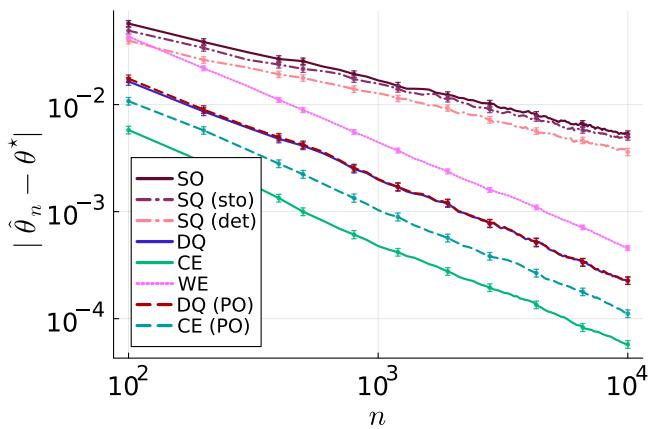

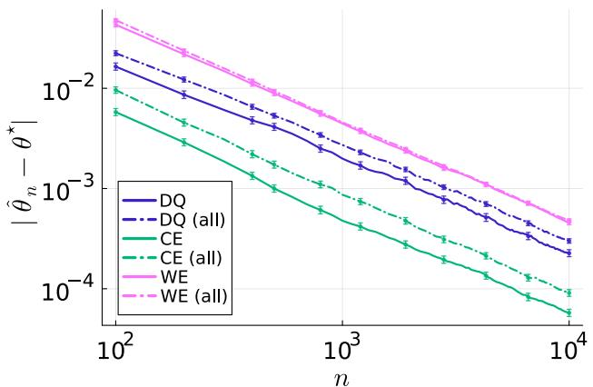

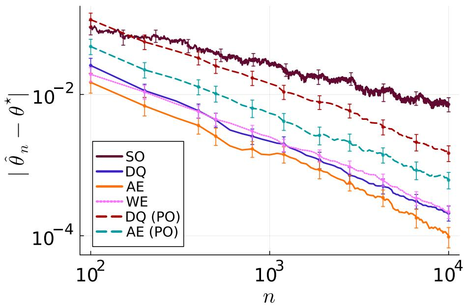  
Figure 3: Estimation errors with $\theta ^ { \star } \sim \mathcal { U } ( [ 1 , 2 ] )$ of (a-b) Lap(θ⋆, 1) $( N _ { \mathrm { r u n s } } = 1 0 ^ { 3 } )$ and (c) $\mathrm { R a y l e i g h } ( \sqrt { \theta ^ { \star } } ) ( N _ { \mathrm { r u n s } } = 1 0 ^ { 2 } )$ . The thresholds $\eta ( \theta ^ { \star } )$ are chosen such that $p _ { \theta ^ { \star } } ( r _ { \theta ^ { \star } } > 0 ) = 1 / 2$ . Error bars are ±2 standard errors.

Experiments. Similarly as Figures 1(a-b), Figures 3(a-b) confirms empirically the difference in estimation rate between M-estimators $( \mathrm { S O } , \mathrm { S Q } _ { \mathrm { s t o } }$ and $\mathrm { S Q } _ { \mathrm { d e t } } )$ —obtaining $\mathcal { O } ( 1 / \sqrt { n } )$ —and our estimators based on quality constraints—achieving $\mathcal { O } ( 1 / n )$ . As expected, $\mathrm { S Q } _ { \mathrm { s t o } }$ and $\mathrm { S Q } _ { \mathrm { d e t } }$ slightly outperform SO, and estimators using ${ \mathcal { C } } _ { n }$ are consistently better than their counterparts using $\mathcal { C } _ { n } ^ { + } \ \mathrm { o r } \ \mathcal { C } _ { n } ^ { \mathrm { a l l } }$

## G.2.2 Rayleigh Distribution

Let $\sigma > 0$ be the scale parameter characterizing a Rayleigh distribution, and $\begin{array} { r } { \theta = \frac { 1 } { \sigma ^ { 2 } } > 0 } \end{array}$ . We have $\Theta \subseteq \mathbb { R } _ { + } , \chi = \mathbb { R } _ { + }$ and $k = d = 1$ . Then, for all $x \in \mathcal { X }$

$$
r _ { \theta } ( x ) = \log p _ { \theta } ( x ) + \eta = - x ^ { 2 } \theta / 2 + \log ( x ) + \log ( \theta ) + \eta .
$$

Estimators. We have $\begin{array} { r } { \widehat { \theta } _ { n } ^ { \mathrm { S O } } = \frac { 2 n } { \sum _ { i \in [ n ] } X _ { i } ^ { 2 } } } \end{array}$ and

$$
\mathcal { C } _ { n } = \{ \theta \mid \forall i \in [ n ] , Z _ { i } ( \eta - X _ { i } ^ { 2 } \theta / 2 + \log ( X _ { i } ) + \log ( \theta ) ) \geq 0 \} .
$$

As for $\mathcal { F } _ { \mathcal { N } , 1 }$ , we define the estimators DQ, AE, WE, DQ (PO), and AE (PO).

Experiments. Similarly as Figures 1(a) and Figure 3(a), Figure 3(c) confirms empirically the difference in estimation rate between SO—obtaining $\mathcal { O } ( 1 / \sqrt { n } )$ —and our estimators based on quality constraints—achieving $\mathcal { O } ( 1 / n )$

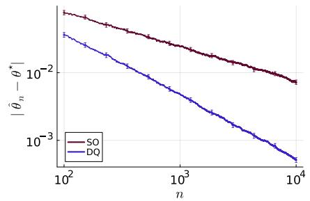

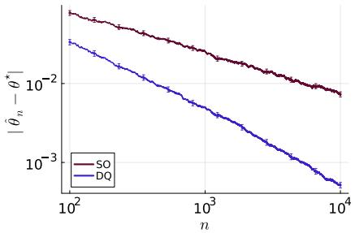

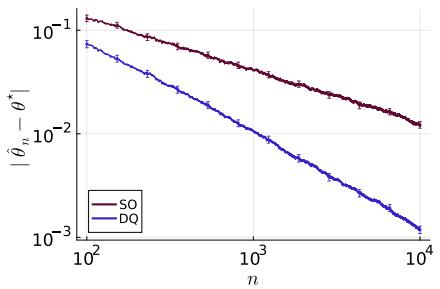  
Figure 4: Estimation errors of ${ ( \mathrm { a } ) \mathrm { E x p } ( \theta ^ { \star } ) }$ with $\theta ^ { \star } \sim \mathcal { U } ( [ 1 , 2 ] )$ , (b) $\mathrm { L a p } ( 0 , \theta ^ { \star } )$ with $\theta ^ { \star } \sim \mathcal { U } ( [ 1 , 2 ] )$ , and (c) $\mathrm { P a r e t o } ( \theta ^ { \star } , 1 )$ with $\theta ^ { \star } \sim \mathcal { U } ( [ 2 , 3 ] ) ~ ( N _ { \mathrm { r u n s } } = 1 0 ^ { 3 } )$ ). The thresholds $\eta ( \theta ^ { \star } )$ are chosen such that $p _ { \theta ^ { \star } } ( r _ { \theta ^ { \star } } > 0 ) = 1 / 2$ . Error bars are ±2 standard errors.

## G.2.3 Exponential Distribution

Estimators. For $\mathcal { F } _ { \mathrm { E x p } }$ , we have $\widehat { \theta } _ { n } ^ { \mathrm { S O } } = n / ( \sum _ { i \in [ n ] } X _ { i } )$ and

$$
\widehat { \theta } _ { n } ^ { \mathrm { D Q } } = \underset { \theta \in \mathcal { C } _ { n } } { \arg \operatorname* { m i n } } \{ \theta / \widehat { \theta } _ { n } ^ { \mathrm { S O } } - \log \theta \} \quad \mathrm { w i t h } \quad \mathcal { C } _ { n } = \left\{ \theta \ | \ \forall i \in [ n ] , \ Z _ { i } ( \eta - \theta X _ { i } + \log \theta ) \geq 0 \right\} .
$$

Experiments. Figure 4(a) confirms empirically the difference in estimation rate between SO and DQ, i.e., $\mathcal { O } ( 1 / \sqrt { n } )$ versus $\mathcal { O } ( 1 / n )$

## G.2.4 Laplace Distribution with Known Center

Let θ denote the positive part of the natural parameter of a centered laplace distribution, i.e., $\theta = 1 / \sigma$ . We have $\Theta = \mathbb { R } _ { + } ^ { \star }$ ， $\mathcal { X } = \mathbb { R }$ and $k = d = 1$ . Then, for all $x \in \mathcal { X }$

$$
r _ { \theta } ( x ) = \log p _ { \theta } ( x ) + \eta = - \theta | x | + \log ( \theta / 2 ) + \eta .
$$

Estimators. We have $\begin{array} { r } { \widehat { \theta } _ { n } ^ { \mathrm { S O } } = n / ( \sum _ { i \in [ n ] } | X _ { i } | ) } \end{array}$ and

$$
\widehat { \theta } _ { n } ^ { \mathrm { D Q } } = \underset { \theta \in \mathcal { C } _ { n } } { \arg \operatorname* { m i n } } \{ \theta / \widehat { \theta } _ { n } ^ { \mathrm { S O } } - \log \theta \} \quad \mathrm { w i t h } \quad \mathcal { C } _ { n } = \left\{ \theta \mid \forall i \in [ n ] , Z _ { i } ( \eta - \theta | X _ { i } | + \log ( \theta / 2 ) ) \geq 0 \right\} .
$$

Experiments. Figure 4(b) confirms empirically the difference in estimation rate between SO and DQ, i.e., $\mathcal { O } ( 1 / \sqrt { n } )$ versus $\mathcal { O } ( 1 / n )$

## G.2.5 Pareto Distribution with Known Minimum

Let $\theta > 1$ be the shape parameter of a Pareto distribution with known minimum $x _ { m } : = 1$ . We have $\Theta = \left( 1 , + \infty \right)$ $\mathcal { X } = [ 1 , + \infty )$ and $k = d = 1$ . Then, for all $x \in \mathcal { X }$

$$
r _ { \theta } ( x ) = \log p _ { \theta } ( x ) + \eta = - ( \theta + 1 ) \log ( x ) + \log \theta + \eta .
$$

Estimators. We have $\begin{array} { r } { \widehat { \theta } _ { n } ^ { \mathrm { S O } } = n / ( \sum _ { i \in [ n ] } \log X _ { i } ) } \end{array}$ and

$$
\begin{array} { r } { \widehat { \theta } _ { n } ^ { \mathrm { D Q } } = \underset { \theta \in \mathcal { C } _ { n } } { \operatorname { a r g m i n } } \{ \theta / \widehat { \theta } _ { n } ^ { \mathrm { S O } } - \log \theta \} \quad \mathrm { w i t h } \quad \mathcal { C } _ { n } = \left\{ \theta \mid \forall i \in [ n ] , \ Z _ { i } ( \eta - ( \theta + 1 ) \log ( X _ { i } ) + \log \theta ) \geq 0 \right\} . } \end{array}
$$

Experiments. Figure 4(c) confirms empirically the difference in estimation rate between SO and DQ, i.e., $\mathcal { O } ( 1 / \sqrt { n } )$ versus $\mathcal { O } ( 1 / n )$

## G.3 Other Estimators and Thresholds for Gaussian Distributions

Other Estimators for Univariate Gaussian. To better understand the performance of CE, we consider other estimators. The randomized uniform (RU) estimator returns $\widehat { \theta } _ { n } ^ { \mathrm { R U } } \sim \mathcal { U } ( [ L _ { n } , U _ { n } ] )$ since $\mathcal { C } _ { n } ~ = ~ [ L _ { n } , U _ { n } ]$ . The truncated Gaussian estimator (TrG) returns a realization from a Gaussian distribution with mean $\widehat { \theta } _ { n } ^ { \mathrm { C E } }$ and variance $4 / n$ , which is truncated to ${ \mathcal { C } } _ { n }$

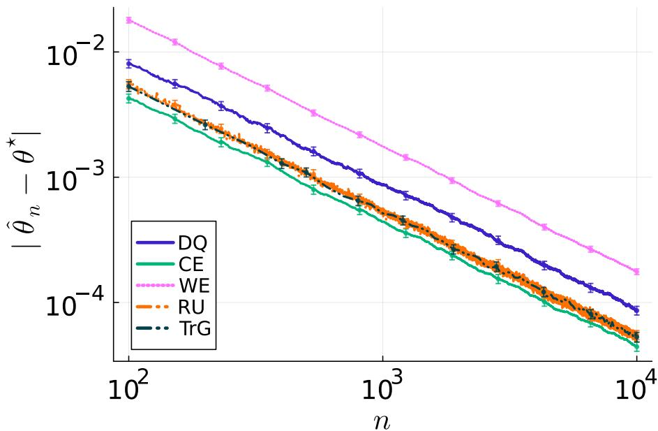  
Figure 5: Estimation errors of $\mathcal { N } ( \theta ^ { \star } , 1 )$ with $\theta ^ { \star } \sim \mathcal { U } ( [ 1 , 2 ] ) ( N _ { \mathrm { r u n s } } = 1 0 ^ { 3 } )$ for $\eta ( 1 / 2 ) \approx$ 1.15 so that $c _ { \eta ( 1 / 2 ) } ^ { 2 } : = F _ { \chi ^ { 2 } ( 1 ) } ^ { - 1 } ( 1 / 2 )$ Error bars are ±2 standard errors.

Figure 5 reveals that TrG performs on par with RU, yet CE slightly outperform both TrG and RU. This suggests that being far away from the boundary of $\mathcal { C } _ { n }$ improves performance compared to DQ that lies on the boundary of ${ \mathcal { C } } _ { n }$ (as observed empirically). Moreover, randomization on ${ \mathcal { C } } _ { n }$ worsens performance compared to CE. Using the derivation in the introduction on univariate Gaussian, it is coherent that CE improves on DQ by a multiplicative constant: the average of those two (non-independent) random variables decreases faster.

Other Thresholds for Multivariate Gaussian. To better understand the impact of class imbalance for larger $d ,$ we consider alternative threshold choices to η(d) such that $c _ { \eta ( d ) } ^ { 2 } : = F _ { \chi ^ { 2 } ( d ) } ^ { - 1 } ( 1 / 2 )$ used in Figure 2. A direct adaptation of the experiments in Figure 1(c) will be to consider fixed quantiles, i.e., $\eta ( d , q )$ such that $c _ { \eta ( d , q ) } ^ { 2 } : = F _ { \chi ^ { 2 } ( d ) } ^ { - 1 } ( q )$ . Instead, we choose to effect of the attrition of each class with increasing d. For vanishing good samples, we consider $\eta ( d ) =$ $\scriptstyle { \frac { 1 } { 2 } } ( 1 + d \log ( 2 \pi ) )$ ) since $\mathbb { P } _ { \ N ( \theta ^ { \star } , I _ { d } ) } ( r _ { \theta ^ { \star } } > 0 ) \to _ { d \to + \infty } 0$ . For vanishing bad samples, we consider $\begin{array} { r } { \eta ( d ) = d \left( \frac { 6 } { 5 } + \frac { 1 } { 2 } \log ( 2 \pi ) \right) } \end{array}$ since $\mathbb { P } _ { \ N ( \theta ^ { \star } , I _ { d } ) } ( r _ { \theta ^ { \star } } > 0 ) \to _ { d  + \infty } 1$

Overall, Figure 6 confirms the findings of Figures 2 and 1(c). For different choices of thresholds, fixed sample size or increasing dimension, DQ is the only estimator obtaining the best-of-both-worlds estimation error rate. Moreover, our findings remain robust under class imbalance, except when the imbalance becomes too stringent, in which case performance degrades.

## G.4 Estimators based on Convex Surrogate of the 0–1 Loss

While DQ MLE minimizes an objective based on the 0-1 loss, SQ MLE minimizes an objective involving the logistic loss $f _ { \mathrm { L o g } } ( x ) : = \log ( 1 + \exp ( - x ) )$ . As in Tang et al. (2024), we can generalize this approach to other surrogate losses for the 0-1 loss, including both convex losses and the non-convex Savage loss; see Figure 7(b). Specifically, we consider the Hinge loss $( \mathrm { H i n } ) , \mathrm { i . e . , } f _ { \mathrm { H i n } } ( x ) : = \operatorname* { m a x } \{ 0 , 1 - x \}$ , the square loss (Squ), i.e. $, f _ { \mathrm { S q u } } ( x ) : = ( 1 - x ) ^ { 2 }$ , the truncated square loss (TrS), $\mathrm { i . e . , } f _ { \mathrm { T r S } } ( x ) : = \operatorname* { m a x } \{ 0 , 1 - x \} ^ { 2 }$ , the Savage loss (Sav), i.e., $f _ { \mathrm { S a v } } ( x ) : = ( \dot { 1 } + \exp ( x ) ) ^ { - 2 }$ , and the exponential loss (Exp), i.e., $f _ { \mathrm { E x p } } ( x ) : = \exp ( - x )$

Given $( X _ { i } , Z _ { i } ) _ { i \in [ n ] } \sim q _ { \theta ^ { \star } } ^ { \otimes [ n ] }$ and a loss $f ,$ , we consider the f-estimator

$$
{ \widehat \theta } _ { n } ^ { f } \in \mathop { \arg \operatorname* { m i n } } _ { \theta \in \Theta } \{ L _ { n } ^ { \mathrm { S O } } ( \theta ) + \sum _ { i \in [ n ] } f ( Z _ { i } r _ { \theta } ( X _ { i } ) ) \} .\tag{20}
$$

All those estimators are computed with the Ipopt solver. Figure 7(a) shows that all estimators perform on par with SQ MLE, i.e., the one based on the logistic loss.

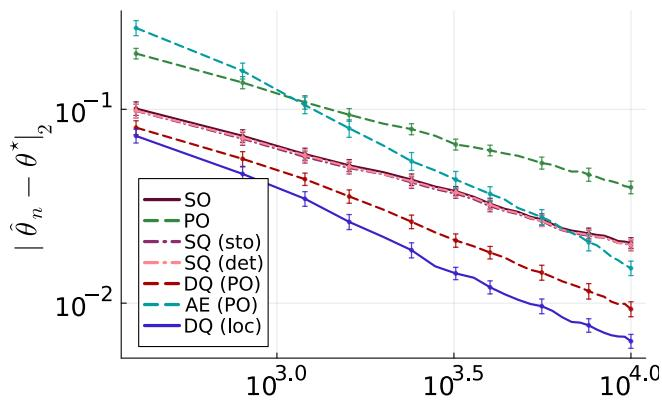

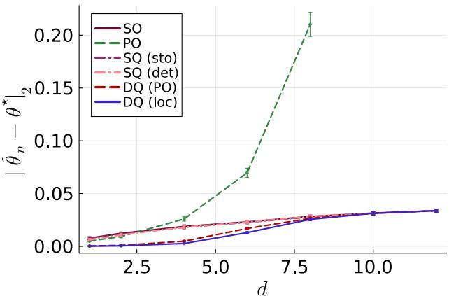

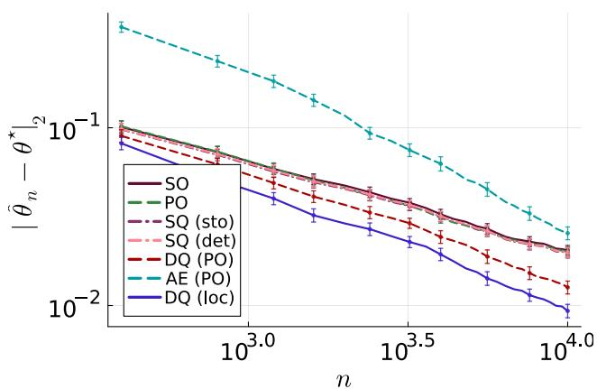

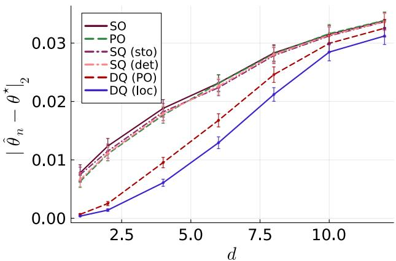  
Figure 6: Estimation errors of $\mathcal { N } ( \theta ^ { \star } , I _ { d } )$ with $\theta ^ { \star } \sim \mathcal { U } ( [ 1 , 2 ] ^ { d } ) ( N _ { \mathrm { r u n s } } = 1 0 ^ { 2 } )$ for (top) $\begin{array} { r } { \eta ( d ) = \frac { 1 } { 2 } ( 1 + d \log ( 2 \pi ) ) } \end{array}$ at (a) $d = 5$ and (b) $n = 1 0 ^ { 4 }$ and (bottom) $\begin{array} { r } { \eta ( d ) = d \left( \frac { 6 } { 5 } + \frac { 1 } { 2 } \log ( 2 \pi ) \right) } \end{array}$ at (c) $d = 5$ and (d) $n = 1 0 ^ { 4 }$ . Error bars are ±2 standard errors.

## G.5 Impact of Normalization and Regularization

The estimator defined in Eq. (20) can be further generalized by introducing a regularization parameter $\lambda \geq 0$ and a normalization parameter $\beta > 0$ . Given $( X _ { i } , Z _ { i } ) _ { i \in [ n ] } \sim q _ { \theta ^ { \star } } ^ { \otimes [ n ] }$ , a loss f and regularization/normalization $( \lambda , \beta )$ , we consider the $( f , \lambda , \beta )$ -estimator

$$
\widehat { \theta } _ { n } ^ { f , \lambda , \beta } \in \mathop { \mathrm { a r g } } _ { \theta \in \Theta } \operatorname * { m i n } \{ L _ { n } ^ { \mathrm { S O } } ( \theta ) + \lambda \sum _ { i \in [ n ] } f ( \beta Z _ { i } r _ { \theta } ( X _ { i } ) ) \} .
$$

While similar modifications could be made for other losses, we focus on the logistic loss $f _ { \mathrm { L o g } } ( x ) : = \log ( 1 + \exp ( - x ) )$ ). In particular, we recover SQ MLE by taking $\lambda = \beta = 1$ . Figures 8(a) and (b) showcase the “mild” impact of normalization and regularization.

## G.6 Quality-based M-estimator

Asymptotic Behavior of $\mathrm { S Q } _ { \mathrm { s t o } }$ and $\mathrm { S Q } _ { \mathrm { d e t } }$ . Table 1 provides numerical simulation to confirm that $\theta ^ { \star }$ maximize $M _ { \mathrm { s t o } } .$ , but not necessarily $M _ { \mathrm { d e t } }$ . For $r _ { \theta } = \log p _ { \theta } + \eta$ , only $\mathcal { F } _ { \mathcal { N } , \Sigma }$ and $\mathcal { F } _ { \mathrm { L a p } , b }$ ensure that $\nabla M _ { \mathrm { d e t } } ( \theta ^ { \star } ) = 0$ . Therefore, $\mathrm { S Q } _ { \mathrm { s t o } }$ and $\mathrm { S Q } _ { \mathrm { d e t } }$ are consistent estimators of $\theta ^ { \star }$ , and we report their asymptotic variance as $V _ { \theta ^ { \star } ,  { \mathrm { s t o } } }$ and $V _ { \theta ^ { \star } , \mathrm { d e t } }$ . For all the other classes of distributions, $\mathrm { S Q } _ { \mathrm { s t o } }$ is consistent but not $\mathrm { S Q } _ { \mathrm { d e t } }$ , hence its asymptotic variance is not reported.

Asymptotic Variance of $\mathrm { S Q } _ { \mathrm { s t o } }$ and $\mathrm { S Q } _ { \mathrm { d e t } }$ for Multivariate Gaussian. We study the impact of the threshold on the asymptotic covariance of $\mathrm { S Q } _ { \mathrm { s t o } }$ and $\mathrm { S Q } _ { \mathrm { d e t } }$ for multivariate Gaussian as a function of d. Figure 9 shows that they quickly converge towards the asymptotic variance of $\mathrm { S O } \left( \mathrm { i . e . , } I _ { d } \right)$ when the class imbalance becomes severe, namely for $\eta _ { 1 }$ and $\eta _ { 2 }$ When the two classes are balanced $( \mathrm { i . e . , } \eta _ { 3 } ) , \mathrm { S Q _ { s t o } }$ and $\mathrm { S Q } _ { \mathrm { d e t } }$ have consistently lower asymptotic variance than SO, and $\mathrm { S Q } _ { \mathrm { d e t } }$ outperforms $\mathrm { S Q } _ { \mathrm { s t o } }$

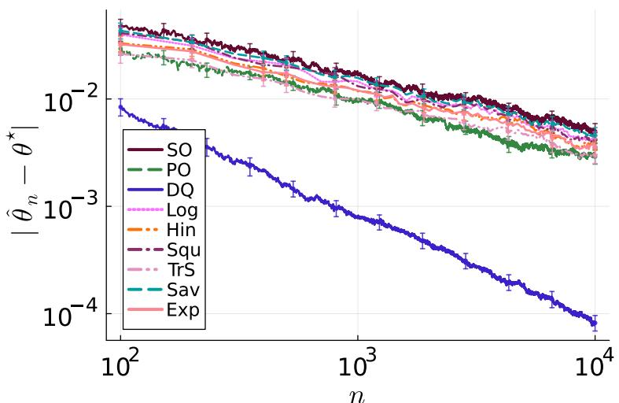

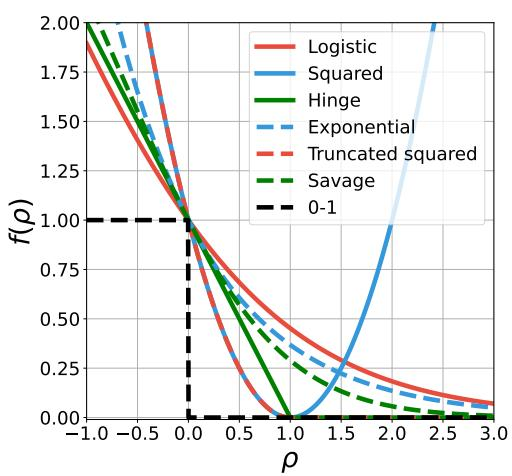

Figure 7: (a) Estimation errors of $\mathcal { N } ( \theta ^ { \star } , 1 )$ with $\theta ^ { \star } \sim \mathcal { U } ( [ 1 , 2 ] )$ $( N _ { \mathrm { r u n s } } ~ = ~ 2 0 0 )$ for $\eta ( 1 / 2 )$ ≈ 1.15 so that $c _ { \eta ( 1 / 2 ) } ^ { 2 } : =$ $F _ { \chi ^ { 2 } ( 1 ) } ^ { - 1 } ( 1 / 2 )$ . Error bars are ±2 standard errors. (b) Notable examples of binary classification loss functions (Tang et al., 2024, Figure 2).  
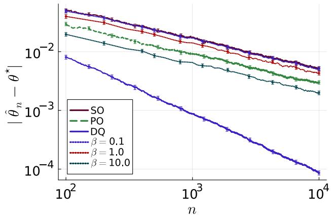

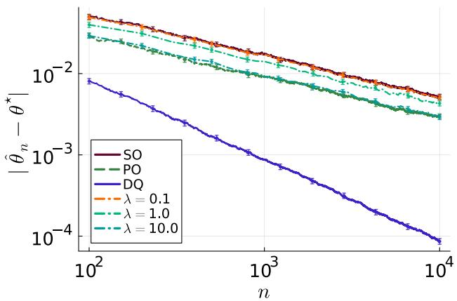

Figure 8: Estimation errors of $\mathcal { N } ( \theta ^ { \star } , 1 )$ with $\theta ^ { \star } \sim \mathcal { U } ( [ 1 , 2 ] )$ when (a) normalizing by $\beta$ for $\lambda = 1$ and (b) regularizing by λ for $\beta = 1 ( N _ { \mathrm { r u n s } } = 1 0 ^ { 3 } )$ for $\eta ( 1 / 2 )$ ≈ 1.15 so that $c _ { \eta ( 1 / 2 ) } ^ { 2 ^ { - } } : = F _ { \chi ^ { 2 } ( 1 ) } ^ { - 1 } ( 1 / 2 )$ . Error bars are ±2 standard errors.
<table><tr><td colspan="3"></td><td colspan="2"> $\mathrm { S Q } _ { \mathrm { s t o } }$ </td><td colspan="2"> $\mathrm { S Q } _ { \mathrm { d e t } }$ </td></tr><tr><td>Distribution</td><td>Known</td><td>η</td><td> $\nabla _ { \theta } M _ { \mathrm { s t o } } ( \theta ^ { \star } )$ </td><td> $V _ { \theta ^ { \star } ,  { \mathrm { s t o } } }$ </td><td> $\nabla _ { \theta } M _ { \mathrm { d e t } } ( \theta ^ { \star } )$ </td><td> $V _ { \theta ^ { \star } , \mathrm { d e t } }$ </td></tr><tr><td rowspan="3"> $\overline { { \mathcal { N } ( 0 , 1 ) } }$ </td><td>scale</td><td>1.15</td><td> $\overline { { ( 1 \pm 1 4 ) \cdot 1 0 ^ { - 4 } } }$ </td><td>0.85</td><td> $\overline { { ( 1 \pm 6 ) \cdot 1 0 ^ { - 4 } } }$ </td><td>0.46</td></tr><tr><td></td><td>1.42</td><td> $( 7 \pm 1 3 ) \cdot 1 0 ^ { - 4 }$ </td><td>0.84</td><td> $( - 3 \pm 7 ) \cdot 1 0 ^ { - 4 }$ </td><td>0.47</td></tr><tr><td></td><td>2.12</td><td> $( 9 \pm 1 2 ) \cdot 1 0 ^ { - 4 }$ </td><td>0.83</td><td> $( - 5 \pm 7 ) \cdot 1 0 ^ { - 4 }$ </td><td>0.60</td></tr><tr><td rowspan="4"> $\mathrm { L a p } ( 0 , 1 )$ </td><td>scale</td><td>1.39</td><td> $( 7 \pm 1 2 ) \cdot 1 0 ^ { - 4 }$ </td><td>0.82</td><td> $( - 5 \pm 8 ) \cdot 1 0 ^ { - 4 }$ </td><td>0.52</td></tr><tr><td></td><td>1.69</td><td> $( 2 \pm 1 2 ) \cdot 1 0 ^ { - 4 }$ </td><td>0.82</td><td> $( 7 \pm 7 ) \cdot 1 0 ^ { - 4 }$ </td><td>0.62</td></tr><tr><td>center</td><td>1.39</td><td> $( - 3 \pm 6 ) \cdot 1 0 ^ { - 4 }$ </td><td>0.92</td><td> $0 . 1 3 1 \dot { 6 } \pm 3 \cdot 1 0 ^ { - 4 }$ </td><td></td></tr><tr><td></td><td>1.69</td><td> $( - 3 \pm 6 ) \cdot 1 0 ^ { - 4 }$ </td><td>0.92</td><td> $0 . 1 0 9 5 \pm 2 \cdot 1 0 ^ { - 4 }$ </td><td></td></tr><tr><td rowspan="2">Rayleigh(1)</td><td></td><td>0.70</td><td> $( - 4 \pm 8 ) \cdot 1 0 ^ { - 4 }$ </td><td>0.87</td><td> $0 . 1 3 1 0 \pm 5 \cdot 1 0 ^ { - 4 }$ </td><td></td></tr><tr><td></td><td>1</td><td> $( 5 \pm 8 ) \cdot 1 0 ^ { - 4 }$ </td><td>0.86</td><td> $0 . 1 5 7 8 \pm 5 \cdot 1 0 ^ { - 4 }$ </td><td></td></tr><tr><td rowspan="2">Exp(1)</td><td></td><td>0.69</td><td> $( 0 \pm 7 ) \cdot 1 0 ^ { - 4 }$ </td><td>0.90</td><td> $0 . 1 7 7 3 \pm 3 \cdot 1 0 ^ { - 4 }$ </td><td></td></tr><tr><td></td><td>2</td><td> $( - 1 \pm 7 ) \cdot 1 0 ^ { - 4 }$ </td><td>0.89</td><td> $0 . 0 8 3 0 \pm 4 \cdot 1 0 ^ { - 4 }$ </td><td></td></tr><tr><td rowspan="2">Pareto(2, 1)</td><td>minimum</td><td>0.35</td><td> $( 1 \pm 3 ) \cdot 1 0 ^ { - 4 }$ </td><td>0.98</td><td> $0 . 0 6 9 5 \pm 1 \cdot 1 0 ^ { - 4 }$ </td><td></td></tr><tr><td></td><td>2</td><td> $( - 2 \pm 3 ) \cdot 1 0 ^ { - 4 }$ </td><td>0.98</td><td> $0 . 0 3 0 8 \pm 2 \cdot 1 0 ^ { - 4 }$ </td><td></td></tr></table>

Table 1: Numerical estimation of the consistency of $\mathrm { S Q } _ { \mathrm { s t o } }$ and $\mathrm { S Q } _ { \mathrm { d e t } }$ , and asymptotic variance when consistent $( N _ { \mathrm { r u n s } } =$ 106). The Student’s t-confidence intervals are defined at confidence level 95%.

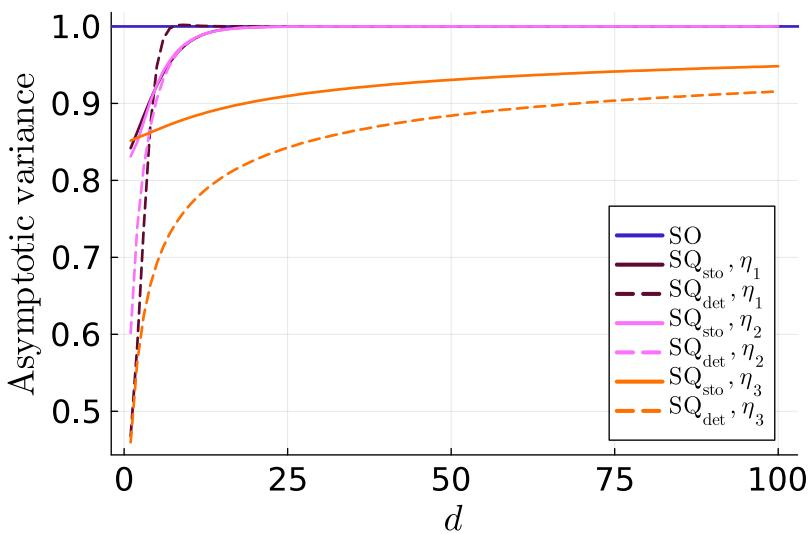  
Figure 9: Numerical estimation of the asymptotic variance $V _ { \theta ^ { \star } , \mathrm { s t o } } = \alpha _ { d } I _ { d }$ for $\mathrm { S Q } _ { \mathrm { s t o } }$ and $V _ { \theta ^ { \star } , \mathrm { d e t } } = \alpha _ { d } I _ { d }$ for $\mathrm { S Q } _ { \mathrm { d e t } }$ with $\mathcal { N } ( 0 _ { d } , I _ { d } ) ( N _ { \mathrm { r u n s } } = 1 0 ^ { 2 } )$ . The thresholds are $\begin{array} { r } { \eta _ { 1 } ( d ) = \frac { 1 } { 2 } ( 1 + d \log ( 2 \pi ) ) , \eta _ { 2 } ( d ) = d \left( \frac { 6 } { 5 } + \frac { 1 } { 2 } \log ( 2 \pi ) \right) } \end{array}$ and $\eta _ { 3 } ( d )$ such that $c _ { \eta _ { 3 } ( d ) } ^ { 2 } = F _ { \chi ^ { 2 } ( d ) } ^ { - 1 } ( 1 / 2 )$