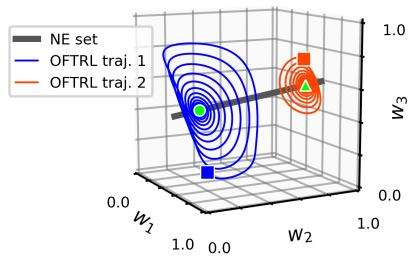
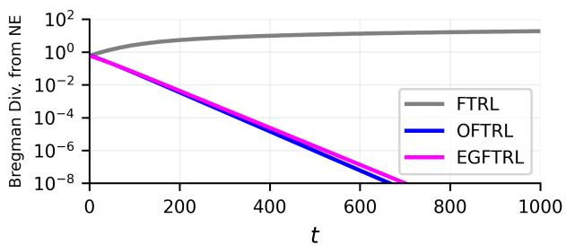
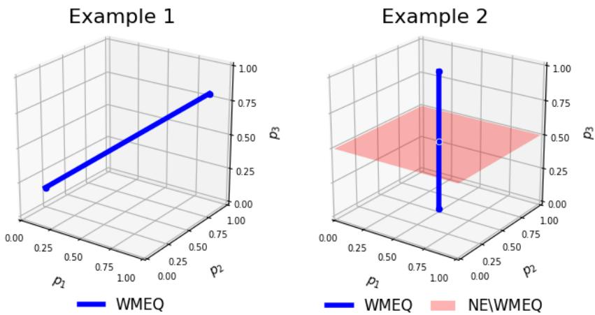

# Linear Last-Iterate Convergence Rates for Optimistic Learning in Harmonic Games

John Lazarsfeld1 Anas Barakat2 Georgios Piliouras4

Jacob Abernethy1,3 Vidya Muthukumar1 Andre Wibisono5 Juba Ziani1

## Abstract

We prove that the last iterate of Optimistic Follow-The-Regularized-Leader (OFTRL) converges at a linear rate to a Nash equilibrium in multiplayer harmonic games. Our result holds under a mild game-regularity condition and for a large family of regularizers, including entropy, Tsallis, and log-barrier. Our analysis is based on a dual perspective of OFTRL: we prove that the interaction between optimism and the global structure of harmonic games leads to the dissipation of an energy function along the dual iterates, for which we establish tight quantitative bounds. Our result also holds for the Extragradient FTRL variant.

## 1 Introduction

The last-iterate behavior of online learning algorithms in strategic multiagent settings has attracted growing attention in the study of learning in games. Unlike regret or time-average results, a last-iterate guarantee concerns the actual strategies played by agents over time, and the distinction is often consequential: while standard no-regret algorithms that are run for T iterations may enjoy quantitative convergence guarantees for time-averaged play, the T-th iterate itself may fail to stabilize and can even be repelled from equilibrium and spiral out towards the boundary of the simplex (see, e.g., Bailey and Piliouras (2018); Daskalakis et al. (2018); Cheung and Piliouras (2019)).

Partly motivated by this gap, the past decade has seen substantial work on the design and analysis of optimistic online learning algorithms (Rakhlin and Sridharan, 2013). Broadly speaking, optimistic methods use recent feedback to predict future losses. Within this line of work, Optimistic Follow-the-Regularized-Leader (OFTRL) is a prominent family of methods which augments the classical FTRL framework with an optimistic prediction and naturally accommodates constrained, non-Euclidean geometries (Shalev-Shwartz, 2012). With entropic regularization, OFTRL recovers the popular Optimistic Multiplicative Weights Update (OMWU) algorithm. In the narrow, yet canonical setting of two-player zero-sum games, the last-iterate behavior of OMWU is now comparatively well understood: asymptotic convergence in the bimatrix case was shown by Daskalakis and Panageas (2019), subsequently strengthened to a linear rate by Wei et al. (2021) and extended to the extensive-form setting by Lee et al. (2021). More recent work has also given a finer geometric characterization of the last-iterate rates in the same bimatrix setting (Lazarsfeld et al., 2026).

Despite this detailed picture in two-player zero-sum games, the last-iterate behavior of OFTRL beyond zero-sum settings, and beyond just OMWU, remains much less understood. This is in contrast to the wealth of regret guarantees for OMWU in two-player zero-sum (Tsuchiya, 2026) and multiplayer general-sum games (Syrgkanis et al., 2015; Daskalakis et al., 2021; Anagnostides et al., 2022; Soleymani et al., 2025). This gap raises a broader question: which structural properties of general multiplayer games enable fast last-iterate convergence of FTRL-type dynamics to equilibrium?

Toward this direction, Legacci et al. (2024a) recently showed that some of the dynamical properties of OFTRL in two-player zero-sum games extend to the broader class of multiplayer harmonic games. These games capture strategic interactions between agents with conflicting interests, and they form one of the fundamental components in the decomposition of normal-form games into their potential and harmonic parts (Candogan et al., 2011; Abdou et al., 2022). While two-player zero-sum games with an interior equilibrium form a subclass, harmonic games need not be constant-sum, may admit non-convex equilibrium sets, and can induce nonlinear, non-monotone game operators. Nevertheless, Legacci et al. (2024a) proved in this broader setting that the last iterate of both OFTRL and the related Extragradient FTRL (EGFTRL) variant converges asymptotically to the game’s Nash equilibrium set. However, establishing convergence rates has remained open. We thus ask:

How fast do optimistic FTRL-type dynamics converge in harmonic games, and what structural mechanisms govern their convergence?

## 1.1 Our Contributions and Techniques

The main contributions of our paper give quantitative answers to the above question.

Last-iterate convergence rate for OFTRL, EGFTRL. We prove that both OFTRL and EGFTRL converge at a linear last-iterate rate to a Nash equilibrium in multiplayer harmonic games (Theorem 4.1). Specifically, when instantiated with a suitable regularizer $Q ,$ and constant stepsize $\eta ,$ the iterates $\left\{ w _ { t } \right\}$ of the algorithms converge to an equilibrium $w ^ { \star }$ and satisfy

$$
\mathrm { T h e o r e m ~ 4 . 1 ~ ( I n f o r m a l ) : ~ } \mathrm { D } _ { \mathcal { Q } } ( w ^ { \star } , w _ { t + 1 } ) \leq 2 \kappa \mathrm { D } _ { \mathcal { Q } } ( w ^ { \star } , w _ { 0 } ) \cdot \exp ( - \gamma \eta ^ { 2 } \cdot t ) \mathrm { f o r ~ a l l ~ } t \geq 0 .
$$

Here, $\mathsf { D } _ { Q }$ is the Bregman divergence induced by $Q ,$ and $\gamma > 0$ and $\kappa > 0$ are instance-dependent constants. Note that convergence rates in $\mathsf { D } _ { Q }$ also imply rates in the Gap function (Remark 4.2). This result establishes the first global, quantitative last-iterate guarantees for FTRL variants in harmonic games. Moreover, in contrast to prior work specific to two-player zero-sum games (Daskalakis and Panageas, 2019; Wei et al.,

  
Figure 1: Variants of FTRL (with entropy regularizer) on the 3-player harmonic game in A.4.1. Left: two trajectories of OFTRL converging to their distinct analytic limits (in green) from Theorem 4.1 (i). Right: Bregman divergence from NE for the t-th iterate of OFTRL, EGFTRL, and FTRL from a fixed initialization. OFTRL and EGFTRL converge linearly (Theorem 4.1(ii)), while FTRL diverges at a geometric rate (Theorem 4.5).

2021; Lazarsfeld et al., 2026), we do not assume existence of a unique Nash equilibrium, and we additionally give an exact characterization of the equilibrium selected by the dynamics as a function of the initialization, strengthening the asymptotic convergence result of Legacci et al. (2024a). Our result holds for a broad class of Legendre regularizers (including negative Shannon entropy, Tsallis entropies of order $q \in ( 0 , 1 )$ , and the log-barrier function), and under a mild non-degeneracy condition on the game. This condition always holds for the linear polymatrix setting, as well as in other non-linear settings.

Dual and variational perspective. Our analysis is based on a dual perspective on OFTRL and EGFTRL. We prove that the convex conjugate of the regularizer plays the role of an energyfunction that dissipates along the dual iterates (Lemma 5.4). This energy dissipation corresponds to a contraction of the Bregman divergence from equilibrium along the primal iterates (Proposition 5.3). Dissipation stems from the action of optimism on the global structure of harmonic games. Structurally, the loss operators of these games (defined in (2)) satisfy a weighted Minty variational inequality (Minty, 1967) that holds globally with equality, a property shown by Legacci et al. (2024a) and restated in Proposition 2.3. In continuous time, due to this global harmonic structure, energy is conserved along the FTRL flow in a scaled coordinate system.

However, in discrete time, we show that an idealized Implicit FTRL (IFTRL) discretization of the FTRL flow dissipates energy. By coupling their iterates with IFTRL, we prove that dissipation persists under both OFTRL and EGFTRL with a sufficiently small constant stepsize. Our dual viewpoint and proof techniques are inspired from the recent work of Lazarsfeld et al. (2026) who studied OMWU in two-player zero-sum games. However, the special skew-symmetric structure of zero-sum game operators is not available in harmonic games, and we develop a different coupling analysis technique with the implicit method. Moreover, our analysis and convergence rates apply to multiplayer games with possibly multiple equilibria, and they hold for both Optimistic and Extragradient FTRL with regularizers beyond negative Shannon entropy.

Quantitative separation for vanilla FTRL. Our techniques additionally establish quantitative guarantees for vanilla (non-optimistic) FTRL in polymatrix harmonic games: here, we prove that the FTRL iterates move away from equilibrium at a geometric rate within any fixed Bregman divergence sublevel set (Theorem 4.5). This extends and makes quantitative the asymptotic result of Bailey and Piliouras (2018) that was proven for two-player zero-sum games. Taken together, our results give a unified quantitative picture of the last-iterate behavior of FTRL-type dynamics under the global harmonic structure. We illustrate our results further in Figure 1.

## 1.2 Related Work

Compared to the FTRL family, the last-iterate behavior of optimistic and extragradient gradient-descent-ascent methods is better understood (see, e.g., Mokhtari et al. (2020); Golowich et al. (2020a); Cai et al. (2022a); Gorbunov et al. (2022b)). In constrained settings, however, these Euclidean schemes are generally distinct from FTRL dynamics (see, e.g., Cai et al. (2024)). For FTRL and their closely related variants, the iterate-based guarantees most relevant to our setting are either asymptotic (Mertikopoulos et al., 2019; Hsieh et al., 2021), concern only the best iterate (Anagnostides et al., 2022), or provide local convergence rates (Lei et al., 2021; Azizian et al., 2024). We discuss several of these lines of related work in more detail below.

Optimistic and extragradient methods. Optimistic and extragradient methods1 have a long history in optimization (Korpelevich, 1976; Popov, 1980; Nemirovski, 2004; Nesterov, 2007). Our proof strategy of coupling OFTRL and Extragradient FTRL with IFTRL is reminiscent of the unified analysis proposed in Mokhtari et al. (2020). Showing that both OGDA and the extragradient method can be interpreted as approximate variants of the proximal point method, Mokhtari et al. (2020) prove linear last-iterate convergence rates for both optimistic and extragradient methods. In contrast to their unconstrained convexconcave min-max problem, our setting is constrained. The interpretation of the extragradient method as an approximation of the Proximal Point method was first discussed and developed in Nemirovski (2004).

Last-iterate convergence in monotone variational inequalities and beyond. Last iterate convergence results for optimistic gradient and extragradient methods were proved in Golowich et al. (2020a,b) and later tightened under more relaxed conditions (Gorbunov et al., 2022a,b; Cai et al., 2022b). A line of works also established convergence guarantees beyond monotone variational inequalities (see, e.g., Gorbunov et al. (2023); Pethick et al. (2025) and the references therein).

Other works on optimistic online learning methods. Optimistic variants of online learning algorithms have also been studied for their connections to accelerated methods in optimization (Wang and Abernethy, 2018; Wang et al., 2024). Recent work has also analyzed the optimistic FTRL methods in symmetric cone games (Barakat et al., 2026).

Dual and energy-based perspectives on learning in games. There has been a growing body of work in the past decade that studies learning dynamics in games using dual and physics-inspired perspectives, in particular for FTRL-type dynamics; see, e.g., Mertikopoulos et al. (2018), Bailey and Piliouras (2018), Bailey and Piliouras (2019a), Bailey and Piliouras (2019b), Wibisono et al. (2022), Azizian et al. (2024), Lazarsfeld et al. (2025a,b), Katona et al. (2026), Bailey (2026), and the references therein.

Learning in harmonic games. We refer the reader to Legacci et al. (2024b) for a discussion on the dynamics of harmonic games within a dynamics-driven decomposition of games, where it is further shown that the continuous-time exponential weight dynamics are Poincaré recurrent in harmonic games. Besides Legacci et al. (2024a), several recent works have developed convergence results in harmonic games. Under a weighted Minty condition extending the standard Minty condition in variational inequalities, Zhang et al. (2025) provide best-iterate guarantees for parameter-free variants of predictive regret matching. In particular, this result applies to harmonic games which satisfy the aforementioned weighted Minty condition. Taking a computational perspective, Anagnostides et al. (2025) provide a polynomial-time algorithm for computing approximate Nash equilibria in harmonic games.

Last-iterate convergence results for FTRL-type dynamics. There has been a series of last-iterate results obtained for optimistic and extragradient FTRL variants in several continuous settings, but only with asymptotic guarantees; see, e.g., Mertikopoulos et al. (2019), Lei et al. (2021), Hsieh et al. (2021), Fasoulakis et al. (2022). Recent works of Cai et al. (2024, 2026) have also established a quantitative separation in the last-iterate, best-iterate, and random-iterate guarantees of OFTRL dynamics in two-player zero-sum games. Recently, Fasoulakis et al. (2026) also obtained a linear last-iterate convergence rate in two-player zero-sum games for a certain extragradient variant of MWU. Wang et al. (2026) proved last-iterate guarantees for the vanilla variant of MWU in two-player, two-action symmetric games, which comes in contrast to the divergence result for vanilla FTRL that we prove for harmonic games.

Further results on last-iterate convergence in min-max optimization. Recently, beyond existing results in two-player zero-sum games, Orabona (2026) proved asymptotic last-iterate convergence of OMWU with a small enough constant stepsize in convex-concave saddle point problems. We refer the reader to Section 2 in Orabona (2026) for a more detailed discussion of related work on existing last-iterate convergence results. Beyond static two-player zero-sum games, Wu et al. (2025) consider finite-horizon zero-sum linear quadratic dynamical games and establish a linear last-iterate convergence rate in terms of the objective function-value gap for a nested natural policy gradient algorithm. Their proof technique relies on using a gradient domination inequality proved for the primal function. We note that their algorithm is nested and the two players need to take turns whereas we consider a multiplayer setting where players make decisions simultaneously.

## 2 Preliminaries and Setting

Notation. For any integer $k \geq 1$ , let $[ k ] = \{ 1 , \dots , k \}$ . Let $\Delta _ { k } \subset \mathbb { R } ^ { k }$ denote the probability simplex, and let $\mathrm { { r i } } ( \Delta _ { k } ) = \{ q \in \Delta _ { k } : q ( j ) > 0 , \forall j \in [ k ] \}$ denote its relative interior. We say that q is interior when $q \in \dot { \bf \Xi } \dot { \bf \Xi } ( \Delta _ { k } )$ Let $\mathbf { 1 } _ { k } \in \mathbb { R } ^ { k }$ and $\bar { I _ { k } } \in \mathbb { R } ^ { k \times k }$ denote the k-dimensional all-ones vector and identity matrix, respectively. Let $\langle \cdot , \cdot \rangle$ be the standard $\ell _ { 2 }$ inner product and $\| v \| _ { 2 } = \sqrt { \langle v , v \rangle }$ . If M is positive semi-definite, we write $M \succeq 0$ . For a linear subspace $\mathcal { U } \subseteq \mathbb { R } ^ { k }$ , let $\Pi _ { \mathcal { U } } : \mathbb { R } ^ { k }  \mathcal { U }$ denote the orthogonal projection onto U. For $g : \mathcal { U } \to \mathcal { U }$ and $u \in \mathcal { U } .$ , let $J _ { g } ( u ) : \mathcal { U } \to$ U denote the Jacobian of g at u when it exists. For a convex set ${ \mathcal { C } } \subseteq \mathbb { R } ^ { k }$ and a differentiable convex $f : { \mathcal { C } } \to \mathbb { R }$ , the Bregman divergence $\mathsf { D } _ { f } : \mathcal { C } \times \mathrm { r i } ( \mathcal { C } ) \to \mathbb { R }$ is given by $\mathsf { D } _ { f } ( y ^ { \prime } , y ) = f ( y ^ { \prime } ) - f ( y ) - \langle \nabla f ( y ) , y ^ { \prime } - y \rangle$

## 2.1 Multiplayer Normal-Form Games

Finite normal-form games consist of $N \geq 2$ players. Each player $i \in [ N ]$ has a set $\mathcal { A } _ { i } : = \{ \alpha _ { j } \} _ { j \in [ d _ { i } ] }$ of $d _ { i }$ actions, and under a joint action profile $\begin{array} { r } { a = ( a _ { 1 } , \dotsc , a _ { N } ) \in \mathcal { A } : = \prod _ { i \in [ N ] } \mathcal { A } _ { i } , } \end{array}$ , player i incurs a loss $\ell _ { i } ( a )$ , where $\ell _ { i } : \mathcal { A }  \mathbb { R }$ is the ${ \mathrm { p l a y e r } } ^ { \prime } { \mathrm { s } }$ loss function. Each player i can choose a mixed strategy $w _ { i } \in \mathcal { W } _ { i } : = \Delta _ { d _ { i } }$ over $\mathbf { } A _ { i }$ . Using the joint space $\textstyle { \mathcal { W } } : = \prod _ { i \in [ N ] } { \mathcal { W } } _ { i } ,$ , we overload notation and let $\ell _ { i } : \mathcal { W } \overset { \cdot } {  } \mathbb { I }$ R denote player $i \prime \mathrm { s }$ expected loss defined as $\ell _ { i } ( w ) = \mathbf { E } _ { a \sim w } [ \ell _ { i } ( a ) ]$ ] for any joint strategy profile $w = ( w _ { 1 } , \dots , w _ { N } ) \in \mathcal { W }$ . We set $D \dot { : } = d _ { 1 } + \cdot \cdot \cdot + d _ { N }$ and use the standard notation $\begin{array} { r } { \dot { \mathcal { A } } _ { - i } : = \prod _ { j \neq i \in [ N ] } \bar { \mathcal { A } } _ { j } } \end{array}$ and W $\begin{array} { r } { \mathbf { \Phi } _ { - i } : = \prod _ { j \neq i \in [ N ] } \Delta _ { d _ { j } } } \end{array}$

Nash equilibrium. Our primary solution concept will be the celebrated Nash equilibrium: For $\epsilon \geq 0$ $w ^ { \star } \in \mathcal { W }$ is an ϵ-approximate Nash equilibrium (ϵ-NE) if $\begin{array} { r } { \operatorname* { m a x } _ { i \in [ N ] } \operatorname* { m a x } _ { w _ { i } \in \mathcal { W } _ { i } } \{ \ell _ { i } ( w ^ { \star } ) - \ell _ { i } ( w _ { i } , w _ { - i } ^ { \star } ) \} \le \epsilon } \end{array}$ . Due to Nash (1951), every finite normal-form game has at least one $( \dot { \epsilon } = 0 ) \dot { \mathrm { N E } }$

## 2.2 Harmonic Games

We focus on the class of multiplayer harmonic games defined as follows.

Definition 2.1 (Harmonic game). A finite normal-form game is harmonic if for each player $i \in [ N ]$ , there exists a positive measure $\mu _ { i } = ( \mu _ { i } ( 1 ) , \ldots , \mu _ { i } ( d _ { i } ) ) \in ( 0 , \infty ) ^ { d _ { i } }$ such that

$$
\begin{array} { r } { \sum _ { i \in [ N ] } \sum _ { j \in [ d _ { i } ] } \mu _ { i } ( j ) \cdot \big ( \ell _ { i } ( a ) - \ell _ { i } ( \alpha _ { j } , a _ { - i } ) \big ) = 0 \ f o r \ a l l \ a = ( a _ { i } , a _ { - i } ) \in \mathcal { A } \ . } \end{array}\tag{1}
$$

Definition 2.1 is the weighted definition of harmonic games (introduced by Abdou et al. (2022) and considered in Legacci et al. (2024a)), extending the unweighted definition of Candogan et al. (2011). Intuitively, (1) imposes a global balance condition: at every action profile, the µi-weighted sum of the loss differences induced by all unilateral deviations is zero.

Remark 2.2 (Examples). Harmonic games (Definition 2.1) are in general multiplayer, non-constant-sum, and can have non-convex sets of Nash equilibria. We provide such families of examples in Section A.4. An important subclass is two-player zero-sum games with at least one interior NE (but not every zero-sum game is harmonic); See Proposition $_ { \mathrm { A . 7 } }$

## 2.3 Variational Characterization of Harmonic Games

Our analysis will rely on the variational formulation of finite games through their associated game operator (Facchinei and Pang, 2003). In this language, the harmonicity condition of Definition 2.1 admits an equivalent characterization that will be central to the analysis that follows. We introduce the relevant variational notation and discuss this characterization below.

Joint loss operator. For a finite normal-form game, we define its joint loss operator $G : \mathcal { W } \to \mathbb { R } ^ { D }$ . For any $w \in \mathcal W$ , the i-th block-coordinate $G _ { i } ( w )$ of $G ( w )$ is given by $g _ { i } : \mathcal { W } _ { - i } \overset { - } { \to } \mathbb { R } ^ { d _ { i } }$ , where $g _ { i } ( w _ { - i } ) ~ =$ $\bigl ( \bar { \mathbf { E } _ { a _ { - i } \sim w _ { - i } } } [ \ell _ { i } ( \alpha _ { j } , a _ { - i } ) ] \bigr ) _ { j \in [ d _ { i } ] } \ \in \ \mathbb { R } ^ { d _ { i } }$ . In particular, as $\ell _ { i } ( w ) = \langle w _ { i } , g _ { i } ( w _ { - i } ) \rangle$ ⟩, observe that each $g _ { i } ( w _ { - i } ) =$ $\nabla _ { w _ { i } } \ell _ { i } ( w )$ is exactly the gradient of the i-th player’s loss with respect to their own action. The map G is then the concatenation of these individual loss gradients, i.e.

$$
G ( w ) : = ( \nabla _ { w _ { 1 } } \ell _ { 1 } ( w ) , \ldots , \nabla _ { w _ { N } } \ell _ { N } ( w ) ) \in \mathbb { R } ^ { D } \mathrm { ~ f o r ~ a l l ~ } w \in \mathcal { W } .\tag{2}
$$

We associate each game with its operator $G$ and make standard regularity assumptions. For all $i \in [ N ]$ , let each $\mathcal { W } _ { i }$ be equipped with norm $\mathbf { \hat { \Vert } } \cdot \mathbf { \Vert } _ { i }$ and dual norm $\| \cdot \| _ { i , * }$ . Then we define the global product norms $\| w \| = ( \sum _ { i = 1 } ^ { N } \mathsf { \bar { \| } } w _ { i } \| _ { i } ^ { 2 } ) ^ { 1 / 2 }$ for $w \in \mathcal { W }$ and $\begin{array} { r } { \| z \| _ { * } = ( \sum _ { i = 1 } ^ { N } \| z _ { i } \| _ { i , * } ^ { 2 } ) ^ { 1 / 2 } } \end{array}$ for $z \in \mathbb { R } ^ { D }$ . We then assume that G is L-Lipschitz and B-bounded with respect to these norms.

Assumption 1 (Lipschitz and bounded operator). There exist constants $L \ge 1$ and $B \geq 1$ such that (i) $\| G ( w ^ { \prime } ) ^ { \bullet } - G ( w ) \| _ { * } \ \overset { \bullet } { \leq } L \| w ^ { \prime } - w \|$ and (ii) $\| \hat { G } ( w ) \| _ { * } \leq B$ for all $w , w ^ { \prime } \in \mathcal { W }$

Assumption 1 is always satisfied when the losses $\ell _ { i }$ are smooth, with the global constants L and B inherited from the corresponding regularity bounds on the losses.

Variational characterization of NE. The operator G also provides a standard variational characterization of Nash equilibrium: $w ^ { \star } \in \mathcal { W }$ is a Nash equilibrium (for $\epsilon = 0 )$ if and only if

$$
\langle G ( w ^ { \star } ) , w - w ^ { \star } \rangle \geq 0 \mathrm { f o r } \mathrm { a l l } w \in { \mathcal W } .\tag{3}
$$

We will thus denote by $\mathrm { N E } ( G ) \subseteq { \mathcal { W } }$ the set of all $w ^ { \star }$ satisfying (3). Moreover, for any point $w \in { \mathcal { W } } _ { \cdot }$ , we can measure its distance to a Nash equilibrium via the gap function: for any $w \in { \mathcal { W } } _ { \cdot }$ , let

$$
\mathsf { G a p } ( w ) : = \operatorname* { m a x } _ { \widetilde { w } \in \mathcal { W } } \left. G ( w ) , w - \widetilde { w } \right. .\tag{4}
$$

If ${ \mathsf { G a p } } ( w ^ { \prime } ) \leq \epsilon ,$ then $w ^ { \prime }$ is an $\epsilon { \mathrm { - N E } }$

Variational characterization of harmonic games. As shown by Legacci et al. (2024a), harmonic games from Definition 2.1 also admit the following variational characterization in terms of G:

Proposition 2.3 (Legacci et al. (2024a), Proposition A.4). A game with loss operator $G : \mathcal { W } \to \mathbb { R } ^ { D }$ is harmonic if and only if there exist (i) a matrix $M = { \mathrm { D i a g } } ( m _ { 1 } I _ { d _ { 1 } } , \dots , m _ { N } I _ { d _ { N } } )$ where $m _ { i } > 0 f o r$ all $i \in [ N ]$ and (ii) an interior point $\bar { w ^ { \prime } } \doteq \mathtt { r i } ( \mathcal { W } )$ such that:

$$
\langle M G ( w ) , w - w ^ { \prime } \rangle = 0 \ f o r \ a l l \ w \in \{ \mathcal { W } .\tag{5}
$$

Intuitively, (5) says that, relative to a center $w ^ { \prime } ,$ the M-weighted operator is orthogonal to all displacements $w - w ^ { \prime } ,$ expressing in variational terms the weighted cancellation of unilateral deviations in (1). We give more background in Section ${ \mathrm { A . 2 } } ,$ , and we highlight here several additional points:

• Equilibrium condition: Any $w ^ { \prime } \in \mathcal { W }$ satisfying the proposition is an NE (see Lemma A.5), and thus (5) is simultaneously a structural property of $\dot { G }$ as well as an equilibrium condition.

• Weight matrix: We call M from the proposition a weights matrix, and note that each $m _ { i } = \| \mu _ { i } \|$ for $\mu _ { i }$ from Definition 2.1. For fixed M, we let $m _ { \mathrm { m a x } } = \mathrm { m a x } _ { i \in [ N ] } m _ { i }$ and $\begin{array} { r } { m _ { \operatorname* { m i n } } = \operatorname* { m i n } _ { i \in [ N ] } m _ { i } . } \end{array}$

• Operator properties: Operators satisfying (5) are generally non-monotone and nonlinear, even for multiplayer normal-form games. The case of linear G (meaning $G ( w ) = P w )$ corresponds to polymatrix games with the harmonic property; see Section A.4.

Weighted Minty equality. Note that (3) is Stampacchia’s variational inequality while (5) is a weighted Minty variational equality for the operator G (see Section $\mathrm { A . 1 }$ for background). For this reason, it is useful to define the set of all solutions of (5), which we dub weighted Minty equality points. For a fixed weights matrix M, let

$$
\mathrm { W M E Q } _ { M } ( G ) = \{ w ^ { \prime } \in \mathcal { W } : \langle M G ( w ) , w - w ^ { \prime } \rangle = 0 \mathrm { ~ f o r ~ a l l ~ } w \in \mathcal { W } \} .\tag{6}
$$

By Proposition 2.3, a game is harmonic iff $\mathsf { W M E Q } _ { M } ( G ) \cap \mathbf { r i } ( \mathcal { W } ) \neq \emptyset$ for a weights matrix M. Due to Lemma A.5, we have $\tilde { \cal W } \mathrm { M E Q } _ { M } ( G ) \subseteq \mathrm { N E } ( G )$ , but in general $\mathrm { N E } ( G ) \neq \mathrm { W M E Q } _ { M } ( G )$ . Moreover, we note the generality of this variational perspective in terms of the underlying game.

Remark 2.4 (Generality of variational perspective). Our main results only use the characterization of Proposition 2.3 under the conditions on G from Assumption 1. More generally, our results extend beyond normalform harmonic games to the setting where the individual loss functions $\mathscr { l } _ { i } : \mathscr { W } \to \mathbb { R }$ are each convex in their i’th coordinate $w _ { i } ,$ where G is the resulting pseudo-gradient map in $( 2 ) ,$ , and where $\mathsf { W M E Q } _ { M } ( G ) \cap \mathop { \mathbf { r i } } ( \mathcal { W } ) \ne \emptyset$ for a weight matrix M. By Proposition 2.3, normal-form games satisfying Definition 2.1 are one such instantiation.

## 3 A Global View of Optimistic and Extragradient FTRL

We now introduce the global dynamics of the family of OFTRL and EGFTRL algorithms where each player $i \in \left[ N \right]$ uses a strictly convex regularizer $Q _ { i } : \mathcal { W } _ { i }  \mathbb { R }$ and a fixed stepsize $\eta _ { i } > 0$ . We can then define the induced global regularizer $Q : \mathcal { W } \xrightarrow { } \mathbb { R }$ and global stepsize $\eta > 0 ,$ which together reduce the simultaneous playerwise updates into a single primal-dual system. We develop this global view here and defer the full details on the playerwise updates to Section B.1.

Global stepsize and regularizer. Let $\eta : = \mathrm { m a x } _ { i \in [ N ] } \eta _ { i } > 0 .$ , and let $Q : \mathcal W \to \mathbb R$ be the separable regularizer that absorbs the player-specific stepsizes via

$$
\begin{array} { r } { Q ( w ) = \sum _ { i = 1 } ^ { N } \frac { \eta } { \eta _ { i } } Q _ { i } ( w _ { i } ) \mathrm { ~ f o r ~ a l l ~ } w = ( w _ { 1 } , \dots , w _ { N } ) \in \mathcal { W } . } \end{array}\tag{7}
$$

Global primal and dual updates. Using η and Q from (7), the global primal update for FTRL-type algorithms admits a similar structure to the standard playerwise definitions. Formally, fix initial $w _ { 0 } \in \dot { \mathbf { r i } } ( \bar { \mathcal { W } } )$ . Then for $t \geq 1$ , let $w _ { t } : = ( w _ { t , i } ) _ { i \in [ N ] } \in \mathcal { W }$ be the global primal iterate given by

$$
\begin{array} { r } { w _ { t } = \arg \operatorname* { m i n } _ { w \in \mathcal { W } } \left\{ - \langle w , z _ { t } \rangle + Q ( w ) \right\} \mathrm { ~ f o r ~ a l l ~ } t \geq 1 . } \end{array}\tag{8}
$$

Here, $\boldsymbol { z } _ { t } = ( z _ { t , i } ) _ { i \in [ N ] } \in \mathbb { R } ^ { D }$ is a variant-specific global dual iterate that accumulates operator vectors scaled by η. For example, the vanilla FTRL variant sets $z _ { t } : = z _ { 0 } - \eta \Sigma _ { k = 0 } ^ { t - 1 } G ( w _ { k } )$ for all $t \geq 1$ and initial $\boldsymbol { z } _ { 0 } \in \mathbb { R } ^ { D }$ More generally, for initial $z _ { 0 } \in \mathbb { R } ^ { D }$ and all $t \geq 0$ , the dual sequences $\left\{ { z } _ { t } \right\}$ for the vanilla (FTRL), implicit (IFTRL), optimistic (OFTRL), and extragradient (EGFTRL) variants can each be written recursively via the update rules:

$$
z _ { t + 1 } = z _ { t } - \eta G ( w _ { t } )\tag{FTRL}
$$

$$
z _ { t + 1 } = z _ { t } - \eta G ( w _ { t + 1 } )\tag{IFTRL}
$$

$$
z _ { t + 1 } = z _ { t } - 2 \eta G ( w _ { t } ) + \eta G ( w _ { t - 1 } )\tag{OFTRL}
$$

$$
z _ { t + 1 / 2 } = z _ { t } - \eta G ( w _ { t } ) , \quad z _ { t + 1 } = z _ { t } - \eta G \bigl ( w _ { t + 1 / 2 } \bigr ) .\tag{EGFTRL}
$$

Here, we use for (OFTRL) the notational convention w ${ \mathbf { \Psi } _ { - 1 } : = w _ { 0 } \in \ r i ( \mathcal { W } ) }$ , and for (EGFTRL) the convention that $w _ { t + 1 / 2 }$ is the minimizer of the objective in (8) with respect to $z _ { t + 1 / 2 }$

Remark 3.1 (Intuition for optimism). Intuitively, both OFTRL and EGFTRL augment the vanilla FTRL update in an attempt to predict the next vector $G ( w _ { t + 1 } )$ ). Thus, both methods can be viewed as approximations of the idealized (unimplementable) IFTRL update (see also Section 5.1).

## 3.1 Assumptions on regularizer

We study instantiations of FTRL variants with regularizers Q satisfying the following property:

Assumption 2 (Relatively Legendre). Q is (i) strictly convex and twice continuously differentiable on ri(W), and (ii) $\lVert \nabla Q ( w ) \rVert \to + \overset { \cdot } { \infty }$ as w approaches the relative boundary of W.

Let $H : = Q ^ { * } : \mathbb { R } ^ { D }  \mathbb { R }$ denote the convex conjugate of Q, which we refer to as an energy function following prior work (Wibisono et al., 2022). Under Assumption 2, H is continuously differentiable and admits the following key primal-dual relationship for FTRL variants (see Section B.2):

Proposition 3.2 (Primal-dual invariant). Let $\left\{ w _ { t } \right\}$ be the iterates from (8) using the dual sequence $\left\{ { z } _ { t } \right\}$ of (FTRL), (IFTRL), (OFTRL), or (EGFTRL). Then $w _ { t } = \nabla H ( z _ { t } ) \in \mathbf { r i } ( \mathcal { W } ) f o r \ : a l l \ : t \geq 1$

Remark 3.3 (OMWU). The (componentwise) negative Shannon entropy is the canonical Q satisfying Assumption 2. Here, the energy $\boldsymbol { H } \bar { = } \boldsymbol { Q } ^ { * }$ is the log-sum-exp function, and $\mathbf { \dot { \nabla } } \dot { \nabla } H ( z ) : \mathbb { R } ^ { D }  \operatorname { r i } ( \mathcal { W } )$ is the softmax map. This yields the MWU algorithm and its optimistic variants. See Section B.3.

Our main convergence results also require two additional assumptions on Q and H.

Assumption 3 (1-strong-convexity). $\begin{array} { r } { \forall w \in { \mathbf { r i } } ( \mathcal { W } ) , w ^ { \prime } \in \mathcal { W } , { \sf D } _ { Q } ( w ^ { \prime } , w ) \geq \frac { 1 } { 2 } \| w ^ { \prime } - w \| ^ { 2 } . } \end{array}$

Assumption 4 (Local Hessian stability). H is twice continuously differentiable, and $\exists \omega \geq 1 \mathrm { s . t . }$

$$
\forall z , z ^ { \prime } \in \mathbb { R } ^ { D } : \ \exp ( - \omega \| z - z ^ { \prime } \| _ { * } ) \cdot \nabla ^ { 2 } H ( z ^ { \prime } ) \preceq \nabla ^ { 2 } H ( z ) \preceq \exp ( \omega \| z - z ^ { \prime } \| _ { * } ) \cdot \nabla ^ { 2 } H ( z ^ { \prime } ) \ .\tag{LHS}
$$

Assumption 3 is standard and readily generalizes to K-strong-convexity for $K > 0$ . Assumption 4 specifies a local notion of third-order smoothness related to generalized self-concordance (Sun and Tran-Dinh, 2019), which intuitively controls the variation of the local dual geometry induced by H. Due to the separability of Q, Assumptions $2 , 3 ,$ 4 all hold whenever each $Q _ { i }$ and $\bar { H } _ { i } : = Q _ { i } ^ { * }$ satisfy the componentwise properties, including for the following canonical choices:

Remark 3.4 (Examples). Regularizers satisfying Assumptions 2, 3, and 4 include negative Shannon entropy, Tsallis entropy of order $q \in ( 0 , 1 )$ , and the log-barrier regularizer; see Section B.3.

## 3.2 Geometry of Primal and Dual Iterates

Our analysis of FTRL variants also relies on several geometric properties that we introduce here:

Dual update space and reachable primal set. Each dual iterate of the FTRL variants satisfies $z _ { t } - z _ { 0 } \in \mathcal { Z } : =$ $\mathsf { S p a n } ( \bar { G } ( \mathcal { W } ) )$ , and thus we call the linear subspace $\mathcal { Z } \subseteq \mathbb { R } ^ { D }$ the dual update space. Similarly, for initializations with $w _ { 0 } = \nabla H ( z _ { 0 } )$ , each $w _ { t } \in \mathcal { R } ( w _ { 0 } ) : = \{ \nabla \hat { H } ( z _ { 0 } + z ) : z \in \mathcal { Z } \}$ , and thus we refer to $\mathcal { R } ( \dot { w } _ { 0 } ) \subseteq \operatorname { r i } ( \mathcal { W } )$ as the reachable primal set.

Effective dual space and stationarity map. Importantly, not every dual direction in $\mathcal { Z }$ affects updates to the primal point under ∇H. To make this precise, define $\dot { \mathcal { S } } \subseteq \mathbb { R } ^ { D }$ and $S ^ { \perp } \subseteq \mathbb { R } ^ { D }$ by

$$
\begin{array} { r } { \mathcal { S } : = \prod _ { i = 1 } ^ { N } S \mathrm { p a n } ( \mathbf { 1 } _ { d _ { i } } ) \mathrm { a n d } \mathcal { S } ^ { \perp } : = \left\{ v \in \mathbb { R } ^ { D } : \langle v , s \rangle = 0 , \forall s \in \mathcal { S } \right\} . } \end{array}\tag{9}
$$

The linear subspace $s$ and its orthogonal complement $S ^ { \perp }$ are the normal space and tangent space of the affine hull of $\mathcal { W } ,$ respectively (see Section $\mathrm { A . 1 } )$ . Under Assumption 2, a key invariant is that $\nabla H ( z _ { 0 } + z ) =$ $\nabla H \big ( z _ { 0 } + \Pi _ { \cal S ^ { \perp } } z \big )$ for $z \in { \mathcal { Z } }$ (Proposition B.4). Thus, we let $\mathcal { U } : = \Pi _ { \mathcal { S } ^ { \perp } } \mathcal { Z }$ denote the effective dual space, and for $\boldsymbol { z } _ { 0 } \in \mathbb { R } ^ { D }$ and $w _ { 0 } = \nabla H ( z _ { 0 } )$ , we define the effective stationarity map

$$
\pi _ { 0 } : \mathcal { U } \to \mathcal { U } , \pi _ { 0 } ( u ) = \Pi _ { \mathcal { S } ^ { \perp } } G ( \nabla H ( z _ { 0 } + u ) ) \mathrm { ~ f o r ~ a l l ~ } u \in \mathcal { U } .\tag{10}
$$

Importantly, $\pi _ { 0 } ( u ) = 0$ if and only if $\nabla H ( z _ { 0 } + u ) \in \mathrm { N E } ( G )$ (Proposition D.1), and thus $\Vert \pi _ { 0 } ( u ) \Vert$ acts as a first-order measure of distance to equilibrium in effective dual coordinates. We will also assume the following regularity condition on the zeros of $\pi _ { 0 } \colon$

Assumption 5 (Regularity). For initial $\boldsymbol { z } _ { 0 } \in \mathbb { R } ^ { D }$ and $w _ { 0 } = \nabla H ( z _ { 0 } )$ , assume ${ \mathcal { R } } ( w _ { 0 } ) \nsubseteq \mathrm { N E } ( G )$ , and that every zero of π is regular, i.e., if $\pi _ { 0 } ( u ) = 0$ for $u \in \mathcal { U } ,$ , then the Jacobian $J _ { \pi _ { 0 } } ( u )$ is nonsingular.

Remark 3.5. Assumption 5 is a first-order nondegeneracy condition whose main consequence is a local linear error bound around each reachable Nash equilibrium. The residual $\Vert \pi _ { 0 } ( u ) \Vert$ controls the distance to that equilibrium in the effective dual space. For linear G (polymatrix games) the assumption always holds (Proposition D.6), and it also holds for nonlinear examples (see Section A.4.2).

## 4 Main Result: Linear Convergence Rates in Harmonic Games

Our main theorem proves that, for harmonic games, OFTRL and EGFTRL converge at a linear last-iterate rate to an NE $w ^ { \star } \in { \mathrm { W M E Q } } _ { M } ( G )$ in Bregman divergence $\mathsf { D } _ { Q } ( w ^ { \star } , \cdot )$ . To state the result, we define the M-weighted regularizer given by $\begin{array} { r } { Q _ { M } ( w ) = \sum _ { i = 1 } ^ { N } m _ { i } \cdot ( \frac { \eta } { \eta _ { i } } Q _ { i } ( w _ { i } ) ) } \end{array}$

Theorem 4.1 (Linear last-iterate convergence rate). Let $G : \mathcal { W } \ :  \ : \mathbb { R } ^ { D }$ be a loss operator such that $\mathsf { W M E Q } _ { M } ( G ) \cap \mathsf { r i } ( \mathcal { W } ) \neq \emptyset f o r$ a weight matrix M, and let $\begin{array} { r } { \kappa _ { M } = \frac { m _ { \mathrm { m a x } } } { m _ { \mathrm { m i n } } } } \end{array}$ . Let Assumptions $1 , 2 , 3 , 4 ,$ and 5 hold. Then for (OFTRL) or (EGFTRL) with initialization $w _ { 0 } \in \mathbf { r i } ( \mathcal { W } )$ and with stepsize $\eta \in \left( 0 , 1 / \left( 8 8 0 L B \omega \kappa _ { M } \right) \right]$ there exists a constant $\gamma ( w _ { 0 } ) > 0$ such that the following hold:

(i) There exists a unique limit $\begin{array} { r } { \boldsymbol { w } _ { \infty } : = \operatorname* { l i m } _ { t \to \infty } \boldsymbol { w } _ { t } = \operatorname * { a r g m i n } _ { \boldsymbol { w } ^ { \star } \in \mathrm { W M E Q } _ { M } ( G ) } \mathsf { D } _ { Q _ { M } } ( \boldsymbol { w } ^ { \star } , \boldsymbol { w } _ { 0 } ) } \end{array}$

$$
( i i ) ~ F o r ~ a l l ~ t \ge 0 : ~ { \mathsf { D } } _ { Q } ( w _ { \infty } , w _ { t + 1 } ) ~ \le ~ 2 \kappa _ { M } \cdot { \mathsf { D } } _ { Q } ( w _ { \infty } , w _ { 0 } ) \cdot \exp ( - \gamma ( w _ { 0 } ) \eta ^ { 2 } \cdot t ) ~ .
$$

Theorem 4.1 also gives a linear convergence rate in ${ \mathsf { G a p } } ( w _ { t } )$ due to the following relationships: Remark 4.2 (Gap vs. Bregman divergence). Let $w ^ { \star } \in { \mathrm { W M E Q } } _ { M } ( G )$ . Then for all $w \in \mathbf { r i } ( \mathcal { W } )$ :

$$
\begin{array} { r } { \frac 1 { 2 ( L \rho ) ^ { 2 } } \cdot \mathsf { G a p } ( w ) ^ { 2 } \leq \frac 1 2 \| w ^ { \star } - w \| ^ { 2 } \leq \mathsf { D } _ { Q } ( w ^ { \star } , w ) , } \end{array}\tag{11}
$$

where $\rho : = \operatorname* { m a x } _ { w ^ { \prime } , w ^ { \prime \prime } \in \mathcal { W } } \| w ^ { \prime } - w ^ { \prime \prime } \|$ is the diameter of W. Thus, convergence in $\mathsf { D } _ { Q } ( w ^ { \star } , \cdot )$ implies convergence in ${ \mathsf { G a p } } ( \cdot )$ . The full derivation of these relationships is in Proposition A.8.

Before giving an overview of the proof in Section $5 ,$ we make several additional remarks:

Remark 4.3 (Equilibrium selection). Part (i) of Theorem 4.1 proves that the limit points of OFTRL and EGFTRL are in $\mathsf { \bar { W M E Q } } _ { M } ( G ) \subseteq \mathsf { N E } ( G )$ , along with an exact initialization-dependent characterization in terms of the M-weighted regularizer $Q _ { M }$ . This strengthens the result of Legacci et al. (2024a), who showed only asymptotic convergence to the larger set ${ \mathrm { N E } } ( G { \bar { ) } }$ . Note that the theorem does not assume uniqueness of NE, in contrast to prior last-iterate results for OMWU in two-player zero-sum games (Daskalakis and Panageas, 2019; Wei et al., 2021; Lazarsfeld et al., 2026).

Remark 4.4 (Instance-dependent rate). The constant $\gamma ( w _ { 0 } ) > 0$ in part (ii) of Theorem 4.1 depends on $G ,$ on properties of the regularizer Q and energy function $H = Q ^ { * }$ , and on the initial $w _ { 0 } \in \mathbf { r i } ( \mathcal { W } )$ . As in prior results for two-player zero-sum games (Wei et al., 2021; Lazarsfeld et al., 2026), the constant $\gamma ( w _ { 0 } )$ is thus instance-dependent, but uniform over all steps $t \geq 1$

High-level proof strategy. The proof has two main components: (i) proving dissipative bounds on the change in energy along the dual iterates, and (ii), proving a structural operator domination inequality that relates the magnitude of dissipation back to primal Bregman divergence from equilibrium. This high-level strategy is similar to Lazarsfeld et al. (2026) for the special case of OMWU in two-player zero-sum games, with a unique, interior NE, but our result is substantially more general. We do not leverage the special skew-symmetric structure of zero-sum game operators, do not assume uniqueness of NE, and our analysis simultaneously holds for both OFTRL and EGFTRL for a broad class of regularizers beyond negative Shannon entropy.

Implications of analysis for vanilla FTRL. Our techniques for proving Theorem 4.1 simultaneously establish a geometric rate of divergence away from equilibrium under vanilla FTRL. Specifically, we prove the following result for linear operators G (which capture polymatrix games):

Theorem 4.5 (Divergence of FTRL). Let $G : \mathcal { W } \to \mathbb { R } ^ { D }$ be a linear loss operator such that $W \mathrm { M E Q } _ { M } ( G ) \cap$ $\mathbf { r } \mathbf { i } ( \mathcal { W } ) \neq \boldsymbol { \emptyset }$ for a weight matrix M, and let $\begin{array} { r } { \kappa _ { M } = \frac { m _ { \mathrm { m a x } } } { m _ { \mathrm { m i n } } } } \end{array}$ . Consider (FTRL) with $\eta \in \left( 0 , 1 / \left( 1 0 B \omega \kappa _ { M } \right) \right]$ ] and w0 $\nless$ $\mathrm { N E } ( G )$ . Then for $w ^ { \star } \in \mathsf { N E } ( G ) \cap \mathsf { r i } ( \mathcal { W } )$ and $\alpha > \mathrm { D } _ { Q _ { M } } ^ { -- } ( w ^ { \star } , w _ { 0 } )$ , letting $T _ { \alpha } ( w ^ { \star } ) = \ * { \operatorname* { s u p } } \{ t \geq 0 : \mathsf { D } _ { Q _ { M } } ( w ^ { \star } , w _ { t } ) \leq$ $\alpha \}$ , there exists $\beta ( w _ { 0 } , w ^ { \star } , \alpha ) > 0$ such that

$$
\begin{array} { r } { \mathrm { D } _ { Q } ( w ^ { \star } , w _ { t } ) \geq \kappa _ { M } ^ { - 1 } \cdot \mathrm { D } _ { Q } ( w ^ { \star } , w _ { 0 } ) \cdot ( 1 + \beta ( w _ { 0 } , w ^ { \star } , \alpha ) \cdot \eta ^ { 2 } ) ^ { t } \ f o r \ a l l \ 0 \leq t \leq T _ { \alpha } ( w ^ { \star } ) \ . } \end{array}
$$

The proof is in Section K and is similar to that of Theorem 4.1. Moreover, we note the following:

Remark 4.6 (Quantitative separation). Theorem 4.5 shows a separation between (FTRL) and the (OFTRL) and (EGFTRL) variants. In the case of linear G (which captures polymatrix games), the last-iterate of FTRL moves away from all interior Nash equilibria and toward the simplex boundary, and within any fixed Bregman sublevel set with respect to a fixed interior NE, it does so at a geometric rate. This is in contrast to last-iterate convergence rates to NE for OFTRL and EGFTRL. The theorem generalizes and makes quantitative the divergence result of Bailey and Piliouras (2018) beyond the case of OMWU in two-player zero-sum games.

## 5 Overview of Proof of Theorem 4.1

In this section, we give a technical overview of the proof of Theorem 4.1 (the full proof is in Section J). The starting point of our analysis is to introduce a change of basis that allows for studying OFTRL and EGFTRL over scaled spaces, and using a symmetrized operator V.

Reduction to unweighted system. Fix $G : \mathcal { W } \to \mathbb { R } ^ { D }$ with ${ \mathrm { W M E Q } } _ { M } ( G ) \neq \emptyset$ for a weight matrix M. Define the scaled primal domain $\mathbf { \bar { \mathcal { X } } } : = M ^ { 1 / 2 } \mathcal { W } \subseteq \mathbb { R } ^ { D }$ , and for each $w \in \mathcal { W }$ and $z \in \mathbb { R } ^ { D }$ , let $x = M ^ { 1 / 2 } w$ and $y = M ^ { 1 / 2 } z$ . Then let $V : \mathcal { X } \to \mathbb { R } ^ { D }$ be the M-symmetrized operator, where

$$
V ( x ) = M ^ { 1 / 2 } G \big ( M ^ { - 1 / 2 } x \big ) \mathrm { f o r } \mathrm { a l l } x \in \mathcal { X } \ .\tag{12}
$$

The key property of V is that all solutions of the weighted Minty variational equality of (5) under G also satisfy the following unweighted Minty variational equality under $V { : }$

Proposition 5.1 (Unweighted Minty equality). Let $V : \mathcal { X } \to \mathbb { R } ^ { D }$ be the operator from (12). For any solution $w ^ { \star } \bar { \in } { \sf W M E Q } _ { M } ( G )$ , let $x ^ { \star } : = M ^ { 1 / 2 } \bar { w ^ { \star } } \in \bar { \mathcal { X } }$ . Then it holds that:

$$
\left. V ( x ) , x - x ^ { \star } \right. = 0 \ f o r \ a l l \ x \in \mathcal { X } .\tag{MEQ}
$$

We write $\mathbf { M E Q } ( V ) \ \subseteq \mathcal X$ to denote the set of solutions $x ^ { \star }$ satisfying (MEQ). As a straightforward corollary: $w ^ { \star } \in { \mathrm { W M E Q } } _ { M } ( G )$ if and only if $x ^ { \star } = M ^ { 1 / 2 } w ^ { \star } \in \mathbf { M E Q } ( V )$ (see Section C). From an algorithmic standpoint, the change of basis also yields the following equivalence:

Proposition 5.2 (Symmetrized dynamics). Let $V : \mathcal { X } \to \mathbb { R } ^ { D }$ be the operatorfrom (12). Then there exist a global regularizer $R : \mathcal X \to$ R and energy function $F = R ^ { * }$ such that, $i f \left\{ \left( w _ { t } , z _ { t } \right) \right\}$ is an (OFTRL) or (EGFTRL) trajectory for $\left( G , H , \eta \right)$ , then letting $\dot { x _ { t } } = M ^ { 1 / 2 } w _ { t }$ and $y _ { t } = M ^ { \tilde { 1 } / 2 } z _ { t }$ for all $t \ \geq 0 ,$ it follows that $\left\{ \left( x _ { t } , y _ { t } \right) \right\}$ is an (OFTRL) or (EGFTRL) trajectory $f o r \left( V , F , \eta \right)$

See Section C for the proof and the exact definitions of R and F. There, we also show for all $w ^ { \star } \in$ $\mathsf { W M E Q } _ { M } ( G ) , x ^ { \star } = M ^ { 1 / 2 } w ^ { \star } \in \mathbf { M E Q } ( V )$ , and all $w \in { \mathrm { r i } } ( \mathcal { W } ) , x = M ^ { 1 / 2 } w \in { \mathrm { r i } } ( \mathcal { X } )$ that:

$$
m _ { \mathrm { m i n } } \cdot \mathsf { D } _ { Q } ( w ^ { \star } , w ) \ \leq \ \mathsf { D } _ { R } ( x ^ { \star } , x ) \ \leq \ m _ { \mathrm { m a x } } \cdot \mathsf { D } _ { Q } ( w ^ { \star } , w ) \ .\tag{13}
$$

Intuition for reduction. While G satisfies the M-weighted variational equality of (6), the iterates $\left\{ { z } _ { t } \right\}$ are updated via G in an unweighted manner. The reduction specifies the coordinate system under which the resulting operator satisfies the unweighted equality (MEQ) while also preserving the OFTRL/EGFTRL update structure. Analyzing $\mathsf { D } _ { Q } ( w ^ { \star } , w _ { t } )$ thus reduces to controlling $\mathsf { D } _ { R } \big ( x ^ { \bar { \star } } , x _ { t } \big )$

## 5.1 Energy Dissipation and Continuous-Time Intuition

To prove $\mathsf { D } _ { R } \big ( x ^ { \star } , x _ { t } \big ) \to 0$ under the scaled primal iterates $\{ x _ { t } \}$ , our analysis is based on establishing the dissipation of a shifted energy function, related to $\mathsf { D } _ { R } ,$ , along the scaled dual iterates $\left\{ y _ { t } \right\}$

Shifted energy function. For $x ^ { \star } \in \mathcal { X }$ , let $F _ { x ^ { \star } } : \mathbb { R } ^ { D }  \mathbb { R }$ be the shifted energy function:

$$
F _ { x ^ { \star } } ( y ) = F ( y ) - \langle x ^ { \star } , y \rangle \mathrm { f o r a l l } y \in \mathbb { R } ^ { D } .\tag{14}
$$

We then have the following key relationship between $\mathsf { D } _ { R }$ and $F _ { x ^ { \star } }$ (see the proof in Section C):

Proposition 5.3 (Change in shifted energy and Bregman divergence). Let y, $\boldsymbol { y } ^ { \prime } \in \mathbb { R } ^ { D }$ , and let $x = \nabla F ( y ) , x ^ { \prime } =$ $\nabla F \bar { ( } y ^ { \prime } ) \in \operatorname { r i } ( \mathcal { X } )$ . Then for any $x ^ { \star } \in \operatorname { r i } ( \mathcal { X } )$ , it holds that:

$$
\sf D _ { R } ( x ^ { \star } , x ^ { \prime } ) - \sf D _ { R } ( x ^ { \star } , x ) = \cal F _ { x ^ { \star } } ( y ^ { \prime } ) - \cal F _ { x ^ { \star } } ( y ) .
$$

Dissipation of shifted energy. Given Proposition 5.3, it then suffices to establish dissipative bounds under OFTRL and EGFTRL on the one-step change in $F _ { x ^ { \star } }$ for $x ^ { \star } \in \operatorname { M E Q } ( V )$ . This first requires the following notation. For all $\boldsymbol { y } \in \mathbb { R } ^ { D }$ , the Hessian $\overset { \cdot } { \nabla } ^ { 2 } F ( y )$ is positive semi-definite and induces a local degenerate inner product and local semi-norm: for $u , v \in \mathbb { R } ^ { D }$ define $\langle u , v \rangle _ { y } : = \langle u , \nabla ^ { 2 } F ( y ) v \rangle$ and $\| v \| _ { y } : = { \sqrt { \langle v , \nabla ^ { 2 } F ( y ) v \rangle } }$ (see Section F.1 for further background). Then, our main technical lemma shows the dissipation of $F _ { x ^ { \star } }$ ⋆ along the dual iterates, quantified under the semi-norm:

Lemma 5.4 (Dissipation of shifted energy). Let Assumptions 1, 2, 3, 4 hold. Let $\left\{ \left( x _ { t } , y _ { t } \right) \right\}$ be the OFTRL or EGFTRL iteratesfrom Proposition 5.2 with $\bar { \eta } \in \left( 0 , 1 / ( 8 8 0 L B \omega \kappa _ { M } ) \right]$ ]. Then for $t \geq 1$

$$
\begin{array} { r } { - \frac { 7 } { 8 } \cdot \eta ^ { 2 } \Vert V ( x _ { t } ) \Vert _ { y _ { t } } ^ { 2 } \le F _ { x ^ { \star } } ( y _ { t + 1 } ) - F _ { x ^ { \star } } ( y _ { t } ) \le - \frac { 1 } { 8 } \cdot \eta ^ { 2 } \Vert V ( x _ { t } ) \Vert _ { y _ { t } } ^ { 2 } , \quad \forall x ^ { \star } \in \mathrm { M E Q } ( V ) . } \end{array}
$$

Note that these energy dissipation bounds hold simultaneously for all points $x ^ { \star } \in \operatorname { M E Q } ( V )$ , and the magnitude of dissipation is quantified under the geometry of $\nabla ^ { 2 } F ( y _ { t } )$ at the current dual iterate. Moreover, these bounds are tight (with the lower and upper inequality matching up to an absolute constant), and thus when combined with Proposition 5.3, the lemma implies that the magnitude of dissipation exactly controls the change in $\mathsf { D } _ { R } \big ( \boldsymbol { x } ^ { \star } , \boldsymbol { x } _ { t } \big )$ under the iterates for all $x ^ { \star } \in \operatorname { M E Q } ( V )$

Intuition from continuous time. The starting point for understanding the dissipation in Lemma 5.4 is the continuous-time analogue of FTRL, which is the first-order ODE that we refer to as FTRL flow:

$$
\dot { y } _ { t } = - V ( x _ { t } ) \quad \mathrm { a n d } \quad x _ { t } = \nabla F ( y _ { t } ) .\tag{FTRL flow}
$$

Importantly, along (FTRL flow), it holds for every $x ^ { \star } \in \operatorname { M E Q } ( V )$ that the Bregman divergence from $x ^ { \star }$ (and equivalently the shifted energy by Proposition 5.3) is exactly conserved. Indeed, differentiating Proposition 5.3 along the (FTRL flow) trajectory and using the chain rule, we have for all initializations and all $x ^ { \star } \bar { \in } \operatorname { M E Q } ( V )$ that:

$$
\begin{array} { r } { \frac { d } { d t } \mathsf { D } _ { R } \big ( x ^ { \star } , x _ { t } \big ) = \frac { d } { d t } F _ { x ^ { \star } } \big ( y _ { t } \big ) = \langle \dot { y } _ { t } , \nabla F _ { x ^ { \star } } \big ( y _ { t } \big ) \rangle \qquad } \\ { = - \langle V ( x _ { t } ) , \nabla F ( y _ { t } ) - x ^ { \star } \rangle = - \langle V ( x _ { t } ) , x _ { t } - x ^ { \star } \rangle = 0 . } \end{array}\tag{15}
$$

Here, the final equality holds exactly due to the structural (MEQ) property. This conservation was shown in Legacci et al. (2024a) and is similar to other continuous-time conservation results for two-player zero-sum games. A consequence of (15) is that the behavior of discrete-time FTRL variants can be better understood when viewed as discretizations of the (FTRL flow):

FTRL and Implicit FTRL. Taking a forward (resp. backward) Euler discretization of (FTRL flow) with stepsize $\eta > 0$ then yields the vanilla (FTRL) (resp. implicit (IFTRL)) update for the symmetrized system. A similar calculation to (15) in discrete time yields for all $x ^ { \star } \in \operatorname { M E Q } ( V )$

$$
\begin{array} { r } { F _ { x ^ { \star } } ( y _ { t + 1 } ) - F _ { x ^ { \star } } ( y _ { t } ) = \left\{ \begin{array} { l l } { \mathsf { D } _ { F } ( y _ { t + 1 } , y _ { t } ) \ge 0 \quad \mathrm { f o r ~ F T R L } } \\ { - \mathsf { D } _ { F } ( y _ { t } , y _ { t + 1 } ) \le 0 \quad \mathrm { f o r ~ I F T R L } . } \end{array} \right. } \end{array}\tag{16}
$$

In other words, the continuous-time energy conservation under (FTRL flow) becomes energy expansion under the forward discretization (FTRL), and energy dissipation under the backward discretization (IFTRL) (see Proposition E.1 for the proof). The resulting $\mathsf { D } _ { F } \left( \mathrm { r e s p . } \ - \mathsf { D } _ { F } \right)$ term captures the second-order forward (resp. backward) discretization error. Under this perspective, (OFTRL) and (EGFTRL) can both be viewed as implementable approximations of the idealized (IFTRL), which leads to the dissipation in Lemma 5.4. More concretely, the proof of the lemma follows by coupling OFTRL and EGFTRL at each $t \geq 1$ with an implicit step, which we sketch below:

Proof sketch of Lemma 5.4. To set up the coupling, we establish the following proposition:

Proposition 5.5 (Implicit step coupling). Let $\left\{ \left( x _ { t } , y _ { t } \right) \right\}$ be a sequence satisfying $x _ { t } = \nabla F ( y _ { t } ) f o r$ all $t \geq 0 .$ Further, define the implicit update $\widehat { y } _ { t + 1 } : = y _ { t } - \eta V ( x _ { t + 1 } )$ for $t \geq 0$ . Then for $t \geq 1 .$

$$
\begin{array} { r l } { F _ { x ^ { \star } } ( y _ { t + 1 } ) - F _ { x ^ { \star } } ( y _ { t } ) \ = \ \underbrace { - \mathsf { D } _ { F } ( y _ { t } , y _ { t + 1 } ) } _ { \mathrm { D i s s i p a t i o n ~ t e r m } } + \underbrace { \langle x _ { t + 1 } - x ^ { \star } , y _ { t + 1 } - \widehat { y } _ { t + 1 } \rangle } _ { \mathrm { C o u p l i n g ~ e r r o r ~ t e r m } C _ { t } } , } & { \forall x ^ { \star } \in \mathrm { M E Q } ( V ) \ . } \end{array}
$$

Fixing any $x ^ { \star } \in \operatorname { M E Q } ( V )$ , Proposition 5.5 then shows that the one-step change in shifted-energy exactly decomposes into a dissipation term (that matches the one-step change of (IFTRL) from $( 1 6 ) ) .$ , and a coupling error term $C _ { t }$ . Under the dual iterates of OFTRL and EGFTRL, we prove that both $- \mathsf { D } _ { F } ( y _ { t } , y _ { t + 1 } ) \lesssim$ $- \eta ^ { 2 } \| \dot { V ( x _ { t } ) } \| _ { y _ { t } } ^ { 2 }$ and that $C _ { t } \lesssim \eta ^ { 2 } \lVert V ( x _ { t } ) \rVert _ { y _ { t } . } ^ { 2 }$ , and for a sufficiently small constant stepsize $\eta ,$ the constant scaling of the negative dissipation term dominates that of $C _ { t }$ . In particular, to control the error terms, we rely on consequences of the local Hessian stability property (LHS) (Assumption 4). This establishes the upper bound of the lemma, and the matching lower bound follows similarly. The full proof is given in Section G.1.

## 5.2 Operator Domination Inequality

Next, we prove a structural inequality relating the local seminorms from Lemma 5.4 back to $\mathsf { D } _ { R } .$ . For this, we extend the notation from Section 3.2 to the present, symmetrized coordinates: for $\boldsymbol { y _ { 0 } } \in \mathbb { R } ^ { D }$ and

$x _ { 0 } = \nabla F ( y _ { 0 } ) \in \operatorname { r i } ( \mathcal { X } )$ , let $\begin{array} { r } { \mathcal { R } ( x _ { 0 } ) : = \{ \nabla F ( y _ { 0 } + y ) : y \in \mathsf { S p a n } ( V ( \mathcal { X } ) ) \} . } \end{array}$ , and let $\mathrm { N E } ( V ) \subseteq { \mathcal { X } }$ denote the solutions of the Stampacchia variational inequality (3) for the operator V.

Proposition 5.6 (Operator domination on reachable set). Let Assumption 5 hold. Fix $y _ { 0 } \in \mathbb { R } ^ { D }$ and $x _ { 0 } = \nabla F ( y _ { 0 } )$ such that ${ \mathcal { R } } ( x _ { 0 } ) \not \subseteq \mathbf { \hat { N } } \mathrm { E } ( V )$ . Let $x ^ { \star } \in \mathrm { M E Q } ( V ) \cap \mathcal { R } ( x _ { 0 } )$ , and let $\kappa \subset \dot { \mathrm { { r i } } } ( \mathcal { X } )$ be any compact set such that $x ^ { \star } \in \mathcal { K }$ Then there exists a positive constant $\widetilde { \gamma } ( x _ { 0 } , \kappa ) > 0$ such that

$$
\begin{array} { r } { \| V ( \boldsymbol { x } ) \| _ { y } ^ { 2 } \geq \widetilde { \gamma } ( \boldsymbol { x } _ { 0 } , \boldsymbol { K } ) \cdot \mathsf { D } _ { R } \big ( \boldsymbol { x } ^ { \star } , \boldsymbol { x } \big ) , \quad \forall \boldsymbol { y } \in \mathbb { R } ^ { D } \boldsymbol { s } . t . \boldsymbol { x } = \nabla F ( \boldsymbol { y } ) \in K \cap \mathcal { R } ( \boldsymbol { x } _ { 0 } ) . } \end{array}
$$

Proposition 5.6 establishes a structural inequality between the dissipation term $\| V ( x ) \| _ { y } ^ { 2 }$ and the Bregman divergence $\mathsf { D } _ { R } \bigl ( x ^ { \star } , x \bigr )$ that is analogous in spirit to a gradient-domination inequality in optimization. In general, such a relationship need not hold uniformly over the entire primal space. However, under the regularity condition of Assumption 5, we show that a local error bound around a reachable MEQ point $x ^ { \star } \in \operatorname { M E Q } ( V ) \cap \mathcal { R } ( x _ { 0 } )$ can be made uniform over $\kappa \cap \mathcal { R } ( x _ { 0 } )$ for any compact subset $\mathcal { K } \subset \mathrm { { r i } } ( \mathcal { X } )$ containing $x ^ { \star }$ . This yields a positive domination constant $\widetilde { \gamma } ( \boldsymbol { x } _ { 0 } , \boldsymbol { \kappa } )$ for which the inequality holds uniformly over $\mathcal { K } \cap \mathcal { R } ( x _ { 0 } )$ , but with dependencies on the initialization $x _ { 0 }$ and the set K (and, intrinsically, on geometric properties of the regularizer over this set). We give the full details of the proof in Section I.

Combining the pieces. To combine the pieces, we show that the dissipation bounds of Lemma 5.4 imply that all OFTRL and EGFTRL iterates lie in a compact set. In Lemma H.1 (see Section H), we use this compactness to then prove the asymptotic equilibrium selection result of part (i) of the theorem. Compactness then further allows us to apply the operator domination inequality of Proposition 5.6 along the OFTRL and EGFTRL iterates. Together with the upper bound of Lemma $5 . { \dot { 4 } } ,$ this recursively establishes the linear convergence rate of part (ii).

## 6 Conclusion

This work establishes linear last-iterate convergence rates for OFTRL and EGFTRL in harmonic games, and more broadly for operators satisfying the global (weighted) Minty equality. Several directions remain open, including adaptive stepsize variants, and a finer understanding of the instance dependence of the linear rate. More broadly, it would be interesting to investigate whether our techniques can be used in general games through their harmonic and potential decompositions.

## AI use statement

In this work, we used generative AI tools to proofread and suggest editing changes for the technical writing and proofs. We also used generative AI tools for verifying properties of example regularizers and for generating and verifying examples of harmonic games. Finally, we used generative AI tools to suggest edits of our manuscript to improve readability, and to run simulations of the algorithms we study. We take responsibility for the final content of this work, including all proofs.

## Acknowledgements.

VM gratefully acknowledges the support of the NSF through grants CCF-2239151 and IIS-2212182, and an Amazon Research Award. JZ gratefully acknowledges the support of the NSF through grants CAREER-2336236 and III-2504990. AW is supported by NSF awards CCF-2403391 and CAREER CCF-2443097.

1 Introduction 2   
2 Preliminaries and Setting 5   
3 A Global View of Optimistic and Extragradient FTRL 7   
4 Main Result: Linear Convergence Rates in Harmonic Games 8   
5 Overview of Proof of Theorem 4.1 9   
6 Conclusion 12   
A Additional Preliminaries 14   
B Details on FTRL Dynamics 21   
C Details on Reduction to Symmetrized System 28   
D Details on Effective Dual Space and Reachable Primal Sets 32   
E Intuition from Continuous Time 36   
F Properties of Energy Function Hessian 37   
G Proof of Lemma 5.4: Energy Dissipation 42   
H Details on Equilibrium Selection 54   
I Proof of Proposition 5.6: Operator Domination Inequality 57   
J Proof of Theorem 4.1: Last-Iterate Convergence Rates 60   
K Proof of Theorem 4.5: Divergence of FTRL 61

## A Additional Preliminaries

In this section, we provide additional preliminaries on variational analysis, harmonic games and properties of the Bregman divergence.

## A.1 Variational Preliminaries

Here, we provide additional preliminaries on the variational perspective discussed in Section 2.

## A.1.1 Overview of spaces

Recall that the joint strategy space is given by $\mathcal { W } = \mathcal { W } _ { 1 } \times \cdot \cdot \cdot \times \mathcal { W } _ { N } \subseteq \mathbb { R } ^ { D }$ , where each ${ \mathcal W } _ { i } = \Delta _ { d _ { i } }$ . Moreover, recall from (9) that we define the linear subspaces $s$ and $S ^ { \perp }$ by

$$
\begin{array} { r } { \mathcal { S } : = \prod _ { i = 1 } ^ { N } S \mathrm { p a n } ( \mathbf { 1 } _ { d _ { i } } ) \mathrm { a n d } \mathcal { S } ^ { \perp } : = \left\{ v \in \mathbb { R } ^ { D } : \left. v , s \right. = 0 , \forall s \in \mathcal { S } \right\} . } \end{array}
$$

In particular, we note that $s$ and $S ^ { \perp }$ are the normal and tangent spaces of the affine hull $\mathsf { a f f } ( { \boldsymbol { \mathscr { W } } } )$ . In particular, recall that $\operatorname { a f f } ( \mathcal { W } ) = w ^ { \prime } + S ^ { \perp }$ for any $w ^ { \prime } \in \mathcal { W }$ . Further background can be found ${ \mathrm { i n } } , \mathbf { e } . \mathbf { g } .$ , Rockafellar and Wets (1998, Section 6). Then, we also have the following result for which we provide a proof for completeness.

Lemma A.1. For any $w ^ { \prime } \in \mathcal { W } , \mathcal { S } ^ { \perp } = 5 \mathsf { p a n } \{ w - w ^ { \prime } : w \in \mathcal { W } \}$

Proof. Let $w ^ { \prime } \in \mathcal { W }$ . We first prove that $w - w ^ { \prime } \in S ^ { \perp }$ for any $w \in \mathcal W ,$ , which implies that the span is also a subset of the subspace $S ^ { \perp }$ . For every $i \in [ N ]$ and every $s _ { i } \in \mathsf { S p a n } ( \mathbf { 1 } _ { d _ { i } } )$ , there exists $c _ { i } \in \mathbb { R }$ such that $s _ { i } = c _ { i } \mathbf { 1 } _ { d _ { i } }$ . Since $w _ { i } , w _ { i } ^ { \prime } \in \Delta _ { d _ { i } }$ , we have $\langle s _ { i } , w _ { i } - w _ { i } ^ { \prime } \rangle = c _ { i } \langle \bar { 1 } _ { d _ { i } } , w _ { i } - \mathbf { \bar { w } } _ { i } ^ { \prime } \rangle = \mathbf { \bar { c } } _ { i } ( 1 - 1 ) = 0$ . Hence, for every $\begin{array} { r } { s = ( s _ { i } ) _ { i \in [ N ] } \in \mathcal { S } , \langle s , w - w ^ { \prime } \rangle = \sum _ { i = 1 } ^ { N } \langle s _ { i } , w _ { i } - w _ { i } ^ { \prime } \rangle = 0 } \end{array}$ , and thus $w - w ^ { \prime } \in S ^ { \perp }$ by definition of $S ^ { \perp }$

We now prove the remaining inclusion. Let $v \in S ^ { \perp }$ . Since $\mathrm { a f f } ( \mathcal { W } ) = \boldsymbol { w } ^ { \prime } + \boldsymbol { S } ^ { \perp }$ , we have $w ^ { \prime } + v \in \mathsf { a f f } ( \mathcal { W } )$ Then by definition of $\mathsf { a f f } ( { \boldsymbol { \mathscr { W } } } )$ , there exist $( \lambda _ { j } ) _ { j \in [ k ] } \in \mathbb { R } ^ { k }$ for some $k \in \mathbb { N }$ and $( w ^ { j } ) _ { j \in [ k ] } \in \mathcal { W } ^ { k }$ such that $\begin{array} { r } { \sum _ { j = 1 } ^ { k } \lambda _ { j } = 1 } \end{array}$ and $\begin{array} { r } { w ^ { \prime } + v = \sum _ { j = 1 } ^ { k } \lambda _ { j } w ^ { j } } \end{array}$ . Hence $\begin{array} { r } { v = \sum _ { j = 1 } ^ { k } \lambda _ { j } ( w ^ { j } - w ^ { \prime } ) \in \mathrm { S p a n } \{ w - w ^ { \prime } : w \in \mathcal { W } \} } \end{array}$

## A.1.2 Properties of Global Loss Operator

Recall that $G : \mathcal { W } \to \mathbb { R } ^ { D }$ is the operator from (2). By definition, G is continuous. As is standard for normal-form games, we further assume that G satisfies the following global Lipschitz and boundedness properties:

Assumption 1 (Lipschitz and bounded operator). There exist constants $L \ge 1$ and $B \geq 1$ such that (i) $\| G ( w ^ { \prime } ) ^ { - } - G ( w ) \| _ { * } \overset { \cdot } { \leq } L \| w ^ { \prime } - w \|$ and (ii) $\| \bar { G } ( w ) \| _ { * } \leq B$ for all $w , w ^ { \prime } \in \mathcal { W }$

We note that boundedness follows from continuity of G and compactness of the joint space W.

Moreover, recall the variational characterization of Nash equilibria from (3): $w ^ { \star } \in \mathcal { W }$ is a Nash equilibrium if and only if

$$
\langle G ( w ^ { \star } ) , w - w ^ { \star } \rangle \geq 0 ~ \mathrm { f o r } \ a \mathrm { l l } \ w \in { \mathcal W } .\tag{NE}
$$

The proof of this equivalence is standard and follows from the first-order optimality conditions for each player’s loss minimization problem, with the strategies of all other players fixed, as required by the definition of a Nash equilibrium (see, e.g., Facchinei and Pang (2003), Proposition 1.4.2). Recall that we then write $\mathrm { N E } ( G ) \subset \mathcal { W }$ to denote the set of all solutions2 w⋆ of (NE).

## Interior Nash Equilibria and Normal Operator Vectors.

In the following proposition, we establish an equivalence between interior Nash equilibria $w ^ { \star } \in \mathbf { r i } ( \mathcal { W } )$ and points $w \in \mathcal { W }$ with normal operator values $G ( \hat { w } ) \in \mathcal { S } ;$

Proposition A.2 (NE vs. Normal Operator Value). Let $G : \mathcal { W } \to \mathbb { R } ^ { D }$ and let $w ^ { \prime } \in { \mathcal { W } }$ . Then, the following statements hold:

(i) $H G ( w ^ { \prime } ) \in { \mathcal { S } } ,$ , then $w ^ { \prime } \in \ N \mathbb { E } ( G )$

$$
( i i ) \enspace I f w ^ { \prime } \in \mathbf { r i } ( \mathcal { W } ) \cap \mathbf { N E } ( G ) , t h e n \ : G ( w ^ { \prime } ) \in \mathcal { S } \ : a n d \ : \langle G ( w ^ { \prime } ) , w - w ^ { \prime } \rangle = 0 f o r \ : a n y \ : w \in \mathcal { W } .
$$

Proof. We prove the two claims separately:

Proof of (i). If $G ( w ^ { \prime } ) \in \mathcal { S } _ { \cdot }$ , then for all $v \in { \mathcal { S } } ^ { \perp } , \langle G ( w ^ { \prime } ) , v \rangle = 0$ by definition of S and $S ^ { \perp }$ . As $w - w ^ { \prime } \in S ^ { \perp }$ for all $w \in \mathcal { W }$ (by Lemma $\mathrm { A . 1 } )$ , this further implies that $\langle \dot { G } ( w ^ { \prime } ) , \dot { w } - w ^ { \prime } \rangle = 0$ for all $w \in { \mathcal { W } } _ { \cdot }$ , which means that $w ^ { \prime } \in \ N \mathbb { E } ( G )$

Proof of (ii). Suppose now that $w ^ { \prime } \in \mathrm { r i } ( \mathcal { W } ) \cap \mathrm { N E } ( G )$ . Since $w ^ { \prime } \in \dot { \mathbf { r i } } ( \mathcal { W } )$ , for every $v \in S ^ { \perp }$ , there exists a sufficiently small $\epsilon > 0$ such that $w ^ { \prime } + \epsilon v \in \mathcal { W }$ and $w ^ { \prime } - \epsilon v \in \mathcal { W }$ . Then, since $w ^ { \prime } \in \ N \mathbb { E } ( G )$ , it follows from (NE) that for all $v \in S ^ { \perp }$

$$
\begin{array} { r } { \epsilon \langle G ( w ^ { \prime } ) , v \rangle = \langle G ( w ^ { \prime } ) , ( w ^ { \prime } + \epsilon v ) - w ^ { \prime } \rangle \geq 0 , } \\ { - \epsilon \langle G ( w ^ { \prime } ) , v \rangle = \langle G ( w ^ { \prime } ) , ( w ^ { \prime } - \epsilon v ) - w ^ { \prime } \rangle \geq 0 . } \end{array}
$$

As $\epsilon > 0 ,$ , we obtain $\langle G ( w ^ { \prime } ) , v \rangle = 0$ for all $v \in S ^ { \perp }$ , and thus $G ( w ^ { \prime } ) \in \mathcal { S }$

## A.1.3 Polymatrix Games and Linear Operators

For the normal-form game setting introduced in Section 2, we have a linear characterization of G when the underlying game is a polymatrix game (e.g., Daskalakis and Papadimitriou (2009)).

Proposition A.3 (Linear operators and polymatrix games). Consider a polymatrix game and let $G : \mathcal { W } \to \mathbb { R } ^ { D }$ be the corresponding operator defined in (2). Then, there exists a matrix $P \in \check { \mathbb { R } ^ { D \times D } }$ such that $G ( w ) = P w f o r$ every $w \in { \mathcal { W } }$

Proof. By definition of a polymatrix game, for every $( i , j ) \in [ N ] \times [ N ]$ there exists a matrix $A ^ { i , j } \in \mathbb { R } ^ { d _ { i } \times d _ { j } }$ with $A ^ { i , i } = 0$ , such that the loss $\ell _ { i } : \mathcal { W } \overset { \_ } { \to } \mathbb { R }$ of player i is given by

$$
\ell _ { i } ( w ) = \sum _ { j = 1 , j \neq i } ^ { N } \langle w _ { i } , A ^ { i , j } w _ { j } \rangle \mathrm { ~ f o r ~ a l l ~ } w \in \mathcal { W } .\tag{17}
$$

Hence, by the definition of G in $\begin{array} { r } { ( 2 ) , G _ { i } ( w ) = \nabla _ { w _ { i } } \ell _ { i } ( w ) = \sum _ { j \neq i } ^ { N } A ^ { i , j } w _ { j } } \end{array}$ for all $i \in [ N ]$ . Now let $P \in \mathbb { R } ^ { D \times D }$ be the block matrix whose (i, j)-block is $P _ { i , j } = A ^ { i , j }$ . Since $A ^ { i , i } = 0$ , the $i ^ { \prime } \mathrm { { t h } }$ block of Pw is $\begin{array} { r } { ( P w ) _ { i } = \sum _ { j \neq i } ^ { N } A ^ { i , j } w _ { j } = } \end{array}$ $G _ { i } ( w )$ . Therefore, $G ( w ) = P w$ for every $w \in \mathcal { W }$

## A.2 Preliminaries on Harmonic Games

In this section, we give several further preliminaries on harmonic games.

## A.2.1 Details on the Variational Characterization of Harmonic Games

As introduced in Section 2.2, harmonic games from Definition 2.1 admit the following variational characterization in terms of the operator G, a result due to Legacci et al. (2024a) that we restate below.

Proposition 2.3 (Legacci et al. (2024a), Proposition A.4). A game with loss operator $G : \mathcal { W } \to \mathbb { R } ^ { D }$ is harmonic if and only if there exist (i) a matrix $M = \bar { \mathrm { D i a g } ( } m _ { 1 } I _ { d _ { 1 } } , \dots , m _ { N } \bar { I _ { d _ { N } } } )$ where $m _ { i } > 0 f o r$ all $i \in [ N ]$ and (ii) an interior point $\check { w ^ { \prime } } \doteq \dot { \mathbf { r } _ { \mathrm { i } } } ( \mathcal { W } )$ such that:

$$
\langle M G ( w ) , w - w ^ { \prime } \rangle = 0 \ f o r \ a l l \ w \in \{ \mathcal { W } .\tag{5}
$$

Recall from (6) that for a weights matrix M satisfying Proposition 2.3,

$$
\mathrm { W M E Q } _ { M } ( G ) = \{ w ^ { \prime } \in \mathcal { W } : \langle M G ( w ) , w - w ^ { \prime } \rangle = 0 \mathrm { ~ f o r ~ a l l ~ } w \in \mathcal { W } \} .\tag{18}
$$

Moreover, we further have by the proposition that $\mathsf { W M E Q } _ { M } ( G ) \cap \mathbf { r i } ( \mathcal { W } ) \neq \emptyset .$ Note that ${ \mathrm { W M E Q } } _ { M } ( G )$ can be viewed as the solution set to an M-weighted Minty variational equality. Importantly, this implies that (1) the set ${ \mathrm { W M E Q } } _ { M } ( G )$ is convex, and (2) $W \mathsf { M E Q } _ { M } ( G ) \subseteq \mathsf { N E } ( G )$ . We prove these properties in what follows:

Lemma A.4 (Convexity of WMEQ set). Let $G : \mathcal { W } \to \mathbb { R } ^ { D }$ satisfy $W \mathrm { M E Q } _ { M } ( G ) \neq \emptyset$ for a weights matrix M.   
Then, the set ${ \mathrm { W M E Q } } _ { M } ( { \dot { G } } )$ defined in (18) is convex.

Proof. Let $w ^ { \prime } , w ^ { \prime \prime } \in \mathsf { W M E Q } _ { M } ( G )$ . For $\lambda \in \left[ 0 , 1 \right]$ , let $w _ { \lambda } : = \lambda w ^ { \prime } + ( 1 - \lambda ) w ^ { \prime \prime }$ . To prove convexity of ${ \mathrm { W M E Q } } _ { M } ( G )$ , we show that $w _ { \lambda } \in { \mathrm { W M E Q } } _ { M } ( G )$ for any $\lambda \in [ 0 , 1 ]$

By convexity of W, we have $w _ { \lambda } \in \mathcal { W }$ for all $\lambda \in [ 0 , 1 ]$ . Then for any $w \in { \mathcal { W } } _ { \cdot }$ , observe that

$$
\langle M G ( w ) , w - w _ { \lambda } \rangle = \lambda \langle M G ( w ) , w - w ^ { \prime } \rangle + ( 1 - \lambda ) \langle M G ( w ) , w - w ^ { \prime \prime } \rangle = 0 ,
$$

where the last equality follows from the fact that $w ^ { \prime } , w ^ { \prime \prime } \in { \mathrm { W M E Q } } _ { M } ( G )$ . Thus $w _ { \lambda } \in { \mathrm { W M E Q } } _ { M } ( G )$

Lemma A.5 (WMEQ points are NE). Let $G : \mathcal { W } \to \mathbb { R } ^ { D } s a t i s f y W M E Q _ { M } ( G ) \ne \emptyset$ for a weights matrix M. Then $\mathsf { W M E Q } _ { M } ( G ) \subseteq \mathsf { N E } ( { \hat { G } } )$ , and $G ( w ^ { \star } ) \in { \mathcal { S } }$ for every $w ^ { \star } \in { \mathrm { W M E Q } } _ { M } ( G )$

Proof. Let $w ^ { \star } \in { \mathrm { W M E Q } } _ { M } ( G )$ . For each player $i \in \left\lceil N \right\rceil$ and any $w _ { i } \in \mathcal { W } _ { i } ,$ , we then apply (18) at the point $w = ( w _ { i } , w _ { - i } ^ { \star } )$ . By the block diagonal structure of $M = { \mathrm { D i a g } } ( m _ { 1 } I _ { d _ { 1 } } , \dots , m _ { N } I _ { d _ { N } } )$ , for $m _ { i } > 0$ , and since $G _ { i } ( w ) = G _ { i } ( \dot { w } ^ { \star } )$ by definition of G in (2), this yields at the i-th component:

$$
0 = m _ { i } \langle G _ { i } ( w ) , w _ { i } - w _ { i } ^ { \star } \rangle = m _ { i } \langle G _ { i } ( w ^ { \star } ) , w _ { i } - w _ { i } ^ { \star } \rangle = 0 .\tag{19}
$$

Dividing by $m _ { i } > 0$ then gives $\left. { { G } _ { i } ( w ^ { \star } ) , w _ { i } - w _ { i } ^ { \star } } \right. = 0$ for all $w _ { i } \in \mathcal { W } _ { i }$ . As this latter equality holds for all players simultaneously, summing over $i \in [ N ]$ then yields

$$
\langle G ( w ^ { \star } ) , w - w ^ { \star } \rangle = 0 \mathrm { f o r a l l } w \in { \mathcal W } .\tag{20}
$$

Thus $w ^ { \star }$ satisfies (NE) with equality and so $w ^ { \star } \in { \mathrm { N E } } ( G )$

Moreover, as $S ^ { \perp } = \mathsf { S p a n } \{ w - w ^ { \star } : w \in \mathcal { W } \}$ by Lemma $\mathrm { A . 1 } ,$ , expression (20) also immediately implies that $G ( w ^ { \star } ) \in { \mathcal { S } } ,$ , which concludes the proof. ■

## A.2.2 Harmonic games with linear operators

When the operator G satisfying Proposition 2.3 is linear, which is the case for polymatrix games (Proposition $\mathrm { A } . 3 )$ , the sets ${ \mathrm { W M E Q } } _ { M } { \mathrm { ( } } G { \mathrm { ) } }$ and ${ \bar { \mathrm { N E } } } ( G )$ coincide.

Proposition A.6 (NE and WMEQ for linear G). Let $G : \mathcal { W } \to \mathbb { R } ^ { D } \mathit { s a t i s f y } \operatorname { W M E Q } _ { M } ( G ) \cap \mathop { \mathrm { r i } } ( \mathcal { W } ) \ne \emptyset$ for a weights matrix M. Suppose $G ( w ) = P w f o r$ some $\dot { P } \in \mathbb { R } ^ { D \times D }$ . Then ${ \cal W } \mathrm { M E Q } _ { M } ( G ) = \mathrm { N E } ( G )$

Proof. $\operatorname { A s } \operatorname { W M E Q } _ { M } ( G ) \subseteq \operatorname { N E } ( G )$ by Lemma $\mathrm { A . } 5 ,$ it suffices to show that $\mathsf { N E } ( G ) \subseteq \mathsf { W M E Q } _ { M } ( G )$ under the assumptions of the proposition. For this, let $w ^ { \star } \in \mathsf { N E } ( G )$ , and let $\widetilde { w } \in { \mathrm { W M E Q } } _ { M } ( G ) \cap { \mathrm { r i } } ( \mathcal { W } )$ , which exists by assumption. To show that $w ^ { \star } \in { \sf W M E Q } _ { M } ( G )$ , we prove in what follows that for any $w \in \mathcal W _ { \cdot }$ $\langle M G ( w \mathbf { \bar { ) } } , w - w ^ { \star } \rangle = 0$ , as per the definition of the set ${ \mathrm { W M E Q } } _ { M } ( G )$ in (18).

First, fix any $w \in { \mathcal { W } }$ . Then observe that we can write

$$
\begin{array} { r } { \left. M G ( w ) , w - w ^ { \star } \right. = \left. M G ( w ) , w - \widetilde w \right. + \left. M G ( w ) , \widetilde w - w ^ { \star } \right. = \left. M G ( w ) , \widetilde w - w ^ { \star } \right. . } \end{array}\tag{21}
$$

Here, the final equality follows from the fact that $\widetilde { w } \in \mathsf { W M E Q } _ { M } ( G )$ , and so $\langle M G ( w ) , w - \widetilde { w } \rangle = 0$ . The remainder of the proof is thus devoted to establishing that $\langle M G ( w ) , \widetilde { w } - w ^ { \star } \rangle = 0$

For this, observe that since $\widetilde { w } \in { \cal W } \mathrm { M E Q } _ { M } ( G )$ , then evaluating the WMEQ condition in (18) at $w ^ { \star }$ gives

$$
\langle M G ( w ^ { \star } ) , w ^ { \star } - \widetilde { w } \rangle = 0 .\tag{22}
$$

Moreover, since $w ^ { \star } \in { \mathrm { N E } } ( G )$ , the playerwise Nash inequalities and the positivity of the weights $\left( m _ { i } \right) _ { i \in [ N ] }$ (defining the matrix M) imply:

$$
\langle M G ( w ^ { \star } ) , w - w ^ { \star } \rangle \geq 0 , \quad \forall w \in \mathcal { W } .\tag{23}
$$

Therefore, combining (22) and (23) yields:

$$
\langle M G ( w ^ { \star } ) , w - \widetilde { w } \rangle \geq 0 , \quad \forall w \in \mathcal { W } .\tag{24}
$$

Now, since $\widetilde w \in \mathbf { r i } ( \mathcal { W } )$ , we have that for any $h \in S ^ { \perp }$ , there exists a sufficiently small $\epsilon > 0$ such that $\widetilde { w } + \epsilon h \in \mathcal { W }$ and $\widetilde { w } - \epsilon h \in \mathcal { W }$ . Substituting these two points in (24) gives two inequalities: $\langle M G ( w ^ { \star } ) , h \rangle \geq 0$ and $\langle M G ( w ^ { \star } ) , h \rangle \leq 0$ . Hence, $\langle M G ( w ^ { \star } ) , \dot { h } \rangle = 0$ for every $h \in S ^ { \perp }$ . This implies that $M G ( w ^ { \star } ) \in ( S ^ { \perp } ) ^ { \perp } = S$

Now let $\boldsymbol { v } = \frac { 1 } { \mathit { \Pi } } \boldsymbol { \omega } + \boldsymbol { w } ^ { \star } )$ , and observe that $v \in \mathcal W$ by convexity of W. By linearity of G, we also have $\begin{array} { r } { G ( v ) = \frac { 1 } { 7 } ( G ( w ) + G ( w ^ { \star } ) ) } \end{array}$ ). Moreover, since $\widetilde { w } \in { \cal W } \mathbf { M E Q } _ { M } ( G )$ , it follows again from the definition of ${ \mathrm { W M E Q } } _ { M } ( G )$ in (18) used at $v \in \mathcal W$ that $\langle M G ( v ) , v - \widetilde { w } \rangle = 0$ . Multiplying this identity by 4, substituting in the definition of v, and expanding then yields

$$
0 = \langle M G ( w ) , w - \widetilde { w } \rangle + \langle M G ( w ) , w ^ { \star } - \widetilde { w } \rangle + \langle M G ( w ^ { \star } ) , w - \widetilde { w } \rangle + \langle M G ( w ^ { \star } ) , w ^ { \star } - \widetilde { w } \rangle .\tag{25}
$$

Since $\widetilde { w } \in { \cal W } \mathbf { M E Q } _ { M } ( G )$ and $w , w ^ { \star } \in \mathcal { W } .$ , the first and fourth terms in (25) vanish. Moreover, the third term also vanishes due to the previously-established fact that $M G ( w ^ { \star } ) \in { \cal S }$ and since $w - \widetilde w \in \mathcal S ^ { \perp }$ (which follows from Lemma $\mathrm { A . 1 } )$ . We thus conclude from (25) that $\langle M G ( w ) , w ^ { \star } - \widetilde { w } \rangle = 0$ . Substituting this identity back into (21) then yields $\langle M G ( w ) , w - w ^ { \star } \rangle = 0$ , which concludes the proof.

Zero-sum games with an interior equilibrium. When G is the loss operator associated with a two-player zero-sum game with payoff matrix $A \ \in \ \mathbb { R } ^ { d _ { 1 } \times d _ { 2 } }$ , we further show that if $\mathrm { N E } ( G ) \cap \mathrm { r i } ( \mathcal { W } )$ is nonempty (meaning there exists an interior equilibrium) then G is harmonic with identity weights matrix $I _ { D }$

Proposition A.7 (Zero-sum games with interior NE). Let $G : \mathcal { W } \to \mathbb { R } ^ { D }$ be the loss operator associated to a zero-sum game with payoff matrix $A \in \mathbb { R } ^ { d _ { 1 } \times d _ { 2 } }$ . Suppose that $\mathrm { N E } ( G ) \cap \mathrm { r i } ( \mathcal { W } ) \neq \emptyset$ . Then G satisfies Proposition 2.3 with weights matrix ${ \dot { M } } = I _ { D }$

This result was shown by Legacci et al. (2024a) (Proposition A.10), but we give a separate proof here:

Proof. For a zero-sum game with payoff matrix A, the operator G is the linear operator $G ( w ) = K w$ for the skew-symmetric matrix $\boldsymbol { K } = - \boldsymbol { K } ^ { \intercal ^ { \mathbf { \Pi } } } { \in } \mathbf { \overline { { I } } } ^ { D \times D }$ defined as follows:

$$
K = \left( \begin{array} { c c } { { 0 } } & { { A } } \\ { { - A ^ { \top } } } & { { 0 } } \end{array} \right) .
$$

${ \mathrm { S e e , e . g . } }$ , Wibisono et al. (2022); Lazarsfeld et al. (2026). Moreover, recall by skew-symmetry that $\langle x , K x \rangle =$ $\left. K x , x \right. = 0$ for any $\boldsymbol { x } \in \mathbb { R } ^ { D }$ . Let $w ^ { \star } \in \mathrm { N E } ( G ) \cap \mathrm { r i } ( \mathcal { W } )$ . Then, by Proposition $\mathrm { A . } 2 ,$ , we have for all $w \in { \mathcal { W } } ,$

$$
\begin{array} { r l } & { 0 = \left. { G ( w ^ { \star } ) , w - w ^ { \star } } \right. = \left. { K w ^ { \star } , w - w ^ { \star } } \right. } \\ & { \phantom { 0 = } = \left. { K w , w - w ^ { \star } } \right. - \left. { K ( w - w ^ { \star } ) , w - w ^ { \star } } \right. } \\ & { \phantom { 0 = } = \left. { K w , w - w ^ { \star } } \right. } \\ & { \phantom { 0 = } = \left. { G ( w ) , w - w ^ { \star } } \right. , } \end{array}
$$

where the fourth equality holds due to skew-symmetry of $K = - K ^ { \top }$ which gives $\langle K ( w - w ^ { \star } ) , w - w ^ { \star } \rangle = 0$ Thus, $w ^ { \star } \in { \mathrm { W M E Q } } _ { M } ( G )$ with weights matrix $M = I _ { D }$ , which by Proposition 2.3 shows that the underlying game is harmonic.

Note that not every zero-sum game is harmonic $( \sec , \mathrm { e . g . } ,$ Candogan et al. (2011); Abdou et al. (2022); Legacci et al. (2024a)), and Proposition ${ \mathrm { A . 7 } }$ requires the assumption that the game has an interior equilibrium.

## A.3 Relationship Between Gap Function and Bregman Divergence

Here, we establish the relationships between the Bregman divergence and the Gap function, reported in Remark 4.2:

Proposition A.8 (Gap vs. Bregman divergence from WMEQ point). Let $G : \mathcal { W } \to \mathbb { R } ^ { D }$ satisfy Assumption 1 and suppose that $W \bar { \mathrm { M E Q } } _ { M } ( G ) ^ { \sim } \not = \emptyset f o r$ some weights matrix M. Let $Q : \mathcal W \to \mathbb R$ be a regularizer satisfying Assumption 3. Define $\rho : = \mathrm { m a x } _ { w ^ { \prime } , w ^ { \prime \prime } \in \mathcal { W } } \| w ^ { \prime } - w ^ { \prime \prime } \|$ . Then for every $w ^ { \star } \in { \mathrm { W M E Q } } _ { M } ( G )$ and every $w \in \mathbf { r i } ( \mathcal { W } )$ ,

$$
\begin{array} { r } { \frac 1 { 2 ( L \rho ) ^ { 2 } } \cdot \mathsf { G a p } ( w ) ^ { 2 } \leq \frac 1 2 \| w - w ^ { \star } \| ^ { 2 } \leq D _ { Q } ( w ^ { \star } , w ) . } \end{array}
$$

Proof. Let $w ^ { \star } \in { \mathrm { W M E Q } } _ { M } ( G )$ . For the first inequality, recall by Lemma $_ { \mathrm { A . 5 } }$ that $w ^ { \star } \in { \mathrm { W M E Q } } _ { M } ( G )$ implies $G ( w ^ { \star } ) \in { \mathcal { S } }$ . Thus $\langle { G ( w ^ { \star } ) , \dot { w } - w ^ { \prime } } \rangle = 0$ for all $\mathbf { \Delta } w ^ { \prime } \in \mathcal { W }$ . Thus for all $w , w ^ { \prime } \in \mathcal { W } ,$ we have

$$
\langle G ( w ) , w - w ^ { \prime } \rangle = \langle G ( w ) - G ( w ^ { \star } ) , w - w ^ { \prime } \rangle \leq \| G ( w ) - G ( w ^ { \star } ) \| _ { * } \cdot \| w - w ^ { \prime } \| \leq L \rho \cdot \| w - w ^ { \star } \| ,\tag{26}
$$

where the final inequality comes from the L-Lipschitzness of G and the definition of $\rho .$ . Then using the definition of $\mathsf { G a p } ( w ) ^ { - } = \operatorname* { m a x } _ { w ^ { \prime } \in \mathcal { W } } \langle G ( w ) , w - w ^ { \prime } \rangle$ , the first inequality of the proposition follows by squaring both sides of (26) and rearranging. The second inequality of the proposition follows directly from 1-strongconvexity of Q with respect to the norm ∥ · ∥. ■

Finally, recall that for any $w \in { \mathcal { W } } _ { \cdot }$ , if $\mathsf { G a p } ( w ) \leq \epsilon ,$ then w is an ϵ-approximate NE (see, e.g., Facchinei and Pang (2003), Section 1.5.3).

## A.4 Examples of Harmonic Games

In this section, we give several additional examples of harmonic games that go beyond the canonical subclass of two-player zero-sum games with an interior NE $( \mathrm { e . g . }$ , see Proposition $\mathrm { A } . 7 )$ . In particular, we give two non-trivial examples of harmonic games that are (1) multiplayer, (2) non-constant sum, and (3) have multiple equilibria.

## A.4.1 Example 1: 3-player polymatrix game with WMEQ continuum

First, we give a three-player polymatrix game example. In particular, the plots of Figure 1 use an instantiation of this family. Note that while the underlying operator G is linear for this example (due to Proposition $\mathrm { A } . 3 )$ the underlying game itself is non-constant-sum, has a continuum of WMEQ points, and the operator is non-monotone. We give these details here:

## Weighted polymatrix setup.

Consider three players with mixed-strategy space $\begin{array} { r } { \mathcal { W } = ( \Delta _ { 2 } ) ^ { 3 } ; } \end{array}$ i.e. each player has 2 pure strategies. For any $w _ { i } = ( p _ { i } , 1 - p _ { i } \bar { ) } \in \Delta _ { 2 } ,$ let $r _ { i } = 2 p _ { i } - 1$ . Then for positive weights $m _ { 1 } , m _ { 2 } , m _ { 3 } > 0$ that are not all equal, define the losses $\ell _ { 1 } ( w ) = r _ { 1 } ( m _ { 2 } r _ { 2 } - m _ { 3 } r _ { 3 } ) , \ell _ { 2 } ( w ) = r _ { 2 } ( m _ { 3 } r _ { 3 } - m _ { 1 } r _ { 1 } )$ , and $\ell _ { 3 } ( w ) = r _ { 3 } ( m _ { 1 } r _ { 1 } - m _ { 2 } r _ { 2 } )$ . The joint loss operator $G = ( G _ { i } ) _ { i = 1 } ^ { 3 }$ is given by

$$
f ( r ) = \left( { \begin{array} { l } { m _ { 2 } r _ { 2 } - m _ { 3 } r _ { 3 } } \\ { m _ { 3 } r _ { 3 } - m _ { 1 } r _ { 1 } } \\ { m _ { 1 } r _ { 1 } - m _ { 2 } r _ { 2 } } \end{array} } \right) \ , \quad { \mathrm { a n d } } \quad G _ { i } ( w ) = \left( { \begin{array} { l } { f _ { i } ( r ) } \\ { - f _ { i } ( r ) } \end{array} } \right) .
$$

Since each ${ r _ { i } } = { w _ { i , 1 } } - { w _ { i , 2 } }$ , the operator G is linear in w.

## Continuum of WMEQ points.

Let $M = { \mathrm { D i a g } } ( m _ { 1 } I _ { 2 } , m _ { 2 } I _ { 2 } , m _ { 3 } I _ { 2 } )$ and $m _ { \operatorname* { m i n } } = \operatorname* { m i n } _ { i } m _ { i }$ . It is straightforward to verify that the set ${ \mathrm { W M E Q } } _ { M } ( G )$ is then given by

$$
\begin{array} { r } { \mathbf { W M E Q } _ { M } ( G ) = \left\{ w \in \mathcal { W } : r _ { i } = ( t / m _ { i } ) \mathrm { ~ f o r ~ a l l ~ } i , \vert t \vert \leq m _ { \operatorname* { m i n } } \right\} . } \end{array}\tag{27}
$$

Equivalently, in terms of the coordinates $p _ { i } ^ { \star } \in [ 0 , 1 ] .$ , each $w ^ { \star } = ( w _ { 1 } ^ { \star } , w _ { 2 } ^ { \star } , w _ { 3 } ^ { \star } ) \in { \sf W M E Q } _ { M } ( G )$ is parameterized by $p _ { i } ^ { \star } = ( 1 \dot { + } t / m _ { i } ) / 2$ for $| t | \leq m _ { \operatorname* { m i n } }$ . It is straightforward to verify the WMEQ identity for every point of this segment by substituting into $\langle M G ( w ) , w - w ^ { \star } \rangle$ . Conversely, for any WMEQ point $w ^ { \star } .$ , the expression $\langle M G ( \breve { w } ) , w - \dot { w } ^ { \star } \rangle$ must vanish for every $w \in { \mathcal { W } }$ . Since this expression is linear in the independently varying coordinates $r _ { 1 } , r _ { 2 } , r _ { 3 } ,$ the factor multiplying each coordinate must be zero, which yields $m _ { 1 } r _ { 1 } ^ { \star } = m _ { 2 } r _ { 2 } ^ { \star } =$ $m _ { 3 } r _ { 3 } ^ { \star } = t$ . Thus $r _ { i } ^ { \star } = t / m _ { i }$ and $| t | \leq m _ { \operatorname* { m i n } }$ , and so every WMEQ point lies on the segment. As G is linear and clearly ${ \mathrm { W M E Q } } _ { M } { \dot { ( } } G { \mathrm { ) } } \cap { \mathrm { r i } } ( { \mathcal { W } } ) \neq \emptyset ,$ it then follows by Proposition $_ { \mathrm { A } . 6 }$ that $\mathrm { N E } ( G ) \doteq \mathrm { W M E Q } _ { M } ( G )$

As an example, the left-subplot in Figure 2 plots the continuum of ${ \mathrm { W M E Q } } _ { M } ( G )$ for the case when $m _ { 1 } = 3 , m _ { 2 } = 6 , m _ { 3 } = 4$

Nonmonotonicity and nonconstant sum.

  
Figure 2: The sets ${ \mathrm { W M E Q } } _ { M } ( G )$ and $\mathrm { N E } ( G ) \setminus \mathrm { W M E Q } _ { M } ( G )$ for the instantiation of Example 1 from Section A.4.1 with $m _ { 1 } = 3 , m _ { 2 } = 6 , m _ { 3 } = 4$ (left), and Example 2 from Section A.4.2.

While the operator G is linear, we show that G is non-monotone, and the underlying game is additionally non-constant-sum. For this, let $w ^ { 0 }$ be the uniform strategy profile. Then by definition of G and $\ell _ { i } ,$ we can compute for any other $w \in \mathcal { W }$

$$
\begin{array} { r l } & { \langle G ( w ) - G ( w ^ { 0 } ) , w - w ^ { 0 } \rangle } \\ & { \qquad = \sum _ { i = 1 } ^ { 3 } \ell _ { i } ( w ) = ( m _ { 2 } - m _ { 1 } ) r _ { 1 } r _ { 2 } + ( m _ { 1 } - m _ { 3 } ) r _ { 1 } r _ { 3 } + ( m _ { 3 } - m _ { 2 } ) r _ { 2 } r _ { 3 } . } \end{array}\tag{28}
$$

As the weights $\left\{ m _ { i } \right\}$ are not all equal, at least one term in (28) has non-zero coefficient $m _ { i } - m _ { j }$ . Supposing without loss of generality that $m _ { 2 } - m _ { 1 } > 0 .$ , then set $r _ { 3 } = 0 _ { , }$ , and choose $w _ { 1 } , w _ { 2 } \in \Delta _ { 2 }$ such that $r _ { 1 } r _ { 2 } < 0 .$ Then it follows from (28) that $\dot { \langle } G ( w ) - G ( w ^ { 0 } ) , w - w ^ { 0 } \rangle < 0 .$ , and thus G is non-monotone. Moreover, at this profile, (28) also implies that the total loss $\textstyle \sum _ { i = 1 } ^ { 3 } \ell _ { i } ( w )$ is strictly negative. In contrast, when $w = w ^ { 0 }$ , the total loss is zero. Thus, the game is also non-constant-sum.

## A.4.2 Example 2: non-linear operator with non-convex NE set.

Here, we give an example of a harmonic game that does not correspond to a linear polymatrix game. In particular, the following example induces a non-linear loss operator G that has a continuum of WMEQ points, a nonconvex set of NE points, is nonmonotone, corresponds to a non-constant-sum game, and which additionally satisfies the restricted regularity condition of Assumption 5. We give more details here:

## Game setup.

Consider three players with mixed-strategy space $\mathcal { W } = ( \Delta _ { 2 } ) ^ { 3 }$ . Write $w _ { i } = \left( w _ { i , + } , w _ { i , - } \right) = \left( p _ { i } , 1 - p _ { i } \right)$ and $r _ { i } = 2 p _ { i } - 1$ , and let $w ( r )$ denote the strategy profile with centered coordinates $r \in [ - 1 , 1 ] ^ { 3 }$ . Define the losses $\ell _ { 1 } ( w ) = r _ { 1 } r _ { 2 } r _ { 3 } , \ell _ { 2 } ( w ) = - r _ { 1 } r _ { 2 } r _ { 3 }$ , and $\ell _ { 3 } ( w ) \bar { = } ( w _ { 3 , + } + w _ { 3 , - } ) r _ { 1 } r _ { 2 }$

## Nonlinear loss operator.

Given $\ell _ { 1 } , \ell _ { 2 } , \ell _ { 3 } .$ , the joint loss operator G as in (2) is given by

$$
G ( w ) = \left( r _ { 2 } r _ { 3 } , - r _ { 2 } r _ { 3 } , - r _ { 1 } r _ { 3 } , r _ { 1 } r _ { 3 } , r _ { 1 } r _ { 2 } , r _ { 1 } r _ { 2 } \right) .
$$

The cross-interactions between $r _ { i } , r _ { j }$ mean that G is nonlinear on W. For example, since $G _ { 1 , + } ( w ) = ( 2 p _ { 2 } -$ $1 ) ( 2 p _ { 3 } - 1 )$ , we have $\partial ^ { 2 } G _ { 1 , + } / ( \partial p _ { 2 } \partial p _ { 3 } ) = 4$ . Thus, G is not affine in $p ,$ and so there is no matrix P such that $G ( w ) = P w$ for $w \in { \mathcal { W } }$

## Continuum of MEQ points.

Let $M = I _ { D }$ , where $D = 6 .$ . For any centered profiles $r , s ,$ we can compute

$$
\langle G ( w ( r ) ) , w ( r ) - w ( s ) \rangle = - s _ { 1 } r _ { 2 } r _ { 3 } + s _ { 2 } r _ { 1 } r _ { 3 } .\tag{29}
$$

Observe that (29) vanishes for every $r \in [ - 1 , 1 ] ^ { 3 }$ if and only if $s _ { 1 } = s _ { 2 } = 0$ . Hence,

$$
\mathrm { W M E Q } _ { I _ { D } } ( G ) = \mathrm { M E Q } ( G ) = \{ w ( 0 , 0 , t ) : t \in [ - 1 , 1 ] \} .\tag{30}
$$

Equivalently, the MEQ set is the segment $p _ { 1 } = p _ { 2 } = 1 / 2 , p _ { 3 } \in [ 0 , 1 ]$ . Thus, since ${ \mathrm { W M E Q } } _ { M } ( G )$ contains the uniform profile in $\mathbf { r i } ( \boldsymbol { \mathcal { W } } )$ with $M = I _ { D } .$ , the underlying game is harmonic due to variational characterization of Proposition 2.3.

## Nonconvex Nash equilibrium set.

It is straightforward to verify that a profile corresponds to an NE if and only if $r _ { 2 } r _ { 3 } = r _ { 1 } r _ { 3 } = 0$ . Thus, including boundary profiles, we have that

$$
\begin{array} { r l r } & { } & { \mathrm { N E } ( G ) = \mathrm { M E Q } ( G ) \cup \{ w ( r _ { 1 } , r _ { 2 } , 0 ) : ( r _ { 1 } , r _ { 2 } ) \in [ - 1 , 1 ] ^ { 2 } \} , } \\ & { } & { \mathrm { a n d ~ t h u s ~ } \mathrm { N E } ( G ) \setminus \mathrm { M E Q } ( G ) = \{ w ( r _ { 1 } , r _ { 2 } , 0 ) : ( r _ { 1 } , r _ { 2 } ) \in [ - 1 , 1 ] ^ { 2 } \setminus \{ ( 0 , 0 ) \} \} . } \end{array}
$$

In particular, there is a continuum of interior but non-MEQ Nash equilibria. Thus, the full set $\mathrm { N E } ( G )$ is nonconvex: $w ( 0 , 0 , 1 / 2 )$ and $w ( 1 / 2 , 0 , 0 )$ are both in $\mathrm { N E } ( G )$ , while their midpoint $w ( 1 / 4 , 0 , 1 / 4 ) \not \in \mathrm { N E } ( G )$ In particular, the right-subplot in Figure 2 plots both the continuum of ${ \mathsf { W M E Q } } _ { M } ( G ) = { \mathsf { M E Q } } ( G )$ in blue and the continuum of $\mathsf { N E } ( \mathsf { \bar { G } } ) \setminus \mathsf { W M E Q } _ { M } ( G )$ in red. The full set $\mathrm { N E } ( G )$ is the union of the two sets, which illustrates that $\mathrm { N E } ( G )$ is non-convex.

## Nonmonotonicity and nonconstant sum.

For $r = \left( 1 / 2 , 0 , 1 / 2 \right)$ and $s = ( 1 / 2 , - 1 / 2 , 0 )$ , we have using a direct calculation that

$$
\begin{array} { r } { \langle G ( w ( r ) ) - G ( w ( s ) ) , w ( r ) - w ( s ) \rangle = - \frac { 1 } { 8 } < 0 . } \end{array}
$$

Thus G is not monotone. $\textstyle \operatorname { A s } \sum _ { i = 1 } ^ { 3 } \ell _ { i } ( w ) = r _ { 1 } r _ { 2 }$ varies with w, the game is also not constant sum.

## Restricted regularity.

When the regularizer Q and its energy function $H = Q ^ { * }$ satisfy Assumptions 2 and 4, we further show that G satisfies the regularity condition from Assumption 5.

For this, first consider the standard (componentwise) negative Shannon entropy regularizer $Q ( w ) =$ $\begin{array} { r } { \sum _ { i = 1 } ^ { 3 } \sum _ { a \in \{ + , - \} } w _ { i , a } \log w _ { i , a } . } \end{array}$ , and let $H = Q ^ { * }$ , which satisfy Assumptions 2 and 4, respectively. In reduced dual coordinates $b _ { i } = ( z _ { i , + } - z _ { i , - } ) / 2$ , its choice map is $r _ { i } = \operatorname { t a n h } b _ { i } ,$ , where tanh is the hyperbolic tangent. Since player 3’s loss block is normal to the simplex, the effective dual update space and reachable set are

$$
\mathcal { U } = \{ ( u _ { 1 } , - u _ { 1 } , u _ { 2 } , - u _ { 2 } , 0 , 0 ) : u \in \mathbb { R } ^ { 2 } \} , \qquad \mathcal { R } ( w _ { 0 } ) = \{ w ( r _ { 1 } , r _ { 2 } , c ) : ( r _ { 1 } , r _ { 2 } ) \in ( - 1 , 1 ) ^ { 2 } \} ,
$$

where $c = r _ { 3 , 0 } = \operatorname { t a n h } b _ { 3 , 0 }$ . Identifying U with $\mathbb { R } ^ { 2 } .$ , the effective stationarity map is then given by

$$
\pi _ { 0 } ( u ) = { \binom { c \operatorname { t a n h } ( b _ { 2 , 0 } + u _ { 2 } ) } { - c \operatorname { t a n h } ( b _ { 1 , 0 } + u _ { 1 } ) } } .
$$

${ \mathrm { I f ~ } } c \neq 0$ , the unique zero is $\boldsymbol { u } ^ { \star } = ( - b _ { 1 , 0 } , - b _ { 2 , 0 } )$ . Then we have $J _ { \pi _ { 0 } } ( u ^ { \star } ) = \left( \begin{array} { l l } { 0 } & { c } \\ { - c } & { 0 } \end{array} \right)$ and thus det $J _ { \pi _ { 0 } } ( u ^ { \star } ) =$ $c ^ { 2 } > 0 . { \mathrm { I f } } c = 0 \quad$ , the entire reachable set $\mathcal { R } ( w _ { 0 } ) \subset \mathop { \mathrm { N E } } ( G )$ , and this case is excluded by Assumption 5. Thus, for initializations with $c \neq 0 .$ , Assumption 5 holds.

Note also that the same argument applies to any other separable regularizer Q and energy function $H = Q ^ { * }$ satisfying Assumptions 2 and 4, respectively: for this, we can replace tanh by the scalar choice maps $h _ { i } ,$ , whose derivatives are strictly positive, which follows from the fact that $\mathrm { N u l l } \dot { ( } \nabla ^ { 2 } H ( { \boldsymbol { z } } ) ) = { \mathcal { S } }$ (see Proposition $\mathrm { B } . 5 ( \mathrm { i i i } ) )$ ). At a zero, the determinant of $J _ { \pi _ { 0 } }$ then becomes $c ^ { 2 } h _ { 1 } ^ { \prime } ( b _ { 1 } ^ { \star } ) h _ { 2 } ^ { \prime } ( b _ { 2 } ^ { \star } ) > 0$ when $c \neq 0 ,$ where $h _ { i } \big ( \hat { b _ { i } ^ { \star } } \big ) = 0 .$ , and the case $c = 0$ remains excluded from the assumption.

## B Details on FTRL Dynamics

In this section, we give more details on the global dynamics of FTRL variants introduced in Section 3. First, we give in Section B.1 a more complete derivation of the global dynamics from their playerwise definitions. Then, we present in Section B.2 several key primal-dual relationships of the global regularizer and corresponding energy function that are used throughout. This also includes the proof of Proposition 3.2.

## B.1 Playerwise and Global FTRL Dynamics

Recall from Section 3 that each player $i \in [ N ]$ uses a strictly convex regularizer $Q _ { i } : \mathcal { W } _ { i }  \mathbb { R }$ and a fixed stepsize $\eta _ { i } > 0$ . Recall also that we define the global stepsize $\eta : = \mathrm { m a x } _ { i \in [ N ] } \eta _ { i } > 0$

Playerwise primal update. The standard playerwise FTRL update rule (Shalev-Shwartz, 2012, Section 2.3), along with its Optimistic, Extragradient, and Implicit variants, all follow a similar primal update structure. First, we assume each player $i \in [ N ]$ has initial $w _ { 0 , i } \in \mathbf { r i } ( \mathcal { W } _ { i } )$ . Then for $t \geq 0 ,$ , they choose $w _ { t + 1 , i } \in \mathcal { W } _ { i }$ according to

$$
\begin{array} { r } { { w } _ { t + 1 , i } = \operatorname * { a r g m i n } _ { { w } _ { i } \in \mathcal { W } _ { i } } \left\{ - \langle { w } _ { i } , { v } _ { t + 1 , i } \rangle + Q _ { i } ( { w } _ { i } ) \right\} } \end{array}\tag{31}
$$

where $v _ { t + 1 , i } \in \mathbb { R } ^ { d _ { i } }$ is a variant-specific dual iterate (specified below) that accumulates ηi-scaled operator vectors. Note here that the argmin in (31) is unique due to strict convexity of $Q _ { i }$ .

Playerwise, variant-specific dual iterates. Recall that $w _ { t } = ( w _ { t , 1 } , \ldots , w _ { t , N } ) \in \mathbb { R } ^ { D }$ is the concatenation of the primal iterates of all the players at time $t \geq 0$ . Moreover, for each $i \in [ N ]$ , each player has dual initialization $\bar { v } _ { 0 , i } \in \mathbb { R } ^ { d _ { i } }$ . Then, the variant-specific dual iterate $v _ { t + 1 , i } \in \mathbb { R } ^ { d _ { i } }$ is given by:

$$
\begin{array} { r l } { \mathrm { ( F T R L ) } } & { v _ { t + 1 , i } = v _ { t , i } - \eta _ { i } G _ { i } ( w _ { t } ) , } \\ { \mathrm { ( I F T R L ) } } & { v _ { t + 1 , i } = v _ { t , i } - \eta _ { i } G _ { i } ( w _ { t + 1 } ) , } \\ { \mathrm { ( O F T R L ) } } & { v _ { t + 1 , i } = v _ { t , i } - 2 \eta _ { i } G _ { i } ( w _ { t } ) + \eta _ { i } G _ { i } ( w _ { t - 1 } ) , } \\ { \mathrm { ( E G F T R L ) } } & { v _ { t + 1 / 2 , i } = v _ { t , i } - \eta _ { i } G _ { i } ( w _ { t } ) , \quad v _ { t + 1 , i } = v _ { t , i } - \eta _ { i } G _ { i } ( w _ { t + 1 / 2 } ) . } \end{array}\tag{32}
$$

Here, we use the convention for OFTRL that $w _ { - 1 } = w _ { 0 } ,$ , and for EGFTRL, we let $w _ { t + 1 / 2 }$ denote the concatenation of the minimizers in (31) with respect to $v _ { t + 1 / 2 } = \left( v _ { t + 1 / 2 , i } \right) _ { i \in \lbrack N \rbrack }$ . When instantiating (31) with one of the dual iterate definitions in (32), we exactly obtain the standard form of the corresponding FTRL-type update rule $( \mathrm { s e e } , \mathrm { e . g . } , \mathrm { S y r g } \mathrm { k }$ anis et al. (2015) and Legacci et al. (2024a)).

Then, for a fixed playerwise dual sequence $\{ v _ { t , i } \}$ , we also use the global stepsize $\eta > 0$ to define the η-normalized dual iterates $\{ { z } _ { t , i } \}$ . Specifically, for all $i \in [ N ]$ , let $\begin{array} { r } { z _ { t , i } = \frac { \eta } { \eta _ { i } } \cdot v _ { t , i } } \end{array}$ for all $t \geq 0$ . It then follows that, for any of the dual sequences in (32), the playerwise update in (31) for $t \geq 0$ can be equivalently written in terms of $z _ { t , i }$ as

$$
\begin{array} { r } { w _ { t + 1 , i } = \operatorname * { a r g m i n } _ { w _ { i } \in \mathcal { W } _ { i } } \left\{ - \langle w _ { i } , \frac { \eta _ { i } } { \eta } z _ { t + 1 , i } \rangle + Q _ { i } ( w _ { i } ) \right\} = \operatorname * { a r g m i n } _ { w _ { i } \in \mathcal { W } _ { i } } \left\{ - \langle w _ { i } , z _ { t + 1 , i } \rangle + \frac { \eta } { \eta _ { i } } Q _ { i } ( w _ { i } ) \right\} . } \end{array}\tag{33}
$$

Moreover, the variant-specific scaled dual sequences are explicitly given by:

$$
\begin{array} { r l } { \mathrm { ( F T R L ) } } & { z _ { t + 1 , i } = z _ { t , i } - \eta G _ { i } ( w _ { t } ) , } \\ { \mathrm { ( I F T R L ) } } & { z _ { t + 1 , i } = z _ { t , i } - \eta G _ { i } ( w _ { t + 1 } ) , } \\ { \mathrm { ( O F T R L ) } } & { z _ { t + 1 , i } = z _ { t , i } - 2 \eta G _ { i } ( w _ { t } ) + \eta G _ { i } ( w _ { t - 1 } ) , } \\ { \mathrm { ( E G F T R L ) } } & { z _ { t + 1 / 2 , i } = z _ { t , i } - \eta G _ { i } ( w _ { t } ) , \quad z _ { t + 1 , i } = z _ { t , i } - \eta G _ { i } ( w _ { t + 1 / 2 } ) . } \end{array}\tag{34}
$$

Global primal update. Now consider the collection of any of the scaled playerwise dual sequences of $( 3 4 )$ and let $\overline { { z _ { t } } } = ( z _ { t , 1 } , \cdot \cdot \cdot , z _ { t , N } ) \in \mathbb { R } ^ { D }$ for all $t \geq 0$ . Moreover, recall from (7) that we define the global regularizer $Q : \mathcal W \to \mathbb R$ by

$$
\begin{array} { r } { Q ( w ) = \sum _ { i = 1 } ^ { N } \frac { \eta } { \eta _ { i } } Q _ { i } ( w _ { i } ) \quad \mathrm { f o r ~ a l l ~ } w = ( w _ { 1 } , \dots , w _ { N } ) \in \mathcal { W } . } \end{array}
$$

Now, we use the fact that $\mathcal { W } = \mathcal { W } _ { 1 } \times \cdot \cdot \cdot \times \mathcal { W } _ { N }$ is a product space and that Q is separable with respect to the player coordinates $i \in [ N ]$ ]. Because of this, for $w _ { t } \mathbf { \bar { \Omega } } = ( w _ { t , 1 } , \cdot \cdot \cdot , w _ { t , N } ) \in \mathbb { R } ^ { D }$ where $w _ { t , i }$ is defined in (33), it holds that

$$
\begin{array} { r } { \boldsymbol { w } _ { t } = \operatorname * { a r g m i n } _ { \boldsymbol { w } \in \mathcal { W } } \left\{ - \left. \boldsymbol { w } , \boldsymbol { z } _ { t } \right. + Q ( \boldsymbol { w } ) \right\} , } \end{array}\tag{35}
$$

which is exactly the global primal update rule from (8).

Global dual updates. Fix any of the playerwise dual sequences in (34), and let $\boldsymbol { z } _ { t } = ( z _ { t , i } ) _ { i = 1 } ^ { N } \in \mathbb { R } ^ { D }$ for all $t \geq 0$ . For the sequence $\left\{ w _ { t } \right\}$ using (35), it is then straightforward to see that we then exactly recover the global dual sequences of (FTRL), (IFTRL), (OFTRL), and (EGFTRL) from Section 3.

## B.2 Primal-Dual Relationships Between Regularizer and Energy

We now present several key properties of the global regularizer $Q : \mathcal W \to \mathbb R$ and its corresponding energy function (convex conjugate) $\dot { H } = Q ^ { * } : \mathbb { R } ^ { D } $ R. Recall that H is given by

$$
\begin{array} { r } { H ( z ) : = Q ^ { \ast } ( z ) = \operatorname* { m a x } _ { w \in \mathcal { W } } \left\{ \langle w , z \rangle - Q ( w ) \right\} \mathrm { ~ f o r ~ a l l ~ } z \in \mathbb { R } ^ { D } . } \end{array}\tag{36}
$$

For further background and preliminaries on conjugate functions, see, $\mathrm { e . g . }$ , Boyd and Vandenberghe (2004, Section 3.3). Moreover, recall from Section 3.1 that we consider the following assumption:

Assumption 2 (Relatively Legendre). Q is (i) strictly convex and twice continuously differentiable on $\mathbf { r i } ( \boldsymbol { \mathcal { W } } )$ and $\bar { ( \mathrm { i i } ) ^ { \dag } } \parallel \nabla Q ( w ) \parallel  + \dot { \infty }$ as w approaches the relative boundary of W.

We remark that Assumption 2 is the standard notion of Legendre-type functions $( \mathrm { s e e } , \mathrm { e } . \mathrm { g }$ . Rockafellar (1997), Chapter 26), but defined with respect to the relative interior of $\hat { \mathcal W }$ (which is lower-dimensional). Nevertheless, Assumption 2 implies several standard primal-dual relationships between $Q$ and $H ,$ which we state in the following sequence of propositions. We first make the following technical remark regarding differentiability and our notation:

Remark on differentiability. Throughout, derivatives of the regularizer Q are taken only on $\mathbf { r i } ( \boldsymbol { \mathcal { W } } )$ and relative to its affine hull, whose direction space is $S ^ { \perp }$ . Specifically, $\nabla Q ( w ) \in \mathcal S ^ { \perp }$ is the unique vector satisfying $\begin{array} { r } { \frac { d } { d t } Q ( w + t v ) | _ { t = 0 } = \langle \nabla Q ( w ) , v \rangle } \end{array}$ for every $v \in S ^ { \perp }$ . Similarly, for each $w \in \dot { \bf { r i } } ( \mathcal { W } )$ , the Hessian $\nabla ^ { 2 } Q ( w ) : \overleftrightarrow { \mathcal { S } } ^ { \perp } \to \mathcal { S } ^ { \perp }$ is the derivative of this relative gradient along the same directions. The steepness condition of Assumption 2 (ii) should thus be interpreted relative to the affine hull, meaning the norm of the relative gradient $\nabla \bar { Q } ( \boldsymbol { w } )$ goes to infinity as w approaches the relative boundary rbd(W) of W.

Moreover, note that relative gradients suffice to define the Bregman divergence $\mathsf { D } _ { Q } ( w ^ { \prime } , w )$ for $w ^ { \prime } \in \mathcal { W }$ and $w \in \mathbf { r i } ( \mathcal { W } )$ : since $w ^ { \prime } - w \in S ^ { \perp }$ by Lemma $\mathrm { A . 1 }$ , the normal component of an ambient gradient, which lies in $s ,$ contributes zero to the inner product in the definition of $\mathsf { D } _ { Q } ( w ^ { \prime } , w )$ . Also, when using a smooth ambient extension of $Q ,$ note that its ambient gradient can be projected onto $\mathcal { S } ^ { \perp }$ to obtain the relative gradient. For the corresponding energy function $H = Q ^ { * } : \mathbb { R } ^ { D }  \mathring { \mathbb { R } } ,$ derivatives are ordinary ambient derivatives.

Throughout, we regard Q as a proper, lower semicontinuous, convex function on $\mathcal { W } _ { \iota }$ , allowing the value +∞ at boundary points, and extended to +∞ outside W. We will also assume throughout that Assumptions 3 (strong convexity) and 4 (local Hessian stability) hold for Q and H.

## B.2.1 Relative duality and Proof of Proposition 3.2.

We start with the following property which gives a useful characterization of $\nabla H$ . This should be thought of as the basic property of Legendre-type functions (e.g., as in Rockafellar (1997), Theorem 26.5), but adapted to hold in a relative sense:

Proposition B.1. For every $z \in \mathbb { R } ^ { D }$ , the maximizer of $H ( z )$ in (36) is unique and lies in $\mathbf { r i } ( \mathcal { W } )$ . It holds specifically that $\begin{array} { r } { \mathsf { \bar { V } } H ( z ) = \mathsf { a r g m a x } _ { w \in \mathcal { W } } \{ \langle w , z \rangle - Q ( w ) \} \in \mathop { \bf r i } ( \dot { \mathcal { W } } ) } \end{array}$

Proof. $\mathrm { F i x } z \in \mathbb { R } ^ { D }$ . By compactness of W and lower semicontinuity of Q, the maximum in the definition of $H ( z )$ from (36) is finite and attained. By the relative steepness property of Assumption $2 ~ ( \mathrm { i i } )$ , every maximizer lies in $\mathrm { \bf r i } ( \mathcal { W } )$ ). By strict convexity of $Q ,$ the maximizer is also unique. This proves the first claim of the proposition.

For the second claim, let $w \in \mathbf { r i } ( \mathcal { W } )$ denote the maximizer defining $H ( z )$ in (36). Then for every $\boldsymbol { h } \in \mathbb { R } ^ { D }$ and $t \in \mathbb { R }$ , we have that

$$
\begin{array} { r l } & { H ( z + t h ) = \operatorname* { m a x } _ { v \in \mathcal { W } } \left\{ \langle v , z + t h \rangle - Q ( v ) \right\} \geq \langle w , z + t h \rangle - Q ( w ) } \\ & { \qquad = \langle w , z \rangle - Q ( w ) + t \langle w , h \rangle = H ( z ) + t \langle w , h \rangle , } \end{array}
$$

which gives the identity $H ( z + t h ) \geq H ( z ) + t \langle w , h \rangle$ ⟩. Then taking the left-hand derivative when $t \uparrow 0$ and the right-hand derivative when $t \downarrow 0$ on both sides of the identity, and using the differentiability of H (which holds by Assumption 4), we obtain $\langle \nabla H ( z ) , h \rangle = \langle w , h \rangle$ for all $\bar { h } \in \mathbb { R } ^ { D }$ . Thus, $\nabla H ( z ) = w$ ■

Note that as a consequence of Proposition B.1, we obtain a short proof of the primal-dual invariants of the global FTRL-type dynamics from Proposition 3.2, restated here:

Proposition 3.2 (Primal-dual invariant). Let $\left\{ w _ { t } \right\}$ be the iterates from (8) using the dual sequence $\left\{ { z } _ { t } \right\}$ of (FTRL), (IFTRL), (OFTRL), or (EGFTRL). Then $w \dot { t } = \nabla H ( z _ { t } ) \in \mathrm { r i } ( \dot { \mathcal { W } } )$ for all $t \geq 1$

Proof. Observe, by the global primal update rule of (8), that

$$
\begin{array} { r } { w _ { t } = \operatorname * { a r g m i n } _ { w \in \mathcal { W } } \{ - \langle w , z _ { t } \rangle + Q ( w ) \} = \operatorname * { a r g m a x } _ { w \in \mathcal { W } } \{ \langle w , z _ { t } \rangle - Q ( w ) \} . } \end{array}
$$

Then by Proposition B.1, we have $w _ { t } = \nabla H ( z _ { t } ) \in \mathrm { r i } ( \mathcal { W } )$

## B.2.2 First-Order and Second-Order Primal-Dual Relationships

We now state several further primal-dual relationships between Q and H that hold under Assumption 2. Note that these relationships can be thought of as the usual consequences of Legendre duality, but working over the quotient space $\mathbb { R } ^ { \hat { D } } / \mathcal { S }$

Proposition B.2. For any $z \in \mathbb { R } ^ { D }$ and $w \in { \bf r i } ( { \mathcal { W } } ) , w = \nabla H ( z ) \iff z - \nabla Q ( w ) \in \mathcal { S } .$

Proof. Fix $\mathbf { \Psi } : z \in \mathbb { R } ^ { D }$ and $w \in \mathbf { r i } ( \mathcal { W } )$ . For convenience, we will write $F _ { z } ( w ^ { \prime } ) : = Q ( w ^ { \prime } ) - \langle w ^ { \prime } , z \rangle$ for any $w ^ { \prime } \in \mathcal { W }$ By Proposition B.1, recall that $w = \nabla H ( z )$ if and only if $w = \mathrm { a r g m i n } _ { w ^ { \prime } \in \mathcal { W } } \{ F _ { z } ( w ^ { \prime } ) \}$ . We will then prove both implications of the proposition statement separately.

For the forward implication, suppose that $w = \nabla H ( z )$ . Then w minimizes $F _ { z }$ over W. Since $w \in \mathbf { r i } ( \mathcal { W } )$ for every $h \in S ^ { \perp }$ there exists $\epsilon > 0$ such that $w + t h \in \mathcal { W }$ for all $| t | < \epsilon$ . Hence, the function $\phi : \mathbb { R } \to \mathbb { R }$ given by $\phi ( t ) : = F _ { z } ( w + t h )$ has a local minimum at the interior point $t = 0 \in ( - \epsilon , \epsilon )$ . Therefore, for every $\breve { h } \in { \mathcal { S } } ^ { \perp } .$ , we have $0 = \phi ^ { \prime } ( 0 ) = \langle \nabla F _ { z } ( w ) , h \rangle = \langle \nabla Q ( w ) - z , h \rangle$ . Note here that we have used the fact that the minimizer of ϕ is interior. Thus, we have shown that $z - \nabla Q ( w ) \in ( S ^ { \perp } ) ^ { \perp } = S$

Conversely, suppose that $z - \nabla Q ( w ) \in \mathcal { S }$ . It follows that $\langle \nabla Q ( w ) - z , h \rangle = 0$ for all $h \in S ^ { \perp }$ . For any $w ^ { \prime } \in \mathcal { W }$ , we have $w ^ { \prime } - w \in S ^ { \perp }$ by Lemma A.1. Since $F _ { z }$ is convex, we have for any $w ^ { \prime } \in \mathcal { W } ,$

$$
F _ { z } ( w ^ { \prime } ) \geq F _ { z } ( w ) + \langle \nabla F _ { z } ( w ) , w ^ { \prime } - w \rangle .
$$

Since $\nabla F _ { z } ( w ) = \nabla Q ( w ) - z \in \mathcal { S }$ by assumption and $w ^ { \prime } - w \in S ^ { \perp }$ , we obtain $\langle \nabla F _ { z } ( w ) , w ^ { \prime } - w \rangle = 0$ . Hence $F _ { z } ( w ^ { \prime } ) \geq F _ { z } ( w )$ for every $w ^ { \prime } \in \mathcal { W }$ . Thus w minimizes $F _ { z }$ over W. By Proposition B.1, the minimizer is unique and equals $\nabla H ( z )$ . Therefore $w = \nabla H ( z )$ , which concludes the proof.

As an immediate consequence of Proposition B.2, we also have that ∇H is invariant to shifts under directions in S. Formally:

Proposition B.3. For all $z \in \mathbb { R } ^ { D }$ and $s \in \mathcal S , \nabla H ( z + s ) = \nabla H ( z )$

Proof. Let $z \in \mathbb { R } ^ { D }$ and $s \in { \mathcal { S } }$ . Define $w = \nabla H ( z )$ . By Proposition B.1, we have $w \in \dot { \mathbf { r i } } ( \mathcal { W } )$ . Then by the forward implication of Proposition B.2, it follows that $z - \mathbf { \bar { \nabla } } Q ( w ) \in \mathcal { S }$ . Since S is a linear subspace and $s \in S ,$ , we also have that $z + s - \nabla Q ( w ) \in \mathcal { S }$ . Then by the backward implication of Proposition $\mathrm { B } . 2 ,$ we have $w = \nabla H ( z + s )$ . Thus $\nabla H ( z ) = w = \nabla H ( z + s )$

As a direct corollary of Proposition B.3, we also have the following property:

Proposition B.4. For all $z \in \mathbb { R } ^ { D }$ and any $v \in \mathbb { R } ^ { D } , \nabla H ( z + v ) = \nabla H ( z + \Pi _ { S ^ { \perp } } v )$

Next, we establish the following second-order primal-dual relationships:

Proposition B.5. For all $z \in \mathbb { R } ^ { D }$ and $w = \nabla H ( z ) \in \mathrm { r i } ( \mathcal { W } )$

(i) $\nabla ^ { 2 } H ( z + s ) = \nabla ^ { 2 } H ( z ) f o r \ : a l l \ : s \in \mathcal { S } .$

(ii) $\nabla ^ { 2 } H ( z ) \nabla ^ { 2 } Q ( w ) u = u f o r \ : a l l \ : u \in \mathcal { S } ^ { \perp }$

(iii) $\mathrm { N u l l } ( \nabla ^ { 2 } H ( z ) ) = \mathcal { S }$ and $\mathrm { R a n g e } ( \nabla ^ { 2 } H ( z ) ) = S ^ { \perp }$

Proof. For (i), fix $s \in S$ . Then differentiating the identity $\nabla H ( z + s ) = \nabla H ( z )$ from Proposition B.3 with respect to z gives $\nabla ^ { 2 } H ( z + s ) = \nabla ^ { 2 } H ( z )$

For (ii), since $\nabla Q ( v ) - \nabla Q ( v ) = 0 \in \mathcal S$ for any $v \in \dot { \mathbf { r i } } ( \mathcal { W } )$ , the backward implication of Proposition B.2 with $z = \nabla Q ( v )$ gives $\nabla H ( \nabla Q ( \boldsymbol { v } ) ) = \boldsymbol { v }$ for any $v \in \dot { \bf { r } } \mathrm { { i } } ( \mathcal { W } )$ . Now fix $u \in \bar { \mathcal { S } } ^ { \perp }$ . Since $w \in \dot { \bf { r i } } ( \mathcal { W } )$ , then $w + t u \in \mathrm { r i } ( \mathcal { W } )$ for all sufficiently small t. Therefore, the previous identity gives $\nabla H ( \nabla Q ( w + t u ) ) = w + t u$ Using the chain rule to differentiate with respect to t at $t = 0$ then yields:

$$
\nabla ^ { 2 } H \big ( \nabla Q ( w ) \big ) \nabla ^ { 2 } Q ( w ) u = u ~ .\tag{37}
$$

Since $w = \nabla H ( z ) \in \mathrm { r i } ( \mathcal { W } )$ , it follows from Proposition B.2 that $\nabla Q ( w ) - z = - ( z - \nabla Q ( w ) ) \in \mathcal { S }$ . Then using (i) yields $\dot { \nabla } ^ { 2 } H ( \nabla \dot { Q } ( w ) ) = \nabla ^ { 2 } H ( z + \nabla Q ( \dot { w } ) - z ) = \nabla ^ { 2 } H ( z )$ . Finally, substituting this identity into (37) yields claim (ii).

For claim (iii), we first prove that $\mathrm { N u l l } ( \nabla ^ { 2 } H ( z ) ) = \mathcal { S }$ by double inclusion. For the forward direction, ${ \mathrm { i f ~ } } s \in { \mathcal { S } }$ , then $\nabla H ( z + t s ) \overset { \cdot } { = } \nabla H ( z )$ for any $t \in \mathbb { R }$ by the shift invariance property of Proposition B.3. Differentiating this identity with respect to t at $t = 0$ gives $\nabla ^ { 2 } H ( z ) s = 0$ , meaning $s \in \mathbf { \dot { N u l l } } ( \nabla ^ { \widehat { 2 } } H ( z ) )$ .

For the second direction, suppose now that $v \in \mathsf { N u l l } ( \nabla ^ { 2 } H ( z ) )$ . Since S and $S ^ { \perp }$ are orthogonal subspaces, we can decompose $v = s + u$ with $s \in S$ and $u \in S ^ { \perp }$ . Since $s \in { \mathcal { S } } _ { \varepsilon }$ , we have from the first inclusion that $s \in \mathrm { N u l l } ( \nabla ^ { \widehat { 2 } } H ( z ) )$ , and hence $\nabla ^ { 2 } H ( z ) s = 0$ . Moreover, since $v \in \mathsf { N u l l } ( \nabla ^ { 2 } H ( z ) )$ , we also have $\nabla ^ { 2 } H ( z ) v = 0$ . Thus, $\nabla ^ { 2 } H ( z ) u = \nabla ^ { 2 } H ( z ) v - \nabla ^ { 2 } H ( z ) s = 0$ . Now by part (ii), since $u \in S ^ { \perp }$ , we have $\nabla ^ { 2 } H ( z ) \nabla ^ { 2 } Q ( w ) u = u$ . Then it follows that

$$
\| u \| ^ { 2 } = \langle u , u \rangle = \langle u , \nabla ^ { 2 } H ( z ) \nabla ^ { 2 } Q ( w ) u \rangle = \langle \nabla ^ { 2 } H ( z ) u , \nabla ^ { 2 } Q ( w ) u \rangle = 0 ,
$$

where in the third equality we used the symmetry of $\nabla ^ { 2 } H ( z )$ and in the last equality we used the fact that $\nabla ^ { 2 } H ( z ) u = 0$ . Thus we have shown that $u = 0 ,$ , which by the decomposition of $v = s + u$ implies that $v = s \in S .$ . Combining both inclusions gives $\mathrm { N u l l } ( \nabla ^ { 2 } H ( z ) ) \dot { = } \mathcal { S }$ and establishes the first part of claim (iii).

Finally, as $\nabla ^ { 2 } H ( z )$ is symmetric, we have Range $( \nabla ^ { 2 } H ( z ) ) = { \mathrm { N u l l } } ( \nabla ^ { 2 } H ( z ) ) ^ { \perp } = S ^ { \perp }$ , which establishes the second part of claim (iii). ■

## B.2.3 Properties of Bregman Divergences

Recall that the Bregman divergence $\mathsf { D } _ { Q } : \mathcal { W } \times \mathrm { r i } ( \mathcal { W } ) \to \mathbb { R }$ is given by

$$
\mathsf { D } _ { \boldsymbol { Q } } \big ( \widetilde { \boldsymbol { w } } , \boldsymbol { w } \big ) = \boldsymbol { Q } \big ( \widetilde { \boldsymbol { w } } \big ) - \boldsymbol { Q } ( \boldsymbol { w } ) - \big \langle \nabla \boldsymbol { Q } ( \boldsymbol { w } ) , \widetilde { \boldsymbol { w } } - \boldsymbol { w } \big \rangle .\tag{38}
$$

Here, note that $\mathsf { D } _ { Q } ( \widetilde { w } , w ) = + \infty$ whenever $Q ( \widetilde { w } ) = + \infty$

Then we further have the following useful primal-dual characterization of the Bregman divergence for Q satisfying Assumption 2:

Proposition B.6. Fix $z , z ^ { \prime } \in \mathbb { R } ^ { D }$ , and let $w = \nabla H ( z ) , w ^ { \prime } = \nabla H ( z ^ { \prime } ) \in \operatorname { r i } ( \mathcal { W } )$ . Then for $\widetilde w \in { \mathcal W }$ with $Q ( \widetilde { w } ) < \infty ,$ the following properties hold:

$$
( i ) \ \mathsf { D } _ { Q } ( \widetilde w , w ) = Q ( \widetilde w ) + H ( z ) - \langle z , \widetilde w \rangle
$$

$$
( i i ) \mathsf { D } _ { Q } ( \widetilde { w } , w ^ { \prime } ) - \mathsf { D } _ { Q } ( \widetilde { w } , w ) = H ( z ^ { \prime } ) - H ( z ) - \langle \widetilde { w } , z ^ { \prime } - z \rangle .
$$

Proof. For the first claim (i), since $w = \nabla H ( z )$ , we have by the Fenchel-Young equality $( \mathrm { s e e } , \mathrm { e . g . } ,$ , Shalev-Shwartz (2012, Section 2.7)) that $Q ( w ) + H ( z ) = \langle z , w \rangle$ (indeed, this follows from Proposition B.1, which establishes w as the maximizer in the definition of $H ( z )$ from $( 3 6 ) , \mathrm { i . e . , } w = \mathrm { a r g m a x } _ { w ^ { \prime } \in \mathcal { W } } \big \{ \langle w ^ { \prime } , z \rangle - Q ( w ^ { \prime } ) \big \} )$ .

Then substituting this identity into (38) and simplifying yields

$$
\begin{array} { r l } & { \mathsf { D } _ { Q } ( \widetilde w , w ) = Q ( \widetilde w ) - Q ( w ) - \langle \nabla Q ( w ) , \widetilde w - w \rangle } \\ & { \qquad = Q ( \widetilde w ) + H ( z ) - \langle z , w \rangle - \langle \nabla Q ( w ) , \widetilde w - w \rangle } \\ & { \qquad = Q ( \widetilde w ) + H ( z ) - \langle z , w \rangle + \langle z - \nabla Q ( w ) , \widetilde w - w \rangle - \langle z , \widetilde w - w \rangle } \\ & { \qquad = Q ( \widetilde w ) + H ( z ) - \langle z , \widetilde w \rangle + \langle z - \nabla Q ( w ) , \widetilde w - w \rangle } \\ & { \qquad = Q ( \widetilde w ) + H ( z ) - \langle z , \widetilde w \rangle , } \end{array}
$$

where the last equality follows from observing that $\langle z - \nabla Q ( w ) , \widetilde w - w \rangle = 0 \mathrm { s i n c e } z - \nabla Q ( w ) \in \mathcal S$ by Proposition B.2 and $\widetilde w - w \in S ^ { \perp }$ by Lemma $_ { \mathrm { A . 1 } }$ . This yields claim (i).

For claim (ii), we apply claim (i) with the pairs $( w , z )$ and $( w ^ { \prime } , z ^ { \prime } )$ , and take their difference. ■

Finally, we establish the following boundary divergence property for the Bregman divergence $\mathsf { D } _ { Q } \mathbf { : }$

Proposition B.7 (Boundary blowup of Bregman divergence). Fix $\widetilde w \in \mathbf { r i } ( \mathcal { W } )$ . Then $\mathsf { D } _ { Q } ( \widetilde { w } , w ) \to + \infty$ as $w \in { \mathrm { r i } } ( \mathcal { W } ) \to$ rbd(W). Moreover, for finite $\bar { \mathbf { \zeta } } \geq 0 , \mathcal { C } = \{ w \in \mathbf { r i } ( \mathcal { W } ) : \mathsf { D } _ { Q } ( \widetilde { w } , w ) \leq \alpha \} \subset \mathbf { r i } ( \mathcal { W } )$ is a compact subset $o f \mathbf { r i } ( \mathcal { W } )$

Proof. We choose some $r > 0$ such that the relative closed Euclidean ball $B = \left\{ \widetilde w + h : h \in \mathcal { S } ^ { \perp } , \| h \| _ { 2 } \leq r \right\}$ lies in ri(W). By continuity, Q is bounded above on B, and thus let $c > 0$ denote such an upper bound. Now for $w \in \dot { \bf { r i } } ( \mathcal { W } )$ , let $z = \bar { \nabla Q } ( w ) \in \mathcal { S } ^ { \perp }$ (recall here that $\nabla Q ( w )$ is defined as the relative gradient, $\mathrm { i . e . , }$ the gradient of Q along the affine hull of W, and hence by definition $\nabla Q ( w ) \in \mathcal S ^ { \perp } )$ . By Proposition B.2, since $\mathbf { \bar { \boldsymbol { z } } } - \nabla Q ( \boldsymbol { w } ) = \mathbf { 0 } \in \mathbf { \bar { \mathcal { S } } }$ , we have $w = \nabla H ( z )$

$\mathrm { I f } z \ne 0 ,$ , since $\begin{array} { r } { \widetilde { w } + r \frac { z } { \| z \| _ { 2 } } \in B \mathrm { a s } z \in { \mathcal { S } } ^ { \perp } } \end{array}$ , we have from the definition of H(z) in (36) that

$$
\begin{array} { r } { H ( z ) = \operatorname* { m a x } _ { v \in \mathcal { W } } \left\{ \langle v , z \rangle - Q ( v ) \right\} \geq \langle \widetilde { w } + r \frac { z } { \| z \| _ { 2 } } , z \rangle - Q \Big ( \widetilde { w } + r \frac { z } { \| z \| _ { 2 } } \Big ) \geq \langle \widetilde { w } , z \rangle + r \| z \| _ { 2 } - c . } \end{array}
$$

This same inequality also holds for $z = 0$ , as again by (36), and since $\widetilde w \in { \mathcal W }$ and Q is upper bounded by $c ,$ we have $H ( 0 ) \bar { \geq } - \dot { Q } ( \widetilde { w } ) \geq - c$ , Then, combining part (i) of Proposition B.6 and the inequality above, we obtain

$$
\begin{array} { r } { \mathsf { D } _ { Q } ( \widetilde { w } , w ) = Q ( \widetilde { w } ) + H ( z ) - \langle z , \widetilde { w } \rangle \ge Q ( \widetilde { w } ) + r \| z \| _ { 2 } - c = Q ( \widetilde { w } ) + r \| \nabla Q ( w ) \| _ { 2 } - c . } \end{array}\tag{39}
$$

By the relative steepness condition of Assumption 2, part (ii), it follows that the right hand side of (39) tends to +∞ as $w \to { \mathrm { r b d } } ( \mathcal { W } )$

Since W is compact and ${ \mathcal { C } } \subset { \mathrm { r i } } ( { \mathcal { W } } ) \subset { \mathcal { W } } .$ , it is sufficient to prove that C is closed in W to prove that C is also a compact subset of $\mathrm { \bf r i } ( \mathcal { W } )$ . For this, let $\left( w _ { n } \right)$ be a sequence in C such that $w _ { n } \to \overline { { w } } \in \mathcal { W }$ . In what follows, we will prove that ${ \overline { { w } } } \in { \mathcal { C } }$ . First, we show that $\overline { { w } } \in \mathbf { r i } ( \bar { \mathcal { W } } )$ . For this, since $\mathcal { W } = \mathbf { r i } ( \mathcal { W } ) \cup \mathbf { r b d } ( \mathcal { W } )$ and the union is disjoint, it suffices to show that $\overline { { w } } \not \in \mathrm { r b d } ( \mathcal { W } )$ . Suppose by contradiction that $\overline { { w } } \in \mathop { \bf r b d } ( \mathcal { W } )$ . Since $w _ { n } \in { \mathcal { C } }$ , we have $\mathsf { D } _ { Q } ( \widetilde { w } , w _ { n } ) \le \alpha$ for every n. But since $w _ { n } \in \mathbf { r i } ( \mathcal { W } )$ and $w _ { n } \to \overline { { w } } \in \mathop { \bf r b d } ( \mathcal { W } )$ , it follows from the boundary-blowup result proved in the first part of the proof that $\mathsf { D } _ { O } ( \widetilde { w } , w _ { n } ) \to + \infty ,$ , which contradicts the bound $\bar { \mathsf { D } _ { Q } } ( \widetilde { w } , w _ { n } ) \check { \mathbf { \Lambda } } \le \alpha$ . Therefore, $\overline { { w } } \not \in \mathrm { r b d } ( \bar { \mathcal { W } } )$ and hence $\overline { { w } } \in \mathbf { r i } ( \mathcal { W } )$ . Now, since $w _ { n }  \overline { { w } }$ and $\mathsf { D } _ { Q } ( \widetilde { \boldsymbol { w } } , \cdot )$ is continuous on $\mathrm { \bf r i } ( \mathcal { W } )$ , we have that $\begin{array} { r } { \mathsf { D } _ { Q } ( \widetilde w , \overline { { w } } ) = \operatorname* { l i m } _ { n  + \infty } \mathsf { D } _ { Q } ( \widetilde w , w _ { n } ) } \end{array}$ . Given that $\mathsf { D } _ { Q } ( \widetilde { w } , w _ { n } ) \le \alpha$ for all $n ,$ it follows that $\mathsf { D } _ { Q } ( \widetilde { w } , \overline { { w } } ) \le \alpha$ Together with $\overline { { w } } \in \mathbf { r i } ( \mathcal { W } )$ , this shows that w $\in { \mathcal { C } } .$ . Thus, the set C is a closed subset of the compact set $\mathcal { W } _ { \mathbf { \lambda } }$ , and hence C is compact. Since by definition ${ \mathcal { C } } \subset { \mathrm { r i } } ( \mathcal { W } )$ , then $\mathcal { C }$ is a compact subset of $\mathrm { \bf r i } ( \mathcal { W } )$ ■

## B.3 Examples of Regularizers

In this section, we give details on instantiations of regularizers $Q : \mathcal W \to \mathbb R$ that satisfy Assumptions $2 , 3 ,$ and 4. In particular, we verify the properties for the canonical examples of negative Shannon entropy (B.3.1), negative Tsallis entropy (B.3.2) of order $q \in ( 0 , 1 )$ , and for the log-barrier regularizer (B.3.3). Throughout, we verify the properties of Q and H at a single component, which suffices due to separability. For readability, we will write (by slight abuse of notation) Q to denote a single component $Q _ { i } ,$ and H for a single component $H _ { i } ,$ and we will assume that $\mathcal { W } = \Delta _ { D }$ .

## B.3.1 Negative Shannon Entropy

For the negative Shannon entropy regularizer, we have that

$$
\begin{array} { r } { Q ( w ) = \sum _ { i = 1 } ^ { D } w _ { i } \log w _ { i } \mathrm { ~ f o r ~ a l l ~ } w \in \mathcal { W } } \end{array}
$$

It is well known that the corresponding $H = Q ^ { * } : \mathbb { R } ^ { D }  \mathbb { R }$ and $\nabla H : \mathbb { R } ^ { D }  \mathrm { r i } ( \mathcal { W } )$ are given by

$$
\begin{array} { r } { H ( z ) = \log ( \sum _ { i = 1 } ^ { D } \exp ( z _ { i } ) ) , ~ ( \nabla H ( z ) ) _ { i } = \frac { \exp ( z _ { i } ) } { \sum _ { j = 1 } ^ { D } \exp ( z _ { j } ) } ~ \mathrm { f o r } ~ \mathrm { a l l } ~ z \in \mathbb { R } ^ { D } . } \end{array}
$$

Relative Legendre and Strong Convexity. It is well-known for negative Shannon entropy that Q satisfies Assumption 2 (see, e.g., Xiao (2022, Section 4.1)). Moreover, by Pinsker’s inequality, we have that $Q$ is 1-strongly-convex with respect to the $\ell _ { 1 }$ norm $\| \cdot \| _ { 1 }$ , and thus satisfies Assumption 3.

Local hessian stability. The energy H additionally satisfies the (LHS) property of Assumption 4 with $\omega = 2 ,$ as proven in (Lazarsfeld et al., 2026, Proposition 4.3).

## B.3.2 Negative Tsallis Entropy

Fix $q \in ( 0 , 1 )$ . Then the (normalized) negative q-Tsallis entropy is given by

$$
\begin{array} { r } { Q _ { q } ( w ) = \frac { 1 - \sum _ { j = 1 } ^ { D } w _ { j } ^ { q } } { q ( 1 - q ) } \mathrm { f o r } \mathrm { a l l } w \in \mathcal { W } , } \end{array}
$$

with $0 ^ { q } = 0$ . The corresponding energy $H _ { q } = Q _ { q } ^ { * }$ and gradient map are given by

$$
\begin{array} { r } { H _ { q } ( z ) = \lambda _ { q } ( z ) + \frac { 1 } { q } \sum _ { j = 1 } ^ { D } w _ { j } ( z ) ^ { q } - \frac { 1 } { q ( 1 - q ) } , ( \nabla H _ { q } ( z ) ) _ { j } = w _ { j } ( z ) = \big ( ( 1 - q ) ( \lambda _ { q } ( z ) - z _ { j } ) \big ) ^ { - 1 / ( 1 - q ) } , } \end{array}
$$

where $\lambda _ { q } ( z ) > \mathbf { m a x } _ { j } z _ { j }$ is uniquely determined by $\begin{array} { r } { \sum _ { j } w _ { j } ( z ) = 1 } \end{array}$ . These expressions follow directly from the optimality conditions defining $H _ { q }$ . The implicit function theorem implies that $\lambda _ { q }$ and $\nabla H _ { q }$ are smooth on $\mathbb { R } ^ { d }$

Relatively Legendre. On ri(W), note that $Q _ { q }$ is smooth. Its natural extension to the positive orthant has ambient derivatives

$$
\begin{array} { r } { \partial _ { j } Q _ { q } ( w ) = - \frac { w _ { j } ^ { q - 1 } } { 1 - q } , \qquad \nabla ^ { 2 } Q _ { q } ( w ) = \mathrm { D i a g } ( w _ { j } ^ { q - 2 } ) . } \end{array}
$$

The ambient Hessian is positive definite, so $Q _ { q }$ is strictly convex on the simplex. As w approaches the relative boundary, a smallest coordinate tends to zero, and its gradient component tends $\mathrm { t o } - \infty$ . Meanwhile, some coordinate is at least $1 / d ,$ so its gradient component remains bounded. Thus the projection of the ambient gradient onto the simplex tangent space diverges in norm, establishing the relative steepness condition of Assumption 2.

Strong Convexity. Since $q < 1$ and $w _ { j } \leq 1$ , we have by Cauchy-Schwarz

$$
\begin{array} { r } { \langle v , \nabla ^ { 2 } Q _ { q } ( w ) v \rangle = \sum _ { j = 1 } ^ { D } w _ { j } ^ { q - 2 } v _ { j } ^ { 2 } \geq \sum _ { j = 1 } ^ { D } \frac { v _ { j } ^ { 2 } } { w _ { j } } \geq \| v \| _ { 1 } ^ { 2 } \qquad \mathrm { f o r ~ a l l ~ } w \in \operatorname { r i } ( \mathcal { W } ) \mathrm { ~ a n d ~ } v \in \mathbb { R } ^ { d } . } \end{array}
$$

Integrating along line segments and using continuity of $Q _ { q }$ on W yields $D _ { Q _ { q } } ( w ^ { \prime } , w ) \geq \frac { 1 } { 2 } \| w ^ { \prime } - w \| _ { 1 } ^ { 2 }$ for every $w ^ { \prime } \in \mathcal { W }$ and $w \in \mathbf { r i } ( \mathcal { W } )$ . Thus, $Q _ { q }$ is 1-strongly convex with respect to $\| \cdot \| _ { 1 }$ and satisfies Assumption 3.

Local Hessian Stability. The energy $H _ { q }$ satisfies the (LHS) property of Assumption 4 with parameter $\omega _ { q } = 2 ( 2 - q )$ . To see this, set $a _ { j } ( z ) \stackrel { . } { = } w _ { j } ( z ) ^ { 2 - q }$ and $A ( z ) = \textstyle \sum _ { j } a _ { j } ( z )$ . Differentiating the optimality conditions gives

$$
\begin{array} { r } { \nabla ^ { 2 } H _ { q } ( z ) = \mathrm { D i a g } ( a ( z ) ) - \frac { a ( z ) a ( z ) ^ { \top } } { A ( z ) } . } \end{array}
$$

Fix $h = z ^ { \prime } - z$ and $\boldsymbol { v } ~ \in ~ \mathbb { R } ^ { d }$ . Along $z _ { s } ~ = ~ z + s h$ for $s \in \ [ 0 , 1 ]$ , write $w _ { j } = w _ { j } ( z _ { s } ) , a _ { j } = a _ { j } ( z _ { s } )$ , and let $\begin{array} { r } { \overline { { h } } _ { s } = \sum _ { j } a _ { j } h _ { j } / A } \end{array}$ and $\textstyle { \overline { { v } } } _ { s } = \sum _ { j } a _ { j } v _ { j } / A$ . Then $\dot { w } _ { j } = a _ { j } ( h _ { j } - \overline { { h } } _ { s } )$ , and $f _ { v } ( s ) = \langle v , \nabla ^ { 2 } H _ { q } ( z _ { s } ) v \rangle$ satisfies

$$
\begin{array} { r l r l } & { f _ { v } ( s ) = \sum _ { j } a _ { j } ( v _ { j } - \overline { { v } } _ { s } ) ^ { 2 } , \quad } & { f _ { v } ^ { \prime } ( s ) = ( 2 - q ) \sum _ { j } a _ { j } w _ { j } ^ { 1 - q } ( h _ { j } - \overline { { h } } _ { s } ) ( v _ { j } - \overline { { v } } _ { s } ) ^ { 2 } . } \end{array}
$$

Since $w _ { j } ^ { 1 - q } \leq 1$ and $| h _ { j } - \overline { { h } } _ { s } | \leq 2 \| h \| _ { \infty } .$ , we obtain $| f _ { v } ^ { \prime } ( s ) | \le 2 ( 2 - q ) \| h \| _ { \infty } f _ { v } ( s )$ . Applying Grönwall’s inequality and using the fact that v was arbitrary then yields

$$
\mathrm { e x p } ( - \omega _ { q } \| z - z ^ { \prime } \| _ { \infty } ) \cdot \nabla ^ { 2 } H _ { q } ( z ^ { \prime } ) \preceq \nabla ^ { 2 } H _ { q } ( z ) \preceq \exp ( \omega _ { q } \| z - z ^ { \prime } \| _ { \infty } ) \cdot \nabla ^ { 2 } H _ { q } ( z ^ { \prime } ) \ ,
$$

where $\omega _ { q } = 2 ( 2 - q ) \geq 1$

## B.3.3 Log-Barrier Regularizer

Let $\mathcal { W } = \Delta _ { D }$ . The log-barrier regularizer is given by

$$
\begin{array} { r } { Q _ { \mathrm { l b } } ( w ) = - \sum _ { j = 1 } ^ { D } \log w _ { j } \mathrm { ~ f o r { a l l } } w \in \mathrm { r i } ( \mathcal { W } ) , } \end{array}
$$

and $Q _ { \mathrm { l b } } ( w ) = + \infty$ on the relative boundary. Here, the regularizer assumptions are understood with this extended-valued convention. The corresponding energy $\bar { H } _ { \mathrm { l b } } = Q _ { \mathrm { l b } } ^ { \ast }$ and gradient map are:

$$
\begin{array} { r } { H _ { \mathrm { l b } } ( z ) = \lambda ( z ) - D - \sum _ { j = 1 } ^ { D } \log ( \lambda ( z ) - z _ { j } ) , ( \nabla H _ { \mathrm { l b } } ( z ) ) _ { j } = w _ { j } ( z ) = \frac { 1 } { \lambda ( z ) - z _ { j } } , } \end{array}
$$

where $\lambda ( z ) > \operatorname* { m a x } _ { j } z _ { j }$ is uniquely determined by $\begin{array} { r } { \sum _ { j } w _ { j } ( z ) = 1 } \end{array}$ . These expressions follow directly from the optimality conditions defining $H _ { \mathrm { l b } }$ . The implicit function theorem implies that λ and $\nabla H _ { \mathrm { l b } }$ are smooth on $\mathbb { R } ^ { d }$

Relatively Legendre. On ri(W), the regularizer is smooth, and its natural extension to the positive orthant has ambient derivatives

$$
\begin{array} { r } { \partial _ { j } Q _ { \mathrm { l b } } ( w ) = - \frac { 1 } { w _ { i } } , \qquad \nabla ^ { 2 } Q _ { \mathrm { l b } } ( w ) = \mathrm { D i a g } ( w _ { j } ^ { - 2 } ) . } \end{array}
$$

The ambient Hessian is positive definite, so $Q _ { \mathrm { l b } }$ is strictly convex on the simplex. As w approaches the relative boundary, a smallest coordinate tends to zero, and its gradient component tends $\mathrm { t o } - \infty$ . Meanwhile, some coordinate is at least $1 / d ,$ so its gradient component remains bounded. Thus the projection of the ambient gradient onto the simplex tangent space diverges, establishing Assumption 2.

Strong Convexity. Since $w _ { j } \leq 1$ , we have by Cauchy–Schwarz

$$
\begin{array} { r } { \langle v , \nabla ^ { 2 } Q _ { \mathrm { l b } } ( w ) v \rangle = \sum _ { j = 1 } ^ { D } \frac { v _ { j } ^ { 2 } } { w _ { j } ^ { 2 } } \ge \sum _ { j = 1 } ^ { D } \frac { v _ { j } ^ { 2 } } { w _ { j } } \ge \| v \| _ { 1 } ^ { 2 } \qquad \mathrm { f o r ~ a l l ~ } w \in \mathrm { r i } ( \mathcal { W } ) \mathrm { ~ a n d ~ } v \in \mathbb { R } ^ { d } . } \end{array}
$$

Integrating along line segments yields $D _ { Q _ { \parallel } } ( w ^ { \prime } , w ) \geq \frac { 1 } { 2 } \| w ^ { \prime } - w \| _ { 1 } ^ { 2 }$ for every $w , w ^ { \prime } \in \mathrm { r i } ( \mathcal { W } )$ . For $w ^ { \prime }$ on the relative boundary, the inequality holds in the extended-valued sense because $D _ { Q _ { \mathrm { l b } } } ( w ^ { \prime } , w ) = + \infty$ . Thus, $Q _ { \mathrm { l b } }$ is 1-strongly convex with respect to $\| \cdot \| _ { 1 }$ and satisfies Assumption 3.

Local Hessian Stability. The energy $H _ { \mathrm { l b } }$ satisfies the (LHS) property of Assumption 4 with parameter $\omega _ { \mathrm { l b } } = 4$ . To see this, set $\mathbf { \dot { \ } } a _ { j } ( z ) = w _ { j } ( z ) ^ { 2 }$ and $\begin{array} { r } { A ( z ) = \sum _ { j } a _ { j } ( z ) } \end{array}$ . Differentiating the optimality conditions gives

$$
\begin{array} { r } { \nabla ^ { 2 } H _ { \mathrm { l b } } ( z ) = \mathrm { D i a g } ( a ( z ) ) - \frac { a ( z ) a ( z ) ^ { \top } } { A ( z ) } . } \end{array}
$$

Fix $h = z ^ { \prime } - z$ and $v \in \mathbb { R } ^ { d }$ . Along $z _ { s } = z +$ sh for $s \in [ 0 , 1 ]$ , write $w _ { j } = w _ { j } ( z _ { s } ) , a _ { j } = a _ { j } ( z _ { s } ) , A = A ( z _ { s } )$ , and let $\begin{array} { r } { \overline { { h } } _ { s } = \sum _ { j } a _ { j } h _ { j } / A } \end{array}$ and $\textstyle { \overline { { v } } } _ { s } = \sum _ { j } a _ { j } v _ { j } / A$ . Then $\dot { w } _ { j } = a _ { j } ( h _ { j } - \overline { { h } } _ { s } )$ , and $f _ { v } ( s ) = \langle v , \nabla ^ { 2 } H _ { \mathrm { l b } } ( z _ { s } ) v \rangle$ satisfies

$$
\begin{array} { r } { f _ { v } ( s ) = \sum _ { j } a _ { j } ( v _ { j } - \overline { { v } } _ { s } ) ^ { 2 } , \qquad f _ { v } ^ { \prime } ( s ) = 2 \sum _ { j } a _ { j } w _ { j } ( h _ { j } - \overline { { h } } _ { s } ) ( v _ { j } - \overline { { v } } _ { s } ) ^ { 2 } . } \end{array}
$$

Since $w _ { j } \leq 1$ and $| h _ { j } - \overline { { h } } _ { s } | \leq 2 \| h \| _ { \infty }$ , we obtain $| f _ { v } ^ { \prime } ( s ) | \leq 4 \| h \| _ { \infty } f _ { v } ( s )$ . Applying Grönwall’s inequality and using the fact that v was arbitrary then yields

$$
\mathrm { e x p } ( - \omega _ { \mathrm { l b } } \| z - z ^ { \prime } \| _ { \infty } ) \cdot \nabla ^ { 2 } H _ { \mathrm { l b } } ( z ^ { \prime } ) \preceq \nabla ^ { 2 } H _ { \mathrm { l b } } ( z ) \preceq \exp ( \omega _ { \mathrm { l b } } \| z - z ^ { \prime } \| _ { \infty } ) \cdot \nabla ^ { 2 } H _ { \mathrm { l b } } ( z ^ { \prime } ) \ ,
$$

where $\omega _ { \mathrm { l b } } = 4 \geq 1$

## C Details on Reduction to Symmetrized System

This section provides more details on the M-symmetrized system that was introduced in Section $5 ,$ and that is studied to prove our main results in Theorem 4.1 and Theorem 4.5. In particular, the proofs of Proposition 5.1 and 5.2 are given below in Sections C.1 and C.2, respectively. We further summarize all properties of the symmetrized system in Setting C.1, which will be referenced in the proofs of our later results.

Overview of underlying setting. Throughout this section, we assume an operator $G : \mathcal { W } \to \mathbb { R } ^ { D }$ such that ${ \mathsf { W M E Q } } _ { M } ( G ) \cap { \bar { \mathbf { r i } } } ( { \bar { \mathcal { W } } } ) \neq \emptyset$ for a weights matrix ${ \cal M } = \mathrm { D i } a { \bf g } ( m _ { 1 } I _ { d _ { 1 } } , \ldots , m _ { N } ^ { \bf \Gamma _ { d _ { N } } } ) \in \mathbb { R } ^ { D \times D }$ , where each $m _ { i } > 0$ . We assume that G satisfies Assumption 1 with Lipschitz constant $L \geq 1$ and boundedness constant $B \geq 1$ . We also assume that $Q : \mathcal W \to \mathbb R$ is a regularizer satisfying Assumption 2 and Assumption $^ { 3 , }$ and its corresponding energy function $H = Q ^ { * } : \mathbb { R } ^ { D }  \mathbb { R }$ satisfies Assumption 4. We further assume that Assumption 5 holds.

## C.1 Structural Components and Properties

Scaled Primal and Dual Spaces. Recall that we define the scaled primal domain $\mathcal { X } : = M ^ { 1 / 2 } \mathcal { W } \subseteq \mathbb { R } ^ { D }$ . For each $w \in \mathcal W$ and $z \in \mathbb { R } ^ { D }$ , we associate $x = M ^ { 1 / 2 }$ w and $y = M ^ { 1 / 2 } z$ , from which it follows that $w = M ^ { - 1 / 2 } x$ and $z = M ^ { - 1 / 2 } y .$ . Recalling that $\begin{array} { r } { \mathcal { W } = \prod _ { i = 1 } ^ { N } \mathcal { W } _ { i } } \end{array}$ , where each $\mathcal { W } _ { i } = \Delta _ { d _ { i } }$ , observe then that $\begin{array} { r } { \mathcal { X } = \prod _ { i = 1 } ^ { N } \mathcal { X } _ { i } } \end{array}$ where each $\mathcal { X } _ { i } = \sqrt { m _ { i } } \Delta _ { d _ { i } }$ . Recalling the definitions of $S = \varPi _ { i = 1 } ^ { N } { \mathrm { S p a n } ( \mathbf { 1 } _ { d _ { i } } ) } ^ { \prime } \subseteq \mathbb { R } ^ { D }$ and its orthogonal complement $S ^ { \perp } \subseteq \mathbb { R } ^ { D }$ from (9), we have the following result, the proof of which is similar to that of Lemma A.1:

Lemma C.1. For any $x , x ^ { \prime } \in \mathcal { X } , x - x ^ { \prime } \in \mathcal { S } ^ { \perp }$

In words, as each component of $\mathcal { X } _ { i }$ is a positive constant scaling of $\mathcal { W } _ { i } , s$ and $\mathcal { S } ^ { \perp }$ remain the normal and tangent spaces of X, respectively.

Symmetrized operator. Recall that the M-symmetrized operator $V : \mathcal { X } \to \mathbb { R } ^ { D }$ is given by

$$
V ( x ) = M ^ { 1 / 2 } G \big ( M ^ { - 1 / 2 } x \big ) \mathrm { f o r } { \ a l l \ x } \in \mathcal { X } \ .\tag{40}
$$

By a slight abuse of notation, we let $\mathrm { N E } ( V ) \subset { \mathcal { X } }$ denote the set of points $x ^ { \prime } \in \mathcal { X }$ satisfying

$$
\langle V ( x ^ { \prime } ) , x - x ^ { \prime } \rangle \geq 0 ~ { \mathrm { f o r ~ a l l } } ~ x \in \mathcal { X } ~ .\tag{NE}
$$

As introduced in Section $5 ,$ the key structural property of $V$ is that, for all $w ^ { \star } \in { \mathrm { W M E Q } } _ { M } ( G )$ , the scaled variable $x ^ { \star } = M ^ { 1 / 2 } w ^ { \star } \in \mathcal { X }$ satisfies the unweighted Minty variational equality with respect to $V { : }$

Proposition 5.1 (Unweighted Minty equality). Let $V : \mathcal { X } \to \mathbb { R } ^ { D }$ be the operator from (12). For any solution $w ^ { \star } \in { \mathrm { W M E Q } } _ { M } ( G )$ , let $x ^ { \star } : = M ^ { 1 / 2 } w ^ { \star } \in \mathcal { X }$ . Then it holds that:

$$
\left. V ( x ) , x - x ^ { \star } \right. = 0 \ f o r \ a l l \ x \in \mathcal { X } .\tag{MEQ}
$$

Proof. Let $w ^ { \star } \in { \mathrm { W M E Q } } _ { M } ( G )$ and $x \in \mathcal { X }$ . Define then $x ^ { \star } = M ^ { 1 / 2 } w ^ { \star } \in \mathcal { X }$ and $w = M ^ { - 1 / 2 } x$ . By definition of V in (40), we have

$$
\begin{array} { r l } & { \langle V ( x ) , x - x ^ { \star } \rangle = \langle M ^ { 1 / 2 } G ( M ^ { - 1 / 2 } x ) , x - x ^ { \star } \rangle } \\ & { \phantom { x x x x x x x x x x x x x x x x x x x x x x x x x x x x x x x x x x x } } \\ & { \phantom { x x x x x x x x x x x x x x x x x x x x x x x x } = \langle M ^ { - 1 / 2 } M G ( M ^ { - 1 / 2 } x ) , x - x ^ { \star } \rangle = \langle M G ( w ) , w - w ^ { \star } \rangle = 0 , } \end{array}
$$

where the third equality uses the symmetry of $M ,$ , and the last equality follows from $w ^ { \star } \in { \mathrm { W M E Q } } _ { M } ( G )$ ■

Recall that the set of all solutions $x ^ { \star }$ of (MEQ) is denoted as:

$$
\mathrm { M E Q } ( V ) = \{ x ^ { \star } \in \mathcal { X } : \langle V ( x ) , x - x ^ { \star } \rangle = 0 \mathrm { ~ f o r ~ a l l ~ } x \in \mathcal { X } \} \subseteq \mathcal { X } .\tag{41}
$$

We also have as an immediate corollary of Proposition 5.1 and (NE) the following relationships: Corollary C.2. Thefollowing hold: (i) $w ^ { \star } \in { \mathrm { W M E Q } } _ { M } ( G )$ if and only $i f M ^ { 1 / 2 } w ^ { \star } \in \mathbf { M E Q } ( V )$ and (ii) $w ^ { \star } \in { \mathrm { N E } } ( G )$ if and only $i f M ^ { 1 / 2 } \tilde { w ^ { \star } } \in \tilde { \mathbf { N E } } ( V )$

Lipschitzness and boundedness of V. Under Assumption 1 for the operator $G ,$ it follows that the operator V is Lipschitz and bounded, with parameters depending on $L , B$ and $m _ { \mathrm { m a x } } , m _ { \mathrm { m i n } } .$ . To state this more concretely, recall that we let $\kappa _ { M } : = m _ { \mathrm { m a x } } / m _ { \mathrm { m i n } }$ . Then, we have the following properties of $V { : }$

Proposition C.3. The operator V is ${ \widehat { L } } \cdot$ -Lipschitz and $\widehat { B }$ bounded, for $\widehat { L } = \sqrt { \kappa _ { M } } L$ and ${ \widehat { B } } = { \sqrt { m _ { \mathrm { m a x } } } } B .$

Proof. First, using the block-diagonal structure of $M = { \mathrm { D i a g } } ( m _ { 1 } I _ { d _ { 1 } } , \dots , m _ { N } I _ { d _ { N } } )$ , observe that $\| M ^ { 1 / 2 } v \| _ { * } \le$ $\sqrt { m _ { \operatorname* { m a x } } } \| v \|$ ∗ and $\begin{array} { r } { \| M ^ { - 1 / 2 } v \| \le \frac { \bar { 1 } } { \sqrt { m _ { \mathrm { m i n } } } } \| v \| } \end{array}$ for all $\boldsymbol { v } \in \mathbb { R } ^ { D }$ . Then by definition of $\ddot { V } ( x ) = M ^ { 1 / 2 } G ( M ^ { - 1 / 2 } x )$ and using the L-Lipschitzness of G from Assumption 1, we have for all $x , x ^ { \prime } \in { \mathcal { X } } \colon$

$$
\begin{array} { r } { \| V ( x ^ { \prime } ) - V ( x ) \| _ { * } = \| M ^ { 1 / 2 } ( G ( M ^ { - 1 / 2 } x ^ { \prime } ) - G ( M ^ { - 1 / 2 } x ) ) \| _ { * } \leq \frac { \sqrt { m _ { \operatorname* { m a x } } } } { \sqrt { m _ { \operatorname* { m i n } } } } L \| x - x ^ { \prime } \| ~ . } \end{array}
$$

Similarly, by B-boundedness of $G ,$ we have for all $x \in \mathcal { X }$

$$
\| V ( x ) \| _ { * } = \| M ^ { 1 / 2 } G ( M ^ { - 1 / 2 } x ) \| _ { * } \leq \sqrt { m _ { \mathrm { m a x } } } B ,
$$

which concludes the proof.

## C.2 Algorithmic Components and Properties

We now expand on the algorithmic components of the symmetrized system. In particular, we develop the proof of Proposition 5.2, restated here:

Proposition 5.2 (Symmetrized dynamics). Let $V : \mathcal { X } \to \mathbb { R } ^ { D }$ be the operatorfrom (12). Then there exist a global regularizer $R : \mathcal X  \mathbb R$ and energy function $F = R ^ { * }$ such that, $i f \left\{ \left( w _ { t } , z _ { t } \right) \right\}$ is an (OFTRL) or (EGFTRL) trajectory for $\left( G , H , \eta \right)$ , then letting $\dot { x _ { t } } ~ = ~ M ^ { 1 / 2 } w _ { t }$ and $y _ { t } = M ^ { \mathrm { { 1 } } / 2 } z _ { t }$ for all $t \ \geq \ 0 ,$ , it follows that $\left\{ \left( x _ { t } , y _ { t } \right) \right\}$ is an (OFTRL) or (EGFTRL) trajectory for $\left( V , F , \eta \right)$

We will prove the proposition for the regularizer $R : \mathcal { X }  \mathbb { R }$ defined as follows: first, recall from Section 4 that we defined the M-symmetrized regularizer $Q _ { M } : \mathcal { W } \to \mathbb { R }$ by

$$
\begin{array} { r } { Q _ { M } ( w ) = \sum _ { i = 1 } ^ { N } m _ { i } \cdot \left( \frac { \eta } { \eta _ { i } } Q _ { i } ( w _ { i } ) \right) \mathrm { ~ f o r ~ a l l ~ } w \in \mathcal { W } . } \end{array}\tag{42}
$$

Then we define R as the separable regularizer given by

$$
\begin{array} { r } { R ( x ) : = Q _ { M } \big ( M ^ { - 1 / 2 } x \big ) = \sum _ { i = 1 } ^ { N } m _ { i } \cdot \big ( \frac { \eta } { \eta _ { i } } Q _ { i } \big ( \frac { x _ { i } } { \sqrt { m _ { i } } } \big ) \big ) \mathrm { f o r ~ a l l } x \in \mathcal { X } \ . } \end{array}\tag{43}
$$

Recall that ${ \cal F } = { \cal R } ^ { * } : { \mathbb R } ^ { D }  { \mathbb R }$ is then the convex conjugate of R. Importantly, recall that Q satisfies Assumption 2 with respect to W. Then, due to the positive weights in M and the invertibility of the change of coordinates defining $\chi = M ^ { 1 / 2 } \mathcal { W }$ , it follows that R is twice continuously differentiable on $\operatorname { r i } ( \mathcal { X } )$ , and that the relative steepness of ∇R also holds with respect to $\operatorname { r b d } ( \mathcal { X } )$ . Thus, R satisfies the properties of Assumption 2 with respect to $\mathcal { X } ,$ and the primal-dual relationships of Section B.2 then identically apply to the pair R and F.

We then proceed with the proof of Proposition 5.2.

Proof. The proof proceeds in two steps: first, we establish a relationship between the original and symmetrized regularizer and energy gradients. Then, we apply the relationship to the iterates of OFTRL and EGFTRL under the original system, and we show that the update structure is exactly preserved for the symmetrized system.

1. Relationship between gradient maps. First, note that by separability of $Q _ { M }$ (and using the definition of Q from $( 7 ) )$ , we have that $\nabla Q _ { M } ( w ) \dot { = } M \nabla Q ( w )$ for all $\dot { w } \in \dot { \mathbf { r i } } ( \mathcal { W } )$ . Then for $x \in \operatorname { r i } ( \mathcal { X } )$ , let $w = M ^ { - 1 / 2 } x \in \mathcal { W }$ Using the fact that $R ( x ) = \mathrm { \bar { Q } } _ { M } ( M ^ { - 1 / 2 } x )$ , it then follows by the chain rule and the symmetry of M that

$$
\nabla R ( x ) = ( M ^ { - 1 / 2 } ) ^ { \top } \nabla Q _ { M } ( M ^ { - 1 / 2 } x ) = M ^ { - 1 / 2 } M \nabla Q ( w ) = M ^ { 1 / 2 } \nabla Q ( w ) .\tag{44}
$$

Now, for fixed $\boldsymbol { y } \in \mathbb { R } ^ { D }$ , set $\boldsymbol { \cdot } \boldsymbol { z } = \boldsymbol { M } ^ { - 1 / 2 } \boldsymbol { y } \in \mathbb { R } ^ { D }$ . Then, let $w = \nabla H ( z ) \in \mathrm { r i } ( \mathcal { W } )$ , and $x = M ^ { 1 / 2 } w \in \operatorname { r i } ( \mathcal { X } )$ . We will show that $x = \nabla F ( y )$ . For this, first recall that due to Proposition B.2 applied to the pair $( w , z )$ , we have that ${ z = \nabla Q ( w ) + s }$ for some $s \in { \mathcal { S } }$ . It follows using (44) that

$$
M ^ { 1 / 2 } z = M ^ { 1 / 2 } \nabla Q ( w ) + M ^ { 1 / 2 } s , \quad y = \nabla R ( x ) + s ^ { \prime } ,
$$

where $s ^ { \prime } = M ^ { 1 / 2 } s \in \mathcal { S }$ . However, by Proposition B.2 applied with R and $F ,$ this implies the identity $x = \nabla F ( y ) \in \operatorname { r i } ( \mathcal { X } )$ . Thus for every $\boldsymbol { z } \in \mathbb { R } ^ { i }$ and $w = \nabla \hat { H ( z ) } \in \mathrm { r i } ( \mathcal { W } )$ , it holds for $y = \mathbf { \dot { \chi } } \mathbf { \Lambda } ^ { 1 / 2 } z \in \mathbb { R } ^ { D }$ and $x = M ^ { 1 / \bar { 2 } } w \in \mathrm { r i } ( \mathcal { X } )$ that

$$
\nabla F ( y ) = x = M ^ { 1 / 2 } w = M ^ { 1 / 2 } \nabla H ( M ^ { - 1 / 2 } y ) .\tag{45}
$$

2. Preservation of FTRL-type update structure. Using the relationship of (45), we then have the following equivalence in the primal and dual update structure of FTRL-type dynamics for the symmetrized system. For generality, let $\mathbf { \Psi } _ { z ^ { \prime } , z } ^ { * } \in \mathbb { R } ^ { D } , w ^ { \prime } = \mathbf { \dot { V } } H ( z ^ { \prime } ) \in \mathbf { r i } ( \mathcal { W } )$ and $w \overset { \cdot } { = } \nabla \dot { H } ( z ) \in \mathfrak { r i } ( \mathcal { W } )$ . Let $y ^ { \prime } = M ^ { 1 / 2 } \hat { z ^ { \prime } }$ and $y = \Breve { M } ^ { 1 / 2 } z ,$ , and let $x ^ { \prime } = M ^ { 1 / 2 } w ^ { \prime } \in \operatorname { r i } ( \mathcal { X } )$ and $x = \dot { M } ^ { 1 / 2 } w \in \mathrm { r i } ( \mathcal { X } )$ . Suppose further that for some $\eta > 0$ , we have $z ^ { \prime } = z - \eta G ( w )$ . Then multiplying by $M ^ { 1 / 2 } ,$ , it follows that:

$$
y ^ { \prime } = M ^ { 1 / 2 } z ^ { \prime } = M ^ { 1 / 2 } z - \eta M ^ { 1 / 2 } G ( M ^ { - 1 / 2 } x ) = y - \eta V ( x ) ,\tag{46}
$$

where we use the definition of V from (12). As $z ^ { \prime }$ and w′ satisfy $w ^ { \prime } = \nabla H ( z ^ { \prime } )$ , then applying (45) to $y ^ { \prime } ,$ we further obtain $x ^ { \prime } = \nabla F ( y ^ { \prime } ) \in \operatorname { r i } ( \mathcal { X } )$

For the iterates $\left\{ \left( w _ { t } , z _ { t } \right) \right\}$ } of (OFTRL) and (EGFTRL) under the original system, this immediately implies that, for $x _ { t } = M ^ { 1 / 2 } w _ { t }$ and $y _ { t } = M ^ { 1 / 2 } z _ { t }$ , we have the following update structure in the symmetrized coordinates for all $t \geq 0 ;$

$$
\mathrm { f o r ~ O F T R L : } \quad y _ { t + 1 } = y _ { t } - 2 \eta V ( x _ { t } ) + \eta V ( x _ { t - 1 } ) , x _ { t + 1 } = \nabla F ( y _ { t + 1 } ) ,
$$

$$
\begin{array} { r l } { \mathrm { f o r \ E G F T R L : } } & { \ \left\{ ^ { y _ { t + 1 / 2 } } = y _ { t } - \eta V ( x _ { t } ) \ , x _ { t + 1 / 2 } = \nabla F ( y _ { t + 1 / 2 } ) , \right. } \\ & { \left. y _ { t + 1 } = y _ { t } - \eta V ( x _ { t + 1 / 2 } ) , x _ { t + 1 } = \nabla F ( y _ { t + 1 } ) . \right. } \end{array}\tag{47}
$$

This completes the proof of the proposition.

Local Hessian stability. As the original energy function $H = Q ^ { * }$ satisfies the Assumption 4 with constant $\omega > 0$ , we further have a similar property for the symmetrized energy function:

Proposition C.4 (LHS property for F). For every $y , y ^ { \prime } \in \mathbb { R } ^ { D }$ , we have

$$
\mathrm { e x p } ( - \widehat \omega \| y - y ^ { \prime } \| _ { * } ) \cdot \nabla ^ { 2 } F ( y ^ { \prime } ) \preceq \nabla ^ { 2 } F ( y ) \preceq \exp ( \widehat \omega \| y - y ^ { \prime } \| _ { * } ) \cdot \nabla ^ { 2 } F ( y ^ { \prime } ) \ .\tag{LHS}
$$

where $\widehat { \omega } = \omega / \sqrt { m _ { \mathrm { m i n } } }$

Proof. First, recall from (45) that for $\boldsymbol { y } \in \mathbb { R } ^ { D }$ and $z = M ^ { - 1 / 2 } y$ , we have $\nabla F ( y ) = M ^ { 1 / 2 } \nabla H ( M ^ { - 1 / 2 } y )$ Differentiating then yields

$$
\nabla ^ { 2 } F ( y ) = M ^ { 1 / 2 } \nabla ^ { 2 } H ( M ^ { - 1 / 2 } y ) M ^ { - 1 / 2 } = \nabla ^ { 2 } H ( M ^ { - 1 / 2 } y ) = \nabla ^ { 2 } H ( z ) \ .
$$

Here, the final equality holds due to the separability of $H = Q ^ { * }$ , which means that the block diagonal Hessian $\nabla ^ { 2 } H$ commutes with the block-diagonal matrix M. Now fix also $y ^ { \prime } \in \mathbb { R } ^ { D }$ and let $z ^ { \prime } = M ^ { - 1 / 2 } y ^ { \prime }$ . By applying Assumption 4 for $H ,$ we then have for a constant $\omega \geq 1$ that

$$
\mathrm { e x p } ( - \omega \| z - z ^ { \prime } \| _ { * } ) \cdot \nabla ^ { 2 } H ( z ^ { \prime } ) \preceq \nabla ^ { 2 } H ( z ) \preceq \exp ( \omega \| z - z ^ { \prime } \| _ { * } ) \cdot \nabla ^ { 2 } H ( z ^ { \prime } ) \ .\tag{48}
$$

Moreover, observe that $\begin{array} { r } { \omega \| z - z ^ { \prime } \| _ { * } = \omega \| M ^ { - 1 / 2 } ( y - y ^ { \prime } ) \| _ { * } \leq \frac { \omega } { \sqrt { m _ { \operatorname* { m i n } } } } \| y - y ^ { \prime } \| _ { * } } \end{array}$ ∗. Substituting this inequality into (48) then yields the statement of the proposition. ■

Proof of Proposition 5.3 For the energy function $F = R ^ { * }$ , recall that we define for any $x ^ { \star } \in \operatorname { r i } ( \mathcal { X } )$ the shifted energy function $F _ { x ^ { \star } } : \mathbb { R } ^ { D }  \mathbb { R }$ by

$$
F _ { x ^ { \star } } ( y ) = F ( y ) - \langle x ^ { \star } , y \rangle \quad { \mathrm { f o r ~ a l l ~ } } y \in \mathbb { R } ^ { D } .\tag{49}
$$

We then prove the following relationship between the Bregman divergence $\mathsf { D } _ { R }$ and $F _ { x ^ { \star } }$ , as introduced in Section 5.1:

Proposition 5.3 (Change in shifted energy and Bregman divergence). Let $y , y ^ { \prime } \in \mathbb { R } ^ { D }$ , and let $x = \nabla F ( y ) , x ^ { \prime } =$ $\nabla F \bar { ( } y ^ { \prime } ) \in \mathbf { r i } ( \mathcal { X } )$ . Then for any $x ^ { \star } \in \operatorname { r i } ( \mathcal { X } )$ , it holds that:

$$
\sf D _ { R } ( x ^ { \star } , x ^ { \prime } ) - \sf D _ { R } ( x ^ { \star } , x ) = \cal F _ { x ^ { \star } } ( y ^ { \prime } ) - \cal F _ { x ^ { \star } } ( y ) .
$$

Proof. As F and R satisfy Assumption 2, we can apply Proposition B.6 (ii) for the pairs $( x ^ { \prime } , y ^ { \prime } )$ and $( x , y )$ and use the definition of $F _ { x ^ { \star } }$ from (49). ■

Regularity condition under symmetrized system. Finally, when Assumption 5 holds for the original system using $G , { \bar { Q } } ,$ and H, then the analogous condition also holds for the symmetrized system:

Proposition C.5 (Regularity under symmetrized system.). Fix $z _ { 0 } ~ \in { \mathrm { { \mathbb { R } } } } ^ { D }$ and let $w _ { 0 } \ = \ \nabla H ( z _ { 0 } )$ , and let $y _ { 0 } \overset { \cdot } { = } M ^ { 1 / 2 } z _ { 0 }$ and $x _ { 0 } = M ^ { 1 / 2 } w _ { 0 }$ . If Assumption $5 ~ h o l d s$ for the original system with $\left( G , Q , H \right)$ at $w _ { 0 } .$ , then it also holdsfor the symmetrized system at $x _ { 0 }$ with $( V , R , F )$

Proof. First, we extend the definitions of the effective dual space and the map $\pi _ { 0 }$ introduced in 3.2 to the symmetrized system. In particular, to distinguish between the original and symmetrized systems, we define $\mathcal { U } _ { G } : = \Pi _ { \mathcal { S } \perp } \dot { S } \mathrm { p a n } ( G ( \hat { \mathcal { W } } ) )$ and $\mathcal { U } _ { V } : = \Pi _ { S \perp } \breve { S } \mathrm { p a n } ( V ( \mathcal { X } ) )$ . Since we have $V ( \tilde { M } ^ { 1 / 2 } w ) = M ^ { 1 / 2 } G ( w )$ , and because $\bar { M } ^ { 1 / 2 }$ commutes with the projection $\Pi _ { S ^ { \perp } }$ , we have that $\mathcal { U } _ { V } = M ^ { 1 / 2 } \mathcal { U } _ { G }$ . Thus $M ^ { 1 / 2 }$ restricts to a linear isomorphism from $\mathcal { U } _ { G }$ onto $\mathcal { U } _ { V }$

Now, we further distinguish between the two respective restricted stationarity maps, where we let $\pi _ { 0 } ^ { G } ( v ) : = \Pi _ { S ^ { \perp } } G ( \nabla H ( z _ { 0 } + \check { v } ) )$ ) for $v \in { \mathcal { U } } _ { G }$ and $\pi _ { 0 } ^ { V } ( u ) : = \Pi _ { S ^ { \perp } } V ( \nabla F ( y _ { 0 } + u ) )$ for $u \in \mathcal { U } _ { V }$ . Using the relationship $y _ { 0 } = M ^ { 1 / 2 } z _ { 0 }$ and the identity of (45), we then have

$$
\nabla F ( y _ { 0 } + u ) = M ^ { 1 / 2 } \nabla H ( z _ { 0 } + M ^ { - 1 / 2 } u ) .\tag{50}
$$

It then follows that

$$
\pi _ { 0 } ^ { V } ( u ) = \Pi _ { { \cal S } ^ { \perp } } M ^ { 1 / 2 } { \cal G } \bigl ( \nabla H ( z _ { 0 } + M ^ { - 1 / 2 } u ) \bigr ) = M ^ { 1 / 2 } \pi _ { 0 } ^ { G } \bigl ( M ^ { - 1 / 2 } u \bigr ) ,\tag{51}
$$

which implies that u is a zero of $\pi _ { 0 } ^ { V }$ if and only if $v = M ^ { - 1 / 2 } u$ is a zero of $\pi _ { 0 } ^ { G }$ . Thus, differentiating on the effective dual spaces gives the relationship $J _ { \pi _ { 0 } ^ { V } } ( u ) = M ^ { 1 / 2 } J _ { \pi _ { 0 } ^ { G } } ( v ) M ^ { - 1 / 2 }$ . Now at every such zero, recall that Assumption 5 implies that the map $J _ { \pi _ { 0 } ^ { G } } ( \bar { v } ) : \mathcal { U } _ { G } \to \mathcal { U } _ { G }$ is nonsingular. Thus, since all $m _ { i } > 0$ and $M ^ { 1 / 2 } : \mathcal { U } _ { G }  \mathcal { U } _ { V }$ is an isomorphism, it follows that $J _ { \pi _ { 0 } ^ { V } } ( u ) : \mathcal { U } _ { V } \to \mathcal { U } _ { V }$ is also nonsingular.

Finally, write $\mathcal { R } _ { G } ( w _ { 0 } )$ and $\mathcal { R } _ { V } ( x _ { 0 } )$ to denote the respective reachable primal sets of the two systems. Then by Corollary $C . 2 ,$ , it follows immediately that $\mathcal { R } _ { G } ( w _ { 0 } ) \not \subseteq \mathrm { N E } ( G )$ if and only if $\mathcal { R } _ { V } ( x _ { 0 } ) \not \subseteq \mathbf { N E } ( V )$ . Thus, when Assumption 5 holds for the original system, then the two conditions similarly hold for the symmetrized system. ■

## C.3 Summary of Symmetrized Setting

Here, we give a summary of the key properties of the symmetrized system that will be used in the remainder of the analysis:

Setting C.1 (Summary of symmetrized system). Assume the operator $G : \mathcal { W } \to \mathbb { R } ^ { D }$ satisfies $W \mathrm { M E Q } _ { M } ( G ) \cap$ $\operatorname { r i } ( \mathcal { W } ) \neq \emptyset$ for a weights matrix M, and that G satisfies Assumption 1. Let $Q : \mathcal { W } $ R and $H = Q ^ { * } : \mathbb { R } ^ { D }  \mathbb { R }$ satisfy Assumptions 2, 3, and 4. Further let Assumption 5 hold.

Then the following properties hold for the symmetrized system:

$V : \mathcal { X } \to \mathbb { R } ^ { D }$ is bL-Lipschitz and B-bounded withb $\widehat { L } = \sqrt { \kappa _ { M } } L$ and ${ \widehat { B } } = { \sqrt { m _ { \mathrm { m a x } } } } B$

$w ^ { \star } \in { \sf W M E Q } _ { M } ( G )$ if and only $i f x ^ { \star } \in \mathrm { M E Q } ( V )$

$R : \mathcal X \to \mathbb R$ and $F = R ^ { * } : \mathbb R ^ { D } \to \mathbb R$ satisfy Assumption 2 with respect to ri(X ).

• F satisfies (LHS) with parameter $\widehat { \omega } = \omega / \sqrt { m _ { \mathrm { m i n } } }$

• For the iterates $\left\{ \left( w _ { t } , z _ { t } \right) \right\}$ of (FTRL), (IFTRL), (OFTRL), or (EGFTRL) with stepsize $\eta > 0$ , letting $x _ { t } =$ $M ^ { 1 / 2 } w _ { t }$ and $y _ { t } = M ^ { 1 / 2 } z _ { t }$ for all $t \geq 0$ , it holds correspondingly that:

$$
y _ { t + 1 } = y _ { t } - \eta V ( x _ { t } )\tag{FTRL}
$$

$$
y _ { t + 1 } = y _ { t } - \eta V ( x _ { t + 1 } )\tag{IFTRL}
$$

$$
y _ { t + 1 } = y _ { t } - 2 \eta V ( x _ { t } ) + \eta V ( x _ { t - 1 } )\tag{OFTRL}
$$

$$
y _ { t + 1 / 2 } = y _ { t } - \eta V ( x _ { t } ) , \quad y _ { t + 1 } = y _ { t } - \eta V ( x _ { t + 1 / 2 } ) .\tag{EGFTRL}
$$

Moreover,for each variant, it holdsfor all $t \geq 0$ that $\| y _ { t + 1 } - y _ { t } \| _ { * } \leq 3 \eta \hat { B }$

• Under Assumption 5for the original system with $\left( G , Q , H \right)$ the corresponding properties from the assumption also hold for the symmetrized system with $( V , R , F )$

Given the equivalence between the original and symmetrized systems, throughout, we will freely apply preliminaries proved for the original system (e.g., from Section B.2).

## D Details on Effective Dual Space and Reachable Primal Sets

In this section, we give more details on properties on the reachable primal set, effective dual space, and the stationarity map introduced in Section 3.2. Specifically, given the reduction to the symmetrized system introduced in Section C (as summarized in Section C.3, Setting C.1), we consider here the analogous objects for the symmetrized system. We begin by recalling these definitions:

Recap of Definitions. Let $\mathcal { Y } = \mathsf { S p a n } ( V ( \mathcal { X } ) )$ and $\mathcal { U } = \Pi _ { \mathcal { S } ^ { \bot } } \mathcal { V } \subseteq \mathcal { S } ^ { \bot }$ where $S ^ { \perp }$ is defined in (9). For a fixed primal and dual initialization $x _ { 0 } = \nabla F ( y _ { 0 } ) \in \operatorname { r i } ( \mathcal { X } )$ , recall that we define

$$
\mathcal { R } ( x _ { 0 } ) = \{ \nabla F ( y _ { 0 } + y ) \ : \ y \in \mathcal { V } \} .
$$

The effective stationarity map $\pi _ { 0 } : \mathcal { U } \to \mathcal { U }$ is given by

$$
\pi _ { 0 } ( u ) = \Pi _ { \cal S ^ { \perp } } V ( \nabla F ( y _ { 0 } + u ) ) \mathrm { f o r a l l } u \in \mathcal { U } .\tag{52}
$$

Key property of effective stationarity map. To begin, we note the following important relationship between zeros of $\pi _ { 0 }$ and the set $\operatorname { N E } ( V )$

Proposition D.1. Fix $\boldsymbol { y _ { 0 } } \in \mathbb { R } ^ { D }$ and $x _ { 0 } = \nabla F ( y _ { 0 } ) \in \operatorname { r i } ( \mathcal { X } )$ and consider the map $\pi _ { 0 } : \mathcal { U } \to \mathcal { U }$ as defined in (52). Then for all $u \in \mathcal { U } .$ , it holds that $\pi _ { 0 } ( u ) = 0$ if and only $i f \nabla F ( y _ { 0 } + u ) \in \mathsf { N E } ( V )$

Proof. Fix $u \in \mathcal { U } ,$ , and denote as shorthand $x _ { 0 } ( u ) : = \nabla F ( y _ { 0 } + u ) \in \operatorname { r i } ( \mathcal { X } )$ . For the forward direction suppose $\pi _ { 0 } ( u ) = 0$ . Then by definition, we must have $V ( x _ { 0 } ( u ) ) \in S$ . By Proposition $\mathrm { A . } 2 \left( \mathrm { i } \right)$ (applied to the symmetrized system), this implies that $x _ { 0 } ( u ) \in \mathrm { N E } ( V )$ . For the other direction, suppose $x _ { 0 } \overset { \sim } { ( } u \overset { \sim } { ) } \in \mathrm { N E } ( V )$ Then since also $x _ { 0 } ( u ) \in \mathrm { r i } ( \mathcal { X } )$ , it follows from Proposition $\mathrm { A } . 2 \ : ( \mathrm { i i } )$ that $V ( x _ { 0 } ( u ) ) \in \bar { \cal S }$ . Thus by definition, $\pi _ { 0 } ( u ) = \Pi _ { S ^ { \perp } } V ( x _ { 0 } ( u ) ) = 0 \nonumber$

Next, we give in Section D.1 several properties of the reachable primal sets $\mathcal { R } (  { \boldsymbol { { x } } } _ { 0 } )$ . Then, in Section D.2, we derive several consequences of the regularity property of Assumption 5. These properties and consequences are used to later establish our equilibrium selection result and operator domination inequality.

## D.1 Properties of Reachable Primal Set

Unique reachable MEQ point. We show that, among all MEQ points, at most one is reachable by the dynamics from any given initialization. Note that this property holds without Assumption 5.

Proposition D.2 (Unique reachable MEQ point). Fix $y _ { 0 } \in \mathbb { R } ^ { D }$ and $x _ { 0 } = \nabla F ( y _ { 0 } ) \in \operatorname { r i } ( \mathcal { X } )$ . Then

$$
\left| \mathrm { M E Q } ( V ) \cap { \mathcal { R } } ( x _ { 0 } ) \right| \leq 1 .
$$

Intuitively, for two reachable MEQ points, the MEQ condition forces their difference to be orthogonal to the corresponding reachable dual displacement, whereas strict monotonicity of the gradient map forces their inner product to be strictly positive whenever the displacement is nonzero. Hence the displacement must vanish, and the two points must coincide. We now provide a formal proof.

Proof. Let $x _ { 1 } ^ { \star } , x _ { 2 } ^ { \star } \in \mathrm { M E Q } ( V ) \cap \mathcal { R } ( x _ { 0 } )$ . We prove that $x _ { 1 } ^ { \star } = x _ { 2 } ^ { \star }$

Step 1. Consequence of membership in $M E Q$ set.

First, since $x _ { 1 } ^ { \star } \in \operatorname { M E Q } ( V )$ and $x _ { 2 } ^ { \star } \in \mathrm { M E Q } ( V ) , 0 = \langle V ( x ) , x - x _ { 1 } ^ { \star } \rangle = \langle V ( x ) , x - x _ { 2 } ^ { \star } \rangle$ for all $x \in \mathcal { X }$ . Subtracting the two equalities implies that

$$
\langle V ( x ) , x _ { 1 } ^ { \star } - x _ { 2 } ^ { \star } \rangle = 0 , \quad \forall x \in \mathcal { X } .
$$

Thus $x _ { 1 } ^ { \star } - x _ { 2 } ^ { \star }$ is orthogonal to $V ( x )$ for all $x \in \mathcal { X } .$ , meaning $x _ { 1 } ^ { \star } - x _ { 2 } ^ { \star } \in \mathcal { V } ^ { \perp } = \mathsf { S p a n } ( V ( \mathcal { X } ) ) ^ { \perp }$

Step 2. Consequence of membership in reachable primal set.

Now as $x _ { 1 } ^ { \star } , x _ { 2 } ^ { \star } \in { \mathcal { R } } ( x _ { 0 } )$ , this implies there exist $y _ { 1 } , y _ { 2 } \in \mathcal { V }$ such that $x _ { 1 } ^ { \star } = \nabla F ( y _ { 0 } + y _ { 1 } )$ and $x _ { 2 } ^ { \star } = \nabla F ( y _ { 0 } + y _ { 2 } )$ Define $u _ { 1 } : = \Pi _ { S ^ { \perp } } y _ { 1 } \in \mathcal { U }$ and $u _ { 2 } : = \Pi _ { S ^ { \perp } } y _ { 2 } \in \mathcal { U }$ . Now by the shift-invariance property of $\dot { \nabla } F$ from Proposition B.4, it follows that $x _ { 1 } ^ { \star } = \nabla F ( y _ { 0 } + u _ { 1 } )$ and $x _ { 2 } ^ { \star } = \nabla \tilde { F } ( y _ { 0 } + u _ { 2 } )$

Step 3. Combining the pieces.

As $x _ { 1 } ^ { \star } - x _ { 2 } ^ { \star } \in \mathcal { V } ^ { \bot }$ and $y _ { 1 } - y _ { 2 } \in { \mathcal { D } }$ , it follows that $\langle x _ { 1 } ^ { \star } - x _ { 2 } ^ { \star } , y _ { 1 } - y _ { 2 } \rangle = 0$ . Moreover, we can express $y _ { 1 } - y _ { 2 }$ via the orthogonal decomposition

$$
y _ { 1 } - y _ { 2 } = \Pi _ { S ^ { \perp } } ( y _ { 1 } - y _ { 2 } ) + \Pi _ { S } ( y _ { 1 } - y _ { 2 } ) = u _ { 1 } - u _ { 2 } + \Pi _ { S } ( y _ { 1 } - y _ { 2 } ) ,
$$

where the final equality uses the definitions of $u _ { 1 } , u _ { 2 } \in \mathcal { U } \subseteq S ^ { \perp }$ . Combining these two facts yields

$$
\begin{array} { r l } & { 0 = \langle x _ { 1 } ^ { \star } - x _ { 2 } ^ { \star } , y _ { 1 } - y _ { 2 } \rangle } \\ & { \quad = \langle x _ { 1 } ^ { \star } - x _ { 2 } ^ { \star } , u _ { 1 } - u _ { 2 } \rangle + \langle x _ { 1 } ^ { \star } - x _ { 2 } ^ { \star } , \Pi _ { \mathcal { S } } ( y _ { 1 } - y _ { 2 } ) \rangle } \\ & { \quad = \langle \nabla F ( y _ { 0 } + u _ { 1 } ) - \nabla F ( y _ { 0 } + u _ { 2 } ) , u _ { 1 } - u _ { 2 } \rangle , } \end{array}\tag{53}
$$

where the final equality comes from the fact that $x _ { 1 } ^ { \star } , x _ { 2 } ^ { \star } \in \mathcal { X }$ and thus $x _ { 1 } ^ { \star } - x _ { 2 } ^ { \star } \in S ^ { \bot }$ , and also using the characterization of $x _ { 1 } ^ { \star } , x _ { 2 } ^ { \star }$ from Step 2. We now prove that $u \mapsto \nabla F ( y _ { 0 } + u )$ is strictly monotone on $\mathcal { S } ^ { \perp }$ . Let $d = u _ { 1 } - u _ { 2 }$ , and observe by the fundamental theorem of calculus that

$$
\langle \nabla F ( y _ { 0 } + u _ { 1 } ) - \nabla F ( y _ { 0 } + u _ { 2 } ) , d \rangle = \int _ { 0 } ^ { 1 } \langle d , \nabla ^ { 2 } F ( y _ { 0 } + u _ { 2 } + s d ) d \rangle d s .
$$

By convexity of $F ,$ and using Proposition $\mathrm { B } . 5 \ \mathrm { ( i i i ) }$ , the Hessian $\nabla ^ { 2 } F$ in the integral is positive definite on $S ^ { \perp }$ . As $u _ { 1 } , u _ { 2 } \in \mathcal { U } \subseteq \mathcal { S } ^ { \perp } , d = u _ { 1 } - u _ { 2 } \in \mathcal { S } ^ { \perp }$ . Thus, by positive definiteness, the integral must be strictly positive for $d \neq 0$ . Thus, (53) subsequently implies that we must have $u _ { 1 } = u _ { 2 } ,$ , and therefore $x _ { 1 } ^ { \star } = \nabla \bar { F } ( y _ { 0 } + u _ { 1 } ) = \nabla F ( y _ { 0 } + u _ { 2 } ) = x _ { 2 } ^ { \star }$ , which concludes the proof. ■

Useful characterization of reachable primal set. We further give the following useful characterization of the reachable primal set $\mathcal { R } (  { \boldsymbol { { x } } } _ { 0 } )$

Proposition D.3. Let $y _ { 0 } \in \mathbb { R } ^ { D }$ and define $x _ { 0 } = \nabla F ( y _ { 0 } ) \in \operatorname { r i } ( \mathcal { X } )$ . Then for all $x \in \operatorname { r i } ( \mathcal { X } )$

$$
x \in \mathcal { R } ( x _ { 0 } ) \iff \Pi _ { \mathcal { S } ^ { \perp } } ( \nabla R ( x ) - y _ { 0 } ) \in \mathcal { U } .
$$

Proof. Recall that $\mathcal { Y } = \mathsf { S p a n } ( V ( \mathcal { X } ) ) , \mathcal { U } = \Pi _ { S ^ { \perp } } \mathcal { Y } ,$ , and $\mathcal { R } ( x _ { 0 } ) = \{ \nabla F ( y _ { 0 } + v ) : v \in \mathcal { V } \}$ . Now by the primal-dual relationship of Proposition B.2, recall that for $x \in \operatorname { r i } ( \mathcal { X } )$ and $\boldsymbol { y } \in \mathbb { R } ^ { D }$ we have $x = \nabla F ( y )$ if and only i ${ \sf f } y - \nabla R ( x ) \in \mathcal { S }$ . Then fixing such an $x \in \operatorname { r i } ( \mathcal { X } )$ , we then have the following string of equivalences:

$$
\begin{array} { r l } { x \in \mathcal { R } ( x _ { 0 } ) \iff \exists v \in \mathcal { V } : x = \nabla F ( y _ { 0 } + v ) } \\ { \iff \exists v \in \mathcal { V } : y _ { 0 } + v - \nabla R ( x ) \in \mathcal { S } } \\ { \iff \exists v \in \mathcal { V } : \Pi _ { \mathcal { S } ^ { \perp } } ( y _ { 0 } + v - \nabla R ( x ) ) = 0 } \\ { \iff \exists v \in \mathcal { V } : \Pi _ { \mathcal { S } ^ { \perp } } ( \nabla R ( x ) - y _ { 0 } ) = \Pi _ { \mathcal { S } ^ { \perp } } v } \\ { \iff \Pi _ { \mathcal { S } ^ { \perp } } ( \nabla R ( x ) - y _ { 0 } ) \in \mathcal { U } \ , } \end{array}
$$

where the final equivalence uses the definition of $\mathcal { U } = \Pi _ { S ^ { \perp } } \mathcal { V }$

## D.2 Regularity of Effective Stationarity Map

In this section, we derive an important consequence of the restricted regularity condition of Assumption 5. In particular, we show in the following proposition that regular zeros of the stationarity map $\pi _ { 0 }$ must also be MEQ points. As a result, under the conditions of Assumption 5 (when applied to the symmetrized system), every reachable zero of the map $\pi _ { 0 }$ corresponds to an MEQ point (see Corollary D.5). We begin with the following proposition:

Proposition D.4 (Regular reachable zeros are MEQ points). Let $\operatorname { M E Q } ( V ) \neq \emptyset$ . Fix initial $y _ { 0 } \in \mathbb { R } ^ { D }$ and $x _ { 0 } \overset { = } { = } \nabla F ( y _ { 0 } ) \in \mathrm { r i } ( \mathcal { X } )$ . For any $y \in \mathcal { V } .$ , let $u = \Pi _ { S ^ { \perp } } y \bar { < } \mathcal { U } . \ I f \pi _ { 0 } ( u ) = 0 a n d \ J _ { \pi _ { 0 } } ( u ) : \mathcal { U } \to \mathcal { U }$ is non-singular, then $\nabla F ( y _ { 0 } + u ) \in \mathbf { M E Q } ( V )$

Proof. Let $y \in \mathcal { D }$ and set $u \ = \ \Pi _ { { \mathcal { S } } ^ { \perp } } y \in { \mathcal { U } }$ and $x _ { u } : = \nabla F ( y _ { 0 } + u )$ . Suppose that $\pi _ { 0 } ( u ) = 0$ and that $J _ { \pi _ { 0 } } ( u ) : \mathcal { U } \overset { \cdot } {  } \mathcal { U }$ is non-singular. We will prove that $x _ { u } \in \operatorname { M E Q } ( V )$

Proof strategy. Since $\mathbf { M E Q } ( V ) \neq \emptyset .$ , let $x ^ { \star } \in \operatorname { M E Q } ( V )$ . Then, for all $x \in \mathcal { X } .$

$$
\langle V ( x ) , x - x _ { u } \rangle = \langle V ( x ) , x - x ^ { \star } \rangle - \langle V ( x ) , x _ { u } - x ^ { \star } \rangle = - \langle V ( x ) , x _ { u } - x ^ { \star } \rangle ,\tag{54}
$$

where the last equality follows from the fact that $x ^ { \star } \in \operatorname { M E Q } ( V )$ . Now, since $V ( x ) \in \operatorname { S p a n } ( V ( \mathcal { X } ) ) = \mathcal { Y } ,$ observe that, if we can establish $x _ { u } - x ^ { \star } \in \mathcal { V } ^ { \bot }$ , then it will follow that $\langle V ( x ) , x _ { u } - x ^ { \star } \rangle = \bar { 0 }$ . From (54), this will then imply that $\langle V ( x ) , x - x _ { u } \rangle = 0$ for all $x \in \mathcal { X } .$ , which shows that $x _ { u } \in \mathbf { M E Q } ( V )$ . To establish that $x _ { u } - x ^ { \star } \in \mathcal { V } ^ { \perp }$ , we first show that $x _ { u } - x ^ { \star }$ is orthogonal to Range( $J _ { \pi _ { 0 } } ( u ) )$ . Non-singularity of $J _ { \pi _ { 0 } ( u ) }$ then implies that this range is all of U. Finally, the fact that $\mathcal { U } = \Pi _ { S ^ { \perp } } \mathcal { V }$ allows us to lift orthogonality from U to $\mathcal { V }$ We proceed to give the details of these steps:

Step 1. Show that $x _ { u } - x ^ { \star }$ is orthogonal to the range of $J _ { \pi _ { 0 } } ( u )$

Fix any $h \in { \mathcal { U } }$ and consider the curve

$$
x ( t ) : = \nabla F ( y _ { 0 } + u + t h ) , \quad t \in \mathbb { R } .
$$

By Proposition B.1, $x ( t ) \in \operatorname { r i } ( \mathcal { X } )$ for all t. Since $x ^ { \star } \in \operatorname { M E Q } ( V )$ , then $\langle V ( x ( t ) ) , x ( t ) - x ^ { \star } \rangle = 0$ for all sufficiently small t. Differentiating at $t = 0$ then gives:

$$
0 = \langle J _ { V } ( x _ { u } ) \dot { x } ( 0 ) , x _ { u } - x ^ { \star } \rangle + \langle V ( x _ { u } ) , \dot { x } ( 0 ) \rangle .\tag{55}
$$

Moreover, $\dot { x } ( 0 ) = \nabla ^ { 2 } F ( y _ { 0 } + u ) h$ . Since $h \in \mathcal { U } \subseteq S ^ { \perp }$ , Proposition B.5 (iii) gives ${ \dot { x } } ( 0 ) = \nabla ^ { 2 } F ( y _ { 0 } + u ) h \ \in$ ${ \mathrm { R a n g e } } ( \nabla ^ { 2 } F ( y _ { 0 } + u ) ) = S ^ { \perp }$ . On the other hand, $\pi _ { 0 } ( u ) = 0$ means $\Pi _ { S ^ { \perp } } V ( x _ { u } ) = 0 .$ , and hence $V ( x _ { u } ) \in S$ Therefore, $\left. V ( x _ { u } ) , \dot { x } ( 0 ) \right. = 0 .$ , and thus by (55) we have:

$$
\big \langle J _ { V } ( x _ { u } ) \nabla ^ { 2 } F ( y _ { 0 } + u ) h , x _ { u } - x ^ { \star } \big \rangle = 0 .\tag{56}
$$

Since $x _ { u } , x ^ { \star } \in \mathcal { X }$ , we have $x _ { u } - x ^ { \star } \in S ^ { \perp }$ by Lemma A.1. Thus projecting the first argument onto $S ^ { \perp }$ does not change the inner product, and it follows from (56) that:

$$
\langle \Pi _ { S ^ { \perp } } J _ { V } ( x _ { u } ) \nabla ^ { 2 } F ( y _ { 0 } + u ) h , x _ { u } - x ^ { \star } \rangle = \left. J _ { V } ( x _ { u } ) \nabla ^ { 2 } F ( y _ { 0 } + u ) h , x _ { u } - x ^ { \star } \right. = 0 .\tag{57}
$$

Using the chain rule, we have $J _ { \pi _ { 0 } } ( u ) h = \Pi _ { S ^ { \perp } } J _ { V } ( x _ { u } ) \nabla ^ { 2 } F ( y _ { 0 } + u ) h$ , and plugging this expression into (57) then gives for all $h \in { \mathcal { U } }$ that $\langle J _ { \pi _ { 0 } } ( u ) h , x _ { u } - x ^ { \star } \rangle = 0$ . Thus $x _ { u } - x ^ { \star }$ is orthogonal to $\mathrm { R a n g e } ( \hat { J } _ { \pi _ { 0 } } ( u ) )$ .

Step 2. Use non-singularity to prove that $x _ { u } - x ^ { \star } \in \mathcal { U } ^ { \bot }$

Since $J _ { \pi _ { 0 } } ( u ) : \mathcal { U } \to \mathcal { U }$ is non-singular, it is surjective. Therefore, Ra $\mathfrak { s e } ( J _ { \pi _ { 0 } } ( u ) ) = \mathcal { U }$ . The conclusion of Step 1 thus gives $x _ { u } - x ^ { \star } \in \mathcal { U } ^ { \perp }$

Step 3. Lift orthogonality from U to Y.

Recall that $\mathcal { U } = \Pi _ { S ^ { \perp } } \mathcal { V }$ . Also, $x _ { u } - x ^ { \star } \in S ^ { \perp }$ . Hence, for every $y ^ { \prime } \in \mathcal { V }$

$$
\begin{array} { r } { \left. y ^ { \prime } , x _ { u } - x ^ { \star } \right. = \left. \Pi _ { S ^ { \perp } } y ^ { \prime } , x _ { u } - x ^ { \star } \right. = 0 , } \end{array}\tag{58}
$$

because $\Pi _ { S ^ { \perp } } y ^ { \prime } \in \mathcal { U }$ and $x _ { u } - x ^ { \star } \in \mathcal { U } ^ { \perp }$ as shown in step 2. Therefore, $x _ { u } - x ^ { \star } \in \mathcal { V } ^ { \perp }$

As an immediate corollary of Proposition D.1 and Proposition $\mathrm { D . 4 , }$ we then have under Assumption 5 (and by Proposition C.5, which extends these properties to the present, symmetrized system) the following characterization:

Corollary D.5. Let $\boldsymbol { y _ { 0 } } \in \mathbb { R } ^ { D }$ and set $x _ { 0 } = \nabla F ( y _ { 0 } )$ , and suppose that Assumption 5 holds for this initialization. Then for every $x \in \mathcal { R } ( x _ { 0 } ) \subseteq \mathbf { r i } ( \mathcal { X } ) , i f x \in \mathbf { N E } ( V )$ then $x \in \operatorname { M E Q } ( V )$

## D.2.1 Regularity Under Linear Harmonic Operators

When $V : \mathcal { X } \to \mathbb { R } ^ { D }$ is the linear map $V ( x ) = K x$ for some $K \in \mathbb { R } ^ { D \times D }$ satisfying the harmonic property $\mathrm { M E Q } ( V ) \cap \mathrm { r i } ( \mathcal { X } ) \neq \emptyset .$ , then V always satisfies the regularity condition of Assumption 5 (for the symmetrized system). We formally state and prove this here:

Proposition D.6 (Regularity under linearity). Let $V : \mathcal { X } \to \mathbb { R } ^ { D }$ be given by the linear map $x \mapsto K x f o \iota$ some $K \in \mathbf { \mathbb { R } } ^ { D \times D }$ , and suppose that $\mathbf { \bar { M E Q } } ( V ) \cap \mathbf { r i } ( \mathcal { X } ) \neq \emptyset .$ . Let R satisfy Assumption 2 with respect to X and let $F = R ^ { * }$ satisfy Assumption 4. Fix an initialization pair $y _ { 0 } \in \mathbb { R } ^ { D }$ and $x _ { 0 } \overset { \cdot } { = } \nabla F \bigl ( \dot { y _ { 0 } } \bigr ) \in \mathrm { r i } ( \mathcal { X } )$ such that ${ \mathcal { R } } ( x _ { 0 } ) \not \subseteq \mathrm { N E } ( V )$ Then the Jacobian $J _ { \pi _ { 0 } } ( u ) : \mathcal { U } \to \mathcal { U }$ is nonsingular at every $u \in \mathcal { U } ,$ , and thus Assumption 5 holds whenever ${ \mathcal { R } } ( x _ { 0 } ) \not \subseteq \mathrm { N E } ( V )$

Proof. To show nonsingularity of $J _ { \pi _ { 0 } } ,$ we show that its nullspace is trivial. We first identify the structure of the projected linear operator underlying $J _ { \pi _ { 0 } }$ . Since $\pi _ { 0 } ( u ) = \bar { \Pi } _ { S ^ { \perp } } K \nabla F ( y _ { 0 } + u )$ for all $u \in \dot { \mathcal { U } }$ , its Jacobian is:

$$
J _ { \pi _ { 0 } } ( u ) = \Pi _ { { \mathcal S } ^ { \perp } } K \nabla ^ { 2 } F ( y _ { 0 } + u ) , \quad \forall u \in { \mathcal U } .\tag{59}
$$

Fix an arbitrary $u \in \mathcal { U }$ and define $P : = \nabla ^ { 2 } F ( y _ { 0 } + u )$ and recall from Proposition B.5 that $\mathrm { R a n g e } ( P ) = S ^ { \perp }$ Define then the linear map $A : S ^ { \perp } \to S ^ { \perp }$ by Av $: = \Pi _ { \cal S ^ { \perp } } K v$ for any $v \in S ^ { \perp }$ . It then follows that APv is well-defined for any $v \in \mathcal { U } .$ , and given (59), we have $J _ { \pi _ { 0 } } ( u ) v = A P v$ for any $v \in \mathcal { U }$

Now, recall from Proposition B.5 (iii) that $P \succeq 0$ with $\operatorname { N u l l } ( P ) \ = \ S$ . In particular, P is positive definite on $S ^ { \perp }$ . We then show that A is skew-symmetric $( \mathrm { e . g . } , A ^ { \top } = - A )$ , that $\mathrm { R a n g e } ( A ) = { \mathcal { U } } ,$ , and that $\mathrm { N u l l } ( A ) = { \mathcal { U } } ^ { \perp } \cap { \mathcal { S } } ^ { \perp }$ . We prove each one of these claims sequentially before using them to conclude the statement of the proposition.

Proof of skew symmetry of $A : S ^ { \perp } \to S ^ { \perp }$

Let $p \in \mathrm { M E Q } ( V ) \cap \mathrm { r i } ( \mathcal { X } )$ . Since $p \in \operatorname { M E Q } ( V )$ , we have for any $x \in \mathcal { X }$ that $\langle K x , x - p \rangle = 0$ . Since we also have $p \in \operatorname { r i } ( \mathcal X )$ , for any $v \in S ^ { \perp }$ and for sufficiently small $t > 0 ,$ we have $p + t v \in \mathcal { X }$ and $p - t v \in \mathcal { X }$ Applying the MEQ identity to both points then gives:

$$
0 = \langle K ( p + t v ) , p + t v - p \rangle = t \langle K p , v \rangle + t ^ { 2 } \langle K v , v \rangle ,\tag{60}
$$

$$
0 = \langle K ( p - t v ) , p - t v - p \rangle = - t \langle K p , v \rangle + t ^ { 2 } \langle K v , v \rangle .\tag{61}
$$

Adding and subtracting the two identities gives respectively:

$$
\langle K v , v \rangle = 0 , \quad \langle K p , v \rangle = 0 , \quad \forall v \in S ^ { \perp } .
$$

In particular, it follows from the second identity above that $K p \in S$ and hence $\Pi _ { S ^ { \perp } } K p = 0$ . This fact will be used in later steps. Now, using the definition of A together with the first identity, we have for any $v \in S ^ { \perp }$

$$
\langle A v , v \rangle = \langle \Pi _ { S ^ { \perp } } K v , v \rangle = \langle K v , v \rangle = 0 .\tag{62}
$$

From this identity, we deduce that A is skew-symmetric. To see this, take any $v , w \in S ^ { \perp }$ . Then (62) gives $\langle A ( v + w ) , v + w \rangle = 0$ . Expanding this identity and using the facts that $\langle A v , \dot { v } \rangle = 0$ and $\langle A w , w \rangle = 0$ then yields $\langle A v , w \rangle = - \langle v , A w \rangle$ . Thus $\overset { \smile } { A } ^ { \top } = - A$ , where $A ^ { \top }$ is the adjoint as an operator on $\mathcal { S } ^ { \perp }$

Proof of Range(A) = U.

Recall that $\mathcal { U } = { \sf S p a n } \{ \Pi _ { \mathcal { S } ^ { \perp } } K x : x \in \mathcal { X } \}$ . Since $\Pi _ { \mathcal { S } ^ { \perp } } K p = 0$ as proved above, we have for every $x \in \mathcal { X }$ that $\Pi _ { S ^ { \perp } } K x = \Pi _ { S ^ { \perp } } K ( x ^ { - } p ) = A ( x - p )$ . Therefore ${ \mathcal { U } } = { \mathsf { S p a n } } \{ A ( x - p ) : x \in { \mathcal { X } } \}$ . Moreover, since $\operatorname { S p a n } ( \mathcal { X } - p ) = { \mathcal { S } } ^ { \perp }$ by Lemma $_ { \mathrm { A . 1 } }$ , then using the linearity of $A ,$ , we have:

$$
\mathcal { U } = \mathsf { S p a n } \{ A ( x - p ) : x \in \mathcal { X } \} = A ( S \mathsf { p a n } ( \mathcal { X } - p ) ) = A ( S ^ { \perp } ) = \mathrm { R a n g e } ( A ) ,
$$

where the last identity follows by definition of A.

Proof of Null $. ( A ) = \mathcal { U } ^ { \perp } \cap \mathcal { S } ^ { \perp }$

Given that $\mathcal { U } = \mathrm { R a n g e } ( A )$ from the previous step, it is sufficient to prove that $\mathrm { N u l l } ( A ) = \mathrm { R a n g e } ( A ) ^ { \perp } \cap { \mathcal { S } } ^ { \perp }$ Note first that $\mathrm { N u l l } ( \breve { A } ) \subset \mathcal S ^ { \perp }$ by definition of $A : S ^ { \perp } \to S ^ { \perp }$ . We now prove the two inclusions to show the desired identity. We use the skew symmetry of A proved in the first point above. ${ \mathrm { I f ~ } } x \in { \mathrm { N u l l } } ( A ) \subseteq S ^ { \perp } .$ then for every $\begin{array} { r } { y \in S ^ { \perp } , \langle x , A y \rangle = \langle \dot { A ^ { \top } } x , y \rangle \dot { = } - \langle \dot { A x } , y \rangle = 0 } \end{array}$ , where the last identity is due to $x \in \operatorname { N u l l } ( A )$ Hence we have proved that $x \in \mathrm { R a n g e } ( \tilde { A ) } ^ { \perp }$ . Now, conversely, $\mathrm { i f } x \in \mathrm { R a n g e } ( A ) ^ { \perp } \cap \bar { \mathcal { S } } ^ { \perp }$ , then for any $y \in S ^ { \perp }$ $0 = \langle x , A y \rangle = \langle A ^ { \top } x , y \rangle = - \langle A x , y \rangle$ , where the first identity follows from the fact that $x \in \mathrm { R a n g e } ( A ) ^ { \perp }$ Taking $y = A x \in S ^ { - }$ gives $\| A x \| ^ { 2 } = 0$ , and therefore $A x = 0 .$ Hence $x \in \operatorname { N u l l } ( A )$

Conclusion: $J _ { \pi _ { 0 } } ( u )$ is non-singular.

We are now ready to show that $\mathrm { N u l l } ( J _ { \pi _ { 0 } } ( u ) ) = \{ 0 \}$ . Suppose that $J _ { \pi _ { 0 } } ( u ) v = 0$ for some $v \in { \mathcal { U } } .$ Since $J _ { \pi _ { 0 } } ( u ) v = A P v$ for any $v \in \mathcal { U } ,$ this gives $A P v = 0 ,$ and hence $P v \in \operatorname { N u l l } ( A )$ . But Nul $. ( A ) = \mathcal { U } ^ { \perp } \cap \mathcal { S } ^ { \perp }$ as shown above. Thus, $P v \in \mathcal { U } ^ { \perp }$ . Since we also have $v \in \mathcal { U } ,$ we finally obtain $\langle v , P v \rangle = 0$ . Now, since P is positive definite on $\mathcal { S } ^ { \perp }$ and $v \in \mathcal { U } \subset S ^ { \perp }$ , we must have $v = 0$ . It follows that $J _ { \pi _ { 0 } } ( u ) : \mathcal { U } \to \mathcal { U }$ has a trivial nullspace, and it is thus injective and hence nonsingular since U is finite-dimensional. $\mathrm { A s } u \in \mathcal { U }$ was arbitrary, we thus conclude that Assumption 5 holds.

## E Intuition from Continuous Time

In this section, we give more details on the continuous-time intuition introduced in Section 5.1.

Continuous-time FTRL flow. First, recall that we can consider the FTRL flow:

$$
\dot { y } _ { t } = - V ( x _ { t } ) \quad \mathrm { a n d } \quad x _ { t } = \nabla F ( y _ { t } ) .\tag{FTRL flow}
$$

Under (FTRL flow), we showed in (15) that

$$
\begin{array} { r } { \frac { d } { d t } \mathsf { D } _ { R } \bigl ( x ^ { \star } , x _ { t } \bigr ) = \frac { d } { d t } F _ { x ^ { \star } } \bigl ( y _ { t } \bigr ) = - \langle V ( x _ { t } ) , x _ { t } - x ^ { \star } \rangle = 0 } \end{array}\tag{63}
$$

for all points $x ^ { \star } \in \operatorname { M E Q } ( V )$ ).

Forward and backward discretizations of FTRL flow. Under the forward and backward discretizations of (FTRL flow), we then obtain the following bounds on change in shifted energy, as stated in (16):

Proposition E.1 (Change in shifted energy for FTRL and IFTRL). Consider the symmetrized system of Setting C.1. Then along (FTRL) and (IFTRL), and for any $x ^ { \star } \in \operatorname { M E Q } ( V )$

$$
\begin{array} { r } { F _ { x ^ { \star } } ( y _ { t + 1 } ) - F _ { x ^ { \star } } ( y _ { t } ) = \left\{ \begin{array} { l l } { \mathsf { D } _ { F } ( y _ { t + 1 } , y _ { t } ) \ge 0 \quad \mathrm { f o r ~ F T R L } } \\ { - \mathsf { D } _ { F } ( y _ { t } , y _ { t + 1 } ) \le 0 \quad \mathrm { f o r ~ I F T R L } . } \end{array} \right. } \end{array}
$$

Proof. Let $x ^ { \star } \in \operatorname { M E Q } ( V )$ . Then, by definition of MEQ(V), we have:

$$
\left. V ( x ) , x - x ^ { \star } \right. = 0 , \quad \forall x \in { \mathcal { X } } .\tag{64}
$$

By definition of the shifted energy function $F _ { x ^ { \star } } \left( \sec \left( 1 4 \right) \right)$ , we have for any $t \geq 0$

$$
F _ { x ^ { \star } } ( y _ { t + 1 } ) - F _ { x ^ { \star } } ( y _ { t } ) = F ( y _ { t + 1 } ) - F ( y _ { t } ) - \langle x ^ { \star } , y _ { t + 1 } - y _ { t } \rangle .\tag{65}
$$

We start by proving the identity for vanilla FTRL. By definition of $\mathsf { D } _ { F } \big ( y _ { t + 1 } , y _ { t } \big )$ , we have for any $t \geq 0 ,$

$$
\begin{array} { r l } & { \mathsf { D } _ { F } ( y _ { t + 1 } , y _ { t } ) = F ( y _ { t + 1 } ) - F ( y _ { t } ) - \left. \nabla F ( y _ { t } ) , y _ { t + 1 } - y _ { t } \right. } \\ & { \qquad = F ( y _ { t + 1 } ) - F ( y _ { t } ) - \left. x _ { t } , y _ { t + 1 } - y _ { t } \right. , } \end{array}\tag{66}
$$

where the last identity follows from the primal-dual relationship $x _ { t } ~ = ~ \nabla F ( y _ { t } )$ . Rearranging (66) and combining it with (65) yields:

$$
\begin{array} { r l } & { F _ { x ^ { \star } } ( y _ { t + 1 } ) - F _ { x ^ { \star } } ( y _ { t } ) = \mathsf { D } _ { F } ( y _ { t + 1 } , y _ { t } ) + \langle x _ { t } - x ^ { \star } , y _ { t + 1 } - y _ { t } \rangle } \\ & { \qquad = \mathsf { D } _ { F } ( y _ { t + 1 } , y _ { t } ) - \eta \langle x _ { t } - x ^ { \star } , V ( x _ { t } ) \rangle } \\ & { \qquad = \mathsf { D } _ { F } ( y _ { t + 1 } , y _ { t } ) , } \end{array}\tag{67}
$$

where the penultimate identity follows from using the FTRL dual update rule $y _ { t + 1 } = y _ { t } - \eta V ( x _ { t } )$ , and the last equality follows from (64), since $x ^ { \star } \in \operatorname { M E Q } ( V )$ and $x _ { t } \in \mathcal { X }$ for all $t \geq 0$ . This concludes the proof of the first identity for FTRL.

As for IFTRL, the proof follows similar lines. Again using the definition of the Bregman divergence, we have for any $t \geq 0$ that

$$
\begin{array} { r l } & { \mathsf { D } _ { F } ( y _ { t } , y _ { t + 1 } ) = F ( y _ { t } ) - F ( y _ { t + 1 } ) - \left. \nabla F ( y _ { t + 1 } ) , y _ { t } - y _ { t + 1 } \right. } \\ & { \qquad = F ( y _ { t } ) - F ( y _ { t + 1 } ) - \left. x _ { t + 1 } , y _ { t } - y _ { t + 1 } \right. , } \end{array}\tag{68}
$$

where the last identity follows from the primal-dual relationship $x _ { t + 1 } = \nabla F ( y _ { t + 1 } )$ . Rearranging and combining the above identity (68) with (65) yields for any $t \geq 1$

$$
\begin{array} { r l } & { F _ { x ^ { \star } } ( y _ { t + 1 } ) - F _ { x ^ { \star } } ( y _ { t } ) = - \mathsf { D } _ { F } ( y _ { t } , y _ { t + 1 } ) + \langle x ^ { \star } - x _ { t + 1 } , y _ { t } - y _ { t + 1 } \rangle } \\ & { \qquad = - \mathsf { D } _ { F } ( y _ { t } , y _ { t + 1 } ) + \eta \langle x ^ { \star } - x _ { t + 1 } , V ( x _ { t + 1 } ) \rangle } \\ & { \qquad = - \mathsf { D } _ { F } ( y _ { t } , y _ { t + 1 } ) , } \end{array}\tag{69}
$$

where the penultimate identity follows from using the IFTRL dual update rule $y _ { t + 1 } = y _ { t } - \eta V ( x _ { t + 1 } )$ , and the last equality follows from (64), since $x ^ { \star } \in \operatorname { M E Q } ( V )$ and $x _ { t + 1 } \in \mathcal { X }$ for all $t \geq 0$ . This concludes the proof of the second identity for IFTRL. ■

## F Properties of Energy Function Hessian

In this section, we develop the machinery that will be used in the proof of Lemma 5.4, which establishes one-step bounds on the dissipation of the shifted energy function along the OFTRL and EGFTRL iterates. We establish this machinery for the symmetrized system with operator $V : \mathcal { X } \to \mathbb { R } ^ { D }$ , regularizer $R ,$ and energy function $F = R ^ { * }$ (as summarized in Proposition 5.2). In particular, most of the bounds derived in this section stem from the local Hessian stability property (LHS) for the energy Hessian $\nabla ^ { 2 } F$

We start with a brief recap of the assumptions satisfied under the symmetrized system:

Summary of global assumptions for symmetrized system. Recall from C.1 that the operator $V : \mathcal { X } \to \mathbb { R } ^ { D }$ regularizer $R : \mathcal X  \mathbb R _ { }$ and energy $F : \dot { \mathbb { R } ^ { D } } \to \mathbb { R }$ satisfy the following properties:

• V is bL-Lipschitz and Bb-Bounded.

• R is relatively Legendre and 1-strongly-convex with respect to $\| \cdot \|$

$F = R ^ { * }$ is 1-smooth with respect to $\| \cdot \| ,$ ∗ and satisfies (LHS) with constant $\widehat { \omega } > 0$

## F.1 Properties of Local Semi-norms

We start by recalling the notation for the local semi-norms introduced in Section 5. Specifically, for all $\boldsymbol { y } \in \mathbb { R } ^ { D }$ recall that $\nabla ^ { 2 } F ( y ) \succeq 0$ is positive semi-definite, but with the non-trivial nullspace Nul $( ( \nabla ^ { 2 } F ( y ) ) = \mathcal { S }$ (Proposition B.5). Thus, $\dot { \nabla } ^ { 2 } F ( y )$ can be used to define a local degenerate inner-product, which in turn induces a local semi-norm as follows:

$$
\begin{array} { r } { \langle u , v \rangle _ { y } : = \langle u , \nabla ^ { 2 } F ( y ) v \rangle \mathrm { a n d } \| v \| _ { y } : = \sqrt { \langle v , \nabla ^ { 2 } F ( y ) v \rangle } \mathrm { f o r a l l } u , v \in \mathbb { R } ^ { D } . } \end{array}\tag{70}
$$

Importantly, note that $\| v \| _ { y } = 0$ if and only if $v \in \mathcal { S } = \mathrm { N u l l } ( \nabla ^ { 2 } F ( y ) )$ (which holds even if v $\neq 0 )$

When restricted to the subspace $S ^ { \perp }$ , we also define the dual semi-norm $\| \cdot \| _ { y , * }$ . In particular, for $x = \nabla F ( y ) .$ , recall that we have the primal-dual relationship between the operators $\nabla ^ { 2 } F$ and $\nabla ^ { 2 } R$ given by $( \nabla ^ { 2 } F ( y ) ) ^ { - 1 } = \nabla ^ { 2 } R ( x )$ , when the operators are restricted to the subspace ${ \dot { S } } ^ { \perp } , \mathrm { e . g . }$ , when applied to vectors $v \in S ^ { \perp }$ (Proposition B.5). Then for $\dot { \boldsymbol { y } } \in \mathbb { R } ^ { D }$ , we define

$$
\| u \| _ { y , * } : = { \sqrt { \langle u , ( \nabla ^ { 2 } F ( y ) ) ^ { - 1 } u \rangle } } \ { \mathrm { ~ f o r ~ } } u \in { \mathcal { S } } ^ { \perp } .\tag{71}
$$

For $\boldsymbol { y } \in \mathbb { R } ^ { D }$ , the semi-norm $\| \cdot \| _ { y }$ satisfies the Cauchy-Schwarz inequality:

$$
| \langle v , v ^ { \prime } \rangle _ { y } | \leq \| v \| _ { y } \cdot \| v ^ { \prime } \| _ { y } \mathrm { ~ f o r ~ } v , v ^ { \prime } \in \mathbb { R } ^ { D } .\tag{72}
$$

Moreover, the pair $( \| \cdot \| _ { y } , \| \cdot \| _ { y , * } )$ satisfies the generalized Cauchy-Schwarz inequality:

$$
| \langle u , v \rangle | \leq \| u \| _ { y , * } \cdot \| v \| _ { y } \mathrm { ~ f o r ~ } u \in \mathcal S ^ { \perp } \mathrm { ~ a n d ~ } v \in \mathbb R ^ { D } .\tag{73}
$$

Finally, fixing $\boldsymbol { y } \in \mathbb { R } ^ { D }$ and letting $P _ { y } = \nabla ^ { 2 } F ( y )$ and $P _ { y } ^ { - 1 } = ( \nabla ^ { 2 } F ( y ) ) ^ { - 1 }$ (restricted to $s ^ { \perp } )$ , we further have by definition the following equivalent and useful characterizations:

$$
\begin{array} { r } { \| v \| _ { y } = \| P _ { y } ^ { 1 / 2 } v \| _ { 2 } \mathrm { a n d } \| u \| _ { y , * } = \| P _ { y } ^ { - 1 / 2 } u \| _ { 2 } \mathrm { f o r } \mathrm { a l l } v \in \mathbb { R } ^ { D } \mathrm { a n d } u \in \mathcal { S } ^ { \perp } . } \end{array}\tag{74}
$$

See Rudin (1991) for further background and preliminaries on the degenerate inner products and semi-norms induced by positive semi-definite matrices.

## F.2 Relationship between Local and Global (Semi)-Norms

The following lemma relates the above local norms to particular global norms assuming strong convexity of the regularizer R with respect to the global norm.

Lemma F.1. Assume that R is 1-strongly-convex with respect to a particular norm $\| \cdot \|$ (equivalently, that F is 1-smooth with respect to its dual norm $\Vert \cdot \Vert _ { * } )$ . Then,for all $\boldsymbol { \dot { y } } \in \mathbb { R } ^ { D }$ the following global relationships hold.

(i) $\| v \| _ { y } \leq \| v \| ,$ ∗ for all $\boldsymbol { v } \in \mathbb { R } ^ { D }$

(ii) $\| u \| \leq \| u \| _ { y , * } f o i$ r all $u \in S ^ { \perp }$

Proof. Fix $y \in \mathbb { R } ^ { D }$ and $x = \nabla F ( y ) \in \operatorname { r i } ( \mathcal { X } )$ . First, by 1-strong-convexity of R with respect to the norm $\| \cdot \| ,$ , we have the second-order characterization: $\langle u , \check { \nabla } ^ { 2 } R ( x ) u \rangle \geq \| u \| ^ { 2 }$ for all $u \in S ^ { \perp }$ (see, e.g., Boyd and Vandenberghe (2004), Section 9.1). As $\nabla ^ { 2 } R ( x ) = ( \nabla ^ { 2 } F ( y ) ) ^ { - 1 }$ when restricted to the subspace $S ^ { \perp }$ it then follows for all $u \in S ^ { \perp }$ ⊥ that

$$
\begin{array} { r } { \| u \| ^ { 2 } \leq \langle u , \nabla ^ { 2 } R ( x ) u \rangle = \langle u , ( \nabla ^ { 2 } F ( y ) ) ^ { - 1 } u \rangle = \| u \| _ { y , * } ^ { 2 } . } \end{array}
$$

Taking square roots yields claim (ii) of the lemma. For claim (i), we similarly have by 1-smoothness of $F = R ^ { * }$ with respect to the dual norm $\| \cdot \|$ ∗ that $\| v \| _ { y } ^ { 2 } = \langle v , \nabla ^ { 2 } F ( y ) v \rangle \leq \| v \| _ { * } ^ { 2 }$ for all $\boldsymbol { v } \in \mathbf { \dot { R } } ^ { D }$ . Taking square roots then yields claim (i) and completes the proof. ■

## F.3 Local Semi-Norm Transfer Inequalities

Under the local Hessian stability property of Assumption 4, the following inequalities are immediate:

Lemma F.2. Let $y , y ^ { \prime } \in \mathbb { R } ^ { D }$ satisfy $\| y ^ { \prime } - y \| _ { * } \leq \alpha$ for $\alpha > 0 .$ Then for every $\boldsymbol { v } \in \mathbb { R } ^ { D }$ it holds that

$$
\begin{array} { r } { \exp ( - \widehat \omega \alpha ) \cdot \| v \| _ { y ^ { \prime } } ^ { 2 } \leq \| v \| _ { y } ^ { 2 } \leq \exp ( \widehat \omega \alpha ) \| v \| _ { y ^ { \prime } } ^ { 2 } . } \end{array}
$$

## F.4 Two-Sided Bounds on Bregman Divergences

In this section, we derive bounds on the Bregman divergence $\mathsf { D } _ { F } \big ( \cdot , \cdot \big )$ induced by the energy Hessian that hold under the local semi-norm.

Bregman divergence in integral form. First, recall that the Bregman divergence $\mathsf { D } _ { F } ( y ^ { \prime } , y )$ admits the following integral formulation as a result of Taylor’s theorem with integral remainder:

Proposition F.3. Let $y , y ^ { \prime } \in \mathbb { R } ^ { D }$ , and let $y _ { s } : = y + s ( y ^ { \prime } - y )$ for all $s \in [ 0 , 1 ]$ . Then the Bregman divergence $\mathsf { D } _ { F } ( y ^ { \prime } , y )$ is given by

$$
{ \sf D } _ { F } ( y ^ { \prime } , y ) = \int _ { 0 } ^ { 1 } ( 1 - s ) \big \langle y ^ { \prime } - y , \nabla ^ { 2 } F ( y _ { s } ) ( y ^ { \prime } - y ) \big \rangle d s .
$$

This result is standard, and thus we omit a proof (see, e.g., Nocedal and Wright (2006), Theorem 2.1).

Under the (LHS) property, the Bregman divergence $\mathsf { D } _ { F } ( y ^ { \prime } , y )$ is locally equivalent to the squared local semi-norm $\| y ^ { \prime } - y \| _ { y }$ . More precisely, whenever $y ^ { \prime }$ is sufficiently close to y in the global dual norm $\Vert \cdot \Vert _ { * }$ , the two quantities are comparable up to multiplicative factors that depend explicitly on $\| y ^ { \prime } - y \| .$ ∗. The following lemma makes this relationship precise.

Lemma F.4. Let $y , y ^ { \prime } \in \mathbb { R } ^ { D }$ be such that $\| y ^ { \prime } - y \| _ { * } \leq \alpha f o r \alpha > 0 .$ . Then it holds that:

$$
\begin{array} { r } { \big ( \frac { \exp ( - \widehat \omega \alpha ) + \widehat \omega \alpha - 1 } { ( \widehat \omega \alpha ) ^ { 2 } } \big ) \cdot \| y ^ { \prime } - y \| _ { y } ^ { 2 } \leq \mathsf { D } _ { F } ( y ^ { \prime } , y ) \leq \big ( \frac { \exp ( \widehat \omega \alpha ) - \widehat \omega \alpha - 1 } { ( \widehat \omega \alpha ) ^ { 2 } } \big ) \cdot \| y ^ { \prime } - y \| _ { y } ^ { 2 } . } \end{array}
$$

Note that this is the generalization of (Lazarsfeld et al., 2026, Lemma E.9), and we include a full proof here for completeness:

Proof. We first prove the upper bound. For this, let $y _ { s } : = y + s ( y ^ { \prime } - y ) { \mathrm { ~ f o r ~ } } s \in [ 0 , 1 ] ,$ , and observe for all such s that $\| y _ { s } - \dot { y } \| _ { * } = s \| y ^ { \prime } - y \| _ { * } \leq s \alpha \leq \alpha ,$ , where we use the assumption that $\| y ^ { \prime } - y \| _ { * } \leq \alpha$ . Then using the integral representation of Bregman divergence (Proposition F.3) and the upper bound part of Lemma F.2, we obtain

$$
\begin{array} { r l } & { \mathsf { D } _ { F } ( y ^ { \prime } , y ) = \displaystyle \int _ { 0 } ^ { 1 } ( 1 - s ) \langle y ^ { \prime } - y , \nabla ^ { 2 } F ( y _ { s } ) ( y ^ { \prime } - y ) \rangle d s } \\ & { \qquad = \displaystyle \int _ { 0 } ^ { 1 } ( 1 - s ) \| y ^ { \prime } - y \| _ { y _ { s } } ^ { 2 } d s } \\ & { \qquad \le \displaystyle \int _ { 0 } ^ { 1 } ( 1 - s ) \Big ( \exp ( \widehat { \omega } \alpha s ) \| y ^ { \prime } - y \| _ { y } ^ { 2 } \Big ) d s } \\ & { \qquad = \Big ( \displaystyle \int _ { 0 } ^ { 1 } ( 1 - s ) \exp ( \widehat { \omega } \alpha s ) d s \Big ) \cdot \| y ^ { \prime } - y \| _ { y } ^ { 2 } . } \end{array}
$$

Integration by parts yields $\begin{array} { r } { \int _ { 0 } ^ { 1 } ( 1 - s ) \exp ( \widehat { \omega } \alpha s ) d s = \frac { \exp ( \widehat { \omega } \alpha ) - \widehat { \omega } \alpha - 1 } { ( \widehat { \omega } \alpha ) ^ { 2 } } } \end{array}$ , which yields the upper bound.

For the lower bound, we use the lower bound part of Lemma F.2 similarly to obtain

$$
\mathsf { D } _ { F } ( y ^ { \prime } , y ) \ge \Big ( \int _ { 0 } ^ { 1 } ( 1 - s ) \exp ( - \widehat { \omega } \alpha s ) d s \Big ) \| y ^ { \prime } - y \| _ { y } ^ { 2 } .
$$

Then integration by parts again yields $\begin{array} { r } { \int _ { 0 } ^ { 1 } ( 1 - s ) \exp ( - \widehat { \omega } \alpha s ) d s = \frac { \exp ( - \widehat { \omega } \alpha ) + \widehat { \omega } \alpha - 1 } { ( \widehat { \omega } \alpha ) ^ { 2 } } } \end{array}$ , which yields the lower bound of the lemma and concludes the proof. ■

## F.5 Dual-to-Primal Local Semi-Norm Inequalities

We next establish a relationship between differences of primal iterates $x ^ { \prime } , x \in { \mathcal { X } }$ under the local dual seminorm $\| \cdot \| _ { y , * } ,$ , and differences of the corresponding dual iterates $y ^ { \prime } , y \in \mathbb { R } ^ { D }$ under the seminorm $\| \cdot \| _ { y }$ Formally, we prove the following:

Lemma F.5. Let $y , y ^ { \prime } \in \mathbb { R } ^ { D }$ such that $\| y ^ { \prime } - y \| _ { * } \leq \alpha f o r \alpha > 0 .$ . Let $x = \nabla F ( y )$ and $x ^ { \prime } = \nabla F ( y ^ { \prime } )$ . Then it holds that:

$$
\begin{array} { r } { \| \boldsymbol { x } ^ { \prime } - \boldsymbol { x } \| _ { y , * } \leq \big ( \frac { \exp ( \widehat { \omega } \alpha ) - 1 } { \widehat { \omega } \alpha } \big ) \cdot \| \boldsymbol { y } ^ { \prime } - \boldsymbol { y } \| _ { y } . } \end{array}
$$

Proof. The proof proceeds in several steps:

1. Shorthand notation. For readability, we begin by introducing several pieces of shorthand notation. First, we drop the subscript y to denote $\begin{array} { r } { \check { P : = \nabla ^ { 2 } F ( y ) } } \end{array}$ . Recall that when restricted to $S ^ { \perp }$ the Hessian P is positivedefinite, and thus over this subspace we will denote the energy Hessian inverse by ${ \cal P } ^ { - 1 } : = ( \nabla ^ { 2 } F ( y ) ) ^ { - 1 }$ . For $s \in [ 0 , 1 ]$ , let $y _ { s } : = y + s ( y ^ { \prime } - y )$ , and further define ${ \cal P } _ { s } : = \nabla ^ { 2 } \breve { F } ( y _ { s } )$ , and the normalized $B _ { s } : = P ^ { - 1 / 2 } P _ { s } P ^ { - 1 / 2 }$ As with $P ^ { - 1 }$ , we only use $B _ { s }$ when explicitly working over $S ^ { \perp }$

2. Bound on $\| B _ { s } \| _ { 2 }$ . Recall that for all $s \in [ 0 , 1 ]$ that $\| y _ { s } - y \| _ { * } = s \| y ^ { \prime } - y \| _ { * } \leq \alpha s$ . Thus, the (LHS) property with respect to the pair $( y _ { s } , y )$ can be expressed in our shorthand notation as

$$
\exp ( - \widehat { \omega } \alpha s ) { \cal P } \preceq P _ { s } \preceq \exp ( \widehat { \omega } \alpha s ) { \cal P } .
$$

Then by congruence (using the fact that $P ^ { - 1 / 2 }$ is symmetric), it follows for all $s \in [ 0 , 1 ]$ that

$$
\exp ( - \widehat { \omega } \alpha s ) I \preceq B _ { s } \preceq \exp ( \widehat { \omega } \alpha s ) I .
$$

By definition of the spectral norm, this implies for all $s \in [ 0 , 1 ]$ that $\| B _ { s } \| _ { 2 } \le \exp ( \widehat { \omega } \alpha s )$

3. Expand primal difference in integralform. Recall by assumption that $x = \nabla F ( y )$ and $x ^ { \prime } = \nabla F ( y ^ { \prime } )$ . It follows by the fundamental theorem of calculus (see, e.g., Nocedal and Wright (2006), Theorem 2.1) that we can write

$$
x ^ { \prime } - x = \nabla F ( y ^ { \prime } ) - \nabla F ( y ) = \int _ { 0 } ^ { 1 } \nabla ^ { 2 } F ( y _ { s } ) ( y ^ { \prime } - y ) d s = \int _ { 0 } ^ { 1 } P _ { s } ( y ^ { \prime } - y ) d s .\tag{75}
$$

As $x ^ { \prime } - x \in S ^ { \bot }$ by Lemma C.1, we can take its dual local seminorm. Using the triangle inequality with respect to the integral then yields

$$
\| x ^ { \prime } - x \| _ { y , * } = \Big \| \int _ { 0 } ^ { 1 } P _ { s } ( y ^ { \prime } - y ) d s \Big \| _ { y , * } \leq \int _ { 0 } ^ { 1 } \| P _ { s } ( y ^ { \prime } - y ) \| _ { y , * } d s .\tag{76}
$$

Now by definition of $\| \cdot \| _ { y , * }$ and $B _ { s } = P ^ { - 1 / 2 } P _ { s } P ^ { - 1 / 2 }$ , we have for all $s \in [ 0 , 1 ]$ that

$$
\begin{array} { r l } & { \| P _ { s } ( y ^ { \prime } - y ) \| _ { y , * } = \| P ^ { - 1 / 2 } P _ { s } ( y ^ { \prime } - y ) \| _ { 2 } = \| B _ { s } P ^ { 1 / 2 } ( y ^ { \prime } - y ) \| _ { 2 } } \\ & { \qquad \leq \| B _ { s } \| _ { 2 } \cdot \| P ^ { 1 / 2 } ( y ^ { \prime } - y ) \| _ { 2 } } \\ & { \qquad \leq \exp ( \widehat { \omega } \alpha s ) \cdot \| P ^ { 1 / 2 } ( y ^ { \prime } - y ) \| _ { 2 } } \\ & { \qquad = \exp ( \widehat { \omega } \alpha s ) \cdot \| y ^ { \prime } - y \| _ { y } . } \end{array}\tag{77}
$$

Here, the first inequality follows by definition of the spectral norm $\| B _ { s } \| _ { 2 }$ , the second inequality follows from the bound in Step 2, and the final equality comes from the definition of $\| \cdot \| _ { y } .$

Substituting (77) into (76) and integrating then yields

$$
\| x ^ { \prime } - x \| _ { y , * } \leq \Big ( \int _ { 0 } ^ { 1 } \exp ( \widehat { \omega } \alpha s ) d s \Big ) \cdot \| y ^ { \prime } - y \| _ { y } = \Big ( \frac { \exp ( \widehat { \omega } \alpha ) - 1 } { \widehat { \omega } \alpha } \Big ) \cdot \| y ^ { \prime } - y \| _ { y } ,
$$

which completes the proof.

## F.6 Upper Bound on Hessian Remainder Term

In this section, we derive bounds on the magnitude of the following Hessian remainder term:

Hessian remainder term. For $y ^ { \prime } , y \in \mathbb { R } ^ { D } .$ , let ${ \sf G } _ { F } ( y ^ { \prime } , y ) \in \mathbb { R } ^ { D }$ be the vector

$$
{ \sf G } _ { F } ( y ^ { \prime } , y ) = \nabla F ( y ^ { \prime } ) - \nabla F ( y ) - \nabla ^ { 2 } F ( y ) ( y ^ { \prime } - y ) .\tag{78}
$$

The vector ${ \sf G } _ { F } ( y ^ { \prime } , y )$ can be thought of as a higher-order analogue of the Bregman divergence $\mathsf { D } _ { F } ( y ^ { \prime } , y )$ Specifically, ${ \sf G } _ { F } ( y ^ { \prime } , y )$ is the first-order error vector associated with approximating the difference of gradients $\dot { \nabla } F ( y ^ { \prime } ) - \mathbf { \dot { \nabla } } F ( y )$ by the matrix-vector product $\nabla ^ { 2 } F ( y ) ( y ^ { \prime } - y )$

Under the (LHS) property, we can then bound the norm of ${ \sf G } _ { F } ( y ^ { \prime } , y )$ under the semi-norm $\| \cdot \| _ { y , * }$ Formally, we prove the following:

Lemma F.6. Let $y , y ^ { \prime } \in \mathbb { R } ^ { D }$ such that $\| y ^ { \prime } - y \| _ { * } \leq \alpha f o r \alpha > 0$ . Let ${ \sf G } _ { F } ( y ^ { \prime } , y )$ be the Hessian remainder term as defined in (78). Then it holds that ${ \sf G } _ { F } ( y ^ { \prime } , \dot { y } ) \in \dot { \cal S } ^ { \perp }$ and that

$$
\begin{array} { r } { \| \mathsf { G } _ { F } ( y ^ { \prime } , y ) \| _ { y , * } \le \big ( \frac { \exp ( \widehat \omega \alpha ) - 1 - \widehat \omega \alpha } { \widehat \omega \alpha } \big ) \cdot \| y ^ { \prime } - y \| _ { y } . } \end{array}
$$

Proof. The proof proceeds in several steps and reuses several calculations from the proof of Lemma F.5. We start by re-introducing several pieces of notation from that proof:

1. Shorthand notation. We let ${ \cal P } : = \nabla ^ { 2 } F ( y )$ , and let $P ^ { - 1 } = ( \nabla ^ { 2 } F ( \boldsymbol { y } ) ) ^ { - 1 }$ when restricted to $\mathcal { S } ^ { \perp }$ . For all $s \in [ 0 , 1 ]$ let $y _ { s } : = y + s ( y ^ { \prime } - y )$ , let ${ P _ { s } : = \nabla ^ { 2 } F ( y _ { s } ) }$ , and let $B _ { s } : = \dot { P } ^ { - 1 / 2 } \ddot { P _ { s } } \dot { P } ^ { - 1 / 2 }$

2. Properties of Bs from Lemma F.5. From Step 2 of the proof of Lemma F.5, recall that we established for all $s \in [ 0 , 1 ]$ that $\mathrm { e x p } \dot { ( } - \widehat { \omega } \alpha s { } ) I \preceq B _ { s } \preceq \mathrm { e x p } ( \widehat { \omega } \alpha s { } ) I$ I. This further implies for $B _ { s } - I$ that:

$$
( \exp ( - \widehat { \omega } \alpha s ) - 1 ) I \preceq B _ { s } - I \preceq ( \exp ( \widehat { \omega } \alpha s ) - 1 ) I .
$$

As exp $\ u ( - x ) - 1 \geq 1 - \exp ( x )$ for all $x \in \mathbb { R }$ (by the AM-GM inequality), we further have that $B _ { s } - I \succeq$ $- ( \exp ( \widehat { \omega } \alpha s ) - 1 ) I$ . Thus, it follows from the definition of spectral norm that $\| B _ { s } - I \| _ { 2 } \leq \exp ( \widehat { \omega } \alpha s ) - 1$ for all $s \in [ 0 , 1 ]$

3. Expand ${ \sf G } _ { F }$ in integral form. Then, using the definition of ${ \sf G } _ { F } ( y ^ { \prime } , y )$ from (78), together with the expression for $\dot { \nabla F } ( y ^ { \prime } ) - \nabla F ( y )$ from (75) in the proof of Lemma F.5, it follows that

$$
{ \sf G } _ { F } ( y ^ { \prime } , y ) = \int _ { 0 } ^ { 1 } ( P _ { s } - P ) ( y ^ { \prime } - y ) d s .\tag{79}
$$

Now recall from Proposition B.5 (applied to $\nabla ^ { 2 } F )$ that Range $\left( \nabla ^ { 2 } F ( y ^ { \prime \prime } ) \right) = S ^ { \perp }$ for all $y ^ { \prime \prime } \in \mathbb { R } ^ { D } . \ \mathbf { A } \mathbf { s } \mathcal { S } ^ { \perp }$ is a linear subspace, then also $( P _ { s } - P ) \hat { ( } y ^ { \prime } - y ) \in \mathcal { S } ^ { \perp }$ for all $s \in [ 0 , 1 ]$ , and thus $\mathsf { G } _ { F } ( y ^ { \prime } , y ) \in \mathsf { \bar { S } } ^ { \perp }$ . This establishes the first claim of the lemma.

4. Bound on ${ \sf G } _ { F }$ in dual seminorm. Using expression (79) and noting that we have shown that ${ \sf G } _ { F } ( y ^ { \prime } , y ) \in \mathcal { S } ^ { \bot }$ we can take the dual semi-norm $\| \cdot \| _ { y , * } ^ { - }$ and apply the triangle inequality to write:

$$
\| { \sf G } _ { F } ( y ^ { \prime } , y ) \| _ { y , * } \leq \int _ { 0 } ^ { 1 } \| ( P _ { s } - P ) ( y ^ { \prime } - y ) \| _ { y , * } d s .\tag{80}
$$

Then for each $s \in [ 0 , 1 ]$ , we can use the definition of $B _ { s } = P ^ { - 1 / 2 } P _ { s } P ^ { - 1 / 2 }$ to further write

$$
\begin{array} { r l } & { \| ( P _ { s } - P ) ( y ^ { \prime } - y ) \| _ { y , * } = \| P ^ { - 1 / 2 } ( P _ { s } - P ) ( y ^ { \prime } - y ) \| _ { 2 } } \\ & { \qquad = \| ( B _ { s } P ^ { 1 / 2 } - P ^ { 1 / 2 } ) ( y ^ { \prime } - y ) \| _ { 2 } } \\ & { \qquad = \| ( B _ { s } - I ) P ^ { 1 / 2 } ( y ^ { \prime } - y ) \| _ { 2 } } \\ & { \qquad \le \| B _ { s } - I \| _ { 2 } \cdot \| P ^ { 1 / 2 } ( y ^ { \prime } - y ) \| _ { 2 } \le ( \exp ( \widehat { \omega } \alpha s ) - 1 ) \cdot \| y ^ { \prime } - y \| _ { y } . } \end{array}\tag{81}
$$

Here, the final inequality uses the bound on $\| B _ { s } - I \| _ { 2 }$ from Step 2 and the definition of $\| \cdot \| _ { y }$

Substituting (81) into (80) and integrating then yields

$$
\| \mathsf { G } _ { F } ( y ^ { \prime } , y ) \| _ { y ^ { * } } \leq \Big ( \int _ { 0 } ^ { 1 } ( \exp ( \widehat \omega \alpha s ) - 1 ) d s \Big ) \cdot \| y ^ { \prime } - y \| _ { y } = \Big ( \frac { \exp ( \widehat \omega \alpha ) - 1 - \widehat \omega \alpha } { \widehat \omega \alpha } \Big ) \cdot \| y ^ { \prime } - y \| _ { y } ,
$$

which concludes the proof.

## F.7 Upper Bound on Operator Differences

Under bL-Lipschitzness of $V ,$ 1-strong-convexity of $R ,$ and using the dual-to-primal local semi-norm bound of Lemma ${ \bar { \mathrm { F } } } . 5 ,$ , we can derive the following key lemma that bounds the magnitude of operator differences $\| V ( x ^ { \prime } ) - V ( x ) \| _ { y }$ in terms of the magnitude of dual increments $\| y ^ { \prime } - y \| _ { y }$ . Formally:

Lemma F.7. Fix $y , y ^ { \prime } \in \mathbb { R } ^ { D }$ such that $\| y ^ { \prime } - y \| _ { * } \leq \alpha f o r \alpha > 0 ,$ , and let $x = \nabla F ( y ) \in \operatorname { r i } ( \mathcal { X } ) a n d x ^ { \prime } = \nabla F ( y ^ { \prime } ) \in$ $\operatorname { r i } ( \mathcal { X } )$ . Then it holds that

$$
\begin{array} { r } { \| V ( x ^ { \prime } ) - V ( x ) \| _ { y } \leq \widehat { L } \cdot \big ( \frac { \exp ( \widehat \omega \alpha ) - 1 } { \widehat { \omega } \alpha } \big ) \cdot \| y ^ { \prime } - y \| _ { y } . } \end{array}
$$

Proof. Observe the following sequence of inequalities:

$$
\begin{array} { r l r l } { \| V ( x ^ { \prime } ) - V ( x ) \| _ { y } \leq \| V ( x ^ { \prime } ) - V ( x ) \| _ { * } } & { \quad } & & { \mathrm { ( L e m m a ~ F . 1 , p a r t ~ ( i ) ) } } \\ { \leq \widehat { L } \cdot \| x ^ { \prime } - x \| } & & { \quad } & & { \mathrm { ( L i p s c h i t z n e s s ~ o f ~ } V \rangle } \\ { \leq \widehat { L } \cdot \| x ^ { \prime } - x \| _ { y , * } } & & { \quad } & & { \mathrm { ( L e m m a ~ F . l , p a r t ~ ( i i ) ) } } \\ { \leq \widehat { L } \cdot \left( \frac { \exp ( \widehat { \omega } \alpha ) - 1 } { \widehat { \omega } \alpha } \right) \cdot \| y ^ { \prime } - y \| _ { y } } & & { \quad } & & { \mathrm { ( L e m m a ~ F . 5 ) } . } \end{array}
$$

Note that the third inequality holds due to the fact that $x , x ^ { \prime } \in { \mathcal { X } }$ , which means $x ^ { \prime } - x \in S ^ { \perp }$ and allows for applying Lemma F.1, part (ii). This completes the proof. ■

## G Proof of Lemma 5.4: Energy Dissipation

In this section, we develop the proof of Lemma 5.4. This lemma establishes tight bounds on the onestep change in (shifted) energy dissipation for OFTRL and EGFTRL under the symmetrized system of Proposition 5.2 (as summarized in Setting C.1). We restate the lemma here:

Lemma 5.4 (Dissipation of shifted energy). Let Assumptions 1, 2, 3, 4 hold. Let $\left\{ \left( x _ { t } , y _ { t } \right) \right\}$ be the OFTRL or EGFTRL iteratesfrom Proposition 5.2 with $\eta \in \left( 0 , 1 / \left( 8 8 0 L B \omega \kappa _ { M } \right) \right)$ ]. Then $f o r t \geq 1 .$

$$
\begin{array} { r } { - \frac { 7 } { 8 } \cdot \eta ^ { 2 } \Vert V ( x _ { t } ) \Vert _ { y _ { t } } ^ { 2 } \le F _ { x ^ { \star } } ( y _ { t + 1 } ) - F _ { x ^ { \star } } ( y _ { t } ) \le - \frac { 1 } { 8 } \cdot \eta ^ { 2 } \Vert V ( x _ { t } ) \Vert _ { y _ { t } } ^ { 2 } , \quad \forall x ^ { \star } \in \mathrm { M E Q } ( V ) . } \end{array}
$$

Before giving the proof of the lemma, we mention several further remarks:

Remark G.1 (Assumptions and generality). Note that the energy dissipation bounds of Lemma 5.4 do not require the game regularity condition of Assumption 5. Moreover, the bounds hold simultaneously for all points $x ^ { \star } \in \operatorname { \bar { M E Q } } ( V )$ .

Remark G.2 (Constant stepsize). The tight dissipation bounds of Lemma 5.4 hold for a sufficiently small constant stepsize. In general, our proof does not attempt to optimize the final stepsize constraint (and the resulting absolute constant dependencies in the lemma statement), and thus the result likely also holds under larger constant stepsize settings. Note that within the stepsize constraint, the inverse dependencies on the Lipschitz and boundedness parameters of the operator are standard. On the other hand, the constraint also depends inversely on the ratio $\begin{array} { r } { \kappa _ { M } = \frac { m _ { \mathrm { m a x } } } { m _ { \mathrm { m i n } } } } \end{array}$ for the weights matrix M. A similar constraint is required for the asymptotic result of Legacci et al. (2024a), and we leave the design and analysis of adaptive stepsize methods as an interesting direction for future work.

## Preliminaries and Recap of Setting

For convenience, we recall here some properties of the symmetrized system and dynamics. Specifically, for a weights matrix $M = \mathrm { D i a g } ( m _ { 1 } I _ { d _ { 1 } } , \ldots , m _ { N } I _ { d _ { N } } ) \succ 0 $ , we consider the M-symmetrized dynamics from Proposition 5.2 using operator ${ \check { V } } ,$ regularizer $R ,$ and energy $F = R ^ { * }$ . Recall that we define $\kappa _ { M } = m _ { \mathrm { m a x } } / m _ { \mathrm { m i n } }$

Definition of constants. Recall that the Lipschitz and boundedness constants for the operator G (from Assumption 1) are given by $L \geq 1$ and $B \geq 1$ . Moreover, the (LHS) constant for the energy H in Assumption 4 is given by $\omega \geq 1$ . Then for the symmetrized system, we define the constants:

$$
\begin{array} { r } { \widehat { L } : = \sqrt { \kappa _ { M } } L , \widehat { B } : = \sqrt { m _ { \mathrm { m a x } } } B , \widehat { \omega } : = \frac { 1 } { \sqrt { m _ { \mathrm { m i n } } } } \omega , \widehat { \tau } : = 3 \widehat { B } . } \end{array}\tag{82}
$$

Properties of symmetrized system. For the symmetrized system with operator V regularizer $R ,$ recall that V is bL-Lipschitz and ${ \widehat { B } } \cdot$ bounded (Setting C.1):

$$
\| V ( x ^ { \prime } ) - V ( x ) \| _ { * } \leq L \sqrt { \kappa _ { M } } \cdot \| x ^ { \prime } - x \| , \quad \| V ( x ) \| _ { * } \leq \sqrt { m _ { \operatorname* { m a x } } } B \mathrm { f o r } \mathrm { a l l } x , x ^ { \prime } \in \mathcal X .\tag{83}
$$

Moreover, the energy function $F = R ^ { * }$ satisfies the (LHS) with parameter ωb.

Dual update rules. For convenience, we also restate here the dual update rules of OFTRL and EGFTRL of the symmetrized system. For all $t \geq 0 ,$ , we have:

$$
y _ { t + 1 } = y _ { t } - \eta 2 V ( x _ { t } ) + \eta V ( x _ { t - 1 } ) , \quad x _ { t + 1 } = \nabla F ( y _ { t + 1 } )\tag{OFTRL}
$$

$$
\left\{ \begin{array} { l l } { y _ { t + 1 / 2 } = y _ { t } - \eta V ( x _ { t } ) , } & { x _ { t + 1 / 2 } = \nabla F ( y _ { t + 1 / 2 } ) } \\ { y _ { t + 1 } = y _ { t } - \eta V ( x _ { t + 1 / 2 } ) , } & { x _ { t + 1 } = \nabla F ( y _ { t + 1 } ) } \end{array} \right.\tag{EGFTRL}
$$

Recall from Setting C.1 that for both (OFTRL) and (EGFTRL), we have $\| y _ { t + 1 } - y _ { t } \| _ { * } \leq \eta \widehat { \tau }$ for all $t \geq 0$ (and also $\lVert y _ { t + 1 / 2 } - y _ { t } \rVert _ { * } \leq \eta \hat { \tau }$ for (EGFTRL) for all $t \geq 0 )$ .

Stepsize constraint. We assume the following bound on the stepsize η:

$$
\begin{array} { r } { 0 < \eta \leq ( 8 8 0 \widehat { L } \widehat { B } \widehat { \omega } ) ^ { - 1 } = ( 8 8 0 L B \omega \kappa _ { M } ) ^ { - 1 } . } \end{array}\tag{84}
$$

Observe that (84) corresponds to the condition from the statement of Lemma 5.4.

## G.1 Proof of Lemma 5.4

We now give the proof of Lemma $5 . 4 ,$ which builds off the high-level overview from Section 5.1.

Scalar functions. For convenience, we first define the scalar functions $\phi ( \cdot ) , \mu ( \cdot ) , \nu ( \cdot )$ , and $\gamma ( \cdot )$ :

$$
\begin{array} { r } { \phi ( \alpha ) = \exp ( \widehat { \omega } \alpha ) , \mu ( \alpha ) = \frac { \exp ( \widehat { \omega } \alpha ) - ( \widehat { \omega } \alpha ) - 1 } { ( \widehat { \omega } \alpha ) ^ { 2 } } , \nu ( \alpha ) = \frac { \exp ( \widehat { \omega } \alpha ) - 1 - \widehat { \omega } \alpha } { \widehat { \omega } \alpha } , \gamma ( \alpha ) = \frac { \exp ( \widehat { \omega } \alpha ) - 1 } { \widehat { \omega } \alpha } . } \end{array}\tag{85}
$$

Each of these scalar functions corresponds to a multiplicative factor arising from the bounds developed in Section ${ \mathrm { F } } ,$ which hold for the energy $\hat { F }$ satisfying (LHS) with parameter ${ \widehat { \omega } } .$ . In particular, each function in (85) is non-negative and increasing in α. Throughout the proof of the lemma, we will usually apply the functions of (85) with $\alpha = \eta \widehat { \tau } .$ , which stems from the upper bound $\| y _ { t + 1 } - y _ { t } \| _ { * } \leq \eta \widehat { \tau }$ that holds for the (OFTRL) and (EGFTRL) iterates.

## 1. Coupling with implicit step.

The first step of the proof involves setting up a general coupling between a sequence of FTRL-type iterates and an implicit update step:

Proposition 5.5 (Implicit step coupling). Let $\left\{ \left( x _ { t } , y _ { t } \right) \right\}$ be a sequence satisfying $x _ { t } = \nabla F \big ( y _ { t } \big )$ for all $t \geq 0$ . Further, define the implicit update $\widehat { y } _ { t + 1 } : = y _ { t } - \eta V ( x _ { t + 1 } ) f o r t \geq 0 .$ . Then for $t \geq 1 { : }$

$$
\begin{array} { r l } { F _ { x ^ { \star } } ( y _ { t + 1 } ) - F _ { x ^ { \star } } ( y _ { t } ) \ = \ \underbrace { - \mathsf { D } _ { F } ( y _ { t } , y _ { t + 1 } ) } _ { \mathrm { D i s s i p a t i o n ~ t e r m } } + \underbrace { \langle x _ { t + 1 } - x ^ { \star } , y _ { t + 1 } - \widehat { y } _ { t + 1 } \rangle } _ { \mathrm { C o u p l i n g ~ e r r o r ~ t e r m } C _ { t } } , } & { \forall x ^ { \star } \in \mathbf { M E Q } ( V ) \ . } \end{array}
$$

To streamline the presentation, we give the proof of the proposition further below in Section G.1.1. It thus remains to instantiate Proposition 5.5 with the (OFTRL) and (EGFTRL) iterates and to control at each step the Bregman divergence $\hat { \mathsf { D } } _ { F } \big ( y _ { t } , y _ { t + 1 } \big )$ and the coupling error term $C _ { t } : = \langle x _ { t + 1 } - x ^ { \star } , y _ { t + 1 } - \widehat { y } _ { t + 1 } \rangle$ . We describe these steps below.

## 2. Bounds on Bregman divergence terms.

Suppose that $\| y _ { t + 1 } - y _ { t } \| _ { * } \leq \alpha$ for some $\alpha > 0$ . First, we apply the two-sided bounds on the Bregman divergence $\mathsf { D } _ { F }$ from Lemma F.4. Together, with an application of Lemma F.2, which transfers the local seminorm to the iterate $y _ { t } ,$ we obtain the inequalities:

$$
\mu ( - \alpha ) \phi ( - \alpha ) \cdot \lVert y _ { t + 1 } - y _ { t } \rVert _ { y _ { t } } ^ { 2 } \le \mathsf { D } _ { F } ( y _ { t } , y _ { t + 1 } ) \le \mu ( \alpha ) \phi ( \alpha ) \cdot \lVert y _ { t + 1 } - y _ { t } \rVert _ { y _ { t } } ^ { 2 } ,\tag{86}
$$

where $\mu ( \cdot )$ and $\phi ( \cdot )$ are as defined in (85). To instantiate (86) with the (OFTRL) and (EGFTRL) iterates, we thus require two-sided bounds on the magnitude of increments $\| y _ { t + 1 } - y _ { t } \| _ { y _ { t } }$ under the local semi-norm.

For this, we prove, under the constraint on η in (84), the following inequalities that relate the increments $y _ { t + 1 } - y _ { t }$ to the operator vector $V ( x _ { t } )$ in local semi-norm:

Proposition G.3. For (OFTRL): $\begin{array} { r } { \frac { 6 } { 7 } \eta \| V ( x _ { t } ) \| _ { y _ { t } } \leq \| y _ { t + 1 } - y _ { t } \| _ { y _ { t } } \leq \frac { 6 } { 5 } \eta \| V ( x _ { t } ) \| _ { y _ { t } } ~ f o r ~ a l l ~ t \geq 1 . } \end{array}$

Proposition G.8. For (EGFTRL): $\begin{array} { r } { \frac { 5 } { 6 } \eta \| V ( x _ { t } ) \| _ { y _ { t } } \leq \| y _ { t + 1 } - y _ { t } \| _ { y _ { t } } \leq \frac { 7 } { 6 } \eta \| V ( x _ { t } ) \| _ { y _ { t } } } \end{array}$ for all $t \geq 1$

We give the proofs of these propositions in Sections G.2.1 and G.3.1, respectively. Then, recall that $\| y _ { t + 1 } - y _ { t } \| _ { * } \leq \eta \hat { \tau }$ for all $t \geq 1$ under both (OFTRL) and (EGFTRL) (where ${ \widehat { \tau } } = 3 { \widehat { B } } ,$ , as in (82)), meaning that we can set $\alpha = \eta \widehat { \tau }$ . Substituting these statements into (86) yields the following bounds:

• For (OFTRL), we obtain for all $t \geq 1$

$$
\begin{array} { r } { \frac { 3 6 } { 4 9 } \mu ( - \eta \widehat { \tau } ) \phi ( - \eta \widehat { \tau } ) \cdot \eta ^ { 2 } \| V ( x _ { t } ) \| _ { y _ { t } } ^ { 2 } \leq \mathsf { D } _ { F } ( y _ { t } , y _ { t + 1 } ) \leq \frac { 3 6 } { 2 5 } \mu ( \eta \widehat { \tau } ) \phi ( \eta \widehat { \tau } ) \cdot \eta ^ { 2 } \| V ( x _ { t } ) \| _ { y _ { t } } ^ { 2 } . } \end{array}\tag{87}
$$

• For (EGFTRL), we obtain for all $t \geq 1$ :

$$
\begin{array} { r } { \frac { 2 5 } { 3 6 } \mu ( - \eta \widehat { \tau } ) \phi ( - \eta \widehat { \tau } ) \cdot \eta ^ { 2 } \| V ( x _ { t } ) \| _ { y _ { t } } ^ { 2 } \leq \mathsf { D } _ { F } ( y _ { t } , y _ { t + 1 } ) \leq \frac { 4 9 } { 3 6 } \mu ( \eta \widehat { \tau } ) \phi ( \eta \widehat { \tau } ) \cdot \eta ^ { 2 } \| V ( x _ { t } ) \| _ { y _ { t } } ^ { 2 } . } \end{array}\tag{88}
$$

Now, the product of scalar functions $\mu ( - \eta \widehat { \tau } ) \cdot \phi ( - \eta \widehat { \tau } )$ is decreasing with η and can be made a sufficiently large positive constant bounded above by $1 / 2$ when η is sufficiently small. Similarly, $\mu ( \eta \widehat { \tau } ) \cdot \phi ( \eta \widehat { \tau } )$ is increasing with η and be made arbitrarily close to $1 / 2$ from above for sufficiently small η. In particular, for η as in (84), it is straightforward to check that

$$
\begin{array} { r } { \mu ( - \eta \widehat { \tau } ) \cdot \phi ( - \eta \widehat { \tau } ) \geq \frac { 4 9 } { 1 0 0 } \mathrm { a n d } \mu ( \eta \widehat { \tau } ) \cdot \phi ( \eta \widehat { \tau } ) \leq \frac { 5 1 } { 1 0 0 } . } \end{array}\tag{89}
$$

## 3. Bounds on coupling error terms.

Recall that $\begin{array} { r } { C _ { t } = \langle x _ { t + 1 } - x ^ { \star } , y _ { t + 1 } - \widehat { y } _ { t + 1 } \rangle } \end{array}$ denotes the coupling error term at each step $t \geq 1$ . For the iterates of (OFTRL) and (EGFTRL), we obtain the following bounds for η as in (84):

Proposition G.4 For (OFTRL), for all $x ^ { \star } \in \operatorname { M E Q } ( V )$ and $t \geq 1 .$

$$
\begin{array} { r } { | C _ { t } | \leq \frac { 2 4 } { 5 } \cdot \nu ( \eta \widehat { \tau } ) \cdot \eta ^ { 2 } \| V ( x _ { t } ) \| _ { y _ { t } } ^ { 2 } + 1 1 0 \widehat { L } \cdot \eta ^ { 3 } \| V ( x _ { t } ) \| _ { y _ { t } } ^ { 2 } . } \end{array}\tag{90}
$$

Proposition G.9 For (EGFTRL),for all $x ^ { \star } \in \operatorname { M E Q } ( V )$ and $t \geq 0 \colon$

$$
\begin{array} { r } { | C _ { t } | \leq 9 \widehat { L } \cdot \eta ^ { 3 } \| V ( x _ { t } ) \| _ { y _ { t } } ^ { 2 } . } \end{array}\tag{91}
$$

We give the proofs of Propositions G.4 and G.9 in Sections G.2.2 and G.3.2, respectively. Similar to the prior step, we note that $\nu ( \eta \widehat { \tau } )$ is non-negative and strictly increasing in η and can be made an arbitrarily small positive constant for η sufficiently small. Moreover, the $O ( \eta ^ { 3 } )$ terms in Propositions G.4 and $\mathrm { G } . 9$ can also be made small positive constants for η sufficiently small. In particular, for η as in (84), we have the bounds:

$$
\begin{array} { r } { \nu ( \eta \widehat { \tau } ) \leq \frac { 1 } { 5 0 0 } ~ \mathrm { a n d } ~ \eta \cdot 1 1 0 \widehat { L } \leq \frac { 1 } { 8 } . } \end{array}\tag{92}
$$

Combining the pieces: upper bound. To derive the upper bound of Lemma 5.4, fix $x ^ { \star } \in \mathbf { M E Q } ( V )$ and $t \geq 1$ . Then we combine the lower bounds on $\mathsf { D } _ { F } \big ( y _ { t } , y _ { t + 1 } \big )$ from (87) and (88) and the upper bounds on |Ct| from Proposition G.4 and G.9. Taking the worse bound of the two instances, this yields for both (OFTRL) and (EGFTRL):

$$
\begin{array} { r l } { F _ { x ^ { \star } } ( y _ { t + 1 } ) - F _ { x ^ { \star } } ( y _ { t } ) = - \mathsf { D } _ { F } ( y _ { t } , y _ { t + 1 } ) + C _ { t } } & { } \\ { \le - \left( \frac { 2 5 } { 3 6 } \mu ( - \eta \hat { \tau } ) \phi ( - \eta \hat { \tau } ) - \frac { 2 4 } { 5 } \nu ( \eta \hat { \tau } ) \right) \cdot \eta ^ { 2 } \| V ( x _ { t } ) \| _ { y _ { t } } ^ { 2 } + 1 1 0 \hat { L } \cdot \eta ^ { 3 } \| V ( x _ { t } ) \| _ { y _ { t } } ^ { 2 } } & { } \\ { \le - \frac { 1 } { 4 } \cdot \eta ^ { 2 } \| V ( x _ { t } ) \| _ { y _ { t } } ^ { 2 } + \frac { 1 } { 8 } \cdot \eta ^ { 2 } \| V ( x _ { t } ) \| _ { y _ { t } } ^ { 2 } } & { } \\ { = - \frac { 1 } { 8 } \cdot \eta ^ { 2 } \| V ( x _ { t } ) \| _ { y _ { t } } ^ { 2 } . } & { } \end{array}
$$

Here, the penultimate inequality comes from substituting the lower bound on $\mu ( - \eta \widehat { \tau } ) \cdot \phi ( - \eta \tau )$ from (89) and the upper bounds of (92), both of which hold for η as in (84). Thus, for such sufficiently small constant $\eta ,$ the negative second order $\mathsf { D } _ { F } \big ( y _ { t } , y _ { t + 1 } \big )$ term dominates the coupling error and establishes a dissipative one-step upper bound on $F _ { x ^ { \star } }$

Combining the pieces: lower bound. For the lower bound of Lemma $5 . 4 ,$ we now use the upper bounds on the $\mathsf { D } _ { F } \big ( y _ { t } , y _ { t + 1 } \big )$ terms from $( 8 7 )$ and (88). Then for any $x ^ { \star } \in \mathbf { M E Q } ( V )$ and $t \geq 1$ , we similarly find for both (OFTRL) and (EGFTRL) that:

$$
\begin{array} { r l } & { F _ { x ^ { \star } } ( y _ { t + 1 } ) - F _ { x ^ { \star } } ( y _ { t } ) = - \mathsf { D } _ { F } ( y _ { t } , y _ { t + 1 } ) + C _ { t } } \\ & { \qquad \ge - \mathsf { D } _ { F } ( y _ { t } , y _ { t + 1 } ) - | C _ { t } | } \\ & { \qquad \ge - ( \frac { 3 6 } { 2 5 } \mu ( \eta \widehat { \tau } ) \phi ( \eta \widehat { \tau } ) + \frac { 2 4 } { 5 } \nu ( \eta \widehat { \tau } ) ) \cdot \eta ^ { 2 } \| V ( x _ { t } ) \| _ { y _ { t } } ^ { 2 } - 1 1 0 \widehat { L } \cdot \eta ^ { 3 } \| V ( x _ { t } ) \| _ { y _ { t } } ^ { 2 } } \\ & { \qquad \ge - \frac { 3 } { 4 } \cdot \eta ^ { 2 } \| V ( x _ { t } ) \| _ { y _ { t } } ^ { 2 } - \frac { 1 } { 8 } \cdot \eta ^ { 2 } \| V ( x _ { t } ) \| _ { y _ { t } } ^ { 2 } } \\ & { \qquad = - \frac { 7 } { 8 } \cdot \eta ^ { 2 } \| V ( x _ { t } ) \| _ { y _ { t } } ^ { 2 } . } \end{array}
$$

Here, the penultimate inequality now follows from the upper bound on $\mu ( \eta \widehat { \tau } ) \cdot \phi ( \eta \widehat { \tau } )$ from (89) (and again using (92)), which holds for η as in (84). This completes the proof of the lemma. ■

## G.1.1 Proof of Proposition 5.5

Here we give the proof of the implicit-step coupling of Proposition 5.5:

Proof. The proof relies on two steps: (1) expressing the difference in shifted energy in terms of the (unshifted) Bregman divergence $\mathsf { D } _ { F } \big ( y _ { t } , y _ { t + 1 } \big )$ and (2) coupling the true iterate $y _ { t + 1 }$ with the implicit-step iterate $\widehat { y } _ { t + 1 }$ . We proceed with these two steps:

Step (1). Fix $x ^ { \star } \in \operatorname { M E Q } ( V )$ and $t \geq 1 .$ , and observe for any $t \geq 1$ that

$$
\begin{array} { r l } & { F _ { x ^ { \star } } ( y _ { t + 1 } ) - F _ { x ^ { \star } } ( y _ { t } ) = F ( y _ { t + 1 } ) - F ( y _ { t } ) - \langle x ^ { \star } , y _ { t + 1 } - y _ { t } \rangle } \\ & { \qquad = \langle \nabla F ( y _ { t + 1 } ) , y _ { t + 1 } - y _ { t } \rangle - \mathsf { D } _ { F } ( y _ { t } , y _ { t + 1 } ) - \langle x ^ { \star } , y _ { t + 1 } - y _ { t } \rangle } \\ & { \qquad = \langle x _ { t + 1 } , y _ { t + 1 } - y _ { t } \rangle - \mathsf { D } _ { F } ( y _ { t } , y _ { t + 1 } ) - \langle x ^ { \star } , y _ { t + 1 } - y _ { t } \rangle } \\ & { \qquad = - \mathsf { D } _ { F } ( y _ { t } , y _ { t + 1 } ) + \langle x _ { t + 1 } - x ^ { \star } , y _ { t + 1 } - y _ { t } \rangle . } \end{array}\tag{93}
$$

Here, the second equality comes from the definition of $\mathsf { D } _ { F } \big ( y _ { t } , y _ { t + 1 } \big )$ and the third equality comes from the assumption that $x _ { t + 1 } = \nabla F ( y _ { t + 1 } )$ for all $t \geq 0$

Step (2). To further simplify (93), we use the implicit update $\widehat { y } _ { t + 1 } = y _ { t } - \eta V ( x _ { t + 1 } )$ to write:

$$
y _ { t + 1 } - y _ { t } = { \widehat { y } } _ { t + 1 } - y _ { t } + y _ { t + 1 } - { \widehat { y } } _ { t + 1 } = - \eta V ( x _ { t + 1 } ) + y _ { t + 1 } - { \widehat { y } } _ { t + 1 } .\tag{94}
$$

Then it follows that

$$
\begin{array} { r l } & { \langle x _ { t + 1 } - x ^ { \star } , y _ { t + 1 } - y _ { t } \rangle = - \eta \langle x _ { t + 1 } - x ^ { \star } , V ( x _ { t + 1 } ) \rangle + \langle x _ { t + 1 } - x ^ { \star } , y _ { t + 1 } - \widehat { y } _ { t + 1 } \rangle } \\ & { \qquad = \langle x _ { t + 1 } - x ^ { \star } , y _ { t + 1 } - \widehat { y } _ { t + 1 } \rangle . } \end{array}\tag{95}
$$

Here the last equality follows due to the fact that $x ^ { \star } \in \operatorname { M E Q } ( V )$ , and thus $\langle x _ { t + 1 } - x ^ { \star } , V ( x _ { t + 1 } ) \rangle = 0$ Substituting (95) into (93) then yields the desired statement.

## G.2 Instantiating Implicit Step Coupling for OFTRL

In this section, we provide details on the instantiation of Lemma 5.4 along (OFTRL), as outlined in the proof in Section G.1. This requires proving two main propositions, which we state here.

First, the following proposition relates the dual increments $y _ { t + 1 } - y _ { t }$ to the operator value $V ( x _ { t } )$

Proposition G.3. For (OFTRL) with $\eta > 0$ as in (84), it holdsfor all $t \geq 1$

$$
\begin{array} { r } { \frac { 6 } { 7 } \eta \| V ( x _ { t } ) \| _ { y _ { t } } \le \| y _ { t + 1 } - y _ { t } \| _ { y _ { t } } \le \frac { 6 } { 5 } \eta \| V ( x _ { t } ) \| _ { y _ { t } } . } \end{array}
$$

Second, we establish bounds on the coupling error terms $C _ { t } : = \langle x _ { t + 1 } - x ^ { \star } , y _ { t + 1 } - \widehat { y } _ { t + 1 } \rangle$ that hold for all $x ^ { \star } \in \operatorname { M E Q } ( V )$ . Formally we prove the following:

Proposition G.4. For (OFTRL) with $\eta > 0$ as in (84), it holdsfor all $t \geq 1$ and $x ^ { \star } \in \operatorname { M E Q } ( V )$

$$
\begin{array} { r } { | C _ { t } | \leq \frac { 2 4 } { 5 } \nu ( \eta \widehat { \tau } ) \cdot \eta ^ { 2 } \| V ( x _ { t } ) \| _ { y _ { t } } ^ { 2 } + 1 1 0 \widehat { L } \cdot \eta ^ { 3 } \| V ( x _ { t } ) \| _ { y _ { t } } ^ { 2 } . } \end{array}
$$

The proofs of Proposition G.3 and Proposition G.4 are given below in Section G.2.1 and Section G.2.2, respectively. Both proofs additionally use the following helper lemma, which establishes the stability of the OFTRL dual iterates in local seminorm. Formally:

Lemma G.5 (OFTRL dual stability). Under (OFTRL) with η satisfying (84),for all $t \geq 2 \colon$

$$
\begin{array} { r } { \frac { 1 } { 2 } \cdot \| y _ { t - 1 } - y _ { t - 2 } \| _ { y _ { t } } \ \leq \ \| y _ { t } - y _ { t - 1 } \| _ { y _ { t } } \ \leq \ 3 \cdot \| y _ { t + 1 } - y _ { t } \| _ { y _ { t } } \ . } \end{array}
$$

We will grant this result as true for now and defer its proof to Section G.2.3.

## G.2.1 Proof of Proposition G.3

This section gives the proof of Proposition $\mathrm { G } . 3 ,$ which relates the magnitude of increments $y _ { t + 1 } - y _ { t }$ to the magnitude of the operator vector $\hat { V } ( x _ { t } )$ under the local semi-norm $\| \cdot \| _ { y _ { t } }$

Proof. First, recall the scalar function $\gamma ( \cdot )$ from (85) and the constant $\widehat { \tau }$ from (82). In particular, recall for (OFTRL) that $\| y _ { t } - y _ { t - 1 } \| _ { * } \leq \eta { \widehat { \tau } }$ for all $t \geq 2$ . Moreover, it is straightforward to check that for $\eta$ as in (84), we have $\begin{array} { r } { 3 \eta \widehat { L } \gamma ( \eta \widehat { \tau } ) \leq \frac { 1 } { 6 } } \end{array}$ . We then prove the lower and upper inequalities of the proposition separately:

Upper inequality. By definition of (OFTRL) and using the triangle inequality with respect to the local norm $\| \cdot \| _ { y _ { t } }$ , we obtain the bound

$$
\begin{array} { r l } { \| y _ { t + 1 } - y _ { t } \| _ { y _ { t } } \leq \eta \| V ( x _ { t } ) \| _ { y _ { t } } + \eta \| V ( x _ { t } ) - V ( x _ { t - 1 } ) \| _ { y _ { t } } } & { } \\ { \leq \eta \| V ( x _ { t } ) \| _ { y _ { t } } + \eta \widehat { L } \gamma ( \eta \widehat { \tau } ) \cdot \| y _ { t } - y _ { t - 1 } \| _ { y _ { t } } } & { \mathrm { ( L e m m a ~ E . 7 ) } } \\ { \leq \eta \| V ( x _ { t } ) \| _ { y _ { t } } + 3 \eta \widehat { L } \gamma ( \eta \widehat { \tau } ) \cdot \| y _ { t + 1 } - y _ { t } \| _ { y _ { t } } } & { \mathrm { ( L e m m a ~ G . 5 ) } . } \end{array}
$$

Rearranging and using the fact that $3 \eta \widehat { L } \gamma ( \eta \widehat { \tau } ) < 1 / 6 ,$ we conclude that

$$
\begin{array} { r } { \| y _ { t + 1 } - y _ { t } \| _ { y _ { t } } \leq \frac { 1 } { 1 - 3 \eta \widehat { L } \gamma ( \eta \widehat { \tau } ) } \cdot \eta \| V ( x _ { t } ) \| _ { y _ { t } } \leq \frac { 6 } { 5 } \cdot \eta \| V ( x _ { t } ) \| _ { y _ { t } } . } \end{array}
$$

Lower inequality. For the lower inequality, we again use the definition of (OFTRL) and the triangle inequality to write

$$
\begin{array} { r l r } { \eta \| V ( x _ { t } ) \| _ { y _ { t } } \leq \| y _ { t } - y _ { t + 1 } \| _ { y _ { t } } + \eta \| V ( x _ { t } ) - V ( x _ { t - 1 } ) \| _ { y _ { t } } } & \\ { \leq \| y _ { t } - y _ { t + 1 } \| _ { y _ { t } } + \widehat L \gamma ( \eta \widehat \tau ) \eta \cdot \| y _ { t } - y _ { t - 1 } \| _ { y _ { t } } } & { \mathrm { ( L e m m a ~ F . 7 ) } } \\ { \leq \| y _ { t } - y _ { t + 1 } \| _ { y _ { t } } + 3 \widehat L \gamma ( \eta \widehat \tau ) \eta \cdot \| y _ { t + 1 } - y _ { t } \| _ { y _ { t } } } & { \mathrm { ( L e m m a ~ G . 5 ) } } \\ { \leq \frac { 7 } { 6 } \cdot \| y _ { t + 1 } - y _ { t } \| _ { y _ { t } } } & { ( 3 \eta \widehat L \gamma ( \eta \widehat \tau ) \leq 1 / 6 ) . } \end{array}
$$

Rearranging then yields the desired lower inequality and concludes the proof.

## G.2.2 Proof of Proposition G.4

This section gives the proof of Proposition $\mathrm { G . 4 } ,$ which establishes a bound on the coupling error terms $C _ { t }$ from Proposition 5.5 along the (OFTRL) iterates:

Proof. The proof proceeds in two steps: first, deriving an exact expansion of the terms $C _ { t }$ into four constituent error terms, and second, deriving bounds on the absolute magnitudes of the error terms.

## 1. Expanding the inner product term.

First, recall that $\widehat { y } _ { t + 1 } = y _ { t } - \eta V ( x _ { t + 1 } )$ . Then under (OFTRL), it follows that we can express the difference $y _ { t + 1 } - \widehat { y } _ { t + 1 }$ as

$$
\begin{array} { r l } & { y _ { t + 1 } - \widehat { y } _ { t + 1 } = y _ { t } - 2 \eta V ( x _ { t } ) + \eta V ( x _ { t - 1 } ) - \left( y _ { t } - \eta V ( x _ { t + 1 } ) \right) } \\ & { \qquad = \eta \big ( V ( x _ { t + 1 } ) - 2 V ( x _ { t } ) + V ( x _ { t - 1 } ) \big ) . } \end{array}
$$

Now fix $x ^ { \star }$ satisfying (MEQ). Then we can expand $C _ { t }$ as follows:

$$
\begin{array} { r l } & { C _ { t } : = \langle x _ { t + 1 } - x ^ { \star } , y _ { t + 1 } - \widehat { y } _ { t + 1 } \rangle = \eta \langle x _ { t + 1 } - x ^ { \star } , V ( x _ { t + 1 } ) - 2 V ( x _ { t } ) + V ( x _ { t - 1 } ) \rangle } \\ & { \qquad = - 2 \eta \langle x _ { t + 1 } - x ^ { \star } , V ( x _ { t } ) \rangle + \eta \langle x _ { t + 1 } - x ^ { \star } , V ( x _ { t - 1 } ) \rangle , } \end{array}\tag{96}
$$

where the final equality follows from observing that $\langle x _ { t + 1 } - x ^ { \star } , V ( x _ { t + 1 } ) \rangle = 0$ since $x ^ { \star }$ satisfies (MEQ). Both terms in (96) can then further be expanded as:

$$
\begin{array} { c } { { - 2 \eta \big \langle x _ { t + 1 } - x ^ { \star } , V ( x _ { t } ) \big \rangle = - 2 \eta \big \langle x _ { t } - x ^ { \star } + ( x _ { t + 1 } - x _ { t } ) , V ( x _ { t } ) \big \rangle } } \\ { { } } \\ { { = - 2 \eta \big \langle x _ { t + 1 } - x _ { t } , V ( x _ { t } ) \big \rangle , } } \end{array}\tag{97}
$$

$$
\begin{array} { r l } & { \eta \langle x _ { t + 1 } - x ^ { \star } , V ( x _ { t - 1 } ) \rangle = \eta \langle x _ { t - 1 } - x ^ { \star } + ( x _ { t + 1 } - x _ { t - 1 } ) , V ( x _ { t - 1 } ) \rangle } \\ & { \qquad = \eta \langle x _ { t + 1 } - x _ { t - 1 } , V ( x _ { t - 1 } ) \rangle } \\ & { \qquad = \eta \langle x _ { t + 1 } - x _ { t - 1 } , V ( x _ { t - 1 } ) - V ( x _ { t } ) \rangle + \eta \langle x _ { t + 1 } - x _ { t - 1 } , V ( x _ { t } ) \rangle . } \end{array}\tag{98}
$$

In the expansion of both terms, the second equalities follow from the fact that $x ^ { \star }$ satisfies (MEQ). Substituting (97) and (98) into (96) and simplifying then yields

$$
C _ { t } = \underbrace { \eta \big \langle V ( x _ { t } ) , x _ { t } - x _ { t - 1 } + x _ { t } - x _ { t + 1 } \big \rangle } _ { \mathrm { T e r m ~ I } } + \eta \big \langle x _ { t + 1 } - x _ { t - 1 } , V ( x _ { t - 1 } ) - V ( x _ { t } ) \big \rangle .\tag{99}
$$

We then further simplify the first term of (99) as follows:

Expansion of Term I. First recall the primal-dual relationships $x _ { t - 1 } = \nabla F ( y _ { t - 1 } ) , x _ { t } = \nabla F ( y _ { t } )$ , and $x _ { t + 1 } =$ $\nabla \dot { F } ( y _ { t + 1 } )$ . Using the definition of the Hessian remainder terms $\mathsf { G } _ { F } \left( y _ { t + 1 } , y _ { t } \right)$ and $\mathsf { G } _ { F } \left( y _ { t - 1 } , y _ { t } \right)$ , it follows that

$$
\begin{array} { r l } & { x _ { t } - x _ { t - 1 } + x _ { t } - x _ { t + 1 } } \\ & { \qquad = \nabla F ( y _ { t } ) - \nabla F ( y _ { t - 1 } ) + \nabla F ( y _ { t } ) - \nabla F ( y _ { t + 1 } ) } \\ & { \qquad = \nabla ^ { 2 } F ( y _ { t } ) ( y _ { t } - y _ { t - 1 } ) - \mathsf { G } _ { F } ( y _ { t - 1 } , y _ { t } ) + \nabla ^ { 2 } F ( y _ { t } ) ( y _ { t } - y _ { t + 1 } ) - \mathsf { G } _ { F } ( y _ { t + 1 } , y _ { t } ) } \\ & { \qquad = \nabla ^ { 2 } F ( y _ { t } ) ( y _ { t } - y _ { t - 1 } + y _ { t } - y _ { t + 1 } ) - \mathsf { G } _ { F } ( y _ { t - 1 } , y _ { t } ) - \mathsf { G } _ { F } ( y _ { t + 1 } , y _ { t } ) . } \end{array}\tag{100}
$$

By definition of (OFTRL), observe that

$$
\begin{array} { r } { y _ { t } - y _ { t - 1 } + y _ { t } - y _ { t + 1 } = - 2 \eta V ( x _ { t - 1 } ) + \eta V ( x _ { t - 2 } ) - \eta V ( x _ { t - 1 } ) + 2 \eta V ( x _ { t } ) } \\ { = 2 \eta \left( V ( x _ { t } ) - V ( x _ { t - 1 } ) \right) + \eta \left( V ( x _ { t - 2 } ) - V ( x _ { t - 1 } ) \right) . } \end{array}\tag{101}
$$

Substituting (101) into (100) then allows for expanding (Term I) in (99) as

$$
\begin{array} { r l } & { ( \mathrm { T e r m ~ I } ) = 2 \eta ^ { 2 } \big \langle V ( x _ { t } ) , V ( x _ { t } ) - V ( x _ { t - 1 } ) \big \rangle _ { y _ { t } } + \eta ^ { 2 } \big \langle V ( x _ { t } ) , V ( x _ { t - 2 } ) - V ( x _ { t - 1 } ) \big \rangle _ { y _ { t } } } \\ & { \qquad - \eta \big \langle V ( x _ { t } ) , \mathsf { G } _ { F } ( y _ { t + 1 } , y _ { t } ) + \mathsf { G } _ { F } ( y _ { t - 1 } , y _ { t } ) \big \rangle \ . } \end{array}\tag{102}
$$

Final expansion $o f C _ { t }$ . Finally, substituting (102) into (99) yields the full expansion

$$
\begin{array} { r l } & { C _ { t } = \underbrace { - \eta \left. V ( x _ { t } ) , \mathsf { G } _ { F } ( y _ { t + 1 } , y _ { t } ) + \mathsf { G } _ { F } ( y _ { t - 1 } , y _ { t } ) \right. } _ { \varepsilon _ { t , 1 } } } \\ & { \qquad + \underbrace { 2 \eta ^ { 2 } \big \langle V ( x _ { t } ) , V ( x _ { t } ) - V ( x _ { t - 1 } ) \big \rangle _ { y _ { t } } } _ { \varepsilon _ { t , 2 } } + \underbrace { \eta ^ { 2 } \big \langle V ( x _ { t } ) , V ( x _ { t - 2 } ) - V ( x _ { t - 1 } ) \big \rangle _ { y _ { t } } } _ { \varepsilon _ { t , 3 } } } \\ & { \qquad + \underbrace { \eta \big \langle x _ { t + 1 } - x _ { t - 1 } , V ( x _ { t - 1 } ) - V ( x _ { t } ) \big \rangle } _ { \varepsilon _ { t , 4 } } . } \end{array}\tag{103}
$$

## 2. Bounds on magnitude of coupling error terms.

We proceed to derive upper bounds on the magnitude of the error terms $\mathcal { E } _ { t , 1 } , \mathcal { E } _ { t , 2 } , \mathcal { E } _ { t , 3 } ,$ , and $\mathcal { E } _ { t , 4 }$ that comprise the exact expansion of the inner product $\begin{array} { r } { C _ { t } = \langle \overline { { x } } _ { t + 1 } - x ^ { \star } , y _ { t + 1 } - \widehat { y } _ { t + 1 } \rangle } \end{array}$ from (103). We assume η is constrained as in (84) and we also use the definitions of the scalar functions $\nu ( \cdot )$ and $\gamma ( \cdot )$ from (85).

Bound on second-order error terms. The first term $\mathcal { E } _ { t , 1 }$ scales like $O \big ( \eta ^ { 2 } \| V \big ( x _ { t } \big ) \| _ { y _ { t } } ^ { 2 } \big ) _ { \bot }$ , and with a leading constant that can be made arbitrarily small for $\eta$ sufficiently bounded. In particular, by an application of the generalized Cauchy-Schwarz inequality with respect to the local norm $\| \cdot \| _ { y _ { t } . }$ , we can write and further simplify

$$
\begin{array} { r l r l } & { \left| \mathcal { E } _ { t , 1 } \right| = \left| \eta \middle \langle V ( x _ { t } ) , \mathsf { G } _ { F } ( y _ { t + 1 } , y _ { t } ) + G _ { F } ( y _ { t - 1 } , y _ { t } ) \middle \rangle \right| } \\ & { } & { \quad \leq \eta \Vert V ( x _ { t } ) \Vert _ { y _ { t } } \cdot \left. \mathsf { G } _ { F } ( y _ { t + 1 } , y _ { t } ) + \mathsf { G } _ { F } ( y _ { t - 1 } , y _ { t } ) \right. _ { y _ { t } , * } } \\ & { } & { \quad \leq \eta \Vert V ( x _ { t } ) \Vert _ { y _ { t } } \cdot \left( \left. \mathsf { G } _ { F } ( y _ { t + 1 } , y _ { t } ) \right. _ { y _ { t } , * } + \left. \mathsf { G } _ { F } ( y _ { t - 1 } , y _ { t } ) \right. _ { y _ { t } , * } \right) } \\ & { } & { \quad \leq \eta \Vert V ( x _ { t } ) \Vert _ { y _ { t } } \cdot \nu ( \eta \hat { \tau } ) \cdot \left( \left. y _ { t + 1 } - y _ { t } \right. _ { y _ { t } } + \left. y _ { t } - y _ { t - 1 } \right. _ { y _ { t } } \right) } & & { \mathrm { ( L e m m a ~ F . 6 ) } } \\ & { } & { \quad \leq \eta \Vert V ( x _ { t } ) \Vert _ { y _ { t } } \cdot 4 \nu ( \eta \hat { \tau } ) \cdot \left. y _ { t + 1 } - y _ { t } \right. _ { y _ { t } } } & & { \mathrm { ( L e m m a ~ G . 5 ) } } \\ & { } & { \quad \leq \frac { 2 4 } { 5 } \nu ( \eta \hat { \tau } ) \cdot \eta ^ { 2 } \Vert V ( x _ { t } ) \Vert _ { y _ { t } } ^ { 2 } . } & & { \mathrm { ( P r o p o s i t i o n ~ G . 3 ) } } \end{array}
$$

Bounds on third-order error terms. We now derive bounds on the magnitudes of $\mathcal { E } _ { t , 2 } , \mathcal { E } _ { t , 3 }$ , and $\mathcal { E } _ { t , 4 }$ from (103). In particular, we show each of these three terms scales like $O ( \eta ^ { 3 } \| V ( \mathbf { \breve { x } } _ { t } ) \| _ { y _ { t } } ^ { 2 } )$

For the term $\mathcal { E } _ { t , 2 } ^ { } ,$ , we can apply the Cauchy-Schwarz inequality with respect to the local induced norm $\| \cdot \| _ { y _ { t } }$ and Lemma F.7 and further simplify to find

$$
\begin{array} { r l r l } { | \mathcal { E } _ { t , 2 } | = \bigl | 2 \eta ^ { 2 } \bigl \langle V ( x _ { t } ) , V ( x _ { t } ) - V ( x _ { t - 1 } ) \bigr \rangle _ { y _ { t } } \bigr | } & & { } \\ { \leq 2 \eta ^ { 2 } \bigl \| V ( x _ { t } ) \bigr \| _ { y _ { t } } \cdot \bigl \| V ( x _ { t } ) - V ( x _ { t - 1 } ) \bigr \| _ { y _ { t } } } & & { } \\ { \leq 2 \eta ^ { 2 } \bigl \| V ( x _ { t } ) \bigr \| _ { y _ { t } } \cdot \widehat { L } \gamma ( \eta \widehat { \tau } ) \cdot \bigl \| y _ { t } - y _ { t - 1 } \bigr \| _ { y _ { t } } \quad } & { \mathrm { ( L e m m a ~ E . 7 ) } } \\ { \leq 2 \eta ^ { 2 } \bigl \| V ( x _ { t } ) \bigr \| _ { y _ { t } } \cdot 3 \widehat { L } \gamma ( \eta \widehat { \tau } ) \cdot \bigl \| y _ { t + 1 } - y _ { t } \bigr \| _ { y _ { t } } } & { \mathrm { ( L e m m a ~ G . 5 ) } } \\ { \leq \displaystyle \frac { 3 6 } { 5 } \widehat { L } \gamma ( \eta \widehat { \tau } ) \cdot \eta ^ { 3 } \bigl \| V ( x _ { t } ) \bigr \| _ { y _ { t } } ^ { 2 } . } & & { \mathrm { ( P r o p o s i t i o n ~ G . 3 ) } } \end{array}
$$

For the term $\mathcal { E } _ { t , 3 . }$ , we use similar calculations as for $\mathcal { E } _ { t , 2 }$ , but now the application of Lemma G.5 gives $\| y _ { t - 1 } - y _ { t - 2 } \| _ { y _ { t } } \leq 6 \| y _ { t + 1 } - y _ { t } \| _ { y _ { t } }$ . Together with the fact that $\mathcal { E } _ { t , 3 }$ does not contain leading multiplicative factor 2, and using two applications of Lemma $\mathrm { F } . 2 ,$ we obtain the bound

$$
\begin{array} { r } { | \mathcal { E } _ { t , 3 } | = \left| \eta ^ { 2 } \langle V ( x _ { t } ) , V ( x _ { t - 2 } ) - V ( x _ { t - 1 } ) \rangle _ { y _ { t } } \right| \le \frac { 3 6 } { 5 } \widehat { L } \gamma ( \eta \widehat { \tau } ) \phi ( \eta \widehat { \tau } ) \cdot \eta ^ { 3 } \| V ( x _ { t } ) \| _ { y _ { t } } ^ { 2 } . } \end{array}
$$

For the term $\mathcal { E } _ { t , 4 } ^ { } ,$ , we use generalized Cauchy-Schwarz with respect to the local norm $\| \cdot \| _ { y _ { t } }$ , together with applications of Lemma F.5 and Lemma F.7, to obtain

$$
\begin{array} { r l r } { | \mathcal { E } _ { t , 4 } | = \left| \eta \langle x _ { t + 1 } - x _ { t - 1 } , V ( x _ { t } ) - V ( x _ { t - 1 } ) \rangle \right| } \\ { \ } & { = \eta \left| \langle x _ { t + 1 } - x _ { t } + x _ { t } - x _ { t - 1 } , V ( x _ { t } ) - V ( x _ { t - 1 } ) \rangle \right| } \\ { \ } & { \leq \eta \cdot \left( \left\| x _ { t + 1 } - x _ { t } \right\| _ { y _ { t } * } + \left\| x _ { t } - x _ { t - 1 } \right\| _ { y _ { t } * } \right) \cdot \left\| V ( x _ { t } ) - V ( x _ { t - 1 } ) \right\| _ { y _ { t } } } & { \mathrm { ( G e n e r a l i z e d ~ C . S ) } } \\ { \ } & { \leq \eta \gamma ( \eta \tilde { \tau } ) \cdot \left( \left\| y _ { t + 1 } - y _ { t } \right\| _ { y _ { t } } + \left\| y _ { t } - y _ { t - 1 } \right\| _ { y _ { t } } \right) \cdot \hat { L } \gamma ( \eta \tilde { \tau } ) \left\| y _ { t } - y _ { t - 1 } \right\| _ { y _ { t } } } & { \mathrm { ( L e m m a s ~ E . S . ~ a n d ~ F . 7 ) } } \\ { \ } & { \leq 1 2 \hat { L } \gamma ( \eta \hat { \tau } ) ^ { 2 } \eta \cdot \left\| y _ { t + 1 } - y _ { t } \right\| _ { y _ { t } } ^ { 2 } } & { \mathrm { ( L e m m a G . S . 5 ) } } \\ { \ } & { \leq \frac { 4 3 2 } { 5 } \hat { L } \gamma ( \eta \hat { \tau } ) ^ { 2 } \eta ^ { 3 } \| V ( x _ { t } ) \| _ { y _ { t } } ^ { 2 } . } & { \mathrm { ( P r o p o s i t i o n ~ G . 3 ) } } \end{array}
$$

Combining the bounds on the third-order terms $| \mathcal { E } _ { t , 2 } | , | \mathcal { E } _ { t , 3 } |$ and $| \mathcal { E } _ { t , 4 } |$ , and also using the fact that $\gamma ( \eta \widehat { \tau } ) \geq 1$ and $\bar { \phi } ( \eta \widehat { \tau } ) \geq 1$ for all $\eta > 0$ , we then have that

$$
\begin{array} { r } { | \mathcal { E } _ { t , 2 } | + | \mathcal { E } _ { t , 3 } | + | \mathcal { E } _ { t , 4 } | \le \frac { 5 0 4 } { 5 } \widehat { L } \gamma ( \eta \widehat { \tau } ) ^ { 2 } \phi ( \eta \widehat { \tau } ) \cdot \eta ^ { 3 } \| V ( x _ { t } ) \| _ { y _ { t } } ^ { 2 } \le 1 1 0 \widehat { L } \eta ^ { 3 } \| V ( x _ { t } ) \| _ { y _ { t } } ^ { 2 } . } \end{array}
$$

Here, the final inequality comes from the fact that $\begin{array} { r } { \frac { 5 0 4 } { 5 } \cdot \gamma ( \eta { \widehat { \tau } } ) ^ { 2 } \phi ( \eta { \widehat { \tau } } ) \leq 1 1 0 } \end{array}$ for η as in (84).

## 3. Combining the pieces.

Together, for η as in (84), we conclude that the magnitude of $C _ { t }$ is bounded above by

$$
\begin{array} { r } { \vert C _ { t } \vert \le \vert \mathcal { E } _ { t , 1 } \vert + \vert \mathcal { E } _ { t , 2 } \vert + \vert \mathcal { E } _ { t , 3 } \vert + \vert \mathcal { E } _ { t , 4 } \vert \le \frac { 2 4 } { 5 } \nu ( \eta \widehat { \tau } ) \cdot \eta ^ { 2 } \Vert V ( x _ { t } ) \Vert _ { y _ { t } } ^ { 2 } + 1 1 0 \widehat { L } \cdot \eta ^ { 3 } \Vert V ( x _ { t } ) \Vert _ { y _ { t } } ^ { 2 } , } \end{array}
$$

which completes the proof of the proposition.

## G.2.3 Proof of Lemma G.5

Here, we prove Lemma G.5, which establishes the stability of the dual iterates of (OFTRL). Note that this lemma is the analog of Lazarsfeld et al. (2026, Proposition F.6); but the present proof is generalized to handle general non-linear operators.

Proof. For readability, we will use the following shorthand notation: for $t \geq 1$ , define

$$
\Delta _ { t } : = y _ { t } - y _ { t - 1 } = { \left\{ \begin{array} { l l } { - \eta V ( x _ { 0 } ) } & { { \mathrm { f o r ~ } } t = 1 } \\ { - 2 \eta V ( x _ { t - 1 } ) + \eta V ( x _ { t - 2 } ) } & { { \mathrm { f o r ~ } } t \geq 2 . } \end{array} \right. }
$$

Thus, our goal is to prove for all $t \geq 2$ that

$$
\mathrm { ( i ) } \ \| \Delta _ { t - 1 } \| _ { y _ { t } } \leq 2 \| \Delta _ { t } \| _ { y _ { t } } \quad \mathrm { a n d } \quad \mathrm { ( i i ) } \ \| \Delta _ { t } \| _ { y _ { t } } \leq 3 \cdot \| \Delta _ { t + 1 } \| _ { y _ { t } } .\tag{104}
$$

We start by proving inequality (i) from which inequality (ii) will follow.

Proof of inequality (i). First, observe by the triangle inequality that

$$
\lVert \Delta _ { t - 1 } \rVert _ { y _ { t } } = \lVert \Delta _ { t } + ( \Delta _ { t - 1 } - \Delta _ { t } ) \rVert _ { y _ { t } } \leq \lVert \Delta _ { t } \rVert _ { y _ { t } } + \lVert \Delta _ { t } - \Delta _ { t - 1 } \rVert _ { y _ { t } } .\tag{105}
$$

Now if we can establish for some $C > 0$ that

$$
\| \Delta _ { t } - \Delta _ { t - 1 } \| _ { y _ { t } } \leq \eta C \| \Delta _ { t - 1 } \| _ { y _ { t } }\tag{106}
$$

then assuming $\eta < 1 / ( 2 C )$ , it will follow from (105) that

$$
\| \Delta _ { t - 1 } \| _ { y _ { t } } \leq \frac { 1 } { 1 - \eta C } \cdot \| \Delta _ { t } \| _ { y _ { t } } \leq 2 \| \Delta _ { t } \| _ { y _ { t } } .\tag{107}
$$

We will prove the inequality of (106) via induction on $t \geq 2$ . For this, we first define several constants:

Definition of constants. Fix $\eta > 0$ satisfying (84). For the remainder of the proof, we will slightly overload notation and let $\phi , \gamma ,$ and C be the (η-dependent) constants

$$
\begin{array} { r } { \phi : = \exp ( \eta \widehat { \omega } \widehat { \tau } ) \ : , \quad \gamma : = \frac { \exp ( 3 \eta \widehat { \omega } \widehat { \tau } ) - 1 } { 3 \eta \widehat { \omega } \widehat { \tau } } \ : , \quad \mathrm { a n d } \ : \ : C : = 4 \widehat { L } \phi ^ { 4 } \gamma \ : . } \end{array}\tag{108}
$$

Here, $\widehat { \omega } > 0 , \widehat { \tau } > 0 ,$ and $\widehat { L } \geq 1$ are the constants from (82), where we recall that $\| y _ { t } - y _ { t - 1 } \| _ { * } \leq \eta { \widehat { \tau } }$ for all $t \geq 0$ . Further observe for all $\eta > 0$ that both $\phi > 0$ and $\gamma > 0$ are positive and increasing in η. Moreover, for η as in (84), it is also straightforward to check that $\eta C \le 1 / 2$

We now proceed with the inductive proof of expression (106) with C as defined in (108):

Base case. $\operatorname { A t } t = 2 ,$ , we have by definition that

$$
\Delta _ { 2 } - \Delta _ { 1 } = - 2 \eta V ( x _ { 1 } ) + \eta V ( x _ { 0 } ) - \left( - \eta V ( x _ { 0 } ) \right) = - 2 \eta \left( V ( x _ { 1 } ) - V ( x _ { 0 } ) \right) .\tag{109}
$$

Then taking local seminorms and applying Lemma $\mathrm { F . 7 } ,$ we have by definition of $\gamma$ that

$$
\begin{array} { r } { \| \Delta _ { 2 } - \Delta _ { 1 } \| _ { y _ { 1 } } = 2 \eta \| V ( x _ { 1 } ) - V ( x _ { 0 } ) \| _ { y _ { 1 } } \leq 2 \eta \cdot \hat { L } \gamma \cdot \| y _ { 1 } - y _ { 0 } \| _ { y _ { 1 } } . } \end{array}\tag{110}
$$

Then, using two applications of Lemma F.2, we conclude that

$$
\begin{array} { r } { \| \Delta _ { 2 } - \Delta _ { 1 } \| _ { y _ { 2 } } \leq \phi \cdot \| \Delta _ { 2 } - \Delta _ { 1 } \| _ { y _ { 1 } } \leq \eta \cdot 2 \widehat { L } \phi \gamma \cdot \| y _ { 1 } - y _ { 0 } \| _ { y _ { 1 } } \leq \eta \cdot 2 \widehat { L } \phi ^ { 2 } \gamma \cdot \| y _ { 1 } - y _ { 0 } \| _ { y _ { 2 } } . } \end{array}\tag{111}
$$

It then follows by definition of $\Delta _ { 1 }$ and using the fact that $\widehat { L } , \phi , \gamma > 0$ that

$$
\begin{array} { r } { \| \Delta _ { 2 } - \Delta _ { 1 } \| _ { y _ { 2 } } \leq \eta \cdot 2 \widehat { L } \phi ^ { 2 } \gamma \cdot \| \Delta _ { 1 } \| _ { y _ { 2 } } \leq \eta \cdot 4 \widehat { L } \phi ^ { 4 } \gamma \cdot \| \Delta _ { 1 } \| _ { y _ { 2 } } . } \end{array}\tag{112}
$$

Inductive case. Now assume for all $2 \leq k \leq t - 1$ that

$$
\begin{array} { r } { \| \Delta _ { k } - \Delta _ { k - 1 } \| _ { y _ { k } } \leq \eta \cdot 4 \widehat { L } \phi ^ { 4 } \gamma \cdot \| \Delta _ { k - 1 } \| _ { y _ { k } } . } \end{array}
$$

Our goal is to establish this inequality also holds at time t. For this observe by definition that

$$
\begin{array} { r l } & { \Delta _ { t } - \Delta _ { t - 1 } = - 2 \eta V ( x _ { t - 1 } ) + \eta V ( x _ { t - 2 } ) - \left( - 2 \eta V ( x _ { t - 2 } ) + \eta V ( x _ { t - 3 } ) \right) } \\ & { \qquad = - 2 \eta \left( V ( x _ { t - 1 } ) - V ( x _ { t - 2 } ) \right) + \eta \left( V ( x _ { t - 2 } ) - V ( x _ { t - 3 } ) \right) . } \end{array}
$$

Then taking local semi-norms and using the triangle inequality, we can further write and bound:

$$
\begin{array} { r l r } {  { \| \Delta _ { t } - \Delta _ { t - 1 } \| _ { y _ { t } } \leq 2 \eta \| V ( x _ { t - 1 } ) - V ( x _ { t - 2 } ) \| _ { y _ { t } } + \eta \| V ( x _ { t - 2 } ) - V ( x _ { t - 3 } ) \| _ { y _ { t } } } } \\ & { } & { \leq 2 \eta \phi \| V ( x _ { t - 1 } ) - V ( x _ { t - 2 } ) \| _ { y _ { t - 1 } } + \eta \phi ^ { 2 } \| V ( x _ { t - 2 } ) - V ( x _ { t - 3 } ) \| _ { y _ { t - 2 } } \quad \mathrm { ( L e m m a ~ E . 2 ) } } \\ & { } & { \leq 2 \eta \phi \widehat { L } \gamma \| y _ { t - 1 } - y _ { t - 2 } \| _ { y _ { t - 1 } } + \eta \phi ^ { 2 } \widehat { L } \gamma \| y _ { t - 2 } - y _ { t - 3 } \| _ { y _ { t - 2 } } } \\ & { } & { = \eta 2 \widehat { L } \phi \gamma \| \Delta _ { t - 1 } \| _ { y _ { t - 1 } } + \eta \widehat { L } \phi ^ { 2 } \gamma \| \Delta _ { t - 2 } \| _ { y _ { t - 2 } } } \\ & { } & { \leq \eta \cdot 2 \widehat { L } \phi ^ { 2 } \gamma \| \Delta _ { t - 1 } \| _ { y _ { t } } + \eta \widehat { L } \phi ^ { 3 } \gamma \| \Delta _ { t - 2 } \| _ { y _ { t - 1 } } . \qquad \mathrm { ( L e m m a ~ E . 2 ) } } \end{array}\tag{113}
$$

Now recall by the inductive hypothesis that $\| \Delta _ { t - 1 } - \Delta _ { t - 2 } \| _ { y _ { t - 1 } } \leq \eta 4 \widehat { L } \phi ^ { 4 } \gamma \| \Delta _ { t - 2 } \| _ { y _ { t - 1 } }$ . By the triangle inequality, it then follows that

$$
\begin{array} { r } { \| \Delta _ { t - 2 } \| _ { \mathcal { Y } _ { t - 1 } } \leq \| \Delta _ { t - 1 } \| _ { \mathcal { Y } _ { t - 1 } } + \| \Delta _ { t - 1 } - \Delta _ { t - 2 } \| _ { \mathcal { Y } _ { t - 1 } } \leq \| \Delta _ { t - 1 } \| _ { \mathcal { Y } _ { t - 1 } } + \eta \cdot 4 \hat { L } \phi ^ { 4 } \gamma \cdot \| \Delta _ { t - 2 } \| _ { \mathcal { Y } _ { t - 1 } } . } \end{array}
$$

Recall from (108) that we let ${ \cal C } : = 4 \widehat { L } \phi ^ { 4 } \gamma$ . Then rearranging and using the fact that $C \eta \leq 1 / 2$ under the constraint on η, we then obtain the bound

$$
\begin{array} { r } { \| \Delta _ { t - 2 } \| _ { y _ { t - 1 } } \leq \frac { 1 } { 1 - \eta C } \cdot \| \Delta _ { t - 1 } \| _ { y _ { t - 1 } } \leq \frac { \phi } { 1 - \eta C } \cdot \| \Delta _ { t - 1 } \| _ { y _ { t } } \leq 2 \phi \cdot \| \Delta _ { t - 1 } \| _ { y _ { t } } , } \end{array}\tag{114}
$$

where the second inequality follows from Lemma F.2. Substituting (114) into (113) then yields

$$
\begin{array} { r } { \| \Delta _ { t } - \Delta _ { t - 1 } \| _ { y _ { t } } \leq \eta \cdot ( 2 \widehat { L } \phi ^ { 2 } \gamma + 2 \widehat { L } \phi ^ { 4 } \gamma ) \cdot \| \Delta _ { t - 1 } \| _ { y _ { t } } \leq \eta \cdot 4 \widehat { L } \phi ^ { 4 } \gamma \cdot \| \Delta _ { t - 1 } \| _ { y _ { t } } , } \end{array}\tag{115}
$$

where the final inequality is due to the fact that $\widehat { L } , \phi , \gamma > 0$ . Thus we conclude the inductive hypothesis also holds at time t.

Combining the pieces for inequality (i). Having established that expression (106) holds for all $t \geq 2$ with ${ \cal C } = 4 \widehat { L } \phi ^ { 4 } \gamma .$ , it follows by expression (107) and the fact that $\eta C \le 1 / 2$ for η as in (84) that $\| \Delta _ { t - 1 } \| _ { y _ { t } } \leq 2 \| \Delta _ { t } \| _ { y _ { t } }$ which yields the desired inequality (i) from (104).

Proof of inequality (ii). To prove the second inequality (ii) from (104), we apply inequality (i) at time $t + 1$ Together with two applications of Lemma F.2, we then obtain

$$
\begin{array} { r } { \left\| y _ { t } - y _ { t - 1 } \right\| _ { y _ { t } } \leq \phi \cdot \left\| y _ { t } - y _ { t - 1 } \right\| _ { y _ { t + 1 } } \leq 2 \phi \cdot \left\| y _ { t + 1 } - y _ { t } \right\| _ { y _ { t + 1 } } \leq 2 \phi ^ { 2 } \cdot \left\| y _ { t + 1 } - y _ { t } \right\| _ { y _ { t } } , } \end{array}\tag{116}
$$

where $\phi > 0$ is as defined in (108). Under the setting of $\eta > 0$ as in (84), it is straightforward to check that $\phi ^ { 2 } = \mathrm { e x p } ( 6 \eta \widehat { \omega } \widehat { B } ) \leq 3 / 2$ . Thus we conclude from (116) that $\| y _ { t } - y _ { t - 1 } \| _ { y _ { t } } \leq 3 \| y _ { t + 1 } - y _ { t } \| _ { y _ { t } }$ . This yields the desired inequality (ii) from (104) and completes the proof of the lemma. ■

## G.2.4 Bound on initial change in energy

For (OFTRL), note that the dissipation of Lemma 5.4 holds only for times $t \geq 1$ . At time $t = 0$ , the shifted energy $F _ { x ^ { \star } } ( y _ { 1 } ) - F _ { x ^ { \star } } ( y _ { 0 } )$ (for $x ^ { \star } { \in } \operatorname { M E Q } ( V ) )$ ) may increase. In the following lemma, we derive an upper bound on this maximum increase in shifted energy after the first iteration:

Lemma G.6 (OFTRL energy startup). Let $\left\{ \left( x _ { t } , y _ { t } \right) \right\}$ be the iterates of (OFTRL) with η as in Lemma 5.4. Then for any $x ^ { \star } \in \operatorname { M E Q } ( V )$ , it holds at time $t = 1$ that

$$
F _ { x ^ { \star } } ( y _ { 1 } ) - F _ { x ^ { \star } } ( y _ { 0 } ) \leq \eta ^ { 2 } \| V ( x _ { 0 } ) \| _ { y _ { 0 } } ^ { 2 } .
$$

Proof. Recall for (OFTRL) that $y _ { 1 } - y _ { 0 } = - \eta V ( x _ { 0 } )$ . Thus at the first step, OFTRL takes a forward, vanilla FTRL step. Then, fix $x ^ { \star } \in \operatorname { M E Q } ( V )$ , and using the fact that the initializations satisfy $x _ { 0 } = \nabla F ( y _ { 0 } )$ , observe that

$$
\begin{array} { r l } & { F _ { x ^ { \star } } ( y _ { 1 } ) - F _ { x ^ { \star } } ( y _ { 0 } ) = F ( y _ { 1 } ) - F ( y _ { 0 } ) - \langle x ^ { \star } , y _ { 1 } - y _ { 0 } \rangle } \\ & { \phantom { F ( y _ { 1 } ) - F ( y _ { 1 } ) - F ( y _ { 0 } ) } = - \eta \langle x _ { 0 } - x ^ { \star } , V ( x _ { 0 } ) \rangle + \sf D _ { F } ( y _ { 1 } , y _ { 0 } ) = \sf D _ { F } ( y _ { 1 } , y _ { 0 } ) . } \end{array}
$$

Here, the final equality is due to $x ^ { \star } \in \mathrm { M E Q } ( V ) . \mathrm { A s } \| y _ { 1 } - y _ { 0 } \| _ { * } \leq \eta \widehat { \tau } ,$ we apply Lemma F.4 to obtain

$$
F _ { x ^ { \star } } ( y _ { 1 } ) - F _ { x ^ { \star } } ( y _ { 0 } ) = \mathsf { D } _ { F } ( y _ { 1 } , y _ { 0 } ) \leq \mu ( \eta \widehat { \tau } ) \cdot \| y _ { 1 } - y _ { 0 } \| _ { y _ { 0 } } ^ { 2 } \leq \mu ( \eta \widehat { \tau } ) \cdot \eta ^ { 2 } \| V ( x _ { 0 } ) \| _ { y _ { 0 } } ^ { 2 } ,
$$

where $\mu ( \cdot )$ is the scalar function from (85). For η as in Lemma 5.4 (and in (84)), it is straightforward to verify the crude bound $\mu ( \eta \widehat { \tau } ) \leq 1$ . Substituting this into the prior expression yields the desired bound and completes the proof. ■

We also derive the following crude upper bound on $\mathsf { D } _ { R } \bigl ( x ^ { \star } , x _ { 1 } \bigr )$ which will be used later:

Lemma G.7 (OFTRL initial Bregman). Let $\left\{ \left( x _ { t } , y _ { t } \right) \right\}$ be the iterates of (OFTRL) with η as in Lemma 5.4. Thenfor every $x ^ { \star } \in \operatorname { M E Q } ( V ) \cap \operatorname { r i } ( \mathcal { X } )$ , it holds that $\mathsf { D } _ { R } \bigl ( x ^ { \star } , x _ { 1 } \bigr ) \leq 2 \mathsf { D } _ { R } \bigl ( x ^ { \star } , x _ { 0 } \bigr )$

Proof. First, we will derive a general (algorithm-agnostic) upper bound on the term $\| V ( x ) \| _ { y } ^ { 2 }$ that holds for all primal-dual pairs x and y. For this, fix $\boldsymbol { y } \in \mathbb { R } ^ { D }$ and $x = \nabla F ( y ) \in \operatorname { r i } ( \mathcal { X } )$ . Further fix $x ^ { \star } \in \operatorname { M E Q } ( V ) \cap \operatorname { r i } ( \mathcal { X } )$ and recall by Lemma A.5 that $V ( x ^ { \star } ) \in \dot { S }$ . Thus, as Nul $\operatorname { l } ( \nabla ^ { 2 } { \dot { F } } ( y ) ) = { \dot { S } }$ for all $\boldsymbol { y } \in \mathbb { R } ^ { D }$ , we have $\| \dot { V } ( x ) \| _ { y } ^ { 2 } =$ $\| V ( x ) - V ( x ^ { \star } ) \| _ { y } ^ { 2 }$ . Then, applying Lemma F.1, using the bL-Lipschitzness of $V ,$ and by 1-strong-convexity of R with respect to $\| \cdot \| .$ , we obtain:

$$
\begin{array} { r } { \| V ( x ) \| _ { y } ^ { 2 } = \| V ( x ) - V ( x ^ { \star } ) \| _ { y } ^ { 2 } \leq \| V ( x ) - V ( x ^ { \star } ) \| _ { * } ^ { 2 } \leq \widehat { L } ^ { 2 } \cdot \| x - x ^ { \star } \| ^ { 2 } \leq 2 \widehat { L } ^ { 2 } \cdot \mathsf { D } _ { R } ( x ^ { \star } , x ) . } \end{array}\tag{117}
$$

Now, for the (OFTRL) iterates, we have by Lemma $_ { \mathrm { G } . 6 }$ that $F _ { x ^ { \star } } ( y _ { 1 } ) - F _ { x ^ { \star } } ( y _ { 0 } ) \leq \eta ^ { 2 } \| V ( x _ { 0 } ) \| _ { \psi _ { 0 } } ^ { 2 }$ for all $x ^ { \star } \in$ MEQ(V). Then applying (117) to the OFTRL pair $\left( x _ { 0 } , y _ { 0 } \right)$ and using Proposition 5.3, we obtain for any $x ^ { \star } \in \operatorname { M E Q } ( V ) \cap \operatorname { r i } ( \mathcal { X } )$

$$
\begin{array} { r } { \mathsf { D } _ { R } ( x ^ { \star } , x _ { 1 } ) - \mathsf { D } _ { R } ( x ^ { \star } , x _ { 0 } ) \le \eta ^ { 2 } \| V ( x _ { 0 } ) \| _ { y _ { 0 } } ^ { 2 } \le 2 \widehat { L } ^ { 2 } \eta ^ { 2 } \mathsf { D } _ { R } ( x ^ { \star } , x _ { 0 } ) \le \mathsf { D } _ { R } ( x ^ { \star } , x _ { 0 } ) . } \end{array}\tag{118}
$$

Here, the final inequality comes from the fact that (conservatively) $2 \widehat { L } ^ { 2 } \eta ^ { 2 } \leq 1$ for η as in (84). Rearranging (118) then yields the statement of the lemma. ■

## G.3 Instantiating Coupling for EGFTRL

Here we give details on instantiating of Lemma 5.4 along the iterates of (EGFTRL), which requires slightly less work than for the OFTRL case.

First, the following proposition relates the dual increments $y _ { t + 1 } - y _ { t }$ to the operator value $V ( x _ { t } )$

Proposition G.8. For (EGFTRL) with $\eta > 0$ as in (84), it holds for all $t \geq 0 \colon$

$$
\begin{array} { r } { \frac { 5 } { 6 } \eta \| V ( x _ { t } ) \| _ { y _ { t } } \le \| y _ { t + 1 } - y _ { t } \| _ { y _ { t } } \le \frac { 7 } { 6 } \eta \| V ( x _ { t } ) \| _ { y _ { t } } . } \end{array}
$$

The second proposition derives a bound on the coupling error terms $\begin{array} { r } { C _ { t } = \langle x _ { t + 1 } - x ^ { \star } , y _ { t + 1 } - \widehat { y } _ { t + 1 } \rangle } \end{array}$ from the implicit-step coupling of Proposition 5.5.

Proposition G.9. For (EGFTRL) with $\eta > 0$ as in (84), it holdsfor all $t \geq 0$ and $x ^ { \star } \in \operatorname { M E Q } ( V )$

$$
\begin{array} { r } { | C _ { t } | \leq 9 \widehat { L } \cdot \eta ^ { 3 } \| V ( x _ { t } ) \| _ { y _ { t } } ^ { 2 } . } \end{array}
$$

We give the proof of Propositions G.8 and G.9 for (EGFTRL) below in Section G.3.1 and Section G.3.2, respectively. Compared to the proofs for (OFTRL), for the (EGFTRL), we require slightly different machinery given the differences in the dual updates. In particular, we require the following stability bound on the dual (EGFTRL) iterates in terms of the halfstep sequence $\left\{ y _ { t + 1 / 2 } \right\}$

Lemma G.10 (EGFTRL Dual Stability). Under (EGFTRL) with η satisfying (84), for all $t \geq 0 ;$

$$
\begin{array} { r } { \frac { 5 } { 6 } \cdot \| y _ { t + 1 / 2 } - y _ { t } \| _ { y _ { t } } \leq \| y _ { t + 1 } - y _ { t } \| _ { y _ { t } } \leq \frac { 7 } { 6 } \cdot \| y _ { t + 1 / 2 } - y _ { t } \| _ { y _ { t } } . } \end{array}
$$

The proof of Lemma G.10 is given in Section G.3.3. For now, we grant the result as true for use in the proofs of Propositions G.8 and G.9.

## G.3.1 Proof of Proposition G.8

Here, we give the short proof of Proposition G.8, which relates for (EGFTRL) the magnitude of the dual increments $y _ { t + 1 } - y _ { t }$ to the vector $V ( \bar { x } _ { t } )$ under the local seminorm $\| \cdot \| _ { y _ { t } }$

Proof. Recall under (EGFTRL) that $y _ { t + 1 / 2 } - y _ { t } = - \eta V ( x _ { t } )$ for all $t \geq 0$ . Thus substituting this difference into the statement of Lemma G.10 yields the claim. ■

## G.3.2 Proof of Proposition G.9

In this section, we give the proof of Proposition G.9. For this, recall for any $x ^ { \star } \in \operatorname { M E Q } ( V )$ that we define $C _ { t } : = \langle x _ { t + 1 } - x ^ { \star } , y _ { t + 1 } - \widehat { y } _ { t + 1 } \rangle$

Proof. Similar to Proposition $\mathrm { G . 4 } ,$ the proof proceeds by first expanding $C _ { t }$ under the (EGFTRL) iterates, and then bounding the resulting constituent error terms.

## 1. Expanding the inner product term.

Under (EGFTRL), the difference $y _ { t + 1 } - \widehat { y } _ { t + 1 }$ is given by

$$
y _ { t + 1 } - \widehat { y } _ { t + 1 } = y _ { t } - \eta V ( x _ { t + 1 / 2 } ) - ( y _ { t } - \eta V ( x _ { t + 1 } ) ) = \eta \big ( V ( x _ { t + 1 } ) - V ( x _ { t + 1 / 2 } ) \big ) \ .
$$

Fixing $x ^ { \star }$ satisfying (MEQ), it follows that we can simplify

$$
\begin{array} { r l } & { C _ { t } = \langle x _ { t + 1 } - x ^ { \star } , y _ { t + 1 } - \widehat { y } _ { t + 1 } \rangle = \eta \langle x _ { t + 1 } - x ^ { \star } , V ( x _ { t + 1 } ) - V ( x _ { t + 1 / 2 } ) \rangle } \\ & { \qquad = - \eta \langle x _ { t + 1 } - x ^ { \star } , V ( x _ { t + 1 / 2 } ) \rangle } \\ & { \qquad = - \eta \langle x _ { t + 1 / 2 } - x ^ { \star } + x _ { t + 1 } - x _ { t + 1 / 2 } , V ( x _ { t + 1 / 2 } ) \rangle } \\ & { \qquad = - \eta \langle x _ { t + 1 } - x _ { t + 1 / 2 } , V ( x _ { t + 1 / 2 } ) \rangle . } \end{array}\tag{119}
$$

Here, the second and fourth equalities follow from the fact that $x ^ { \star }$ satisfies (MEQ). To further simplify the inner product in (119), we use the definition of the (EGFTRL) iterates and the Hessian remainder term $\mathsf { G } _ { F } \left( y _ { t + 1 } , y _ { t + 1 / 2 } \right)$ to write

$$
\begin{array} { r l } & { x _ { t + 1 } - x _ { t + 1 / 2 } = \nabla F ( y _ { t + 1 } ) - \nabla F ( y _ { t + 1 / 2 } ) } \\ & { \qquad = \nabla ^ { 2 } F ( y _ { t + 1 / 2 } ) ( y _ { t + 1 } - y _ { t + 1 / 2 } ) + \mathsf { G } _ { F } ( y _ { t + 1 } , y _ { t + 1 / 2 } ) } \\ & { \qquad = \eta \nabla ^ { 2 } F ( y _ { t + 1 / 2 } ) \big ( V ( x _ { t } ) - V ( x _ { t + 1 / 2 } ) \big ) + \mathsf { G } _ { F } ( y _ { t + 1 } , y _ { t + 1 / 2 } ) . } \end{array}\tag{120}
$$

Due to the symmetry of the Hessian $\nabla ^ { 2 } F \bigl ( y _ { t + 1 / 2 } \bigr )$ , substituting (120) into (119) yields

$$
C _ { t } = \underbrace { \eta ^ { 2 } \big \langle V ( x _ { t + 1 / 2 } ) - V ( x _ { t } ) , V ( x _ { t + 1 / 2 } ) \big \rangle _ { y _ { t + 1 / 2 } } } _ { \mathcal { E } _ { t , 1 } } - \underbrace { \eta \big \langle \mathsf { G } _ { F } ( y _ { t + 1 } , y _ { t + 1 / 2 } ) , V ( x _ { t + 1 / 2 } ) \big \rangle } _ { \mathcal { E } _ { t , 2 } } .\tag{121}
$$

## 2. Bounds on magnitude of coupling error terms.

We now derive bounds on the magnitudes of the two error terms $\mathcal { E } _ { t , 1 }$ and $\mathcal { E } _ { t , 2 }$ from (121). For this, we use the scalar functions $\phi ( \cdot ) , \gamma ( \cdot )$ , and $\nu ( \cdot )$ from (85). Recall also that under (EGFTRL), we have $\| y _ { t + 1 } - y _ { t } \| _ { * } , \| y _ { t + 1 / 2 } - y _ { t } \| _ { * } \leq \eta \hat { \tau }$ for all $t \geq 0$ . Thus, for readability, we will slightly abuse notation and overload $\phi : = \phi ( \eta \widehat { \tau } ) , \gamma : = \gamma ( \eta \widehat { \tau } )$ , and $\nu : = \nu ( \eta \widehat { \tau } )$ ). We then proceed with the bounds on $\mathcal { E } _ { t , 1 }$ , and $\mathcal { E } _ { t , 2 } \colon$

First, for the term $\mathcal { E } _ { t , 1 }$ , recall that $y _ { t + 1 } - y _ { t } = - \eta V \big ( x _ { t + 1 / 2 } \big )$ . Then we can bound:

$$
\begin{array} { r l r } { | \mathcal { E } _ { t , 1 } | = \left| \langle \eta ( V ( x _ { t + 1 / 2 } ) - V ( x _ { t } ) ) , \eta V ( x _ { t + 1 / 2 } ) \rangle _ { y _ { t + 1 / 2 } } \right| } \\ { \ } & { \leq \eta \| V ( x _ { t + 1 / 2 } ) - V ( x _ { t } ) \| _ { y _ { t + 1 / 2 } } \cdot \| \eta V ( x _ { t + 1 / 2 } ) \| _ { y _ { t + 1 / 2 } } } & { \mathrm { ( C a u c h y - S c h w a r z ) } } \\ { \ } & { \leq \phi ^ { 2 } \cdot \eta \| V ( x _ { t + 1 / 2 } ) - V ( x _ { t } ) \| _ { y _ { t } } \cdot \| y _ { t + 1 } - y _ { t } \| _ { y _ { t } } } & { \mathrm { ( L e m m a ~ F 2 , t w i c e ) } } \\ { \ } & { \leq \widehat L \gamma \phi ^ { 2 } \cdot \eta \| y _ { t + 1 / 2 } - y _ { t } \| _ { y _ { t } } \cdot \| y _ { t + 1 } - y _ { t } \| _ { y _ { t } } } & { \mathrm { ( L e m m a ~ F 7 ) } } \\ { \ } & { \leq 2 \widehat L \gamma \phi ^ { 2 } \cdot \eta \| y _ { t + 1 } - y _ { t } \| _ { y _ { t } } ^ { 2 } } & { \mathrm { ( L e m m a ~ G . 1 0 ) } } \\ { \ } & { \leq \frac { 9 } { 2 } \widehat L \gamma \phi ^ { 2 } \cdot \eta ^ { 3 } \| V ( x _ { t } ) \| _ { y _ { t } } ^ { 2 } } & { \mathrm { ( P r o p o s i t i o n ~ G . 8 ) } . } \end{array}\tag{122}
$$

For the second term $\mathcal { E } _ { t , 2 } ,$ first observe under (EGFTRL) that $y _ { t + 1 } - y _ { t + 1 / 2 } = \eta \big ( V ( x _ { t } ) - V ( x _ { t + 1 / 2 } ) \big )$ . Then it follows that we can bound the term

$$
\begin{array} { r l r l } { \| \mathsf { G } _ { F } ( y _ { t + 1 } , y _ { t + 1 / 2 } ) \| _ { y _ { t } , * } \leq \phi \cdot \| \mathsf { G } _ { F } ( y _ { t + 1 } , y _ { t + 1 / 2 } ) \| _ { y _ { t + 1 / 2 , * } } } & & { \mathrm { ( L e m m a ~ F . 2 ) } } \\ & { \leq \phi \nu \cdot \| y _ { t + 1 } - y _ { t + 1 / 2 } \| _ { y _ { t + 1 / 2 } } } & & { \mathrm { ( L e m m a ~ F . 6 ) } } \\ & { \leq \phi ^ { 2 } \nu \cdot \| y _ { t + 1 } - y _ { t + 1 / 2 } \| _ { y _ { t } } } & & { \mathrm { ( L e m m a ~ F . 2 ) } } \\ & { = \phi ^ { 2 } \nu \cdot \eta \| V ( x _ { t + 1 / 2 } ) - V ( x _ { t } ) \| _ { y _ { t } } } \\ & { \leq \widehat { L } \gamma \phi ^ { 2 } \nu \cdot \eta \| y _ { t + 1 / 2 } - y _ { t } \| _ { y _ { t } } } & & { \mathrm { ( L e m m a ~ F . 7 ) } } \\ & { \leq 2 \widehat { L } \gamma \phi ^ { 2 } \nu \cdot \eta \| y _ { t + 1 } - y _ { t } \| _ { y _ { t } } } & & { \mathrm { ( L e m m a ~ G . 1 0 ) } . } \end{array}\tag{123}
$$

To bound $| \mathcal { E } _ { t , 2 } |$ , we can then use the generalized Cauchy-Schwarz inequality to write

$$
\begin{array} { r l r } { | \mathcal { E } _ { t , 2 } | \leq \| \mathbb { G } _ { F } ( y _ { t + 1 } , y _ { t + 1 / 2 } ) \| _ { y _ { t } , * } \cdot \| \eta V ( x _ { t + 1 / 2 } ) \| _ { y _ { t } } } \\ { } & { } & { \leq 2 \widehat { L } \gamma \phi ^ { 2 } \nu \cdot \eta \| y _ { t + 1 } - y _ { t } \| _ { y _ { t } } ^ { 2 } \qquad \mathrm { ( S u b s t i t u t i n g ~ ( 1 2 3 ) ) } } \\ { } & { } & { \leq \frac { 9 } { 2 } \widehat { L } \gamma \phi ^ { 2 } \nu \cdot \eta ^ { 3 } \| V ( x _ { t } ) \| _ { y _ { t } } ^ { 2 } \qquad \mathrm { ( P r o p o s i t i o n ~ \mathbb { G } . 8 ) ~ } . } \end{array}\tag{124}
$$

## 3. Combining the pieces.

Substituting the bounds on $| \mathcal { E } _ { t , 1 } |$ and $| \mathcal { E } _ { t , 2 } |$ into (121), we obtain

$$
\begin{array} { r } { | C _ { t } | \leq | { \mathcal E } _ { t , 1 } | + | { \mathcal E } _ { t , 2 } | \leq \frac { 9 } { 2 } \widehat { L } \gamma \phi ^ { 2 } \cdot ( 1 + \nu ) \cdot \eta ^ { 3 } \| V ( x _ { t } ) \| _ { y _ { t } } ^ { 2 } . } \end{array}
$$

For η as in (84), it is straightforward to verify that $\gamma \phi ^ { 2 } ( 1 + \nu ) \leq 2$ . Thus we obtain

$$
\begin{array} { r } { | C _ { t } | \leq 9 \widehat { L } \cdot \eta ^ { 3 } \| V ( x _ { t } ) \| _ { y _ { t } } ^ { 2 } , } \end{array}
$$

which concludes the proof.

## G.3.3 Proof of Lemma G.10

This section gives the proof of Lemma G.10, which establishes the stability of the dual iterates of (EGFTRL) in terms of the half-step sequence $\left\{ y _ { t + 1 / 2 } \right\}$

Proof. For all $t \geq 0$ , let $\Delta _ { t + 1 / 2 } = y _ { t + 1 / 2 } - y _ { t }$ t and $\Delta _ { t + 1 } = y _ { t + 1 } - y _ { t }$ . Then under (EGFTRL), observe that

$$
\begin{array} { r } { \Delta _ { t + 1 } - \Delta _ { t + 1 / 2 } = \eta ( V ( x _ { t } ) - V ( x _ { t + 1 / 2 } ) ) . } \end{array}
$$

Further recall for all $t \geq 0$ that $\| y _ { t } - y _ { t + 1 / 2 } \| _ { * } \leq \eta \hat { \tau }$ (for τb as in (82)). Similar to the proof of Lemma $G . 5 ,$ we again slightly overload notation and let $\begin{array} { r } { \gamma : = \frac { \exp ( \eta \widehat \omega \widehat \tau ) - 1 } { \eta \widehat \omega \widehat \tau } } \end{array}$ . For η as in (84), it is then straightforward to verify that $\eta \widehat { L } \gamma \leq 1 / 6$ . Then, taking local semi-norms and applying Lemma F.7, we obtain the bound

$$
\begin{array} { r } { \| \Delta _ { t + 1 } - \Delta _ { t + 1 / 2 } \| _ { y _ { t } } = \eta \| V ( x _ { t + 1 / 2 } ) - V ( x _ { t } ) \| _ { y _ { t } } \leq \eta \cdot \widehat { L } \gamma \cdot \| y _ { t + 1 / 2 } - y _ { t } \| _ { y _ { t } } . } \end{array}\tag{125}
$$

We now prove the upper and lower inequalities of the lemma statement separately:

Upper inequality. We have that $y _ { t + 1 } - y _ { t } = \Delta _ { t + 1 } = \Delta _ { t + 1 / 2 } + \left( \Delta _ { t + 1 } - \Delta _ { t + 1 / 2 } \right)$ . Then by the triangle inequality and substituting the bound from (125), we find

$$
\begin{array} { r l } & { \| y _ { t + 1 } - y _ { t } \| _ { y _ { t } } \leq \| \Delta _ { t + 1 / 2 } \| _ { y _ { t } } + \| \Delta _ { t + 1 } - \Delta _ { t + 1 / 2 } \| _ { y _ { t } } } \\ & { \qquad \leq ( 1 + \eta L \gamma ) \cdot \| \Delta _ { t + 1 / 2 } \| _ { y _ { t } } \leq \frac { 7 } { 6 } \cdot \| \Delta _ { t + 1 / 2 } \| _ { y _ { t } } = \frac { 7 } { 6 } \cdot \| y _ { t + 1 / 2 } - y _ { t } \| _ { y _ { t } } . } \end{array}
$$

Here, the final inequality comes from $\eta \widehat { L } \gamma \leq 1 / 6$ for η as in (84). This proves the upper inequality.

Lower inequality. We similarly have that $y _ { t + 1 / 2 } - y _ { t } = \Delta _ { t + 1 / 2 } = \Delta _ { t + 1 } + \left( \Delta _ { t + 1 / 2 } - \Delta _ { t + 1 } \right)$ . Again by the triangle inequality and substituting the bound from (125), we then obtain

$$
\begin{array} { r } { \| \Delta _ { t + 1 / 2 } \| _ { \mathcal { Y } _ { t } } \leq \| \Delta _ { t + 1 } \| _ { \mathcal { Y } _ { t } } + \| \Delta _ { t + 1 } - \Delta _ { t + 1 / 2 } \| _ { \mathcal { Y } _ { t } } \leq \| \Delta _ { t + 1 } \| _ { \mathcal { Y } _ { t } } + \eta \widehat { L } \gamma \cdot \| \Delta _ { t + 1 / 2 } \| _ { \mathcal { Y } _ { t } } . } \end{array}
$$

Rearranging and using the fact that $\eta \widehat { L } \gamma \leq 1 / 6$ then yields

$$
\begin{array} { r } { \| y _ { t + 1 } - y _ { t } \| _ { y _ { t } } = \| \Delta _ { t + 1 } \| _ { y _ { t } } \geq ( 1 - \eta \widehat { L } \gamma ) \cdot \| \Delta _ { t + 1 / 2 } \| _ { y _ { t } } \geq \frac { 5 } { 6 } \cdot \| y _ { t + 1 / 2 } - y _ { t } \| _ { y _ { t } } . } \end{array}
$$

This proves the lower inequality and completes the proof of the lemma.

## H Details on Equilibrium Selection

In this section, we prove for the symmetrized system that OFTRL and EGFTRL converge asymptotically to a unique limit point, and we further give an exact characterization of the limit. Formally:

Lemma H.1 (Equilibrium selection). Assume the setting of Lemma 5.4. Further, let Assumption 5 hold, and assume that $\mathrm { M E { \hat { Q } } } ( V ) \cap \mathrm { r i } ( \mathcal { X } ) \neq \emptyset$ . Then for any initialization satisfying $x _ { 0 } \in \mathrm { r i } ( \mathcal { X } )$ , it holdsfor both (OFTRL) and $( \mathrm { E G F T R L } )$ that:

(i) There exists a unique limit point $x _ { \infty } : = \operatorname* { l i m } _ { t \to \infty } x _ { t } \in \operatorname { M E Q } ( V ) \cap \mathcal { R } ( x _ { 0 } )$

(ii) The point $x _ { \infty }$ satisfies $\begin{array} { r } { x _ { \infty } = \mathop { \mathrm { a r g m i n } } _ { x ^ { \star } \in \mathrm { M E Q } ( V ) } \mathsf { D } _ { R } \bigl ( x ^ { \star } , x _ { 0 } \bigr ) } \end{array}$

## H.1 Proof of Lemma H.1

This section gives the proof of Lemma H.1. We prove the two claims in sequence:

## Proof of part (i) – unique MEQ limit point.

First, we show that the iterates $\{ x _ { t } \} _ { t \ge 1 }$ converge asymptotically to a unique limit point $x _ { \infty } \in \operatorname { M E Q } ( V )$ : We proceed in several steps:

## 1. Iterates lie in a compact sublevel set.

First, using Proposition 5.3 and the upper bound on shifted energy dissipation from Lemma $5 . 4 ,$ we have for all $t \geq 1$ and $x ^ { \star } \in \operatorname { M E Q } ( V ) \cap \operatorname { r i } ( \mathcal { X } )$ that:

$$
\begin{array} { r } { \mathsf { D } _ { R } ( x ^ { \star } , x _ { t + 1 } ) - \mathsf { D } _ { R } ( x ^ { \star } , x _ { t } ) = F _ { x ^ { \star } } ( y _ { t + 1 } ) - F _ { x ^ { \star } } ( y _ { t } ) \le - \frac { 1 } { 8 } \eta ^ { 2 } \| V ( x _ { t } ) \| _ { y _ { t } } ^ { 2 } . } \end{array}\tag{126}
$$

Now, fix $\widetilde { \boldsymbol { x } } ^ { \star } \in \mathrm { M E Q } ( V ) \cap \mathrm { r i } ( \mathcal { X } )$ , which exists by assumption of the lemma. Further, let $v : = \mathsf { D } _ { R } \mathopen { } \mathclose \bgroup \left( \widetilde { \boldsymbol { x } } ^ { \star } , \boldsymbol { x } _ { 1 } \aftergroup \egroup \right)$ where v is finite due to $x _ { 1 } , \widetilde { x } ^ { \star } \in \mathrm { r i } ( \mathcal { X } )$ . By Proposition $\mathrm { B } . { \dot { 7 } } ,$ , recall that $\mathsf { D } _ { R } ( \widetilde { \boldsymbol { x } } ^ { \star } , \boldsymbol { x } )  + \infty$ as x approaches the relative boundary of X. Together with the continuity of $\mathsf { D } _ { R } \big ( \widetilde { \boldsymbol { x } } ^ { \star } , \cdot \big )$ over $\operatorname { r i } ( \mathcal { X } )$ , this implies compactness of the sublevel set

$$
\mathcal { C } : = \{ x \in \mathrm { r i } ( \mathcal { X } ) : \mathsf { D } _ { R } ( \widetilde { x } ^ { \star } , x ) \leq v \} \subset \mathrm { r i } ( \mathcal { X } ) \ .\tag{127}
$$

Together with (126), this implies that $x _ { t } \in \mathcal { C }$ for all $t \geq 1$

2. Primal dissipation function and its zero set.

First, let $\Phi : \mathrm { r i } ( \mathcal { X } )  \mathbb { R }$ be given by $\begin{array} { r } { \Phi ( x ) : = \frac { 1 } { 8 } \eta ^ { 2 } \langle V ( x ) , \nabla ^ { 2 } F ( y ) V ( x ) \rangle } \end{array}$ for all $x \in \operatorname { r i } ( \mathcal { X } )$ , where $y = \nabla R ( x )$ We first relate $\Phi ( x _ { t } )$ to the dissipation term in (126). For any t and for $x _ { t } = \nabla F ( y _ { t } ) \in \operatorname { r i } ( \mathcal { X } )$ we have by definition of Φ that $\begin{array} { r } { \Phi ( x _ { t } ) = \frac { 1 } { 8 } \eta ^ { 2 } \langle V ( x _ { t } ) , \nabla ^ { 2 } F ( \nabla R ( x _ { t } ) ) V ( x _ { t } ) \rangle } \end{array}$ ⟩. Now, since $x _ { t } = \nabla F ( y _ { t } )$ , it follows from Proposition B.2 that $y _ { t } - \nabla R ( \bar { x } _ { t } ) \in \mathcal { S }$ . Then by the shift-invariance identity of Proposition $\mathrm { B } . 5 \ ( \mathrm { i } )$ we obtain that $\nabla ^ { 2 } F ( \nabla R ( \overset { \cdot } { x } _ { t } ) ) = \nabla ^ { 2 } F ( \nabla R ( x _ { t } ) + y _ { t } - \overset { \cdot } { \nabla } R ( x _ { t } ) ) = \nabla ^ { 2 } F ( y _ { t } )$ . Plugging this identity back into the expression of Φ(xt) gives: $\begin{array} { r } { \Phi ( x _ { t } ) = \frac { 1 } { 8 } \eta ^ { 2 } \langle V ( x _ { t } ) , \nabla ^ { 2 } F ( y _ { t } ) V ( x _ { t } ) \rangle = \frac { 1 } { 8 } \eta ^ { 2 } \| V ( \bar { x _ { t } } ) \| _ { y _ { t } } ^ { 2 } } \end{array}$ , where the final equality follows directly from the definition of the local semi-norm.

By definition of the local norm $\| \cdot \| _ { y }$ and continuity of $V , \ \nabla R ,$ and $\nabla ^ { 2 } F ( y )$ , we have that Φ is continuous on $\operatorname { r i } ( \mathcal { X } )$ . Moreover, recall from Section F.1 that $\Phi ( x ) \geq 0 .$ , and $\Phi ( x ) = 0$ if and only if $V ( x ) \in \operatorname { N u l l } ( \nabla ^ { 2 } F ( y ) ) = \mathcal { S }$ . Thus by Proposition A.2, we have $\Phi ( x ) = 0$ if and only if $x \in \operatorname { N E } ( V )$

## 3. Subsequence convergence to NE.

Now fix the point $\widetilde { { \boldsymbol x } } ^ { \star } \in \mathrm { M E Q } ( V ) \cap \mathrm { r i } ( { \boldsymbol \chi } )$ from Step 1. Then summing (126) from $t = 1$ to T and using the definition of Φ yields

$$
\begin{array} { r } { \mathsf { D } _ { R } \bigl ( \widetilde { x } ^ { \star } , x _ { T + 1 } \bigr ) - \mathsf { D } _ { R } \bigl ( \widetilde { x } ^ { \star } , x _ { 1 } \bigr ) = \sum _ { t = 1 } ^ { T } \left( \mathsf { D } _ { R } \bigl ( \widetilde { x } ^ { \star } , x _ { t + 1 } \bigr ) - \mathsf { D } _ { R } \bigl ( \widetilde { x } ^ { \star } , x _ { t } \bigr ) \right) \leq - \sum _ { t = 1 } ^ { T } \Phi ( x _ { t } ) . } \end{array}
$$

Rearranging, using the nonnegativity of $\mathsf { D } _ { R } \big ( \widetilde { \boldsymbol { x } } ^ { \star } , \boldsymbol { x } _ { T + 1 } \big )$ and each $\Phi ( x _ { t } )$ , it follows that

$$
0 \leq \sum _ { t = 1 } ^ { T } \Phi ( x _ { t } ) \leq \mathsf { D } _ { R } ( \widetilde { x } ^ { \star } , x _ { 1 } ) = v < \infty \mathrm { ~ f o r ~ a l l ~ } T \geq 1
$$

Taking $T \to \infty ,$ , this means that $\textstyle \sum _ { t = 1 } ^ { \infty } \Phi ( x _ { t } ) < \infty ,$ , which implies $\begin{array} { r } { \operatorname* { l i m } _ { t \to \infty } \Phi ( x _ { t } ) = 0 } \end{array}$ . Now, since all $x _ { t } \in { \mathcal { C } } _ { t }$ it follows by compactness of C that there exists a convergent subsequence $\{ x _ { t _ { k } } \} _ { k \ge 1 }$ such that $x _ { t _ { k } } \ \to \ \overline { { x } }$ By compactness, we then have $\overline { { x } } \in \mathcal { C } \subset \operatorname { r i } ( \mathcal { X } )$ , and by continuity of Φ on $\operatorname { r i } ( \mathcal { X } )$ , it thus follows that $\mathrm { l i m } _ { k  \infty } \mathrm { \bar { \Phi } } ( x _ { t _ { k } } ) = \Phi ( \mathrm { \bar { \Phi } } ) = 0$ . Here, the second equality holds due to $\Phi ( x _ { t } )  0$ along the entire sequence. By Step 2, this means that the limit x of any convergent subsequence $\{ x _ { t _ { k } } \} _ { k \ge 1 }$ satisfies ${ \overline { { x } } } \in \operatorname { N E } ( V )$

## 4. Global convergence to unique MEQ point.

Finally, we establish that the entire sequence $\{ x _ { t } \} _ { t \ge 1 }$ converges to a unique MEQ point. First, we show that the limit point x of any convergent subsequence from Step 3 is in the reachable primal set $\mathcal { R } (  { \boldsymbol { { x } } } _ { 0 } )$ Let x be such a limit point, and recall that $x _ { t } ~ \in ~ \mathcal { R } ( x _ { 0 } )$ for all $t \geq 0$ . Then, by Step 3, we also have that $\overline { { x } } \in \mathrm { N E } ( V ) \cap \mathcal { C } \ \mathring { \subset } \ \mathrm { r i } ( \mathcal { X } )$ . Recall from Proposition D.3 that for the initialization pair $y _ { 0 } \in \mathbb { R } ^ { D }$ and $x _ { 0 } = \nabla F ( y _ { 0 } )$ , it holds for any $x \in \operatorname { r i } ( \mathcal { X } )$ that $\bar { { x } } \in \mathcal { R } ( x _ { 0 } )$ if and only if $\Pi _ { S ^ { \perp } } ( \nabla R ( x ) { \mathrm { ~ - ~ } } y _ { 0 } ) \ \in \mathcal { U } ,$ , where $\mathcal { U } = \Pi _ { S ^ { \perp } } \dot { S } \mathrm { p a n } ( V ( \mathcal { X } ) )$ ). By continuity of ∇R on $\operatorname { r i } ( \mathcal { X } )$ , and since U is a closed, linear subspace, it then follows that if $\bar { x } _ { t _ { k } } \in \mathcal { R } ( x _ { 0 } )$ for all points in the convergent subsequence $\{ x _ { t _ { k } } \}$ , then also $\overline { { x } } \in \mathcal { R } ( x _ { 0 } )$

Now, under Assumption 5, recall by Corollary D.5 that if $x \in \mathrm { N E } ( V ) \cap \mathcal { R } ( x _ { 0 } )$ , then $x \in \operatorname { M E Q } ( V )$ Thus $\overline { { x } } \in \mathrm { M E Q } ( V ) \cap \mathcal { R } ( \overline { { x } } _ { 0 } )$ . However, we have by Proposition D.2 that $\vert \mathrm { M E Q } ( V ) \cap \mathcal { R } ( x _ { 0 } ) \vert \le 1$ (which holds independently of Assumption 5). Since the preceding arguments held for the limit of any convergent subsequence, it follows that all convergent subsequences have the same limit, which we denote by $x _ { \infty } \in$ $\mathrm { M E Q } ( { \bar { V } } )$ . Finally, by compactness, the entire sequence $\{ x _ { t } \}$ must also converge to this unique point $x _ { \infty } : = \operatorname* { l i m } _ { t \to \infty } x _ { t } \stackrel { \cdot } { \in \operatorname { M E Q } ( V ) }$ ■

## Proof of part (ii) – characterization of limit point.

By Part (i) of Lemma H.1, we have that $x _ { \infty } : = \mathrm { l i m } _ { t \to \infty } x _ { t } \in \mathrm { M E Q } ( V )$ . For Part (ii), we further give an exact characterization of $x _ { \infty }$ in terms of the initialization x0. We proceed in several steps:

## 1. Change in shifted energy is equivalent for all MEQ points.

Recall for $x ^ { \star } \in \operatorname { M E Q } ( V )$ and $\boldsymbol { y } \in \mathbb { R } ^ { D }$ that $F _ { x ^ { \star } } ( y ) = F ( y ) - \langle x ^ { \star } , y \rangle$ . Then the following helper lemma establishes that the change in shifted energy with respect to any MEQ point is invariant:

Lemma H.2. Assume the setting of Lemma H.1. Then for any $x _ { 1 } ^ { \star } , x _ { 2 } ^ { \star } \in \mathrm { M E Q } ( V )$ and all $t \geq 0 \mathrm { : }$

$$
F _ { x _ { 1 } ^ { \star } } ( y _ { t + 1 } ) - F _ { x _ { 1 } ^ { \star } } ( y _ { t } ) = F _ { x _ { 2 } ^ { \star } } ( y _ { t + 1 } ) - F _ { x _ { 2 } ^ { \star } } ( y _ { t } ) .
$$

Proof. Let $\Delta F _ { x _ { 1 } ^ { \star } } ( y _ { t } ) : = F _ { x _ { 1 } ^ { \star } } ( y _ { t + 1 } ) - F _ { x _ { 1 } ^ { \star } } ( y _ { t } )$ and $\Delta F _ { x _ { 2 } ^ { \star } } ( y _ { t } ) : = F _ { x _ { 2 } ^ { \star } } ( y _ { t + 1 } ) - F _ { x _ { 2 } ^ { \star } } ( y _ { t } )$ . Taking the difference between $\Delta F _ { x _ { 1 } ^ { \star } } ( y _ { t } )$ and $\Delta F _ { x _ { \uparrow } ^ { \star } } ( y _ { t } )$ then yields:

$$
\begin{array} { r } { \Delta F _ { x _ { 1 } ^ { \star } } ( y _ { t } ) - \Delta F _ { x _ { 2 } ^ { \star } } ( y _ { t } ) = - \langle y _ { t + 1 } - y _ { t } , x _ { 1 } ^ { \star } - x _ { 2 } ^ { \star } \rangle . } \end{array}\tag{128}
$$

On the one hand, since $x _ { 1 } ^ { \star } , x _ { 2 } ^ { \star } \in \mathrm { M E Q } ( V )$ it follows from the definition of (MEQ) that

$$
\langle V ( x ) , x - x _ { 1 } ^ { \star } \rangle = 0 , \quad \langle V ( x ) , x - x _ { 2 } ^ { \star } \rangle = 0 , \quad \forall x \in \mathcal { X } .\tag{129}
$$

Subtracting both identities then yields $\langle V ( x ) , x _ { 1 } ^ { \star } - x _ { 2 } ^ { \star } \rangle = 0$ for all $x \in \mathcal { X }$ . Hence $x _ { 1 } ^ { \star } - x _ { 2 } ^ { \star } \in { \sf S p a n } ( V ( \mathcal { X } ) ) ^ { \bot }$ On the other hand, recall that for both (OFTRL) and (EGFTRL), we have $y _ { t + 1 } - y _ { t } \in \operatorname { S p a n } ( V ( \mathcal { X } ) )$ for all $t \geq 0 .$ . Hence $\left. y _ { t + 1 } - y _ { t } , x _ { 1 } ^ { \star } - x _ { 2 } ^ { \star } \right. = 0$ and it follows from (128) that $\Delta F _ { x _ { 1 } ^ { \star } } ( y _ { t } ) - \Delta F _ { x _ { 2 } ^ { \star } } ( y _ { t } ) \stackrel { - } { = } 0 .$ □

2. Change in Bregman divergence is equivalent for all MEQ points.

Using Lemma H.2, we can further establish the following invariant between the total change in Bregman divergence from two interior MEQ points after t steps:

Lemma H.3. Let $x _ { 1 } ^ { \star } , x _ { 2 } ^ { \star } \in \mathbf { M E Q } ( V ) \cap \mathbf { r i } ( \mathcal { X } )$ . Then for any $t \geq 1$ , it holds that

$$
\mathsf { D } _ { R } \big ( x _ { 1 } ^ { \star } , x _ { t } \big ) - \mathsf { D } _ { R } \big ( x _ { 1 } ^ { \star } , x _ { 0 } \big ) = \mathsf { D } _ { R } \big ( x _ { 2 } ^ { \star } , x _ { t } \big ) - \mathsf { D } _ { R } \big ( x _ { 2 } ^ { \star } , x _ { 0 } \big ) .
$$

Proof. First, observe for any $x _ { 1 } ^ { \star } , x _ { 2 } ^ { \star } \in \mathrm { M E Q } ( V ) \cap \mathrm { r i } ( \mathcal { X } )$ and for any $t \geq 0$ that

$$
\begin{array} { r l } & { \mathsf { D } _ { R } \bigl ( x _ { 1 } ^ { \star } , x _ { t + 1 } \bigr ) - \mathsf { D } _ { R } \bigl ( x _ { 1 } ^ { \star } , x _ { t } \bigr ) = F _ { x _ { 1 } ^ { \star } } \bigl ( y _ { t + 1 } \bigr ) - F _ { x _ { 1 } ^ { \star } } \bigl ( y _ { t } \bigr ) } \\ & { \qquad = F _ { x _ { 2 } ^ { \star } } \bigl ( y _ { t + 1 } \bigr ) - F _ { x _ { 2 } ^ { \star } } \bigl ( y _ { t } \bigr ) = \mathsf { D } _ { R } \bigl ( x _ { 2 } ^ { \star } , x _ { t + 1 } \bigr ) - \mathsf { D } _ { R } \bigl ( x _ { 2 } ^ { \star } , x _ { t } \bigr ) } \end{array}\tag{130}
$$

The first and last equalities follow from Proposition $5 . 3 ,$ and the second equality by Lemma H.2. Telescoping then yields $\begin{array} { r l } & { \sum _ { k = 1 } ^ { t } \mathsf { D } _ { R } ( x _ { 1 } ^ { \star } , x _ { k } ) - \mathsf { D } _ { R } \bigl ( x _ { 1 } ^ { \star } , x _ { k - 1 } \bigr ) = \sum _ { k = 1 } ^ { t } \mathsf { D } _ { R } \bigl ( x _ { 2 } ^ { \star } , x _ { k } \bigr ) - \mathsf { D } _ { R } \bigl ( x _ { 2 } ^ { \star } , \bar { x _ { k - 1 } } \bigr ) } \end{array}$ for all $t \geq 1$ . Thus for $x _ { 1 } ^ { \star } , x _ { 2 } ^ { \star } \in$ $\mathrm { M E Q } ( V ) \cap \mathrm { r i } ( \bar { \mathcal X } )$ , we conclude by simplifying the two telescoping sums that

$$
\mathsf { D } _ { R } \big ( x _ { 1 } ^ { \star } , x _ { t } \big ) - \mathsf { D } _ { R } \big ( x _ { 1 } ^ { \star } , x _ { 0 } \big ) = \mathsf { D } _ { R } \big ( x _ { 2 } ^ { \star } , x _ { t } \big ) - \mathsf { D } _ { R } \big ( x _ { 2 } ^ { \star } , x _ { 0 } \big ) ,\tag{131}
$$

which yields the desired equality.

## 3. Characterization of the limit as the Bregman projection onto $\mathrm { M E Q } ( V )$

As part (i) of the lemma proves $x _ { \infty } = \operatorname* { l i m } _ { t \to \infty } x _ { t } \in \operatorname { M E Q } ( V ) \cap \operatorname { r i } ( \mathcal { X } )$ , we substitute $x _ { 2 } ^ { \star } = x _ { \infty }$ in the right hand side of Lemma H.3. This then yields for all $t \geq 1$ and $x ^ { \star } \in \operatorname { M E Q } ( V ) \cap \operatorname { r i } ( \mathcal { X } )$ that

$$
\mathsf { D } _ { R } \bigl ( x ^ { \star } , x _ { t } \bigr ) - \mathsf { D } _ { R } \bigl ( x ^ { \star } , x _ { 0 } \bigr ) = \mathsf { D } _ { R } \bigl ( x _ { \infty } , x _ { t } \bigr ) - \mathsf { D } _ { R } \bigl ( x _ { \infty } , x _ { 0 } \bigr )\tag{132}
$$

Then by continuity of $\mathsf { D } _ { R } ,$ , taking $t \to \infty$ yields for all $x ^ { \star } \in \operatorname { M E Q } ( V ) \cap \operatorname { r i } ( \mathcal { X } )$

$$
\begin{array} { r } { \mathsf { D } _ { R } ( x ^ { \star } , x _ { \infty } ) - \mathsf { D } _ { R } ( x ^ { \star } , x _ { 0 } ) = \mathsf { D } _ { R } ( x _ { \infty } , x _ { \infty } ) - \mathsf { D } _ { R } ( x _ { \infty } , x _ { 0 } ) = - \mathsf { D } _ { R } ( x _ { \infty } , x _ { 0 } ) . } \end{array}
$$

Rearranging then yields: $\mathsf { D } _ { R } \bigl ( x ^ { \star } , x _ { 0 } \bigr ) \ = \ \mathsf { D } _ { R } \bigl ( x ^ { \star } , x _ { \infty } \bigr ) + \mathsf { D } _ { R } \bigl ( x _ { \infty } , x _ { 0 } \bigr )$ for all $x ^ { \star } \ \in \ \mathrm { M E Q } ( V ) \cap \mathrm { r i } ( \mathcal X )$ . As $\mathsf { D } _ { R } ( x ^ { \star } , x _ { \infty } ) \bar { \geq 0 }$ for all $x ^ { \star } \in \operatorname { M E Q } ( V )$ by convexity, we further obtain

$$
\mathtt { D } _ { R } \left( x ^ { \star } , x _ { 0 } \right) \ge \mathsf { D } _ { R } \left( x _ { \infty } , x _ { 0 } \right) { \mathrm { ~ f o r ~ a l l ~ } } x ^ { \star } \in { \mathrm { M E Q } } ( V ) \cap { \mathrm { r i } } ( { \mathcal { X } } ) \ .\tag{133}
$$

To extend (133) to also hold for non-interior $x ^ { \star } \in \mathsf { M E Q } ( V )$ , observe that if $R ( x ^ { \star } ) ~ = ~ + \infty ,$ then also $\mathsf { D } _ { R } ( x ^ { \star } , x _ { 0 } ) = + \infty ,$ and thus (133) trivially holds. Now suppose $x ^ { \star } \in \operatorname { M E Q } ( V )$ but $x ^ { \star } \notin \operatorname { r i } ( \mathcal { X } )$ and $R ( x ^ { \star } ) < \infty$ is finite. Then for $s \in ( 0 , 1 )$ , let $x _ { s } ^ { \star } : = ( 1 - s ) x ^ { \star } + s x _ { \infty } .$ . By convexity of $\mathrm { M E Q } ( V )$ and since $x _ { \infty } \in \operatorname { r i } ( \mathcal { X } )$ , it follows that $x _ { s } ^ { \star } \in \mathrm { M E Q } ( V ) \cap \mathrm { r i } ( \mathcal { X } )$ . Thus, applying (133) to $x _ { s } ^ { \star }$ and by Jensen’s inequality (since $\mathsf { D } _ { R } \big ( \cdot , x _ { 0 } \big )$ is convex in its first argument), we have

$$
\begin{array} { r } { \mathsf { D } _ { R } \bigl ( x _ { \infty } , x _ { 0 } \bigr ) \le \mathsf { D } _ { R } \bigl ( x _ { s } ^ { \star } , x _ { 0 } \bigr ) \le \bigl ( 1 - s \bigr ) \cdot \mathsf { D } _ { R } \bigl ( x ^ { \star } , x _ { 0 } \bigr ) + s \cdot \mathsf { D } _ { R } \bigl ( x _ { \infty } , x _ { 0 } \bigr ) . } \end{array}
$$

Rearranging, we then obtain $( 1 - s ) \cdot \mathsf { D } _ { R } ( x _ { \infty } , x _ { 0 } ) \leq ( 1 - s ) \cdot \mathsf { D } _ { R } ( x ^ { \star } , x _ { 0 } )$ , and thus dividing by $1 - s > 0$ we obtain $\mathsf { D } _ { R } \bigl ( x _ { \infty } , x _ { 0 } \bigr ) \le \mathsf { D } _ { R } \bigl ( x ^ { \star } , x _ { 0 } \bigr )$ . Thus it holds also that

$$
\mathsf { D } _ { R } \left( x ^ { \star } , x _ { 0 } \right) \ge \mathsf { D } _ { R } \left( x _ { \infty } , x _ { 0 } \right) \mathrm { ~ f o r ~ a l l ~ } x ^ { \star } \in \mathsf { M E Q } ( V )\tag{134}
$$

Moreover, since MEQ(V) is convex and $\mathsf { D } _ { R } \big ( \cdot , x _ { 0 } \big )$ is strictly convex, (134) implies that $x _ { \infty }$ is the unique minimizer

$$
\begin{array} { r } { x _ { \infty } = \mathop { \mathrm { a r g m i n } } _ { x ^ { \star } \in \mathrm { M E Q } ( V ) } \mathsf { D } _ { R } \bigl ( x ^ { \star } , x _ { 0 } \bigr ) , } \end{array}
$$

which concludes the proof.

## I Proof of Proposition 5.6: Operator Domination Inequality

In this section, we develop the proof of the operator domination inequality of Proposition 5.6 that was introduced in Section 5. This inequality is restated here.

Proposition 5.6 (Operator domination on reachable set). Let Assumption 5 hold. Fix $y _ { 0 } \in \mathbb { R } ^ { D }$ and $x _ { 0 } = \nabla F ( y _ { 0 } )$ such that ${ \mathcal { R } } ( x _ { 0 } ) \not \subseteq \mathbf { \hat { N } } \mathrm { E } ( V )$ . Let $x ^ { \star } \in \mathrm { M E Q } ( V ) \cap \mathcal { R } ( x _ { 0 } )$ , and let $\kappa \subset \operatorname { r i } ( \mathcal { X } )$ be any compact set such that $x ^ { \star } \in \mathcal { K }$ Then there exists a positive constant $\widetilde { \gamma } ( x _ { 0 } , \kappa ) > 0$ such that

$$
\begin{array} { r } { \| V ( \boldsymbol { x } ) \| _ { y } ^ { 2 } \geq \widetilde { \gamma } ( \boldsymbol { x } _ { 0 } , \boldsymbol { K } ) \cdot \mathsf { D } _ { R } \big ( \boldsymbol { x } ^ { \star } , \boldsymbol { x } \big ) , \quad \forall \boldsymbol { y } \in \mathbb { R } ^ { D } \mathit { s . t . } \boldsymbol { x } = \nabla F ( \boldsymbol { y } ) \in K \cap \mathcal { R } ( \boldsymbol { x } _ { 0 } ) . } \end{array}
$$

## I.1 Proof of Proposition 5.6

We now give the proof of Proposition $5 . 6$ . For readability, we first recall several definitions for the symmetrized system from Setting C.1.

Recap of spaces and maps. Recall the subspaces $\mathcal { Y } = \mathsf { S p a n } ( V ( \mathcal { X } ) )$ and $\mathcal { U } = \Pi _ { \mathcal { S } ^ { \perp } } \mathcal { V }$ . For the fixed initializa tion pair $\boldsymbol { y _ { 0 } } \in \mathbb { R } ^ { D }$ and $x _ { 0 } = \nabla F \big ( y _ { 0 } \big )$ , recall that $\mathcal { R } ( x _ { 0 } ) \overset { \cdot } { = } \{ \nabla F ( y _ { 0 } + y ) : y \in y \} \subset \mathrm { r i } ( \mathcal { X } )$ . For $u \in \mathcal { U }$ , recall that:

$$
x _ { 0 } ( u ) = \nabla F ( y _ { 0 } + u ) \in \mathcal { R } ( x _ { 0 } ) , \pi _ { 0 } ( u ) = \Pi _ { S ^ { \perp } } V ( x _ { 0 } ( u ) ) , u _ { 0 } ( x ) = \Pi _ { S ^ { \perp } } ( \nabla R ( x ) - y _ { 0 } ) .
$$

By Proposition D.3, recall the mapping $u \mapsto x _ { 0 } ( u )$ is a bijection from the effective dual space U onto the reachable primal set $\mathcal { R } ( x _ { 0 } )$ , with inverse given by $u _ { 0 } ( x _ { 0 } ( u ) ) = u$ for $u \in \mathcal { U }$ . Thus, fix $x ^ { \star } \in \bar { \mathsf { M E Q } } ( V ) \cap \mathcal { R } ( x _ { 0 } )$ We will then let $u ^ { \star } = u _ { 0 } ( x ^ { \star } )$ , meaning $\bar { x _ { 0 } ( u ^ { \star } ) } = \bar { x ^ { \star } }$

Proof strategy. The proof is most conveniently carried out in the effective dual space U. Indeed, the full dual representation is degenerate along S, whereas the maps $u \mapsto x _ { 0 } ( u ) = \nabla F ( y _ { 0 } + u )$ and $x \mapsto u _ { 0 } ( x )$ give inverse parameterizations between $\mathcal { U }$ and the reachable set $\mathcal { R } ( x _ { 0 } )$ . This restriction to $\mathcal { R } (  { \boldsymbol { { x } } } _ { 0 } )$ is natural for our purposes, since the iterates initialized at $x _ { 0 }$ remain in this set. Moreover, energy dissipation confines the iterates to a compact subset $\kappa$ . Thus, it suffices to establish a uniform domination bound on the compact reachable region $\mathrm { \bar { \kappa } } \cap \mathcal { R } ( x _ { 0 } )$ , rather than globally over the entire state space.

In the effective coordinates, the equilibrium $x ^ { \star }$ is represented by $u ^ { \star } = u _ { 0 } ( x ^ { \star } )$ , and the projected operator $\pi _ { 0 } ( u ) = \Pi _ { { \cal S } ^ { \perp } } V ( x _ { 0 } ( u ) )$ has $u ^ { \star }$ as its unique zero on the relevant reachable set. The restricted regularity assumption implies that the Jacobian of $\pi _ { 0 }$ at $u ^ { \star }$ is non-singular, and therefore yields a local error bound $\Vert \pi _ { 0 } ( u ) \Vert _ { 2 } \gtrsim \Vert u ^ { \star } - u ^ { \star } \Vert _ { 2 }$ for u sufficiently close to $u ^ { \star }$ . Away from $u ^ { \star }$ , uniqueness of the zero ensures that the ratio $\frac { \| \pi _ { 0 } ( u ) \| _ { 2 } } { \| u - u ^ { \star } \| _ { 2 } }$ is strictly positive, while compactness of the relevant effective dual region upgrades this pointwise positivity to a uniform positive lower bound. Combining the local and non-local regimes therefore yields a global error bound on the compact reachable region.

Finally, uniform upper and lower bounds on $\nabla ^ { 2 } F$ over this compact region relate $\Vert \pi _ { 0 } ( u ) \Vert _ { 2 } ^ { 2 }$ to the dissipation term $\| V ( x _ { 0 } ( u ) ) \| _ { y _ { 0 } + u } ^ { 2 } ,$ and relate $\lVert u - u ^ { \star } \rVert _ { 2 } ^ { 2 }$ to the Bregman divergence $\mathsf { D } _ { R } \big ( x ^ { \star } , x _ { 0 } \big ( u \big ) \big )$ . Combining these comparisons gives the desired operator domination inequality in effective coordinates. We then translate the resulting bound back to an arbitrary representation $\dot { x } = \dot { \nabla F } ( y ) \in \mathcal { K } \cap \mathcal { R } ( x _ { 0 } )$ using the fact that y and the canonical representative $y _ { 0 } + u _ { 0 } ( x )$ differ only by a direction in $s ,$ along which $\nabla ^ { 2 } \breve { F }$ is invariant.

Proof. The proof now proceeds via the following steps:

## 1. Compactness in effective dual space.

Let ${ \mathcal { K } } \subset { \mathrm { r i } } ( { \mathcal { X } } )$ be the compact set from the proposition statement, where we assume that $x ^ { \star } \in { \cal K } ,$ , and recall that we are interested in establishing a bound on $\| V ( x ) \| _ { y } ^ { 2 }$ that holds for $\boldsymbol { y } \in \mathbb { R } ^ { D }$ and $x = \nabla F ( y )$ where $x \in \mathcal { K } \cap \mathcal { R } ( x _ { 0 } )$ . Given the inverse relationship between ${ \dot { u _ { 0 } } } ( \cdot )$ and $x _ { 0 } ( \cdot )$ between U and $\mathcal { R } (  { \boldsymbol { { x } } } _ { 0 } )$ , it is convenient to consider the subset of U corresponding to $\kappa \cap \mathcal { R } ( x _ { 0 } )$ . For this, let $\kappa _ { \boldsymbol { u } }$ be this subset of the effective dual space given by

$$
\mathcal { K } _ { \mathcal { U } } : = \{ u _ { 0 } ( x ) : x \in \mathcal { K } \cap \mathcal { R } ( x _ { 0 } ) \} \subseteq \mathcal { U } .\tag{135}
$$

By Proposition $\mathrm { D } . 3 ,$ recall that $x \in \mathcal { R } ( x _ { 0 } )$ if and only if $u _ { 0 } ( x ) \in \mathcal { U }$ . As the map $u _ { 0 }$ is continuous on r $\operatorname { i } ( \mathcal { X } )$ and $\dot { \mathcal { U } }$ is a closed linear subspace, it follows that $\mathcal { R } (  { \boldsymbol { { x } } } _ { 0 } )$ is relatively closed in $\mathrm { r i } ( \bar { \mathcal X } )$ . Thus, $\kappa \cap \mathcal { R } ( x _ { 0 } )$ is a closed

subset of the compact set $\kappa$ and hence is compact. Moreover, $\kappa _ { u }$ and its convex hull conv $( \kappa _ { u } )$ are then both also compact. Observe further that for $x ^ { \star } \bar { \in } \mathcal { K } \cap \mathcal { R } ( x _ { 0 } )$ the corresponding $u ^ { \star } = u _ { 0 } ( x ^ { \star } ) \in { \mathcal { K } } _ { \mathcal { U } }$

## 2. Relating dissipation term to Bregman divergence.

Fix $u \in \mathcal { K } _ { \mathcal { U } } \subset \mathcal { U } ,$ , and recall that $x _ { 0 } ( u ) \ = \ \nabla F ( y _ { 0 } + u )$ . It then suffices to derive a lower bound on $\| V ( x _ { 0 } ( u ) ) \| _ { y _ { 0 } + u } ^ { 2 }$ in terms of $\mathsf { D } _ { R } \big ( x ^ { \star } , x _ { 0 } \big ( u \big ) \big )$ ). For this, we have the following components:

(i) Lower-bounding $\| V ( x _ { 0 } ( u ) ) \| _ { y _ { 0 } + u } ^ { 2 }$ in terms of $\| \pi _ { 0 } ( u ) \| _ { 2 } ^ { 2 } .$

First, recall that $\nabla ^ { 2 } F ( y ) \succeq 0$ and $\mathrm { N u l l } ( \nabla ^ { 2 } F ( y ) ) = \mathcal { S }$ for all $\boldsymbol { y } \in \mathbb { R } ^ { D }$ . Then it holds that $\nabla ^ { 2 } F ( y )$ is positive definite when restricted to $S ^ { \perp }$ . Recall by definition that $\mathcal { U } \subseteq S ^ { \perp }$ . Then by the compactness of the convex hull conv $( \kappa _ { \mathcal { U } } )$ and the continuity of $\nabla ^ { 2 } \boldsymbol { F } ( \cdot )$ , it follows that there exist positive constants $0 < c _ { \ell } \le c _ { h } < \infty$ such that

$$
c _ { \ell } \| v \| _ { 2 } ^ { 2 } \leq \langle v , \nabla ^ { 2 } F ( y _ { 0 } + u ) v \rangle \leq c _ { h } \| v \| _ { 2 } ^ { 2 } \quad \forall ~ u \in \mathrm { c o n v } ( \mathcal { K } _ { \mathcal { U } } ) , v \in \mathcal { U } ~ .\tag{136}
$$

For $u \in \kappa _ { \mathcal { U } }$ , it then follows that

$$
\begin{array} { r l } & { \| V ( x _ { 0 } ( u ) ) \| _ { y _ { 0 } + u } ^ { 2 } = \langle V ( x _ { 0 } ( u ) ) , \nabla ^ { 2 } F ( y _ { 0 } + u ) V ( x _ { 0 } ( u ) ) \rangle } \\ & { \qquad = \langle \Pi _ { S ^ { \perp } } V ( x _ { 0 } ( u ) ) , \nabla ^ { 2 } F ( y _ { 0 } + u ) \Pi _ { S ^ { \perp } } V ( x _ { 0 } ( u ) ) \rangle } \\ & { \qquad = \langle \pi _ { 0 } ( u ) , \nabla ^ { 2 } F ( y _ { 0 } + u ) \pi _ { 0 } ( u ) \rangle } \\ & { \qquad \geq c _ { \ell } \| \pi _ { 0 } ( u ) \| _ { 2 } ^ { 2 } . } \end{array}\tag{137}
$$

Here, the second equality follows from the fact that $\mathrm { N u l l } ( \nabla ^ { 2 } F ( y _ { 0 } + u ) ) = S$ , the third equality comes from the definition of $\pi _ { 0 } ( u )$ , and the final inequality comes from (136).

(ii) Upper-bounding $\mathsf { D } _ { R } \big ( x ^ { \star } , x _ { 0 } ( u ) \big )$ in terms of $\| u ^ { \star } - u \| _ { 2 } ^ { 2 }$

Next, recall that $x ^ { \star } = \nabla F ( y _ { 0 } + u ^ { \star } )$ for $u ^ { \star } \in { \mathcal { K } } _ { { \mathcal { U } } } , x _ { 0 } ( u ) = \nabla F ( y _ { 0 } + u )$ , and use Proposition B.6 to obtain:

$$
\begin{array} { r } { \mathsf { D } _ { R } ( x ^ { \star } , x _ { 0 } ( u ) ) = F ( y _ { 0 } + u ) - F ( y _ { 0 } + u ^ { \star } ) - \left. \nabla F ( y _ { 0 } + u ^ { \star } ) , u - u ^ { \star } \right. . } \end{array}
$$

By Taylor’s theorem with remainder, it then follows that

$$
\begin{array} { r } { \mathsf { D } _ { R } \bigl ( x ^ { \star } , x _ { 0 } ( u ) \bigr ) = \frac { 1 } { 2 } \bigl \langle u - u ^ { \star } , \nabla ^ { 2 } F ( y _ { 0 } + u ^ { \star } + u _ { s } ) \bigl ( u - u ^ { \star } \bigr ) \bigr \rangle , } \end{array}\tag{138}
$$

where $u _ { s } : = s ( u - u ^ { \star } )$ for some $s \in ( 0 , 1 )$ ).

As $u \in \kappa _ { \mathcal { U } } ,$ then also $u ^ { \star } + u _ { s } \in \mathrm { c o n v } ( { \mathcal { K } _ { \mathcal { U } } } )$ . Moreover, we have $u - u ^ { \star } \in \mathcal { U }$ . Thus, we can apply the upper bound from (136) to obtain

$$
\begin{array} { r } { \mathsf { D } _ { R } \mathopen { } \mathclose \bgroup \left( x ^ { \star } , x _ { 0 } \mathopen { } \mathclose \bgroup \left( u \aftergroup \egroup \right) \aftergroup \egroup \right) \leq c _ { h } \cdot \frac 1 2 \| u - u ^ { \star } \| _ { 2 } ^ { 2 } . } \end{array}\tag{139}
$$

Combining (137) and (139), we have the inequalities:

$$
\begin{array} { r } { \| V ( x _ { 0 } ( u ) ) \| _ { y _ { 0 } + u } ^ { 2 } \geq c _ { \ell } \| \pi _ { 0 } ( u ) \| _ { 2 } ^ { 2 } \mathrm { a n d } \| u - u ^ { \star } \| _ { 2 } ^ { 2 } \geq \frac { 1 } { c _ { h } } \cdot 2 \mathsf { D } _ { R } ( x ^ { \star } , x _ { 0 } ( u ) ) . } \end{array}\tag{140}
$$

The remaining task is thus to establish that there exists a positive constant $b > 0$ such that

$$
\begin{array} { r } { \| \pi _ { 0 } ( u ) \| _ { 2 } \geq b \| u - u ^ { \star } \| _ { 2 } \quad \mathrm { f o r ~ a l l ~ } u \in \mathcal { K } _ { \mathcal { U } } . } \end{array}\tag{141}
$$

We proceed to establish existence of such a constant:

3. Positivity of constant in (141).

(i) Unique zero of π0.

First, we show that $u ^ { \star } = u _ { 0 } ( x ^ { \star } )$ is the unique zero of $\pi _ { 0 }$ . For this, we have by assumption that $x ^ { \star } \in$ $\mathrm { M E Q } ( V ) \cap \mathrm { r i } ( \mathcal X )$ , and thus by Proposition $\bar { \mathrm { A } } . 2$ and Proposition D.1 we have that $V ( x ^ { \star } ) \in { \mathcal { S } }$ and thus $\pi _ { 0 } ( u ^ { \star } ) = 0$ . For the other direction, observe that if $\pi _ { 0 } ( u ) = 0$ , then we must have $x _ { 0 } ( u ) \in \mathrm { N E } ( V ) \cap \mathcal { R } ( x _ { 0 } )$

by Proposition D.1. Under the regularity condition of Assumption $5 ,$ it then follows from Corollary D.5 that $x _ { 0 } ( u ) \bar { \in } \mathrm { M E Q } ( V )$ ). However, by Proposition $\begin{array} { r } { \mathsf { D } . 2 , | \mathbf { M E Q } ( V ) \cap \mathsf { \bar { \mathcal { R } } } ( x _ { 0 } ) | \leq 1 } \end{array}$ , and thus $x _ { 0 } ( u ) = x ^ { \star }$ . Because the map $u \mapsto x _ { 0 } ( u )$ is bijective, it then follows that $u = u _ { 0 } ( x _ { 0 } ( u ) ) = u _ { 0 } ( x ^ { \star } ) = u ^ { \star }$ . Thus $u ^ { \star } \in { \cal K } _ { \mathcal { U } }$ is the unique zero of $\pi _ { 0 } ( u )$

## (ii) Local error bound.

By Assumption 5, we thus have that the Jacobian $J _ { \pi _ { 0 } ( u ^ { \star } ) } : \mathcal { U } \to$ U of $\pi _ { 0 }$ at $u ^ { \star }$ is non-singular. Then let $\sigma > 0$ denote the smallest singular value of $J _ { \pi _ { 0 } ( u ^ { \star } ) }$ (with respect to ∥ · ∥ on U). As $\pi _ { 0 } ( u ^ { \star } ) = 0 .$ , differentiability of $\pi _ { 0 }$ at $u ^ { \star }$ then implies that for $u \in \mathcal { U } \colon$

$$
\pi _ { 0 } ( u ) = J _ { \pi _ { 0 } ( u ^ { \star } ) } ( u - u ^ { \star } ) + r ( u ) , \mathrm { w h e r e } \frac { \| r ( u ) \| _ { 2 } } { \| u - u ^ { \star } \| _ { 2 } }  0 \mathrm { a s } u  u ^ { \star } .
$$

This implies locally that there exists some $\delta > 0$ such that $\begin{array} { r } { \| r ( u ) \| _ { 2 } \le \frac { \sigma } { 2 } \| u - u ^ { \star } \| _ { 2 } } \end{array}$ for all $u \in \mathcal { U }$ where $\Vert u - u ^ { \star } \Vert _ { 2 } \leq \delta$ . Taking norms, it then follows for all such $u \in \mathcal { U } : \| u - u ^ { \star } \| _ { 2 } \leq \delta$ that

$$
\begin{array} { r } { \| \pi _ { 0 } ( u ) \| _ { 2 } \geq \| J _ { \pi _ { 0 } ( u ^ { \star } ) } ( u - u ^ { \star } ) \| _ { 2 } - \| r ( u ) \| _ { 2 } \geq \sigma \cdot \frac 1 2 \| u - u ^ { \star } \| _ { 2 } . } \end{array}\tag{142}
$$

## (iii) Non-local error bound.

For $\delta > 0$ that leads to (142), let $\mathcal { K } _ { \mathcal { U } , \delta } : = \{ u \in \mathcal { K } _ { \mathcal { U } } : \| u - u ^ { \star } \| _ { 2 } \geq \delta \}$ . Suppose first that $\mathcal { K } _ { \mathcal { U } , \delta } \neq \emptyset$ , which implies $u ^ { \star } \notin { \cal K } _ { { \cal U } , \delta }$ . Moreover, $\mathcal { K } _ { \mathcal { U } , \delta }$ is a closed subset of the compact set $\kappa _ { \boldsymbol { u } }$ and is thus also compact. $\mathrm { A l s o , }$ since $u ^ { \star }$ is the unique zero of $\pi _ { 0 }$ from part (i), the map $u \mapsto \| \pi _ { 0 } ^ { \cdot } ( u ) \| _ { 2 } / \| u - u ^ { \star } \| _ { 2 }$ is continuous and strictly positive on $\kappa _ { \lambda , \delta }$ . Together, this implies

$$
\begin{array} { r } { a : = \operatorname* { m i n } _ { u \in \mathcal { K } _ { \mathcal { U } , \delta } } \frac { \| \pi _ { 0 } ( u ) \| _ { 2 } } { \| u - u ^ { \star } \| _ { 2 } } > 0 . } \end{array}\tag{143}
$$

If $\mathcal { K } _ { \mathcal { U } , \delta } = \emptyset ,$ , the local bound (142) already holds throughout $\kappa _ { \boldsymbol { u } } ,$ , so taking $b = \sigma / 2$ yields the desired (141). Combining the local inequality of (142) and the non-local inequality of (143), it then follows that

$$
\begin{array} { r } { \| \pi _ { 0 } ( u ) \| _ { 2 } \geq \operatorname* { m i n } ( \sigma / 2 , a ) \cdot \| u - u ^ { \star } \| _ { 2 } \mathrm { ~ f o r ~ a l l ~ } u \in \mathcal { K } _ { \mathcal { U } } . } \end{array}\tag{144}
$$

We thus let $b : = \operatorname* { m i n } ( \sigma / 2 , a ) > 0$

## 4. Combining the pieces.

Finally, we combine the bounds of (140) and (144) to obtain for every $u \in \mathcal { K } _ { \mathcal { U } }$ that

$$
\| V ( x _ { 0 } ( u ) ) \| _ { y _ { 0 } + u } ^ { 2 } \geq c _ { \ell } \| \pi _ { 0 } ( u ) \| _ { 2 } ^ { 2 } \geq c _ { \ell } b ^ { 2 } \| u - u ^ { \star } \| _ { 2 } ^ { 2 } \geq \frac { 2 c _ { \ell } b ^ { 2 } } { c _ { h } } \cdot \mathsf { D } _ { R } \big ( x ^ { \star } , x _ { 0 } ( u ) \big ) ,\tag{145}
$$

where $c _ { \ell } , b , c _ { h } > 0$ . Then set ${ \widetilde \gamma } ( x _ { 0 } , { \cal K } ) : = ( 2 c _ { \ell } b ^ { 2 } ) / c _ { h } > 0 .$ , and consider $\boldsymbol { y } \in \mathbb { R } ^ { D }$ such that $x = \nabla F ( y ) \in$ $\kappa \cap \mathcal { R } ( x _ { 0 } )$ . Then instantiate $u = u _ { 0 } ( x ) \in \mathcal { K } _ { \mathcal { U } } ,$ , which implies that $x = x _ { 0 } ( u )$ . Moreover, since by definition $u = \Pi _ { \mathcal { S } ^ { \perp } } \big ( \nabla R ( x ) - y _ { 0 } \big )$ , it follows that $\nabla R ( x ) - y _ { 0 } - u = \Pi _ { S } { \big ( } \nabla R ( x ) - y _ { 0 } { \big ) } \in S$ . We also have $y - \nabla R ( x ) \in { \mathcal { S } }$ by Proposition B.2 since $x = \nabla F ( y )$ . Hence $y - ( y _ { 0 } + u ) = ( y - \nabla R ( \bar { x } ) ) + ( \nabla R ( x ) - y _ { 0 } - u ) \in S$ . Thus by Proposition B.5, it follows that $\nabla ^ { 2 } \dot { F } ( y ) = \nabla ^ { \tilde { 2 } } F ( y _ { 0 } + u )$ . Combining this with $x = x _ { 0 } ( u )$ yields:

$$
\begin{array} { r } { \| V ( x ) \| _ { y } ^ { 2 } = \langle V ( x ) , \nabla ^ { 2 } F ( y ) V ( x ) \rangle = \langle V ( x _ { 0 } ( u ) ) , \nabla ^ { 2 } F ( y _ { 0 } + u ) V ( x _ { 0 } ( u ) ) \rangle = \| V ( x _ { 0 } ( u ) ) \| _ { y _ { 0 } + u } ^ { 2 } . } \end{array}\tag{146}
$$

Using this identity with (145), we finally obtain

$$
\| V ( x ) \| _ { y } ^ { 2 } = \| V ( x _ { 0 } ( u ) ) \| _ { y _ { 0 } + u } ^ { 2 } \geq \widetilde { \gamma } ( x _ { 0 } , \mathcal { K } ) \cdot \mathsf { D } _ { R } ( x ^ { \star } , x ) ,
$$

which completes the proof of the proposition.

## J Proof of Theorem 4.1: Last-Iterate Convergence Rates

In this section, we formally give the proof of Theorem 4.1, restated here:

Theorem 4.1 (Linear last-iterate convergence rate). Let $G : \mathcal { W } \to \mathbb { R } ^ { D }$ be a loss operator such that $W \mathrm { M E Q } _ { M } ( G ) \cap$ $\operatorname { r i } ( \mathcal { W } ) \neq \emptyset$ for a weight matrix M, and let $\begin{array} { r } { \kappa _ { M } = \frac { m _ { \mathrm { m a x } } } { m _ { \mathrm { m i n } } } } \end{array}$ . Let Assumptions $1 , 2 , 3 , 4 ,$ and 5 hold. Thenfor (OFTRL) or (EGFTRL) with initialization $w _ { 0 } \in \dot { \mathbf { r i } } ( \mathcal { W } )$ and with stepsize $\eta \in \left( 0 , 1 / ( 8 8 0 L B \omega \kappa _ { M } ) \right]$ , there exists a constant $\gamma ( w _ { 0 } ) > 0$ such that thefollowing hold:

(i) There exists a unique limit $\begin{array} { r } { \boldsymbol { w } _ { \infty } : = \operatorname* { l i m } _ { t \to \infty } \boldsymbol { w } _ { t } = \operatorname * { a r g m i n } _ { \boldsymbol { w } ^ { \star } \in \mathrm { W M E Q } _ { M } ( G ) } \mathsf { D } _ { Q _ { M } } ( \boldsymbol { w } ^ { \star } , \boldsymbol { w } _ { 0 } ) } \end{array}$

$$
( i i ) ~ F o r ~ a l l ~ t \ge 0 : ~ { \mathsf { D } } _ { Q } ( w _ { \infty } , w _ { t + 1 } ) \ \le \ 2 \kappa _ { M } \cdot { \mathsf { D } } _ { Q } ( w _ { \infty } , w _ { 0 } ) \cdot \exp ( - \gamma ( w _ { 0 } ) \eta ^ { 2 } \cdot t ) .
$$

Proof. The proof follows by combining the components introduced in the overview of Section 5. In particular, recall that our analysis is primarily based on the M-symmetrized system summarized in Setting C.1. The proof then follows by studying the iterates of the symmetrized system, and using (i) energy dissipation bounds of Lemma $5 . 4 , ( \mathrm { i i } )$ the asymptotic convergence and equilibrium selection characterization of Lemma H.1, and (iii) by applying the operator domination inequality of Proposition 5.6 over the OFTRL and EGFTRL iterates. In more detail:

## 1. Asymptotic convergence and equilibrium selection.

Let $\left\{ \left( x _ { t } , y _ { t } \right) \right\}$ denote the symmetrized iterates. By Lemma H.1, we have that there is a unique limit $x _ { \infty } : =$ $\begin{array} { r } { \operatorname* { l i m } _ { t \to \infty } x _ { t } \ = \ \mathrm { a r g m i n } _ { x ^ { \star } \in \mathrm { M E Q } ( V ) } \ \mathsf { D } _ { R } \bigl ( x ^ { \star } , x _ { 0 } \bigr ) \ \in \ \mathrm { r i } ( \mathcal { X } ) } \end{array}$ . By the relationships between the original and Msymmetrized systems of Proposition 5.2, this immediately implies the existence of a unique limit $w _ { \infty } : =$ $\scriptstyle \operatorname* { l i m } _ { t \to \infty } w _ { t }$ satisfying $\begin{array} { r } { w _ { \infty } = \mathop { \mathrm { a r g m i n } } _ { w ^ { \star } \in \mathsf { W M E Q } _ { M } ( G ) } D _ { Q _ { M } } ( w ^ { \star } , w _ { 0 } ) } \end{array}$ . Moreover, it thus holds by definition that $x _ { \infty } = M ^ { 1 / 2 } w _ { \infty }$ . This proves part (i) of the Theorem.

## 2. Convergence rate for symmetrized system.

For part (ii) of the theorem, we first establish a linear last-iterate convergence rate for the symmetrized system. In particular, combining the equivalence of Proposition 5.3 and using the energy dissipation upper bounds of Lemma 5.4, we have for all $\bar { t } \geq 1$ that, since $\bar { x } _ { \infty } \in \operatorname { M E Q } ( V ) \cap \operatorname { r i } ( \mathcal { X } )$ :

$$
\begin{array} { r } { \mathsf { D } _ { R } ( x _ { \infty } , x _ { t + 1 } ) - \mathsf { D } _ { R } ( x _ { \infty } , x _ { t } ) = F _ { x _ { \infty } } ( y _ { t + 1 } ) - F _ { x _ { \infty } } ( y _ { t } ) \le - \frac { 1 } { 8 } \cdot \eta ^ { 2 } \| V ( x _ { t } ) \| _ { y _ { t } } ^ { 2 } } \end{array}\tag{147}
$$

Now we have by definition of the iterates that $x _ { t } \in \mathcal { R } ( x _ { 0 } ) \subset \mathrm { r i } ( \mathcal { X } )$ for all $t \geq 1$ . Also as established in the proof of Lemma H.1, there exists a compact set ${ \mathcal { C } } \subset { \mathrm { r i } } ( { \mathcal { X } } )$ such that $x _ { t } \in \mathcal { C }$ for all $t \geq 1$ , and moreover that $\overline { { x } } _ { \infty } \in \mathcal { C } \cap \mathcal { R } ( x _ { 0 } )$ . Then applying the operator domination inequality of Proposition 5.6 with the compact set ${ \mathcal { C } } ,$ the reachable primal set $\mathcal { R } ( x _ { 0 } )$ ), for the point $x _ { \infty } \in \mathrm { M E Q } ( { \bar { V } } ) \cap { \bar { \mathcal { R } } } ( x _ { 0 } )$ , and for the iterates $\boldsymbol { y } _ { t } \in \dot { \mathbb { R } } ^ { D }$ and $x _ { t } = \nabla F ( y _ { t } ) \in \mathcal { C } \cap \mathcal { R } ( x _ { 0 } )$ it then follows from (147) for $t \geq 1$ that

$$
\begin{array} { r } { \mathsf { D } _ { R } \big ( x _ { \infty } , x _ { t + 1 } \big ) - \mathsf { D } _ { R } \big ( x _ { \infty } , x _ { t } \big ) \le - \frac 1 8 \widetilde { \gamma } \big ( x _ { 0 } , \mathcal { C } \big ) \eta ^ { 2 } \cdot \mathsf { D } _ { R } \big ( x _ { \infty } , x _ { t } \big ) , } \end{array}\tag{148}
$$

where $\widetilde { \gamma } ( x _ { 0 } , \mathcal { C } ) > 0$ is positive and uniform over all $t \geq 1$

Now let $\eta _ { \mathrm { m a x } } : = 1 / \left( 8 8 0 L B \omega \kappa _ { M } \right)$ , and let $\widetilde { \gamma } : = \operatorname* { m i n } ( \widetilde { \gamma } ( x _ { 0 } , \mathcal { C } ) , 4 / \eta _ { \mathrm { m a x } } ^ { 2 } ) > 0$ . Then observe that for all $\eta$ as in the theorem statement, it holds that $\widetilde { \gamma } \eta ^ { 2 } / 8 \le 1 / 2 ,$ and $\widetilde { \gamma } ( x _ { 0 } , \mathcal { C } ) \eta ^ { 2 } \ge \widetilde { \gamma } \eta ^ { 2 }$

Then rearranging (148), it then follows recursively for all $t \geq 0$ that

$$
\begin{array} { r l } & { \mathsf { D } _ { R } \bigl ( x _ { \infty } , x _ { t + 1 } \bigr ) \le \mathsf { D } _ { R } \bigl ( x _ { \infty } , x _ { 1 } \bigr ) \cdot ( 1 - \frac { 1 } { 8 } \widetilde { \gamma } \eta ^ { 2 } ) ^ { t } } \\ & { \qquad \le \mathsf { D } _ { R } \bigl ( x _ { \infty } , x _ { 1 } \bigr ) \cdot \exp \big ( - \frac { 1 } { 8 } \widetilde { \gamma } \eta ^ { 2 } \cdot t \bigr ) } \end{array}\tag{149}
$$

Now for (EGFTRL), it is straightforward to check that the preceding arguments also directly yield $\mathsf { D } _ { R } \bigl ( x _ { \infty } , x _ { 1 } \bigr ) \ \le \ \mathsf { D } _ { R } \bigl ( x _ { \infty } , x _ { 0 } \bigr )$ . On the other hand, for (OFTRL), we have by Lemma G.7 that $\mathsf { D } _ { R } ( x _ { \infty } , x _ { 1 } ) \ \leq$ $2 \mathsf { D } _ { R } ( x _ { \infty } , x _ { 0 } )$ . Taking the larger of the two, it follows for both algorithms that

$$
\begin{array} { r } { \mathsf { D } _ { R } \big ( x _ { \infty } , x _ { t + 1 } \big ) \le 2 \mathsf { D } _ { R } \big ( x _ { \infty } , x _ { 0 } \big ) \cdot \exp \big ( - \frac 1 8 \widetilde { \gamma } \eta ^ { 2 } \cdot t \big ) \quad \mathrm { f o r ~ a l l ~ } t \ge 0 . } \end{array}\tag{150}
$$

## 3. Convergence rate for original system.

To complete the proof of part (ii) of the theorem, we translate the bound of (150) back to the original system. For this, we use the relationships $x _ { t + 1 } = M ^ { 1 / 2 } w _ { t + 1 } , x _ { 0 } = M ^ { 1 / 2 } w _ { 0 }$ , and $x _ { \infty } = M ^ { 1 / 2 } w _ { \infty }$ and the inequalities of (13) to obtain

$$
m _ { \mathrm { m i n } } \cdot \mathsf { D } _ { Q } ( w _ { \infty } , w _ { t + 1 } ) \leq \mathsf { D } _ { R } ( x _ { \infty } , x _ { t + 1 } ) \quad \mathrm { a n d } \quad \mathsf { D } _ { R } ( x _ { \infty } , x _ { 0 } ) \leq m _ { \mathrm { m a x } } \mathsf { D } _ { Q } ( w _ { \infty } , w _ { 0 } ) .\tag{151}
$$

Let $\gamma ( w _ { 0 } ) : = \textstyle \frac { 1 } { 8 } \widetilde { \gamma } > 0$ for the positive constant from Step 2. Then substituting the bounds of (151) into (150) and rearranging, we obtain

$$
\begin{array} { r } { \mathsf { D } _ { Q } ( w _ { \infty } , w _ { t + 1 } ) \le 2 \frac { m _ { \operatorname* { m a x } } } { m _ { \operatorname* { m i n } } } \cdot \mathsf { D } _ { Q } ( w _ { \infty } , w _ { 0 } ) \cdot \exp \big ( - \gamma ( w _ { 0 } ) \cdot \eta ^ { 2 } t \big ) \quad \mathrm { f o r ~ a l l ~ } t \ge 0 , } \end{array}\tag{152}
$$

which concludes the proof of the theorem.

## K Proof of Theorem 4.5: Divergence of FTRL

In this section, we develop the proof of Theorem 4.5, restated here:

Theorem 4.5 (Divergence of FTRL). Let $G : \mathcal { W } \to \mathbb { R } ^ { D }$ be a linear loss operator such that $\mathsf { W M E Q } _ { M } ( G ) \cap \mathop { \bf r i } ( \mathcal { W } ) \nearrow$ ∅for a weight matrix M, and let $\begin{array} { r } { \kappa _ { M } = \frac { m _ { \mathrm { m a x } } } { m _ { \mathrm { m i n } } } } \end{array}$ . Consider (FTRL) with $\eta \in \left( 0 , 1 / ( 1 0 B \omega \kappa _ { M } ) \right]$ and w ∈/ NE(G). Then $f o r w ^ { \star } \in \mathsf { N E } ( G ) \cap \mathsf { r i } ( \mathcal { W } )$ and $\alpha > \mathsf { D } _ { Q _ { M } } \overline { { ( w ^ { \star } , w _ { 0 } ) } }$ , letting $T _ { \alpha } ( w ^ { \star } ) = \operatorname* { s u p } \{ t \geq 0 : \mathsf { D } _ { Q _ { M } } ( w ^ { \star } , w _ { t } ) \leq \alpha \}$ , there exists $\beta ( w _ { 0 } , w ^ { \star } , \alpha ) > 0$ such that

$$
\begin{array} { r } { \mathsf { D } _ { \mathcal { Q } } ( w ^ { \star } , w _ { t } ) \ge \kappa _ { M } ^ { - 1 } \cdot \mathsf { D } _ { \mathcal { Q } } ( w ^ { \star } , w _ { 0 } ) \cdot ( 1 + \beta ( w _ { 0 } , w ^ { \star } , \alpha ) \cdot \eta ^ { 2 } ) ^ { t } \ f o r \ a l l \ 0 \le t \le T _ { \alpha } ( w ^ { \star } ) \ . } \end{array}
$$

The proof of the theorem first requires establishing a bound on the shifted energy expansion under vanilla FTRL (for the symmetrized system). We present this result in Section K.1, and we then give the full proof of Theorem 4.5 in Section K.2.

## K.1 Energy Expansion under FTRL

We prove the following bounds on expansion of shifted-energy along the vanilla (FTRL) iterates for the symmetrized system from Setting C.1.

Lemma K.1 (Energy expansion). Let $\left\{ \left( x _ { t } , y _ { t } \right) \right\}$ be the iterates of (FTRL) for the symmetrized system with $\eta \in$ $\left( 0 , 1 / \left( 1 0 \widehat { B } \widehat { \omega } \right) \right) .$ ]. Then for all $x ^ { \star } \in \operatorname { M E Q } ( V )$ and all $t \geq 0 .$

$$
\begin{array} { r } { F _ { x ^ { \star } } ( y _ { t + 1 } ) - F _ { x ^ { \star } } ( y _ { t } ) \geq \frac { 1 } { 4 } \cdot \eta ^ { 2 } \| V ( x _ { t } ) \| _ { y _ { t } } ^ { 2 } . } \end{array}
$$

Proof. Reusing Proposition E.1, we have for all $x ^ { \star } \in \operatorname { M E Q } ( V )$ and $t \geq 0$ that:

$$
F _ { x ^ { \star } } ( y _ { t + 1 } ) - F _ { x ^ { \star } } ( y _ { t } ) = \mathsf { D } _ { F } ( y _ { t + 1 } , y _ { t } )\tag{153}
$$

Now for all $t \geq 0$ , recall that $\| y _ { t + 1 } - y _ { t } \| _ { * } \leq \eta \widehat { B }$ . Then by the lower bound of Lemma F.4, we have

$$
\begin{array} { r } { \mathsf { D } _ { F } ( y _ { t + 1 } , y _ { t } ) \ge ( \frac { \exp ( - \bar { \omega } \eta \widehat { B } ) + \bar { \omega } \eta \widehat { B } - 1 } { ( \bar { \omega } \eta \widehat { B } ) ^ { 2 } } ) \cdot \| y _ { t + 1 } - y _ { t } \| _ { y _ { t } } ^ { 2 } = ( \frac { \exp ( - \bar { \omega } \eta \widehat { B } ) + \bar { \omega } \eta \widehat { B } - 1 } { ( \bar { \omega } \eta \widehat { B } ) ^ { 2 } } ) \cdot \eta ^ { 2 } \| V ( x _ { t } ) \| _ { y _ { t } } ^ { 2 } . } \end{array}\tag{154}
$$

The multiplicative factor in (154) is positive and strictly decreasing in η. Moreover, for η as in the lemma statement, it is straightforward to check that this term is bounded below by 1/4. Substituting this bound into (154) and back into (153) then concludes the proof. ■

## K.2 Proof of Theorem 4.5

We now give the full proof of Theorem 4.5, which proceeds in several steps.

## 1. Overview and setup.

Similar to the proof of Theorem 4.1, we analyze the FTRL iterates under the symmetrized system of Setting C.1 and then translate the guarantees back to the original system. Specifically, let $\left\{ \left( x _ { t } , y _ { t } \right) \right\}$ denote the vanilla (FTRL) iterates for the symmetrized system.

Then, fix $w ^ { \star } \in \mathsf { N E } ( G ) \cap \mathsf { r i } ( \mathcal { W } )$ , and let $x ^ { \star } = M ^ { 1 / 2 } w ^ { \star } \in \mathrm { N E } ( V ) \cap \mathrm { r i } ( \mathcal { X } )$ . Fix satisfying the statement of the theorem, and define $T _ { \alpha } ( x ^ { \star } )$ = sup $\left\{ t \geq 0 : \mathsf { D } _ { R } ( x ^ { \star } , x _ { t } ) \leq \alpha \right\}$ . Then by definition of the symmetrized system, it holds that $T _ { \alpha } ( x ^ { \star } ) = T _ { \alpha } ( w ^ { \star } )$ , for $T _ { \alpha } ( w ^ { \star } )$ as defined in the theorem statement. Moreover, we fix an initialization pair $\left( w _ { 0 } , z _ { 0 } \right)$ (respectively, $\left( x _ { 0 } , y _ { 0 } \right) )$ ) such that $w _ { 0 } \in \mathrm { r i } ( \mathcal { W } ) \setminus \mathrm { N E } ( G )$ (respectively, $x _ { 0 } \in$ $\operatorname { r i } ( \mathcal { X } ) \setminus \operatorname { N E } ( V ) )$

## 2. Convergence rate to sublevel set boundary for symmetrized system.

First, recall that the operator G is linear by assumption, which also implies V is linear. In this case, we have by Proposition $_ { \mathrm { A . 6 } }$ that $\mathbf { \dot { N E } } ( V ) = \mathbf { M E Q } ( V )$ . Now recall for $t \geq 0$ that $\hat { x _ { t } } \in \mathcal { R } ( x _ { 0 } ) \subseteq \mathrm { r i } ( \mathcal { X } )$ . Moreover, observe that combining Proposition D.2 and the result of Lemma H.1 establishes the existence and uniqueness of a point $\widetilde { x } \in \mathbf { M E Q } ( V ) \cap \mathcal { R } ( x _ { 0 } )$ . In particular, note that it suffices to apply Lemma H.1 to an auxiliary OFTRL trajectory initialized at the same pair $\left( x _ { 0 } , y _ { 0 } \right)$ , where it then follows that its limit is a point ${ \widetilde { x } } ~ { \widetilde { \in } }$ $\mathsf { M E Q } ( V ) \cap \mathcal { R } ( x _ { 0 } )$ , which establishes existence. Proposition D.2 then implies this point is unique.

Now let $x ^ { \star } \in \mathrm { N E } ( V ) \cap \mathrm { r i } ( \mathcal { X } )$ be the point from the setup above. $\operatorname { A s } \operatorname { N E } ( V ) = \operatorname { M E Q } ( V )$ , it follows also that $x ^ { \star } \in \operatorname { M E Q } ( V )$ ). Then following arguments identical to part (ii) of Lemma H.1, we further obtain for all $t \geq 0$ that

$$
{ \sf D } _ { R } \big ( x ^ { \star } , x _ { t } \big ) = { \sf D } _ { R } \big ( x ^ { \star } , \widetilde { x } \big ) + { \sf D } _ { R } \big ( \widetilde { x } , x _ { t } \big ) .\tag{155}
$$

For convenience, we will define

$$
a _ { t } : = \mathsf { D } _ { R } \left( x ^ { \star } , x _ { t } \right) , b _ { t } : = \mathsf { D } _ { R } \left( \widetilde { x } , x _ { t } \right) , c : = \mathsf { D } _ { R } \left( x ^ { \star } , \widetilde { x } \right) .\tag{156}
$$

Then (155) says that $a _ { t } = b _ { t } + c ,$ where $c \geq 0$ by convexity of R.

Now, by Lemma K.1 and Proposition 5.3, we obtain for all $t \geq 0$ and $x ^ { \star } \in \mathrm { M E Q } ( V ) = \mathrm { N E } ( V )$ that

$$
\begin{array} { r } { \mathsf { D } _ { R } ( x ^ { \star } , x _ { t + 1 } ) - \mathsf { D } _ { R } ( x ^ { \star } , x _ { t } ) = F _ { x ^ { \star } } ( y _ { t + 1 } ) - F _ { x ^ { \star } } ( y _ { t } ) \geq \frac { 1 } { 4 } \cdot \eta ^ { 2 } \| V ( x _ { t } ) \| _ { y _ { t } } ^ { 2 } . } \end{array}\tag{157}
$$

As both ${ \widetilde { x } } \in \operatorname { M E Q } ( V )$ and $x ^ { \star } \in \operatorname { M E Q } ( V )$ , it follows that we can write for all $t \geq 0$ that

$$
\begin{array} { r } { a _ { t + 1 } - a _ { t } = b _ { t + 1 } - b _ { t } \geq \frac { 1 } { 4 } \cdot \eta ^ { 2 } \| V ( x _ { t } ) \| _ { y _ { t } } ^ { 2 } \geq 0 . } \end{array}\tag{158}
$$

For α as in the statement of the theorem, we then define the sublevel set

$$
\mathcal { C } _ { \alpha } : = \{ \boldsymbol { x } \in \mathrm { r i } ( \mathcal { X } ) : \mathsf { D } _ { R } ( \boldsymbol { x } ^ { \star } , \boldsymbol { x } ) \le \alpha \} \subset \mathrm { r i } ( \mathcal { X } ) .
$$

As $x ^ { \star } \in \mathrm { r i } ( \mathcal { X } )$ by assumption, it holds from Proposition B.7 that $\mathcal { C } _ { \alpha } \subset \mathrm { r i } ( \mathcal { X } )$ is compact. Also, for the assumptions on $x _ { 0 }$ (as implied by the condition on w ) in the theorem statement, we have $x _ { 0 } \in \mathcal { C } _ { \alpha }$ . Moreover, we have from the identity of (155) at time $t = 0$ that

$$
\mathsf { D } _ { R } \bigl ( x ^ { \star } , \widetilde { x } \bigr ) \le \mathsf { D } _ { R } \bigl ( x ^ { \star } , \widetilde { x } \bigr ) + \mathsf { D } _ { R } \bigl ( \widetilde { x } , x _ { 0 } \bigr ) = \mathsf { D } _ { R } \bigl ( x ^ { \star } , x _ { 0 } \bigr ) \le \alpha ,
$$

which also implies that $\widetilde { x } \in { \mathcal { C } } _ { \alpha }$ . By definition of $T _ { \alpha } ( x ^ { \star } )$ , and using the monotonicity of $\left\{ { { a } _ { t } } \right\}$ established in (158), we then further have that $x _ { t } \in \mathcal { C } _ { \alpha } \cap \mathcal { R } ( x _ { 0 } )$ for all $0 \leq t \leq T _ { \alpha } ( x ^ { \star } )$

Together, this allows us to apply the operator domination inequality of Proposition 5.6 for the point $\widetilde { x } \in \mathrm { M E Q } ( V ) \cap \mathcal { R } ( x _ { 0 } )$ , for the compact set $\mathcal { C } _ { \alpha } \subset \mathop { \mathrm { r i } } ( \mathcal { X } )$ , and for the FTRL iterates $\left( x _ { t } , y _ { t } \right)$ satisfying $x _ { t } =$ $\nabla F ( y _ { t } ) \in \mathcal { R } ( x _ { 0 } ) \cap \mathcal { C } _ { \alpha }$ for all $0 \leq t \leq \bar { T } _ { \alpha } ( x ^ { \star } )$ . This yields for all such t that

$$
\| V ( x _ { t } ) \| _ { y _ { t } } ^ { 2 } \geq \widetilde { \gamma } \cdot \mathsf { D } _ { R } ( \widetilde { x } , x _ { t } ) = \widetilde { \gamma } \cdot b _ { t }\tag{159}
$$

for a positive constant $\widetilde { \gamma } : = \widetilde { \gamma } ( x _ { 0 } , \mathcal { C } _ { \alpha } ) > 0$

Now, to relate (159) back to the term $a _ { t } = \mathsf { D } _ { R } ( x ^ { \star } , x _ { t } )$ , observe that $b _ { t } \geq b _ { 0 }$ and $a _ { t } \geq a _ { 0 }$ due to (158), and moreover $b _ { 0 } = \mathsf { D } _ { R } ( \widetilde { \boldsymbol { x } } , \boldsymbol { x } _ { 0 } ) > 0$ and $a _ { 0 } = \mathsf { D } _ { R } ( x ^ { \star } , x _ { 0 } ) > 0$ by strict convexity of R and due to the assumption that $x _ { 0 } \not \in \ N E ( V )$ . As also $c \geq 0$ by convexity of $R ,$ we have the relationships:

$$
\frac { b _ { t } } { a _ { t } } = \frac { b _ { t } } { b _ { t } + c } \geq \frac { b _ { 0 } } { b _ { 0 } + c } = \frac { b _ { 0 } } { a _ { 0 } } ,\tag{160}
$$

where the final equality is due to $b _ { 0 } + c = a _ { 0 }$ from (155). Then combining the inequalities (158), (159), and (160), we obtain the bound

$$
\begin{array} { r } { a _ { t + 1 } \geq a _ { t } + \frac { 1 } { 4 } \cdot \widetilde { \gamma } \eta ^ { 2 } \cdot b _ { t } \geq \big ( 1 + \frac { \widetilde { \gamma } b _ { 0 } } { 4 a _ { 0 } } \eta ^ { 2 } \big ) \cdot a _ { t } , } \end{array}\tag{161}
$$

for all $0 \leq t \leq T _ { \alpha } ( x ^ { \star } )$ . Then define the constant $\begin{array} { r } { \beta : = \frac { \widetilde \gamma b _ { 0 } } { 4 a _ { 0 } } > 0 } \end{array}$ . From (161), it then follows recursively for all $0 \leq t \leq T _ { \alpha } ( x ^ { \star } )$ that

$$
\mathsf { D } _ { R } \bigl ( x ^ { \star } , x _ { t } \bigr ) = a _ { t } \ge a _ { 0 } \cdot ( 1 + \beta \eta ^ { 2 } ) ^ { t } = \mathsf { D } _ { R } \bigl ( x ^ { \star } , x _ { 0 } \bigr ) \cdot ( 1 + \beta \eta ^ { 2 } ) ^ { t } .\tag{162}
$$

## 3. Translating back to original system.

It remains to translate the bound in (162) back to the original system. For this, recall that we have $x _ { t } =$ $M ^ { 1 / 2 } w _ { t } , x _ { 0 } = M ^ { 1 / 2 } w _ { 0 }$ , and $x ^ { \star } = M ^ { 1 / 2 } w ^ { \star }$ . Then using the relationships of (13):

$$
m _ { \mathrm { m a x } } \cdot \mathsf { D } _ { Q } ( w ^ { \star } , w _ { t } ) \geq \mathsf { D } _ { R } \big ( x ^ { \star } , x _ { t } \big ) \quad \mathrm { a n d } \quad \mathsf { D } _ { R } \big ( x ^ { \star } , x _ { 0 } \big ) \geq m _ { \mathrm { m i n } } \mathsf { D } _ { Q } \big ( w ^ { \star } , w _ { 0 } \big ) .\tag{163}
$$

for the constant $\beta$ defined in step 2. Then substituting (163) into (162) and rearranging yields for all $0 \leq t \leq T _ { \alpha } ( x ^ { \star } )$ that

$$
\begin{array} { r } { \mathsf { D } _ { Q } ( w ^ { \star } , w _ { t } ) \ge \frac { m _ { \operatorname* { m i n } } } { m _ { \operatorname* { m a x } } } \cdot \mathsf { D } _ { Q } ( w ^ { \star } , w _ { 0 } ) \cdot ( 1 + \beta \eta ^ { 2 } ) ^ { t } . } \end{array}
$$

Setting $\beta ( w _ { 0 } , w ^ { \star } , \alpha ) : = \beta > 0$ and recalling that $T _ { \alpha } ( x ^ { \star } ) = T _ { \alpha } ( w ^ { \star } )$ then yields the desired statement. ■

## References

Abdou, J., Pnevmatikos, N., Scarsini, M., and Venel, X. (2022). Decomposition of games: some strategic considerations. Mathematics of Operations Research, 47(1):176–208.

Anagnostides, I., Daskalakis, C., Farina, G., Fishelson, M., Golowich, N., and Sandholm, T. (2022). Nearoptimal no-regret learning for correlated equilibria in multi-player general-sum games. In Proceedings of the 54th Annual ACM SIGACT Symposium on Theory ofComputing (STOC 2022).

Anagnostides, I., Farina, G., Sandholm, T., and Zhang, B. H. (2025). A polynomial-time algorithm for variational inequalities under the Minty condition. arXiv preprint arXiv:2504.03432.

Azizian, W., Iutzeler, F., Malick, J., and Mertikopoulos, P. (2024). The rate of convergence of Bregman proximal methods: Local geometry versus regularity versus sharpness. SIAM Journal on Optimization, 34(3):2440–2471.

Bailey, J. and Piliouras, G. (2019a). Fast and furious learning in zero-sum games: Vanishing regret with non-vanishing step sizes. Advances in Neural Information Processing Systems (NeurIPS 2019).

Bailey, J. P. (2026). O(1/t) time-average convergence in a generalization of network zero-sum games via alternating gradient descent. European Journal of Operational Research, 334(2):676–687.

Bailey, J. P. and Piliouras, G. (2018). Multiplicative weights update in zero-sum games. In Proceedings of the 2018 ACM Conference on Economics and Computation (EC 2018).

Bailey, J. P. and Piliouras, G. (2019b). Multi-agent learning in network zero-sum games is a Hamiltonian system. In Proceedings of the 18th International Conference on Autonomous Agents and MultiAgent Systems (AAMAS 2019).

Barakat, A., Lin, W., Lazarsfeld, J., and Varvitsiotis, A. (2026). Optimistic online learning in symmetric cone games. Transactions on Machine Learning Research (TMLR).

Boyd, S. and Vandenberghe, L. (2004). Convex optimization. Cambridge university press.

Cai, Y., Farina, G., Grand-Clément, J., Kroer, C., Lee, C.-W., Luo, H., and Zheng, W. (2024). Fast last-iterate convergence of learning in games requires forgetful algorithms. In Advances in Neural Information Processing Systems 38 (NeurIPS 2024).

Cai, Y., Farina, G., Grand-Clément, J., Kroer, C., Lee, C.-W., Luo, H., and Zheng, W. (2026). Separation of nonergodic uniform convergence rates for regularized learning in games. Operations Research.

Cai, Y., Oikonomou, A., and Zheng, W. (2022a). Finite-time last-iterate convergence for learning in multiplayer games. Advances in Neural Information Processing Systems (NeurIPS 2022).

Cai, Y., Oikonomou, A., and Zheng, W. (2022b). Tight last-iterate convergence of the extragradient and the optimistic gradient descent-ascent algorithm for constrained monotone variational inequalities. arXiv preprint arXiv:2204.09228.

Candogan, O., Menache, I., Ozdaglar, A., and Parrilo, P. A. (2011). Flows and decompositions of games: Harmonic and potential games. Mathematics of Operations Research, 36(3):474–503.

Cheung, Y. K. and Piliouras, G. (2019). Vortices instead of equilibria in minmax optimization: Chaos and butterfly effects of online learning in zero-sum games. In Conference on Learning Theory (COLT 2019).

Daskalakis, C., Fishelson, M., and Golowich, N. (2021). Near-optimal no-regret learning in general games. Advances in Neural Information Processing Systems (NeurIPS 2021).

Daskalakis, C., Ilyas, A., Syrgkanis, V., and Zeng, H. (2018). Training GANs with optimism. In International Conference on Learning Representations (ICLR 2018).

Daskalakis, C. and Panageas, I. (2019). Last-iterate convergence: Zero-sum games and constrained min-max optimization. In 10th Innovations in Theoretical Computer Science Conference, (ITCS 2019).

Daskalakis, C. and Papadimitriou, C. H. (2009). On a network generalization of the minmax theorem. In International Colloquium on Automata, Languages, and Programming (ICALP 2009).

Facchinei, F. and Pang, J.-S. (2003). Finite-dimensional variational inequalities and complementarity problems. Springer.

Fasoulakis, M., Markakis, E., Pantazis, Y., and Varsos, C. (2022). Forward looking best-response multiplicative weights update methods for bilinear zero-sum games. In International Conference on Artificial Intelligence and Statistics (AISTATS 2022).

Fasoulakis, M., Markakis, E., Roussakis, G., and Santorinaios, C. (2026). Improved last-iterate convergence properties for the FLBR-MWU dynamics. arXiv preprint arXiv:2608.01170.

Golowich, N., Pattathil, S., and Daskalakis, C. (2020a). Tight last-iterate convergence rates for no-regret learning in multi-player games. Advances in Neural Information Processing Systems (NeurIPS 2020).

Golowich, N., Pattathil, S., Daskalakis, C., and Ozdaglar, A. (2020b). Last iterate is slower than averaged iterate in smooth convex-concave saddle point problems. In Conference on Learning Theory (COLT 2020).

Gorbunov, E., Loizou, N., and Gidel, G. (2022a). Extragradient method: O(1/k) last-iterate convergence for monotone variational inequalities and connections with cocoercivity. In International Conference on Artificial Intelligence and Statistics (AISTATS 2022).

Gorbunov, E., Taylor, A., and Gidel, G. (2022b). Last-iterate convergence of optimistic gradient method for monotone variational inequalities. Advances in Neural Information Processing Systems (NeurIPS 2022).

Gorbunov, E., Taylor, A., Horváth, S., and Gidel, G. (2023). Convergence of proximal point and extragradientbased methods beyond monotonicity: the case of negative comonotonicity. In Proceedings of the 40th International Conference on Machine Learning (ICML 2023).

Hsieh, Y.-G., Antonakopoulos, K., and Mertikopoulos, P. (2021). Adaptive learning in continuous games: Optimal regret bounds and convergence to nash equilibrium. In Conference on Learning Theory (COLT 2021).

Katona, J. E., Wang, X., and Wibisono, A. (2026). A symplectic analysis of alternating mirror descent. Journal of Machine Learning Research, 27(44):1–61.

Korpelevich, G. M. (1976). The extragradient method for finding saddle points and other problems. Matecon, 12:747–756.

Lazarsfeld, J., Barakat, A., Piliouras, G., Varvitsiotis, A., and Wibisono, A. (2026). When and why is optimistic multiplicative weights slow? The geometry of energy dissipation. arXiv preprint arXiv:2605.13242.

Lazarsfeld, J., Piliouras, G., Sim, R., and Skoulakis, S. (2025a). Optimism without regularization: Constant regret in zero-sum games. In The Thirty-ninth Annual Conference on Neural Information Processing Systems (NeurIPS 2025).

Lazarsfeld, J., Piliouras, G., Sim, R., and Wibisono, A. (2025b). Fast and furious symmetric learning in zero-sum games: Gradient descent as fictitious play. Conference on Learning Theory (COLT 2025).

Lee, C.-W., Kroer, C., and Luo, H. (2021). Last-iterate convergence in extensive-form games. Advances in Neural Information Processing Systems (NeurIPS 2021).

Legacci, D., Mertikopoulos, P., Papadimitriou, C., Piliouras, G., and Pradelski, B. (2024a). No-regret learning in harmonic games: Extrapolation in the face of conflicting interests. Advances in Neural Information Processing Systems (NeurIPS 2024).

Legacci, D., Mertikopoulos, P., and Pradelski, B. (2024b). A geometric decomposition of finite games: Convergence vs. recurrence under exponential weights. In Proceedings of the 41st International Conference on Machine Learning (ICML 2024).

Lei, Q., Nagarajan, S. G., Panageas, I., and Wang, X. (2021). Last iterate convergence in no-regret learning: constrained min-max optimization for convex-concave landscapes. In International Conference on Artificial Intelligence and Statistics (AISTATS 2021).

Mertikopoulos, P., Lecouat, B., Zenati, H., Foo, C.-S., Chandrasekhar, V., and Piliouras, G. (2019). Optimistic mirror descent in saddle-point problems: Going the extra(-gradient) mile. In International Conference on Learning Representations (ICLR 2019).

Mertikopoulos, P., Papadimitriou, C., and Piliouras, G. (2018). Cycles in adversarial regularized learning. In Proceedings of the twenty-ninth annual ACM-SIAM Symposium on Discrete Algorithms (SODA 2018).

Minty, G. J. (1967). On the generalization of a direct method of the calculus of variations. Bull. Amer. Math. Soc., 73(6):315–321.

Mokhtari, A., Ozdaglar, A., and Pattathil, S. (2020). A unified analysis of extra-gradient and optimistic gradient methods for saddle point problems: Proximal point approach. In International Conference on Artificial Intelligence and Statistics (AISTATS 2020).

Nash, J. (1951). Non-cooperative games. Annals ofmathematics, 54(2):286–295.

Nemirovski, A. (2004). Prox-method with rate of convergence O(1/t) for variational inequalities with Lipschitz continuous monotone operators and smooth convex-concave saddle point problems. SIAM Journal on Optimization, 15(1):229–251.

Nesterov, Y. (2007). Dual extrapolation and its applications to solving variational inequalities and related problems. Mathematical Programming, 109(2):319–344.

Nocedal, J. and Wright, S. J. (2006). Numerical optimization. Springer.

Orabona, F. (2026). Last-iterate convergence of optimistic multiplicative weight update. arXiv preprint arXiv:2606.11773.

Pethick, T., Mavrothalassitis, I., and Cevher, V. (2025). Efficient interpolation between extragradient and proximal methods for weak MVIs. In International Conference on Learning Representations (ICLR 2025).

Popov, L. D. (1980). A modification of the Arrow-Hurwicz method for search of saddle points. Mathematical notes ofthe Academy ofSciences ofthe USSR, 28(5):845–848.

Rakhlin, S. and Sridharan, K. (2013). Optimization, learning, and games with predictable sequences. Advances in Neural Information Processing Systems (NeurIPS 2013).

Rockafellar, R. T. (1997). Convex analysis, volume 28. Princeton university press.

Rockafellar, R. T. and Wets, R. J. (1998). Variational analysis. Springer.

Rudin, W. (1991). Functional analysis. International Series in Pure and Applied Mathematics. McGraw-Hill, Inc., New York, 202.

Shalev-Shwartz, S. (2012). Online learning and online convex optimization. Foundations and Trends® in Machine Learning, 4(2):107–194.

Soleymani, A., Piliouras, G., and Farina, G. (2025). Faster rates for no-regret learning in general games via cautious optimism. In Proceedings of the 57th Annual ACM Symposium on Theory of Computing (STOC 2025).

Sun, T. and Tran-Dinh, Q. (2019). Generalized self-concordant functions: a recipe for Newton-type methods. Mathematical Programming, 178(1):145–213.

Syrgkanis, V., Agarwal, A., Luo, H., and Schapire, R. E. (2015). Fast convergence of regularized learning in games. Advances in Neural Information Processing Systems (NeurIPS 2015).

Tsuchiya, T. (2026). Tight regret upper and lower bounds for optimistic hedge in two-player zero-sum games. In The 29th International Conference on Artificial Intelligence and Statistics (AISTATS 2026).

Wang, G., Acharya, K., Lakshmikanthan, L., Ziani, J., and Muthukumar, V. (2026). Last-iterate convergence for symmetric, general-sum, 2x2 games under the exponential weights dynamic. In 37th International Conference on Algorithmic Learning Theory (ALT 2026).

Wang, J.-K., Abernethy, J., and Levy, K. Y. (2024). No-regret dynamics in the Fenchel game: A unified framework for algorithmic convex optimization. Mathematical Programming, 205(1):203–268.

Wang, J.-K. and Abernethy, J. D. (2018). Acceleration through optimistic no-regret dynamics. In Advances in Neural Information Processing Systems (NeurIPS 2018).

Wei, C.-Y., Lee, C.-W., Zhang, M., and Luo, H. (2021). Linear last-iterate convergence in constrained saddle-point optimization. In International Conference on Learning Representations (ICLR 2021).

Wibisono, A., Tao, M., and Piliouras, G. (2022). Alternating mirror descent for constrained min-max games. Advances in Neural Information Processing Systems (NeurIPS 2022).

Wu, J., Barakat, A., Fatkhullin, I., and He, N. (2025). Learning zero-sum linear quadratic games with improved sample complexity and last-iterate convergence. SIAM Journal on Control and Optimization, 63(5):3244–3271.

Xiao, L. (2022). On the convergence rates of policy gradient methods. Journal of Machine Learning Research, 23(282):1–36.

Zhang, B. H., Anagnostides, I., and Sandholm, T. (2025). Scale-invariant regret matching and online learning with optimal convergence: Bridging theory and practice in zero-sum games. arXiv preprint arXiv:2510.04407.