# LunaTP: Enabling Efficient and Scalable Tensor Product for Equivariant MLIPs

Yuanchang Zhou<sup>1,2</sup>, Mingzhen Li<sup>1,2,∗</sup>, Chen Wang<sup>1,2</sup>, Xiangyu Zhang<sup>1,2</sup>, Guangming Tan<sup>1,2</sup>, Weile Jia<sup>1,2,∗</sup>

<sup>1</sup>State Key Lab of Processors, Institute of Computing Technology, Chinese Academy of Sciences, <sup>2</sup>University of Chinese Academy of Sciences

<sup>∗</sup>Corresponding author

Equivariant machine learning interatomic potentials (MLIPs) promise atomistic simulations with accuracy approaching that of quantum-mechanical calculations. However, the high computational cost of their core Clebsch–Gordan tensor product (CGTP) convolutions severely limits model scalability and eficiency. In this paper, we rethink the parallel execution of CGTP convolutions and introduce LunaTP. Built on node-centric execution, LunaTP exploits path-group parallelism and multi-level reuse to accelerate CGTP convolutions and higher-order derivative computation while preserving the underlying mathematical formulation. On an NVIDIA H100 GPU, LunaTP achieves kernel speedups of up to 250.0× over e3nn and 17.1× over OpenEquivariance. It also delivers end-to-end training throughput gains of up to 28.7× over e3nn and 3.11× over OpenEquivariance. Finally, LunaTP demonstrates scalability and robust performance across models, workload scales, and GPUs, delivering substantial acceleration for training and atomistic simulation with high-accuracy equivariant MLIPs.

Email: zhouyuanchang23s@ict.ac.cn, limingzhen@ict.ac.cn, jiaweile@ict.ac.cn Code: https://github.com/HPC-AI-Team/LunaEquivariance

## 1 Introduction

Scaling equivariant machine learning interatomic potentials (MLIPs) is challenging, since the Clebsch-Gordan tensor products (CGTP) at their heart have computational cost that scales as $O ( L _ { m a x } ^ { 6 } )$ in the maximum degree $L _ { m a x }$ (Passaro and Zitnick, 2023; Luo et al., 2024). Consequently, modern equivariant MLIPs are often restricted to $L _ { \mathrm { m a x } }$ to small values (typically no greater than 3), limiting the use of high-degree equivariant features (Batatia et al., 2022; Liao and Smidt, 2023; Park et al., 2024). Ideally, we would like to use higher-degree features to better capture angular resolution and directional information, which are crucial for accurate potential energy surface (PES) modeling (Batzner et al., 2022; Liao et al., 2024; Duval et al., 2024; Xie et al., 2025).

In modern equivariant MLIPs (Batzner et al., 2022; Kim et al., 2026; Xu et al., 2026; Kavanagh et al., 2026), CGTP convolutions can account for over 70% of the training time, making them a computational bottleneck for model scaling. A series of pioneering works have explored ways to optimize CGTP. Their approaches fall into two categories (see Figure 1). Algorithm-level methods reformulate the tensor product or reduce its degrees of freedom, resulting in a trade-of between expressivity and eficiency (Unke and Maennel, 2024; Luo et al., 2024; Passaro and Zitnick, 2023; Xie et al., 2025). By contrast, operator-level methods improve the eficiency of CGTP on GPUs without changing its mathematical formulation or sacrificing expressivity through kernel optimizations (NVIDIA, 2024;

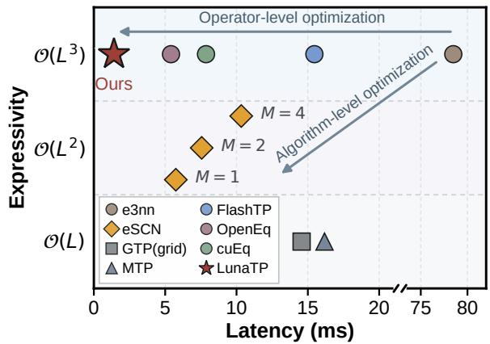  
Figure 1 Expressivity–eficiency landscape of tensor product convolutions. Forward latency is measured on an NVIDIA H100 with 768 atoms, $L _ { \mathrm { m a x } } = 6 .$ , and 64 channels per degree.

Lee et al., 2025; Bharadwaj et al., 2025). Our work follows this direction and introduces LunaTP to further improve the eficiency of CGTP convolutions.

However, further accelerating CGTP convolutions while preserving the full CGTP formulation remains challenging. Although kernel fusion and sparse CG computation reduce computational cost and memory trafic (NVIDIA, 2024; Lee et al., 2025; Bharadwaj et al., 2025), edge-parallel execution still sufers from atomic write contention when multiple edges accumulate messages at the same destination node. Node-centric reduction can eliminate this contention, but does not necessarily improve overall performance. Variations in node degree and per-path computational cost complicate load balancing, while increasing data reuse across paths raises on-chip resource requirements and can limit parallelism. Further improving CGTP convolution performance therefore requires jointly optimizing reduction, data reuse, and parallel execution.

To bridge this performance gap, we introduce LunaTP, which improves the execution of CGTP convolutions without sacrificing expressivity. Our main contributions are:

• We rethink the parallel execution of CGTP convolutions and introduce a node-centric execution scheme that accumulates edge messages on chip, reducing global memory updates.

• Building on this execution scheme, we develop path-group parallelism to balance input reuse and register usage, and reduce redundant computation through sparse expansion and multi-level reuse.

• We extend this execution scheme to higher-order backward passes, enabling eficient force- and Hessiansupervised training.

• We evaluate LunaTP through kernel benchmarks and end-to-end experiments on representative MLIP workloads. On an NVIDIA H100, LunaTP achieves up to a 250.0× kernel speedup and 28.7× higher training throughput than e3nn.

## 2 Preliminaries

## 2.1 Clebsch–Gordan Tensor Product

The Clebsch–Gordan tensor product (CGTP) computes each degree-l component in the direct-sum decomposition. Given two irreducible representations (irreps) $\mathbf { x } ^ { ( l _ { 1 } ) } \in \mathbb { R } ^ { 2 { \breve { l } } _ { 1 } + 1 }$ and $\mathbf { \hat { y } } ^ { ( l _ { 2 } ) } \in \mathbb { R } ^ { 2 l _ { 2 } + 1 }$ , the m-th component of the degree-l output is given by:

$$
\left[ { \bf x } ^ { ( l _ { 1 } ) } \otimes { \bf y } ^ { ( l _ { 2 } ) } \right] _ { m } ^ { ( l ) } = \sum _ { m _ { 1 } = - l _ { 1 } } ^ { l _ { 1 } } \sum _ { m _ { 2 } = - l _ { 2 } } ^ { l _ { 2 } } C _ { ( l _ { 1 } , m _ { 1 } ) ( l _ { 2 } , m _ { 2 } ) } ^ { ( l , m ) } x _ { m _ { 1 } } ^ { ( l _ { 1 } ) } y _ { m _ { 2 } } ^ { ( l _ { 2 } ) } ,\tag{1}
$$

where $C _ { ( l _ { 1 } , m _ { 1 } ) ( l _ { 2 } , m _ { 2 } ) } ^ { ( l , m ) }$ are the CG coeficients and are nonzero only when $| l _ { 1 } - l _ { 2 } | \le l \le | l _ { 1 } + l _ { 2 } |$ , making the coeficient matrices more than 70% sparse (Bharadwaj et al., 2025; Lee et al., 2025).

We refer to each coupling from input degrees $l _ { 1 }$ and $l _ { 2 }$ to an output degree l as a path, denoted by $( l _ { 1 } , l _ { 2 } )  l .$ Each path can be assigned a separate learnable weight while preserving equivariance. For irreps up to degree $L ,$ the full tensor product contains $\mathcal { O } ( L ^ { 3 } )$ paths. In a naive implementation, each path requires $\mathcal { O } ( L ^ { 3 } )$ multiply–add operations, yielding $\mathcal { O } ( L ^ { 6 } )$ total complexity.

To understand how per-path CGTPs are combined in equivariant MLIPs, we next describe the tensor product convolution layer.

## 2.2 Tensor Product Convolution

A tensor product convolution computes one CGTP for every combination of edge, channel, and path (Geiger and Smidt, 2022; Batzner et al., 2022; Batatia et al., 2022; Park et al., 2024). With E edges, C channels, and $P$ paths, the layer performs a total of $E \times C \times P$ such computations. The resulting edge messages are then aggregated at their destination nodes.

Algorithm 1 presents the pseudocode for the tensor product convolution. For each edge $j i ,$ , the CGTP couples the source-node irrep $\mathbf { x } _ { j } ^ { ( l _ { 1 } , c ) }$ with the angular edge irrep $\mathbf { y } _ { j i } ^ { ( l _ { 2 } ) }$ . The result is a full degree-l output, whose m-th component is given by Eq. 1. This output is scaled by the corresponding path weight $w _ { j i } ^ { ( l _ { 1 } , l _ { 2 } , l , c ) }$ and accumulated into the edge message (Line 6). The same operation is performed for every channel–path combination to construct the edge message $\widetilde { \mathbf { m } } _ { j i }$ (Lines 2–8). The message is then aggregated at destination node i (Line 9). In particular, training conservative MLIPs typically requires higher-order derivatives, and we provide the corresponding pseudocode in Appendix F.

```latex
Algorithm 1 Standard Clebsch–Gordan Tensor Product Convolution
Input: $\mathbf { x } _ { j } ^ { ( l _ { 1 } , c ) }$ : node irreps
Input: $\mathbf { y } _ { j i } ^ { ( l _ { 2 } ) } \mathrm { ; }$ : angular edge irreps
Input: $\overset { \circ } { w _ { j i } ^ { ( l _ { 1 } , l _ { 2 } , l , c ) } } _ { ; }$ : path weights generated by the radial MLP
Input: edges $j i ,$ from source node $j$ to destination node i
Output: $\bar { \mathbf { x } ^ { \prime } } _ { i } ^ { ( l , \bar { c } ) }$ : updated node irreps
1: Initialize $\mathbf { x } _ { i } ^ { \prime } \gets \mathbf { 0 }$ for all nodes i
2: for $j i$ in the $E$ edges do ▷ Compute edge messages
3: Initialize $\widetilde { \mathbf { m } } _ { j i } \gets \mathbf { 0 }$
4: for c in the C channels do ▷ Process each feature channel
5: for $( l _ { 1 } , l _ { 2 } )  l$ in the $P$ paths do ▷ Compute a CGTP for each path
6: $\widetilde { \mathbf { m } } _ { j i } ^ { ( l , c ) } \gets \widetilde { \mathbf { m } } _ { j i } ^ { ( l , c ) } + w _ { j i } ^ { ( l _ { 1 } , l _ { 2 } , l , c ) } \left[ \mathbf { x } _ { j } ^ { ( l _ { 1 } , c ) } \otimes \mathbf { y } _ { j i } ^ { ( l _ { 2 } ) } \right] ^ { ( l ) }$
7: end for
8: end for
9: $\mathbf { x } _ { i } ^ { \prime } \gets \mathbf { x } _ { i } ^ { \prime } + \widetilde { \mathbf { m } } _ { j i }$ ▷ Aggregate at destination node i
10: end for
```

While the standard implementation is mathematically straightforward, its performance on modern GPUs depends on how the computation is organized, as we discuss next.

## 3 Rethinking Parallelism for CGTP Convolution

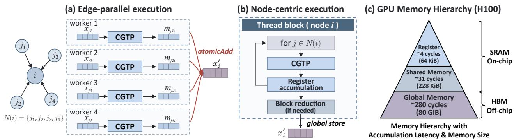  
Figure 2 CGTP convolution parallelism and accumulation latencies across the memory hierarchy.

Parallelism across edges is a common execution scheme in CGTP convolutions (Figure 2(a)) (Lee et al., 2025; Bharadwaj et al., 2025). Since CGTP on each edge are independent, this scheme exploits data parallelism by assigning per-edge computations to diferent workers. However, during message aggregation (Algorithm 1, line 9), many workers attempt to update the same node concurrently, causing atomic contention and hardware-level serialization. Our profiling on an NVIDIA H100 GPU shows that aggregation can account for more than 30% of the total runtime. Thus, although kernel fusion and sparse CG evaluation reduce intermediate memory accesses and tensor product computation, aggregation still incurs substantial overhead.

On modern GPUs, the latency of accumulation depends on where the data resides. As Figure 2(c) shows, accumulation in registers and shared memory typically has lower latency than global atomic updates. This raises a natural question: can we use these low-latency on-chip memories to perform neighbor aggregation?

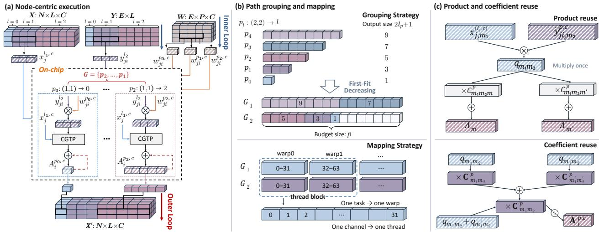  
Figure 3 Overview of LunaTP. (a) Node-centric execution accumulates edge messages on chip before storing results. (b) Paths are grouped under an output component budget and mapped to warps by channel block. (c) Products are reused across outputs, and matching coeficients are factored.

Node-centric execution provides a natural way to do so (Figure 2(b)). This scheme aggregates messages for each node on chip and writes the aggregated result to global memory. A straightforward way to implement this is to assign one thread block to each node. However, our experiments show that this direct mapping eliminates per-edge atomic updates but does not improve runtime, as it does not fully exploit intra-node parallelism. Thus, eficient node-centric execution still faces the following primary challenges:

(1) Work partitioning limited by on-chip reduction. Node-centric execution requires each thread block to traverse all edges of a node and aggregate messages on chip. This makes work partitioning dificult, since the workload depends on both node degree and path computation. On the one hand, node degree determines how many edges a block traverses (e.g., degree distributions are often skewed in atomistic datasets (Barros-Luque et al., 2026; Levine et al., 2026; Gharakhanyan et al., 2026)). On the other hand, the amount of CG computation also varies considerably across paths. Thus, blocks computing the same number of output features may still have diferent workloads.

(2) Fusion scope limited by register capacity. In node-centric execution, we aim to exploit shared inputs across paths to reduce redundant memory accesses and computation. However, each fused path needs to keep its output accumulators live throughout neighbor reduction, so a larger fusion scope increases register demand and may lower occupancy or cause spilling. Under identical thread configuration and register constraints, fusing all compatible paths runs 35.4% slower than limiting the fusion scope and incurs register spilling.

## 4 LunaTP

In this section, we introduce LunaTP’s node-centric execution (Section 4.1). Building on this execution scheme, we describe path-group parallelism (Section 4.2), followed by sparse expansion and multilevel reuse (Section 4.3). Finally, we present higher-order diferentiation and GPU implementation details (Section 4.4).

## 4.1 Node-Centric Execution

LunaTP organizes CGTP computation around destination nodes, accumulates edge messages on chip, and stores the results in global memory after the inner loop. Figure 3(a) shows this execution scheme. The outer loop runs in parallel across destination nodes, paths, and channels, while the inner loop traverses the edges of each destination node. To support this traversal, LunaTP stores the adjacency list in CSR format by destination node, with the edges of node i in the range [rowptr[i], rowptr[i + 1]).

In each inner-loop iteration, a thread loads the source-node features $\mathbf { x } _ { j } ^ { ( l _ { 1 } , c ) }$ , edge features $\mathbf { y } _ { j i } ^ { ( l _ { 2 } ) }$ , and path weight $w _ { j i } ^ { p , c }$ for edge $j i .$ It computes CGTP between the source-node features and the weighted edge features $\widetilde { \mathbf { y } } _ { j i } ^ { p , c } = w _ { j i } ^ { p , c } \mathbf { y } _ { j i } ^ { ( l _ { 2 } ) }$ . The thread computes only component products corresponding to nonzero CG terms, multiplies them by their CG coeficients, and accumulates the results directly in registers. For path $p = ( l _ { 1 } , l _ { 2 } )  l$ , the accumulator $\mathbf { A } _ { i , c } ^ { p }$ is defined as

$$
\mathbf { A } _ { i } ^ { p , c } = \sum _ { j \in \mathcal { N } ( i ) } \left[ \mathbf { x } _ { j } ^ { ( l _ { 1 } , c ) } \otimes \widetilde { \mathbf { y } } _ { j i } ^ { p , c } \right] ^ { ( l ) } ,\tag{2}
$$

where $\mathcal { N } ( i )$ denotes the neighbors of node $i , w _ { j i } ^ { p , c }$ is the path weight generated by the radial MLP, and the CG tensor product is defined in $\operatorname { E q . 1 }$

After traversing all edges of the destination node, each thread stores its accumulated result once at the corresponding output location. Computation across channels and paths remains parallel, while global updates decrease from $O ( E )$ to $O ( N )$ for each fixed path and channel. However, the accumulators $\mathbf { A } _ { i } ^ { p , c }$ need to remain in registers throughout the inner loop. Computing more paths that share inputs can improve reuse but also increases register demand. Work partitioning therefore needs to account for both input reuse and accumulator storage. The next section describes how path-group parallelism controls group size and organizes parallel computation.

## 4.2 Path-Group Parallelism

Multiple paths for the same destination node can share source features. Prior work aggregates these paths to reduce repeated loads (Lee et al., 2025). However, the aggregation scope afects both reuse and register usage. Aggregating all paths that share inputs keeps their output accumulators live until the inner loop ends, which may cause register spilling and limit parallelism. Processing each path separately reduces register usage but repeatedly loads the same features, limiting input reuse. LunaTP therefore uses a grouping strategy to balance input reuse and register usage. For a path group $G ,$ let $l _ { p }$ denote the output degree of path $p .$ The number of output components retained per channel is

$$
R _ { G } = \sum _ { p \in G } ( 2 l _ { p } + 1 ) ,\tag{3}
$$

LunaTP uses $R _ { G } \leq \beta$ as the grouping constraint, where $\beta$ is the per-channel output component budget $( \beta = 1 6$ in our experiments). We use First-Fit Decreasing (FFD) to group paths in descending order of output size, as shown in Figure 3(b).

Since each path group can be computed independently, we use path groups as units of parallel work, which we call path-group parallelism. Specifically, LunaTP partitions work across destination nodes, path groups, and channels. Each task is identified by $( i , G , B )$ , where i is the destination node, G is the path group, and B is a contiguous channel block. In the mapping strategy shown in Figure 3(b), one warp processes one task covering 32 consecutive channels, with each thread handling one channel and computing all paths in the group to reuse the loaded source features. Each task traverses all edges of its destination node and completes its accumulation on chip, avoiding an additional reduction to combine partial results from splitting the edge loop.

Task ordering. This partitioning provides more parallel tasks, but diferences in node degree and per-path cost can still cause workload imbalance within a thread block. When some warps finish early, the block must wait for the remaining warps before releasing all its resources. To reduce this tail efect, LunaTP sorts path groups by their total number of nonzero CG terms in descending order, then sorts nodes within each group by degree in descending order, placing heavier tasks first and helping assign tasks with similar workloads to the same thread block.

## 4.3 Sparse Expansion and Multi-Level Reuse

LunaTP exploits sparsity and reuse in the CG structure to reduce memory accesses and computation. Path grouping enables input reuse across paths, while product and coeficient reuse further reduce computation within each path.

Sparse expansion. CG coeficients and their component indices are determined by the path and do not depend on the graph or input features. Like OpenEq (Bharadwaj et al., 2025), LunaTP embeds normalized nonzero coeficients and their indices directly in the generated code, avoiding runtime table lookups and checks for zero terms.

Beyond CG sparsity, LunaTP uses path grouping to reuse loaded inputs across paths. In each inner-loop iteration, a thread loads each source-feature and edge-feature component needed by the group once and shares it across the paths that use it.

Product reuse. The same input product $q _ { m _ { 1 } m _ { 2 } } = x _ { j , m _ { 1 } } ^ { ( l _ { 1 } , c ) } \widetilde { y } _ { j i , m _ { 2 } } ^ { p , c }$ may be used by multiple output components. LunaTP therefore organizes CG terms by input component pair, computes each product once, and reuses it for all terms with $C _ { m _ { 1 } m _ { 2 } m } ^ { p } \neq 0$ , as shown in the upper part of Figure 3(c). Here, $m _ { 1 }$ and $m _ { 2 }$ follow the input component indices in Eq. 1.

Coefficient reuse. Diferent input component pairs may have coeficient vectors that are identical up to an overall sign. Let $\mathbf { C } _ { m _ { 1 } m _ { 2 } } ^ { p } \in \mathbb { R } ^ { 2 l + 1 }$ collect the CG coeficients over all output components. When ${ \bf C } _ { m _ { 1 } ^ { \prime } m _ { 2 } ^ { \prime } } ^ { p } = { \bf \Phi }$ $\pm { \bf C } _ { m _ { 1 } m _ { 2 } } ^ { p }$ , we combine the products before applying the shared coeficients,

$$
q _ { m _ { 1 } m _ { 2 } } { \bf C } _ { m _ { 1 } m _ { 2 } } ^ { p } + q _ { m _ { 1 } ^ { \prime } m _ { 2 } ^ { \prime } } { \bf C } _ { m _ { 1 } ^ { \prime } m _ { 2 } ^ { \prime } } ^ { p } = ( q _ { m _ { 1 } m _ { 2 } } \pm q _ { m _ { 1 } ^ { \prime } m _ { 2 } ^ { \prime } } ) { \bf C } _ { m _ { 1 } m _ { 2 } } ^ { p } .\tag{4}
$$

This reduces coeficient multiplications, as shown in the lower part of Figure $3 ( \mathrm { c } )$ . In particular, we identify these matches only within each path at operator construction time.

## 4.4 Implementation Details

Extension to higher-order derivatives. LunaTP extends the node-centric execution scheme and reuse methods above to backward, double-backward, and triple-backward passes by adapting the reduction direction to the diferentiation target. Computing the gradient of node features $\mathbf { x } _ { j }$ requires accumulating results over all edges with source node $j ,$ so reduction shifts from destination nodes to source nodes. To support this traversal, LunaTP organizes a CSR by source node while retaining the partitioning across nodes, path groups, and channels and accumulating gradients on chip. Derivatives with respect to the incoming gradient instead reduce at destination nodes, as in the forward pass. Edge-feature and path-weight derivatives are computed per edge, with edge-feature derivatives also requiring a reduction across channels. Double-backward and triple-backward use the same approach, organizing computation around the reduction required by each output. The full pseudocode is provided in Appendix F.

Higher-order backward passes also allow reuse across derivative branches. In double-backward, for example, computing node-feature and edge-feature derivatives requires the same incoming gradient for a given edge. LunaTP combines branches that share inputs to avoid repeated loads and applies sparse expansion, product reuse, and coeficient reuse within each branch.

Low-level optimization and interface. LunaTP uses \_\_ldg to load read-only features, weights, and adjacency indices, and assigns consecutive channels to threads within each warp to coalesce path-weight loads. We express accumulation as multiply-add operations so the compiler can generate fused multiply-add instructions. In higher-order backward passes, we assign independent derivative branches to diferent CUDA streams to overlap their execution. Meanwhile, we provide a programming interface for LunaTP to improve ease of use (see Appendix G).

## 5 Experiments

We evaluate LunaTP across four dimensions: computational eficiency, memory eficiency, scalability, and accuracy. Our baselines include e3nn (Geiger and Smidt, 2022), FlashTP (Lee et al., 2025), OpenEquivari ance (OpenEq) (Bharadwaj et al., 2025), and cuEquivariance (cuEq) (NVIDIA, 2024). We report kernel microbenchmark results (Section 5.1), end-to-end training and inference performance (Section 5.2), and scalability analysis (Section 5.3). The experimental setup is detailed in Appendix A and ablation studies are described in Appendix C.

## 5.1 Kernel Microbenchmark

The microbenchmarks cover ten irrep configurations with $L _ { \mathrm { m a x } }$ ranging from 2 to 6. Most are based on configurations used in existing equivariant MLIPs (Batzner et al., 2022; Batatia et al., 2022; Park et al., 2024; Kim et al., 2026; Kavanagh et al., 2026). The hidden, edge, and output irreps and their representative MLIPs are summarized in Appendix Table 1.

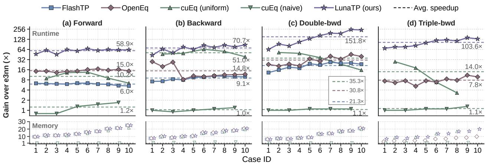  
Figure 4 LunaTP performance in kernel microbenchmarks. Solid lines show runtime speedup over e3nn, while hollow markers show the reduction in peak memory relative to e3nn. Evaluations are performed in FP32 on NVIDIA H100 80GB GPUs. The raw data are provided in Appendix B.1.

Runtime and peak memory. Figure 4 summarizes the FP32 microbenchmark results on H100 (FP64 results are provided in Appendix D.1). LunaTP achieves average speedups of 58.9×, 70.7×, 151.8×, and 103.6× over e3nn for forward, backward, double-backward, and triple-backward, respectively. Its corresponding speedups over OpenEq are 3.93×, 5.93×, 4.78×, and 13.31×. Although FlashTP and OpenEq already use kernel fusion to reduce memory trafic, LunaTP further improves performance through node-centric execution, path-group parallelism, and multilevel reuse. The gains are most pronounced for double- and triple-backward, which ofer more opportunities to share data and computation across derivative branches. cuEq also performs well with uniform channel counts across degrees, but uses a naive implementation with limited speedups otherwise.

In addition to runtime improvements, LunaTP uses only 4.0%–16.2% of e3nn’s peak memory. Its memory footprint is comparable to that of FlashTP and OpenEq from forward through double-backward, since all three avoid materializing per-edge message tensors. For triple-backward, LunaTP uses approximately 48% of OpenEq’s peak memory while also achieving lower runtime.

Numerical stability and training convergence. Since kernel fusion and parallel reductions can alter floating-point operation order, LunaTP and e3nn may exhibit small numerical discrepancies. Using e3nn’s FP64 results as the reference, we measure the RMSEs of their FP32 outputs and corresponding derivatives. From the forward pass through third-order derivatives, both implementations maintain FP32 RMSEs on the order of $1 0 ^ { - 7 } – 1 0 ^ { - 6 }$ while LunaTP’s FP64 RMSEs remain between 10<sup>−16</sup> and 10<sup>−14</sup> (see Appendix E.1).

To assess training stability, we train NequIP-XL (Batzner et al., 2022; Kavanagh et al., 2026) on MPTrj-PFT (Deng et al., 2023; Koker et al., 2026) with the same settings. LunaTP’s validation MAEs for E, F, S, and H difer from those of e3nn by less than 0.3% across all targets, while showing similar convergence trends. (see Appendix E.2).

Hardware portability. We evaluate LunaTP on NVIDIA A100 and RTX 3090 GPUs to assess its portability across data-center and consumer hardware. These GPUs difer in compute performance and memory bandwidth. LunaTP also has a performance advantage over the baselines on both GPUs. Full results are reported in Appendix D.2.

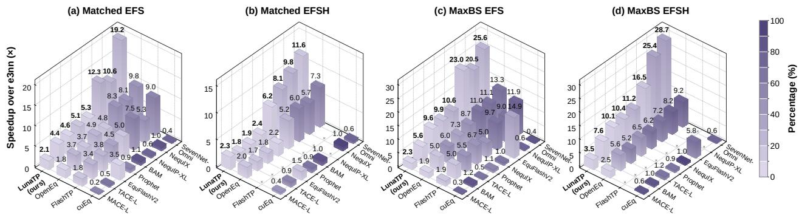  
Figure 5 End-to-end training performance. We benchmark EFS (energy, forces, and stress) and EFSH (EFS plus a Hessian objective). Matched uses equal batch sizes across backends, and MaxBS selects each backend’s maximum batch size. Bars show throughput speedup over e3nn, while bar color indicates the CGTP convolution time fraction. The raw data are provided in Appendix B.2.

## 5.2 End-to-end Performance

We evaluate LunaTP’s end-to-end performance in training and inference. For training, we measure throughput on eight state-of-the-art (SOTA) equivariant MLIPs with EFS and EFSH objectives. For inference, we measure MD speed and the maximum system size each backend can run. Experimental details are in Appendix A.3.

Training. As shown in Figure 5(a) and (b), LunaTP achieves speedups of 2.10–19.24× over e3nn for EFS and 1.81–11.6× for EFSH at matched batch sizes (Matched). The speedup depends on the fraction of training time spent in CGTP convolutions. For example, MACE-L achieves a 2.10× speedup under Matched EFS. With e3nn, CGTP convolutions account for 53.5% of runtime, limiting the overall speedup achievable by optimizing this operator. In contrast, SevenNet-Omni spends a larger fraction of runtime in CGTP convolutions and achieves a 19.2× speedup. Under Matched EFSH, LunaTP achieves speedups of 1.06–1.72× over OpenEq, with further gains also limited by work outside CGTP convolutions.

To evaluate larger workloads, we increase the batch size to the maximum each backend can run on a single GPU (MaxBS). As shown in Figure 5(c) and (d), LunaTP achieves speedups of 2.30–25.6× over e3nn for EFS and 3.50–28.7× for EFSH. The corresponding speedups over OpenEq are 1.14–2.10× and 1.34–3.11×. These gains over OpenEq generally exceed those under Matched, showing that LunaTP provides greater end-to-end benefits on larger workloads.

Inference. We evaluate inference scalability on TACE-L and NequIP-XL, as shown in Figure 6. LunaTP achieves an 8.70× speedup on TACE-L and a 15.27× speedup on NequIP-XL at e3nn’s maximum system size. Since kernel fusion avoids storing per-edge message tensors, LunaTP increases the maximum atom count by 4.63× and 5.04× for TACE-L and NequIP-XL, respectively. OpenEq and FlashTP also use kernel fusion, so all three backends reach the same maximum system size. At these workloads, LunaTP remains 1.8× faster on TACE-L and 2.1× faster on NequIP-XL than OpenEq. This shows that LunaTP’s optimizations further improve inference performance even with kernel fusion already in place.

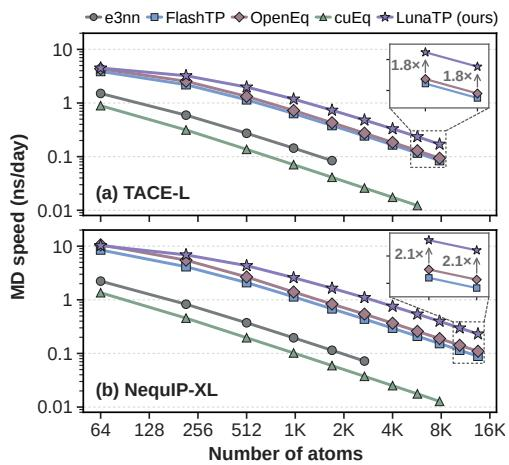

## 5.3 Scalability Analysis

Figure 6 Inference scaling. MD speed on Si with aWe evaluate LunaTP’s forward scalability across four lattice of 5.43 Å and a 1-fs time step.dimensions: atom count, average in-degree, maximum degree, and channel size. As Figure 7 shows, latency generally increases with workload size, but LunaTP achieves the lowest latency at nearly all measured points. At the largest comparable point in each sweep, it is 2.4–10.3× faster than the fastest available baseline, with larger advantages in the maximum-degree and channel-size sweeps. As $L _ { \mathrm { m a x } }$ increases, the number of coupling paths and CG terms grows. LunaTP controls accumulator storage through path grouping and reduces repeated computation through multilevel reuse. As channels become wider, LunaTP partitions the additional computation into more independent channel-block tasks that run across warps without increasing the per-thread accumulator count under the basic mapping. These results demonstrate LunaTP’s scalability to large graphs, higher-degree features, and wider channels. The experimental setup is provided in Appendix A.2.

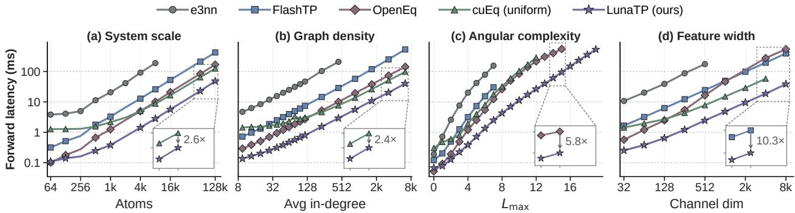  
Figure 7 Forward scalability of CGTP convolution.

## 6 Related Work

Algorithm-level optimization. SO(2)-based methods align a local coordinate system with each edge direction to reduce SO(3) convolutions to simpler SO(2) operations (Passaro and Zitnick, 2023). Other approaches reformulate feature representations and coupling operations to exploit eficient computational primitives. Fused Tensor Product organizes computations across irreps into matrix multiplications (Unke and Maennel, 2024), while Gaunt Tensor Product uses a Fourier basis and FFTs to accelerate products of spherical functions (Luo et al., 2024). These approaches ofer eficient alternatives for high-degree equivariant models, although their parameterizations can involve trade-ofs between expressivity and eficiency (Xie et al., 2025). LunaTP instead improves execution eficiency while preserving the original CGTP formulation and expressivity.

Operator-level optimization. A complementary direction improves tensor product implementations on GPUs. e3nn provides general-purpose equivariant operators (Geiger and Smidt, 2022), while cuEquivariance ofers specialized GPU kernels (NVIDIA, 2024). FlashTP exploits CG sparsity, aggregates paths sharing source features, and fuses convolution operations to reduce repeated loads and intermediate storage (Lee et al., 2025). OpenEq generates sparse kernels just in time for CG contractions and supports fused graph convolutions and higher-order derivatives. Its deterministic implementation accumulates over sorted edges to reduce global writes, then merges node partial sums across warps with a fixup kernel (Bharadwaj et al., 2025). Building on these advances, LunaTP focuses on parallel execution and reuse within node-centric computation. It groups paths under an accumulator budget to expose intra-node parallelism and reuses common products and coeficients to reduce computation. Our experiments demonstrate performance gains over these baselines.

## 7 Conclusion

In this work, we rethink the parallelism of CGTP convolutions and present LunaTP, a GPU kernel for CGTP convolutions in equivariant MLIPs. By organizing node reduction, data reuse, and work partitioning, LunaTP improves computational eficiency without sacrificing expressivity, and extends to third-order derivatives, making eficient Hessian-based training practical. Experiments show that LunaTP accelerates kernels by up to 250.0× over e3nn and 17.1× over OpenEq, while delivering up to 28.7× the end-to-end training throughput of e3nn. Future work will extend these optimizations to other operators in equivariant MLIPs.

## AI use statement

In this work, we did not use generative AI tools for any tasks requiring disclosure. We used generative AI tools only for language editing to improve the clarity and readability of the manuscript and for literature search, which are tasks with recommended disclosure. We reviewed all AI-assisted edits and independently verified the identified literature and references. We take responsibility for the final content of this work, including all AI-assisted language edits and literature-related content.

## Reproducibility statement

We describe our methods in Section 4. Appendix A provides the experimental setup, including the hardware and software environments, benchmarking protocols, and model configurations. The raw benchmark data underlying the results reported in the main text are provided in Appendix B. We will make the complete source code publicly available. Our code is available at https://github.com/HPC-AI-Team/LunaEquivariance

## Acknowledgments

This work is supported by the following funding: National Science Foundation of China (92270206, 62372435, T2125013, 62502501), Beijing Natural Science Foundation (4254087), National Key Research and Development Program of China (2025YFB4507000), and the Innovation Funding of ICT, CAS. Part of the training is performed on the robotic AI-Scientist platform of Chinese Academy of Sciences.

## References

Luis Barros-Luque, Muhammed Shuaibi, Xiang Fu, Brandon M. Wood, Misko Dzamba, Meng Gao, Ammar Rizvi, Matt Uyttendaele, C. Lawrence Zitnick, and Zachary W. Ulissi. The Open Materials 2024 (OMat24) inorganic materials dataset and models. Nature Computational Science, 6(6):642–652, June 2026. ISSN 2662-8457. doi: 10.1038/s43588-026-00996-w. https://doi.org/10.1038/s43588-026-00996-w.

Ilyes Batatia, David Peter Kovacs, Gregor N. C. Simm, Christoph Ortner, and Gabor Csanyi. MACE: Higher order equivariant message passing neural networks for fast and accurate force fields. In Alice H. Oh, Alekh Agarwal, Danielle Belgrave, and Kyunghyun Cho, editors, Advances in Neural Information Processing Systems, 2022. https://openreview.net/forum?id=YPpSngE-ZU.

Ilyes Batatia, Philipp Benner, Yuan Chiang, Alin M. Elena, Dávid P. Kovács, Janosh Riebesell, Xavier R. Advincula, Mark Asta, Matthew Avaylon, William J. Baldwin, Fabian Berger, Noam Bernstein, Arghya Bhowmik, Filippo Bigi, Samuel M. Blau, Vlad Cărare, Michele Ceriotti, Sanggyu Chong, James P. Darby, Sandip De, Flaviano Della Pia, Volker L. Deringer, Rokas Elijošius, Zakariya El-Machachi, Edvin Fako, Fabio Falcioni, Andrea C. Ferrari, John L. A. Gardner, Mikołaj J. Gawkowski, Annalena Genreith-Schriever, Janine George, Rhys E. A. Goodall, Jonas Grandel, Clare P. Grey, Petr Grigorev, Shuang Han, Will Handley, Hendrik H. Heenen, Kersti Hermansson, Cheuk Hin Ho, Stephan Hofmann, Christian Holm, Jad Jaafar, Konstantin S. Jakob, Hyunwook Jung, Venkat Kapil, Aaron D. Kaplan, Nima Karimitari, James R. Kermode, Panagiotis Kourtis, Namu Kroupa, Jolla Kullgren, Matthew C. Kuner, Domantas Kuryla, Guoda Liepuoniute, Chen Lin, Johannes T. Margraf, Ioan-Bogdan Magdău, Angelos Michaelides, J. Harry Moore, Aakash A. Naik, Samuel P. Niblett, Sam Walton Norwood, Niamh O’Neill, Christoph Ortner, Kristin A. Persson, Karsten Reuter, Andrew S. Rosen, Louise A. M. Rosset, Lars L. Schaaf, Christoph Schran, Benjamin X. Shi, Eric Sivonxay, Tamás K. Stenczel, Christopher Sutton, Viktor Svahn, Thomas D. Swinburne, Jules Tilly, Cas van der Oord, Santiago Vargas, Eszter Varga-Umbrich, Tejs Vegge, Martin Vondrák, Yangshuai Wang, William C. Witt, Thomas Wolf, Fabian Zills, and Gábor Csányi. A foundation model for atomistic materials chemistry. The Journal of Chemical Physics, 163(18):184110, 11 2025. ISSN 0021-9606. doi: 10.1063/5.0297006. https://doi.org/10.1063/5.0297006.

Simon Batzner, Albert Musaelian, Lixin Sun, Mario Geiger, Jonathan P. Mailoa, Mordechai Kornbluth, Nicola Molinari, Tess E. Smidt, and Boris Kozinsky. E(3)-equivariant graph neural networks for data-eficient and accurate interatomic potentials. Nature Communications, 13(1), May 2022. ISSN 2041-1723. doi: 10.1038/s41467-022-29939-5. http://dx.doi.org/10.1038/s41467-022-29939-5.

Vivek Bharadwaj, Austin Glover, Aydin Buluc, and James Demmel. An eficient sparse kernel generator for o(3)- equivariant deep networks, 2025. https://arxiv.org/abs/2501.13986.

Bowen Deng, Peichen Zhong, KyuJung Jun, Janosh Riebesell, Kevin Han, Christopher J. Bartel, and Gerbrand Ceder. CHGNet as a pretrained universal neural network potential for charge-informed atomistic modelling. Nature Machine Intelligence, 5(9):1031–1041, September 2023. ISSN 2522-5839. doi: 10.1038/s42256-023-00716-3. https://doi.org/10.1038/s42256-023-00716-3.

Alexandre Duval, Simon V. Mathis, Chaitanya K. Joshi, Victor Schmidt, Santiago Miret, Fragkiskos D. Malliaros, Taco Cohen, Pietro Liò, Yoshua Bengio, and Michael Bronstein. A hitchhiker’s guide to geometric gnns for 3d atomic systems, 2024. https://arxiv.org/abs/2312.07511.

Xiang Fu, Brandon M Wood, Luis Barroso-Luque, Daniel S. Levine, Meng Gao, Misko Dzamba, and C. Lawrence Zitnick. Learning smooth and expressive interatomic potentials for physical property prediction. In Forty-second International Conference on Machine Learning, 2025. https://openreview.net/forum?id=R0PBjxIbgm.

Johannes Gasteiger, Janek Groß, and Stephan Günnemann. Directional message passing for molecular graphs, 2022. https://arxiv.org/abs/2003.03123.

Mario Geiger and Tess Smidt. e3nn: Euclidean neural networks, 2022. https://arxiv.org/abs/2207.09453.

Vahe Gharakhanyan, Luis Barroso-Luque, Yi Yang, Muhammed Shuaibi, Kyle Michel, Daniel S. Levine, Misko Dzamba, Xiang Fu, Meng Gao, Xingyu Liu, Haoran Ni, Keian Noori, Brandon M. Wood, Matt Uyttendaele, Arman Boromand, C. Lawrence Zitnick, Noa Marom, Zachary W. Ulissi, and Anuroop Sriram. Open Molecular Crystals 2025 (OMC25) dataset and models. Scientific Data, 13(1):354, February 2026. ISSN 2052-4463. doi: 10.1038/s41597-026-06628-2. https://doi.org/10.1038/s41597-026-06628-2.

Seán R. Kavanagh, Chuin Wei Tan, Menghang Wang, Marc L. Descoteaux, Gabriel de Miranda Nascimento, Ulrik Unneberg, Laura Zichi, Francesco Libbi, Norma Rivano, Austin Glover, Vivek Bharadwaj, Anders Johansson, William C. Witt, Albert Musaelian, and Boris Kozinsky. Fast and accurate equivariant foundation models for atomistic simulation, 2026. https://arxiv.org/abs/2607.28461.

Jaesun Kim, Jinmu You, Yutack Park, Yunsung Lim, Yujin Kang, Jisu Kim, Haekwan Jeon, Suyeon Ju, Deokgi Hong, Seung Yul Lee, Saerom Choi, Yongdeok Kim, Jae W. Lee, and Seungwu Han. Optimizing cross-domain transfer for universal machine learning interatomic potentials. Nature Communications, 17(1):3432, March 2026. ISSN 2041-1723. doi: 10.1038/s41467-026-70195-8. https://doi.org/10.1038/s41467-026-70195-8.

Teddy Koker, Abhijeet Sadashiv Gangan, Mit Kotak, Jaime Marian, and Tess Smidt. PFT: Phonon fine-tuning for machine learned interatomic potentials. In Forty-third International Conference on Machine Learning, 2026. https://openreview.net/forum?id=QC9S8gUOYc.

Seung Yul Lee, Hojoon Kim, Yutack Park, Dawoon Jeong, Seungwu Han, Yeonhong Park, and Jae W. Lee. FlashTP: Fused, sparsity-aware tensor product for machine learning interatomic potentials. In Forty-second International Conference on Machine Learning, 2025. https://openreview.net/forum?id=wiQe95BPaB.

Daniel S. Levine, Muhammed Shuaibi, Evan Walter Clark Spotte-Smith, Michael G. Taylor, Muhammad R. Hasyim, Kyle Michel, Ilyes Batatia, Gábor Csányi, Misko Dzamba, Peter Eastman, Nathan C. Frey, Xiang Fu, Vahe Gharakhanyan, Aditi S. Krishnapriyan, Joshua A. Rackers, Sanjeev Raja, Ammar Rizvi, Andrew S. Rosen, Zachary Ulissi, Santiago Vargas, C. Lawrence Zitnick, Samuel M. Blau, and Brandon M. Wood. The open molecules 2025 (omol25) dataset, evaluations, and models, 2026. https://arxiv.org/abs/2505.08762.

Yi-Lun Liao and Tess Smidt. Equiformer: Equivariant graph attention transformer for 3d atomistic graphs. In The Eleventh International Conference on Learning Representations, 2023. https://openreview.net/forum?id= KwmPfARgOTD.

Yi-Lun Liao, Brandon M Wood, Abhishek Das, and Tess Smidt. Equiformerv2: Improved equivariant transformer for scaling to higher-degree representations. In The Twelfth International Conference on Learning Representations, 2024. https://openreview.net/forum?id=mCOBKZmrzD

Yi-Lun Liao, Alexander J. Hofman, Sabrina C. Shen, Alexandre Duval, Sam Walton Norwood, and Tess Smidt. Equiformerv3: Scaling eficient, expressive, and general se(3)-equivariant graph attention transformers, 2026. https://arxiv.org/abs/2604.09130.

Shengjie Luo, Tianlang Chen, and Aditi S. Krishnapriyan. Enabling eficient equivariant operations in the fourier basis via gaunt tensor products. In The Twelfth International Conference on Learning Representations, 2024. https://openreview.net/forum?id=mhyQXJ6JsK.

NVIDIA. cuEquivariance. https://github.com/NVIDIA/cuEquivariance, 2024.

Yutack Park, Jaesun Kim, Seungwoo Hwang, and Seungwu Han. Scalable parallel algorithm for graph neural network interatomic potentials in molecular dynamics simulations. Journal of Chemical Theory and Computation, 20(11): 4857–4868, May 2024. ISSN 1549-9626. doi: 10.1021/acs.jctc.4c00190. http://dx.doi.org/10.1021/acs.jctc.4c00190.

Saro Passaro and C. Lawrence Zitnick. Reducing so(3) convolutions to so(2) for eficient equivariant gnns. ICML’23. JMLR.org, 2023.

Jay Shah, Ganesh Bikshandi, Ying Zhang, Vijay Thakkar, Pradeep Ramani, and Tri Dao. Flashattention-3: Fast and accurate attention with asynchrony and low-precision. In The Thirty-eighth Annual Conference on Neural Information Processing Systems, 2024. https://openreview.net/forum?id=tVConYid20.

Oliver T. Unke and Hartmut Maennel. E3x: E(3)-equivariant deep learning made easy, 2024. https://arxiv.org/abs/ 2401.07595.

Soohaeng Yoo Willow, Tae Hyeon Park, Gi Beom Sim, Sung Wook Moon, Seung Kyu Min, D. ChangMo Yang, Hyun Woo Kim, Juho Lee, and Chang Woo Myung. Bayesian e(3)-equivariant interatomic potential with iterative restratification of many-body message passing, 2026. https://arxiv.org/abs/2510.03046.

YuQing Xie, Ameya Daigavane, Mit Kotak, and Tess Smidt. The price of freedom: Exploring expressivity and runtime tradeofs in equivariant tensor products. In Forty-second International Conference on Machine Learning, 2025. https://openreview.net/forum?id=EvIwwGYTLc.

Zemin Xu, Wenbo Xie, and P. Hu. Spectral/spatial tensor atomic cluster expansion with universal embeddings in cartesian space, 2026. https://arxiv.org/abs/2509.14961.

Yuanchang Zhou, Siyu Hu, Xiangyu Zhang, Hongyu Wang, Guangming Tan, and Weile Jia. MatRIS: Toward reliable and eficient pretrained machine learning interatomic potentials. In The Fourteenth International Conference on Learning Representations, 2026. https://openreview.net/forum?id=5xBT5Ziute.

## Appendix

A Evaluation setup   
A.1 Kernel microbenchmark settings   
A.2 Scalability analysis settings   
A.3 Training setup details   
B Detailed Benchmark Data   
B.1 Raw data for kernel microbenchmarks   
B.2 Raw data for training benchmarks   
C Ablation Studies   
C.1 Path grouping   
C.2 Task ordering   
C.3 Compile-time reuse   
D Additional kernel microbenchmark results   
D.1 Kernel microbenchmark (FP64)   
D.2 Kernel microbenchmark (A100 & RTX 3090)   
E Details on numerical stability and training convergence   
E.1 Operator-level numerical stability   
E.2 End-to-end training convergence   
F Diferentiation of CGTP convolution   
G Programming interface

## A Evaluation setup

Software and hardware. All evaluations use FP32 with PyTorch 2.11.0+cu128, e3nn v0.6.0 (Geiger and Smidt, 2022), FlashTP v0.1.1 (Lee et al., 2025), OpenEquivariance v0.7.0 (Bharadwaj et al., 2025), and cuEquivariance v0.11.1 (NVIDIA, 2024). Notably, cuEquivariance uses uniform\_1d when all segments have the same shape and naive otherwise, which we denote as cuEq(uniform) and cuEq(naive), respectively.

Unless otherwise specified, all experiments are conducted on NVIDIA H100-80GB SXM GPUs with Intel Xeon Platinum 8468 CPUs. NVLink provides up to 900 GB/s of bidirectional bandwidth per GPU.

Workload construction protocol. To construct workloads that reflect realistic atomic data distributions, we randomly shufle the OMat24 dataset (Barros-Luque et al., 2026) and sample structures to form batches with specified atom counts. For each structure, we construct a neighbor graph under periodic boundary conditions with $r _ { \mathrm { c u t } } = 6 . 0 \mathrm { ~ \AA ~ }$ , thereby preserving the neighbor distribution of the original dataset.

Measurement protocol. For all microbenchmarks, we warm up each configuration for 10 iterations and then measure GPU kernel execution time over the next 20 iterations using the PyTorch profiler. We report the mean runtime, excluding initial JIT compilation, graph construction, and host-to-device data transfers.

## A.1 Kernel Microbenchmark Settings

All kernel microbenchmarks in Section 5.1 use the same workload unless otherwise specified. The workload contains 768 nodes and 37304 edges, with an average of 48.6 neighbors per atom. To cover diferent angularmomentum orders and channel sizes, we use irrep configurations from several SOTA equivariant MLIPs, as summarized in Table 1.

Table 1 Irrep configurations used in the kernel microbenchmarks.
<table><tr><td>Case ID</td><td>Lmax</td><td>Hidden irreps</td><td>Edge irreps</td><td>Output irreps</td><td>Representative MLIP</td></tr><tr><td>1</td><td>2</td><td>128x0e+64x1e+32x2e</td><td>1x0e+1x1e +1x2e</td><td>224x0e+384x1e +352x2e</td><td>SevenNet-0 , GNoME</td></tr><tr><td>2</td><td>2</td><td>128x0e+128x1o+128x2e</td><td>1x0e+1x1o +1x2e+1x3o</td><td>384x0e+640x1o +640x2e+512x3o</td><td>MACE-MP-L</td></tr><tr><td>3</td><td>3</td><td>128x0e+64x1o+32x2e +32x30</td><td>1x0e+1x1o +1x2e+1x3o</td><td>256x0e+352x1o +384x2e+320x3o</td><td>Nequix-MP/OAM , SevenNet-MF/Omni</td></tr><tr><td>4</td><td>3</td><td>256x0e+256x1o+256x2e +256x30</td><td>1x0e+1x1o +1x2e+1x3o</td><td>1024x0e+1536x1o +1792x2e+1536x3o</td><td>EquFlash-OMat/OAM</td></tr><tr><td>5</td><td>4</td><td>320x0e+96x1o+64x2e +32x3o+32x4e</td><td>1x0e+1x1o+1x2e +1x3o+1x4e</td><td>544x0e+736x1o+832x2e +800x3o+704x4e</td><td>NequIP-XL series</td></tr><tr><td>6</td><td>4</td><td>128x0e+128x1o+128x2e +128x3o+128x4e</td><td>1x0e+1x1o+1x2e +1x3o+1x4e</td><td>640x0e+1024x1o+1280x2e +1280x3o+1152x4e</td><td>EquFlashV2-OMat/OAM</td></tr><tr><td>7</td><td>5</td><td>128x0e+64x1o+32x2e +32x3o+32x4e+32x5o</td><td>1x0e+1x1o+1x2e +1x3o+1x4e+1x5o</td><td>320x0e+480x1o+576x2e +608x3o+608x4e+512x5o</td><td></td></tr><tr><td>8*</td><td>5</td><td>96x0e+96x1o+96x2e +96x3o+96x4e+96x5o</td><td>1x0e+1x1o+1x2e +1x3o+1x4e+1x5o</td><td>576x0e+960x1o+1248x2e +1344x3o+1344x4e+1152x5o</td><td></td></tr><tr><td>9</td><td>6</td><td>128x0e+64x1o+32x2e+32x3o +32x4e+32x5o+32x6e</td><td>1x0e+1x1o+1x2e+1x3o +1x4e+1x5o+1x6e</td><td>352x0e+544x1o+672x2e+736x3o +768x4e+736x5o+640x6e</td><td></td></tr><tr><td>10*</td><td>6</td><td>64x0e+64x1o+64x2e+64x3o +64x4e+64x5o+64x6e</td><td>1x0e+1x1o+1x2e+1x3o +1x4e+1x5o+1x6e</td><td>448x0e+768x1o+1024x2e+1152x3o +1216x4e+1152x5o+1024x6e</td><td></td></tr></table>

“\*” e3nn encounters OOM under the default workload; these cases therefore use 448 atoms and 20386 edges.  
“–” Since no existing MLIP uses the corresponding settings, we constructed these configurations for evaluation.

## A.2 Scalability Analysis Settings

We evaluate LunaTP’s FP32 forward scalability along four dimensions: atom count, graph density, maximum degree, and channel size. In each test, we vary one dimension while holding the others fixed, and continue

until OOM or compilation timeout.

Scaling with atom count. We combine distinct OMat structures and double the atom count starting from 16.   
We use a 6.0 Å neighbor cutof, $L _ { \operatorname* { m a x } } = 4$ , and 64 channels per degree.

Scaling with graph density. Using a fixed 768-atom batch, we increase the neighbor cutof from 3.5 Å to 30.5 Å while keeping $L _ { \operatorname* { m a x } } = 4$ and 64 channels per degree.

Scaling with degree. For this test and the channel-size test, we use the same fixed 768-atom graph. We hold the channel count at 64 per degree and increase $L _ { \mathrm { m a x } }$ from 0 in steps of one.

Scaling with channel size. We fix the 768-atom graph and $L _ { \operatorname* { m a x } } = 4$ , and increase the number of channels per degree from 32 by successive doubling.

## A.3 Training Setup Details

We benchmark training in FP32 on NVIDIA H100 GPUs, using OMat-1M (Barros-Luque et al., 2026) for EFS and MPTrj-PFT (Deng et al., 2023; Koker et al., 2026) for EFSH. All models are trained using their oficial PyTorch implementations (Batatia et al., 2025; Kim et al., 2026; Koker et al., 2026; Xu et al., 2026; Kavanagh et al., 2026; Willow et al., 2026). For EFSH, we follow the training protocol of Koker et al. (2026) and sample Hessian columns during training. Tables 2 and 3 summarize per-GPU batch sizes and the model configurations, respectively.

Table 2 Training batch sizes (atoms per GPU). Matched uses the same batch size across all backends, while MaxBS uses the maximum batch size supported by each backend.
<table><tr><td>Atoms</td><td>SevenNet-Omni</td><td>MACE-L</td><td>NequIP-XL</td><td>EquFlashV2</td><td>TACE-L</td><td>NequlX</td><td>Prophet</td><td>BAM</td></tr><tr><td colspan="9">Matched</td></tr><tr><td>EFS</td><td>2340</td><td>2450</td><td>1630</td><td>290</td><td>1030</td><td>8900</td><td>430</td><td>1280</td></tr><tr><td>EFSH</td><td>870</td><td>800</td><td>600</td><td>90</td><td>300</td><td>3200</td><td>120</td><td>580</td></tr><tr><td colspan="9">MaxBS: EFS</td></tr><tr><td>e3nn</td><td>2340</td><td>2450</td><td>1630</td><td>290</td><td>1030</td><td>8900</td><td>430</td><td>1280</td></tr><tr><td>FlashTP</td><td>14600</td><td>3850</td><td>9550</td><td>2550</td><td>3940</td><td>30400</td><td>2220</td><td>3440</td></tr><tr><td>OpenEq</td><td>14600</td><td>3850</td><td>9550</td><td>2550</td><td>3940</td><td>37600</td><td>2220</td><td>3440</td></tr><tr><td>cuEq</td><td>14600</td><td>3850</td><td>3300</td><td>2550</td><td>2340</td><td>14500</td><td>510</td><td>1600</td></tr><tr><td>LunaTP</td><td>14600</td><td>3850</td><td>9550</td><td>2550</td><td>3940</td><td>37600</td><td>2220</td><td>3440</td></tr><tr><td colspan="9">MaxBS: EFSH</td></tr><tr><td>e3nn</td><td>870</td><td>800</td><td>600</td><td>90</td><td>300</td><td>3200</td><td>120</td><td>580</td></tr><tr><td>FlashTP</td><td></td><td></td><td></td><td></td><td></td><td></td><td></td><td></td></tr><tr><td>OpenEq</td><td>3830</td><td>2600</td><td>2750</td><td>660</td><td>1380</td><td>9870</td><td>600</td><td>1700</td></tr><tr><td>cuEq</td><td>3830</td><td>3140</td><td></td><td>660</td><td>1340</td><td>3060</td><td>120</td><td>580</td></tr><tr><td>LunaTP</td><td>5130</td><td>6200</td><td>3730</td><td>860</td><td>1650</td><td>13200</td><td>680</td><td>1700</td></tr></table>

(a) MACE-L (10.10M)
<table><tr><td>Hyper-parameter</td><td>Value</td></tr><tr><td>Layers</td><td>2</td></tr><tr><td>Cutoff radius</td><td>5.0 Å</td></tr><tr><td>Stage</td><td>Irreps</td></tr><tr><td>Edge</td><td>1x0e+1x1o +1x2e+1x3o</td></tr><tr><td>Input / Output(L2)|</td><td>128x0e / 128x0e</td></tr><tr><td>Hidden (L1)</td><td>128x0e +128x1o</td></tr></table>

(d) TACE-L (82.90M)

Table 3 MLIP configurations for training.  
(b) NequIP-XL (32.14M)
<table><tr><td>Hyper-parameter</td><td>Value</td></tr><tr><td>Layers</td><td>6</td></tr><tr><td>Cutoff radius</td><td>6.0 Å</td></tr><tr><td>Stage</td><td>Irreps</td></tr><tr><td>Edge</td><td>1x0e+1x1o+1x2e +1x3o+1x4e</td></tr><tr><td>Input / Output(L6)</td><td>32x0e  / 320x0e</td></tr><tr><td>Hidden (L1–5)</td><td>320x0e+96x1o +64x2e+32x3o</td></tr></table>

(e) NequIX (0.71M)

(c) EquFlashV2 (44.89M)
<table><tr><td>Hyper-parameter</td><td>Value</td></tr><tr><td>Layers</td><td>10</td></tr><tr><td>Cutoff radius</td><td>6.0 Å</td></tr><tr><td>Stage</td><td>Irreps</td></tr><tr><td>Edge</td><td>1x0e+1x1o+1x2e +1x3o+1x4e</td></tr><tr><td>Input / Output(L10)</td><td>128x0e / 128x0e</td></tr><tr><td>Hidden (L1-9)</td><td>128x0e+128x1o +128x2e+128x3o</td></tr></table>

(f) Prophet (62.30M)

<table><tr><td>Hyper-parameter</td><td>Value</td></tr><tr><td>Layers</td><td>5</td></tr><tr><td>Cutoff radius</td><td>6.0 Å</td></tr><tr><td>Stage</td><td>Irreps</td></tr><tr><td>Edge</td><td>1x0e+1x1o+1x2e +1x3o+1x4e+1x5o</td></tr><tr><td>Input / Output (L5)</td><td>64x0e  / 64x0e</td></tr><tr><td>Hidden (L1-4)</td><td>64x0e+64x1o +64x2e+64x3o</td></tr></table>

<table><tr><td>Hyper-parameter</td><td>Value</td></tr><tr><td>Layers</td><td>4</td></tr><tr><td>Cutoff radius</td><td>6.0 Å</td></tr><tr><td>Stage</td><td>Irreps</td></tr><tr><td>Edge</td><td>1x0e+1x1o +1x2e+1x3o</td></tr><tr><td>Input / Output (L4)</td><td>89x0e / 128x0e</td></tr><tr><td>Hidden (L1-3)</td><td>128x0e+64x1o +32x2e +32x3o</td></tr></table>

<table><tr><td>Hyper-parameter</td><td>Value</td></tr><tr><td>Layers</td><td>10</td></tr><tr><td>Cutoff radii</td><td>3.0, 7.0 Å</td></tr><tr><td>Stage</td><td>Irreps</td></tr><tr><td>Edge</td><td>1x0e+1x1o+1x2e +1x3o+1x4e</td></tr><tr><td>Input / Output(L1φ)</td><td>256x0e  / 256x0e</td></tr><tr><td>Hidden (L1–9)</td><td>256x0e+96x1o +64x2e+32x3o +32x4e</td></tr></table>

(g) SevenNet-Omni (25.76M)
<table><tr><td>Hyper-parameter</td><td>Value</td></tr><tr><td>Layers Cutoff radius</td><td>5 6.0 Å</td></tr><tr><td>Stage</td><td>Irreps</td></tr><tr><td>Edge</td><td>1x0e+1x1e+1x2e+1x3e</td></tr><tr><td>Input / Output (L5)</td><td>128x0e  / 128x0e</td></tr><tr><td>Hidden (L1, L4)</td><td>128x0e+64x1o+32x2e+32x3o</td></tr><tr><td>Hidden (L2)</td><td>128x0e+64x1o+64x1e</td></tr><tr><td></td><td>+32x2+32x2e+32x3o+32x3e</td></tr><tr><td>Hidden (L3)</td><td>128x0e+128x0e+64x1o+64x1e +32x2o+32x2e+32x3o+32x3e</td></tr></table>

(h) BAM (40.15M)
<table><tr><td>Hyper-parameter</td><td>Value</td></tr><tr><td>Layers</td><td>5</td></tr><tr><td>Cutoff radius</td><td>5.0 Å</td></tr><tr><td>Stage</td><td>Irreps</td></tr><tr><td>Edge</td><td>1x0e+1x1o +1x2e+1x3o</td></tr><tr><td>Input</td><td>128x0e</td></tr><tr><td></td><td>64x0o+64x0e +64x1o+64x1e</td></tr><tr><td>Hidden (L1-5)</td><td></td></tr><tr><td></td><td>+64x2o+64x2e</td></tr><tr><td></td><td>+64x3o+64x3e</td></tr></table>

## B Detailed Benchmark Data

## B.1 Raw Data for Kernel Microbenchmarks

We evaluate LunaTP using the experimental setup described in Section A. Table 4 reports the raw results of our kernel microbenchmarks

Table 4 Kernel measurements from forward through third-order diferentiation. Parentheses report runtime speedup and peak-memory reduction relative to e3nn.
<table><tr><td rowspan=1 colspan=20>Forward                                                     BackwardCase ID</td></tr><tr><td rowspan=1 colspan=20>e3nn    FlashTP   OpenEq    cuEq  LunaTP (ours)   e3nn    FlashTP   OpenEq     cuEq  LunaTP (ours)</td></tr><tr><td rowspan=1 colspan=20>Runtime (ms)</td></tr><tr><td rowspan=1 colspan=1>C1    3.56 (1.00x)</td><td rowspan=1 colspan=2>0.563 (6.32x</td><td rowspan=1 colspan=2>)0.248 (14.4x)</td><td rowspan=1 colspan=2>4.40 (0.809x)</td><td rowspan=1 colspan=4>0.0763 (46.7x) 9.21 (1.00x)</td><td rowspan=1 colspan=2>1.29 (7.16x)</td><td rowspan=1 colspan=2>0.331 (27.8x)</td><td rowspan=1 colspan=2>9.59 (0.960x)</td><td rowspan=1 colspan=2>0.214 (43.1x</td><td rowspan=4 colspan=1>)))</td></tr><tr><td rowspan=1 colspan=1>C2    9.85 (1.00x)</td><td rowspan=1 colspan=2>1.59 (6.19x)</td><td rowspan=1 colspan=1>0.681 (</td><td rowspan=1 colspan=1>14.5x)</td><td rowspan=1 colspan=2>1.12 (8.81x)</td><td rowspan=1 colspan=2>0.163 (60.6x)</td><td rowspan=1 colspan=2>24.0 (1.00x)</td><td rowspan=1 colspan=2>3.28 (7.32x)</td><td rowspan=1 colspan=1>1.21 (1</td><td rowspan=1 colspan=1>9.8x)</td><td rowspan=1 colspan=2>0.514 (46.7x)</td><td rowspan=1 colspan=1>0.366 (</td><td rowspan=1 colspan=1>65.6x</td></tr><tr><td rowspan=1 colspan=1>C3    5.77 (1.00x)</td><td rowspan=1 colspan=2>0.947(6.09x</td><td rowspan=1 colspan=1>)0.439 (</td><td rowspan=1 colspan=1>13.1x)</td><td rowspan=1 colspan=2>6.80 (0.849x)</td><td rowspan=1 colspan=1>0.127 (4</td><td rowspan=1 colspan=1>5.4x)</td><td rowspan=1 colspan=2>16.3 (1.00x)</td><td rowspan=1 colspan=2>1.95 (8.35x)</td><td rowspan=1 colspan=1>0.610 (</td><td rowspan=1 colspan=1>26.8x)</td><td rowspan=1 colspan=2>17.3 (0.944x)</td><td rowspan=1 colspan=1>0.320 (</td><td rowspan=1 colspan=1>50.9x</td></tr><tr><td rowspan=1 colspan=1>C4    28.3 (1.00x)</td><td rowspan=1 colspan=2>4.70 (6.03x)</td><td rowspan=1 colspan=1>1.99 (1</td><td rowspan=1 colspan=1>4.3x)</td><td rowspan=1 colspan=2>2.16 (13.1x)</td><td rowspan=1 colspan=1>0.449 (6</td><td rowspan=1 colspan=1>3.2x)</td><td rowspan=1 colspan=2>76.9 (1.00x)</td><td rowspan=1 colspan=2>9.59 (8.03x)</td><td rowspan=1 colspan=1>9.40 (8</td><td rowspan=1 colspan=1>.18x)</td><td rowspan=1 colspan=2>1.56 (49.3x)</td><td rowspan=1 colspan=1>1.02 (7</td><td rowspan=1 colspan=1>5.8x)</td></tr><tr><td rowspan=1 colspan=1>C5    19.8 (1.00x)</td><td rowspan=1 colspan=2>3.10 (6.39x)</td><td rowspan=1 colspan=1>1.36 (1</td><td rowspan=1 colspan=1>4.6x)</td><td rowspan=1 colspan=2>14.7 (1.35x)</td><td rowspan=1 colspan=1>0.344 (5</td><td rowspan=1 colspan=1>7.6x)</td><td rowspan=1 colspan=2>67.3 (1.00x)</td><td rowspan=1 colspan=2>7.08 (9.51x)</td><td rowspan=1 colspan=1>6.40 (1</td><td rowspan=1 colspan=1>0.5x)</td><td rowspan=1 colspan=1>64.6 (1</td><td rowspan=1 colspan=1>.04x)</td><td rowspan=1 colspan=1>1.05 (</td><td rowspan=1 colspan=1>63.8x)</td><td rowspan=1 colspan=1></td></tr><tr><td rowspan=1 colspan=1>C6    39.5 (1.00x)</td><td rowspan=1 colspan=2>6.13 (6.45x)</td><td rowspan=1 colspan=1>2.46 (1</td><td rowspan=1 colspan=1>6.1x)</td><td rowspan=1 colspan=2>2.93 (13.5x)</td><td rowspan=1 colspan=1>0.586 (6</td><td rowspan=1 colspan=1>7.4x)</td><td rowspan=1 colspan=2>130 (1.00x)</td><td rowspan=1 colspan=2>13.4 (9.74x)</td><td rowspan=1 colspan=1>13.0 (1</td><td rowspan=1 colspan=1>0.0x)</td><td rowspan=1 colspan=1>2.02 (6</td><td rowspan=1 colspan=1>4.5x)</td><td rowspan=1 colspan=1>1.53 (</td><td rowspan=1 colspan=1>85.0x)</td><td rowspan=1 colspan=1></td></tr><tr><td rowspan=1 colspan=1>C7    26.0 (1.00x)</td><td rowspan=1 colspan=2>4.33 (6.00x)</td><td rowspan=1 colspan=1>1.54 (1</td><td rowspan=1 colspan=1>6.9x)</td><td rowspan=1 colspan=1>17.0 (1</td><td rowspan=1 colspan=1>.53x)</td><td rowspan=1 colspan=1>0.435 (5</td><td rowspan=1 colspan=1>9.7x)</td><td rowspan=1 colspan=2>101 (1.00x)</td><td rowspan=1 colspan=1>9.76</td><td rowspan=1 colspan=1>(10.4x</td><td rowspan=1 colspan=1>9.53 (1</td><td rowspan=1 colspan=1>0.6x)</td><td rowspan=1 colspan=1>92.2</td><td rowspan=1 colspan=1>1.10x</td><td rowspan=1 colspan=1>1.38 (7</td><td rowspan=1 colspan=1>3.3x)</td><td rowspan=1 colspan=1></td></tr><tr><td rowspan=1 colspan=1>C8    34.7 (1.00x)</td><td rowspan=1 colspan=2>5.90 (5.88x)</td><td rowspan=1 colspan=1>2.23</td><td rowspan=1 colspan=1>15.5x</td><td rowspan=1 colspan=1>3.84 (9</td><td rowspan=1 colspan=1>.05x)</td><td rowspan=1 colspan=1>0.544 (6</td><td rowspan=1 colspan=1>3.8x)</td><td rowspan=1 colspan=2>133 (1.00x)</td><td rowspan=1 colspan=1>13.1 (</td><td rowspan=1 colspan=1>10.2x)</td><td rowspan=1 colspan=1>11.8 (1</td><td rowspan=1 colspan=1>1.3x)</td><td rowspan=1 colspan=1>2.37 (5</td><td rowspan=1 colspan=1>6.1x)</td><td rowspan=1 colspan=1>1.54 (</td><td rowspan=1 colspan=1>86.2x)</td><td rowspan=3 colspan=1></td></tr><tr><td rowspan=1 colspan=1>C9    46.8 (1.00x)</td><td rowspan=1 colspan=2>8.67 (5.40x)</td><td rowspan=1 colspan=1>2.85 (1</td><td rowspan=1 colspan=1>6.4x)</td><td rowspan=1 colspan=1>27.3</td><td rowspan=1 colspan=1>1.71x</td><td rowspan=1 colspan=1>0.755 (6</td><td rowspan=1 colspan=1>2.0x)</td><td rowspan=1 colspan=2>212 (1.00x)</td><td rowspan=1 colspan=1>21.3 (</td><td rowspan=1 colspan=1>9.99x)</td><td rowspan=1 colspan=1>18.6 (1</td><td rowspan=1 colspan=1>1.4x)</td><td rowspan=1 colspan=1>181 (1</td><td rowspan=1 colspan=1>.17x)</td><td rowspan=1 colspan=1>2.79</td><td rowspan=1 colspan=1>76.3x</td></tr><tr><td rowspan=1 colspan=1>C10   44.5 (1.00x)</td><td rowspan=1 colspan=2>8.42 (5.29x)</td><td rowspan=1 colspan=1>3.05 (1</td><td rowspan=1 colspan=1>4.6x)</td><td rowspan=1 colspan=2>6.97 (6.39x)</td><td rowspan=1 colspan=2>0.713 (62.4x)</td><td rowspan=1 colspan=2>199 (1.00x)</td><td rowspan=1 colspan=1>20.2 (</td><td rowspan=1 colspan=1>9.87x)</td><td rowspan=1 colspan=1>17.0 (1</td><td rowspan=1 colspan=1>1.7x)</td><td rowspan=1 colspan=1>5.14 (</td><td rowspan=1 colspan=1>38.8x)</td><td rowspan=1 colspan=1>2.28 (8</td><td rowspan=1 colspan=1>7.4x)</td></tr><tr><td rowspan=1 colspan=1></td><td rowspan=1 colspan=2></td><td rowspan=1 colspan=4></td><td rowspan=1 colspan=4>Peak memory(GB)</td><td rowspan=1 colspan=6></td><td rowspan=1 colspan=2></td><td rowspan=1 colspan=1></td></tr><tr><td rowspan=1 colspan=1>C1    1.50 (1.00x)</td><td rowspan=1 colspan=2>0.157 (9.60x</td><td rowspan=1 colspan=1>))0.156 (</td><td rowspan=1 colspan=1>9.62x)</td><td rowspan=1 colspan=2>1.51 (0.997x)</td><td rowspan=1 colspan=1>0.157 (</td><td rowspan=1 colspan=3>9.59x)  2.41 (1.00x)</td><td rowspan=1 colspan=2>0.331 (7.27x</td><td rowspan=1 colspan=1>)0.312 (</td><td rowspan=1 colspan=1>7.72x)</td><td rowspan=1 colspan=2>1.52 (1.59x)</td><td rowspan=1 colspan=1>0.313 (</td><td rowspan=1 colspan=1>7.70x</td><td rowspan=3 colspan=1>)</td></tr><tr><td rowspan=1 colspan=1>C2    4.19 (1.00x)</td><td rowspan=1 colspan=1>0.359 (</td><td rowspan=1 colspan=1>11.7x</td><td rowspan=1 colspan=1>)0.359 (1</td><td rowspan=1 colspan=1>1.7x)</td><td rowspan=1 colspan=2>0.391 (10.7x)</td><td rowspan=1 colspan=1>0.360 (</td><td rowspan=1 colspan=1>11.7x)</td><td rowspan=1 colspan=2>7.38 (1.00x)</td><td rowspan=1 colspan=2>0.775 (9.53x</td><td rowspan=1 colspan=1>)0.718 (</td><td rowspan=1 colspan=1>10.3x)</td><td rowspan=1 colspan=2>0.749 (9.85x</td><td rowspan=1 colspan=1>) 0.718 (</td><td rowspan=1 colspan=1>10.3x)</td></tr><tr><td rowspan=1 colspan=1>C3    2.50 (1.00x)</td><td rowspan=1 colspan=1>0.218(</td><td rowspan=1 colspan=1>11.5x</td><td rowspan=1 colspan=1>)0.218 (1</td><td rowspan=1 colspan=1>1.5x)</td><td rowspan=1 colspan=2>2.47 (1.01x)</td><td rowspan=1 colspan=1>0.218</td><td rowspan=1 colspan=1>11.5x</td><td rowspan=1 colspan=2>3.76 (1.00x)</td><td rowspan=1 colspan=2>0.471 (7.99x)</td><td rowspan=1 colspan=1>0.435 (</td><td rowspan=1 colspan=1>8.65x)</td><td rowspan=1 colspan=2>2.31 (1.63x)</td><td rowspan=1 colspan=1>0.436 (</td><td rowspan=1 colspan=1>8.64x)</td></tr><tr><td rowspan=1 colspan=1>C4    12.0 (1.00x)</td><td rowspan=1 colspan=1>0.972(</td><td rowspan=1 colspan=1>12.3x</td><td rowspan=1 colspan=1>)0.972 (1</td><td rowspan=1 colspan=1>2.3x)</td><td rowspan=1 colspan=2>1.06 (11.3x)</td><td rowspan=1 colspan=1>0.972</td><td rowspan=1 colspan=1>(12.3x)</td><td rowspan=1 colspan=2>20.2 (1.00x)</td><td rowspan=1 colspan=2>2.10 (9.63x)</td><td rowspan=1 colspan=1>1.94 (1</td><td rowspan=1 colspan=1>0.4x)</td><td rowspan=1 colspan=2>2.03 (9.93x)</td><td rowspan=1 colspan=1>1.94 (1</td><td rowspan=1 colspan=1>0.4x)</td><td rowspan=4 colspan=1></td></tr><tr><td rowspan=1 colspan=1>C5    8.15 (1.00x)</td><td rowspan=1 colspan=1>0.607</td><td rowspan=1 colspan=1>(13.4x</td><td rowspan=1 colspan=1>)0.606 (1</td><td rowspan=1 colspan=1>3.5x)</td><td rowspan=1 colspan=2>8.00 (1.02x)</td><td rowspan=1 colspan=1>0.611(</td><td rowspan=1 colspan=1>13.4x)</td><td rowspan=1 colspan=2>13.2 (1.00x)</td><td rowspan=1 colspan=2>1.33 (9.87x)</td><td rowspan=1 colspan=1>1.21 (1</td><td rowspan=1 colspan=1>0.9x)</td><td rowspan=1 colspan=2>7.00 (1.88x)</td><td rowspan=1 colspan=1>1.22</td><td rowspan=1 colspan=1>10.8x</td></tr><tr><td rowspan=1 colspan=1>C6    14.3 (1.00x)</td><td rowspan=1 colspan=1>0.907(</td><td rowspan=1 colspan=1>15.8x</td><td rowspan=1 colspan=1>)) 0.907 (</td><td rowspan=1 colspan=1>15.8x)</td><td rowspan=1 colspan=2>1.01 (14.2x)</td><td rowspan=1 colspan=1>0.907(</td><td rowspan=1 colspan=1>15.8x)</td><td rowspan=1 colspan=2>28.0 (1.00x)</td><td rowspan=1 colspan=2>1.98 (14.2x)</td><td rowspan=1 colspan=1>1.81 (1</td><td rowspan=1 colspan=1>5.5x)</td><td rowspan=1 colspan=2>1.91 (14.6x)</td><td rowspan=1 colspan=1>1.81 (1</td><td rowspan=1 colspan=1>5.4x)</td></tr><tr><td rowspan=1 colspan=1>C7    9.09 (1.00x)</td><td rowspan=1 colspan=1>0.535</td><td rowspan=1 colspan=1>(17.0x</td><td rowspan=1 colspan=1>)) 0.535 (</td><td rowspan=1 colspan=1>17.0x)</td><td rowspan=1 colspan=2>8.86 (1.03x)</td><td rowspan=1 colspan=1>0.539(</td><td rowspan=1 colspan=1>16.9x)</td><td rowspan=1 colspan=2>16.4 (1.00x)</td><td rowspan=1 colspan=2>1.18 (13.8x)</td><td rowspan=1 colspan=1>1.07 (1</td><td rowspan=1 colspan=1>5.3x)</td><td rowspan=1 colspan=2>7.18 (2.28x)</td><td rowspan=1 colspan=1>1.07 (1</td><td rowspan=1 colspan=1>5.3x)</td></tr><tr><td rowspan=1 colspan=1>C8    12.8 (1.00x)</td><td rowspan=1 colspan=1>0.628</td><td rowspan=1 colspan=1>(20.4x</td><td rowspan=1 colspan=1>0.628 (2)</td><td rowspan=1 colspan=1>0.5x)</td><td rowspan=1 colspan=2>0.713 (18.0x)</td><td rowspan=1 colspan=1>0.629 (2</td><td rowspan=1 colspan=1>0.4x)</td><td rowspan=1 colspan=2>22.5 (1.00x)</td><td rowspan=1 colspan=2>1.39 (16.2x)</td><td rowspan=1 colspan=1>1.26 (1</td><td rowspan=1 colspan=1>7.9x)</td><td rowspan=2 colspan=2>1.34 (16.8x)11.9 (2.40x)</td><td rowspan=1 colspan=1>1.26 (</td><td rowspan=1 colspan=1>17.9x)</td><td rowspan=3 colspan=1></td></tr><tr><td rowspan=1 colspan=1>C9    16.7 (1.00x)</td><td rowspan=1 colspan=1>0.781(</td><td rowspan=1 colspan=1>21.4x)</td><td rowspan=1 colspan=1>0.781 (2</td><td rowspan=1 colspan=1>1.4x)</td><td rowspan=1 colspan=2>15.1 (1.11x)</td><td rowspan=1 colspan=1>0.787(</td><td rowspan=1 colspan=1>21.3x)</td><td rowspan=1 colspan=2>28.5 (1.00x)</td><td rowspan=1 colspan=2>1.64 (17.4x)</td><td rowspan=1 colspan=1>1.56 (1</td><td rowspan=1 colspan=1>8.3x)</td><td rowspan=1 colspan=1>1.57</td><td rowspan=1 colspan=1>18.2x</td></tr><tr><td rowspan=1 colspan=1>C10   16.4 (1.00x)</td><td rowspan=1 colspan=2>0.658 (25.0x)</td><td rowspan=1 colspan=2>0.658 (25.0x)</td><td rowspan=1 colspan=6>0.758 (21.7x) 0.659 (25.0x) 27.4 (1.00x)</td><td rowspan=1 colspan=3>1.37 (20.0x) 1.32 (2</td><td rowspan=1 colspan=1>0.8x)</td><td rowspan=1 colspan=2>1.42 (19.4x)</td><td rowspan=1 colspan=2>1.32 (20.8x)</td></tr><tr><td rowspan=1 colspan=20>Double-bwd                                                   Triple-bwdCase IDe3nn    FlashTP   OpenEq    cuEq  LunaTP (ours)   e3nn    FlashTP   OpenEq    cuEq  LunaTP (ours)</td></tr><tr><td rowspan=1 colspan=20>Runtime (ms)</td></tr><tr><td rowspan=1 colspan=1>C1    25.7 (1.00x)</td><td rowspan=1 colspan=2>1.95 (13.2x)</td><td rowspan=1 colspan=1>1.12 (2</td><td rowspan=1 colspan=1>3.0x)</td><td rowspan=1 colspan=2>25.3 (1.02x)</td><td rowspan=1 colspan=4>0.403 (63.9x)  47.2 (1.00x</td><td rowspan=1 colspan=4>)            6.38 (7.41x)</td><td rowspan=1 colspan=2>45.5 (1.04x)</td><td rowspan=1 colspan=2>0.683 (69.2x</td><td rowspan=4 colspan=1>)</td></tr><tr><td rowspan=1 colspan=1>C2    74.4 (1.00x)</td><td rowspan=1 colspan=2>4.71 (15.8x)</td><td rowspan=1 colspan=1>3.61(</td><td rowspan=1 colspan=1>20.6x)</td><td rowspan=1 colspan=2>1.43 (52.1x)</td><td rowspan=1 colspan=1>0.802</td><td rowspan=1 colspan=3>132 (1.00x)</td><td rowspan=1 colspan=3>19.9 (</td><td rowspan=1 colspan=1>6.64x)</td><td rowspan=1 colspan=2>4.77 (27.7x)</td><td rowspan=1 colspan=2>1.74 (75.9x)</td></tr><tr><td rowspan=1 colspan=1>C3    52.8 (1.00x)</td><td rowspan=1 colspan=2>2.78 (19.0x)</td><td rowspan=1 colspan=1>2.23 (2</td><td rowspan=1 colspan=1>3.7x)</td><td rowspan=1 colspan=2>52.0 (1.01x)</td><td rowspan=1 colspan=1>0.651 (</td><td rowspan=1 colspan=3>81.2x)  89.5 (1.00x)</td><td rowspan=1 colspan=3>12.0 (</td><td rowspan=1 colspan=1>7.48x)</td><td rowspan=1 colspan=2>86.7 (1.03x)</td><td rowspan=1 colspan=2>1.17 (76.2x)</td></tr><tr><td rowspan=1 colspan=1>C4    251 (1.00x)</td><td rowspan=1 colspan=2>14.1 (17.8x)</td><td rowspan=1 colspan=1>12.1 (2</td><td rowspan=1 colspan=1>0.8x)</td><td rowspan=1 colspan=2>5.11 (49.2x)</td><td rowspan=1 colspan=1>2.36 (1</td><td rowspan=1 colspan=3>06x)  429 (1.00x)</td><td rowspan=1 colspan=3></td><td rowspan=1 colspan=1>5.22x</td><td rowspan=1 colspan=2>23.7 (18.1x)</td><td rowspan=1 colspan=2>5.14 (83.3x)</td></tr><tr><td rowspan=1 colspan=1>C5    262 (1.00x)</td><td rowspan=1 colspan=2>10.9 (24.1x)</td><td rowspan=1 colspan=1>7.77(</td><td rowspan=1 colspan=1>33.7x)</td><td rowspan=1 colspan=2>245 (1.07x)</td><td rowspan=1 colspan=1>1.96 (1</td><td rowspan=1 colspan=3>34x)   401 (1.00x)</td><td rowspan=1 colspan=3>53.5 (</td><td rowspan=1 colspan=1>7.49x)</td><td rowspan=1 colspan=2>362 (1.11x)</td><td rowspan=1 colspan=2>3.98 (101x)</td><td rowspan=1 colspan=1></td></tr><tr><td rowspan=1 colspan=1>C6    467 (1.00x)</td><td rowspan=1 colspan=2>21.0 (22.2x)</td><td rowspan=1 colspan=1>16.5 (2</td><td rowspan=1 colspan=1>8.4x)</td><td rowspan=1 colspan=2>12.9 (36.3x)</td><td rowspan=1 colspan=1>2.83 (1</td><td rowspan=1 colspan=3>65x)  758 (1.00x)</td><td rowspan=1 colspan=3>109 (6</td><td rowspan=1 colspan=1>.93x)</td><td rowspan=1 colspan=2>112 (6.77x)</td><td rowspan=1 colspan=1>6.39 (</td><td rowspan=1 colspan=1>119x)</td><td rowspan=4 colspan=1></td></tr><tr><td rowspan=1 colspan=1>C7    427 (1.00x)</td><td rowspan=1 colspan=2>15.9 (26.8x)</td><td rowspan=1 colspan=1>10.6 (4</td><td rowspan=1 colspan=1>0.3x)</td><td rowspan=1 colspan=2>392 (1.09x)</td><td rowspan=1 colspan=1>2.20 (</td><td rowspan=1 colspan=3>194x)   629 (1.00x)</td><td rowspan=1 colspan=3>73.8 (</td><td rowspan=1 colspan=1>8.53x)</td><td rowspan=1 colspan=2>555 (1.13x)</td><td rowspan=1 colspan=1>5.13 (</td><td rowspan=1 colspan=1>123x)</td></tr><tr><td rowspan=1 colspan=1>C8    537 (1.00x)</td><td rowspan=1 colspan=2>21.5 (25.0x)</td><td rowspan=1 colspan=1>16.3 (3</td><td rowspan=1 colspan=1>3.0x)</td><td rowspan=1 colspan=1>22.9 (</td><td rowspan=1 colspan=1>23.5x)</td><td rowspan=1 colspan=1>2.84 (</td><td rowspan=1 colspan=3>189x)  813 (1.00x)</td><td rowspan=1 colspan=3>104 (7</td><td rowspan=1 colspan=1>.85x)</td><td rowspan=1 colspan=2>243 (3.35x)</td><td rowspan=1 colspan=1>7.10 (</td><td rowspan=1 colspan=1>114x)</td></tr><tr><td rowspan=1 colspan=1>C9    1010 (1.00x)</td><td rowspan=1 colspan=1>39.8 (</td><td rowspan=1 colspan=1>25.4x)</td><td rowspan=1 colspan=1>22.2 (4</td><td rowspan=1 colspan=1>5.5x)</td><td rowspan=1 colspan=1>926 (1</td><td rowspan=1 colspan=1>.09x)</td><td rowspan=1 colspan=1>4.04 (</td><td rowspan=1 colspan=2>250x)</td><td rowspan=1 colspan=1>1.00x</td><td rowspan=1 colspan=3>148 (1</td><td rowspan=1 colspan=1>1.0x)</td><td rowspan=1 colspan=2>1230 (1.33x)</td><td rowspan=1 colspan=1>)11.4</td><td rowspan=1 colspan=1>143x</td></tr><tr><td rowspan=1 colspan=1>C10   895 (1.00x)</td><td rowspan=1 colspan=1>38.4 (</td><td rowspan=1 colspan=1>23.3x)</td><td rowspan=1 colspan=1>22.6 (3</td><td rowspan=1 colspan=1>9.5x)</td><td rowspan=1 colspan=1>57.5 (</td><td rowspan=1 colspan=1>15.6x)</td><td rowspan=1 colspan=1>3.70 (</td><td rowspan=1 colspan=2>242x)  1420 (</td><td rowspan=1 colspan=1>1.00x</td><td rowspan=1 colspan=4>)            145 (9.80x)</td><td rowspan=1 colspan=2>OOM</td><td rowspan=1 colspan=1>10.7 (</td><td rowspan=1 colspan=1>132x)</td><td rowspan=1 colspan=1></td></tr><tr><td rowspan=1 colspan=1></td><td rowspan=1 colspan=2></td><td rowspan=1 colspan=2></td><td rowspan=1 colspan=2></td><td rowspan=1 colspan=1>Peak</td><td rowspan=1 colspan=3>memory(GB)</td><td rowspan=1 colspan=4></td><td rowspan=1 colspan=2></td><td rowspan=1 colspan=2></td><td rowspan=1 colspan=1></td></tr><tr><td rowspan=1 colspan=1>C1    3.80 (1.00x)</td><td rowspan=1 colspan=2>0.614 (6.19x</td><td rowspan=1 colspan=1>)0.604 (</td><td rowspan=1 colspan=1>6.29x</td><td rowspan=1 colspan=2>)3.92 (0.969x)</td><td rowspan=1 colspan=1>0.614 (</td><td rowspan=1 colspan=3>6.18x)  6.33 (1.00x)</td><td rowspan=1 colspan=3>1.98 (</td><td rowspan=1 colspan=1>3.20x)</td><td rowspan=1 colspan=1>5.27 (</td><td rowspan=1 colspan=1>1.20x)</td><td rowspan=1 colspan=2>0.947 (6.69x</td><td rowspan=1 colspan=1>)</td></tr><tr><td rowspan=1 colspan=1>C2    10.2 (1.00x)</td><td rowspan=1 colspan=1>1.41 (</td><td rowspan=1 colspan=1>7.25x)</td><td rowspan=1 colspan=1>1.38 (</td><td rowspan=1 colspan=1>7.41x)</td><td rowspan=1 colspan=2>1.44 (7.10x)</td><td rowspan=1 colspan=1>1.39 (7</td><td rowspan=1 colspan=1>.35x)</td><td rowspan=1 colspan=2>19.0 (1.00x)</td><td rowspan=1 colspan=3>4.52 (4</td><td rowspan=1 colspan=1>.20x)</td><td rowspan=1 colspan=1>2.16 (</td><td rowspan=1 colspan=1>8.79x)</td><td rowspan=1 colspan=1>2.18 (8</td><td rowspan=1 colspan=1>.71x)</td><td rowspan=1 colspan=1></td></tr><tr><td rowspan=1 colspan=1>C3    5.71 (1.00x)</td><td rowspan=1 colspan=1>0.855 (</td><td rowspan=1 colspan=1>6.68x)</td><td rowspan=1 colspan=1>0.836 (</td><td rowspan=1 colspan=1>6.84x</td><td rowspan=1 colspan=2>)6.35 (0.900x)</td><td rowspan=1 colspan=1>0.855 (</td><td rowspan=1 colspan=1>6.68x)</td><td rowspan=1 colspan=2>9.94 (1.00x)</td><td rowspan=1 colspan=3>2.74 (</td><td rowspan=1 colspan=1>3.63x)</td><td rowspan=1 colspan=1>8.24</td><td rowspan=1 colspan=1>1.21x</td><td rowspan=1 colspan=1>1.33 (</td><td rowspan=1 colspan=1>7.49x)</td><td rowspan=1 colspan=1></td></tr><tr><td rowspan=1 colspan=1>C4    30.7 (1.00x)</td><td rowspan=1 colspan=1>3.81 (8</td><td rowspan=1 colspan=1>.07x)</td><td rowspan=1 colspan=1>3.73 (8</td><td rowspan=1 colspan=1>.24x)</td><td rowspan=1 colspan=1>3.90 (</td><td rowspan=1 colspan=1>7.88x)</td><td rowspan=1 colspan=1>3.75 (</td><td rowspan=1 colspan=1>8.20x)</td><td rowspan=1 colspan=2>54.8 (1.00x)</td><td rowspan=1 colspan=3>12.2 (</td><td rowspan=1 colspan=1>4.48x)</td><td rowspan=1 colspan=1>5.87 (</td><td rowspan=1 colspan=1>9.34x)</td><td rowspan=1 colspan=1>5.93 (</td><td rowspan=1 colspan=1>9.24x)</td><td rowspan=2 colspan=1></td></tr><tr><td rowspan=1 colspan=1>C5    20.7 (1.00x)</td><td rowspan=1 colspan=2>2.37 (8.75x)</td><td rowspan=1 colspan=1>2.31</td><td rowspan=1 colspan=1>8.00-</td><td rowspan=1 colspan=1>20.2 (</td><td rowspan=1 colspan=1>1.03x)</td><td rowspan=1 colspan=1>2.38 (</td><td rowspan=1 colspan=1>8.72x)</td><td rowspan=1 colspan=1>34.9 (1</td><td rowspan=1 colspan=1>.00x)</td><td rowspan=1 colspan=3></td><td rowspan=1 colspan=1>4.60μ</td><td rowspan=1 colspan=1>25.0 (</td><td rowspan=1 colspan=1>1.39x)</td><td rowspan=1 colspan=1>3.72 (</td><td rowspan=1 colspan=1>9.38x)</td></tr><tr><td rowspan=1 colspan=1>C6    47.1 (1.00x)</td><td rowspan=1 colspan=2>3.52 (13.4x)</td><td rowspan=1 colspan=1>3.44 (1</td><td rowspan=1 colspan=1>3.7x)</td><td rowspan=1 colspan=1>3.64 (</td><td rowspan=1 colspan=1>13.0x)</td><td rowspan=1 colspan=1>2.59</td><td rowspan=1 colspan=1>12.4</td><td rowspan=1 colspan=1>75.6 (1</td><td rowspan=1 colspan=1>.00x)</td><td rowspan=1 colspan=3>11.3 (</td><td rowspan=1 colspan=1>6.68x)</td><td rowspan=1 colspan=1>5.47 (</td><td rowspan=1 colspan=1>13.8x)</td><td rowspan=1 colspan=1>5.56 (</td><td rowspan=1 colspan=1>13.6x)</td><td></td></tr><tr><td></td><td></td><td></td><td></td><td></td><td></td><td></td><td></td><td></td><td></td><td></td><td></td><td></td><td></td><td></td><td rowspan=3 colspan=1>29.0 (</td><td></td><td></td><td></td><td></td></tr><tr><td></td><td></td><td></td><td></td><td></td><td></td><td></td><td></td><td></td><td></td><td></td><td></td><td></td><td></td><td></td><td></td><td></td><td></td><td rowspan=2 colspan=1></td></tr><tr><td rowspan=1 colspan=1>C7    28.9 (1.00x)</td><td rowspan=1 colspan=2>2.07 (14.0x)</td><td rowspan=1 colspan=1>2.01 (1</td><td rowspan=1 colspan=1>4.3x)</td><td rowspan=1 colspan=1>22.8 (</td><td rowspan=1 colspan=1>1.27x)</td><td rowspan=1 colspan=1>2.08 (1</td><td rowspan=1 colspan=1>3.9x)</td><td rowspan=1 colspan=1>45.6 (1</td><td rowspan=1 colspan=1>.00x)</td><td rowspan=1 colspan=3>6.64 (</td><td rowspan=1 colspan=1>6.87x)</td><td rowspan=1 colspan=1>1.57x)</td><td rowspan=1 colspan=1>3.28 (</td><td rowspan=1 colspan=1>13.9x)</td></tr><tr><td rowspan=3 colspan=1>C8    41.1 (1.00x)C9    52.5 (1.00x)C10   52.3 (1.00x)</td><td rowspan=1 colspan=2>2.41 (17.1x)</td><td rowspan=1 colspan=1>2.35</td><td rowspan=1 colspan=1>17.5x</td><td rowspan=1 colspan=1>2.52 (</td><td rowspan=1 colspan=1>16.3x)</td><td rowspan=1 colspan=1>2.42 (</td><td rowspan=1 colspan=1>17.0x)</td><td rowspan=1 colspan=1>63.9 (1</td><td rowspan=1 colspan=1>.00x)</td><td rowspan=1 colspan=3>7.77 (</td><td rowspan=1 colspan=1>8.23x)</td><td rowspan=1 colspan=1>3.79 (</td><td rowspan=1 colspan=1>16.9x)</td><td rowspan=1 colspan=1>3.84 (</td><td rowspan=1 colspan=1>16.7x)</td><td rowspan=3 colspan=1></td></tr><tr><td rowspan=1 colspan=1>2.99</td><td rowspan=1 colspan=1>17.5x</td><td rowspan=1 colspan=1>2.01</td><td rowspan=1 colspan=1>18.0</td><td rowspan=1 colspan=1>38.9 (</td><td rowspan=1 colspan=1>1.35x)</td><td rowspan=1 colspan=1>3.02 (</td><td rowspan=1 colspan=1>17.4x)</td><td rowspan=1 colspan=1>79.8 (1</td><td rowspan=1 colspan=1>.00x)</td><td rowspan=1 colspan=3>9.39 (</td><td rowspan=1 colspan=1>8.50x)</td><td rowspan=1 colspan=1>48.3</td><td rowspan=1 colspan=1>1.65x</td><td rowspan=1 colspan=1>4.67 (</td><td rowspan=1 colspan=1>17.1x)</td></tr><tr><td rowspan=1 colspan=1>2.50 (</td><td rowspan=1 colspan=1>20.9x)</td><td rowspan=1 colspan=1>2.44 (2</td><td rowspan=1 colspan=1>1.4x)</td><td rowspan=1 colspan=1>2.64 (1</td><td rowspan=1 colspan=1>9.8x)</td><td rowspan=1 colspan=1>2.51 (</td><td rowspan=1 colspan=1>20.8x)</td><td rowspan=1 colspan=1>79.2 (1</td><td rowspan=1 colspan=1>.00x)</td><td rowspan=1 colspan=3>7.97 (</td><td rowspan=1 colspan=1>9.93x)</td><td rowspan=1 colspan=1></td><td rowspan=1 colspan=1>OOM</td><td rowspan=1 colspan=1>3.97 (</td><td rowspan=1 colspan=1>20.0x)</td></tr></table>

“–” denotes an unsupported setting.

## B.2 Raw Data for Training Benchmarks

Tables 5 and 6 report throughput and the CGTP convolution time fraction for all eight models under EFS and EFSH training.

Table 5 EFS training performance. Each entry reports throughput in “atoms $/ \mathbf { s } ^ { \mathfrak { N } }$ , with the CGTP convolution time fraction in parentheses.
<table><tr><td rowspan="2">Setting</td><td rowspan="2">Model</td><td colspan="5">Throughput (CGTP time fraction)</td></tr><tr><td>e3nn</td><td>FlashTP</td><td>OpenEq</td><td>cuEq</td><td>LunaTP (ours)</td></tr><tr><td rowspan="9">Matched</td><td>SevenNet-Omni</td><td>936.6 (95.9%)</td><td>8470.3 (51.2%)</td><td>9160.7 (47.5%)</td><td>358.7 (76.5%)</td><td>18024.6 (21.3%)</td></tr><tr><td>MACE-L</td><td>4023.5 (53.5%)</td><td>7084.6 (10.7%)</td><td>7435.6 (7.9%)</td><td>774.6 (59.7%)</td><td>8455.9 (1.4%)</td></tr><tr><td>NequIP-XL</td><td>625.8 (93.8%)</td><td>4696.5 (57.5%)</td><td>5225.1 (48.9%)</td><td>370.7 (70.3%)</td><td>7703.4 (20.2%)</td></tr><tr><td>NequIX</td><td>4929.0 (92.8%)</td><td>26052.0 (46.1%)</td><td>40017.6 (41.0%)</td><td>4989.0 (88.9%)</td><td>52397.8 (20.9%)</td></tr><tr><td>EquFlashV2</td><td>144.0 (78.4%)</td><td>547.1 (26.1%)</td><td>538.0 (19.8%)</td><td>504.6 (9.5%)</td><td>659.7 (6.0%)</td></tr><tr><td>TÁCE-L</td><td>477.8 (79.0%)</td><td>1625.5 (28.6%)</td><td>1748.3 (23.3%)</td><td>245.5 (69.5%)</td><td>2099.9 (4.6%)</td></tr><tr><td>Prophet</td><td>160.2 (84.3%)</td><td>724.5 (31.5%)</td><td>782.7 (24.8%)</td><td>149.2 (50.3%)</td><td>824.7 (11.0%)</td></tr><tr><td>BAM</td><td>531.4 (82.3%)</td><td>2654.6 (16.3%)</td><td>2538.7 (15.7%)</td><td>601.7 (80.0%)</td><td>2824.5 (3.1%)</td></tr><tr><td>SevenNet-Omni</td><td>936.6 (95.1%)</td><td>11136.3 (71.6%)</td><td>12469.2 (61.6%)</td><td>361.1 (82.8%)</td><td>23933.1 (26.1%)</td></tr><tr><td rowspan="8">MaxBS</td><td></td><td>4023.5 (53.5%)</td><td></td><td>7759.8 (8.6%)</td><td>1019.9 (78.0%)</td><td>9289.7 (1.5%)</td></tr><tr><td>MACE-L</td><td></td><td>7521.5 (11.3%) 5648.9 (69.1%)</td><td>6961.3 (64.0%)</td><td>368.8 (71.1%)</td><td>12844.3 (26.2%)</td></tr><tr><td>NequIP-XL NequIX</td><td>625.8 (93.8%) 4929.0 (92.8%)</td><td></td><td>42825.2 (44.1%)</td><td>5046.9 (66.8%)</td><td>52424.9 (20.9%)</td></tr><tr><td>EquFlashV2</td><td>144.0 (78.4%)</td><td>24715.1 (43.4%) 1390.4 (65.6%)</td><td>1577.2 (60.5%)</td><td></td><td></td></tr><tr><td>TÁCE-L</td><td>477.8 (79.0%)</td><td>2614.6 (46.6%)</td><td>2858.3 (40.5%)</td><td>2147.8 (38.1%) 242.6 (69.5%)</td><td>3311.9 (19.5%)</td></tr><tr><td>Prophet</td><td>160.2 (84.3%)</td><td>1076.0 (43.9%)</td><td>1174.9 (38.6%)</td><td>169.0 (53.0%)</td><td>4563.7 (9.1%) 1583.3 (14.2%)</td></tr><tr><td>BAM</td><td>531.4 (82.3%)</td><td>2659.0 (15.7%)</td><td>2640.0 (15.9%)</td><td>618.5 (80.0%)</td><td>2998.9 (3.2%)</td></tr><tr><td></td><td></td><td></td><td></td><td></td><td></td></tr></table>

Table 6 EFSH training performance. Each entry reports throughput in “atoms/s”, with the tensor product convolution time fraction in parentheses.
<table><tr><td rowspan="2">Setting</td><td rowspan="2">Model</td><td colspan="5">Throughput (CGTP time fraction)</td></tr><tr><td>e3nn</td><td>FlashTP</td><td>OpenEq</td><td>cuEq</td><td>LunaTP (ours)</td></tr><tr><td rowspan="9">Matched</td><td>SevenNet-Omni</td><td>277.5 (93.4%)</td><td></td><td>2036.4 (52.4%)</td><td>156.1 (71.7%)</td><td>3232.3 (18.0%)</td></tr><tr><td>MACE-L</td><td>1204.6 (56.1%)</td><td></td><td>2371.2 (13.5%)</td><td>486.3 (48.7%)</td><td>2775.5 (2.3%)</td></tr><tr><td>NequIP-XL</td><td>182.5 (92.0%)</td><td></td><td>1100.4 (52.9%)</td><td></td><td>1480.7 (22.6%)</td></tr><tr><td>NequIX</td><td>1465.7 (89.9%)</td><td></td><td>8352.2 (56.3%)</td><td>1506.9 (91.8%)</td><td>14369.5 (25.0%)</td></tr><tr><td>EquFlashV2</td><td>47.0 (55.4%)</td><td></td><td>85.6 (11.2%)</td><td>72.5 (11.6%)</td><td>91.4 (9.2%)</td></tr><tr><td>TACE-L</td><td>122.6 (47.0%)</td><td></td><td>202.5 (12.5%)</td><td>116.3 (52.2%)</td><td>221.5 (3.5%)</td></tr><tr><td>Prophet</td><td>34.0 (53.9%)</td><td></td><td>76.0 (6.3%)</td><td>29.8 (64.7%)</td><td>80.7 (4.2%)</td></tr><tr><td>BAM</td><td>182.9 (83.7%)</td><td></td><td>949.9 (26.7%)</td><td>179.7 (86.1%)</td><td>1138.2 (6.2%)</td></tr><tr><td>SevenNet-Omni</td><td>277.5 (93.4%)</td><td></td><td>2562.0 (72.2%)</td><td>166.9 (77.8%)</td><td>7956.0 (30.2%)</td></tr><tr><td rowspan="8">MaxBS</td><td>MACE-L</td><td>1204.6 (56.1%)</td><td></td><td>2979.7 (9.5%)</td><td>755.92 (87.7%)</td><td>4248.1 (2.7%)</td></tr><tr><td>NequIP-XL</td><td>182.5 (92.0%)</td><td></td><td>1490.5 (78.0%)</td><td></td><td>4627.4 (33.4%)</td></tr><tr><td>NequIX</td><td>1465.7 (89.9%)</td><td></td><td>9082.6 (60.0%)</td><td>1401.0 (92.9%)</td><td>16450.9 (27.0%)</td></tr><tr><td>EquFlashV2</td><td>42.7 (55.4%)</td><td></td><td>307.1 (64.3%)</td><td>247.5 (64.1%)</td><td>704.6 (17.6%)</td></tr><tr><td>TACE-L</td><td>122.6 (46.8%)</td><td></td><td>635.7 (50.6%)</td><td>150.3 (69.3%)</td><td>1233.1 (9.8%)</td></tr><tr><td>Prophet</td><td>39.1 (89.3%)</td><td></td><td>256.0 (43.3%)</td><td>36.0 (64.4%)</td><td>408.5 (15.8%)</td></tr><tr><td>BAM</td><td>182.9 (83.7%)</td><td></td><td>1029.6 (30.1%)</td><td>179.7 (86.1%)</td><td>1386.7 (5.4%)</td></tr><tr><td></td><td></td><td></td><td></td><td></td><td></td></tr></table>

## C Ablation Studies

We evaluate the efects of path fusion scope, cross-path input reuse, task ordering, and compile-time reuse on LunaTP’s forward performance. All experiments use the C5 configuration in Table 1 with FP32 precision. This configuration includes channel counts of 320, 96, 64, and 32.

## C.1 Path Grouping

Path grouping needs to balance input reuse and accumulator storage. We first vary the per-channel output component budget β to examine the efect of fusion scope (Table 7). Among the tested settings, the default budget $\beta = 1 6$ gives the lowest latency. Fusing all compatible paths increases latency by 56.3%, while reducing the budget to 8 and 4 increases latency by 11.6% and 20.8%, respectively. Smaller groups require more repeated edge traversals, while full fusion keeps more accumulators live at once and is the only tested setting with reported register spilling.

Since the default policy automatically adjusts the number of warps as the grouping changes, we also compare the fusion scopes with fixed warp counts. With 8 and 16 warps, full fusion is still 44.3% (0.5001 vs. 0.3467 ms) and 53.0% (0.5423 vs. 0.3545 ms) slower, respectively. In both cases, the reported spill stores are 2976 B for full fusion and zero for the default budget.

Table 7 Output component budget with automatic warp selection (C5, FP32, forward). Latency is the median of two independent measurements. Spill stores are kernel-reported statistics, not total runtime trafic.
<table><tr><td>Configuration</td><td>Path groups</td><td>Execution units</td><td>Registers</td><td>Spill stores (B)</td><td>Latency (ms)</td></tr><tr><td>All compatible paths</td><td>5</td><td>17</td><td>64</td><td>2976</td><td>0.5393</td></tr><tr><td>Default (β = 16)</td><td>17</td><td>45</td><td>64</td><td>0</td><td>0.3449</td></tr><tr><td>β=8</td><td>29</td><td>73</td><td>56</td><td>0</td><td>0.3851</td></tr><tr><td>β= 4</td><td>37</td><td>96</td><td>56</td><td>0</td><td>0.4167</td></tr></table>

Performance also depends on which paths can share inputs within a group. Compared with the baseline that groups paths by edge irrep, broader cross-path input reuse reduces the number of path groups from 25 to 17 and lowers latency by about 6.6% (Table 8). This change both expands input reuse and reduces the number of tasks, so the measured gain reflects the overall efect of the grouping change. With this grouping, enabling the work partitioning option shown in the table leaves latency nearly unchanged, with no additional benefit observed on C5.

Table 8 Cross-path input reuse and work partitioning (C5, FP32, forward). All configurations use node-centric execution.
<table><tr><td>Configuration</td><td>Path groups</td><td>Execution units</td><td>Latency (ms)</td></tr><tr><td>Baseline (grouped by edge irrep)</td><td>25</td><td>85</td><td>0.3688</td></tr><tr><td>+ Cross-path input reuse</td><td>17</td><td>45</td><td>0.3446</td></tr><tr><td>+ Work partitioning (full)</td><td>17</td><td>45</td><td>0.3447</td></tr></table>

## C.2 Task Ordering

We next vary the task order while keeping the fusion scope and number of warps fixed. We independently reverse the ordering by nonzero CG-term count and by node degree, while keeping the task set unchanged (Table 9). Compared with descending order on both axes, changing only the node order to ascending increases latency by 13.0%. Changing only the CG-term count order to ascending increases latency by 5.8%, while changing both increases it by 17.1%. Sorting both in descending order, as used in the main text, gives the lowest latency among these settings.

Table 9 Task ordering with a fixed fusion scope and warp count (C5, FP32, forward). Each ordering axis is reversed independently; the task set, instruction set, and output are unchanged.
<table><tr><td>CG-term count order</td><td>Node degree order</td><td>Latency (ms)</td><td>vs. both descending</td></tr><tr><td>Descending</td><td>Descending</td><td>0.3446</td><td></td></tr><tr><td>Descending</td><td>Ascending</td><td>0.3895</td><td>+13.0%</td></tr><tr><td>Ascending</td><td>Descending</td><td>0.3645</td><td>+5.8%</td></tr><tr><td>Ascending</td><td>Ascending</td><td>0.4036</td><td>+17.1%</td></tr></table>

## C.3 Compile-Time Reuse

Finally, we compare all four combinations of product reuse and coeficient reuse with a fixed fusion scope and number of warps (Table 10). Enabling both gives the lowest latency of 0.3449 ms. Disabling coeficient reuse increases latency by 3.7%, while disabling both increases it by 3.4%.

These two switches are not fully independent. The code generation path for coeficient reuse retains shared products, so disabling the product reuse switch does not necessarily remove product sharing from these computations. When coeficient reuse is disabled, disabling product reuse also does not increase latency.

Table 10 Compile-time reuse switches with fixed fusion scope and warp count (C5, FP32, forward). Coeficient reuse retains shared products even when the product-reuse switch is disabled.
<table><tr><td>Product reuse</td><td>Coefficient reuse</td><td>Latency (ms)</td><td>vs. both enabled</td></tr><tr><td>Enabled</td><td>Enabled</td><td>0.3449</td><td></td></tr><tr><td>Enabled</td><td>Disabled</td><td>0.3578</td><td>+3.7%</td></tr><tr><td>Disabled</td><td>Enabled</td><td>0.3526</td><td>+2.2%</td></tr><tr><td>Disabled</td><td>Disabled</td><td>0.3565</td><td>+3.4%</td></tr></table>

## D Additional Kernel Microbenchmark Results

## D.1 Kernel microbenchmark (FP64)

We evaluate FP64 performance using the same irrep configurations as in the FP32 benchmarks. Since FP64 requires more computation and memory, we reduce the atom count by half to 384 for most cases and further reduce it to 192 for C8 and C10. All runtime speedups and peak-memory reduction factors are relative to FP64 e3nn on the same hardware. Figure 8 summarizes the results. LunaTP achieves arithmetic-mean speedups of 45.6×, 58.4×, 133.7×, and 81.9× over FP64 e3nn for forward, backward, double backward, and triple backward, respectively. The corresponding speedups over OpenEq are 4.42×, 4.40×, 3.56×, and 9.61×.

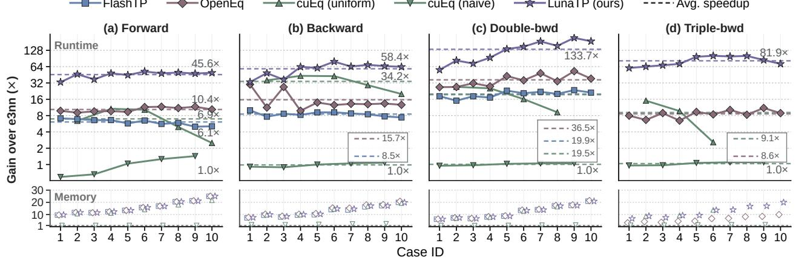  
Figure 8 LunaTP performance in kernel microbenchmarks (FP64, NVIDIA H100-80GB).

## D.2 Kernel microbenchmark (A100 & RTX 3090)

We evaluate LunaTP on NVIDIA A100-80GB and RTX 3090-24GB GPUs using FP32 microbenchmarks. On A100, we use the same workloads as in the main evaluation. To fit within the RTX 3090’s memory capacity, we use 192 atoms by default and reduce C8 and C10 to 122 and 97 atoms, respectively. For each case, we keep the workload fixed across all backends and all four stages.

On A100, LunaTP achieves average speedups of 49.7×, 62.4×, 122.7×, and 90.5× over e3nn for forward, backward, double backward, and triple backward, respectively. On RTX 3090, the corresponding speedups are 75.3×, 83.5×, 203.5×, and 151.2×. Figures 9 and 10 show the full results.

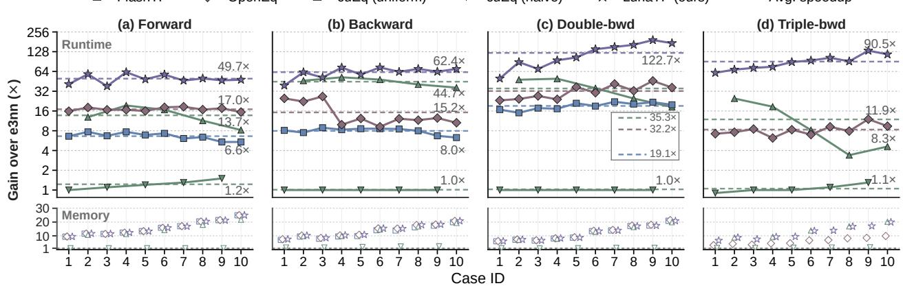  
Figure 9 LunaTP performance in kernel microbenchmarks (NVIDIA A100-80GB PCIe).

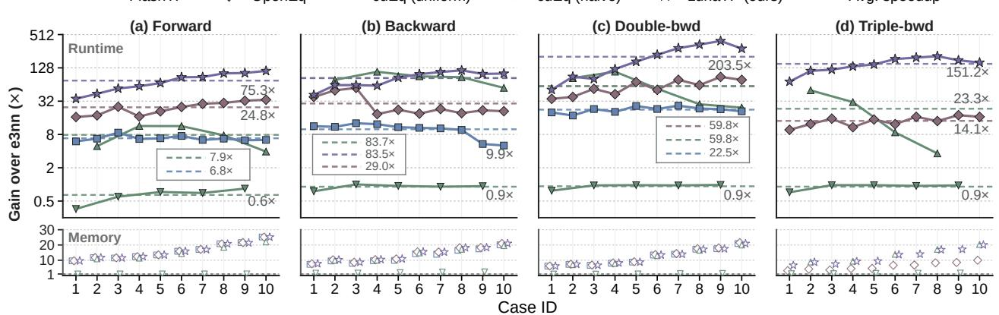  
Figure 10 LunaTP performance in kernel microbenchmarks (RTX 3090-24GB).

LunaTP delivers performance gains on both data-center and consumer GPUs, although the speedups vary across hardware. Across all four stages, its average speedups over e3nn are highest on RTX 3090, followed by H100 and A100. This ordering matches that of the GPUs’ peak FP32 compute-to-memory-bandwidth ratios. Since e3nn’s tensor-product computations are primarily limited by memory bandwidth (Lee et al., 2025), LunaTP’s reductions in intermediate memory trafic through kernel fusion and data reuse yield larger gains on GPUs with greater compute capacity relative to memory bandwidth.

## E Details on Numerical Stability and Training Convergence

## E.1 Operator-Level Numerical Stability

Following the numerical validation protocol of Shah et al. (2024), we use the e3nn FP64 as the reference. We run e3nn in FP32 and LunaTP in both FP32 and FP64 on the same inputs, and report RMSE for the forward and each derivative stage. The inputs are constructed as described in Appendix A. Table 11 reports the full results, averaged across all cases in Table 1.

Table 11 Numerical error comparison between e3nn and LunaTP.
<table><tr><td>Stage</td><td>Output</td><td>e3nn (FP32)</td><td>LunaTP (FP32)</td><td>LunaTP (FP64)</td></tr><tr><td>Forward</td><td>x′</td><td>9.910429e-07</td><td>9.978108e-07</td><td>9.517594e-16</td></tr><tr><td rowspan="3">Backward</td><td>x</td><td>3.582043e-06</td><td>6.545904e-06</td><td>6.437515e-15</td></tr><tr><td>y</td><td>3.516555e-06</td><td>2.934879e-06</td><td>8.966707e-15</td></tr><tr><td>w</td><td>1.696597e-07</td><td>1.712254e-07</td><td>4.281635e-16</td></tr><tr><td rowspan="4">Double bwd</td><td> $\mathbf { h } _ { x }$ </td><td>5.083432e-06</td><td>7.955895e-06</td><td>1.274438e-14</td></tr><tr><td> $\mathbf { h } _ { y }$ </td><td>5.002968e-06</td><td>4.300956e-06</td><td>5.290353e-15</td></tr><tr><td> $\mathbf { h } _ { w }$ </td><td>2.546925e-07</td><td>2.582805e-07</td><td>6.404447e-16</td></tr><tr><td> $\mathbf { h } _ { g }$ </td><td>1.769849e-06</td><td>2.792170e-06</td><td>7.214677e-15</td></tr><tr><td rowspan="6">Triple bwd</td><td> $\mathbf { t } _ { x }$ </td><td>5.818900e-06</td><td>6.511971e-06</td><td>9.811956e-15</td></tr><tr><td> $\mathbf { t } _ { y }$ </td><td>6.808703e-06</td><td>6.200321e-06</td><td>9.310777e-15</td></tr><tr><td> $\mathbf { t } _ { w }$ </td><td>3.152390e-07</td><td>2.198522e-07</td><td>6.591994e-16</td></tr><tr><td> $\mathbf { t } _ { g }$ </td><td>2.530354e-06</td><td>3.285050e-06</td><td>5.920629e-15</td></tr><tr><td> $\mathbf { t } _ { v _ { x } }$ </td><td>5.368344e-06</td><td>5.646177e-06</td><td>8.875174e-15</td></tr><tr><td> $\mathbf { t } _ { v _ { y } }$ </td><td>5.896732e-06</td><td>5.317266e-06</td><td>9.918370e-15</td></tr><tr><td></td><td> $\mathbf { t } _ { v _ { w } }$ </td><td>2.677879e-07</td><td>2.514537e-07</td><td>6.436796e-16</td></tr></table>

## E.2 End-to-End Training Convergence

We evaluate end-to-end training convergence by training NequIP-XL on MPTrj-PFT with either e3nn or LunaTP as the CGTP backend. Both runs use FP32 precision with the same model initialization, data, and training settings. The loss weights for energy, forces, stress, and Hessian are set to 20, 20, 100, and 100, respectively. We train for 50 epochs with a cosine learning-rate schedule, starting at $5 \times 1 0 ^ { - 4 }$ and ending at $1 \times 1 0 ^ { - 6 }$ . Figure 11 shows the training and validation MAE curves for both backends.

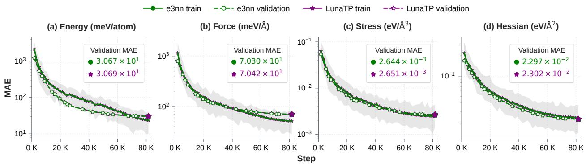  
Figure 11 Loss convergence on MPTrj-PFT dataset.

## F Differentiation of CGTP convolution

In this section, we derive the first-, second-, and third-order derivatives of tensor product convolution. The resulting formulas evaluate the gradients needed at each order without forming full Jacobian, Hessian, or thirdorder derivative tensors, and provide the basis for our derivative kernels. Throughout, we present the derivatives componentwise, following Eq. 1. For each channel–path combination, $\mathbf { x } _ { j } ^ { ( l _ { 1 } , \breve { c } ) } \in \mathbb { R } ^ { 2 l _ { 1 } + \bar { 1 } } , \mathbf { y } _ { j i } ^ { ( l _ { 2 } ) } \in \mathbb { R } ^ { 2 l _ { 2 } + 1 }$ , and $w _ { j i } ^ { ( l _ { 1 } , l _ { 2 } , l , c ) } \in \mathbb { R }$

The first-order derivative. For the convolution output $\mathbf { x ^ { \prime } } _ { i } ^ { ( l , c ) }$ , let $\mathbf { g } _ { i } ^ { ( l , c ) } = \partial \mathcal { L } / \partial \mathbf { x } _ { i } ^ { \prime ( l , c ) }$ denote its gradient.   
Applying the chain rule to the weighted CGTP gives the first-order derivatives in Algorithm 2. The second-order derivative. Let $\mathbf { v } _ { x } , \mathbf { v } _ { y } ,$ and $v _ { w }$ denote the gradients with respect to $\bar { \mathbf { x } } , \bar { \mathbf { y } } ;$ , and w¯, respectively.   
Applying the product rule to the first-order formulas gives the second-order derivatives in Algorithm 3.

Algorithm 2 First-Order Derivative of Clebsch–Gordan Tensor Product Convolution   
Input: $\mathbf { x } _ { j } ^ { ( l _ { 1 } , c ) }$ : node irreps   
Input: $\mathbf { y } _ { j i } ^ { ( l _ { 2 } ) } ;$ : angular edge irreps   
Input: $\stackrel { \sim } { w _ { i i } ^ { ( l _ { 1 } , l _ { 2 } , l , c ) } }$ : path weights   
Input: $\mathbf { g } _ { i } ^ { ( l , c ) }$ : gradients with respect to the convolution output   
Input: edges $j i ,$ from source node $j$ to destination node $i$   
Output: $\bar { \mathbf { x } } , \bar { \mathbf { y } } ;$ , and w¯   
1: Initialize all three outputs to zero   
2: for $j i$ in the $E$ edges do   
3: for c in the C channels do   
4: for $( l _ { 1 } , l _ { 2 } )  l$ in the $P$ paths do   
5: $\bar { x } _ { j , m _ { 1 } } ^ { ( l _ { 1 } , c ) } \mathrel { + } = w _ { j i } ^ { ( l _ { 1 } , l _ { 2 } , l , c ) } \sum _ { m = - l } ^ { l } \sum _ { m _ { \prime } = - l ^ { \prime } } ^ { l _ { 2 } } C _ { ( l _ { 1 } , m _ { 1 } ) ( l _ { 2 } , m _ { 2 } ) } ^ { ( l , m ) } y _ { j i , m _ { 2 } } ^ { ( l _ { 2 } ) } g _ { i , m } ^ { ( l , c ) }$   
6: $\bar { y } _ { j i , m _ { 2 } } ^ { ( l _ { 2 } ) } \mathrel { + } \infty w _ { j i } ^ { ( l _ { 1 } , l _ { 2 } , l , c ) } \sum ^ { l } , \sum ^ { l _ { 1 } } , C _ { ( l _ { 1 } , m _ { 1 } ) ( l _ { 2 } , m _ { 2 } ) } ^ { ( l , m ) } x _ { j , m _ { 1 } } ^ { ( l _ { 1 } , c ) } g _ { i , m } ^ { ( l , c ) }$   
m=−l m<sub>1</sub>=−l<sub>1</sub>   
7: $\bar { w } _ { j i } ^ { ( l _ { 1 } , l _ { 2 } , l , c ) } \mathrel { + } = \sum ^ { l } { g _ { i , m } ^ { ( l , c ) } \left[ { \bf x } _ { j } ^ { ( l _ { 1 } , c ) } \otimes { \bf y } _ { j i } ^ { ( l _ { 2 } ) } \right] _ { m } ^ { ( l ) } }$   
m=−l   
8: end for   
9: end for   
10: end for

Algorithm 3 Second-Order Derivative of Clebsch–Gordan Tensor Product Convolution   
Input: $\mathbf { x } _ { i } ^ { ( l _ { 1 } , c ) }$ : node irreps   
Input: $\mathbf { y } _ { j i } ^ { ( l _ { 2 } ) } \mathbf { : }$ : angular edge irreps   
Input: $w _ { i i } ^ { ( l _ { 1 } , l _ { 2 } , l , c ) } ;$ : path weights   
Input: $\mathbf { g } _ { i } ^ { ( l , c ) } \mathbf { : }$ gradients with respect to the convolution output   
Input: $\mathbf { v } _ { x , j } ^ { ( l _ { 1 } , c ) } , \mathbf { v } _ { y , j i } ^ { ( l _ { 2 } ) }$ , and $v _ { w , j i } ^ { ( l _ { 1 } , l _ { 2 } , l , \bar { c } ) }$ : gradients with respect to the first-order outputs   
Input: edges $j i ,$ from source node j to destination node $i$   
Output: $\mathbf { h } _ { x } , \mathbf { h } _ { y } , \mathbf { h } _ { w } .$ and $\mathbf { h } _ { g }$   
1: Initialize all four outputs to zero   
2: for $j i$ in the E edges do   
3: for c in the C channels do   
4: for $( l _ { 1 } , l _ { 2 } )  l$ in the $P$ paths do   
1c   
5: $h _ { x , j , m _ { 1 } } ^ { ( l _ { 1 } , c ) } \ + = \ \sum _ { \cdot } ^ { \ast } \ \sum _ { \cdot } ^ { \ast 2 } \ C _ { ( l _ { 1 } , m _ { 1 } ) ( l _ { 2 } , m _ { 2 } ) } ^ { ( l , m ) } g _ { i , m } ^ { ( l , c ) } \Big ( v _ { y , j i , m _ { 2 } } ^ { ( l _ { 2 } ) } w _ { j i } ^ { ( l _ { 1 } , l _ { 2 } , l , c ) } \Big . + y _ { j i , m _ { 2 } } ^ { ( l _ { 2 } ) } v _ { w , j i } ^ { ( l _ { 1 } , l _ { 2 } , l , c ) } \Big )$   
m=−l m =−l   
1 l   
6: $h _ { y , j i , m _ { 2 } } ^ { ( l _ { 2 } ) } + = \sum _ { \mathcal { L } _ { \mathrm { ~ . ~ } } } ^ { \ast } \sum _ { \mathcal { L } _ { \mathrm { ~ . ~ } } } ^ { \ast _ { \mathrm { ~ . ~ } } } C _ { ( l _ { 1 } , m _ { 1 } ) ( l _ { 2 } , m _ { 2 } ) } ^ { ( l , m ) } g _ { i , m } ^ { ( l , c ) } \left( v _ { x , j , m _ { 1 } } ^ { ( l _ { 1 } , c ) } w _ { j i } ^ { ( l _ { 1 } , l _ { 2 } , l , c ) } + x _ { j , m _ { 1 } } ^ { ( l _ { 1 } , c ) } v _ { w , j i } ^ { ( l _ { 1 } , l _ { 2 } , l , c ) } \right)$   
$\scriptstyle m = - l m _ { 1 } = - l _ { 1 }$   
7: $h _ { w , j i } ^ { ( l _ { 1 } , l _ { 2 } , l , c ) } + = \sum _ { m = - l } ^ { l } g _ { i , m } ^ { ( l , c ) } \left( \left[ \mathbf { v } _ { x , j } ^ { ( l _ { 1 } , c ) } \otimes \mathbf { y } _ { j i } ^ { ( l _ { 2 } ) } \right] _ { m } ^ { ( l ) } + \left[ \mathbf { x } _ { j } ^ { ( l _ { 1 } , c ) } \otimes \mathbf { v } _ { y , j i } ^ { ( l _ { 2 } ) } \right] _ { m } ^ { ( l ) } \right)$   
8: $\mathbf { h } _ { g , i } ^ { ( l , c ) } + = w _ { j i } ^ { ( l _ { 1 } , l _ { 2 } , l , c ) } \left( \left[ \mathbf { v } _ { x , j } ^ { ( l _ { 1 } , c ) } \otimes \mathbf { y } _ { j i } ^ { ( l _ { 2 } ) } \right] ^ { ( l ) } + \left[ \mathbf { x } _ { j } ^ { ( l _ { 1 } , c ) } \otimes \mathbf { v } _ { y , j i } ^ { ( l _ { 2 } ) } \right] ^ { ( l ) } \right)$   
$+ v _ { w , j i } ^ { ( l _ { 1 } , l _ { 2 } , l , c ) } \left[ \mathbf { x } _ { j } ^ { ( l _ { 1 } , c ) } \otimes \mathbf { y } _ { j i } ^ { ( l _ { 2 } ) } \right] ^ { ( l ) }$   
9: end for   
10: end for   
11: end for

The third-order derivative. Let ${ \mathbf { q } } _ { x } , { \mathbf { q } } _ { y } , q _ { w } ,$ , and ${ \bf q } _ { g }$ denote the gradients with respect to $\mathbf { h } _ { x } , \mathbf { h } _ { y } , \mathbf { h } _ { w } ,$ and $\mathbf { h } _ { g }$ respectively. Diferentiating the second-order formulas gives the third-order derivatives in Algorithm 4.

Algorithm 4 Third-Order Derivative of Clebsch–Gordan Tensor Product Convolution   
Input: $\mathbf { x } _ { i } ^ { ( l _ { 1 } , c ) }$ : node irreps   
Input: $\mathbf { y } _ { j i } ^ { ( l _ { 2 } ) } ;$ : angular edge irreps   
Input: $\overset { \^ { } ( l _ { 1 } , l _ { 2 } , l , c ) } { \quad } ;$ : path weights   
Input: $\mathbf { g } _ { i } ^ { ( l , c ) } \colon$ gradients with respect to the convolution output   
Input: $\mathbf { v } _ { x , j } ^ { ( l _ { 1 } , c ) } , \mathbf { v } _ { y , j i } ^ { ( l _ { 2 } ) }$ , and $v _ { w , j i } ^ { ( l _ { 1 } , l _ { 2 } , l , \bar { c } ) }$ : gradients with respect to the first-order outputs   
Input: $\mathbf { q } _ { x , j } ^ { ( \check { l _ { 1 } } , c ) } , \mathbf { q } _ { y , j i } ^ { \check { ( l _ { 2 } ) } } , q _ { w , j i } ^ { ( { l _ { 1 } } , { l _ { 2 } } , { l } , \check { c } ) }$ , and $\mathbf { q } _ { g , i } ^ { ( l , c ) }$ : gradients with respect to the second-order outputs   
Input: edges $j i ,$ from source node j to destination node i   
Output: $\mathbf { t } _ { x } , \mathbf { t } _ { y } , \mathbf { t } _ { w } , \mathbf { t } _ { g } , \mathbf { t } _ { v _ { x } } , \mathbf { t } _ { v _ { y } } ,$ and $\mathbf { t } _ { v _ { w } }$   
1: Initialize all seven outputs to zero   
2: for $j i$ in the $E$ edges do   
3: for c in the $C$ channels do   
4: for $( l _ { 1 } , l _ { 2 } )  l$ in the $P$ paths do   
$t _ { x , j , m _ { 1 } } ^ { ( l _ { 1 } , c ) } \ + = \ \sum ^ { l } . \sum . \ \sum _ { L } ^ { l _ { 2 } } \ C _ { ( l _ { 1 } , m _ { 1 } ) ( l _ { 2 } , m _ { 2 } ) } ^ { ( l , m ) } \Bigl [ g _ { i , m } ^ { ( l , c ) } \Bigl ( q _ { y , j i , m _ { 2 } } ^ { ( l _ { 2 } ) } v _ { w , j i } ^ { ( l _ { 1 } , l _ { 2 } , l , c ) } + v _ { y , j i , m _ { 2 } } ^ { ( l _ { 2 } ) } q _ { w , j i } ^ { ( l _ { 1 } , l _ { 2 } , l , c ) } \Bigr ) \Bigr ]$   
5: $\begin{array} { r } { m = - l { \ m } _ { 2 } = - l _ { 2 } } \end{array}$   
$ \left. + q _ { g , i , m } ^ { ( l , c ) } \left( v _ { y , j i , m _ { 2 } } ^ { ( l _ { 2 } ) } w _ { j i } ^ { ( l _ { 1 } , l _ { 2 } , l , c ) } + y _ { j i , m _ { 2 } } ^ { ( l _ { 2 } ) } v _ { w , j i } ^ { ( l _ { 1 } , l _ { 2 } , l , c ) } \right) \right]$   
$t _ { y , j i , m _ { 2 } } ^ { ( l _ { 2 } ) } ~ + = ~ \sum _ { , } ^ { l } ~ \sum _ { . } ^ { l _ { 1 } } ~ C _ { ( l _ { 1 } , m _ { 1 } ) ( l _ { 2 } , m _ { 2 } ) } ^ { ( l , m ) } \biggl [ g _ { i , m } ^ { ( l , c ) } \Bigl ( q _ { x , j , m _ { 1 } } ^ { ( l _ { 1 } , c ) } v _ { w , j i } ^ { ( l _ { 1 } , l _ { 2 } , l , c ) } + v _ { x , j , m _ { 1 } } ^ { ( l _ { 1 } , c ) } q _ { w , j i } ^ { ( l _ { 1 } , l _ { 2 } , l , c ) } \Bigr ) \Bigl ]$   
6: $\scriptstyle m = - l m _ { 1 } = - l _ { 1 }$   
$ \left. + q _ { g , i , m } ^ { ( l , c ) } \left( v _ { x , j , m _ { 1 } } ^ { ( l _ { 1 } , c ) } w _ { j i } ^ { ( l _ { 1 } , l _ { 2 } , l , c ) } + x _ { j , m _ { 1 } } ^ { ( l _ { 1 } , c ) } v _ { w , j i } ^ { ( l _ { 1 } , l _ { 2 } , l , c ) } \right) \right]$   
$t _ { w , j i } ^ { ( l _ { 1 } , l _ { 2 } , l , c ) } + = \sum _ { m = - l } ^ { l } \left( g _ { i , m } ^ { ( l , c ) } \left( \left[ \mathbf { q } _ { x , j } ^ { ( l _ { 1 } , c ) } \otimes \mathbf { v } _ { y , j i } ^ { ( l _ { 2 } ) } \right] _ { m } ^ { ( l ) } + \left[ \mathbf { v } _ { x , j } ^ { ( l _ { 1 } , c ) } \otimes \mathbf { q } _ { y , j i } ^ { ( l _ { 2 } ) } \right] _ { m } ^ { ( l ) } \right) \right.$   
7:   
$+ q _ { g , i , m } ^ { ( l , c ) } ( [ \mathbf { v } _ { x , j } ^ { ( l _ { 1 } , c ) } \otimes \mathbf { y } _ { j i } ^ { ( l _ { 2 } ) } ] _ { m } ^ { ( l ) } + [ \mathbf { x } _ { j } ^ { ( l _ { 1 } , c ) } \otimes \mathbf { v } _ { y , j i } ^ { ( l _ { 2 } ) } ] _ { m } ^ { ( l ) } ) )$   
$\mathbf { t } _ { g , i } ^ { ( l , c ) } + = w _ { j i } ^ { ( l _ { 1 } , l _ { 2 } , l , c ) } \left( \left[ \mathbf { q } _ { x , j } ^ { ( l _ { 1 } , c ) } \otimes \mathbf { v } _ { y , j i } ^ { ( l _ { 2 } ) } \right] ^ { ( l ) } + \left[ \mathbf { v } _ { x , j } ^ { ( l _ { 1 } , c ) } \otimes \mathbf { q } _ { y , j i } ^ { ( l _ { 2 } ) } \right] ^ { ( l ) } \right)$   
8: $+ v _ { w , j i } ^ { ( l _ { 1 } , l _ { 2 } , l , c ) } \left( \left[ \mathbf { q } _ { x , j } ^ { ( l _ { 1 } , c ) } \otimes \mathbf { y } _ { j i } ^ { ( l _ { 2 } ) } \right] ^ { ( l ) } + \left[ \mathbf { x } _ { j } ^ { ( l _ { 1 } , c ) } \otimes \mathbf { q } _ { y , j i } ^ { ( l _ { 2 } ) } \right] ^ { ( l ) } \right)$   
$+ q _ { w , j i } ^ { ( l _ { 1 } , l _ { 2 } , l , c ) } \left( \left[ \mathbf { v } _ { x , j } ^ { ( l _ { 1 } , c ) } \otimes \mathbf { y } _ { j i } ^ { ( l _ { 2 } ) } \right] ^ { ( l ) } + \left[ \mathbf { x } _ { j } ^ { ( l _ { 1 } , c ) } \otimes \mathbf { v } _ { y , j i } ^ { ( l _ { 2 } ) } \right] ^ { ( l ) } \right)$   
$t _ { v _ { x } , j , m _ { 1 } } ^ { ( l _ { 1 } , c ) } ~ + = ~ \sum ^ { l } , ~ \sum ^ { l _ { 2 } } , ~ C _ { ( l _ { 1 } , m _ { 1 } ) ( l _ { 2 } , m _ { 2 } ) } ^ { ( l , m ) } \left[ g _ { i , m } ^ { ( l , c ) } \left( w _ { j i } ^ { ( l _ { 1 } , l _ { 2 } , l , c ) } q _ { y , j i , m _ { 2 } } ^ { ( l _ { 2 } ) } + y _ { j i , m _ { 2 } } ^ { ( l _ { 2 } ) } q _ { w , j i } ^ { ( l _ { 1 } , l _ { 2 } , l , c ) } \right) \right] ,$   
9: m=−l m<sub>2</sub>=−l<sub>2</sub>   
$+ q _ { g , i , m } ^ { ( l , c ) } w _ { j i } ^ { ( l _ { 1 } , l _ { 2 } , l , c ) } y _ { j i , m _ { 2 } } ^ { ( l _ { 2 } ) } ]$   
10: $t _ { v _ { y } , j i , m _ { 2 } } ^ { ( l _ { 2 } ) } + = \sum _ { \substack { \longrightarrow } } ^ { l } \sum _ { \prime = - \infty } ^ { l _ { 1 } } \sum _ { , \tiny \atop { \longrightarrow } } ^ { l _ { 1 } } C _ { ( l _ { 1 } , m _ { 1 } ) ( l _ { 2 } , m _ { 2 } ) } ^ { ( l , m ) } \bigg [ g _ { i , m } ^ { ( l , c ) } \bigg ( w _ { j i } ^ { ( l _ { 1 } , l _ { 2 } , l , c ) } q _ { x , j , m _ { 1 } } ^ { ( l _ { 1 } , c ) } + x _ { j , m _ { 1 } } ^ { ( l _ { 1 } , c ) } q _ { w , j i } ^ { ( l _ { 1 } , l _ { 2 } , l , c ) } \bigg )$ $\scriptstyle m = - l m _ { 1 } = - l _ { 1 }$   
$+ q _ { g , i , m } ^ { ( l , c ) } w _ { j i } ^ { ( l _ { 1 } , l _ { 2 } , l , c ) } x _ { j , m _ { 1 } } ^ { ( l _ { 1 } , c ) } \bigg ]$   
$t _ { v _ { w } , j i } ^ { ( l _ { 1 } , l _ { 2 } , l , c ) } + = \sum _ { m = - l } ^ { l } \left( g _ { i , m } ^ { ( l , c ) } \left( \left[ \mathbf { q } _ { x , j } ^ { ( l _ { 1 } , c ) } \otimes \mathbf { y } _ { j i } ^ { ( l _ { 2 } ) } \right] _ { m } ^ { ( l ) } + \left[ \mathbf { x } _ { j } ^ { ( l _ { 1 } , c ) } \otimes \mathbf { q } _ { y , j i } ^ { ( l _ { 2 } ) } \right] _ { m } ^ { ( l ) } \right) \right.$   
11:   
$+ q _ { g , i , m } ^ { ( l , c ) } \left[ \mathbf { x } _ { j } ^ { ( l _ { 1 } , c ) } \otimes \mathbf { y } _ { j i } ^ { ( l _ { 2 } ) } \right] _ { m } ^ { ( l ) } \Biggr )$   
12: end for   
13: end for   
14: end for

## G Programming Interface

LunaTP replaces the gather–TP–reduce sequence with a single convolution call, using the same e3nn irreps, instructions, and per-edge weights. It also supports precision selection and optional envelope smoothing of the messages (Gasteiger et al., 2022; Fu et al., 2025; Zhou et al., 2026; Liao et al., 2026). The code below illustrates the change in usage.

```python
e3nn
from e3nn import o3
# 1.Initialize
e3nn_tp = o3.TensorProduct(
irreps_in, irreps_edge, irreps_out, instructions,
internal_weights=False, shared_weights=False,
)
# 2.Forward
x_edge = node.index_select(0, src) # Gather
messages = e3nn_tp(x_edge, edge_attr, weight) # Tensor product
if use_envelope:
messages = messages * envelope # Apply envelope
out = node.new_zeros((node.shape[0], e3nn_tp.irreps_out.dim))
out.index_add_(0, dst, messages) # Reduce
```


LunaTP   
import LunaTP   
# 1.Initialize from an e3nn TP or custom instructions.   
lunatp\_conv = LunaTP.initialize(e3nn\_tp)   
# 2.Forward   
out = lunatp\_conv(   
node,   
edge\_attr,   
weight,   
env=envelope, # Default: ’none’ (no envelope)   
dtype=’fp32’   
)

Beyond the convolution formulation considered in this work, LunaTP supports a broader range of tensor products and their convolutional forms, including those using the uuu, uvu and uvw connection modes in e3nn.