# MultiAlloc: Budget-Aware Precision Allocation for KV Cache Quantization

Yangchengyu Zhou1\* Zhiping Wu1,\* Runchang Jiang2 Dongdong Ren3 Youfang Han4 Wei Zhao4 Dongqi Cai1 Wenbin Li1†

1Nanjing University

2The Hong Kong University of Science and Technology

3Geely 4Goertek

zhouyangchengyu@smail.nju.edu.cn zhipingwu@smail.nju.edu.cn

rjiangaw@connect.ust.hk Dongdong.Ren2@geely.com

fred.hanyf@goertek.com charles.zhaow@goertek.com

cdq@nju.edu.cn liwenbin@nju.edu.cn

Code: https://github.com/RL-MIND/MultiAlloc

## Abstract

The Key-Value (KV) cache constitutes a dominant source of memory consumption during large language model (LLM) inference, par ticularly in long-context and complex reasoning scenarios. Existing KV cache quantization methods have explored different compression granularities, including layer-wise precision adjustment and token-level information preser vation. In practical deployment, however, the key challenge is not merely compression, but how to allocate limited quantization resources among heterogeneous precision preservation strategies under a fixed KV cache memory budget. We propose MultiAlloc, a profiling-guided precision allocation framework for KV cache quantization that adaptively distributes limited quantization resources between layer-wise pre cision enhancement and token-wise preservation. MultiAlloc employs lightweight offline profiling to characterize layer sensitivity and token importance, enabling adaptive precision allocation under a fixed memory constraint. Guided by the profiled memory–accuracy tradeoff, it automatically derives an effective precision allocation strategy without online allo cation search, and applies the resulting policy during inference. Extensive experiments on reasoning and long-context benchmarks demonstrate that MultiAlloc consistently improves over layer-wise, token-wise, and recent multigranularity KV cache quantization methods under matched memory budgets across diverse models, including Mistral, Llama, DeepSeek Qwen, and QwQ.

## 1 Introduction

As large language models (LLMs) become increasingly integral to long-context reasoning, complex question answering, and multi-step planning, their growing inference-time memory footprint has emerged as a critical bottleneck to practical deployment (Xiao et al., 2024; Kwon et al., 2023; Liu et al., 2026). In long-sequence generation, the Key– Value (KV) cache constitutes a dominant source of GPU memory consumption, making efficient KV cache compression a central challenge for scalable and cost-effective LLM inference (Zhang et al., 2026; Wang et al., 2026).

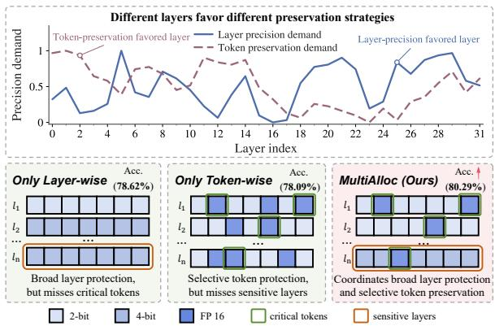  
Figure 1: Motivation for budget-aware precision allocation under a fixed KV cache budget. Different layers exhibit heterogeneous demands for layer precision enhancement and token preservation. Existing layer-wise and token-wise methods optimize individual preservation strategies, while MultiAlloc profiles these demands and allocates the shared memory budget across preservation strategies.

Recent studies on KV cache quantization have developed increasingly targeted strategies to reduce memory overhead while preserving model accuracy. KIVI (Liu et al., 2024) introduces asymmetric low-bit quantization by applying channel-level quantization to keys and token-level quantization to values, substantially reducing KV cache memory consumption. Subsequent token-oriented methods further improve this direction, with ZipCache (He et al., 2024) identifying salient tokens and OTT (Su et al., 2025) tracing and preserving outlier tokens at higher precision to reduce token quantization errors. However, these methods largely overlook the heterogeneous sensitivity of different layers. In contrast, KVTuner (Li et al., 2025) and PM-KVQ (Liu et al., 2026) allocate mixed precision according to layer or block sensitivity, thereby reducing quantization errors caused by layer heterogeneity. Nevertheless, they generally apply uniform token treatment within each layer and do not explicitly preserve token-level heterogeneity. Recent multi-granularity methods, such as KVmix (Li et al., 2026), further explore the joint adaptation of layer-wise precision and token-level preservation by incorporating layer importance and pivotal context selection. However, their token-level adaptation mainly focuses on context selection rather than precision allocation based on heterogeneous token importance.

Motivated by these observations, we formulate KV cache quantization as a precision allocation problem under a fixed memory budget. We propose MultiAlloc, a profiling-guided precision allocation framework that characterizes heterogeneous precision demands across layers and tokens. Specifically, MultiAlloc employs layer-wise sensitivity profiling to estimate the precision requirements of different layers, while token-wise importance profiling identifies tokens that benefit from highprecision preservation. Based on these complementary profiling signals, MultiAlloc adaptively determines the allocation of limited quantization resources between layer-wise precision enhancement and token-wise high-precision preservation. All allocation decisions are derived offline and applied as a static inference-time policy, eliminating online allocation search during inference.

We conduct extensive experiments on reasoning and long-context benchmarks, including GSM8K, GPQA, and LongBench-v2, using models ranging from 7B to 32B parameters, including Llama-3-8B-Instruct (Grattafiori et al., 2024), Mistral-7B-Instruct-v0.3 (Jiang et al., 2023), DeepSeek-R1-Distill-Qwen-7B/14B (DeepSeek-AI, 2025), and QwQ-32B (Qwen Team, 2025). The results demonstrate that MultiAlloc consistently outperforms representative layer-wise, token-wise, and importance-based KV cache quantization methods under matched KV cache memory budgets, with robust improvements across different model scales and both reasoning and long-context tasks.

Our contributions are summarized as follows:

• We reveal heterogeneous precision demands across layers and tokens in KV cache quantization, motivating precision allocation under a fixed KV cache memory budget.

• We propose MultiAlloc, a profiling-guided precision allocation framework that models layerwise sensitivity and token importance to adaptively allocate limited quantization resources between layer precision enhancement and token preservation.

• Extensive experiments across diverse models and reasoning and long-context benchmarks demonstrate that MultiAlloc consistently outperforms representative layer-wise, tokenwise, and importance-based KV cache quantization methods under matched KV cache memory budgets.

## 2 Related Work

KV Cache Quantization and Precision Allocation. Recent KV cache quantization methods explore different strategies to reduce quantization errors while preserving inference quality. KIVI (Liu et al., 2024) introduces asymmetric low-bit quantization by applying channel-level quantization to keys and token-level quantization to values. Tokenaware approaches, such as ZipCache (He et al., 2024) and OTT (Su et al., 2025), preserve salient tokens at higher precision to mitigate token quantization errors. Layer-wise methods, including KV-Tuner (Li et al., 2025) and PM-KVQ (Liu et al., 2026), allocate mixed precision according to layer sensitivity. KVmix (Li et al., 2026) further explores layer- and token-level adaptation, while KV-COBRA (Ha et al., 2026) studies budget-aware allocation of compression configurations under fixed memory constraints. MoE-nD (Sun et al., 2026) extends KV compression to multiple dimensions by jointly considering quantization and token reduction. However, existing approaches mainly optimize individual compression strategies or configurations, without explicitly modeling heterogeneous precision demands across granularities or allocating a shared budget between different precision preservation strategies.

KV Cache Memory Management. Beyond quantization, another line of work focuses on managing KV cache memory usage during LLM inference. PagedAttention (Kwon et al., 2023) improves memory efficiency through virtual memory paging, while subsequent approaches such as H2O (Zhang et al., 2023), StreamingLLM (Xiao et al., 2024), SqueezeAttention (Wang et al., 2024), XKV (Li et al., 2024), and KVPR (Jiang et al., 2025) reduce memory pressure through token eviction, retention, or offloading strategies. These methods primarily optimize which KV entries to retain or where to store them, whereas MultiAlloc focuses on allocating limited quantization resources among different precision preservation strategies within the KV cache representation.

Differentiation of Our Work. Existing KV cache quantization methods have demonstrated the effectiveness of preserving important layers or tokens at higher precision. However, they mainly focus on identifying important components or adapting individual precision strategies, without explicitly modeling heterogeneous precision demands across different granularities. In contrast, MultiAlloc introduces a profiling-guided precision allocation framework that determines how limited quantization resources should be distributed between layer-wise precision enhancement and token-wise high-precision preservation under a fixed KV cache memory budget.

## 3 Preliminary

## 3.1 Generative Inference and KV Cache

Transformer-based Large Language Models (LLMs) generate text autoregressively in two phases: prefilling and decoding. Given a prompt sequence of length $T _ { i n } .$ , prefilling processes all tokens in parallel to generate the initial Key-Value (KV) cache, while decoding generates new tokens token-by-token. To avoid recomputing historical representations, the Key and Value vectors of past tokens are cached in GPU memory. For an L-layer Transformer, let $\mathbf { h } _ { l , t } \in \mathbb { R } ^ { d }$ denote the hidden state of the t-th token at layer l. The query, key, and value vectors are computed via linear projections:

$$
\mathbf { q } _ { l , t } = \mathbf { W } _ { l } ^ { Q } \mathbf { h } _ { l , t } , \quad \mathbf { k } _ { l , t } = \mathbf { W } _ { l } ^ { K } \mathbf { h } _ { l , t } , \quad \mathbf { v } _ { l , t } = \mathbf { W } _ { l } ^ { V } \mathbf { h } _ { l , t } .\tag{1}
$$

where $\mathbf { W } _ { l } ^ { Q } , \mathbf { W } _ { l } ^ { K } , \mathbf { W } _ { l } ^ { V } \ \in \ \mathbb { R } ^ { d \times d }$ are learnable weight matrices. At decoding step $t > T _ { i n }$ , the query ${ \bf q } _ { l , t }$ attends to all cached keys and values. The KV cache is updated by concatenating the new vectors along the sequence dimension:

$$
\begin{array} { r } { { \bf K } _ { l , \le t } = { \mathrm { C o n c a t } } ( { \bf K } _ { l , < t } , { \bf k } _ { l , t } ) , } \\ { { \bf V } _ { l , \le t } = { \mathrm { C o n c a t } } ( { \bf V } _ { l , < t } , { \bf v } _ { l , t } ) . } \end{array}\tag{2}
$$

The attention output $\mathbf { o } _ { l , t }$ is:

$$
\mathbf { o } _ { l , t } = \mathrm { s o f t m a x } \left( \frac { \mathbf { q } _ { l , t } \mathbf { K } _ { l , \leq t } ^ { \top } } { \sqrt { d } } \right) \mathbf { V } _ { l , \leq t } .\tag{3}
$$

As the sequence length T grows, the KV cache footprint scales linearly as $O ( L \cdot T \cdot d )$ , often exceeding model-weight memory in long-context scenarios and becoming a primary inference bottleneck.

## 3.2 KV Cache Quantization

To alleviate this bottleneck, Post-Training Quantization (PTQ) compresses the KV cache into low-bit representations. For a tensor X (representing either K or V), uniform affine quantization maps floating-point values to b-bit integers:

$$
\bar { \bf X } = \mathrm { c l a m p } \left( \left\lfloor \frac { { \bf X } } { s } + z \right\rceil , 0 , 2 ^ { b } - 1 \right) ,\tag{4}
$$

where s and z denote the scale factor and zeropoint, respectively. The dequantized approximation is reconstructed as $\hat { \bf X } = ( \bar { \bf X } - z ) \cdot { \bf \nabla } s$ . The quantization error $\mathcal { E } = \| \mathbf { X } - \hat { \mathbf { X } } \| _ { F } ^ { 2 }$ stems primarily from rounding and outlier clamping. Conventional quantization approaches often apply uniform bitwidths across layers and tokens, overlooking the heterogeneous precision requirements within KV cache representations.

However, this overlooks the heterogeneous sensitivity of KV cache representations: (1) certain layers are more robust to quantization noise and can tolerate lower bit-widths, while (2) specific tokens contribute disproportionately to quantization errors due to their distinct value distributions.

## 4 Method

We propose MultiAlloc, a profiling-guided precision allocation framework for KV cache quantization. As illustrated in Figure 2, MultiAlloc consists of three stages: decoupled precision demand profiling, budget-coupled precision allocation, and static policy execution.

## 4.1 Problem Formulation and Overview

We formulate KV cache quantization as a precision allocation problem under a fixed KV cache memory budget. Given a Transformer model with L layers, we aim to determine a static quantization policy that allocates limited quantization resources between layer-wise precision enhancement and token-wise high-precision preservation.

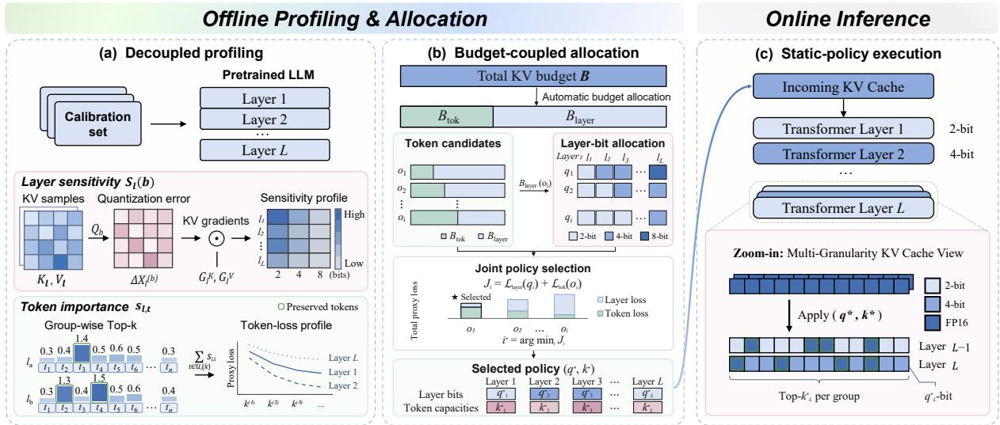  
Figure 2: Overview of MultiAlloc. An offline profiling stage estimates layer-wise precision demands and token-wise preservation demands, followed by a budget-coupled precision allocation module that derives the static policy $( \mathbf { q } ^ { \star } , \mathbf { k } ^ { \star } )$ under a fixed KV cache memory budget B. The policy is then directly applied during online inference.

Specifically, let $\mathbf { q } = \{ q _ { l } \} _ { l = 1 } ^ { L }$ denote the layerwise bit-width configuration, where $q _ { l }$ represents the quantization precision of the KV cache at layer l. Meanwhile, let $\textbf { k } = \{ k _ { l } \} _ { l = 1 } ^ { L }$ denote the token preservation configuration, where $k _ { l }$ represents the number of high-precision tokens preserved per group at layer l. The resulting policy is represented as $\pi = ( \mathbf { q } , \mathbf { k } )$

Given a fixed KV cache memory budget B, the objective is to minimize the quantization-induced degradation while satisfying the memory budget:

$$
\operatorname* { m i n } _ { \mathbf { q } , \mathbf { k } } \mathcal { L } ( \mathbf { q } , \mathbf { k } ) \quad \mathrm { s . t . } \quad \mathcal { M } ( \mathbf { q } , \mathbf { k } ) \leq B .\tag{5}
$$

where $\mathcal { L } ( \cdot )$ denotes the estimated degradation caused by KV cache compression and $\mathcal { M } ( \cdot )$ denotes the corresponding memory consumption.

Directly optimizing this objective requires searching over a large number of layer-wise precision and token preservation configurations. To address this challenge, MultiAlloc adopts an offline profiling and allocation pipeline, as illustrated in Figure 2. First, the decoupled profiling stage estimates layer-wise precision demands and tokenwise preservation demands from calibration data. Then, the budget-coupled precision allocation module evaluates candidate policies and determines the allocation of quantization resources between different preservation strategies. Finally, the selected static policy is directly applied during online inference without additional allocation search.

## 4.2 Layer-wise Precision Demand Estimation

Different Transformer layers exhibit different sensitivity to KV cache quantization, resulting in heterogeneous requirements for quantization precision. To estimate layer-wise precision demands, MultiAlloc profiles the quantization-induced degradation of each layer under different bit-widths.

Let $\mathcal { Q } _ { b } ( \cdot )$ denote the quantization operator with bit-width b. For the KV cache of layer l, the quantization errors of keys and values are defined as:

$$
\Delta \mathbf { K } _ { l } ^ { ( b ) } = \mathcal { Q } _ { b } ( \mathbf { K } _ { l } ) - \mathbf { K } _ { l } , \quad \Delta \mathbf { V } _ { l } ^ { ( b ) } = \mathcal { Q } _ { b } ( \mathbf { V } _ { l } ) - \mathbf { V } _ { l } .\tag{6}
$$

The impact of quantization errors on model output can be approximated by a first-order Taylor expansion:

$$
\Delta \mathcal { L } _ { l } ^ { ( b ) } \approx \left. \frac { \partial \mathcal { L } } { \partial \mathbf { K } _ { l } } , \Delta \mathbf { K } _ { l } ^ { ( b ) } \right. + \left. \frac { \partial \mathcal { L } } { \partial \mathbf { V } _ { l } } , \Delta \mathbf { V } _ { l } ^ { ( b ) } \right. .\tag{7}
$$

In practice, we estimate the layer-wise degradation using the magnitude of the first-order contribution over calibration samples:

$$
S _ { l } ( b ) = \mathbb { E } \left[ \left\| \Delta \mathbf { K } _ { l } ^ { ( b ) } \odot \mathbf { G } _ { l } ^ { K } \right\| _ { 1 } + \left\| \Delta \mathbf { V } _ { l } ^ { ( b ) } \odot \mathbf { G } _ { l } ^ { V } \right\| _ { 1 } \right] ,\tag{8}
$$

where $\begin{array} { r } { \mathbf { G } _ { l } ^ { K } = \frac { \partial \mathcal { L } } { \partial \mathbf { K } _ { l } } } \end{array}$ and $\begin{array} { r } { \mathbf { G } _ { l } ^ { V } = \frac { \partial \mathcal { L } } { \partial \mathbf { V } _ { l } } } \end{array}$

The resulting profile $\{ S _ { l } ( b ) \} _ { l = 1 } ^ { L }$ captures the precision requirements of different layers under candidate bit-widths. These layer-wise precision demands are then provided to the budget-coupled allocation module to determine the layer precision configuration under the KV cache memory budget.

## 4.3 Token-wise Preservation Demand Estimation

Besides layer-wise precision differences, KV cache quantization also exhibits token-level heterogeneity, where a small subset of tokens can contribute disproportionately to inference quality. MultiAlloc therefore estimates token-wise preservation demands to determine how much high-precision storage should be allocated to different layers.

For a token representation $\mathbf { K } _ { l , t }$ at layer $l ,$ we measure its importance using the activation magnitude:

$$
s _ { l , t } = \| \mathbf { K } _ { l , t } \| _ { 1 } ,\tag{9}
$$

which provides a lightweight proxy for the contribution of token t to attention computation.

During inference, tokens are organized into groups of size $G .$ For each group, MultiAlloc preserves the top-kl tokens with higher precision according to their importance scores, while the remaining tokens are quantized using the layer-wise assigned precision. To estimate the preservation demand, we measure the importance mass lost after preserving $k _ { l }$ tokens in each group:

$$
\mathcal { L } _ { \mathrm { t o k } } ( k _ { l } ) = \sum _ { t \in \mathcal { G } _ { l } } s _ { l , t } - \sum _ { t \in \mathrm { T o p K } ( \mathcal { G } _ { l } , k _ { l } ) } s _ { l , t } ,\tag{10}
$$

where $\mathcal { G } _ { l }$ denotes a token group at layer $l .$

By evaluating different preservation capacities, we obtain a token-level preservation profile:

$$
\{ \mathcal { L } _ { \mathrm { t o k } } ( k _ { l } ) \} _ { l = 1 } ^ { L } ,
$$

which characterizes the precision demand of preserving additional tokens. Together with the layerwise precision profiles, these estimates provide complementary signals for the subsequent budgetcoupled precision allocation.

## 4.4 Budget-Coupled Precision Allocation

The layer-wise and token-wise profiling stages provide complementary precision demand signals for allocation. However, both precision enhancement strategies compete for the same KV cache memory budget. Therefore, MultiAlloc performs budgetcoupled precision allocation to determine how limited quantization resources should be distributed between layer precision enhancement and token preservation.

Given a KV cache memory budget $B ,$ , we first construct a set of token preservation candidates:

$$
\mathcal { O } = \{ o _ { i } \} _ { i = 1 } ^ { N } ,\tag{11}
$$

where each candidate $o _ { i }$ specifies a layer-wise token preservation capacity configuration:

$$
o _ { i } = \{ k _ { i , l } \} _ { l = 1 } ^ { L } .\tag{12}
$$

For each candidate $o _ { i }$ , its token preservation memory cost $M _ { \mathrm { t o k } } ( o _ { i } )$ and degradation $\mathcal { L } _ { \mathrm { t o k } } ( o _ { i } )$ are estimated according to the token preservation profiles. The remaining memory budget is then assigned to layer-wise precision allocation:

$$
B _ { \mathrm { l a y e r } } ( o _ { i } ) = B - M _ { \mathrm { t o k } } ( o _ { i } ) .\tag{13}
$$

Under the remaining layer budget, the optimal layer-wise bit-width configuration is obtained by solving:

$$
\begin{array} { r l } { q _ { i } ^ { * } = \arg \underset { \mathbf { q } } { \operatorname* { m i n } } } & { \mathcal { L } _ { \mathrm { l a y e r } } ( \mathbf { q } ) } \\ { \mathrm { s . t . } } & { M _ { \mathrm { l a y e r } } ( \mathbf { q } ) \leq B _ { \mathrm { l a y e r } } ( o _ { i } ) , } \end{array}\tag{14}
$$

where $\mathbf { q } = \{ q _ { l } \} _ { l = 1 } ^ { L }$ denotes the layer-wise precision configuration.

Each candidate policy is then ranked using a surrogate degradation score:

$$
J _ { i } = \mathcal { L } _ { \mathrm { l a y e r } } ( q _ { i } ^ { * } ) + \mathcal { L } _ { \mathrm { t o k } } ( o _ { i } ) .\tag{15}
$$

The final precision allocation policy is selected as:

$$
i ^ { * } = \arg \operatorname* { m i n } _ { i } J _ { i } ,\tag{16}
$$

yielding the final policy

$$
\pi ^ { * } = ( q ^ { * } , k ^ { * } ) .
$$

By coupling token preservation decisions with layer-wise precision allocation, MultiAlloc avoids manually specified budget splits and adaptively allocates quantization resources according to heterogeneous precision demands.

## 4.5 Static Policy Execution

After the offline allocation stage, MultiAlloc obtains a static precision policy $\pi ^ { * }$ , which specifies the layer-wise precision configuration and token preservation configuration. During inference, the policy is directly applied to incoming KV caches without additional allocation search.

Specifically, for each layer l, newly generated KV states are quantized according to the assigned bit-width $q _ { l } ^ { * }$ . Meanwhile, tokens are processed in groups according to the selected preservation configuration $k ^ { * }$ . Within each group, the top-k∗ tokens with higher importance scores are stored in high precision, while the remaining tokens are quantized using the corresponding layer-wise precision.

The resulting KV cache combines quantized representations with preserved high-precision tokens, enabling efficient long-context inference under the fixed KV cache memory budget.

## 5 Experiments

## 5.1 Experimental Setup

We evaluate reasoning and long-context performance on five instruction-tuned models spanning architectures and scales: Llama-3-8B-Instruct (Grattafiori et al., 2024), Mistral-7B-Instruct-v0.3 (Jiang et al., 2023), DeepSeek-R1-Distill-Qwen-7B and DeepSeek-R1-Distill-Qwen-14B (DeepSeek-AI, 2025), and QwQ-32B (Qwen Team, 2025). We report accuracy on GSM8K (Cobbe et al., 2021) and GPQA (Rein et al., 2024), together with macro-averaged accuracy across the six task categories of LongBenchv2 (Bai et al., 2025). The overall score averages the GPQA, GSM8K, and LongBench-v2 macroaverage scores. Dataset statistics and evaluation details are provided in Appendix A. All methods use identical prompts, tokenization, stopping criteria, and greedy decoding. All experiments are conducted on NVIDIA A100 GPUs.

For each model, we specify a model-dependent KV cache budget and evaluate all compressed methods under the same KV cache memory budget, with budgets reported in Table 1. We compare OTT (Su et al., 2025), a representative token-wise preservation method, PM-KVQ (Liu et al., 2026), a representative layer-wise mixed-precision method, KVmix (Li et al., 2026), an importance-guided hybrid KV cache quantization method, and our profiling-guided precision allocation framework MultiAlloc. All methods are implemented within the same inference framework and follow a unified KV cache memory-accounting protocol.

## 5.2 Main Results under Fixed KV Budgets

Table 1 reports the main results under fixed, modelspecific KV cache budgets. For each model, OTT, PM-KVQ, KVmix, and MultiAlloc are evaluated under the same memory budget, while FP16 serves as an uncompressed reference. Across all five models, MultiAlloc achieves the highest overall accuracy among compressed methods, demonstrating the effectiveness of profiling-guided precision allocation under constrained KV cache budgets.

This advantage remains evident as model scale increases. On DeepSeek-Qwen-14B, MultiAlloc matches the best compressed GPQA result and achieves the strongest performance on GSM8K and LongBench-v2. On QwQ-32B, it achieves the best GPQA and LongBench-v2 performance under the same budget. The smaller gains over existing methods on larger models arise because their compressed performance already approaches FP16, leaving limited headroom for improvement. Nevertheless, MultiAlloc closes 48.2% and 52.1% of the gaps on the 14B and 32B models, respectively.

Although individual precision preservation strategies may perform well on specific benchmarks due to task-dependent sensitivity, MultiAlloc provides more balanced performance across reasoning and long-context tasks by adaptively allocating quantization resources according to heterogeneous precision demands.

## 5.3 Ablation Studies

We conduct ablation studies on Llama-3-8B-Instruct under a fixed 423 MB KV cache budget. All variants follow the same evaluation settings as the main experiments. We perform two analyses: precision dimension ablation for layer- wise precision enhancement and token-wise preservation, and allocation ablation for profiling-guided precision allocation against manual budget splits.

Table 2 reports the precision preservation ablation results. Layer-only removes token preservation, while Token-only removes layer-wise precision enhancement and preserves selected tokens under a uniform low-bit configuration. MultiAlloc allocates precision based on both layer-wise and token-wise precision demands. Removing either dimension degrades performance, confirming their complementary roles.

Table 3 compares the profiling-guided allocation of MultiAlloc with manually specified allocation strategies between layer-wise precision enhancement and token preservation. The manual policies adopt 50/50, 65/35, and 35/65 budget splits, while MultiAlloc determines the allocation through offline profiling. The 65/35 split achieves comparable performance because it happens to closely match the allocation selected by MultiAlloc under this specific budget and model setting.

## 5.4 Different Memory Budgets Performance

We evaluate MultiAlloc under multiple KV cache budgets to assess its robustness under varying memory constraints. Experiments are conducted on Llama-3-8B-Instruct, Mistral-7B-Instruct, and DeepSeek-Qwen-14B using GSM8K. For each model, we select four model-specific budget points and compare OTT, PM-KVQ, KVmix, and MultiAlloc under identical prompting, decoding, and evaluation settings.

<table><tr><td>Model</td><td>Method</td><td>KV Budget</td><td>GPQA</td><td>GSM8K</td><td>LongBench-v2</td><td>Avg</td></tr><tr><td rowspan="5">Llama-3-8B-Instruct</td><td>FP16</td><td>1024 MB</td><td>32.83</td><td>80.89</td><td>24.79</td><td>46.17</td></tr><tr><td>OTT (ACL 2025)</td><td>423 MB</td><td>32.83</td><td>76.95</td><td>23.14</td><td>44.31</td></tr><tr><td>PM-KVQ (ICLR 2026)</td><td>423 MB</td><td>30.30</td><td>79.98</td><td>24.56</td><td>44.95</td></tr><tr><td>KVmix (AAAI 2026)</td><td>423 MB</td><td>32.83</td><td>74.83</td><td>26.94</td><td>44.87</td></tr><tr><td>MultiAlloc (Ours)</td><td>423 MB</td><td>32.83</td><td>80.36</td><td>25.85</td><td>46.35</td></tr><tr><td rowspan="5">Mistral-7B-Instruct</td><td>FP16</td><td>1024 MB</td><td>27.27</td><td>48.75</td><td>24.78</td><td>33.60</td></tr><tr><td>OTT (ACL 2025)</td><td>431 MB</td><td>26.77</td><td>44.96</td><td>23.46</td><td>31.73</td></tr><tr><td>PM-KVQ (ICLR 2026)</td><td>431 MB</td><td>26.26</td><td>47.76</td><td>23.50</td><td>32.51</td></tr><tr><td>KVmix (AAAI 2026)</td><td>431 MB</td><td>26.26</td><td>45.11</td><td>25.55</td><td>32.31</td></tr><tr><td>MultiAlloc (Ours)</td><td>431 MB</td><td>27.27</td><td>48.67</td><td>23.94</td><td>33.29</td></tr><tr><td rowspan="5">DeepSeek-Qwen-7B</td><td>FP16</td><td>448 MB</td><td>30.81</td><td>90.37</td><td>27.48</td><td>49.55</td></tr><tr><td>OTT (ACL 2025)</td><td>180 MB</td><td>28.28</td><td>87.57</td><td>17.82</td><td>44.56</td></tr><tr><td>PM-KVQ (ICLR 2026)</td><td>180 MB</td><td>29.80</td><td>89.69</td><td>25.68</td><td>48.39</td></tr><tr><td>KVmix (AAAI 2026)</td><td>180 MB</td><td>31.31</td><td>82.11</td><td>20.28</td><td>44.57</td></tr><tr><td>MultiAlloc (Ours)</td><td>180 MB</td><td>30.30</td><td>90.14</td><td>26.75</td><td>49.06</td></tr><tr><td rowspan="5">DeepSeek-Qwen-14B</td><td>FP16</td><td>1536 MB</td><td>37.37</td><td></td><td></td><td></td></tr><tr><td>OTT (ACL 2025)</td><td>620 MB</td><td>35.35</td><td>89.39</td><td>27.86 24.28</td><td>51.54</td></tr><tr><td>PM-KVQ (ICLR 2026)</td><td>620 MB</td><td>37.37</td><td>74.30 88.32</td><td>25.63</td><td>44.64 50.44</td></tr><tr><td>KVmix (AAAI 2026)</td><td>620 MB</td><td>34.85</td><td>88.32</td><td>26.15</td><td>49.77</td></tr><tr><td>MultiAlloc (Ours)</td><td>620 MB</td><td>37.37</td><td></td><td></td><td></td></tr><tr><td rowspan="5">QwQ-32B</td><td>FP16</td><td></td><td></td><td>89.01</td><td>26.54</td><td>50.97</td></tr><tr><td>OTT (ACL 2025)</td><td>2048 MB</td><td>39.39</td><td>95.53</td><td>28.03</td><td>54.32</td></tr><tr><td>PM-KVQ (ICLR 2026)</td><td>820 MB 820 MB</td><td>37.88 37.88</td><td>95.22 95.07</td><td>26.57 27.82</td><td>53.22 53.59</td></tr><tr><td>KVmix (AAAI 2026)</td><td>820 MB</td><td>38.38</td><td>93.03</td><td>27.73</td><td>53.05</td></tr><tr><td>MultiAlloc (Ours)</td><td>820 MB</td><td>38.38</td><td>95.38</td><td>28.15</td><td>53.97</td></tr></table>

Table 1: Main performance comparison of compressed methods under the same KV cache memory budgets.

<table><tr><td>Variant</td><td>Layer alloc.</td><td>Token presv.</td><td>LongBench-v2</td></tr><tr><td>Layer-only</td><td>√</td><td>×</td><td>25.58</td></tr><tr><td>Token-only</td><td>X</td><td>√</td><td>24.88</td></tr><tr><td>MultiAlloc (Ours)</td><td>V</td><td>√</td><td>25.85</td></tr></table>

Table 2: Component ablation of layer-wise allocation and token-wise preservation.

As shown in Table 4, MultiAlloc consistently achieves strong performance across different models and KV cache budgets. Under tighter memory constraints, it better preserves inference accuracy than existing precision preservation strategies, while maintaining stable gains as the available bud-

<table><tr><td>Allocation strategy</td><td>GSM8K</td><td>LongBench-v2</td></tr><tr><td>Manual Split (65/35)</td><td>80.29</td><td>25.59</td></tr><tr><td>Manual Split (50/50)</td><td>77.79</td><td>25.83</td></tr><tr><td>Manual Split (35/65)</td><td>77.41</td><td>25.56</td></tr><tr><td>MultiAlloc (Profiled)</td><td>80.36</td><td>25.85</td></tr></table>

Table 3: Comparison between profiling-guided budget allocation and manual budget splits.

get increases.

These results demonstrate that MultiAlloc generalizes across different memory regimes by adaptively allocating limited quantization resources according to profiled precision demands, achieving a robust accuracy-memory trade-off under varying KV cache budgets.

## 5.5 Analysis of Allocation Behavior

We further analyze the allocation policies produced by MultiAlloc on Llama-3-8B-Instruct across GSM8K, GPQA, and LongBench-v2. As shown in Figure 3, MultiAlloc generates non-uniform allocation policies with both shared structures and task-dependent variations, reflecting heterogeneous precision demands across workloads.

<table><tr><td>Method / Budget</td><td> $B _ { 1 }$ </td><td> $B _ { 2 }$ </td><td> $B _ { 3 }$ </td><td> $B _ { 4 }$ </td></tr><tr><td>Llama-3-8B-Instruct</td><td></td><td>(FP16: 80.89)</td><td></td><td></td></tr><tr><td>Budget (MB)</td><td>283</td><td>383</td><td>423</td><td>463</td></tr><tr><td>OTT</td><td>76.88</td><td>77.56</td><td>76.95</td><td>78.09</td></tr><tr><td>PM-KVQ</td><td>58.83</td><td>79.00</td><td>79.98</td><td>78.62</td></tr><tr><td>KVmix</td><td>75.13</td><td>74.07</td><td>74.83</td><td>75.21</td></tr><tr><td>MultiAlloc (Ours)</td><td>77.33</td><td>79.15</td><td>80.36</td><td>80.29</td></tr><tr><td>Mistral-7B-Instruct</td><td></td><td>(FP16: 48.75)</td><td></td><td></td></tr><tr><td>Budget (MB)</td><td>311</td><td>351</td><td>391</td><td>431</td></tr><tr><td>OTT</td><td>43.52</td><td>44.88</td><td>45.64</td><td>44.96</td></tr><tr><td>PM-KVQ</td><td>47.69</td><td>49.20</td><td>47.31</td><td>47.76</td></tr><tr><td>KVmix</td><td>41.62</td><td>43.52</td><td>44.12</td><td>45.11</td></tr><tr><td>MultiAlloc (Ours)</td><td>48.22</td><td>49.36</td><td>47.01</td><td>48.67</td></tr><tr><td>DeepSeek-Qwen-14B</td><td></td><td>(FP16: 89.39)</td><td></td><td></td></tr><tr><td>Budget (MB)</td><td>500</td><td>540</td><td>580</td><td>620</td></tr><tr><td>OTT</td><td>72.86</td><td>72.48</td><td>73.92</td><td>74.30</td></tr><tr><td>PM-KVQ</td><td>87.49</td><td>87.95</td><td>88.10</td><td>88.32</td></tr><tr><td>KVmix</td><td>85.97</td><td>86.13</td><td>87.57</td><td>88.32</td></tr><tr><td>MultiAlloc (Ours)</td><td>89.23</td><td>88.25</td><td>88.70</td><td>89.01</td></tr></table>

Table 4: Comparison of GSM8K accuracy (%) across multiple models under different KV cache budgets.

Figure 3(a) presents the layer-wise KV cache bit-width allocation produced by MultiAlloc. The allocation exhibits clear layer-wise variation, where sensitive layers receive higher precision while most layers are assigned lower bit-widths under the fixed KV cache budget. Task-dependent differences further show that offline profiling adapts bit-width allocation according to workload characteristics.

Figure 3(b) presents the token preservation capacity allocation produced by MultiAlloc. Compared with layer-wise bit-width allocation, token preservation exhibits stronger task-dependent variation. GSM8K preserves more tokens across a wider range of layers, while GPQA and LongBench-v2 concentrate preservation on specific layers. This sparse allocation shows that MultiAlloc selectively assigns precision resources to important tokens.

## 5.6 Runtime Efficiency

We evaluate the runtime efficiency of FP16, OTT, PM-KVQ, KVmix, and MultiAlloc on Llama-3- 8B-Instruct using NVIDIA A100 GPUs under the same 423 MB KV cache budget. We measure decoding throughput under varying input and generation lengths with batch size one, and average the results over five runs after warm-up. The one-time offline profiling cost of MultiAlloc is excluded. As shown in Figure 4, MultiAlloc consistently achieves higher decoding throughput than quantized baselines across different input and generation lengths. It delivers 1.25–1.26× speedup over the fastest quantized baseline (KVmix) under varying input lengths and 1.13–1.41× speedup under different generation lengths, demonstrating efficient static policy execution during inference.

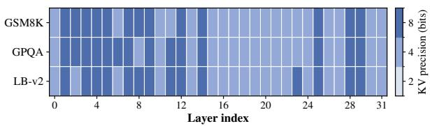

(a) Layer-wise KV cache bit-width allocation.  
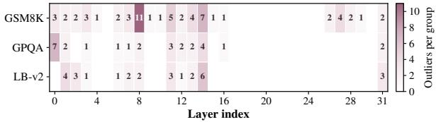  
(b) Token preservation capacity allocation.

Figure 3: Allocation behavior of MultiAlloc across different tasks under heterogeneous precision demands.  
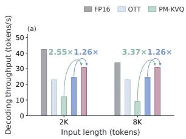

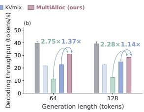  
Figure 4: Runtime efficiency comparison on Llama-3-8B-Instruct under the same KV cache budget with varying input and generation lengths.

## 6 Conclusion

In this work, we formulate KV cache quantization under a fixed KV cache memory budget as a precision allocation problem, where limited quantization resources are adaptively distributed between layerwise precision enhancement and token-wise preservation. We propose MultiAlloc, a profiling-guided framework that characterizes heterogeneous precision demands across layers and tokens, and derives a static precision policy through budget-coupled allocation. Extensive experiments on reasoning and long-context benchmarks demonstrate that Multi-Alloc consistently outperforms representative layerwise, token-wise, and importance-based KV cache quantization methods under matched KV cache

memory budgets.

## 7 Limitations

This work focuses on profiling-guided precision allocation for KV cache quantization under fixed memory budgets. While MultiAlloc eliminates online allocation search through offline policy derivation, the profiling stage introduces preprocessing overhead and requires representative calibration data. Future work will explore lightweight profiling and improved policy generalization.

## References

Yushi Bai, Shangqing Tu, Jiajie Zhang, Hao Peng, Xiaozhi Wang, Xin Lv, Shulin Cao, Jiazheng Xu, Lei Hou, Yuxiao Dong, et al. 2025. LongBench v2: Towards deeper understanding and reasoning on realistic long-context multitasks. In Proceedings ofthe 63rd Annual Meeting ofthe Associationfor Computational Linguistics (Volume 1: Long Papers), pages 3639–3664.

Karl Cobbe, Vineet Kosaraju, Mohammad Bavarian, Mark Chen, Heewoo Jun, Lukasz Kaiser, Matthias Plappert, Jerry Tworek, Jacob Hilton, Reiichiro Nakano, et al. 2021. Training verifiers to solve math word problems. arXiv preprint arXiv:2110.14168.

DeepSeek-AI. 2025. DeepSeek-R1: Incentivizing reasoning capability in LLMs via reinforcement learning. Preprint, arXiv:2501.12948.

Aaron Grattafiori, Abhimanyu Dubey, Abhinav Jauhri, Abhinav Pandey, Abhishek Kadian, Ahmad Al-Dahle, Aiesha Letman, Akhil Mathur, Alan Schelten, Alex Vaughan, et al. 2024. The llama 3 herd of models. arXiv preprint arXiv:2407.21783.

Sihyeon Ha, Jaeho Lee, and Yo-Seb Jeon. 2026. KV-COBRA: KV cache compression via cooptimized bit-rank allocation. arXiv preprint arXiv:2609.24298.

Yefei He, Luoming Zhang, Weijia Wu, Jing Liu, Hong Zhou, and Bohan Zhuang. 2024. ZipCache: Accurate and efficient kv cache quantization with salient token identification. In Advances in Neural Information Processing Systems.

Albert Q. Jiang, Alexandre Sablayrolles, Arthur Mensch, Chris Bamford, Devendra Singh Chaplot, Diego de las Casas, Florian Bressand, Gianna Lengyel, Guillaume Lample, Lucile Saulnier, Lélio Renard Lavaud, Marie-Anne Lachaux, Pierre Stock, Teven Le Scao, Thibaut Lavril, Thomas Wang, Timothée Lacroix, and William El Sayed. 2023. Mistral 7b. arXiv preprint arXiv:2310.06825.

Chaoyi Jiang, Lei Gao, Hossein Entezari Zarch, and Murali Annavaram. 2025. KVPR: Efficient llm inference with i/o-aware kv cache partial recomputation.

In Findings of the Association for Computational Linguistics: ACL 2025.

Woosuk Kwon, Zhuohan Li, Siyuan Zhuang, Ying Sheng, Lianmin Zheng, Cody Hao Yu, Joseph Gonzalez, Hao Zhang, and Ion Stoica. 2023. Efficient memory management for large language model serving with PagedAttention. In Proceedings ofthe 29th Symposium on Operating Systems Principles. Association for Computing Machinery.

Fei Li, Song Liu, Weiguo Wu, Shiqiang Nie, and Jinyu Wang. 2026. KVmix: Gradient-based layer importance-aware mixed-precision quantization for KV cache. In Proceedings ofthe AAAI Conference on Artificial Intelligence, volume 40, pages 31563– 31572.

Weizhuo Li, Zhigang Wang, Yu Gu, and Ge Yu. 2024. XKV: Personalized kv cache memory reduction for long-context llm inference. arXiv preprint arXiv:2412.05896.

Xing Li, Zeyu XING, Yiming Li, Linping Qu, Hui-Ling Zhen, Yiwu Yao, Wulong Liu, Sinno Jialin Pan, and Mingxuan Yuan. 2025. KVTuner: Sensitivity-aware layer-wise mixed-precision kv cache quantization for efficient and nearly lossless llm inference. In Forty-second International Conference on Machine Learning.

Tengxuan Liu, Shiyao Li, Jiayi Yang, Tianchen Zhao, Feng Zhou, Xiaohui Song, Guohao Dai, Shengen Yan, Huazhong Yang, and Yu Wang. 2026. PM-KVQ: Progressive mixed-precision KV cache quantization for long-CoT LLMs. In The Fourteenth International Conference on Learning Representations.

Zirui Liu, Jiayi Yuan, Hongye Jin, Shaochen Zhong, Zhaozhuo Xu, Vladimir Braverman, Beidi Chen, and Xia Hu. 2024. KIVI: A tuning-free asymmetric 2bit quantization for kv cache. In Forty-first International Conference on Machine Learning.

Qwen Team. 2025. Qwq-32b: Embracing the power of reinforcement learning.

David Rein, Betty Li Hou, Asa Cooper Stickland, Jackson Petty, Richard Yuanzhe Pang, Julien Dirani, Julian Michael, and Samuel R Bowman. 2024. GPQA: A graduate-level google-proof q&a benchmark. In First Conference on Language Modeling.

Yi Su, Yuechi Zhou, Quantong Qiu, Juntao Li, Qingrong Xia, Ping Li, Xinyu Duan, Zhefeng Wang, and Min Zhang. 2025. Accurate kv cache quantization with outlier tokens tracing. In Proceedings of the 63rd Annual Meeting of the Association for Computational Linguistics.

Libo Sun, Peixiong He, Po-Wei Harn, and Xiao Qin. 2026. MoE-nD: Per-layer mixture-of-experts routing for multi-axis KV cache compression. arXiv preprint arXiv:2604.17695.

He Wang, Yu Gu, Fangfang Li, Zhigang Wang, Zhenghao Liu, Ning Wang, Xiaohua Li, and Ge Yu. 2026. HqeKV: Towards hybrid quantization and eviction for KV cache in long-context LLM inference. In Findings ofthe Associationfor Computational Linguistics: ACL 2026, pages 4138–4153.

Zihao Wang, Bin Cui, and Shaoduo Gan. 2024. Squeezeattention: 2D management of KV-cache in LLM inference via layer-wise optimal budget. arXiv preprint arXiv:2404.04793.

Guangxuan Xiao, Yuandong Tian, Beidi Chen, Song Han, and Mike Lewis. 2024. Efficient streaming language models with attention sinks. In The Twelfth International Conference on Learning Representations.

Tao Zhang, Ziqian Zeng, Hao Peng, Huiping Zhuang, and Cen Chen. 2026. MixKVQ: Query-aware mixedprecision KV cache quantization for long-context reasoning. In Proceedings ofthe 64th Annual Meeting ofthe Associationfor Computational Linguistics (Volume 1: Long Papers), pages 7189–7204.

Zhenyu Zhang, Ying Sheng, Tianyi Zhou, Tianlong Chen, Lianmin Zheng, Ruisi Cai, Zhao Song, Yuandong Tian, Christopher Ré, Clark Barrett, Zhangyang “Atlas” Wang, and Beidi Chen. 2023. H2O: Heavy-hitter oracle for efficient generative inference of large language models. In Advances in Neural Information Processing Systems.

## A Experimental Setup and Calibration Details

This appendix provides additional details on the evaluated models and benchmarks, the evaluation protocol, and the task-specific calibration procedure used by MultiAlloc. Unless otherwise specified, all compressed methods follow the same evaluation settings as the FP16 baseline.

## A.1 Models and Benchmarks

Models. We evaluate MultiAlloc on five instruction-tuned language models covering different model families and parameter scales: Llama-3-8B-Instruct, Mistral-7B-Instruct-v0.3, DeepSeek-R1-Distill-Qwen-7B, DeepSeek-R1- Distill-Qwen-14B, and QwQ-32B. These models range from 7B to 32B parameters and include both general-purpose instruction-tuned models and reasoning-oriented models.

GPQA. GPQA is a multiple-choice benchmark designed to evaluate expert-level scientific reasoning. We use the GPQA-Diamond subset, which contains 198 four-option questions. Accuracy is reported over the evaluated questions.

GSM8K. GSM8K evaluates multi-step mathematical reasoning using grade-school word problems. The dataset contains 7,473 training examples and 1,319 test examples. We report accuracy on the test set based on the extracted final numerical answer.

LongBench-v2. LongBench-v2 evaluates longcontext understanding and reasoning in realistic scenarios. It contains 503 multiple-choice questions spanning six task categories: single-document question answering, multi-document question answering, long in-context learning, code repository understanding, long dialogue history understanding, and long structured-data understanding. Following the main paper, we report the unweighted macro-averaged accuracy across the six task categories.

## A.2 Evaluation Protocol

For each model, the FP16 baseline and all compressed methods use identical evaluation examples, prompt templates, tokenization, stopping criteria, answer-scoring procedures, and greedy decoding. Therefore, the compared methods differ only in their KV-cache compression strategies while following the same benchmark-specific evaluation protocol.

GPQA. We evaluate GPQA-Diamond on all 198 questions using the zero-shot direct-choice protocol with option permutation, following lm-evaluation-harness. We use a fixed random seed of 0 and greedy decoding, with a maximum generation length of 1,024 tokens. The generated response is mapped to the corresponding multiplechoice option for accuracy evaluation.

GSM8K. We evaluate all 1,319 examples from the GSM8K test set. The final numerical answer is extracted from the generated response and evaluated using exact match. Generation is performed with greedy decoding and is capped at 1,024 tokens. FP16 and all compressed methods use the same generation and answer-extraction procedure.

LongBench-v2. We evaluate all 503 examples in LongBench-v2 and report the unweighted macro-average accuracy over its six task categories. All methods use greedy decoding. For Llama-3-8B-Instruct and Mistral-7B-Instruct-v0.3, the maximum generation length is 128 tokens. For DeepSeek-R1-Distill-Qwen-7B, DeepSeek-R1-Distill-Qwen-14B, and QwQ-32B, the maximum generation length is 64 tokens, with explicit thinking disabled. QwQ-32B additionally uses constrained-choice decoding. Invalid, truncated, or failed generations are counted as incorrect.

## A.3 Task-Specific Calibration Protocol

MultiAlloc uses a task-specific calibration set for each evaluated benchmark. In other words, the profiling statistics used for GSM8K, GPQA, and LongBench-v2 are collected from separate calibration sets corresponding to the target workload. For a given model and task, the calibration data are used to estimate the layer-wise precision demand and token-wise preservation demand required by the offline allocator. The resulting allocation policy is then fixed and applied throughout inference for that workload.

Why task-specific calibration? MultiAlloc adopts workload-aware offline profiling because the precision demand of KV cache quantization is inherently dependent on the workload characteristics. Rather than deriving a single universal allocation policy, MultiAlloc estimates the precision requirements under the target inference workload, where different tasks may induce distinct activation distributions and token importance patterns. These variations affect both the relative quantization sensitivity of Transformer layers and the benefit of preserving selected tokens in higher precision.

This design is analogous to the calibration process commonly used in post-training quantization, where representative samples are used to characterize model behavior before deployment. The calibration data are only used to collect offline profiling statistics, including layer-wise quantization sensitivity and token-level preservation demand, rather than to optimize task-specific model parameters or access inference labels. As shown in the allocation analysis in the main paper, different workloads produce a stable layer-precision backbone with taskdependent variations in both layer-wise precision assignment and token-wise high-precision preservation.

Therefore, workload-specific calibration enables MultiAlloc to allocate the limited KV cache budget according to the precision demands of the target deployment scenario instead of relying on a manually designed fixed allocation strategy. Importantly, all profiling and allocation decisions are completed offline. Once the precision policy is generated, inference directly applies the static policy without online profiling, search, or dynamic reallocation.

## A.4 Implementation Details

All experiments are conducted on NVIDIA A100 GPUs with 80 GB of memory. Our implementation uses Python 3.10, PyTorch 2.5.1, Transformers 4.49.0, and Datasets 3.3.2. All methods use the same model checkpoints and software environment, with a batch size of one.

For each benchmark, FP16 and all compressed methods share identical preprocessing, prompting, tokenization, decoding, and stopping criteria. The KV-cache budgets used for the main comparison are reported in Table 1 of the main paper.

For MultiAlloc, profiling and budget-aware allocation are performed offline. Each model–dataset pair is profiled for the corresponding target KVcache budget, and the resulting allocation policy is saved and directly loaded during inference. Consequently, online inference involves no profiling, candidate-policy enumeration, dynamic programming, budget search, or adaptive reallocation.

Runtime measurements exclude the one-time offline profiling cost and are averaged over five runs after warm-up. For reproducibility, each run records the complete experimental configuration, software environment, GPU information, and source-code fingerprint. Model and dataset versions, memory budgets, decoding settings, and evaluation protocols are specified in the corresponding experiment configuration files.

## B Profiling-based Precision Demand Estimation

Directly evaluating the downstream performance of every candidate precision configuration would require repeated end-to-end inference and is prohibitively expensive. Instead, MultiAlloc constructs lightweight profiling surrogates to characterize the relative precision demand at different granularities. These surrogates are not intended to predict the absolute downstream accuracy of a compressed model. Rather, they provide relative preference signals among candidate precisionpreservation choices during offline allocation.

Specifically, we separately estimate (i) the sensitivity of different Transformer layers to KV cache quantization under different bit-widths and (ii) the benefit of selectively preserving important tokens in higher precision.

## B.1 Layer-wise Precision Demand Estimation

The layer-wise precision demand is estimated by quantifying the impact of KV cache quantization under different candidate bit-widths. The estimation is based on first-order perturbation analysis, where the quantization-induced changes of KV representations are used to approximate their influence on the profiling objective.

Let L denote the profiling loss, instantiated as the next-token negative log-likelihood on the calibration set $\mathcal { D } _ { c a l }$ . For a Transformer layer l, quantizing its KV cache to b bits produces:

$$
\bar { K } _ { l } ^ { ( b ) } = Q _ { b } ( K _ { l } ) , \quad \bar { V } _ { l } ^ { ( b ) } = Q _ { b } ( V _ { l } ) ,\tag{17}
$$

where $Q _ { b } ( \cdot )$ denotes the quantization operator with bit-width b. The corresponding quantization perturbations are defined as:

$$
\Delta K _ { l } ^ { ( b ) } = \bar { K } _ { l } ^ { ( b ) } - K _ { l } , \quad \Delta V _ { l } ^ { ( b ) } = \bar { V } _ { l } ^ { ( b ) } - V _ { l } .\tag{18}
$$

Treating the KV representations as intermediate variables in the computation graph, the loss variation caused by quantization can be approximated using a first-order Taylor expansion:

$$
\Delta \mathcal { L } _ { l } ^ { ( b ) } \approx \left. \frac { \partial \mathcal { L } } { \partial K _ { l } } , \Delta K _ { l } ^ { ( b ) } \right. + \left. \frac { \partial \mathcal { L } } { \partial V _ { l } } , \Delta V _ { l } ^ { ( b ) } \right. .\tag{19}
$$

Directly using the signed perturbation may underestimate the quantization impact, since positive and negative contributions across different tensor elements can cancel each other. Therefore, we measure the magnitude of first-order perturbations with the following non-negative surrogate:

$$
\Phi _ { l } ^ { ( b ) } = \left\| \Delta K _ { l } ^ { ( b ) } \odot G _ { l } ^ { K } \right\| _ { 1 } + \left\| \Delta V _ { l } ^ { ( b ) } \odot G _ { l } ^ { V } \right\| _ { 1 } ,\tag{20}
$$

where

$$
\boldsymbol { G _ { l } ^ { K } } = \frac { \partial \mathcal { L } } { \partial K _ { l } } , \quad \boldsymbol { G _ { l } ^ { V } } = \frac { \partial \mathcal { L } } { \partial V _ { l } } ,\tag{21}
$$

and ⊙ denotes element-wise multiplication. The surrogate preserves the magnitude of quantizationinduced perturbations while avoiding cancellation among individual KV elements.

The layer-wise precision demand under candidate bit-width b is estimated as:

$$
S _ { l } ( b ) = \mathbb { E } _ { ( x , y ) \sim \mathcal { D } _ { c a l } } \left[ \Phi _ { l } ^ { ( b ) } \right] .\tag{22}
$$

Given $N _ { c a l }$ calibration samples, the expectation is approximated by:

$$
\begin{array} { r l r } {  { \hat { S } _ { l } ( b ) = \frac { 1 } { N _ { c a l } } \sum _ { i = 1 } ^ { N _ { c a l } } ( \| \Delta K _ { i , l } ^ { ( b ) } \odot G _ { i , l } ^ { K } \| _ { 1 }  } } \\ & { } & {  + \| \Delta V _ { i , l } ^ { ( b ) } \odot G _ { i , l } ^ { V } \| _ { 1 } ) . } \end{array}\tag{23}
$$

For each calibration sample, one forwardbackward pass is sufficient to obtain the fullprecision KV representations and their gradients. The collected KV states are then reused to evaluate different candidate bit-widths through lightweight quantization and surrogate computation, without additional gradient computation.

The obtained profile $\{ S _ { l } ( b ) \} _ { l = 1 } ^ { L }$ characterizes the relative precision demand of different layers under different quantization levels. These layerwise demand estimates are provided to the budgetcoupled allocation stage, where precision candidates are selected according to the quantified quantization sensitivity under the target KV cache budget.

## B.2 Token-wise Preservation Demand Estimation

Besides layer-wise precision variation, KV cache quantization also exhibits heterogeneous tokenlevel precision requirements. Although most tokens can be stored using the layer-wise base precision, a small subset of tokens may introduce larger quantization errors and benefit from additional high-precision preservation. Therefore, we estimate the token-wise preservation demand to characterize the benefit of allocating additional memory to preserved tokens.

For calibration sample i, layer l, and cached token position $t ,$ let $K _ { i , l , t }$ denote the corresponding key representation. We define the token importance score as:

$$
s _ { i , l , t } = \| K _ { i , l , t } \| _ { 1 } .\tag{24}
$$

This metric is motivated by the scaled dotproduct attention mechanism. For a query vector ${ { q } _ { i , l } }$ and a cached key representation $K _ { i , l , t }$ , the attention logit satisfies:

$$
| \langle q _ { i , l } , K _ { i , l , t } \rangle | \leq \| q _ { i , l } \| _ { \infty } \| K _ { i , l , t } \| _ { 1 } .\tag{25}
$$

Therefore, the magnitude of the key representation provides a lightweight query-independent proxy for the potential contribution of a token to attention computation. Unlike exact attention scores, which depend on individual queries during inference, this proxy can be collected offline and reused for static policy construction.

For each calibration sample i and layer l, the eligible cached tokens are partitioned into contiguous groups

$$
\mathcal { G } _ { i , l } = \{ \mathcal { G } _ { i , l , 1 } , \dots , \mathcal { G } _ { i , l , n _ { i , l } } \} ,\tag{26}
$$

where each group contains at most $G$ tokens, and the final group may contain fewer than $G$ tokens if the eligible sequence length is not divisible by the group size.

For a preservation capacity $k _ { l }$ , the high-precision token set within group $\mathcal { G } _ { i , l , g }$ is selected as

$$
P _ { i , l , g } ( k _ { l } ) = \mathrm { T o p K } \left( \{ s _ { i , l , t } : t \in \mathcal { G } _ { i , l , g } \} , k _ { l } \right)\tag{27}
$$

The selected tokens are preserved in higher precision, while the remaining tokens are stored using the layer-wise base precision determined by the allocation stage.

To quantify the information not covered by highprecision preservation, we define the discarded importance mass of each group as

$$
\begin{array} { r l } & { \ell _ { i , l , g } ^ { \mathrm { t o k } } ( k _ { l } ) = \displaystyle \sum _ { t \in \mathcal { G } _ { i , l , g } } s _ { i , l , t } - \sum _ { t \in P _ { i , l , g } ( k _ { l } ) } s _ { i , l , t } } \\ & { = \displaystyle \sum _ { t \in \mathcal { G } _ { i , l , g } \setminus P _ { i , l , g } ( k _ { l } ) } s _ { i , l , t } . } \end{array}\tag{28}
$$

This quantity measures the accumulated importance of tokens that are not preserved in high precision. A smaller value indicates that the selected preservation capacity covers more influential tokens and therefore provides stronger protection for important KV representations.

For a complete token-preservation configuration $\mathbf { k } = \{ k _ { l } \} _ { l = 1 } ^ { L }$ , the token-wise preservation demand is estimated by aggregating the group-level discarded importance over the calibration traces:

$$
L _ { \mathrm { t o k } } ( \mathbf { k } ) = \frac { 1 } { N _ { c a l } } \sum _ { i = 1 } ^ { N _ { c a l } } \frac { 1 } { L } \sum _ { l = 1 } ^ { L } \frac { 1 } { n _ { i , l } } \sum _ { g = 1 } ^ { n _ { i , l } } \ell _ { i , l , g } ^ { \mathrm { t o k } } ( k _ { l } ) .\tag{29}
$$

The obtained token preservation profile characterizes the benefit of allocating additional highprecision storage across layers. Together with the layer-wise precision demand profile $\{ S _ { l } ( b ) \}$ , it provides a complementary signal for the budgetcoupled allocation stage, where the limited KV cache budget is distributed between layer-wise precision enhancement and token-wise preservation.

## B.3 Complementary Precision Demands

The layer-wise and token-wise profiling stages characterize different dimensions of precision heterogeneity in KV cache quantization. Although both signals reflect the impact of quantization, they capture complementary precision demands at different granularities.

The layer-wise precision demand describes the quantization sensitivity of each Transformer layer under different bit-width configurations. It determines where increasing the base precision of the KV cache can provide larger benefits. In contrast, the token-wise preservation demand focuses on the additional benefit of retaining selected tokens in higher precision within each layer. It identifies where extra memory allocation can better preserve important token representations.

These two precision demands correspond to different allocation choices. Layer-wise precision enhancement provides broad protection by improving the base representation quality of sensitive layers, while token-wise preservation provides selective protection for a sparse subset of tokens that remain vulnerable under the assigned layer precision.

Under a fixed KV cache memory budget, these two strategies compete for the same limited quantization resources. Allocating more memory to increase layer precision reduces the available budget for token preservation, while preserving more high-precision tokens limits the memory available for layer-wise enhancement. Therefore, optimizing either precision dimension independently cannot achieve the best allocation under a constrained memory budget.

The two profiling signals are consequently combined in the subsequent budget-coupled allocation stage, where MultiAlloc determines how the available KV cache budget should be distributed between layer-wise precision enhancement and tokenwise preservation.

## C Budget-Coupled Allocation Optimization

## C.1 Memory Accounting under Fixed KV Cache Budget

MultiAlloc formulates KV cache quantization as a precision allocation problem under a fixed memory constraint. Unlike approaches that optimize layerwise precision assignment or token preservation separately, the two precision preservation strategies share the same KV cache budget and must be considered within a unified allocation framework.

Given a total KV cache budget $B ,$ a precision allocation policy is defined by a layer-wise bit-width configuration

$$
q = \{ q _ { l } \} _ { l = 1 } ^ { L } ,\tag{30}
$$

and a token preservation configuration

$$
k = \{ k _ { l } \} _ { l = 1 } ^ { L } ,\tag{31}
$$

where $q _ { l }$ denotes the base KV precision assigned to layer l, and $k _ { l }$ represents the number of highprecision tokens preserved within each token group of layer l.

The allocation objective is formulated as minimizing the quantization degradation under the memory constraint:

$$
\operatorname* { m i n } _ { \boldsymbol { q } , \boldsymbol { k } } \mathcal { L } ( \boldsymbol { q } , \boldsymbol { k } ) \quad \mathrm { s . t . } \quad M ( \boldsymbol { q } , \boldsymbol { k } ) \leq B .\tag{32}
$$

The memory consumption of a policy is decomposed into two components:

$$
M ( q , k ) = M _ { \mathrm { l a y e r } } ( q ) + M _ { \mathrm { t o k e n } } ( k ) ,\tag{33}
$$

where $M _ { \mathrm { l a y e r } } ( q )$ denotes the memory consumption of the layer-wise quantized KV cache, and $M _ { \mathrm { t o k e n } } ( k )$ represents the additional memory required for preserving selected tokens in higher precision.

For a given token preservation configuration k, the remaining budget available for layer-wise precision allocation is:

$$
B _ { \mathrm { l a y e r } } = B - M _ { \mathrm { t o k e n } } ( k ) .\tag{34}
$$

Therefore, increasing token preservation capacity inevitably reduces the memory available for layer-wise precision enhancement, while allocating higher layer precision limits the budget for additional token preservation. This budget coupling motivates the subsequent allocation procedure, which determines how the limited KV cache memory should be distributed between the two precision dimensions.

## C.2 Layer-wise Allocation Solver

Given a remaining layer-wise budget $B _ { \mathrm { l a y e r } }$ , the layer-wise allocation stage selects the precision configuration according to the profiled layer-wise precision demands.

Specifically, the layer-wise allocation problem is formulated as:

$$
q ^ { * } = \arg \operatorname* { m i n } _ { q } \sum _ { l = 1 } ^ { L } S _ { l } ( q _ { l } )\tag{35}
$$

subject to:

$$
\sum _ { l = 1 } ^ { L } M _ { l } ( q _ { l } ) \leq B _ { \mathrm { l a y e r } } ,\tag{36}
$$

where $S _ { l } ( q _ { l } )$ denotes the estimated precision demand of layer l under the assigned bit-width $q _ { l }$

The objective selects one precision candidate for each layer while satisfying the given memory constraint. Since the candidate bit-width set is small, the problem can be efficiently solved using dynamic programming over a discretized memory grid.

Let $\hat { B }$ denote the discretized budget capacity. The dynamic programming state represents the minimum accumulated precision demand after assigning bit-width candidates to the first l layers:

$$
\begin{array} { r } { D P [ l , c ] = \underset { b } { \operatorname* { m i n } } \{ D P [ l - 1 , c - C _ { l } ( b ) ] + S _ { l } ( b ) \} . } \end{array}\tag{37}
$$

After processing all layers, backtracking recovers the selected layer-wise precision configuration:

$$
q ^ { * } = \{ q _ { l } ^ { * } \} _ { l = 1 } ^ { L } .\tag{38}
$$

The recovered configuration satisfies the original byte-level memory constraint because candidate memory costs are conservatively discretized during optimization.

## C.3 Collective Budget Allocation

The final allocation stage determines how the fixed KV cache budget should be distributed between token preservation and layer-wise precision enhancement. Instead of manually specifying the budget ratio between the two strategies, MultiAlloc evaluates different cross-granularity allocation candidates under the same memory constraint.

Specifically, MultiAlloc constructs a finite set of token preservation configurations:

$$
\begin{array} { r } { \mathcal { K } = \{ k _ { i } \} _ { i = 1 } ^ { N } , } \end{array}\tag{39}
$$

where each candidate $k _ { i }$ specifies the layer-wise token preservation capacities.

For each candidate token configuration $k _ { i }$ , its memory consumption is first calculated as:

$$
B _ { \mathrm { t o k e n } } ( k _ { i } ) = M _ { \mathrm { t o k e n } } ( k _ { i } ) .\tag{40}
$$

Candidates whose token preservation memory exceeds the total KV cache budget are discarded. For each feasible candidate, the remaining budget for layer-wise precision allocation is computed as:

$$
B _ { \mathrm { l a y e r } } ( k _ { i } ) = B - B _ { \mathrm { t o k e n } } ( k _ { i } ) .\tag{41}
$$

Given the remaining budget, the layer-wise allocation solver introduced in Section C.2 obtains the corresponding precision configuration:

$$
q ^ { * } ( k _ { i } ) = \arg \operatorname* { m i n } _ { q } \sum _ { l = 1 } ^ { L } S _ { l } ( q _ { l } ) ,\tag{42}
$$

subject to the layer-wise memory constraint.

Each complete allocation candidate is evaluated using the collective surrogate objective:

$$
J ( k _ { i } ) = L _ { \mathrm { t o k } } ( k _ { i } ) + \sum _ { l = 1 } ^ { L } S _ { l } ( q _ { l } ^ { * } ( k _ { i } ) ) .\tag{43}
$$

The selected token preservation configuration is:

$$
k ^ { * } = \arg \operatorname* { m i n } _ { k _ { i } \in \mathcal { K } } J ( k _ { i } ) ,\tag{44}
$$

which yields the final static precision policy:

$$
\pi ^ { * } = ( q ^ { * } , k ^ { * } ) .\tag{45}
$$

By jointly evaluating layer-wise precision enhancement and token-wise preservation under the shared KV cache budget, MultiAlloc determines the cross-granularity allocation before inference. The resulting policy is fixed during deployment and requires no online allocation search.

## D Algorithm and Static Deployment Details

## D.1 Offline Profiling Procedure

The offline profiling stage collects the precision demand statistics required for subsequent budgetcoupled allocation. Given a pretrained model $f$ and calibration set $\mathcal { D } _ { c a l }$ , the procedure first obtains fullprecision KV representations and their gradients through forward-backward passes. These intermediate states are then reused to evaluate different quantization candidates without additional gradient computation.

For each layer l and candidate bit-width b, the quantization perturbations are used to compute the layer-wise precision demand profile $\{ S _ { l } ( b ) \} _ { l = 1 } ^ { L }$ . Meanwhile, token importance scores $s _ { l , t } = \| K _ { l , t } \| _ { 1 }$ are collected as the token-level profiling trace, which is later used to evaluate different token preservation configurations.

The complete offline profiling procedure is summarized in Algorithm 1. It outputs the layer-wise precision demand table and token-level profiling trace, which remain fixed during policy selection and inference.

## D.2 Offline Policy Selection

After obtaining the profiling statistics, the offline allocation stage constructs the final precision policy under the target KV cache budget. Given the layer-wise precision demand table and token-level profiling trace, the procedure evaluates a finite set of token preservation configurations and determines their corresponding layer-wise precision assignments.

Algorithm 1 Offline Profiling for Layer-wise Pre  
cision Demand and Token-level Trace   
Require: Pretrained model $f ;$ calibration set $\mathcal { D } _ { c a l } ;$   
candidate bit-widths B; quantization operators   
$\{ Q _ { b } ( \cdot ) \} _ { b \in B }$   
Ensure: Layer-wise precision demand table   
$\{ S _ { l } ( b ) \}$ ; token-level profiling trace $\tau$   
1: Initialize $S _ { l } ( b ) \gets 0$ for all $l \in \{ 1 , \ldots , L \}$ and   
$b \in B$   
2: Initialize $\tau  \emptyset$   
3: for each calibration sample $( x _ { i } , y _ { i } ) \in \mathcal { D } _ { c a l }$ do   
4: Run one forward-backward pass on $( x _ { i } , y _ { i } )$   
5: Collect $\{ K _ { i , l } , V _ { i , l } , G _ { i , l } ^ { K } , G _ { i , l } ^ { V } \} _ { l = 1 } ^ { L }$   
6: for $l = 1$ to L do   
7: Append token scores   
$\{ ( i , l , t , \| K _ { i , l , t } \| _ { 1 } ) \} _ { t }$ to $\tau$   
8: for each $b \in B$ do   
9: Compute quantization perturba  
tions:   
$\Delta K _ { i , l } ^ { ( b ) } = Q _ { b } ( K _ { i , l } ) - K _ { i , l }$   
$\Delta V _ { i , l } ^ { ( b ) } = Q _ { b } ( V _ { i , l } ) - V _ { i , l }$   
10: Update layer demand:   
$S _ { l } ( b ) \gets S _ { l } ( b ) + \| \Delta K _ { i , l } ^ { ( b ) } \odot G _ { i , l } ^ { K } \| _ { 1 }$   
$+ \| \Delta V _ { i , l } ^ { ( b ) } \odot G _ { i , l } ^ { V } \| _ { 1 }$   
11: end for   
12: end for   
13: end for   
14: for l = 1 to L do   
15: for each $b \in B$ do   
16: $S _ { l } ( b ) \gets S _ { l } ( b ) / | \mathcal { D } _ { c a l } |$   
17: end for   
18: end for   
19: return $\{ S _ { l } ( b ) \}$ and $\tau$

that violate the total KV cache budget are discarded.   
Algorithm 2 Collective Allocation under a Fixed   
For each feasible candidate, the remaining memory   
KV Cache Budget   
budget is assigned to layer-wise precision alloca  
tion, and the corresponding layer-wise precision Require: Layer-wise precision demand table   
$\{ S _ { l } ( b ) \}$ ; token-level profiling trace $\tau ;$ total   
configuration is obtained using the solver described   
in Section C.2. KV cache budget $B ;$ candidate token configu-  
The complete allocation procedure is summa rations $\kappa$   
rized in Algorithm 2. The selected configuration Ensure: Static precision policy $\pi ^ { * } = ( q ^ { * } , k ^ { * } )$   
1: Initialize $J ^ { * } \gets + \infty$   
minimizes the collective surrogate objective among   
2: Initialize $q ^ { * } \gets \emptyset ; k ^ { * } \gets \emptyset$   
all feasible candidates and produces the final static   
policy $\pi ^ { * } = ( q ^ { * } , k ^ { * } )$ . Since all candidate evalua- 3: for each token configuration $k _ { i } \in \mathcal { K }$ do   
tion and budget allocation are completed offline, no 4: Compute token preservation memory:   
allocation search or budget adjustment is required   
during inference. $B _ { \mathrm { t o k e n } } ( k _ { i } )  M _ { \mathrm { t o k e n } } ( k _ { i } )$   
5: if $B _ { \mathrm { t o k e n } } ( k _ { i } ) > B$ then   
D.3 Static Inference Deployment   
6: Continue   
Once the allocation policy $\pi ^ { * }$ is obtained, it is di- 7: end if   
rectly applied during inference. For each Trans- 8: Compute remaining layer budget:   
former layer l, the incoming KV states are quan  
tized using the assigned bit-width $q _ { l } ^ { * }$ . Mean- $B _ { \mathrm { l a y e r } } ( k _ { i } )  B - B _ { \mathrm { t o k e n } } ( k _ { i } )$   
while, the token preservation configuration $k ^ { * }$ de-  
9: Obtain layer-wise precision configuration:   
termines the number of high-precision tokens re  
tained within each token group. $q ( k _ { i } ) \gets \mathrm { L }$ AYERALLOCATION   
Although the identities of preserved tokens de  
pend on the input sequence, the selection rule itself $( \{ S _ { l } ( b ) \} , B _ { \mathrm { l a y e r } } ( k _ { i } ) )$   
is fixed by the offline policy. Specifically, tokens 10: if $q ( k _ { i } ) = \emptyset$ then   
are ranked using the predefined importance met- 11: Continue   
ric and preserved according to the assigned top-k   
12: end if   
capacity.   
13: Compute collective surrogate objective:   
During inference, the execution only involves   
deterministic KV quantization, token scoring, high- $J ( k _ { i } ) \gets L _ { \mathrm { t o k } } ( k _ { i } ) + \sum _ { l = 1 } ^ { L } S _ { l } ( q _ { l } ( k _ { i } ) )$   
precision token preservation, and cache mainte  
nance. No profiling, gradient computation, candi   
date policy enumeration, budget optimization, or 14: if $J ( k _ { i } ) < J ^ { * }$ then   
dynamic precision reallocation is performed online. 15: $J ^ { * } \gets J ( k _ { i } )$   
By separating allocation decisions from latency 16: $k ^ { * }  k _ { i }$   
critical inference, MultiAlloc applies a fixed pre 17: $q ^ { * }  q ( k _ { i } )$   
cision policy during deployment and avoids any 18: end if   
additional allocation search under the target KV   
19: end for   
cache memory constraint. 20: return $\pi ^ { * } = ( q ^ { * } , k ^ { * } )$

## E Additional Allocation Analysis

We further analyze the precision allocation policies generated by MultiAlloc across different model architectures, parameter scales, and workloads. The goal of this analysis is to understand how the proposed profiling-guided allocation adapts limited KV cache resources under different deployment conditions.

## E.1 Layer-wise Precision Allocation Patterns

Figures 5 and 6 present the layer-wise KV cache precision configurations under different models and memory budgets. Each heatmap visualizes the assigned bit-width of individual Transformer layers derived from the profiling-guided allocation process.

As shown in Figures 5 and 6, the allocated precision levels exhibit clear layer-wise variation rather than a uniform configuration across all Transformer layers. Layers with larger quantization-induced degradation receive higher precision candidates, while other layers are assigned lower precision to satisfy the target memory constraint.

The allocation patterns further vary across model scales and workloads, indicating that layer-wise precision demand is not determined solely by layer depth or model architecture. Therefore, fixed or manually designed layer-wise precision policies cannot consistently capture the heterogeneous quantization requirements under different deployment settings.

## E.2 Token Preservation Allocation Patterns

Figures 7 and 8 analyze how the available token preservation capacity is distributed across Transformer layers under different models and workloads.

Unlike layer-wise precision allocation, token preservation introduces an additional sparse allocation dimension, where only a subset of tokens receive extra high-precision storage. As shown in Figures 7 and 8, the preservation capacity is not uniformly distributed across layers. Instead, different layers receive different preservation capacities according to their estimated token-level preservation demands.

The allocation patterns further vary across models and workloads, indicating that the benefit of additional high-precision storage depends on both model characteristics and task distributions. Therefore, a fixed preservation ratio or manually predefined token allocation policy cannot consistently capture the heterogeneous token-level precision demands under different KV cache constraints.

## E.3 Fixed Split versus Adaptive Allocation

To further examine the necessity of budget coupling, we compare MultiAlloc with manually specified memory splits between layer-wise precision enhancement and token preservation.

A fixed split allocates a predefined proportion of the KV cache budget to each precision preservation strategy, regardless of the underlying model characteristics, workload, or target memory constraint. However, the appropriate allocation between the two dimensions may vary across different deployment settings.

As shown in Table 3, different manual split ratios result in distinct performance trade-offs. Although a manually selected ratio can achieve competitive performance in certain settings, no fixed split consistently provides the best allocation across the evaluated configurations.

In contrast, MultiAlloc determines the budget distribution between layer-wise precision enhancement and token preservation through offline profiling and budget-coupled optimization. By avoiding manually predefined budget partitioning, the proposed allocation strategy better adapts the limited KV cache memory to heterogeneous precision demands under different deployment constraints.

## F Complexity Analysis

We analyze the computational overhead of Multi-Alloc by separating the one-time offline allocation cost from the inference-time execution cost. The allocation process is performed entirely before deployment, and inference only applies the resulting static precision policy without additional search.

## F.1 Offline Complexity

The offline stage consists of precision demand profiling and budget-coupled policy selection. Let $N _ { c a l }$ denote the number of calibration samples, L the number of Transformer layers, T the profiling sequence length, $D _ { K V }$ the KV representation dimension, |B| the number of candidate bit-widths, and |K| the number of token preservation candidates.

For each calibration sample, one forwardbackward pass is performed to obtain the KV representations and their gradients. The collected intermediate states are reused to evaluate different quantization candidates, leading to the profiling complexity:

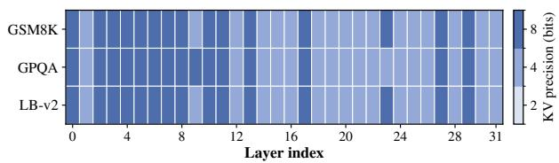  
(a) Mistral-7B-Instruct-v0.3 under a 431 MB KV cache budget.

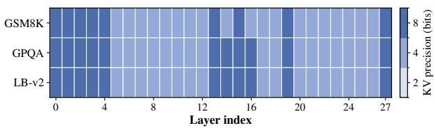  
(b) DeepSeek-R1-Distill-Qwen-7B under a 180 MB KV cache budget.

Figure 5: Layer-wise KV cache precision allocation patterns on the evaluated 7B models. The assigned bit-widths vary across layers according to the profiled precision demands under fixed KV cache budgets.  
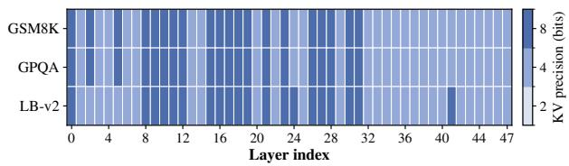  
(a) DeepSeek-R1-Distill-Qwen-14B under a 620 MB KV cache budget.

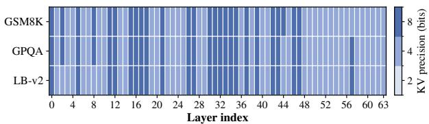  
(b) QwQ-32B under an 820 MB KV cache budget.  
Figure 6: Layer-wise KV cache precision allocation patterns on larger-scale models. The distinct distributions demonstrate model-dependent precision demands and the necessity of profiling-guided allocation.

$$
{ \cal O } \left( N _ { c a l } C _ { f b } ( T ) + N _ { c a l } L | \mathcal { B } | T D _ { K V } \right) ,\tag{46}
$$

where $C _ { f b } ( T )$ denotes the cost of one forwardbackward pass.

After profiling, the allocation stage evaluates different token preservation candidates. For each candidate, the remaining memory budget is allocated to layer-wise precision selection through the solver described in Section C.2. The overall offline allocation complexity is:

$$
O \left( | \mathcal { K } | N _ { c a l } L T + L | \mathcal { B } | \hat { B } \right) ,\tag{47}
$$

where $\hat { B }$ denotes the discretized memory capacity used by the dynamic programming solver.

Both the candidate bit-width set and token preservation candidate set are constructed offline and remain small in practice. Therefore, the allocation overhead is incurred only once for each target model, calibration configuration, and KV cache budget.

## F.2 Inference-Time Complexity

After offline optimization, inference directly applies the precomputed static policy

$$
\pi ^ { * } = ( q ^ { * } , k ^ { * } ) .\tag{48}
$$

During decoding, each Transformer layer quantizes the incoming KV states using the assigned bit-width $q _ { l } ^ { * }$ , while token preservation follows the fixed capacity configuration specified by $k ^ { * }$

The online execution only performs deterministic cache operations, including KV cache quantization, token scoring, high-precision token preservation according to the fixed policy, and cache maintenance. No profiling, candidate enumeration, dynamic programming, budget search, or precision reallocation is performed during inference.

When the token group size and preservation capacity are bounded, the additional computation introduced by the allocation policy is $O ( L D _ { K V } )$ per generated token. This cost is independent of the size of the offline candidate space and the target KV cache budget.

Therefore, MultiAlloc separates the allocation overhead from latency-critical inference by resolving all precision decisions offline, enabling efficient deployment under fixed KV cache memory constraints.

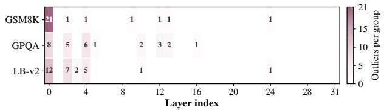  
(a) Mistral-7B-Instruct-v0.3 under a 431 MB KV cache budget.

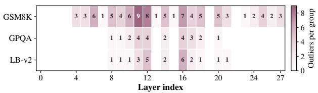  
(b) DeepSeek-R1-Distill-Qwen-7B under a 180 MB KV cache budget.  
Figure 7: Token preservation capacity allocation patterns on the evaluated 7B models. The available preservation budget is distributed non-uniformly across layers according to the profiled token-level preservation demands.

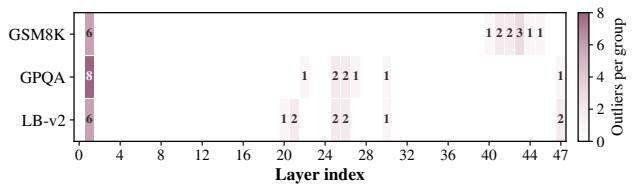  
(a) DeepSeek-R1-Distill-Qwen-14B under a 620 MB KV cache budget.

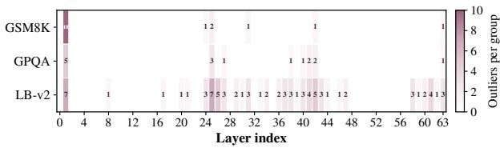  
(b) QwQ-32B under an 820 MB KV cache budget.

Figure 8: Token preservation capacity allocation patterns on larger-scale models. The distributions vary across models and tasks, indicating workload-dependent token-level preservation demands under fixed KV cache budgets.