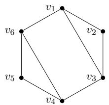
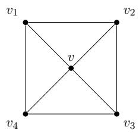
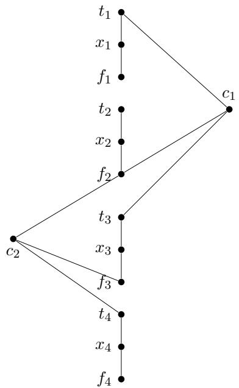
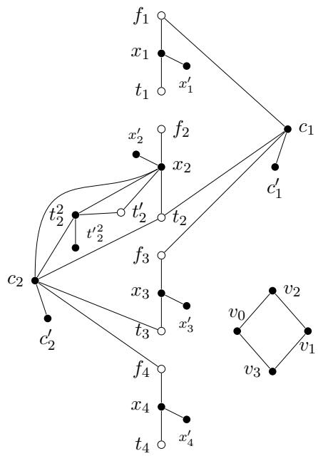

# On Collusion-Free Teaching in Planar Graphs

Liana Khazaliya

LIANA.KHAZALIYA@AALTO.FI

Aalto University, Espoo, Finland

Helsinki Institute for Information Technology, Helsinki, Finland

Clemens Kuske

CLEMENS.KUSKE@HPI.DE

Hasso Plattner Institute, Potsdam, Germany

## Abstract

Non-clashing teaching minimizes teaching complexity among models satisfying the Goldman– Mathias collusion-avoidance criterion. While the Vapnik–Chervonenkis dimension (VCdim) measures the complexity of learning from samples, non-clashing teaching dimension (NCTD) measures the number of examples required when a teacher can select them. Whether NCTD is always bounded above by VCdim remains a fundamental open question in learning theory.

In this paper, we investigate this question for the concept classes of closed neighborhoods in planar graphs. We prove a tight upper bound of two on their NCTD, thereby establishing the conjectured inequality for this family. For the positive variant $\mathrm { N C T D ^ { + } }$ , in which teaching sets contain only positive examples, we obtain a tight upper bound of four. Finally, we show that deciding whether either $\mathrm { N C T D ^ { + } }$ or NCTD is at most one is NP-complete, even for concept classes of closed neighborhoods in planar graphs. In particular, despite the upper bound of two on NCTD for such classes, distinguishing between NCTD values of one and two remains NP-hard. Keywords: Teaching Dimension, Non-Clashing Teaching, VC Dimension, Machine Teaching, Collusion-Freeness

## 1. Introduction

Machine teaching studies the problem of identifying a target concept through a carefully selected set of labeled examples. Unlike traditional learning models, where examples are typically sampled from a distribution, machine teaching allows a teacher to choose examples specifically to facilitate learning. The objective is to minimize the number of examples required for the learner to identify the target concept. A fundamental requirement is that the teacher and learner should not communicate information through unintended channels. The most commonly accepted way to formalize this requirement was proposed by Goldman and Mathias (1996) through a collusion-avoidance criterion.

Among a variety of formal models of teaching, for example, the classical teaching dimension model Goldman and Kearns (1995), the optimal teacher model Balbach (2008), or recursive teaching Zilles et al. (2011), we focus on non-clashing teaching that has been introduced and studied in papers by Kirkpatrick et al. (2019); Fallat et al. (2023), and subsequent papers by Chalopin et al. (2024); Ganian et al. (2025); Bhore et al. (2026). The non-clashing teaching model is known to be optimal among batch teaching models satisfying Goldman–Mathias criterion. Its central requirement is that no two distinct concepts can be consistent with the union of their teaching sets.

Formally, let ${ \mathcal { C } } \subseteq 2 ^ { \mathcal { X } }$ be a finite binary concept class over a domain X . A teaching map T assigns to each concept $C \in { \mathcal { C } }$ a set $T ( C ) \subseteq { \mathcal { X } }$ of examples, labeled according to their membership in C. The map is non-clashing if, for every pair of distinct concepts $C , C ^ { \prime } \in { \mathcal { C } }$

$$
( T ( C ) \cup T ( C ^ { \prime } ) ) \cap ( C \triangle C ^ { \prime } ) \neq \emptyset .
$$

We call such a map a non-clashing teaching map (NCTM). Its size is $\operatorname* { m a x } _ { C \in { \mathcal { C } } } | T ( C ) |$ , and the non-clashing teaching dimension NCTD(C) is the minimum size of an NCTM for C. In the $p o s \ –$ itive variant, teaching sets contain only positive examples, that is, $T ( C ) \subseteq C$ . The corresponding dimension is denoted by $\mathrm { N C T D ^ { + } } ( { \mathcal { C } } )$

Non-clashing teaching and VC dimension. An important open question by Kirkpatrick et al. (2019); Fallat et al. (2023) is whether the non-clashing teaching dimension is always upper-bounded with the Vapnik–Chervonenkis dimension (VCdim) by Vapnik and Chervonenkis (1971). Recall that a set $S \subseteq { \mathcal { X } }$ is shattered by C if, for every subset $S ^ { \prime } \subseteq S$ , there exists a concept $C \in { \mathcal { C } }$ such that $C \cap S = S ^ { \prime } ;$ and ${ \mathrm { V C d i m } } ( { \mathcal { C } } )$ is the maximum size of a set shattered by C.

While VCdim measures the combinatorial complexity of learning from samples, NCTD measures the number of examples required when a teacher can select them. The inequality $\mathrm { N C T D } ( { \cal C } ) \leq$ VCdim(C), conjectured in the works Kirkpatrick et al. (2019); Fallat et al. (2023); Chalopin et al. (2024); Bhore et al. (2026) on non-clashing teaching, would therefore establish a fundamental connection between teaching and learning complexity. Although the question remains open in general, investigating it for structured concept classes seems a natural way to approach it. It is also motivated by the numerous works studying VCdim of closed neighborhoods in graphs Ducoffe et al. (2020); Kranakis et al. (1997); Chalopin et al. (2023); Coudert et al. (2024). See Foucaud et al. (2025) for a list of references on other well-studied graph-based concept classes.

Teaching in graphs. Graph-based concept classes provide a natural setting for such an investigation. On the one hand, they exhibit combinatorial and geometric structure that can be exploited when constructing teaching maps, see, e.g., in Ganian et al. (2025); Bhore et al. (2026). On the other hand, they are expressive enough to represent arbitrary finite binary concept classes. Indeed, every finite binary concept class can be represented as a selected family of closed neighborhoods in a split graph, preserving its non-clashing teaching dimension. Thus, studying such neighborhood families is as general as studying arbitrary finite binary concept classes.

This observation motivates the study of neighborhoods under structural restrictions on the underlying graph. A related setting is the concept class of graph balls, where $B _ { r } ( v ) = \{ u \in V ( G )$ dist $\left( u , v \right) \leq r \}$ , see, e.g. Chepoi et al. (2007). Chalopin et al. (2023, 2024); Ganian et al. (2025) studied non-clashing teaching for graph balls and established the conjectured inequality for several graph classes, including trees and interval graphs. Chalopin et al. (2024); Bhore et al. (2026) also identified planar graphs as an interesting direction, noting that their ball systems have VCdim at most four, while obtaining comparable bounds on NCTD remained open.

Subsequent work by Ganian et al. (2025) was focused on positive setting for non-clashing teaching for graph balls. More recently, Bhore et al. (2026) studied the class of closed neighborhoods, obtaining algorithmic and hardness results together with upper bounds of five and seven for the general and positive NCTD, respectively, in planar graphs.

Closed neighborhoods of planar graphs. In this paper, we study both the general and positive variants of non-clashing teaching for concept classes consisting of closed neighborhoods in planar graphs. The positive variant refers to teaching models that allow learning only from positive examples; see, e.g., Denis (2001); Angluin (1980); Schwab et al. (2000) and, for non-clashing teaching in particular, Fallat et al. (2023); Chalopin et al. (2024); Ganian et al. (2025).

We refer to the corresponding dimensions as NEIGHBORHOODS-NCTD (N-NCTD) and POSI-TIVE NEIGHBORHOODS-NCTD $\mathrm { ( N { - } N C T D ^ { + } ) }$ , respectively. The corresponding decision problems are defined as follows:

PLANAR N-NCTD   
Input: A planar graph G, a family $\mathcal { N }$ of closed neighborhoods in G, and an integer $k .$   
Output: Is $\mathrm { N - N C T D } ( { \mathcal { N } } ) \leq k ?$

The problem PLANAR $\mathrm { { N - N C T D ^ { + } } }$ is defined analogously for deciding on $\mathrm { N - N C T D ^ { + } } ( { \mathcal { N } } )$

For two distinct neighborhoods $N [ u ] , N [ v ] \in \mathcal { N }$ , we say that a vertex $x \in T ( N [ u ] ) \cup T ( N [ v ] )$ distinguishes the pair if $x \in \mathit { N } [ u ] \triangle { N } [ v ]$ . The pair is distinguished if such a vertex exists. If $N [ u ] = N [ v ]$ , then u and v are called twins and represent the same concept. We can keep only one vertex of each such pair, and so assume that a given graph G is twin-free. Lastly, for a graph $G ,$ let $\mathcal { N } _ { G } = \{ N [ v ] : v \in V ( G ) \}$

Our results. We establish that, for every planar graph G, $\mathrm { N - N C T D } ( \mathcal { N } _ { G } ) \leq 2$ , which is tight. This improves the previously known upper bound of five, and establishes the conjectured inequality between NCTD and VCdim for closed neighborhoods of planar graphs. For PLANAR $\mathrm { { N - N C T D ^ { + } } }$ we prove the tight bound $\mathrm { N - N C T D ^ { + } } ( \mathcal { N } _ { G } ) \le 4$ , improving the previous bound of seven. Finally, we prove that both PLANAR N-NCTD and PLANAR $\mathrm { { N - N C T D ^ { + } } }$ are NP-complete even for $k = 1$ . In particular, distinguishing between NCTD one and two remains NP-hard for closed neighborhoods of planar graphs.

Organization of the paper In Section 2.1, we prove a tight upper bound of four on $\mathrm { N - N C T D ^ { + } } ( \mathcal { N } _ { G } )$ for planar graphs G. In Section 2.2, we establish a tight upper bound of two for the general variant $\mathrm { N - N C T D } ( \mathcal { N } _ { G } )$ . In Section 3, we show that deciding whether either dimension is at most one is NP-complete, even for closed neighborhoods of planar graphs. Finally, we conclude in Section 4.

## 2. Tight Upper Bounds

In this section, we establish tight upper bounds on the non-clashing teaching dimension of closed neighborhoods in planar graphs.

## 2.1. Positive Non-Clashing Teaching Dimension

The positive variant, being arguably more intuitive, is considered first. Our main result in this subsection is the following bound.

## Theorem 1 For every planar graph G, $\mathrm { N - N C T D ^ { + } } ( { \mathcal { N } } _ { G } ) \leq 4 .$

The proof relies on an auxiliary bound of Lemma 2 for outerplanar graphs, which we establish first for 2-connected graphs in Claim 1; and then extend to the general case.

Lemma 2 For every outerplanar graph G, $\mathrm { N - N C T D ^ { + } } ( { \mathcal { N } } _ { G } ) \leq 2 .$

Claim 1 For every 2-connected outerplanar graph G, $\mathrm { N - N C T D ^ { + } } ( \mathcal { N } _ { G } ) \leq 2 .$

Proof We first consider graphs with at most four vertices. For $| V ( G ) | \leq 3$ , all closed neighborhoods coincide, so the claim follows immediately. $\operatorname { I f } | V ( G ) | = 4$ , then G is either a cycle or a cycle with a chord. In the former case, label the vertices cyclically and set $T ( v _ { i } ) = \{ v _ { i } , v _ { i + 1 } \}$ . In the latter case, label the vertices so that $v _ { 1 } v _ { 3 }$ is the chord, and set $T ( v _ { 1 } ) = T ( v _ { 3 } ) = \{ v _ { 2 } , v _ { 4 } \} , T ( v _ { 2 } ) = \{ v _ { 2 } , v _ { 3 } \}$ and $T ( v _ { 4 } ) = \{ v _ { 4 } , v _ { 1 } \}$ . It is straightforward to verify that in both cases the maps are non-clashing.

Now suppose that $| V ( G ) | ~ = ~ n ~ \geq ~ 5$ . Fix an outerplanar embedding and label the vertices $v _ { 1 } , \ldots , v _ { n }$ in cyclic order along the outer face, with indices taken modulo $n .$ . Set $T ( v _ { i } ) = \{ v _ { i - 1 } , v _ { i + 1 } \}$ Clearly, each teaching set has size two and is contained in the corresponding closed neighborhood.

Suppose, for a contradiction, that two distinct closed neighborhoods $N [ v _ { i } ]$ and $N [ v _ { j } ]$ are not distinguished. Then $\{ v _ { i - 1 } , v _ { i + 1 } \} \subseteq N [ v _ { j } ] , \{ v _ { j - 1 } , v _ { j + 1 } \} \subseteq N [ v _ { i } ]$ . Consider the two paths between $v _ { i }$ and $v _ { j }$ along the outer cycle. Since $n \geq 5 .$ , at least one contains at least three edges. Without loss of generality, orient the cycle so that this path passes through $v _ { j + 1 }$ and $v _ { i - 1 }$ , in that order. Thus, $v _ { i } , v _ { j } , v _ { j + 1 } , v _ { i - 1 }$ are distinct. The conditions above imply that $v _ { i } v _ { j + 1 } , v _ { j } v _ { i - 1 } \in E ( G )$ Contracting the other $v _ { i } – v _ { j }$ path and the $v _ { j + 1 } - v _ { i - 1 }$ 1 segment gives us a $K _ { 4 }$ minor, so contradicts outerplanarity.

Hence, $T$ is a positive non-clashing teaching map of size at most two.

Proof [of Lemma 2] We construct a positive non-clashing teaching map $T$ of size at most two. Since teaching sets in different connected components are nonempty and positive, it suffices to consider each connected component separately.

First, for every cut-vertex v, we set $T ( v ) = \{ u , w \}$ , where u and w are neighbors of v belonging to distinct components of $G - v$ . Next, for every non-cut-vertex belonging to a 2-connected component, we assign the teaching set given by Claim 1. Finally, for every remaining vertex v, we set $T ( v ) = \{ v \}$ . Clearly, all teaching sets are positive and have size at most two.

We show that $T$ is non-clashing. First, consider a cut-vertex v with $T ( v ) = \{ u , w \}$ . Since u and w belong to distinct components of $G - v$ , no vertex other than v is adjacent to both. Thus, $T ( v )$ distinguishes $N [ v ]$ from every other closed neighborhood.

Now consider two distinct non-cut-vertices u and v. If they belong to the same 2-connected component, their neighborhoods are distinguished by Claim 1. Otherwise, they belong to different 2-connected components or lie outside any such component. In either case, their neighborhoods intersect in at most one cut-vertex, while each teaching set contains an example outside this intersection. Hence, at least one of their teaching sets distinguishes the pair.

Therefore, $T$ is a positive NCTM of size at most two, and hence, for an outerplanar graph $G ,$ $\mathrm { N - N C T D ^ { + } } ( \mathcal { N } _ { G } ) \leq 2$

The bound of Lemma 2 is tight. Consider the outerplanar graph $G$ in $\mathrm { F i g . 1 }$

Since $N [ v _ { 1 } ] = N [ v _ { 2 } ] \cup \{ v _ { 6 } \} , N [ v _ { 4 } ] = N [ v _ { 5 } ] \cup \{ v _ { 3 } \}$ , any positive non-clashing teaching map of size one must satisfy $T ( v _ { 1 } ) = \{ v _ { 6 } \}$ and $T ( v _ { 4 } ) = \{ v _ { 3 } \}$ . However, these sets do not distinguish a pair $\left. N [ v _ { 1 } ] , N [ v _ { 4 } ] \right.$ . Thus, $\mathrm { N - N C T D ^ { + } } ( { \cal N } _ { G } ) = 2$

Now we proceed with the proof of Theorem 1.

Proof [Theorem 1] We begin by constructing a preliminary teaching map, which we subsequently modify to satisfy the non-clashing condition.

Preliminary Teaching Map. For each vertex v with $\deg ( v ) \leq 3$ , set $T ( v ) = N [ v ]$ . For vertices of degree greater than three, we use the following construction. Since $G [ N [ v ] \setminus \{ v \} ]$ is outerplanar, Lemma 2 provides a positive non-clashing teaching map of size at most two for its closed neighborhoods. We extend each teaching set by adding v, obtaining sets of size at most three.

For every vertex v with $\deg ( v ) \leq 3$ , the choice $T ( v ) = N [ v ]$ distinguishes its neighborhood from every other distinct neighborhood. Moreover, when $\deg ( v ) > 3$ , the constructed teaching

  
Figure 1: An outerplanar graph G with $\mathrm { N - N C T D ^ { + } } ( { \cal N } _ { G } ) = 2 .$

  
Figure 2: A planar graph G with N-NCTD+ $( { \mathcal { N } } _ { G } ) = 4 .$

Examples showing that the upper bounds in Lemma 2 and Theorem 1 are tight.

sets also distinguish every pair $\langle N [ u ] , N [ w ] \rangle$ with $u \in N [ v ] \backslash \{ v \}$ and $w \not \in N [ v ]$ , since $v \in T ( u )$ but $v \notin N [ w ]$ . Thus, after constructing the preliminary teaching map $T ,$ it remains to distinguish pairs of neighborhoods centered within $N [ v ]$ . We address these pairs by modifying the preliminary teaching sets in four steps.

First, we consider vertices that are twins in $G [ N [ v ] ]$ but not in G. Next, we handle vertices $u \in N [ v ] \ \backslash \ \{ v \}$ satisfying $N [ v ] \subsetneq N [ u ]$ , which we call saturating vertices. We then modify the teaching sets of the remaining vertices in $N [ v ] \backslash \{ v \}$ and, finally, the teaching set of $v .$ Throughout these modifications, we ensure that all previously distinguished pairs remain distinguished.

Twin vertices in $G [ N [ v ] \setminus \{ v \} ]$ . Let $X \subseteq N [ v ] \setminus \{ v \}$ be a set of pairwise twins in $G [ N [ v ] \setminus \{ v \} ]$ Since such vertices form a clique, $| X | \leq 3 ;$ otherwise, X together with v would contain a $K _ { 5 }$ contradicting planarity. We modify the teaching sets according to the size of $X$

Case $I \colon | X | = 2$ . Since the vertices of X have distinct closed neighborhoods in $G ,$ , their symmetric difference contains a vertex outside $N [ v ]$ . We add this vertex to the teaching set of the vertex whose neighborhood has $\mathbf { i t } ,$ distinguishing the pair while increasing the teaching set size to at most four.

Case $2 \colon | X | = 3$ . First, no vertex in $N [ v ] \setminus ( X \cup \{ v \} )$ can be adjacent to a vertex of X. Otherwise, it would be adjacent to all three vertices of X, forming a $K _ { 5 }$ together with v.

For each $u \in X$ , set $T ( u ) = \{ u , v \}$ . Since G is twin-free, the closed neighborhoods of vertices in $X$ are pairwise distinct. For each pair $u , w \in X$ , choose a vertex in $N [ u ] \triangle N [ w ]$ and add it to the teaching set of the vertex whose neighborhood contains it. Each teaching set receives at most two additional vertices, so its size remains at most four.

These sets distinguish vertices of X from vertices outside $N [ v ]$ by $v \in T ( u )$ , from vertices in $N [ v ] \setminus ( X \cup \{ v \} )$ by $u \in T ( u )$ , and from one another by the additional vertices.

Saturating vertices. We call a vertex $u \in N [ v ] \setminus \{ v \}$ saturating if $N [ v ] \subsetneq N [ u ]$ . So, distinguishing $N [ u ]$ from $N [ v ]$ requires a vertex from $N [ u ] \setminus N [ v ]$ in $T ( u )$

If $\deg ( v ) > 4$ , there is at most one saturating neighbor. Indeed, two such neighbors, together with v, would form one part of a $K _ { 3 , 3 }$ , with three other neighbors of v forming the other, contradicting planarity.

If u is the unique saturating neighbor, it has no twin in $G [ N [ v ] \setminus \{ v \} ]$ . Thus, its teaching set has size at most three, and we add a vertex from $N [ u ] \setminus N [ v ]$ to distinguish the pair.

It remains to consider $\deg ( v ) = 4$ with two saturating neighbors $u , w$ . These vertices are twins in $G [ N [ v ] \setminus \{ v \} ]$ , so the previous step has already added a vertex outside $N [ v ]$ to one of their teaching sets, say $T ( u )$ . Hence, $N [ u ]$ and $N [ v ]$ are already distinguished. We add a vertex from $N [ w ] \setminus N [ v ]$ to $T ( w )$ , keeping both teaching sets of size at most four.

Remaining vertices of $N [ v ] \backslash \{ v \}$ . We now aim to distinguish $N [ v ]$ from neighborhoods centered within non-saturating vertices of $N [ v ] \backslash \{ v \}$

Case $I \colon \deg ( v ) = 4 .$ . Let $N [ v ] = \{ v , v _ { 1 } , v _ { 2 } , v _ { 3 } , v _ { 4 } \}$ and set $T ( v ) = N [ v ] \setminus \{ v \}$ . This distinguishes $N [ v ]$ from every non-saturating neighbor, saturating neighbors are handled by their own teaching sets.

Suppose $w \in V ( G ) \setminus N [ v ]$ satisfies $N [ v ] \setminus \{ v \} \subseteq N [ w ]$ . We redefine $T ( w ) = \{ w , v _ { 1 } , v _ { 2 } , v _ { 3 } \}$ This set distinguishes $N [ w ]$ from every other neighborhood centered outside $N [ v ] { \mathrm { ; } }$ : a third vertex adjacent to $v _ { 1 } , v _ { 2 } , v _ { 3 }$ , together with v and $w .$ , would yield a $K _ { 3 , 3 }$ , contradicting planarity. Moreover, $w \in T ( w ) \setminus N [ v ]$ distinguishes $N [ w ]$ from $N [ v ]$ , while $v \in T ( u ) \setminus N [ w ]$ distinguishes $N [ w ]$ from $N [ u ]$ for every $u \in N ( v )$

Case $2 \colon \deg ( v ) > 4$ . Here, we first show that the outerplanar graph $H = G [ N [ v ] \backslash \{ v \} ]$ contains two vertices $v _ { 1 }$ and $v _ { 2 }$ of degree at most two with at most one common neighbor in $H = G [ N [ v ] \backslash \{ v \} ]$

Since H is outerplanar, it can be extended to a maximal outerplanar graph H′. $\mathrm { A s } | V ( H ^ { \prime } ) | \geq 5$ we can choose two nonadjacent degree-two vertices $v _ { 1 } , v _ { 2 }$ of $H ^ { \prime }$ . Since $v _ { 1 }$ and $v _ { 2 }$ have degree two, two common neighbors for them would force the outer boundary of $H ^ { \prime }$ to be a four-cycle, contradicting $| V ( H ^ { \prime } ) | \geq 5$ . Thus, $v _ { 1 }$ and $v _ { 2 }$ have at most one common neighbor in $H ^ { \prime }$ , and hence also in $H$

So, if v1 and $v _ { 2 }$ have a common neighbor w in H such that $N [ v ] \ \not \subseteq \ N [ w ]$ , choose $v _ { 3 } \in$ $N ( v ) \setminus N [ w ]$ . Otherwise, choose any $v _ { 3 } \in N ( v ) \setminus \{ v _ { 1 } , v _ { 2 } \}$ . Set $T ( v ) = \{ v , v _ { 1 } , v _ { 2 } , v _ { 3 } \}$

The vertex v distinguishes $N [ v ]$ from every neighborhood centered outside $N [ v ]$ . Moreover, any neighbor containing both $v _ { 1 }$ and $v _ { 2 }$ in its closed neighborhood must be their unique common neighbor w. By the choice of $v _ { 3 }$ , this neighbor either saturates $v$ or is distinguished from v by $v _ { 3 }$ Thus, $T ( v )$ distinguishes $N [ v ]$ from every non-saturating neighbor, while saturating neighbors are handled by their own teaching sets.

After these modifications, every pair of distinct closed neighborhoods is distinguished by at least one of their teaching sets. Moreover, all teaching sets remain positive and have size at most four. Thus, the resulting teaching map is non-clashing, proving that $\mathrm { N - N C T D ^ { + } } ( \mathcal { N } _ { G } ) \le 4$

The upper bound for $\mathrm { N - N C T D ^ { + } }$ on planar graphs is also tight. Consider the graph G in Fig. 2. Since $N [ v ] = V ( G )$ and $N [ v _ { i } ] = V ( G ) \backslash \{ v _ { i + 2 } \}$ (indices modulo 4), any valid positive nonclashing teaching map must take $v _ { i + 2 }$ in $T ( v )$ for every $i \in [ 4 ]$ . Thus, $| T ( v ) | \geq 4$ , and the upper bound yields $\mathrm { N - N C T D ^ { + } } ( \mathcal { N } _ { G } ) = 4$

## 2.2. (General) Non-Clashing Teaching Dimension

In this subsection, we prove a tight upper bound of two on the non-clashing teaching dimension of closed neighborhoods in planar graphs.

## Theorem 3 For every planar graph $G , \mathrm { N - N C T D } ( \mathcal { N } _ { G } ) \leq 2 .$

The proof relies on two auxiliary lemmas. Lemma 4 shows that every concept class of size at most five admits a non-clashing teaching map of size at most one. And Lemma 6 establishes that every planar graph of minimum degree at least five contains a vertex whose closed neighborhood induces a family admitting a non-clashing teaching map of size at most one. Together, these results yield Theorem 3.

Lemma 4 For every concept class C with $| { \mathcal { C } } | \leq 5 .$ , we have $\mathrm { N C T D } ( { \mathcal { C } } ) \leq 1$

Proof First, repeatedly remove any concept C whose label on some example x is unique among the remaining concepts, setting $T ( C ) = \{ x \}$ . This distinguishes C from all remaining concepts. If at most one concept remains, we are done.

Otherwise, the remaining family R has four or five concepts. Since the reduction can no longer be applied, every nonconstant example, i.e., an example whose label is not the same for all concepts in R, must be positive for at least two concepts and negative for at least two others. Thus, each such example partitions R into two label classes of sizes 2 + 2 or $2 + 3$

Construct an auxiliary graph H on R, where each nonconstant example x induces an edge $e _ { x }$ joining the two concepts from one of its size-two label classes. Thus, x distinguishes $C _ { 1 } , C _ { 2 } \in \mathcal { R }$ precisely when exactly one of them is an endpoint of $e _ { x }$

Since the concepts are distinct, H has at most one isolated vertex and no component of size two, as either would imply two concepts with identical labels on all examples. Hence, H has one nontrivial component, possibly with an isolated vertex I.

Let T be a spanning tree of the nontrivial component, rooted at a leaf R. Let S be the neighbor of R, and choose a neighbor $K \neq R$ of S. For each non-root vertex C, assign the example corresponding to its parent edge in T. Assign to R the example corresponding to an edge SK, and, if I exists, assign to I the example corresponding to an edge RS.

We verify that the resulting map is non-clashing. Two non-root vertices are distinguished by at least one of their parent edges, since they cannot be parents of each other (every edge has a unique example, since H was constructed on size-two sets). The vertex R is distinguished from S by SK, and from every other non-root vertex by its parent edge. Finally, if I exists, it is distinguished from every non-root vertex by that vertex’s parent edge, and from R by an edge RS.

Thus R admits a non-clashing teaching map of size one. Inserting the previously removed concepts preserves the non-clashing property, completing the proof. ■

Before proceeding with Lemma 6, we need to prove the following structural property of planar graphs with minimum degree 5.

Lemma 5 Let G be a planar graph with minimum degree 5. Then there exists a vertex $v \in V ( G )$ such that $\deg ( v ) = 5 a n d G [ N [ v ] \setminus \{ v \} ] \in \{ P _ { 5 } , C _ { 5 } \}$

Proof We may assume that G is connected. Every planar graph G with minimum degree at least 5 contains a triangular face; otherwise, Euler’s formula implies $| E ( G ) | \leq 2 | V ( G ) | - 4$ , contradicting the Handshaking Lemma, which gives $\vert E ( G ) \vert \ge \frac { 5 } { 2 } \vert V ( G ) \vert$ . Fix a plane embedding of G in which a triangular face T is the outer face. Among all triangles whose bounded interiors contain at least one vertex, choose a triangle T minimizing the number of vertices in its interior. By the minimality of T, there is no non-empty triangle contained in the face bounded by T.

Let H be the subgraph consisting of T, together with all vertices and edges contained in the face bounded by T. We denote $I = V ( H ) \setminus V ( T )$ (vertices enclosed by T), and let F denote the set of bounded faces of H. Furthermore, for every $u \in I , \deg _ { H } ( u ) = \deg _ { G } ( u ) \geq 5$ . For convenience, we also denote $| I | = n , | E ( H ) | = m , | F | = f$ and for a face $f ^ { \prime } \in F$ let $\ell ( f ^ { \prime } )$ be the length of the boundary walk. First, we make two standard observations for H. By Euler’s formula, we have $( n + 3 ) - m + ( f + 1 ) = 2 \quad$ , so $f = m - n - 2$ . Also, $\sum _ { f \in F } \ell ( f ) = 2 m - 3$ , since each edge is counted twice, except for the three edges of the outer face.

Define the total degree deficit of interior vertices as $D = \sum _ { u \in I } ( 6 - \deg ( u ) )$ . Since every interior vertex has degree at least 5, only degree-5 vertices contribute positively to $D .$ . We also define the faces sum as ${ \overset { \cdot } { Q } } = \sum _ { f \in F } \left( 2 \ell ( f ) - { \overset { \cdot } { 6 } } \right)$ , where only triangular faces contribute zero.

By the Handshaking Lemma,

$$
D = \sum _ { u \in I } ( 6 - \deg ( u ) ) = 6 n - \sum _ { u \in I } \deg ( u ) = 6 n - 2 m + \sum _ { v \in T } \deg _ { H } ( v ) .\tag{1}
$$

Based on the observations above,

$$
Q = \sum _ { f \in { \cal F } } ( 2 \ell ( f ) - 6 ) = 2 \sum _ { f \in { \cal F } } \ell ( f ) - 6 | { \cal F } | = 2 ( 2 m - 3 ) - 6 ( m - n - 2 ) = 6 n - 2 m + 6 .\tag{2}
$$

Therefore, from Equations 1 and 2, $D = Q - 6 + \sum _ { v \in T } \deg _ { H } ( v )$ . Since the sum $\sum _ { v \in T } \deg ( v )$ counts edges of $T$ twice and connectivity guarantees at least one more edge between $T$ and $I ,$ , we have $\sum _ { v \in V ( T ) } \deg _ { H } ( v ) > 6$ . Hence, $D > Q$

Assume that there is no degree-5 vertex in I incident with at most one non-triangular face. In other words, for every vertex $u \in I$ of degree $5 ,$ the number of its incident non-triangular faces $t ( u ) \geq 2$

First, let us upper-bound the sum of these terms:

$$
\sum _ { u \in I } t ( u ) \leq \sum _ { \stackrel { f \in F } { \ell ( f ) \geq 4 } } \ell ( f ) .\tag{3}
$$

Indeed, on the left-hand side, each face $f$ is counted only if $\ell ( f ) > 3$ , and at most $\ell ( f )$ times.

Next, under our assumption, the inequality $\begin{array} { r } { 6 - \deg ( u ) \leq \frac { t ( u ) } { 2 } } \end{array}$ holds for every $u \in I$ . Therefore, $D = \sum _ { u \in I } ( 6 - \deg ( u ) ) \leq \frac { 1 } { 2 } \sum _ { u \in I } t ( u )$ , and by the upper-bound we established above, we further

$$
{ \textstyle \frac { 1 } { 2 } } \sum _ { u \in I } t ( u ) \overset { 3 } { \leq } { \frac { 1 } { 2 } } \sum _ { f \in F } \ell ( f )
$$

Lastly, let us show that $\begin{array} { l } { \frac { 1 } { 2 } \displaystyle \sum _ { f \in F } \ell ( f ) \le \displaystyle \sum _ { f \in F } ( 2 \ell ( f ) - 6 ) = Q } \\ { \ell ( f ) \ge 4 } \end{array}$ . For every triangular face $f ,$ we

have $2 \ell ( f ) - 6 = 0$ , while for every face $f$ with $\ell ( f ) \geq 4$ , we have $\textstyle { \frac { 1 } { 2 } } \ell ( f ) \leq 2 \ell ( f ) - 6 .$

Thus, under our assumption, $D \leq Q$ , contradicting $D > Q$ . Therefore, there always exists a vertex $v \in V ( G )$ of degree 5 incident with at least four triangular faces.

Consider the graph $H ^ { \prime } = G [ N [ v ] \setminus \{ v \} ]$ . Since at least four faces are triangular, there is a path through all five vertices of $H ^ { \prime }$ , which can be ordered along this path. Assume that there is an edge between two vertices $u ,$ w that are non-consecutive in the cyclic order around $v .$ Then the edges between u, w, and v would form a separating triangle, yielding a contradiction with the minimality of chosen triangular outer face $T$ . Thus, the only possible additional edge joins the endpoints of the path. Therefore, $H ^ { \prime }$ is either a path or a cycle on five vertices.

Lemma 6 For every planar graph G with minimum degree 5, there exists a vertex $v \in V ( G )$ such that thefamily $\mathcal { N } _ { v } = \{ N [ u ] \ | \ u \in N [ v ] \}$ admits a non-clashing teaching map ofsize at most 1.

Proof Let $v \in V ( G )$ be a vertex of degree five such that $G [ N ( v ) ] \in \{ P _ { 5 } , C _ { 5 } \}$ (exists by Lemma 5). First, suppose $G [ N ( v ) ] \cong C _ { 5 }$ , with vertices indexed cyclically modulo five, i.e. $\{ v _ { 1 } , \ldots , v _ { 5 } \}$ Define $T ( N [ v ] ) = \emptyset , T ( N [ v _ { i } ] ) = \{ v _ { i + 2 } \}$ , for each $v _ { i } \in N [ v ] \ \backslash \{ v \}$ . Every pair involving $N [ v ]$ is distinguished, since $v _ { i + 2 } \in N [ v ] \ \backslash \ N [ v _ { i } ]$ . For two consecutive vertices, $\left. N [ v _ { i } ] , N [ v _ { i + 1 } ] \right.$ is distinguished by $v _ { i + 2 }$ . For vertices at cyclic distance two, one selects the other, which also distinguishes the pair.

Now suppose $G [ N ( v ) ] \cong P _ { 5 }$ , with vertices $v _ { 1 } , \ldots , v _ { 5 }$ in path order. Define

$$
\begin{array} { r } { T ( N [ v ] ) = \{ v _ { 1 } \} , \qquad T ( N [ v _ { 1 } ] ) = \{ v _ { 3 } \} , \qquad T ( N [ v _ { 2 } ] ) = \{ v _ { 4 } \} , } \\ { T ( N [ v _ { 3 } ] ) = \{ v _ { 5 } \} , \qquad T ( N [ v _ { 4 } ] ) = \{ v _ { 3 } \} , \qquad T ( N [ v _ { 5 } ] ) = \{ v _ { 2 } \} . } \end{array}
$$

Every pair involving $N [ v ]$ is distinguished by the teaching set of the neighbor, except for $N [ v _ { 4 } ]$ which is distinguished by $v _ { 1 } \in T ( N [ v ] )$

Among the neighbors, $T ( N [ v _ { 1 } ] )$ distinguishes $N [ v _ { 1 } ]$ from $N [ v _ { 2 } ] , N [ v _ { 3 } ] , N [ v _ { 4 } ] ; T ( N [ v _ { 2 } ] )$ distinguishes $N [ v _ { 2 } ]$ from $N [ v _ { 3 } ] , N [ v _ { 4 } ] , N [ v _ { 5 } ]$ ; and $T ( N [ v _ { 3 } ] )$ distinguishes $N [ v _ { 3 } ]$ from $N [ v _ { 4 } ] , N [ v _ { 5 } ]$ The two remaining pairs are distinguished by $T ( N [ v _ { 5 } ] )$ and $T ( N [ v _ { 4 } ] )$ ), respectively.

In both cases, all teaching sets belong to $N [ v ]$ , so the assignment is valid in G. Hence the constructed maps are non-clashing and have size at most one.

Now, we are turning to the proof of Theorem 3.

Proof [Theorem 3] First, suppose that G contains a vertex u with $\deg ( u ) \leq 4$ . By Lemma 4, the family $\mathcal { N } _ { u } = \{ N [ v ] \ | \ v \in N [ u ] \}$ admits a non-clashing teaching map $S$ of size at most one. For every $v \in N [ u ]$ , set $T ( N [ v ] ) = S ( N [ v ] ) \cup \{ u \}$ . The example u distinguishes every pair $\langle N [ v ] , N [ w ] \rangle$ with $v \in N [ u ]$ and w $\notin \ : N [ u ]$ , while S distinguishes all pairs of distinct neighborhoods centered in $N [ u ]$

Otherwise, G has minimum degree at least five. By Lemma 6, there exists a vertex u of degree five such that $G [ N ( u ) ] \cong P _ { 5 }$ or $C _ { 5 }$ , and the family $\mathcal { N } _ { u } = \{ N [ v ] \ | \ v \in N [ u ] \}$ } admits a non-clashing teaching map $S$ of size at most one. For every $v \in N [ u ]$ , set $T ( N [ v ] ) = S ( N [ v ] ) \cup \{ u \}$ . As in the previous case, the example u distinguishes every pair $\langle N [ v ] , N [ w ] \rangle$ with $v \in N [ u ]$ and w $\notin N [ u ]$ since $u \in N [ v ] \setminus N [ w ]$ . Meanwhile, S distinguishes all pairs of distinct neighborhoods centered in $N [ u ]$ , including those involving $N [ u ]$ itself. Thus, all these pairs are distinguished using teaching sets of size at most two.

In either case, remove $N [ u ]$ from G and repeat the construction on the remaining induced graph. Since each iteration distinguishes all pairs within the removed set and between the removed set and the remaining vertices, the resulting teaching map is non-clashing and has size at most two.

The bound of Theorem 3 is tight, as shown by the example in Subsection 2.1 (see Figure 1).

## 3. Hardness of Teaching Neighborhoods

This section establishes that deciding whether the non-clashing teaching dimension is at most one is NP-complete for closed neighborhoods of planar graphs, in both the general and positive settings.

Theorem 7 Given a planar graph $G$ and a set of closed neighborhoods ${ \mathcal { N } } ,$ , deciding whether $\mathrm { N - N C T D } ( { \mathcal { N } } ) \leq 1$ is NP-complete.

  
Figure 3: Associated graph $G _ { \varphi }$ for a $\mathrm { P L A N A R } \langle \leq 3 , 3 ) – \mathrm { S A T }$ instance $\varphi = \left( x _ { 1 } \vee \overline { { x _ { 2 } } } \vee x _ { 3 } \right) \wedge \left( \overline { { x _ { 2 } } } \vee \overline { { x _ { 3 } } } \vee x _ { 4 } \right)$  
Figure 4: A graph G constructed from the associated graph $G _ { \varphi }$ . Black vertices represent concepts included in $\mathcal { N }$

Reduction Example: from an instance $\varphi = ( x _ { 1 } \vee \overline { { x _ { 2 } } } \vee x _ { 3 } ) \wedge ( \overline { { x _ { 2 } } } \vee \overline { { x _ { 3 } } } \vee x _ { 4 } )$ of $\mathrm { P L A N A R } \left( \leq 3 , 3 \right) { \cdot } \mathrm { S A T }$ to an instance $( G , { \mathcal { N } } , 1 )$ of PLANAR N-NCTD.

We reduce from PLANAR(≤3, 3)-SAT, which is one of the known NP-complete restrictions of PLANAR 3-SAT Dahlhaus et al. (1994); Tippenhauer (2016).

PLANAR(≤3, 3)-SAT   
Input: A CNF formula $\varphi = ( \boldsymbol { \mathcal { X } } , \boldsymbol { \mathcal { C } } )$ such that (i) every clause contains two or three literals over distinct variables, (ii) every variable occurs exactly once positively and twice negatively, and (iii) the variable–clause incidence graph is planar.   
Output: Is $\varphi$ satisfiable?

The reduction Given an instance $\varphi ~ = ~ ( \mathcal { X } , \mathcal { C } )$ of $\mathrm { P L A N A R } \langle \leq 3 , 3 ) { \cdot } \mathrm { S A T }$ , we construct PLA-NAR N-NCTD instance $( G , \mathcal { N } , 1 )$ in polynomial time, starting with $\varphi = ( \mathcal { X } , \mathcal { C } )$ as an instance of $\mathrm { P L A N A R } \left( \leq 3 , 3 \right) { \cdot } \mathrm { S A T }$ , for an example, see Fig. 3. The associated graph $G _ { \varphi }$ has a variable vertex $x _ { i } ,$ two literal vertices $t _ { i }$ and $f _ { i }$ for each variable, and a clause vertex $c _ { j }$ for each clause. Each $x _ { i }$ is adjacent to $t _ { i }$ and $f _ { i } ,$ and each literal vertex is adjacent to the clause vertices representing its occurrences.

First, attach one pendant vertex $x _ { i } ^ { \prime }$ to each variable vertex $x _ { i }$ and one pendant vertex $c _ { j } ^ { \prime }$ to each clause vertex $c _ { j }$ . Next, for every pair of a true-literal vertex $t _ { i }$ and a false-literal vertex $f _ { i } .$ , we reverse their clause–literal adjacencies in $G _ { \varphi }$ . This can be done by simply exchanging the labels of these two vertices. After this modification, each vertex $t _ { i }$ is adjacent to the two clauses containing ${ \overline { { x _ { i } } } } .$ whereas $f _ { i }$ is adjacent to the unique clause containing $x _ { i }$

For each variable $x _ { i }$ , choose one of its two negative-occurrence clauses, say $c _ { j }$ . Add the edge $c _ { j } x _ { i }$ and a new vertex $t _ { i } ^ { j }$ adjacent to both $c _ { j }$ and $x _ { i }$ . We call $t _ { i } ^ { j }$ the bonus clause-vertex. Attach a pendant vertex $t _ { \ i } ^ { \prime j }$ to $t _ { i } ^ { j }$ , and add an extra vertex $t _ { i } ^ { \prime }$ adjacent to both $x _ { i }$ and $t _ { i } ^ { j }$ . See Figure 4 for an illustration.

These changes preserve planarity. Indeed, $t _ { i }$ has exactly three neighbors in $G _ { \varphi }$ . Thus, the edge $c _ { j } x _ { i }$ can be drawn alongside the path $c _ { j } t _ { i } x _ { i }$ within a face of the given embedding. The vertices $t _ { i } ^ { j } , t _ { i } ^ { \prime j }$ , and $t _ { i } ^ { \prime } ,$ , together with their incident edges, can be embedded inside the resulting triangular face. Pendant vertices can be embedded locally. The remaining elements can then be embedded without crossings inside the face bounded by this path and the newly added edge $c _ { j } x _ { i }$ , since none of the newly introduced vertices is adjacent to any vertex outside this face (see Fig. 4 for an illustration). Lastly, we add a disjoint 4-cycle C, $V ( C ) = \{ v _ { 0 } , v _ { 1 } , v _ { 2 } , v _ { 3 } \}$ . This completes the construction of $G$

Define $\mathcal { N }$ to consist of the closed neighborhoods of all vertices of $G ,$ except those of the literalvertices $t _ { i } , f _ { i }$ and the extra vertices $t _ { i } ^ { \prime }$ . Thus $\mathcal { N }$ includes neighborhoods centered at variable vertices, clause vertices, bonus clause-vertices, pendant vertices, and the 4-cycle vertices. Finally, we return $( G , N , 1 )$ as an instance of PLANAR N-NCTD and the construction is polynomial in the size of $\varphi .$ .

The high-level idea behind reversal of the clause–literal adjacencies is the following. Consider a clause-vertex $c _ { j }$ and a variable-vertex $x _ { i }$ such that the variable $x _ { i }$ appears in the clause corresponding to $c _ { j }$ . If the teaching set of $N [ x _ { i } ]$ contains a literal-vertex representing an assignment that satisfies this clause, then this literal-vertex should distinguish $N [ x _ { i } ]$ from $N [ c _ { j } ]$ . To ensure this, we reverse the clause–literal adjacencies so that the satisfying literal-vertex is not adjacent to the clause-vertex $c _ { j }$

Proof Let us first show the following direction: if $( G , N , 1 )$ admits a valid non-clashing teaching map, then the $\mathrm { P L A N A R } \left( \leq 3 , 3 \right) { \cdot } \mathrm { S A T }$ instance $\varphi$ is satisfiable.

Suppose that $\mathcal { N }$ admits a non-clashing teaching map $T$ of size at most one. First, consider neighborhoods of the vertices of the 4-cycle $C .$ . For indices taken modulo 4, there exists $v _ { i } \in V ( C )$ such that, in order to distinguish $N [ v _ { i } ]$ from $N [ v _ { i + 1 } ]$ and from $N [ v _ { i - 1 } ] , T ( v _ { i } ) = \{ v _ { i + 2 } \}$ , since no other vertex distinguishes both pairs. In particular, $v _ { i + 2 }$ belongs neither to $N [ v _ { i } ]$ nor to any neighborhood centered outside $C .$ Consequently, for any $u \not \in V ( C ) , T ( u )$ must be a subset of $N [ u ]$ i.e. if $T ( u ) = \{ z \}$ with $z \not \in N [ u ] \cup V ( C )$ , then $N [ u ]$ and $N [ v _ { i } ]$ would not be distinguished, and if $z \in V ( C ) , N [ u ]$ and $N [ v _ { j } ]$ are not distinguished, where $v _ { j }$ is a non-adjacent to $z$ vertex of the cycle.

For each clause-vertex $c _ { j }$ , a pair $\langle N [ c _ { j } ] , N [ c _ { j } ^ { \prime } ] \rangle$ ⟩ can be distinguished only by $T ( c _ { j } ) \subseteq N [ c _ { j } ] \ \backslash$ $\{ c _ { j } , c _ { j } ^ { \prime } \}$ . The same applies for each variable-vertex and each bonus clause-vertex.

Then, for each variable-vertex $x _ { i }$ , there is a vertex $t _ { i } ^ { j }$ . Since $N [ t _ { i } ^ { j } ] \subset N [ x _ { i } ]$ and $N [ x _ { i } ] \backslash N [ t _ { i } ^ { j } ] =$ $\{ t _ { i } , f _ { i } \}$ , we must have $T ( x _ { i } ) \cap \{ t _ { i } , f _ { i } \} \neq \emptyset$ . Consequently, $T ( x _ { i } )$ is either $\{ t _ { i } \}$ or $\{ f _ { i } \}$

We now define a truth assignment for $\varphi$ by setting $x _ { i } = { \mathsf { T r u e \ i f } } T ( x _ { i } ) = \{ t _ { i } \}$ , and $x _ { i } = \mathsf { F a l s e i f }$ $T ( x _ { i } ) = \{ f _ { i } \}$

Consider a clause-vertex $c _ { j }$ . As we observed, $T ( c _ { j } ) \subseteq N [ c _ { j } ] \setminus \{ c _ { j } , c _ { j } ^ { \prime } \}$ . Every vertex in this set belongs to $N [ x _ { i } ]$ for at least one variable $x _ { i }$ occurring in $c _ { j }$ , i.e. such a vertex is either a literal vertex, the relevant variable vertex, or a bonus clause-vertex. $\mathrm { { S o . } }$ , let us consider such $x _ { i }$ . Since $T ( c _ { j } ) \subseteq N [ x _ { i } ]$ , the pair $N [ c _ { j } ] , N [ x _ { i } ]$ must be distinguished by $T ( x _ { i } )$ . So, the literal vertex chosen to $T ( x _ { i } )$ is therefore absent from $N [ c _ { j } ]$ , which, by the reversed clause–literal adjacencies, means that the occurrence of $x _ { i }$ in $c _ { j }$ is satisfied. This holds for every clause. Hence, $\varphi$ is satisfiable.

For the reverse direction, suppose that $\varphi$ admits a satisfying assignment. We define a teaching map $T$ of size 1 for $( G , N , 1 )$ as follows.

$$
\mathrm { F o r ~ e v e r y ~ v a r i a b l e - v e r t e x ~ } x _ { i } , \mathrm { s e t } T ( x _ { i } ) = \left\{ \begin{array} { l l } { \{ t _ { i } \} , } & { \mathrm { i f ~ } x _ { i } = \mathrm { T r u e } , } \\ { \{ f _ { i } \} , } & { \mathrm { i f ~ } x _ { i } = \mathsf { F a l s e } . } \end{array} \right.
$$

For every pendant vertex $u , T ( u ) = \{ u \}$ . For every bonus clause vertex, set $T ( t _ { i } ^ { j } ) = \{ t _ { i } ^ { \prime } \}$ . For every vertex $v _ { i } \in V ( C )$ , set $T ( v _ { i } ) = \{ v _ { i + 2 } \}$ , with indices modulo 4.

It remains to assign teaching examples to the clause-vertices. Consider a clause-vertex $c _ { j }$ . Since the assignment satisfies $\varphi _ { \mathrm { { i } } }$ , there exists a variable $x _ { i }$ whose assignment satisfies the clause repre sented by $c _ { j }$ . If several such variables exist, choose one arbitrarily. $\mathrm { \bf S o }$ , if $x _ { i }$ satisfies $c _ { j }$ and is assigned True, by reversed adjacencies, $f _ { i } \in N [ c _ { j } ]$ , and we set $T ( c _ { j } ) = \{ f _ { i } \}$

Recall that each variable appears exactly once positively and exactly twice negatively in $\varphi .$ Hence, for each variable $x _ { i }$ , there can be at most one pair of clauses $c _ { j } , c _ { \ell }$ that are both satisfied by the same assignment to $x _ { i } .$ . Such a pair can arise only when $x _ { i } = \mathsf { F a l s e }$ . So, if $c _ { j }$ (and then $c _ { \ell } )$ is satisfied by $x _ { i } = \mathsf { F a l s e }$ , we set $T ( c _ { \ell } ) = \{ t _ { i } \}$ and we set $T ( c _ { j } ) = \{ t _ { i } ^ { j } \}$ (assuming that among $c _ { \ell }$ and $c _ { j }$ the unique for each such a pair bonus clause vertex is adjacent to $c _ { j } )$

We claim that $T$ is a valid non-clashing teaching map for $( G , \mathcal { N } , 1 )$

Any neighborhood centered in $V ( C )$ is distinguished from any neighborhood centered in $V ( G ) \backslash$ $V ( C )$ by the positive teaching example of the latter. Any two neighborhoods centered in $V ( C )$ are distinguished because each cycle vertex selects its opposite vertex. The teaching set of a pendant concept belongs only to the neighborhoods centered at the vertex itself and its parent; the parent is distinguished from the pendant by teaching set of the parent including neither of them. Thus all pairs involving a pendant concept are distinguished.

Consider two distinct variable vertices $x _ { i }$ and $x _ { r }$ . By construction, no $t _ { i }$ or $f _ { i }$ belongs to $N [ x _ { r } ]$ ， so all such closed neighborhoods are distinguished by their teaching sets. By the same argument, neighborhoods centered in variable-vertices are distinguished from those centered in bonus clause vertices.

Next, consider bonus clause vertices. Neighborhoods of two distinct bonus clause vertices are distinguished, since one is never adjacent to a vertex in the teaching set of the other. The same holds for pairs across bonus clause vertices and clause-vertices, i.e. $t _ { i } ^ { \prime } \in T ( t _ { i } ^ { j } )$ , but $t _ { i } ^ { \prime } \notin N [ c _ { \ell } ]$ for each clause-vertex $c _ { \ell }$

Consider two distinct clause-vertices $c _ { j }$ and $c _ { \ell } .$ . Their neighborhoods are distinguished because their teaching sets either belong to the non-intersecting neighborhoods of distinct variable-vertices, or one of the teaching sets contains a vertex $t _ { i } ^ { j }$ that is not adjacent to any other clause vertex.

Finally, consider a clause vertex $c _ { j }$ and a variable vertex $x _ { p }$ . The example in $T ( c _ { j } )$ is associated with some variable $x _ { i }$ occurring in $c _ { j }$ and belongs to $N [ x _ { i } ]$ . If $p \neq i ,$ this example does not belong to $N [ x _ { p } ]$ , so the pair is distinguished. If $p = i$ , then the example chosen for $c _ { j }$ came from an occurrence of a variable that received an assignment satisfying the clause $c _ { j }$ . In this case, the opposite literal-vertex was selected by $T ( x _ { i } )$ . Therefore, $T ( x _ { i } ) ~ \nsubseteq { N } [ c _ { j } ]$ , and the pair is again distinguished.

Thus, every pair of distinct neighborhoods in $\mathcal { N }$ is distinguished by their teaching sets, so $T$ is a non-clashing teaching map of size one for $( G , N , 1 )$ , completing the proof.

A similar result can also be stated for the positive non-clashing teaching dimension.

Theorem 8 Given a planar graph $G$ and a set of closed neighborhoods ${ \mathcal { N } } ,$ , deciding whether $\mathrm { N - N C T D ^ { + } } ( \mathcal { N } ) = 1$ is ${ \mathsf { N P } } .$ -complete.

Indeed, if $u ^ { \prime }$ is a pendant neighbor of $u ,$ then distinguishing $N [ u ]$ from $N [ u ^ { \prime } ]$ in a positive nonclashing teaching map of size at most one requires $T ( u ) \subseteq N ( u ) \setminus \{ u ^ { \prime } \}$ . Thus, the 4-cycle can be omitted, and the forward implication follows as in the proof of Theorem 7. Conversely, the teaching map constructed for the remaining neighborhoods in $\mathcal { N }$ is already positive and non-clashing.

## 4. Conclusion

We proved tight upper bounds for both the general and positive non-clashing teaching dimensions of closed neighborhoods in planar graphs. We also showed that deciding whether either dimension is at most one remains NP-complete, even for planar graphs. Our results prove the inequality between NCTD and VCdim that was conjectured for this family by Kirkpatrick et al. (2019), and highlighted as an open question later by Chalopin et al. (2024).

However, whether $\mathrm { N C T D } ( { \mathcal { C } } ) \leq \mathrm { V C d i m } ( { \mathcal { C } } )$ holds for every finite concept class C remains open. A natural direction is to extend our results to graph classes of linear neighborhood complexity, see, $\mathrm { e . g . }$ ., Reidl et al. (2019). Such classes have bounded VCdim, making them natural candidates for studying this relationship beyond planar graphs.

Moran and Yehudayoff (2016); Doliwa et al. (2014) studied relationships between recursive teaching dimension, VCdim, and sample compression. It would be interesting to determine whether similar relationships hold for non-clashing teaching and whether bounds on NCTD could lead to improved sample compression schemes.

## Acknowledgments

The authors would like to thank Fionn Mc Inerney for insightful comments and valuable feedback.   
This work has been supported by Helsinki Institute for Information Technology HIIT.

## References

Dana Angluin. Inductive inference of formal languages from positive data. Information and Control, 45(2):117–135, 1980.

Frank Balbach. Measuring teachability using variants of the teaching dimension. Theoretical Com puter Science, 397(1–3):94–113, 2008.

Sujoy Bhore, Liana Khazaliya, and Fionn Mc Inerney. Non-clashing teaching in graphs: Algorithms, complexity, and bounds. In Carl Vondrick, Bharath Hariharan, Colin Raffel, Lerrel Pinto, Diyi Yang, and Aleksandra Faust, editors, The Fourteenth International Conference on Learning Representations (ICLR), 2026.

Jer´ emie Chalopin, Victor Chepoi, Fionn Mc Inerney, S ´ ebastien Ratel, and Yann Vax ´ es. Sample \` compression schemes for balls in graphs. SIAM Journal on Discrete Mathematics, 37(4):2585– 2616, 2023.

Jer´ emie Chalopin, Victor Chepoi, Fionn Mc Inerney, and S ´ ebastien Ratel. Non-clashing teaching ´ maps for balls in graphs. In Proceedings of the 37th Conference on Learning Theory (COLT), volume 247 of Proceedings ofMachine Learning Research, pages 840–875. PMLR, 2024.

Victor Chepoi, Bertrand Estellon, and Yann Vaxes. Covering planar graphs with a fixed number of\` balls. Discrete & Computational Geometry, 37:237–244, 2007.

David Coudert, Monika Csik´ os, Guillaume Ducoffe, and Laurent Viennot. Practical computation of´ graph VC-dimension. In Proceedings of the 22nd International Symposium on Experimental Algorithms (SEA 2024), volume 301 of Leibniz International Proceedings in Informatics (LIPIcs), pages 8:1–8:20. Schloss Dagstuhl – Leibniz-Zentrum fur Informatik, 2024.¨

Elias Dahlhaus, David S. Johnson, Christos H. Papadimitriou, Paul D. Seymour, and Mihalis Yannakakis. The complexity of multiterminal cuts. SIAM Journal on Computing, 23(4):864–894, 1994.

Franc¸ois Denis. Learning regular languages from simple positive examples. Machine Learning, 44 (1–2):37–66, 2001.

Thorsten Doliwa, Gaojian Fan, Hans Ulrich Simon, and Sandra Zilles. Recursive teaching dimension, VC-dimension and sample compression. Journal of Machine Learning Research, 15(89): 3107–3131, 2014.

Guillaume Ducoffe, Michel Habib, and Laurent Viennot. Diameter computation on H-minor free graphs and graphs of bounded (distance) VC-dimension. In Proceedings of the 31st Annual ACM-SIAM Symposium on Discrete Algorithms (SODA), pages 1905–1922, 2020.

Shaun Fallat, David Kirkpatrick, Hans U. Simon, Abolghasem Soltani, and Sandra Zilles. On batch teaching without collusion. Journal ofMachine Learning Research, 24(40):1–33, 2023.

Florent Foucaud, Harmender Gahlawat, Fionn Mc Inerney, and Prafullkumar Tale. The parameterized complexity of computing the VC-dimension. In Advances in Neural Information Processing Systems (NeurIPS), volume 38, 2025.

Robert Ganian, Liana Khazaliya, Fionn Mc Inerney, and Mathis Rocton. The computational complexity of positive non-clashing teaching in graphs. In The Thirteenth International Conference on Learning Representations (ICLR), 2025.

Sally A. Goldman and Michael J. Kearns. On the complexity of teaching. Journal of Computer and System Sciences, 50(1):20–31, 1995.

Sally A. Goldman and H. David Mathias. Teaching a smarter learner. Journal of Computer and System Sciences, 52(2):255–267, 1996.

David Kirkpatrick, Hans U. Simon, and Sandra Zilles. Optimal collusion-free teaching. In Proceedings of the 30th International Conference on Algorithmic Learning Theory (ALT), volume 98 of Proceedings of Machine Learning Research, pages 506–528. PMLR, 2019.

Evangelos Kranakis, Danny Krizanc, Berthold Ruf, Jorge Urrutia, and Gerhard J. Woeginger. The VC-dimension of set systems defined by graphs. Discrete Applied Mathematics, 77(3):237–257, 1997.

Shay Moran and Amir Yehudayoff. Sample compression schemes for VC classes. Journal of the ACM, 63(3):21:1–21:10, 2016.

Felix Reidl, Fernando Sanchez Villaamil, and Konstantinos Stavropoulos. Characterising bounded´ expansion by neighbourhood complexity. European Journal of Combinatorics, 75:152–168, 2019. doi: 10.1016/j.ejc.2018.08.001.

Ingo Schwab, Wolfgang Pohl, and Ivan Koychev. Learning to recommend from positive evidence. In Proceedings of the 5th International Conference on Intelligent User Interfaces (IUI), pages 241–247, 2000.

Simon Tippenhauer. On Planar 3-SAT and its Variants. Master’s thesis, Freie Universitat Berlin,¨ 2016.

Vladimir N. Vapnik and Alexey Ya. Chervonenkis. On the uniform convergence of relative frequencies of events to their probabilities. Theory of Probability and Its Applications, 16(2):264–280, 1971.

Sandra Zilles, Steffen Lange, Robert Holte, and Martin Zinkevich. Models of cooperative teaching and learning. Journal of Machine Learning Research, 12:349–384, 2011.