# Over-parameterization Is Neither Robust nor Fragile in Matrix Sensing: A Geometric Theory of Solution Robustness

Runze Shi, Ziye Ma<sup>∗</sup>

City University of Hong Kong runzeshi3-c@my.cityu.edu.hk, ziyema@cityu.edu.hk

## Abstract

Over-parameterization is ubiquitous in modern machine learning, yet its efect on robustness remains poorly understood. We study this question in matrix sensing, a canonical nonconvex problem that can also be viewed, under an appropriate parameterization, as training a two-layer quadratic neural network. We develop a rank-aware robustness theory for the Burer–Monteiro factorization when the search rank k may exceed the target rank $r _ { \star }$ , thereby capturing over-parameterization. Our analysis shows that robustness depends jointly on the degree of over-parameterization and the local geometry of the attained second-order stationary point: increasing k generally worsens sensitivity, but stationary points with the same search rank can exhibit substantially diferent robustness. Motivated by this observation, we propose a trajectory-aware algorithm that uses spectral balancing and randomized sketching to steer optimization toward less sensitive solutions. In matrix-sensing experiments, the method reduces paired sensitivity by 18–29% for isotropic operators and 87–89% for weak-tail operators, without degrading reconstruction accuracy. These results demonstrate that parameter count alone does not determine robustness and identify solution geometry and the optimization trajectory as important levers for improving it.

## 1 Introduction

Matrix sensing seeks to recover an unknown low-rank matrix from a collection of linear measurements, typically corrupted by noise. It is a canonical instance of the broader class of low-rank inverse problems, which also includes matrix completion (Candès and Recht 2009), robust principal component analysis and low-rank-plus-sparse decomposition (Candès et al. 2011), lifted formulations of phase retrieval and blind deconvolution (Candès, Strohmer, and Voroninski 2013; Ahmed, Recht, and Romberg 2014), and low-rank quantum state tomography (Gross et al. 2010). Matrix sensing provides a canonical setting for studying nonconvex lowrank estimation: the observation model is simple enough to permit precise analysis, while the rank constraint retains the key non-convex landscape that proves be mathematical challenging in large-scale machine learning (Recht, Fazel, and Parrilo 2010; Bhojanapalli, Neyshabur, and Srebro 2016;

Ge, Jin, and Zheng 2017). Specifically, we consider positivesemidefinite matrix sensing,

$$
\begin{array} { r } { f _ { w } ( X ) = \frac { 1 } { 2 } \left\| \boldsymbol { \mathcal { A } } ( X X ^ { \top } - M _ { \star } ) - w \right\| _ { 2 } ^ { 2 } , X \in \mathbb { R } ^ { n \times k } , } \\ { y _ { w } = \boldsymbol { \mathcal { A } } ( M _ { \star } ) + w \qquad y _ { w } = \boldsymbol { \mathcal { A } } ( M _ { \star } ) + w } \end{array}\tag{1}
$$

where $M _ { \star } \succeq 0$ has rank $1 \leq r _ { \star } \leq k .$ . For rank-one positivesemidefinite measurements $A _ { i } ~ = ~ a _ { i } a _ { i } ^ { \top }$ , as in semidefinite liftings of phase retrieval (Candès, Strohmer, and Voroninski 2013), the prediction satisfies $\left. A _ { i } , X X ^ { \top } \right. =$ $\textstyle \sum _ { j = 1 } ^ { k } ( a _ { i } ^ { \top } x _ { j } ) ^ { 2 }$ . Thus, this special case is equivalent to training a width-k two-layer quadratic network with fixed output weights (Li, Ma, and Zhang 2018). In the positivesemidefinite setting considered in (1), the Burer–Monteiro factorization writes $M = X X ^ { \top }$ , replacing the full matrix and eliminating the rank constraint (Burer and Monteiro 2003). The factor width k determines the search rank and may exceed the unknown target rank $r _ { \star }$ , indicating a mathematically elegant but representative form of over-parametrization.

Over-parameterization is useful when the target rank is unknown, since choosing $k < r _ { \star }$ cannot recover the true solution, and practitioners normally make k much larger than the conjectured $r _ { \star }$ to achieve a "safe-margin". When the sensing matrices are i.i.d. sampled from Gaussian distribution and enough measurements are made, it is generally known that matrix-sensing problems have no spurious local minima and exhibit directions of escape at saddle points (Bhojanapalli, Neyshabur, and Srebro 2016; Ge, Jin, and Zheng 2017; Zhang, Sojoudi, and Lavaei 2019). However, the requirements on the quantity and geometric uniformity of the sensing data for which such benign landscape exists is quite stringent. Critically, a recent line of work (Zhang 2025a; Ma et al. 2023; Stöger and Soltanolkotabi 2021) has shown that simply increasing search rank k can loosen such requirements. Thus, in terms of optimization, increase in parametrization can serve as useful degrees of freedom rather than merely redundant parameters.

However, the impact of over-parametrization on robustness is a much more complicated one. Existing theory first asks whether all local minima remain accurate after the measurements are corrupted. Under Gaussian noise and a 2r-RIP constant below $1 / 1 0 \ r _ { : }$ , Bhojanapalli, Neyshabur, and Srebro (2016) show that every local minimum lies within $2 0 \sigma _ { w } \sqrt { \log ( n ) / m }$ of the ground truth. For general smooth objectives in the exactly parameterized regime, Ma and Sojoudi (2023) show that a clean RIP constant $\delta < 1 / 3$ places every noisy local minimum in a recovery ball whose radius is linear in the noise magnitude; for squared-loss matrix sensing, this radius scales as $\mathsf { \bar { O } ( \| A \| \| w \| _ { 2 } / ( 1 - 3 \delta ) ) }$ ). Their arbitrary-RIP result instead excludes local minima from a region around the truth. Ma et al. (2023) extend this class-wide analysis to noisy over-parameterized matrix sensing: under suitable RIP conditions, they bound the maximum recovery error of an arbitrary local minimum, while under weaker RIP they establish a close-or-far alternative. These results therefore certify that robustness can be somehow maintained or expected even in the over-parametrized regime.

A second line of results asks whether optimization can reach this certified set. The strict-saddle guarantees in Ma and Sojoudi (2023); Ma et al. (2023) show that points outside the recovery region must have either a large gradient or a direction of negative curvature, allowing perturbed gradient descent to find an approximate local minimum in polynomial time. A third approach changes the loss and studies a particular optimization trajectory. For an $\ell _ { 1 }$ -loss under Sign-RIP, Ma and Fattahi (2023) show that subgradient descent from a small initialization can recover the truth despite rank overestimation and Gaussian or gross corruptions, even when some global minimizers overfit the noise. This is an algorithmspecific robustness guarantee for a diferent, robust loss.

A natural next question remains unanswered: is robustness the same for all attained solutions, and if not, how can optimization be steered toward the more robust ones? Existing recovery bounds assign one worst-case radius to the entire set of local minima, while strict-saddle theory guarantees convergence to some member of that set. They can certify that every solution is suficiently close to the truth, but they cannot compare the sensitivities of two solutions inside the same recovery region. In particular, they do not pair a noisy critical point $M _ { w }$ with its clean counterpart $M _ { 0 } ,$ , quantify the solution-specific response $\lVert M _ { w } - M _ { 0 } \rVert _ { F } / \lVert w \rVert _ { 2 } ,$ or explain why solutions obtained with the same sensing operator, noise level, and search rank can respond diferently. This distinction is especially important under over-parameterization because this means that the degree of parametrization is not the only factor influencing robustness. We therefore develop a local, quantitative, and rank-aware theory that identifies the spectral and curvature geometry governing the robustness of an attained stationary point, and then uses those solution-level quantities to steer optimization toward more robust solutions.

This point-wise view also allows for a trajectory-level study of how robustness can be influenced during optimization. Building on small-initialization dynamics and randomized matrix sketching (Stöger and Soltanolkotabi 2021; Tong, Ma, and Chi 2021a; Xu et al. 2023; Halko, Martinsson, and Tropp 2011; Woodruf 2014), we develop a trajectory-aware method that can actively guide trajectories toward more robust solutions. We evaluate the procedure on isotropic and weak-tail sensing operators using both reconstruction accuracy and paired perturbation sensitivity.

## Contributions:

• A geometric theory of robustness. We develop a pointwise theory that explains how over-parameterization and the local geometry of an attained solution jointly determine its sensitivity to measurement noise. The theory covers both rank-deficient and full-rank solutions and distinguishes solutions that have the same search rank but diferent robustness.

• A robust algorithm for matrix sensing and beyond. We translate the theory into a trajectory-aware method that steers optimization toward less sensitive solutions. Across the sensing operators we test, the method improves paired robustness without sacrificing reconstruction error. In the appendix, we also demonstrate preliminary evidence that such approach can also help improve robustness in LoRA fine-tuning of large langauge models.

## 2 Related Work

Burer–Monteiro factorization and fixed-rank geometry. The Burer–Monteiro parameterization represents a positivesemidefinite matrix as $M \ = \ X X ^ { \top }$ , enforcing an upper rank bound while reducing the ambient dimension (Burer and Monteiro 2003). Rank-deficient second-order points of smooth factorized semidefinite programs admit global optimality certificates (Boumal, Voroninski, and Bandeira 2016, 2020). Complementarily, fixed-rank manifold optimization provides the tangent-space Hessians and local perturbation tools needed to analyze rank-preserving motion (Absil, Mahony, and Sepulchre 2008; Vandereycken 2013; Boumal 2023). We use these two viewpoints for diferent rank profiles: rank-deficient points are treated through a matrixspace KKT condition, whereas full-rank points are analyzed through local continuation on a fixed-rank manifold.

Robustness of Matrix Sensing. We first talk about studies of robustness for the classic matrix sensing setting (1) with $\ell _ { 2 }$ loss. Most works in this regime only guarantees global recoverability under noise, but neglects discussion of robustness of non-global solutions. Bhojanapalli, Neyshabur, and Srebro (2016) shows that with Gaussian noise and a restrictive RIP constant threshold of $1 / 1 0 \ / .$ , every local minima lies within $2 0 \sigma _ { w } \sqrt { \log ( n ) / m }$ of the ground truth, which is considered to be the one of the most classic results in this field. Later on, several works have iterated upon this idea, and proved that the RIP constant can be as large as $1 / 2$ for robust global recovery to still hold (Ma and Sojoudi 2023; Li et al. 2020; Zhu et al. 2021). Specifically, recent works have also extended this analysis to the over-parameterized regime, and has preliminary shown that global solutions can still be robust, but the story is more complicated. Ma et al. (2023) has shown that in the over-parameterized setting global solution can still be recovered to certain accuracy under presence of noise, but this accuracy can be highly fragile and depends on eigenvalues of critical points. Another line of work by Zhang (2024, 2025b) also corroborates this fact and states that over-parameterization is benign under general loss functions. However, the caveat with this line of work is they require the loss function to satisfy RIP property with noise corruptions, which is quite unlikely.

Improving Robustness of Low-rank Optimization A separate line of work considers how to improve robustness of low-rank matrix problems. One of the most commonly considered approach is by adopting a robust loss, like $\ell _ { 1 }$ loss. For a known rank, Li et al. (2020) establishes local exact recovery and convergence guarantees for non-convex robust matrix factorization. With an over-parameterized rank, Ding et al. (2021) show that a subgradient method with diminishing step sizes still achieves exact recovery under sparse Gaussian-measurement corruptions. Ma and Fattahi (2023) further show that small initialization can prevent the redundant factor directions from fitting the noise, yielding global trajectory guarantees under both outlier and Gaussian noise models. Recent work extends this direction to preconditioned asymmetric factorizations (Giampouras, Cai, and Vidal 2025). At the same time, Ma and Fattahi (2025) show that, in over-parameterized robust matrix recovery, the ground-truth factors may be strict saddle points rather than local minima, emphasizing that algorithmic selection cannot be explained by local optimality alone. Despite the success of adopting a robust loss in the matrix space, such practice cannot be applied in larger-scale machine learning problems due to its non-diferentiability. Therefore, we still need a more careful, and practically relevant analysis of robustness in diferentiable regression losses.

Optimization dynamics of Low-rank Problems. Global landscape guarantees do not determine which region an optimization algorithm selects. However, there are existing works that we can build upon to explain robustness better. For example, in over-parameterized matrix sensing, small initialization induces an implicit spectral bias that first aligns the iterates with the signal subspace and suppresses redundant directions (Stöger and Soltanolkotabi 2021). Gram preconditioning accelerates ill-conditioned low-rank estimation (Tong, Ma, and Chi 2021a), and damped variants extend this mechanism to over-parameterized noisy matrix sensing (Xu et al. 2023). Randomized sketches provide scalable approximations of dominant subspaces and Rayleigh information (Halko, Martinsson, and Tropp 2011; Woodruf 2014). We use these tools for a diferent purpose: to monitor and modify the local robustness geometry along the optimization trajectory. Because exact RIP certification is generally intractable (Bandeira et al. 2013), our finite-probe RIP quantities are treated as diagnostics rather than formal global certificates.

## 3 Problem Setup and Notation

Fix positive integers $n , m ,$ k with $k \leq n . \operatorname { L e t } \mathbb { S } ^ { n }$ denote the space of real symmetric matrices equipped with the Frobenius inner product. The sensing operator $\mathcal { A } : \mathbb { S } ^ { n }  \mathbb { R } ^ { m }$ is defined by $( { \mathcal { A } } Z ) _ { i } = \langle A _ { i } , Z \rangle$ , where $A _ { i } \in \mathbb { S } ^ { n }$ , with adjoint $\begin{array} { r } { \mathcal { A } ^ { * } z = \dot { \sum _ { i = 1 } ^ { m } z _ { i } } A _ { i } } \end{array}$ . We observe $y _ { w } = \boldsymbol { \mathcal { A } } ( M _ { \star } ) + w .$ , where $w \in \mathbb { R } ^ { m }$ and $M _ { \star } \succeq 0$ has rank $1 \leq r _ { \star } \leq k .$ . The theory treats w deterministically; distributional noise assumptions are used only in the experiments. The case $k > r _ { \star }$ is overparameterized.

Define the smooth matrix-space loss on $\mathbb { S } ^ { n }$ by

$$
F _ { w } ( M ) = \frac { 1 } { 2 } \left\| \boldsymbol { \mathcal { A } } ( M - M _ { \star } ) - w \right\| _ { 2 } ^ { 2 } .\tag{2}
$$

The nonconvex factorized problem studied in this paper is

$$
\operatorname* { m i n } _ { X \in \mathbb { R } ^ { n \times k } } f _ { w } ( X ) , \qquad f _ { w } ( X ) = F _ { w } ( X X ^ { \top } ) .\tag{3}
$$

We write $H \ = \ A ^ { * } A , \ N _ { w } \ = \ A ^ { * } w .$ , and $G _ { w } ( M ) \ =$ $\nabla F _ { w } ( M ) = H ( M - M _ { \star } ) - N _ { w }$ , where $G _ { w } ( M )$ is the ambient Frobenius gradient. Then assume $r _ { \star } \leq$ k and A satisfies (δ, 2k)-RIP for some $\delta \in [ 0 , 1 )$ , i.e., $\left| \left. A ( Z ) \right. _ { 2 } ^ { 2 } - \left. Z \right. _ { F } ^ { 2 } \right| \leq$ $\delta \| Z \| _ { F } ^ { 2 }$ for all $Z ~ \in ~ \mathbb { S } ^ { n }$ with ran $\begin{array} { r } { \mathrm { ~  ~ { ~ \cal ~ s ~ } ~ } ( Z ) ~ \le ~ 2 k } \end{array}$ . We set $s _ { \mathrm { R I P } } ~ \bar { = } ~ 2 k$ , and, for $M \succeq 0$ , write its positive eigenvalues as $\lambda _ { 1 } ( M ) \geq \cdots \geq \lambda _ { \mathrm { r a n k } ( M ) } ( M ) > 0$

For $1 \leq q \leq \mathrm { r a n k } ( M )$ , let $P _ { q } ( M )$ be a projector onto a top-q eigenspace and set $\begin{array} { r } { P _ { q } ^ { \perp } = I - P _ { q } . } \end{array}$ . The tangent space of the rank-q PSD manifold at a matrix with range projector $P$ is

$$
\mathcal { T } ( P ) = \{ \eta \in \mathbb { S } ^ { n } : P ^ { \perp } \eta P ^ { \perp } = 0 \} .\tag{4}
$$

Every $\eta \in \mathcal { T } ( P )$ has rank at most $2 q .$ Let factor width k be the search rank; $q = { \mathrm { r a n k } } ( M )$ at deficient points, $q = k$ along continuations, and $q < k$ only for diagnostics.

Definition 1 (Tangent gain and normal penalty). For a rank-q projector P, define

$$
\alpha _ { T } ( P ) = \operatorname* { i n f } _ { \eta \in { \mathcal { T } } ( P ) , \| \eta \| _ { F } = 1 } \| \mathcal { A } ( \eta ) \| _ { 2 } ^ { 2 } .\tag{5}
$$

For $M \succeq 0$ and $1 \leq q \leq \mathrm { r a n k } ( M )$ , define

$$
\rho _ { q } ^ { - } ( M ; w ) = \frac { \left\| [ P _ { q } ^ { \perp } G _ { w } ( M ) P _ { q } ^ { \perp } ] _ { - } \right\| _ { \mathrm { o p } } } { \lambda _ { q } ( M ) } .\tag{6}
$$

Here $[ B ] _ { - } \succeq 0$ is the negative spectral part of B.Here $[ B ] _ { - }$ is the negative spectral part of B. The exact Hessian penalty is $\rho _ { q } ^ { - }$

Under Assumption 1, every rank-q projector with $q \leq k$ satisfies

$$
\begin{array} { r } { 1 - \delta \le \alpha _ { T } ( P ) \le 1 + \delta . } \end{array}\tag{7}
$$

## 4 Stability of Rank-k Critical Points

As per existing over-parametrized matrix sensing theory, any critical point that is rank-deficient is already globally optimal, which is rare to come by (Boumal, Voroninski, and Bandeira 2016). Therefore, the majority of critical points we encounter will be of full rank (rank-k). This section will be dedicated to studying how the robustness of rank-k critical points difer from each other, and in the next section we will extend this discussion to rank-deficient ones. We first show how the normal block of the ambient gradient reduces tangent curvature in the factorized formulation. We then use the resulting curvature margin to study the surrounding space of Riemannian critical points projected on a rank-k manifold.

Tangent curvature in the factorized formulation. Let $M \stackrel { \smile } { = } X X ^ { \top }$ , where X has full column rank, and suppose $G _ { w } ( M ) X = 0$ . For a factor direction D, let $\eta = X \bar { D } ^ { \top } +$ $D X ^ { \top } \in { \mathcal { T } } ( P )$ , where $P$ is the range projector of M. The Hessian decomposes as

$$
\nabla ^ { 2 } f _ { w } ( X ) [ D , D ] = \left\| \boldsymbol { \mathcal { A } } ( \boldsymbol { \eta } ) \right\| _ { 2 } ^ { 2 } + 2 \left. \boldsymbol { G } _ { w } ( M ) , D \boldsymbol { D } ^ { \top } \right. .\tag{8}
$$

The first term is the sensing curvature along η. In the second, $G _ { w } ( M ) X = 0$ removes the range and cross terms, so only $[ P ^ { \perp } G _ { w } ( M ) P ^ { \perp } ] _ { - }$ <sub>−</sub> reduces curvature. Normalized by the active spectral floor $\lambda _ { k } ( M )$ ), this loss is $\rho _ { k } ^ { - } ( M ; w )$ from Definition 1. Hence,

$$
\begin{array} { r l r } & { } & { \nabla ^ { 2 } f _ { w } ( X ) [ D , D ] \geq \left( \alpha _ { T } ( P ) - \rho _ { k } ^ { - } ( M ; w ) \right) \left\| \eta \right\| _ { F } ^ { 2 } } \\ & { } & { \geq \left( 1 - \delta - \rho _ { k } ^ { - } ( M ; w ) \right) \left\| \eta \right\| _ { F } ^ { 2 } . } \end{array}\tag{9}
$$

The first inequality combines the lower tangent gain $\alpha _ { T } ( P )$ with the most negative Rayleigh quotient of the normalnormal block, normalized by $\lambda _ { k } ( M )$ ; the second uses the 2k-RIP lower bound $\alpha _ { T } ( P ) \geq 1 - \delta$ . Thus, $\alpha _ { T } ( P ) - \rho _ { k } ^ { - } ( M ; w )$ lower-bounds $\nabla ^ { 2 } f _ { w } ( X ) [ D , D ] / \left\| \eta \right\| _ { F } ^ { 2 }$ and is the tangentcurvature margin at $M ; 1 - \delta - \rho _ { k } ^ { - } ( M ; w )$ is its conservative RIP-based lower bound. Because $[ P ^ { \perp } G _ { w } ( M ) P ^ { \perp } ] _ { - }$ can difer across attained points, rank-k critical points with the same search rank and sensing operator can difer in robustness. Details are given in Appendix B.2.

Riemannian critical points on the rank-k manifold. Let

$$
{ \mathcal { M } } _ { k } = \left\{ M \succeq 0 : { \mathrm { r a n k } } ( M ) = k \right\}
$$

be the embedded rank-k PSD manifold. At a full-columnrank critical factor, horizontal factor directions lift all tangent directions of $\mathcal { M } _ { k }$ . For $\eta \in T _ { M } \mathcal { M } _ { k }$ and a horizontal factor direction D satisfying $\dot { \eta } = X D ^ { \top } + D X ^ { \top }$ , Luo, Li, and Zhang (2025, Theorem 1) give

$$
\langle \eta , \mathrm { H e s s } _ { \mathcal { M } _ { k } } F _ { w } ( M ) [ \eta ] \rangle = \nabla ^ { 2 } f _ { w } ( X ) [ D , D ] .
$$

Thus, (9) also lower-bounds the Riemannian Hessian on $T _ { M } . M _ { k } .$

For $s \in [ 0 , 1 ]$ , write

$$
F _ { s } ( M ) = F _ { s w } ( M ) , \qquad G _ { s } ( M ) = G _ { s w } ( M ) .
$$

Let $M _ { 1 } = M _ { w } \in \mathcal { M } _ { k }$ be a computed rank-k Riemannian critical point of $F _ { 1 } = F _ { w }$ satisfying

$$
\mathrm { g r a d } _ { \mathcal { M } _ { k } } F _ { w } ( M _ { w } ) = 0 .\tag{10}
$$

For the embedded Frobenius metric, grad $\mathcal { M } _ { k } ^ { \ } F _ { s } ( M ) = 0$ is equivalent to $G _ { s } ( M ) P = 0$

Define the RIP-based tangent-curvature margin at $M _ { w }$ by

$$
\mu _ { w } = ( 1 - \delta ) - \rho _ { k } ^ { - } ( M _ { w } ; w ) .\tag{11}
$$

$\mathrm { I f } \mu _ { w } > 0$ , the Riemannian Hessian at $M _ { w }$ is positive definite on $T _ { M _ { w } } \mathcal { M } _ { k }$ . The implicit-function theorem gives a $C ^ { 1 }$ curve for s in a neighborhood of 1, and the small-noise condition in Appendix B.2 continues it over [0, 1] while keeping the tangent-Hessian margin and rank-k spectral floor uniformly positive:

$$
\begin{array} { c } { { s \mapsto M _ { s } \in \mathcal { M } _ { k } , \qquad 0 \leq s \leq 1 , } } \\ { { M _ { 1 } = M _ { w } , \qquad \mathrm { g r a d } _ { \mathcal { M } _ { k } } F _ { s } ( M _ { s } ) = 0 . } } \end{array}
$$

Set $M _ { 0 } : = M _ { s = 0 }$ , the clean rank-k Riemannian critical point paired with $M _ { w }$ by this curve. The Hessian equality, complete argument, and uniform bounds are given in Appendix B.2.

Theorem 1 (Pointwise rank-stable perturbation bound). Suppose Assumption 1 and the local stability conditions at $M _ { w }$ in Assumptions 2–3 hold. Then the noisy rank-k Riemannian critical point $M _ { w }$ and the corresponding clean rank-k Riemannian critical point $M _ { 0 }$ satisfy

$$
\left. M _ { w } - M _ { 0 } \right. _ { F } \leq \frac { 2 \sqrt { 1 + \delta } } { ( 1 - \delta ) - \rho _ { k } ^ { - } ( M _ { w } ; w ) } \left. w \right. _ { 2 } .\tag{12}
$$

Theorem 3 makes the comparison among rank-k critical points explicit: a smaller negative normal component gives a larger tangent-curvature margin and a tighter noiselinear perturbation bound, whereas the bound deteriorates as $\rho _ { k } ^ { - } ( M _ { w } ; w )$ approaches $1 - \delta$ . Thus, the search rank alone does not determine the robustness of an attained point. The bound controls the perturbation between the two rank-k Riemannian critical points $M _ { w }$ and $M _ { 0 }$ connected by the continuation curve, rather than the recovery error relative to $M _ { \star }$ In particular, when $r _ { \star } ~ < ~ k _ { \star }$ , the rank-k critical point $M _ { 0 }$ cannot equal the lower-rank target $M _ { \star } \mathbf { ; }$ direct recovery guarantees are given in Theorem 2(2) and (3). The associated projector-rotation bound is given in Appendix B.2. The result is intrinsic and does not depend on a particular local chart; complementary coordinate expressions are deferred to Appendix B.2.

## 5 Rank Deficiency and the Three Robustness Cases

We now extend the discussion to both rank-deficient and full-rank SOSPs in this section. First we explain how unused columns provide a matrix-space optimality certificate, and then we will show how the slack spectral tail limits the negative spectral part of the normal block at a full-rank point. These two arguments yield three rank-aware robustness routes centered at the computed noisy point: direct recovery for rank-deficient SOSPs, critical points stability along a full-rank branch, and direct recovery relative to the lower-rank target.

## 5.1 Rank-Deficient SOSPs

Rank deficiency makes the factorized second-order condition especially useful. If X has an unused column direction, a factor perturbation along that direction has zero first-order matrix variation. The second-order condition then gives a direct condition on the ambient matrix gradient. Since the same argument applies to every matrix direction, it forces

$$
G _ { w } ( X X ^ { \top } ) \succeq 0 .
$$

First-order criticality also gives $G _ { w } ( M ) X = 0$ , where $M = X X ^ { \top }$ , and therefore $\langle \mathsf { \bar { G } } _ { w } ( M ) , \dot { M } \rangle = 0$ . For every $Z \succeq 0$ , these two conditions imply

$$
\langle G _ { w } ( M ) , Z - M \rangle = \langle G _ { w } ( M ) , Z \rangle \geq 0 .
$$

So the rank-deficient SOSP is a global minimizer in matrix space. In the noiseless case, its objective value is zero and the unified 2k-RIP gives $M = M _ { \star }$ . With noise, the same optimality condition and RIP give the noise-linear recovery bound

$$
\Vert M - M _ { \star } \Vert _ { F } \leq \frac { \Vert w \Vert _ { 2 } } { \sqrt { 1 - \delta } } .
$$

Thus, the rank-deficient guarantee is stated directly relative to the target; no clean rank-k critical point is needed. This is the PSD matrix-sensing specialization of the standard rankdeficiency certificate for Burer–Monteiro factorizations (Burer and Monteiro 2003; Boumal, Voroninski, and Bandeira 2016, 2020). The formal statements and complete arguments are deferred to Appendix B.3.

## 5.2 Full-Rank Points and the Spectral Tail

For a full-rank SOSP, write $\begin{array} { r } { M = X X ^ { \top } = \sum _ { i = 1 } ^ { k } \lambda _ { i } u _ { i } u _ { i } ^ { \top } } \end{array}$ with $\lambda _ { 1 } \geq \cdot \cdot \cdot \geq \lambda _ { k } > 0$ , and $\begin{array} { r } { P _ { q } = \sum _ { i = 1 } ^ { q } u _ { i } u _ { i } ^ { \top } , q \le k . } \end{array}$ Second-order stationarity and the unified 2k-RIP give

$$
\begin{array} { r } { \big \| [ P _ { q } ^ { \perp } G _ { w } ( M ) P _ { q } ^ { \perp } ] _ { - } \big \| _ { \mathrm { o p } } \leq ( 1 + \delta ) \lambda _ { k } ( M ) , } \end{array}\tag{13}
$$

$$
\rho _ { q } ^ { - } ( M ; w ) \leq ( 1 + \delta ) \frac { \lambda _ { k } ( M ) } { \lambda _ { q } ( M ) } .\tag{14}
$$

Thus, $\lambda _ { k } ( M ) / \lambda _ { q } ( M )$ bounds the normalized negative spectral part of the normal block, but not the full tail energy $\textstyle \sum _ { i = q + 1 } ^ { k } \lambda _ { i } ( M ) ^ { 2 }$

For target recovery, first-order criticality gives $G _ { w } ( M _ { w } ) =$ $P _ { w } ^ { \perp } G _ { w } ( \bar { M } _ { w } ) P _ { w } ^ { \perp }$ , where $P _ { w } = P _ { k } ( M _ { w } )$ . Define

$$
b _ { w } ^ { - } : = \left\| [ P _ { w } ^ { \perp } G _ { w } ( M _ { w } ) P _ { w } ^ { \perp } ] _ { - } \right\| _ { \mathrm { o p } } = \lambda _ { k } ( M _ { w } ) \rho _ { k } ^ { - } ( M _ { w } ; w ) .\tag{15}
$$

Another ingredient controls the portion of the lower-rank target that lies outside range $\left( M _ { w } \right)$ . This target-subspace leakage is controlled by the current recovery error. Combining that estimate with $b _ { w } ^ { - }$ and the unified 2k-RIP gives the direct full-rank recovery certificate below. The formal spectral-tail statement, the target-subspace leakage estimate, and the complete normal-leakage argument are deferred to Appendix B.3.

## 5.3 Main Theoretical Result

Here we present our main theorem, which elaborates three possible robust cases. Given the discussion about rankdeficient solutions above, we only compare it to $M _ { \star }$ . For a full-rank critical point under noise, one can either view it as perturbed from a clean and nearby full rank solution, or perturbed from $M _ { \star }$ . We believe those three cases ofer a rather complete characterization of possible scenarios.

Theorem 2 (Three robustness certificates). Let $X _ { w }$ be an SOSP of $f _ { w } ,$ , and write $M _ { w } = X _ { w } X _ { w } ^ { \top }$ . Under Assumption $^ { l , }$ the robustness of $X _ { w }$ can be characterized as:

1. General Case. Suppose rank $\left( { { X } _ { w } } \right) = k$ , Assumption 3 additionally holds, and the RIP-based curvature margin is positive:

$$
\mu _ { w } = ( 1 - \delta ) - \rho _ { k } ^ { - } ( M _ { w } ; w ) > 0 .\tag{16}
$$

Let $s \mapsto M _ { s } \in \mathcal { M } _ { k }$ be the critical continuation supplied by Lemma $^ { 2 , }$ with $M _ { 1 } = M _ { w } ,$ , and let $M _ { 0 } = M _ { s = 0 }$ be its clean rank-k critical point. Then

$$
\left. M _ { w } - M _ { 0 } \right. _ { F } \leq \frac { 2 \sqrt { 1 + \delta } } { ( 1 - \delta ) - \rho _ { k } ^ { - } ( M _ { w } ; w ) } \left. w \right. _ { 2 } .\tag{17}
$$

For rank $q < k ,$ Lemma 4 in Appendix B.3 gives deterministic bounds for the best rank-q approximation; direct recovery relative to M<sub>⋆</sub> is handled separately in part (3).

2. Direct Rank-deficient certificate. Ifrank $X _ { w } ) < k _ { w }$ , then $M _ { w }$ is a global noisy PSD minimizer and

$$
\left. M _ { w } - M _ { \star } \right. _ { F } \leq \frac { \Vert w \Vert _ { 2 } } { \sqrt { 1 - \delta } } .\tag{18}
$$

3. Direct Full-rank Certificate. Suppose rank $( X _ { w } ) = k$ with $P _ { w } = P _ { k } ( M _ { w } )$ , and let $b _ { w } ^ { - }$ be the absolute negative normal leakage defined in (78). Define

$$
\mu _ { \mathrm { l e a k } } = 1 - \delta - \frac { b _ { w } ^ { - } } { \lambda _ { r _ { \star } } ( M _ { \star } ) } .\tag{19}
$$

I $\begin{array} { r } { \mathbf { \beta } \mu _ { \mathrm { l e a k } } > 0 , } \end{array}$ then

$$
\left. M _ { w } - M _ { \star } \right. _ { F } \leq \frac { \sqrt { 1 + \delta } } { \mu _ { \mathrm { l e a k } } } \left. w \right. _ { 2 } .\tag{20}
$$

This bound is derived using a diferent technical route than the general case, and can be useful if one is only interested in comparing to M<sub>⋆</sub>.

Remark 1 (Scope of the full-rank continuation certificate). Under standard no-spurious-minimum RIP conditions (Bhojanapalli, Neyshabur, and Srebro 2016; Ge, Jin, and Zheng 2017; Zhang, Sojoudi, and Lavaei 2019), a clean full-rank SOSP distinct from the lower-rank target $M _ { \star }$ may not exist. Since those RIP requirements are usually hard to satisfy, the general case ofers a more practical bound under weaker data conditioning and also covers non-global solutions.

## 6 Anchor-Free Guidance Toward Robust Full-Rank Critical Points

The preceding theory identifies the pointwise margin (1 − $\delta ) - \rho _ { k } ^ { - }$ as a key factor of stability. We now turn this observation into an optimization procedure and ask whether the trajectory can be steered toward a less sensitive critical point. At a high level, our method acts on the numerator and denominator of $\rho _ { k } ^ { - }$ during an early guidance window, gradually removes this guidance, and finally polishes the iterate on the original objective $f _ { w }$ . Then we will evaluate the polished critical points under an end-to-end protocol, an initializationcontrolled protocol, and comparisons with robust low-rank recovery baselines.

For $M _ { t } = X _ { t } X _ { t } ^ { \top }$ , let $P _ { t } = P _ { k } ( M _ { t } )$ and define

$$
\begin{array} { r l } & { \rho _ { k , t } ^ { - } = \frac { b _ { t } ^ { - } } { \lambda _ { k } \left( M _ { t } \right) } , \qquad G _ { t } = \mathcal { A } ^ { * } \big ( \mathcal { A } ( M _ { t } ) - y _ { w } \big ) , } \\ & { \quad b _ { t } ^ { - } = \operatorname* { m a x } \bigl \{ 0 , - \lambda _ { \operatorname* { m i n } } \bigl ( P _ { t } ^ { \perp } G _ { t } P _ { t } ^ { \perp } \bigr ) \bigr \} . } \end{array}\tag{21}
$$

Here $b _ { t } ^ { - }$ is the absolute negative normal leakage, while $\lambda _ { k } ( M _ { t } )$ is the smallest nonzero eigenvalue $\lambda _ { k } ( { \bar { M } } _ { t } )$ . The method is “anchor-free” because it uses only the current factor, observed residual, applications of A and A<sup>∗</sup>, and random probes. It does not use $\bar { M _ { \star } }$ , clean measurements, or a penalty anchoring the trajectory to its initialization.

```latex
Algorithm 1: Decayed Anchor-Free Balanced Guidance
Require: Measurements $y _ { w } .$ , sensing operator A, search
rank k, horizon $T ,$ and the optimization and guidance
parameters listed in Appendix A.
1: Spectrally initialize $\boldsymbol { X } _ { 0 } ^ { \mathrm { ~ r ~ } } \in \mathbb { R } ^ { n \times k }$
2: Set $T _ { g } = \dot { \lfloor \theta T \rfloor } .$
3: for $t = 0 , \bar { . . . , T } - 1$ do
4: Compute the residual $e _ { t } = \boldsymbol { \mathcal { A } } ( \boldsymbol { X } _ { t } \boldsymbol { X } _ { t } ^ { \top } ) - y _ { w }$ and $G _ { t } =$
$A ^ { * } e _ { t } .$
5: if $t < T _ { g }$ then
6: Set $c _ { t } = ( 1 - t / T _ { g } ) ^ { 3 } .$
7: Compute the scale-normalized inverse-trace direc
tion $g _ { \mathrm { i n v } , t }$ from (42) as defined in Appendix A.
8: Draw s normal probes and compute the sampled
Rayleigh direction $g _ { - , t }$ from (41) using the matrix
free sketch in Appendix A.
9: else
10: Set $c _ { t } = 0 , g _ { \mathrm { i n v , } t } = 0 ,$ , and $g _ { - , t } = 0 .$
11: end if
12: Form
$g _ { t } = 2 G _ { t } X _ { t } + \alpha _ { 0 } c _ { t } g _ { \mathrm { i n v } , t } + \beta _ { 0 } c _ { t } g _ { - , t } .$
13: Set $S _ { t } = X _ { t } ^ { \top } X _ { t }$ and $\xi _ { t } = \xi$ max $\{ \operatorname { t r } ( S _ { t } ) / k , \epsilon _ { 0 } \}$
14: Take the preconditioned step
$X _ { t + 1 } = X _ { t } - \eta _ { t } g _ { t } ( S _ { t } + \xi _ { t } I _ { k } ) ^ { - 1 } .$
15: if $t < T _ { g }$ and h divides $t + 1$ then
16: Apply the normal-direction correction (43) in $\mathsf { A p - }$
pendix A using a fresh sketch.
17: end if
18: end for
19: Set all guidance weights to zero and polish on $f _ { w }$ alone.
20: return The first full-rank polished iterate satisfying
(23).
```

## 6.1 Certificate-Guided Optimization

Equation (21) exposes two complementary controls. Protecting $\lambda _ { k } ( M _ { t } )$ prevents the denominator of $\rho _ { k , t } ^ { - }$ from collapsing, while reducing $b _ { t } ^ { - }$ suppresses negative normal curvature. Since $\rho _ { k } ^ { - } = b ^ { - } / \lambda _ { k }$ , the bounds $\lambda _ { k } ( \widetilde { M } ) \geq a \lambda _ { k } ( M )$ and $b ^ { - } ( \widetilde { M } ) \ \leq \ c b ^ { - } ( M )$ immediately imply $\rho _ { k } ^ { - } ( \widetilde { M } ; w ) \le$ $( c / a ) \rho _ { k } ^ { - } ( M ; w )$ . Thus both quantities must be controlled. Thus, improving one component alone may not raise the certified margin if the other worsens comparably.

To protect the active floor, we use the $k \times k$ Gram matrix $S _ { t } = \dot { X } _ { t } ^ { \top } X _ { t }$ and the inverse-trace penalty

$$
\Omega _ { \mathrm { i n v } } ( X _ { t } ) = ( \bar { \lambda } _ { t } + \varepsilon _ { t } ) \mathrm { t r } \big ( ( S _ { t } + \varepsilon _ { t } I _ { k } ) ^ { - 1 } \big ) , \qquad \bar { \lambda } _ { t } = \frac { \mathrm { t r } ( S _ { t } ) } { k } .
$$

Its scale-normalized gradient $g _ { \mathrm { i n v } , t }$ acts most strongly on weak factor directions and therefore targets the denominator $\lambda _ { k } ( M _ { t } )$ without forming $M _ { t }$

To control the numerator, we project Gaussian probes onto range $( X _ { t } ) ^ { \perp }$ and evaluate their normal Rayleigh quotients against $G _ { t }$ . The direction $g _ { - , t }$ penalizes the detected negative quotients and moves them toward zero, providing a matrixfree approximation to reducing $b _ { t } ^ { - }$ . Exact gradients, probe construction, and the periodic normal-direction correction are given in Appendix A.

During the guidance window, the two directions are combined with the original gradient:

$$
\begin{array} { r l } & { g _ { t } = 2 G _ { t } X _ { t } + \alpha _ { 0 } c _ { t } g _ { \mathrm { i n v } , t } + \beta _ { 0 } c _ { t } g _ { - , t } , } \\ & { c _ { t } = ( 1 - t / T _ { g } ) ^ { 3 } , \qquad T _ { g } = \lfloor \theta T \rfloor . } \end{array}\tag{22}
$$

We take the damped Gram-preconditioned step

$$
X _ { t + 1 } = X _ { t } - \eta _ { t } g _ { t } \left( S _ { t } + \xi _ { t } I _ { k } \right) ^ { - 1 } , \qquad \xi _ { t } = \xi \operatorname* { m a x } \{ \bar { \lambda } _ { t } , \epsilon _ { 0 } \}
$$

$$
T _ { g }
$$

$$
f _ { w }
$$

$$
\frac { \| \nabla f _ { w } ( X ) \| _ { F } } { \operatorname* { m a x } \{ 1 , \| X \| _ { F } \} } \leq \varepsilon _ { \mathrm { c r i t } } .\tag{23}
$$

Consequently, guidance afects trajectory and solution selection, but every reported critical point is an approximate critical point of the original objective rather than of a permanently regularized loss.

## 6.2 Empirical Protocol and Results

We evaluate two questions: whether Algorithm 1 reduces end-to-end critical-point response without degrading reconstruction, and how its robustness–reconstruction trade-of compares with existing low-rank recovery methods under controlled initialization.

Setup. We generate rank-r PSD targets and use five overparameterized configurations with n ranging from 50 to 150, r from 2 to 5, and k from 5 to 12. Measurements use implicit bilinear sensing with $m = 6 n k$ . We consider isotropic Gaussian and Rademacher operators, together with a weaktail operator that attenuates directions orthogonal to the target subspace by a factor 0.35. The latter is a deliberately anisotropic stress test, not a heavy-tailed noise model. We use five seeds and three independent Gaussian measurement perturbations per configuration–seed instance, each with norm $0 . 0 8 \lVert A ( \bar { M } _ { \star } ) \rVert _ { 2 } .$ Appendix A gives the exact configurations, seeds, operator construction, and optimization details.

Protocols and metrics. The primary end-to-end protocol initializes the clean and noisy runs from their respective observations, SpecInit $( \mathcal { A } ^ { \ast } y _ { 0 } )$ and SpecInit $( \mathcal { A } ^ { * } y _ { w _ { j } } )$ . The conditional shared observed-spectral protocol instead initializes both members of each pair from the same noisy-data initializer SpecInit $( \mathcal { A } ^ { * } y _ { w _ { i } } )$ ), thereby isolating trajectory selection from initialization sensitivity. We report results separately.

For protocol $p \in \{ \mathrm { E 2 E } , \mathrm { S h a r e d } \}$ , method a, and matched instance s, define

$$
\mathsf { R } _ { p , s } ^ { a } = \operatorname* { m e d i a n } _ { j = 1 , 2 , 3 } \left\| M _ { \mathrm { c r i t } , p , s } ^ { a } ( w _ { j } ) - M _ { \mathrm { c r i t } , p , s } ^ { a } ( 0 ) \right\| _ { F } / \left\| w _ { j } \right\| _ { 2 }
$$

and $\begin{array} { r c l } { { \sf Q } _ { p , s } } & { = } & { { \sf R } _ { p , s } ^ { \sf A 1 } / { \sf R } _ { p , s } ^ { \sf P l a i n } } \end{array}$ . We form $\mathsf Q _ { p , s }$ for each matched instance and report its median over the 25 instances for each operator. We also report $\begin{array} { r l } { \mathsf { E } _ { \mathrm { r e l } , s } } & { { } = } \end{array}$ $\left. \boldsymbol { M } _ { \mathrm { c r i t } , s } ^ { \mathrm { A 1 } } - \boldsymbol { M } _ { \star } \right. _ { F } / \left. \boldsymbol { \bar { M } } _ { \mathrm { c r i t } , s } ^ { \mathrm { P l a i n } } - \boldsymbol { M } _ { \star } \right. _ { F } .$

We report operator-level medians of $\mathsf Q _ { p , s }$ over the 25 matched instances. Here, $\mathsf Q < 1$ and $\mathsf { E } _ { \mathrm { r e l } } < \mathrm { \hat { 1 } }$ indicate lower paired critical-point sensitivity and reconstruction error than Plain, respectively.

<table><tr><td>Protocol Operator</td><td></td><td>Ratio</td><td> $\Delta _ { \mathsf { R } }$   $\mathsf { E } _ { \mathrm { r e l } }$ </td><td>Joint</td></tr><tr><td>E2E E2E</td><td>Gauss. Radem.</td><td>0.788 21.2% 0.785 21.5%</td><td>0.887 0.863</td><td>23/25 25/25</td></tr><tr><td>E2E</td><td>Weak-tail</td><td>0.180 82.0%</td><td>0.625</td><td>25/25</td></tr><tr><td>Shared</td><td>Gauss.</td><td>0.781 21.9%</td><td>0.887</td><td>23/25</td></tr><tr><td>Shared Shared</td><td>Radem.</td><td>0.771 22.9% Weak-tail 0.117</td><td>0.863 88.3%0.625</td><td>25/25 25/25</td></tr></table>

Table 1: Algorithm 1 relative to Plain. Ratio is the median instancewise response ratio $\mathsf { Q } _ { p , s } ,$ and $\Delta _ { \mathsf { R } } = 1 - \mathrm { m e d i a n } _ { s } \mathsf { Q } _ { p , s } .$ Joint counts instances in which both response and reconstruction improve. Each row contains 25 configuration–seed instances.

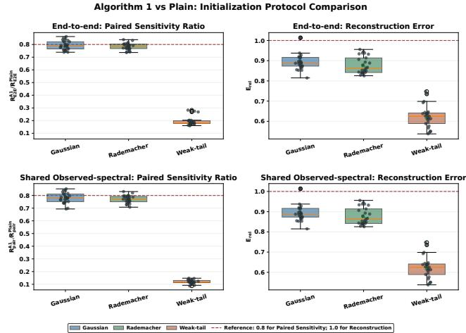  
Figure 1: Distributions ofthe Algorithm 1/Plain Paired Sensitivity Ratio (left) and reconstruction-error ratios (right) under E2E (top) and Shared (bottom) initialization. Smaller values favor Algorithm 1; the dashed lines mark 20% response improvement and reconstruction parity. The right panels coincide because both protocols use the same noisy-data runs.

Main results. Table 1 reports operator-level medians of the paired critical-point sensitivity ratio Q and relative reconstruction error $\mathsf { E } _ { \mathrm { r e l } } .$ , while Figure 1 shows their instance-level distributions. Under E2E, the median Q values are 0.788, 0.785, and 0.180, and the corresponding median $\mathsf { E } _ { \mathrm { r e l } }$ values are 0.887, 0.863, and 0.625 for Gaussian, Rademacher, and weak-tail sensing. Both metrics are below one in 73/75 matched instances. All reported Algorithm 1 solutions pass the unguided criticality and full-rank checks.

Under Shared initialization, the median Q values are 0.781, 0.771, and 0.117, with the same $\mathsf { E } _ { \mathrm { r e l } }$ values and joint count. Because Shared conditions out initialization sensitivity, it is treated as a controlled rather than primary result. The weaktail gains reflect the anisotropic stress test, not an easier sensing problem.

Robust recovery and reconstruction baselines. L1- SubGM (Ma and Fattahi 2023) and ScaledSM (Tong, Ma, and Chi 2021b) are robust matrix-recovery methods using nonsmooth $\ell _ { 1 }$ -type losses for corrupted measurements. GNMR (Zilber and Nadler 2022) is included as a strong nonconvex reconstruction baseline, testing whether lower paired sensitivity merely results from improved recovery.

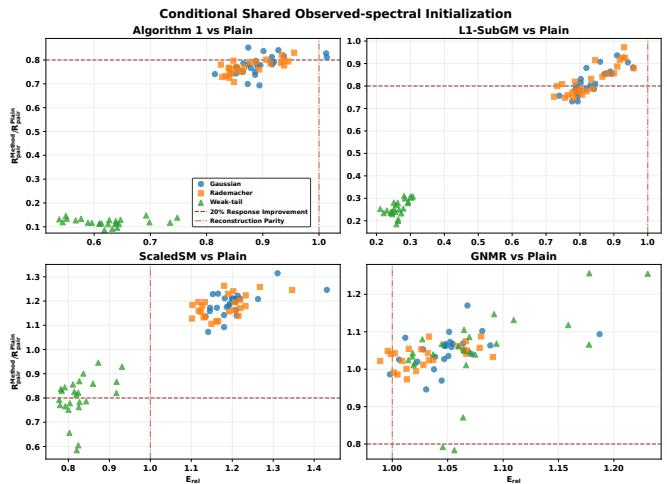  
Figure $2 \colon$ Conditional Shared comparison relative to Plain. Each point is one configuration–seed instance. The horizontal line marks a 20% reduction in paired sensitivity, and the vertical line marks reconstruction parity; the lower-left region improves both metrics.

Figure 2 compares all methods under Shared using the same paired-sensitivity and reconstruction metrics. Algorithm 1 has the smallest pooled median paired-sensitivity ratio (0.751), compared with 0.776 for L1-SubGM, 1.155 for ScaledSM, and 1.049 for GNMR, and improves both metrics in 73/75 instances. L1-SubGM also gives favorable tradeofs, especially under weak-tail sensing; ScaledSM improves mainly in that setting, while GNMR gives no consistent sensitivity reduction. All displayed solutions are polished on $f _ { w } ,$ and $f _ { w }$ -criticality claims refer to the polished critical points.

Additional experiments. Appendix A reports further E2E, shared-initialization, and large-scale matrix-sensing results with consistent trends. It also presents a preliminary Algorithm 1-inspired LoRA (Hu et al. 2022a) study that fine-tunes RoBERTa-base (Liu et al. 2019) on GLUE/SST-2 (Wang et al. 2018a), improving corrupted-data accuracy by approximately one percentage point.

## 7 Conclusion

We develop a rank-aware robustness theory for overparameterized PSD matrix sensing. Rank-deficient SOSPs admit direct recovery guarantees, whereas full-rank robustness depends on tangent curvature, the active spectral floor, and negative normal leakage. These quantities motivate a transient, anchor-free method whose polished critical points improve paired robustness across Gaussian, Rademacher, and weak-tail operators without worsening reconstruction. Thus robustness is governed by solution geometry and solution selection, not factor width alone.

## References

Absil, P.-A.; Mahony, R.; and Sepulchre, R. 2008. Optimization Algorithms on Matrix Manifolds. Princeton, NJ: Princeton University Press. ISBN 9780691132983.

Ahmed, A.; Recht, B.; and Romberg, J. 2014. Blind Deconvolution Using Convex Programming. IEEE Transactions on Information Theory, 60(3): 1711–1732.

Bandeira, A. S.; Dobriban, E.; Mixon, D. G.; and Sawin, W. F. 2013. Certifying the Restricted Isometry Property Is Hard. IEEE Transactions on Information Theory, 59(6): 3448–3450.

Bhatia, R. 1997. Matrix Analysis, volume 169 of Graduate Texts in Mathematics. Springer.

Bhojanapalli, S.; Neyshabur, B.; and Srebro, N. 2016. Global Optimality of Local Search for Low Rank Matrix Recovery. In Advances in Neural Information Processing Systems 29, 3873–3881.

Boumal, N. 2023. An Introduction to Optimization on Smooth Manifolds. Cambridge University Press. ISBN 9781009166171.

Boumal, N.; Voroninski, V.; and Bandeira, A. S. 2016. The Non-Convex Burer–Monteiro Approach Works on Smooth Semidefinite Programs. In Advances in Neural Information Processing Systems 29, 2757–2765.

Boumal, N.; Voroninski, V.; and Bandeira, A. S. 2020. Deterministic Guarantees for Burer–Monteiro Factorizations of Smooth Semidefinite Programs. Communications on Pure and Applied Mathematics, 73(3): 581–608.

Burer, S.; and Monteiro, R. D. C. 2003. A Nonlinear Programming Algorithm for Solving Semidefinite Programs via Low-Rank Factorization. Mathematical Programming, 95(2): 329–357.

Candès, E. J.; Li, X.; Ma, Y.; and Wright, J. 2011. Robust Principal Component Analysis? Journal ofthe ACM, 58(3): 1–37.

Candès, E. J.; and Recht, B. 2009. Exact Matrix Completion via Convex Optimization. Foundations of Computational Mathematics, 9(6): 717–772.

Candès, E. J.; Strohmer, T.; and Voroninski, V. 2013. PhaseLift: Exact and Stable Signal Recovery from Magnitude Measurements via Convex Programming. Communications on Pure and Applied Mathematics, 66(8): 1241–1274.

Davis, C.; and Kahan, W. M. 1970. The Rotation of Eigenvectors by a Perturbation. III. SIAM Journal on Numerical Analysis, 7(1): 1–46.

Ding, L.; Jiang, L.; Chen, Y.; Qu, Q.; and Zhu, Z. 2021. Rank Overspecified Robust Matrix Recovery: Subgradient Method and Exact Recovery. In Advances in Neural Information Processing Systems, volume 34, 26767–26778.

Eckart, C.; and Young, G. 1936. The Approximation of One Matrix by Another of Lower Rank. Psychometrika, 1(3): 211–218.

Ge, R.; Jin, C.; and Zheng, Y. 2017. No Spurious Local Minima in Nonconvex Low Rank Problems: A Unified Geometric Analysis. In Proceedings of the 34th International

Conference on Machine Learning, volume 70 of Proceedings ofMachine Learning Research, 1233–1242. PMLR.

Giampouras, P.; Cai, H.; and Vidal, R. 2025. Guarantees of a Preconditioned Subgradient Algorithm for Overparameterized Asymmetric Low-rank Matrix Recovery. In Proceedings of the 42nd International Conference on Machine Learning, volume 267 of Proceedings of Machine Learning Research, 19458–19479. PMLR.

Gross, D.; Liu, Y.-K.; Flammia, S. T.; Becker, S.; and Eisert, J. 2010. Quantum State Tomography via Compressed Sensing. Physical Review Letters, 105(15): 150401.

Halko, N.; Martinsson, P.-G.; and Tropp, J. A. 2011. Finding Structure with Randomness: Probabilistic Algorithms for Constructing Approximate Matrix Decompositions. SIAM Review, 53(2): 217–288.

Hu, E. J.; Shen, Y.; Wallis, P.; Allen-Zhu, Z.; Li, Y.; Wang, S.; Wang, L.; and Chen, W. 2022a. LoRA: Low-Rank Adaptation of Large Language Models. In International Conference on Learning Representations.

Hu, E. J.; Shen, Y.; Wallis, P.; Allen-Zhu, Z.; Li, Y.; Wang, S.; Wang, L.; and Chen, W. 2022b. LoRA: Low-Rank Adaptation of Large Language Models. In International Conference on Learning Representations.

Li, X.; Zhu, Z.; So, A. M.-C.; and Vidal, R. 2020. Nonconvex Robust Low-Rank Matrix Recovery. SIAM Journal on Optimization, 30(1): 660–686.

Li, Y.; Ma, T.; and Zhang, H. 2018. Algorithmic regularization in over-parameterized matrix sensing and neural networks with quadratic activations. In Conference on learning theory, 2–47. PMLR.

Liu, Y.; Ott, M.; Goyal, N.; Du, J.; Joshi, M.; Chen, D.; Levy, O.; Lewis, M.; Zettlemoyer, L.; and Stoyanov, V. 2019. RoBERTa: A Robustly Optimized BERT Pretraining Approach. arXiv preprint arXiv:1907.11692.

Luo, Y.; Li, X.; and Zhang, A. R. 2025. Nonconvex Factorization and Manifold Formulations Are Almost Equivalent in Low-Rank Matrix Optimization. INFORMS Journal on Optimization, 7(1): 38–60.

Ma, J.; and Fattahi, S. 2023. Global Convergence of Subgradient Method for Robust Matrix Recovery: Small Initialization, Noisy Measurements, and Over-parameterization. Journal ofMachine Learning Research, 24(96): 1–84.

Ma, J.; and Fattahi, S. 2025. Can Learning Be Explained by Local Optimality in Robust Low-Rank Matrix Recovery? Mathematics ofOperations Research.

Ma, Z.; Bi, Y.; Lavaei, J.; and Sojoudi, S. 2023. Geometric Analysis of Noisy Low-Rank Matrix Recovery in the Exact Parametrized and the Overparametrized Regimes. INFORMS Journal on Optimization, 5(4): 356–375.

Ma, Z.; and Sojoudi, S. 2023. Noisy Low-rank Matrix Optimization: Geometry of Local Minima and Convergence Rate. In International Conference on Artificial Intelligence and Statistics, 3125–3150. PMLR.

Recht, B.; Fazel, M.; and Parrilo, P. A. 2010. Guaranteed Minimum-Rank Solutions of Linear Matrix Equations via Nuclear Norm Minimization. SIAM Review, 52(3): 471–501.

Socher, R.; Perelygin, A.; Wu, J.; Chuang, J.; Manning, C. D.; Ng, A. Y.; and Potts, C. 2013. Recursive Deep Models for Semantic Compositionality Over a Sentiment Treebank. In Proceedings of the 2013 Conference on Empirical Methods in Natural Language Processing, 1631–1642. Association for Computational Linguistics.

Stöger, D.; and Soltanolkotabi, M. 2021. Small Random Initialization is Akin to Spectral Learning: Optimization and Generalization Guarantees for Overparameterized Low-Rank Matrix Reconstruction. In Advances in Neural Information Processing Systems.

Tong, T.; Ma, C.; and Chi, Y. 2021a. Accelerating Ill-Conditioned Low-Rank Matrix Estimation via Scaled Gradient Descent. Journal of Machine Learning Research, 22(150): 1–63.

Tong, T.; Ma, C.; and Chi, Y. 2021b. Low-Rank Matrix Recovery with Scaled Subgradient Methods: Fast and Robust Convergence without the Condition Number. IEEE Transactions on Signal Processing, 69: 2396–2409.

Vandereycken, B. 2013. Low-Rank Matrix Completion by Riemannian Optimization. SIAM Journal on Optimization, 23(2): 1214–1236.

Wang, A.; Singh, A.; Michael, J.; Hill, F.; Levy, O.; and Bowman, S. 2018a. GLUE: A Multi-Task Benchmark and Analysis Platform for Natural Language Understanding. In Proceedings of the 2018 EMNLP Workshop BlackboxNLP: Analyzing and Interpreting Neural Networks for NLP, 353– 355. Association for Computational Linguistics.

Wang, A.; Singh, A.; Michael, J.; Hill, F.; Levy, O.; and Bowman, S. R. 2018b. GLUE: A Multi-Task Benchmark and Analysis Platform. In Proceedings ofthe 2018 EMNLP Workshop BlackboxNLP: Analyzing and Interpreting Neural Networksfor NLP, 353–355. Association for Computational Linguistics.

Woodruf, D. P. 2014. Sketching as a Tool for Numerical Linear Algebra. Foundations and Trends in Theoretical Computer Science, 10(1–2): 1–157.

Xu, X.; Shen, Y.; Chi, Y.; and Ma, C. 2023. The Power ofPreconditioning in Overparameterized Low-Rank Matrix Sensing. In Krause, A.; Brunskill, E.; Cho, K.; Engelhardt, B.; Sabato, S.; and Scarlett, J., eds., Proceedings ofthe 40th International Conference on Machine Learning, volume 202 of Proceedings ofMachine Learning Research, 38611–38654. PMLR.

Zhang, R. Y. 2024. Improved Global Guarantees for the Nonconvex Burer–Monteiro Factorization via Rank Overparameterization. Mathematical Programming, 1-30.

Zhang, R. Y. 2025a. Improved Global Guarantees for the Nonconvex Burer–Monteiro Factorization via Rank Overparameterization. Mathematical Programming, 213(1–2): 1009–1038.

Zhang, R. Y. 2025b. Sharp global guarantees for nonconvex low-rank recovery in the noisy overparameterized regime. SIAM Journal on Optimization, 35(3): 2128–2154.

Zhang, R. Y.; Sojoudi, S.; and Lavaei, J. 2019. Sharp Restricted Isometry Bounds for the Inexistence of Spurious

Local Minima in Nonconvex Matrix Recovery. Journal of Machine Learning Research, 20(114): 1–34.

Zhu, Z.; Li, Q.; Tang, G.; and Wakin, M. B. 2021. The global optimization geometry of low-rank matrix optimization. IEEE Transactions on Information Theory, 67(2): 1308–1331.

Zilber, P.; and Nadler, B. 2022. GNMR: A Provable One-Line Algorithm for Low Rank Matrix Recovery. SIAM Journal on Mathematics ofData Science, 4(2): 909–934.

## Appendix

## A Algorithmic and Experimental Details

This appendix provides the implementation and diagnostic details of Algorithm 1, followed by the complete experimental protocol and additional matrix-sensing results omitted from Section 6.2.

## A.1 Algorithmic and Diagnostic Details

Algorithm 1 is implemented using only factor-space operations, applications of the sensing operator and its adjoint, and inverses of k×k matrices. It never materializes $M _ { t } \dot { = } X _ { t } X _ { t } ^ { \top }$ or the ambient normal block as a dense n × n matrix.

Matrix-free normal sketch. Let $U _ { t }$ be an orthonormal basis of range $\left( { { X } _ { t } } \right)$ . Given $\Xi _ { t } \in \mathbb { R } ^ { n \times s }$ with i.i.d. Gaussian entries, we form

$$
Q _ { t } = \mathrm { o r t h } \big ( \Xi _ { t } - U _ { t } ( U _ { t } ^ { \top } \Xi _ { t } ) \big ) .\tag{40}
$$

Thus, the projection onto range $( X _ { t } ) ^ { \perp }$ uses only products with the thin matrix $U _ { t }$ . Writing the columns of $Q _ { t }$ as $q _ { t , j } .$ define

$$
\boldsymbol { r } _ { t , j } = \left. \boldsymbol { G } _ { t } , \boldsymbol { q } _ { t , j } \boldsymbol { q } _ { t , j } ^ { \top } \right. = \left. \boldsymbol { e } _ { t } , \boldsymbol { A } ( \boldsymbol { q } _ { t , j } \boldsymbol { q } _ { t , j } ^ { \top } ) \right. ,
$$

where

$$
\begin{array} { r } { e _ { t } = \boldsymbol { \mathcal { A } } ( \boldsymbol { X _ { t } } \boldsymbol { X } _ { t } ^ { \top } ) - \boldsymbol { y _ { w } } , \qquad \boldsymbol { G _ { t } } = \boldsymbol { \mathcal { A } } ^ { * } \boldsymbol { e _ { t } } . } \end{array}
$$

Negative values of $\boldsymbol { r } _ { t , j }$ detect negative normal curvature. Let

$$
\mathcal { T } _ { t } = \{ j : r _ { t , j } < 0 \} .
$$

The sampled normal-curvature penalty is

$$
\widehat { \Phi } _ { - , t } = \left\{ \begin{array} { l l } { \displaystyle \frac { 1 } { 2 | \mathcal { T } _ { t } | } \sum _ { j \in \mathcal { I } _ { t } } ( - r _ { t , j } ) ^ { 2 } , } & { \mathcal { I } _ { t } \neq \emptyset , } \\ { 0 , } & { \mathcal { I } _ { t } = \emptyset . } \end{array} \right.
$$

The probes are held fixed while diferentiating the current update. If

$$
H _ { t , j } = \mathcal { A } ^ { * } \mathcal { A } ( q _ { t , j } q _ { t , j } ^ { \top } ) ,
$$

the resulting guidance direction is

$$
g _ { - , t } = - \frac { 2 } { | \mathcal { T } _ { t } | } \sum _ { j \in \mathcal { T } _ { t } } ( - r _ { t , j } ) H _ { t , j } X _ { t }\tag{41}
$$

when $\mathcal { I } _ { t } \neq \emptyset$ , and zero otherwise. The negative sign moves the sampled negative Rayleigh quotients toward zero.

Inverse-trace direction. Let

$$
S _ { t } = X _ { t } ^ { \top } X _ { t } , \qquad \bar { \lambda } _ { t } = \frac { \mathrm { t r } ( S _ { t } ) } { k } ,
$$

and set

$$
\varepsilon _ { t } = \varepsilon _ { \mathrm { f r a c } } \operatorname* { m a x } \{ \bar { \lambda } _ { t } , \epsilon _ { 0 } \} .
$$

With

$$
R _ { t } = ( S _ { t } + \varepsilon _ { t } I _ { k } ) ^ { - 1 } , \qquad \tau _ { t } = \bar { \lambda } _ { t } + \varepsilon _ { t } ,
$$

the scale-normalized inverse-trace penalty is

$$
\Omega _ { \mathrm { i n v } } ( X _ { t } ) = \tau _ { t } \operatorname { t r } ( R _ { t } ) .
$$

During the current update, $\varepsilon _ { t }$ is treated as fixed. We use the $\tau _ { t }$ -normalized gradient direction

$$
\begin{array} { r l } & { g _ { \mathrm { i n v } , t } : = \tau _ { t } ^ { - 1 } \nabla _ { X } \Omega _ { \mathrm { i n v } } ( X _ { t } ) } \\ & { \qquad = 2 X _ { t } \left[ \frac { \mathrm { t r } ( R _ { t } ) } { k \tau _ { t } } I _ { k } - R _ { t } ^ { 2 } \right] . } \end{array}\tag{42}
$$

The $R _ { t } ^ { 2 }$ term acts most strongly on the weakest factor directions, while the identity term controls the overall factor scale.

Periodic normal correction. Every h iterations during the guidance window, the implementation also applies a lowfrequency correction. For a fresh set of normal probes, define

$$
a _ { t , j } = \frac { ( - r _ { t , j } ) _ { + } } { \sum _ { \ell = 1 } ^ { s } ( - r _ { t , \ell } ) _ { + } } .
$$

If all sampled Rayleigh quotients are nonnegative, the correction is skipped. Otherwise, set

$$
\widetilde { v } _ { t } = \sum _ { j = 1 } ^ { s } a _ { t , j } q _ { t , j } , \qquad v _ { t } = \frac { \widetilde { v } _ { t } - U _ { t } ( U _ { t } ^ { \top } \widetilde { v } _ { t } ) } { \| \widetilde { v } _ { t } - U _ { t } ( U _ { t } ^ { \top } \widetilde { v } _ { t } ) \| _ { 2 } } .
$$

We approximate the weakest right factor direction $u _ { t } \in \mathbb { R } ^ { k }$ using four inverse iterations with a damped version of $S _ { t }$ The correction is

$$
X _ { t + 1 } \gets X _ { t + 1 } + \gamma _ { t } v _ { t } u _ { t } ^ { \top } ,\tag{43}
$$

where

$$
\gamma _ { t } = \operatorname* { m i n } \left\{ \gamma _ { 0 } c _ { t } \sqrt { \operatorname* { m a x } _ { j } ( - r _ { t , j } ) _ { + } } , \ \gamma _ { \operatorname* { m a x } } \sqrt { \bar { \lambda } _ { t } } \right\} .
$$

The cap prevents the correction from dominating the base optimization step.

Decay, preconditioning, and polishing. Let

$$
T _ { g } = \lfloor \theta T \rfloor , \qquad c _ { t } = \left( 1 - \frac { t } { T _ { g } } \right) ^ { 3 } , \quad 0 \leq t < T _ { g } .
$$

During this window, the factor-space direction is

$$
d _ { t } = 2 G _ { t } X _ { t } + \alpha _ { 0 } c _ { t } g _ { \mathrm { i n v } , t } + \beta _ { 0 } c _ { t } g _ { - , t } .
$$

We apply the damped Gram-preconditioned update

$$
X _ { t + 1 } = X _ { t } - \eta _ { t } d _ { t } \left( S _ { t } + \xi _ { t } I _ { k } \right) ^ { - 1 } , \qquad \xi _ { t } = \xi \operatorname* { m a x } \{ \bar { \lambda } _ { t } , \epsilon _ { 0 } \} .\tag{44}
$$

The learning rate uses a 25-iteration linear warm-up before reaching its nominal value. For $t \geq T _ { g } ,$ , all guidance terms and periodic corrections are removed, and the method optimizes only

$$
f _ { w } ( \boldsymbol { X } ) = \frac { 1 } { 2 } \left\| \boldsymbol { A } ( \boldsymbol { X } \boldsymbol { X } ^ { \top } ) - y _ { w } \right\| _ { 2 } ^ { 2 } .
$$

After native optimization, the resulting solution is polished on $f _ { w }$ for at most 500 additional steps. A reported critical point must remain full rank and satisfy

$$
\frac { \| \nabla f _ { w } ( X ) \| _ { F } } { \operatorname* { m a x } \{ 1 , \| X \| _ { F } \} } \leq \varepsilon _ { \mathrm { c r i t } } .\tag{45}
$$

Therefore, guidance afects trajectory and critical-point selection, whereas stationarity is always tested on the original unmodified objective.

Computational cost. The inverse-trace direction requires forming $S _ { t } ,$ solving a $k \times k$ linear system, and multiplying an n × k factor by a $k \times k$ matrix. Its additional cost is

$$
O ( n k ^ { 2 } + k ^ { 3 } ) .
$$

The normal guidance uses s rank-one sensing evaluations and adjoint-factor products together with an $n \times s \mathrm { Q R }$ factorization. Since s and k are small relative to $n ,$ the implementation stores only thin factor and sketch matrices and avoids ambient eigendecompositions.

Finite-probe diagnostic. Exact RIP certification is computationally intractable in general. We therefore use a finiteprobe diagnostic only as an empirical screen. For each probe, draw an orthonormal matrix $V _ { j } ~ \in ~ \mathbb { R } ^ { n \times q }$ , where $q = \operatorname* { m i n } \{ 2 k , n \}$ , and a normalized Gaussian vector $z _ { j } \in \mathbb { R } ^ { q }$ Set

$$
Z _ { j } = V _ { j } \mathrm { d i a g } ( z _ { j } ) V _ { j } ^ { \top } , \qquad \| Z _ { j } \| _ { F } = 1 .
$$

Using $N _ { \mathrm { R I P } } = 2 4$ probes, we compute

$$
\widehat { \delta } = \operatorname* { m a x } _ { 1 \leq j \leq N _ { \mathrm { R I P } } } \left| \| A ( Z _ { j } ) \| _ { 2 } ^ { 2 } - 1 \right| , \qquad \widehat { \mu } = 1 - \widehat { \delta } - \rho _ { k } ^ { - } .
$$

These quantities test only the sampled directions and are not certified RIP constants or theorem-level robustness certificates.

## A.2 Matrix-Sensing Experiments

Data and sensing operators. For each instance, we generate

$$
M _ { \star } = U _ { \star } \Lambda _ { \star } U _ { \star } ^ { \top } , \qquad \mathrm { r a n k } ( M _ { \star } ) = r _ { \star } ,
$$

where $U _ { \star }$ is obtained by orthonormalizing a Gaussian matrix. The nonzero eigenvalues of $M _ { \star }$ are geometrically spaced between 1.5 and 0.55.

We use the implicit bilinear sensing operator

$$
\mathcal { A } _ { i } ( Z ) = \frac { a _ { i } ^ { \top } Z b _ { i } } { \sqrt { m } } , \qquad m = 6 n k .
$$

For Gaussian sensing, $a _ { i }$ and $b _ { i }$ have independent standard normal entries. For Rademacher sensing, their entries are independent random signs. For weak-tail sensing, Gaussian vectors are decomposed into components inside and outside range(M<sub>⋆</sub>), and the orthogonal component is scaled by 0.35. This produces an anisotropic stress test with reduced visibility in slack directions. The target subspace is used only to generate the synthetic operator and is not supplied to any optimization method.

The formal grid is

$$
\begin{array} { r } { ( n , r _ { \star } , k ) \in \{ ( 5 0 , 2 , 5 ) , ( 7 5 , 3 , 6 ) , ( 1 0 0 , 3 , 8 ) , } \\ { ( 1 2 5 , 4 , 1 0 ) , ( 1 5 0 , 5 , 1 2 ) \} . \qquad } \end{array}
$$

We use seeds 15, 66, 102, 999, 1325, giving 25 matched configuration–seed instances per operator and 75 in total. Measurement perturbations satisfy

$$
y _ { w _ { j } } = A ( M _ { \star } ) + w _ { j } , \qquad \| w _ { j } \| _ { 2 } = 0 . 0 8 \| A ( M _ { \star } ) \| _ { 2 } ,
$$

where $j = 1 , 2 , 3$ and each $w _ { j }$ is an independently sampled Gaussian direction normalized to the prescribed magnitude.

Non-oracle protocols. Both formal protocols construct their initializations only from observed measurements. Under E2E, the clean and perturbed runs use separately constructed observed-data initializations. In particular, Algorithm 1 and Plain use

$$
\mathrm { S p e c I n i t } ( \mathcal { A } ^ { * } y _ { 0 } ) \quad \mathrm { a n d } \quad \mathrm { S p e c I n i t } ( \mathcal { A } ^ { * } y _ { w _ { j } } ) ,
$$

respectively. Hence E2E includes sensitivity introduced by the initialization map.

Under Shared observed-spectral initialization, both members of each clean–perturbed pair use the same initialization constructed from $y _ { w _ { j } }$ . This conditions out initialization differences and isolates the subsequent optimization trajectory. E2E is the primary protocol, while Shared is a controlled non-oracle comparison.

Evaluation metrics. Let $M _ { p , s } ^ { a } ( w _ { j } )$ and $M _ { p , s } ^ { a } ( 0 )$ denote the polished critical points produced by method $^ { a , }$ protocol $p ,$ and matched instance s. Define

$$
d _ { p , s , j } ^ { a } = \frac { \| M _ { p , s } ^ { a } ( w _ { j } ) - M _ { p , s } ^ { a } ( 0 ) \| _ { F } } { \| w _ { j } \| _ { 2 } }
$$

and

$$
\mathsf { R } _ { p , s } ^ { a } = \mathrm { m e d i a n } _ { j = 1 , 2 , 3 } d _ { p , s , j } ^ { a } .
$$

The relative paired-sensitivity ratio is

$$
{ \sf Q } _ { p , s } ^ { a } = \frac { { \sf R } _ { p , s } ^ { a } } { { \sf R } _ { p , s } ^ { \mathrm { P l a i n } } } .
$$

For the primary noisy-data critical point $M _ { s } ^ { a }$ , the relative reconstruction error is

$$
\mathsf { E } _ { \mathrm { r e l } , s } ^ { a } = \frac { \| M _ { s } ^ { a } - M _ { \star } \| _ { F } } { \| M _ { s } ^ { \mathrm { P l a i n } } - M _ { \star } \| _ { F } } .
$$

Values below one favor method $a .$ The primary noisy-data runs are the same under E2E and Shared, so their $\mathsf { E } _ { \mathrm { r e l } }$ values coincide.

All formal runs are polished on $f _ { w }$ using tolerance $\varepsilon _ { \mathrm { c r i t } } = 0 . 0 2 5$ . Every Algorithm 1/Plain matched row passes the paired criticality check for all three perturbations under both protocols. All reported primary solutions also satisfy $\lambda _ { k } ( \dot { X } \dot { X } ^ { \top } ) > 1 0 ^ { - 8 }$

Optimization settings. Algorithm 1 and Plain use learning rate 0.035 and at most 220 native iterations. Algorithm 1 uses a 25% guidance window with cubic decay, inversetrace weight 0.003, Rayleigh-gradient weight 0.02, correction weight 0.08, sketch size $^ { 8 , }$ correction period 10, and Gram damping fraction 0.05.

L1-SubGM (Ma and Fattahi 2023) uses step size 0.04, decay 0.99, and initialization scale 0.05. ScaledSM (Tong, Ma, and Chi 2021b) uses scale parameter 0.03 and decay 0.99. GNMR (Zilber and Nadler 2022) uses 40 LSQR iterations per Gauss–Newton step. Since these methods have diferent native objectives, all their reported solutions are subsequently polished on the common squared objective $f _ { w } .$

<table><tr><td>Parameter Value</td></tr><tr><td>Measurements  $m = 6 n k$ </td></tr><tr><td>Formal seeds 15, 66, 102, 999, 1325</td></tr><tr><td>Native iterations at most 220</td></tr><tr><td>Algorithm 1/Plain learning rate 0.035</td></tr><tr><td>Relative perturbation norm 0.08</td></tr><tr><td>Paired perturbations 3</td></tr><tr><td>Guidance fraction 0.25</td></tr><tr><td>Guidance decay power 3</td></tr><tr><td>Normal sketch size 8</td></tr><tr><td>Normal correction period 10</td></tr><tr><td>Common polishing steps at most 500</td></tr><tr><td>Criticality tolerance 0.025 Finite-RIP probes 24</td></tr></table>

Table 2: Common settings for the formal matrix-sensing experiments.

<table><tr><td>Operator</td><td> $( n , r _ { \star } , k )$ </td><td> $\mathrm { Q _ { E 2 E } }$ </td><td> $\mathsf { Q } _ { \mathrm { S h a r e d } }$ </td><td> $\mathsf { E } _ { \mathrm { r e l } }$ </td></tr><tr><td>Gauss. Gauss. Gauss. Gauss. Gauss.</td><td>(50, 2, 5) (75, 3, 6) (100, 3, 8) (125, 4, 10) (150, 5, 12)</td><td>.8323 .8269 .7883 .7651 .7483</td><td>.8161 .8123 .7780 .7516 .7378</td><td>.9375 .9162 .8874 .8864 .8739</td></tr><tr><td>Radem. Radem. Radem. Radem. Radem.</td><td>(50, 2, 5) (75, 3, 6) (100, 3, 8) (125,4, 10) (150, 5, 12)</td><td>.8031 .8064 .7884 .7658 .7459</td><td>.7991.9322 .7898 .7708 .7504 .7333 .1171</td><td>.9338 .8668 .8487 .8347 .5960</td></tr><tr><td>Weak-tail Weak-tail Weak-tail Weak-tail Weak-tail</td><td>(50, 2, 5) (75, 3, 6) (100, 3,8) (125, 4, 10) (150, 5, 12)</td><td>.1722 .1768 .1827 .1865 .2683</td><td>.1337 .1128 .1119 .1296.6468</td><td>.5512 .6250 .6387</td></tr></table>

Table 3: Configuration-level medians for Algorithm 1 relative to Plain. Each row aggregates five seeds. Values below one favor Algorithm 1.

Algorithm 1 versus Plain. Table 3 reports configurationlevel medians over five seeds. The two Q columns correspond to E2E and Shared observed-spectral initialization. The reconstruction ratio is common to both protocols because their primary noisy-data runs are identical.

All configuration-level medians satisfy $\mathsf Q < 1$ and $\mathsf { E } _ { \mathrm { r e l } } <$ 1. At the instance level, both inequalities hold in $2 3 / 2 5$ $2 5 / 2 5 $ , and 25/25 cases for Gaussian, Rademacher, and weak-tail sensing, respectively, under both protocols. Shared gives uniformly smaller configuration-level Q values because it conditions out initialization sensitivity. Its weak-tail gains should therefore be read as controlled evidence under the anisotropic stress test, not as evidence that weak-tail sensing is easier.

Figure 3 complements the direct paired measurements with terminal solution geometry. The median $\rho ^ { - }$ ratios are 1.476, 1.459, and 2.061, while the median active-floor ratios are 0.755, 0.735, and 0.634 for Gaussian, Rademacher, and weak-tail sensing. Thus, the reduction in Q is not accompanied by uniform improvement in either terminal diagnostic. These quantities describe local geometry at the polished critical point; neither is intended to replace the directly measured paired sensitivity.

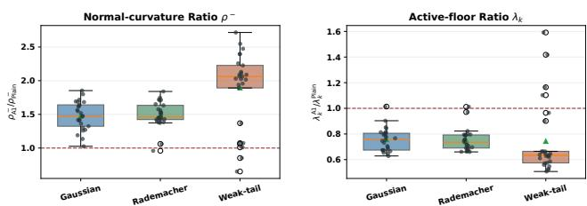  
Gaussian Rademacher Weak-tail Reference: 1.0 (parity)  
Figure 3: Terminal spectral diagnostics for Algorithm 1 relative to Plain. The panels show $\rho _ { \mathrm { A 1 } } ^ { - } / \rho _ { \mathrm { P l a i n } } ^ { - }$ and $\lambda _ { k } ^ { \mathrm { A 1 } } / \lambda _ { k } ^ { \mathrm { P l a i n } }$ respectively. Each operator pools 25 matched instances. Smaller values favor Algorithm 1 for $\rho ^ { - }$ <sup>−</sup>, whereas larger values favor it for $\lambda _ { k }$ . E2E and Shared use the same primary noisy-data runs, so these diagnostics coincide and are shown only once.

External comparators. All external methods are evaluated relative to Plain using the same metrics and common $f _ { w } { \mathrm { - p o l i s h i n g . } }$ . E2E recomputes the observed-spectral initialization for each paired perturbation, whereas Shared reuses a common observed-spectral initialization. Consequently, only Q changes between protocols; reconstruction, $\rho ^ { - }$ , and $\lambda _ { k }$ are identical up to numerical precision. Figures 4–6 report the corresponding operator-wise distributions. All displayed paired solutions pass the common $f _ { w }$ -criticality check.

L1-SubGM (Ma and Fattahi 2023) has pooled median $\mathsf { Q }$ values 0.779 under E2E and 0.776 under Shared, together with pooled $\mathsf { E } _ { \mathrm { r e l } } = 0 . 7 9 1$ . Both metrics are below one in all 75 instances, with the largest reductions under weak-tail sensing. Its terminal spectral ratios nevertheless move in the opposite directions, especially for weak-tail sensing, illustrating that paired sensitivity is not determined by either diagnostic alone.

ScaledSM (Tong, Ma, and Chi 2021b) has pooled median Q values 1.148 and 1.155 under E2E and Shared, respectively, and pooled $\mathsf { E } _ { \mathrm { r e l } } = 1 . 1 4 6$ . It lowers both paired sensitivity and reconstruction error in all 25 weak-tail instances, but in none of the 50 Gaussian or Rademacher instances. Its benefit is therefore specific to the anisotropic stress test rather than uniform across sensing operators.

GNMR (Zilber and Nadler 2022) has pooled median $Q \simeq 1 . 0 4 9$ under both protocols and pooled $\mathsf { E } _ { \mathrm { r e l } } = 1 . 0 4 8 $ with only one joint improvement among the 75 instances. Although its median $\rho ^ { - }$ ratios are below one and its median active-floor ratios are above one, these favorable terminal directions do not produce a consistent reduction in paired sensitivity.

Taken together, the comparator results show that terminal $\rho ^ { - }$ and $\lambda _ { k }$ ratios do not by themselves rank methods by paired sensitivity. The theoretical certificates use these quan-

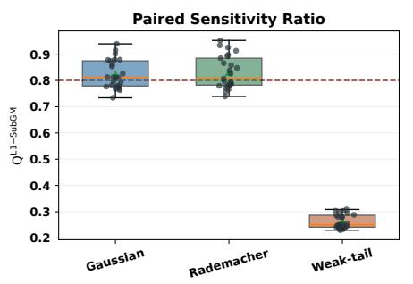

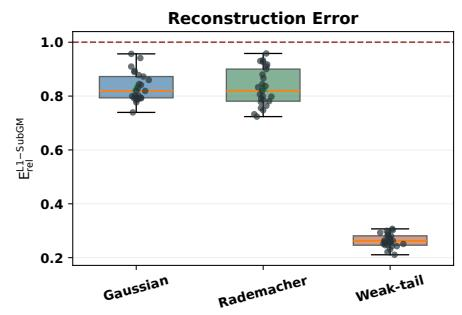

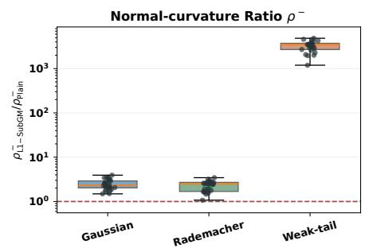

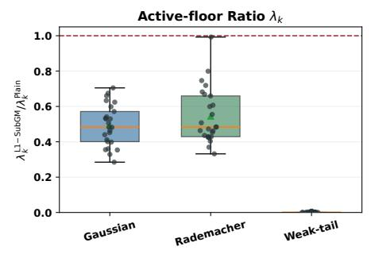  
Gaussian Rademacher Weak-tail Reference: 0.8 for paired sensitivity; 1.0 otherwise

L1-SubGM vs Plain: Conditional Shared Observed-spectral Initialization  
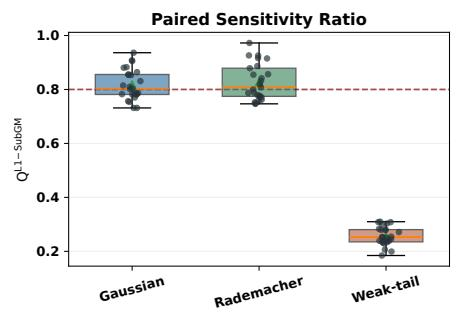

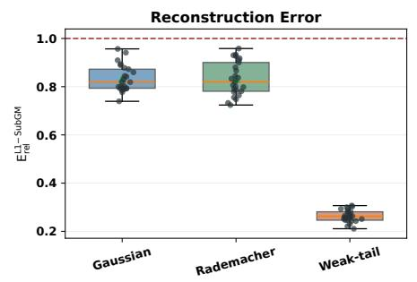

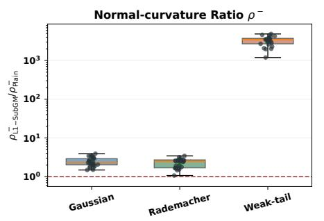

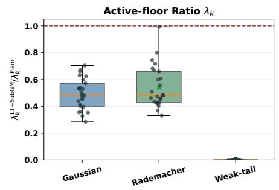  
Gaussian Rademacher Weak-tail Reference: 0.8 for paired sensitivity; 1.0 otherwise

Figure 4: L1-SubGM relative to Plain under E2E (top) and Shared (bottom). From upper left to lower right, the panels show $\mathrm { Q } , \mathrm { E _ { r e l } } .$ , the $\rho ^ { - }$ ratio, and the $\lambda _ { k }$ ratio. The dashed references are $\mathsf Q = 0 . 8$ and one for the other metrics. The $\rho ^ { - }$ panel uses a logarithmic scale because of the weak-tail range.

Gaussian Rademacher Weak-tail Reference: 0.8 for paired sensitivity; 1.0 otherwise

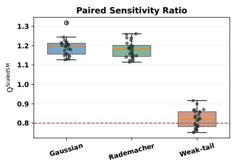

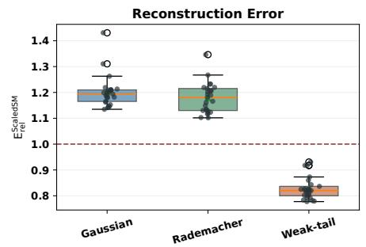

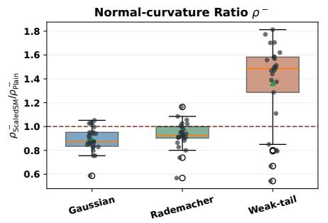

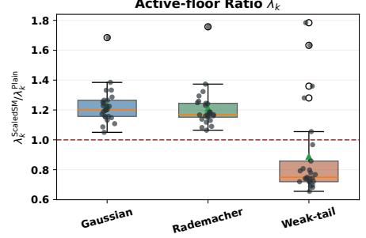

ScaledSM vs Plain: Conditional Shared Observed-spectral Initialization  
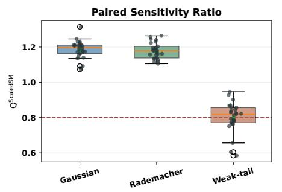

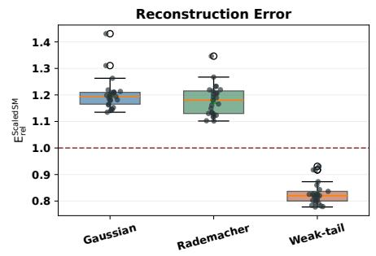

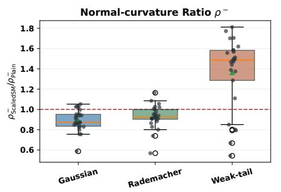

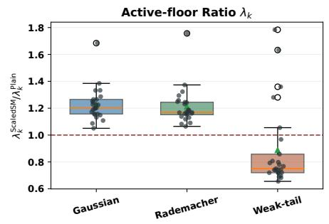  
Gaussian Rademacher Weak-tail Reference: 0.8 for paired sensitivity; 1.0 otherwise

Figure 5: ScaledSM relative to Plain under E2E (top) and Shared (bottom), using the same four diagnostics and reference lines as Figure 4. Each operator contains 25 matched configuration–seed instances.

## GNMR vs Plain: End-to-end Observed-spectral Initialization

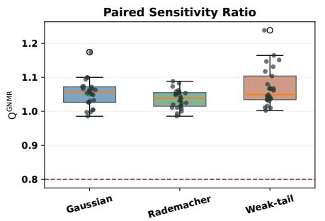

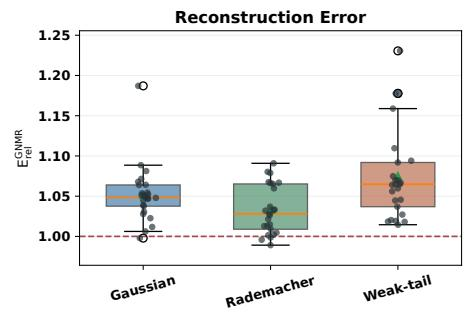


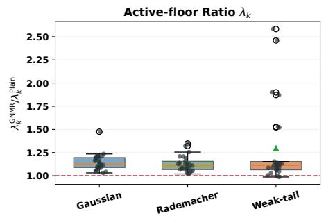

GNMR vs Plain: Conditional Shared Observed-spectral Initialization  
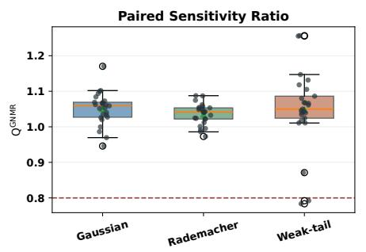

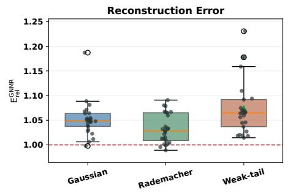

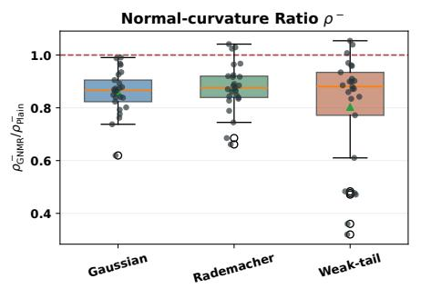

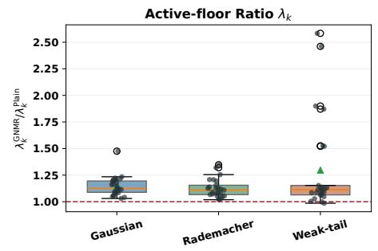  
Gaussian Rademacher Weak-tail Reference: 0.8 for paired sensitivity; 1.0 otherwise

Figure 6: GNMR relative to Plain under E2E (top) and Shared (bottom), using the same four diagnostics and reference lines as Figure 4. Each operator contains 25 matched configuration–seed instances.

titiesjointly with the remaining local and operator-dependent conditions; they do not assert cross-method monotonicity in either terminal ratio alone. Accordingly, Q remains the direct experimental measure, while $\rho ^ { - }$ and $\lambda _ { k }$ provide complementary geometric diagnostics.

Large-scale experiments. We evaluate whether the paired-sensitivity improvements persist as the ambient dimension increases. We use

$$
( n , r _ { \star } , k ) \in \{ ( 2 5 0 , 4 , 1 0 ) , ( 5 0 0 , 5 , 1 2 ) , ( 1 0 0 0 , 5 , 1 2 ) \} ,
$$

with Gaussian, Rademacher, and weak-tail sensing, five seeds per configuration, and $m = 6 n k$ measurements. The relative measurement-noise level and paired-perturbation norm are both 0.08, and each paired critical-point sensitivity is aggregated over three perturbations. Algorithm 1 and Plain use at most 220 native iterations, followed by the same $f _ { w } .$ -polishing procedure for at most 500 iterations. The criticality tolerance is 0.025.

We evaluate both the primary E2E protocol and the controlled Shared observed-spectral protocol. In E2E, the initialization changes with the perturbed observations. Shared instead uses the same observed-spectral initialization for the two objectives in each matched pair, thereby conditioning out initialization sensitivity. The main noisy-data runs are identical under the two protocols; hence their reconstruction and terminal spectral diagnostics coincide, while their relative paired sensitivities Q can difer.

Table 4 shows that the improvements persist through $n = 1 0 0 0$ . Under E2E, the Gaussian and Rademacher median Q values remain between 0.709 and 0.722, giving approximately 28%–29% lower paired critical-point sensitivity than Plain at every dimension. For weak-tail sensing, Q<sub>E2E</sub> increases from 0.307 at $n = 2 5 0$ to 0.570 at $n = 1 0 0 0$ , but remains below one and therefore still gives a 43.0% reduction at the largest scale.

Conditioning out initialization sensitivity produces smaller Shared ratios. The Gaussian and Rademacher values decrease to approximately 0.684 at $n = 1 0 0 0$ , while the weak-tail values remain between 0.120 and 0.157. Shared is retained as a controlled diagnostic, rather than replacing the primary E2E result.

Reconstruction also improves uniformly. The median $\mathsf { E } _ { \mathrm { r e l } }$ values lie between 0.821 and 0.840 for the isotropic operators and between 0.584 and 0.668 for weak-tail sensing. Consequently, both ${ \sf Q } < 1$ and $\mathsf { E } _ { \mathrm { r e l } } < 1$ hold in all 45 matched instances under each protocol.

The lower panels of Figures 7 and 8 provide complementary terminal spectral diagnostics. The pooled median normal-curvature ratios are 1.527, 1.454, and 1.489, while the corresponding active-floor ratios are 0.699, 0.704, and 0.619 for Gaussian, Rademacher, and weak-tail sensing. These terminal quantities do not vary monotonically with the directly measured paired sensitivity and are therefore reported as diagnostics rather than substituted for Q.

All main solutions remain full rank, with minimum $\lambda _ { k } =$ 0.0192. The largest final relative gradient norm is 0.0249, below the prescribed 0.025 tolerance, and every paired solution used to compute $\mathsf { Q }$ passes the same criticality check.

## A.3 LoRA Fine-Tuning Experiments

From Matrix-Sensing Guidance to LoRA We evaluate whether the guidance principle developed in Algorithm 1 can improve low-rank adaptation of a pretrained language model. Algorithm 1 is motivated by the matrix-sensing robustness ratio

$$
\rho _ { k } ^ { - } = \frac { b ^ { - } } { \lambda _ { k } ( M ) } ,
$$

which identifies two complementary mechanisms: protecting the active spectral floor in the denominator and controlling leakage outside the active subspace in the numerator. The LoRA experiment is a practical adaptation of this principle rather than a direct application of the matrix-sensing theorems, since LoRA updates are rectangular matrices and do not possess the same positive-semidefinite manifold geometry.

For layer ℓ, LoRA parameterizes the trainable update as

$$
\Delta W _ { \ell } = { \frac { \alpha } { r } } B _ { \ell } A _ { \ell } ,
$$

where r is the nominal LoRA rank. Let $s _ { \ell , 1 } \geq \dots \geq s _ { \ell , r }$ denote the singular values of $\Delta W _ { \ell } .$ . At the beginning of the guidance window, we freeze a layer-specific active rank $q _ { \ell }$ as the smallest rank explaining at least 95% of the spectral energy. Layers for which $q _ { \ell } = r$ are excluded from spectral guidance.

For the retained active directions, we use the scalenormalized inverse-trace penalty

$$
\Omega _ { \ell , \mathrm { f l o o r } } = \left( \frac { 1 } { q \ell } \sum _ { i = 1 } ^ { q _ { \ell } } s _ { \ell , i } ^ { 2 } + \epsilon \right) \left( \frac { 1 } { q \ell } \sum _ { i = 1 } ^ { q _ { \ell } } \frac { 1 } { s _ { \ell , i } ^ { 2 } + \epsilon } \right) - 1 .
$$

This term places stronger pressure on weak directions within the frozen active spectrum. To avoid improving the active floor by simultaneously inflating unused directions, we add the normalized tail penalty

$$
\Omega _ { \ell , \mathrm { t a i l } } = \frac { \sum _ { i = q _ { \ell } + 1 } ^ { r } s _ { \ell , i } ^ { 2 } } { \mathrm { s t o p g r a d } \left( \sum _ { i = 1 } ^ { q _ { \ell } } s _ { \ell , i } ^ { 2 } \right) + \epsilon } .
$$

The guided objective during the active window is

$$
\mathcal { L } _ { \mathrm { g u i d e d } } = \mathcal { L } _ { \mathrm { t a s k } } + c _ { t } \left( 1 0 ^ { - 2 } \overline { { \Omega } } _ { \mathrm { f o o r } } + 1 0 ^ { - 3 } \overline { { \Omega } } _ { \mathrm { t a i l } } \right) ,
$$

where the bars denote averages over guided LoRA layers. Guidance begins after 10% of training, remains active for 20% of the training trajectory, and uses a short fade-in followed by cubic decay. Its contribution is clipped to at most 10% of the detached task loss.

Following the damped Gram preconditioning in Algorithm 1, scaled-active LoRA also preconditions the factor gradients as

$$
\begin{array} { r l } & { \widetilde { \nabla } _ { B _ { \ell } } = \nabla _ { B _ { \ell } } \left( A _ { \ell } A _ { \ell } ^ { \top } + \xi I \right) ^ { - 1 } , } \\ & { \widetilde { \nabla } _ { A _ { \ell } } = \left( B _ { \ell } ^ { \top } B _ { \ell } + \xi I \right) ^ { - 1 } \nabla _ { A _ { \ell } } . } \end{array}\tag{46}
$$

We use damping $\xi = 0 . 1$ , a damping floor of $1 0 ^ { - 4 }$ , and cap the preconditioning gain at 10. The normal-Rayleigh guidance term from Algorithm 1 is disabled in this experiment, because a rectangular LoRA update has no direct theorempreserving analogue of the positive-semidefinite normal projector. Consequently, scaled-active LoRA should be interpreted as an active-floor and tail-guided method combined with damped LoRA preconditioning.

<table><tr><td>n</td><td>Operator</td><td> $\mathbf { Q _ { E 2 E } }$ </td><td> $\Delta _ { \mathrm { E 2 E } }$ </td><td> $\mathsf { Q } _ { \mathrm { S h } }$ </td><td> $\Delta _ { \mathrm { S h } }$ </td><td> $\mathsf { E } _ { \mathrm { r e l } }$ </td><td> $\rho _ { \mathrm { P l a i n } } ^ { - }$ </td><td> $\rho _ { \mathrm { A 1 } } ^ { - }$ </td><td>Joint</td></tr><tr><td>250</td><td>Gauss.</td><td>0.715</td><td>28.5%</td><td>0.710</td><td>29.0%</td><td>0.821</td><td>0.2624</td><td>0.4093</td><td>5/5</td></tr><tr><td>250</td><td>Radem.</td><td>0.712</td><td>28.8%</td><td>0.706</td><td>29.4%</td><td>0.824</td><td>0.2543</td><td>0.3954</td><td>5/5</td></tr><tr><td>250</td><td>Weak-tail</td><td>0.307</td><td>69.3%</td><td>0.125</td><td>87.5%</td><td>0.668</td><td>0.0077</td><td>0.0084</td><td>5/5</td></tr><tr><td>500</td><td>Gauss.</td><td>0.713</td><td>28.7%</td><td>0.703</td><td>29.7%</td><td>0.823</td><td>0.1826</td><td>0.2850</td><td>5/5</td></tr><tr><td>500</td><td>Radem.</td><td>0.722</td><td>27.8%</td><td>0.702</td><td>29.8%</td><td>0.834</td><td>0.1951</td><td>0.3058</td><td>5/5</td></tr><tr><td>500</td><td>Weak-tail</td><td>0.385</td><td>61.5%</td><td>0.120</td><td>88.0%</td><td>0.586</td><td>0.0029</td><td>0.0061</td><td>5/5</td></tr><tr><td>1000</td><td>Gauss.</td><td>0.709</td><td>29.1%</td><td>0.684</td><td>31.6%</td><td>0.835</td><td>0.1287</td><td>0.1950</td><td>5/5</td></tr><tr><td>1000</td><td>Radem.</td><td>0.720</td><td>28.0%</td><td>0.684</td><td>31.6%</td><td>0.840</td><td>0.1384</td><td>0.1934</td><td>5/5</td></tr><tr><td>1000</td><td>Weak-tail</td><td>0.570</td><td>43.0%</td><td>0.157</td><td>84.3%</td><td>0.584</td><td>0.0031</td><td>0.0041</td><td>5/5</td></tr></table>

Table 4: Formal large-scale comparison of Algorithm 1 with Plain over five seeds per (n, operator) cell. The quantities $\mathrm { Q _ { E 2 E } }$ and $\mathsf { Q } _ { \mathrm { S h } }$ are the median instancewise relative paired critical-point sensitivities under E2E and Shared observed-spectral initialization. The corresponding sensitivity reductions are $\Delta _ { \mathrm { E 2 E } } = 1 0 0 ( 1 - \mathsf { Q } _ { \mathrm { E 2 E } } )$ and $\Delta _ { \mathrm { S h } } = 1 0 0 ( 1 - \mathsf { Q } _ { \mathrm { S h } } )$ . The reconstruction ratio is common to both protocols because their main noisy-data runs are identical. The two $\rho ^ { - }$ <sup>−</sup> columns report the median terminal normal-curvature ratios of Plain and Algorithm 1; these values are likewise common to the two protocols up to numerical precision. Joint counts seeds for which both $\mathsf Q < 1$ and $\mathsf { E } _ { \mathrm { r e l } } < 1 ;$ all cells have $5 / 5$ under both protocols.

The plain baseline uses the same initialization, data order, optimizer, training seed, and objective perturbation, but applies neither spectral guidance nor ScaledLoRA preconditioning. After the guidance window, the spectral penalties are removed and the endpoint is polished on the original training objective. In the reported legacy protocol, the scaled-active branch retains its damped preconditioner during this polish.

Fixed Logit-Objective Perturbation To construct an analogue of matrix-sensing measurement noise, we perturb the training objective rather than the validation inputs. For training example n and perturbation seed $s ,$ the perturbed objective is

$$
\mathcal { L } _ { \varepsilon , s } ( \theta ) = \frac { 1 } { N } \sum _ { n = 1 } ^ { N } \mathrm { C E } \left( f _ { \theta } ( x _ { n } ) + \varepsilon u _ { s , n } , y _ { n } \right) ,
$$

where $u _ { s , n }$ is generated deterministically from the pair consisting of the perturbation seed and training-example identifier. It satisfies

$$
\begin{array} { r } { \mathbf { 1 } ^ { \top } u _ { s , n } = 0 , \qquad \| u _ { s , n } \| _ { 2 } = 1 , } \end{array}
$$

and is fixed across all epochs. Labels are unchanged and no perturbation is applied during validation. Therefore, noisy validation accuracy refers to the clean-validation accuracy of an endpoint trained under the perturbed objective; it is not accuracy under corrupted validation text.

The prespecified experiment uses $\varepsilon ~ = ~ 0 . 2 5$ and three fixed perturbation seeds, 10000, 10001, and 10002. We additionally evaluate $\varepsilon \in \{ 0 . 0 5 , 0 . 1 , 0 . 2 , 0 . 3 , 0 . 4 , 0 . 5 \}$ without changing any other training setting.

Experimental configuration. We fine-tune roberta-base (Liu et al. 2019) on the SST-2 task (Socher et al. 2013), using the version distributed in

GLUE (Wang et al. 2018b). Following LoRA (Hu et al. 2022b), adapters are inserted into all attention query and value projections with rank $r \ = \ 8 ,$ , scaling $\alpha \ : = \ : 1 6 ,$ , and zero dropout. The classification head is trainable in both conditions. We use a maximum sequence length of 128, training batch size 32, evaluation batch size 64, and train for two epochs.

Both methods use SGD with learning rate $1 0 ^ { - 2 } .$ , momentum 0.9, zero weight decay, and a learning-rate warm-up ratio of 0.06. The legacy protocol does not use a separate shared warm-up stage. We evaluate training seeds 0, 1, and 2. For each training seed, the plain and scaled-active runs share their initialization and are evaluated using the same three fixed objective-perturbation directions.

For aggregation, noisy validation accuracy is first averaged over the three perturbation directions within each training seed. We then report the mean and sample standard deviation over the three training seeds. The perturbation directions are not treated as independent training repetitions.

Results At the prespecified perturbation magnitude $\varepsilon =$ 0.25, plain LoRA achieves a clean validation accuracy of $9 1 . 0 9 \bar { 3 } \pm 0 . 3 3 1 \%$ , whereas scaled-active LoRA achieves $9 2 . 0 8 7 \pm 0 . 3 0 3 \%$ . This corresponds to a paired cleanaccuracy improvement of 0.994 ± 0.066 percentage points.

For endpoints trained under the fixed perturbed objective, plain LoRA achieves 91 $. 1 0 6 \pm 0 . 2 7 7 \%$ validation accuracy and scaled-active LoRA achieves $9 2 . 1 2 5 \pm 0 . 2 6 8 \%$ . The resulting paired noisy-accuracy improvement is $1 . 0 1 9 \pm 0 . 0 2 2$ percentage points. Scaled-active outperforms plain LoRA for each of the three training seeds.

Figure 9 evaluates sensitivity to the perturbation magnitude. Across the six tested magnitudes, the scaled-active advantage remains between 0.943 and 1.007 percentage points. It is positive for every training-seed and perturbationmagnitude combination. These 18 comparisons reuse the same three training seeds and perturbation directions and are therefore not interpreted as 18 independent replications.

The two accuracy curves are approximately parallel. Thus,

Algorithm 1 vs Plain: End-to-end Observed-spectral Initialization

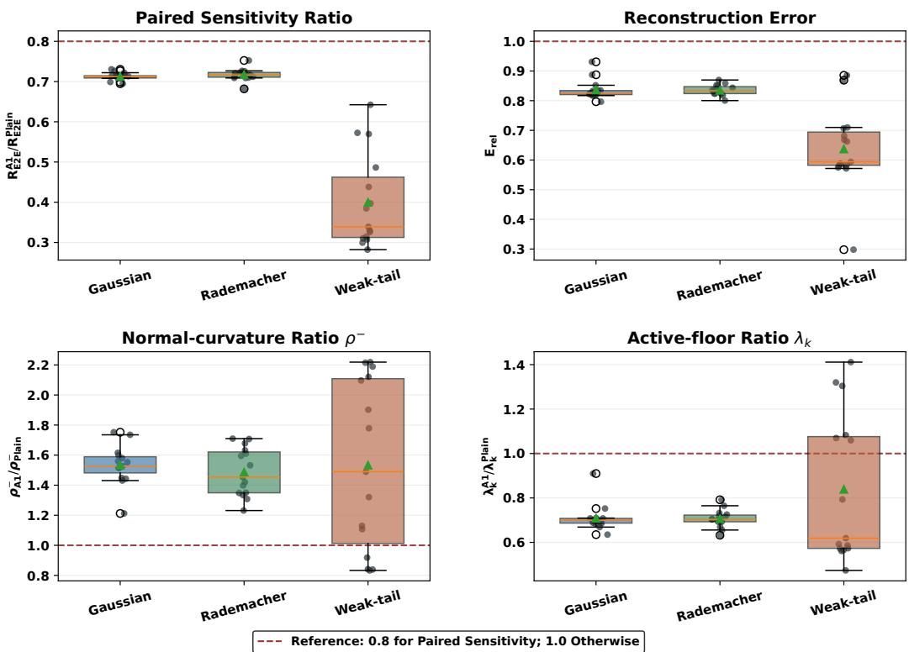  
Figure 7: Formal large-scale comparison of Algorithm 1 with Plain. Each row contains the five seeds for one fixed $( n , \mathrm { o p e r a t o r } )$ cell. The quantities $\mathrm { Q _ { E 2 E } }$ and $\mathsf { Q } _ { \mathrm { S h } }$ are the median instancewise relative paired critical-point sensitivities under E2E and Shared observed-spectral initialization. Their corresponding sensitivity reductions are $\Delta _ { \mathrm { E 2 E } } = 1 0 0 ( 1 - \mathsf { Q } _ { \mathrm { E 2 E } } )$ and $\Delta _ { \mathrm { S h } } =$ $1 0 0 ( 1 - \mathsf { Q } _ { \mathrm { S h } } )$ . The reconstruction ratio $\mathsf { E } _ { \mathrm { r e l } }$ and the terminal $\rho _ { \mathrm { P l a i n } } ^ { - }$ and $\rho _ { \mathrm { A 1 } } ^ { - }$ values are common to both protocols because their main noisy-data runs are identical. Joint counts seeds for which both ${ \sf Q } < 1$ and $\mathsf { E } _ { \mathrm { r e l } } < 1 ;$ ; every row has $5 / 5$ under both protocols. Pooling the three dimensions gives $1 5 / 1 5$ joint improvements for each operator and $4 5 / 4 5$ per protocol.

the experiment supports a consistent improvement in absolute validation accuracy at the perturbed training endpoint, but does not establish a smaller clean-to-noisy accuracy degradation.

## B Missing Details and Proofs

## B.1 More Definitions

Definition 2 (Second-order stationary point). A point $X _ { w } \in$ $\mathbb { R } ^ { n \times k }$ is a second-order stationary point of $f _ { w }$ if

$$
\begin{array} { c } { \nabla f _ { w } ( X _ { w } ) = 0 , } \\ { \nabla ^ { 2 } f _ { w } ( X _ { w } ) [ D , D ] \geq 0 \quad \mathrm { f o r } \mathrm { e v e r y } D \in \mathbb R ^ { n \times k } . } \end{array}
$$

We write $M _ { w } = X _ { w } X _ { w } ^ { \top }$

Definition 3 (Restricted isometry). The operator A satisfies (δ, s)-RIP if

$$
\left( 1 - \delta \right) \left\| Z \right\| _ { F } ^ { 2 } \leq \left\| A ( Z ) \right\| _ { 2 } ^ { 2 } \leq \left( 1 + \delta \right) \left\| Z \right\| _ { F } ^ { 2 }
$$

for every $Z \in \mathbb { S } ^ { n }$ with rank $\ Q \backslash ( Z ) \leq s$

Assumption 1 (Unified 2k-RIP). Unless stated otherwise, A satisfies (δ, 2k)-RIP for a fixed $\delta \in [ 0 , 1 )$ ). Since $r _ { \star } \leq k$ , this

assumption covers all rank-at-most-2k symmetric matrices used below, including diferences between rank-at-most-k PSD matrices. We set $s _ { \mathrm { R I P } } = 2 k$ throughout.

For $M \succeq 0$ , let its nonzero eigenvalues be

$$
\lambda _ { 1 } ( M ) \geq \cdots \geq \lambda _ { \mathrm { r a n k } ( M ) } ( M ) > 0 .
$$

When an efective active rank q is selected, $P _ { q } ( M )$ denotes the projector onto the top-q eigenspace and $\begin{array} { r } { P _ { q } ^ { \perp } = I - P _ { q } . } \end{array}$ The tangent space of the rank-q PSD manifold at a rank-q matrix with range projector $P$ is

$$
\mathcal { T } ( P ) = \{ \eta \in \mathbb { S } ^ { n } : ~ P ^ { \perp } \eta P ^ { \perp } = 0 \} .\tag{47}
$$

Every $\eta \in \mathcal { T } ( P )$ has rank at most $2 q$

## B.2 Missing Details of Section 4

Lemma 1 (Factor Hessian identity). Let $M = X X ^ { \top }$ . For every $D \in \dot { \mathbb { R } } ^ { n \times k }$

$$
\begin{array} { r } { \nabla ^ { 2 } f _ { w } ( \boldsymbol { X } ) [ D , D ] = \left. \boldsymbol { A } ( \boldsymbol { X } D ^ { \top } + D \boldsymbol { X } ^ { \top } ) \right. _ { 2 } ^ { 2 } } \\ { + 2 \left. \boldsymbol { G } _ { w } ( \boldsymbol { M } ) , D D ^ { \top } \right. . } \end{array}\tag{48}
$$

Moreover, X is first-order critical if

$$
G _ { w } ( M ) X = 0 .\tag{49}
$$

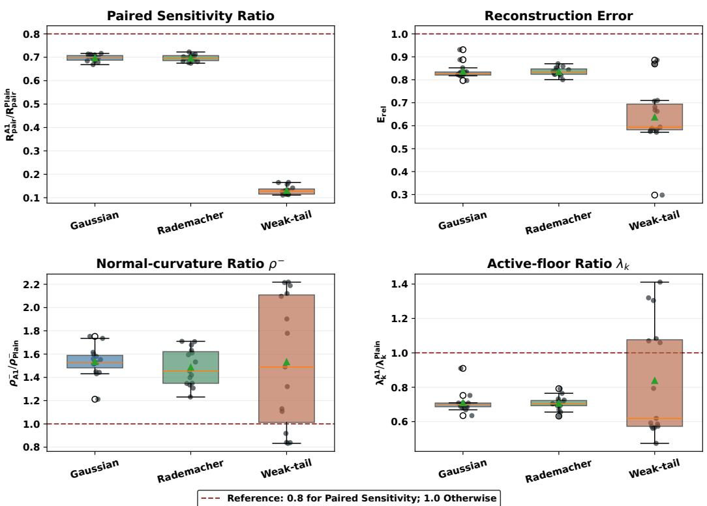  
Figure 8: Formal large-scale comparison under Shared observed-spectral initialization. Only the paired-sensitivity panel changes relative to Figure 7; reconstruction and terminal spectral diagnostics coincide because the two protocols use the same main noisy-data solutions.

ProofofLemma 1. The first and second variations of $X X ^ { \top }$ in direction D are

$$
\eta = X D ^ { \top } + D X ^ { \top } , \qquad 2 D D ^ { \top } .
$$

Applying the chain rule to $F _ { w } ( X X ^ { \top } )$ gives the gradient $2 \dot { G } _ { w } ( M ) X$ and the quadratic form (48). □

Remark 2 (Order of magnitude of chart constants). The raw chart is well conditioned when the active spectrum is bounded: if $0 ~ < ~ c ~ \leq ~ \lambda _ { k } ( M _ { w } ) ~ \leq ~ \lambda _ { 1 } ( M _ { w } ) ~ \overset { . } { \leq } ~ C$ , then $\kappa _ { \mathrm { r a w } } ( M _ { w } ) = O ( 1 ) . \mathrm { I f } \lambda _ { k } ( \dot { M } _ { w } ) = \varepsilon \ll 1$ while $\lambda _ { 1 } ( M _ { w } ) =$ $O ( 1 ) , \mathrm { t h e n } \kappa _ { \mathrm { r a w } } ( \dot { M } _ { w } ) = \dot { \Theta } ( \varepsilon ^ { - 1 } ) . \mathrm { I f } \lambda _ { 1 } ( M _ { w } ) = L \gg 1$ and $\lambda _ { k } ( \dot { M } _ { w } ) = \Omega ( 1 )$ , then $\kappa _ { \mathrm { r a w } } ( M _ { w } ) = \Theta ( L )$ . These scalings are coordinate geometry, not RIP. RIP controls A on tangent matrices, but it does not control the conditioning of a raw SVD/graph chart near the rank-deficient boundary.

Proposition 1. Let $\ b X \in \mathbb { R } ^ { n \times q }$ have rank q, let $M = X X ^ { \top }$ let P be the range projector of M, and assume $G _ { w } ( M ) X =$ 0. For any factor direction D producing the tangent matrix

$$
\eta = X D ^ { \top } + D X ^ { \top } \in { \mathcal { T } } ( P ) ,
$$

the factor Hessian obeys

$$
\begin{array} { r } { \nabla ^ { 2 } f _ { w } ( X ) [ D , D ] \geq \left( \alpha _ { T } ( P ) - \rho _ { q } ^ { - } ( M ; w ) \right) \left. \eta \right. _ { F } ^ { 2 } . } \end{array}\tag{50}
$$

Consequently, under Assumption 1,

$$
\begin{array} { r } { \nabla ^ { 2 } f _ { w } ( X ) [ D , D ] \geq \left( 1 - \delta - \rho _ { q } ^ { - } ( M ; w ) \right) \left. \eta \right. _ { F } ^ { 2 } . } \end{array}\tag{51}
$$

Proof. Write $M = U \Lambda U ^ { \top }$ , where $\boldsymbol { \Lambda } = \operatorname { d i a g } ( \lambda _ { 1 } , \ldots , \lambda _ { q } )$ and $\lambda _ { q } > 0$ . Since $X X ^ { \top } = M$ and X has full column rank, after a right-orthogonal change of factor coordinates we may take $X \bar { = } U \Lambda ^ { 1 / 2 }$ . Decompose a factor perturbation as

$$
{ \cal D } = U A + U _ { \bot } B .
$$

Then

$$
\begin{array} { r l } & { \eta = U ( \Lambda ^ { 1 / 2 } A ^ { \top } { + } A \Lambda ^ { 1 / 2 } ) U ^ { \top } { + } U \Lambda ^ { 1 / 2 } B ^ { \top } U _ { \perp } ^ { \top } { + } U _ { \perp } B \Lambda ^ { 1 / 2 } U ^ { \top } . } \\ & { \mathrm { T h e ~ n o r m a l ~ b l o c k ~ o f ~ } D D ^ { \top } \mathrm { ~ i s } } \end{array}
$$

$$
P ^ { \perp } D D ^ { \top } P ^ { \perp } = U _ { \perp } B B ^ { \top } U _ { \perp } ^ { \top } .
$$

Since $G _ { w } ( M ) X = 0$ , the range and cross terms of $G _ { w } ( M )$ vanish, so

$$
\left. { G _ { w } ( M ) , D D ^ { \top } } \right. = \left. { P ^ { \perp } G _ { w } ( M ) P ^ { \perp } , U _ { \perp } B B ^ { \top } U _ { \perp } ^ { \top } } \right. .
$$

Let $K = B \Lambda ^ { 1 / 2 }$ . The of-diagonal block of η is $K .$ , hence

$$
\begin{array} { r l } & { \qquad \left\| \eta \right\| _ { F } ^ { 2 } \geq 2 \left\| K \right\| _ { F } ^ { 2 } , } \\ & { \mathrm { t r } ( B B ^ { \top } ) = \mathrm { t r } ( K \Lambda ^ { - 1 } K ^ { \top } ) } \\ & { \qquad \leq \displaystyle \frac { \left\| K \right\| _ { F } ^ { 2 } } { \lambda _ { q } } \leq \displaystyle \frac { \left\| \eta \right\| _ { F } ^ { 2 } } { 2 \lambda _ { q } } . } \end{array}
$$

Therefore

$$
2 \left. { G _ { w } ( M ) , D D ^ { \top } } \right. \geq - \frac { \left\| [ P ^ { \perp } G _ { w } ( M ) P ^ { \perp } ] - \right\| _ { \mathrm { o p } } } { \lambda _ { q } } \left\| \eta \right\| _ { F } ^ { 2 } .
$$

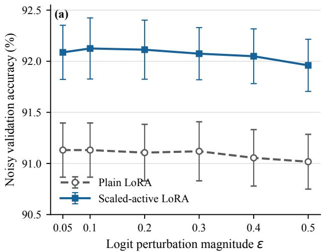

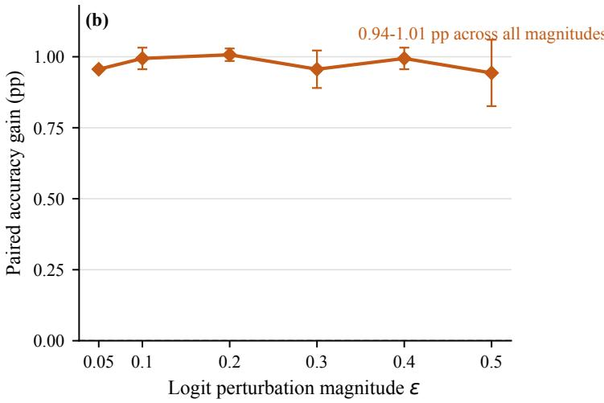  
Figure 9: Robust validation performance under fixed unit-ℓ<sub>2</sub> logit-objective perturbations. Panel (a) reports noisy validation accuracy for plain and scaled-active LoRA. Panel (b) reports the paired scaled-active-minus-plain accuracy diference. Each point is the mean over three training seeds, after first averaging three fixed perturbation directions within each seed. Error bars denote sample standard deviations across training seeds.

The first term in (48) is at least $\alpha _ { T } ( P ) \left\| \eta \right\| _ { F } ^ { 2 }$ , proving (50). The RIP specialization follows from (7). □

Assumption 2 (RIP-certified endpoint Hessian lower margin). Let $M _ { w } \in \mathcal { M } _ { k }$ satisfy (10), and set

$$
\begin{array} { r l } & { \mu _ { w } = ( 1 - \delta ) - \rho _ { k } ^ { - } ( M _ { w } ; w ) , } \\ & { \lambda _ { w } = \lambda _ { k } ( M _ { w } ) , \qquad P _ { w } = P _ { k } ( M _ { w } ) , } \\ & { \gamma _ { w } = \big \| P _ { w } ^ { \perp } G _ { w } ( M _ { w } ) P _ { w } ^ { \perp } \big \| _ { \mathrm { o p } } . } \end{array}
$$

Equivalently,

$$
\rho _ { k } ^ { - } ( M _ { w } ; w ) = \frac { \operatorname* { m a x } \{ 0 , - \lambda _ { \operatorname* { m i n } } ( P _ { w } ^ { \perp } G _ { w } ( M _ { w } ) P _ { w } ^ { \perp } ) \} } { \lambda _ { k } ( M _ { w } ) } .\tag{52}
$$

We assume $\mu _ { w } > 0$

Assumption 3 (Small noise relative to the endpoint scale). With $\mu _ { w } , \lambda _ { w } , \gamma _ { w }$ from Assumption 2, define the computable endpoint variation scale

$$
\mathfrak { L } _ { w } = \frac { 2 ( 1 + \delta + \rho _ { k } ^ { - } ( M _ { w } ; w ) ) } { \lambda _ { w } } + \frac { 1 6 \gamma _ { w } } { \lambda _ { w } ^ { 2 } } ,\tag{53}
$$

with the convention that $\mu _ { w } / ( 4 \mathfrak { L } _ { w } ) = + \infty \mathrm { i f } \ \mathfrak { L } _ { w } = 0 \mathrm { , }$ . The noise obeys

$$
\frac { 2 \sqrt { 1 + \delta } } { \mu _ { w } } \left\| w \right\| _ { 2 } \leq \frac { 1 } { 2 } r _ { w } ^ { \mathrm { s t a b } } , \qquad r _ { w } ^ { \mathrm { s t a b } } = \operatorname* { m i n } \left\{ \frac { \lambda _ { w } } { 4 } , \frac { \mu _ { w } } { 4 \mathfrak { L } _ { w } } \right\} .\tag{54}
$$

Why the margin cannot be dropped. If the endpoint Hessian has a flat eigen-direction, linear robustness can fail even in one dimension. Consider

$$
\phi _ { 0 } ( x ) = \frac 1 4 x ^ { 4 } , \qquad \phi _ { \varepsilon } ( x ) = \frac 1 4 x ^ { 4 } - \varepsilon x .
$$

The unperturbed critical point is $x _ { 0 } = 0$ , but $\phi _ { 0 } ^ { \prime \prime } ( 0 ) = 0$ . The perturbed critical point solves

$$
\phi _ { \varepsilon } ^ { \prime } ( x ) = x ^ { 3 } - \varepsilon = 0 , \qquad x _ { \varepsilon } = \varepsilon ^ { 1 / 3 } .
$$

Thus $| x _ { \varepsilon } - x _ { 0 } | = \varepsilon ^ { 1 / 3 }$ , which is not bounded by $C \varepsilon$ for any fixed $C \operatorname { a s } \varepsilon \downarrow 0 . \operatorname { A }$ positive margin is exactly what rules out this flat-bottom behavior and lets the criticality equation be inverted.

Lemma 2 (Small-noise critical-point continuation). $S u p \textmd { - }$ pose Assumptions $_ { I - 3 }$ hold. Then there exists a $C ^ { 1 }$ curve

$$
s \mapsto M _ { s } \in \mathcal { M } _ { k } , \qquad 0 \leq s \leq 1 ,
$$

with $M _ { 1 } = M _ { w }$ , such that every $M _ { s }$ is a rank-k critical point of $F _ { s } .$ :

$$
\mathrm { g r a d } _ { \mathcal { M } _ { k } } F _ { s } ( M _ { s } ) = 0 .\tag{55}
$$

Moreover, along this branch,

$$
\langle \eta , \mathrm { H e s s } _ { \mathcal { M } _ { k } } F _ { s } ( M _ { s } ) [ \eta ] \rangle \geq \frac { \mu _ { w } } { 2 } \left. \eta \right. _ { F } ^ { 2 } , \qquad \eta \in T _ { M _ { s } } \mathcal { M } _ { k } ,\tag{56}
$$

$$
\lambda _ { k } ( M _ { s } ) \geq \frac { \lambda _ { w } } { 2 } .\tag{57}
$$

We call $M _ { 0 } : = M _ { s = 0 }$ the paired clean endpoint.

ProofofLemma 2. Let $\pi ( X ) ~ = ~ X X ^ { \top }$ . At every fullcolumn-rank factor X, the diferential

$$
\mathrm Ḋ \pi _ { \boldsymbol Ḋ X Ḍ Ḍ } [ \boldsymbol Ḋ D Ḍ ] = \boldsymbol { X } \boldsymbol Ḋ D Ḍ ^ { \top } + \boldsymbol Ḋ D Ḍ \boldsymbol { X } ^ { \top }
$$

is surjective onto $T _ { M } . M _ { k }$ , where $M = \pi ( X )$ . Its kernel is the vertical space generated by the right-orthogonal invariance:

$$
\ker ( \mathrm { D } \pi _ { X } ) = \{ X \Omega : \Omega ^ { \top } = - \Omega \} .
$$

Thus, after removing these representation-induced vertical directions, factor perturbations provide horizontal lifts of all tangent directions on $\mathcal { M } _ { k } .$ . The factor–manifold Hessian comparison of Luo, Li, and Zhang (2025, Theorem 1 and Corollary 1) then transfers the curvature lower bound in Proposition 1 to the Riemannian Hessian. Assumption 2 therefore implies that Hess $\mathcal { M } _ { k } F _ { w } ( M _ { w } )$ is positive definite on $T _ { M _ { w } } \mathcal { M } _ { k }$ . The implicit-function theorem on the embedded manifold now yields a local critical branch in the parameter s (Absil, Mahony, and Sepulchre 2008, Proposition 5.5.6); (Boumal 2023, Proposition 5.45).

It remains to show that the branch cannot leave the endpoint neighborhood before reaching $s = 0$ . Let $P = P _ { k } ( M )$ and suppose $\Vert M - M _ { w } \Vert _ { F } \leq \bar { r } \leq \lambda _ { w } / 4 .$ . Weyl’s inequality gives $\begin{array} { r } { \lambda _ { k } ( M ) \ge 3 \lambda _ { w } / 4 . } \end{array}$ , and Davis–Kahan gives $\| \dot { \boldsymbol { P } } - \dot { \boldsymbol { P } } _ { w } \| _ { \mathrm { o p } } ~ \le ~ 2 r / \lambda _ { w }$ (Davis and Kahan 1970; Bhatia 1997). Since $G _ { w } ( M _ { w } ) P _ { w } = 0$ , the endpoint gradient is purely normal:

$$
G _ { w } ( M _ { w } ) = P _ { w } ^ { \perp } G _ { w } ( M _ { w } ) P _ { w } ^ { \perp } .
$$

Using

$$
G _ { s } ( M ) = G _ { w } ( M _ { w } ) + H ( M - M _ { w } ) + ( 1 - s ) N _ { w } ,
$$

RIP and Cauchy–Schwarz give, for every unit vector $v ,$

$$
\begin{array} { r l } & { \left| v ^ { \top } H ( M - M _ { w } ) v \right| = \left| \left. A ( v v ^ { \top } ) , A ( M - M _ { w } ) \right. \right| } \\ & { \qquad \leq ( 1 + \delta ) \left\| M - M _ { w } \right\| _ { F } . } \end{array}
$$

because $v v ^ { \top }$ has rank one and $M - M _ { w }$ has rank at most 2k. Also $\begin{array} { r } { \left| v ^ { \top } N _ { w } v \right| \leq \sqrt { 1 + \delta } \left\| w \right\| _ { 2 } . } \end{array}$ Let

$$
b _ { w } = \left\| [ P _ { w } ^ { \perp } G _ { w } ( M _ { w } ) P _ { w } ^ { \perp } ] _ { - } \right\| _ { \mathrm { o p } } = \lambda _ { w } \rho _ { k } ^ { - } ( M _ { w } ; w ) .
$$

Projector rotation changes the endpoint normal block by at most

$$
\begin{array} { r l } & { \quad \left\| P ^ { \perp } G _ { w } ( M _ { w } ) P ^ { \perp } - P _ { w } ^ { \perp } G _ { w } ( M _ { w } ) P _ { w } ^ { \perp } \right\| _ { \mathrm { o p } } } \\ & { \leq 2 \gamma _ { w } \| P - P _ { w } \| _ { \mathrm { o p } } \leq \frac { 4 \gamma _ { w } } { \lambda _ { w } } r . } \end{array}
$$

Moreover $\lambda _ { k } ( M ) \geq \lambda _ { w } - r ,$ , so

$$
\frac { \lambda _ { w } } { \lambda _ { k } ( M ) } \leq 1 + \frac { 2 r } { \lambda _ { w } } , \qquad \frac { 1 } { \lambda _ { k } ( M ) } \leq \frac { 2 } { \lambda _ { w } }
$$

for $r \leq \lambda _ { w } / 4$ . Combining the numerator perturbation with these denominator bounds yields the local normal-ratio estimate

$$
\rho _ { k } ^ { - } \left( M ; s w \right) \leq \rho _ { k } ^ { - } \left( M _ { w } ; w \right) + \mathfrak { L } _ { w } r + \frac { 2 \sqrt { 1 + \delta } } { \lambda _ { w } } ( 1 - s ) \left. w \right. _ { 2 } .\tag{58}
$$

The constants in ${ \mathfrak { L } } _ { w }$ are intentionally relaxed; the important point is that they are endpoint quantities.

By Assumption 3, the two extra terms in (58) are at most $\mu _ { w } / 2$ whenever $r \le r _ { w } ^ { \mathrm { s t a b } }$ . Hence, throughout this endpoint neighborhood,

$$
( 1 - \delta ) - \rho _ { k } ^ { - } ( M ; s w ) \geq \frac { \mu _ { w } } { 2 } ,
$$

and Proposition 1 again gives (56).

On any interval where (56) holds, diferentiating (55) gives

$$
\mathrm { H e s s } _ { \mathcal { M } _ { k } } F _ { s } ( M _ { s } ) [ \dot { M } _ { s } ] = \mathrm { P r o j } _ { T _ { M _ { s } } \mathcal { M } _ { k } } ( \mathcal { A } ^ { * } w ) ,
$$

and RIP gives

$$
\left. \operatorname { P r o j } _ { T _ { M _ { s } } , \mathcal { M } _ { k } } ( \mathcal { A } ^ { * } w ) \right. _ { F } \leq \sqrt { 1 + \delta } \left. w \right. _ { 2 } .
$$

Therefore

$$
\left\| \dot { M } _ { s } \right\| _ { F } \leq \frac { 2 \sqrt { 1 + \delta } } { \mu _ { w } } \left\| w \right\| _ { 2 } .\tag{59}
$$

Integrating backward from $s = 1$ gives, on any interval where the branch exists inside the endpoint neighborhood,

$$
\| M _ { s } - M _ { w } \| _ { F } \leq \frac { 2 \sqrt { 1 + \delta } } { \mu _ { w } } ( 1 - s ) \left\| w \right\| _ { 2 } \leq \frac { 1 } { 2 } r _ { w } ^ { \mathrm { s t a b } } .
$$

To formalize the continuation, let $I \subset [ 0 , 1 ]$ be the maximal interval containing 1 on which the implicit-function branch exists and remains in $\{ M : \| M - M _ { w } \| _ { F } < r _ { w } ^ { \mathrm { s t a b } } \}$ . The local implicit-function theorem makes I open relative to $[ 0 , 1 ]$ The preceding estimate shows that any point of I actually satisfies the stricter bound $\Vert M _ { s } - M _ { w } \Vert _ { F } \leq r _ { w } ^ { \mathrm { s t a b } } / 2 ;$ hence limits of branch points remain inside the same neighborhood, the Hessian stays invertible by (56), and the implicitfunction theorem extends the branch past the limit. Thus I is also closed, so $I = [ 0 , 1 ]$ . Finally, (57) follows from $r _ { w } ^ { \mathrm { s t a b } } \leq \lambda _ { w } / 4$ □

Theorem 3 (Pointwise rank-stable perturbation bound). Suppose Assumptions 1–3 hold, and let $M _ { 0 }$ be the paired clean endpointfrom Lemma 2. Then

$$
\left. M _ { w } - M _ { 0 } \right. _ { F } \leq \frac { 2 \sqrt { 1 + \delta } } { ( 1 - \delta ) - \rho _ { k } ^ { - } ( M _ { w } ; w ) } \left. w \right. _ { 2 } .\tag{60}
$$

The associated rank-k spectral projector $P _ { s } = P _ { k } ( M _ { s } )$ , with $P _ { w } = P _ { 1 }$ , rotates slowly:

$$
\begin{array} { r } { \| P _ { s } - P _ { w } \| _ { \mathrm { o p } } \leq } \\ { \frac { 8 \sqrt { 1 + \delta } ( 1 - s ) \| w \| _ { 2 } } { \lambda _ { k } ( M _ { w } ) \big [ ( 1 - \delta ) - \rho _ { k } ^ { - } ( M _ { w } ; w ) \big ] } . } \end{array}\tag{61}
$$

Proof of Theorem 3. The rank-k manifold is equipped with the embedded Frobenius metric. By (55), the Riemannian criticality equation is

$$
\mathrm { g r a d } _ { \mathcal { M } _ { k } } F _ { s } ( M _ { s } ) = 0 .
$$

Diferentiate this identity with respect to s. At a critical point, the covariant derivative of the Riemannian gradient in the motion direction $\dot { M _ { s } }$ is the Riemannian Hessian, while the explicit derivative of the matrix gradient $G _ { s } ( M ) = H ( M -$ $\hat { M _ { \star } } ) - s N _ { w }$ with respect to $\mathrm { ~ s ~ i s ~ } { - N _ { w } } = - \mathcal { A } ^ { * } w$ . Hence

$$
\begin{array} { l } { { \displaystyle 0 = \frac { D } { d s } \mathrm { g r a d } _ { \mathcal { M } _ { k } } F _ { s } ( M _ { s } ) } } \\ { { \displaystyle ~ = \mathrm { H e s s } _ { \mathcal { M } _ { k } } F _ { s } ( M _ { s } ) [ \dot { M } _ { s } ] - \mathrm { P r o j } _ { T _ { M _ { s } } \mathcal { M } _ { k } } ( \mathcal { A } ^ { * } w ) } . } \end{array}
$$

and therefore

$$
\mathrm { H e s s } _ { \mathcal { M } _ { k } } F _ { s } ( M _ { s } ) [ \dot { M } _ { s } ] = \mathrm { P r o j } _ { T _ { M _ { s } } \mathcal { M } _ { k } } ( \mathcal { A } ^ { * } w ) .
$$

This is the intrinsic version of diferentiating the pullback criticality equation in local coordinates (Boumal 2023, Proposition 5.45); (Absil, Mahony, and Sepulchre 2008, Proposition 5.5.6).

The right-hand side is controlled by RIP. Since every tangent matrix in $T _ { M _ { s } } { \mathcal { M } } _ { k }$ has rank at most 2k,

$$
\begin{array} { r l r } {  { \| \operatorname* { P r o j } _ { T _ { M _ { s } } , \mathcal { M } _ { k } } ( \mathcal { A } ^ { * } w ) \| _ { F } = \operatorname* { s u p } _ { \eta \in T _ { M _ { s } } , \mathcal { M } _ { k } } \langle w , \mathcal { A } ( \eta ) \rangle } } \\ & { } & { \| \eta \| _ { F } = 1 } \\ & { } & { \leq \sqrt { 1 + \delta } \| w \| _ { 2 } . } \end{array}
$$

By the Hessian stability condition (56), Hess $\mathcal { M } _ { k } F _ { s } ( M _ { s } )$ is self-adjoint and positive definite on $T _ { M _ { s } } { \mathcal { M } } _ { k }$ , with inverse norm at most $2 / \mu _ { w }$ . Therefore

$$
\Big \| \dot { M } _ { s } \Big \| _ { F } \leq \frac { 2 \sqrt { 1 + \delta } } { \mu _ { w } } \| w \| _ { 2 } , \qquad \mu _ { w } = ( 1 - \delta ) - \rho _ { k } ^ { - } ( M _ { w } ; w ) .
$$

Integrating from $s = 0$ to $s = 1$ proves (60).

For the projector statement, the spectral gap between the k-th and $( \bar { k } + 1 )$ -st eigenvalues of $M _ { s }$ is $\lambda _ { k } ( M _ { s } )$ , because rank $\mathbf { \nabla } \cdot d _ { s } ) = k$ . The diferential form of the Davis– Kahan/Kato spectral projector bound gives the relaxed estimate (Davis and Kahan 1970; Bhatia 1997)

$$
\left\| \dot { P } _ { s } \right\| _ { \mathrm { o p } } \leq \frac { 2 \left\| \dot { M } _ { s } \right\| _ { \mathrm { o p } } } { \lambda _ { k } ( M _ { s } ) } \leq \frac { 8 \sqrt { 1 + \delta } } { \lambda _ { w } \mu _ { w } } \left\| w \right\| _ { 2 } ,
$$

where the last step uses (57). Integrating from s to 1 gives (61). □

Supporting Chart Diagnostics Theorem 3 is intrinsic: it controls perturbations in the Frobenius geometry of $\mathcal { M } _ { k }$ without choosing local coordinates. We now express the same argument in local coordinates centered at $M _ { w } ^ { \star } .$ . The lemma below shows that its conditioning is governed by the extreme active eigenvalues of $M _ { w }$ and deteriorates as $\dot { \lambda } _ { k } ( M _ { w } )$ approaches zero.

Lemma 3 (Raw endpoint chart conditioning). Let

$$
\begin{array} { r } { M _ { w } = U _ { w } \Lambda _ { w } U _ { w } ^ { \top } , \quad \quad \quad \quad } \\ { \Lambda _ { w } = \mathrm { d i a g } ( \lambda _ { 1 } , \ldots , \lambda _ { k } ) , } \\ { \quad \quad \quad \lambda _ { 1 } \ge \ldots \ge \lambda _ { k } > 0 . \quad \quad } \end{array}
$$

and complete $U _ { w }$ to an orthogonal basis $[ U _ { w } U _ { w , \perp } ] .$ A raw graph chart centered at $M _ { w }$ is

$$
\begin{array} { r } { \Phi ( B , Z ) = Q ( Z ) B Q ( Z ) ^ { \top } , \qquad } \\ { Q ( Z ) = ( U _ { w } + U _ { w , \perp } Z ) ( I + Z ^ { \top } Z ) ^ { - 1 / 2 } . } \end{array}
$$

Here $B ~ \in ~ \mathbb { S } _ { + + } ^ { k } , ~ Z ~ \in ~ \mathbb { R } ^ { ( n - k ) \times k } , ~ \dot { B } ~ \in ~ \mathbb { S } ^ { k }$ , and $\dot { Z } \in$ $\mathbb { R } ^ { ( n - k ) \times k }$ . At the base point $( \boldsymbol { B } , \boldsymbol { Z } ) \ = \ ( \boldsymbol { \Lambda } _ { w } , 0 )$ , the differential is

$$
\begin{array} { r l } & { \cal { D } \Phi ( \Lambda _ { w } , 0 ) [ \dot { B } , \dot { Z } ] = U _ { w } \dot { B } U _ { w } ^ { \top } } \\ & { \qquad + U _ { w , \perp } \dot { Z } \Lambda _ { w } U _ { w } ^ { \top } } \\ & { \qquad + U _ { w } \Lambda _ { w } \dot { Z } ^ { \top } U _ { w , \perp } ^ { \top } . } \end{array}\tag{62}
$$

With the raw coordinate norm

$$
\left\| ( \dot { B } , \dot { Z } ) \right\| _ { \mathrm { r a w } } ^ { 2 } = \left\| \dot { B } \right\| _ { F } ^ { 2 } + \left\| \dot { Z } \right\| _ { F } ^ { 2 } ,
$$

the singular values of $D \Phi ( \Lambda _ { w } , 0 )$ , viewed as a map into Frobenius tangent matrices, lie between

$$
\begin{array} { r } { \sigma _ { - } = \operatorname* { m i n } \{ 1 , \sqrt { 2 } \lambda _ { k } ( M _ { w } ) \} , } \\ { \sigma _ { + } = \operatorname* { m a x } \{ 1 , \sqrt { 2 } \lambda _ { 1 } ( M _ { w } ) \} . } \end{array}\tag{63}
$$

Thus the raw chart condition number is

$$
\kappa _ { \mathrm { r a w } } ( M _ { w } ) = \frac { \sigma _ { + } } { \sigma _ { - } } = \frac { \operatorname* { m a x } \{ 1 , \sqrt { 2 } \lambda _ { 1 } ( M _ { w } ) \} } { \operatorname* { m i n } \{ 1 , \sqrt { 2 } \lambda _ { k } ( M _ { w } ) \} } .\tag{64}
$$

In raw coordinates, the same argument as Theorem 3 gives

$$
\left\| \dot { M } _ { s } \right\| _ { F } \leq 2 \kappa _ { \mathrm { r a w } } ( M _ { w } ) ^ { 2 } \frac { \sqrt { 1 + \delta } } { \mu _ { w } } \left\| w \right\| _ { 2 }
$$

at the base point. In tangent-scaled coordinates $K = Z \Lambda _ { w } ,$ this base-point distortion disappears.

Proof of Lemma 3. Let

$$
W ( Z ) = U _ { w } + U _ { w , \perp } Z , \qquad R ( Z ) = I + Z ^ { \top } Z ,
$$

so $Q ( Z ) = W ( Z ) R ( Z ) ^ { - 1 / 2 }$ . For a perturbation ${ \dot { Z } } ,$

$$
\begin{array} { r } { D R ( Z ) [ \dot { Z } ] = \dot { Z } ^ { \top } Z + Z ^ { \top } \dot { Z } . } \end{array}
$$

At $Z = 0 , D R ( 0 ) [ \dot { Z } ] = 0 ,$ and hence the derivative of the normalization factor $R ( Z ) ^ { - 1 / 2 }$ vanishes. Therefore

$$
\begin{array} { r } { D Q ( 0 ) [ \dot { Z } ] = U _ { w , \perp } \dot { Z } . } \end{array}
$$

Diferentiating $\Phi ( B , Z ) = Q ( Z ) B Q ( Z ) ^ { \top }$ gives

$$
D \Phi ( B , Z ) [ \dot { B } , \dot { Z } ] = Q \dot { B } Q ^ { \top } + \dot { Q } B Q ^ { \top } + Q B \dot { Q } ^ { \top } .
$$

Substituting $Q ( 0 ) = U _ { w } , B = \Lambda _ { w } ,$ , and $\dot { Q } = U _ { w , \perp } \dot { Z }$ proves (62). The three blocks in (62) are Frobenius-orthogonal, so

$$
\left\| D \Phi ( \Lambda _ { w } , 0 ) [ \dot { B } , \dot { Z } ] \right\| _ { F } ^ { 2 } = \left\| \dot { B } \right\| _ { F } ^ { 2 } + 2 \left\| \dot { Z } \Lambda _ { w } \right\| _ { F } ^ { 2 } .
$$

Since

$$
\lambda _ { k } ( M _ { w } ) \left\| \dot { Z } \right\| _ { F } \leq \left\| \dot { Z } \Lambda _ { w } \right\| _ { F } \leq \lambda _ { 1 } ( M _ { w } ) \left\| \dot { Z } \right\| _ { F } ,
$$

the singular-value bounds (63) follow. The displayed coordinate velocity bound follows from the coordinate version of the proof: the pulled-back noise gradient is bounded by $\sqrt { 1 + \delta } \sigma _ { + } \| w \| _ { 2 }$ , the pulled-back Hessian is lower bounded by $( \mu _ { w } / 2 ) \sigma _ { - } ^ { 2 }$ , and matrix velocity conversion costs another $\sigma _ { + }$ □

## B.3 Missing Details of Section 5

Proposition 2 (Unused columns force PSD matrix gradient). Let $\bar { \boldsymbol { X } } \in \mathbb { R } ^ { n \times k }$ be a second-order point of $f _ { w } . I f \mathrm { r a n k } ( X ) <$ k, then

$$
G _ { w } ( X X ^ { \top } ) \succeq 0 .\tag{65}
$$

ProofofProposition 2. Choose a unit v $\in \mathbb { R } ^ { k }$ with $X v = 0$ For any $u \in \mathbb { R } ^ { n } .$ , set $D = u v ^ { \top }$ . Then $X D ^ { \top } + D X ^ { \top } = 0$ and $D \bar { D } ^ { \top } = u u ^ { \top }$ . The second-order condition and Lemma 1 give

$$
0 \leq \nabla ^ { 2 } f _ { w } ( X ) [ D , D ] = 2 u ^ { \top } G _ { w } ( X X ^ { \top } ) u .
$$

Since u is arbitrary, $G _ { w } ( X X ^ { \top } ) \succeq 0 .$

Theorem 4 (Rank-deficient points are globally optimal in matrix space). Let $M = X { \bar { X } } ^ { \top }$ with rank $( { \bar { X } } ) { \bar { < } } k ,$ , and suppose X is a second-order point of $f _ { w } .$ . Then M is a global minimizer ofthe convex PSD problem

$$
\operatorname* { m i n } _ { Z \succeq 0 } F _ { w } ( Z ) .\tag{66}
$$

Consequently:

1. $H w = 0 ,$ , then $M = M _ { \star }$

2. For general w, $i f \operatorname { r a n k } ( M ) \leq k ,$ , then

$$
\Vert M - M _ { \star } \Vert _ { F } \leq \frac { \Vert w \Vert _ { 2 } } { \sqrt { 1 - \delta } } .\tag{67}
$$

ProofofTheorem 4. By first-order criticality, $G _ { w } ( M ) X =$ 0, hence $G _ { w } ( M ) M = \mathrm { { 0 } }$ and $\langle G _ { w } ( M ) , M \rangle = 0$ . Proposition 2 gives $\dot { G } _ { w } ( M ) \succeq 0$ . Therefore, for every $Z \succeq 0$

$$
\langle G _ { w } ( M ) , Z - M \rangle = \langle G _ { w } ( M ) , Z \rangle \geq 0 .
$$

This is the first-order optimality condition for the convex problem (66), so M is a global PSD minimizer.

If $w = 0 , M _ { \star }$ is feasible and has objective value zero. Hence $\mathcal { A } ( M - M _ { \star } ) = 0$ . Assumption 1 implies $M = M _ { \star }$ since rank $\left( M - M _ { \star } \right) \leq k + r _ { \star } \leq 2 k$

For general $w ,$ use the convex first-order inequality with $Z = M _ { \star }$ . Writing $\Delta = M - M _ { \star }$

$$
0 \le \langle G _ { w } ( M ) , M _ { \star } - M \rangle = \langle A \Delta - w , - A \Delta \rangle .
$$

Thus $\begin{array} { r } { \| A \Delta \| _ { 2 } ^ { 2 } \leq \langle w , A \Delta \rangle \leq \| w \| _ { 2 } \| A \Delta \| _ { 2 } , \mathrm { ~ s o ~ } \| A \Delta \| _ { 2 } \leq } \end{array}$ $\| w \| _ { 2 } .$ Since rank $( \Delta ) ~ \le ~ \bar { k } + r _ { \star } \le ~ 2 k$ , RIP gives $\sqrt { 1 - \delta } \left\| \Delta \right\| _ { F } \leq \left\| \mathcal { A } \Delta \right\| _ { 2 }$ □

Remark 3 (Relation to Boumal–Voroninski–Bandeira). This result is the PSD matrix-sensing specialization of the standard rank-deficiency certificate for Burer–Monteiro factorizations (Burer and Monteiro 2003; Boumal, Voroninski, and Bandeira 2016, 2020); the RIP structure further yields exact recovery in the noiseless case and a noise-linear recovery bound in the noisy case.

## B.4 Full-Rank Points and the Spectral Tail

We now fully discuss the last part of our main theorem. The exact rank-deficiency certificate is no longer available at a full-rank point, but the negative spectral part of the normal block can remain small when the weakest slack direction is small relative to the active spectral floor. Let

$$
M = X X ^ { \top } = \sum _ { i = 1 } ^ { k } \lambda _ { i } u _ { i } u _ { i } ^ { \top } , \qquad \lambda _ { 1 } \geq \dots \geq \lambda _ { k } > 0 ,
$$

and choose an efective active rank $q \ \leq \ k$ with $P _ { q } =$ $\textstyle \sum _ { i = 1 } ^ { q } u _ { i } u _ { i } ^ { \top }$ . A negative normal direction can be paired with the weakest active direction. The second-order condition and the unified 2k-RIP then limit its negative spectral part by

$$
\bigl \| [ P _ { q } ^ { \perp } G _ { w } ( M ) P _ { q } ^ { \perp } ] _ { - } \bigr \| _ { \mathrm { o p } } \leq ( 1 + \delta ) \lambda _ { k } ( M ) .\tag{68}
$$

After normalization by the selected active spectral floor, this becomes

$$
\rho _ { q } ^ { - } ( M ; w ) \leq ( 1 + \delta ) \frac { \lambda _ { k } ( M ) } { \lambda _ { q } ( M ) } .\tag{69}
$$

Proposition 3 (Negative normal curvature is limited by the thinnest slack direction). Let $\boldsymbol { X } \in \mathbb { R } ^ { n \times k }$ be a full-rank second-order point of $f _ { w } ,$ let

$$
M = X X ^ { \top } = \sum _ { i = 1 } ^ { k } \lambda _ { i } u _ { i } u _ { i } ^ { \top } , \qquad \lambda _ { 1 } \geq \dots \geq \lambda _ { k } > 0 ,
$$

and choose an efective active rank $q ~ \leq ~ k$ with $P _ { q } =$ $\textstyle \sum _ { i = 1 } ^ { q } u _ { i } u _ { i } ^ { \top }$ . Under Assumption 1,

$$
\begin{array} { r } { \big \| [ P _ { q } ^ { \perp } G _ { w } ( M ) P _ { q } ^ { \perp } ] _ { - } \big \| _ { \mathrm { o p } } \leq ( 1 + \delta ) \lambda _ { k } ( M ) . } \end{array}\tag{70}
$$

Consequently,

$$
\rho _ { q } ^ { - } ( M ; w ) \leq ( 1 + \delta ) \frac { \lambda _ { k } ( M ) } { \lambda _ { q } ( M ) } .\tag{71}
$$

Proof of Proposition 3. The first-order condition $G _ { w } ( { \bf \bar { M } } ) X = 0$ implies that $G _ { w } ( M )$ vanishes on range(M). Hence a negative eigenvector of $P _ { q } ^ { \perp } G _ { w } ( M ) P _ { q } ^ { \perp }$ lies in the orthogonal complement of $\mathrm { r a n g e } ( \dot { M } )$ . Let u be such a unit vector and let $u _ { k }$ be an eigenvector of M associated with $\lambda _ { k } ( M )$ . Choose factor coordinates so that $X e _ { k } = \sqrt { \lambda _ { k } } u _ { k } .$ and set

$$
D = { \sqrt { \lambda _ { k } } } u e _ { k } ^ { \top } .
$$

Then

$$
\begin{array} { c } { { X D ^ { \top } + D X ^ { \top } = \lambda _ { k } ( u _ { k } u ^ { \top } + u u _ { k } ^ { \top } ) , } } \\ { { \left\| X D ^ { \top } + D X ^ { \top } \right\| _ { F } ^ { 2 } = 2 \lambda _ { k } ^ { 2 } , } } \\ { { D D ^ { \top } = \lambda _ { k } u u ^ { \top } . } } \end{array}
$$

If

$$
\boldsymbol { u } ^ { \top } \boldsymbol { G } _ { w } ( M ) \boldsymbol { u } = - \gamma < 0 ,
$$

the second-order condition and Lemma 1 give

$$
0 \leq \nabla ^ { 2 } f _ { w } ( X ) [ D , D ] = \left\| \boldsymbol { A } ( \boldsymbol { X } \boldsymbol { D } ^ { \top } + \boldsymbol { D } \boldsymbol { X } ^ { \top } ) \right\| _ { 2 } ^ { 2 } - 2 \gamma \lambda _ { k } .
$$

The matrix $X D ^ { \top } + D X ^ { \top }$ has rank at most two, so RIP gives

$$
\left\| \boldsymbol { \mathcal { A } } ( \boldsymbol { X } \boldsymbol { D } ^ { \top } + \boldsymbol { D } \boldsymbol { X } ^ { \top } ) \right\| _ { 2 } ^ { 2 } \leq ( 1 + \delta ) 2 \lambda _ { k } ^ { 2 } .
$$

Thus $\gamma \leq ( 1 + \delta ) \lambda _ { k }$ , proving (70). Dividing by $\lambda _ { q } ( M )$ gives (71). □

For $q < k ,$ the spectral ratio $\lambda _ { k } ( M ) / \lambda _ { q } ( M )$ is therefore an efective-rank diagnostic for normalized negative normal curvature. It controls the weakest slack direction, but not the total discarded tail energy.

Corollary 1 (Efective-rank normal-curvature surrogate). If $M _ { w }$ is produced by a full-column-rank second-order point of width k, then for any efective active rank $q < k ,$

$$
\rho _ { q } ^ { - } ( M _ { w } ; w ) \leq ( 1 + \delta ) \frac { \lambda _ { k } ( M _ { w } ) } { \lambda _ { q } ( M _ { w } ) } .\tag{72}
$$

This is not the main strict rank-stable theorem, which uses $q \ = \ k$ and the directly computed $\rho _ { k } ^ { - } ( M _ { w } ; w )$ . It is an efective-rank diagnostic: when the spectral tail ratio $\lambda _ { k } ( \tilde { M } _ { w } ) / \lambda _ { q } ( M _ { w } )$ is small, the normal curvature seen by the active rank-q block is small, but the discarded tail must still be accounted for separately if one truncates to rank q. In particular, $\lambda _ { k } / \dot { \lambda } _ { q }$ is the thinnest-tail ratio; it does not by itself control the whole tail energy.

Lemma 4 (Deterministic spectral-tail bounds). Let $M \succeq 0$ have rank at most k, eigenvalues $\lambda _ { 1 } \geq \cdot \cdot \cdot \geq \lambda _ { k } \geq 0 ,$ , and fix

$$
1 \leq q < k , \qquad \lambda _ { q } ( M ) > 0 .
$$

Let

$$
M _ { q } = \sum _ { i = 1 } ^ { q } \lambda _ { i } u _ { i } u _ { i } ^ { \top }
$$

be its best rank-q approximation. Then

$$
\begin{array} { r } { \| M - M _ { q } \| _ { \mathrm { o p } } = \lambda _ { q + 1 } ( M ) , } \end{array}\tag{73}
$$

$$
\left. M - M _ { q } \right. _ { F } ^ { 2 } = \sum _ { i > q } \lambda _ { i } ( M ) ^ { 2 } .\tag{74}
$$

$I f d = k - q ,$ then

$$
\frac { \| M - M _ { q } \| _ { F } } { \lambda _ { q } ( M ) } \leq \sqrt { d } \frac { \lambda _ { q + 1 } ( M ) } { \lambda _ { q } ( M ) } .\tag{75}
$$

Also,

$$
\frac { \lambda _ { k } ( M ) } { \lambda _ { q } ( M ) } \leq \frac { \| M - M _ { q } \| _ { F } } { \sqrt { d } \lambda _ { q } ( M ) } .\tag{76}
$$

If, in addition, $\bar { M } \succeq 0$ has rank q and $\left\| M - \bar { M } \right\| _ { \mathrm { o p } } <$ $\lambda _ { q } ( \bar { M } )$ , then Weyl’s inequality gives

$$
\frac { \lambda _ { k } ( M ) } { \lambda _ { q } ( M ) } \leq \frac { \left. M - \bar { M } \right. _ { \mathrm { o p } } } { \lambda _ { q } ( \bar { M } ) - \left. M - \bar { M } \right. _ { \mathrm { o p } } } .\tag{77}
$$

ProofofLemma 4. The identities (73) are the PSD form of the Eckart–Young–Mirsky theorem (Eckart and Young 1936). Since the d tail eigenvalues $\lambda _ { q + 1 } , \ldots , \lambda _ { k }$ are all at most $\lambda _ { q + 1 }$

$$
\left. M - M _ { q } \right. _ { F } ^ { 2 } = \sum _ { i > q } \lambda _ { i } ^ { 2 } \leq d \lambda _ { q + 1 } ^ { 2 } ,
$$

which proves (75). Since the same tail eigenvalues are all at least $\lambda _ { k }$

$$
d \lambda _ { k } ^ { 2 } \leq \sum _ { i > q } \lambda _ { i } ^ { 2 } = \left. M - M _ { q } \right. _ { F } ^ { 2 } ,
$$

which proves (76). If $M = \bar { M } + E$ and $\mathrm { r a n k } ( \bar { M } ) = q .$ Weyl’s inequality yields

$$
\lambda _ { q } ( M ) \geq \lambda _ { q } ( \bar { M } ) - \left\| E \right\| _ { \mathrm { o p } } , \qquad \lambda _ { k } ( M ) \leq \left\| E \right\| _ { \mathrm { o p } } ,
$$

because $\lambda _ { k } ( \bar { M } ) = 0$ for $k > q$ . This proves (77).

For direct recovery relative to the rank-r target $M _ { \star }$ , the relevant quantity is the numerator of $\rho _ { k } ^ { - } ( M _ { w } ; w )$ , rather than its normalization by the active spectral floor. At a full-rank first-order critical point, $G _ { w } ( M _ { w } ) X _ { w } = 0$ implies

$$
G _ { w } ( M _ { w } ) = P _ { w } ^ { \perp } G _ { w } ( M _ { w } ) P _ { w } ^ { \perp } .
$$

We therefore define the absolute negative normal leakage by

$$
b _ { w } ^ { - } : = \left\| [ P _ { w } ^ { \perp } G _ { w } ( M _ { w } ) P _ { w } ^ { \perp } ] _ { - } \right\| _ { \mathrm { o p } } = \lambda _ { k } ( M _ { w } ) \rho _ { k } ^ { - } ( M _ { w } ; w ) .\tag{78}
$$

Lemma 5 (Absolute normal leakage). Let $X _ { w } \in \mathbb { R } ^ { n \times k }$ be full column rank and first-order critical for $f _ { w } ,$ let $M _ { w } =$ $X _ { w } X _ { w } ^ { \top }$ , and let $P _ { w } = P _ { k } ( M _ { w } )$ . Then

$$
G _ { w } ( M _ { w } ) = P _ { w } ^ { \perp } G _ { w } ( M _ { w } ) P _ { w } ^ { \perp } .
$$

Define the negative normal leakage amplitude

$$
\begin{array} { r } { b _ { w } ^ { - } = \left. [ P _ { w } ^ { \perp } G _ { w } ( M _ { w } ) P _ { w } ^ { \perp } ] _ { - } \right. _ { \mathrm { o p } } . } \end{array}\tag{79}
$$

Equivalently,

$$
b _ { w } ^ { - } = \lambda _ { k } ( M _ { w } ) \rho _ { k } ^ { - } ( M _ { w } ; w ) .\tag{80}
$$

ProofofLemma 5. First-order criticality gives $G _ { w } ( { \bf \bar { M } } _ { w } ) X _ { w } = 0$ . Since $X _ { w }$ spans $\mathrm { r a n g e } ( M _ { w } )$ , this is equivalent to $G _ { w } ( M _ { w } ) P _ { w } = \mathrm { ~ \bar { ~ } { 0 } ~ }$ . By symmetry also $P _ { w } G _ { w } ( M _ { w } ) = 0 ,$ so $G _ { w } ( M _ { w } )$ is supported on the normal block. Equation (80) is the definition of $\rho _ { k } ^ { - }$ in (6) with $q = k .$ □

Lemma 5 isolates the adverse part of the normal block at a full-rank critical point: $b _ { w } ^ { - }$ measures its absolute spectral amplitude, while $\rho _ { k } ^ { - }$ is the corresponding normalization by the weakest active eigenvalue. To convert this local quantity into a recovery estimate, we must also control how much of the target matrix lies outside range $\left( M _ { w } \right)$ .The next lemma bounds this target-subspace leakage directly by the reconstruction error.

Lemma 6 (Target subspace leakage). Let $M _ { \star } \succeq 0$ have rank $1 \leq r _ { \star } \leq k ,$ let

$$
\lambda _ { \star } = \lambda _ { r _ { \star } } ( M _ { \star } ) > 0 ,
$$

and let $M _ { w } \succeq 0$ have range projector $P _ { w }$ . Then

$$
\mathrm { t r } ( P _ { w } ^ { \perp } M _ { \star } P _ { w } ^ { \perp } ) \leq \frac { 1 } { \lambda _ { \star } } \left\| M _ { w } - M _ { \star } \right\| _ { F } ^ { 2 } .\tag{81}
$$

Proof of Lemma 6. Write

$$
M _ { \star } = U _ { \star } \Lambda _ { \star } U _ { \star } ^ { \top }
$$

and set $E = M _ { w } - M _ { \star }$ . Since $P _ { w } ^ { \perp } M _ { w } = 0 .$

$$
\begin{array} { r } { P _ { w } ^ { \perp } U _ { \star } \Lambda _ { \star } ^ { 1 / 2 } = P _ { w } ^ { \perp } M _ { \star } U _ { \star } \Lambda _ { \star } ^ { - 1 / 2 } } \\ { = - P _ { w } ^ { \perp } E U _ { \star } \Lambda _ { \star } ^ { - 1 / 2 } . } \end{array}
$$

Therefore,

$$
\begin{array} { r l r } {  { \mathrm { t r } \big ( P _ { w } ^ { \perp } M _ { \star } P _ { w } ^ { \perp } \big ) = \Big \| P _ { w } ^ { \perp } U _ { \star } \Lambda _ { \star } ^ { 1 / 2 } \Big \| _ { F } ^ { 2 } } } \\ & { } & { = \Big \| P _ { w } ^ { \perp } E U _ { \star } \Lambda _ { \star } ^ { - 1 / 2 } \Big \| _ { F } ^ { 2 } } \\ & { } & { \le \Big \| \Lambda _ { \star } ^ { - 1 / 2 } \Big \| _ { \mathrm { o p } } ^ { 2 } \| E \| _ { F } ^ { 2 } } \\ & { } & { = \frac { 1 } { \lambda _ { \star } } \| M _ { w } - M _ { \star } \| _ { F } ^ { 2 } , } \end{array}
$$

which proves (81).

Lemmas 5 and 6 now connect the normal geometry to recovery. Writing $E = M _ { w } - M _ { \sf }$ <sub>⋆</sub> and $\bar { \lambda _ { \star } } = \bar { \lambda _ { r _ { \star } } ( M _ { \star } ) }$ , firstorder criticality gives

$$
\langle G _ { w } ( M _ { w } ) , E \rangle = - \left. G _ { w } ( M _ { w } ) , M _ { \star } \right. \leq \frac { b _ { w } ^ { - } } { \lambda _ { \star } } \left. E \right. _ { F } ^ { 2 } .
$$

Meanwhile, RIP lower-bounds the data-fit contribution by $\left( 1 - \delta \right) \| E \| _ { F } ^ { 2 }$ , up to the measurement-noise term. Hence the normal leakage can be absorbed whenever $( 1 - \delta ) - b _ { w } ^ { - } / \lambda _ { \star } >$ 0. The following lemma formalizes the resulting recovery bound.

Lemma 7 (Normal leakage recovery bound). Assume the unified 2k-RIP in Assumption 1, and let $M _ { \star } \succeq 0$ have rank $1 \leq r _ { \star } \leq .$ k. Let $X _ { w }$ be afull-column-rankfirst-order critical point of $f _ { w } ,$ and let $M _ { w } = X _ { w } X _ { w } ^ { \top }$ . Define $b _ { w } ^ { - }$ by (78), set

$$
\mu _ { \mathrm { l e a k } } = 1 - \delta - \frac { b _ { w } ^ { - } } { \lambda _ { r _ { \star } } ( M _ { \star } ) } ,\tag{82}
$$

and assume $\mu _ { \mathrm { l e a k } } > 0$ . Then

$$
\left. M _ { w } - M _ { \star } \right. _ { F } \leq \frac { \sqrt { 1 + \delta } } { \mu _ { \mathrm { l e a k } } } \left. w \right. _ { 2 } .\tag{83}
$$

ProofofLemma 7. Let $E = M _ { w } - M _ { \star } , G = G _ { w } ( M _ { w } ) ,$ and $\lambda _ { \star } = \lambda _ { r _ { \star } } ( M _ { \star } )$ ). By first-order criticality, $G X _ { w } = 0$ , and hence $G M _ { w } = 0$ . Therefore,

$$
\left. { G , E } \right. = - \left. { G , M _ { \star } } \right. .
$$

Since $G$ is supported on $P _ { w } ^ { \perp }$ , Lemmas 5 and 6 give

$$
\begin{array} { r l } & { - \left. \boldsymbol { G } , \boldsymbol { M } _ { \star } \right. \leq b _ { w } ^ { - } \operatorname { t r } ( P _ { w } ^ { \perp } \boldsymbol { M } _ { \star } P _ { w } ^ { \perp } ) } \\ & { \qquad \leq \displaystyle \frac { b _ { w } ^ { - } } { \lambda _ { \star } } \left\| \boldsymbol { E } \right\| _ { F } ^ { 2 } . } \end{array}
$$

On the other hand,

$$
\langle G , E \rangle = \left\| \mathcal { A } ( E ) \right\| _ { 2 } ^ { 2 } - \left. w , \mathcal { A } ( E ) \right. .
$$

Since rank $( E ) \leq k + r _ { \star } \leq 2 k$ , RIP and Cauchy–Schwarz imply

$$
\left( 1 - \delta \right) \left\| E \right\| _ { F } ^ { 2 } \leq \sqrt { 1 + \delta } \left\| w \right\| _ { 2 } \left\| E \right\| _ { F } + \frac { b _ { w } ^ { - } } { \lambda _ { \star } } \left\| E \right\| _ { F } ^ { 2 } .
$$

Rearranging and using (82) gives

$$
\mu _ { \mathrm { l e a k } } \left\| E \right\| _ { F } ^ { 2 } \leq \sqrt { 1 + \delta } \left\| w \right\| _ { 2 } \left\| E \right\| _ { F } ,
$$

which proves (83).

Another ingredient controls the portion of the lower-rank target that lies outside range $\left( M _ { w } \right)$ ). This target-subspace leakage is controlled by the current recovery error. Combining that estimate with $b _ { w } ^ { - }$ and the unified 2k-RIP gives the direct full-rank recovery certificate below.

Proof of Theorem 2. Part (1) is Theorem 4. Part (2) is Theorem 3, whose strict full-rank case uses active rank k. Part (3) is Lemma 5 followed by Lemma 7.

## C Trajectory Case Study: Full-Rank Shadowing from Small Initialization

This section studies robustness along the whole GD path rather than at one critical endpoint. Therefore the clean reference is not a single matrix $\bar { M _ { 0 } }$ . It is the time-indexed noiseless trajectory

$$
M _ { t } ^ { 0 } = X _ { t } ^ { 0 } X _ { t } ^ { 0 \top } ,
$$

run from the same initialization as the noisy trajectory

$$
M _ { t } ^ { w } = X _ { t } ^ { w } X _ { t } ^ { w \top } .
$$

The trajectory robustness question is

$$
\Delta _ { t } = \left\| M _ { t } ^ { w } - M _ { t } ^ { 0 } \right\| _ { F } .
$$

Throughout this section we focus on the full-rank-to-full-rank regime with $k \leq n \colon$ for the time window under discussion, both $X _ { t } ^ { 0 }$ and $X _ { t } ^ { w }$ remain full column rank, so $M _ { t } ^ { 0 }$ and $M _ { t } ^ { w }$ lie on the rank-k PSD manifold. The role of the normalcurvature ratio is now dynamic. A small $\rho _ { k , t } ^ { - } ,$ defined in (85), together with the local Hessian check below, indicates that the rank-k tangent dynamics around $M _ { t } ^ { w }$ are well conditioned, so measurement noise cannot separate the noisy and noiseless trajectories too much during the next steps.

## C.1 Clean and Noisy GD Paths

Let $N _ { 0 } = 0$ and $N _ { w } = { \cal A } ^ { * }$ w. Starting from the same small random initialization $X _ { 0 } ^ { 0 } = X _ { 0 } ^ { w } = \alpha \bar { G }$ , define

$$
\begin{array} { r l } & { X _ { t + 1 } ^ { \zeta } = \left( I + \eta [ H ( M _ { \star } - M _ { t } ^ { \zeta } ) + N _ { \zeta } ] \right) X _ { t } ^ { \zeta } , } \\ & { ~ M _ { t } ^ { \zeta } = X _ { t } ^ { \zeta } ( X _ { t } ^ { \zeta } ) ^ { \top } , \qquad \zeta \in \{ 0 , w \} . } \end{array}\tag{84}
$$

The clean recursion is the one studied by Stöger and Soltanolkotabi (2021), up to normalization constants. In their notation the target is $\grave { M } _ { \star } ~ = ~ X _ { \star } X _ { \star } ^ { \top }$ , the factor condition number is

$$
\kappa _ { \cal { X } } = \frac { \| X _ { \star } \| _ { \mathrm { o p } } } { \sigma _ { \operatorname* { m i n } } ( X _ { \star } ) } = \sqrt { \frac { \lambda _ { 1 } ( M _ { \star } ) } { \lambda _ { r _ { \star } } ( M _ { \star } ) } } ,
$$

the search width is $k > r _ { \star } , X _ { 0 } = \alpha G$ with entries of $G$ distributed as $N ( 0 , 1 / { \sqrt { k } } )$ , and the step size satisfies $\eta \lesssim$ $\kappa _ { X } ^ { - 4 } \left\| X _ { \star } \right\| _ { \mathrm { o p } } ^ { - 2 }$ . Equivalently, if $\kappa _ { M } ~ = ~ \lambda _ { 1 } ( M _ { \star } ) / \lambda _ { r _ { \star } } ( M _ { \star } )$ then the step size is of order $\kappa _ { M } ^ { - 2 } \lambda _ { 1 } ( M _ { \star } ) ^ { - 1 }$ . Their Theorem 3.3 assumes $k > r _ { \star }$ , splits into the regimes $k \geq 2 r ,$ and $r _ { \star } < k < 2 r _ { \star }$ , and requires rank- $( 2 r _ { \star } + 1 )$ RIP with constant of order at most $1 / ( \kappa _ { X } ^ { 4 } \sqrt { r _ { \star } } )$ , together with explicit small upper bounds on α. It proves a finite-time early-stopped proximity bound for the clean iterates. In the $k \geq 2 r _ { \star }$ <sub>⋆</sub> case, the normalized error after the prescribed number of iterations is bounded by a polynomial factor times $( \alpha / \| X _ { \star } \| _ { \mathrm { o p } } ) ^ { 2 1 / 1 6 }$ The exactly parameterized case $k = r _ { \star }$ is treated separately in their Theorem 3.4.

The clean result is used here as a reference path. The new object is the shadowing error $\Delta _ { t }$ between (84) with and without w. No critical-point comparison is needed.

## C.2 Rank-k Rho and a Shadowing Bound

For a full-rank noisy iterate $M _ { t } ^ { w }$ , let $P _ { t } ^ { w } = P _ { k } ( M _ { t } ^ { w } )$ . In this section

$$
G _ { w } ( M ) = H ( M - M _ { \star } ) - N _ { w }
$$

is the noisy matrix gradient. Define

$$
\rho _ { k , t } ^ { - } = \frac { \| [ P _ { t } ^ { w , \perp } G _ { w } ( M _ { t } ^ { w } ) P _ { t } ^ { w , \perp } ] - \| _ { \mathrm { o p } } \| _ { \mathrm { o p } } } { \lambda _ { k } ( M _ { t } ^ { w } ) } ,\tag{85}
$$

This is the same full-rank denominator as in the endpoint perturbation theorem, but now it is evaluated along the noisy trajectory. The following deterministic shadowing lemma is the trajectory analogue of the endpoint bound. Because trajectory points are not critical points, ${ \rho } _ { k , \mathrm { ~ } } ^ { - }$ should be read as a pointwise lower-margin estimate for the local linearized rank-k map, not as an automatic theorem about every GD step.

To make the bridge explicit, let

$$
{ \Psi } _ { t } ^ { 0 } ( M ) = { \mathcal { R } } _ { M } \bigl ( - \eta \mathrm { \ g r a d } _ { { \mathcal { M } } _ { k } } F _ { 0 } ( M ) \bigr )
$$

be the noiseless rank-k manifold step in a local chart, with any smooth first-order retraction $\mathcal { R } . \mathrm { ~ A ~ }$ suficient check for the contraction used below is for every $\eta _ { M } \in T _ { M _ { t } ^ { w } } \mathcal { M } _ { k }$

$$
\begin{array} { r l } & { \langle \eta _ { M } , \mathrm { H e s s } _ { \mathcal { M } _ { k } } F _ { 0 } ( M _ { t } ^ { w } ) [ \eta _ { M } ] \rangle \geq \mu _ { t } ^ { \rho } \left. \eta _ { M } \right. _ { F } ^ { 2 } , } \\ & { \qquad \eta L _ { t } \leq 1 . } \end{array}\tag{86}
$$

where $L _ { t }$ is a local smoothness bound for the charted gradient map. For the local quadratic model, and for the charted map after absorbing higher-order retraction terms into the local check, this gives $\left\| \mathsf { \bar { D } } \Psi _ { t } ^ { 0 } \right\| \leq 1 - \eta \mu _ { t } ^ { \rho }$ . Thus the Hessian Rayleigh quotient is the actual trajectory certificate. The ratio (85) is the rank-k normal-block diagnostic that explains when the check should become favorable; at endpoint-critical or tangent-critical points it reduces to the same normalcurvature margin used in Proposition 1.

Lemma 8 (Full-rank trajectory shadowing controlled by $\rho ) .$ Fix a time horizon T. Suppose that thepaired clean and noisy trajectories remain in a common full-rank k-dimensional chartfor $0 \leq t \leq T$ . Assume that the local Hessian/smoothness check (86) holds, so the noiseless chart map satisfies

$$
\left\| D \Psi _ { t } ^ { 0 } \right\| \leq 1 - \eta \mu _ { t } ^ { \rho } .
$$

Then the noisy and noiseless matrix iterates obey

$$
\Delta _ { t + 1 } \leq ( 1 - \eta \mu _ { t } ^ { \rho } ) \Delta _ { t } + \eta \sqrt { 1 + \delta } \left. w \right. _ { 2 } ,\tag{87}
$$

and therefore

$$
\Delta _ { t } \leq \sqrt { 1 + \delta } \left\| w \right\| _ { 2 } \sum _ { j = 0 } ^ { t - 1 } \eta \prod _ { \ell = j + 1 } ^ { t - 1 } ( 1 - \eta \mu _ { \ell } ^ { \rho } ) .\tag{88}
$$

$I f \mu _ { t } ^ { \rho } \geq \underline { { \mu } } > 0$ on the whole window and $\eta \underline { { \mu } } \le 1$ , then

$$
\Delta _ { t } \leq \frac { \sqrt { 1 + \delta } } { \underline { { \mu } } } \left( 1 - \left( 1 - \eta \underline { { \mu } } \right) ^ { t } \right) \left. w \right. _ { 2 } \leq \frac { \sqrt { 1 + \delta } } { \underline { { \mu } } } \left. w \right. _ { 2 } .\tag{89}
$$

Proof. The only first-order diference between the two local rank-k maps at the same matrix is the tangent projection of $N _ { w } = \mathcal { A } ^ { \ast } u$ . RIP gives

$$
\left. \operatorname { P r o j } _ { T _ { M _ { t } ^ { w } } \mathcal { M } _ { k } } N _ { w } \right. _ { F } \leq \sqrt { 1 + \delta } \left. w \right. _ { 2 } ,
$$

because tangent matrices have rank at most 2k. By assumption, the computed rank-k margin $\mu _ { t } ^ { \rho } = ( 1 - \delta ) - \bar { \rho _ { k , t } ^ { - } }$ certifies the one-step tangent contraction. Combining this contraction of the clean map with the additive noise perturbation gives (87). Iterating the scalar recursion gives (88), and the geometric sum gives (89). □

Lemma 8 is the clean trajectory philosophy. The object $M _ { t } ^ { 0 }$ is the clean iterate at the same time $t ,$ not the clean critical endpoint used earlier. The time-varying stability margin is $\mu _ { t } ^ { \rho } \bar { = } \left( 1 - \delta \right) - \rho _ { k , t } ^ { - } ,$ where the ratio $\rho _ { k , t } ^ { - }$ contains the active floor $\lambda _ { k } ( M _ { t } ^ { w } )$ in its denominator. Early times with a poor rank-k margin contribute large terms to the sum in (88); times with a strong margin damp all previous noise.

## C.3 Stöger–Soltanolkotabi Variables and a ρ-Proxy

The remaining question is how the dynamics make the $\rho \mathrm { - }$ margin better or worse. The clean analysis of Stöger and Soltanolkotabi (2021) introduces a signal/slack split that is useful for interpreting this. Their “noise” term is an internal over-parameterized slack factor, not observation noise w. Let

$$
\begin{array} { r l } { M _ { \star } = V _ { \star } \Lambda _ { \star } V _ { \star } ^ { \top } , \quad } & { P _ { \star } = V _ { \star } V _ { \star } ^ { \top } , } \\ { \lambda _ { \star } = \lambda _ { r _ { \star } } ( M _ { \star } ) , \quad } & { \kappa _ { X } = \cfrac { \left\| X _ { \star } \right\| _ { \mathrm { o p } } } { \sigma _ { \operatorname* { m i n } } ( X _ { \star } ) } . } \end{array}
$$

For a clean iterate $X _ { t } ^ { 0 }$ , take the compact SVD

$$
V _ { \star } ^ { \top } X _ { t } ^ { 0 } = \widetilde V _ { t } \Sigma _ { t } W _ { t } ^ { \top } , \qquad W _ { t } \in \mathbb { R } ^ { k \times r _ { \star } } , \qquad W _ { t } ^ { \top } W _ { t } = I ,\tag{90}
$$

and complete $W _ { t }$ to $[ W _ { t } W _ { t , \perp } ]$ . Following their Section 5.1, write

$$
\begin{array} { c } { { S _ { t } = X _ { t } ^ { 0 } W _ { t } , \qquad N _ { t } = X _ { t } ^ { 0 } W _ { t , \perp } , } } \\ { { { } } } \\ { { X _ { t } ^ { 0 } = S _ { t } W _ { t } ^ { \top } + N _ { t } W _ { t , \perp } ^ { \top } . } } \end{array}\tag{91}
$$

By Stöger and Soltanolkotabi (2021, Lemma 5.1), the slack factor has column span orthogonal to $V _ { \star }$ , and, whenever $V _ { \star } ^ { \top } X _ { t } ^ { 0 }$ has full row rank, $S _ { t }$ has rank $r _ { \star }$ while $N _ { t }$ has rank at most $k - r ,$ <sub>⋆</sub>. Let $V _ { S _ { t } }$ denote an orthonormal basis for col(S<sub>t</sub>). Define

$$
\begin{array} { r l } & { s _ { t } = \sigma _ { \operatorname* { m i n } } ( S _ { t } ) , \quad \nu _ { t } = \left\| N _ { t } \right\| _ { \mathrm { o p } } , \quad \phi _ { t } = \frac { s _ { t } ^ { 2 } } { \lambda _ { \star } } , } \\ & { \xi _ { t } = \left\| V _ { \star } ^ { \perp } V _ { S _ { t } } \right\| _ { \mathrm { o p } } , \quad \chi _ { t } = \frac { \nu _ { t } ^ { 2 } } { s _ { t } ^ { 2 } } , } \\ & { \varepsilon _ { t } = \frac { \left\| V _ { \star } ^ { \top } ( M _ { t } ^ { 0 } - M _ { \star } ) \right\| _ { F } } { \lambda _ { \star } } . } \end{array}\tag{92}
$$

The angle $\xi _ { t }$ is the clean signal-factor angle; in Stöger and Soltanolkotabi (2021), Lemma 9.1 grows the projected signal singular value, Lemma 9.2 controls the internal slack factor, and Lemma 9.3 gives the direct angle recurrence. The auxiliary $\varepsilon _ { t }$ is used below only to quote their Phase III refinement; it is not a separate term in the four-metric dashboard. With sensing distortion one also uses the top $r _ { \star }$ -dimensional spectral space $P _ { H }$ of $H ( M _ { \star } )$ and the upper proxy

$$
\theta _ { t } = \left\| V _ { S _ { t } } ^ { \perp } P _ { H } \right\| _ { \mathrm { o p } } + \left\| P _ { H } ^ { \perp } P _ { \star } \right\| _ { \mathrm { o p } } , \qquad \xi _ { t } \le \theta _ { t } ,
$$

where the second term is controlled by Davis–Kahan when $\| H ( M _ { \star } ) - M _ { \star } \| _ { \mathrm { o p } } \ll \lambda _ { \star }$

The strict full-rank robustness ratio uses the smallest rankk eigenvalue of the noisy iterate. Normalize this floor by the signal scale:

$$
\psi _ { t } ^ { w } = \frac { \lambda _ { k } ( M _ { t } ^ { w } ) } { \lambda _ { \star } } .
$$

The normal block is easiest to read through one subspace metric. For the mathematical bound we use the target alignment

$$
m _ { t } ^ { w } = \left. P _ { t } ^ { w , \perp } P _ { \star } \right. _ { \mathrm { o p } } .\tag{93}
$$

This measures how much of the true signal space is still visible from the noisy normal space. It is small when the noisy rank-k range contains the target signal space. If $P _ { \star }$ is unavailable and the spectral surrogate $P _ { H }$ is used instead, then

$$
m _ { t } ^ { w } \leq \left. P _ { t } ^ { w , \perp } P _ { H } \right. _ { \mathrm { o p } } + \left. P _ { H } ^ { \perp } P _ { \star } \right. _ { \mathrm { o p } } ,
$$

and the second term is controlled by Davis–Kahan under the spectral closeness condition stated above. The normalized external noise level is

$$
\eta _ { w } = \frac { \sqrt { 1 + \delta } \left\| w \right\| _ { 2 } } { \lambda _ { \star } } .\tag{94}
$$

On a bootstrap window where Lemma 8 keeps $\begin{array} { r l } { \Delta _ { t } } & { { } = } \end{array}$ $O ( \| w \| _ { 2 } )$ , the clean/noisy path discrepancy is folded into the same relaxed noise scale. The signal-floor/slack part is represented by the measured floor $\psi _ { t } ^ { w }$ and the slack tail

$$
\tau _ { t } = \sqrt { k - r _ { \star } } \chi _ { t } \phi _ { t } = \sqrt { k - r _ { \star } } \frac { \nu _ { t } ^ { 2 } } { \lambda _ { \star } } .\tag{95}
$$

Thus $\tau _ { t }$ is not another signal-growth variable; it is the Frobenius-sized energy of the $k - r _ { \star }$ internal slack directions, normalized by the target spectral floor.

The following lemma is the promised mathematical bound. It has two fixed constants, not two new trajectory metrics. The constant $c _ { \mathrm { s h } }$ says that the noisy and clean paths are already in the small-noise shadowing window, and $c _ { \mathrm { s i g } }$ is the clean signal-block radius. For example, $c _ { \mathrm { s i g } } = 5 \sqrt { r _ { \star } } \kappa _ { X } ^ { 2 }$ is valid whenever $\| S _ { t } \| _ { \mathrm { o p } } \leq 2 \left\| X _ { \star } \right\| _ { \mathrm { o p } }$ , because then

$$
\left. S _ { t } S _ { t } ^ { \top } - M _ { \star } \right. _ { F } \leq 5 \sqrt { r _ { \star } } \kappa _ { X } ^ { 2 } \lambda _ { \star } .
$$

Lemma 9 (Four-metric upper bound for the trajectory $\rho ) .$ Assume $k \mathrm { ~ > ~ } r _ { \star }$ . Fix a full-rank time t in the trajectory window. Suppose

$$
\Delta _ { t } = \left\| M _ { t } ^ { w } - M _ { t } ^ { 0 } \right\| _ { F } \leq c _ { \mathrm { s h } } \left\| w \right\| _ { 2 } ,
$$

$$
\left\| S _ { t } S _ { t } ^ { \top } - M _ { \star } \right\| _ { F } \leq c _ { \mathrm { s i g } } \lambda _ { \star } .
$$

Then

$$
\begin{array} { r l } & { \rho _ { k , t } ^ { - } \leq \frac { \kappa _ { X } ^ { 2 } ( m _ { t } ^ { w } ) ^ { 2 } + ( 1 + \delta ) \tau _ { t } + \delta c _ { \mathrm { s i g } } } { \psi _ { t } ^ { w } } } \\ & { \qquad + \frac { \left( 1 + c _ { \mathrm { s h } } \sqrt { 1 + \delta } \right) \eta _ { w } } { \psi _ { t } ^ { w } } . } \end{array}\tag{96}
$$

Equivalently, the margin in Lemma 8 ispositive whenever the numerator in (96) is smaller than $( 1 - \bar { \delta } ) \psi _ { t } ^ { w }$ . Ifthe surrogate $P _ { H }$ is used, replace $( m _ { t } ^ { w } ) ^ { 2 }$ by

$$
\left( \left\| P _ { t } ^ { w , \perp } P _ { H } \right\| _ { \mathrm { o p } } + \left\| P _ { H } ^ { \perp } P _ { \star } \right\| _ { \mathrm { o p } } \right) ^ { 2 } .
$$

Proof. Let $P = P _ { t } ^ { w }$ and

$$
B = P ^ { \perp } G _ { w } ( M _ { t } ^ { w } ) P ^ { \perp } .
$$

Since $\| [ B ] _ { - } \| _ { \mathrm { o p } } = \operatorname* { s u p } _ { \| v \| = 1 }$ , v∈range( $\begin{array} { r } { P ^ { \perp } ) \big [ - v ^ { \top } B v \big ] _ { + } } \end{array}$ , it is enough to bound the negative Rayleigh quotient on a unit normal vector v. Using $\Breve { M } _ { t } ^ { 0 } = \boldsymbol { S } _ { t } \Breve { \boldsymbol { S } _ { t } ^ { \top } } + \Breve { \boldsymbol { N } _ { t } ^ { \cdot } } \boldsymbol { N } _ { t } ^ { \top }$

$$
\begin{array} { r l } & { - v ^ { \top } G _ { w } ( M _ { t } ^ { w } ) v = - v ^ { \top } H ( M _ { t } ^ { w } - M _ { t } ^ { 0 } ) v } \\ & { \phantom { - } - v ^ { \top } H ( S _ { t } S _ { t } ^ { \top } - M _ { \star } ) v } \\ & { \phantom { - } - v ^ { \top } H ( N _ { t } N _ { t } ^ { \top } ) v } \\ & { \phantom { - } + v ^ { \top } N _ { w } v . } \end{array}
$$

The shadowing and observation-noise terms satisfy

$$
\begin{array} { r l } & { \left| v ^ { \top } H ( M _ { t } ^ { w } - M _ { t } ^ { 0 } ) v \right| \leq ( 1 + \delta ) \Delta _ { t } } \\ & { \qquad \leq c _ { \mathrm { s h } } \sqrt { 1 + \delta } \lambda _ { \star } \eta _ { w } , } \\ & { \qquad \left| v ^ { \top } N _ { w } v \right| \leq \lambda _ { \star } \eta _ { w } . } \end{array}
$$

For the active signal block, restricted polarization gives

$$
\begin{array} { r l } & { { \boldsymbol v } ^ { \top } H ( S _ { t } S _ { t } ^ { \top } - M _ { \star } ) { \boldsymbol v } \geq { \boldsymbol v } ^ { \top } ( S _ { t } S _ { t } ^ { \top } - M _ { \star } ) { \boldsymbol v } } \\ & { \qquad - \delta \left\| S _ { t } S _ { t } ^ { \top } - M _ { \star } \right\| _ { F } . } \end{array}
$$

This polarization step uses only the unified 2k-RIP, because ran $\bar { \mathsf { x } } \big ( \bar { S } _ { t } S _ { t } ^ { \top } - M _ { \star } \big ) \bar { \leq } 2 r ,$ <sub>⋆</sub> and the trajectory case has $k > r _ { \star } .$ so $2 r _ { \star } + \dot { 1 } \leq 2 k$ . Therefore

$$
\begin{array} { r l } { \big [ - v ^ { \top } H ( S _ { t } S _ { t } ^ { \top } - M _ { \star } ) v \big ] _ { + } \leq \big [ v ^ { \top } ( M _ { \star } - S _ { t } S _ { t } ^ { \top } ) v \big ] _ { + } } & { } \\ & { \quad \quad + \delta c _ { \mathrm { s i g } } \lambda _ { \star } } \\ & { \leq v ^ { \top } M _ { \star } v + \delta c _ { \mathrm { s i g } } \lambda _ { \star } } \\ & { \leq \lambda _ { 1 } ( M _ { \star } ) \| P _ { \star } v \| ^ { 2 } } \\ & { \quad \quad + \delta c _ { \mathrm { s i g } } \lambda _ { \star } } \\ & { \leq \lambda _ { \star } \kappa _ { X } ^ { 2 } ( m _ { t } ^ { w } ) ^ { 2 } } \\ & { \quad \quad + \delta c _ { \mathrm { s i g } } \lambda _ { \star } . } \end{array}
$$

Finally,

$$
\begin{array} { r l } & { \left| { v ^ { \top } H ( N _ { t } N _ { t } ^ { \top } ) v } \right| \leq \left( { 1 + \delta } \right) \left\| { N _ { t } N _ { t } ^ { \top } } \right\| _ { F } } \\ & { \qquad \leq ( 1 + \delta ) \sqrt { k - r _ { \star } } \nu _ { t } ^ { 2 } } \\ & { \qquad = ( 1 + \delta ) { \tau _ { t } } \lambda _ { \star } . } \end{array}
$$

Combining these four estimates and dividing by $\lambda _ { k } ( M _ { t } ^ { w } ) =$ $\psi _ { t } ^ { w } \lambda _ { \star }$ gives (96). □

Combining Lemmas 8 and 9 gives the explicit trajectory perturbation bound. Define the four-metric upper envelope

$$
\begin{array} { c } { \displaystyle \bar { \rho } _ { k , t } = \frac { \kappa _ { X } ^ { 2 } ( m _ { t } ^ { w } ) ^ { 2 } + ( 1 + \delta ) \tau _ { t } + \delta c _ { \mathrm { s i g } } } { \psi _ { t } ^ { w } } } \\ { \displaystyle + \frac { \left( 1 + c _ { \mathrm { s h } } \sqrt { 1 + \delta } \right) \eta _ { w } } { \psi _ { t } ^ { w } } , } \\ { \displaystyle \bar { \mu } _ { t } = ( 1 - \delta ) - \bar { \rho } _ { k , t } . } \end{array}\tag{97}
$$

On any time window where the hypotheses of Lemma 9 hold at each time and the local Hessian check in (86) holds, if $\bar { \mu } _ { t } > 0$ , then $\mu _ { t } ^ { \rho } \geq \bar { \mu } _ { t }$ and

$$
\Delta _ { t } \leq \sqrt { 1 + \delta } \left\| w \right\| _ { 2 } \sum _ { j = 0 } ^ { t - 1 } \eta \prod _ { \ell = j + 1 } ^ { t - 1 } ( 1 - \eta \bar { \mu } _ { \ell } ) .\tag{98}
$$

In particular, if $\bar { \mu } _ { t } \geq \underline { { \mu } } > 0$ on the window, then

$$
\left. M _ { t } ^ { w } - M _ { t } ^ { 0 } \right. _ { F } \leq \frac { \sqrt { 1 + \delta } } { \underline { { \mu } } } \left. w \right. _ { 2 } .\tag{99}
$$

This is the actual robustness statement in the trajectory section: alignment, slack, noise, and the active floor determine $\bar { \rho } _ { k , t } .$ , and the gap $\bar { \mu } _ { t } = \left( 1 - \delta \right) - \bar { \rho } _ { k , t }$ <sub>t</sub> determines the perturbation size. The bootstrap form is non-circular. Fix a desired uniform margin $\underline { { \mu } } > 0$ and set

$$
c _ { \mathrm { s h } } = \frac { \sqrt { 1 + \delta } } { \underline { { \mu } } } .
$$

If, with this predetermined value of $c _ { \mathrm { s h } }$ , the envelope (97) satisfies

$$
\begin{array} { r } { \bar { \rho } _ { k , t } \leq 1 - \delta - \underline { { \mu } } \qquad \mathrm { f o r e v e r y } \ 0 \leq t \leq T , } \end{array}
$$

then (99) gives

$$
\Delta _ { t } \leq c _ { \mathrm { { s h } } } \left. w \right. _ { 2 } \qquad \mathrm { f o r e v e r y } 0 \leq t \leq T .
$$

Thus the shadowing condition used inside Lemma 9 is proved by induction on the same window, rather than assumed after the fact.

The exact ratio $\rho _ { k , t } ^ { - }$ remains directly computable from (85). Lemma 9 gives the relaxed four-metric upper bound

$$
\widehat { \rho } _ { k , t } ^ { \mathrm { t r a j } } : = \frac { \kappa _ { X } ^ { 2 } ( m _ { t } ^ { w } ) ^ { 2 } + \tau _ { t } + \eta _ { w } } { \psi _ { t } ^ { w } } .\tag{100}
$$

This is the readable version of (96) after folding the fixed RIP-bias term $\delta c _ { \mathrm { s i g } }$ and the fixed shadowing constant $c _ { \mathrm { s h } }$ into constants. The measured certificate remains $\rho _ { k , t } ^ { - } ,$ but now the section has an explicit upper bound:

$$
\begin{array} { r l } & { \rho _ { k , t } ^ { - } \le \frac { \kappa _ { X } ^ { 2 } ( m _ { t } ^ { w } ) ^ { 2 } + ( 1 + \delta ) \tau _ { t } + \delta c _ { \mathrm { s i g } } } { \psi _ { t } ^ { w } } } \\ & { \qquad + \frac { \left( 1 + c _ { \mathrm { s h } } \sqrt { 1 + \delta } \right) \eta _ { w } } { \psi _ { t } ^ { w } } } \\ & { \qquad \approx \widehat { \rho } _ { k , t } ^ { \mathrm { t r a j } } . } \end{array}
$$

The denominator $\psi _ { t } ^ { w }$ is the active full-rank floor. The middle term is the slack tail created by the extra $k - r _ { \star }$ columns.

Here “active” means active in the rank-k chart, not necessarily signal-aligned with $M _ { \star } ;$ when $k > r _ { \star }$ , the floor may be carried by the thinnest retained slack direction. The remaining noise term $\eta _ { w }$ absorbs the small perturbation efects we are deliberately not separating in this relaxed dashboard. Even excellent signal variables do not certify strict full-rank robustness if $\lambda _ { k } ( \overline { { M } } _ { t } ^ { w } )$ is still microscopic.

To see (100), set $\dot { P } = P _ { t } ^ { u }$ . Then

$$
\begin{array} { r l } & { P ^ { \perp } G _ { w } ( M _ { t } ^ { w } ) P ^ { \perp } = P ^ { \perp } H ( M _ { t } ^ { w } - M _ { t } ^ { 0 } ) P ^ { \perp } } \\ & { ~ + P ^ { \perp } H ( M _ { t } ^ { 0 } - M _ { \star } ) P ^ { \perp } } \\ & { ~ - P ^ { \perp } N _ { w } P ^ { \perp } . } \end{array}\tag{101}
$$

For a unit vector $v \in { \mathrm { r a n g e } } ( P _ { t } ^ { w , \perp } )$ , Cauchy–Schwarz and RIP give $\left| v ^ { \top } N _ { w } v \right| \lesssim \lambda _ { \star } \eta _ { w }$ . The clean residual is controlled by the single misalignment metric $m _ { t } ^ { w } \colon$ larger $m _ { t } ^ { w }$ means the noisy normal space still sees signal directions and can therefore contain more negative normal curvature. The slack block has Frobenius norm at most

$$
\sqrt { k - r _ { \star } } \nu _ { t } ^ { 2 } = \tau _ { t } \lambda _ { \star } .
$$

Dividing the corresponding rigorous estimate by $\lambda _ { k } ( M _ { t } ^ { w } ) =$ $\psi _ { t } ^ { w } \lambda _ { \star }$ is precisely Lemma 9. The simplified display (100) only suppresses the fixed constants from (96); the exact robustness certificate is still the measured ρi + $\rho _ { k , t } ^ { - }$ together with the Hessian check (86).

## C.4 Clean Phase Dynamics and the Evolution of the ρ-Proxy

The robustness quantity in this section is always the strict fullrank margin $\rho _ { k , t } ^ { - }$ from (85). The proxy (100) only explains its moving parts. Once the measured ratio gives a positive margin and the local Hessian check passes, Lemma 8 converts that margin into the shadowing bound (88). The phase story below is therefore a story about the dashboard in (100): how the single misalignment metric $m _ { t } ^ { w }$ , the slack tail $\tau _ { t } ,$ the noise level $\eta _ { w }$ , and the measured rank-k floor $\psi _ { t } ^ { w }$ evolve.

Phase I: spectral alignment. The first phase is controlled by the power-method comparison in Stöger and Soltanolkotabi (2021, Lemmas 8.1–8.2). They compare GD to the linearized iterate

$$
\widetilde { X } _ { t } = ( I + \eta H ( M _ { \star } ) ) ^ { t } X _ { 0 }
$$

and show that $X _ { t } ^ { 0 }$ remains close to $\smash { \widetilde { X } } _ { t }$ while the iterate is small. Their Lemma 8.3 gives SVD perturbation bounds for the approximate power iterate $Z _ { t } \bar { X _ { 0 } } + E _ { t }$ ; Lemma 8.4 translates top-left-singular-space alignment into properties of $X _ { t } ^ { 0 } W _ { t }$ and $X _ { t } ^ { 0 } W _ { t , \perp } ;$ Lemma 8.5 combines these two steps, under spectral closeness $H ( M _ { \star } ) = M _ { \star } + \widetilde { E }$ , small $\left\| \widetilde { E } \right\| _ { \mathrm { o p } } / \lambda _ { \star }$ , and the corresponding small power-method error parameter, into lower bounds on $\sigma _ { \operatorname* { m i n } } ( X _ { t } ^ { 0 } W _ { t } )$ , upper bounds on $\| X _ { t } ^ { 0 } W _ { t , \bot } \|$ , and angle bounds for $\left\| V _ { \star } ^ { \perp } V _ { S _ { t } } \right\| _ { \mathrm { o p } }$ . Their Theorem 8.8 supplies the Gaussian smallest-singular-value lower bound for an $r _ { \star } \times k$ Gaussian matrix with entries normalized by $1 / { \sqrt { k } } ;$

$$
\sigma _ { \operatorname* { m i n } } ( G ) \geq \varepsilon { \frac { { \sqrt { k } } - { \sqrt { r _ { \star } - 1 } } } { \sqrt { k } } }
$$

with probability at least $1 - ( C \varepsilon ) ^ { k - r _ { \star } + 1 } - e ^ { - c k }$ . This is the probabilistic source of improved initial overlap under overparameterization.

In the dashboard (100), Phase I primarily reduces the clean component of $m _ { t } ^ { w }$ . More precisely, Lemma 8.5 controls the clean subspace angle through $\xi _ { t }$ after the approximate power-method phase, while the small-noise/bootstrap condition keeps the noisy component at the $\eta _ { w }$ scale. In this relaxed view, Phase I is best viewed as subspace preparation: the trajectory has learned where the signal is, but the full-rank chart may still be fragile.

Phase II: saddle avoidance and signal-floor growth. After alignment, the clean trajectory obeys the signalfloor growth inequality (Stöger and Soltanolkotabi 2021, Lemma 9.1)

$$
\begin{array} { c l } { \displaystyle \sigma _ { \mathrm { m i n } } ( V _ { \star } ^ { \top } X _ { t + 1 } ^ { 0 } ) \geq \left( 1 + \frac { 1 } { 4 } \eta \lambda _ { \star } \right) \sigma _ { \mathrm { m i n } } ( V _ { \star } ^ { \top } X _ { t } ^ { 0 } ) } \\ { \displaystyle - \eta \sigma _ { \mathrm { m i n } } ( V _ { \star } ^ { \top } X _ { t } ^ { 0 } ) ^ { 3 } . } \end{array}
$$

under their step-size, angle, norm, and RIP-error conditions. While this projected signal floor is below signal scale, and while $\xi _ { t } = \mathopen { } \mathclose \bgroup \left\| \check { V } _ { \star } ^ { \perp } V _ { S _ { t } } \aftergroup \egroup \right\| _ { \mathrm { o p } }$ remains small, it is comparable to $\sigma _ { \mathrm { m i n } } ( S _ { t } )$ up to the principal-angle factor $\sqrt { 1 - \xi _ { t } ^ { 2 } }$ . Hence a useful reading is

$$
s _ { t + 1 } \gtrsim s _ { t } ( 1 + c \eta \lambda _ { \star } ) , \qquad \phi _ { t + 1 } \gtrsim \phi _ { t } ( 1 + c \eta \lambda _ { \star } ) ^ { 2 } .\tag{102}
$$

The same analysis controls the slack factor $\nu _ { t } ~ = ~ \| N _ { t } \| _ { \mathrm { o p } }$ and the signal angle (Stöger and Soltanolkotabi 2021, Lemmas 9.2–9.3). In the proof of Theorem 9.6, starting from a post-spectral time $t _ { 0 }$ with initial signal scale $\gamma$ , Phase II is summarized by inductive bounds of the form

$$
\begin{array} { r l } & { \sigma _ { \operatorname* { m i n } } ( V _ { \star } ^ { \top } X _ { t } ^ { 0 } ) \gtrsim ( 1 + c \eta \lambda _ { \star } ) ^ { t - t _ { 0 } } \gamma , } \\ & { \qquad \nu _ { t } \lesssim ( 1 + c _ { \mathrm { s l a c k } } \eta \lambda _ { \star } ) ^ { t - t _ { 0 } } \gamma , } \\ & { \qquad \xi _ { t } \lesssim \kappa _ { X } ^ { - 2 } . } \end{array}
$$

Therefore the clean signal floor grows while the slack ratio $\chi _ { t } ~ = ~ \nu _ { t } ^ { 2 } / s _ { t } ^ { 2 }$ and the angle remain controlled. In the dashboard (100), this is the favorable middle regime: $m _ { t } ^ { w }$ is small because the surrogate signal space is aligned, while $\tau _ { t } = \sqrt { k - r _ { \star } } \chi _ { t } \phi _ { t }$ is harmless only if the product $\chi _ { t } \phi _ { t }$ remains small relative to $\psi _ { t } ^ { w }$ . The noise level $\eta _ { w }$ is the fixed floor. The measured denominator $\psi _ { t } ^ { w }$ can become meaningful if the smallest rank-k direction is no longer microscopic. The caveat is the slack tail

$$
( 1 + \delta ) \tau _ { t } = ( 1 + \delta ) \sqrt { k - r _ { \star } } \frac { \nu _ { t } ^ { 2 } } { \lambda _ { \star } } .
$$

Lemma 9.2 controls slack relative to the signal factor, but the proxy cares about $\tau _ { t } / \psi _ { t } ^ { w }$ . Thus slack stays harmless only when its normalized energy remains small relative to the measured rank-k floor. For strict full-rank robustness, the decisive test is still whether the computed

$$
\rho _ { k , t } ^ { - } = \frac { \Big \| [ P _ { t } ^ { w , \perp } G _ { w } ( M _ { t } ^ { w } ) P _ { t } ^ { w , \perp } ] _ { - } \Big \| _ { \mathrm { o p } } } { \lambda _ { k } ( M _ { t } ^ { w } ) }
$$

falls below $1 - \delta$ . Phase II is the period in which this can happen: the numerator becomes more signal-aligned, while the denominator becomes acceptable if the smallest retained rank-k direction, possibly a slack direction relative to $M _ { \star } ,$ has grown enough to make the rank-k chart well conditioned.

Phase III: local refinement and slack risk. Once $s _ { t }$ reaches signal scale, the active reconstruction error contracts (Stöger and Soltanolkotabi 2021, Lemma 9.5):

$$
\begin{array} { r l } & { \left\| { V _ { \star } ^ { \top } } ( M _ { \star } - M _ { t + 1 } ^ { 0 } ) \right\| _ { F } \leq ( 1 - c \eta \lambda _ { \star } ) \left\| { V _ { \star } ^ { \top } } ( M _ { \star } - M _ { t } ^ { 0 } ) \right\| _ { F } } \\ & { \qquad + C \eta \lambda _ { \star } \left\| { N _ { t } N _ { t } ^ { \top } } \right\| _ { F } . } \end{array}
$$

Their Theorem 9.6 then combines Phase II and Phase III. Its post-spectral hypotheses include min $\{ k , n \} > r _ { \star }$ , bounded iterate norm, small slack, alignment $\left\| V _ { \star } ^ { \perp } \dot { V } _ { S _ { t _ { 0 } } } \right\| _ { \mathrm { o p } } \lesssim \kappa _ { X } ^ { - 2 }$ an initial signal scale

$$
\gamma \leq \frac { c \sigma _ { \operatorname* { m i n } } ( X _ { \star } ) } { \operatorname* { m i n } \{ k , n \} \kappa _ { X } ^ { 2 } } ,
$$

and a rank- $( 2 r _ { \star } + 1 )$ RIP constant of order at most $1 / ( \kappa _ { X } ^ { 4 } \sqrt { r _ { \star } } )$ . Under these hypotheses, the additional iteration count is

$$
O \bigg ( \frac { 1 } { \eta \lambda _ { \star } } \log \bigg ( \operatorname* { m a x } \bigg \{ 1 , \frac { \kappa _ { X } r _ { \star } } { \operatorname* { m i n } \{ k , n \} - r _ { \star } } \bigg \} \frac { \| X _ { \star } \| } { \gamma } \bigg ) \bigg )
$$

and the clean error is bounded by a polynomial factor times $( \gamma / \| X _ { \star } \| ) ^ { 2 1 / 1 6 }$ . In the dashboard (100), Phase III no longer introduces a separate active-error metric; the four-metric view keeps $\eta _ { w }$ as the fixed external noise floor and tracks the remaining risk through $\tau _ { t }$ . This is good for clean active reconstruction, but it is not by itself a strict full-rank robustness certificate. The slack tail can still dominate if the extra columns fail to decay relative to $\psi _ { t } ^ { w }$ . Then $\tau _ { t } / \psi _ { t } ^ { w }$ can flatten or increase, and the strict full-rank ρ-margin stops improving.

The trajectory-aware stopping rule is therefore simple: continue while the measured $\rho _ { k , t } ^ { - }$ decreases or the shadowing bound (88) tightens; stop, damp, or truncate once the full-rank ρ-margin stops improving.