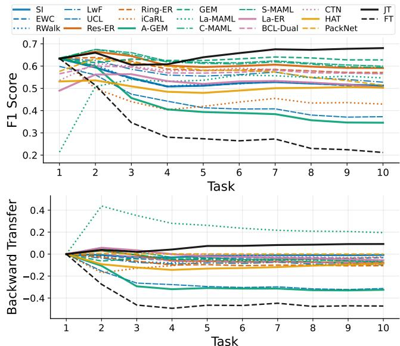
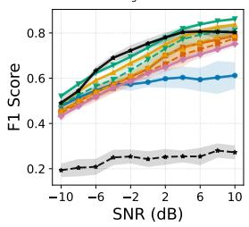
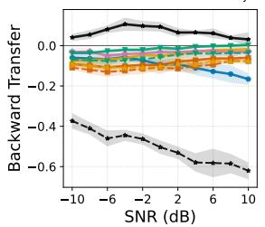
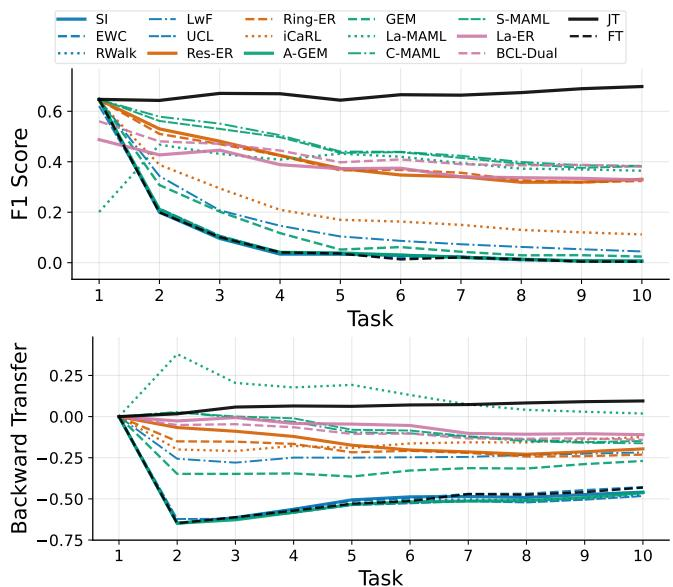
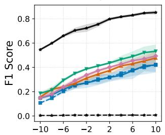
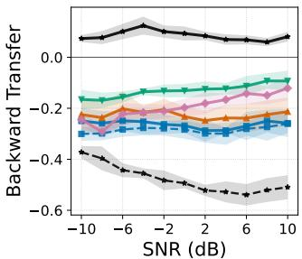
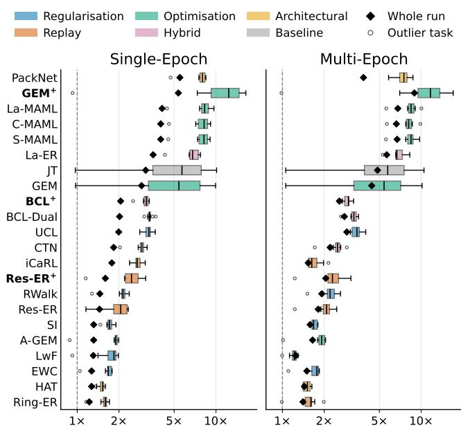

# Overcoming Catastrophic Forgetting: Continual Learning for Radar Waveform Classification

Mohamed Rabie

Chinthana J. Panagamuwa, Member, IEEE

Konstantinos G. Kyriakopoulos, Senior Member, IEEE

Wolfson School of Mechanical, Electrical and Manufacturing

Engineering. Loughborough University, U.K.

Abstract— Automated radar waveform recognition classifies the waveform and modulation type of a received signal. As waveforms variants emerge appear over time, a deployed classifier must learn them without retraining from scratch. Catastrophic Forgetting occurs when learning additional waveforms overwrites prior knowledge. Continual Learning (CL) methods tackle this challenge, but prior radar studies only evaluate a few methods on narrow benchmarks. Practitioners lack evidence on which method to deploy or which mechanisms are effective. This work presents the first large-scale benchmark of continual learning for radar waveform recognition. Eighteen CL methods are evaluated on a sequential ten-task problem, drawn from four public datasets spanning 54 waveforms, under task- and class-incremental (TIL, CIL) settings and single- and multi-epoch regimes. Methods that retain data from old tasks lead both TIL and CIL settings. Plain replay alone closes 77%–88% of the gap between the lower and upper practical limits under TIL, but only 46%–55% under CIL. The internal mechanisms of the leading methods are ablated and statistically tested to identify effective mechanisms. Each ablation is paired against its full method over n=6 training seeds, topped up to n=12 when inconclusive, and p-values are Holm-Bonferroni corrected within each method’s family. Ablation results show that several mechanisms confer smaller but statistically significant gains. Combining these mechanisms improves the leading F1 score by 3.4%–5.5% and 2.7%–4.9% under TIL and CIL, respectively, and the combined models exceed every benchmarked method in both settings for all SNRs. These results give researchers of radar waveform classification systems a mechanism-level basis for design.

Index Terms— Incremental Learning, Continual Learning, Radar Waveform Recognition, I/Q RF Signals.

This work has been submitted to the IEEE for possible publication. Copyright may be transferred without notice, after which this version may no longer be accessible.

This study was supported by the EME Hub, funded by Defence Science and Technology Laboratory (Dstl).

Authors’ address: Mohamed Rabie, Chinthana Panagamuwa and Konstantinos G. Kyriakopoulos are with the Wolfson School of Mechanical, Electrical and Manufacturing Engineering at Loughborough University, UK. (Corresponding author: Mohamed Rabie (m.rabie@lboro.ac.uk)).

## I. INTRODUCTION

As the electromagnetic (EM) spectrum grows more congested, radar and communications systems increasingly employ parameter-agile and adaptive waveforms, widening the space a recogniser must handle. Deep learning approaches, particularly Convolutional Neural Networks (CNNs), perform strongly on this task, learning discriminative features directly from In-phase and Quadrature (IQ) samples without expert-reliant feature engineering [1].

These models are trained on a fixed set of waveform classes. However, operational environments are not fixed—new and unforeseen signals emerge over time. The operator then faces three options, none of them satisfactory: i) Retraining on all accumulated data is computationally prohibitive at scale and assumes availability of old data, ii) maintaining an ensemble of specialist models adds management overhead and requires a priori knowledge for model selection, and iii) fine-tuning on new data alone is cheap but overwrites prior knowledge. This failure is known as Catastrophic Forgetting (CF) [2].

Continual Learning (CL), also known as lifelong or incremental learning, addresses this failure directly. A CL model learns new waveform classes incrementally whilst retaining prior ones, without retraining from scratch. Two settings are considered in this work. In the Taskincremental Learning (TIL) setting, waveform groups arrive as separate tasks with a classifier head each, and the Task Identity (TID) must be known at inference. In the Class-incremental Learning (CIL) setting, new waveforms are added to a shared head, and the TID is required during training but not at inference [3].

The CL literature offers a broad family of solutions, spanning regularisation [4]–[7], replay [8]–[10], optimisation [9], [11], [12] and architectural isolation [13], [14] approaches. However, their application to radar waveforms remains sparse. Firstly, existing studies evaluate a handful of methods, typically on fewer than ten classes drawn from a single dataset, and in a single incremental setting [15]–[18]. The relative merits of the method families are therefore unknown in this domain, leaving a practitioner without an evidence base from which to choose. Secondly, and more fundamentally, no study isolates which mechanism within a method delivers its benefit. The leading methods each bundle several mechanisms, such as replay, gradient projection, meta-learning and distillation. Whole-method comparisons do not reveal which mechanisms are effective.

This work closes both gaps. Eighteen CL methods are evaluated on four publicly available radar waveform datasets: RadarML [19], RadNIST [20], RadChar [21] and DeepRadar [22], collectively spanning 54 unique waveforms, filtered to a common −10 dB to +10 dB Signal-to-Noise Ratio (SNR) range. The datasets differ in modulation family, acquisition method, and sampling rate. A further constraint is that intercepts arrive as a continuous stream. At high sampling rates, raw IQ data cannot all be stored and revisited, so each sample may be trained on only once, as it arrives. Every method is therefore run under two regimes according to the number of passes permitted over each task’s data: multi-epoch (5E), with five epochs per task, and single-epoch (1E), a single pass. Comparing the two isolates how far each stability–plasticity trade-off degrades when data cannot be revisited. The contributions are as follows:

1) The first large-scale benchmark of CL for radar waveform recognition, covering eighteen methods on 54 unique signals across ten tasks. In contrast, prior work typically uses ten or fewer classes in total [15]– [18]. Performance is assessed by the CL F1-score $\bar { F } 1 _ { \mathrm { C L } }$ , and backward and forward transfer.

2) An evaluation of methods under both TIL and CIL settings, as in [23], and under both 1E and 5E. The 1E regime evaluates how well new waveforms are learned from a stream in which each sample is seen once, as when intercepts cannot be stored and revisited. Leading methods are further evaluated at −10 dB to 10 dB SNR.

3) An attribution of performance to individual mechanisms rather than to whole methods, based on leaveone-out ablations of the leading methods with paired statistical significance testing. Each ablation removes or replaces a single mechanism, tested on $n = 6$ seeds and topped up to n=12 for inconclusive verdicts. Effects are Holm–Bonferroni corrected within each method and judged against a smallest effect size of interest of 1% $\bar { F } 1 _ { \mathrm { C L } }$ , so that a negligible effect can be told apart from an inconclusive one.

4) Combined models that graft the significant mechanisms onto the leading methods. The mechanisms prove additive: Under TIL, GEM+ raises the leading $\bar { F } 1 _ { \mathrm { C L } }$ from 62.8% to 66.2% in 1E, and from 68.7% to 74.2% in 5E. Under CIL, BCL+ raises the leading $\bar { F } 1 _ { \mathrm { C L } }$ by 2.7%–4.9%. The memory and runtime costs of every method are also reported.

Section II positions the work within the radar waveform classification literature. Section III introduces five families of CL methods and details the 18 methods in terms of their constituent mechanisms. Section IV formalises the CL problem, evaluation metrics and task construction, and sets out the ablations, significance testing and training setup. Section V reports the benchmark results, ablates the leading methods to find effective mechanisms, combines those mechanisms, assesses robustness to SNR and memory size, and compares computational costs. Section VI concludes by discussing the implications for the design of CL systems in this domain.

## II. RELATED WORK

This work focuses on the intersection between radar waveform recognition and CL. As only a small number of papers explore this intersection directly, the literature surveyed here encompasses the broader area of radar waveform classification, including works that do not address

CL explicitly. Recent work in this space spans modulation classification [21], [24]–[26], transfer learning [27]–[29], and CL [15]–[18].

Early work on automated waveform and modulation classification demonstrates that CNNs can achieve strong performance when applied to IQ-derived representations. Authors in [24] convert IQ data into time-frequency images for CNN classification, whilst [25] propose a framework for simultaneous modulation classification and signal characterisation, later extended in [21] via an attention mechanism. A parallel line of work addresses the efficiency of learning new waveforms through transfer learning: [28] mitigate overfitting on small-scale radar datasets by reusing prior knowledge, [27] propose an adaptive loss to transfer knowledge towards difficult waveforms, and [29] extend these ideas to a self-supervised fewshot regime capable of learning from partially labelled data. Whilst these works collectively establish that prior knowledge can accelerate waveform acquisition, neither line addresses the CL setting: the classification works assume a fixed, closed set of waveform classes, and transfer learning alone sacrifices previously learned representations, leaving catastrophic forgetting unresolved.

Several works have applied CL directly to radar waveform recognition, though evaluations remain limited in both scale and breadth of benchmarked methods. In [15] an incremental learning algorithm is proposed for radar emitter identification in domain-, class-, and task-incremental scenarios, but relies on expert-extracted features that do not scale to large waveform vocabularies. This limitation is addressed in [16] with a CNN-based exemplar framework that freezes feature extraction after initial training and represents new emitters as prototypes in a discriminative feature space shaped by ArcFace loss [30], appending them to an unbiased cosine similarity classifier without retraining. In [17], a multi-modal framework is proposed for modulation recognition that combines a knowledge distillation penalty with an outputcorrection layer to mitigate the prediction bias introduced by class imbalance between old exemplars and new data, benchmarking against iCaRL [10] and BiC [31]. Most recently, [18] employ a mask-based CL method that eliminates inter-task interference whilst permitting forward transfer, evaluated on two synthetic radar datasets.

Across these works, no study considers more than 13 waveform classes or benchmarks more than five CL algorithms, so the relative merits of forgetting-mitigation strategies in the radar domain remain unclear. No prior work evaluates both the TIL and CIL settings, or restricts training to a single pass over each task, as when intercepts arrive as a stream that cannot be stored and revisited. This work evaluates 18 CL algorithms (15 under CIL), spanning replay [8]–[10], regularisation [4]–[7], optimisation [9], [11], [12], architectural [13], [14] and hybrid [32], [33] approaches. They are benchmarked on 54 waveforms from four public datasets [19]–[22], split into ten tasks, in both settings and under both the 1E and 5E regimes.

## III. CONTINUAL LEARNING METHODS

This section explores five families of CL methods, grouped by their forgetting-mitigation mechanism: replay, regularisation, optimisation, architectural, and hybrid. Table I summarises their relative strengths and limitations. Drawn from these families, the 18 methods (15 under CIL) evaluated in later sections are detailed in terms of their individual constituent mechanisms.

## A. Replay-based Methods

Experience Replay (ER)-based methods mitigate CF by interleaving training with samples drawn from a fixedsize memory of prior observations, approximating the joint training signal.

ER [8] maintains a replay buffer M of capacity K and minimises cross-entropy over a joint batch combining current-task data with stored exemplars. Two variants are evaluated: Res-ER uses reservoir sampling [35] to maintain a global buffer that is asymptotically uniform over all data seen so far, while Ring-ER [10] partitions the buffer evenly across tasks, guaranteeing equal pertask retention. Ring-ER therefore benefits from balanced allocation under TIL, while the global objective of Res-ER offers stronger cross-task discrimination under CIL.

iCaRL [10] combines exemplar replay with knowledge distillation. Exemplars are selected by herding to approximate each class mean in feature space, with the fixed budget K redistributed uniformly as new classes arrive. The cross-entropy loss is augmented with a Kullback-Leibler (KL) distillation penalty against the model frozen at each task boundary,

$$
\mathcal { L } _ { \mathrm { K L } } = \lambda \sum _ { \tau = 0 } ^ { t - 1 } D _ { \mathrm { K L } } \Big ( \sigma \big ( f _ { \theta _ { \tau } ^ { * } } ( x ^ { \tau } ) \big ) \ \Big \| \ \sigma \big ( f _ { \theta } ( x ^ { \tau } ) \big ) \Big ) ,\tag{1}
$$

where $\sigma ( \cdot )$ is the sigmoid, $f _ { \theta _ { \tau } ^ { * } }$ is the model frozen at the end of task $\tau ,$ and λ controls the distillation strength. At inference, a test sample is assigned to the nearest class prototype under cosine similarity.

## B. Regularisation-based Methods

Regularisation-based methods mitigate CF by penalising destructive parameter updates, either in weight space via importance-weighted parameter drift, or in function space by constraining the model’s outputs to remain consistent with those of prior tasks.

Function Regularisation. LwF [4] applies the functionspace variant: a frozen snapshot $f _ { \theta ^ { \ast } }$ of the model after each task boundary serves as a teacher, and the student is trained on current-task labels plus a similar ${ \mathcal { L } } _ { \mathrm { K I } }$ term to iCaRL (1), applied to the current data stream using a single teacher. LwF requires no episodic memory.

Parameter Regularisation. EWC [5], SI [6], and RWalk [7] share a common consolidation objective (2), differing only in how the importance $I _ { i }$ is estimated. EWC sets $I _ { i }$ to the diagonal of the Fisher information matrix, approximating the KL cost of drifting from the oldtask optimum. SI instead accumulates importance online as a path integral of each parameter’s contribution to loss reduction along the optimisation trajectory. RWalk combines an exponential moving average (EMA) of the diagonal Fisher with an SI-style path statistic normalised by the Fisher metric, yielding $I _ { i } = F _ { i } + S _ { i }$

$$
\mathcal { L } = \mathcal { L } _ { \mathrm { C E } } + \lambda \sum _ { i } I _ { i } \left( \theta _ { i } - \theta _ { i } ^ { * } \right) ^ { 2 } ,\tag{2}
$$

UCL [34] extends parameter importance to a fully Bayesian form, replacing deterministic weights with factorised Gaussian posteriors and penalising drift in both the mean and the variance of each weight. The mean penalty is an importance-weighted analogue of (2), with importance derived from the ratio of initial to current posterior uncertainty, while a log-corrected variance penalty makes sharpening the posterior cheaper than broadening it. Collectively these terms approximate the KL divergence between successive weight posteriors.

## C. Optimisation-based Methods

Gradient Projection. GEM [9] constrains each update so that the loss on every previously observed task cannot increase, accepting the gradient only if it has non-negative inner product with every prior-task reference gradient and otherwise projecting it via a Quadratic Program (QP); the QP grows with the number of tasks, making GEM expensive on long sequences. AGEM [11] replaces the pertask constraint with an averaged constraint, projecting the gradient g if $\langle g , g _ { \mathrm { r e f } } \rangle { < } 0$ for reference gradient $g _ { \mathrm { r e f } }$ drawn from all prior buffers (3), reducing per-step overhead to a single inner product while trading away GEM’s per-task guarantee.

$$
\tilde { g } = g - \frac { \langle g , g _ { \mathrm { r e f } } \rangle } { \langle g _ { \mathrm { r e f } } , g _ { \mathrm { r e f } } \rangle } g _ { \mathrm { r e f } } ,\tag{3}
$$

Meta-Learning. Meta-learning methods frame continual adaptation as a bilevel optimisation problem, metatraining an initialisation from which rapid, low-forgetting adaptation to new tasks is possible. La-MAML [12] adapts the MAML [36] framework to CL by replacing its held-out outer-loop data with a reservoir-sampled replay buffer: an inner loop produces fast weights $\theta ^ { \prime }$ via a gradient step scaled by per-parameter rates ${ \hat { \alpha } } _ { j }$

$$
\theta _ { j } ^ { \prime } = \theta _ { j } - \hat { \alpha } _ { j } \cdot \frac { \partial \mathcal { L } _ { \mathrm { C E } } ( B _ { i } ; \theta ) } { \partial \theta _ { j } } ,\tag{4}
$$

and the outer loop evaluates these fast weights against replay-augmented meta-batches to form a meta-loss,

$$
\mathcal { L } _ { \mathrm { m e t a } } = \frac { 1 } { K _ { \mathrm { m e t a } } } \sum _ { i = 1 } ^ { K _ { \mathrm { m e t a } } } \mathcal { L } _ { \mathrm { C E } } ( B ^ { \mathrm { r e p } } ; \theta _ { i } ^ { \prime } ) ,\tag{5}
$$

which first updates the rates and then updates the backbone using those rates as step sizes, $\begin{array} { r l r } { \theta _ { j } } & { { }  } & { \theta _ { j } } \end{array} -$ $\hat { \alpha } _ { j } \partial \mathcal { L } _ { \mathrm { m e t a } } / \partial \theta _ { j }$ ; here $B ^ { \mathrm { r e p } }$ is a replay batch, $\theta _ { i } ^ { \prime }$ the fast weights adapted on the i-th inner batch, and $K _ { \mathrm { m e t a } }$ the number of meta-batches averaged. CMAML and SMAML ablate this scheme: CMAML fixes the rates at $\alpha _ { \mathrm { i n i t } }$ and updates the backbone with a single global rate $\beta$ in place of ${ \hat { \alpha } } _ { j }$ , while SMAML meta-trains the rates as in La-MAML but still applies CMAML’s scalar update, so the updated rates take effect only at the next inner step. This contrast isolates the effect of per-parameter, rather than scalar, learning-rate adaptation.

TABLE I: Summary of CL families by mechanism, key strength, and primary limitation.
<table><tr><td>Approach</td><td>Mechanism</td><td>Key Strength</td><td>Primary Limitation</td></tr><tr><td>Regularisation (LwF [4], EWC [5], SI [6], RWalk [7], UCL [34])</td><td>Penalises changes to parameters identified as important for prior tasks in the parameter or feature space</td><td>No exemplar storage required; po- tentially lightweight and broadly applicable across architectures</td><td>Importance estimation must be reli- able and extensible to new tasks</td></tr><tr><td>Replay (Res-ER [8], Ring-ER [10], iCaRL [10])</td><td>Interleaves stored exemplars with current training data via cross-entropy replay</td><td>Simple and effective; effectiveness scales naturally with buffer size</td><td>Buffer storage requirement grows with the number of tasks and classes</td></tr><tr><td>Optimisation (GEM [9], AGEM [11], C-/S-/La-MAML [12])</td><td>Uses stored exemplars or a replay buffer to constrain or shape the gradient update direc- tion via an explicit optimisation procedure</td><td>Principled gradient-level forgetting prevention without relying solely on rehearsal frequency</td><td>Constraint projection or bilevel up- dates introduce significant per-step compute overhead</td></tr><tr><td>Architectural (PackNet [13], HAT [14])</td><td>Allocates disjoint parameter subsets per task via pruning or learned masks, preventing any cross-task parameter interference</td><td>Eliminates forgetting by ensuring that previously learned tasks are unaffected by subsequent tasks</td><td>Fixed network capacity imposes a hard limit on the number of disjoint subnetworks.</td></tr><tr><td>Hybrid (CTN [33], BCL-Dual [32], La-ER [12])</td><td>Combines replay and optimisation-based updates that decouple stability and plasticity signals across separate memory streams</td><td>Complementary mechanisms can yield better stability-plasticity trade-offs than either alone</td><td>Increased architectural and train- ing complexity relative to single- mechanism approaches</td></tr></table>

## D. Architectural Methods

Architectural methods prevent CF by allocating disjoint parameter subsets per task, so that learning a new task cannot alter representations learned for previous ones. PackNet [13] achieves this via iterative magnitudebased pruning. After each task, the largest-magnitude fraction $\rho$ of currently free weights is permanently locked to that task and restored after every optimiser step, confining subsequent plasticity to the remaining pool. The free pool shrinks geometrically; earlier tasks receive more parameters than later ones. At inference, a taskaware binary mask routes the forward pass through the corresponding sub-network.

HAT [14] instead learns soft attention masks endto-end: a task-specific embedding is passed through a sigmoid scaled by an annealing parameter s,

$$
\mathbf { m } _ { l } ^ { ( t ) } = \sigma \big ( s \mathbf { e } _ { l } ^ { ( t ) } \big ) \in ( 0 , 1 ) ^ { C } ,\tag{6}
$$

producing a gate over the layer’s channels that hardens towards binary values as s is annealed. At each task boundary the gates are binarised into a mask that zeroes gradients on previously allocated weights for all subsequent tasks, with an added regularisation term discouraging the current task from claiming unused capacity unnecessarily.

## E. Hybrid Methods

Hybrid methods combine mechanisms from the preceding categories within a bilevel optimisation scheme. The scheme has two levels, each a separate parameter set or update loop, and each learns from its own data stream. This division supports task-specific adaptation at the inner level while the outer level preserves cross-task generalisation. Both hybrids evaluated here train their inner level on a common replay-augmented objective,

$$
\begin{array} { r l } & { \mathcal { L } ^ { \mathrm { t r a i n } } = \mathcal { L } _ { \mathrm { C E } } ( x , y ) + \lambda _ { \mathrm { r e p } } \mathcal { L } _ { \mathrm { C E } } ( x ^ { \mathrm { r e p } } , y ^ { \mathrm { r e p } } ) } \\ & { \phantom { \mathcal { L } } + \lambda _ { \mathrm { K L } } D _ { \mathrm { K L } } \Big ( \sigma \Big ( \frac { f _ { \theta _ { \tau } ^ { * } } ( x ^ { \mathrm { r e p } } ) } { \tau } \Big ) \ \Big \| \ \sigma \Big ( \frac { f ( x ^ { \mathrm { r e p } } ) } { \tau } \Big ) \Big ) , } \end{array}\tag{7}
$$

an instance of the distillation penalty (1) whose soft labels are recorded at the previous task boundary $\theta _ { \tau } ^ { * }$

CTN [33] splits the model into a shared backbone $\phi$ and a controller θ. The controller maps task embeddings to per-task Feature-wise Linear Modulation (FiLM) parameters $\{ \gamma _ { t } , \beta _ { t } \}$ that modulate the backbone features,

$$
\tilde { h } ( x ; t ) = \frac { \gamma _ { t } } { \| \gamma _ { t } \| _ { 2 } } \odot \hat { h } ( x ) + \frac { \beta _ { t } } { \| \beta _ { t } \| _ { 2 } } .\tag{8}
$$

The backbone trains on the replay-augmented objective (7). The controller trains on a separate stream, which encourages transformations that generalise beyond the immediate distribution. BCL [32] instead operates over a single shared parameter vector. A working memory supplies the same replay-augmented objective (7) to an inner loop, while a separate meta memory provides clean supervision to a single outer step. BCL folds the resulting adapted state $\phi ^ { \prime }$ back via Reptile-style interpolation [37],

$$
\theta  \theta + \beta ( \phi ^ { \prime } - \theta ) .\tag{9}
$$

La-ER [12], an ablation of La-MAML, isolates the metalearned step sizes from the MAML-style update. The perparameter rates are still meta-trained, but the backbone is updated by plain replay rather than by the meta-loss.

## IV. METHODOLOGY

## A. Problem Formulation

## 1. Base Learning Objective

The base learning objective for all methods is the cross-entropy loss between the predicted class distribution and the ground-truth label. Let x∈X denote an input

IQ sample and $\boldsymbol { y } { \in } \mathscr { y } _ { t }$ its class label. The predicted class probability is $p ( \boldsymbol { y } | \mathbf { x } )$ =[softmax $( f _ { \theta } ( \mathbf { x } ) ) ] _ { y }$ , and the classweighted cross-entropy over a batch of N samples is given by (10), where $w _ { y _ { i } }$ is a per-class weight that addresses class imbalance. The loss is normalised by the total weight in the batch.

$$
\mathcal { L } _ { \mathrm { C E } } = - \ \frac { \sum _ { i = 1 } ^ { N } w _ { y _ { i } } \log p ( y _ { i } \mid \mathbf { x } _ { i } ) } { \sum _ { i = 1 } ^ { N } w _ { y _ { i } } }\tag{10}
$$

Let B⊆Yt denote the set of classes present in the batch and $n _ { c }$ the number of samples of class c. The weight of class c is its inverse frequency, normalised so that the mean weight over observed classes is unity, i.e. $\scriptstyle { \frac { 1 } { | B | } } \sum _ { c \in B } w _ { c } = 1$

$$
w _ { c } = \frac { N / n _ { c } } { \frac { 1 } { | \mathcal { B } | } \displaystyle \sum _ { c ^ { \prime } \in \mathcal { B } } N / n _ { c ^ { \prime } } } , \quad c \in \mathcal { B }\tag{11}
$$

## 2. Continual Learning Objective

A model learns a sequence of T tasks, $\mathcal { D } { = } \{ \mathcal { D } _ { 1 } , \ldots , \mathcal { D } _ { T } \}$ . Task t is defined by a dataset $\mathcal { D } _ { t } { = } \{ ( \mathbf { x } _ { i } ^ { t } , y _ { i } ^ { t } ) \} _ { i = 1 } ^ { N _ { t } }$ of $N _ { t }$ IQ samples with labels $y _ { i } ^ { t } \in \mathcal { V } _ { t }$ , and class sets are disjoint across tasks $( { \mathcal { V } } _ { i } \cap { \mathcal { V } } _ { j } = \emptyset$ for $i { \neq } j )$ . During task t, only $\mathcal { D } _ { t }$ is observed; prior data are available only if retained by a replay method.

The model $f _ { \pmb { \theta } } { = } h _ { \psi } \circ g _ { \phi }$ comprises a shared feature extractor $g _ { \phi } : \mathcal { X }  \mathcal { Z }$ and a classifier head $h _ { \psi } : \mathcal { Z } \to \mathbb { R } ^ { C }$ with $\scriptstyle \pmb \theta = \{ \phi , \psi \}$ . Under TIL, a TID is given at inference and selects a task-specific head $\psi _ { t }$ , so $C { = } | \boldsymbol { \ y } _ { t } |$ |. Under CIL, no TID is given, and a single shared head covers every class seen so far, so $C { = } | \mathcal { V } _ { 1 : t } |$ with $\textstyle { \mathcal { Y } } _ { 1 : t } = \bigcup _ { \tau = 1 } ^ { t } { \mathcal { Y } } _ { \tau } .$

At task t, the ideal objective is the cumulative risk over all tasks observed so far (12), where $\scriptstyle { \mathcal { L } } _ { \tau }$ denotes the loss (10) on $\mathcal { D } _ { \tau }$ . Only the term $\mathcal { L } _ { t }$ can be evaluated, since $\mathcal { D } _ { \tau }$ is unavailable for $\tau < t .$ . The methods considered here differ in how they approximate the remaining terms.

$$
\operatorname* { m i n } _ { \pmb { \theta } } \sum _ { \tau = 1 } ^ { t } \mathcal { L } _ { \tau } ( \pmb { \theta } ) ,\tag{12}
$$

## B. Performance Evaluation

## 1. Classification of Radar Waveforms

Classification performance of the radar waveforms is evaluated using precision, recall, and F1 score, computed per class and aggregated via macro-averaging across all waveform classes. Macro-averaging treats each class equally regardless of sample count. Per-class precision, recall and F1 scores are defined in (13), where TP, FP, and FN denote the number of true positives, false positives, and false negatives, respectively.

$$
P = { \frac { \mathrm { T P } } { \mathrm { T P } + \mathrm { F P } } } , R = { \frac { \mathrm { T P } } { \mathrm { T P } + \mathrm { F N } } } , \mathrm { F 1 } = { \frac { 2 P R } { P + R } }\tag{13}
$$

Macro-averaged precision, recall and F1 are then defined as (14), where C is the number of classes.

$$
\bar { P } = \frac { 1 } { C } \sum _ { c = 1 } ^ { C } P , \bar { R } = \frac { 1 } { C } \sum _ { c = 1 } ^ { C } R , \overline { { \mathrm { F 1 } } } = \frac { 1 } { C } \sum _ { c = 1 } ^ { C } \mathrm { F 1 }\tag{14}
$$

## 2. Continual Learning

The degree to which prior task performance is preserved after learning task t is measured by Backward Transfer (BWT). Forward Transfer (FWT) (16) measures how well the model performs on a task before training on it, relative to a random model. BWT and FWT are defined in (15)–(16), where $\operatorname { F 1 } _ { i , j }$ denotes the F1 on task j after training on task i, and $\overline { { \operatorname { F } 1 } } _ { t }$ is the F1 of a randomly initialised model on task t. A negative BWT indicates catastrophic forgetting, and a positive FWT indicates prior learning has benefited subsequent tasks.

$$
\mathbf { B W T } = \frac { 1 } { T - 1 } \sum _ { t = 1 } ^ { T - 1 } \left( \mathrm { F } \mathbf { 1 } _ { T , t } - \mathrm { F } \mathbf { 1 } _ { t , t } \right)\tag{15}
$$

$$
\mathrm { F W T } = \frac { 1 } { T - 1 } \sum _ { t = 2 } ^ { T } \left( \mathrm { F } 1 _ { t - 1 , t } - \overline { { \mathrm { F } 1 } } _ { t } \right)\tag{16}
$$

Overall model performance, $\overline { { \mathrm { F 1 } } } _ { \mathrm { C L } }$ , is defined as the classweighted mean of F1 across all T tasks (17), where $n _ { c } ^ { t }$ is the number of classes in task t and $\overline { { \mathrm { F 1 } } } ^ { ( \dot { T } , t ) }$ denotes F1 on task t after training on all tasks. Under CIL, $\bar { F } 1 _ { \mathrm { C L } }$ the F1 score over all seen classes.

$$
\mathrm { F 1 } _ { \mathrm { C L } } = \frac { 1 } { \sum _ { t } ^ { T } n _ { c } ^ { t } } \sum _ { t = 1 } ^ { T } n _ { c } ^ { t } \overline { { \mathrm { F 1 } } } ^ { ( T , t ) }\tag{17}
$$

CL methods are evaluated against two reference models. The Fine-Tuning (FT) model trains on each task without any mitigation against forgetting, giving a practical lower bound. The Joint-Training (JT) model trains on the data of all tasks so far, jointly optimising them with the current task, and gives a practical upper bound.

## C. Datasets

## 1. Description

Four datasets are used in this work, all of which are synthetic and one contains over-the-air (OTA) data (synthetic data transmitted and then received on hardware). Table II summarises the signal types within each dataset.

RadarML (RML) [19] is an OTA synthetic dataset containing 15 signal types. Signals are synthetically generated with one of 15 modulation scheme and phasecoding combinations: Barker (5-13, 5×11, 5×13), Continuous Wave (CW), Frequency Modulated CW (FMCW), Frequency-Shift Keying (FSK) (0-3), Hyperbolic FM (HFM), Quadratic FM (QFM) and Non-Linear FM (NLFM). These are then transmitted and received by a Radio-Frequency-System-on-a-chip (RFSoC) on different channels. Three channels receive the data simultaneously in an attempt to isolate channel distortions from the transmission. The sampling rate is 3.84 GS/s, downsampled to

TABLE II: Signal types available in evaluated datasets.
<table><tr><td>Signal Type / Family</td><td>DeepRad RadNIST</td><td></td><td></td><td>RadChar RadarML</td></tr><tr><td>Non-modulation</td><td>√</td><td>√</td><td></td><td>√</td></tr><tr><td>FM (LFM, FMCW, NLFM, HFM, QFM)</td><td> $\checkmark$ </td><td>√</td><td>√</td><td> $\checkmark$ </td></tr><tr><td>Coherent pulse train</td><td></td><td></td><td> $\checkmark$ </td><td></td></tr><tr><td>FSK (2/4/8-FSK)</td><td> $\checkmark$ </td><td></td><td></td><td> $\checkmark$ </td></tr><tr><td>PSK (2/4/8-PSK)</td><td> $\checkmark$ </td><td></td><td></td><td></td></tr><tr><td>Costas code</td><td> $\checkmark$ </td><td></td><td></td><td></td></tr><tr><td>Barker codes</td><td> $\checkmark$ </td><td> $\checkmark$ </td><td>√</td><td> $\checkmark$ </td></tr><tr><td>Polyphase Barker</td><td></td><td></td><td> $\checkmark$ </td><td></td></tr><tr><td>Frank code</td><td> $\checkmark$ </td><td> $\checkmark$ </td><td> $\checkmark$ </td><td></td></tr><tr><td>Huffman code</td><td> $\checkmark$ </td><td></td><td></td><td></td></tr><tr><td>P1–P4 &amp; Px codes</td><td> $\checkmark$ </td><td> $\checkmark$ </td><td></td><td></td></tr><tr><td>Zadoff–Chu</td><td> $\checkmark$ </td><td> $\checkmark$ </td><td></td><td></td></tr><tr><td>T1-T4 phase codes</td><td> $\checkmark$ </td><td></td><td></td><td></td></tr><tr><td>Q3N radar modes</td><td></td><td> $\checkmark$ </td><td></td><td></td></tr><tr><td>PON radar modes</td><td></td><td> $\checkmark$ </td><td></td><td></td></tr></table>

120 MS/s. The synthetic waveforms are generated and transmitted at high SNR.

RadNIST (RN) [20] contains five types of pulses corresponding to radar working modes in the 3.55–3.7 GHz band [20]. It contains two unmodulated (P0N) and three frequency/angle modulated (Q3N) pulse types. All pulses vary in pulse width (0.5−100 µs), Pulse Repetition Interval (PRI) (0.3−3 ms) and Pulses per Burst (PPB) (2−40). The parameters for each pulse are randomly sampled per burst. Additionally, P0N pulses vary in phase-coding (Barker, Frank, P1-4/x, Zadoff-Chu), and Q3N in bandwidth (1−100 MHz). The sampling rate is 10 MS/s.

RadChar (RC) [21] contains radar pulses according to five modulation schemes: coherent pulse train, Barker code, polyphase Barker code, Frank code and linear frequency modulation. Pulse parameters vary in code length, pulse width, PRI and PPB. The sampling rate is 3.2 MS/s.

DeepRadar (DR) [22] contains 22 classes of pulses generated according to modulation and phase-code combinations, including non-modulation. The modulation schemes used are: Linear Frequency Modulation (LFM), FSK (1-3 bits/symbol), Phase-Shift Keying (PSK) (1-3 bits/symbol), Phase Modulation (PM) (Barker, Frank, P1- 4/x, Zadoff-Chu, T1-4), and non-modulation. The sampling rate is 100 MS/s.

## 2. Data Processing

For all but the RML dataset, the only processing steps required are i) filtering the SNR range to −10−10dB for consistency, and ii) matching the dimensions of the waveform slices, across datasets, to be fed as inputs to the backbone ResNet. The common SNR range chosen is −10−10dB; and the sample dimensions chosen are [2, 512], corresponding to two (I/Q) channels each with 512 samples. RML requires additional processing steps: waveform detection and extraction, inter-ADC phase alignment, and linear combination of three ADC channels.

Each RadarML recording is $1 4 0 \mu \mathrm { s }$ in duration and sampled at 120 MS/s. However, the waveforms have a much smaller pulse width of 10−100 $\mu \mathrm { s }$ . Waveforms are thus extracted using a threshold-based edge-detection algorithm. The algorithm locates the waveform edges and crops a window around it. Each window has length nL, where $n \in \mathbb { Z } ^ { + }$ and L is the model’s input length. Each window is divided into n disjoint input slices, each receiving the same class label.

Each waveform in RadarML is captured simultaneously across three ADC channels. Prior to use, inter-ADC phase misalignment is corrected by aligning channels 2 and 3 to channel 1, which serves as the reference $\mathbf { x } _ { \mathrm { r e f } } .$ . The phase offset of a channel x relative to the reference is estimated from their complex inner product, $\rho = \mathbf { x } _ { \mathrm { r e f } } ^ { H } \mathbf { x } .$ , and alignment is applied as $\mathbf { x } _ { \mathrm { a l i g n e d } } = \mathbf { x } e ^ { - j \arg ( \rho ) }$ . Following alignment, a similarity score is computed for each pair of channels (18). Samples for which any pairwise score falls below 0.9 are discarded as insufficiently consistent, accounting for approximately 4.5% of the dataset. Additive White Gaussian Noise (AWGN) is then superimposed onto the remaining samples to bring them within the target range of −10 to 10 dB.

$$
\sin ( \mathbf { A } , \mathbf { B } ) = { \frac { \operatorname { R e } \left( \mathbf { A } ^ { H } \mathbf { B } \right) } { \left\| \mathbf { A } \right\| \left\| \mathbf { B } \right\| } }\tag{18}
$$

The corrected 3-ADC IQ waveforms are subsequently reduced to the two-channel format expected by the backbone via a learnable linear layer. This layer learns a linear transformation of the three ADC channels, initialised to a uniform average.

## D. Task Construction

Table II shows several modulations, such as Barker codes, that appear in more than one dataset. These are shared modulations, not shared waveform classes. Overlap would matter if the model classified modulation alone. In this work, however, each class is the combination of an underlying waveform and its modulation. The analysis in Appendix A tests this by measuring how often a model confuses same-modulation waveforms, relative to chance. No duplicate waveforms were found.

Tasks are constructed from the four datasets. For each dataset, the set of signal classes is randomly partitioned into disjoint groups, with each group defining one task. The number of slices per class is fixed to 10k for all datasets. The resulting assignments are summarised in Table III, alongside task difficulty measured as F1.

Since each task is drawn from a single dataset, differences between datasets (e.g. sampling rate) could leak TID. Appendix B finds that models retain a significant amount of TID. However, this retention correlates strongly with task difficulty (Spearman $\rho { = } 0 . 8 4 )$ , which suggests that it is not primarily caused by TID leakage.

TABLE III: Class partitions per task across datasets. Size indicates number of samples before training/testing split. Difficulty is the F1 (%) of a model trained on that task alone for 5 epochs; lower values indicate harder tasks.
<table><tr><td>Dataset</td><td>Task</td><td>Signal Types (Classes)</td><td># Classes</td><td>Size</td><td>Difficulty</td></tr><tr><td>RC</td><td>1</td><td>Coherent Pulse Train, Barker Code, Polyphase Barker Code, Frank Code, LFM</td><td>5</td><td>50k</td><td> $9 7 . 4 { \pm } 0 . 1 $ </td></tr><tr><td>RN</td><td>1</td><td>Q3N#2, Q3N#1, Q3N#3, P0N#2-P3, P0N#2-Frank, P0N#2-Px</td><td>6</td><td>60k</td><td>90.1±0.4</td></tr><tr><td>RN</td><td>2</td><td>P0N#1, P0N#2-Barker, P0N#2-P2, P0N#2-P4, P0N#2-P1, P0N#2-Zadoff-Chu</td><td>6</td><td>60k</td><td> $9 6 . 0 { \scriptstyle \pm 0 . 2 }$ </td></tr><tr><td>RML</td><td>1</td><td>FSK#0, Barker-5, Barker-13, Barker-11, FMCW</td><td>5</td><td>50k</td><td> $8 1 . 7 { \scriptstyle \pm 0 . 9 }$ </td></tr><tr><td>RML</td><td>2</td><td>Barker-5×11, Barker-5× 13, Barker-7, FSK#3, CW</td><td>5</td><td>50k</td><td>84.5±0.4</td></tr><tr><td>RML</td><td>3</td><td>FSK#1, QFM, HFM, FSK#2, NLFM</td><td>5</td><td>50k</td><td> $7 3 . 9 { \scriptstyle \pm 1 . 2 }$ </td></tr><tr><td>DR</td><td>1</td><td>8-FSK, Barker, T4, T1, Huffman, Px</td><td>6</td><td>60k</td><td>66.6±1.1</td></tr><tr><td>DR</td><td>2</td><td>2-PSK, P3, NLFM, LFM, P2, Zadoff-Chu</td><td>6</td><td>60k</td><td> $7 5 . 0 { \scriptstyle \pm 2 . 1 }$ </td></tr><tr><td>DR</td><td>3</td><td>P1, 4-FSK, 8-PSK, Frank, 4-PSK</td><td>5</td><td>50k</td><td> $5 7 . 4 { \pm } 1 . 5$ </td></tr><tr><td>DR</td><td>4</td><td>FM-Costas, T2, P4, 2-FSK, T3</td><td>5</td><td>50k</td><td> $5 9 . 8 { \scriptstyle \pm 1 . 7 }$ </td></tr></table>

<table><tr><td>Hyperparameter</td><td>Value</td></tr><tr><td>Architecture</td><td>ResNet18-1D</td></tr><tr><td>Optimiser</td><td>SGD</td></tr><tr><td>Epochs</td><td>1 (single-epoch) / 5 (multi-epoch)</td></tr><tr><td>Batch Size</td><td>256</td></tr><tr><td>Replay Batch Size</td><td>128</td></tr><tr><td>Replay Memory Size</td><td>5120</td></tr><tr><td>Batch Scaling</td><td>Normalisation</td></tr><tr><td>Training/Testing Split</td><td>80-20</td></tr></table>

TABLE IV: Shared hyperparameters. Replay parameters are only applicable to methods that use a memory buffer.

## E. Backbone and Hyperparameters

The backbone is a 1D ResNet18 [38], obtained by replacing every 2D operation with its 1D counterpart. Batch normalisation [39] is retained. Table IV lists the hyperparameters shared by all methods.

All experiments use Stochastic Gradient Descent (SGD) [40] with momentum 0.9 and no weight decay. Adaptive optimisers such as Adam [41] are avoided because their per-parameter step sizes interact with the CL mechanism under test. With SGD, differences in performance can be attributed to the CL methods themselves.

Following [11], hyperparameters are tuned on a heldout split formed by randomly sampling 15 % of each source dataset. These samples are excluded from all training and evaluation. The tuning split comprises four tasks, one per source dataset, of five classes each. Each task is trained for five epochs. The class-to-task partition is different from the main experiments so that tuning does not favour a particular task partition. The Learning Rate (LR) is tuned first on the JT model and then fixed for all methods. The remaining hyperparameters are tuned hierarchically in estimated order of importance. Appendix C lists the sweep ranges and selected values.

## F. Ablations and Significance Testing

The leading methods each bundle several mechanisms (episodic replay, gradient projection, meta-learned updates, bilevel optimisation, distillation, task conditioning), so $\bar { F } 1 _ { \mathrm { C L } }$ alone does not reveal which of them carries the performance. Leave-one-out ablations isolate each one: every ablation removes or alters a single mechanism and re-runs the full experiment in both training regimes. Optimisation budget (SGD steps per batch) is matched wherever an ablation would otherwise change it. Mechanisms that prove significant are then combined into new models, each built on one of the leading methods.

Each ablation is compared to its family’s full-method baseline under a paired design, so pairing cancels the between-seed variance. Each ablation uses a common seed set, $n { = } 6$ by default, and reports the mean effect $\overline { { \Delta } }$ with a 95% Confidence Interval (CI) (Student’s t) and a Holm–Bonferroni-corrected paired t-test $\left( p _ { \mathrm { H o l m } } \right)$ [42], corrected within each method’s ablation family. Following [43], each ablation receives one of four verdicts: statistically significant (SS) $( p _ { \mathrm { H o l m } } { < } 0 . 0 5 ;$ CI excludes 0), marginally significant (MS) $( p _ { \mathrm { H o l m } } > 0 . 0 5 ;$ CI excludes 0), not significant (NS) (CI within ±δ), and inconclusive (INC) (CI spans 0 and exceeds ±δ). Inconclusive ablations are re-run at n=12 to tighten the CI; those that remain inconclusive are reported as such. The Smallest Effect Size of Interest (SESOI) is $\delta { = } 1 \% \ \bar { F } \mathrm { 1 _ { C L } }$ , the median gap between the ablated methods and their neighbours in the main benchmark. Combined models are additionally retested on six held-out seeds, disjoint from the ablation grid.

## V. RESULTS

## A. Overview

Methods are benchmarked on the ten-task radar waveform classification problem in both TIL and CIL settings, each under a 1E regime (every task seen once) and a 5E regime (5 epochs per task). Each setting is reported in three parts: the benchmark itself, the ablations of the leading methods (Section IV-F), and robustness to SNR and buffer size. The significant mechanisms are then combined into new models, and the section closes with the memory and runtime cost of every method. Results are averaged over 6 seeds which also vary task order.

## B. Task-Incremental Setting

## 1. Benchmark

Table V reports all 18 methods. Retained data is the clearest marker of a strong method: eight of the ten leading 1E methods, and nine of ten in 5E, store samples from earlier tasks. GEM leads both regimes, closing 88−91% of the gap between FT and JT. A-GEM, which collapses GEM’s per-task constraints into a single averaged one, is the weakest method in both (21−29%), so the approximation is too coarse for these tasks. Among the non-replay methods, EWC, SI and RWalk are indistinguishable from one another, and LwF leads them in both regimes.

The extra epochs help almost every method more than they help either baseline (mean +7.7% against +4.1% for FT and +4.9% for JT); only A-GEM and UCL gain nothing. The gain costs retention for the replay methods (GEM’s BWT falls from −6.4% to −12.8%) but not for the parameter regularisers, whose BWT moves towards zero. The field also compresses: the 5E top six lie within 3.0% of one another.

TABLE V: Continual learning performance for the TIL setting under 1E and 5E training. Results show the mean and sample standard deviation (in %) over training seeds. $\Delta \bar { F } 1 _ { \mathrm { C L } }$ is the change in $\bar { F } 1 _ { \mathrm { C L } }$ from 1E to 5E.
<table><tr><td rowspan=1 colspan=1>|</td><td rowspan=1 colspan=7>Ⅱ       1E       ⅡI        5E        Ⅱ</td><td rowspan=1 colspan=1></td></tr><tr><td rowspan=1 colspan=1>Method |</td><td rowspan=1 colspan=1>Approach</td><td rowspan=1 colspan=1>| $\underline { { \mathbf { \bar { F 1 } } _ { \mathrm { C L } } } }$ </td><td rowspan=1 colspan=1>BWT</td><td rowspan=1 colspan=1>FWT</td><td rowspan=1 colspan=1> $\underline { { \mathbf { F 1 } _ { \mathbf { C L } } } }$ </td><td rowspan=1 colspan=1>BWT</td><td rowspan=1 colspan=1>FWT</td><td rowspan=1 colspan=1> $\underline { { \Delta \bar { \bf F 1 } _ { \mathrm { C L } } } }$ </td></tr><tr><td rowspan=1 colspan=1>FT</td><td rowspan=1 colspan=1>N/A</td><td rowspan=1 colspan=1>21.2±2.4|</td><td rowspan=1 colspan=1>-47.3±2.8</td><td rowspan=1 colspan=1>1.9±1.1 |</td><td rowspan=1 colspan=1>25.3±1.1|−</td><td rowspan=1 colspan=1>60.9±1.5</td><td rowspan=1 colspan=1>1.7±1.3Ⅱ</td><td rowspan=1 colspan=1>I+4.1</td></tr><tr><td rowspan=1 colspan=1>A-GEM</td><td rowspan=1 colspan=1>Optim.</td><td rowspan=1 colspan=1>34.6±3.4</td><td rowspan=1 colspan=1>-29.3±2.1</td><td rowspan=1 colspan=1>2.5±1.3</td><td rowspan=1 colspan=1>35.5±2.8</td><td rowspan=1 colspan=1>−50.0±3.2</td><td rowspan=1 colspan=1>2.0±1.3</td><td rowspan=1 colspan=1>+0.9</td></tr><tr><td rowspan=1 colspan=1>UCL</td><td rowspan=1 colspan=1>Reg.</td><td rowspan=1 colspan=1>37.3±4.8</td><td rowspan=1 colspan=1>-31.3±4.9</td><td rowspan=1 colspan=1>1.0±1.6</td><td rowspan=1 colspan=1>37.2±4.2</td><td rowspan=1 colspan=1>−44.3±5.1</td><td rowspan=1 colspan=1>0.2±1.3</td><td rowspan=1 colspan=1>-0.1</td></tr><tr><td></td><td></td><td></td><td></td><td rowspan=1 colspan=1>1.0±0.4</td><td rowspan=1 colspan=1>58.2±0.5</td><td rowspan=1 colspan=1>−11.4±0.9</td><td rowspan=1 colspan=1>1.2±0.6</td><td rowspan=1 colspan=1>+7.9</td></tr><tr><td rowspan=1 colspan=1>HAT</td><td rowspan=1 colspan=1>Árch.</td><td rowspan=1 colspan=1>50.3±1.9</td><td rowspan=1 colspan=1>−8.7±1.8</td><td rowspan=1 colspan=1>1.5±0.7</td><td rowspan=1 colspan=1>60.6±1.1</td><td rowspan=1 colspan=1>-6.6±1.0</td><td rowspan=1 colspan=1>1.2±1.0</td><td rowspan=1 colspan=1>+10.3</td></tr><tr><td rowspan=1 colspan=1>RWalk</td><td rowspan=1 colspan=1>Reg.</td><td rowspan=1 colspan=1>51.1±3.7</td><td rowspan=1 colspan=1>−5.7±3.1</td><td rowspan=1 colspan=1>1.5±1.2</td><td rowspan=1 colspan=1>57.9±2.7</td><td rowspan=1 colspan=1>−0.3±0.4</td><td rowspan=1 colspan=1>1.6±1.2</td><td rowspan=1 colspan=1>+6.8</td></tr><tr><td rowspan=1 colspan=1>SI</td><td rowspan=1 colspan=1>Reg.</td><td rowspan=1 colspan=1>51.3±3.0</td><td rowspan=1 colspan=1>=0.8±0.8</td><td rowspan=1 colspan=1>1.6±1.1</td><td rowspan=1 colspan=1>57.3±2.1</td><td rowspan=1 colspan=1>0.2±0.1</td><td rowspan=1 colspan=1>1.5±1.0</td><td rowspan=1 colspan=1>+6.0</td></tr><tr><td></td><td></td><td rowspan=1 colspan=1>51.3±3.3</td><td rowspan=1 colspan=1>−3.2±2.0</td><td rowspan=1 colspan=1>1.4±1.2</td><td rowspan=1 colspan=1>59.3±2.4</td><td rowspan=1 colspan=1>−1.2±0.8</td><td rowspan=1 colspan=1>0.8±1.0</td><td rowspan=1 colspan=1>+8.0</td></tr><tr><td rowspan=1 colspan=1>PackNet</td><td rowspan=1 colspan=1>Arch.</td><td rowspan=1 colspan=1>51.4±2.4</td><td rowspan=1 colspan=1>0.1±0.1</td><td rowspan=1 colspan=1>3.9±2.1</td><td rowspan=1 colspan=1>58.9±2.1</td><td rowspan=1 colspan=1>0.2±0.1</td><td rowspan=1 colspan=1>3.8±1.2</td><td rowspan=1 colspan=1>+7.5</td></tr><tr><td rowspan=1 colspan=1>LwF</td><td rowspan=1 colspan=1>Reg.</td><td rowspan=1 colspan=1>52.8±3.3</td><td rowspan=1 colspan=1>−9.8±3.0</td><td rowspan=1 colspan=1>3.4±1.3</td><td rowspan=1 colspan=1>67.0±2.3</td><td rowspan=1 colspan=1>−11.1±1.5</td><td rowspan=1 colspan=1>3.0±0.9</td><td rowspan=1 colspan=1>+14.2</td></tr><tr><td rowspan=1 colspan=1>La-MAML</td><td rowspan=1 colspan=1>Optim.</td><td rowspan=1 colspan=1>54.7±1.9</td><td rowspan=1 colspan=1>19.6±4.8</td><td rowspan=1 colspan=1>1.4±1.4</td><td rowspan=1 colspan=1>63.9±1.2</td><td rowspan=1 colspan=1>−3.0±6.0</td><td rowspan=1 colspan=1>2.1±1.3</td><td rowspan=1 colspan=1>+9.2</td></tr><tr><td rowspan=1 colspan=1>BCL-Dual</td><td rowspan=1 colspan=1>Hybrid</td><td rowspan=1 colspan=1>56.6±2.0</td><td rowspan=1 colspan=1>−8.1±0.8</td><td rowspan=1 colspan=1>2.7±0.6</td><td rowspan=1 colspan=1>64.6±2.7</td><td rowspan=1 colspan=1>-13.3±1.4</td><td rowspan=1 colspan=1>2.9±1.3</td><td rowspan=1 colspan=1>+8.0</td></tr><tr><td></td><td></td><td rowspan=1 colspan=1>56.6±0.7</td><td rowspan=1 colspan=1>−3.0±0.7</td><td rowspan=1 colspan=1>1.5±0.9</td><td rowspan=1 colspan=1>62.7±1.2</td><td rowspan=1 colspan=1>−10.0±0.7</td><td rowspan=1 colspan=1>1.3±1.2</td><td rowspan=1 colspan=1>+6.1</td></tr><tr><td rowspan=1 colspan=1>Ring-ER</td><td rowspan=1 colspan=1>Replay</td><td rowspan=1 colspan=1>57.1±1.3</td><td rowspan=1 colspan=1>−10.5±1.7</td><td rowspan=1 colspan=1>2.0±1.5</td><td rowspan=1 colspan=1>65.7±0.9</td><td rowspan=1 colspan=1>−15.5±0.5</td><td rowspan=1 colspan=1>1.8±1.0</td><td rowspan=1 colspan=1>+8.6</td></tr><tr><td></td><td></td><td></td><td></td><td></td><td></td><td></td><td></td><td rowspan=1 colspan=1>+8.2</td></tr><tr><td rowspan=1 colspan=1>C-MAML</td><td rowspan=1 colspan=1>Optim.</td><td rowspan=1 colspan=1>59.4±1.0</td><td rowspan=1 colspan=1>−8.4±1.5</td><td rowspan=1 colspan=1>1.9±0.8</td><td rowspan=1 colspan=1>67.0±0.7</td><td rowspan=1 colspan=1>−13.5±0.5</td><td rowspan=1 colspan=1>1.6±1.2</td><td rowspan=1 colspan=1>+7.6</td></tr><tr><td rowspan=1 colspan=1>S-MAML</td><td rowspan=1 colspan=1>Optim.</td><td rowspan=1 colspan=1>60.0±1.5</td><td rowspan=1 colspan=1>−7.0±1.0</td><td rowspan=1 colspan=1>1.6±1.0</td><td rowspan=1 colspan=1>66.1±0.6</td><td rowspan=1 colspan=1>−12.9±0.7</td><td rowspan=1 colspan=1>1.8±1.4</td><td rowspan=1 colspan=1>+6.1</td></tr><tr><td rowspan=1 colspan=1>GEM</td><td rowspan=1 colspan=1>Optim.</td><td rowspan=1 colspan=1>62.8±1.5</td><td rowspan=1 colspan=1>−6.4±1.2</td><td rowspan=1 colspan=1>2.3±0.9</td><td rowspan=1 colspan=1>68.7±0.6</td><td rowspan=1 colspan=1>−12.8±0.5</td><td rowspan=1 colspan=1>1.8±1.1</td><td rowspan=1 colspan=1>+5.9</td></tr><tr><td rowspan=1 colspan=1>JT</td><td rowspan=1 colspan=1>N/A ||</td><td rowspan=1 colspan=1>68.1±1.8</td><td rowspan=1 colspan=1>9.2±1.9</td><td rowspan=1 colspan=1>|1.9±0.6 |</td><td rowspan=1 colspan=1>| 73.0±1.2</td><td rowspan=1 colspan=1>1.8±0.9</td><td rowspan=1 colspan=1>1.8±1.0</td><td rowspan=1 colspan=1>+4.9</td></tr></table>

  
Fig. 1: Per-task CL metrics for the 1E TIL setting: $\bar { F } 1 _ { \mathrm { C L } }$ (top) and BWT (bottom) as tasks are introduced. Both figures share a legend.

The learning curves (Fig. 1) show that the ranking is largely settled by Task 3, and separate three failure modes. A-GEM and UCL learn each task but fail to keep it (stability-limited). iCaRL keeps what it learns but learns each task poorly (plasticity-limited), which is why it gains the most from extra epochs (+18.2%). La-MAML learns Task 1 poorly and acquires it later through replay, so its leading 1E BWT (+19.6%) reflects late acquisition rather than retention; with five epochs it turns negative.

TABLE VI: TIL ablations. Each row removes or replaces $(  )$ one mechanism relative to its full method (ID 0). $\bar { F } 1 _ { \mathrm { C L } }$ is the mean over 6 or †12 seeds; verdicts (V.) follow Section IV-F. +denotes a model combining SS mechanisms; ⋆means tested on held-out seeds (i.e. same seeds as Table V). Full results are in Appendix D.
<table><tr><td rowspan="2">ID</td><td rowspan="2">Mechanism/Description</td><td colspan="3">1E</td><td colspan="3">5E</td></tr><tr><td> $\bar { \mathbf { F 1 } } _ { \mathrm { C L } }$ </td><td> $\Delta \bar { F } 1 _ { \mathrm { C L } }$ </td><td>V.</td><td> $\bar { \mathbf { F 1 } } _ { \mathrm { C L } }$ </td><td> $\Delta \bar { F } 1 _ { \mathrm { C L } }$ </td><td>V.</td></tr><tr><td>G0</td><td>GEM</td><td>62.83</td><td>一</td><td></td><td>68.54</td><td></td><td></td></tr><tr><td>G1</td><td>Projection (→ ring replay)</td><td>58.07</td><td>-4.76</td><td>SS</td><td>65.39</td><td>-3.16</td><td>SS</td></tr><tr><td>E0</td><td>Res-ER</td><td>58.89†</td><td></td><td></td><td>66.94</td><td></td><td></td></tr><tr><td>E1</td><td>Reservoir (→ static ring)</td><td>57.44†</td><td>-1.45</td><td>SS</td><td>65.39</td><td>-1.56</td><td>SS</td></tr><tr><td>E2</td><td>Reservoir (→ full ring)</td><td>58.88</td><td>-0.08</td><td>NS</td><td>66.40</td><td>-0.54</td><td>SS</td></tr><tr><td>M0</td><td>C-MAML</td><td>59.71†</td><td></td><td></td><td>63.91†</td><td></td><td></td></tr><tr><td>M1</td><td>Meta-batch averaging</td><td>60.56</td><td>+0.62</td><td>MS</td><td>64.66†</td><td>+0.75</td><td>SS</td></tr><tr><td>M2</td><td>Inner-loop adaptation</td><td>59.65†</td><td>-0.06</td><td>NS</td><td>65.63</td><td>+1.38</td><td>SS</td></tr><tr><td>B0</td><td>BCL-Dual</td><td>56.88†</td><td></td><td></td><td>65.37†</td><td></td><td></td></tr><tr><td>B1</td><td>KL distillation</td><td>55.14</td><td>-1.52</td><td>SS</td><td>62.73</td><td>-2.96</td><td>SS</td></tr><tr><td>B2</td><td>Bilevel interpolation</td><td>55.26</td><td>-1.40</td><td>MS</td><td>63.35†</td><td>-2.03</td><td>SS</td></tr><tr><td>B3</td><td>Bilevel loop (matched budget)</td><td>55.37†</td><td>-1.51</td><td>MS</td><td>65.59†</td><td>+0.22</td><td>NS</td></tr><tr><td>B4</td><td>Validation buffer (outer step)</td><td>54.77†</td><td>-2.11</td><td>SS</td><td>65.23†</td><td>-0.14</td><td>INC</td></tr><tr><td>TO</td><td>CTN</td><td>57.17†</td><td></td><td></td><td>61.63†</td><td></td><td></td></tr><tr><td>T1</td><td>FiLM conditioning</td><td>56.55†</td><td>-0.62</td><td>SS</td><td>61.35†</td><td>-0.27</td><td>NS</td></tr><tr><td>T2</td><td>KL distillation</td><td>56.15</td><td>-1.17</td><td>SS</td><td>59.21</td><td>-2.88</td><td>SS</td></tr><tr><td colspan="8">GEM+ (A1–2 is tested vs. A0; C1 vs. A1)</td></tr><tr><td>A0 GEM</td><td></td><td>62.83</td><td></td><td></td><td>68.54</td><td></td><td></td></tr><tr><td>A1</td><td>A0 + Dynamic ring</td><td>63.95</td><td>+1.12</td><td>SS</td><td>69.19</td><td>+0.65</td><td>SS</td></tr><tr><td>A2</td><td>A0 + KL distillation</td><td>65.60</td><td>+2.77</td><td>SS</td><td>72.75</td><td>+4.21</td><td>SS</td></tr><tr><td>Cl</td><td>A1 + KL (tested vs. A1)</td><td>66.51</td><td>+2.56</td><td>SS</td><td>73.28</td><td>+4.09</td><td>SS</td></tr><tr><td>C1*</td><td>C1 tested on held-out seeds</td><td>66.17</td><td>+3.39</td><td>SS</td><td>74.22</td><td>+5.52</td><td>SS</td></tr><tr><td colspan="8">Res-ER+ (R1 vs. EO)</td></tr><tr><td>E0</td><td>Res-ER</td><td>58.89†</td><td></td><td></td><td>66.94</td><td></td><td></td></tr><tr><td>R1</td><td>EO + KL distillation</td><td>62.10</td><td>+3.15</td><td>SS</td><td>71.69</td><td>+4.75</td><td>SS</td></tr><tr><td>R1*</td><td>R1 tested on held-out seeds</td><td>61.70</td><td>+2.55</td><td>SS</td><td>71.91</td><td>+4.61</td><td>SS</td></tr></table>

## 2. Ablating Methods and Combining SS Mechanisms

Table VI ablates the five leading methods (GEM, Res-ER, C-MAML, BCL-Dual and CTN) to find out which of their mechanisms are SS. The additivity of SS mechanisms is then tested by grafting them onto the leading method (GEM) and a lightweight alternative. Four findings emerge.

1) Retention mechanisms carry the performance. Replacing GEM’s gradient projection with plain replay from the same buffer (G1) is the largest effect in the grid (−4.8/−3.2). KL distillation is SS in both BCL-Dual (B1) and CTN (T2) in both regimes, and its effect roughly doubles with the extra epochs, where replay methods forget more. For Res-ER, a static ring buffer costs 1.5% (E1), but a fully-utilised ring recovers almost all of it (E2). The advantage of Res-ER over Ring-ER is therefore mostly due to buffer utilisation.

2) Optimisation-side mechanisms are suited for limited compute only. BCL-Dual’s bilevel components (B2, B3, B4) and CTN’s FiLM conditioning (T1) each cost at most 2.1% when removed in 1E. However, all but B2 lose significance once more epochs are allowed.

3) Meta-learning contributes nothing. Removing C-MAML’s inner-loop adaptation (M2) or meta-batch averaging (M1) is NS or MS in 1E, and improves $\bar { F } 1 _ { \mathrm { C L } }$ in 5E (+1.4 and +0.8, both SS).

  
Fig. 2: $\bar { F } 1 _ { \mathrm { C L } }$ (left) and BWT (right) as a function of SNR for the leading methods in the 1E TIL setting, with FT and JT for reference. Shading shows the sample standard deviation over training seeds.

TABLE VII: Memory buffer size vs $\bar { F } 1 _ { \mathrm { C L } }$ for methods utilising a memory buffer, in the 1E TIL setting.
<table><tr><td>Method</td><td>1024</td><td>2048</td><td>5120</td><td>8192</td><td>16384</td></tr><tr><td>A-GEM</td><td> $3 7 . 0 { \scriptstyle \pm 2 . 4 }$ </td><td> $3 6 . 2 { \scriptstyle \pm 2 . 8 }$ </td><td> $3 4 . 6 { \scriptstyle \pm 3 . 4 }$ </td><td> $3 4 . 9 { \scriptstyle \pm 2 . 3 }$ </td><td> $3 6 . 5 { \scriptstyle \pm 3 . 0 }$ </td></tr><tr><td>CTN</td><td> $5 4 . 0 { \scriptstyle \pm 0 . 8 }$ </td><td> $5 5 . 0 { \scriptstyle \pm 0 . 7 }$ </td><td> $5 6 . 6 { \scriptstyle \pm 0 . 7 }$ </td><td> $5 6 . 8 { \scriptstyle \pm 1 . 1 }$ </td><td> $5 6 . 8 { \scriptstyle \pm 1 . 5 }$ </td></tr><tr><td>BCL-Dual</td><td> $5 2 . 3 { \scriptstyle \pm 1 . 5 }$ </td><td> $5 4 . 2 { \scriptstyle \pm 2 . 5 }$ </td><td> $5 6 . 6 { \scriptstyle \pm 2 . 0 }$ </td><td> $5 7 . 1 { \pm } 2 . 5$ </td><td> $5 7 . 5 { \scriptstyle \pm 2 . 5 }$ </td></tr><tr><td>Ring-ER</td><td> $5 2 . 5 { \scriptstyle \pm 1 . 5 }$ </td><td> $5 4 . 8 { \scriptstyle \pm 1 . 6 }$ </td><td> $5 7 . 1 { \pm } 1 . 3 $ </td><td> $5 8 . 2 { \scriptstyle \pm 1 . 2 }$ </td><td> $5 9 . 3 { \scriptstyle \pm 1 . 5 }$ </td></tr><tr><td>Res-ER</td><td> $5 4 . 6 { \scriptstyle \pm 1 . 1 }$ </td><td> $5 6 . 4 { \scriptstyle \pm 1 . 6 }$ </td><td> $5 9 . 1 { \pm } 1 . 4 $ </td><td> $6 0 . 3 { \scriptstyle \pm 1 . 7 }$ </td><td> $5 9 . 6 { \scriptstyle \pm 3 . 2 }$ </td></tr><tr><td>C-MAML</td><td> $5 4 . 4 { \scriptstyle \pm 2 . 5 }$ </td><td> $5 7 . 1 { \pm } 1 . 4 $ </td><td> $5 9 . 4 { \pm } 1 . 0 $ </td><td> $6 0 . 6 { \scriptstyle \pm 1 . 3 }$ </td><td> $6 1 . 4 { \pm } 1 . 5$ </td></tr><tr><td>GEM</td><td> $5 7 . 7 { \pm } 1 . 0$ </td><td> $6 0 . 4 { \scriptstyle \pm 1 . 2 }$ </td><td> $6 2 . 8 { \scriptstyle \pm 1 . 5 }$ </td><td> $6 4 . 6 { \scriptstyle \pm 1 . 3 }$ </td><td> $6 6 . 2 { \scriptstyle \pm 1 . 6 }$ </td></tr><tr><td> $\mathrm { R e s } { \cdot } \mathrm { E R } ^ { + }$ </td><td> $5 8 . 7 { \scriptstyle \pm 1 . 8 }$ </td><td> $6 0 . 9 { \scriptstyle \pm 2 . 1 }$ </td><td> $6 1 . 7 { \scriptstyle \pm 1 . 9 }$ </td><td> $6 2 . 3 { \pm } 1 . 9$ </td><td> $6 2 . 2 { \scriptstyle \pm 2 . 1 }$ </td></tr><tr><td>GEM+</td><td> ${ \bf 6 2 . 0 { \scriptstyle \pm 1 . 1 } }$ </td><td> $\mathbf { 6 3 . 8 \pm 1 . 8 }$ </td><td> ${ \bf 6 6 . 2 } _ { \pm 1 . 7 }$ </td><td> ${ \bf 6 7 . 2 } _ { \pm 1 . 6 }$ </td><td> $\mathbf { 6 8 . 5 \pm 2 . 1 }$ </td></tr></table>

4) Distillation and Dynamic Ring Buffering Improve GEM. Rows A1–C1 and R1 show that SS mechanisms are additive. Gradient projection combines with KL distillation and dynamic ring buffering. GEM+ reaches 66.2% and 74.2% in 1E and 5E, respectively. This closes 96% of the JT–FT gap in 1E. Res-ER+ is also introduced, as a lightweight alternative to GEM/GEM+ (see Section V-D).

## 3. Robustness to SNR and Buffer Size

Fig. 2 shows $\bar { F } 1 _ { \mathrm { C L } }$ as a function of SNR for the leading methods. All methods cluster at −10 dB and separate as SNR rises. Notably, GEM overtakes JT at 8−10 dB. The replay methods hold BWT roughly constant across SNR, whereas LwF plateaus at ∼60% from −4 dB with falling BWT, as does FT more severely. A larger buffer helps every replay method except A-GEM (Table VII). GEM gains the most at every increment and reaches 66.2% at 16384 samples, closing ∼96% of the FT–JT gap, while CTN and BCL-Dual plateau beyond the default 5120.

## C. Class-Incremental Setting

## 1. Benchmark

Table VIII reports the 15 methods that do not require TID (CTN, PackNet and HAT are excluded). Removing TID costs every method heavily. JT is unaffected (69.8% against 68.1% under TIL), so a shared head over all classes is not itself harder to learn; the difficulty lies in learning it sequentially. Yet the leading method closes only 55−59% of the FT–JT gap. Retention, not acquisition, is the problem: most methods reach ∼65% at Task 1 (Fig. 3), after which FT and the parameter regularisers collapse to ∼4% by Task 4, while the leaders decline to ∼33−38% by Task 10.

TABLE VIII: Continual learning performance for the CIL setting under 1E and 5E training. Results show the mean and sample standard deviation (in %) over training seeds. $\Delta \bar { F } \mathrm { 1 _ { C L } }$ is the change in $\bar { F } 1 _ { \mathrm { C L } }$ from 1E to 5E.
<table><tr><td rowspan="2">Method</td><td rowspan="2">Approach |</td><td colspan="3">1E</td><td colspan="3">5E</td><td rowspan="2"> $\pmb { \Delta F 1 } _ { \mathbf { C L } }$ </td></tr><tr><td> $\bar { \mathbf { F 1 } } _ { \mathrm { C L } }$ </td><td>BWT</td><td>FWT</td><td> $\overline { { \mathbf { F 1 } _ { \mathrm { C L } } } }$ </td><td>BWT</td><td>FWT</td></tr><tr><td>FT</td><td>N/A ⅡI</td><td> $0 . 4 \pm 0 . 4$ </td><td>|−43.1±2.8 | −1.1±0.3 ||</td><td></td><td>0.9±0.5</td><td>-55.3±3.1</td><td>|−1.2±0.3</td><td>+0.5</td></tr><tr><td>EWC</td><td>Reg.</td><td>0.4±0.3</td><td>−42.9±5.4</td><td>−1.1±0.3</td><td>0.9±0.5</td><td>−56.1±3.1</td><td>−1.2±0.3</td><td>+0.5</td></tr><tr><td>RWalk</td><td>Reg.</td><td>0.5±0.5</td><td>-47.4±2.6</td><td>−1.1±0.3</td><td>1.2±0.4</td><td>-64.1±2.9</td><td>−1.2±0.3</td><td>+0.7</td></tr><tr><td>A-GEM</td><td>Optim.</td><td>0.6±0.5</td><td>-46.3±2.1</td><td>−1.1±0.3</td><td>0.9±0.3</td><td>-56.0±3.0</td><td>−1.2±0.3</td><td>+0.3</td></tr><tr><td>UCL</td><td>Reg.</td><td>0.6±0.5</td><td>−48.3±3.7</td><td>−1.0±0.4</td><td>1.2±0.5</td><td>−65.5±3.7</td><td>−1.0±0.4</td><td>+0.6</td></tr><tr><td>SI</td><td>Reg.</td><td>0.7±0.4</td><td>−45.9±5.2</td><td>−1.1±0.3</td><td>1.0±0.4</td><td>−59.4±3.3</td><td>−1.2±0.3</td><td>+0.3</td></tr><tr><td>GEM</td><td>Optim.</td><td>2.4±1.2</td><td>−27.0±4.6</td><td>−1.1±0.3</td><td>4.2±1.0</td><td>−48.5±5.5</td><td>−1.2±0.3</td><td>+1.8</td></tr><tr><td> $\mathrm { L w F }$ </td><td>Reg.</td><td>4.5±0.7</td><td>−21.8±3.5</td><td>−1.2±0.3</td><td>8.3±1.9</td><td>−29.5±2.7</td><td>−1.2±0.3</td><td>+3.8</td></tr><tr><td>iCaRL</td><td>Replay</td><td>11.2±1.8</td><td>−12.4±6.2</td><td>−1.2±0.3</td><td>28.8±3.3</td><td>-13.8±2.2</td><td>−1.2±0.3</td><td>+17.6</td></tr><tr><td>Ring-ER</td><td>Replay</td><td>32.4±1.1</td><td>−23.1 ±2.4</td><td>−1.1±0.3</td><td>37.2±1.0</td><td>−33.8±2.1</td><td>−1.2±0.3</td><td>+4.8</td></tr><tr><td>La-ER</td><td>Hybrid</td><td>32.8±2.0</td><td>−11.0±3.9</td><td>−0.8±0.6</td><td>36.2±1.8</td><td>−20.9±2.9</td><td>−0.8±0.6</td><td>+3.4</td></tr><tr><td>Res-ER</td><td>Replay</td><td>33.1±3.2</td><td>−19.6±3.3</td><td>−1.1±0.3</td><td>40.5±1.4</td><td>−30.8±2.7</td><td>−1.2±0.3</td><td>+7.4</td></tr><tr><td>La-MAML</td><td>Optim.</td><td>36.4±2.5</td><td>1.9±7.0</td><td>−1.2±0.3</td><td>41.8±1.1</td><td>=21.1±2.9</td><td>−1.2±0.3</td><td>+5.4</td></tr><tr><td>BCL-Dual</td><td>Hybrid</td><td>38.1±2.1</td><td>−14.1±4.1</td><td>−1.2±0.3</td><td>43.3±1.0</td><td>-23.8±2.2</td><td>−1.2±0.3</td><td>+5.2</td></tr><tr><td>S-MAML</td><td>Optim.</td><td>38.3±3.1</td><td>−14.8±3.8</td><td>−1.2±0.3</td><td>42.7±0.9</td><td>−28.3±2.3</td><td>−1.2±0.3</td><td>+4.4</td></tr><tr><td>C-MAML</td><td>Optim.</td><td>38.4±1.6</td><td>−16.2±2.8</td><td>−1.1±0.3</td><td>42.4±1.1</td><td>−29.1±1.9</td><td>−1.2±0.3</td><td>+4.0</td></tr><tr><td>JT</td><td>N/A</td><td>69.8±2.2</td><td>9.5±2.2</td><td>|−1.1±0.3 ||</td><td>72.5±3.3</td><td>0.1±2.0</td><td>|−1.2±0.3 |</td><td>+2.7</td></tr></table>

  
Fig. 3: Per-task CL metrics for the 1E CIL setting: $\bar { F } 1 _ { \mathrm { C L } }$ (top) and BWT (bottom) as tasks are introduced. Both figures share a legend.

The field splits in two. The seven leading 1E methods lie within 6.0% of one another, and a gap of 21.2% separates them from iCaRL. Every method above the gap trains directly on replayed samples. GEM and A-GEM store samples too, but only to constrain gradients, so the classifier never trains old and new classes together; GEM trails Ring-ER, which has the same buffer, by 30%. EWC, SI, RWalk and UCL finish within 0.3% of FT with matching BWT: penalising change in important parameters protects task-specific heads, but cannot stop new classes in a shared head from displacing old ones, as observed on image benchmarks [23]. LwF is the partial exception (4.5%, BWT −21.8%). Extra epochs lift the leaders by 3.4−7.4% and reduce their seed variance, but below the gap only iCaRL and LwF gain more than 2%.

TABLE IX: CIL ablations. Each row removes or replaces $(  )$ one mechanism relative to its full method (ID 0). $\bar { F } 1 _ { \mathrm { C L } }$ is the mean over 6 or †12 seeds; verdicts (V.) follow Section IV-F. +denotes a model combining SS mechanisms; ⋆means tested on held-out seeds (i.e. same seeds as Table VIII). Full results are in Appendix D.
<table><tr><td rowspan="2">ID</td><td rowspan="2">Mechanism/Description</td><td colspan="3">1E</td><td colspan="3">5E</td></tr><tr><td> $\bar { \mathbf { F 1 } } _ { \mathrm { C L } }$ </td><td> $\Delta \bar { F } 1 _ { \mathrm { C L } }$ </td><td>V.</td><td> $\underline { { \mathbf { \bar { F 1 } } } } _ { \mathrm { C L } }$ </td><td> $\Delta \bar { F } 1 _ { \mathrm { C L } }$ </td><td>V.</td></tr><tr><td>E0</td><td>Res-ER</td><td>31.13†</td><td></td><td></td><td>40.50†</td><td></td><td></td></tr><tr><td>E1</td><td>Reservoir (→ static ring)</td><td>32.08†</td><td>+0.95</td><td>INC</td><td>36.37</td><td>-4.45</td><td>SS</td></tr><tr><td>E2</td><td>Reservoir (→ full ring)</td><td>31.94†</td><td>+0.81</td><td>INC</td><td>38.47</td><td>-2.36</td><td>SS</td></tr><tr><td>M0</td><td>C-MAML</td><td>37.17†</td><td></td><td></td><td>41.86†</td><td>一</td><td></td></tr><tr><td>M1</td><td>Meta-batch averaging</td><td>35.06</td><td>-3.72</td><td>MS</td><td>41.38†</td><td> $- 0 . 4 8$ </td><td>INC</td></tr><tr><td>M2</td><td>Inner-loop adaptation</td><td>32.53</td><td>-6.25</td><td>SS</td><td>40.65†</td><td>-1.22</td><td>SS</td></tr><tr><td>B0</td><td>BCL-Dual</td><td>37.47†</td><td></td><td></td><td>42.26†</td><td>一</td><td></td></tr><tr><td>B1</td><td>KL distillation</td><td>36.43</td><td>-1.88</td><td>MS</td><td>39.92</td><td> $- 2 . 5 4$ </td><td>SS</td></tr><tr><td>B2</td><td>Bilevel interpolation</td><td>37.42†</td><td>-0.05</td><td>INC</td><td>42.77†</td><td>+0.51</td><td>INC</td></tr><tr><td>B3</td><td>Bilevel loop (matched budget)</td><td>31.50</td><td>-6.81</td><td>SS</td><td>39.58</td><td> $- 2 . 8 7$ </td><td>SS</td></tr><tr><td>B4</td><td>No validation buffer</td><td>40.61</td><td>+2.30</td><td>SS</td><td>46.30</td><td>+3.84</td><td>SS</td></tr><tr><td colspan="2"> $C { \cdot } M A M L ^ { + } \ ( C I$  vs. M0 on 6 seeds)</td><td></td><td></td><td></td><td></td><td></td><td></td></tr><tr><td>M0</td><td> $\mathbf { C } { \mathrm { - } } \mathbf { M } \mathbf { A } \mathbf { M } \mathbf { L }$ </td><td>38.78</td><td></td><td></td><td>41.58</td><td></td><td></td></tr><tr><td>Cl</td><td> $\mathbf { M } 0 + \mathbf { K } \mathbf { I }$  (slow weights)</td><td>41.39</td><td> $+ 2 . 6 0$ </td><td>SS</td><td>45.18</td><td> $+ 3 . 6 1$ </td><td>SS</td></tr><tr><td>Cl*</td><td>C1 tested on held-out seeds</td><td>41.09</td><td>+2.72</td><td>SS</td><td>45.04</td><td> $+ 2 . 6 7$ </td><td>SS</td></tr><tr><td colspan="2"> $B C L ^ { + } ~ ( = B 6 )$ </td><td></td><td></td><td></td><td></td><td></td><td></td></tr><tr><td>B4*</td><td>B4 tested on held-out seeds</td><td>40.35</td><td>+2.27</td><td>MS</td><td>46.08</td><td> $+ 2 . 7 4$ </td><td>SS</td></tr><tr><td>B5</td><td>Global reservoir</td><td>39.82</td><td>+1.51</td><td>SS</td><td>44.41</td><td>+1.96</td><td>SS</td></tr><tr><td>B6</td><td>B4 + global reservoir</td><td>42.64</td><td>+4.33</td><td>SS</td><td>48.79</td><td>+6.34</td><td>SS</td></tr><tr><td>B6*</td><td>B6 tested on held-out seeds</td><td>41.12</td><td>+3.04</td><td>SS</td><td>48.23</td><td>+4.89</td><td>SS</td></tr></table>

## 2. Ablating Methods and Combining SS Mechanisms

Table IX repeats the ablations on the three replaybased leaders, Res-ER, C-MAML and BCL-Dual. 1E CIL runs are noisy (Res-ER’s baseline varies by ±6.1), so several 1E verdicts are inconclusive; 5E, with lower variance, is the more decisive. Five findings emerge.

1) Buffer structure matters beyond utilisation. Partitioning Res-ER’s global buffer by task costs 4.5% in 5E (E1), and filling the partitioned buffer recovers only half of it (E2, −2.4). Unlike TIL, where utilisation explained the gap, a shared head needs every class live in one pool.

2) Meta-learning now matters. Removing C-MAML’s inner-loop adaptation (M2) is SS in both regimes $( - 6 . 3 \% / - 1 . 2 \% )$ , reversing the TIL result. Meta-batch averaging (M1) is MS or inconclusive, but is not inherently a meta-learning mechanism.

3) BCL-Dual’s bilevel loop is effective, but its validation buffer is harmful. Collapsing BCL-Dual’s bilevel loop is SS even at matched budget (B3), so in CIL its effect is not a compute artefact. Conversely, handing the validation buffer’s capacity to replay (B4)1 improves $\bar { F } 1 _ { \mathrm { C L } }$ by 2.3%/3.8%. This is consistent with BCL-Dual being limited by its buffer size (Table X).

  
SNR (dB)

  
Fig. 4: $\bar { F } 1 _ { \mathrm { C L } }$ (left) and BWT (right) as a function of SNR for the leading methods in the 1E CIL setting, with FT and JT for reference. Shading shows the sample standard deviation over six training seeds.

TABLE X: Memory buffer size vs $\bar { F } 1 _ { \mathrm { C L } }$ for methods utilising a memory buffer, in the 1E CIL setting. BCL+ replaces BCL-Dual’s per-task buffers with one reservoirsampled buffer and hands its validation buffer to replay.
<table><tr><td>Method</td><td>1024</td><td>2048</td><td>5120</td><td>8192</td><td>16384</td></tr><tr><td rowspan="4">Res-ER Ring-ER C-MAML</td><td> $2 5 . 3 { \scriptstyle \pm 1 . 7 }$ </td><td> $3 1 . 0 { \pm } 1 . 6 $ </td><td> $3 3 . 1 { \pm } 3 . 2 $ </td><td> $3 0 . 3 { \scriptstyle \pm 5 . 0 }$ </td><td> $3 1 . 1 { \pm } 4 . 7$ </td></tr><tr><td> $2 0 . 6 { \scriptstyle \pm 2 . 9 }$ </td><td> $2 6 . 6 { \scriptstyle \pm 2 . 9 }$ </td><td> $3 2 . 4 { \pm } 1 . 1$ </td><td> $3 3 . 2 { \scriptstyle \pm 2 . 2 }$ </td><td> $3 4 . 0 { \scriptstyle \pm 2 . 9 }$ </td></tr><tr><td> $2 7 . 1 { \pm } 2 . 2$ </td><td> $3 2 . 9 { \scriptstyle \pm 1 . 4 }$ </td><td> $3 8 . 4 { \scriptstyle \pm 1 . 6 }$ </td><td> $3 9 . 2 { \scriptstyle \pm 2 . 0 }$ </td><td> $3 7 . 8 { \scriptstyle \pm 4 . 1 }$ </td></tr><tr><td> $2 7 . 9 { \pm } 1 . 8$ </td><td> $3 3 . 3 { \scriptstyle \pm 1 . 4 }$ </td><td> $3 8 . 1 \pm 2 . 1$ </td><td> $4 0 . 0 { \scriptstyle \pm 2 . 1 }$ </td><td> $4 2 . 0 { \scriptstyle \pm 1 . 7 }$ </td></tr><tr><td> ${ \mathrm { B C L } } ^ { + }$ </td><td> $\mathbf { 3 4 . 0 { \scriptstyle \pm 1 . 2 } }$ </td><td> $\mathbf { 3 7 . 5 } _ { \pm 1 . 4 }$ </td><td> ${ \bf 4 1 . 1 { \scriptstyle \pm 1 . 4 } }$ </td><td> $\mathbf { 4 3 . 6 } _ { \pm 2 . 0 }$ </td><td> $\mathbf { 4 3 . 0 { \scriptstyle \pm 2 . 4 } }$ </td></tr></table>

4) Distillation improves retention. Removing KL distillation from BCL-Dual costs 1.9%/2.5% (B1, MS/SS), as in TIL. Adding BCL-Dual’s KL distillation to C-MAML (C1) improves $\bar { F } 1 _ { \mathrm { C L } }$ by +2.6% and 3.6% in 1E and 5E, respectively. This helps C-MAML more than BCL-Dual, and the gain is consistent on the heldout seeds.

5) A global buffer improves BCL-Dual, and the gains are additive. Pooling BCL-Dual’s per-task buffers into one reservoir-sampled buffer (B5) is SS (+1.5%/+2.0%), as E1 predicts. Combined with B4, BCL+ (B6) gains 4.3%/6.3%, and 3.0%/4.9% on heldout seeds (41.1%/48.2%). This exceeds every method in Table VIII, and C-MAML+ (C1⋆) in 5E by 3.2%, yet JT remains 24−29% ahead.

## 3. Robustness to SNR and Buffer Size

The leading methods’ $\bar { F } 1 _ { \mathrm { C L } }$ rises from ∼11−19% at $- 1 0$ dB to ∼42−54% at +10 dB (Fig. 4), with BCL+ highest at every SNR, but the gap to JT stays at ∼31−44% throughout: at +10 dB the leaders still fall short of JT at −10 dB. The deficit is therefore not one of noise. BWT is negative for every CL method at every SNR; only BCL-Dual’s improves with SNR. In the buffer sweep (Table X), all four methods gain 7.8−11.8% up to the default size, beyond which only BCL-Dual improves clearly (42.0% at 16384).

TABLE XI: Memory footprint breakdown per CL method in MB, where the base model size |θ|=14.80 MB. Columns denote memory consumed by the model parameters, replay buffer, regularisation terms, and architectural components, respectively.
<table><tr><td>Method</td><td>Model</td><td>Replay</td><td>Reg</td><td>Arch</td><td>Total</td></tr><tr><td>GEM+</td><td>|θ|</td><td>20.2</td><td>10 |θ|</td><td>0</td><td>182.9</td></tr><tr><td>GEM</td><td>|θ|</td><td>20.1</td><td>10 |θ|</td><td>0</td><td>182.8</td></tr><tr><td>RWalk</td><td>|θ|</td><td>0</td><td>6|θ|</td><td>0</td><td>103.6</td></tr><tr><td>SI</td><td>|θ|</td><td>0</td><td>4|θ|</td><td>0</td><td>74.0</td></tr><tr><td>EWC</td><td>|θ|</td><td>0</td><td>3|θ|</td><td>0</td><td>59.2</td></tr><tr><td>UCL</td><td>2|θ|</td><td>0</td><td>2|θ|</td><td>0</td><td>59.0</td></tr><tr><td>La-MAML</td><td>2|θ|</td><td>20.5</td><td>0</td><td>0</td><td>50.1</td></tr><tr><td>S-MAML</td><td>2 |θ|</td><td>20.5</td><td>0</td><td>0</td><td>50.1</td></tr><tr><td>La-ER</td><td>2|θ|</td><td>20.1</td><td>0</td><td>0</td><td>49.7</td></tr><tr><td>iCaRL</td><td>|θ|</td><td>20.6</td><td>0</td><td>0</td><td>35.4</td></tr><tr><td>C-MAML</td><td>|θi</td><td>20.5</td><td>0</td><td>0</td><td>35.3</td></tr><tr><td>CTN</td><td>1.02 |θ|</td><td>20.2</td><td>0</td><td>0</td><td>35.2</td></tr><tr><td>BCL+</td><td>|θ|</td><td>20.2</td><td>0</td><td>0</td><td>35.0</td></tr><tr><td>Res-ER+</td><td>|θ|</td><td>20.2</td><td>0</td><td>0</td><td>35.0</td></tr><tr><td>BCL-Dual</td><td>|θ|</td><td>20.2</td><td>0</td><td>0</td><td>35.0</td></tr><tr><td>Ring-ER</td><td>|θ|</td><td>20.2</td><td>0</td><td>0</td><td>35.0</td></tr><tr><td>A-GEM</td><td>|θ|</td><td>20.1</td><td>0</td><td>0</td><td>34.9</td></tr><tr><td>Res-ER</td><td>|θ|</td><td>20.1</td><td>0</td><td>0</td><td>34.9</td></tr><tr><td>PackNet</td><td>|θ|</td><td>0</td><td>0</td><td>1.25|θ|</td><td>33.3</td></tr><tr><td>HAT</td><td>1.01 |θ|</td><td>0</td><td>0</td><td>|θ|</td><td>29.8</td></tr><tr><td>LwF</td><td>|θ|</td><td>0</td><td>|θ|</td><td>0</td><td>29.6</td></tr></table>

  
Fig. 5: Runtime relative to FT in 1E and 5E. Boxes show the per-task distribution; diamonds show the whole run.

## D. Computational Cost

Table XI breaks down each method’s memory footprint. GEM is the heaviest at 182.8 MB, over 6× the lightest, because it stores one gradient per previous task (10 |θ| at T=10); A-GEM avoids this growth by keeping a single averaged gradient. The parameter regularisers differ only in the number of per-parameter buffers (three for EWC, four for SI, six for RWalk), with no return in $\bar { F } 1 _ { \mathrm { C L } }$ and the adaptive-rate MAML variants each carry an extra |θ| yet trail C-MAML. Replay methods cost ∼35 MB, and LwF is the lightest at 29.6 MB.

Runtime (Fig. 5) shows a similar trend. Most replay and regularisation methods run within 1.2−2× FT, whereas the MAML variants cost ∼4× in 1E and ∼6−7× in 5E. PackNet is the slowest in 1E due to needing postpruning fine-tuning. GEM’s per-task cost grows with the number of stored constraints, spanning 1−10× across tasks. Read against the ablations, the meta-learning overhead buys nothing in TIL, where Res-ER matches C-MAML at ∼1.5×, but is justified in CIL, where innerloop adaptation is statistically significant. The combined models (marked +) contribute only stored soft targets to each footprint, so each combined model costs about the same as the method it is built on. BCL+ therefore gives the best CIL result, and $\mathrm { R e s  – E R ^ { + } }$ comes within 2.3% of GEM+ in 5E, both at replay-level cost (∼35 MB, ${ \sim } 1 . 5 { - } 2 { \times } \ \mathrm { F T } )$ , against 183 MB for GEM+.

## VI. CONCLUSION

Radar waveforms proliferate faster than a classifier can be rebuilt around them. Parameter-agile and adaptive waveforms are widening the classification problem faster than fixed-class training can follow. Retraining from scratch means revisiting every waveform ever collected, with a linear cost. Continual Learning (CL) enables classifiers to learn new waveforms sequentially, whilst retaining prior knowledge and without retraining from scratch. Its methods, however, are mostly validated on image datasets. Prior studies on radar datasets are limited to only a handful of CL methods evaluated on few classes.

This paper presents the first large-scale benchmark of CL methods for radar waveform classification. Eighteen methods are benchmarked on a ten-task problem spanning 54 waveforms, evaluated under Task-incremental Learning (TIL) and Class-incremental Learning (CIL) settings, and in both single-epoch (1E) and multi-epoch (5E) regimes. Performance is attributed to mechanisms rather than to whole methods via leave-one-out ablations. Ablations are evaluated using statistical significance testing. Statistically significant mechanisms are then combined, producing the strongest methods in all settings.

Methods that retain data, either for replay or gradient projection, lead the benchmark. Under TIL, GEM leads both regimes, and the ablations attribute its lead to gradient projection. Distillation (BCL-Dual, CTN) and full buffer utilisation (Res-ER) are also statistically significant, whereas BCL-Dual’s bilevel components and CTN’s FiLM conditioning are significant only in 1E. Metalearning is either not significant or is actively harmful under TIL. Combining SS mechanisms (gradient projection, dynamic ring buffering and Kullback-Leibler (KL) distillation) produces the best TIL model. A lightweight alternative, Res-ER+, beats all others except GEM in 1E.

The CIL setting exposes a harder problem. JT is unaffected by the loss of Task Identity (TID), yet the leading CIL results compare to the worst TIL results. The key challenge lies in the shared classifier head, which must discriminate a growing label space. Only methods that train directly on replayed samples are relatively effective. Parameter regularisers are within 0.3% of FT; and GEM, which uses its buffer only to constrain gradients, trails Ring-ER by 30%. Likewise, ablation results find that buffer structure matters beyond utilisation. Meta-learning, in contrast to TIL, becomes significant, especially for 1E. BCL-Dual’s bilevel loop is also significant, but its validation buffer is harmful. Like for TIL, the combined model, BCL+ (41.1%/48.2%), exceeds every other method.

These results give developers of adaptive radar classification systems a mechanism-level basis for design. Where past data may be stored, replay is the critical component, and it should be paired with distillation. Distillation improves retention at little added memory and compute costs. Under TIL, gradient projection has the highest $\bar { F } 1 _ { \mathrm { C L } }$ at roughly 5× the memory and 4× the compute of replay. Under CIL, the buffer should be global, and $\mathrm { { B C L ^ { + } } }$ gives the best result at replay-level cost. Where past data may not be stored, distilling against a frozen teacher (LwF [4]) is the strongest alternative, although under CIL it reaches only 8.3%.

This work makes some simplifying assumptions. Task boundaries are given, every new sample is correctly labelled, and the system is told when a waveform is novel. In practice, novelty must first be detected, which is an open-set recognition problem [44], and labels may be noisy or absent. Relaxing these assumptions, through task-free [45] and open-set CL, would bring the models closer to deployment.

Two further directions follow from this analysis. The first is generative replay, which preserves the replay mechanism using synthetic data from a generative model trained on past data. The second is task inference at test time. The gap between the two settings, 59.1% against 33.1% $\bar { F } 1 _ { \mathrm { C I } }$ for 1E Res-ER, is the value of knowing TID at inference. Predicting it from the signal, rather than requiring it, may recover part of that difference.

## ACKNOWLEDGEMENTS

The authors acknowledge the use of Claude Opus for text editing, code implementation and debugging. Particularly, it was used to condense and clarify text, and for ensuring fairness across implementations.

## APPENDIX

## A. Cross-Dataset Class Overlap

The four source datasets were generated independently, and several waveform classes use the same modulation. An overlap is only counted when the specific waveform matches (e.g. Barker-5 with Barker-5, not Barker with Barker). This appendix empirically shows that classes with the same specific modulation are distinguishable from each other. Table XII lists the 13 resulting pairs. Barker and Frank codes occur in RadChar (RC), RadNIST (RN) and DeepRadar (DR). LFM is shared by

TABLE XII: Corrected probability of confusion π˜ (20) of classes sharing a modulation. Values >0 indicate confusion rates are higher than chance, with a ceiling of $\widetilde { \pi } { = } 1 . \stackrel { \left. } { \quad } { - } \stackrel { \right. } { }$ denotes that no mass is assigned to that task.
<table><tr><td></td><td></td><td colspan="2">JT-TIL</td><td colspan="2">JT-CIL</td></tr><tr><td>Class</td><td> $\mathbf { a } \wedge \mathbf { b }$ </td><td>a→b</td><td>b→a</td><td>a→b</td><td>b→a</td></tr><tr><td>P1</td><td>RN 2 / DR3</td><td>-0.17</td><td>-0.10</td><td>0.67</td><td>-0.11</td></tr><tr><td>P3</td><td>RN1 / DR2</td><td>-0.04</td><td>0.30</td><td>0.26</td><td>-0.12</td></tr><tr><td>Zadoff-Chu</td><td>RN2 / DR2</td><td>0.03</td><td>-0.03</td><td>0.03</td><td>0.06</td></tr><tr><td>Frank</td><td>RC 1 / RN 1</td><td>0.12</td><td>0.00</td><td>-0.21</td><td>-0.15</td></tr><tr><td>P2</td><td>RN2 / DR2</td><td>-0.21</td><td>0.24</td><td>-0.24</td><td></td></tr><tr><td>Barker</td><td>RC 1 / DR 1</td><td>-0.21</td><td>0.00</td><td>-0.25</td><td>一</td></tr><tr><td>P4</td><td>RN2 / DR4</td><td>-0.28</td><td>0.09</td><td>-0.32</td><td></td></tr><tr><td>Barker</td><td>RN2 / DR1</td><td>-0.21</td><td>-0.19</td><td>-0.25</td><td></td></tr><tr><td>Barker</td><td>RC 1 / RN 2</td><td>-0.18</td><td>-0.23</td><td>-0.22</td><td>-0.26</td></tr><tr><td>Frank</td><td>RN1 / DR3</td><td>-0.22</td><td>-0.16</td><td>-0.34</td><td>-0.21</td></tr><tr><td>LFM</td><td>RC 1 / DR 2</td><td>-0.16</td><td>-0.25</td><td>-0.29</td><td></td></tr><tr><td> $\mathrm { P x }$ </td><td>RN 1 / DR 1</td><td>-0.22</td><td>-0.19</td><td>-0.35</td><td>-0.21</td></tr><tr><td>Frank</td><td>RC 1 / DR 3</td><td>-0.27</td><td>-0.25</td><td>-0.34</td><td>-0.27</td></tr></table>

RC and DR, and the six remaining phase codes by RN and DR. RadarML (RML) shares no class with any other dataset.

For classes a and b to be equivalent, the model must be incapable of distinguishing them. In such a case, the model would reliably confuse them. We define the probability of misclassifying a as b as $\pi ( a {  } b )$

$$
\pi ( a  b ) = \frac { P ( \hat { y } = b \mid y = a ) } { \sum _ { c \in { \mathcal S } _ { j } } P ( \hat { y } = c \mid y = a ) } ,\tag{19}
$$

where $S _ { j }$ is the class set of task $j , \pi$ is the fraction of $\boldsymbol { a } ^ { \prime } \mathbf { s }$ mass in task $j$ assigned to b. Normalising within task $j$ cancels both the fraction of a’s mass that leaves its own task and the overall attraction of task j. Chance is $1 / | S _ { j } |$ and the empirical ceiling is $\pi ( b {  } b )$ . From this, (19) is corrected such that $\tilde { \pi } { \in } [ - 1 , 1 ] \ ( 2 0 ) . \ \tilde { \pi } = 0$ is chance and $\tilde { \pi } = 1$ is identity between a and b.

$$
\tilde { \pi } ( a  b ) = \frac { \bar { \pi } ( a  b ) - 1 / | { \cal S } _ { j } | } { \bar { \pi } ( b  b ) - 1 / | { \cal S } _ { j } | } ,\tag{20}
$$

No pair is consistently confused in both directions. P1 shows a partial, unidirectional confusion wherein P1 of RN is confused with P1 of DR at $\widetilde { \pi } { = } 0 . 6 7$ . However, this is only true for one direction and under CIL; the same result cannot be seen under TIL. All other pairs lie at or near chance with $\tilde { \pi } { \leq } 0 . 3 0$ . This empirically shows that classes sharing a modulation across datasets are distinguishable.

## B. Task Identity Leakage

This appendix investigates whether a model indirectly learns TID. The models tested are trained using TID but evaluated across all task heads. Let $M [ i , j ]$ denote the fraction of task $i \gamma _ { \mathrm { { s } } }$ predictions that fall in task $j .$ The equivalent of (20) at task level is

$$
\tilde { \pi } ( i  j ) = \frac { M [ i , j ] - c _ { i j } } { 1 - c _ { i j } } , ~ c _ { i j } = \underset { k \not \in \{ i , j \} } { \operatorname* { m e a n } } M [ k , j ] ,\tag{21}
$$

TABLE XIII: Quantified leakage of TID on a scale of π˜∈[−1, 1] according to (21), averaged across 6 seeds.
<table><tr><td rowspan="2">Method</td><td rowspan="2">Dataset: Task:</td><td rowspan="2">RC 1</td><td colspan="2"> $\frac { \mathbf { R } \mathbf { N } } { \mathbf { 1 } }$ </td><td colspan="4">RML</td><td colspan="4">DR</td><td rowspan="2">Mean</td></tr><tr><td></td><td></td><td></td><td></td><td></td><td></td><td>2</td><td>3</td><td>4</td></tr><tr><td>JT</td><td>π:</td><td>0.60</td><td>0.51</td><td>0.54</td><td>0.51</td><td>0.32</td><td>0.11</td><td>0.33</td><td>0.39</td><td>0.17</td><td>0.23</td><td>0.37</td></tr><tr><td>Ring-ER</td><td>π:</td><td>0.38</td><td>0.44</td><td>0.29</td><td>0.26</td><td>0.27</td><td>0.06</td><td>0.13</td><td>0.20</td><td>0.13</td><td>0.04</td><td>0.22</td></tr></table>

where $c _ { i j }$ is the fraction of task $j ^ { \dagger } { \bf s }$ predictions drawn from unrelated tasks. For TID retention $( j = i ) , \ \tilde { \pi } = 0$ indicates chance, and $\widetilde { \pi } { = } 1$ indicates perfect task identification. Own-task π˜ exceeds zero for all tasks for both JT and Ring-ER, with means of 0.37 and 0.22, respectively. Retention is highest for RC under JT (0.60) and RN 1 under Ring-ER (0.44). However, interpreting this as TID leakage is erroneous: computing Spearman rank correlation between task difficulty (Table III) and TID retention gives $\rho { = } 0 . 8 4$ and 0.88 for JT and Ring-ER, respectively. This shows a very strong correlation between task difficulty and TID retention.

## C. Hyperparameter Selection

All algorithms were tuned via grid search over the parameter ranges listed in Table XIV. The learning rate search space is common to all methods; algorithm-specific regularisation coefficients and auxiliary parameters were swept independently over the shown ranges. Separate hyperparameter selections were made for the TIL and CIL settings, as the optimal configuration was found to differ non-trivially across the two protocols. Methods marked N/A are incompatible with CIL. Final selected values are reported alongside their respective sweep ranges.

## D. Full Ablation Results

Tables XV and XVI report the complete ablation results summarised in Tables VI and IX, including absolute $\bar { F } 1 _ { \mathrm { C L } }$ , 95% Confidence Intervals (CIs) and Holmcorrected p-values.

## REFERENCES

[1] S.-H. Kong, M. Kim, L. M. Hoang, and E. Kim, “Automatic LPI Radar Waveform Recognition Using CNN,” IEEE Access, vol. 6, 2018.

[2] M. McCloskey and N. J. Cohen, “Catastrophic Interference in Connectionist Networks: The Sequential Learning Problem,” in Psychol. Learn. Motiv. Academic Press, 1989, vol. 24.

[3] L. Wang, X. Zhang, H. Su, and J. Zhu, “A Comprehensive Survey of Continual Learning: Theory, Method and Application,” IEEE Trans. Pattern Anal. Mach. Intell., vol. 46, no. 8, 2024.

[4] Z. Li and D. Hoiem, “Learning without forgetting,” IEEE Trans. Pattern Anal. Mach. Intell., vol. 40, no. 12, 2017.

[5] J. Kirkpatrick, R. Pascanu, N. Rabinowitz, J. Veness, G. Desjardins, A. A. Rusu, K. Milan, J. Quan, T. Ramalho, A. Grabska-Barwinska et al., “Overcoming catastrophic forgetting in neural networks,” Natl. Acad. Sci., vol. 114, no. 13, 2017.

[6] F. Zenke, B. Poole, and S. Ganguli, “Continual Learning Through Synaptic Intelligence,” in ICML, vol. 70, 2017.

TABLE XIV: Hyperparameter sweep ranges for all CL approaches. A single Learning Rate (LR), selected on the iid upper bound, is shared by all approaches; “fixed” denotes a parameter pinned rather than swept.
<table><tr><td rowspan="2">Method</td><td rowspan="2">Parameter</td><td rowspan="2">Sweep Range</td><td colspan="2">Selected Value</td></tr><tr><td>TIL</td><td>CIL</td></tr><tr><td>All</td><td>LR</td><td>1  $\{ 1 e ^ { - 4 } , 3 e ^ { - 4 } , \ldots , 1 e ^ { - 1 } , 3 e ^ { - 1 }$ </td><td>}  $3 e ^ { - 2 }$ </td><td> $3 e ^ { - 2 }$ </td></tr><tr><td rowspan="2">BCL-Dual</td><td>λ</td><td> $\begin{array} { c } { { \{ 1 e ^ { - 1 } , 5 e ^ { - 1 } , 1 , 5 , \ldots , 5 e ^ { 2 } \} } } \\ { { \{ 1 e ^ { - 1 } , 2 e ^ { - 1 } , \ldots , 1 \} } } \end{array}$ </td><td>1</td><td> $5 e ^ { - 1 }$ </td></tr><tr><td>β β</td><td></td><td> $2 e ^ { - 1 }$ </td><td> $2 e ^ { - 1 }$ </td></tr><tr><td rowspan="2">CTN</td><td></td><td> $\begin{array} { c } { { \{ 1 e ^ { - 4 } , 3 e ^ { - 4 } , . . . , 1 e ^ { - 1 } , 3 e ^ { - 1 } \} } } \\ { { \{ 1 e ^ { - 1 } , 5 e ^ { - 1 } , 1 , 5 , . . . , 5 e ^ { 2 } \} } } \end{array}$ </td><td> $1 e ^ { - 4 }$ </td><td rowspan="2">N/A</td></tr><tr><td>λ  $\lambda$ </td><td></td><td>5</td></tr><tr><td>EWC</td><td></td><td>1  $\{ 1 , 1 e ^ { 1 } , \ldots , 1 e ^ { 9 } \}$ </td><td>—  $1 e ^ { 7 }$ </td><td> $1 e ^ { 6 }$ </td></tr><tr><td>GEM</td><td> $\gamma$ </td><td>1  $\{ 0 , 1 e ^ { - 1 } , 2 e ^ { - 1 } , \ldots , 1 \}$ </td><td>3e−1</td><td> $1 e ^ { - 1 }$ </td></tr><tr><td rowspan="2">HAT</td><td> $s _ { m a x }$ </td><td> $\begin{array} { c } { { \{ 5 , 1 e ^ { 1 } , 1 . 5 e ^ { 1 } , 2 . 5 e ^ { 1 } , 5 e ^ { 1 } , . . . , 8 e ^ { 2 } \} } } \\ { { \{ 1 e ^ { - 1 } , 2 . 5 e ^ { - 1 } , 1 , 1 . 5 , 2 . 5 \} } } \end{array}$ </td><td> $4 e ^ { 2 }$ </td><td rowspan="2">N/A</td></tr><tr><td>γ</td><td></td><td>1</td></tr><tr><td rowspan="2">La-MAML</td><td>α0</td><td> $\begin{array} { c } { { { \bf N } / { \bf A _ { \Lambda } } ( { \bf L } { \bf R _ { \Lambda } } \mathrm { e q u i v a l e n t } ) } } \\ { { \{ 1 e ^ { - 4 } , 3 e ^ { - 4 } , \dots , 1 e ^ { - 1 } , 3 e ^ { - 1 } \} } } \end{array}$ </td><td> $3 e ^ { - 2 }$ </td><td> $3 e ^ { - 2 }$ </td></tr><tr><td>η</td><td></td><td>3e−2</td><td>1e−3</td></tr><tr><td rowspan="2">C-MAML</td><td> $\beta$ </td><td> $\mathbf { N } / \mathbf { A } { \mathrm { ~ ( L R ~ e q u i v a l e n t ) } }$ </td><td> $3 e ^ { - 2 }$ </td><td> $3 e ^ { - 2 }$ </td></tr><tr><td> $\alpha _ { 0 }$ </td><td> $\{ 1 e ^ { - 4 } , 3 e ^ { - 4 } , \ldots , 1 e ^ { - 1 } , 3 e ^ { - 1 } \}$ </td><td> $3 e ^ { - 3 }$ </td><td> $1 e ^ { - 4 }$ </td></tr><tr><td rowspan="2">S-MAML</td><td>β</td><td> $\mathbf { N } / \mathbf { A } { \mathrm { ~ ( L R ~ e q u i v a l e n t ) } }$ </td><td> $3 e ^ { - 2 }$ </td><td> $3 e ^ { - 2 }$ </td></tr><tr><td> $\alpha _ { 0 }$ </td><td> $\begin{array} { l } { { \{ 1 e ^ { - 4 } , 3 e ^ { - 4 } , \ldots , 1 e ^ { - 1 } , 3 e ^ { - 1 } \} } } \\ { { \{ 1 e ^ { - 4 } , 3 e ^ { - 4 } , \ldots , 1 e ^ { - 1 } , 3 e ^ { - 1 } \} } } \end{array}$ </td><td> $1 e ^ { - 2 }$ </td><td> $1 e ^ { - 2 }$ </td></tr><tr><td rowspan="2">La-ER</td><td> $\eta$ </td><td></td><td> $3 e ^ { - 4 }$ </td><td> $1 e ^ { - 4 }$ </td></tr><tr><td>η λ</td><td> $\begin{array} { c } { { \{ 1 e ^ { - 4 } , 3 e ^ { - 4 } , . . . , 1 e ^ { - 1 } , 3 e ^ { - 1 } \} } } \\ { { \{ 1 e ^ { - 1 } , 5 e ^ { - 1 } , 1 , 5 , . . . , 5 e ^ { 2 } \} } } \end{array}$ </td><td> $3 e ^ { - 2 }$ </td><td> $3 e ^ { - 1 }$ </td></tr><tr><td>LwF</td><td></td><td></td><td>1</td><td>1</td></tr><tr><td>PackNet tⅡ</td><td></td><td>1  $\{ 1 e ^ { - 1 } , 5 e ^ { - 1 } , 1 , 5 , \ldots , 5 e ^ { 2 } \}$ </td><td>一  $5 e ^ { - 1 }$ </td><td> $1 e ^ { - 1 }$ </td></tr><tr><td rowspan="2"></td><td></td><td>一  $\{ 5 e ^ { - 1 } , 6 e ^ { - 1 } , \dots , 9 e ^ { - 1 } \}$ </td><td>I  $8 e ^ { - 1 }$ </td><td>N/A</td></tr><tr><td> $\lambda$   $_ \alpha$ </td><td> $\begin{array} { c } { { \{ 1 , 1 e ^ { 1 } , \ldots , 1 e ^ { 6 } \} } } \\ { { \{ 1 e ^ { - 1 } , 3 e ^ { - 1 } , \ldots , 9 e ^ { - 1 } \} } } \end{array}$ </td><td> $1 e ^ { 4 }$ </td><td> $1 e ^ { 2 }$ </td></tr><tr><td rowspan="2">RWalk SI</td><td></td><td></td><td> $7 e ^ { - 1 }$ </td><td> $3 e ^ { - 1 }$ </td></tr><tr><td> $\lambda$ </td><td> $\{ 5 e ^ { - 1 } , 1 , 1 e ^ { 1 } , \ldots , 1 e ^ { 6 } \}$ </td><td> $1 e ^ { 4 }$ </td><td> $5 e ^ { - 1 }$ </td></tr><tr><td rowspan="2">UCL</td><td></td><td>1  $\{ 1 e ^ { - 3 } , 2 . 5 e ^ { - 3 } , 5 e ^ { - 3 } , \ldots , 5 e ^ { - 1 } \}$ </td><td>一  $2 . 5 e ^ { - 3 }$ </td><td> $1 e ^ { - 1 }$ </td></tr><tr><td> $r$   $\beta$ </td><td>{1e−6, 1e−5 1e1}  $\{ 1 e ^ { - 4 } , 3 e ^ { - 4 } , \ldots , 1 e ^ { - 1 } \}$ </td><td> $1 e ^ { - 6 }$ </td><td> $1 e ^ { - 5 }$ </td></tr></table>

[7] A. Chaudhry, P. K. Dokania, T. Ajanthan, and P. H. S. Torr, “Riemannian Walk for Incremental Learning: Understanding Forgetting and Intransigence,” in ECCV, 2018.

[8] A. Chaudhry, M. Rohrbach, M. Elhoseiny, T. Ajanthan, P. K. Dokania, P. H. S. Torr, and M. Ranzato, “On Tiny Episodic Memories in Continual Learning,” ICML, 2019.

[9] D. Lopez-Paz and M. Ranzato, “Gradient episodic memory for continual learning,” in NIPS, 2017.

[10] S.-A. Rebuffi, A. Kolesnikov, G. Sperl, and C. H. Lampert, “iCaRL: Incremental classifier and representation learning,” in CVPR, 2017.

[11] A. Chaudhry, M. Ranzato, M. Rohrbach, and M. Elhoseiny, “Efficient Lifelong Learning with A-GEM,” in ICLR, 2019.

[12] G. Gupta, K. Yadav, and L. Paull, “Look-ahead meta learning for continual learning,” NeurIPS, 2020.

[13] A. Mallya and S. Lazebnik, “PackNet: Adding multiple tasks to a single network by iterative pruning,” in CVPR, 2018.

[14] J. Serra, D. Suris, M. Miron, and A. Karatzoglou, “Overcoming Catastrophic Forgetting with Hard Attention to the Task,” in ICML, vol. 80, 2018.

[15] X. Xu, W. Wang, and J. Wang, “A three-way incremental-learning algorithm for radar emitter identification,” Front. Comput. Sci., vol. 10, no. 4, 2016.

[16] X. Han, S. Chen, M. Xie, and J. Yang, “Prototype-based method for incremental radar emitter identification,” IET Radar Sonar Navig., vol. 17, no. 7, 2023.

[17] S. Ma, L. Zhang, Z. Song, W. Yu, and T. Liu, “Leveraging Incremental Learning for Dynamic Modulation Recognition,” Electronics, vol. 13, no. 19, 2024.

[18] M. Rabie, C. Panagamuwa, and K. Kyriakopoulos, “ELC: Evidential Lifelong Classifier for Uncertainty Aware Radar Pulse Classification,” in IEEE RadarConf’26, 2026, to appear.

[19] M. Ritchie, R. White, and A. Hosford, “RadarML Dataset,” 2025.

[20] R. Caromi, M. Souryal, and T. A. Hall, “RF Dataset of Incumbent Radar Signals in the 3.5 GHz CBRS Band,” 2017.

TABLE XV: Full TIL ablation results, summarised in Table VI. $\bar { F } 1 _ { \mathrm { C L } }$ is mean ± sample std; ∆F1 is the paired change against the family baseline with 95% t CI; $p _ { \mathrm { H o l m } }$ is corrected within family. $^ { \dag } n { = } 1 2$ seeds. ‡Paired against A1.
<table><tr><td>Mechanism altered</td><td></td><td colspan="4">Single-epoch</td><td colspan="4">Multi-epoch</td></tr><tr><td>ID</td><td></td><td> $\underline { { \bar { \mathbf { F 1 } } } } _ { \mathbf { C } _ { \mathbf { L } } }$ </td><td>∆F1 [95% CI]</td><td>PHolm</td><td>Verdict</td><td> $\underline { { \bar { \mathbf { F 1 } } } } _ { \mathbf { C L } }$ </td><td>∆F1 [95% CI]</td><td>PHolm</td><td>Verdict</td></tr><tr><td>GEM</td><td></td><td></td><td></td><td></td><td></td><td></td><td></td><td></td><td></td></tr><tr><td>G0</td><td>None (full method)</td><td>62.83±1.10</td><td></td><td></td><td></td><td>68.54±0.83</td><td></td><td></td><td></td></tr><tr><td>G1</td><td>Gradient projection → episodic replay (ring)</td><td> $5 8 . 0 7 { \scriptstyle \pm 1 . 3 7 }$ </td><td> $- 4 . 7 6 \ [ - 5 . 6 3 , \ - 3 . 9 0 ]$ </td><td>&lt;0.001</td><td>SS</td><td>65.39±1.01</td><td> $- 3 . 1 6 ~ [ - 3 . 6 8 , ~ - 2 . 6 3 ]$ </td><td>&lt;0.001</td><td>SS</td></tr><tr><td>Res-ER</td><td></td><td></td><td></td><td></td><td></td><td></td><td></td><td></td><td></td></tr><tr><td>E0</td><td>None (full method)</td><td> $5 8 . 8 9 { \scriptstyle \pm 1 . 9 1 } ^ { \dagger }$ </td><td></td><td></td><td></td><td> $6 6 . 9 4 { \scriptstyle \pm 0 . 7 0 }$ </td><td></td><td></td><td></td></tr><tr><td>E1</td><td>Reservoir → static ring buffer</td><td> $5 7 . 4 4 { \scriptstyle \pm 1 . 6 8 } ^ { \dagger }$ </td><td> $- 1 . 4 5 \ [ - 2 . 2 6 , \ : - 0 . 6 4 ]$ </td><td>0.005</td><td>SS</td><td>65.39±1.01</td><td> $- 1 . 5 6 \ [ - 2 . 2 3 , - 0 . 8 8 ]$ </td><td>0.004</td><td>SS</td></tr><tr><td>E2</td><td>Reservoir → fully-utilised ring</td><td> $5 8 . 8 8 { \scriptstyle \pm 1 . 3 9 } $ </td><td>−0.08 [−0.92, +0.77]</td><td>0.828</td><td>NS</td><td> $6 6 . 4 0 { \scriptstyle \pm 0 . 6 7 }$ </td><td>−0.54 [−0.96, −0.12]</td><td>0.022</td><td>SS</td></tr><tr><td>C-MAML</td><td></td><td></td><td></td><td></td><td></td><td></td><td></td><td></td><td></td></tr><tr><td>M0</td><td>None (full method, first-order)</td><td> $5 9 . 7 1 { \scriptstyle \pm 1 . 0 1 } ^ { \dagger }$ </td><td></td><td></td><td></td><td> $6 3 . 9 1 { \scriptstyle \pm 1 . 3 1 } ^ { \dagger }$ </td><td></td><td></td><td></td></tr><tr><td>M1</td><td>Meta-batch averaging  $( 3  1 )$ </td><td>60.56±0.50</td><td>+0.62 [+0.07, +1.16]</td><td>0.068</td><td>MS</td><td> $6 4 . 6 6 { \scriptstyle \pm 1 . 2 0 } ^ { \dagger }$ </td><td>+0.75 [+0.31, +1.19]</td><td>0.005</td><td>SS</td></tr><tr><td>M2</td><td>Inner-loop adaptation  $( \alpha  0 )$ </td><td>59.65±1.06†</td><td>-0.06 [−0.59, +0.47]</td><td>0.802</td><td>NS</td><td> $6 5 . 6 3 { \scriptstyle \pm 0 . 8 6 }$ </td><td> $+ 1 . 3 8 \ [ + 0 . 8 0 , + 1 . 9 7 ]$ </td><td>0.005</td><td>SS</td></tr><tr><td>BCL-Dual</td><td></td><td></td><td></td><td></td><td></td><td></td><td></td><td></td><td></td></tr><tr><td></td><td>None (full method)</td><td> $5 6 . 8 8 { \scriptstyle \pm 1 . 7 4 } ^ { \dagger }$ </td><td></td><td></td><td></td><td> $6 5 . 3 7 { \scriptstyle \pm 1 . 4 0 } ^ { \dagger }$ </td><td></td><td></td><td></td></tr><tr><td>B0 B1</td><td>KL distillation</td><td>55.14±1.45</td><td>-1.52 [−2.36, −0.69]</td><td>0.027</td><td>SS</td><td> $6 2 . 7 3 { \scriptstyle \pm 1 . 1 9 }$ </td><td>-2.96 [-3.65, -2.28]</td><td>&lt;0.001</td><td>SS</td></tr><tr><td>B2</td><td>Bilevel interpolation  $( \beta \to 1 )$ </td><td>55.26±2.01</td><td>−1.40 [−2.70, −0.10]</td><td>0.078</td><td>MS</td><td> $6 3 . 3 5 { \scriptstyle \pm 3 . 0 1 } ^ { \dagger }$ </td><td>−2.03 [-3.43, −0.62]</td><td>0.027</td><td>SS</td></tr><tr><td>B3</td><td>Bilevel loop (matched budget)</td><td></td><td> $\begin{array} { r l } { 5 5 . 3 7 { \pm } 1 . 6 0 } & { { } - 1 . 5 1 \ [ - 3 . 0 2 , - 0 . 0 1 ] } \end{array}$ </td><td>0.078</td><td>MS</td><td> $6 5 . 5 9 { \scriptstyle \pm 2 . 0 8 } ^ { \dagger }$ </td><td>+0.22 [−0.54, +0.97]</td><td>1.000</td><td>NS</td></tr><tr><td>B4</td><td>Validation buffer → current batch (outer step)</td><td>54.77±2.65†</td><td>-2.11 [−3.60, −0.63]</td><td>0.039</td><td>SS</td><td> $6 5 . 2 3 { \scriptstyle \pm 2 . 5 1 } ^ { \dagger }$ </td><td>−0.14 [−1.38, +1.10]</td><td>1.000</td><td>INC</td></tr><tr><td>CTN</td><td></td><td></td><td></td><td></td><td></td><td></td><td></td><td></td><td></td></tr><tr><td>TO</td><td>None (full method)</td><td> $5 7 . 1 7 { \pm } 1 . 0 3 ^ { \dagger }$ </td><td></td><td></td><td></td><td> $6 1 . 6 3 { \scriptstyle \pm 1 . 0 3 } ^ { \dagger }$ </td><td></td><td></td><td></td></tr><tr><td>T1</td><td>FiLM task conditioning</td><td> $5 6 . 5 5 { \scriptstyle \pm 1 . 1 5 } ^ { \dagger }$ </td><td>−0.62 [−0.95, −0.28]</td><td>0.004</td><td>SS</td><td> $6 1 . 3 5 { \scriptstyle \pm 1 . 4 0 } ^ { \dagger }$ </td><td>-0.27 [−0.86, +0.31]</td><td>0.322</td><td>NS</td></tr><tr><td>T2</td><td>KL distillation</td><td> $5 6 . 1 5 { \scriptstyle \pm 0 . 9 7 }$ </td><td>-1.17 [-1.68, −0.65]</td><td>0.004</td><td>SS</td><td> $5 9 . 2 1 { \scriptstyle \pm 1 . 4 0 }$ </td><td>-2.88 [-3.87, -1.88]</td><td>0.001</td><td>SS</td></tr><tr><td>GEM+</td><td></td><td></td><td></td><td></td><td></td><td></td><td></td><td></td><td></td></tr><tr><td>A0</td><td>Baseline method (GEM)</td><td> $6 2 . 8 3 { \pm } 1 . 1 0$ </td><td></td><td></td><td></td><td> $6 8 . 5 4 { \scriptstyle \pm 0 . 8 3 }$ </td><td></td><td></td><td></td></tr><tr><td>A1</td><td>(added) Fully-utilised (dynamic) ring</td><td> $6 3 . 9 5 { \scriptstyle \pm 1 . 7 3 }$ </td><td> $+ 1 . 1 2 \ [ + 0 . 1 5 , + 2 . 1 0 ]$ </td><td>0.032</td><td>SS</td><td> $6 9 . 1 9 { \scriptstyle \pm 0 . 6 6 }$ </td><td> $+ 0 . 6 5 \ [ + 0 . 2 1 , + 1 . 0 9 ]$ </td><td>0.012</td><td>SS</td></tr><tr><td>A2</td><td>(added) KL distillation</td><td> $6 5 . 6 0 { \scriptstyle \pm 1 . 6 4 }$ </td><td> $+ 2 . 7 7 \ [ + 1 . 4 3 , + 4 . 1 1 ]$ </td><td>0.006</td><td></td><td> $7 2 . 7 5 { \scriptstyle \pm 0 . 8 4 }$ </td><td> $+ 4 . 2 1 \ [ + 3 . 7 1 , + 4 . 7 0 ]$ </td><td>&lt;0.001</td><td>SS</td></tr><tr><td>Cl‡ Cl*</td><td>(added) Dynamic ring + KL distillation</td><td> $6 6 . 5 1 { \scriptstyle \pm 2 . 2 9 }$ </td><td> $+ 2 . 5 6 \ [ + 1 . 6 8 , + 3 . 4 4 ]$ </td><td>0.002</td><td>S0</td><td> $7 3 . 2 8 { \scriptstyle \pm 0 . 9 4 }$ </td><td> $+ 4 . 0 9 \ [ + 3 . 6 7 , + 4 . 5 1 ]$ </td><td>&lt;0.001</td><td>SS</td></tr><tr><td></td><td>(added) Dynamic ring + KL distillation, held-out seeds (GEM+)</td><td> $6 6 . 1 7 { \scriptstyle \pm 1 . 6 5 }$ </td><td> $+ 3 . 3 9 \ [ + 3 . 0 3 , + 3 . 7 4 ]$ </td><td>&lt;0.001</td><td>SS</td><td> $7 4 . 2 2 { \scriptstyle \pm 0 . 9 5 }$ </td><td> $+ 5 . 5 2 \ [ + 4 . 9 3 , + 6 . 1 1 ]$ </td><td>&lt;0.001</td><td>SS</td></tr><tr><td>Res-ER+</td><td></td><td></td><td></td><td></td><td></td><td></td><td></td><td></td><td></td></tr><tr><td>E0</td><td>Baseline method (Res-ER)</td><td> $5 8 . 8 9 { \scriptstyle \pm 1 . 9 1 } ^ { \dagger }$ </td><td></td><td></td><td></td><td> $6 6 . 9 4 { \scriptstyle \pm 0 . 7 0 }$ </td><td></td><td></td><td></td></tr><tr><td>R1</td><td>(added) KL distillation</td><td> $6 2 . 1 0 { \scriptstyle \pm 2 . 8 6 }$   $6 1 . 7 0 { \scriptstyle \pm 1 . 8 8 }$ </td><td> $+ 3 . 1 5 \ [ + 1 . 8 3 , + 4 . 4 7 ]$ </td><td>0.005 0.007</td><td>SS SS</td><td> $7 1 . 6 9 { \scriptstyle \pm 1 . 4 1 }$   $7 1 . 9 1 { \pm } 1 . 3 3 $ </td><td> $+ 4 . 7 5 \ [ + 3 . 5 0 , + 6 . 0 0 ]$   $+ 4 . 6 1 \ [ + 3 . 9 1 , + 5 . 3 1 ]$ </td><td>&lt;0.001 &lt;0.001</td><td>SS SS</td></tr></table>

TABLE XVI: Full CIL ablation results, summarised in Table IX. $\bar { F } 1 _ { \mathrm { C L } }$ is mean ± sample std; ∆F1 is the paired change against the family baseline with 95% t CI; pHolm is corrected within family. $^ { \dag } n { = } 1 2$ seeds.
<table><tr><td rowspan="2">ID</td><td colspan="4">Single-epoch</td><td colspan="4">Multi-epoch</td></tr><tr><td>F1CL</td><td>∆F1 [95% CI]</td><td>PHolm</td><td>Verdict</td><td> $\overline { { \mathbf { F 1 } _ { \mathrm { c L } } } }$ </td><td>∆F1 [95% CI]</td><td>PHolm</td><td>Verdict</td></tr><tr><td>Res-ER</td><td></td><td></td><td></td><td></td><td></td><td></td><td></td><td></td></tr><tr><td>E0</td><td>31.13±6.11†</td><td></td><td></td><td></td><td> $4 0 . 5 0 { \scriptstyle \pm 1 . 6 3 } ^ { \dagger }$ </td><td></td><td></td><td></td></tr><tr><td>El</td><td>32.08±2.35†</td><td>+0.95 [−1.79, +3.69]</td><td>0.923</td><td>INC</td><td>36.37±1.63</td><td>−4.45 [−5.69, −3.21]</td><td>&lt;0.001</td><td>ss</td></tr><tr><td>E2</td><td>31.94±3.52†</td><td>+0.81 [−1.66, +3.27]</td><td>0.923</td><td>INC</td><td>38.47±1.80</td><td>−2.36 [–3.19, −1.52]</td><td>0.002</td><td>SS</td></tr><tr><td>C-MAML</td><td></td><td></td><td></td><td></td><td></td><td></td><td></td><td></td></tr><tr><td>M0</td><td>37.17±4.30†</td><td></td><td></td><td></td><td>41.86±1.84†</td><td></td><td></td><td></td></tr><tr><td>M1</td><td>35.06±2.95</td><td>−3.72 [−7.38, −0.07]</td><td>0.095</td><td>MS</td><td>41.38±1.70†</td><td>−0.48 [−1.32, +0.35]</td><td>0.459</td><td>INC</td></tr><tr><td>M2</td><td>32.53±3.22</td><td>−6.25 [−10.03, −2.48]</td><td>0.024</td><td>SS</td><td>40.65±1.73†</td><td>−1.22 [−1.89, −0.54]</td><td>0.006</td><td>ss</td></tr><tr><td>BCL-Dual</td><td></td><td></td><td></td><td></td><td></td><td></td><td></td><td></td></tr><tr><td>B0</td><td>37.47±1.44†</td><td></td><td></td><td></td><td>42.26±1.69†</td><td></td><td></td><td></td></tr><tr><td>Bl</td><td>36.43±1.47</td><td>-1.88 [−3.39, −0.38]</td><td>0.047</td><td>MS</td><td>39.92±1.21</td><td>−2.54 [−3.22, −1.85]</td><td>0.001</td><td>ss</td></tr><tr><td>B2</td><td>37.42±3.00†</td><td>−0.05 [−1.57, +1.47]</td><td>0.944</td><td>INC</td><td>42.77±1.47†</td><td>+0.51 [−0.17, +1.19]</td><td>0.128</td><td>INC</td></tr><tr><td>B3</td><td>31.50±2.04</td><td>-6.81 [−8.81, −4.80]</td><td>0.002</td><td>SS</td><td>39.58±2.00</td><td>−2.87 [−5.02, −0.73]</td><td>0.037</td><td>SS</td></tr><tr><td>B4</td><td>40.61±0.61</td><td>+2.30 [+0.91, +3.70]</td><td>0.025</td><td>SS</td><td>46.30±0.49</td><td>+3.84 [+1.96, +5.72]</td><td>0.011</td><td>SS</td></tr><tr><td colspan="2">C-MAML+ (C-MAML + KL distillation)</td><td></td><td></td><td></td><td></td><td></td><td></td><td></td></tr><tr><td>M0</td><td>37.17±4.30†</td><td></td><td></td><td></td><td>41.86±1.84†</td><td></td><td></td><td></td></tr><tr><td>M05</td><td>38.78±1.91</td><td></td><td></td><td></td><td>41.58±2.26</td><td></td><td></td><td></td></tr><tr><td>Cl</td><td>41.39±2.19</td><td>+2.60 [+1.39, +3.81]</td><td>0.008</td><td>SS</td><td>45.18±2.50</td><td>+3.61 [+2.07, +5.14]</td><td>0.002</td><td>SS</td></tr><tr><td>C1* (C-MAML+)</td><td>41.09±0.85</td><td>+2.72 [+1.22, +4.22]</td><td>0.006</td><td>SS</td><td>45.04±1.74</td><td>+2.67 [+1.49, +3.84]</td><td>0.002</td><td>SS</td></tr><tr><td colspan="2">BCL+ (BCL-Dual + global reservoir + B4)</td><td></td><td></td><td></td><td></td><td></td><td></td><td></td></tr><tr><td>B0</td><td>37.47±1.44†</td><td></td><td></td><td></td><td>42.26±1.69†</td><td></td><td></td><td></td></tr><tr><td>B4*</td><td>40.35±1.01</td><td>+2.27 [+0.69, +3.84]</td><td>0.014</td><td>MS</td><td>46.08±1.44</td><td>+2.74 [+1.40, +4.09]</td><td>0.003</td><td>ss</td></tr><tr><td>B5</td><td>39.82±1.31</td><td>+1.51 [+0.80, +2.22]</td><td>0.003</td><td>SS</td><td>44.41±1.46</td><td>+1.96 [+1.01, +2.90]</td><td>0.003</td><td></td></tr><tr><td>B6</td><td>42.64±1.48</td><td>+4.33 [+2.63, +6.03]</td><td>0.002</td><td>SS</td><td>48.79±1.86</td><td>+6.34 [+4.24, +8.43]</td><td>0.001</td><td>80</td></tr><tr><td>B6* (BCL+)</td><td>41.12±1.37</td><td>+3.04 [+1.00, +5.08]</td><td>0.012</td><td>SS</td><td>48.23±1.33</td><td>+4.89 [+3.33, +6.44]</td><td>&lt;0.001</td><td>SS</td></tr></table>

[21] Z. Huang, A. Pemasiri, S. Denman, C. Fookes, and T. Martin, “Multi-Task Learning For Radar Signal Characterisation,” in IEEE ICASSPW, 2023.

[22] V. Clerico and J. Grajal, “Kaggle: DeepRadar2022,” 2023.

[23] G. M. van de Ven, T. Tuytelaars, and A. S. Tolias, “Three types of incremental learning,” Nat. Mach. Intell., vol. 4, no. 12, 2022.

[24] C. Wang, J. Wang, and X. Zhang, “Automatic radar waveform recognition based on time-frequency analysis and convolutional neural network,” in 2017 IEEE ICASSP, 2017.

[25] A. Jagannath and J. Jagannath, “Multi-task learning approach for modulation and wireless signal classification for 5G and beyond: Edge deployment via model compression,” Phys. Commun., vol. 54, 2022.

[26] S. Sarkar, D. Guo, and D. Cabric, “RadYOLOLet: Radar Detection and Parameter Estimation Using YOLO and WaveLet,” IEEE Trans. Cogn. Commun. Netw., 2024.

[27] Z. Jing, P. Li, B. Wu, S. Yuan, and Y. Chen, “An adaptive focal loss function based on transfer learning for few-shot radar signal intra-pulse modulation classification,” Remote Sens., 2022.

[28] Y. Xiao, W. Liu, and L. Gao, “Radar signal recognition based on transfer learning and feature fusion,” Mobile Netw. Appl., vol. 25, no. 4, 2020.

[29] Z. Huang, S. Denman, A. Pemasiri, C. Fookes, and T. Martin, “Radar Signal Recognition through Self-Supervised Learning and Domain Adaptation,” preprint arXiv:2501.03461, 2025.

[30] J. Deng, J. Guo, and S. Zafeiriou, “ArcFace: Additive Angular Margin Loss for Deep Face Recognition,” (CVPR), 2019.

[31] Y. Wu, Y. Chen, L. Wang, Y. Ye, Z. Liu, Y. Guo, and Y. Fu, “Large Scale Incremental Learning,” in CVPR, 2019.

[32] Q. Pham, D. Sahoo, C. Liu, and S. C. H. Hoi, “Bilevel Continual Learning,” preprint arXiv:2007.15553, 2020.

[33] Q. Pham, C. Liu, D. Sahoo, and H. Steven, “Contextual transformation networks for online continual learning,” in ICLR, 2021.

[34] H. Ahn, S. Cha, D. Lee, and T. Moon, “Uncertainty-based continual learning with adaptive regularization,” NeurIPS, 2019.

[35] J. S. Vitter, “Random sampling with a reservoir,” ACM Trans. Math. Softw., vol. 11, no. 1, 1985.

[36] C. Finn, P. Abbeel, and S. Levine, “Model-Agnostic Meta-Learning for Fast Adaptation of Deep Networks,” in ICML, vol. 70, 2017.

[37] A. Nichol, J. Achiam, and J. Schulman, “On First-Order Meta-Learning Algorithms,” preprint arXiv:1803.02999, 2018.

[38] K. He, X. Zhang, S. Ren, and J. Sun, “Deep Residual Learning for Image Recognition,” in CVPR, 2016.

[39] S. Ioffe and C. Szegedy, “Batch Normalization: Accelerating Deep Network Training by Reducing Internal Covariate Shift,” in ICML, vol. 37, 2015.

[40] L. Bottou, “Large-Scale Machine Learning with Stochastic Gradient Descent,” in COMPSTAT’2010. Physica-Verlag HD, 2010.

[41] D. P. Kingma and J. Ba, “Adam: A Method for Stochastic Optimization,” ICLR, 2015.

[42] S. Holm, “A Simple Sequentially Rejective Multiple Test Procedure,” Scand. J. Statist., vol. 6, no. 2, 1979.

[43] D. Lakens, A. M. Scheel, and P. M. Isager, “Equivalence Testing for Psychological Research: A Tutorial,” Adv. Methods Pract. Psychol. Sci., vol. 1, no. 2, 2018.

[44] W. J. Scheirer, A. de Rezende Rocha, A. Sapkota, and T. E. Boult, “Toward Open Set Recognition,” IEEE Trans. Pattern Anal. Mach. Intell., vol. 35, no. 7, 2013.

[45] R. Aljundi, K. Kelchtermans, and T. Tuytelaars, “Task-Free Continual Learning,” in CVPR, 2019.