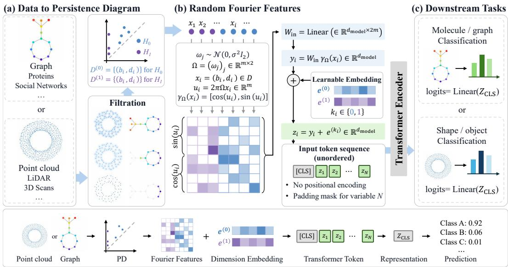
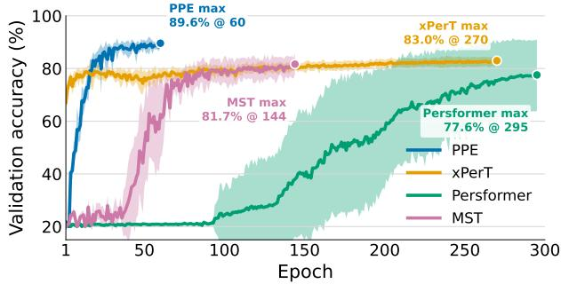
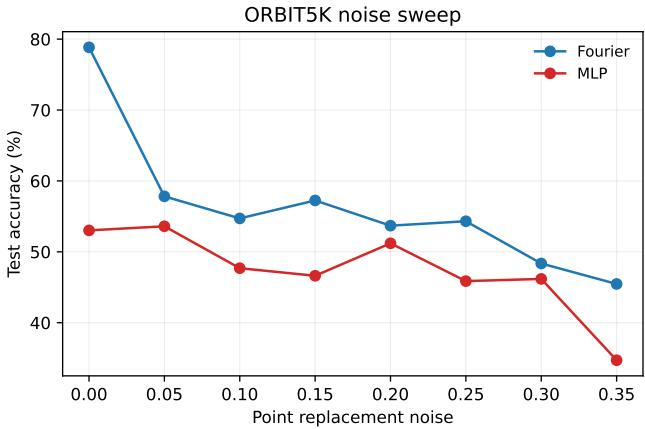
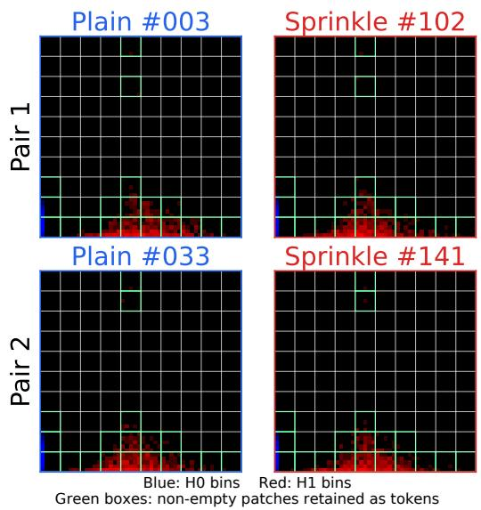

# PERSISTENCE POSITIONAL ENCODING: A MINIMAL TRANSFORMER RECIPE FOR PERSISTENCE DIAGRAMS

Eunwoo Heo1\* Ganghyun Kim1\* Jaejun Yoo1

1Graduate School of Artificial Intelligence, Ulsan National Institute of Science and Technology

## ABSTRACT

Persistence diagrams (PDs) represent multiscale topological information as multisets of birth–death pairs (b, d). How best to use them with Transformers, however, remains unclear. Connecting PDs to Transformers requires choosing how topological information is tokenized and exposed to self-attention. Prior methods use specialized designs for tokenization, aggregation, Transformer blocks, or attention, but are hard to compare since reported results rarely share PD inputs, splits, or model-selection rules. We instead confine the diagram-specific design to point representation, mapping each birth–death pair through fixed random Fourier features while leaving the Transformer backbone unchanged, and call this recipe Persistence Positional Encoding (PPE). In matched controls on eight TU graph benchmarks (TU8), changing only point representation shifts macro accuracy by 5.49 to 6.47 percentage points (pp), against 0.47 to 1.45 pp from changing the downstream module, identifying point representation as the dominant design variable tested. We further reevaluate vectorizations, kernels, learned representations, and Transformer-based models under one protocol with shared PD inputs, outer folds, and validation-only selection. Among all evaluated PD methods and downstream configurations, PPE achieves the highest mean on most benchmarks, including TU8, ORBIT5K, and MCB-C. Finally, we prove that grid averaging leaves a reconstruction error at any resolution, whereas a Transformer with fixed random Fourier frequencies is almost surely universal. PPE thus offers a minimal, Transformer-native baseline for persistence diagrams, and a common protocol for future comparison.

## 1 INTRODUCTION

How should a persistence diagram be presented to a Transformer? Persistent homology (PH) is a standard tool in topological data analysis (TDA) (Carlsson, 2009) for characterizing the shape and structure of data across multiple scales, with applications spanning molecular property prediction, protein structure analysis, drug discovery, dynamical systems, materials science, and neuroscience (see Appendix B for related work). Its output is commonly represented as a persistence diagram (PD), a multiset of birth–death pairs that records when topological features appear and disappear. A broad range of methods incorporate PDs into learning pipelines, including fixed summaries—persistence images, landscapes, Betti curves, silhouettes (Adams et al., 2017; Bubenik, 2015; Umeda, 2017; Chazal et al., 2015); kernels—sliced Wasserstein, scale-space, persistence-weighted Gaussian (Carrière et al., 2017; Reininghaus et al., 2015; Kusano et al., 2016); and learned representations—PERSLAY, RationalHat, ATOL (Carrière et al., 2020; Hofer et al., 2019; Royer et al., 2021). Yet for Transformers, which have become general-purpose backbones across modalities, the question above remains open.

The difficulty is that a Transformer does not consume a diagram. It consumes tokens. Using a diagram-level representation as a single token compresses the entire diagram before self-attention is applied, so attention never operates on individual topological features directly. Splitting such a representation into multiple tokens requires an additional choice of how those tokens should correspond to the underlying diagram. Treating each persistence point (b, d) as a token is the natural point-level alternative, but raw two-dimensional coordinates are not necessarily an effective input for a Transformer. Using PDs with Transformers therefore involves a nontrivial choice of both tokenization and point representation.

Existing Transformer-based PD methods place their diagram-specific design at different stages. PERS-FORMER (Reinauer et al., 2021) keeps standard scaled dot-product attention while adding a learned pointwise embedding, extra residual connections between self-attention layers, and attention pooling against a trainable query. XPERT (Kim, 2024) pixelizes each diagram onto an R × R grid and partitions it into P × P patches, so the grid resolution and the patch size must be chosen together before a ViT-style encoder sees the tokens. The Multiset Transformer (MST) (Wang et al., 2024) represents distinct points with explicit multiplicities, adds multiplicity-dependent terms to its attention weights, and uses multiset-specific equivariant blocks and invariant readout. Because each of these changes several parts of the representation, aggregation, or Transformer pipeline at once, a method-level comparison cannot tell which change is responsible for the reported gains (see Appendix B).

A second obstacle compounds the first. Reported results across the PD literature come from different PD inputs, data splits, model-selection procedures, and search budgets, so numbers from different papers are rarely comparable. This lack of comparability has been raised as a barrier to progress in topological machine learning (Barnes et al., 2021; Castilla Rieso et al., 2026). As a concrete example, the released XPERT protocol trains on all non-test samples and reports the maximum test accuracy across epochs. Under such conditions, even the basic question of whether a specialized architecture is needed at all cannot be settled from the literature.

We address both obstacles with a deliberately minimal design and a controlled evaluation. Persistence Positional Encoding (PPE) confines its diagram-specific design to token construction. Each birth– death coordinate (b, d) is mapped through fixed random Fourier features and combined with a learnable homology-dimension embedding, while the Transformer blocks, the attention rule, and the CLS readout stay unchanged. This separation lets us ask directly whether the bottleneck in applying Transformer to PDs lies in the representation of persistence points or in the architecture around them. In matched controls on the eight TU graph benchmarks, changing only the point representation shifts macro accuracy by 5.49 to 6.47 percentage points (pp), whereas changing only the downstream module shifts it by 0.47 to 1.45 pp (Table 3). The largest single-dataset gain from the point encoder is 19.5 pp, on DHFR. Among the components varied here, point representation is the dominant design variable.

Fourier feature mappings expose multiple frequency scales before the coordinates reach the downstream network (Tancik et al., 2020; Mildenhall et al., 2020), and this gives the empirical finding a theoretical counterpart. We show that at every resolution, uniform grid averaging leaves a reconstruc tion error that no decoder can bring below a fixed positive bound (Theorem 1). Information discarded at the grid cannot be recovered downstream, however expressive the model. A Transformer with fixed Fourier frequencies is instead almost surely a universal approximator for continuous functions of persistence diagrams, without prior knowledge of the target frequencies (Theorem 2).

We reevaluate diagram-level vectorizations, kernel methods, learned PD representations, and Transformer-based PD models above on shared prepared PD inputs and outer folds, with model selection based only on validation data for every method. Under this protocol, PPE achieves the highest TU8 macro across all evaluated method–downstream configurations and has the highest mean among the evaluated Transformer-based PD methods on all eleven benchmarks, including 90.68% on ORBIT5K, 6.82 pp above the next-best 83.86%. This includes two larger-scale benchmarks not reported in prior PD–Transformer work, with 69.32 ROC-AUC on ogbg-molhiv (41,127 graphs under its official scaffold split) and 65.79 balanced accuracy on MCB-C (1,745 point-cloud samples), exceeding the next-best Transformer-based method by 1.05 and 9.46 pp, respectively.

One may ask whether PPE is more than Fourier features applied to PD coordinates. The feature map itself follows a standard construction (Tancik et al., 2020). Our contribution is not the feature map in isolation, but showing why this representation choice matters through the matched controls that attribute the gains to point representation rather than to architecture, the theory that explains why grid-based tokenization cannot close the gap, and the unified protocol under which Transformerbased, vectorization, kernel, and learned PD methods are compared on equal terms. Together, these turn a small encoder change into something the field can build on. PPE gives persistence diagrams a Transformer-native interface that requires no PD-specific attention or pooling, so it drops into standard token-based pipelines as they are. The controls and theory tell practitioners which design variable deserves their effort, and the unified protocol offers a common ground on which future PD methods, Transformer-based or not, can be compared. We view this combination, rather than the encoder alone, as the contribution of this work. Our main contributions are as follows:

Method and findings. We introduce PPE, which maps PD points to Fourier features for a standard Transformer. It achieves the highest mean among the evaluated Transformer-based PD methods on all eleven benchmarks, including two larger-scale evaluations, and shows more stable convergence (Figure 2b). Matched TU8 controls show larger gains from changing the point encoding, 5.49–6.47 pp, than from changing the downstream module, 0.47–1.45 pp (Table 3).

Theory. We prove a reconstruction lower bound for uniform grid averaging that holds at every resolution and for every decoder (Theorem 1), and an almost-sure universal approximation result for the PPE Transformer with Fourier frequencies sampled once and kept fixed (Theorem 2).

Unified evaluation. We reevaluate Transformer-based models, vectorization methods, kernels, and learned PD representations on shared PD inputs and outer folds with validation-based model selection (Tables 1 and 2). We further extend the comparison beyond the benchmarks reported in prior PD–Transformer work to the 41,127-graph ogbg-molhiv and MCB-C. PPE attains the highest TU8 macro accuracy among the evaluated method–downstream configurations (Table 2).

## 2 METHOD

## 2.1 PRELIMINARY

A persistence diagram D is a multiset of points $( b , d ) \in \mathbb { R } ^ { 2 }$ where each point represents a topological feature with birth time b and death time d (with $b \ \leq \ d )$ We write |D| for its cardinality. In practice, we compute persistence diagrams for multiple homological dimensions. Let $D ^ { ( k ) }$ denote the persistence diagram for dimension k (Betti-k features). In our experiments, we use $D ^ { ( 0 ) }$ for connected components (clusters) and $D ^ { ( 1 ) }$ for loops/cycles (holes). The model consumes the points of all homology dimensions used as a single sequence, so we index them jointly by $i = 1 , \ldots , N$ with $\begin{array} { r } { N = \sum _ { k } | D ^ { ( \hat { k } ) } | } \end{array}$ |, writing $( b _ { i } , d _ { i } )$ for the i-th point and $k _ { i } \in \{ 0 , 1 , \ldots \}$ for its homology dimension.

## 2.2 PERSISTENCE POSITIONAL ENCODING (PPE)

PPE treats a PD as an unordered token sequence rather than rasterizing it into an image or reducing it to pairwise kernel evaluations. For each diagram point, we encode the raw $( b , d )$ coordinate with fixed random Fourier features, project the result to the Transformer width, and add a learnable homologydimension embedding that marks whether the token comes from $H _ { 0 } , H _ { 1 }$ , or another dimension. The resulting variable-length token sequence is processed by an otherwise standard Transformer encoder with padding masks, CLS-token pooling, and a linear prediction head. Figure 1 summarizes this pipeline. The following subsections define each component.

## 2.2.1 FOURIER FEATURE ENCODING

Following Tancik et al. (2020), we encode each coordinate $( b , d ) \in \mathbb { R } ^ { 2 }$ using random Fourier features (RFF). Let $\Omega \in \bar { \mathbb { R } ^ { m \times 2 } }$ have rows $\omega _ { 1 } ^ { \top } , \ldots , \omega _ { m } ^ { \top }$ , where the frequencies $\omega _ { j } \mathbf { \bar { \Omega } } \in \mathbb { R } ^ { 2 }$ are sampled from ${ \mathcal { N } } ( 0 , \sigma ^ { 2 } I _ { 2 } )$ and fixed throughout training. The RFF encoding maps a 2D coordinate to a 2m-dimensional vector:

$$
\gamma _ { \Omega } ( x ) = \left[ \cos ( 2 \pi \Omega x ) ; \ \sin ( 2 \pi \Omega x ) \right] \in \mathbb { R } ^ { 2 m }\tag{1}
$$

where $[ \cdot ; \cdot ]$ concatenates the m-dimensional cosine and sine blocks. This encoding keeps each PD point as a separate token and provides explicit multi-frequency features to mitigate the spectral bias that can hinder raw-coordinate MLPs from resolving fine-grained differences (Section 4.3).

## 2.2.2 HOMOLOGY-DIMENSION EMBEDDING

Each point $( b _ { i } , d _ { i } )$ is mapped to a token by linearly projecting its Fourier features to the model dimension $d _ { \mathrm { m o d e l } }$ and adding a learnable embedding of its homology dimension $k _ { i }$ , with one embedding vector $e ^ { ( k ) }$ per homology dimension:

$$
z _ { i } = W _ { \mathrm { i n } } \gamma _ { \Omega } ( b _ { i } , d _ { i } ) + e ^ { ( k _ { i } ) } , \qquad W _ { \mathrm { i n } } \in \mathbb { R } ^ { d _ { \mathrm { m o d e l } } \times 2 m } , e ^ { ( k ) } \in \mathbb { R } ^ { d _ { \mathrm { m o d e l } } } .\tag{2}
$$

  
Figure 1: A schematic overview of PPE. (a) Filtration converts topological data, e.g., graphs, point clouds, or other structured domains, into persistence diagrams. (b) Each PD point $x _ { i } = ( b _ { i } , d _ { i } )$ is encoded by fixed random Fourier features, linearly projected, and augmented with a learnable homology-dimension embedding $( H _ { 0 } \thinspace \mathrm { o r } \ H _ { 1 } )$ . The resulting unordered token sequence is processed by a Transformer encoder without positional encoding. (c) The CLS representation drives downstream tasks, such as molecular/graph classification and shape/object classification.

## 2.2.3 ENCODER, HEAD, AND TRAINING

The token sequence $[ z _ { 1 } , \dots , z _ { N } ]$ is prepended with a learnable [CLS] token (Devlin et al., 2019) and passed through L vanilla Transformer encoder layers (Vaswani et al., 2017) with pre-LayerNorm (Xiong et al., 2020) and GELU activations. Variable-length batches are padded to the maximum length per batch, and an attention mask zeroes out padded positions so they do not influence attention or downstream representations. Classification uses a single linear head over the LayerNorm-ed CLS output. We train with cross-entropy loss and AdamW (Loshchilov & Hutter, 2019) under a linear-warmup-then-cosine-decay schedule with early stopping on validation accuracy. Full hyperparameters appear in Appendix F.

## 3 THEORY

We establish two complementary expressivity results. First, we show that a cell-average grid representation has an irreducible worst-case reconstruction error, regardless of decoder complexity. Second, we show that fixing the Fourier frequencies does not create an analogous limitation for PPE. With probability one, a two-layer Transformer with a fixed set of randomly sampled Fourier frequencies can universally approximate continuous functions on bounded persistence diagrams. Here, C(X) denotes the space of real-valued continuous functions on compact $X \subset \mathbb { R } ^ { 2 }$ . Proofs of both theorems are provided in Appendix C.

## 3.1 LIMITATION OF GRID-BASED REPRESENTATIONS

By the Stone–Weierstrass theorem (Stone, 1948), for any continuous function f on a compact domain X and any desired accuracy, there exists a finite trigonometric sum that achieves that accuracy. That is, choosing frequencies according to the target function yields arbitrarily accurate approximations of continuous functions. However, when a continuous function f is represented by finite-resolution cell statistics, distinct within-cell variations can become indistinguishable before any downstream processing. The following theorem formalizes this limitation for a cell-average grid representation.

Theorem 1 (Grid reconstruction lower bound). Let $X = [ 0 , c ] ^ { 2 }$ , and let $\{ C _ { i j } \} _ { i , j = 1 } ^ { R }$ denote the uniform $R \times R$ partition of X. For any $f \in C ( X )$ , define the grid representation $E _ { \mathrm { g r i d } , R } ( f ) =$ $\begin{array} { r l } { ~ } & { { } \left( \frac { 1 } { | C _ { i j } | } \int _ { C _ { i j } } f ( x ) d x \right) _ { i , j = 1 } ^ { R } } \end{array}$ . Then, for every $R \in \mathbb N$ and every decoder G : $\mathbb { R } ^ { R ^ { 2 } } \to L ^ { 2 } ( X )$

$$
\operatorname* { s u p } _ { f \in C ( X ) } \| f - \mathcal { G } ( E _ { \operatorname { g r i d } , R } ( f ) ) \| _ { L ^ { 2 } ( X ) } \geq \frac { c } { 2 } .
$$

Increasing the complexity of the decoder cannot recover information already lost by the fixed grid.

## 3.2 UNIVERSAL APPROXIMATION WITH A FIXED FOURIER ENCODER

Fourier approximation allows the frequencies to be chosen according to the target function and desired accuracy. In the default PPE setup, however, the frequencies in Ω are sampled once and fixed without access to the target function, but can also be made learnable as a straightforward extension (Table 4). We therefore ask whether fixing Ω limits expressivity. The next result shows that a fixed set of randomly sampled frequencies, when followed by the Transformer, suffices for universal approximation of continuous diagram-level functions.

Fix $c > 0$ and $q \in \mathbb { N }$ . Let $\mathcal { H } _ { c } = [ 0 , c ] ^ { 2 } \cap \{ b \leq d \}$ , and let $\mathcal { D } _ { c }$ be the set of all multisets of at most q points in $\mathcal { H } _ { c }$ . The empty diagram is included and diagonal points are retained. Convergence requires eventual equality of cardinalities and convergence of the matched points.

Theorem 2 (Universal approximation with a fixed Fourier encoder). Let Ω have at least three rows sampled i.i.d. from a nondegenerate Gaussian distribution on $\mathbb { R } ^ { 2 }$ . For almost every Ω, for every continuousfunction $F \colon { \mathcal { D } } _ { c } \to$ R and $e \nu e r y \varepsilon > 0$ , there exists a two-layer PPE Transformer $T _ { \theta , \Omega }$ withfinite FFN widths and trainable parameters θ such that

$$
\operatorname* { s u p } _ { D \in \mathcal { D } _ { c } } \left| T _ { \theta , \Omega } ( D ) - F ( D ) \right| < \varepsilon .
$$

## 4 EXPERIMENTS

## 4.1 EXPERIMENTAL SETUP

Datasets. We evaluate PPE on ORBIT5K, standard TUDataset graph-classification benchmarks used by prior persistence-diagram baselines, and two larger-scale benchmarks, ogbg-molhiv and MCB-C.

ORBIT5K. The standard point-cloud benchmark for neural TDA methods (Carrière et al., 2020), with 5,000 linked twist map orbits (5 classes, $r \in \{ 2 . 5 , 3 . 5 , 4 . 0 , 4 . 1 , 4 . 3 \}$ , 1,000 points per orbit). Prior-work numbers use their original protocols. Our reproduced results use the unified 10-fold train/validation/test protocol described below.

TU graph benchmarks. We evaluate on standard TUDataset benchmarks (Morris et al., 2020), namely MUTAG, PROTEINS, COX2, DHFR, IMDB-B, IMDB-M, NCI1, and NCI109. These cover molecular graphs and social interaction graphs. We use class labels only for supervised evaluation, and node attributes are not used in the reproduced PD-only comparison.

Larger-scale benchmarks. We additionally evaluate frozen model configurations on ogbg-molhiv (Hu et al., 2020) and MCB-C (Graf et al., 2025). The ogbg-molhiv benchmark contains 41,127 molecular graphs and uses the official scaffold split with ROC-AUC. MCB-C contains 1,745 highresolution point clouds and uses the ten released folds with balanced accuracy. We deterministically sample 20,000 input points per MCB-C example before computing persistence.

Persistence diagram computation. For point cloud data (ORBIT, linked twist), we compute persistence diagrams via Alpha complex filtration using GUDHI (The GUDHI Project, 2015). For graph data, we follow PERSLAY (Carrière et al., 2020) and use Heat Kernel Signature (HKS) sublevel persistence (Sun et al., 2009): for each graph $G = ( V , E )$ we compute the normalized Laplacian $L _ { \mathrm { g r a p h } } = I - D _ { \mathrm { d e g } } ^ { - 1 / 2 } A _ { \mathrm { a d j } } D _ { \mathrm { d e g } } ^ { - 1 / 2 }$ , derive HKS values hks $\begin{array} { r } { \mathbf { \Pi } ( v ) = \sum _ { k } e ^ { - t \lambda _ { k } } \psi _ { k } ( v ) ^ { 2 } } \end{array}$ at diffusion time $t = 1 0$ , and use these as the filtration function. Here $D _ { \mathrm { d e g } }$ and $A _ { \mathrm { a d j } }$ denote degree and adjacency matrices, and $\left( \lambda _ { k } , \psi _ { k } \right)$ are Laplacian eigenpairs of $L _ { \mathrm { g r a p h } }$ . In both cases, infinite-death points are removed and coordinates are used as raw $( b , d )$ pairs. The comparison in Table 1(a) uses ordinary $H _ { 0 }$ and $H _ { 1 }$ persistence. The larger-scale comparison in Table 1(b) uses ordinary $H _ { 0 }$ and $H _ { 1 }$ persistence for ogbg-molhiv and Alpha persistence in $H _ { 0 } , H _ { 1 }$ , and $H _ { 2 }$ for MCB-C.

Baselines. All baseline methods are PD-to-prediction architectures, so a fair comparison requires holding the persistence diagram itself constant. Prior papers each use different filtration choices, persistence variants, coordinate conventions, and evaluation splits, which makes their reported numbers difficult to compare on equal footing. We therefore re-implement Transformer-based PD methods inside our unified pipeline as our primary baselines, namely XPERT, PERSFORMER, and MST. The reproduced model baselines consume the same ordinary-persistence PDs (Alpha complex on ORBIT, HKS sublevel filtration at t=10 on TU graphs, both via GUDHI), go through identical data loading, and are evaluated under the same stratified 10-fold cross-validation protocol described in Section 4. For the MST reproduction, we use ordinary persistence diagrams without the optional DBSCAN clustering step; points with identical coordinates are still counted by multiplicity in the multiset attention. Per-method hyperparameters are tuned on the validation split via random grid search. The evaluated architectural choices and search ranges are reported in Appendix G.

PPE configuration. Architecture and training defaults are listed in Appendix F (Table A6). Perdataset learning rate, weight decay, and dropout are tuned via random grid search on the validation split, while batch size, warmup, total epochs, and early-stopping patience are fixed per dataset family (full protocol in Appendix G).

Evaluation protocol. Prior work on PD classification evaluates on PDs computed under different filtration settings, so observed accuracy gaps between methods reflect a mixture of representationlearning differences and input differences, and a stronger filtration paired with a weaker model can outperform the reverse. Without controlling the input, no comparison can isolate the contribution of the architecture itself. Compounding this, evaluation protocols themselves vary across prior work and often lack an independent held-out test set after model and hyperparameter selection, allowing testset-informed model selection to inflate reported numbers. Motivated by recent calls for transparent and comparable experimental standards in topological machine learning (Barnes et al., 2021; Castilla Rieso et al., 2026), we therefore unify both inputs (identical PDs across all methods) and protocol.

Unless otherwise noted, we use stratified 10-fold cross-validation with an explicit train/validation/test split per fold $( \sim 8 0 / 1 0 / 1 0 )$ . Train, validation, and test metrics are recorded at each epoch. Hyperparameter and checkpoint selection use only validation accuracy, and we report the test metric at the validation-selected epoch. Each neural configuration in the unified sweep is run as a full 5-seed × 10-fold sweep, and the configuration with the highest mean validation accuracy is reported. All random seeds used for data splitting, parameter initialization, and minibatch shuffling are fixed in the released configurations.

## 4.2 BENCHMARK COMPARISON

Classification benchmarks. Table 1(a) compares Transformer-based PD methods on ORBIT5K and eight TU graph benchmarks. PPE achieves the highest mean on all nine benchmarks, reaching 90.68% on ORBIT5K and a TU8 macro accuracy of 73.22%. The gains over the strongest reproduced Transformer baseline are 6.82 pp on ORBIT5K and 3.90 pp in TU8 macro accuracy, with particularly large improvements of 9.30 and 7.53 pp on NCI1 and NCI109, respectively. Table 1(b) shows that PPE also achieves the highest mean among the evaluated Transformer-based PD methods on the two larger-scale benchmarks ogbg-molhiv and MCB-C under the separate frozen-transfer protocols. On MCB-C, the margin over the strongest evaluated Transformer-based PD baseline reaches 9.46 pp in balanced accuracy, with no target-specific hyperparameter search. In the matched control (Table 1(c), Table A1), replacing PIs with fixed RFF raises TU8 macro accuracy from 64.41 to 72.16 with pooled MLP aggregation and from 64.97 to 72.63 with Transformer aggregation. With the RFF tokenizer fixed, pooled MLP and Transformer aggregation reach TU8 macro accuracies of 72.16 and 72.63, respectively. The representation change therefore improves accuracy by 7.66 to 7.75 pp, while switching from pooled MLP to Transformer aggregation yields much smaller gains of 0.56 pp with PIs and 0.47 pp with RFF. The gain thus comes mostly from the point representation rather than from the downstream model.

Table 1: Benchmark and controlled-interface results. (a) reports the unified Transformer-based comparison, (b) additional larger-scale evaluations, and (c) a matched $2 \times 2$ control, whose ∆ column reports the signed difference (Transformer aggregation minus pooled MLP aggregation) in percentage points. Gray shading and bold mark the highest mean, while underline marks the second-highest mean within each comparison.
<table><tr><td colspan="10">(a) Transformer-based comparison</td></tr><tr><td>Method</td><td>ORBIT5K</td><td>MUTAG</td><td>PROTEINS</td><td>COX2</td><td>DHFR</td><td>IMDB-B</td><td>IMDB-M</td><td>NCI1</td><td>NCI109</td><td>TU8</td></tr><tr><td>MST</td><td> $8 1 . 5 6 \pm 5 . 5 3$ </td><td> $7 8 . 9 9 \pm 7 . 9 0$ </td><td> $6 8 . 1 0 { \pm } 2 . 8 9$ </td><td> $7 7 . 5 3 \pm 1 . 5 6$ </td><td>60.34±3.53</td><td> $6 7 . 7 8 { \pm } 4 . 3 4$ </td><td> $3 9 . 2 8 \pm 3 . 0 9$ </td><td> $6 5 . 4 4 \pm 1 . 2 8$ </td><td>59.97±1.29</td><td>64.68</td></tr><tr><td>PERSFORMER</td><td> $7 6 . 9 0 { \scriptstyle \pm 1 3 . 5 8 } ^ { \ast }$ </td><td> $8 2 . 4 8 { \pm } 6 . 2 3$ </td><td> $7 1 . 2 3 { \pm } 3 . 1 8$ </td><td>78.16±0.58 60.83±0.65</td><td></td><td> $\overline { { 6 7 . 4 4 \pm 2 . 7 5 } }$ </td><td> $3 9 . 6 3 \pm 3 . 7 3$ </td><td></td><td>64.10±3.21 64.64±1.66 66.06</td><td></td></tr><tr><td>XPERT</td><td> $8 3 . 8 6 \pm 1 . 2 4 $ </td><td> $8 3 . 3 8 { \pm } 5 . 7 5 $ </td><td> $7 2 . 2 9 \pm 3 . 5 9$ </td><td> $7 7 . 5 1 \pm 3 . 0 5$ </td><td>75.80±3.27</td><td> $6 6 . 4 8 { \pm } 4 . 1 3$ </td><td> $4 6 . 1 5 { \pm } 3 . 2 4 $ </td><td> $6 6 . 3 6 { \pm } 1 . 1 4 $ </td><td> $6 6 . 5 6 { \pm } 1 . 0 2 $ </td><td>69.32</td></tr><tr><td>PPE (Ours)</td><td> $\mathbf { 9 0 . 6 8 \pm 0 . 7 2 }$  </td><td> $\overline { { 8 7 . 4 4 \pm 3 . 4 0 } }$  </td><td> $\overline { { 7 2 . 9 6 \pm 4 . 6 1 } }$ </td><td></td><td></td><td>78.70±3.47 80.03±3.18 70.24±3.33 46.60±3.45</td><td></td><td> $\overline { { 7 5 . 6 6 \pm 1 . 4 7 } }$ </td><td> $\overline { { 7 4 . 0 9 \pm 1 . 6 6 } }$ </td><td>73.22</td></tr></table>

PERSFORMER trains very unstably on ORBIT5K. Kim (2024) reproduce it with the authors’ official code and report the model as “not trainable” on ORBIT5K. Figure 2(b) shows the validation curves

<table><tr><td>Method</td><td>ogbg-molhiv ROC-AUC</td><td>MCB-C Balanced acc.</td></tr><tr><td>MST</td><td>63.13±2.72</td><td>49.30±5.64</td></tr><tr><td>PERSFORMER</td><td>63.00±0.47</td><td>14.69±10.66</td></tr><tr><td>XPERT</td><td>68.27±0.71</td><td>56.33±4.28</td></tr><tr><td>PPE (Ours)</td><td> $\overline { { { \bf 6 9 . 3 2 \pm 1 . 5 1 } } }$ </td><td> $\overline { { 6 5 . 7 9 \pm 4 . 2 7 } }$ </td></tr></table>

<table><tr><td colspan="4">(c) Matched representation × backbone control (TU8)</td></tr><tr><td>Representation</td><td>Pooled MLP Transformer aggregation</td><td>aggregation</td><td>Δ</td></tr><tr><td>Persistence image (PI)</td><td>64.41</td><td>64.97</td><td>+0.56</td></tr><tr><td>Random Fourier feature (RFF)</td><td>72.16</td><td>72.63</td><td>+0.47</td></tr><tr><td>RFF - PI</td><td>+7.75</td><td>+7.66</td><td></td></tr></table>

PPE achieves the highest TU8 macro accuracy of 73.22 among the evaluated method–downstream configurations, spanning Transformer-based PD methods, learned representations, fixed summaries, and persistence kernels (Table 2). This result demonstrates that fixed RFF point tokens paired with a standard Transformer provide a simple and effective architecture for PD classification. The comparison uses shared PD inputs and outer folds, with model selection based only on validation data. Per-dataset results and downstream configurations are provided in Table A3 (Appendix A).

Table 2: TU8 comparison across PD method families. Each row is a method–downstream configuration. TU8 is the unweighted mean over the eight graph datasets. Gray shading and bold mark the highest mean, and underline marks the second-highest mean.
<table><tr><td>Method</td><td>Learning model</td><td>TU8</td><td>Method</td><td>Learning model</td><td>TU8</td></tr><tr><td colspan="3">Transformer-based PD methods</td><td colspan="3">Fixed PD summaries</td></tr><tr><td>PPE</td><td>Transformer</td><td>73.22</td><td>Persistence image</td><td>Random forest</td><td>71.67</td></tr><tr><td>XPERT</td><td>Transformer</td><td>69.32</td><td>Persistence landscape</td><td>Random forest</td><td>71.17</td></tr><tr><td>PERSFORMER</td><td>Transformer</td><td>66.06</td><td>Betti curve</td><td>Random forest</td><td>71.01</td></tr><tr><td>MST</td><td>Transformer</td><td>64.68</td><td>Persistence silhouette</td><td>Random forest</td><td>68.51</td></tr><tr><td colspan="6">Learned PD representations</td></tr><tr><td>ATOL</td><td>Random forest</td><td>72.56</td><td>Persistence kernels</td><td></td><td></td></tr><tr><td> $\mathrm { P E R S L A Y ^ { \star } }$ </td><td>Learned invariant layer</td><td>71.10</td><td>Sliced Wasserstein</td><td>SVM</td><td>71.34</td></tr><tr><td>RationalHat</td><td>MLP</td><td>68.80</td><td>Persistence scale-space</td><td>SVM</td><td>69.56</td></tr><tr><td>RationalHat</td><td>Graph MLP</td><td>64.42</td><td>Persistence-weighted Gaussian</td><td>SVM</td><td>68.23</td></tr></table>

⋆ We evaluate Image, Line/Permutation-Equivariant, Landscape, and Exponential variants under the same protocol and report the variant selected using validation data. Image is selected on all datasets. Full variant-wise results are reported in Table A2

## 4.3 CONTROL ANALYSES AND VALIDATION BEHAVIOR

The matched control in Table 1(c) compares an image-based representation with pointwise features. Here we extend this comparison to other pointwise encoders and ask how accuracy varies across downstream modules with the encoder held fixed as shown in Table 3. Point MLP is a two-layer encoder over raw (b, d) coordinates, while the raw-coordinate representation uses only the direct coordinate projection. Pooled MLP applies a two-layer MLP after permutation-invariant pooling, using sum and mean together in the factorial control and one of the two alone in the downstream control. The remaining downstream modules are DeepSets (Zaheer et al., 2017), learned-query multi-head pooling, and the PPE Transformer with CLS readout. Within each matched control, the homology-dimension embedding, classifier head, optimizer, and data pipeline are fixed.

Across all three matched point-representation controls, RFF raises TU8 by 6.47 pp with mean+sum pooling, by 5.49 pp with the Transformer, and by 7.28 pp over raw coordinates with DeepSets. Changing the downstream backbone shifts TU8 by 1.45 pp with Point MLP and by 0.47 pp with

Table 3: Point-representation and downstream-module controls. Accuracy (%) under the matched TU8 protocol. Shared configurations are repeated across controls so that each comparison is selfcontained. TU8 is the unweighted mean over the eight graph datasets. Gray shading and bold mark the highest mean, while underline marks the second-highest mean within each control.
<table><tr><td>Varied factor</td><td>Point representation</td><td>Downstream module</td><td colspan="8">MUTAG PROTEINS COX2 DHFR IMDB-B IMDB-M NCI1 NCI109 TU8</td></tr><tr><td rowspan="4">Both</td><td>Point MLP</td><td>Pooled MLP (mean+sum)</td><td>81.38</td><td>72.58</td><td>78.08</td><td>60.32</td><td>64.28</td><td>43.56</td><td>62.46</td><td>62.84</td><td>65.69</td></tr><tr><td>Point MLP</td><td>Transformer</td><td>82.69</td><td>71.48</td><td>78.16</td><td>60.64</td><td>68.64</td><td>45.68</td><td>64.56</td><td>65.29</td><td>67.14</td></tr><tr><td>Fixed RFF</td><td>Pooled MLP (mean+sum)</td><td>85.74</td><td>71.61</td><td>77.46</td><td>79.85</td><td>69.00</td><td>46.43</td><td>73.64</td><td>73.58</td><td>72.16</td></tr><tr><td>Fixed RFF</td><td>Transformer</td><td>85.38</td><td>71.72</td><td>78.30</td><td>79.56</td><td>69.88</td><td>46.47</td><td>75.67</td><td>74.07</td><td>72.63</td></tr><tr><td rowspan="2">Point</td><td>Raw coordinates DeepSets</td><td></td><td>80.43</td><td>71.82</td><td>78.16</td><td>60.85</td><td>63.84</td><td>39.45</td><td>62.41</td><td>62.42</td><td>64.92</td></tr><tr><td>representation Fixed RFF</td><td>DeepSets</td><td>86.08</td><td>72.09</td><td>77.55</td><td>79.37</td><td>68.56</td><td>46.67</td><td>74.08</td><td>73.22</td><td>72.20</td></tr><tr><td rowspan="5">Downstream module</td><td>Fixed RFF</td><td>Pooled MLP (mean)</td><td>86.80</td><td>70.15</td><td>76.72</td><td>78.82</td><td>68.26</td><td>46.19</td><td>69.44</td><td>68.98</td><td>70.67</td></tr><tr><td>Fixed RFF</td><td>Pooled MLP (sum)</td><td>86.67</td><td>70.20</td><td>77.37</td><td>80.49</td><td>68.04</td><td></td><td>73.30</td><td>73.02</td><td>71.95</td></tr><tr><td>Fixed RFF</td><td>DeepSets</td><td>86.08</td><td>72.09</td><td>77.55</td><td>79.37</td><td>68.56</td><td>46.48 46.67</td><td>74.08</td><td>73.22</td><td>72.20</td></tr><tr><td>Fixed RFF</td><td></td><td>85.06</td><td>70.15</td><td>77.62</td><td>79.27</td><td>69.40</td><td>45.97</td><td>72.15</td><td>71.61</td><td>71.40</td></tr><tr><td>Fixed RFF</td><td>Learned-query pooling Transformer</td><td>85.38</td><td>71.72</td><td>78.30</td><td>79.56</td><td>69.88</td><td>46.47</td><td>75.67</td><td>74.07</td><td>72.63</td></tr></table>

<table><tr><td>Dataset</td><td>Fourier</td><td>MLP</td><td>Δ</td></tr><tr><td>MUTAG</td><td>85.38</td><td>82.69</td><td>+2.69</td></tr><tr><td>PROTEINS</td><td>71.72</td><td>71.48</td><td>+0.24</td></tr><tr><td>COX2</td><td>78.30</td><td>78.16</td><td>+0.14</td></tr><tr><td>DHFR</td><td>79.56</td><td>60.64</td><td>+18.92</td></tr><tr><td>IMDB-B</td><td>69.88</td><td>68.64</td><td>+1.24</td></tr><tr><td>IMDB-M</td><td>46.47</td><td>45.68</td><td>+0.79</td></tr><tr><td>NCI1</td><td>75.67</td><td>64.56</td><td>+11.11</td></tr><tr><td>NCI109</td><td>74.07</td><td>65.29</td><td>+8.78</td></tr><tr><td>TU8</td><td>72.63</td><td>67.14</td><td>+5.49</td></tr></table>

(a) TU graph benchmarks.

  
(b) Validation convergence on ORBIT5K.  
Figure 2: Coordinate-encoder ablation and validation convergence. (a) Accuracy (%) for fixed Fourier versus learned point-MLP encoders in the same PPE backbone on TU graph benchmarks, where bold marks the better encoder per row. (b) Validation accuracy versus epoch on ORBIT5K under the unified protocol. Each line is the mean over the ten cross-validation folds and each band spans those folds. Each label gives a method’s peak mean accuracy and the epoch at which it occurs.

RFF, while the five fixed-RFF downstream modules span 1.96 pp. RFF is higher on at least six of eight datasets in each point-representation control and on all eight with the Transformer, with the largest single-dataset gain reaching 19.5 pp on DHFR under mean+sum pooling. In Table 3, every point-encoder replacement produces a larger TU8 macro gain than any backbone or pooling change, which makes the encoder the more consequential of the two choices tested. Figure 2(a) breaks the two Transformer rows of Table 3 down by dataset. Figure 2(b) further shows the validation dynamics on ORBIT5K. PPE reaches the highest and earliest peak, at 89.6% by epoch 60, while MST and XPERT peak later at 81.7–83.0%. PERSFORMER shows large fold-to-fold variation and reaches 77.6% at epoch 295. Consistently, Kim (2024) reproduced PERSFORMER with the authors’ official code and reported it as “not trainable” on ORBIT5K. An ORBIT5K coordinate-noise sweep, where the Fourier encoder wins every level, is reported in Figure A1 (Appendix D).

## 4.4 SUB-CELL FIDELITY DISCRIMINATION: PLAIN VS. SPRINKLE DONUTS

Persistent homology records feature lifetimes, but lifetime alone does not determine which coordinate differences matter for classification, and hard binning discards a point’s position within its assigned cell. We therefore use plain and sprinkle donuts, which share coarse topology, to test whether a PD interface still exposes class-relevant within-cell variation.

Dataset. We construct a binary classification task over two donut variants, namely plain donuts (3D point-cloud renderings of donut shapes, approximately torus-topological) and sprinkle donuts (the same donut shape with sprinkles on the surface). The two classes share identical coarse topology (connected component, dominant loop) and have nearly identical $H _ { 0 } / H _ { 1 }$ PDs. The sprinkle signal manifests only as a sub-cell shift in PD-coordinate statistics, where $H _ { 0 }$ finite death values and $H _ { 1 }$ birth-coordinate quantiles are slightly larger for sprinkle donuts. A logistic regression on hand-crafted PD statistics reaches 78.0±9.3% accuracy under 10-fold CV, confirming the discriminative signal is present in the diagrams. Each point cloud is produced by a text→image→3D pipeline and uniformly subsampled to 2048 points. The full construction protocol and per-class counts are in Appendix E.

Results. Under random hyperparameter search, PPE reaches the highest mean test accuracy among the four evaluated Transformer-based PD methods at 71.97%, ahead of XPERT (54.11%), PERS-FORMER (52.32%), and MST (50.91%), a margin of 17.86 to 21.06 pp (Table A5 in Appendix E). Theorem 1 shows that, for uniform cell averaging, a fixed cell partition loses information that no decoder can recover. XPERT applies such a partition to PD points, mapping every point in a cell to the same representative and so discarding its position within the cell. PPE instead maps each (b, d) point to fixed Fourier features before self-attention, and Figure A3 in Appendix E illustrates the grid tokenization on this benchmark. The donut result shows that class-discriminative information can reside in sub-cell PD coordinates that hard grid binning discards.

Table 4: Fixed-versus-learned frequency ablation. Mean accuracy (%) under matched conditions. Fixed keeps the sampled Fourier frequencies frozen, while Learned makes the same initialization trainable. The 1×, 10×, and 100× labels denote frequency learning-rate multipliers; for 10× and 100×, frequency weight decay is scaled inversely. Range is the max–min difference within each row.
<table><tr><td>Benchmark</td><td>Fixed</td><td>Learned 1× LR</td><td>Learned 10× LR</td><td>Learned 100× LR</td><td>Range</td></tr><tr><td>TU8 macro</td><td>72.68</td><td>72.68</td><td>72.67</td><td>72.79</td><td>0.12</td></tr><tr><td>ORBIT5K</td><td>90.52</td><td>90.34</td><td>90.26</td><td>90.16</td><td>0.36</td></tr></table>

## 5 DISCUSSION AND LIMITATIONS

Fixed versus learned Fourier frequencies. We test whether the Fourier frequencies sampled from a Gaussian distribution should be learned end to end. Table 4 compares fixed and learned Fourier frequencies under otherwise identical experimental conditions. No learned setting consistently improves accuracy across TU8 and ORBIT5K. This result supports the practical use of the sampled and-frozen frequency design analyzed in Theorem 2.

Limitations. Since PPE uses a standard Transformer, attention scales as $O ( N ^ { 2 } )$ with N input tokens, making dense point-cloud PDs such as ORBIT5K more costly. Capping tokens to the longest-lived points in each homology dimension mitigates this cost. On MCB-C, halving this cap from 1,024 to 512 preserves balanced accuracy (65.79 vs. 65.82, Table A8).

## 6 CONCLUSION

We asked how far a persistence diagram can be carried by the representation of its individual points, leaving the Transformer alone. PPE maps each birth–death pair through a fixed random Fourier feature map and a learnable homology-dimension embedding, and hands the resulting tokens to an off-the-shelf encoder. Under the unified Transformer comparison it has the highest mean among the evaluated Transformer-based PD models across the nine accuracy benchmarks, and in the frozen-transfer evaluations it also leads them on both larger-scale benchmarks, while the matched controls move single-dataset accuracy by as much as 19.5 pp. At every resolution, uniform grid averaging leaves a reconstruction error that no decoder can bring below a fixed positive bound, whereas a Transformer with fixed randomly sampled Fourier frequencies is almost surely a universal approximator without knowing the target frequencies. Because PPE produces model-width tokens without PD-aware attention or pooling, it drops into token-based Transformer pipelines as they are.

## REFERENCES

Adams, H., Emerson, T., Kirby, M., Neville, R., Peterson, C., Shipman, P., Chepushtanova, S., Hanson, E., Motta, F., and Ziegelmeier, L. Persistence images: A stable vector representation of persistent homology. Journal ofMachine Learning Research, 18(8):1–35, 2017.

Barnes, D., Polanco, L., and Perea, J. A. A comparative study of machine learning methods for persistence diagrams. Frontiers in Artificial Intelligence, 4:681174, 2021.

Bubenik, P. Statistical topological data analysis using persistence landscapes. Journal ofMachine Learning Research, 16(3):77–102, 2015.

Cang, Z. and Wei, G.-W. TopologyNet: Topology based deep convolutional and multi-task neural networks for biomolecular property predictions. PLoS Computational Biology, 13(7):e1005690, 2017.

Cang, Z., Mu, L., and Wei, G.-W. Representability of algebraic topology for biomolecules in machine learning based scoring and virtual screening. PLoS Computational Biology, 14(1):e1005929, 2018.

Carlsson, G. Topology and data. Bulletin ofthe American Mathematical Society, 46(2):255–308, 2009.

Carrière, M., Cuturi, M., and Oudot, S. Sliced Wasserstein kernel for persistence diagrams. In International Conference on Machine Learning, pp. 664–673, 2017.

Carrière, M., Chazal, F., Ike, Y., Lacombe, T., Royer, M., and Umeda, Y. PersLay: A neural network layer for persistence diagrams and new graph topological signatures. In International Conference on Artificial Intelligence and Statistics, pp. 2786–2796, 2020.

Castilla Rieso, I., Peltier, S., and Carré, P. Position: Topological Machine Learning Cannot Progress without Experimental Standards. In Proceedings of the 43rd International Conference on Machine Learning, 2026.

Chazal, F., Fasy, B. T., Lecci, F., Rinaldo, A., and Wasserman, L. Stochastic convergence of persistence landscapes and silhouettes. Journal ofComputational Geometry, 6(2):140–161, 2015.

Devlin, J., Chang, M.-W., Lee, K., and Toutanova, K. BERT: Pre-training of deep bidirectional transformers for language understanding. In NAACL-HLT, 2019.

Gameiro, M., Hiraoka, Y., Izumi, S., Kramar, M., Mischaikow, K., and Nanda, V. A topological measurement of protein compressibility. Japan Journal of Industrial and Applied Mathematics, 32(1):1–17, 2015.

Ghahremani, M., Yoo, J., Chung, S. J., Yoo, K., Ye, J. C., and Jeong, Y. Alteration in the local and global functional connectivity of resting state networks in Parkinson’s disease. Journal of Movement Disorders, 11(1):13–23, 2018.

Graf, F., Pellizzoni, P., Uray, M., Huber, S., and Kwitt, R. The Flood Complex: Large-scale persistent homology on millions of points. In Advances in Neural Information Processing Systems, volume 38, 2025.

Hacquard, O., Blanchard, G., and Levrard, C. Statistical learning on measures: an application to persistence diagrams. arXiv preprint arXiv:2303.08456, 2023.

Hiraoka, Y., Nakamura, T., Hirata, A., Escolar, E. G., Matsue, K., and Nishiura, Y. Hierarchical structures of amorphous solids characterized by persistent homology. Proceedings ofthe National Academy ofSciences, 113(26):7035–7040, 2016.

Hofer, C., Kwitt, R., Niethammer, M., and Uhl, A. Deep learning with topological signatures. In Advances in Neural Information Processing Systems, volume 30, 2017.

Hofer, C., Kwitt, R., and Niethammer, M. Learning representations of persistence barcodes. Journal ofMachine Learning Research, 20(126):1–45, 2019.

Horn, M., De Brouwer, E., Moor, M., Moreau, Y., Rieck, B., and Borgwardt, K. Topological graph neural networks. In International Conference on Learning Representations (ICLR), 2022.

Hu, W., Fey, M., Zitnik, M., Dong, Y., Ren, H., Liu, B., Catasta, M., and Leskovec, J. Open Graph Benchmark: Datasets for machine learning on graphs. In Advances in Neural Information Processing Systems, volume 33, 2020.

Kerber, M. and Russold, F. Graphcode: Learning from multiparameter persistent homology using graph neural networks. In Advances in Neural Information Processing Systems, 2024.

Khasawneh, F. A. and Munch, E. Chatter detection in turning using persistent homology. Mechanical Systems and Signal Processing, 70–71:527–541, 2016.

Kim, K., Kim, J., Zaheer, M., Kim, J., Chazal, F., and Wasserman, L. PLLay: Efficient topological layer based on persistent landscapes. In Advances in Neural Information Processing Systems, 2020.

Kim, S. xPerT: Extended Persistence Transformer. arXiv preprint arXiv:2410.14193, 2024.

Kipf, T. N. and Welling, M. Semi-supervised classification with graph convolutional networks. In International Conference on Learning Representations, 2017.

Kovacev-Nikolic, V., Bubenik, P., Nikolic, D., and Heo, G. Using persistent homology and dynamical´ distances to analyze protein binding. Statistical Applications in Genetics and Molecular Biology, 15(1):19–38, 2016.

Kusano, G., Hiraoka, Y., and Fukumizu, K. Persistence weighted Gaussian kernel for topological data analysis. In International Conference on Machine Learning, pp. 2004–2013, 2016.

Lee, J., Lee, Y., Kim, J., Kosiorek, A., Choi, S., and Teh, Y. W. Set transformer: A framework for attention-based permutation-invariant neural networks. In International Conference on Machine Learning, pp. 3744–3753, 2019.

Leshno, M., Lin, V. Y., Pinkus, A., and Schocken, S. Multilayer feedforward networks with a nonpolynomial activation function can approximate any function. Neural Networks, 6(6):861–867, 1993.

Loshchilov, I. and Hutter, F. Decoupled weight decay regularization. In International Conference on Learning Representations, 2019.

Mildenhall, B., Srinivasan, P. P., Tancik, M., Barron, J. T., Ramamoorthi, R., and Ng, R. NeRF: Representing scenes as neural radiance fields for view synthesis. In European Conference on Computer Vision, pp. 405–421, 2020.

Morris, C., Kriege, N. M., Bause, F., Kersting, K., Mutzel, P., and Neumann, M. TUDataset: A collection of benchmark datasets for learning with graphs. In ICML Workshop on Graph Representation Learning and Beyond, 2020.

Nguyen, D. D., Cang, Z., Wu, K., Wang, M., Cao, Y., and Wei, G.-W. Mathematical deep learning for pose and binding affinity prediction and ranking in D3R Grand Challenges. Journal of Computer-Aided Molecular Design, 33(1):71–82, 2019.

Pegoraro, M. Persistence Spheres: Bi-continuous Representations of Persistence Diagrams. In International Conference on Learning Representations (ICLR), 2026.

Perea, J. A. and Harer, J. Sliding windows and persistence: An application of topological methods to signal analysis. Foundations ofComputational Mathematics, 15(3):799–838, 2015.

Petri, G., Expert, P., Turkheimer, F., Carhart-Harris, R., Nutt, D., Hellyer, P. J., and Vaccarino, F. Homological scaffolds of brain functional networks. Journal of the Royal Society Interface, 11(101):20140873, 2014.

Qi, C. R., Su, H., Mo, K., and Guibas, L. J. PointNet: Deep learning on point sets for 3D classification and segmentation. In IEEE Conference on Computer Vision and Pattern Recognition, pp. 652–660, 2017.

Reinauer, R., Caorsi, M., and Berkouk, N. Persformer: A transformer architecture for topological machine learning. arXiv preprint arXiv:2112.15210, 2021.

Reininghaus, J., Huber, S., Bauer, U., and Kwitt, R. A stable multi-scale kernel for topological machine learning. In IEEE Conference on Computer Vision and Pattern Recognition, pp. 4741– 4748, 2015.

Royer, M., Chazal, F., Levrard, C., Umeda, Y., and Ike, Y. ATOL: Measure vectorization for automatic topologically-oriented learning. In International Conference on Artificial Intelligence and Statistics, pp. 1000–1008, 2021.

Saadatfar, M., Takeuchi, H., Robins, V., Francois, N., and Hiraoka, Y. Pore configuration landscape of granular crystallization. Nature Communications, 8:15082, 2017.

Saggar, M., Sporns, O., Gonzalez-Castillo, J., Bandettini, P. A., Carlsson, G., Glover, G., and Reiss, A. L. Towards a new approach to reveal dynamical organization of the brain using topological data analysis. Nature Communications, 9(1):1399, 2018.

Sizemore, A. E., Phillips-Cremins, J. E., Ghrist, R., and Bassett, D. S. The importance of the whole: Topological data analysis for the network neuroscientist. Network Neuroscience, 3(3):656–673, 2019.

Stone, M. H. The generalized Weierstrass approximation theorem. Mathematics Magazine, 21:167– 184, 237–254, 1948.

Sun, J., Ovsjanikov, M., and Guibas, L. A concise and provably informative multi-scale signature based on heat diffusion. In Computer Graphics Forum, volume 28, pp. 1383–1392, 2009.

Tancik, M., Srinivasan, P. P., Mildenhall, B., Fridovich-Keil, S., Raghavan, N., Singhal, U., Ramamoorthi, R., Barron, J. T., and Ng, R. Fourier features let networks learn high frequency functions in low dimensional domains. In Advances in Neural Information Processing Systems, 2020.

The GUDHI Project. GUDHI User and Reference Manual. GUDHI Editorial Board, 2015. https: //gudhi.inria.fr/.

Townsend, J., Micucci, C. P., Hymel, J. H., Maroulas, V., and Vogiatzis, K. D. Representation of molecular structures with persistent homology for machine learning applications in chemistry. Nature Communications, 11:3230, 2020.

Umeda, Y. Time series classification via topological data analysis. Transactions of the Japanese Society for Artificial Intelligence, 32(3):D-G72, 2017.

Vaswani, A., Shazeer, N., Parmar, N., Uszkoreit, J., Jones, L., Gomez, A. N., Kaiser, Ł., and Polosukhin, I. Attention is all you need. In Advances in Neural Information Processing Systems, pp. 5998–6008, 2017.

Verma, Y., Souza, A. H., and Garg, V. Positional encoding meets persistent homology on graphs. In International Conference on Machine Learning, 2025.

Wang, M., Huang, Z., and Xu, J. Multiset Transformer: Advancing Representation Learning in Persistence Diagrams. arXiv preprint arXiv:2411.14662, 2024.

Wee, J. and Xia, K. Forman persistent Ricci curvature (FPRC)-based machine learning models for protein–ligand binding affinity prediction. Briefings in Bioinformatics, 22(6):bbab136, 2021.

Xia, K. and Wei, G.-W. Persistent homology analysis of protein structure, flexibility, and folding. International Journal for Numerical Methods in Biomedical Engineering, 30(8):814–844, 2014.

Xiong, R., Yang, Y., He, D., Zheng, K., Zheng, S., Xing, C., Zhang, H., Lan, Y., Wang, L., and Liu, T.-Y. On layer normalization in the Transformer architecture. In International Conference on Machine Learning, pp. 10524–10533, 2020.

Xu, K., Hu, W., Leskovec, J., and Jegelka, S. How powerful are graph neural networks? In International Conference on Learning Representations, 2019.

Yoo, J., Kim, E. Y., Ahn, Y. M., and Ye, J. C. Topological persistence vineyard for dynamic functional brain connectivity during resting and gaming stages. Journal of Neuroscience Methods, 267:1–13, 2016.

You, J., Heo, E., and Jung, J.-H. PHLP: Sole persistent homology for link prediction — interpretable feature extraction. arXiv preprint arXiv:2404.15225, 2024.

Zaheer, M., Kottur, S., Ravanbakhsh, S., Poczos, B., Salakhutdinov, R., and Smola, A. J. Deep Sets. In Advances in Neural Information Processing Systems, volume 30, pp. 3391–3401, 2017.

Zhao, H., Jiang, L., Jia, J., Torr, P. H., and Koltun, V. Point transformer. In IEEE/CVF International Conference on Computer Vision, pp. 16259–16268, 2021.

## A ADDITIONAL EXPERIMENTAL COMPARISONS

The main-text summary in Table 2 is complemented here by common-head comparisons. Table A3 holds the downstream model fixed within each block and reports every dataset, covering the two common heads, the persistence kernels, and the RationalHat projection. All TU8 rows use the shared prepared ordinary-persistence inputs and outer folds.

Table A1: Per-dataset PI versus RFF comparison with a matched Transformer backbone. Accuracy (%) over ten folds and five seeds per fold. Both representations use the same Transformer architecture, folds, and validation-only selection rule. Bold marks the higher mean for each dataset.
<table><tr><td>Dataset</td><td>PI + Transformer</td><td>RFF + Transformer</td><td>PI − RFF</td></tr><tr><td>MUTAG</td><td>81.70</td><td>85.38</td><td>-3.68</td></tr><tr><td>PROTEINS</td><td>73.22</td><td>71.72</td><td>+1.50</td></tr><tr><td>COX2</td><td>78.16</td><td>78.30</td><td>-0.14</td></tr><tr><td>DHFR</td><td>60.50</td><td>79.56</td><td>-19.06</td></tr><tr><td>IMDB-B</td><td>50.30</td><td>69.88</td><td>-19.58</td></tr><tr><td>IMDB-M</td><td>43.11</td><td>46.47</td><td>-3.36</td></tr><tr><td>NCI1</td><td>66.92</td><td>75.67</td><td>-8.75</td></tr><tr><td>NCI109</td><td>65.83</td><td>74.07</td><td>-8.24</td></tr></table>

Table A2: PersLay variant comparison. All variants use the same PyTorch PersLay implementation, prepared persistence diagrams, outer folds, training protocol, and validation-only selection. TU8 is the unweighted mean over the eight graph datasets. Gray shading and bold mark the highest mean, while underline marks the second-highest mean.
<table><tr><td>PersLay variant</td><td>ORBIT5K</td><td>TU8</td></tr><tr><td>Image</td><td>81.36</td><td>71.10</td></tr><tr><td>Line/PEQ</td><td>36.49</td><td>66.31</td></tr><tr><td>Landscape</td><td>32.97</td><td>64.05</td></tr><tr><td>Exponential</td><td>27.65</td><td>65.94</td></tr></table>

Table A4 expands the larger-scale comparison in Table 1 to the evaluated PD methods. The ogbgmolhiv experiment uses 41,127 graphs, the official scaffold split, and five seeds. The MCB-C experiment uses 1,745 samples, ten predefined folds, and five seeds per fold. No target-specific hyperparameter sweep is performed for these frozen-transfer evaluations.

## B RELATED WORK

Applications of Persistent Homology in the Sciences. Persistent homology has produced application-driven evidence across scientific domains. In molecular and drug-discovery contexts, topological invariants of biomolecular complexes inform property prediction, ligand–target scoring, and virtual screening (Cang & Wei, 2017; Wee & Xia, 2021; Cang et al., 2018; Nguyen et al., 2019; Townsend et al., 2020). In materials science, persistence captures the hierarchical pore architectures that govern bulk mechanical and transport properties of amorphous and granular media (Hiraoka et al., 2016; Saadatfar et al., 2017). In dynamical systems, sliding-window embeddings and timeseries persistence recover attractor topology and detect parameter changes such as machining-chatter onset (Perea & Harer, 2015; Khasawneh & Munch, 2016). In structural biology, persistence quantifies binding-state separation and conformational compressibility (Kovacev-Nikolic et al., 2016; Gameiro et al., 2015), and topological fingerprints of protein structure model flexibility and predict folding stability (Xia & Wei, 2014). In neuroscience, persistent homology and time-varying “vineyard” analyses reveal higher-order brain-connectivity structure across cognitive states, individuals, and clinical populations (Petri et al., 2014; Saggar et al., 2018; Sizemore et al., 2019; Yoo et al., 2016; Ghahremani et al., 2018). In graph machine learning, persistence features alone can match GNN performance on link-prediction benchmarks, complementing message passing rather than duplicating it (You et al., 2024). These applications motivate a reusable PD-to-token interface for settings where a Transformer is the intended downstream backbone.

Table A3: Controlled comparison across TU8 datasets. Rows are grouped by downstream model or model family, with matched representations sharing the same downstream model and evaluation protocol. Per-dataset entries report mean test accuracy and population standard deviation across ten outer folds; TU8 is the unweighted mean over the eight datasets. Kernel construction uses training diagrams only, and SVM selection uses validation data only. Gray shading and bold mark the highest mean in each column across all configurations, and underlining marks the second highest.
<table><tr><td>Representation</td><td>MUTAG</td><td>PROTEINS</td><td>COX2</td><td>DHFR</td><td>IMDB-B</td><td>IMDB-M</td><td>NCI1</td><td>NCI109</td><td>TU8</td></tr><tr><td colspan="10">Common MLP head from the persistence-image configuration</td></tr><tr><td>Persistence image</td><td>82.76±6.24</td><td>73.47±3.66</td><td>77.39±1.44</td><td>61.16±0.90</td><td>65.72±3.44</td><td>43.27±5.17</td><td>66.01±2.55</td><td>65.57±1.77</td><td>66.92</td></tr><tr><td>ATOL</td><td>86.54±4.28</td><td>71.66±3.54</td><td>77.65±0.79</td><td>72.20±5.78</td><td>67.32±6.46</td><td>44.03±3.98</td><td>64.32±1.30</td><td>66.00±1.57</td><td>68.71</td></tr><tr><td>Persistence landscape</td><td>80.95±10.87</td><td>66.45±2.08</td><td>78.08±0.55</td><td>71.14±5.06</td><td>64.96±3.06</td><td>40.99±2.85</td><td>61.14±1.41</td><td>60.73±2.22</td><td>65.56</td></tr><tr><td>Persistence silhouette</td><td>66.30±1.34</td><td>67.53±2.46</td><td>78.08±0.76</td><td>60.90±0.40</td><td>65.44±3.51</td><td>41.29±2.85</td><td>56.76±2.19</td><td>56.98±2.56</td><td>61.66</td></tr><tr><td>Betti curve</td><td>85.19±5.70</td><td>68.71±2.51</td><td>77.35±0.89</td><td>78.18±2.93</td><td>65.12±2.97</td><td>40.92±3.37</td><td>69.49±2.01</td><td>70.10±1.35</td><td>69.38</td></tr><tr><td colspan="10">Random forest with 100 trees</td></tr><tr><td>Persistence image</td><td>83.94±7.46</td><td>72.09±3.14</td><td>78.00±5.42</td><td>76.93±3.92</td><td>66.88±4.70</td><td>46.21±5.01</td><td>74.51±1.93</td><td>74.79±1.86</td><td>71.67</td></tr><tr><td>ATOL</td><td>88.22±3.70</td><td>70.38±3.72</td><td>78.84±4.67</td><td>79.02±2.98</td><td>71.92±4.80</td><td>47.05±3.63</td><td>72.74±1.29</td><td>72.31±1.64</td><td>72.56</td></tr><tr><td>Persistence landscape</td><td>85.79±6.55</td><td>68.41±3.10</td><td>78.64±5.30</td><td>79.57±4.37</td><td>65.10±5.69</td><td>40.29±2.51</td><td>76.42±1.95</td><td>75.11±1.96</td><td>71.17</td></tr><tr><td>Persistence silhouette</td><td>84.07±8.71</td><td>66.47±3.24</td><td>76.01±4.66</td><td>76.87±4.57</td><td>65.58±4.41</td><td>40.20±2.25</td><td>70.01±1.82</td><td>68.83±1.53</td><td>68.51</td></tr><tr><td>Betti curve</td><td>89.03±5.33</td><td>68.94±3.07</td><td>78.17±3.24</td><td>77.91±4.23</td><td>65.00±4.49</td><td>40.52±2.03</td><td>74.70±1.76</td><td>73.78±1.98</td><td>71.01</td></tr><tr><td colspan="10">Support vector machine with persistence kernels</td></tr><tr><td>Persistence scale-space</td><td>86.95±8.66</td><td>68.11±2.19</td><td>79.25±3.15</td><td>76.19±5.84</td><td>65.50±3.83</td><td>40.73±3.16</td><td>69.93±1.68</td><td>69.78±1.29</td><td>69.56</td></tr><tr><td>Persistence-weighted Gaussian</td><td>80.87±8.83</td><td>67.03±2.78</td><td>77.08±3.41</td><td>75.67±4.30</td><td>64.80±2.56</td><td>42.00±2.55</td><td>70.44±1.65</td><td>67.99±2.50</td><td>68.23</td></tr><tr><td>Sliced Wasserstein</td><td>86.78±3.98</td><td>69.45±3.40</td><td>76.23±2.23</td><td>78.72±4.99</td><td>63.90±3.14</td><td>41.80±3.39</td><td>77.44±2.41</td><td>76.42±2.17</td><td>71.34</td></tr><tr><td colspan="10">RationalHat projection with an MLP head</td></tr><tr><td>RationalHat (graph MLP)</td><td>80.29±6.17</td><td>69.27±2.89</td><td>78.16±0.58</td><td></td><td>61.17±2.73 64.12±3.79 40.55±2.95</td><td></td><td>61.65±2.55</td><td></td><td>60.14±2.00 64.42</td></tr><tr><td>RationalHat (MLP)</td><td>88.39±6.64</td><td>70.74±3.32</td><td>78.16±0.58</td><td></td><td>71.42±5.51 64.36±3.94 40.51±4.12</td><td></td><td>68.25±2.35</td><td>68.56±1.40</td><td>68.80</td></tr></table>

Table A4: Full larger-scale comparison. The ogbg-molhiv comparison reports ROC-AUC and the MCB-C comparison reports balanced accuracy. Values are pooled seed-run mean and population standard deviation. Models marked † use the original graph or point cloud rather than a persistence diagram and are included only as task-level references, and are excluded from the ranking. The graph references are GIN (Xu et al., 2019) and GCN (Kipf & Welling, 2017), and the point-cloud reference follows PointNet (Qi et al., 2017). Gray shading and bold mark the highest mean in each column, while underline marks the second-highest.
<table><tr><td>ogbg-molhiv ROC-AUC</td><td></td></tr><tr><td>Method</td><td>Score</td></tr><tr><td>PERSLAY</td><td>70.92±0.30</td></tr><tr><td>Persistence image + MLP</td><td>70.38±0.42</td></tr><tr><td>PPE</td><td>69.32±1.51</td></tr><tr><td>XPERT</td><td>68.27±0.71</td></tr><tr><td>ATOL + random forest</td><td>67.71±0.74</td></tr><tr><td>MST</td><td>63.13±2.72</td></tr><tr><td>PERSFORMER</td><td>63.00±0.47</td></tr><tr><td>Molecular GIN†</td><td>73.10±0.69</td></tr><tr><td>Molecular GCN†</td><td>70.06±1.08</td></tr></table>

<table><tr><td>MCB-C balanced accuracy</td><td></td></tr><tr><td>Method</td><td>Score</td></tr><tr><td>PPE</td><td>65.79±4.27</td></tr><tr><td>ATOL + random forest</td><td>64.40±2.65</td></tr><tr><td>Persistence image + MLP</td><td>58.61±4.36</td></tr><tr><td>XPERT</td><td>56.33±4.28</td></tr><tr><td>MST</td><td>49.30±5.64</td></tr><tr><td>PERSLAY</td><td>49.15±3.81</td></tr><tr><td>PERSFORMER</td><td>14.69±10.66</td></tr><tr><td>PointNet-style†</td><td>63.76±4.88</td></tr><tr><td>20k input points</td><td></td></tr></table>

Persistence Diagrams and Machine Learning. Several vectorization approaches address the multiset/variable-size mismatch by moving persistence diagrams into spaces compatible with standard learning algorithms. Persistence landscapes (Bubenik, 2015) map a diagram to a sequence of piecewise-linear functions in a Banach space, enabling averages, limit theorems, hypothesis tests, and lower bounds for bottleneck and Wasserstein distances. Persistence images (Adams et al., 2017) instead place persistence-weighted Gaussian mass on each diagram point and integrate over a fixed grid, yielding stable finite-dimensional vectors that work directly with vector-space classifiers. Persistence silhouettes (Chazal et al., 2015) are a weighted functional summary of the same family with an analogous convergence theory, and Betti curves (Umeda, 2017) record the number of features alive at each filtration value. Kernel methods such as the stable multi-scale kernel of Reininghaus et al. (2015), the persistence-weighted Gaussian kernel of Kusano et al. (2016), and the sliced Wasserstein kernel of Carrière et al. (2017) avoid an explicit finite vectorization and compare diagrams through a positive-definite kernel with stability guarantees under the 1-Wasserstein distance. These methods made persistence diagrams usable in classical machine-learning pipelines, but their stability is obtained through functional smoothing, rasterization, or pairwise kernel comparison. PPE targets the complementary setting where a neural encoder consumes the diagram points directly while preserving fine coordinate information.

Deep Learning on Persistence Diagrams. PERSLAY (Carrière et al., 2020) introduced permutationinvariant layers for PDs (87.7% on ORBIT5K); PLLay (Kim et al., 2020) learned persistence landscapes end-to-end. PERSFORMER (Reinauer et al., 2021) uses a learned pointwise coordinate embedding, stacked self-attention, learned-query multi-head attention pooling, and an MLP decoder, while its theory establishes universal approximation. Its primary focus is the end-to-end learned architecture rather than a controlled comparison between fixed and learned point tokenizers under a common downstream Transformer. Section 4.3 isolates that choice by replacing only the fixed Fourier encoder with a learned two-layer raw-coordinate point MLP. MST (Wang et al., 2024) instead encodes point multiplicities in its attention weights and uses multiset-specific equivariant blocks and invariant readout (implementation details below). XPERT (Kim, 2024) discretizes persistence diagrams through hard grid binning and processes the resulting patches with a ViT-style Transformer. Persistence images instead form smooth additive surfaces before rasterization. Our grid analysis isolates the resolution cost of a uniform cell-averaging abstraction of hard binning rather than treating all grid-based summaries as equivalent. Other learned vectorizations include the differentiable structure-element layers introduced by Hofer et al. (2017) and extended by Hofer et al. (2019), as well as the learned unsupervised measure vectorization of ATOL (Royer et al., 2021). Persistent homology and message passing can capture complementary information (Horn et al., 2022). We therefore treat raw-input GNNs as task-level references rather than PD-encoder baselines, while joint graph– topology models remain a natural extension. Under the unified ordinary-PD sweep in Table 1, PPE achieves the highest mean on every reported dataset among the evaluated Transformer-based PD methods.

Implementation details of Transformer-based PD interfaces. Section 1 summarizes where the Transformer-based PD methods discussed there introduce diagram-specific design. Here we give the corresponding implementation-level details, covering point encoding, encoder connectivity, token construction, multiplicity handling, readout, and coupled representation hyperparameters.

PERSFORMER (Reinauer et al., 2021) retains standard scaled dot-product multi-head attention while introducing diagram-specific choices in the surrounding components. Points pass through a trainable position-wise fully connected embedding, homology dimension is supplied as a one-hot input, residual connections are added between self-attention layers to counter the small gradients the authors attribute to closely spaced points, and the readout is attention pooling against a single trainable query. Comparing a point representation directly against PERSFORMER therefore also changes the encoder connectivity and the readout.

XPERT (Kim, 2024) concentrates its design in the input representation. A diagram is normalized, pixelized onto an $R \times R$ grid, and partitioned into $P \times P$ patches, of which the non-empty ones become tokens. Extended diagrams are represented as multi-channel tensors. The resulting tokens are processed by a ViT-style encoder with sinusoidal positional encodings and a CLS readout. This introduces a coupling between the two representation choices. Before empty patches are removed there are $( R / P ) ^ { \hat { 2 } }$ patches, so the patch size must be compatible with the grid resolution.

MST (Wang et al., 2024) adapts the Transformer to multisets. A diagram is a set of distinct points with a separate multiplicity vector, and multiplicity-dependent terms are added to the attention weights rather than appended as coordinates. Attention, the equivariant blocks and the invariant readout are consequently all multiset-specific. DBSCAN clustering may optionally be applied first, with the original work reporting results with and without it, and for graph classification each diagram is processed by an independent MST instance before the resulting representations are concatenated.

$P P E$ confines its design to the input. A point becomes a token through fixed random Fourier features of $( b , d )$ together with a learnable homology-dimension embedding, and the blocks, the attention rule and the CLS readout are unchanged. The corresponding encoder-only control is reported in Section 4.3.

Fourier Features and Transformers for Point Sets. Tancik et al. (2020) showed that mapping coordinates through random Fourier features overcomes the spectral bias of MLPs, enabling learning of high-frequency patterns, a technique widely adopted in NeRF (Mildenhall et al., 2020). We adapt this principle to persistence diagram coordinates. The fixed-backbone ablation in Section 4.3 shows that the point-encoder choice can materially affect performance, with the margin varying across datasets. Transformers (Vaswani et al., 2017) have been adapted for unordered point sets via Set Transformer (Lee et al., 2019) and Point Transformer (Zhao et al., 2021). Since persistence diagrams are naturally unordered point sets, permutation-equivariant self-attention is a principled choice.

Concurrent and complementary work. A growing thread combines coordinate encodings with topological features, among them bi-continuous functional representations (Pegoraro, 2026), custom multiset attention (Wang et al., 2024), measure-based learning (Hacquard et al., 2023), graphcodes (Kerber & Russold, 2024), and PiPE (Verma et al., 2025). PPE sits in this thread on the simplest representational end, using fixed random Fourier features on PD coordinates.

## C EXPRESSIVITY AND APPROXIMATION

## C.1 PROOF OF THE GRID RECONSTRUCTION LOWER BOUND

Proof of Theorem 1. Fix $R \in \mathbb N$ and set $\delta = c / R$ . Define

$$
f _ { 1 } ( x ) = \cos ( 2 \pi x _ { 1 } / \delta ) , \qquad f _ { 2 } ( x ) = \cos ( 2 \pi x _ { 2 } / \delta ) .
$$

Both functions belong to $C ( X )$ and satisfy $\| f _ { 1 } \| _ { \infty , X } = \| f _ { 2 } \| _ { \infty , X } = 1 .$

Each grid cell has side length δ. For every cell $C _ { i j } .$

$$
\int _ { C _ { i j } } f _ { 1 } ( x ) d x = \delta \int _ { ( i - 1 ) \delta } ^ { i \delta } \cos ( 2 \pi t / \delta ) d t = 0 ,
$$

and the same calculation gives $\begin{array} { r } { \int _ { C _ { i j } } f _ { 2 } ( x ) d x = 0 } \end{array}$ . Hence

$$
\begin{array} { r } { E _ { \mathrm { g r i d } , { \cal R } } ( f _ { 1 } ) = E _ { \mathrm { g r i d } , { \cal R } } ( f _ { 2 } ) = 0 . } \end{array}
$$

Since R is an integer,

$$
\| f _ { 1 } \| _ { L ^ { 2 } ( X ) } ^ { 2 } = \| f _ { 2 } \| _ { L ^ { 2 } ( X ) } ^ { 2 } = \frac { c ^ { 2 } } { 2 } , \qquad \langle f _ { 1 } , f _ { 2 } \rangle _ { L ^ { 2 } ( X ) } = 0 .
$$

Therefore $\| f _ { 1 } - f _ { 2 } \| _ { L ^ { 2 } ( X ) } = c .$

For any decoder G, let $g = \mathcal { G } ( 0 )$ . By the triangle inequality,

$$
c = \| f _ { 1 } - f _ { 2 } \| _ { L ^ { 2 } ( X ) } \leq \| f _ { 1 } - g \| _ { L ^ { 2 } ( X ) } + \| f _ { 2 } - g \| _ { L ^ { 2 } ( X ) } .
$$

Thus at least one of the two reconstruction errors is at least $c / 2 .$ , and therefore

$$
\operatorname* { s u p } _ { f \in C ( X ) } \| f - \mathcal { G } ( E _ { \operatorname { g r i d } , R } ( f ) ) \| _ { L ^ { 2 } ( X ) } \geq \frac { c } { 2 } .
$$

## C.2 PROOF OF UNIVERSAL APPROXIMATION

Domain and topology. Fix $c > 0$ and an integer $q \geq 1$ . Let $\mathcal { H } _ { c } = \{ ( b , d ) \in [ 0 , c ] ^ { 2 } \mid b \le d \}$ and $\begin{array} { r } { \mathcal { D } _ { c } = \bigsqcup _ { N = 0 } ^ { q } \mathcal { \widetilde { H } } _ { c } ^ { \widetilde { N } } \big / { \mathfrak { S } _ { N } } } \end{array}$ , with the quotient topology on each component and the disjoint-union topology on $\hat { \mathcal { D } } _ { c }$ . The $N = 0$ component contains the empty diagram, and diagonal points are retained. Each component is compact, so $\mathcal { D } _ { c }$ is compact.

Architecture. Fix an integer $H \geq 1$ and choose $d _ { \mathrm { m o d e l } } \geq 6 q + 1 0$ divisible by H. We use two pre-LayerNorm Transformer layers with H softmax attention heads of dimension $d _ { \mathrm { m o d e l } } / H$ and affine–GELU–affine FFNs. The model has an affine input projection, a trainable CLS token, and a final LayerNorm followed by a scalar linear head. There is no sequence-position encoding or dropout. Padding keys are masked, and CLS remains unmasked. Each LayerNorm has a fixed positive variance constant, unit scale, and zero shift.

ProofofTheorem 2. Let $\Omega \in \mathbb { R } ^ { m \times 2 } , m \geq 3$ , have rows $\omega _ { j } ^ { \top }$ , where the $\omega _ { j }$ are sampled i.i.d. from a nondegenerate Gaussian distribution on $\mathbb { R } ^ { 2 }$ . We use the paired features $( \cos ( 2 \pi \omega _ { j } ^ { \top } x ) , \sin ( 2 \pi \omega _ { j } ^ { \top } x ) )$ ). Let A consist of the first two rows of Ω. Almost surely, A is invertible. If the first three Fourier pairs agree at x and $y ,$ then $\boldsymbol { v } = \boldsymbol { x } - \boldsymbol { y }$ satisfies

$$
v = A ^ { - 1 } k , \qquad \omega _ { 3 } ^ { \top } A ^ { - 1 } k \in \mathbb { Z }
$$

for some $k \in  { \mathbb { Z } } ^ { 2 }$ . Conditional on an invertible $A , \omega _ { 3 } ^ { \top } A ^ { - 1 } k$ is a nondegenerate Gaussian variable for each nonzero $k ,$ so it belongs to $\mathbb { Z }$ with probability zero. Taking the countable union over $k \in \mathbb { Z } ^ { 2 } \backslash \{ 0 \}$ shows that the map given by the first three Fourier pairs is injective on $\mathbb { R } ^ { 2 }$ almost surely.

Fix such an $\Omega .$ Let $F \colon { \mathcal { D } } _ { c } \to$ R be continuous and let $\varepsilon > 0$

Moment representation. Set $p = 2 q + 1$ . For $x = ( b , d ) \in \mathbb { R } ^ { 2 }$ , write $\zeta = b + \mathrm { i } d$ and define

$$
\phi ( x ) = \left( 1 , \operatorname { R e } \zeta , \operatorname { I m } \zeta , \ldots , \operatorname { R e } \zeta ^ { q } , \operatorname { I m } \zeta ^ { q } \right) \in \mathbb { R } ^ { p } .
$$

For a diagram $D ,$ let $\begin{array} { r } { M ( D ) = \sum _ { x \in D } \phi ( x ) } \end{array}$ . The first coordinate gives $N = | D |$ . The first N complex power sums determine $\textstyle \prod _ { j = 1 } ^ { N } ( t - \zeta _ { j } )$ by Newton’s identities. Thus M determines $D ,$ including multiplicities. Since M is continuous and injective on the compact space $\mathcal { D } _ { c } ,$ , it has a continuous inverse on its image.

LayerNorm. For $\tau > 0 .$ , write

$$
\mathrm { L N } _ { \tau } ( u ) = \frac { P u } { \sqrt { \| P u \| _ { 2 } ^ { 2 } / d _ { \mathrm { m o d e l } } + \tau } } , \qquad P = I - \frac { \mathbf { 1 1 } ^ { \top } } { d _ { \mathrm { m o d e l } } } .
$$

The radial map $r \mapsto r / \sqrt { r ^ { 2 } / d _ { \mathrm { m o d e l } } + \tau }$ is strictly increasing for $r \geq 0$ . Hence equal LayerNorm outputs imply that the inputs differ by a multiple of 1. On a set whose elements share one fixed coordinate, this multiple must be zero. LayerNorm is therefore injective on such a set and, if the set is compact, has a continuous inverse on its image.

Its Jacobian has operator norm at most $\tau ^ { - 1 / 2 }$ 2, giving

$$
\Vert \mathrm { L N } _ { \tau } ( u ) - \mathrm { L N } _ { \tau } ( v ) \Vert _ { 2 } \leq \frac { \Vert u - v \Vert _ { 2 } } { \sqrt { \tau } } .\tag{A1}
$$

Since GELU is continuous and nonpolynomial, affine–GELU–affine FFNs approximate continuous scalar functions uniformly on compact sets (Leshno et al., 1993). The vector-valued case follows by applying the scalar result componentwise after continuous extension from the compact domain.

First layer. Choose the affine input projection so that the first three Fourier pairs occupy the first six coordinates of each point token. Set coordinates $2 p + 1$ and $2 p + 2$ to 1 and −1, respectively, and all remaining coordinates to zero. Choose CLS with the same two fixed coordinates and zeros elsewhere.

The point-token map is continuous and injective. The first six coordinates have squared norm 3 for point tokens and vanish for CLS. Thus CLS is separated from the point tokens. Their union E is compact, and LayerNorm is injective on E.

Choose $r _ { 0 } > \operatorname* { m a x } \{ 1 , \| F \| _ { \infty } , \operatorname* { s u p } _ { x \in \mathcal { H } _ { c } } \| \phi ( x ) \| _ { 2 } \} . \mathrm { F o r } t \in \mathbb { R } ^ { p }$ with $\| t \| _ { 2 } \leq r _ { 0 }$ , define

$$
J ( t ) = \left( t , - t , 1 , - 1 , \sqrt { r _ { 0 } ^ { 2 } - \| t \| _ { 2 } ^ { 2 } } , - \sqrt { r _ { 0 } ^ { 2 } - \| t \| _ { 2 } ^ { 2 } } , 0 _ { d _ { \mathrm { m o d e l } } - 2 p - 4 } \right) .
$$

Then

$$
\mathbf { 1 } ^ { \top } J ( t ) = 0 , \qquad \| J ( t ) \| _ { 2 } ^ { 2 } = 2 r _ { 0 } ^ { 2 } + 2 .\tag{A2}
$$

Since $d _ { \mathrm { m o d e l } } \geq 3 p + 4$ , the last $p$ coordinates of $J ( t )$ vanish.

Set the first attention output to zero. For a point token $u _ { x } ,$ prescribe the FFN update $J ( \phi ( x ) ) - u _ { x } ;$ for CLS, prescribe $J ( 0 ) - u _ { \mathrm { C L S } }$ . These updates are continuous functions of the normalized inputs because LayerNorm has a continuous inverse on its image. Hence, for every $\eta > 0$ , the first FFN can be chosen so that its residual outputs satisfy

$$
\operatorname* { s u p } _ { x \in \mathcal { H } _ { c } } \| \widetilde { z } _ { x } - J ( \phi ( x ) ) \| _ { 2 } < \eta , \qquad \| \widetilde { z } _ { \mathrm { C L S } } - J ( 0 ) \| _ { 2 } < \eta .
$$

Second layer. Let $\tau _ { a } , \tau _ { f } , \tau _ { o } > 0$ be the LayerNorm constants for the second attention branch, the second FFN, and the final output, respectively. Set $s _ { a } = \sqrt { ( 2 r _ { 0 } ^ { 2 } + 2 ) / d _ { \mathrm { m o d e l } } + \tau _ { a } }$ . By (A2), $\mathrm { L N } _ { \tau _ { a } } ( J ( t ) ) = J ( t ) / s _ { a }$

Let S extract the first $p$ coordinates, and let ι insert a vector into the last $p$ coordinates. Set the query and key projections to zero. Choose the value projections as the $H$ consecutive coordinate blocks of the identity matrix, and choose the output projection as $s _ { a } \iota S$ . Set all attention biases to zero.

For a diagram D with $N = | D |$ , each head assigns weight $1 / ( N + 1 )$ to every unmasked token. Thus, for the tokens $J ( \phi ( x ) )$ and J(0), the CLS residual after attention is

$$
y _ { D } = J ( 0 ) + \iota ( a _ { D } ) , \qquad a _ { D } = { \frac { M ( D ) } { N + 1 } } .\tag{A3}
$$

Since $( a _ { D } ) _ { 1 } = N / ( N + 1 )$

$$
M ( D ) = { \frac { a _ { D } } { 1 - ( a _ { D } ) _ { 1 } } } , \qquad 1 - ( a _ { D } ) _ { 1 } = { \frac { 1 } { N + 1 } } \geq { \frac { 1 } { q + 1 } } .
$$

Hence $y _ { D }$ determines D continuously.

The set $Y = \{ y _ { D } \mid D \in \mathcal { D } _ { c } \}$ is compact. Attention leaves the two fixed coordinates of $J ( 0 )$ unchanged, so $\mathrm { L N } _ { \tau _ { f } }$ is injective on $Y$ and has a continuous inverse on its image.

Choose the final linear head so that the output map is

$$
\mathcal { R } ( v ) = s _ { o } [ \mathrm { L N } _ { \tau _ { o } } ( v ) ] _ { 1 } , \qquad s _ { o } = \sqrt { \frac { 2 r _ { 0 } ^ { 2 } + 2 } { d _ { \mathrm { m o d e l } } } + \tau _ { o } } .
$$

For the first standard basis vector $e _ { 1 } \in \mathbb { R } ^ { p }$ , (A2) gives $\mathcal { R } ( J ( F ( D ) e _ { 1 } ) ) = F ( D )$

The map

$$
\mathrm { L N } _ { \tau _ { f } } ( y _ { D } ) \longmapsto J ( F ( D ) e _ { 1 } ) - y _ { D }
$$

is continuous on a compact set. Choose the second FFN $f _ { 2 }$ to approximate it with uniform Euclidean error less than $\varepsilon \sqrt { \tau _ { o } } / ( \bar { 2 } s _ { o } )$ . By (A1), R is $s _ { o } / \sqrt { \tau _ { o } } \mathrm { - I }$ Lipschitz. Therefore $h ( y ) = \mathcal { R } ( y + f _ { 2 } ( \mathrm { L N } _ { \tau _ { f } } ( y ) ) )$ satisfies

$$
\operatorname* { s u p } _ { D \in \mathcal { D } _ { c } } \left| h ( y _ { D } ) - F ( D ) \right| < \frac { \varepsilon } { 2 } .
$$

Approximation error. Let $\widetilde { y } _ { D }$ be the CLS residual obtained from the approximate first-layer outputs. The attention weights remain uniform because the query and key projections are zero. Since S and ι have operator norm one, (A1) gives

$$
\operatorname* { s u p } _ { D \in \mathcal { D } _ { c } } \| \widetilde { y } _ { D } - y _ { D } \| _ { 2 } \leq \left( 1 + \frac { s _ { a } } { \sqrt { \tau _ { a } } } \right) \eta .
$$

With $f _ { 2 }$ fixed, h is uniformly continuous on a compact neighborhood of Y. Choose η sufficiently small, and then choose the first FFN with this tolerance, so that supD∈D $| h ( \widetilde { y } _ { D } ) - h ( y _ { D } ) | < \varepsilon / 2$ Since $T _ { \theta , \Omega } ( D ) = h ( \widetilde { y } _ { D } )$ , it follows that

$$
\operatorname* { s u p } _ { D \in \mathcal { D } _ { c } } \left| T _ { \theta , \Omega } ( D ) - F ( D ) \right| < \varepsilon .
$$

Multiple homology dimensions. Give the finitely many homology labels the discrete topology. Choose their embeddings so that one unused coordinate of each initial point token has a distinct value for each label. Choose translations $a _ { k } \in \mathbb { R } ^ { 2 }$ such that $\mathcal { H } _ { c } + a _ { k }$ are pairwise disjoint, and replace ϕ(x) by $\phi _ { k } ( x ) = \phi ( x + a _ { k } )$ for a point with label k. The resulting moment sums determine both the coordinates and labels, including multiplicities. Choose $r _ { 0 } > \operatorname* { m a x } \{ 1 , \| F \| _ { \infty }$ , maxk $\mathrm { s u p } _ { x \in \mathcal { H } _ { c } } \| \phi _ { k } ( x ) \| _ { 2 } \}$ The same construction then applies when the total number of points is at most q.

## D ORBIT5K NOISE SWEEP

We extend the coordinate-encoder ablation of Section 4.3 along the coordinate-noise axis on ORBIT5K. The PPE backbone (Transformer encoder, homology-dimension embedding, CLS pooling, linear head, optimizer, and data pipeline) is held fixed. The coordinate encoder alternates between the default fixed Gaussian random-Fourier features (model.tokenizer\_family=fourier) and a learned two-layer MLP point encoder over raw $( b , d )$ coordinates (tokenizer\_family=mlp). Both variants use model.encodi $\mathtt { n g \_ v a r i a n t = r f f \_ p l }$ lain and model.use\_betti\_embedding=false. We report mean test accuracy across three training seeds per noise level. Following Adams et al. (2017), we sweep the noise level—the fraction of points replaced by uniform draws over the $( b , d )$ bounding box—across {0, 0.05, 0.10, . . . , 0.35}.

  
Figure A1: ORBIT5K coordinate-noise sweep. Mean test accuracy as a function of pointreplacement noise. The fixed Fourier encoder wins every noise level. The gap is largest at zero noise (+25.8 pp) and persists across the sweep. Averaged over the seven noisy settings, Fourier reaches 53.1% versus the learned MLP’s 46.6%.

Fixed high-frequency features preserve discriminative structure under coordinate corruption. The learned MLP must induce comparable features and visibly loses ground as the noise budget grows. This sweep uses a fixed split with three seeds per noise level and is reported separately from the 10-fold CV protocol of Table 1.

## E SUB-CELL DONUT BENCHMARK AND TOKENIZATION VISUALIZATION

This appendix provides visual evidence for the grid-collapse mechanism discussed in Section 4.4. Under XPERT’s hard $R \times R$ grid binning, plain and sprinkle donuts produce token representations that are visually nearly indistinguishable, even though the two classes are statistically separable on the raw persistence-diagram coordinates.

Construction. The plain-vs-sprinkle donut point clouds are generated via a three-stage text→image→mesh→point-cloud pipeline. (i) Text-to-image. SDXL-Turbo (https://github. com/Stability-AI/generative-models) renders 2D images from class-conditional prompts (representative samples in Figure A2). (ii) Image-to-3D. TripoSR (https://github. com/VAST-AI-Research/TripoSR) lifts each image to a textured triangle mesh. (iii) Meshto-point-cloud. We take the mesh vertices as the raw point cloud and uniformly randomly subsample to 2048 points, serialized as .npy. We generated 100 candidates per class and manually pruned obvious failure modes—bitten or partially-formed donuts, malformed 3D reconstructions, and other low-quality outputs—yielding 77 plain and 87 sprinkle samples (164 total) for the benchmark.

  
Figure A2: Representative SDXL-Turbo outputs at stage (i) of the donut-dataset construction pipeline. Left shows a plain donut sample. Right shows a sprinkle donut sample. These 2D renderings are subsequently lifted to 3D meshes by TripoSR and uniformly subsampled to 2048-point clouds.

  
Figure A3: XPERT tokenization of plain (left) versus sprinkle (right) donut persistence diagrams. Each row pairs a plain-donut sample with a sprinkle-donut sample whose XPERT tokens activate the same grid patches. The hard $R \times R$ grid binning maps every PD point in a cell to the cell centre, so sub-cell coordinate shifts—which carry the plain-vs-sprinkle distinction—are averaged away. The two classes therefore become indistinguishable at the tokenization stage, the empirical analogue of the grid-collapse mechanism formalized in Theorem 1.

Table A5: Plain-vs-Sprinkle Donut classification. Accuracy (%) over ten folds and five seeds per fold. For each method, we report the configuration selected by validation accuracy during random hyperparameter search. Gray shading and bold mark the highest mean in each column, while underline marks the second-highest.
<table><tr><td>Method</td><td>Val Acc (%)</td><td>Test Acc (%)</td></tr><tr><td>MST</td><td>64.12 ±7.83</td><td> $5 0 . 9 1 \pm 1 0 . 3 4$ </td></tr><tr><td>PERSFORMER</td><td>55.18 ±9.18</td><td> $5 2 . 3 2 \pm 1 1 . 1 9$ </td></tr><tr><td>XPERT</td><td> $6 2 . 8 2 \pm 9 . 8 0$ </td><td> $5 4 . 1 1 \pm 1 2 . 6 2$ </td></tr><tr><td>PPE (Ours)</td><td> ${ \bf 7 7 . 2 9 \pm 1 1 . 7 1 }$ </td><td> $\overline { { 7 1 . 9 7 \pm 1 1 . 3 6 } }$ </td></tr></table>

## F ARCHITECTURE DETAILS

Table A6: PPE Transformer hyperparameters. Architecture and training defaults for the unified ORBIT5K and TU experiments. Per-dataset learning rate, weight decay, and dropout are tuned via random grid search on the validation split; batch size, warmup, total epochs, and early-stopping patience are fixed per dataset family (full protocol in Appendix G).

<table><tr><td>Component</td><td>Configuration</td></tr><tr><td>Fourier Feature Encoder</td><td></td></tr><tr><td>Number of frequencies (m)</td><td>128</td></tr><tr><td>Frequency scale (σ)</td><td>10.0</td></tr><tr><td>Output dimension</td><td>256 (m cosine and m sine components)</td></tr><tr><td>Homology-Dimension Embedding</td><td></td></tr><tr><td>Number of dimensions</td><td> $2 \left( H _ { 0 } , H _ { 1 } \right)$ </td></tr><tr><td>Embedding dimension</td><td> $1 2 8 ( = d _ { \mathrm { m o d e l } } )$ </td></tr><tr><td>Transformer Encoder</td><td></td></tr><tr><td>Model dimension  $( d _ { \mathrm { m o d e l } } )$ </td><td>128</td></tr><tr><td>Number of heads</td><td>4</td></tr><tr><td>Number of layers</td><td>3</td></tr><tr><td>Feedforward dimension</td><td>256</td></tr><tr><td>Dropout</td><td>0.1</td></tr><tr><td>Normalization</td><td>pre-LayerNorm</td></tr><tr><td>Activation</td><td>GELU</td></tr><tr><td>Training</td><td></td></tr><tr><td>Optimizer</td><td>AdamW</td></tr><tr><td>Loss</td><td>Cross-entropy</td></tr><tr><td>LR scheduler</td><td>Linear warmup + cosine decay</td></tr><tr><td>Gradient clip</td><td>1.0</td></tr><tr><td>Precision</td><td>fp32</td></tr><tr><td>Evaluation protocol</td><td>Stratified 10-fold CV, inner val split (~80/10/10 per fold)</td></tr><tr><td>Per-dataset lr / wd / dropout</td><td>Tuned via random grid search</td></tr><tr><td>Per-dataset batch / warmup / epochs / patience</td><td>Fixed per dataset family</td></tr></table>

Larger-scale frozen-transfer settings. Both larger-scale benchmarks use seeds 101–105, 100 training epochs, early-stopping patience 30, AdamW with learning rate $1 0 ^ { - 3 }$ and zero weight decay, gradient clipping at 1.0, and fp32 precision. The training and evaluation batch sizes are 32 and 64 for ogbg-molhiv, and 16 and 32 for MCB-C. The PPE encoder retains 128 Fourier frequencies at scale 10, model width 128, four attention heads, three Transformer layers, feedforward width 256, and dropout 0.1. MCB-C uses component embeddings for $H _ { 0 } , H _ { 1 }$ , and $H _ { 2 }$

Compute resources. Experiments were executed as single-GPU jobs on available compatible accelerators, including NVIDIA A100, RTX A6000, RTX PRO 6000, RTX 3090, and RTX 4090 GPUs. The full experimental campaign therefore used heterogeneous hardware, depending on resource availability. For each (method, dataset) pair, the complete random hyperparameter search comprises 30 configurations × 10 folds × 5 random seeds, or 1,500 training runs (Appendix G). To provide concrete reference measurements on 24-GB consumer GPUs, Table A7 reports logged wall-clock times for the final selected PPE configuration executed on a single RTX 3090 or RTX 4090. Each entry covers 5 random seeds × 10-fold cross-validation and excludes the preceding hyperparameter search, preliminary experiments, and configurations not included in the final paper. Because the entries were collected on two different GPU models rather than under a controlled hardware benchmark, they should be interpreted as representative reproduction times rather than direct cross-dataset runtime comparisons.

Table A7: Representative logged wall-clock times for the final selected PPE configuration. Each entry covers 5 random seeds × 10-fold cross-validation and was measured on a single RTX 3090 or RTX 4090 GPU (24 GB). These measurements demonstrate reproduction on 24 GB consumer hardware.
<table><tr><td>Dataset</td><td>Wall-clock time</td></tr><tr><td>MUTAG DHFR</td><td>3m 28s 7m 30s</td></tr><tr><td>COX2</td><td>7m 45s</td></tr><tr><td>IMDB-B</td><td>9m 46s</td></tr><tr><td>PROTEINS</td><td>22m 4s</td></tr><tr><td>IMDB-M</td><td>24m 50s</td></tr><tr><td>NCI1</td><td>1h 35m 39s</td></tr><tr><td>Donut (sub-cell)</td><td>1h 46m 35s</td></tr><tr><td>NCI109</td><td>1h 50m 44s</td></tr><tr><td>ORBIT5K</td><td>1d 12h 47s</td></tr></table>

Table A8: MCB-C token-cap sensitivity. The cap applies to the computed persistence diagram, bounding the number of points taken from each homology dimension and keeping those of largest lifetime d − b. MCB-C uses $H _ { 0 } , H _ { 1 }$ , and $H _ { 2 } ,$ , so at cap C a diagram contributes at most 3C points. Values are balanced accuracy over 50 seed-runs.
<table><tr><td>Cap per homology component</td><td>Balanced accuracy</td></tr><tr><td>512</td><td>65.82±3.59</td></tr><tr><td>1,024 (primary)</td><td>65.79±4.27</td></tr><tr><td>2,048</td><td> $6 5 . 1 0 { \scriptstyle \pm 4 . 0 7 }$ </td></tr></table>

## G RANDOM GRID SEARCH CONFIGURATION

All six methods follow the same random-search protocol. For each (method, dataset) we draw 30 random hyperparameter configurations and evaluate each under the full stratified 10-fold CV protocol with 5 fixed seeds; the optimization metric is the cross-fold cross-seed mean validation accuracy, and selection maximizes this mean. The total cost per (method, dataset) is therefore $3 0 \times 1 0 \times 5 = \mathrm { \dot { 1 } }$ ,500 training runs. The shared optimization grid (Tab. A9) is identical across methods for an apples-toapples comparison; per-method architecture grids (Tab. A10) specify the evaluated search spaces. Per-dataset training defaults (batch, warmup, epoch limit, early-stopping patience) are fixed per dataset family (Tab. A11) and are not part of the search. The expanded PersLay variant comparison is reported separately in Table A2.

Table A9: Shared optimization-hyperparameter grid. Identical across all six methods.
<table><tr><td>Hyperparameter</td><td>Range</td><td>Distribution</td></tr><tr><td>learning rate</td><td> $[ 1 0 ^ { - 5 } , 3 \times 1 0 ^ { - 3 } ]$ </td><td>log-uniform</td></tr><tr><td>weight decay</td><td> $[ 1 0 ^ { - 6 } , 1 0 ^ { - 2 } ]$ </td><td>log-uniform</td></tr><tr><td>dropout</td><td>[0, 0.5]</td><td>uniform</td></tr></table>

Table A10: Per-method architecture-hyperparameter grids. Method-specific search space drawn under the shared random-search protocol.
<table><tr><td>Method</td><td>Hyperparameter</td><td>Values</td></tr><tr><td rowspan="5">PPEª</td><td>d_model nhead</td><td>{64, 128, 192, 256}</td></tr><tr><td></td><td>{2, 4, 8}</td></tr><tr><td> $\mathtt { n u m \_ l a y e r s }$ </td><td>{2, 3, 4, 5}</td></tr><tr><td> $\mathtt { n u m \_ f r e q u e n c i e s }$ </td><td>{64, 128, 256, 384}</td></tr><tr><td> $\pm \pm \_ s \subset \mathsf { a l e }$ </td><td>[1, 30], log-uniform</td></tr><tr><td rowspan="5"></td><td> $\mathtt { u s e \_ b e t t i \_ e m b e d d i n g }$ </td><td>{true, false}</td></tr><tr><td>hidden_size</td><td>{64, 96, 128}</td></tr><tr><td>num_heads</td><td>{2, 4}</td></tr><tr><td>num_equivariant_layers</td><td>{1, 2, 3}</td></tr><tr><td>num_inducing  $\mathtt { n u m \_ p o o l \_ q u e r i e s }$ </td><td>{2, 8, 16} {1, 4, 8}</td></tr><tr><td rowspan="5"></td><td>classifier_dropout</td><td>[0, 0.5], uniform</td></tr><tr><td>hidden_size</td><td>{64, 96, 128, 192, 256}</td></tr><tr><td> $\mathtt { n u m \_ a t t e n t i o n \_ l a y e r s }$ </td><td>{2, 3, 4, 5, 6} {2, 4, 8}</td></tr><tr><td>num_attention_heads intermediate_size</td><td>{128, 256, 384, 512, 768, 1024}</td></tr><tr><td>pooling</td><td>{attention, attention_sum}</td></tr><tr><td rowspan="9"></td><td>classifier_dropout grid_size</td><td>[0, 0.5], uniform {40, 50}</td></tr><tr><td> $\mathtt { p a t c h \_ s i z e }$ </td><td>{2, 4, 5, 8, 10}</td></tr><tr><td>embed_dim</td><td>{64, 96, 128, 192, 256}</td></tr><tr><td>depth</td><td>{2, 3, 4, 5, 6}</td></tr><tr><td>num_heads</td><td>{2, 4, 8}</td></tr><tr><td></td><td>{2, 3, 4}</td></tr><tr><td> $\mathrm { m l p \_ r a t i o }$   $\mathtt { c l a s s i f i e r \_ d r o p o u t }$ </td><td>[0, 0.5], uniform</td></tr><tr><td></td><td>{0.5, 1, 2}</td></tr><tr><td>pweight_power  $\mathtt { p w e i g h t \_ g r i d \_ s i z e }$ </td><td>{10, 20, 30}</td></tr><tr><td rowspan="5"> $\mathrm { P E R S L A Y } ^ { \mathrm { b } }$ </td><td> $\mathtt { i m a g e \_ s i z e }$ </td><td>{16, 20, 24, 32}</td></tr><tr><td>image_sigma</td><td>[0.02, 0.3], 1og-uniform</td></tr><tr><td>image  $\mathtt { n u m \_ f i l t e r s }$ </td><td>{8, 10, 16, 24, 32}</td></tr><tr><td>image  $\mathtt { f i l t e r \_ s i z e }$ </td><td></td></tr><tr><td></td><td>{2, 3, 5}</td></tr><tr><td rowspan="7">PI+MLP</td><td>resolution</td><td>{16, 20, 24, 32}</td></tr><tr><td>sigma</td><td>[0.02, 0.3], 1og-uniform</td></tr><tr><td>weight</td><td>{none, persistence, linear_ramp}</td></tr><tr><td>ramp_end</td><td>{0.5, 1, 2}</td></tr><tr><td>normalize</td><td>{true, false}</td></tr><tr><td>pixel_integration</td><td>{true, false}</td></tr><tr><td>classifier_hidden_dim</td><td>{0, 64, 128, 256, 384, 512}</td></tr></table>

a PPE fixes dim\_feedforward= $2 d _ { \mathrm { m o d e l } }$ (not swept independently).  
b The architecture grid above describes the Image configuration in the original unified sweep, where layer\_type=image, pweight=grid, perm\_op=sum, and normalize\_inputs=true are fixed. The expanded comparison additionally evaluates Line/Permutation-Equivariant, Landscape, and Exponential variants as reported in Table A2.

Table A11: Fixed per-dataset training defaults. Selected once per dataset family and not part of the search; same defaults apply to all methods on a given dataset family.
<table><tr><td>Dataset family</td><td>Batch</td><td>Warmup epochs</td><td></td><td>Total epochs ES patience</td></tr><tr><td>TU graphs (MUTAG, PROTEINS, COX2, DHFR, IMDB-B/M, NCI1/109)</td><td>64</td><td>50</td><td>300</td><td>20</td></tr><tr><td>ORBIT5K</td><td>16</td><td>50</td><td>300</td><td>20</td></tr><tr><td>Synthetic donut</td><td>32</td><td>5</td><td>400</td><td>60</td></tr></table>

## H PRIOR-PAPER BENCHMARK NUMBERS

For reference, Table A12 records each baseline’s accuracy as published in its original paper. These numbers retain each paper’s original pipeline—persistence variant, splits, and per-method tuning— and are not directly comparable to the unified reproduction in Table 1.

Table A12: Prior-paper accuracy (%). As reported in each method’s original publication, using each paper’s original pipeline. The MST row uses ordinary persistence diagrams without clustering (Wang et al., 2024); dashes denote unreported results.
<table><tr><td>Method</td><td>ORBIT5K</td><td>MUTAG</td><td>PROTEINS</td><td>COX2</td><td>DHFR</td><td>IMDB-B</td><td>IMDB-M</td><td>NCI1</td><td>NCI109</td></tr><tr><td>PERSLAY</td><td>87.7±1.0</td><td>89.8</td><td>74.8</td><td>80.9</td><td>80.3</td><td>71.2</td><td>48.8</td><td>73.5</td><td>69.5</td></tr><tr><td>PERSFORMER</td><td>91.2±0.8</td><td>89.9±2.1</td><td></td><td></td><td></td><td></td><td></td><td></td><td></td></tr><tr><td>XPERT</td><td>87.0±0.7</td><td>91.0±5.2</td><td>75.7±3.8</td><td>84.4±3.5</td><td>81.9±2.9</td><td>72.6±3.4</td><td>50.0±2.0</td><td></td><td></td></tr><tr><td>MST (Ord., no clustering)</td><td></td><td>89.25±0.77</td><td>72.92±0.47</td><td>81.20±1.04</td><td>74.12±0.37</td><td>70.76±0.47</td><td>45.44±0.35</td><td>69.12±0.17</td><td>66.38±0.40</td></tr></table>

In a separate protocol-sensitivity control of the XPERT reproduction, applying the released XPERT choices of training on all non-test samples and reporting the maximum test accuracy across epochs raises the nine-dataset macro from 70.77 under validation-only selection to 77.07, with the inputs, folds, seeds, and training settings otherwise fixed between the two protocols. This control is separate from the method-level sweep selections reported in Table 1. Because the released choices select the epoch on the test fold, all unified comparisons in the main text retain validation-only selection.

## I LICENSE AND ASSET PROVENANCE

We use the following existing assets, all cited at first use in the main text. URLs and license names below reflect the public repositories at the time of submission.

Datasets. TU Dortmund graph collection (Morris et al., 2020): MUTAG, PROTEINS, COX2, DHFR, IMDB-B, IMDB-M, NCI1, NCI109. Available at https://chrsmrrs.github.io/ datasets/. The collection landing page does not specify a unified license; sub-datasets originate from heterogeneous publications and are conventionally redistributed for academic research per those publications’ terms.

ORBIT5K (5,000 linked twist map orbits, 5 classes): generated by the script released with the PersLay paper (Carrière et al., 2020), available at https://github.com/MathieuCarriere/ perslay; the dataset’s distribution license follows the PersLay repository’s MIT License.

ogbg-molhiv (Hu et al., 2020) is distributed through the Open Graph Benchmark at https:// ogb.stanford.edu/docs/graphprop/. The OGB documentation states an MIT License for ogbg-molhiv.

MCB-C is a filtered MCB-A subset released with the Flood Complex study (Graf et al., 2025) and distributed through https://github.com/plus-rkwitt/flooder.

Plain-vs-Sprinkle Donut benchmark (newly introduced in Section 4.4): constructed by the authors for this paper using SDXL-Turbo and TripoSR (see paragraph below). The point clouds, persistencediagram computation script, train/validation/test split files, and a complete EDA report will be released alongside our code repository under a CC-BY 4.0 license upon publication.

Software libraries. GUDHI (The GUDHI Project, 2015): persistence-diagram computation via Alpha complex and sublevel filtrations. https://gudhi.inria.fr/licensing/; the core library is released under the MIT License, while a few modules are effectively GPLv3 through dependencies on CGAL, Miniball, or PyKeOps—users employing those modules should consult per-module headers for the effective license. PyTorch: Transformer encoder, optimizer, and training pipeline. https://pytorch.org/, BSD-3-Clause. scikit-learn: classifier head for the PI+MLP baseline. https://scikit-learn.org/, BSD-3-Clause.

Baseline encoder implementations. We reproduce the three primary Transformer-based baselines under our unified protocol: XPERT, PERSFORMER, and MST. We additionally evaluate PERSLAY and PI+MLP as broader PD comparisons. PI+MLP (Adams et al., 2017) is re-implemented from the original paper’s specification with a scikit-learn MLP classifier. PERSLAY (Carrière et al.,

2020) is reproduced from the authors’ code at https://github.com/MathieuCarriere/ perslay (MIT License). PERSFORMER (Reinauer et al., 2021) is reproduced from the giottodeep code at https://github.com/giotto-ai/giotto-deep, released under the GNU Affero General Public License v3.0 (AGPL-3.0); we use it only for evaluation and comparison and do not redistribute derivative code. XPERT (Kim, 2024) is reproduced from the authors’ code at https://github.com/sehunfromdaegu/xpert (MIT License). MST (Wang et al., 2024) adapts multiplicity-aware attention and readout from the authors’ implementation at https://github.com/minghuax/MST; optional clustering is not used in our comparison.

Generative tools used for donut dataset construction. SDXL-Turbo (Stability-AI generative-models, https://github.com/Stability-AI/ generative-models) is used at dataset-construction time only, for the text-to-image stage, under the Stability AI Non-Commercial Research Community License Agreement. TripoSR (VAST-AI-Research TripoSR, https://github.com/VAST-AI-Research/TripoSR) is used for the image-to-3D stage under the MIT License. Neither model is shipped with our released code or used at training/inference time; only the resulting .npy point clouds will be released, under CC-BY 4.0.