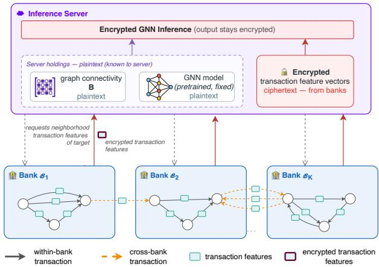
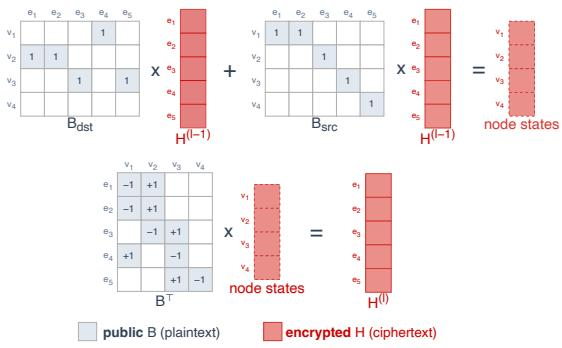

# Privacy-Preserving GNN Inference on Financial Transaction Graphs via Homomorphic Encryption

H. Çağrı Bilgi∗ Delft University of Technology Delft, Netherlands

Kemal Mutluergil Sabancı University Istanbul, Türkiye

Kubilay Atasu Delft University of Technology Delft, Netherlands

Ceren Yıldırım Sabancı University Istanbul, Türkiye

## Abstract

Anti-money laundering (AML) in financial networks requires modeling transaction patterns that span multiple institutions. In practice, however, banks cannot share account and transaction features due to strict privacy regulations. We propose a privacy-preserving graph neural network (GNN) inference framework tailored to this multi-bank setting. A central server holds the graph connectiv- ity and pretrained model weights in plaintext, while each bank keeps its transaction features encrypted. Inference is then carried out entirely on encrypted features under the CKKS homomorphic encryption scheme, so that no plaintext transaction features or predictions are exposed to the server. The key to making this practical is an edge-centric GNN architecture, wherein message passing is expressed through operations on node–edge incidence matrices. This formulation not only preserves the edge-attributed multigraph structure of transaction networks but also reduces every aggrega- tion step to plaintext–ciphertext matrix products. Since CKKS can evaluate only polynomial circuits, we also approximate each nonlinearity with a composite polynomial of the sign function, which we calibrate per activation site. On the IBM AML benchmark, our model achieves performance competitive with plaintext baselines, and with a consumer-grade GPU, classifies each queried transaction end-to-end in as little as 5.31 seconds, while per-transaction latency can be amortized to 1.65 seconds when optimized for throughput.

Erkay Savas Sabancı University Istanbul, Türkiye

## CCS Concepts

• Computing methodologies → Neural networks; • Security and privacy → Cryptography; Privacy-preserving protocols.

## Keywords

anti-money laundering, graph neural networks, homomorphic encryption, encrypted inference, financial transactions

## 1 Introduction

Money laundering is the process by which illegally obtained funds are moved through financial transactions to disguise their origin. The global scale of the problem is substantial, with the UN estimat- ing that up to \$2 trillion is laundered each year [30]. Laundering schemes rarely involve a single transfer; they typically unfold across chains of transactions, often spanning multiple banks. Detecting such schemes requires coordinated monitoring of the transactions.

  
Figure 1: Encrypted cross-bank GNN inference for AML. The server holds graph connectivity B and pretrained weights fiW in plaintext; banks supply transaction features as ciphertexts. The GNN is evaluated under homomorphic encryption, leaving features and the prediction Yˆ encrypted to the server.

Financial transaction data can be naturally represented as a graph, where each account is a node and each transaction between two accounts is an edge. Since multiple transactions can occur between the same pair of accounts, financial transaction graphs are multigraphs. Graph Neural Networks (GNNs) have emerged as a powerful tool for analyzing such graphs, and have been successfully applied to detect money laundering and related financial crimes in several recent works [1, 3, 8, 10, 29, 31]. Their key strength is the ability to propagate information across the graph and capture suspicious patterns that span multiple hops between accounts. However, in practice, no single financial institution has a complete view of the transaction graph. Money moves across many institutions, and each institution only has access to its own account and transaction features. Privacy regulations, such as GDPR, severely restrict the sharing of customer transaction records across institutions.

One natural response to this fragmentation is federated learn- ing [16, 34], where banks collaboratively train a shared model with-out exchanging raw data. While this addresses collaborative model training, it does not by itself provide confidentiality of account and transaction features. Homomorphic encryption (HE) can address this challenge by computing directly on ciphertexts. In the setting we consider (Figure 1), each bank encrypts its transaction features and sends them to a central inference server that holds the graph structure and model weights in plaintext. The server evalu- ates the GNN on the encrypted features and returns an encrypted prediction that only an authorized party can read. We assume the standard honest-but-curious adversary model and that no feature or prediction is exposed to the server or other banks in plaintext.

Previous work has demonstrated the feasibility ofHE-compatible GNN inference [18, 24–26], but none supports edge-attributed multi-graphs, where attributes are attached to individual transactions and parallel edges between the same pair of accounts retain distinct identities. Moreover, all existing methods operate on a graph fixed and known at encryption time. In contrast, we perform per-query neighborhood sampling, extracting a fresh subgraph around queried transactions, which is crucial in an inductive setting [15]. To the best of our knowledge, ours is the first framework to support GNN inference on multigraphs with encrypted edge attributes as well as per-query stochastic neighborhood sampling on such graphs.

Our contribution is architectural: standard message-passing- based GNNs rely on scatter-gather operations, which are not naturally supported by HE arithmetic. On the other hand, adjacencymatrix-based formulations of such message-passing GNNs do not generalize to multigraphs with edge features, which can have sev- eral edges between the same two nodes. We address this challenge by introducing IncidenceGNN, which exchanges messages using incidence matrix multiplications, preserving individual multigraph edges and their features while reducing the forward pass to ma- trix operations that can be eficiently mapped to HE arithmetic. The IncidenceGNN formulation therefore ofers a more favorable accuracy–eficiency trade-of for encrypted edge classification.

We overcome another challenge associated with the nonlinear na- ture of GNN activations: CKKS evaluates only polynomial circuits, and naïvely approximating ReLU degrades the utility of the model. Prior HE-GNN work addresses this with simple quadratic approxi mations (Section 2), which we find inadequate for the more complex decision boundaries of AML detection. Following [6, 20, 21], we replace each activation with a composite minimax polynomial ap- proximation of the sign function, calibrated per activation site, and scheduling bootstrapping so that required approximation depth fits within the scheme’s multiplicative budget. Testing on the IBM AML benchmark [1] via a consumer-grade GPU and no specialized hardware reveals that the resulting model is competitive with strong plaintext GNN baselines, and classifies each transaction query in a few seconds. To our knowledge, this is the first demonstration that transaction-level AML classification is practically achievable under full encryption at this scale, with near-zero accuracy loss.

## 2 Related Work

When combining fully homomorphic encryption with graph neu-ral network inference, the dominant costs are ciphertext rotations and multiplicative depth. Among prior works in this area, Cryp- toGCN [26] targets encrypted ST-GCN [33] inference under CKKS, utilizing a novel packing scheme and adjacency matrix decom-position method. Furthermore, it replaces ReLU with low-degree polynomial activations whose coeficients are trained jointly with the model. These activation sites are pruned at the layer level where the efect on accuracy is negligible via Activation Pruning (AP).

LinGCN [24] focuses on reducing the multiplicative depth, and pro-poses a ReLU approximation method that adapts node-wise trainable polynomials and distillation. FicGCN [18] co-designs packing layout, per-layer aggregation mode, and node ordering against a CKKS cost model, reducing the rotation overhead of aggregation on encrypted features. Penguin [25] functions under a diferent threat model, treating the graph connectivity as private. In com-putation, Penguin interleaves several feature channels inside a single ciphertext so that the rotations required for aggregation are amortized across channels. DESIGN [35] assumes a similar threat model, and lets the server derive degree-based importance masks from an encrypted adjacency matrix to prune the graph and adapt activation-polynomial degree per node. Like the methods above, it assumes a single client uploads the entire graph in an adjacency based encoding. Outside the FHE setting, OblivGNN [32] and Crypt-GNN [28] achieve secure GNN inference via multi-party computation and function secret sharing rather than a single untrusted server; both target node-feature graphs and, notably, CryptGNN identifies oblivious neighborhood sampling in the MPC setting as expensive and instead performs it client-side, where the full graph is alread known [28], an esca e unavailable when to olo is itself split across non-colluding banks. CryptoGCN, LinGCN, FicGCN, and Penguin (which supports inductive settings, but experiments are in a transductive setting) are tuned ofline to a graph that is fixed at encryption time, and the resulting layout, decomposition, or schedule is amortized over repeated inferences on that same graph; evaluations are accordingly confined to a fixed 25-joint skeleton (CryptoGCN, LinGCN) and citation graphs of at most ∼20K nodes (Penguin, FicGCN). FicGCN’s aggregation additionally bounds the number of neighbors summed per node, following the GraphSAGE formula [15], but this operates within that same fixed graph rather than varying the sampled subgraph from one query to the next. Our setting ofers no such fixed graph to amortize over: a fresh neighborhood subgraph is sampled around each queried transac- tion, so the participating nodes and their connections change from one inference to the next.

These frameworks difer fundamentally in architecture and tar- get task, so quantitative comparisons of computational and memory costs are not directly meaningful; Table 1 therefore provides a qual- itative comparison with prior privacy-preserving GNN inference frameworks. To the best of our knowledge, our work is the first to enable encrypted edge classification on directed multi-graphs with query-based sampling. Query-based sampling restricts each encrypted inference to a relevant subgraph rather than requiring evaluation of the full graph, thereby reducing the memory overhead associated with large transaction networks. In addition, whereas all prior entries (except DESIGN which employs a multi-degree poly- nomial) approximate nonlinearities with quadratic polynomials, we employ a higher-degree composite approximation, AppReLU, because low-degree polynomials degrade classification accuracy on datasets with complex decision boundaries (Section 5.2.2).

The IBM AML benchmark [1] provides synthetic transaction networks that closely follow real laundering patterns. Among the GNN-based methods proposed for this setting, Multi-GNN [10] extends standard GNNs with adaptations for directed multigraphs, which yields a provably more expressive architecture for detect- ing subgraph patterns. MEGA-GNN [36] introduces a two-stage aggregation that first summarizes the edges between each pair of nodes before aggregating across neighbors. However, both architectures operate within the conventional node-centric message-passing paradigm and assume that the full transaction graph is available in one place. The closest work to our distributed setting is Efendi and Chattopadhyay [9], who pursue the same collabora tive, cross-bank AML goal under fully homomorphic encryption. Their GNN pipeline does not achieve encrypted inference, as the scatter–gather operator of message passing cannot be compiled to their FHE backend; the encrypted results they report come from an XGBoost model on a subset of the data. We overcome this obstacle with our IncidenceGNN, whose message passing is formulated as incidence-matrix multiplications.

Table 1: Qualitative comparison with prior work. Brackets ([·]) denote encrypted data and the prime symbol (′) denotes the variable’s state after query-based neighbor sampling. $\mathbf { A } / \mathbf { B } \colon$ adjacency/incidence matrices, $\mathbf { X } / \mathbf { E } \colon$ node/edge ft. matrices, $N / M { : }$ number of graph nodes/edges, �: node/edge feature dimension, �: mini-batch size.
<table><tr><td>Work</td><td>Threat model</td><td>Downstream task</td><td>Encrypted input domain</td><td>Neighbor sampling</td><td>Multi-graph / incidence</td><td>Nonlinearity</td></tr><tr><td>CryptoGCN [26]</td><td>A, [X]</td><td>Graph classification</td><td> $[ \mathbf { X } ] \in \mathbb { R } ^ { b \times N \times d }$ </td><td>x</td><td>X</td><td>Quadratic, layer-wise trainable</td></tr><tr><td>LinGCN [24]</td><td>A, [X]</td><td>Graph / Node classification</td><td> $[ \mathbf { X } ] \in \mathbb { R } ^ { N \times d }$ </td><td>x</td><td>x</td><td>Quadratic, node-wise trainable</td></tr><tr><td>Penguin [25]</td><td>[A], [X]</td><td>Link prediction (GAE only)</td><td> $[ \mathbf { A } ] \in \mathbb { R } ^ { N \times N } , [ \mathbf { X } ] \in \mathbb { R } ^ { N \times d }$ </td><td>X</td><td>x</td><td>Square (x2)</td></tr><tr><td>FicGCN [18]</td><td>A, [X]</td><td>Graph classification / Link pre- diction (GAE only)</td><td> $[ \mathbf { X } ] \in \mathbb { R } ^ { N \times d }$ </td><td>x1</td><td>x</td><td>Square (x2) for GAE</td></tr><tr><td>DESIGN [35]</td><td>[A], [X]</td><td>Node classification</td><td> $[ \mathbf { A } ] \in \mathbb { R } ^ { N \times N } , [ \mathbf { X } ] \in \mathbb { R } ^ { N \times d }$ </td><td>X</td><td>X</td><td>Adaptive, degree ≤ 7 poly.</td></tr><tr><td>Ours</td><td> $\mathbf { B } ^ { \prime } , [ \mathbf { E } ^ { \prime } ]$ </td><td>Edge classification</td><td> $[ { \bf E } ^ { \prime } ] \in \mathbb { R } ^ { M ^ { \prime } \times d }$ </td><td>√</td><td>√</td><td>AppReLU</td></tr></table>

1 FicGCN’s sampling bounds the number of neighbors per node, but every inference still processes a fixed graph known at encryption time; it does not perform per-query sampling.

## 3 Background

## 3.1 Fully Homomorphic Encryption

Homomorphic encryption allows computations to be carried out directly on encrypted data without the decryption key. Ciphertexts carry with them an inherent noise that grows with each homomor phic operation. Multiplications in particular consume levels of a finite multiplicative budget; once exhausted, the ciphertext can no longer be decrypted correctly. Gentry [13] removed this limit by bootstrapping, which runs an encrypted version of the decryption algorithm over the noisy ciphertext to allow further computation.

Popular FHE schemes include Cheon-Kim-Kim-Song scheme (CKKS) [5], Brakerski/Fan-Vercauteren scheme (BFV) [11], and Fast Fully Homomorphic Encryption over the Torus (TFHE) [7]. The security of these schemes relies on the hardness assumption of Ring Learning with Errors (RLWE) [23], which guarantees IND CPA security. In addition, the BFV and CKKS schemes provide a feature known as batching, allowing Single Instruction Multiple Data (SIMD) operations by encoding several messages into a single ciphertext. In this work, we adopt the CKKS scheme due to its support for approximate arithmetic over floating-point numbers, which aligns well with our machine learning task.

## 3.2 Graph Notation

A graph $\mathcal { G } = ( \mathcal { V } , \mathcal { E } )$ consists of a set of nodes V and a multiset of edges E, with $N = | \mathcal { V } |$ and $M = | \boldsymbol { \mathcal { E } } |$ . In the directed case, each edge $e \in { \mathcal { E } }$ has a source node � and target node �. The graph structure is commonly represented by the adjacency matrix $\mathbf { A } \in \{ 0 , 1 \} ^ { N \times N }$ where $A _ { u v } = 1$ if an edge exists from � to � and 0 otherwise.

In our financial transaction setting, the graph is a directed edgeattributed multigraph: multiple distinct transactions may occur between the same pair of accounts, each with its feature vector. Since the adjacency matrix records only whether a connection exists, it cannot distinguish multiple edges between the same pair of nodes. The node–edge incidence matrix dedicates a separate column to each edge, making it a natural representation for multigraphs.

Definition 1 (Signed Node–Edge Incidence Matrix). The signed node–edge incidence matrix $\mathbf { B } \in \mathbb { R } ^ { N \times M }$ has rows indexed by nodes � ∈ V and columns indexed by edges � ${ \mathrm { ? } } \in { \mathcal { E } } ,$ with $B _ { v , e } = - 1$ if $\begin{array} { r } { v = \operatorname { s r c } ( e ) , B _ { v , e } = + 1 \ i f v = \operatorname { d s t } ( e ) } \end{array}$ , and $B _ { v , e } = 0$ otherwise.

Definition 2 (Source and Destination Incidence Matrices). The source incidence matrix $\mathbf { B } _ { \mathrm { s r c } } \in \{ 0 , 1 \} ^ { N \times M }$ and the destination incidence matrix $\mathbf { B } _ { \mathrm { d s t } } \in \{ 0 , 1 \} ^ { N \times M }$ are defined by $( \mathbf { B } _ { \mathrm { s r c } } ) _ { v , e } = 1$ if $v = \operatorname { s r c } ( e )$ and $( \mathbf { B } _ { \mathrm { d s t } } ) _ { v , e } = 1$ if� = dst(�).

Let each edge $e \in { \mathcal { E } }$ carry a feature vector $\mathbf { e } \in \mathbb { R } ^ { d }$ , where $d \in \mathbb { N }$ is the feature dimension. These vectors are collected row-wise into the edge feature matrix $\mathbf { E } \in \mathbb { R } ^ { M \times d }$ . Nodes (accounts) may also have associated features, collected into a node feature matrix $\dot { \mathbf { X } } \in \mathbb { R } ^ { N \times d _ { v } }$ however, the benchmark considered in this work contains no node features (Section 6). The task is edge classification: predict a binary label $y _ { e } \in \{ 0 , 1 \}$ for each edge $e \in { \mathcal { E } } .$

## 3.3 Graph Neural Networks

Graph Neural Networks (GNNs) learn node (and edge) representations by iteratively aggregating information from local neighborhoods [14]. At each layer �, the representation of node � is updated:

$$
\mathbf { h } _ { v } ^ { ( l ) } = \phi \Bigg ( \mathbf { h } _ { v } ^ { ( l - 1 ) } , \bigoplus _ { u \in \mathcal { N } ( v ) } \psi \Big ( \mathbf { h } _ { u } ^ { ( l - 1 ) } \Big ) \Bigg ) ,\tag{1}
$$

where $N ( v )$ is the neighborhood of ${ \dot { v } } , \psi$ is a learnable message func- tion, $\bigoplus$ is a permutation-invariant aggregation (e.g., sum or mean), and $\phi$ is a learnable update function. With degree-normalized mean aggregation, this takes the matrix form $\mathbf { H } ^ { ( l ) } = \sigma \big ( \hat { \mathbf { A } } \mathbf { H } ^ { ( l - 1 ) } \mathbf { W } ^ { ( l ) } \big ) \left[ 1 9 \right]$ where $\hat { \mathbf { A } } = \tilde { \mathbf { D } } ^ { - 1 / 2 } \tilde { \mathbf { A } } \tilde { \mathbf { D } } ^ { - 1 / 2 }$ is the symmetrically normalized adjacency matrix with self-loops.

## 4 Problem Formulation

Consider a financial network observed across � banks $\{ \mathcal { B } _ { 1 } , . . . , \mathcal { B } _ { K } \}$ Each bank $\mathcal { B } _ { k }$ holds the records of the transactions that were made through its own accounts. In the graph, each transaction corresponds to an edge, and the set of edges under bank � is denoted $\mathcal { E } _ { k } \subseteq \mathcal { E }$ , with $\textstyle \bigcup _ { k } { \mathcal { E } } _ { k } = { \mathcal { E } }$ . The corresponding transaction features are stored in $\mathbf { E } _ { k } \in \mathbb { R } ^ { | \mathcal { E } _ { k } | \times d }$ and are never revealed in plaintext to other banks or to the central server. A central inference server holds the global graph structure: the full incidence matrices $\mathbf { B } , \mathbf { B } _ { \mathrm { s r c } } , \mathbf { B } _ { \mathrm { d s t } } \in \bar { \mathbb { R } } ^ { \mathbf { N } \times M }$ and a trained model with plaintext weights. As is standard in privacy-preserving inference, the model is trained in plaintext and only inference is performed on encrypted inputs [9, 26]. Account identifiers are pseudonymized. The inference server seeks to classify transaction edges without accessing plaintext feature data.

Real-world transaction graphs contain millions of edges, mak ing full-graph inference intractable. Following [15], we perform plaintext neighborhood sampling around each query edge, reducing inference to a small subgraph. Given the subgraph $( \mathcal { V } ^ { \prime } , \mathcal { E } ^ { \prime } )$ , with incidence matrix $\mathbf { B } ^ { \prime } \in \mathbb { R } ^ { \mathbf { \breve { N } } ^ { \prime } \times \mathbf { \breve { M } } ^ { \prime } }$ , the inference protocol is:

(1) Edge Query. An initiator bank raises suspicion about one of its transactions and sends a query to the central server for that edge to be evaluated with the server’s model.

(2) Graph sampling. The server obtains a subgraph $( \mathcal { V } ^ { \prime } , \mathcal { E } ^ { \prime } )$ with incidence matrix $\mathbf { B } ^ { \prime } \in \mathbb { R } ^ { N ^ { \prime } \times M ^ { \prime } }$ via neighborhood sam pling on the queried edge, using plaintext graph.

(3) Encrypted feature request. The server requests an encrypted feature vector Enc(pk, e), for each edge $e \in { \mathcal { E } } ^ { \prime }$ (and Enc(pk, ${ \bf x } _ { v } )$ for each node $v \in \mathcal { V } ^ { \prime }$ , where account attributes are available) from its host bank $\mathcal { B } _ { k } ,$ , where pk is the public key of the initiator bank.

(4) Encrypted inference. The server evaluates the GNN model on the encrypted feature matrix Enc(pk, E′) using plain text incidence matrices and model weights. This produces encrypted logits.

(5) Decryption. Encrypted logits are returned to the initiator bank which decrypts them with the secret key sk.

## 5 Method

## 5.1 Message Passing with Incidence Matrices for Directed Edge-attributed Multigraphs

We adopt an edge-centric formulation of message passing for transaction graphs: transactions are the primary entities, each retaining its own feature vector, and each layer applies an edge-to-node trans- formation followed by a node-to-edge transformation, as shown in Figure 2. Our setting imposes two requirements on the message-passing implementation. First, the graph is a multigraph, so each edge must be tracked individually. Second, the computation must reduce to dense matrix multiplications, since HE cannot support the irregular scatter-gather operations that data-dependent control flow requires. Neither standard implementation satisfies both. Libraries such as PyTorch Geometric [12] handle multigraphs naturally via an edge-index, but rely on scatter-gather and are therefore HE- incompatible. The GCN-like adjacency-matrix form is HE-friendly, but $\hat { \bf A }$ can’t represent individual edges in multigraphs.

H. Çağrı Bilgi, Kemal Mutluergil, Ceren Yıldırım, Kubilay Atasu, and Erkay Savas

  
Figure 2: One layer of incidence matrix based edge-centric message-passing. Weight matrices are omitted for simplicity.

We satisfy both constraints by reformulating message passing with the incidence matrices $\mathbf { B } _ { \mathrm { d s t } }$ and $\mathbf { B } _ { \mathrm { s r c } } { : }$ each edge occupies its own column, and aggregation reduces to the matrix products $\mathbf { B } _ { \mathrm { d s t } } \mathbf { E }$ and $\mathbf { B } _ { \mathrm { s r c } } \mathbf { E } .$ . Keeping the two paths separate lets each account ag- gregate its incoming and outgoing transactions independently, a common choice in directed GNNs [10, 27]. The resulting account representations are then propagated back to edges through $\mathbf { B } ^ { \top }$ . The procedure is summarized in Algorithm 1. Furthermore, in practice we use degree-normalized incidence matrices $\hat { \mathbf { B } } _ { ( \cdot ) } = \mathbf { D } ^ { - 1 / 2 } \mathbf { B } _ { ( \cdot ) }$ in place of $\mathbf { \dot { B } } _ { \mathrm { d s t } } , \mathbf { B } _ { \mathrm { s r c } }$ , and B, where D is the diagonal matrix of the node degrees (in-, out-, and total degree, respectively); since the graph structure is held in plaintext, this normalization incurs no homomor-phic cost. Account attributes, where available, can be incorporated directly into the node update: X is node-indexed and enters the node state as an additional linear term (line 10, Algorithm 1).

Algorithm 1 IncidenceGNN   
Inputs: Edge features $\mathbf { E } \in \mathbb { R } ^ { M \times d } ;$ optional node features   
$\mathbf { X } \in \mathbb { R } ^ { N \times d _ { v _ { \star } } }$ ; incidence matrices   
Bdst, ${ \bf B } _ { \mathrm { s r c } } \in \{ 0 , 1 \} ^ { N \times M } , { \bf B } \in \{ - 1 , 0 , 1 \} ^ { N \times M } ;$ weights $\mathbf { W } _ { \mathrm { e n c } } ,$   
$\{ \mathbf { W } _ { \mathrm { f w d } } ^ { ( l ) } , \mathbf { W } _ { \mathrm { r e v } } ^ { ( l ) } , \mathbf { W } _ { \mathrm { l i n } } ^ { ( l ) } \} _ { l = 1 } ^ { L } , \mathbf { W } _ { \mathrm { c l s 0 } } , \mathbf { W } _ { \mathrm { c l s 1 } }$ with biases $\mathbf { b } _ { ( \cdot ) } ;$ batch norms   
BN; activation �.   
Output: Edge logits Y.   
1: $\mathbf { H } _ { \mathrm { e d g e } } ^ { ( 0 ) }  \sigma \big ( \mathrm { B N } _ { \mathrm { e n c } } ( \mathbf { E } \mathbf { W } _ { \mathrm { e n c } } ^ { \top } + \mathbf { b } _ { \mathrm { e n c } } ) \big )$ ⊲ edge encoding   
2: if node features X are available then   
3: $\mathbf { H } _ { \mathrm { n o d e } } ^ { ( 0 ) }  \sigma \big ( \mathrm { B N } _ { \mathrm { e n c } } ^ { v } ( \mathbf { X } \mathbf { W } _ { \mathrm { e n c } } ^ { v \top } + \mathbf { b } _ { \mathrm { e n c } } ^ { v } ) \big )$ ⊲ node encoding   
4: else   
${ \bf 5 } \colon \qquad { \bf H } _ { \mathrm { n o d e } } ^ { ( 0 ) }  { \bf 0 }$   
6: end if   
7: for $l = 1$ to � do   
8: $\mathbf { H } _ { \mathrm { i n } } ^ { ( l ) } \xleftarrow { } \sigma \big ( \mathbf { B N } _ { \mathrm { f w d } } ^ { ( l ) } ( ( \hat { \mathbf { B } } _ { \mathrm { d s t } } \mathbf { H } _ { \mathrm { e d g e } } ^ { ( l - 1 ) } ) \mathbf { W } _ { \mathrm { f w d } } ^ { ( l ) \top } + \mathbf { b } _ { \mathrm { f w d } } ^ { ( l ) } ) \big )$ ⊲ incoming   
9: $\mathbf { H } _ { \mathrm { o u t } } ^ { ( l ) }  \sigma \big ( \mathrm { B N } _ { \mathrm { r e v } } ^ { ( l ) } ( ( \hat { \mathbf { B } } _ { \mathrm { s r c } } \mathbf { H } _ { \mathrm { e d g e } } ^ { ( l - 1 ) } ) \mathbf { W } _ { \mathrm { r e v } } ^ { ( l ) \top } + \mathbf { b } _ { \mathrm { r e v } } ^ { ( l ) } ) \big )$ ⊲ outgoing   
10: $\mathbf { H } _ { \mathrm { n o d e } } ^ { ( l ) }  \mathbf { H } _ { \mathrm { n o d e } } ^ { ( l - 1 ) } + \mathbf { H } _ { \mathrm { i n } } ^ { ( l ) } + \mathbf { \breve { H } } _ { \mathrm { o u t } } ^ { ( l ) }$   
11: $\mathbf { M } ^ { ( l ) } \gets \hat { \mathbf { B } } ^ { \top } \mathbf { H } _ { \mathrm { n o d } } ^ { ( l ) }$ ⊲ node → edge   
12: $\mathbf { H } _ { \mathrm { e d g e } } ^ { ( l ) }  \sigma \big ( \mathrm { B N } _ { \mathrm { e d g e } } ^ { ( l ) } \big ( \mathbf { M } ^ { ( l ) } \mathbf { W } _ { \mathrm { l i n } } ^ { ( l ) \top } + \mathbf { b } _ { \mathrm { l i n } } ^ { ( l ) } \big ) \big )$ ⊲ edge update   
13: end for   
14: $\mathbf { A } \gets \sigma \big ( \mathbf { H } _ { \mathrm { e d g e } } ^ { ( L ) } \mathbf { W } _ { \mathrm { c l s 0 } } ^ { \top } + \mathbf { b } _ { \mathrm { c l s 0 } } \big )$   
15: $\begin{array} { r } { \mathbf { Y }  \mathbf { A } \mathbf { W } _ { \mathrm { c l s 1 } } ^ { \top } + \mathbf { b } _ { \mathrm { c l s 1 } } } \end{array}$ ⊲ classification head   
16: return Y

## 5.2 Homomorphic Evaluation Methodology

FHE mandates that computations be expressed entirely as additions, multiplications, and ciphertext rotations. As formulated in Algo- rithm 1, our model consists solely of a series of matrix operations. The only non-arithmetic components are the ReLU activations, which we replace with polynomial approximations (Section 5.2.2), and the batch-normalization layers, which are folded into the pre- ceding linear maps [17].

5.2.1 Eficient Homomorphic Matrix Multiplication. Evaluating the dense matrix operations defined in Algorithm 1 requires an encoding scheme that is (i) computationally eficient, (ii) produces outputs that chain across layers without repacking, (iii) handles left-multiplications by plaintext matrices naturally, and (iv) scales to matrices whose dimensions exceed the slot capacity of a single ciphertext. We adopt the Tricycle framework [22], a generalization of Bicyclic encoding [4] which (i) reduces rotation cost from $O ( n )$ to $O ( { \sqrt { n } } )$ via a baby-step giant-step sweep, (ii) lets ciphertext outputs chain directly across layers without repacking, (iii) supports our left-multiplications BH at zero extra cost by encoding H and $\mathbf { H } ^ { \top }$ identically, and (iv) scales to matrices exceeding slot capacity via block partitioning.

Since each bank encrypts its features independently, incoming ciphertexts arrive in a row-wise layout rather than the joint bicyclic layout our matrix multiplications (MatMul) require; the server con verts between them via a one-time rotate-and-add packing step and a fixed transformation matrix [4].

5.2.2 Homomorphic ReLU Approximation via AppReLU. Since CKKS only evaluates polynomial circuits, we approximate $\mathrm { R e L U } ( x ) =$ max $( 0 , x )$ via the identity Re $\mathrm { U } ( x ) = x ( 1 + \mathrm { s g n } ( x ) ) / 2$ replacing sgn with the composite minimax polynomial family of [6], following [20, 21]. We use the degree-9 polynomial

$$
f _ { 4 } ( t ) \ = \ \frac { t } { 1 2 8 } \big ( 3 1 5 - 4 2 0 t ^ { 2 } + 3 7 8 t ^ { 4 } - 1 8 0 t ^ { 6 } + 3 5 t ^ { 8 } \big ) ,\tag{2}
$$

which maps $[ - 1 , 1 ] \ \to \ [ - 1 , 1 ]$ and closely approximates sgn(�) on that interval. Composing $f _ { 4 }$ with itself � times improves the sign approximation at the cost of additional multiplicative depth (4 levels per composition via Paterson-Stockmeyer)

Following [20, 21], given an encrypted activation � and a clipping bound $B > 0 _ { ; }$ , one per activation site of the network, we define

$$
\mathrm { A p p R e L U } ( x ; B , d ) \ = \ { \frac { x } { 2 } } \Big ( 1 + f _ { 4 } ^ { d } \Big ( { \frac { x } { B } } \Big ) \Big ) .\tag{3}
$$

where dividing by $B$ rescales inputs into $f _ { 4 } ^ { \mathrm { ~ , ~ } } s$ accurate range and the outer scaling implements the ReLU half-wave rectification, all with plaintext constants.

Each activation site requires multiple nontrivial polynomial evaluations, quickly exhausting the ciphertext’s multiplicative budget; we use slim\_bootstrapping [2] to refresh it. Under our CKKS parameterization, one bootstrap call covers only a single $f _ { 4 }$ evaluation, so the circuit performs 8 external bootstraps (one per activation site) plus 8� internal bootstraps (one per composition), for $8 + 8 d = 4 8$ total calls at $d = 5 -$ the dominant cost in Table 7.

Knowledge-distillation finetuning. To adapt the ReLU-trained network to AppReLU’s approximation error, we finetune with

AppReLU substituted for ReLU. Since naïve cross-entropy finetuning degrades accuracy (Section 6), we instead apply a knowledge-distillation objective

$$
\mathcal { L } = \alpha T ^ { 2 } \cdot \mathrm { K L } \bigg ( { \frac { \mathcal { P } \mathrm { t e a c h e r } } { T } } \bigg \| { \frac { \mathcal { P } \mathrm { s t u d e n t } } { T } } \bigg ) + \left( 1 - \alpha \right) \mathrm { C E } ,\tag{4}
$$

with temperature $T = 3 ,$ , weight $\alpha = 0 . 7 ,$ , and the original ReLU network as the frozen teacher, initializing the student from the teacher’s weights. We quantify the efect of the finetuning objective in the ablation (Table 5, Section 6.2).

## 6 Experiments

In this section, we evaluate IncidenceGNN in plaintext against existing graph-based AML detection models (Section 6.1), then present ablations for architectural and hyperparameter choices. Finally, we measure the latency of privacy-preserving inference, and assess fidelity of FHE predictions (Section 6.2).

Datasets and setup. We evaluate on the IBM AML benchmark [1], publicly available synthetic anti-money laundering datasets de- signed to capture realistic transaction characteristics. We consider four dataset variants: Small and Medium graphs, each provided with a higher-illicit (HI) and lower-illicit (LI) split that difer in the prevalence of laundering transactions. Following prior work [10], we use a temporal train/validation/test split. Each dataset is a directed edge-attributed multigraph, with nodes representing accounts and edges representing transactions. Each transaction contains four attributes: timestamp, amount, currency, and payment format. Accounts have no associated features $( \mathbf { X } = \mathbf { 0 } )$ . The task is binary edge classification, where the goal is to identify transactions belonging to money laundering patterns. The laundering class is the minority class, with LI variants substantially more imbalanced than HI variants. We report minority-class F1 and PR-AUC, aver-aged over at least five random seeds. We use minority-class F1 as the primary threshold-dependent metric, while PR-AUC provides a threshold-independent measure of ranking quality. Plaintext mod- els are evaluated with an inference batch size of 8,192 and use ReLU as the non-linear activation function.

## 6.1 Plaintext Results

Table 2 compares IncidenceGNN against the AML detection models of Egressy et al. [10], in plaintext. IncidenceGNN outperforms the standard GIN baseline on three of the four splits and matches it on Medium-LI within variance, while implementing sum ag- gregation entirely through sparse incidence-matrix multiplication. Against the stronger Multi-GIN baseline, IncidenceGNN remains competitive across most splits, matching or slightly outperforming it on Small-HI within variance and achieving comparable performance on Small-LI. The main gap appears on Medium-LI, where IncidenceGNN underperforms Multi-GIN. However, Table 3 highlights that plaintext accuracy alone does not capture the relevant trade-of under homomorphic inference: IncidenceGNN requires fewer nonlinear activations, performs aggregation through sparse matrix multiplication, and avoids scatter–gather operations and feature concatenation, resulting in a 2.61× speedup over Multi-GIN. The incidence-based formulation therefore ofers a more favorable accuracy–eficiency trade-of for encrypted edge classification.

Table 2: Plaintext minority-class F1 (%) on four IBM AML splits.
<table><tr><td>Model</td><td>Small-HI</td><td>Small-LI</td><td>Medium-HI</td><td>Medium-LI</td></tr><tr><td>GIN</td><td> $4 6 . 5 0 \pm 4 . 1 1$ </td><td> $1 9 . 9 3 \pm 3 . 5 5$ </td><td> $5 8 . 6 5 \pm 2 . 5 0$ </td><td> $2 5 . 3 6 \pm 1 . 4 9$ </td></tr><tr><td>Multi-GIN</td><td> $6 2 . 6 6 \pm 1 . 7 3$ </td><td> $3 2 . 2 1 \pm 0 . 9 9$ </td><td> $6 7 . 7 2 \pm 0 . 9 4$ </td><td> $3 1 . 2 4 \pm 2 . 1 2$ </td></tr><tr><td>IncidenceGNN (ours)</td><td> $6 3 . 7 2 \pm 1 . 8 6$ </td><td> $3 0 . 1 2 \pm 2 . 0 8$ </td><td> $6 3 . 2 0 \pm 1 . 3 8$  </td><td> $2 4 . 5 2 \pm 3 . 4 2$ </td></tr></table>

Table 3: Architectural and runtime cost per model (2 layers, hidden dim 64). MatMul-only: no scatter–gather; # Concat: concatenations forcing ciphertext repacking.
<table><tr><td>Model</td><td># Nonlinear activations</td><td>MatMul-only</td><td># Concat</td><td>Time/batch (ms)</td></tr><tr><td>GIN</td><td>11</td><td>x</td><td>4</td><td>84.48</td></tr><tr><td>Multi-GIN</td><td>17</td><td>x</td><td>6</td><td>231.43</td></tr><tr><td>IncidenceGNN (ours)</td><td>8</td><td>√</td><td>0</td><td>88.61</td></tr></table>

Table 4: Design and hyperparameter ablations on IBM AML (Small-HI, Small-LI). Each block varies one factor of the baseline; the selected setting is highlighted . Minority-class test F1 and PR-AUC (%), mean ± std over seeds.
<table><tr><td colspan="2"></td><td colspan="2">Small-HI</td><td colspan="2">Small-LI</td></tr><tr><td>Variant</td><td></td><td>F1</td><td>PR-AUC</td><td>F1</td><td>PR-AUC</td></tr><tr><td>MMee ssdth</td><td>Forward + reverse (selected)</td><td> $6 3 . 7 2 { \scriptstyle \pm 1 . 8 6 }$ </td><td> $6 2 . 1 5 { \scriptstyle \pm 1 . 7 8 }$ </td><td> $3 0 . 1 2 { \scriptstyle \pm 2 . 0 8 }$ </td><td>24.74±1.53</td></tr><tr><td></td><td>Forward-only</td><td> $4 3 . 0 7 { \scriptstyle \pm 3 . 1 2 }$ </td><td> $3 8 . 5 8 { \scriptstyle \pm 3 . 5 2 }$ </td><td> $1 1 . 1 8 { \scriptstyle \pm 4 . 9 5 }$ </td><td> $6 . 7 7 { \scriptstyle \pm 3 . 4 5 }$ </td></tr><tr><td></td><td>Reverse-only</td><td> $5 7 . 9 6 { \scriptstyle \pm 3 . 2 2 }$ </td><td> $5 4 . 8 4 { \scriptstyle \pm 3 . 3 2 }$ </td><td> $2 1 . 2 3 { \scriptstyle \pm 2 . 6 1 }$ </td><td>15.62±2.86</td></tr><tr><td></td><td>Shared weights</td><td> $2 1 . 3 7 { \scriptstyle \pm 8 . 3 6 }$ </td><td> $1 5 . 3 5 { \scriptstyle \pm 8 . 7 8 }$ </td><td> $1 2 . 8 6 { \scriptstyle \pm 3 . 2 2 }$ </td><td> $8 . 4 9 { \scriptstyle \pm 3 . 6 5 }$ </td></tr><tr><td>Incii.</td><td>Directional (selected)</td><td> $6 3 . 7 2 { \scriptstyle \pm 1 . 8 6 }$ </td><td> $6 2 . 1 5 { \scriptstyle \pm 1 . 7 8 }$ </td><td> $3 0 . 1 2 { \scriptstyle \pm 2 . 0 8 }$ </td><td> $2 4 . 7 4 { \scriptstyle \pm 1 . 5 3 }$ </td></tr><tr><td></td><td>Undirected</td><td>56.26±3.01</td><td> $5 3 . 0 1 { \scriptstyle \pm 2 . 7 2 }$ </td><td> $3 0 . 4 1 { \scriptstyle \pm 0 . 9 6 }$ </td><td> $1 6 . 6 2 { \scriptstyle \pm 1 . 9 9 }$ </td></tr><tr><td>Mlt adda·.</td><td>None</td><td> $6 1 . 8 8 { \scriptstyle \pm 1 . 9 2 }$ </td><td> $5 9 . 1 8 { \scriptstyle \pm 2 . 8 1 }$ </td><td> $2 6 . 9 0 { \scriptstyle \pm 0 . 7 2 }$ </td><td>21.65±0.82</td></tr><tr><td></td><td>+ Ego IDs</td><td> $6 3 . 4 7 { \scriptstyle \pm 2 . 7 6 }$ </td><td> $6 2 . 6 9 { \scriptstyle \pm 1 . 9 2 }$ </td><td> $2 9 . 9 8 { \scriptstyle \pm 2 . 2 0 }$ </td><td> $2 4 . 1 8 { \scriptstyle \pm 2 . 2 0 }$ </td></tr><tr><td></td><td>+ Port IDs</td><td> $6 2 . 2 1 { \scriptstyle \pm 2 . 2 4 }$ </td><td> $5 9 . 7 4 { \scriptstyle \pm 3 . 5 7 }$ </td><td> $2 7 . 6 6 { \scriptstyle \pm 1 . 8 1 }$ </td><td> $2 2 . 3 8 { \scriptstyle \pm 1 . 0 5 }$ </td></tr><tr><td></td><td>+ Ego + Ports (selected)</td><td> $6 3 . 7 2 { \scriptstyle \pm 1 . 8 6 }$ </td><td> $6 2 . 1 5 { \scriptstyle \pm 1 . 7 8 }$ </td><td> $3 0 . 1 2 { \scriptstyle \pm 2 . 0 8 }$ </td><td> $2 4 . 7 4 { \scriptstyle \pm 1 . 5 3 }$ </td></tr><tr><td>Hid Hddim</td><td>16</td><td> $5 7 . 2 0 { \scriptstyle \pm 1 . 7 8 }$ </td><td> $5 6 . 1 2 { \scriptstyle \pm 3 . 4 2 }$ </td><td> $2 5 . 3 2 { \scriptstyle \pm 1 . 4 3 }$ </td><td> $1 8 . 2 8 { \scriptstyle \pm 1 . 0 6 }$ </td></tr><tr><td>32</td><td></td><td> $6 0 . 3 5 { \scriptstyle \pm 1 . 3 5 }$ </td><td> $5 7 . 3 7 { \scriptstyle \pm 1 . 9 2 }$ </td><td> $2 8 . 4 2 { \scriptstyle \pm 4 . 0 2 }$ </td><td> $2 1 . 9 8 { \scriptstyle \pm 4 . 0 4 }$ </td></tr><tr><td></td><td>64 (selected)</td><td> $6 3 . 7 2 { \scriptstyle \pm 1 . 8 6 }$ </td><td> $6 2 . 1 5 { \scriptstyle \pm 1 . 7 8 }$ </td><td> $3 0 . 1 2 { \scriptstyle \pm 2 . 0 8 }$ </td><td> $2 4 . 7 4 { \scriptstyle \pm 1 . 5 3 }$ </td></tr><tr><td></td><td>128</td><td> $6 5 . 0 9 { \scriptstyle \pm 0 . 8 8 }$ </td><td> $6 2 . 7 4 { \scriptstyle \pm 1 . 1 0 }$ </td><td> $2 8 . 8 6 { \scriptstyle \pm 1 . 7 7 }$ </td><td> $2 4 . 0 3 { \scriptstyle \pm 0 . 6 2 }$ </td></tr></table>

Ablation ofarchitectural choices and hyperparameters. Table 4 varies one design factor at a time. The message-passing path has the largest impact: using only forward or reverse messages substantially degrades performance, showing that incoming and out-going messages provide complementary laundering signals. Shared weights perform poorly, indicating that forward and reverse messages require independent parameterization and supporting the two-incidence design $\mathbf { ( B _ { \mathrm { d s t } } , B _ { \mathrm { s r c } } ) }$ . Removing edge direction reduces performance, so we retain the directional form. The multigraph adaptations from Egressy et al. [10] (ego IDs and port numbering) provide consistent gains and incur negligible encrypted overhead, as they are derived from the plaintext graph structure and require only plaintext–ciphertext additions. We therefore include them in the baseline. Increasing the hidden dimension to 128 ofers only marginal gains while increasing ciphertext costs, so we use $h = 6 4 .$

## 6.2 Encrypted Inference

Setup. We evaluate FHE inference on the Small-HI test set using $N = 6 5 5 3 6$ as the polynomial degree, scale $\Delta = 2 ^ { 5 0 }$ , and $| Q | = 2 7$ primes in the modulus chain (log2 $\prod _ { i = 0 } ^ { 2 6 } q _ { i } \approx 6 0 + 2 6 \times 5 0 = 1 3 6 0$ bits) and $| P | = 5$ primes in the auxiliary chain for key switching operations, achieving 128-bit classical security. We implement the protocol using the HEonGPU [37] library and run on an NVIDIA RTX 5090 GPU, equipped in a system with dual Intel Xeon Silver 4514Y CPUs (32 cores / 64 threads) and 125 GiB RAM.

For encrypted inference we replace every ReLU in the trained network with AppReLU (Section 5.2.2) and finetune the resulting model using the knowledge-distillation objective of Eq. 4 for 200 epochs using the Adam optimizer (learning rate $1 0 ^ { - 4 } ,$ , weight decay 0) with batch size 8,192. The message-passing weights are frozen for a 10-epoch warm-up phase at 0.1× the base learning rate; afterwards all parameters are trained jointly. Table 5 compares finetuning objectives for the $d = 5 { \mathrm { A p p R e L U } }$ model averaged over 3 seeds on Small-HI. To account for diferent starting F1 scores from diferent seeds, we also report percentage of the original F1 preserved after finetuning. Knowledge Distillation outperforms the Naïve CE-only method by 9.97 F1 points on average and also has a substantially higher preservation of the baseline ReLU model.

Table 5: AppReLU finetuning ablation on IBM AML Small-HI.
<table><tr><td>Finetuning objective</td><td></td><td>F1 (%) Preservation (%)</td></tr><tr><td> $_ { \mathrm { C E - o n l y } }$ </td><td> $5 0 . 9 3 \pm 2 . 2 4$ </td><td> $7 8 . 3 1 \pm 4 . 7 1$ </td></tr><tr><td> $\mathrm { K D } \left( \alpha = 0 . 7 , T = 3 , \mathrm { o u r s } \right)$ </td><td> ${ \bf 6 0 . 9 0 \pm 3 . 2 2 }$ </td><td> $9 3 . 4 9 \pm 3 . 3 4$ </td></tr></table>

Accuracy parity. Table 6 reports plaintext F1 for the AppReLU-substituted, KD-finetuned model at $d \ \in \ \{ 1 , 3 , 5 \}$ across all four splits. Since finetuning runs are computationally expensive, each $d \in \{ 1 , 3 , 5 \}$ row reports a single finetuning run, initialized from one representative ReLU checkpoint. The reported numbers are compared to the baseline of Table 2’s mean results. Accuracy im- proves monotonically with � on every split, since higher-degree compositions more closely approximate the discontinuous sign function, hence $d = 5$ achieves the best score. We also note that the additional noise from more bootstrapping does not degrade the encrypted model’s representational fidelity. Over a test set of 2000 seed edges (500 batches of 4), FHE and AppReLU � = 5 plaintext predictions agree 99.25% of the time.

Strikingly, the � = 5 KD-finetuned model does not merely recover the ReLU baseline, but exceeds it. On Medium-HI, and Medium-LI, F1 exceeds the Table 2 means by 2.50 and 6.97 points respectively. The improvement on the Small splits is marginal by comparison. We hypothesize this reflects the amount of data available to the finetuning objective itself: AppReLU finetuning is efectively a sec-ond, distillation-regularized training phase, and its benefit should scale with dataset size, which is substantially larger for the Medium splits.

Inference latency. Table 7 reports end-to-end latency out of 100 sampled test batches at batch sizes $b \in \{ 1 , 2 , 4 , 8 , 1 6 , 3 2 \}$ , across all three polynomial degrees. Each call traverses one of two code paths depending on the sampled subgraph size �′: the single-ciphertext path packs all edge features into one ciphertext when $M ^ { \prime } \leq 5 1 1$ and the block path partitions into a grid of blocks otherwise. The reported figures exclude client-side encryption and decryption, key generation, network communication (Protocol steps 1, 3, and 5 in Section 4), and the row wise-to-bicyclic encoding transformation described in Section 5.2.1; our simulation encrypts edge features directly in bicyclic layout, whereas a deployed protocol would re- quire the server to perform this transformation on receipt of each bank’s row-wise ciphertexts.

Table 6: AppReLU plaintext model F1 scores (%) on all datasets. Each � uses an independent distillation-trained model.
<table><tr><td>Activation</td><td>Small-HI</td><td>Small-LI</td><td>Medium-HI</td><td>Medium-LI</td></tr><tr><td>ReLU baseline</td><td>63.72</td><td>30.12</td><td>63.20</td><td>24.52</td></tr><tr><td> $d = 1$ </td><td>37.71</td><td>13.36</td><td>46.72</td><td>8.67</td></tr><tr><td> $d = 3$ </td><td>53.73</td><td>27.55</td><td>65.49</td><td>29.86</td></tr><tr><td> $d = 5$ </td><td>64.70</td><td>31.40</td><td>65.70</td><td>31.49</td></tr></table>

Table 7: FHE inference latency (s) by batch size and AppReLU degree �, mean over 100 test batches on Small-HI. The row with best amortized latency $\textstyle ( { \frac { t i m e } { b } }$ at $d = 5 )$ is highlighted
<table><tr><td>Batch size</td><td> $d = 1$ </td><td> $d = 3$ </td><td> $d = 5$ </td><td> $d = 5$  (amortized)</td></tr><tr><td>1</td><td>2.14</td><td>3.74</td><td>5.31</td><td>5.31</td></tr><tr><td>2</td><td>2.37</td><td>3.96</td><td>5.56</td><td>2.78</td></tr><tr><td>4</td><td>3.50</td><td>5.54</td><td>7.51</td><td>1.88</td></tr><tr><td>8</td><td>6.84</td><td>10.20</td><td>13.56</td><td>1.69</td></tr><tr><td>16</td><td>15.16</td><td>20.98</td><td>26.42</td><td>1.65</td></tr><tr><td>32</td><td>43.66</td><td>54.56</td><td>64.15</td><td>2.00</td></tr></table>

At $d = 5$ and batch size 1, the computations complete in 5.31 seconds per inference. Latency rises only marginally as the batch size doubles to 2, since both configurations are resolved entirely within the single-ciphertext path. The trend changes at batch size 4, with a latency of 7.51 seconds: 25% of the subgraphs sampled with the 2-hop sampler already exceed the single-ciphertext capacity and are routed to the costlier block path. Latency spikes sharply beyond batch size 8, once the block path dominates: at $b = 8 ,$ 98% of subgraphs require block partitioning, and from � = 16 onward every sampled subgraph does. Table 7 also shows the cost of the rejected lower-degree alternatives: $d = 5$ is always slower than � = 1 (2.5× slower in the $b = 1 \mathrm { c a s e } ) _ { \mathrm { : } }$ , but we deem this cost justified by the substantial F1 gain.

To our knowledge, these figures are the first demonstration that encrypted GNN-based transaction classification is practical at this scale using a single consumer-grade GPU rather than a specialized accelerator or GPU cluster. We report that the overhead associated with our framework is consistent with the general computational cost associated with homomorphic evaluation, and thus view it not as a limitation to be eliminated but a price to be paid for obtaining strong accuracy and full feature confidentiality simultaneously. We also note that AML transaction screening is a compliance workflow, not a real-time authorization step, and a latency of a few seconds per query is comfortably within what such a workflow can absorb.

Batch size, latency, and throughput trade-ofs. The end-to-end latency of an inference call is the time to jointly classify all � queries. To obtain the latency for one transaction, we divide the per-batch figures of Table 7 by � and report it as amortized time in the last col- umn. Dividing by batch size gives the best average per-transaction latency of 1.65 seconds with batch size 16. This distinction between end-to-end latency and per-transaction amortized time is operationally important. A bank that needs the fastest possible answer for one flagged transaction should request batch size 1: this min- imizes the sampled subgraph, always triggering the faster single-ciphertext path, and finishes the fastest among all configurations. Conversely, a bank running scheduled bulk screening benefits from larger batches: the fixed costs incurred by homomorphic opera- tions such as bootstrapping or matrix multiplications (Section 5.2) are amortized across every transaction rather than paid once per transaction, improving throughput.

The F1 impact of batch size is negligible: sweeping the plaintext batch size from 8,192 down to 4 moves Small-HI F1 only from $6 3 . 7 2 \pm 1 . 8 6$ to $6 3 . 7 4 \pm 1 . 6 1$ , and Small-LI from $3 0 . 1 2 \pm 2 . 0 8$ to $3 1 . 1 6 \pm 1 . 3 6 ,$ , with every intermediate value within one standard deviation of both end oints. Therefore, batch size can be tuned purely for latency and throughput without sacrificing accuracy. Batch size is not the only lever for controlling subgraph size: the neighborhood-sampling fan-out (Section 4) determines �′ directly and could be tuned instead of, or alongside, batch size. In summary, batch size 1 minimizes single-query latency for real-time or near-real-time scoring, while larger batches improve throughput for bulk or periodic screening, and a deployment can move between the two without retraining or afecting F1.

## 7 Conclusion

We addressed the problem of detecting money laundering across institutional boundaries, where the evidence is distributed over multiple banks that cannot share their transaction features under privacy regulations. We presented, to the best of our knowledge, the first framework for GNN inference carried out entirely on encrypted features in the AML setting: banks submit encrypted transaction features, while a server holding the global graph structure and model weights evaluates the network under CKKS. Two ideas make this possible: an incidence-matrix formulation of message passing and a composite minimax sign approximation in place of ReLU. On the IBM AML benchmark, the resulting model is competitive with plaintext baselines whose aggregation operations preclude eficient homomorphic evaluation, and its encrypted predictions achieve a competent accuracy at the cost of a homomorphic evaluation latency of several seconds per query, excluding communication and encryption overhead. We achieve an end-to-end latency of 5.31 seconds for a single query, amortizing to 1.65 seconds per transaction when batched for throughput. These results suggest that privacy regulation and collaborative cross-bank screening can coexist: encrypted GNN inference over transaction networks is practically achievable today.

Discussion. Several directions remain open for extending this framework. System throughput can be increased straightforwardly with additional hardware, since the number of batches processed in parallel scales linearly with the number of GPUs; a consortium needing higher query volume can simply provision more GPUs. The latency of a single batch, however, is governed by a sequential chain of bootstrap operations that saturate one GPU and depend on each other. Hence, it cannot be reduced by parallelizing across GPUs alone, but a faster GPU can reduce it proportionally. Our formula tion also supports encrypted account-level features as an additional input alongside transaction features (Algorithm 1, line 10); since the IBM AML benchmark provides only transaction attributes, evaluating this extension, including its efect on detection performance and its homomorphic cost at realistic feature dimensions $d _ { v } ,$ is a natural next step with suitable account-feature data.

## References

[1] Erik Altman, Jovan Blanuša, Luc Von Niederhäusern, Beni Egressy, Andreea Anghel, and Kubilay Atasu. 2023. Realistic Synthetic Financial Transactions for Anti-Money Laundering Models. In NeurIPS Datasets and Benchmarks Track.

[2] Jean-Philippe Bossuat, Christian Mouchet, Juan Troncoso-Pastoriza, and Jean-Pierre Hubaux. 2021. Eficient Bootstrapping for Approximate Homomorphic Encryption with Non-sparse Keys. In Advances in Cryptology – EUROCRYPT.

[3] Mário Cardoso, Pedro Saleiro, and Pedro Bizarro. 2022. LaundroGraph: Self Supervised Graph Representation Learning for Anti-Money Laundering. In ACM International Conference on AI in Finance (ICAIF).

[4] Jingwei Chen, Linhan Yang, Wenyuan Wu, Yang Liu, and Yong Feng. 2025. Homomor hic Matrix O erations Under Bic clic Encodin . IEEE Transactions on Information Forensics and Security 20 (2025), 1390–1404.

[5] Jung Hee Cheon, Andrey Kim, Miran Kim, and Yongsoo Song. 2017. Homomorphic Encryption for Arithmetic of Approximate Numbers. In Advances in Cryptology – ASIACRYPT.

[6] Jung Hee Cheon, Dongwoo Kim, and Duhyeong Kim. 2020. Eficient Homomor phic Comparison Methods with Optimal Complexity. In Advances in Cryptology – ASIACRYPT.

[7] Ilaria Chillotti, Nicolas Gama, Mariya Georgieva, and Malika Izabachène. August 2016. TFHE: Fast Fully Homomorphic Encryption Library. https://tfhe.github.io/tfhe/.

[8] Yingtong Dou, Zhiwei Liu, Li Sun, Yutong Deng, Hao Peng, and Philip S. Yu. 2020. Enhancing Graph Neural Network-based Fraud Detectors against Camouflaged Fraudsters. In CIKM.

[9] Fabrianne Efendi and Anupam Chattopadhyay. 2024. Privacy-Preserving Graph-Based Machine Learning with Fully Homomorphic Encryption for Collaborative Anti-Money Laundering. In International Conference on Security, Privacy, and Applied Cryptographic Engineering (SPACE).

[10] Béni Egressy, Luc von Niederhäusern, Jovan Blanusa, Erik Altman, Roger Wattenhofer, and Kubilay Atasu. 2024. Provably Powerful Graph Neural Networks for Directed Multigraphs. In Proceedings ofthe AAAI Conference on Artificial Intelligence.

[11] Junfeng Fan and F. Vercauteren. 2012. Somewhat Practical Fully Homomorphic Encryption. IACR Cryptol. ePrint Arch. 2012 (2012), 144

[12] Matthias Fey and Jan E. Lenssen. 2019. Fast Graph Representation Learning with PyTorch Geometric. In ICLR Workshop on Representation Learning on Graphs and Manifolds.

[13] Craig Gentry. 2009. A fully homomorphic encryption scheme. Ph. D. Dissertation. Stanford University. https://crypto.stanford.edu/craig/craig-thesis.pdf.

[14] Justin Gilmer, Samuel S. Schoenholz, Patrick F. Riley, Oriol Vinyals, and George E. Dahl. 2017. Neural Messa e Passin for Quantum Chemistr . In International Conference on Machine Learning.

[15] Will Hamilton, Zhitao Ying, and Jure Leskovec. 2017. Inductive Representation Learning on Large Graphs. In Neural Information Processing Systems.

[16] Chaoyang He, Keshav Balasubramanian, Emir Ceyani, Carl Yang, Han Xie, Lichao Sun, Lifang He, Liangwei Yang, Philip S. Yu, Yu Rong, Peilin Zhao, Junzhou Huang, Murali Annavaram, and Salman Avestimehr. 2021. FedGraphNN: A Federated Learning System and Benchmark for Graph Neural Networks. arXiv:2104.07145 [cs.LG]

[17] Benoit Jacob, Skirmantas Kligys, Bo Chen, Menglong Zhu, Matthew Tang, Andrew Howard, Hartwig Adam, and Dmitry Kalenichenko. 2018. Quantization and Training of Neural Networks for Eficient Integer-Arithmetic-Only Inference. In IEEE/CVF Conference on Computer Vision and Pattern Recognition.

[18] Zhaoxuan Kan, Husheng Han, shangyi shi, Tenghui Hua, Hang Lu, Xiaowei Li, Jianan Mu, and Xing Hu. 2025. FicGCN: Unveiling the Homomorphic Encryp tion Eficiency from Irregular Graph Convolutional Networks. In International Conference on Machine Learning.

[19] Thomas N. Kipf and Max Welling. 2017. Semi-Supervised Classification with Graph Convolutional Networks. In International Conference on Learning Representations.

[20] Junghyun Lee, Eunsang Lee, Joon-Woo Lee, Yongjune Kim, Young-Sik Kim, and Jon -Seon No. 2021. Precise A roximation of Convolutional Neural Networks for Homomorphically Encrypted Data. IEEE Access 11 (2021), 62062–62076.

[21] Joon-Woo Lee, Hyungchul Kang, Yongwoo Lee, Woosuk Choi, Jieun Eom, Maxim Deryabin, Eunsang Lee, Junghyun Lee, Donghoon Yoo, Young-Sik Kim, and Jong- Seon No. 2022. Privacy-Preserving Machine Learning With Fully Homomorphic Encryption for Deep Neural Network. IEEE Access 10 (2022), 30039–30054.

[22] Lawrence Lim, Vikas Kalagi, Julia Novick, Jiaming Liu, Divyakant Agrawal, and Amr El Abbadi. 2025. Tricycle: Private Transformer Inference with Tricyclic Encodings. Cryptology ePrint Archive, Paper 2025/1200.

[23] Vadim Lyubashevsky, Chris Peikert, and Oded Regev. 2013. On Ideal Lattices and Learning with Errors over Rings. J. ACM 60, 6, Article 43 (Nov. 2013), 35 pages. doi:10.1145/2535925

[24] Hongwu Peng, Ran Ran, Yukui Luo, Jiahui Zhao, Shaoyi Huang, Kiran Thorat, Tong Geng, Chenghong Wang, Xiaolin Xu, Wujie Wen, and Caiwen Ding. 2023. LinGCN: Structural Linearized Graph Convolutional Network for Homomorphically Encrypted Inference. In Neural Information Processing Systems.

[25] Ran Ran, Nuo Xu, Tao Liu, Wei Wang, Gang Quan, and Wujie Wen. 2023. Pen-guin: Parallel-Packed Homomorphic Encryption for Fast Graph Convolutional Network Inference. In Neural Information Processing Systems.

[26] Ran Ran, Nuo Xu, Wei Wang, Gang Quan, Jieming Yin, and Wujie Wen. 2022. CryptoGCN: Fast and Scalable Homomorphically Encrypted Graph Convolu- tional Network Inference. In Neural Information Processing Systems.

[27] Emanuele Rossi, Bertrand Charpentier, Francesco Di Giovanni, Fabrizio Frasca, Stephan Günnemann, and Michael M. Bronstein. 2024. Edge Directionality Improves Learning on Heterophilic Graphs. In Proceedings ofthe Second Learning on Graphs Conference (Proceedings ofMachine Learning Research, Vol. 231), Soledad Villar and Benjamin Chamberlain (Eds.). 25:1–25:27.

[28] Pritam Sen, Yao Ma, and Cristian Borcea. 2025. CryptGNN: Enabling Secure Inference for Graph Neural Networks. In Proceedings of the 2025 ACM SIGSAC Conference on Computer and Communications Security (Taipei, Taiwan) (CCS ’25). Association for Computing Machinery, New York, NY, USA, 291–305. doi:10. 1145/3719027.3765232

[29] Da Sun Handason Tam, Wing Cheong Lau, Bin Hu, Qiu Fang Ying, Dah Ming Chiu, and Hong Liu. 2019. Identifying Illicit Accounts in Large Scale E-payment Networks–A Graph Representation Learning Approach. arXiv:1906.05546 (2019).

[30] United Nations Ofice on Drugs and Crime (UNODC). 2011. Estimating Illicit Financial Flows Resultingfrom Drug Traficking andOtherTransnational Organized Crimes. Technical Report. United Nations.

[31] Mark Weber, Giacomo Domeniconi, Jie Chen, Daniel Karl I. Weidele, Claudio Bellei, Tom Robinson, and Charles E. Leiserson. 2019. Anti-Money Laundering in Bitcoin: Experimenting with Graph Convolutional Networks for Financial Forensics. arXiv:1908.02591 [cs.SI]

[32] Zhibo Xu, Shangqi Lai, Xiaoning Liu, Alsharif Abuadbba, Xingliang Yuan, and Xun Yi. 2024. OblivGNN: Oblivious Inference on Transductive and Inductive Graph Neural Network. In 33rd USENIX Security Symposium (USENIX Security 24). USENIX Association, Philadelphia, PA, 2209–2226. https://www.usenix.org/ conference/usenixsecurity24/presentation/xu-zhibo

[33] Sijie Yan, Yuanjun Xiong, and Dahua Lin. 2018. Spatial Temporal Graph Convolutional Networks for Skeleton-Based Action Recognition. In Proceedings of the AAAI Conference on Artificial Intelligence.

[34] Yuhang Yao, Weizhao Jin, Srivatsan Ravi, and Carlee Joe-Wong. 2023. FedGCN: Convergence-Communication Tradeofs in Federated Training of Graph Convo lutional Networks. In Neural Information Processing Systems.

[35] Kaixiang Zhao, Joseph Yousry Attalla, Qian Lou, and Yushun Dong. 2025. DESIGN: Encrypted GNN Inference via Server-Side Input Graph Pruning. arXiv:2507.05649 [cs.CR]

[36] H. Çağrı Bilgi, Lydia Y. Chen, and Kubilay Atasu. 2024. Multigraph Message Passing with Bi-Directional Multi-Edge Aggregations. arXiv:2412.00241 [cs.LG]

[37] Ali Şah Özcan and Erkay Savaş. 2024. HEonGPU: a GPU-based Fully Homomorphic Encryption Library 1.0. Cryptology ePrint Archive, Paper 2024/1543. https://eprint.iacr.org/2024/1543

## Acknowledgments

The support of the Swiss National Science Foundation (project number: 212158) for this work is gratefully acknowledged. This work was supported by the European Union’s Horizon Europe research and innovation program through the PRIVIDEMA Project under Grant 101167964. This work is funded by the European Union. Views and opinions expressed are however those of the author(s) only and do not necessarily reflect those of the European Union. Neither the European Union nor the granting authority can be held responsible for them.