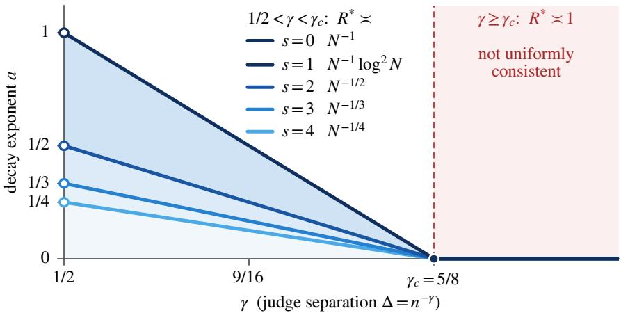
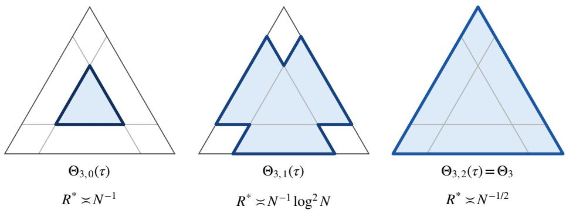
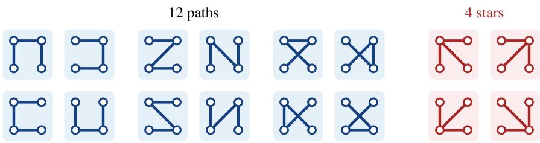
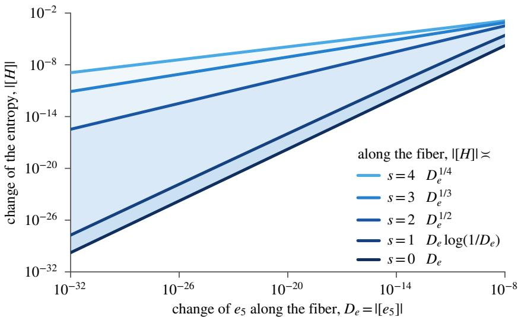
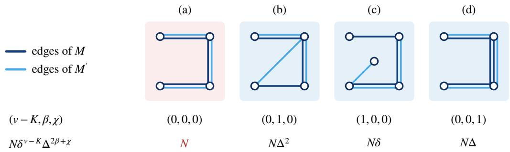
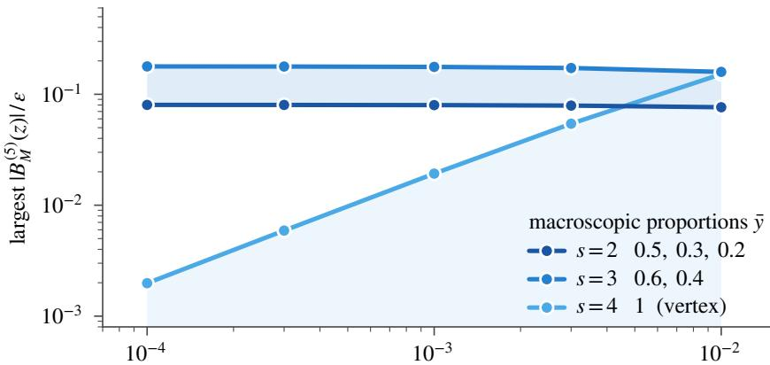
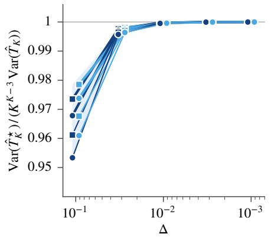
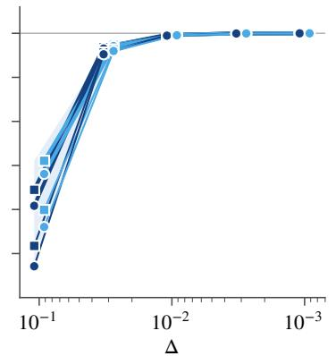
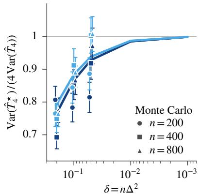

# RARITY DETERMINES MINIMAX RATES OF SEMANTIC ENTROPY FROM WEAK PAIRWISE JUDGMENTS WITH A KNOWN CHANNEL

A PREPRINT

Xiaoli Yu School of Cyber Security and Information Law Chongqing University of Posts and Telecommunications Chongqing 400065, China

Jiamiao Liu† Department of Information, Xinqiao Hospital Army Medical University (Third Military Medical University) Chongqing 400037, China ljm6046@163.com

## ABSTRACT

The semantic entropy of a language model is the entropy of the meanings of its sampled answers. The meanings are never observed, and the entropy is estimated from the verdicts of a pairwise equivalence judge. Given the meanings of n answers, a known channel declares each pair equivalent independently, with probability $q + \Delta$ within a meaning and q across meanings. At most K meanings occur, and q is bounded away from 0 and 1. For a weak judge, with $n { \Delta } ^ { 2 } \stackrel { - } {  } 0 .$ , the global minimax rate is set by distributions near a vertex of the simplex and overstates the difficulty elsewhere. We show that the difficulty is set by how many meanings can be rare. Over distributions with at most s meanings below a fixed probability $\tau < 1 / ( K - s )$ , the minimax squared risk is of order $N ^ { - 1 / s }$ for $s \geq 2 , N ^ { - 1 } \log ^ { 2 } ( e + N )$ for s = 1 and N−1 for s = 0, capped at one, where $N = n ^ { K } \Delta ^ { 2 K - 2 }$ . The matching lower bounds hold on every fixed polynomial window $n \Delta ^ { 2 } \leq n ^ { - \kappa }$ . One estimator attains these rates without knowing s or τ: it averages products of centered verdicts along all spanning trees of every k-set of answers, projects the resulting power sums onto the valid moment set and inverts them. The case $s = K - 1$ gives the global rate $N ^ { - 1 / ( K - 1 ) }$ and the consistency threshold: with $\Delta = n ^ { - \gamma }$ the entropy is uniformly consistently estimable exactly when $\gamma < \dot { K / ( 2 K - 2 ) }$ On polynomial windows, the same estimator attains the sharp local minimax constant on shrinking neighborhoods of interior points with distinct probabilities. Restricting the average to stars multiplies the constant by $K ^ { K - 3 }$

Keywords entropy estimation · large language models · minimax rates · stochastic block model

## 1 Introduction

Semantic entropy scores a language model’s uncertainty about a prompt by the entropy of the distribution of meanings among its sampled answers [1, 2]. The meanings are never observed: an equivalence judge compares the answers in pairs, and the entropy is estimated from its verdicts. This paper determines what makes the entropy hard to estimate when the judge is weak.

Table 1: Minimax Squared Risk of the Semantic Entropy From a Known Pairwise Judge
<table><tr><td>setting</td><td>minimax squared risk</td><td>matching lower bound proved on</td></tr><tr><td>at most 3 meanings, all distributions [3]</td><td>min  $\{ 1 , ( n ^ { 3 } \Delta ^ { 4 } ) ^ { - 1 / 2 } \}$ </td><td>the whole window  $n \Delta ^ { 2 } \leq c _ { 1 }$ </td></tr><tr><td>at most 4 meanings, all distributions [4]</td><td> $\operatorname* { m i n } \{ 1 , \dot { ( } n ^ { 4 } \Delta ^ { 6 } ) ^ { - 1 / 3 } \}$ </td><td>every fixed window  $n { \Delta } ^ { 2 } \leq n ^ { - \kappa }$ </td></tr><tr><td>K meanings, at most  $s \geq 2$  rare</td><td> $\operatorname* { m i n } \{ 1 , N ^ { - 1 / s } \}$ </td><td>every fixed window  $n { \Delta } ^ { 2 } \leq n ^ { - \kappa }$ </td></tr><tr><td>K meanings, at most one rare</td><td> $\operatorname* { m i n } \bar { \{ 1 , N ^ { - 1 } \log ^ { 2 } ( e + N ) \} }$ </td><td>every fixed window  $n { \Delta } ^ { 2 } \leq n ^ { - \kappa }$ </td></tr><tr><td>K meanings, none rare</td><td> $\operatorname* { m i n } \{ 1 , N ^ { - 1 } \}$ </td><td>every fixed window  $n { \Delta } ^ { 2 } \leq n ^ { - \kappa }$ </td></tr><tr><td>shrinking  $\ell _ { 2 }$  ball of radius  $h _ { n }$  about an interior  $\theta _ { 0 }$  with distinct coordinates</td><td> $( 1 + o ( 1 ) ) \mathcal { V } ( \theta _ { 0 } ) / N$ </td><td> $\begin{array} { r } { n \Delta ^ { 2 } \leq n ^ { - \kappa } , \kappa < \frac { 1 } { K - 1 } , N  \infty , } \end{array}$   $h _ { n } \to 0 , h _ { n } { \sqrt { N } } \to \infty$ </td></tr></table>

The channel parameter $q \in [ q _ { 0 } , 1 - q _ { 0 } ] ,$ , the rarity threshold τ and the window exponent $\kappa > 0$ are fixed, and $N =$ $n ^ { K } \Delta ^ { 2 K - 2 }$ . The first five rows hold up to multiplicative constants. The first two rows report concurrent work, and $c _ { 1 } > 0$ in the first row is a constant. The last row, for fixed $q \in ( 0 , 1 )$ , gives the local asymptotic minimax constant $\mathcal { V } ( \theta _ { 0 } ) = ( K ! / K ^ { K } ) \Lambda ( \theta _ { 0 } ) ^ { 2 } ( q ( 1 - q ) ) ^ { K - 1 }$ , where $\begin{array} { r } { \Lambda ( \theta _ { 0 } ) = \int _ { 0 } ^ { \infty } \mathrm { d } t / \prod _ { c } ( t + \theta _ { 0 , c } ) } \end{array}$

We model the judge as a known binary channel. Each of n answers carries a meaning, and the meanings are independent draws from an unknown distribution $\theta$ on at most K meanings. Given the meanings, the judge declares two answers equivalent with probability $q + \Delta$ if they share a meaning and with probability q otherwise, independently across pairs. The verdicts thus form a stochastic block model on the complete graph, with $\bar { K }$ communities of proportions $\theta ,$ edge probability $q + \Delta$ within communities and q between them. The target is the entropy $H ( \theta )$ of the proportions, not the partition.

We study the weak regime $n \Delta ^ { 2 }  0$ , in which the $n - 1$ verdicts on one answer have a signal-to-noise ratio of order $n \Delta ^ { 2 } / ( q \dot { ( 1 - q ) } )$ about its meaning. For at most three meanings, q bounded away from 0 and 1, a fixed distribution with no meaning of probability one, and $\Delta = n ^ { - \gamma }$ with $\gamma > 1 / 2 ,$ , no estimator of an answer’s meaning has asymptotically smaller error probability than guessing the most likely meaning, even given the meanings of all other answers [3]. The entropy can still be estimated consistently in part of this regime. Concurrent analyses of at most three [3] and at most four meanings [4] give global minimax rates, set by a least-favorable family that approaches a vertex of the simplex. In that family one meaning, called macroscopic, has probability bounded away from zero, and all others are rare. These rates do not distinguish distributions by how many meanings are rare, and for $K \geq 5$ the rate was open.

We show that the difficulty is set by how many meanings can be rare. For $0 \leq s \leq K - 1$ and a fixed $\tau \in ( 0 , 1 / ( K - s ) )$ let $\Theta _ { K , s } ( \tau )$ be the distributions on K meanings with at most s probabilities below τ. With $N : = \dot { n ^ { K } } \Delta ^ { 2 K - 2 } ,$ , the minimax squared risk over $\Theta _ { K , s } ( \tau )$ is of order $\psi _ { s } ( N )$ , that is, min $\{ 1 , N ^ { - 1 / s } \}$ for $s \geq 2$ , min $\{ 1 , N ^ { - 1 } \log ^ { 2 } ( e + N ) \}$ for $s = 1$ and min $\{ 1 , N ^ { - 1 } \}$ for $s = 0 ,$ , on every fixed polynomial window $n \Delta ^ { 2 } \leq n ^ { - \kappa }$ . One estimator attains all of these rates without knowing s or τ. These windows cover $\Delta = n ^ { - \gamma }$ for every fixed $\gamma > 1 / 2$ , which is the whole weak regime in this parametrization. For $s = K - 1$ and $\tau \leq 1 / K$ the class is the whole simplex, which gives the global rate min $\{ 1 , N ^ { - 1 / ( K - 1 ) } \}$ for every K and the consistency threshold $\gamma _ { c } ( K ) = K / ( 2 K - 2 )$ conjectured in [4]. The classes share this threshold and differ in the rate.

## 1.1 Main Contributions

The contributions of this paper are as follows.

1) Minimax rates graded by rarity. Matching upper and lower bounds of order $\psi _ { s } ( N )$ hold on every fixed polynomial window, for every $K \geq 3$ and every class, and one all-tree moment estimator attains these rates adaptively. Over the whole simplex this gives the rate min $\{ 1 , N ^ { - 1 / ( K - 1 ) } \}$ } for every K. With no window condition, the entropy is uniformly consistently estimable over every class exactly when $N  \infty$ , that is, when $\gamma < K / ( 2 K - 2 )$ for $\Delta = n ^ { - \gamma }$ . Replacing the exact projection by a grid search keeps the rates and makes the estimator polynomial-time for every fixed K. For $K \leq 5$ it needs one $n \times n$ matrix product and $O ( n ^ { 2 } )$ further operations.

2) An information inequality that reaches the mixedfaces. For finite-order sweeps of the likelihood score in weak pairwise experiments we prove an exact identity for small motifs, a uniform coefficient bound for all motifs, a pairing bound for overlapping motifs and a bound on the Taylor remainder. No step needs a single macroscopic meaning, so the inequality reaches the mixed faces of the simplex, which have two or more positive coordinates, and with them the classes $s < K - 1$

3) A one-sided local transfer. For $\theta \in \Theta _ { K , s } ( \tau )$ and every $\theta ^ { \prime }$ in the simplex, $| H ( \theta ) - H ( \theta ^ { \prime } ) |$ is at most a constant times $D _ { e } ^ { 1 / s } \mathrm { f o r } s \ge 2 , D _ { e } \log ( e / D _ { e } )$ for $s = 1$ and $D _ { e }$ for $s = 0$ , where $D _ { e }$ is the $\ell _ { 1 }$ distance between the coefficients of $\Pi _ { c } ( z - \theta _ { c } )$ and $\Pi _ { c } ( z - \theta _ { c } ^ { \prime } )$ . As $\theta ^ { \prime }$ is unrestricted, the bound applies to the projected estimate even when it leaves the class, and this is what lets one estimator adapt to s and τ. For $s \geq 2$ the exponent $1 / s$ cannot be improved.

  
Figure 1: Polynomial decay exponent a of the minimax squared risk for the semantic entropy, $R ^ { * } = n ^ { - a + o ( 1 ) }$ , when $\Delta = n ^ { - \gamma }$ and $q \in [ q _ { 0 } , 1 - q _ { 0 } ]$ is fixed, for $K = 5$ possible meanings of which at most s have probability below a fixed $\tau \in ( 0 , 1 / 5 )$ . Here $N = n ^ { 5 } \dot { \Delta } ^ { 8 }$ . The classes $s = 0$ and $s = 1$ have the same exponent and share the darkest curve, and for $s = 1$ the risk carries an extra factor $\log ^ { 2 }$ n wherever $a > 0$ . The rates are matched for every fixed $\gamma > 1 / 2 ,$ and open circles mark the excluded endpoint $\gamma = 1 / 2$ , where ${ \boldsymbol { \mathrm { 2 } } } { \boldsymbol { \Delta } } ^ { 2 } = 1$ . Every class loses uniform consistency at the same $\gamma _ { c } \overset { \cdot } { = } K / ( 2 \hat { K } - 2 ) = 5 / 8$

4) The sharp local constant. On every fixed polynomial window with $N  \infty$ and at interior points with distinct probabilities, $N$ times the local minimax risk converges to an explicit constant, which the same estimator attains. Along the interior fiber an information equality holds. Averaging over stars instead of all trees multiplies the constant by $K ^ { K - 3 }$

## 1.2 Proof Techniques

The estimator averages, over all spanning trees of every set of k answers, the product of the centered verdicts $\left( { { A _ { i j } } - q } \right) / \Delta$ along the edges of the tree, where $A _ { i j } \in \{ 0 , 1 \}$ is the verdict on answers i and $j$ . These averages are unbiased for the power sums $\begin{array} { r } { P _ { k } = \sum _ { c } \theta _ { c } ^ { k } } \end{array}$ , and the estimator projects them onto the valid moment set and solves for the distribution. Two facts explain the hierarchy. First, the last power sum is the statistical bottleneck: with $\delta : = n \Delta ^ { 2 } , P _ { k }$ is estimated at the scale $\mathbf { \bar { \cal N } } _ { k } : = n \delta ^ { k - 1 }$ , and $N _ { k } / N _ { K }  \infty$ for $k < K$ . Second, the entropy, as a function of the coefficients of $\Pi _ { c } ( z - \theta _ { c } )$ , has a local modulus $x ^ { 1 / s }$ for $s \geq 2 ,$ , set by the number of roots that can approach zero, whatever the other roots do. The upper bound rests on a one-sided form of this modulus: the projected estimate may leave the class, and a Rouché argument returns it to $\Theta _ { K , s } ( \tau / 2 )$

The lower bounds use fibers that move only the constant term of $\Pi _ { c } ( z - \theta _ { c } )$ : they keep $P _ { 2 } , \dots , P _ { K - 1 }$ fixed, and for $s \geq 2$ they move $P _ { K }$ by order $\varepsilon ^ { s }$ while the entropy moves by order ε. We bound the Fisher information of the verdict graph along such a fiber through a finite-order sweep of the likelihood score. For four meanings the concurrent analysis [4] uses majority-vertex counting, which gains a factor of the probability scale of the rare meanings for every vertex labeled with the single macroscopic meaning, and so needs such a meaning. Our information inequality needs none: Cauchy estimates on a complex polydisc, used in [4] to prove this factor, here bound every coefficient of the sweep uniformly.

At an interior point $\theta _ { 0 }$ with distinct probabilities, N times the local minimax risk on shrinking neighborhoods tends to $( K ! / K ^ { K } ) \Lambda ( \dot { \theta _ { 0 } } ) ^ { 2 } ( q ( \dot { 1 } - q ) ) ^ { K - 1 }$ , where Λ is the derivative of the entropy in $e _ { K } : = \prod _ { c } \theta _ { c }$ with the other coefficients of $\dot { \prod } _ { c } ( z - \dot { \theta } _ { c } )$ fixed. Along the fiber that moves only $e _ { K }$ , the sweep of order K bounds the Fisher information, up to a factor $1 + o ( 1 )$ , by the contribution of the spanning trees of $K$ answers, each paired with itself. The van Trees inequality then gives the lower bound. A delta method controlled by fourth moments gives the matching upper bound. A star average, which uses K of the $K ^ { K - 2 }$ spanning trees of each $K { \mathrm { - s e t } }$ , loses the factor $K ^ { K - 3 }$

## 1.3 Related Work

## 1.3.1 Concurrent Analyses

For at most three meanings and q bounded away from 0 and 1, the entropy is uniformly consistently estimable for $\Delta = n ^ { - \gamma }$ with $\gamma < 3 / 4$ , and the minimax squared risk is of order min $\{ 1 , ( n ^ { 3 } \Delta ^ { 4 } ) ^ { - 1 / 2 } \}$ on the whole window $n \Delta ^ { 2 } \leq c _ { 1 } [ 3 ]$ . With at most four meanings the rate is min $\{ 1 , ( n ^ { 4 } \Delta ^ { 6 } ) ^ { - 1 / 3 } \}$ on every fixed polynomial window, and the threshold $\gamma _ { c } ( K ) = K / ( 2 K - 2 )$ was conjectured for K meanings [4]. On the complete graph, the rarity-graded rates contain this rate and threshold as the case $\mathbf { \bar { \boldsymbol { K } } } = 4 , s = 3 .$ , and give the three-meaning rate on polynomial windows. We prove the conjectured threshold for every K. Table 1 lists these rates beside ours, and Figure 1 shows for $K = 5$ that all classes share the threshold.

We share with the two concurrent analyses the model, the moment-projection approach and the sweep identity, and with the four-meaning analysis the pairing of overlapping motifs and the remainder framework, which we establish for general K. Both analyses also treat channel calibration and query design. Our proofs differ from theirs in the uniform coefficient bound, which replaces majority-vertex counting and makes the mixed faces, and with them the classes $s < K - 1$ , accessible; in the one-sided transfer behind adaptation; and in the sharp constant.

## 1.3.2 Semantic Entropy and Noisy Judges

Semantic entropy was introduced with bidirectional-entailment clustering [1], and its discrete form, the entropy of the cluster proportions, detects hallucinations [2]. Later work estimates the same cluster entropy from fewer samples [5], corrects it for meanings not yet observed [6, 7], or changes the uncertainty functional, through a semantic kernel [8], pairwise similarities [9] or the degrees and Laplacian spectrum of a similarity graph [10]. These papers do not derive the minimax entropy risk under a noisy equality channel. Liu [11] analyzes the same observation model with a spectral-clustering plug-in, whose guarantee applies where clustering errors are small. The all-tree estimator does not cluster the answers, and its upper bound holds for every channel, the weak regime included.

## 1.3.3 Entropy Estimation and Block Models

With observed labels, the entropy on a fixed alphabet has minimax rate $1 / n$ , and on large alphabets its minimax rates follow from best polynomial approximation [12, 13]. Seen through a weak judge, the class $s = 0$ has the rate min $\{ 1 , 1 / N \}$ on every fixed polynomial window, so the judge replaces n by N, and each additional rare meaning slows the rate further.

For block models and related observation models, the information-theoretic literature characterizes the recovery of the labels themselves: exact recovery of two communities has a sharp threshold [14]. For pairwise difference measurements passed through general channels, the feasibility of exact recovery is governed by channel divergence measures and the minimum cut of the measurement graph [15]. In the sparse two-community planted partition model with edge probabilities $a / n$ and $b / n$ , neither a partition correlated with the truth nor consistent estimates of $( a , b )$ exist when $\bar { ( } a - b ) ^ { 2 } < 2 ( \dot { a } + b ) [ 1 6 ]$

When the expected degree grows faster than log n and no two rows of the matrix of edge probabilities coincide, the maximum likelihood and variational estimators of block-model parameters are asymptotically normal [17]. That result is pointwise. Measured uniformly, estimation is much slower near models whose classes are nearly alike: in the two-class affiliation model with equal proportions and edge probabilities symmetric about $1 / 2$ , the minimax squared risk for the gap between the within-class and between-class probabilities is of order $1 / n$ rather than $1 / n ^ { 2 }$ , and lower bounds of this order hold locally around every block model [18].

Our verdict graph is an affiliation model near the same boundary with the roles reversed: the gap $\Delta \to 0$ is known, and the proportions of the meanings are unknown. On every fixed polynomial window $n \Delta ^ { 2 } \le \bar { n } ^ { - \kappa }$ the rates are set by ${ \cal N } \stackrel { * } { = } n ^ { \dot { \cal K } } \Delta ^ { 2 { \cal K } - 2 }$ rather than by n. They hold uniformly over each rarity class, and the sharp constant holds uniformly over shrinking neighborhoods. The consistency threshold needs no window: the entropy is uniformly consistently estimable exactly when $N \to \infty$

## 1.3.4 Subgraph Statistics and Moments

Noise-corrected subgraph products [19] give our tree statistics, and moments of small subgraphs have been used to estimate block-model parameters [20, 21]. Bravo-Hermsdorff et al. [22] estimate the collision probability $P _ { 2 }$ from equality indicators of disjoint pairs of samples, each passed through a channel of the same form as ours. Spectrum estimation also inverts unbiased moment estimates: the moments of a covariance spectrum are traces of matrix powers, which Kong and Valiant [23] estimate without bias by averaging products of sample inner products along cycles of distinct samples. For equality indicators the product along any connected graph on k answers is the indicator that they share a meaning, and spanning trees are the connected graphs with the fewest edges, $k - 1$ , so each tree product carries the fewest noise factors.

## 1.3.5 Moment Hierarchies at Low Signal-to-Noise Ratio

In i.i.d. Gaussian latent-variable models at low signal-to-noise ratio (SNR), the information about the parameter is graded by moment order. For Gaussian mixtures with a common covariance, Katsevich and Bandeira [24] expand the population log-likelihood in powers of the SNR. They show that its maximization reduces to a sequence of least-squares problems that match the moments one order at a time. In the discrete orbit recovery model at high noise, the Fisher information at a generic signal has a graded eigenvalue structure determined by the invariant polynomials of the group, and the maximum likelihood estimator of an invariant of degree k has asymptotic variance $O ( \mathrm { S N R } ^ { - k } / n ) [ 2 5 ]$ In Gaussian latent-variable models with a known latent distribution, optimally weighted moments of the minimal identifying orders match the first-order efficiency of maximum likelihood, and different directions become informative at different moment orders [26].

These results take $n \to \infty$ at a fixed noise level and send the SNR to zero afterwards. The joint regime, in which the SNR tends to zero with $^ { n , }$ is identified as open in [26]. Our verdicts are dependent through the shared labels, and $\Delta = \Delta _ { n }$ tends to zero with n. The power sum $P _ { k }$ , an invariant of degree k under relabeling, is estimated at the scale $N _ { k } = \ddot { n ( n \Delta ^ { 2 } ) ^ { k - 1 } }$ , so $n \Delta ^ { 2 }$ takes the place of the SNR in the grading. The least-favorable direction moves only the last power sum, and the unweighted all-tree estimator attains the local minimax constant in this joint limit. Our rarity hierarchy has a different source: every class has the scale N of the last power sum, and the number of coordinates that can vanish sets the modulus with which the entropy responds to that power sum.

## 1.3.6 Local Rates Governed by Root Structure

Hundrieser et al. [27] quantify the local minimax risk of recovering an atomic signal from a Poisson convolution as a function of the clustering structure of its atoms, under a multiscale loss, with estimators that adapt to that structure. Here the target is a functional rather than the atoms: only roots that approach zero create the singularity of the entropy, collisions of positive roots do not affect the transfer, and the matching information bound concerns a dependent graph experiment.

For finite mixtures, Wu and Yang [28] develop denoised moment methods, Heinrich and Kahn [29] establish local minimax rates, and Le et al. [30] characterize configuration-dependent rates of the maximum likelihood estimator. Wu and Yang [28] obtain their rates from moment comparison inequalities, which bound the distance between mixing distributions by the difference of their moments. The one-sided local transfer plays this role for the entropy. The fibers that move only the constant term show that the exponent of the transfer cannot be improved: along them s roots within ε of zero change the coefficients of $\Pi _ { c } ( z - \theta _ { c } )$ only by order $\varepsilon ^ { s }$ , while the entropy moves by order ε. Hölder continuity of the roots of a polynomial in its coefficients [31] is the geometric background of the exponent $1 / s$ . We prove the transfer directly from the integral representation of Jozsa and Mitchison [32].

## 1.3.7 Lower Bounds

Low-degree methods give computational lower bounds for estimation [33], including for distinguishing planted models [34]. Our bounds are information-theoretic: they control the Fisher information of the full likelihood, a sum over all $K ^ { n }$ labelings, through sweeps whose conditional mean given the verdicts is the observed score. The sharp constant uses the van Trees inequality [35], and its attainment uses a fourth-moment bound of the hypercontractive type of Bonami [36].

## 1.4 Notation

We write $[ K ] : = \{ 1 , \ldots , K \}$ and $\begin{array} { r } { \Theta _ { K } : = \{ \theta \in [ 0 , 1 ] ^ { K } : \sum _ { c } \theta _ { c } = 1 \} } \end{array}$ . For $\begin{array} { r } { \theta \in \Theta _ { K } , P _ { k } = P _ { k } ( \theta ) : = \sum _ { c } \theta _ { c } ^ { k } } \end{array}$ are the power sums, $\overline { { P ( \theta ) } } \overset { \cdot } { : } = \left( P _ { 2 } , \cdot \cdot \cdot , P _ { K } \right)$ , and $e _ { j } = e _ { j } ( \theta )$ are the elementary symmetric polynomials, with $e _ { 0 } = 1$ and $e _ { 1 } = 1 \mathrm { o n } \Theta _ { K }$

$$
p _ { \theta } ( z ) : = \prod _ { c } ( z - \theta _ { c } ) = \sum _ { j = 0 } ^ { K } ( - 1 ) ^ { j } e _ { j } ( \theta ) z ^ { K - j } , \qquad \bar { p } _ { \theta } ( t ) : = \prod _ { c } ( t + \theta _ { c } ) = \sum _ { j = 0 } ^ { K } e _ { j } ( \theta ) t ^ { K - j } .
$$

The entropy is $\begin{array} { r } { H ( \theta ) : = - \sum _ { c } \theta _ { c } } \end{array}$ log $\theta _ { c }$ , with the natural logarithm and 0 log $0 : = 0$ . We write $\mathbf { 1 } \{ \cdot \}$ for an indicator, $\mathrm { B e r n } ( r )$ for the Bernoulli law with mean $r , \mathrm { T V }$ for the total variation distance, $\| \cdot \|$ for the Euclidean norm, $\| \cdot \| _ { 1 }$ for the $\ell _ { 1 }$ norm and $\mathbf { e } _ { c } \in \mathbb { R } ^ { K }$ for the c-th basis vector. The letters $C$ and c denote positive constants whose dependence is stated in each result and whose values may change from line to line. The constants implied by $O ( \cdot ) , \lesssim$ and ≍ depend only on the parameters listed in the statement at hand and, unless stated otherwise, are uniform in $n , \Delta , q$ in the stated channel range, the labels, the path coordinate u and the amplitude of a fiber. An asymptotic statement in n holds along every sequence of admissible parameters and uniformly over the parameter set stated with it, and its rates of convergence are those displayed.

## 2 Problem Formulation

## 2.1 Observation Model

A language model is sampled n times on one prompt. Answer i has a meaning $Z _ { i } \in [ K ]$ , and $Z _ { 1 } , \ldots , Z _ { n }$ are i.i.d. from $\theta \in \Theta _ { K }$ , where $K \geq 3$ is a known upper bound on the number of meanings and zero coordinates are allowed. The target is the entropy $H ( \theta )$ . A judge compares every pair of answers and reports $A _ { i j } \in \{ 0 , 1 \}$ . Given the meanings, the verdicts are independent, with

$$
A _ { i j } \mid Z \sim \mathrm { B e r n } { \bigl ( } q + \Delta \mathbf { 1 } \{ Z _ { i } = Z _ { j } \} { \bigr ) } , \qquad 1 \leq i < j \leq n .\tag{1}
$$

The channel $( q , \Delta ) , 0 \leq q < q + \Delta \leq 1$ , is known: it can be calibrated from pairs of answers with known meanings, at no cost in the rate for at most three meanings [3]. Each verdict models a separate query of the judge on one pair. We write

$$
p : = q + \Delta , \qquad W _ { i j } : = { \bf 1 } \{ Z _ { i } = Z _ { j } \} , \qquad \delta : = n \Delta ^ { 2 } , \qquad N _ { k } : = n \delta ^ { k - 1 } , \qquad N : = N _ { K } = n ^ { K } \Delta ^ { 2 K - 2 } .
$$

## 2.2 Minimax Risk and Rarity Classes

For $\Theta \subseteq \Theta _ { K }$ the minimax risk is

$$
R ^ { * } ( \Theta ) : = \operatorname* { i n f } _ { \widehat { H } } \operatorname* { s u p } _ { \theta \in \Theta } \mathbb { E } _ { \theta } \big ( \widehat { H } - H ( \theta ) \big ) ^ { 2 } ,
$$

the infimum running over all estimators ${ \widehat { H } } = { \widehat { H } } ( A , { \Xi } )$ with Ξ auxiliary randomness independent of $( Z , A )$ . For $0 \leq s \leq K - 1$ and $0 < \tau < 1 / ( K - s )$ , let

$$
\Theta _ { K , s } ( \tau ) : = \{ \theta \in \Theta _ { K } : \mathrm { ~ a t ~ l e a s t } K - s \mathrm { c o o r d i n a t e s ~ o f } \theta \mathrm { ~ a r e ~ a t ~ l e a s t } \tau \} ,
$$

the distributions in which at most s meanings are rare. Zero coordinates count as rare, and τ does not depend on n. $\mathrm { A t } \tau = 1 / ( K - s )$ every member would have $K - s$ coordinates equal to $1 / ( K - s )$ and entropy $\log ( K - s )$ , so the restriction $\tau < 1 / ( K - s )$ excludes only that degenerate class. For $\bar { \tau } \leq 1 / \dot { K } , \Theta _ { K , K - 1 } ( \tau ) = \Theta _ { K } ^ { - }$ . Figure 2 shows the classes for $K = 3$ . The rates are

$$
\begin{array} { r l } & { \psi _ { s } ( x ) : = \operatorname* { m i n } \bigl \{ 1 , x ^ { - 1 / s } \bigr \} \quad ( 2 \leq s \leq K - 1 ) , } \\ & { \psi _ { 1 } ( x ) : = \operatorname* { m i n } \bigl \{ 1 , x ^ { - 1 } \log ^ { 2 } ( e + x ) \bigr \} , \qquad \psi _ { 0 } ( x ) : = \operatorname* { m i n } \bigl \{ 1 , x ^ { - 1 } \bigr \} . } \end{array}
$$

  
Figure 2: Rarity classes $\Theta _ { 3 , s } ( \tau )$ for $K = 3$ possible meanings and $\tau = 0 . 2 .$ , in the simplex $\Theta _ { 3 }$ drawn as a triangle whose vertices are the distributions concentrated on one meaning, with gray lines at $\theta _ { c } = \tau$ h h d d l $\Theta _ { 3 , s } ( \tau )$ holds the distributions with at least $3 - s$ coordinates of at least τ, so $\Theta _ { 3 , 0 } ( \tau ) \subset \Theta _ { 3 , 1 } ( \tau ) \subset \Theta _ { 3 , 2 } ( \tau ) = \Theta _ { 3 }$ . Under each class is the order of its minimax squared risk for large $N = n ^ { 3 } \Delta ^ { 4 }$ under the conditions of Theorem 1(ii).

Algorithm 1 All-Tree Moment Estimator   
Require: verdicts $( A _ { i j } ) _ { i < j } ,$ channel $( q , \Delta )$ , number K of possible meanings   
1: $\dot { \boldsymbol X } _ { i j } \gets ( A _ { i j } - \dot { \boldsymbol q } ) \ddot { / } \Delta$ for $i \neq j$   
2: $\begin{array} { r } { \widehat { T } _ { k } \gets \left( \binom { n } { k } k ^ { k - 2 } \right) ^ { - 1 } \sum _ { | V | = k } \sum _ { \mathrm { t } } } \end{array}$ spanning tree of V $\Pi _ { e \in } X _ { e }$ for $k = 2 , \ldots , K$   
3: Pe ← a Euclidean nearest point of $( \widehat { T } _ { 2 } , \dots , \widehat { T } _ { K } )$ in $\mathcal { M } _ { K } .$ , chosen by a fixed rule   
4: θb ← the roots of $\sum _ { j = 0 } ^ { K } ( - 1 ) ^ { j } \tilde { e } _ { j } z ^ { K - j }$ , with ${ \tilde { e } } _ { j }$ computed from $\widetilde { P }$ by Newton’s identities   
5: return ${ \widehat { H } } : = H ( { \widehat { \theta } } ) $   
12 paths 4 stars   
JINNXX   
KZ

  
Figure 3: The $1 6 = 4 ^ { 4 - 2 }$ labeled spanning trees of a set of four answers placed at the corners of a square: 12 paths, grouped by shape, and 4 stars. Given the meanings, the product of the centered verdicts $\mathbf { \hat { \boldsymbol { X } } } _ { e }$ along the edges of any of them has conditional mean 1 if the four answers share a meaning, and 0 otherwise. The all-tree average averages these products over all trees of all 4-sets, and the star average over the stars alone. For $K = 4 ,$ , restricting to the stars multiplies the leading variance of $\widehat { T } _ { 4 }$ by $K ^ { K - 3 } = 4$

## 2.3 The All-Tree Moment Estimator

Let $X _ { i j } : = ( A _ { i j } - q ) / \Delta$ . Given the meanings, distinct pairs are independent and $\mathbb { E } [ X _ { i j } \mid Z ] = W _ { i j }$ , so the product of the $X _ { e }$ over the edges of any tree on k answers has mean $P _ { k }$ , the probability that k answers share a meaning. Such noise-corrected subgraph products are those of Chang et al. [19]. For $2 \leq k \leq K$ let $\mathcal { T } _ { k }$ be the set of labeled spanning trees of the k-subsets of [n], so that $\textstyle | \mathcal{ T } _ { k } | = { \binom { n } { k } } k ^ { k - 2 }$ by Cayley’s formula (Figure 3 shows the 16 trees of a 4-set). The all-tree average

$$
{ \widehat { T } } _ { k } : = { \frac { 1 } { | T _ { k } | } } \sum _ { \sf t \in { T } _ { k } } \prod _ { e \in { \sf t } } X _ { e }\tag{2}
$$

is therefore unbiased for $P _ { k }$ . Newton’s identities recover the elementary symmetric polynomials $e _ { 1 } , \ldots , e _ { K }$ of θ, and hence its coordinates up to permutation, from $( P _ { 2 } , \dots , P _ { K } )$ , since $P _ { 1 } = 1$ . The estimator projects $\widehat { T } : = ( \widehat { T } _ { 2 } , \ldots , \widehat { T } _ { K } )$ onto the moment set $\bar { \mathcal { M } } _ { K } \overset { \cdot } { : = } \left\{ P ( \theta ) : \theta \in \Theta _ { K } \right\}$ and inverts the moment map (Algorithm 1).

Every k-set carries exactly k stars, with distinct centers, and replacing the average over all spanning trees of a k-set by the average over its stars gives the star average

$$
{ \widehat { T } } _ { k } ^ { \star } : = { \frac { 1 } { k { \binom { n } { k } } } } \sum _ { i = 1 } ^ { n } \sum _ { S \subseteq [ n ] \setminus \{ i \} , \ | S | = k - 1 } \prod _ { j \in S } X _ { i j } ,\tag{3}
$$

which is also unbiased for $P _ { k }$ . We write $\widehat { H } ^ { \star }$ for the output of Algorithm 1 with $\widehat { T }$ replaced by $\widehat { T } ^ { \star } : = ( \widehat { T } _ { 2 } ^ { \star } , \ldots , \widehat { T } _ { K } ^ { \star } )$

## 3 Main Results

## 3.1 Minimax Rates Graded by Rarity

Theorem 1 (Rarity-Graded Minimax Rates). Fix $K \geq 3 , 0 \leq s \leq K - 1 a n d 0 < \tau < 1 / ( K - s ) .$

(i) There is $C _ { U }$ depending only on $( K , s , \tau )$ such that for every n $\geq 2 K$ , every channel $0 \leq q < q + \Delta \leq 1$ and every $\theta \in \Theta _ { K , s } ( \tau )$ , Algorithm 1 satisfies $\mathbb { E } _ { \theta } ( \widehat { H } - H ( \theta ) ) ^ { 2 } \le C _ { U } \psi _ { s } ( \operatorname* { m i n } \{ n , N \} ) ; i f n \Delta ^ { 2 } \le 1$ , this is $C _ { U } \psi _ { s } ( N )$

(ii) Fix also $q _ { 0 } \in ( 0 , 1 / 2 ]$ and $\kappa \in ( 0 , 1 )$ . There are $c _ { L } > 0$ and $n _ { L }$ depending only on $( K , s , \tau , q _ { 0 } , \kappa )$ such that for all $n \ge n _ { L } , q \in [ q _ { 0 } , 1 - q _ { 0 } ]$ and $\Delta > 0$ with $\phantom { } _ { \ell } \Delta ^ { 2 } \leq n ^ { - \kappa } , R ^ { * } ( \Theta _ { K , s } ( \tau ) ) \geq c _ { L } \dot { \psi } _ { s } ( \dot { N } )$

  
Figure 4: Change $| [ H ] |$ of the entropy against the change $D _ { e } = | [ e _ { 5 } ] |$ | of $e _ { 5 } = \Pi _ { c } \theta _ { c }$ between the two endpoints of the leastfavorable fibers of Section 5.1, for $K = 5$ possible meanings and $\tau = 0 . 0 5 \colon$ the mixed fiber for $s = 2 , 3 , 4$ , the fiber for $s = 1$ and the perturbation for $s = 0$ , at four amplitudes $\varepsilon \left( \mathrm { o r } \eta \right)$ per decade, computed from the roots of $p _ { \tau }$ u in 160-digit arithmetic. Only $e _ { 5 }$ moves along each fiber, so $D _ { e }$ is the distance in the one-sided transfer, and the entropy responds with its modulus $\phi _ { s } ( D _ { e } )$ . At $D _ { e } = N ^ { - 1 / 2 }$ the square of this modulus is of the order of the rate $\psi _ { s } ( N )$

The estimator uses only $( K , q , \Delta )$ , so part (i) holds for every class at once: the same estimator adapts to the unknown number of rare meanings and to τ. The upper bound needs no lower bound on q and no window, while the lower bound holds on every fixed polynomial window, with constants that depend on $\kappa .$

Corollary 1 (Global Rate and Threshold). (i) For $\tau \le 1 / K , \Theta _ { K , K - 1 } ( \tau ) = \Theta _ { K }$ , and under the conditions of Theorem 1(ii), $R ^ { * } ( \Theta _ { K } ) \asymp \operatorname* { m i n } \{ 1 , N ^ { - 1 / ( K - 1 ) } \}$ , with constants depending only on $( K , q _ { 0 } , \kappa )$

(ii) Let $q _ { n } \in [ q _ { 0 } , 1 - q _ { 0 } ]$ and $\Delta _ { n } > 0$ with $q _ { n } + \Delta _ { n } \leq 1$ . Estimators $\widehat { H } _ { n }$ with $\begin{array} { r } { \operatorname* { s u p } _ { \theta \in \Theta _ { K , s } ( \tau ) } \mathbb { E } _ { \theta } ( \widehat { H } _ { n } - H ( \theta ) ) ^ { 2 } \to 0 } \end{array}$ exist ifand only $i f n ^ { K } \Delta _ { n } ^ { 2 K - 2 } \to \infty$ . For $\Delta _ { n } = n ^ { - \gamma }$ this holds exactly when $\gamma < K / ( 2 K - 2 )$ ,for every s and τ .

Part (ii) needs no window condition: if $n ^ { K } \Delta _ { n } ^ { 2 K - 2 }$ stays bounded along a subsequence, then eventually n $\Delta _ { n } ^ { 2 } \ \leq$ $n ^ { - 1 / ( 2 \dot { K } - 2 ) }$ and Theorem 1(ii) applies. For $K = 3$ and $K = 4$ the threshold $K / ( 2 K - 2 )$ equals the values $3 / 4$ and $2 / 3$ of the concurrent analyses, and it decreases to $1 / 2$ as K grows. Figure 1 shows the polynomial decay exponents of the rates for $K = 5$ , and Table 1 sets the rates beside the concurrent results and the sharp local constant.

## 3.2 How Rarity Sets the Rate

Remark 1 (Why Every Class Has the Same N). The power sum $P _ { k }$ is estimated at the scale $N _ { k }$ (Lemma 1), and $N _ { k } / N _ { K } = \delta ^ { k - } { K }  \bar { \infty }$ for $k < K$ when $\delta  0$ , so the last power sum is the bottleneck. The least-favorable fibers keep $P _ { 2 } , \ldots , P _ { K - 1 }$ fixed and move $P _ { K }$ . The number of coordinates that can vanish sets the modulus with which the entropy responds to that last moment, and hence the rate. The threshold is where N stops growing, which is the same for every class.

Remark 2 (Where the Exponent Comes From). The entropy admits the representation $H ( \theta ) \ : - \ : H ( \theta ^ { \prime } ) = $ $\textstyle \int _ { 0 } ^ { \infty } \log ( \bar { p } _ { \theta } ( t ) / \bar { p } _ { \theta ^ { \prime } } ( t ) )$ dt of Jozsa and Mitchison [32]. On $\Theta _ { K , s } ( \tau ) , \bar { p } _ { \theta } ( t ) \ge \tau ^ { K - s } t ^ { s }$ for $t \ \leq \ 1 .$ , and integrating gives the one-sided local transfer of Lemma 3: $| H ( \theta ) - H ( \theta ^ { \prime } ) | \le C _ { T } \phi _ { s } ( D _ { e } ( \theta , \theta ^ { \prime } ) )$ for $\theta \in \Theta _ { K , s } ( \tau )$ and every $\theta ^ { \prime } \in \Theta _ { K }$ , where $D _ { e }$ is the $\ell _ { 1 }$ distance between the vectors $( e _ { 2 } , \dots , e _ { K } )$ of the two points and $\phi _ { s } ( x ) = x ^ { 1 / s }$ for $s \geq 2$ For $s \geq 2$ the exponent $1 / s$ cannot be improved on $\Theta _ { K , s } ( \bar { \tau } )$ : the endpoints of the mixed fibers have $D _ { e } \leq \varepsilon ^ { s }$ while their entropies differ by at least a constant multiple of ε (Remark 4). Figure 4 shows how the entropy responds to $D _ { e }$ along the least-favorable fibers for $K = 5$ and every s.

## 3.3 Sharp Local Minimax Constant

On every fixed polynomial window the class $s = 0$ has the rate min $\{ 1 , N ^ { - 1 } \}$ . At an interior point with distinct probabilities we identify the constant in front of $N ^ { - 1 }$ . For $\theta _ { 0 } \in \Theta _ { K }$ and $h > 0$ let $\begin{array} { r } { R _ { \mathrm { l o c } } ( \theta _ { 0 } ; h ) : = \operatorname* { i n f } _ { \widehat H } \operatorname* { s u p } \{ \mathbb { E } _ { \theta } ( \widehat H - } \end{array}$ $H ( \theta ) ) ^ { 2 } : \theta \in \Theta _ { K } , \| \theta - \theta _ { 0 } \| \leq h \}$ , and let

$$
\Lambda ( \theta ) : = \int _ { 0 } ^ { \infty } \frac { \mathrm { d } t } { \prod _ { c } ( t + \theta _ { c } ) } , \qquad \mathcal { V } ( \theta ) : = \frac { K ! } { K ^ { K } } \Lambda ( \theta ) ^ { 2 } \left( q ( 1 - q ) \right) ^ { K - 1 } .
$$

The integral Λ is finite exactly when every coordinate is positive. When the coordinates are also pairwise distinct, $\bar { \Lambda } = \partial \bar { H / \partial } e _ { K }$ with $e _ { 1 } , \ldots , e _ { K - 1 }$ fixed.

Theorem 2 (Sharp Local Constant). Fix $K \geq 3 , q \in ( 0 , 1 ) , \kappa \in ( 0 , 1 / ( K - 1 ) )$ and $\theta _ { 0 } \in \Theta _ { K }$ with pairwise distinct positive coordinates. Let $\Delta _ { n } > 0 ~ s a t i s f y ~ n \Delta _ { n } ^ { 2 } \leq n ^ { - \kappa }$ and $N  \infty ,$ , and let $h _ { n } \to 0$ with $h _ { n } \sqrt { N } \to \infty$ . Then

$$
\operatorname* { l i m } _ { n \to \infty } N R _ { \mathrm { l o c } } ( \theta _ { 0 } ; h _ { n } ) = \mathcal V ( \theta _ { 0 } ) ,
$$

and Algorithm 1 attains it: lim $\begin{array} { r } { { \bf \nabla } _ { { \boldsymbol { n } } } N \operatorname* { s u p } _ { \| { \boldsymbol { \theta } } - { \boldsymbol { \theta } } _ { 0 } \| \leq h _ { n } } \mathbb { E } _ { { \boldsymbol { \theta } } } ( \widehat { H } - H ( { \boldsymbol { \theta } } ) ) ^ { 2 } = \mathcal { V } ( { \boldsymbol { \theta } } _ { 0 } ) . } \end{array}$

The condition $\kappa < 1 / ( K - 1 )$ serves only to make the assumptions compatible: $n \Delta ^ { 2 } \le n ^ { - \kappa }$ with $\kappa \geq 1 / ( K - 1 )$ forces $N \leq 1$

Corollary 2 (Star Averages). Under the conditions ofTheorem $^ { 2 , }$ , the estimator $\widehat { H } ^ { \star }$ that replaces the all-tree averages in Algorithm 1 by the star averages (3) satisfies lim $\begin{array} { r } { { _ { \lambda } N } \operatorname* { s u p } _ { \lVert \theta - \theta _ { 0 } \rVert \le h _ { n } } \mathbb { E } _ { \theta } ( \widehat { H } ^ { \star } - H ( \theta ) ) ^ { 2 } = K ^ { K - 3 } \mathcal { V } ( \theta _ { 0 } ) . } \end{array}$ ; the loss factor $K ^ { K - 3 }$ equals 1, 4 and 25 for $K = 3 ,$ , 4 and $5 ,$ respectively.

Remark 3 (Efficiency Gain From Averaging All Trees). The leading noise of both statistics comes from the spanning trees of K answers with noise on every edge, whose noise products are uncorrelated. A K-set carries $K ^ { K - 2 }$ labeled spanning trees but only K stars, so the leading variance of the star average is larger by the factor $( K - 1 ) ! K ^ { K - 2 } / K ! = K ^ { K - 3 }$ (Lemma 12).

## 4 Proof of the Upper Bound

The upper bound follows by composition. The all-tree averages satisfy $\mathbb { E } \Vert \widehat { T } - P ( \theta ) \Vert ^ { 2 } \ \leq \ C /$ min $\{ n , N \}$ ; the projection at most doubles the Euclidean error and Newton’s identities are Lipschitz on $\begin{array} { r } { [ 0 , 1 ] ^ { K - 1 } , \ s \mathbf { o } \ \mathbb { E } D _ { e } ( \widehat \theta , \theta ) ^ { 2 } \leq } \end{array}$ $C / \operatorname* { m i n } \{ n , N \}$ ; and the one-sided local transfer with Jensen’s inequality (for s = 1, concavity of $\dot { t } \mapsto t ( 1 + \frac { 1 } { 2 } \log ( 1 / \dot { t } ) ) ^ { 2 } )$ gives the rate.

In this section $0 \leq q < q + \Delta \leq 1$ and $\theta \in \Theta _ { K }$ are arbitrary and $n \geq 2 K$ , except in the first statement of the next lemma, which needs only $n \geq 2 k$ . No window condition and no lower bound on q are used. Write $\xi _ { e } : = X _ { e } - W _ { e }$ $r _ { e } : = q + \Delta W _ { e }$ and $v _ { e } : = r _ { e } ( 1 - r _ { e } )$ . Given Z, the ξe are independent with mean zero and variance $v _ { e } / \Delta ^ { 2 } \leq \rho ,$ where $\rho : = \operatorname* { m a x } \{ q ( 1 - q ) , ( q + \Delta ) ( 1 - q - \Delta ) \} / \Delta ^ { 2 } \leq 1 / ( 4 \Delta ^ { 2 } )$ .

## 4.1 All-Tree Averages

Lemma 1 (All-Tree Variance). For $2 \leq k \leq K$ and $n \geq 2 k , \mathbb { E } \widehat { T } _ { k } = P _ { k }$ and

$$
\mathrm { V a r } ( \widehat { T } _ { k } ) \leq \frac { k ^ { 2 } } { 4 n } + \sum _ { j = 1 } ^ { k - 1 } { \binom { k - 1 } { j } } ( 2 k ) ^ { j + 1 } \frac { \rho ^ { j } } { n ^ { j + 1 } } \leq \frac { C _ { k } } { \operatorname* { m i n } \{ n , N _ { k } \} } ,
$$

$$
C _ { k } : = \frac { k ^ { 2 } } { 4 } + \sum _ { j = 1 } ^ { k - 1 } \binom { k - 1 } { j } \frac { ( 2 k ) ^ { j + 1 } } { 4 ^ { j } } .
$$

Consequently, for $n \geq 2 K , \mathbb { E } \Vert \widehat { T } - P ( \theta ) \Vert ^ { 2 } \leq C _ { ( 1 ) } / \operatorname* { m i n } \{ n , N \}$ with $\begin{array} { r } { C _ { ( 1 ) } : = \sum _ { k = 2 } ^ { K } C _ { k } } \end{array}$ , where $\widehat { T } : = ( \widehat { T } _ { 2 } , \ldots , \widehat { T } _ { K } )$ and $P ( \theta ) : = ( P _ { 2 } , \ldots , P _ { K } )$

Proof. Unbiasedness. Given $Z ,$ distinct pairs are conditionally independent and $\begin{array} { r } { \mathbb { E } [ X _ { e } \ | \ Z ] = W _ { e } , \operatorname { s o } \mathbb { E } [ \prod _ { e \in \mathfrak { t } } X _ { e } \ | } \end{array}$ $\begin{array} { r } { Z ] = \prod _ { e \in \mathfrak { t } } W _ { e } } \end{array}$ , the indicator that all vertices of t share a meaning, whose expectation is $P _ { k }$

Decomposition. Expanding $\Pi _ { e \in } ( W _ { e } + \xi _ { e } )$ over the set $E ^ { \prime } \subseteq { \mathfrak { t } }$ of edges that carry noise,

$$
\widehat { T } _ { k } = \bar { P } _ { k } + \sum _ { E ^ { \prime } \ne \mathcal { E } } \frac { c _ { E ^ { \prime } } } { | \mathcal { T } _ { k } | } \xi _ { E ^ { \prime } } , \qquad \bar { P } _ { k } : = \frac { 1 } { | \mathcal { T } _ { k } | } \sum _ { \mathfrak { t } } \prod _ { e \in \mathfrak { t } } W _ { e } , \quad c _ { E ^ { \prime } } : = \sum _ { \mathfrak { t } \ge E ^ { \prime } } \prod _ { e \in \mathfrak { t } \setminus E ^ { \prime } } W _ { e } , \quad \xi _ { E ^ { \prime } } : = \prod _ { e \in E ^ { \prime } } \xi _ { e } ,
$$

where $E ^ { \prime }$ ranges over the nonempty edge sets contained in some $\mathfrak { t } \in \mathcal { T } _ { k }$ (forests). Given $Z , \mathbb { E } [ \xi _ { E ^ { \prime } } \mid Z ] = 0$ for $E ^ { \prime } \neq \emptyset$ and $\mathbb { E } [ \xi _ { E ^ { \prime } } \xi _ { E ^ { \prime \prime } } \mid Z ] = 0$ for $E ^ { \prime } \ne \bar { E } ^ { \prime \prime }$ , because some edge occurs exactly once. Since $\bar { P } _ { k }$ and the $c _ { E ^ { \prime } }$ are functions of $Z ,$

$$
\mathrm { V a r } ( \widehat { T } _ { k } ) = \mathrm { V a r } ( \bar { P } _ { k } ) + \frac { 1 } { | \mathcal { T } _ { k } | ^ { 2 } } \sum _ { E ^ { \prime } \ne \emptyset } \mathbb { E } \Big [ c _ { E ^ { \prime } } ^ { 2 } \prod _ { e \in E ^ { \prime } } \frac { v _ { e } } { \Delta ^ { 2 } } \Big ] .
$$

Signal. Each k-set carries exactly $k ^ { k - 2 }$ trees, and $\Pi _ { e \in \mathsf { } } W _ { e }$ is the indicator that the vertex set of t is monochromatic, so ${ \begin{array} { r } { { \bar { P } } _ { k } = { \binom { n } { k } } ^ { - 1 } \sum _ { | V | = k } \mathbf { 1 } \{ V } \end{array} }$ monochromatic}. Changing one label changes at most $\binom { n - 1 } { k - 1 }$ terms, so $\bar { P } _ { k }$ moves by at most ${ \binom { n - 1 } { k - 1 } } / { \binom { n } { k } } = k / n$ . The Efron–Stein inequality with Popoviciu’s inequality (a variable with range of length ℓ has variance at most $\ell ^ { 2 } / 4 )$ gives $\mathrm { V a r } ( \bar { P } _ { k } ) \leq n ( k / n ) ^ { 2 } / 4 = k ^ { 2 } / ( 4 n )$

Noise. $0 \leq c _ { E ^ { \prime } } \leq \# \{ \mathfrak { t } \supseteq E ^ { \prime } \}$ and $\Pi _ { e \in E ^ { \prime } } v _ { e } / \Delta ^ { 2 } \le \rho ^ { | E ^ { \prime } | }$ . By double counting,

$$
\sum _ { E ^ { \prime } \neq \emptyset } \# \{ \mathfrak { t } \supseteq E ^ { \prime } \} ^ { 2 } \rho ^ { | E ^ { \prime } | } = \sum _ { \mathfrak { t } \in \mathcal { T } _ { k } } \sum _ { \emptyset \neq E ^ { \prime } \subseteq \mathfrak { t } } \# \{ \mathfrak { t ^ { \prime } } \supseteq E ^ { \prime } \} \rho ^ { | E ^ { \prime } | } .
$$

Fix t and $E ^ { \prime } \subseteq { \mathfrak { t } }$ with $| E ^ { \prime } | = j$ . As a forest, $E ^ { \prime }$ touches $v ( E ^ { \prime } ) \geq j + 1$ vertices. A tree containing $E ^ { \prime }$ is determined by $k { \mathrm { - s e t . } }$ , which contains the vertices of $E ^ { \prime }$ (at most $\textstyle { \binom { n - v ( E ^ { \prime } ) } { k - v ( E ^ { \prime } ) } } \leq { \binom { n - j - 1 } { k - j - 1 } }$ choices), and by a spanning tree of that set containing $E ^ { \prime }$ (at most $k ^ { k - 2 }$ choices). There are ${ \binom { k - 1 } { j } }$ subsets $E ^ { \prime } \subseteq { \mathfrak { t } }$ with $| E ^ { \prime } | = j$ . Dividing by $| \mathcal { T } _ { k } | ^ { 2 }$ and summing over t, the terms with $| E ^ { \prime } | = j$ contribute at most

$$
\frac { 1 } { | \mathcal { T } _ { k } | } \binom { k - 1 } { j } \binom { n - j - 1 } { k - j - 1 } k ^ { k - 2 } \rho ^ { j } = \binom { k - 1 } { j } \frac { ( k ) _ { j + 1 } } { ( n ) _ { j + 1 } } \rho ^ { j } \leq \binom { k - 1 } { j } \frac { ( 2 k ) ^ { j + 1 } } { n ^ { j + 1 } } \rho ^ { j } ,
$$

where $( a ) _ { m }$ is the falling factorial and $( n ) _ { j + 1 } \geq ( n / 2 ) ^ { j + 1 }$ for $j \le k - 1$ and $n \geq 2 k$

Simplification. $\rho \le 1 / ( 4 \Delta ^ { 2 } ) = n / ( 4 \delta )$ , so $\rho ^ { j } / n ^ { j + 1 } \le 4 ^ { - j } / ( n \delta ^ { j } )$ . If $\delta \leq 1$ , then $1 / ( n \delta ^ { j } ) \le 1 / ( n \delta ^ { k - 1 } ) = 1 / N _ { k }$ and $1 / n \le 1 / N _ { k } ; \mathrm { i f } \delta \ge 1$ , then $1 / ( n \delta ^ { j } ) \leq 1 / n$ . In both cases $\mathrm { V a r } ( \widehat { T } _ { k } ) \leq C _ { k } /$ min $\{ n , N _ { k } \}$ . Finally, min $\{ n , N _ { k } \} \ge$ min $\{ n , N \}$ for $k \leq K$ , and summing over k gives the last claim. □

## 4.2 Projection and Newton’s Identities

The moment set $\mathcal { M } _ { K } : = \{ P ( \theta ) : \theta \in \Theta _ { K } \} \subseteq [ 0 , 1 ] ^ { K - 1 }$ is compact. The estimator takes a nearest point $\widetilde { P } \mathrm { o f } \ \widehat { T }$ in $\mathcal { M } _ { K }$ , selected by a fixed rule, and any $\hat { \theta } \in \Theta _ { K }$ with $P ( \widehat \theta ) = \widetilde P ; \widehat H : = H ( \widehat \theta ) \in [ 0 , \log K ]$ . For $\theta , \theta ^ { \prime } \in \Theta _ { K }$ let $\begin{array} { r } { D _ { e } ( \theta , \theta ^ { \prime } ) : = \sum _ { j = 2 } ^ { K } | e _ { j } ( \theta ) - e _ { j } ( \theta ^ { \prime } ) | } \end{array}$

Lemma 2 (Projection and Newton’s Identities). (i) For $\theta \in \Theta _ { K } , \| \widetilde { P } - P ( \theta ) \| \leq 2 \| \widehat { T } - P ( \theta ) \|$

(ii) There are polynomials $E _ { 2 } , \ldots , E _ { K }$ , depending only on K, with $e _ { j } = E _ { j } ( P _ { 2 } , . . . , P _ { j } )$ on $\Theta _ { K }$ , and a constant $c _ { e }$ depending only on K with $\begin{array} { r } { D _ { e } ( \theta , \theta ^ { \prime } ) \le \frac { c _ { e } } { 2 } \| P ( \theta ) - P ( \theta ^ { \prime } ) \| f o r \theta , \theta ^ { \prime } \in \Theta _ { K } } \end{array}$ . Hence $D _ { e } ( \widehat { \theta } , \theta ) \leq c _ { e } \Vert \widehat { T } - P ( \theta ) \Vert$ and $\widehat { H }$ does not depend on the choice ofθb.

$$
( i i i ) ~ D _ { e } ( \theta , \theta ^ { \prime } ) \leq D _ { e } ^ { \operatorname* { m a x } } : = ( 1 + 1 / K ) ^ { K } - 2 < 1 .
$$

Proof. (i) $P ( \theta ) \in \mathcal { M } _ { K }$ , so $\| \widetilde { P } - P \| \le \| \widetilde { P } - \widehat { T } \| + \| \widehat { T } - P \| \le 2 \| \widehat { T } - P \|$ . (ii) Newton’s identities $m e _ { m } =$ $\Sigma _ { i = 1 } ^ { m ^ { \bullet } } ( - 1 ) ^ { i - 1 } e _ { m - i } P _ { i }$ , with $\dot { e _ { 0 } } = 1$ and $P _ { 1 } = 1$ , give the $E _ { m }$ by induction. On the convex set $[ 0 , 1 ] ^ { K - 1 } \supseteq \mathcal { M } _ { K } ^ { \dagger }$ the mean value theorem gives $| E _ { j } ( P ) - E _ { j } ( P ^ { \prime } ) | \leq \operatorname* { s u p } _ { [ 0 , 1 ] ^ { K - 1 } } \| \nabla E _ { j } \| \| P - P ^ { \prime } \|$ ; put $\begin{array} { r } { c _ { e } : = 2 \sum _ { j = 2 } ^ { K } \operatorname* { s u p } _ { [ 0 , 1 ] ^ { K - 1 } } \| \nabla E _ { j } \| } \end{array}$ Then $\begin{array} { r } { D _ { e } ( \widehat { \theta } , \theta ) \leq \frac { c _ { e } } { 2 } \| \widetilde { P } - P ( \theta ) \| \leq c _ { e } \| \widehat { T } - P ( \theta ) \| } \end{array}$ . Two points with the same moments have the same $e _ { j } ,$ hence the same polynomial $p _ { \theta } .$ , the same multiset of coordinates and the same entropy. (iii) By Maclaurin’s inequality $\begin{array} { r } { 0 \le e _ { j } ( \theta ) \overset { \cdot } { \le } \binom { K } { j } ( e _ { 1 } / \dot { K } ) ^ { j } = \binom { K } { j } K ^ { - j } , \mathrm { s o } | e _ { j } ( \theta ) - e _ { j } ( \theta ^ { \prime } ) | \le \binom { K } { j } K ^ { - j } } \end{array}$ , and summing over $j \geq 2 \mathrm { g i v e s } ( 1 + 1 / K ) ^ { K } -$ $2 < e - 2 < 1 .$ □

## 4.3 The One-Sided Local Transfer

Let $\phi _ { s } ( x ) : = x ^ { 1 / s }$ for $s \geq 2 , \phi _ { 1 } ( x ) : = x \log ( e / x )$ and $\phi _ { 0 } ( x ) : = x \mathrm { o n } ( 0 , 1 ]$ , and $\phi _ { s } ( 0 ) : = 0 ;$ each is continuous and nondecreasing on [0, 1] $( \phi _ { 1 } ^ { \prime } ( x ) \stackrel { . } { = } \log ( 1 / x ) \stackrel { . } { \geq } 0 )$ . The transfer rests on the integral representation of the entropy in Lemma 31 of Section A: on $\Theta _ { K , s } ( \tau ) , \bar { p } _ { \theta } ( t ) \ge \tau ^ { K - s } t ^ { s }$ for $t \leq 1$ , and integrating gives the following bounds.

Lemma 3 (One-Sided Local Transfer). Let $0 \leq s \leq K - 1$

(a) Two-sided bound. Let $\tau ^ { \prime } > 0 ,$ , and define $\Theta _ { K , s } ( \tau ^ { \prime } )$ by the condition of Section $^ { 2 , }$ so that it is empty for $\tau ^ { \prime } > 1 / ( K - s ) ; l e t \theta , \theta ^ { \prime } \in \Theta _ { K , s } ( \tau ^ { \prime } )$ and $a : = D _ { e } ( \theta , \theta ^ { \prime } ) \tau ^ { \prime - ( K - s ) }$ . Then

$$
| H ( \theta ) - H ( \theta ^ { \prime } ) | \leq D _ { e } \log 2 + g _ { s } ( a ) , \qquad g _ { s } ( a ) : = \left\{ \begin{array} { l l } { \displaystyle \frac { \pi } { \sin ( \pi / s ) } a ^ { 1 / s } , } & { s \geq 2 , } \\ { \displaystyle ( 1 + a ) \log ( 1 + a ) - a \log a , } & { s = 1 , } \\ { a , } & { s = 0 . } \end{array} \right.
$$

(b) Localization. Let $0 < \tau < 1 / ( K - s ) , \theta \in \Theta _ { K , s } ( \tau ) , \theta ^ { \prime } \in \Theta _ { K } a n d c _ { 0 } : = ( \tau / ( 4 ( K + 1 ) ) ) ^ { K } . I f D _ { e } ( \theta , \theta ^ { \prime } ) < c _ { 0 } ,$ then $\theta ^ { \prime } \in \Theta _ { K , s } ( \tau / 2 )$

(c) One-sided bound. There is $C _ { T }$ depending only on $( K , s , \tau )$ such that $| H ( \theta ) - H ( \theta ^ { \prime } ) | \leq C _ { T } \phi _ { s } ( D _ { e } ( \theta , \theta ^ { \prime } ) )$ for all $\theta \in \Theta _ { K , s } ( \tau ) a n d \theta ^ { \prime } \in \Theta _ { K }$

Part (c) places no assumption on $\theta ^ { \prime } .$ , and the projection step needs exactly this: $\widehat { \theta }$ may leave the class, and the Rouché argument of part (b) returns it to $\Theta _ { K , s } ( \tau / 2 )$ . The bound uses only $\dot { K ^ { - s } }$ large coordinates, so coinciding large coordinates cost nothing. The proof of the sharp constant, by contrast, uses distinct coordinates to invert the moment map.

Proof. (a) We use Lemma 31 and $| \log ( x / y ) | \leq \log ( 1 + | x - y | / \operatorname* { m i n } \{ x , y \} )$ for $x , y > 0$ . Since $e _ { 0 } = e _ { 1 } = 1$ for both points, $\begin{array} { r } { \bar { p } _ { \theta } ( t ) - \bar { p } _ { \theta ^ { \prime } } ( t ) = \sum _ { i = 2 } ^ { K } ( e _ { j } - e _ { j } ^ { \prime } ) t ^ { K - j } . \mathrm { O n } t \geq 1 } \end{array}$ the difference is at most $D _ { e } t ^ { K - 2 }$ and $\bar { p } \ge t ^ { K } + t ^ { K - 1 }$ , so the integrand is at most log $( 1 \mathbin { \stackrel { \cdot } { + } } D _ { e } / ( t ( t \mathbin { \stackrel { \cdot } { + } } 1 ) ) ) \mathop { \leq } D _ { e } / ( t ( t + 1 ) )$ , whose integral over $[ 1 , \infty )$ is $D _ { e }$ log 2. On $0 < t \leq 1$ the difference is at most $D _ { e }$ . Each point has at least $K - s$ coordinates of at least $\tau ^ { \prime } ;$ choosing $K - s$ of them, bounding their factors $t + \theta _ { c }$ of $\bar { p } ( t )$ below by $\tau ^ { \prime }$ and the other s factors by t gives $\bar { p } ( t ) \geq \tau ^ { \prime K - s } t ^ { s }$ , so the integrand is at most log $\left( 1 + a t ^ { - s } \right)$ . For $s \geq 2$ the substitution $t = a ^ { 1 / s } x$ gives $\begin{array} { r } { \int _ { 0 } ^ { 1 } \log ( 1 + a t ^ { - s } ) \mathrm { d } t \leq a ^ { 1 / s } \int _ { 0 } ^ { \infty } \log ( 1 + x ^ { - s } ) } \end{array}$ dx, and an integration by parts (the boundary term x log $\cdot ( 1 + x ^ { - s } )$ vanishes at 0 and, as $s \geq 2 ,$ , at ∞) gives $\textstyle \int _ { 0 } ^ { \infty } \log ( 1 + x ^ { - s } )$ dx = $\begin{array} { r } { s \int _ { 0 } ^ { \infty } \frac { \mathrm { d } x } { 1 + x ^ { s } } = \frac { \pi } { \sin ( \pi / s ) } } \end{array}$ . For $\begin{array} { r } { s = 1 , \int _ { 0 } ^ { 1 } \log ( 1 + a / t ) \mathrm { d } t = \int _ { 0 } ^ { 1 } [ \log ( t + a ) - \log t ] \mathrm { d } t = ( 1 + a ) \log ( 1 + a ) - a } \end{array}$ log a. For $s = 0$ the integrand is at most $\log ( 1 + a ) \leq a$

(b) Divide $( \tau / 2 , \tau ]$ into $K + 1$ half-open intervals of length $\tau / ( 2 ( K + 1 ) )$ . The K coordinates of θ miss at least one of them; let $\varrho$ be its midpoint. Then $\tau / 2 < \varrho < \tau$ and $| \bar { \varrho } - \dot { \theta } _ { c } | \geq \tau / ( 4 ( K + 1 ) )$ ) for every c. On the circle $| z | = \varrho ,$ $\begin{array} { r } { | p _ { \theta } ( z ) | = \prod _ { c } | z - \theta _ { c } | \ge \prod _ { c } | \varrho - \theta _ { c } | \ge c _ { 0 } } \end{array}$ , while $\begin{array} { r } { p _ { \theta } ( z ) - p _ { \theta ^ { \prime } } ( z ) = \sum _ { i = 2 } ^ { K } ( - 1 ) ^ { j } ( e _ { j } - e _ { j } ^ { \prime } ) z ^ { K - j } } \end{array}$ has modulus at most $D _ { e } < c _ { 0 }$ because $\varrho < 1$ . By Rouché’s theorem $p _ { \theta }$ and $p _ { \theta ^ { \prime } }$ have the same number of zeros, counted with multiplicity, in $| z | < \varrho .$ . The zeros of $p _ { \theta }$ there are the coordinates $\theta _ { c } < \varrho ;$ they are all below τ, and θ has at most s coordinates below τ. Hence θ′ has at most s coordinates below $\varrho ,$ that is, at least $K - s$ coordinates of at least $\varrho > \tau / 2$

(c) If $D _ { e } < c _ { 0 }$ , both points lie in $\Theta _ { K , s } ( \tau / 2 )$ by (b), and (a) applies with $\tau ^ { \prime } = \tau / 2$ and $a = \Upsilon D _ { e } , \Upsilon : = ( 2 / \tau ) ^ { K - s } \geq 1$ For $s \geq 2 , D _ { e } \leq 1$ gives $D _ { e } \leq D _ { e } ^ { 1 / s }$ and the bound [log $\begin{array} { r } { 2 + \frac { \pi } { \sin ( \pi / s ) } \Upsilon ^ { 1 / s } ] D _ { e } ^ { 1 / s } } \end{array}$ . For $s = 1 , ( 1 + a ) \log ( 1 + a ) \leq$ $a ( 1 + a ) \leq \Upsilon ( 1 + \Upsilon ) D _ { e }$ and −a log $a = \Upsilon D _ { e } ( \log ( 1 / D _ { e } ) - \log ^ { \prime } \Upsilon ) \le \Upsilon D _ { e } \log ( 1 / D _ { e } )$ , so the bound is at most $\begin{array} { r } { [ \mathrm { l i g } 2 + \Upsilon ( 1 + \Upsilon ) ] D _ { e } + \Upsilon D _ { e } \log ( 1 / \bar { D } _ { e } ) \leq [ \mathrm { l o g } 2 + \Upsilon ( 1 + \Upsilon ) ] D _ { e } \mathrm { l o g } ( e / D _ { e } ) . \mathrm { F o r } s = 0 } \end{array}$ the bound is $( \log 2 + \Upsilon ) D _ { e } .$ $\bar { \mathrm { I f } } \ D _ { e } \geq c _ { 0 }$ , then $| \dot { H } ( \theta ) - H ( \theta ^ { \prime } ) \bar { | } \leq \log \dot { K } \leq \log K \cdot \phi _ { s } ( D _ { e } ) / \dot { \phi } _ { s } ( c _ { 0 } )$ , since $\phi _ { s }$ is nondecreasing on [0, 1] and $D _ { e } < 1$ by Lemma 2(iii). Take $C _ { T }$ to be the largest of these constants. □

## 4.4 Proof of Theorem 1(i)

Each $\psi _ { s }$ is nonincreasing on $( 0 , \infty ) ;$ for $s = 1$ , the derivative of $x ^ { - 1 } \log ^ { 2 } ( e + x ) { \mathrm { ~ i s ~ } } x ^ { - 2 } \log ( e + x ) [ 2 x / ( e + x ) -$ log $( e + x ) \dot { }$ ], and $\log ( e + x ) - 2 x / ( e + x )$ has derivative $( x - e ) / ( e + x ) ^ { \breve { 2 } }$ and minimum log $; 2 > 0$ at $x = e .$

Proof. Fix $\theta \in \Theta _ { K , s } ( \tau )$ , and let $D : = D _ { e } ( \widehat { \theta } , \theta )$ and $m : = \operatorname* { m i n } \{ n , N \}$ . By Lemmas 1 and $2 , D \leq \operatorname* { m i n } \{ D _ { e } ^ { \operatorname* { m a x } } , c _ { e } \Vert \widehat { T } -$ $P \| \} , \mathbb { E } D ^ { 2 } \leq c _ { e } ^ { 2 } C _ { ( 1 ) } / m = : t _ { 1 }$ and $D ^ { 2 } < 1$ . By Lemma 3(c), $( \widehat { H } - H ) ^ { 2 } \leq C _ { T } ^ { 2 } \phi _ { s } ( D ) ^ { 2 } ;$ also $( \widehat { H } - H ) ^ { 2 } \leq ( \log K ) ^ { 2 }$ $s \geq 2 .$ . By Jensen’s inequality for the concave map x 7→ $x ^ { 1 / s } , \mathbb { E } \phi _ { s } ( D ) ^ { 2 } = \mathbb { E } ( D ^ { 2 } ) ^ { 1 / s } \leq t _ { 1 } ^ { 1 / s }$ , so the risk is at most min $\{ ( \log K ) ^ { 2 } , C _ { T } ^ { 2 } ( c _ { e } ^ { 2 } C _ { ( 1 ) } ) ^ { 1 / s } m ^ { - 1 / s } \} \le C _ { U } \operatorname* { m i n } \{ 1 , m ^ { - 1 / s } \}$

$s = 1 . \ \mathrm { L e t } \ g ( t ) : = t ( 1 + { \textstyle \frac { 1 } { 2 } } \log ( 1 / t ) ) ^ { 2 }$ on $( 0 , 1 ]$ and $g ( 0 ) : = 0 ,$ , so that $\phi _ { 1 } ( D ) ^ { 2 } = D ^ { 2 } \log ^ { 2 } ( e / D ) = g ( D ^ { 2 } )$ . With $\ell : = \log ( 1 / t ) , g ^ { \prime } ( t ) = ( \bar { 1 ^ { ' } } + \ell / 2 ) \ell / 2 \geq 0$ and $g ^ { \prime \prime } ( t ) = - ( \ell + 1 ) / ( 2 t ) < 0$ , so g is continuous, nondecreasing and concave on $[ 0 , 1 ]$ , and Jensen’s inequality gives $\mathbb { E } g ( D ^ { 2 } ) \leq g ( \bar { \mathbb { E } } D ^ { 2 } ) \leq g ( \operatorname* { m i n } \{ 1 , t _ { 1 } \} )$ . If $t _ { 1 } < 1$ , then with $\begin{array} { r } { c ^ { \prime } : = c _ { e } ^ { 2 } C _ { ( 1 ) } , g ( t _ { 1 } ) = \frac { c ^ { \prime } } { m } ( 1 + \frac { 1 } { 2 } \log \frac { m } { c ^ { \prime } } ) ^ { 2 } } \end{array}$ and $0 < \log ( m / c ^ { \prime } ) \leq \log ( e + m ) + | \log c ^ { \prime } | ;$ as $\log ( e + m ) \geq 1 , g ( t _ { 1 } ) \leq$ $c ^ { \prime } ( { \textstyle { \frac { 3 } { 2 } } } + { \textstyle { \frac { 1 } { 2 } } } | \log c ^ { \prime } | ) ^ { 2 } m ^ { - 1 } \log ^ { 2 } ( e + m )$ , so the risk is at most min{(log $K ) ^ { 2 } , C _ { T } ^ { 2 } c ^ { \prime } ( { \scriptstyle \frac { 3 } { 2 } } + { \scriptstyle \frac { 1 } { 2 } } | \log c ^ { \prime } | ) ^ { 2 } m ^ { - 1 } \log ^ { 2 } ( e + m ) \}$ . If $t _ { 1 } \geq 1$ , then m $\leq c ^ { \prime } , \ s \circ \psi _ { 1 } ( m ) \geq \psi _ { 1 } ( c ^ { \prime } ) > 0$ and the risk is at most $( \log K ) ^ { \bar { 2 } } \leq ( \log K ) ^ { 2 } \psi _ { 1 } ( m ) / \psi _ { 1 } ( c ^ { \prime } )$ . In both cases the risk is at most $C _ { U } \psi _ { 1 } ( m )$

$s = 0 .$ . The risk is at most min $\{ ( \log K ) ^ { 2 } , C _ { T } ^ { 2 } t _ { 1 } \} \le C _ { U } \operatorname* { m i n } \{ 1 , m ^ { - 1 } \}$

In every case the constant depends only on $( K , s , \tau )$ , and the estimator does not use s or τ. If $n \Delta ^ { 2 } \leq 1$ , then $N = \bar { n } \bar { \delta } ^ { K - 1 } \leq n$ and $m = N$ □

## 4.5 Computing the Estimator

Let X be the symmetric $n \times n$ matrix with entries $X _ { i j }$ and zero diagonal. For a multigraph G let $\hom ( G , X )$ be the sum of $\Pi _ { \{ u , v \} \in E ( G ) } X _ { \varphi ( u ) \varphi ( v ) }$ over all maps $\varphi$ from the vertices of G to [n], and $\operatorname { i n j } ( { \bar { G } } , { \bar { X } } )$ the same sum over injective maps. For fixed K the sum over all labeled spanning trees of all k-sets is a finite combination of homomorphism counts: grouping the trees by shape F gives $\dot { \sum _ { F } \operatorname { i n j } ( F , X ) } / | \mathrm { A u t } ( F ) |$ , and Möbius inversion over the set partitions π of $V ( { \bar { F } } )$ writes the injective count as $\begin{array} { r } { \operatorname* { i n j } ( \overline { { F , X } } ) = \sum _ { \pi } \dot { \mu ( 0 , \pi ) } } \end{array}$ hom $( F / \pi , X )$ . Partitions that merge two adjacent vertices contribute zero because X has zero diagonal, and parallel edges of a quotient become entrywise powers of X. Each hom $( F / \pi , X )$ is a sum over at most $n ^ { k }$ maps, so for every fixed K the statistics $\widehat { T } _ { 2 } , \dots , \widehat { T } _ { K }$ take a number of operations polynomial in n.

For $k \leq 5$ the shapes are the edge; the path on three vertices; the star and the path on four vertices; and the star, the path and the spider with legs $( 2 , 1 , 1 { \bar { ) } }$ on five vertices. With the quotient multigraphs contracted by variable elimination, the statistics $\widehat { T } _ { 2 } , \ldots , \widehat { T } _ { 5 }$ need one $n \times n$ matrix product and otherwise $O ( n ^ { 2 } )$ operations. The next proposition replaces the exact projection by a grid search.

Proposition 1 (Approximate Projection). Let $n \ge 2 K , 0 \le q < q + \Delta \le 1$ and m $\mathrel { \mathop : } = \mathrm { m i n } \{ n , N \}$

(i) Let $\bar { \theta } \in \Theta _ { K }$ satisfy $\lVert P ( { \bar { \theta } } ) - { \widehat { T } } \rVert \leq \mathrm { d i s t } ( { \widehat { T } } , { \mathcal { M } } _ { K } ) + \eta$ for some $\eta \geq 0$ , and put ${ \bar { H } } : = H ( { \bar { \theta } } )$ . For every $\theta \in \Theta _ { K } , D _ { e } ( \bar { \theta } , \theta ) \leq c _ { e } \| \widehat { T } - P ( \theta ) \| + c _ { e } \eta / 2 . \ I f \eta \leq L _ { \eta } m ^ { - 1 / 2 }$ for a constant $L _ { \eta } ,$ , then for $0 \leq s \leq K - 1$ $0 < \tau < 1 / ( K - s )$ and every $\theta \in \Theta _ { K , s } ( \tau ) , \mathbb { E } _ { \theta } ( \bar { H } - H ( \theta ) ) ^ { 2 } \leq \bar { C } _ { U } \psi _ { s } ( m )$ with $\bar { C } _ { U }$ depending only on $( K , s , \tau , L _ { \eta } )$

(ii) Let $h : = 1 / \lceil m ^ { 1 / 2 } \rceil$ and $G _ { h } : = \{ \vartheta \in \Theta _ { K } : \vartheta _ { c } / h \in \mathbb { Z } f o r a l l c \}$ , a set of $\binom { 1 / h + K - 1 } { K - 1 } \le ( m ^ { 1 / 2 } + 2 ) ^ { K - 1 }$ points. Every minimizer $\widehat { \theta } o f \| P ( \vartheta ) - \widehat { T } \|$ over $\vartheta \in G _ { h }$ satisfies the hypothesis of(i) with $\eta = 2 ( K - 1 ) L _ { P } h \le L _ { \eta } m ^ { - 1 / 2 }$ where $\begin{array} { r } { L _ { P } : = ( \sum _ { k = 2 } ^ { K } k ^ { 2 } ) ^ { 1 / 2 } } \end{array}$ and $L _ { \eta } : = 2 ( K - 1 ) L _ { P }$

(iii) Let $\tilde { e } _ { 0 } : = 1$ and let $\tilde { e } _ { 1 } , \dots , \tilde { e } _ { K }$ be computed from $( 1 , \widehat { T } _ { 2 } , \ldots , \widehat { T } _ { K } )$ by Newton’s identities. Then $\widehat { T } \in \mathcal { M } _ { K }$ if and only ifall roots of $\textstyle \sum _ { j = 0 } ^ { K } ( - 1 ) ^ { j } { \tilde { e } } _ { j } z ^ { K - j }$ are real and nonnegative, and then these rootsform a point $\dot { \theta } \in \Theta _ { K }$ with $P ( { \widehat { \theta } } ) = { \widehat { T } } .$ . Let ${ \check { H } } : = H ( { \widehat { \theta } } )$ on $\{ \widehat { T } \in \mathcal { M } _ { K } \}$ and ${ \check { H } } : = { \bar { H } }$ otherwise, with ¯θ from (ii). Then Hˇ satisfies the bound of(i), and under the conditions ofProposition 3 itsfirst display holds with Hˇ in place ofHb; hence the conclusion ofTheorem 2 holdsfor Hˇ . The same holdsfor the star averages with the second display ofProposition 3 and Corollary 2.

Proof. (i) As $P ( \theta ) \in \mathcal { M } _ { K }$ , dist $( \widehat { T } , \mathcal { M } _ { K } ) \leq \| \widehat { T } - P ( \theta ) \|$ , so $\| P ( { \bar { \theta } } ) - P ( \theta ) \| \leq \| P ( { \bar { \theta } } ) - { \widehat { T } } \| + \| { \widehat { T } } - P ( \theta ) \| \leq$ $2 \Vert \widehat { T } - P ( \theta ) \Vert + \eta ,$ and Lemma 2(ii) gives the first claim. Let $D : = D _ { e } ( \bar { \theta } , \theta )$ . By Lemma 2(iii), $D < 1$ , and by $( \ddot { a } + b ) ^ { 2 } \leq 2 \ddot { a } ^ { 2 } + \dot { 2 } b ^ { 2 }$ and Lemma 1 $, \bar { \mathbb { E } } \bar { D } ^ { 2 } \leq ( 2 c _ { e } ^ { 2 } C _ { ( 1 ) } + c _ { e } ^ { 2 } L _ { \eta } ^ { 2 } / 2 ) / m$ . The proof of Theorem 1(i) uses only these two properties of D, Lemma 3(c) for $\theta \in \Theta _ { K , s } ( \tau )$ and a second point of $\Theta _ { K }$ , and $0 \leq \bar { H } \leq$ log K; with $c _ { e } ^ { 2 } C _ { ( 1 ) }$ replaced by $2 c _ { e } ^ { 2 } C _ { ( 1 ) } + c _ { e } ^ { 2 } L _ { \eta } ^ { 2 } / 2$ it gives the bound.

(ii) For $\varepsilon , y \in [ 0 , 1 ] , | x ^ { k } - y ^ { k } | \leq k | x - y | , \operatorname { s o } | P _ { k } ( \vartheta ) - P _ { k } ( \vartheta ^ { \prime } ) | \leq k \| \vartheta - \vartheta ^ { \prime } \| _ { 1 } \ \mathrm { a n d } \ \| P ( \vartheta ) - P ( \vartheta ^ { \prime } ) \| \leq L _ { P } \| \vartheta - \vartheta ^ { \prime } \|$ 1 on $\Theta _ { K } . \operatorname { A s } \mathcal { M } _ { K }$ is compact, there is $\theta ^ { * } \in \Theta _ { K }$ with $\| P ( \theta ^ { * } ) - \widehat { T } \| = \mathrm { d i s t } ( \widehat { T } , { \mathcal { M } } _ { K } )$ . Rounding $\theta _ { 1 } ^ { * } , \ldots , \theta _ { K - 1 } ^ { * }$ down to multiples of h and setting $\begin{array} { r } { \vartheta _ { K } : = 1 - \sum _ { c < K } \vartheta _ { c } \geq \theta _ { K } ^ { * } } \end{array}$ gives a point ϑ with $\| \vartheta - \theta ^ { * } \| _ { 1 } \leq 2 ( K - 1 ) h$ , and $\vartheta \in G _ { h }$ because $1 / h$ is an integer. Hence $\| P ( \boldsymbol { \bar { \theta } } ) - \widehat { T } \| \leq \| P ( \boldsymbol { \vartheta } ) - \widehat { T } \| \leq \mathrm { d i s t } ( \widehat { T } , \mathcal { M } _ { K } ) + 2 ( K - 1 ) L _ { P } h .$ , and $h \leq m ^ { - 1 / 2 }$ . The points of $G _ { h }$ correspond to the compositions of $1 / h$ into K nonnegative parts, and $1 / h \le m ^ { 1 / 2 } + 1$

(iii) If ${ \widehat { T } } = P ( \theta )$ with $\theta \in \Theta _ { K } .$ , Newton’s identities give ${ \tilde { e } } _ { j } = e _ { j } ( \theta )$ , and the polynomial is $p _ { \theta } .$ , whose roots are the coordinates of θ. Conversely, if the roots $r _ { 1 } , \ldots , r _ { K }$ are real and nonnegative, then $\textstyle \sum _ { c } r _ { c } = { \tilde { e } } _ { 1 } = 1 , { \textnormal s o } r \in \Theta _ { K }$ and $e _ { j } ( r ) = \tilde { e } _ { j } { ; }$ since Newton’s identities determine the power sums from the elementary symmetric polynomials, $P ( r ) = \widehat { T }$ . On $\{ \widehat { T } \in \mathcal { M } _ { K } \} , \widehat { \theta }$ satisfies the hypothesis of (i) with $\eta = 0 .$ , and otherwise ¯θ satisfies it by (ii); so $\check { H }$ satisfies the bound of (i). In the proof of Proposition 3, on the event $\mathcal { E }$ one has $\widehat { T } \in B _ { 1 } \subset \mathcal { M } _ { K }$ by Lemma $1 8 ( \mathrm { i i } )$ , so ${ \check { H } } = H ( { \widehat { \theta } } )$ with $P ( \widehat { \theta } ) = \widehat { T }$ . By Newton’s identities, θb has the multiset of coordinates of $( \Pi | _ { W } ) ^ { - 1 } ( \widehat { T } )$ , so $\check { H } = \tilde { H } ( \widehat { T } )$ with Π, W and $\tilde { H }$ as in Lemma 18 and its proof. On $\mathcal { E } ^ { c } , 0 \le \check { H } \le \log K$ . These are the only properties of $\widehat { H }$ that the proof uses, so its first display holds for $\check { H }$ . The proof of Theorem 2 then applies, since Proposition 2 bounds every estimator. For the star averages replace $\widehat { T } \mathfrak { b } \mathfrak { y } \widehat { T } ^ { \star }$ □

The grid of part (ii) has at most $( m ^ { 1 / 2 } + 2 ) ^ { K - 1 } \leq ( n ^ { 1 / 2 } + 2 ) ^ { K - 1 }$ points, and applying Newton’s identities and computing the roots in part (iii) take a number of operations that depends only on $K$ . Hence the estimator $\check { H }$ runs in time polynomial in n for every fixed K, and for $K \leq 5$ in one $n \times n$ matrix product and $O ( n ^ { 2 } )$ further operations.

## 5 Proof of the Lower Bound

Throughout this section, $q _ { 0 } \in ( 0 , 1 / 2 ]$ and the window exponent $\kappa \in ( 0 , 1 )$ are fixed, $q \in [ q _ { 0 } , 1 - q _ { 0 } ]$ and $0 < \Delta \leq q _ { 0 } / 2$ so that $p \leq 1 - q _ { 0 } / 2$ . On the window n $\Delta ^ { 2 } \leq n ^ { - \kappa }$ the last condition holds for $n \geq 4 / q _ { 0 } ^ { 2 }$ , because $\Delta = \sqrt { \delta / n } \le n ^ { - 1 / 2 }$ The proof uses fibers, paths in the class along which $P _ { 2 } , \ldots , P _ { K - 1 }$ stay fixed while $P _ { K }$ moves. By a Hellinger bound along the fiber and Le Cam’s two-point argument, the rate follows once the Fisher information $I ( u )$ of the verdict graph is bounded along the fiber at the amplitude $\varepsilon = \operatorname* { m i n } \{ \varepsilon _ { 1 } , a _ { 0 } N ^ { - 1 / ( 2 s ) } \}$ for $s \geq 2 ,$ , and at min $\{ \hat { \varepsilon } _ { 1 } , \stackrel { } { \vphantom { | } } a _ { 0 } N ^ { - 1 / 2 } \}$ for $s \in \{ 0 , 1 \}$ , with constants $\varepsilon _ { 1 } , a _ { 0 } > 0$ . The capped amplitude covers both regimes: vanishing risk when N is large and constant risk when N is bounded.

## 5.1 Fibers That Move Only the Constant Term

The lower bounds use paths of the following kind, with r the order of the sweep and a dot for $d / d u$

Definition 1 (Fiber Conditions). Let $r \geq 1$ be an integer, $L \geq 1$ and $\mu , \eta \in ( 0 , 1 ]$ ]. A path $u \mapsto \theta ( u ) , u \in [ u _ { 0 } , u _ { 1 } ]$ with $u _ { 1 } - u _ { 0 } \leq 1$ , satisfies condition (H) with parameters $( \mu , \eta , L )$ if for every $u \in [ u _ { 0 } , u _ { 1 } ] ;$

(H0) θ is real analytic on an open interval containing $[ u _ { 0 } , u _ { 1 } ] , \theta ( u ) \in \Theta _ { K }$ and $\theta _ { c } ( u ) > 0$ for all $c ;$

(H1) $\dot { P } _ { j } ( u ) = 0$ for $2 \leq j \leq K - 1$ ;

(H2) $| \dot { P } _ { k } ( u ) | \leq L \mu$ for $K \leq k \leq r$ (void if $r < K )$ ;

(H3) $\begin{array} { r } { \| \dot { \theta } ( u ) \| _ { 1 } \le L \eta ; } \end{array}$

(H4) $\operatorname* { m a x } _ { c } | \dot { \theta } _ { c } ( u ) | / \theta _ { c } ( u ) \leq L$

The coefficients of $\begin{array} { r } { p _ { \theta } ( z ) = \prod _ { c } ( z - \theta _ { c } ) } \end{array}$ are $\pm e _ { j } ( \theta )$ . A path that changes only the constant term $( - 1 ) ^ { K } e _ { K }$ keeps $e _ { 1 } , \ldots , e _ { K - 1 }$ fixed and, by Newton’s identities, also $P _ { 2 } , \ldots , P _ { K - 1 }$ , so it satisfies (H1). By Newton’s identity $K e _ { K } =$ $\textstyle \sum _ { i = 1 } ^ { K } ( - 1 ) ^ { i - 1 } e _ { K - i } P _ { i }$

$$
P _ { K } = \sum _ { i = 1 } ^ { K - 1 } ( - 1 ) ^ { i - 1 } e _ { i } P _ { K - i } + ( - 1 ) ^ { K - 1 } K e _ { K } , \qquad \mathrm { s o } \qquad \dot { P } _ { K } = ( - 1 ) ^ { K - 1 } K \dot { e } _ { K }\tag{4}
$$

along such a path. For a function $F$ on the simplex and a path $\theta ( u )$ we write $[ F ] _ { a } ^ { b } : = F ( \theta ( b ) ) - F ( \theta ( a ) )$

For $2 \leq s \leq K - 1$ , the mixed fiber starts from a polynomial with $K - s$ distinct roots above τ and s roots at ε times the zeros of a Chebyshev polynomial, and perturbs its constant term by an amount $\sigma _ { \varepsilon } \asymp \varepsilon ^ { s }$ . The small roots then move by order $\varepsilon ,$ and so does the entropy, while $P _ { K }$ moves by $K \sigma _ { \varepsilon } . { \mathrm { F o r } } s \dot { = } K - 1$ there is a single macroscopic meaning, and the fiber runs next to a vertex of the simplex. The case $s = 1$ uses a fiber on which the single small root moves from ε to 2ε, with entropy gap at least $\textstyle { \frac { 1 } { 2 } } \varepsilon \log ( 1 / \varepsilon )$ , and the case $s = 0$ perturbs an interior point by $\eta .$ . The three fiber lemmas below are proved in Section B.

## 5.1.1 Distinct Masses

For an integer $m \geq 1$ and $0 < \tau < 1 / m$ , let $\bar { y } ( m , \tau ) : = ( 1 )$ if $m = 1$ , and otherwise $\bar { y } _ { c } : = 1 / m + ( 1 / m - \tau ) ( c -$ $( m + 1 ) / 2 ) / m , c = 1 , \dots , m$ . The entries are pairwise distinct and sum to 1, and the smallest is $1 / m - ( 1 / m -$ $\tau ) ( m - 1 ) / ( 2 m ) > 1 / m - ( 1 / m - \tau ) = \tau$

## 5.1.2 The Mixed Fiber

Let $2 \leq s \leq K - 1 , 0 < \tau < 1 / ( K - s ) , m : = K - s , \bar { y } : = \bar { y } ( m , \tau )$ , and let $\begin{array} { r } { x _ { j } : = ( 1 + \cos \frac { ( 2 j - 1 ) \pi } { \mathrm {  { \mathcal { I } } } _ { \mathrm { e } } } ) / 2 , j = 1 , \ldots , s , } \end{array}$ be the zeros of $T _ { s } ( 2 x - 1 )$ , where T is the Chebyshev polynomial of the first kind; $\begin{array} { r } { \sum _ { j } x _ { j } = s / \tilde { 2 } . \mathrm { F o r } \varepsilon \in ( 0 , 1 / s ) } \end{array}$ put $y _ { c } : = \bar { y } _ { c } ( 1 - \varepsilon s / 2 ) , \sigma _ { \varepsilon } : = 2 ^ { 1 - 2 s } \varepsilon ^ { s } \prod _ { c } y _ { c }$ and, for $u \in [ 1 / 4 , 3 / 4 ]$

$$
p _ { u } ( z ) : = \prod _ { c = 1 } ^ { m } ( z - y _ { c } ) \prod _ { j = 1 } ^ { s } ( z - \varepsilon x _ { j } ) + ( u - \textstyle { \frac { 1 } { 2 } } ) \sigma _ { \varepsilon } .
$$

Lemma 4 (Mixed Fiber). There are $\varepsilon _ { F } > 0$ and $C _ { F } ,$ , depending only on $( K , s , \tau )$ , such that thefollowing holdfor $0 < \varepsilon \le \varepsilon _ { F }$ and $u \in [ 1 / 4 , 3 / 4 ]$

(i) $p _ { u }$ has K positive simple real roots; their vector $\theta ( u )$ lies in $\Theta _ { K } \cap \Theta _ { K , s } ( \tau )$ and is real analytic in u on a neighborhood $o f [ 1 / 4 , { \bar { 3 } } / 4 ]$ . The m largest roots satisfy |θ (u) − y | ≤ C εs and $\theta _ { c } ( u ) > \tau ;$ the s smallest are $\varepsilon w _ { j } ( u , \varepsilon )$ , where the w are real analytic on a neighborhood o $\hat { \mathbf { \xi } } [ \mathrm { i } / 4 , 3 / 4 ] \times [ 0 , \varepsilon _ { F } ] , w _ { j } ( u , 0 )$ are the s roots $\begin{array} { r } { o f \ddot { T } _ { s } ( 2 w - 1 ) = ( - 1 ) ^ { \acute { m } + 1 } ( u - \frac { 1 } { 2 } ) } \end{array}$ in $( 0 , 1 )$ , and $w _ { \mathrm { m i n } } \leq w _ { j } \leq 2$ for a constant $w _ { \mathrm { m i n } } > 0$ depending only on $\begin{array} { r } { ( K , s , \tau ) . A t u = \frac 1 2 } \end{array}$ the roots are $y _ { 1 } , \ldots , y _ { m }$ and $\varepsilon x _ { 1 } , \ldots , \varepsilon x _ { s }$

(ii) $e _ { 1 } , \ldots , e _ { K - 1 }$ are constant along the path and $\begin{array} { r } { e _ { K } ( u ) = e _ { K } ( \theta ( \frac { 1 } { 2 } ) ) + ( - 1 ) ^ { K } ( u - \frac { 1 } { 2 } ) \sigma _ { \varepsilon } , } \end{array}$ ; hence $\dot { P } _ { j } = 0 f o r$ $j \leq K - 1 a n d \dot { P } _ { K } = - K \sigma _ { \varepsilon } .$

(iii) The large roots have $| \dot { \theta } _ { c } | \le C _ { F } \varepsilon ^ { s }$ ; the small roots have $| \dot { \theta } _ { c } | \le C _ { F } \varepsilon$ and $| \dot { \theta } _ { c } | / \theta _ { c } \le C _ { F }$ . Hence $\lVert \dot { { \boldsymbol { \theta } } } \rVert _ { 1 } \leq C _ { F } \varepsilon$ and $| \dot { P } _ { k } | \le k ( m + s 2 ^ { k - 1 } ) C _ { F } \varepsilon ^ { s }$ for every $k \geq K$ . Therefore, for every $r \geq 1$ the path satisfies (H) with $\mu = \varepsilon ^ { s }$ $\eta = \varepsilon$ and L depending only on $( K , s , \tau , r )$

(iv) There are $h _ { s } > 0$ depending only on $( K , s )$ and $\varepsilon _ { H } > 0$ depending only on $( K , s , \tau )$ such that $\left| H ( \theta ( \frac { 3 } { 4 } ) ) - \right.$ $H ( \theta ( \textstyle { \frac { 1 } { 4 } } ) ) | \geq h _ { s } \varepsilon / 2 f o r \varepsilon \leq \varepsilon _ { H } .$

Remark 4 (Sharpness of the Exponent). For the endpoints $\theta ( { \textstyle { \frac { 1 } { 4 } } } ) , \theta ( { \frac { 3 } { 4 } } )$ of the mixed fiber, $D _ { e } = { | [ e _ { K } ] _ { 1 / 4 } ^ { 3 / 4 } | } = \sigma _ { \varepsilon } / 2 =$ $2 ^ { - 2 s } \varepsilon ^ { s } \prod _ { c } y _ { c } \leq 2 ^ { - 2 s } \varepsilon ^ { s }$ , while $| [ H ] _ { 1 / 4 } ^ { 3 / 4 } | \geq h _ { s } \varepsilon / 2 \mathrm { f o r } \varepsilon \leq \varepsilon _ { H }$ (part (iv) above). A bound $| [ H ] _ { 1 / 4 } ^ { 3 / 4 } | \leq C D _ { e } ^ { \alpha }$ on $\Theta _ { K , s } ( \tau )$ would give $h _ { s } \varepsilon / 2 \le C 2 ^ { - 2 s \alpha } \varepsilon ^ { s \alpha }$ for all small $\varepsilon ,$ so $\alpha \leq 1 / s \colon$ for $s \geq 2$ the exponent $1 / s$ of the one-sided transfer cannot be improved on $\Theta _ { K , s } ( \tau )$

## 5.1.3 The Fiber for s = 1

Let $0 < \tau < 1 / ( K - 1 )$ and $b : = \bar { y } ( K - 1 , \tau )$ . For $\varepsilon \in ( 0 , 1 )$ let $y _ { j } : = ( 1 - \varepsilon ) b _ { j }$ and $\begin{array} { r } { F _ { \varepsilon } ( z ) : = ( z - \varepsilon ) \prod _ { j = 1 } ^ { K - 1 } ( z - y _ { j } ) } \end{array}$ for $u \in [ 0 , 1 ] \operatorname { l e t } \omega ( u ) : = \varepsilon ( 1 + u )$ and

$$
p _ { u } ( z ) : = F _ { \varepsilon } ( z ) - F _ { \varepsilon } ( \omega ( u ) ) .
$$

Lemma 5 (Fiber for s = 1). There are $\varepsilon _ { F } > 0 , C _ { F }$ and $\varepsilon _ { H } > 0$ , depending only on $( K , \tau )$ , such that for $0 < \varepsilon \le \varepsilon _ { F }$ and $u \in [ 0 , 1 ]$

(i) the roots $o f p _ { u }$ are ω(u) and $\theta _ { j } ( u ) , j = 1 , \dots , K - 1$ , all positive, real and simple, with $| \theta _ { j } ( u ) - b _ { j } | \leq C _ { F } \varepsilon$ and $\theta _ { j } ( u ) > \tau ;$ the root vector $\theta ( u )$ lies in $\Theta _ { K } \cap \Theta _ { K , 1 } ( \tau )$ and is real analytic in u;

(ii) $e _ { 1 } , \ldots , e _ { K - 1 }$ are constant and $( - 1 ) ^ { K } e _ { K } ( u ) = F _ { \varepsilon } ( 0 ) - F _ { \varepsilon } ( \omega ( u ) )$ ; hence $\dot { P } _ { j } = 0 f o r j \le K - 1 , \dot { P } _ { K } =$ $K \varepsilon F _ { \varepsilon } ^ { \prime } ( \omega ( u ) )$ and $| \dot { P } _ { K } | \le C _ { F } \varepsilon ;$

(iii) $\dot { \omega } = \varepsilon \ a n d \dot { \omega } / \omega = 1 / ( 1 + u ) \in [ \frac { 1 } { 2 } , 1 ] ;$ ; the large roots have $| \dot { \theta } _ { j } | \le C _ { F } \varepsilon$ and $| \dot { \theta } _ { j } | / { \theta } _ { j } \le C _ { F } \varepsilon / \tau ;$ hence $\| \dot { \theta } \| _ { 1 } \le C _ { F } \varepsilon , | \dot { P } _ { k } | \le k C _ { F } \varepsilon$ for every $k ,$ and for every $r \geq 1$ the path satisfies (H) with $\mu = \eta = \varepsilon$ and L depending only on $( K , \tau , r ) ,$

$$
\begin{array} { r } { ( i \nu ) f o r \varepsilon \leq \varepsilon _ { H } , H ( \theta ( 1 ) ) - H ( \theta ( 0 ) ) \geq \frac { 1 } { 2 } \varepsilon \log ( 1 / \varepsilon ) . } \end{array}
$$

## 5.1.4 The Perturbation for $s = 0$

Let $0 < \tau < 1 / K , \bar { y } : = \bar { y } ( K , \tau )$ and $\Lambda ( \theta ) : = \textstyle \int _ { 0 } ^ { \infty } \mathrm { d } t / \bar { p } _ { \theta } ( t )$ . For $\eta \in ( 0 , 1 ]$ and $u \in [ 0 , 1 ]$ let $\theta ( u )$ be the vector of roots of $p _ { u } ( z ) : = p _ { \bar { y } } ( z ) + ( - 1 ) ^ { K } \eta u$

Lemma 6 (Perturbation for $s = 0 )$ . There are $\eta _ { F } > 0$ and $C _ { F }$ , depending only on $( K , \tau )$ , such thatfor $0 < \eta \le \eta _ { F }$ and $u \in [ 0 , 1 ] ,$

(i) $p _ { u }$ has K positive simple real roots with $| \theta _ { c } ( u ) - \bar { y } _ { c } | \le C _ { F } \eta$ and $\theta _ { c } ( u ) > \tau ; \theta ( u ) \in \Theta _ { K } \cap \Theta _ { K , 0 } ( \tau )$ is real analytic in u;

(ii) $e _ { K } ( u ) = e _ { K } ( \bar { y } ) + \eta u$ and the other $e _ { j }$ are constant; ${ \dot { P } } _ { j } = 0 f o r j \leq K - 1$ and $\begin{array} { r } { \dot { P } _ { K } = ( - 1 ) ^ { K - 1 } K \eta ; } \end{array}$

(iii) $| \dot { \theta } _ { c } | \leq C _ { F } \eta , | \dot { \theta } _ { c } | / \theta _ { c } \leq C _ { F } \eta / \tau$ and $| \dot { P } _ { k } | \le k K C _ { F } \eta ;$ for every $r \geq 1$ the path satisfies (H) with parameters $( \eta , \eta , L )$ , where L depends only on $( K , \tau , r ) ,$

(iv) if moreover $\begin{array} { r } { \eta \le \prod _ { c } \bar { y } _ { c } , } \end{array}$ , then $H ( \theta ( 1 ) ) - H ( \theta ( 0 ) ) \geq \eta \Lambda ( \bar { y } ) / 2 , a n d 0 < \Lambda ( \bar { y } ) < \infty$

## 5.2 Score, Sweeps and Motifs

Let $u \mapsto \theta ( u )$ be a path with positive coordinates, write $P _ { u }$ for the law of A under $\theta ( u )$ , and let $I ( u ) : = \mathbb { E } _ { u } S _ { \mathrm { o b s } } ^ { 2 }$ be its Fisher information, where $S _ { \mathrm { o b s } } : = \partial _ { u } \log P _ { u } ( A )$ is the observed score. Let $\begin{array} { r } { J _ { i j } : = A _ { i j } \log \frac { q + \Delta } { q } + ( 1 - A _ { i j } ) \log \frac { \bar { 1 } - q - \Delta } { 1 - q } } \end{array}$ be the log-likelihood ratio of verdict $A _ { i j }$ between a shared and a split meaning, $\begin{array} { r } { F _ { i c } : = \sum _ { j \neq i } \dot { J } _ { i j } { \bf 1 } \{ Z _ { j } = c \} } \end{array}$ the field of meaning c at answer i, and $\ell _ { c } : = \dot { \theta } _ { c } / \theta _ { c }$ . The observed score equals $\mathbb { E } _ { u } [ S _ { \mathrm { G } } \mid A ]$ with

$$
S _ { \mathrm { G } } : = \sum _ { i = 1 } ^ { n } \Phi ( F _ { i } ) , \qquad \Phi ( F ) : = \frac { \sum _ { c } \dot { \theta } _ { c } e ^ { F _ { c } } } { \sum _ { c } \theta _ { c } e ^ { F _ { c } } } ,
$$

by the Glauber identity (Lemmas 20 and 21). For $U \subseteq [ n ]$ let $\mathsf { P } _ { U } f : = \mathbb { E } _ { u } [ f \mid A , Z _ { - U } ] ,$ , which averages the labels in $U$ over their posterior, and $\begin{array} { r } { \mathsf { D } _ { S } : = \sum _ { U \subset S } ( - 1 ) ^ { | S | - | U | } \mathsf { P } _ { U } } \end{array}$ . The sweep of order r is $\begin{array} { r } { \widetilde { S } _ { r } : = \sum _ { | S | \leq r } \mathsf { D } _ { S } S _ { \mathrm { G } } } \end{array}$ . Every $\mathsf { D } _ { S }$ with $S \neq \emptyset$ has conditional mean zero given A, so $\mathbb { E } _ { u } [ \widetilde { S } _ { r } \ | \ A ] = S _ { \mathrm { o b s } }$ and $I ( u ) \leq \mathbb { E } _ { u } \widetilde { S } _ { r } ^ { 2 }$ (Lemma 25). For fixed labels, $\widetilde { S } _ { r }$ is an analytic function of the edge weights near $J = 0$ . We write $B _ { M } ^ { ( r ) } ( z )$ for its Taylor coefficient of the monomial $\begin{array} { r } { J ^ { M } : = \prod _ { e } J _ { e } ^ { m _ { e } } } \end{array}$ of a motif, an edge multiset M with multiplicities $m _ { e } , v ( M )$ vertices, $d ( M )$ distinct edges and $\begin{array} { r } { | M | : = \sum _ { e } { m _ { e } } } \end{array}$ . Section A.3 gives the formal construction. Each $J _ { e }$ is of order $\Delta$ , so a motif on v vertices with d distinct edges contributes about $n ^ { v } \Delta ^ { 2 d } \mathbb { E } B _ { M } ^ { ( r ) } ( Z ) ^ { 2 }$ to the second moment of the sweep.

## 5.3 The Information Inequality

Lemma 7 (Information Inequality). Let $K \geq 3 , q _ { 0 } \in ( 0 , 1 / 2 ] , r \geq 1 , D \geq r + 1$ and $L \geq 1$ . There are $C _ { M }$ and $n _ { M }$ depending only on $( K , q _ { 0 } , r , D , L )$ such that, $i f n \ge n _ { M } , q \in [ q _ { 0 } , 1 - q _ { 0 } ] , \delta \le 1$ and $\sqrt { \delta } \log n \leq 1 / C _ { M }$ , then for every path satisfying condition (H) of Definition 1 with parameters $( \mu , \eta , L )$ and every $u \in [ u _ { 0 } , u _ { 1 } ]$

$$
I ( u ) \le \mathbb { E } _ { u } \widetilde { S } _ { r } ^ { 2 } \le C _ { M } \left[ N \mu ^ { 2 } + n \delta ^ { r } \eta ^ { 2 } + \eta ^ { 2 } n ^ { r + 2 } \delta ^ { D + 1 } ( \log n ) ^ { 2 ( D + 1 - r ) } + n ^ { 4 D + 2 } e ^ { - q _ { 0 } ^ { 2 } \log ^ { 2 } n / 5 0 } \right] .\tag{5}
$$

For $n \geq n _ { M }$ we have $\Delta = \sqrt { \delta / n } \le n ^ { - 1 / 2 } \le q _ { 0 } / 2$ , so Lemma 19 applies. The proof splits $\widetilde { S } _ { r }$ into its Taylor polynomial of degree D in the edge weights and a remainder, and has four steps. (a) Small motifs have exact coefficients. For $\bar { v ( M ) } \le r$ the sweep contains the full posterior average over the labels of the motif’s vertices, and $B _ { M } ^ { ( r ) } = \partial _ { u } \varkappa _ { M } / M ! .$ , where $\varkappa _ { M }$ is the joint cumulant of the co-membership indicators $\mathbf { 1 } \{ Z _ { k } = Z _ { l } \}$ of the edges of M and $\begin{array} { r } { M ! : = \prod _ { e } ^ { } m _ { e } ! } \end{array}$ . The cumulant is a polynomial in $P _ { 2 } , \ldots , P _ { v ( M ) }$ , so its derivative vanishes when $v ( M ) \overset { \cdot } { \leq } K - 1$ and is $O ( \mu )$ otherwise. (b) Every coefficient is $O ( \lVert \dot { \boldsymbol { \theta } } \rVert _ { 1 } )$ . With $v : = v ( M )$ , continued to the complex polydisc of radius $\varrho _ { v } : = \log ( 3 / 2 ) / { \binom { v } { 2 } }$ in the edge weights, all posterior normalizers stay at least $1 / 2$ in modulus, and the Cauchy estimates give $| B _ { M } ^ { ( r ) } | \leq 9 v 3 ^ { v } \varrho _ { v } ^ { - | M | } \| \dot { \theta } \| .$ 1 for every motif and every labeling. No label assumption is needed.

(c) Pairing bounds the variance. Disconnected motifs have zero coefficients, and motifs on disjoint vertex sets give independent terms, so only overlapping pairs of connected motifs enter the variance of the Taylor polynomial. Such a pair forms a connected multigraph U with $d ( U )$ distinct edges. Given the labels, the edge weights are independent, with $\dot { \mathbb { E } } [ J _ { e } \ | \ Z ] = O ( \Delta ^ { 2 } )$ and $\mathbb { E } [ \breve { J } _ { e } ^ { a } \mid Z ] = O ( \Delta ^ { \dot { a } } )$ for $a \geq 2 .$ , so every distinct edge of U contributes $O ( \Delta ^ { 2 } )$ . The at most $n ^ { v ( U ) } \leq n ^ { d ( U ) + 1 }$ placements of $U$ therefore contribute at most ${ } _ { n \delta } { } ^ { d ( U ) }$ times the product of the two coefficients. Small motifs with nonzero coefficients have at least K vertices, so $d \geq K - 1$ , which gives $N \mu ^ { 2 }$ . Large motifs, on at least $r + 1$ vertices, have $d \geq r$ , which gives $n \delta ^ { r } \eta ^ { 2 }$ . (d) The remainder needs no cancellation. The score has mean zero, so $\mathbb { E } _ { u } \widetilde { S } _ { r } ^ { 2 }$ is at most twice the variance of the Taylor polynomial plus four times the second moment of the remainder. The remainder is bounded term by term on the event that all fields are at most $\sqrt { \delta }$ log n.

## 5.3.1 Coefficients

The next two lemmas compute the Taylor coefficients of the sweep exactly for small motifs and bound them uniformly for all motifs.

Lemma 8 (Small Motifs). Let the path satisfy (H0), (H1) and (H2). For every motifM with $v ( M ) \leq r$ and every z, $B _ { M } ^ { ( r ) } ( z ) = \partial _ { u } \varkappa _ { M } / M !$ , which does not depend on z. It vanishes $i f v ( M ) \leq \operatorname* { m i n } \{ r , K - 1 \}$ , and if $K \leq v ( M ) \leq r$ then $| B _ { M } ^ { ( r ) } | \leq \Gamma _ { M } ^ { \prime } L \mu$ with $\Gamma _ { M } ^ { \prime }$ depending only on M.

Proof. If $v ( M ) ~ \leq ~ r$ , the sum over $\vert S \vert ~ > ~ r$ in (12) is empty. By Lemma 27, $\varkappa _ { M } \ = \ Q _ { M } \big ( P _ { 2 } , \ldots , P _ { v ( M ) } \big )$ for a polynomial $Q _ { M }$ depending only on M. Writing $P ^ { [ v ] } ( \theta ) \ : = \ ( P _ { 2 } ( \theta ) , \ldots , P _ { v } ( \theta ) )$ , we get $\partial _ { u } \varkappa _ { M } \ =$ $\begin{array} { r } { \sum _ { k = 2 } ^ { v ( M ) } ( \partial _ { k } Q _ { M } ) ( P ^ { [ v ( M ) ] } ( \theta ( u ) ) ) \dot { P } _ { k } } \end{array}$ . By (H1) the terms with $k \le K - 1$ vanish, and if $v ( M ) \leq K - 1$ there are no other terms. If $K \leq v ( M ) \leq r$ , (H2) and $P ^ { [ v ( M ) ] } ( \theta ) \in [ 0 , 1 ] ^ { v ( M ) - 1 }$ give $\begin{array} { r } { | \partial _ { u } \varkappa _ { M } | \leq v ( M ) \operatorname* { s u p } _ { [ 0 , 1 ] ^ { v ( M ) - 1 } } \operatorname* { m a x } _ { k } | \partial _ { k } Q _ { M } | \ : . } \end{array}$ $L \mu$ □

Lemma 9 (Uniform Coefficient Bound). Let all $\theta _ { c } ( u ) > 0$ . For every motifM, with $V : = V ( M )$ and $v : = | V | \geq 2$ every $r \geq 0$ and every $z \in [ K ] ^ { V }$

$$
| B _ { M } ^ { ( r ) } ( z ) | \leq 9 v 3 ^ { v } \varrho _ { v } ^ { - | M | } \| \dot { \theta } \| _ { 1 } , \qquad \varrho _ { v } : = \log ( 3 / 2 ) \Big / \binom { v } { 2 } .
$$

In particular, under $( H 3 ) , | B _ { M } ^ { ( r ) } | \leq \Gamma _ { M } L \eta$ with $\Gamma _ { M } : = 9 v 3 ^ { v } \varrho _ { v } ^ { - | M | }$ depending only on M.

Proof. Let $E _ { V }$ be the set of pairs inside $\begin{array} { r } { V , | E _ { V } | = \binom { v } { 2 } } \end{array}$ , and work on the motif system of Section A.3 on the complex polydisc $\begin{array} { r } { \mathbb { D } : = \left\{ J \in \mathbb { C } ^ { E _ { V } } : \operatorname* { m a x } _ { e } \left| J _ { e } \right| \leq \varrho _ { v } \right\} } \end{array}$ . For $U \subseteq V$ and fixed $z _ { V \backslash U }$ , the normalizing constant

$$
\mathcal { Z } _ { U } ( J ) : = \sum _ { z _ { U } ^ { \prime } } \prod _ { k \in U } \theta _ { z _ { k } ^ { \prime } } \exp \Big ( \sum _ { e \in E _ { V } , e \cap U \ne \emptyset } J _ { e } W _ { e } ( z _ { U } ^ { \prime } , z _ { V \setminus U } ) \Big )
$$

equals $\begin{array} { r } { \sum _ { z _ { r } ^ { \prime } } \prod _ { k } \theta _ { z _ { k } ^ { \prime } } = 1 \mathrm { a t } J = 0 } \end{array}$ . The exponent has modulus at most ${ \binom { v } { 2 } } \varrho _ { v } = \log ( 3 / 2 )$ and $| e ^ { w } - 1 | \leq e ^ { | w | } - 1$ so $| \mathcal { Z } _ { U } ( J ) - 1 | \leq 1 / 2 , | \mathcal { Z } _ { U } | \geq 1 / 2 .$ , and $\begin{array} { r } { \sum _ { z _ { t r } ^ { \prime } } | \prod _ { k } \theta _ { z _ { k } ^ { \prime } } \exp ( \cdot \cdot \cdot ) | \leq 3 / 2 } \end{array}$ . For $i \in V$ the field $\begin{array} { r } { F _ { i } = \sum _ { j \in V \backslash \{ i \} } J _ { i j } { \bf e } _ { z _ { j } } } \end{array}$ satisfies $| F _ { i c } | \le ( v - 1 ) \varrho _ { v } \le \log ( 3 / 2 )$ , so in the same way $\begin{array} { r } { | \sum _ { c } \theta _ { c } e ^ { F _ { i c } } | \ge 1 / 2 } \end{array}$ and $\begin{array} { r } { | \sum _ { c } \dot { \theta } _ { c } e ^ { F _ { i c } } | \le \frac { 3 } { 2 } \| \dot { { \theta } } \| _ { 1 } ; } \end{array}$ hence $| \Phi ( F _ { i } ) | \leq 3 \| { \dot { \theta } } \|$ 1 and $| S _ { \mathrm { G } } ^ { ( V ) } | \leq 3 v \| \dot { \theta } \|$ for every labeling. Therefore $\begin{array} { r } { \mathsf { P } _ { U } ^ { ( V ) } S _ { \mathrm { G } } ^ { ( V ) } = \mathcal { Z } _ { U } ^ { - 1 } \sum _ { z _ { \prime \prime } ^ { \prime } } ( \cdots ) S _ { \mathrm { G } } ^ { ( V ) } \bar { ( } z _ { U } ^ { \prime } , z _ { V \backslash U } ) } \end{array}$ is holomorphic on a neighborhood of D (its denominator does not vanish there) with modulus at most $\begin{array} { r l r } {  { \frac { 3 / 2 } { 1 / 2 } \cdot 3 v \| \dot { \theta } \| _ { 1 } = } } \end{array}$ $9 v \lVert \dot { \boldsymbol { \theta } } \rVert _ { 1 }$ on D, and $\mathsf { D } _ { S } ^ { ( V ) } S _ { \mathrm { G } } ^ { ( V ) }$ has modulus at most $2 ^ { | S | } \cdot 9 v \| \dot { \theta } \| _ { 1 }$ . The Cauchy estimates on a polydisc give $| [ J ^ { M } ] g | \leq$ $\operatorname* { s u p } _ { \mathbb { D } } | g | / \varrho _ { v } ^ { | M | }$ . By Lemma 26(iii), $\begin{array} { r } { B _ { M } ^ { ( r ) } = \sum _ { S \subseteq V , | S | \leq r } [ \tilde { J } ^ { M } ] \mathsf { D } _ { S } ^ { ( V ) } S _ { \mathbb { G } } ^ { ( V ) } , \mathsf { s o } | B _ { M } ^ { ( r ) } | \leq \sum _ { S \subseteq V } 2 ^ { | S | } \cdot 9 \upsilon \| \dot { \theta } \| _ { 1 } \varrho _ { v } ^ { - | \tilde { M } | } = 0 } \end{array}$ $3 ^ { v } \cdot 9 v \| \dot { \theta } \| _ { 1 } \varrho _ { v } ^ { - | M | }$ □

Remark 5 (Majority-Vertex Counting). The concurrent four-meaning analysis [4] bounds these coefficients by counting the vertices of S labeled with the single macroscopic meaning. That count needs a single macroscopic meaning, for the following reason. If ma $\mathrm { x } _ { b } | F _ { b } | \le f$ , the normalizer $\sum _ { b } \theta _ { b } e ^ { \boldsymbol { F } _ { b } }$ lies in $[ e ^ { - f } , e ^ { f } ]$ , so $e ^ { - \breve { 2 } f } \theta _ { c } \leq \pi _ { c } ( \breve { F } ) \leq e ^ { 2 f } \theta _ { c }$ for every c. With one macroscopic meaning and all other coordinates at most $\varepsilon ,$ a posterior average under such fields returns a label to the macroscopic meaning except with probability at most $( K ^ { ' } - 1 ) e ^ { 2 f } \varepsilon$ . With two or more meanings of probability at least $\tau ,$ each keeps posterior probability at least $e ^ { - 2 f } \tau$ , so a posterior average can move a label between macroscopic meanings. The uniform bound uses only $\lVert \dot { \theta } \rVert$ and makes no assumption on the labels or the fields.

## 5.3.2 Pairing

Let Poly $\begin{array} { r } { \mathbf { \tilde { \Sigma } } _ { D } : = \sum _ { 1 \le | M | \le D } J ^ { M } B _ { M } ^ { ( r ) } ( Z ) } \end{array}$ , the sum running over the motifs of the complete graph on $[ n ]$ . Since $\Phi ( 0 ) = 0$ $S _ { \mathrm { G } }$ and hence $\widetilde { S } _ { r }$ vanish at $J = 0$ , and $\mathrm { P o l y } _ { D }$ is the Taylor polynomial of degree D of $\widetilde { S } _ { r } = S _ { r } ( J ; Z ) { \mathrm { ~ a t ~ } } J = 0$

Lemma 10 (Pairing). Let the path satisfy $( H O ) - ( H 3 ) , q \in [ q _ { 0 } , 1 - q _ { 0 } ] , \Delta \leq q _ { 0 } / 2$ and $\delta \leq 1 .$ . Then $\mathrm { V a r } ( \mathrm { P o l y } _ { D } ) \le$ $C _ { D } [ N \mu ^ { 2 } + n \delta ^ { r } \eta ^ { 2 } ]$ with $C _ { D }$ depending only on $( K , q _ { 0 } , r , D , L )$

Proof. Write $\mathcal { X } _ { M } : = J ^ { M } B _ { M } ^ { ( r ) } ( Z )$ and split the motifs into three groups: the null group, of disconnected motifs (Lemma 26(iv)) and connected ones with $v ( M ) \leq \operatorname* { m i n } \{ r , K - 1 \}$ (Lemma 8), for which $B _ { M } ^ { ( r ) } \equiv 0 ;$ the small group, connected with $K \leq v ( M ) \leq r .$ , for which $B _ { M } ^ { ( r ) }$ is a constant with $| B _ { M } ^ { ( r ) } | \leq \Gamma _ { M } ^ { \prime } L \mu ;$ and the large group, connected with $v ( M ) \geq r + 1$ , for which $| B _ { M } ^ { ( r ) } | \le \Gamma _ { M } L \eta$ (Lemma 9). With $\Pi _ { \mathrm { s } }$ and $\Pi _ { 1 }$ the sums over the small and large groups, $\mathrm { V a r } ( \mathrm { P o l y } _ { D } ) \leq 2 \mathrm { V a r } ( \Pi _ { \mathrm { s } } ) + 2 \mathrm { V a r } ( \dot { \Pi } _ { \mathrm { l } } )$

Take two placed motifs $M , M ^ { \prime }$ of the same group. If $V ( M ) \cap V ( M ^ { \prime } ) = \emptyset$ , then $\mathcal { X } _ { M }$ is a function of $( Z _ { V ( M ) } , ( A _ { e } ) _ { e \in M } )$ and each $A _ { \epsilon }$ depends only on the labels of its endpoints and on independent edge noise, so $\mathcal { X } _ { M }$ and $\mathcal { X } _ { M ^ { \prime } }$ are independent. Otherwise $U : = M \not \in { \cal M } ^ { \prime }$ , with multiplicities $a _ { e } : = m _ { e } + m _ { e } ^ { \prime } ,$ , is connected. Given $Z ,$ the edges are independent, so by (10)

$$
| \mathbb { E } [ \mathcal { X } _ { M } \mathcal { X } _ { M ^ { \prime } } ] | = \left| \mathbb { E } \Big [ B _ { M } B _ { M ^ { \prime } } \prod _ { \circ } \mathbb { E } [ J _ { e } ^ { a _ { e } } \mid Z ] \Big ] \right| \leq \Big ( \frac { 2 \Delta } { q _ { 0 } } \Big ) ^ { \sum _ { e } c ( a _ { e } ) } \| B _ { M } \| _ { \infty } \| B _ { M ^ { \prime } } \| _ { \infty } ,\tag{10}
$$

and $\vert \mathbb { E } \mathcal { X } _ { M } \mathbb { E } \mathcal { X } _ { M ^ { \prime } } \vert$ obeys the same bound because $c ( m ) + c ( m ^ { \prime } ) \geq c ( m + m ^ { \prime } )$ (with $c ( 0 ) : = 0 )$ and $2 \Delta / q _ { 0 } \le 1$ . As $c \geq 2 , c ( a ) \leq a + 1$ and $| M | , | M ^ { \prime } | \leq D$ , we have $\begin{array} { r } { 2 \dot { d } ( \dot { U } ) \le \sum _ { e } \dot { c } ( a _ { e } ) \dot { \le } 4 D } \end{array}$ , so

$$
| \mathrm { C o v } ( \mathcal { X } _ { M } , \mathcal { X } _ { M ^ { \prime } } ) | \leq 2 \Big ( \frac { 2 } { q _ { 0 } } \Big ) ^ { 4 D } \Delta ^ { \sum _ { e } c ( a _ { e } ) } \| B _ { M } \| _ { \infty } \| B _ { M ^ { \prime } } \| _ { \infty } \leq 2 \Big ( \frac { 2 } { q _ { 0 } } \Big ) ^ { 4 D } \Delta ^ { 2 d ( U ) } \| B _ { M } \| _ { \infty } \| B _ { M ^ { \prime } } \| _ { \infty } .\tag{6}
$$

Fix the isomorphism types of M and $M ^ { \prime }$ and the way their vertices overlap; for $| M | , | M ^ { \prime } | \leq D$ there are finitely many such triples, their number depending only on $D$ , and each has at most $n ^ { v ( U ) }$ placements in $[ n ]$ . As U is connected, $v ( U ) \leq d ( U ) + 1$ and $\begin{array} { r } { n ^ { v ( U ) } \dot { \Delta ^ { 2 d ( U ) } } \dot { \leq } n ^ { d ( \dot { U } ) + 1 } \Delta ^ { 2 d ( U ) } = n \delta ^ { d ( U ) } } \end{array}$ . For small pairs $d ( U ) \geq d ( M ) \geq v ( M ) - 1 \geq K - 1$ so ${ n \delta ^ { d ( U ) } \leq n \delta ^ { K - 1 } = N }$ , and the product of coefficients is at most $C L ^ { 2 } \bar { \mu ^ { 2 } }$ . For large pairs $d ( U ) \geq v ( M ) - 1 \geq r$ so $n \delta ^ { d ( U ) } \leq n \delta ^ { r }$ , and the product is at most $C L ^ { 2 } \eta ^ { 2 }$ . Summing over the finitely many triples gives the claim. □

## 5.3.3 Remainder

Let Rem $_ { \mathrm { 2 } } : = \widetilde { S } _ { r } - \mathrm { P o l y } _ { D }$ and let $\mathcal { G }$ be the small-field event of Lemma 30.

Lemma 11 (Remainder). Under the conditions ofLemma 7, on $\mathcal { G }$

$$
| \mathrm { R e m } _ { D } | \leq C \eta n ( n \Delta ) ^ { r } ( \sqrt { \delta } \log n ) ^ { D + 1 - r } ,
$$

and everywhere $| \mathrm { R e m } _ { D } | \leq C n ^ { 2 D }$ , with C depending only on $( K , q _ { 0 } , r , D , L )$

Proof. By (13) and Lemma 28, $\begin{array} { r } { \widetilde { S } _ { r } = \sum _ { i } \sum _ { | S | < r } \Psi _ { i , S } } \end{array}$ with $\Psi _ { i , S } ~ = ~ g _ { i , S } ( y ) , ~ y ~ : = ~ ( x , f )$ , and $\begin{array} { r l } { g _ { i , S } } & { { } = } \end{array}$ $\begin{array} { r } { \sum _ { B } x ^ { B } h _ { B } ( x _ { B } , f ) } \end{array}$ over the edge sets $B$ with $( \Omega , B )$ connected. Because $f$ is linear in $J ,$ , the Taylor polynomial of degree D of $\Psi _ { i , S }$ in J is the Taylor polynomial of degree D of $g _ { i , S }$ in $y$ evaluated at $y \ = \ y ( J )$ , and $\mathrm { T a y } _ { D } ( x ^ { B } h ) = x ^ { B } \mathrm { T a y } _ { D - | B | } h$ , where $\mathrm { T a y } _ { k }$ denotes the Taylor polynomial of degree k and $\mathrm { T a y } _ { k } : = 0$ for $k < 0$ Hence

$$
{ \mathrm { R e m } } _ { D } = \sum _ { i } \sum _ { | S | \leq r } \sum _ { B } x ^ { B } { \big ( } h _ { B } - { \mathrm { T a y } } _ { D - | B | } h _ { B } { \big ) } ( y ) .
$$

Scale on G. On G, $F _ { v } ^ { \mathrm { e x t } }$ differs from $F _ { v }$ by the weights of at most r edges inside Ω, each of modulus at most $2 \Delta / q _ { 0 }$ so $\lVert F _ { v } ^ { \mathrm { e x t } } \rVert _ { \infty } \leq \sqrt { \delta } \log n + 2 r \Delta / q _ { 0 } ;$ also $\| \boldsymbol { x } \| _ { 1 } \le \binom { r + 1 } { 2 } 2 \Delta / q _ { 0 }$ . Since $\Delta / ( \sqrt { \delta } \log n ) = 1 / ( \sqrt { n } \log n ) \to 0 ,$ , choose $n _ { M }$ so that for $n \geq n _ { M }$ each of $2 r \Delta / q _ { 0 } , ( r _ { \mathrm { ~ 2 ~ } } ^ { + 1 } ) 2 \Delta / q _ { 0 }$ and $2 \Delta / q _ { 0 }$ is at most δ log n. Then $\| y \| _ { 1 } \le c _ { y } \sqrt { \delta }$ log n with $c _ { y } : = 2 ( r + 1 ) K + 1$ , and on the segment $\{ t y : t \in [ 0 , 1 ] \} , \exp ( 2 ( \| f \| _ { \infty } + \| x \| _ { 1 } ) ) \leq \exp ( 6 \sqrt { \delta } \log n ) \leq 2$ as soon as $\sqrt { \delta } \log n \leq ( \log 2 ) / 6$

Each term. By Taylor’s formula with integral remainder and Lemma 29, for $| B | \leq D , | ( h _ { B } - \mathrm { T a y } _ { D - | B | } h _ { B } ) ( y ) | \leq$ $C \| \dot { \theta } \| _ { 1 } \| y \| _ { 1 } ^ { D + 1 - | B | }$ ; for $| B | \geq D + 1 , \mathrm { T a y } _ { D - | B | } h _ { B } = 0$ and $\begin{array} { r } { | h _ { B } ( y ) | \leq C \| \dot { \theta } \| . } \end{array}$ 1. Let $s ^ { \prime } : = | \Omega | - 1$ ; connectedness of $( \Omega , B )$ forces $| B | \geq s ^ { \prime } . \operatorname { A s } | x ^ { B } | \leq ( 2 \Delta / q _ { 0 } ) ^ { | B | }$ and $2 \Delta / q _ { 0 } \le \sqrt { \delta } \log n \le 1$ , in both cases

$$
| x ^ { B } | \cdot \left| ( h _ { B } - \mathrm { T a y } _ { D - | B | } h _ { B } ) ( y ) \right| \leq C \| \dot { \theta } \| _ { 1 } \Delta ^ { s ^ { \prime } } ( \sqrt { \delta } \log n ) ^ { D + 1 - s ^ { \prime } } .
$$

Counting. For fixed i and $s ^ { \prime } \leq r$ there are at most $2 { \binom { n - 1 } { s ^ { \prime } } } \leq 2 n ^ { s ^ { \prime } }$ sets S with $| \{ i \} \cup S | = s ^ { \prime } + 1$ (the set Ω has $\binom { n - 1 } { s ^ { \prime } }$ choices, and $S = \Omega \ \mathrm { o r } \ S = \Omega \ \backslash \ \{ i \} )$ , and each pair $( i , S )$ has at most $2 ^ { \binom { r + 1 } { 2 } }$ sets B. On G, therefore,

$$
| \mathrm { R e m } _ { D } | \leq C \| \dot { \theta } \| _ { 1 } n \sum _ { s ^ { \prime } = 0 } ^ { r } ( n \Delta ) ^ { s ^ { \prime } } ( \sqrt { \delta } \log n ) ^ { D + 1 - s ^ { \prime } } \leq C ( r + 1 ) L \eta n ( n \Delta ) ^ { r } ( \sqrt { \delta } \log n ) ^ { D + 1 - r } ,
$$

because $n \Delta = \sqrt { n \delta } \geq \sqrt { \delta }$ log n, so that the term $s ^ { \prime } = r$ is the largest.

Everywhere. For real $J , | \Psi _ { i , S } | \leq 2 ^ { r } \operatorname* { m a x } _ { c } | \ell _ { c } | \leq 2 ^ { r } L$ by Lemma 29 and (H4), so $\begin{array} { r } { | \widetilde { S } _ { r } | \leq n \sum _ { j < r } { \binom { n } { j } } 2 ^ { r } L \leq C n ^ { r + 1 } } \end{array}$ Since $| J _ { e } | \leq 1$ , the number of motifs with $| M | \le D$ is at most $2 n ^ { 2 D }$ , and each coefficient is bounded by Lemma 9, we get $| \mathrm { P o l y } _ { D } | \leq C n ^ { 2 D } . \mathrm { A s } r + 1 \leq 2 D , | \mathrm { R e m } _ { D } | \leq C n ^ { 2 D }$ □

## 5.3.4 Proof of Lemma 7

The pieces combine as follows.

Proof. By Lemma 25, $\mathbb { E } _ { u } \widetilde { S } _ { r } = 0$ , so $\mathbb { E } \mathrm { P o l y } _ { D } = - \mathbb { E } \mathrm { R e m } _ { D }$ and

$$
\begin{array} { r l } & { \mathbb { E } _ { u } \widetilde { S } _ { r } ^ { 2 } \leq 2 \mathbb { E } \mathrm { P o l y } _ { D } ^ { 2 } + 2 \mathbb { E } \mathrm { R e m } _ { D } ^ { 2 } = 2 \mathrm { V a r } ( \mathrm { P o l y } _ { D } ) + 2 ( \mathbb { E } \mathrm { R e m } _ { D } ) ^ { 2 } + 2 \mathbb { E } \mathrm { R e m } _ { D } ^ { 2 } } \\ & { \qquad \leq 2 \mathrm { V a r } ( \mathrm { P o l y } _ { D } ) + 4 \mathbb { E } \mathrm { R e m } _ { D } ^ { 2 } . } \end{array}
$$

By Lemmas 11 and 30,

$$
\mathbb { E } \mathrm { R e m } _ { D } ^ { 2 } \le C \eta ^ { 2 } n ^ { 2 } ( n \Delta ) ^ { 2 r } ( \delta \log ^ { 2 } n ) ^ { D + 1 - r } + C n ^ { 4 D } \cdot 2 K n e ^ { - q _ { 0 } ^ { 2 } \log ^ { 2 } n / 5 0 } ,
$$

and $n ^ { 2 } ( n \Delta ) ^ { 2 r } \delta ^ { D + 1 - r } = n ^ { 2 } ( n \delta ) ^ { r } \delta ^ { D + 1 - r } = n ^ { r + 2 } \delta ^ { D + 1 }$ . Together with Lemma 10 and $I ( u ) \leq \mathbb { E } _ { u } \widetilde { S } _ { r } ^ { 2 }$ this gives (5). □

## 5.4 Proof of Theorem 1(ii)

Proof. The window $\delta \leq n ^ { - \kappa }$ gives $\delta \leq 1$ and, for large n, $\sqrt { \delta }$ log $n \leq n ^ { - \kappa / 2 } \log n \leq 1 / C _ { M }$ . In each of the three cases below we choose a fiber, a sweep order r, a Taylor degree D and an amplitude; $C : = C _ { M }$ is the constant of Lemma 7 for $( K , q _ { 0 } , r , D , L )$ , with L the constant of the fiber lemma. Every family $u \mapsto P _ { \theta ( u ) }$ below lives on the finite set of verdict graphs, is positive because $0 < q < p < 1$ and $\theta _ { c } ( u ) > 0$ , and is continuously differentiable because $P _ { u } ( A )$ is a polynomial in the analytic path $\theta ( u ) ;$ ; so Lemma 23 applies.

Case $2 \leq s \leq K - 1$ . Let

$$
r : = \Big \lfloor \frac { K - 1 } { s } + \frac { s - 1 } { \kappa s } \Big \rfloor + 1 , \qquad D : = \Big \lceil \frac { r + 2 } { \kappa } + \frac { K - 1 } { s } \Big \rceil + 1 ,
$$

so that $r > ( K - 1 ) / s + ( s - 1 ) / ( \kappa s )$ and $D \geq r + 1$ . Use Lemma 4, with $\mu \ : = \ : \varepsilon ^ { s }$ and $\eta \ : = \ : \varepsilon$ . Let $a _ { 0 } : =$ min $\{ 1 , ( 4 C ) ^ { - 1 / ( 2 s ) } \} , \varepsilon _ { 1 } : = \operatorname* { m i n } \{ \varepsilon _ { F } , \varepsilon _ { H } \}$ and $\varepsilon : = \operatorname* { m i n } \{ \varepsilon _ { 1 } , a _ { 0 } N ^ { - 1 / ( 2 s ) } \}$ . Since $\varepsilon \le a _ { 0 } N ^ { - 1 / ( 2 s ) }$ , that $\mathrm { i s } , \varepsilon ^ { 2 } \leq$ $a _ { 0 } ^ { 2 } n ^ { - 1 / s } \delta ^ { - ( K - 1 ) / s }$ , the four terms of (5) satisfy:

$$
\bullet \ C N \varepsilon ^ { 2 s } \leq C a _ { 0 } ^ { 2 s } \leq 1 / 4 ;
$$

$\begin{array} { r } { \bullet C n \delta ^ { r } \varepsilon ^ { 2 } \leq C a _ { 0 } ^ { 2 } n ^ { 1 - 1 / s } \delta ^ { r - ( K - 1 ) / s } \leq C n ^ { 1 - 1 / s - \kappa ( r - ( K - 1 ) / s ) } } \end{array}$ , because $r - ( K - 1 ) / s > 0$ and $\delta \leq n ^ { - \kappa }$ ; by the choice of $r , \kappa ( \bar { r } - ( K - 1 ) / s ) > 1 - 1 / s ,$ so the exponent is negative;

$C \varepsilon ^ { 2 } n ^ { r + 2 } \delta ^ { D + 1 } ( \log n ) ^ { 2 ( D + 1 - r ) } \leq C n ^ { r + 2 - 1 / s - \kappa ( D + 1 - ( K - 1 ) / s ) } ( \log n ) ^ { 2 D }$ ; by the choice of $D , D { + } 1 { - } ( K { - } 1 ) / s \geq$ $( r + 2 ) / \kappa + 2 .$ , so the exponent is at most $- 1 / s - 2 \kappa < 0 ;$

$$
\bullet \ C n ^ { 4 D + 2 } e ^ { - q _ { 0 } ^ { 2 } \log ^ { 2 } n / 5 0 }  0 .
$$

Hence there is $n _ { L }$ such that for $n \geq n _ { L } , \operatorname* { s u p } _ { u \in [ 1 / 4 , 3 / 4 ] } I ( u ) \leq 1$ and $\textstyle \int _ { 1 / 4 } ^ { 3 / 4 } I \leq 1 / 2$ . By Lemma 23,

$$
\begin{array} { r } { \mathrm { T V } \big ( P _ { \theta ( 1 / 4 ) } , P _ { \theta ( 3 / 4 ) } \big ) \le \frac 1 2 \sqrt { 1 / 2 } < \frac 1 2 . } \end{array}
$$

Both points lie in $\Theta _ { K , s } ( \tau )$ (Lemma 4(i)) and their entropies differ by at least $h _ { s } \varepsilon / 2 \left( \mathrm { p a r t \left( i v \right) } \right)$ , so Lemma 24 gives

$$
R ^ { * } ( \Theta _ { K , s } ( \tau ) ) \geq \frac { h _ { s } ^ { 2 } \varepsilon ^ { 2 } } { 6 4 } = \frac { h _ { s } ^ { 2 } } { 6 4 } \operatorname* { m i n } \{ \varepsilon _ { 1 } ^ { 2 } , a _ { 0 } ^ { 2 } N ^ { - 1 / s } \} \geq c _ { L } \operatorname* { m i n } \{ 1 , N ^ { - 1 / s } \} , \quad c _ { L } : = \frac { h _ { s } ^ { 2 } } { 6 4 } \operatorname* { m i n } \{ \varepsilon _ { 1 } ^ { 2 } , a _ { 0 } ^ { 2 } \} .
$$

When $\varepsilon = \varepsilon _ { 1 }$ , which happens when N is bounded, this is the constant-risk part of the bound; the estimates above hold in both regimes.

Case s = 1. Let $r : = K$ and $D : = \lceil ( K + 2 ) / \kappa \rceil + K$ , and use Lemma 5 with $\mu = \eta = \varepsilon$ . Let $a _ { 0 } : = \operatorname* { m i n } \{ { \textstyle { \frac { 1 } { 2 } } } , ( 4 C ) ^ { - 1 / 2 } \}$ , $\varepsilon _ { 1 } : = \operatorname* { m i n } \{ \varepsilon _ { F } , \varepsilon _ { H } , e ^ { - 1 } \}$ and $\varepsilon : = \operatorname* { m i n } \{ \varepsilon _ { 1 } , a _ { 0 } N ^ { - 1 / 2 } \}$ , so that $N \varepsilon ^ { 2 } \leq a _ { 0 } ^ { 2 }$ . Then:

$C N \varepsilon ^ { 2 } \leq 1 / 4 ;$

• CnδKε2 = Cδ · Nε2 ≤ Ca20n−κ → 0;

$C \varepsilon ^ { 2 } n ^ { K + 2 } \delta ^ { D + 1 } ( \log n ) ^ { 2 ( D + 1 - K ) } = C ( N \varepsilon ^ { 2 } ) n ^ { K + 1 } \delta ^ { D + 2 - K } ( \log n ) ^ { 2 ( D + 1 - K ) } \leq C n ^ { K + 1 - \kappa ( D + 2 - K ) } ( \log n ) ^ { 2 D }$ , and $\kappa ( D + 2 - K ) \geq K + 2 + 2 \kappa$ , so this tends to 0;

• the last term tends to 0.

Hence, for large $n , \operatorname* { s u p } _ { u \in [ 0 , 1 ] } I ( u ) \leq 1$ and $\mathrm { T V } ( P _ { \theta ( 0 ) } , P _ { \theta ( 1 ) } ) \leq 1 / 2$ . The entropy gap is at least $\textstyle { \frac { 1 } { 2 } } \varepsilon \log ( 1 / \varepsilon )$ , and Lemma 24 gives $R ^ { * } \geq \bar { \varepsilon ^ { 2 } } \bar { \log ^ { 2 } } ( 1 / \varepsilon ) / 6 4$ . If $\varepsilon ~ = ~ \varepsilon _ { 1 }$ , then $R ^ { * } \ge \varepsilon _ { 1 } ^ { 2 } \log ^ { 2 } ( 1 / \varepsilon _ { 1 } ) / 6 4 \ge c \psi _ { 1 } ( N )$ , as $\psi _ { 1 } \leq 1$ and $\log ( 1 / \varepsilon _ { 1 } ) \ge 1 . \mathrm { ~ I f ~ } \varepsilon = a _ { 0 } N ^ { - 1 / 2 } < \varepsilon _ { 1 } \le e ^ { - 1 }$ , then $\log ( 1 / \varepsilon ) \geq 1$ and $\begin{array} { r } { \log ( 1 / \varepsilon ) = \frac { 1 } { 2 } } \end{array}$ log $\begin{array} { r } { N + \log ( 1 / a _ { 0 } ) \geq \frac 1 2 } \end{array}$ log N. For $\begin{array} { r } { N \ge 1 , \operatorname* { m a x } \{ 1 , \frac { 1 } { 2 } \log N \} \ge \frac { 1 } { 4 } ( 2 + \log N ) \ge \frac { 1 } { 4 } \log ( e + N ) } \end{array}$ because $e ^ { 2 } N \geq e + \bar { N } ;$ ; for $N < 1 , \log ( e + N ) \leq 2$ In both cases $\begin{array} { r } { \log ( 1 / \varepsilon ) \ge \frac { 1 } { 4 } \log ( e + N ) } \end{array}$ , so $\begin{array} { r } { R ^ { * } \ge \frac { a _ { 0 } ^ { 2 } } { 6 4 \cdot 1 6 } N ^ { - 1 } \log ^ { 2 } ( e + N ) \ge c \psi _ { 1 } ( N ) } \end{array}$

$C a s e \textit { s } = 0 .$ . Let $r : = K$ and $D : = \lceil ( K + 2 ) / \kappa \rceil + K$ , and use Lemma 6 with amplitude η and $\mu = \eta$ . Let $a _ { 0 } : = \mathrm { m i n } \{ 1 , ( 4 C ) ^ { - 1 / 2 } \}$ and $\eta : =$ min $\{ \eta _ { F } , \prod _ { c } \bar { y } _ { c } , a _ { 0 } N ^ { - 1 / 2 } \}$ , so that $N \eta ^ { 2 } \ \leq \ a _ { 0 } ^ { 2 } ;$ the four terms are bounded exactly as for $s = 1$ , and $\begin{array} { r } { \operatorname* { s u p } _ { u \in [ 0 , 1 ] } I ( u ) \leq 1 } \end{array}$ for large n. The entropy gap is at least $\eta \Lambda ( \bar { y } ) / 2$ , and Lemma 24 gives $R ^ { * } \ge \eta ^ { 2 } \Lambda ( \bar { y } ) ^ { 2 } / 6 4 \ge c \mathrm { m i n } \{ 1 , \dot { N } ^ { - 1 } \}$

In all three cases r and D depend only on $( K , s , \kappa )$ , the fiber constants only on $( K , s , \tau )$ and r, and $C _ { M }$ only on $( K , q _ { 0 } , r , D , L )$ ; so $c _ { L }$ and $n _ { L }$ depend only on $( K , s , \tau , q _ { 0 } , \kappa )$ □

Remark 6 (Role of the Polynomial Window). The uniform coefficient bound needs no assumption on the macroscopic meanings, and the large motifs are controlled through the factor ${ n \delta ^ { r } }$ of the pairing count alone. At the amplitude $\varepsilon \asymp N ^ { - 1 / ( 2 s ) }$ , with $\mu = \varepsilon ^ { s }$ and $\eta = \varepsilon$

$$
N \mu ^ { 2 } \asymp 1 \qquad \mathrm { a n d } \qquad n \delta ^ { r } \eta ^ { 2 } \asymp n ^ { 1 - 1 / s } \delta ^ { r - ( K - 1 ) / s } ,
$$

and on the window $\delta \leq n ^ { - \kappa }$ the second term vanishes uniformly once $r > ( K - 1 ) / s + ( s - 1 ) / ( \kappa s )$ . The remainder vanishes once D is of order $r / \kappa$ , and r itself grows like $1 / \kappa$ . This is where the polynomial window enters: each fixed window needs only fixed orders r and D, and decay of $n \Delta ^ { 2 }$ slower than every power of n would need orders that grow with n. For $s \in \{ 0 , 1 \}$ the amplitude is $N ^ { - 1 / 2 }$ and $r = K$ suffices, since $n \dot { \delta ^ { K } } \dot { \eta } ^ { 2 } = \delta N \eta ^ { 2 }  0$

## 5.5 Proof of Corollary 1

Proof. (i) If $\tau \leq 1 / K$ , the largest coordinate of every $\theta \in \Theta _ { K }$ is at least $1 / K \ge \tau$ , so $\Theta _ { K , K - 1 } ( \tau ) = \Theta _ { K }$ ; and $K - 1 \ge 2$ gives $\psi _ { K - 1 } ( N ) = \operatorname* { m i n } \{ 1 , N ^ { - 1 / ( K - 1 ) } \}$ . Take $s = K - 1$ and $\tau = 1 / K$ in both parts of Theorem 1; under $n \Delta ^ { 2 } \leq n ^ { - \kappa }$ , min $\{ n , N \} = N$ . Hence for $n \ge n _ { L } , q \in [ q _ { 0 } , 1 - q _ { 0 } ]$ and $n \Delta ^ { 2 } \leq n ^ { - \kappa }$ , cL min $\left\{ 1 , N ^ { - 1 / ( K - 1 ) } \right\} \le$ $R ^ { * } ( \Theta _ { K } ) \le C _ { U } \operatorname* { m i n } \{ 1 , \dot { N } ^ { - 1 / ( K - 1 ) } \}$ , with constants depending only on $( K , q _ { 0 } , \kappa )$

(ii) Sufficiency: if $N : = n ^ { K } \Delta _ { n } ^ { 2 K - 2 } \to \infty$ , then $N \leq n ^ { K }$ because $\Delta _ { n } \leq 1$ , so min $\{ n , N \} \to \infty ;$ the upper bound of Theorem 1(i) holds for every channel and gives $\begin{array} { r } { \operatorname* { s u p } _ { \Theta _ { K , s } ( \tau ) } \mathbb { E } ( \widehat { H } - H ) ^ { 2 } \leq C _ { U } \psi _ { s } ( \operatorname* { m i n } \{ n , N \} )  0 } \end{array}$ . Necessity: $\mathrm { i f } \ N \ \not \to \ \infty$ , then along a subsequence $N \leq M < \infty$ , so $\delta _ { n } = ( N / n ) ^ { 1 / ( K - 1 ) } \le ( M / n ) ^ { 1 / ( K - 1 ) } \le n ^ { - \kappa _ { 0 } }$ with $\kappa _ { 0 } : = 1 / ( 2 ( K - 1 ) )$ ) as soon as n $\geq M ^ { 2 }$ . Theorem 1(ii) with $\kappa = \kappa _ { 0 }$ gives, along that subsequence, $R ^ { * } ( \Theta _ { K , s } ( \tau ) ) \ge$ $c _ { L } \psi _ { s } ( N ) \geq c _ { L } \psi _ { s } ( M ) > 0$ , since $\psi _ { s }$ is nonincreasing; no sequence of estimators is uniformly consistent. With $\Delta _ { n } = n ^ { - \gamma } , N = n ^ { K - ( 2 K - 2 ) \gamma }  \infty$ if and only if $\gamma < K / ( 2 K - 2 )$ . □

## 6 Proof of the Sharp Local Constant

Along the interior fiber $p _ { \theta _ { 0 } } ( z ) + ( - 1 ) ^ { K } u$ , with coordinate $u = e _ { K } - e _ { K } ( \theta _ { 0 } )$ , only $e _ { K }$ moves and $\dot { P } _ { K } = ( - 1 ) ^ { K - 1 } K$ With the sweep order $r = K$ , a pair of overlapping motifs with nonzero coefficients carries the factor $N \delta ^ { v - K } \Delta ^ { 2 \beta + \chi }$ in its variance count, where v is the number of vertices of their union, β its cycle rank and $\chi$ its excess edge multiplicity. The only pairs with $( v - K , \beta , \chi ) = ( 0 , 0 , 0 )$ are the spanning trees of K answers, each paired with itself, and each such tree has coefficient ${ \dot { P } } _ { K }$ whatever its shape. These self-pairings give $I ( u ) \leq L _ { 0 } ( 1 + o ( 1 ) )$ with $L _ { 0 } : = { \binom { n } { K } } K ^ { K } \Delta ^ { 2 K - 2 } / ( q ( 1 -$ $q ) ) ^ { K - 1 }$ . The all-tree average $\widehat { T } _ { K }$ is unbiased for $P _ { K }$ with $N \mathrm { v a r } ( \widehat { T } _ { K } ) \to ( K ! / K ^ { K - 2 } ) ( q ( 1 - q ) ) ^ { K - 1 }$ , so the Cramér– Rao inequality gives the reverse bound, and along the fibe $I ( u ) = L _ { 0 } ( 1 + o ( 1 ) ) = K ^ { 2 } / \mathrm { V a r } _ { u } ( \widehat { T } _ { K } ) \cdot ( 1 + o ( 1 ) )$ ).

The van Trees inequality with a prior of width of order $h _ { n }$ on the fiber gives the lower bound. For attainment, the moment map is a local diffeomorphism near $\theta _ { 0 }$ because the coordinates are distinct, the derivative of the entropy in $P _ { K }$ is $\Lambda / K$ in modulus, and a delta method controlled by fourth moments gives the constant. The fourth moments follow from a Bonami-type inequality, and they bound the probability of leaving the chart by $O ( N ^ { - 2 } )$ .

Throughout this section $q \in ( 0 , 1 )$ is fixed, $q _ { 0 } : = \displaystyle \operatorname* { m i n } \{ q , 1 - q \} , \Delta = \Delta _ { n }  0 \nonumber$ , and only n with $\Delta \le q _ { 0 } / 2$ are considered. The integral $\begin{array} { r } { \Lambda ( \theta ) = \int _ { 0 } ^ { \infty } \mathrm { d } t / \bar { p } _ { \theta } ( t ) } \end{array}$ is finite exactly when all coordinates are positive, since the integrand is of order $t ^ { - K }$ at infinity and at least of order $t ^ { - 1 }$ at zero when some $\theta _ { c } = 0$ . The identity $\Lambda = \partial H / \partial e _ { K }$ is used only at pairwise distinct positive coordinates. For distinct coordinates, partial fractions give $\begin{array} { r } { \Lambda (  { \bar { \theta } } ) = - \sum _ { c } \log \theta _ { c } / \prod _ { d \neq c } (  { \bar { \theta _ { d } } } -  { \bar { \theta _ { d } } } -  { \bar { \theta _ { d } } } -  { \bar { \theta _ { d } } } ) } \end{array}$ $\theta _ { c } )$ , and Λ is positive and continuous near any $\theta _ { 0 }$ with distinct positive coordinates.

## 6.1 Sharp Variance and Fourth Moments

Lemma 12 (Sharp Variance). There is C depending only on $( K , q )$ such that for $\iota \geq 2 K , \Delta \leq q _ { 0 } / 2 , \delta \leq 1$ and every $\theta \in \Theta _ { K }$

$$
\left| N \mathrm { V a r } ( \widehat { T } _ { K } ) - \frac { K ! } { K ^ { K - 2 } } ( q ( 1 - q ) ) ^ { K - 1 } \right| \leq C \Bigl ( \Delta + \frac { 1 } { n } + \delta \Bigr ) ,
$$

$$
\left| { \cal N } \mathrm { V a r } ( \widehat { T } _ { K } ^ { \star } ) - ( K - 1 ) ! ( q ( 1 - q ) ) ^ { K - 1 } \right| \leq C \Bigl ( \Delta + \frac { 1 } { n } + \delta \Bigr ) ,
$$

and $\mathrm { V a r } ( \widehat { T } _ { k } ) \leq C \delta ^ { K - k } / N , \mathrm { V a r } ( \widehat { T } _ { k } ^ { \star } ) \leq C \delta ^ { K - k } / N f o r 2 \leq k \leq K - 1 .$

Proof. We use the decomposition in the proof of Lemma 1,

$$
\mathrm { V a r } ( \widehat { T } _ { K } ) = \mathrm { V a r } ( \bar { P } _ { K } ) + | \mathcal { T } _ { K } | ^ { - 2 } \sum _ { E ^ { \prime } \neq \emptyset } { \mathbb { E } } \Big [ c _ { E ^ { \prime } } ^ { 2 } \prod _ { e \in E ^ { \prime } } v _ { e } / \Delta ^ { 2 } \Big ] .
$$

Top term. An $E ^ { \prime }$ with $| E ^ { \prime } | = K - 1$ is itself a tree of $\mathcal { T } _ { K }$ , the only tree containing it, so $c _ { E ^ { \prime } } = 1$ . For each tree t, $\begin{array} { r } { v _ { e } ^ { * } = ( q + \Delta W _ { e } ) ( 1 - q ^ { - } \Delta W _ { e } ) = q ( 1 - q ) [ 1 + \Delta W _ { e } ( 1 - 2 q - \Delta ) / ( \dot { q } ( 1 - q ) ) ] , \operatorname { s o } \prod _ { e \in \mathfrak { t } } v _ { e } = ( q ( 1 - q ) ) ^ { K - 1 } ( 1 + O ( \Delta ) ) } \end{array}$ uniformly in Z. The top term equals

$$
\frac { ( q ( 1 - q ) ) ^ { K - 1 } ( 1 + O ( \Delta ) ) } { | T _ { K } | \Delta ^ { 2 K - 2 } } , \qquad N \times \mathrm { t o p } \mathrm { t e r m } = \frac { n ^ { K } } { \binom { n } { K } } \cdot \frac { ( q ( 1 - q ) ) ^ { K - 1 } } { K ^ { K - 2 } } ( 1 + O ( \Delta ) ) ,
$$

and $\begin{array} { r } { n ^ { K } / \binom { n } { K } = K ! n ^ { K } / ( n ) _ { K } = K ! ( 1 + O ( 1 / n ) ) } \end{array}$

Other noise terms. By the double counting in Lemma 1, the terms with $\begin{array} { r l r } { | E ^ { \prime } | } & { { } = } & { j } \end{array}$ sum to at most $\binom { K - 1 } { j } ( 2 K ) ^ { j + 1 } \rho ^ { j } / n ^ { j + 1 } \overset { \textstyle \cdot } { \leq } C / ( n \delta ^ { j } )$ ; for $j \le K - 2$ , multiplying by $N = n \delta ^ { K - 1 }$ gives at most $C \delta ^ { K - 1 - j } \leq C \delta$

$$
S i g n a l t e r m . \mathrm { V a r } ( \bar { P } _ { K } ) \leq K ^ { 2 } / ( 4 n ) , \mathrm { s o } N \mathrm { V a r } ( \bar { P } _ { K } ) \leq ( K ^ { 2 } / 4 ) \delta ^ { K - 1 } \leq C \delta .
$$

Stars. Every k-set carries exactly k stars, so the signal term of the star average is the same $\bar { P } _ { k }$ . A star containing a forest $E ^ { \prime }$ is determined by its k-set, which contains the vertices of $E ^ { \prime }$ , and by its center, so the double counting of Lemma 1 applies with k in place of $\scriptstyle { \dot { k } } ^ { k - 2 }$ and gives the same bound. A star with $K - 1 \ge 2$ edges determines its center, so the only star containing a star $E ^ { \prime }$ is $E ^ { \prime }$ itself, and the top term has $K { \binom { n } { K } }$ in place of $| \mathcal { T } _ { K } |$ , which gives the constant $K ! / K = ( K - 1 ) !$

Finally, for $k \le K - 1$ , Lemma 1 gives $\mathrm { V a r } ( \widehat { T } _ { k } ) \leq C _ { k } / N _ { k } = C _ { k } \delta ^ { K - k } / N$ , and likewise for the star average. □

The two constants differ by the factor $( K - 1 ) ! K ^ { K - 2 } / K ! = K ^ { K - 3 }$ . The terms with $1 \le | E ^ { \prime } | \le K - 2$ mix signal and noise. Two trees that share $j$ noisy edges share at least $j + 1$ vertices, so these terms are smaller than the top term by the factor $\delta ^ { K - 1 - j }$

The next bound is of the hypercontractive type of Bonami [36], and we prove the form we need.

Lemma 13 (Bonami-Type Inequality). Let $Y _ { 1 } , \dots , Y _ { m }$ be independent with $\mathbb { E } Y _ { i } = 0 , 0 < \mathbb { E } Y _ { i } ^ { 2 } < \infty a n d \mathbb { E } Y _ { i } ^ { 4 } \le$ $B ( \mathbb { E } Y _ { i } ^ { 2 } ) ^ { 2 } f o$ r some $B \geq { \bar { 1 } }$ . Then every multilinear polynomial $\begin{array} { r } { f \big ( Y \big ) = \sum _ { S \subseteq [ m ] , | S | \leq d } a _ { S } \prod _ { i \in S } \dot { Y _ { i } } } \end{array}$ ofdegree at most d satisfies $\mathbb { E } f ^ { 4 } \leq ( 8 1 B ^ { 2 } ) ^ { d } ( \mathbb { E } f ^ { 2 } ) ^ { 2 }$

Proof. Let $C _ { \mathrm { h c } } : = 8 1 B ^ { 2 }$ . We argue by induction on $m ,$ , for all $d \geq 0$ at once. For $m = 0 , f$ is constant and $\mathbb { E } f ^ { 4 } = ( \mathbb { E } f ^ { 2 } ) ^ { 2 }$ . For $m \geq 1$ write $f = Y _ { m } g + h$ , where g and h do not involve $Y _ { m } , g$ has degree at most $d - 1 ( g = 0$ if $d = 0 )$ ) and h degree at most d. Let $\sigma ^ { 2 } : = \mathbb { E } Y _ { m } ^ { 2 }$ . By independence and $\mathbb { E } Y _ { m } = 0$

$$
\begin{array} { r } { \mathbb { E } f ^ { 2 } = \sigma ^ { 2 } \mathbb { E } g ^ { 2 } + \mathbb { E } h ^ { 2 } , \qquad \mathbb { E } f ^ { 4 } = \mathbb { E } Y _ { m } ^ { 4 } \mathbb { E } g ^ { 4 } + 4 \mathbb { E } Y _ { m } ^ { 3 } \mathbb { E } [ g ^ { 3 } h ] + 6 \sigma ^ { 2 } \mathbb { E } [ g ^ { 2 } h ^ { 2 } ] + \mathbb { E } h ^ { 4 } . } \end{array}
$$

By induction $\mathbb { E } g ^ { 4 } \le C _ { \mathrm { h c } } ^ { d - 1 } ( \mathbb { E } g ^ { 2 } ) ^ { 2 }$ and $\mathbb { E } h ^ { 4 } \leq C _ { \mathrm { h c } } ^ { d } ( \mathbb { E } h ^ { 2 } ) ^ { 2 }$ . By Cauchy–Schwarz, $| \mathbb { E } Y _ { m } ^ { 3 } | \leq \sqrt { B } \sigma ^ { 3 }$ and $\mathbb { E } [ g ^ { 2 } h ^ { 2 } ] \le$ $C _ { \mathrm { h c } } ^ { d - 1 / 2 } \mathbb { E } g ^ { 2 } \mathbb { E } h ^ { 2 } ;$ ; by Hölder’s inequality with exponents $4 / 3$ and $4 , | \mathbb { E } [ g ^ { 3 } h ] | \leq C _ { \mathrm { h c } } ^ { d - 3 / 4 } ( \mathbb { E } g ^ { 2 } ) ^ { 3 / 2 } ( \mathbb { E } h ^ { 2 } ) ^ { 1 / 2 }$ . With $a : = \sigma ^ { 2 } \mathbb { E } g ^ { 2 } , b : = \mathbb { E } h ^ { 2 }$ and $a ^ { 3 / 2 } b ^ { 1 / 2 } \leq a ( a + b ) / 2$

$$
\mathbb { E } f ^ { 4 } \le C _ { \mathrm { h c } } ^ { d } \Big [ a ^ { 2 } \Big ( \frac { B } { C _ { \mathrm { h c } } } + \frac { 2 \sqrt { B } } { C _ { \mathrm { h c } } ^ { 3 / 4 } } \Big ) + a b \Big ( \frac { 2 \sqrt { B } } { C _ { \mathrm { h c } } ^ { 3 / 4 } } + \frac { 6 } { C _ { \mathrm { h c } } ^ { 1 / 2 } } \Big ) + b ^ { 2 } \Big ] .
$$

As $C _ { \mathrm { h c } } ^ { 1 / 2 } = 9 B$ and $C _ { \mathrm { h c } } ^ { 3 / 4 } = 2 7 B ^ { 3 / 2 }$ , the first bracket is $\begin{array} { r } { \frac { 1 } { 8 1 B } + \frac { 2 } { 2 7 B } \leq 1 } \end{array}$ and the second is $\begin{array} { r } { \frac { 2 } { 2 7 B } + \frac { 2 } { 3 B } \leq 2 } \end{array}$ . Hence $\mathbb { E } f ^ { 4 } \leq C _ { \mathrm { h c } } ^ { d } ( a + b ) ^ { 2 } = { \widehat { C } } _ { \mathrm { h c } } ^ { d } ( \mathbb { E } f ^ { 2 } ) ^ { 2 }$ □

Lemma 14 (Fourth Moments). There is C depending only on $( K , q _ { 0 } )$ such that for n $\ge 2 K , q \in [ q _ { 0 } , 1 - q _ { 0 } ] , \Delta \le q _ { 0 } / 2$ $\delta \leq 1$ , every $\theta \in \Theta _ { K }$ and $2 \leq k \leq K , \mathbb { E } ( \widehat { T } _ { k } - P _ { k } ) ^ { 4 } \leq C / N _ { k } ^ { 2 }$ ; hence $\mathbb { E } \Vert \widehat { T } - P ( \theta ) \Vert ^ { 4 } \leq C / N ^ { 2 }$ . The same bounds hold for the star averages.

Proof. Write $\widehat { T } _ { k } - P _ { k } = Q _ { k } + ( \bar { P } _ { k } - P _ { k } )$ with Qk := |Tk|−1 PE′̸=∅ cE′ ξE′ and $\bar { P } _ { k } = \mathbb { E } [ \widehat { T } _ { k } \mid Z ]$

Noise. Given $Z ,$ the $\xi _ { e } = ( A _ { e } - r _ { e } ) / \Delta$ are independent with mean zero, and $r _ { e } \in \{ q , q + \Delta \} \subseteq [ q _ { 0 } , 1 - q _ { 0 } / 2 ]$ A centered Bern(r) variable satisfies $\begin{array} { r } { \mathbb { E } ( A - r ) ^ { 4 } / ( \mathbb { E } ( A - r ) ^ { 2 } ) ^ { 2 } = ( ( 1 - r ) ^ { 3 } + r ^ { 3 } ) / ( \hat { r } ( 1 - r ) ) \overset { , } { \leq } 1 / ( r ( 1 - r ) ) \overset { , } { \leq } \le 1 / ( { \frac { \eta } { \vert \cdot \vert } { \eta \vert } } ( r ( 1 - r ) ) \overset { , } { \leq } 1 / { \frac { \eta } { \vert \cdot \vert } { \eta \vert } } , } \end{array}$ $4 / q _ { 0 } = : B$ , because $r ( 1 - r ) \geq q _ { 0 } / 4$ on that interval. Given $Z , Q _ { k }$ is a multilinear polynomial of degree at most $k - 1$ in the $\xi _ { e }$ (each $\xi _ { E ^ { \prime } }$ is a product over distinct edges), with coefficients determined by $Z ,$ so Lemma 13 gives $\mathbb { E } [ Q _ { k } ^ { 4 } \mid Z ] \leq ( 8 \ i B ^ { 2 } ) ^ { k - 1 } ( \mathbb { E } [ Q _ { k } ^ { \ i } \mid Z ] ) ^ { 2 }$ . The noise estimate in the proof of Lemma 1 holds for every $Z ,$ since it uses only $0 \leq c _ { E ^ { \prime } } \leq \# \{ \mathfrak { t } \supseteq E ^ { \prime } \}$ and $v _ { e } / \Delta ^ { 2 } \leq \rho ,$ so $\mathbb { E } [ Q _ { k } ^ { 2 } \mid Z ] \le C / N _ { k }$ and $\mathbb { E } Q _ { k } ^ { 4 } \le C / N _ { k } ^ { 2 }$

Signal. $\bar { P } _ { k }$ is a function of Z with $\mathbb { E } \bar { P } _ { k } = P _ { k }$ that moves by at most $k / n$ when one label changes (Lemma 1). McDiarmid’s inequality gives $\begin{array} { r } { \mathbb { P } ( | \bar { P } _ { k } - P _ { k } | \ge t ) \le 2 \exp ( - 2 n t ^ { 2 } / k ^ { 2 } ) } \end{array}$ , so $\begin{array} { r } { \mathbb { E } ( \bar { P } _ { k } - P _ { k } ) ^ { 4 } = \int _ { 0 } ^ { \infty } { 4 t ^ { 3 } } \mathbb { \bar { P } } ( | \bar { P } _ { k } - P _ { k } | \ge } \end{array}$ $\begin{array} { r } { t ) \mathrm { d } t \leq 8 \int _ { 0 } ^ { \infty } t ^ { 3 } e ^ { - 2 n t ^ { 2 } / k ^ { 2 } } \mathrm { d } t = k ^ { 4 } / n ^ { 2 } } \end{array}$

Combination. $( x + y ) ^ { 4 } \leq 8 ( x ^ { 4 } + y ^ { 4 } )$ and $N _ { k } \le n$ for $\delta \leq 1$ give $\begin{array} { r } { \mathbb { E } ( \widehat { T } _ { k } - P _ { k } ) ^ { 4 } \leq C / N _ { k } ^ { 2 } . \mathrm { A s } \| x \| ^ { 4 } \leq ( K - 1 ) \sum _ { k } x _ { k } ^ { 4 } } \end{array}$ and $N _ { k } \ge N , \mathbb { E } \| \widehat { T } - P \| ^ { 4 } \le C / N ^ { 2 }$ . For the star averages the argument is the same. □

## 6.2 The Interior Fiber and the Sharp Information Bound

Lemma 15 (Interior Fiber). Let $\theta _ { 0 } \in \Theta _ { K }$ have pairwise distinct positive coordinates. There are $w _ { 0 } > 0 , C _ { 0 }$ and $L _ { \theta _ { 0 } } \geq 1$ , depending only on $\theta _ { 0 } ,$ , such thatfor $| u | \leq w _ { 0 }$ the polynomial $p _ { \theta _ { 0 } } ( z ) + ( - 1 ) ^ { K }$ u has K positive simple real roots; let $\theta ( u )$ be their vector, ordered as $\theta _ { 0 } .$ . Then:

(i) θ(u) is real analytic, $\theta ( u ) \in \Theta _ { K } , \| \theta ( u ) - \theta _ { 0 } \| \leq C _ { 0 } | u |$ , and the coordinates are pairwise distinct and at least $\begin{array} { r l } {  { { \frac { 1 } { 2 } } \operatorname* { m i n } _ { c } \theta _ { 0 , c } ; } } \end{array}$

(ii) $e _ { K } ( \theta ( u ) ) = e _ { K } ( \theta _ { 0 } ) + u$ and the other $e _ { j }$ are constant; $\begin{array} { r } { \dot { P } _ { j } = 0 f o r j \le K - 1 a n d \dot { P } _ { K } = ( - 1 ) ^ { K - 1 } K , } \end{array}$

(iii) $\| \dot { \theta } \| _ { 1 } \leq L _ { \theta _ { 0 } } , \operatorname* { m a x } _ { c } | \dot { \theta } _ { c } | / \theta _ { c } \leq L _ { \theta _ { 0 } }$ and $| \dot { P } _ { k } | \le k L _ { \theta _ { 0 } }$ ; hence for every $r \geq 1$ the path satisfies (H) with $\mu = \eta = 1$ and $L = r L _ { \theta _ { 0 } } ;$

(iv) $\begin{array} { r } { \frac { \mathrm { d } } { \mathrm { d } u } H ( \theta ( u ) ) = \Lambda ( \theta ( u ) ) . } \end{array}$

Proof. (i)–(iii) The coordinates of $\theta _ { 0 }$ are distinct, so the implicit function theorem gives analytic simple roots, with $\dot { \theta } _ { c } = ( - 1 ) ^ { K + 1 } / p _ { u } ^ { \prime } ( \theta _ { c } )$ and $| p _ { u } ^ { \prime } ( \theta _ { c } )$ | bounded below for $| u | \leq w _ { 0 } ;$ only the constant term changes, so the roots still sum to 1, and (4) gives $\dot { P } _ { K }$ . (iv) By Lemma 31 and $\begin{array} { r } { \bar { p } _ { \theta ( u ) } ( t ) = \bar { p } _ { \theta _ { 0 } } ( t ) + u , H ( \theta ( u ) ) - H ( \theta _ { 0 } ) = \int _ { 0 } ^ { \infty } \log ( 1 + u / \bar { p } _ { \theta _ { 0 } } ( t ) ) } \end{array}$ dt. Take $\begin{array} { r } { w _ { 0 } \le \frac { 1 } { 2 } \prod _ { c } \theta _ { 0 , c } ; } \end{array}$ then $| u | / \bar { p } _ { \theta _ { 0 } } ( t ) \leq \frac { 1 } { 2 }$ , and the u-derivative of the integrand, $1 / ( \bar { p } _ { \theta _ { 0 } } ( t ) + u )$ , is bounded by $2 / \operatorname* { m a x } \{ \prod _ { c } \bar { \theta } _ { 0 , c } , t ^ { K } \}$ , which is integrable. Differentiating under the integral gives $\begin{array} { r } { \int _ { 0 } ^ { \infty } \mathrm { d } t / \bar { p } _ { \theta ( u ) } ( t ) = \Lambda ( \theta ( u ) ) } \end{array}$ □

Take the sweep order $r = K$ . By Lemma 8, motifs on at most $K - 1$ vertices have coefficient zero and motifs on K vertices have the constant coefficient $\partial _ { u } \varkappa _ { M } / M !$ ; by Lemma 9, $| B _ { M } ^ { ( K ) } | \leq \Gamma _ { M } \| \dot { \theta } \| _ { 1 } \leq \Gamma _ { M } L _ { \theta _ { 0 } }$ for every motif.

Coefficient of a spanning tree. Let t be a simple spanning tree of a $K { \mathrm { - s e t } }$ . In the expansion of the joint cumulant $\varkappa _ { \mathrm { t } }$ over the partitions of the edges of t, the partition with a single block contributes E $\begin{array} { r } { \nabla _ { \boldsymbol { e } } \lrcorner \prod _ { e \in \mathfrak { t } } W _ { e } = \bar { P _ { K } } ; } \end{array}$ ; every other partition has blocks that are proper subsets of t, whose components have at most $K - 1$ vertices, so they contribute only $P _ { 2 } , \dots , P _ { K - 1 }$ . Hence $\partial \varkappa _ { \mathrm { t } } / \partial P _ { K } = 1$ and $B _ { \mathrm { t } } ^ { ( K ) } = \dot { P } _ { K } = ( - 1 ) ^ { K - 1 } K$ , whatever the shape of t.

Let $M , M ^ { \prime }$ be two motifs with nonzero coefficients that share a vertex. By Lemma 26(iv) both are connected. Let $U : = M$ ⊎ $M ^ { \prime }$ with multiplicities $a _ { e } : = m _ { e } + m _ { e } ^ { \prime } , v : = v ( U ) , d : = d ( U )$ , the cycle rank $\beta : = d - v + 1 \geq 0$ and the excess edge multiplicity $\begin{array} { r } { \chi : = \sum _ { e } ( a _ { e } - 2 ) _ { + } } \end{array}$

Lemma 16 (Unique Leading Overlap). Let M, M′ share a vertex, with $B _ { M } ^ { ( K ) }$ and $B _ { M ^ { \prime } } ^ { ( K ) }$ not identically zero. Then $v \geq K$ , and $( v - \mathsf { \bar { K } } , \beta , \chi ) = ( 0 , 0 , 0 )$ if and only $i f M = M ^ { \prime } = \mathbf { t }$ is a simple spanning tree ofa K-set.

Proof. Nonzero coefficients force M, M′ to be connected with v $( M ) , v ( M ^ { \prime } ) \geq K$ (Lemma 26(iv) and Lemma 8), so $v \geq K$ . Let $v = K , \beta = 0$ and $\chi = 0 . \mathrm { ~ A s ~ } V ( M ) , V ( M ^ { \prime } ) \subseteq V ( U )$ have at least $K = | V ( U ) |$ elements, $V ( M ) = V ( M ^ { \prime } ) = V ( U ) . { \mathrm { ~ } } \mathbf { B } \mathbf { y } \beta = 0$ the set of distinct edges of U is a tree on these K vertices. M is connected and covers the K vertices, so its distinct edges form a connected spanning subgraph of that tree, hence the whole tree; the same holds for $M ^ { \prime }$ . Therefore every edge has $a _ { e } \geq 2 ,$ , and $\chi = 0$ forces $a _ { e } = 2$ , that is, $m _ { e } = m _ { e } ^ { \prime } = 1$ and $M = M ^ { \prime } = \mathbf { t } .$ . The converse is clear. □

Since $\begin{array} { r } { c ( { a } ) = 2 + ( { a - 2 } ) _ { + } \mathrm { i n } ( 1 0 ) , \sum _ { e } c ( { a _ { e } } ) = 2 d + \chi , \mathrm { a n d } \mathrm { w i t h } d = v - 1 + \beta , } \end{array}$

$$
n ^ { v } \Delta \Sigma _ { e } ^ { ~ c ( a _ { e } ) } = n ^ { v } \Delta ^ { 2 ( v - 1 + \beta ) + \chi } = N \delta ^ { v - K } \Delta ^ { 2 \beta + \chi } .\tag{7}
$$

By Lemma 16, for every overlap pattern other than the self-pairing of a tree, the factor $\delta ^ { v - K } \Delta ^ { 2 \beta + \chi }$ is at most max $\{ \delta , \Delta \}$ , as $\delta , \Delta \leq 1$ . Figure 5 shows the self-pairing of a tree and, for each of $v - K , \beta$ and χ, a pair in which it equals one and the other two vanish. Let

$$
\begin{array} { r l } & { L _ { 0 } : = \binom { n } { K } K ^ { K - 2 } \Big ( \frac { \Delta ^ { 2 } } { q ( 1 - q ) } \Big ) ^ { K - 1 } \dot { P } _ { K } ^ { 2 } = \binom { n } { K } \frac { K ^ { K } \Delta ^ { 2 K - 2 } } { ( q ( 1 - q ) ) ^ { K - 1 } } , } \\ & { \qquad \frac { N } { L _ { 0 } } = \frac { n ^ { K } } { \binom { n } { K } } \cdot \frac { ( q ( 1 - q ) ) ^ { K - 1 } } { K ^ { K } } \longrightarrow \frac { K ! } { K ^ { K } } ( q ( 1 - q ) ) ^ { K - 1 } . } \end{array}
$$

Lemma 17 (Sharp Information Bound). Fix $K \geq 3 , q \in ( 0 , 1 ) , \kappa \in ( 0 , 1 )$ and $\theta _ { 0 } \in \Theta _ { K }$ with pairwise distinct positive coordinates; let $\begin{array} { r } { \bar { \theta } ( u ) , | u | \leq w _ { 0 } , } \end{array}$ , be the interiorfiber ofLemma $I 5 , \dot { I } ( u )$ the Fisher information of the verdicts along it, and $D : = \lceil ( K + 2 ) / \dot { \kappa } \rceil + K$ . There are C and $n _ { 0 }$ depending only on $( K , q , \kappa , \theta _ { 0 } )$ such thatfor $n \ge n _ { 0 } , \delta \le n ^ { - \kappa }$ $N \geq 1$ and $| u | \leq w _ { 0 }$

$$
I ( u ) \le \mathbb { E } _ { u } \widetilde { S } _ { K } ^ { 2 } \le L _ { 0 } ( 1 + \varepsilon _ { n } ) , \qquad \varepsilon _ { n } : = C \bigl ( \Delta + \delta + \varrho _ { n } ^ { 1 / 2 } \bigr ) ,
$$

where ϱ := nK+1δD+2−K(log n)2(D+1−K) + n4D+2e−q20 log2 n/50; moreover $\varepsilon _ { n } \to 0 .$

Proof. With $r = K$ write $\widetilde { S } _ { K } = \mathrm { P o l y } _ { D } + \mathrm { R e m } _ { D }$

Polynomial part. $\begin{array} { r } { \operatorname { V a r } ( \operatorname { P o l y } _ { D } ) = \sum _ { ( M , M ^ { \prime } ) } \operatorname { C o v } ( \mathcal { X } _ { M } , \mathcal { X } _ { M ^ { \prime } } ) } \end{array}$ with $\mathcal { X } _ { M } : = J ^ { M } B _ { M } ^ { ( K ) } ( Z )$ ; vertex-disjoint pairs contribute nothing (proof of Lemma 10). For the self-pairing of a tree, $\operatorname { V a r } ( \mathcal { X } _ { \mathrm { t } } ) ~ = ~ \dot { P } _ { K } ^ { 2 } [ \mathbb { E } ( J ^ { \mathrm { t } } ) ^ { 2 } ~ - ~ ( \mathbb { E } J ^ { \mathrm { t } } ) ^ { 2 } ]$ . With $\beta _ { J } : =$ log $\begin{array} { r } { \frac { p ( 1 - q ) } { q ( 1 - p ) } = \frac { \Delta } { q ( 1 - q ) } + { O } ( \Delta ^ { 2 } ) } \end{array}$ , Var $\begin{array} { r } { ( J _ { e } \mid Z ) = \beta _ { J } ^ { 2 } r _ { e } ( 1 - r _ { e } ) = \frac { \Delta ^ { 2 } } { q ( 1 - q ) } ( 1 + { \cal O } ( \Delta ) ) } \end{array}$ , and $| \mathbb { E } [ J _ { e } \ | \ Z ] | \ \le \ 2 \Delta ^ { 2 } / q _ { 0 } ^ { 2 }$ by Lemma 19; hence $\begin{array} { r } { \mathbb { E } [ J _ { e } ^ { 2 } \mid Z ] = \frac { \Delta ^ { 2 } } { q ( 1 - q ) } ( 1 + O ( \Delta ) ) } \end{array}$ uniformly in Z and $\begin{array} { r } { \mathbb { E } ( J ^ { \mathrm { t } } ) ^ { 2 } = ( \frac { \Delta ^ { 2 } } { q ( 1 - q ) } ) ^ { K - 1 } ( 1 + O ( \Delta ) ) } \end{array}$ while $| \mathbb { E } J ^ { \mathrm { t } } | \le ( 2 \Delta / q _ { 0 } ) ^ { 2 ( K - 1 ) }$ , whose square is smaller by the factor $O ( \Delta ^ { 2 ( K - 1 ) } )$ . There are $| \mathcal { T } _ { K } | = \binom { n } { K } K ^ { K - 2 }$ such placements, which gives $L _ { 0 } ( 1 + O ( \Delta ) )$ . Every other pair that shares a vertex has, by $( 6 ) , | \mathrm { C o v } ( \mathcal { X } _ { M } , \mathcal { X } _ { M ^ { \prime } } ) | \leq$ $2 ( 2 / \hat { q } _ { 0 } ) ^ { 4 D } \Delta \Sigma _ { e } c ( { a } _ { e } ) \| \bar { B _ { M } } \| _ { \infty } \| B _ { M ^ { \prime } } \| _ { \infty }$ with bounded coefficients; for given types and overlap pattern there are at most $n ^ { v }$ placements, so by (7) and Lemma 16 the contribution is at most $\bar { C } N \operatorname* { m a x } \{ \delta , \Delta \}$ . There are finitely many triples, their number depending on D. As $L _ { 0 } \geq c N$ with c depending only on $( K , q ) , \dot { \mathrm { V a r } } ( \dot { \mathrm { P o l y } } _ { D } ) \le L _ { 0 } ( 1 + \dot { C } ( \Delta + \delta ) \dot { ) }$

  
Figure 5: Pairs (M, M ) of motifs that share a vertex, for $K = 4 ,$ drawn as the multigraph $U = M \not \in M ^ { \prime }$ with the edges of M dark and those of $M ^ { \prime }$ light. Under each pair are the triple $( v - K , \beta , \chi )$ and the factor $N \delta ^ { \overline { { v } } - \tilde { K } } \Delta ^ { 2 \beta + \chi }$ , where v is the number of vertices, $\beta$ the cycle rank and $\chi$ the excess edge multiplicity of U. (a) A spanning tree paired with itself. No other pair of motifs with nonzero coefficients has the factor N. (b) Two spanning trees of the same 4-set, a path and a star. (c) Spanning trees of two 4-sets that share three answers. (d) A spanning tree with one edge doubled, paired with the tree.

Remainder. By Lemma 15, (H) holds with $\eta = 1$ , and Lemma 11 with the computation in the proof of Lemma 7 gives $\mathbb { E } \mathrm { R e m } _ { D } ^ { 2 } \le C n ^ { K + 2 } \delta ^ { D + 1 } ( \log n ) ^ { 2 ( D + 1 - K ) } + C n ^ { 4 D + 2 } e ^ { - q _ { 0 } ^ { 2 } \log ^ { 2 } n / 5 0 }$ ; dividing by $L _ { 0 } \ge c N = c n \delta ^ { K - 1 }$ and using $N \geq 1$ gives ERem $\begin{array} { r } { \mathrm { { 1 } } _ { D } ^ { 2 } \leq C L _ { 0 } \varrho _ { n } } \end{array}$ . Since $\delta \leq n ^ { - \kappa }$ and $\kappa ( D + 2 - K ) \geq K + 2 + 2 \kappa , \varrho _ { n } \leq n ^ { - 1 - 2 \kappa } ( \log n ) ^ { 2 D } +$ $n ^ { 4 D + 2 } e ^ { - q _ { 0 } ^ { 2 } \log ^ { 2 } n / 5 0 } \to 0 ,$

Combination. $\mathbb { E } \mathrm { P o l y } _ { D } ~ = ~ - \mathbb { E } \mathrm { R e m } _ { D } , ~ \mathrm { s o } ~ \mathbb { E } \mathrm { P o l y } _ { D } ^ { 2 } ~ \le ~ \mathrm { V a r } \big ( \mathrm { P o l y } _ { D } \big ) + \mathbb { E } \mathrm { R e m } _ { D } ^ { 2 } . ~ \mathrm { A s } ~ \widetilde { S } _ { K } ~ = ~ \mathrm { P o l y } _ { D } + \mathrm { R e m } _ { D } ^ { 2 } ,$ and $2 | \mathrm { P o l y } _ { D } \mathrm { R e m } _ { D } | \leq \varrho _ { n } ^ { 1 / 2 } \mathrm { P o l y } _ { D } ^ { 2 } + \varrho _ { n } ^ { - 1 / 2 } \mathrm { R e m } _ { D } ^ { 2 }$

$$
\begin{array} { r l } & { \mathbb { E } _ { u } \widetilde { S } _ { K } ^ { 2 } \leq ( 1 + \varrho _ { n } ^ { 1 / 2 } ) \mathbb { E } \mathrm { P o l y } _ { D } ^ { 2 } + ( 1 + \varrho _ { n } ^ { - 1 / 2 } ) \mathbb { E } \mathrm { R e m } _ { D } ^ { 2 } } \\ & { \qquad \leq ( 1 + \varrho _ { n } ^ { 1 / 2 } ) \mathrm { V a r } ( \mathrm { P o l y } _ { D } ) + ( 2 + \varrho _ { n } ^ { 1 / 2 } + \varrho _ { n } ^ { - 1 / 2 } ) \mathbb { E } \mathrm { R e m } _ { D } ^ { 2 } , } \end{array}
$$

which gives $\mathbb { E } _ { u } \widetilde { S } _ { K } ^ { 2 } \le L _ { 0 } [ 1 + C ( \Delta + \delta + \varrho _ { n } ^ { 1 / 2 } ) ]$ once $\varrho _ { n } \leq 1$ , and $I ( u ) \leq \mathbb { E } _ { u } \widetilde { S } _ { K } ^ { 2 }$ by Lemma 25. The constants are uniform in $| u | \leq w _ { 0 }$ , because they depend on the fiber only through $L _ { \theta _ { 0 } }$ and $\theta _ { 0 }$ □

Remark 7 (Information Equality). Along the interior fiber of Lemma 15 with the coordinate $u = e _ { K } - e _ { K } ( \theta _ { 0 } )$ , under the conditions of Lemma 17,

$$
I ( u ) = L _ { 0 } ( 1 + o ( 1 ) ) \qquad \mathrm { a n d } \qquad K ^ { 2 } / \mathrm { V a r } _ { u } ( \widehat { T } _ { K } ) = L _ { 0 } ( 1 + o ( 1 ) ) \qquad \mathrm { u n i f o r m l y ~ i n ~ } | u | \leq w _ { 0 } .
$$

Indeed, $\widehat { T } _ { K }$ is unbiased for $P _ { K } ( \theta ( u ) )$ , and $P _ { u }$ is a positive family on a finite set, differentiable in u; the Cramér– Rao inequality gives $\mathrm { V a r } _ { u } ( \widehat { T } _ { K } ) \geq \dot { P } _ { K } ^ { 2 } / I ( u )$ , that is, $I ( u ) \geq K ^ { 2 } / \mathrm { V a r } _ { u } ( \widehat { T } _ { K } )$ . By Lemma 12, $K ^ { 2 } / \mathrm { V a r } _ { u } ( \widehat { T } _ { K } ) =$ $K ^ { 2 } N / [ ( K ! / K ^ { K - 2 } ) ( q ( 1 - q ) ) ^ { K - 1 } ] ( \stackrel {  } { 1 + { \cal O } } ( \Delta + 1 / n + \delta ) )$ , which is $L _ { 0 } ( 1 + O ( \Delta + 1 / n + \delta ) )$ because $L _ { 0 } ~ =$ ${ \cal N K } ^ { \dot { \cal K } } / ( { \cal K } ! ( q ( 1 - q ) ) ^ { { \cal K } - 1 } ) \cdot ( 1 + { \cal O } ( 1 / n ) )$ . Together with Lemma 17, this gives $I ( \dot { u } ) = L _ { 0 } ( 1 + o ( \dot { 1 } ) )$ . The proof of the sharp constant does not use this lower bound on $I ( u )$

## 6.3 Lower Bound via the Van Trees Inequality

We use the one-dimensional van Trees inequality [35]: let ϖ be an absolutely continuous density on [a, b] with $\varpi ( a ) = \varpi ( b ) = 0$ and $\begin{array} { r } { \mathcal { T } ( \varpi ) : = \int ( \varpi ^ { \prime } ) ^ { 2 } / \varpi \dot { < } \infty , } \end{array}$ , let $u \mapsto P _ { u } ( A )$ be positive and continuously differentiable for each A, and let $\zeta$ be continuously differentiable. Then every estimator $\overset { \cdot } { T } = \overset { \cdot } { T } ( \overset { \cdot } { A } , \Xi )$ satisfies

$$
\int _ { a } ^ { b } \mathbb { E } _ { u } ( T - \zeta ( u ) ) ^ { 2 } \varpi ( u ) \mathrm { d } u \geq \frac { \left( \int _ { a } ^ { b } \zeta ^ { \prime } ( u ) \varpi ( u ) \mathrm { d } u \right) ^ { 2 } } { \int _ { a } ^ { b } I ( u ) \varpi ( u ) \mathrm { d } u + { \mathscr { I } } ( \varpi ) } ,
$$

where the auxiliary randomness $\Xi ,$ , independent of A, does not change the Fisher information.

Proposition 2 (Van Trees Lower Bound). Let $K \geq 3 , q \in ( 0 , 1 ) , \kappa \in ( 0 , 1 / ( K - 1 ) )$ ) and $\theta _ { 0 } \in \Theta _ { K }$ with pairwise distinct positive coordinates. Let $\Delta _ { n } > 0$ satisfy $n \Delta _ { n } ^ { 2 } \leq n ^ { - \kappa }$ and $N \to \infty$ , and let $h _ { n } \to 0$ with $h _ { n } \sqrt { N } \to \infty$ . Then lim in $\bar { \mathrm { f } _ { n } } N R _ { \mathrm { l o c } } ( \theta _ { 0 } ; h _ { n } ) \ge \mathcal { V } ( \theta _ { 0 } )$

Proof. Let $\varpi _ { 1 } ( v ) : = \cos ^ { 2 } ( \pi v / 2 ) \mathrm { o n } [ - 1 , 1 ]$ , a density with ${ \mathcal { T } } ( \varpi _ { 1 } ) = \pi ^ { 2 } ;$ ; let $w _ { n } : = \operatorname* { m i n } \{ w _ { 0 } , h _ { n } / C _ { 0 } \}$ and $\varpi _ { n } ( u ) : =$ $w _ { n } ^ { - 1 } \varpi _ { 1 } ( u / w _ { n } ) , \ : \mathrm { s o } \ : \mathcal { T } ( \varpi _ { n } ) = \pi ^ { 2 } / w _ { n } ^ { 2 }$ . By Lemma 15(i), $\lVert \theta ( u ) - \dot { \theta } _ { 0 } \rVert \leq h _ { n }$ for $| u | \leq w _ { n } .$ , so the local minimax risk is at least the Bayes risk under $\varpi _ { n }$ along the fiber. Let $\zeta ( u ) : = \dot { H } ( \theta ( u ) )$ ). Then $\zeta ^ { \prime } \dot { = } \Lambda ( \theta ( u ) )$ by Lemma $1 5 ( \mathrm { i v } )$ , and the van Trees inequality with Lemma 17 gives

$$
R _ { \mathrm { l o c } } ( \theta _ { 0 } ; h _ { n } ) \ge \frac { \big ( \operatorname* { m i n } _ { | u | \le w _ { n } } \Lambda ( \theta ( u ) ) \big ) ^ { 2 } } { L _ { 0 } ( 1 + \varepsilon _ { n } ) + \pi ^ { 2 } / w _ { n } ^ { 2 } } .
$$

For large n, $w _ { n } = h _ { n } / C _ { 0 }$ . Since $\left( { n \atop { K } } \right) K ^ { K } \geq n ^ { K } / K !$ for $n \geq 2 K$ , we have $L _ { 0 } \ge N / ( K ! ( q ( 1 - q ) ) ^ { K - 1 } )$ , so $( \pi ^ { 2 } / w _ { n } ^ { 2 } ) / L _ { 0 } \ \leq \ \pi ^ { 2 } C _ { 0 } ^ { 2 } K ! ( q ( 1 - q ) ) ^ { \hat { K } - 1 } / ( h _ { n } ^ { 2 } N ) \ \to \ 0$ . Moreover, min $\vert u \vert \le w _ { n } \Lambda ( \theta ( u ) ) \ \to \ \Lambda ( \theta _ { 0 } )$ and $N / L _ { 0 } \ $ $( K ! / K ^ { K } ) ( q ( 1 - q ) ) ^ { K - 1 }$ . Hence lim inf $N R _ { \mathrm { l o c } } \geq \Lambda ( \theta _ { 0 } ) ^ { 2 } ( K ! / K ^ { K } ) ( q ( 1 - q ) ) ^ { K - 1 } = \mathcal { V } ( \theta _ { 0 } )$ □

## 6.4 Attainment

Let $\Sigma : = \{ \theta \in \mathbb { R } ^ { K } : \textstyle \sum _ { c } \theta _ { c } = 1 \}$ and $\Pi ( \theta ) : = ( P _ { 2 } ( \theta ) , \ldots , P _ { K } ( \theta ) )$

Lemma 18 (Local Chart). Let $\theta _ { 0 } \in \Theta _ { K }$ have pairwise distinct positive coordinates. There are $\rho _ { 1 } > 0$ and $r _ { U } > 0$ depending only on $\theta _ { 0 } ,$ , and a $C ^ { \infty }$ function H˜ on $B _ { 1 } : = B ( \Pi ( \theta _ { 0 } ) , \rho _ { 1 } ) \subset \mathbb { R } ^ { K - 1 }$ such that:

(i) for $\theta \in \Theta _ { K }$ with ∥θ − θ0∥ ≤ rU, Π(θ) ∈ B(Π(θ0), ρ1/2) and H(θ) = H˜ (Π(θ));

(ii) $i f { \widehat { T } } \in B _ { 1 } ,$ , then $\widehat { T } \in \mathcal { M } _ { K }$ and Algorithm 1 outputs $\widehat { H } = \tilde { H } ( \widehat { T } )$ (Tb);

(iii) ${ \partial \tilde { H } } / { \partial P _ { K } } \left( { \Pi ( \theta ) } \right) = ( - 1 ) ^ { K - 1 } \Lambda ( \theta ) / K f o r \theta a s i n \left( i \right)$

(iv) $\begin{array} { r } { \operatorname* { s u p } _ { B _ { 1 } } ( \| \nabla \tilde { H } \| + \| \nabla ^ { 2 } \tilde { H } \| ) < \infty . } \end{array}$

Proof. The differential of Π on the tangent space $\begin{array} { r } { \{ v : \sum _ { c } v _ { c } = 0 \} } \end{array}$ of Σ is $\begin{array} { r } { v \mapsto ( k \sum _ { c } \theta _ { c } ^ { k - 1 } v _ { c } ) _ { k = 2 } ^ { K } } \end{array}$ . If it maps v to zero, then the $K \times K$ matrix $[ k \theta _ { c } ^ { k - 1 } ] _ { k , c } ,$ whose row $k = 1$ encodes $\textstyle \sum _ { c } v _ { c } = 0$ , maps v to zero; this matrix is di $\arg ( 1 , \ldots , K )$ times the transposed Vandermonde matrix of θ, which is nonsingular for distinct coordinates, $\mathbf { s o } \ v = 0$ . By the inverse function theorem, there are open neighborhoods W of $\theta _ { 0 }$ in $\bar { \Sigma }$ and O of $\Pi ( \theta _ { 0 } ) \mathrm { i n } \mathbb { R } ^ { K - 1 }$ such that Π $: W \to \mathcal { O }$ is $\mathbf { a } ~ C ^ { \infty }$ diffeomorphism; shrink W into the interior of $\Theta _ { K }$ , with pairwise distinct coordinates bounded below. Let $\tilde { H } : = H \circ ( \Pi | _ { W } ) ^ { - 1 }$ , which is $C ^ { \infty }$ because H is smooth on the positive orthant. Choose $\rho _ { 1 }$ with $\bar { B } ( \Pi ( \theta _ { 0 } ) , \rho _ { 1 } ) \subset \mathcal { O }$ which gives (iv) by compactness, and $r _ { U }$ such that $\{ \theta \in \Sigma \ : \ \dot { \Vert } \theta - \theta _ { 0 } \Vert \leq r _ { U } \} \subset W$ and Π maps this set into $B ( \Pi ( \theta _ { 0 } ) , \rho _ { 1 } / 2 )$ , which gives (i). (ii) $\widehat { T } \in B _ { 1 } \subset \Pi ( W ) \subseteq { \mathcal { M } } _ { K }$ , so the nearest point is $\widehat { T }$ itself, and every $\widehat { \theta }$ with $P ( \widehat { \theta } ) = \widehat { T }$ has the multiset of coordinates of $( \Pi | _ { W } ) ^ { - 1 } ( \widehat { T } )$ by Newton’s identities; so $\widehat { H } = \tilde { H } ( \widehat { T } )$ . (iii) On W, Newton’s identities make $e _ { 1 } , \ldots , e _ { K - 1 }$ functions of $P _ { 2 } , \ldots , P _ { K - 1 }$ alone, and, by (4), $P _ { K } = f ( e _ { 1 } , \dots , e _ { K - 1 } ) + ( - 1 ) ^ { K - 1 } K e _ { K } ;$ so, with $P _ { 2 } , \dots , P _ { K - 1 }$ fixed, $\partial e _ { K } / \partial P _ { K } = ( - 1 ) ^ { K - 1 } / K$ and the other $e _ { j }$ do not move. Moving $e _ { K }$ by t with $e _ { 1 } , \ldots , e _ { K - 1 }$ fixed changes H by $\begin{array} { r } { \int _ { 0 } ^ { \infty } \log ( 1 + t / \bar { p } _ { \theta } ( t ^ { \prime } ) ) \mathrm { d } t ^ { \prime } } \end{array}$ (Lemma 31), whose derivative at $t = 0 { \mathrm { i s } } \Lambda ( \theta )$ by the dominated convergence argument of Lemma 15(iv). The chain rule gives (iii). □

Proposition 3 (Attainment). Let $q \in ( 0 , 1 ) ,$ , let $\theta _ { 0 } \in \Theta _ { K }$ have pairwise distinct positive coordinates, and let $r _ { U }$ be as in Lemma 18. There are C and $n _ { 0 }$ depending only on $( K , q , \bar { \theta _ { 0 } } )$ such thatfor $n \ge n _ { 0 } , \Delta \le q _ { 0 } / 2 , \delta \le 1 , N \ge 1$ and every $\theta \in \Theta _ { K }$ with $\lVert { \boldsymbol { \theta } } - { \boldsymbol { \theta } } _ { 0 } \rVert \leq r _ { U }$

$$
\bigl | N \mathbb { E } _ { \theta } ( \widehat { H } - H ( \theta ) ) ^ { 2 } - \mathcal { V } ( \theta ) \bigr | \le C \bigl ( \Delta + \delta ^ { 1 / 2 } + n ^ { - 1 } + N ^ { - 1 / 2 } \bigr ) ,
$$

$$
\left| N \mathbb E _ { \theta } ( \widehat H ^ { \star } - H ( \theta ) ) ^ { 2 } - K ^ { K - 3 } \mathcal V ( \theta ) \right| \le C \bigl ( \Delta + \delta ^ { 1 / 2 } + n ^ { - 1 } + N ^ { - 1 / 2 } \bigr ) .
$$

Proof. Fix θ and write $\begin{array} { r } { P : = \Pi ( \theta ) , g : = \nabla \tilde { H } ( P ) , a : = g \cdot ( \widehat { T } - P ) } \end{array}$ and $\mathcal { E } : = \{ \| \widehat { T } - P \| < \rho _ { 1 } / 2 \}$ . On $\mathcal { E } , \widehat { T } \in B _ { 1 }$ because $P \in B ( \Pi ( \theta _ { 0 } ) , \rho _ { 1 } / 2 )$ , so, by Lemma 18, $\widehat { H } - H ( \theta ) = \tilde { H } ( \widehat { T } ) - \tilde { H } ( P ) = a + R$ with $| R | \leq C _ { 2 } \| \widehat { T } - P \| ^ { 2 }$ $\begin{array} { r } { C _ { 2 } : = \frac { 1 } { 2 } \operatorname* { s u p } _ { B _ { 1 } } \| \nabla ^ { 2 } \tilde { H } | } \end{array}$ ∥, the segment from P to $\widehat { T }$ lying in the convex set $B _ { 1 }$ . By Lemma 14 and Markov’s inequality, $\begin{array} { r } { \mathbb { P } ( \mathcal { E } ^ { c } ) \leq ( 2 / \rho _ { 1 } ) ^ { 4 } \mathbb { E } \| \widehat T - P \| ^ { 4 } \leq C / N ^ { 2 } , \mathbb { E } R ^ { 2 } { \mathbf { 1 } } _ { \mathcal { E } } \leq C / N ^ { 2 } \mathrm { ~ a n d ~ } \mathbb { E } a ^ { 4 } \leq \| g \| ^ { 4 } \mathbb { E } \| \widehat T - P \| ^ { 4 } \leq C / N ^ { 2 } \| { \mathbf { 1 } } _ { \mathcal { E } } \| \| \widehat T - P \| ^ { 4 } . } \end{array}$

Upper bound. As $N \geq 1 , ( a + R ) ^ { 2 } \leq ( 1 + N ^ { - 1 / 2 } ) a ^ { 2 } + ( 1 + N ^ { 1 / 2 } ) R ^ { 2 } , \mathrm { a n d } ( \widehat { H } - H ) ^ { 2 } \leq ( \log K ) ^ { 2 }$ on $\mathcal { E } ^ { c }$ , so $\mathbb { E } ( \widehat { H } - H ) ^ { 2 } \leq ( 1 + N ^ { - 1 / 2 } ) \mathbb { E } a ^ { 2 } + 2 C N ^ { - 3 / 2 } + C ( \log K ) ^ { 2 } / N ^ { 2 } .$

Lower bound. $( a + R ) ^ { 2 } \geq ( 1 - N ^ { - 1 / 2 } ) a ^ { 2 } - N ^ { 1 / 2 } R ^ { 2 }$ , and $\begin{array} { r } { \mathbb { E } a ^ { 2 } \mathbf { 1 } _ { \mathcal { E } } \geq \mathbb { E } a ^ { 2 } - ( \mathbb { E } a ^ { 4 } ) ^ { 1 / 2 } \mathbb { P } ( \mathcal { E } ^ { c } ) ^ { 1 / 2 } \geq \mathbb { E } a ^ { 2 } - C / N ^ { 2 } } \end{array}$ , so $\mathbb { E } ( \widehat { H } - H ) ^ { 2 } \geq ( 1 - \dot { N } ^ { - 1 / 2 } ) \mathbb { E } a ^ { 2 } - C N ^ { - 3 / 2 }$

Main term. $\begin{array} { r } { \mathbb { E } a ^ { 2 } = \operatorname { V a r } ( g \cdot \widehat { T } ) = \sum _ { k , l } g _ { k } g _ { l } \operatorname { C o v } ( \widehat { T } _ { k } , \widehat { T } _ { l } ) } \end{array}$ . For $( k , l ) \neq ( K , K ) , | \mathrm { C o v } ( \widehat { T } _ { k } , \widehat { T } _ { l } ) | \leq ( \mathrm { V a r } \widehat { T } _ { k } \mathrm { V a r } \widehat { T } _ { l } ) ^ { 1 / 2 } \leq$ $C \delta ^ { 1 / 2 } / N$ by Lemma 12. By Lemma $1 8 ( \mathrm { i i i } ) , g _ { K } ^ { 2 } = \Lambda ( \theta ) ^ { 2 } / K ^ { 2 }$ , and by Lemma 12,

$$
N \mathbb { E } a ^ { 2 } = \frac { \Lambda ( \theta ) ^ { 2 } } { K ^ { 2 } } \cdot \frac { K ! } { K ^ { K - 2 } } ( q ( 1 - q ) ) ^ { K - 1 } + O ( \Delta + n ^ { - 1 } + \delta + \delta ^ { 1 / 2 } ) = \mathcal { V } ( \theta ) + O ( \Delta + n ^ { - 1 } + \delta ^ { 1 / 2 } ) ,
$$

uniformly in $\lVert \theta - \theta _ { 0 } \rVert \leq r _ { U }$ , since ∥g∥ and Λ are bounded there; in particular $N \mathbb { E } a ^ { 2 } \leq C$ . The two bounds give $| N \mathbb { E } ( \widehat { H } - H ) ^ { 2 } - N \mathbb { E } a ^ { 2 } | \leq C N ^ { - 1 / 2 }$ , which proves the first display. For the star average the proof is the same: Lemmas 12 and 14 hold for $\widehat { T } ^ { \star }$ , with $( K { - } 1 ) !$ in place of $K ! / K ^ { K - 2 }$ , and ${ \textstyle \frac { \Lambda ^ { 2 } } { K ^ { 2 } } } ( K - 1 ) ! ( q ( 1 - q ) ) ^ { K - 1 } = K ^ { K - 3 } \mathcal { V } ( \theta )$ . □

## 6.5 Proofs of Theorem 2 and Corollary 2

Proof. Upper bound. As $h _ { n }  0 , h _ { n } \leq r _ { U }$ for large n. The conditions $\delta _ { n } \leq n ^ { - \kappa }$ and $N  \infty$ give $\delta _ { n } \to 0$ and $\Delta _ { n } \leq \sqrt { \delta _ { n } } \to 0 .$ . By Proposition 3, $\begin{array} { r } { \nabla \operatorname* { s u p } _ { \| \theta - \theta _ { 0 } \| \leq h _ { n } } \mathbb E _ { \theta } ( \widehat { H } - H ( \theta ) ) ^ { 2 } \leq \operatorname* { s u p } _ { \| \theta - \theta _ { 0 } \| \leq h _ { n } } \mathcal V ( \theta ) + o ( 1 )  \mathcal V ( \theta _ { 0 } ) } \end{array}$ , since V is continuous at $\theta _ { 0 }$ . Hence lim sup $N R _ { \mathrm { l o c } } ^ { " } ( \theta _ { 0 } ; \overline { { h } } _ { n } ) \leq \mathcal { V } ( \theta _ { 0 } )$ , and the local worst-case risk of Algorithm 1 has the same upper limit.

Lower bound. This is Proposition 2.

Together, the two bounds give $N R _ { \mathrm { l o c } } ( \theta _ { 0 } ; h _ { n } ) \to \mathcal { V } ( \theta _ { 0 } )$ . As $R _ { \mathrm { l o c } }$ is at most the local worst-case risk of $\widehat { H }$ , that risk times N also tends to $\mathcal { V } ( \theta _ { 0 } )$ . Corollary 2 follows in the same way from the second display of Proposition 3: N times the local worst-case risk of $\widehat { H } ^ { \star }$ has upper limit at most $\begin{array} { r } { \operatorname* { s u p } _ { \| \theta - \theta _ { 0 } \| \leq h _ { n } } K ^ { K - 3 } \mathcal { V } ( \theta ) + o ( 1 ) } \end{array}$ , and N times its risk at $\theta = \theta _ { 0 }$ is $K ^ { K - 3 } \mathcal { V } ( \theta _ { 0 } ) + o ( 1 )$ □

## 7 Numerical Checks of the Mechanisms

The computations below check the mechanisms that the proofs use: the all-tree and star averages, the coefficient structure of the sweep, the fibers, the transfer, and the variance and information constants. All checks are implemented in Python 3.12, with mpmath [37] for arbitrary precision, NumPy [38] for double and 80-bit extended precision, SciPy [39] for the Nelder–Mead searches [40] and NetworkX [41] for the enumeration of the motif graphs. The code of every check, figure and table, the saved outputs, the seeds and the pinned package versions, with instructions that reproduce the reported summaries, are available at https://github.com/yahiko-l/semantic-entropy-rarity.

## 7.1 All-Tree and Star Averages

The all-tree averages, implemented through homomorphism counts, and the star averages are checked against exhaustive enumeration over every k-set with all its labeled spanning trees and all its stars, for $k = 2 , \ldots , 5$ . The test inputs are 50 symmetric matrices with zero diagonal $( n \in \{ 5 , 6 , 8 , 1 0 , 1 2 \}$ , five kinds of entries including Cauchy draws and centered verdicts, two draws each). The entries are dyadic rationals, so the references are exact integer computations. The largest relative error of the floating-point implementation is $3 . 6 \times 1 0 ^ { - 1 1 }$ for the all-tree averages and $5 . 3 \times 1 0 ^ { - 1 5 }$ for the star averages, and the same code run on exact rational input reproduces the references exactly.

## 7.2 Coefficients of the Sweep

We evaluate the exact expressions of the Taylor coefficients $B _ { M } ^ { ( 5 ) } ( z )$ of the sweep of order 5 in double precision (IEEE 754 binary64), over all label assignments z of each motif, for $\dot { K } = 5$ and $s \in \{ 2 , 3 , 4 \}$ . The fiber is that of Lemma 4 with y¯ replaced by $( 0 . 5 , 0 . 3 , 0 . 2 ) \overline { { , } } ( 0 . 6 , 0 . 4 )$ and (1) for $s = 2 , 3 , 4$ . These entries are distinct and exceed τ for every $\tau < 0 . 2$ . The fiber moves the constant term by $0 . 9 ( 2 u - 1 ) \sigma _ { \varepsilon }$ , a linear reparametrization under which derivatives in u are 1.8 times those of the lemma. All quantities are evaluated at the midpoint $u = 1 / 2$ , where $\lVert \dot { \theta } \rVert _ { 1 } / \varepsilon$ lies in [0.588, 0.775] for all s and ε. The values of ε are $1 0 ^ { - 2 } , 3 \times 1 0 ^ { - 3 } , 1 0 ^ { - 3 } , 3 \times 1 0 ^ { \frac { . } { - 4 } }$ and $1 0 ^ { - 4 }$

The motifs are of three kinds. The first kind comprises all 52 connected graphs on six vertices with at least nine edges, including the complete graph. The second starts from eight small shapes: the star and the path on four vertices, the path on five vertices, the triangle, the triangle with a pendant edge, the four-cycle, the star on five vertices and the spider with legs (2, 1, 1). It comprises one motif per edge orbit of each shape with that edge doubled, three tripled motifs, and the eight simple shapes themselves. The third comprises the 24 distinct motifs selected from a scan at $s \in \{ 2 , 3 \}$ and sweep orders $r = 2 , \ldots$ , 5: for each s and r, the motifs on more than r vertices with the three smallest measured growth exponents of E ${ \dot { B } } ^ { 2 }$ in ε, or the five smallest for $r = 5$ . Six of these 24 motifs also belong to the first two kinds, so the three kinds make up 95 distinct motifs, 30 of them on at most five vertices and 65 on six or seven.

Table 2: Taylor Coefficients of the Sweep of Order 5 on the Mixed Fibers
<table><tr><td rowspan="2">S</td><td rowspan="2">macroscopic</td><td colspan="2">30 motifs on at most 5 vertices</td><td colspan="3">65 motifs on 6 or 7 vertices</td></tr><tr><td>identity metric</td><td>slope of  $\lvert \partial _ { u } \varkappa _ { M } \rvert$  (5 vertices)</td><td>largest  $R ( \varepsilon )$ </td><td>last ratio</td><td>smallest slope  $\mathrm { o f } \operatorname* { m a x } _ { z } | B _ { M } ^ { ( 5 ) } |$ </td></tr><tr><td>2</td><td>3</td><td> $1 . 9 9 \times 1 0 ^ { - 1 9 }$ </td><td>[1.989, 2.002]</td><td>0.080</td><td>[0.331, 1.001]</td><td>0.997</td></tr><tr><td>3</td><td>2</td><td> $6 . 7 6 \times 1 0 ^ { - 2 0 }$ </td><td>[2.951, 2.999]</td><td>0.178</td><td>[0.111, 1.010]</td><td>0.971</td></tr><tr><td>4</td><td>1</td><td> $1 . 1 3 \times 1 0 ^ { - 1 9 }$ </td><td>[3.994, 4.000]</td><td>0.152</td><td>[0.013, 0.335]</td><td>1.982</td></tr></table>

Taylor coefficients $B _ { M } ^ { ( 5 ) } ( z )$ of the sweep of order 5 in the edge weights, for motifs (edge multisets) M and label assignments z of their vertices, at the midpoint of the mixed fibers of the text $( { \bar { K } } = { \bar { 5 } } ,$ , s rare meanings), evaluated in double precision over all label assignments. κM is the joint cumulant of the co-membership indicators of the edges of M and M! the product of the factorials of the edge multiplicities. Identity metric: the largest value of maxz $\lvert B _ { M } ^ { ( 5 ) } ( z ) - \partial _ { u } \varkappa _ { M } / M ! \rvert / \operatorname* { m a x } \{ 1 , \operatorname* { m a x } _ { z }$ $| B _ { M } ^ { ( 5 ) } ( z ) | \}$ over the 30 motifs on at most five vertices and all ε. Slope: the range of the local slopes of log $\lvert \partial _ { u } \varkappa _ { M } \rvert$ against log ε on the last two segments, over the 13 five-vertex motifs. $R ( \varepsilon ) : = \operatorname* { m a x } _ { z } | B _ { M } ^ { ( 5 ) } ( z ) | / \varepsilon ;$ largest $R ( \varepsilon ) { \mathrm { : } }$ over the 65 motifs on six or seven vertices and all ε; last ratio: the range of $R ( 1 0 ^ { - 4 } ) / R ( 3 \times 1 0 ^ { - 4 } )$ over these motifs, near 1 for a coefficient of order ε and near $1 / 3$ or below for one that decays at least like $\varepsilon ^ { 2 } ;$ smallest slope: the smallest local slope of log max $| B _ { M } ^ { ( 5 ) } ( z ) |$ against log ε on the last two segments. Rounded to the digits shown.

Table 2 summarizes the results and Figure 6 plots the largest normalized coefficient. On the motifs with at most five vertices the coefficients agree with $\partial _ { u } \varkappa _ { M } / M !$ to the level of floating-point rounding, and on the tested five-vertex motifs $\lvert \partial _ { u } \varkappa _ { M } \rvert$ | scales like $\varepsilon ^ { s }$ . On six or seven vertices the largest tested coefficient is consistent with order ε for $s = 2 , 3$ and decays faster for $s = 4 .$ . Apart from one motif at $s = 4 ,$ , a recomputation in extended (long double) precision of the 22 motif, class and ε combinations with the smallest coefficients agrees with double precision on $\mathbb { E } \dot { B } ^ { \dot { 2 } }$ to within a relative difference of $2 . 4 \times 1 0 ^ { - 5 }$ . For that motif the largest coefficient is below $3 \times 1 0 ^ { - 1 \hat { 6 } }$ , and the relative differences are $3 . 4 3 \times 1 0 ^ { - 4 }$ and $8 . 1 5 \times 1 0 ^ { - 3 } ~ \mathrm { { a t } } \varepsilon = 3 \times 1 0 ^ { - 4 } ~ \mathrm { { a n d } } ~ \mathrm { { \bar { 1 } } 0 ^ { - 4 } }$ , respectively. Substituting these extended-precision values into Table 2 changes one entry: the lower end of the last-ratio range for s = 4 is 0.012, whereas double precision gives 0.013.

  
ε (probability scale of the rare meanings)  
Figure 6: Largest Taylor coefficient $B _ { M } ^ { ( 5 ) } ( z )$ of the sweep of order 5, over the 65 tested motifs M on six or seven vertices and all their label assignments z, divided by the probability scale ε of the rare meanings, at the midpoint of a mixed fiber for $K = 5$ with s rare meanings and macroscopic proportions (0.5, 0.3, 0.2), (0.6, 0.4) and (1) for $s = 2 , 3 , 4$ . The coefficients are evaluated in double precision. The largest tested coefficient is consistent with order ε, the order of the uniform coefficient bound, when two or three meanings are macroscopic $( s = 3 , 2 )$ , and decays faster at the vertex $( s = 4 )$

## 7.3 The Fibers

Table 3 checks Lemma 5 in 80-digit arithmetic. Along the fiber, $P _ { 2 } , \ldots , P _ { K - 1 }$ stay constant to within $2 \times 1 0 ^ { - 8 1 }$ , the roots are real, simple and positive, and the increment $[ P _ { K } ] _ { 0 } ^ { 1 } : = P _ { K } ( \theta ( 1 ) ) - P _ { K } \dot { ( } \theta ( 0 ) )$ equals $K F _ { \varepsilon } ( 2 \varepsilon )$ to working precision. Let $\begin{array} { r } { \beta _ { j } : = ( - 1 ) ^ { \dot { K } - 1 } \prod _ { i } b _ { i } / ( b _ { j } \prod _ { i \neq j } ( b _ { j } - b _ { i } ) ) } \end{array}$ . The reference limit of the last column is

$$
\operatorname* { l i m } _ { \varepsilon \to 0 } \frac { [ H ] _ { 0 } ^ { 1 } - \varepsilon \log ( 1 / \varepsilon ) } { \varepsilon } = - 2 \log 2 + 1 - \sum _ { j = 1 } ^ { K - 1 } \beta _ { j } \log b _ { j } .\tag{8}
$$

Indeed, in the proof of Lemma 5(iv) the small root contributes ε $\log ( 1 / \varepsilon ) - 2 \varepsilon \log 2$ exactly. For the large roots, $\dot { \theta } _ { j } =$ $\varepsilon F _ { \varepsilon } ^ { \prime } ( \omega ) / F _ { \varepsilon } ^ { \prime } ( \theta _ { j } )$ , and $F _ { \varepsilon } ^ { \prime } ( \omega ( u ) ) / F _ { \varepsilon } ^ { \prime } ( \theta _ { j } ( u ) )  F _ { 0 } ^ { \prime } ( 0 ) / F _ { 0 } ^ { \prime } ( b _ { j } ) = \beta _ { j }$ uniformly in $u \in [ 0 , 1 ] , \dot { \mathrm { s o } } ( \theta _ { j } ( 1 ) - \bar { \theta _ { j } } ( 0 ) ) / \varepsilon \to \bar { \rho } _ { j }$ and $( h ( \theta _ { j } ( 1 ) ) - h ( \theta _ { j } ( 0 ) ) ) / \varepsilon \to - ( 1 + \log b _ { j } ) \beta _ { j }$ with $h ( x ) = - \mathcal { x }$ x log x. Since $\begin{array} { r } { \sum _ { c } \dot { \theta } _ { c } = 0 } \end{array}$ , we have $\begin{array} { r } { \varepsilon + \sum _ { j } \dot { \theta } _ { j } = 0 . } \end{array}$ hence $\begin{array} { r } { \sum _ { j } \beta _ { j } = - 1 } \end{array}$ , and summing gives (8). The column $[ P _ { K } ] _ { 0 } ^ { 1 } / \varepsilon$ tends to $\begin{array} { r } { K F _ { 0 } ^ { \prime } ( 0 ) = ( - 1 ) ^ { K - 1 } K \prod _ { i } b _ { j } } \end{array}$ . In Table 3 the last two columns approach these limits as ε decreases, and the third stays bounded, as Lemma 5(i) states. At every tabulated ε the entropy gap $[ H ] _ { 0 } ^ { 1 }$ exceeds $\textstyle { \frac { 1 } { 2 } } \varepsilon \log ( 1 / \varepsilon )$

Table 3: The Fiber for $s = 1$ in 80-Digit Arithmetic
<table><tr><td>K</td><td>ε</td><td> $\operatorname* { m a x } _ { u , j } | \theta _ { j } ( u ) - b _ { j } | / \varepsilon$ </td><td> $[ P _ { K } ] _ { 0 } ^ { 1 } / \varepsilon$ </td><td> $( [ H ] _ { 0 } ^ { 1 } - \varepsilon \log ( 1 / \varepsilon ) ) / \varepsilon$ </td></tr><tr><td rowspan="5">4</td><td> $1 0 ^ { - 3 }$ </td><td>6.88</td><td>-0.127749</td><td>-3.05336</td></tr><tr><td> $1 0 ^ { - 4 }$ </td><td>7.14</td><td>-0.130385</td><td>-3.05845</td></tr><tr><td> $1 0 ^ { - 5 }$ </td><td>7.17</td><td>-0.130650</td><td>-3.05896</td></tr><tr><td> $1 0 ^ { - 6 }$ </td><td>7.17</td><td>-0.130677</td><td>-3.05901</td></tr><tr><td>limit</td><td></td><td>-0.13068</td><td>-3.05902</td></tr><tr><td rowspan="4">5</td><td> $1 0 ^ { - 4 }$ </td><td>27.09</td><td>+0.016107</td><td>-3.69178</td></tr><tr><td> $1 0 ^ { - 5 }$ </td><td>26.74</td><td>+0.016164</td><td>-3.69301</td></tr><tr><td> $1 0 ^ { - 6 }$ </td><td>26.71</td><td>+0.016169</td><td>-3.69313</td></tr><tr><td>limit</td><td></td><td>+0.01617</td><td>-3.69315</td></tr></table>

The fiber for $s = 1 \colon \theta ( u )$ has coordinates $\varepsilon ( 1 + u )$ and the roots $\theta _ { 1 } ( u ) , \dots , \theta _ { K - 1 } ( u )$ of $F _ { \varepsilon } ( z ) - F _ { \varepsilon } ( \varepsilon ( 1 + u ) )$ other than $\varepsilon ( 1 + u )$ , where $\begin{array} { r } { F _ { \varepsilon } ( z ) = ( z - \varepsilon ) \prod _ { i = 1 } ^ { K - 1 } ( z - ( 1 - \varepsilon ) b _ { j } ) } \end{array}$ ; computed in 80-digit arithmetic for $K = 4$ with $b = ( 0 . 4 5 , 0 . 3 3 , 0 . 2 2 )$ and $K = 5$ with $b = ( 0 . 3 5 , 0 . 2 8 , 0 . 2 2 , 0 . 1 5 )$ in place of $\bar { y } ( K - 1 , \tau )$ , on 41 equally spaced values of u $\in [ 0 , 1 ]$ . Only values of ε for which the whole fiber is real-rooted are shown. For these b the numerical thresholds, found by bisection on a 201-point grid in u, are $\varepsilon < 9 . 0 2 \times 1 0 ^ { - 3 }$ for $K = 4$ and $\varepsilon < 7 . 1 3 \times 1 0 ^ { - 4 }$ for $K = 5$ . The maximum in the third column runs over u and $j = 1 , \ldots , K - 1$ . In the last two columns, $[ P _ { K } ] _ { 0 } ^ { 1 } : = P _ { K } ( \theta ( 1 ) ) - P _ { K } ( \theta ( 0 ) ) = K F _ { \varepsilon } ( 2 \varepsilon )$ with $\begin{array} { r } { P _ { K } ( \theta ) = \sum _ { c } \theta _ { c } ^ { K } } \end{array}$ , and $[ H ] _ { 0 } ^ { 1 } : = H ( \theta ( 1 ) ) - H ( \theta ( 0 ) )$ is the change of the entropy. The limits are $( - 1 ) ^ { K - 1 } K \prod _ { j } b _ { j }$ and the closed form (8). Rounded to the digits shown.

For Figure 4 the three least-favorable fibers are evaluated for $K = 5$ and $\tau = 0 . 0 5$ in 160-digit arithmetic, with the masses $\bar { y } ( m , \tau )$ of the lemmas. For each s the amplitudes form a grid of four values per decade, from a value with $D _ { e } \leq 1 0 ^ { - 3 2 }$ up to 0.1 for $s \geq 2 , 1 . 8 \times 1 0 ^ { - 4 } \mathrm { f o r } s = 1$ and $3 . 2 \times 1 0 ^ { - 8 }$ for s = 0. At the next values of the grid the last two fibers have complex roots. At both endpoints and at seven interior points of every fiber on the grid the roots are real, simple and positive, and at least $K - s$ of them are no smaller than τ. The power sums $P _ { 2 } , \ldots , P _ { 4 }$ agree at the two endpoints to within $4 \times 1 0 ^ { - 1 6 1 }$ . At the grid points with $1 0 ^ { - 3 2 } \leq D _ { e } \leq 1 0 ^ { - 8 }$ , which is the range of the figure, the ratio $| [ H ] | / \phi _ { s } ( D _ { e } )$ varies by less than 3% for $s = 2 , 3 , 4$ and by a factor $1 . 8 \ : \mathrm { f o r } \ : s = 1$ , where it converges logarithmically as $D _ { e } \to 0 .$ . For $s = 0 ,$ , the ratio $| [ H ] | / \eta$ agrees with $\Lambda ( \bar { y } ( K , \tau ) ) = 1 6 8 . 8 6 4 7 6$ to within a relative difference of $1 0 ^ { - 5 }$

## 7.4 The Transfer

Table 4 checks Lemma 3 on $K \in \{ 4 , 5 \} , s \in \{ 0 , 1 , 2 , K - 1 \}$ and $\tau \in \{ 0 . 8 , 0 . 3 \} / ( K - s )$ , in 50-digit arithmetic with seed 20260928. The point θ has s small coordinates, each drawn equal ${ \dot { 0 } } 0 , 1 0 \tau { \dot { 1 } } { \dot { 0 } } ^ { \dot { - } U }$ with U uniform on (0, 15), or to $\tau U ^ { \prime }$ with $U ^ { \prime }$ uniform on (0.5, 1), with probabilities 0.2, 0.6 and 0.2, respectively. The small coordinates are rescaled jointly when their sum exceeds $0 . 9 ( 1 - ( K - s ) \tau )$ . The $K - s$ large coordinates are τ plus uniformly random shares of the remaining mass, and when $K - s \geq 2$ one of them equals τ with probability $1 / 3$ . The point $\theta ^ { \prime }$ comes from eight families: multiplicative and additive perturbations of θ (4000 and 3000 pairs); moves of $e _ { K }$ alone, small (4000) and large (2000); independent Dirichlet draws with concentration in {0.05, 0.2, 1, 5, 50} (4000); independent draws of the construction of θ (2000); moves of one coordinate that is at least $\tau / 2$ , the smallest such coordinate or a uniformly chosen one, to 0 or below $\tau / 2$ , with the removed mass added to another coordinate (3000); and Nelder–Mead searches for the $\theta ^ { \prime }$ with $s + 1$ coordinates below $\tau / 2$ that minimizes $D _ { e } \left( 3 0 0 \right)$ . Each row of Table 4 has 22300 pairs, or 22000 where the search family is vacuous because $s = K - 1$ and $K \tau / 2 \le 1$ . The two-sided bound is checked with $\tau ^ { \prime } = \tau / 2$ and with each pair’s largest admissible $\tau ^ { \prime } .$ . There are no violations in 356200 pairs: none of the localization among the 150630 pairs with $D _ { e } < c _ { 0 }$ , and none of the two-sided bound among the 305588 pairs with both points in $\Theta _ { K , s } ( \tau / 2 )$ The localization holds with a wide margin: on the tested pairs, every $\theta ^ { \prime }$ outside $\Theta _ { K , s } ( \tau / 2 )$ has $D _ { e } \geq 3 . 1 \times 1 0 ^ { 4 } c _ { 0 }$

Table 4: Checks of the One-Sided Local Transfer
<table><tr><td>K s</td><td></td><td>T</td><td>c0</td><td>pairs</td><td> $D _ { e } < c _ { 0 }$ </td><td>viol.</td><td>one-sided</td><td>both in  $\Theta _ { K , s } \big ( \frac { \tau } { 2 } \big )$ </td><td></td><td>two-sided min</td><td> $D _ { e } / c _ { 0 }$ </td></tr><tr><td>4 0</td><td></td><td>0.2</td><td> $1 . 0 0 \times 1 0 ^ { - 8 }$ </td><td></td><td>22300</td><td>8863</td><td>0</td><td> $2 . 4 \times 1 0 ^ { - 3 }$ </td><td>16648</td><td> $2 . 4 \times 1 0 ^ { - 3 }$ </td><td> $5 . 5 \times 1 0 ^ { 5 }$ </td></tr><tr><td>4</td><td>0</td><td>0.075</td><td> $1 . 9 8 \times 1 0 ^ { - 1 0 }$ </td><td>22300</td><td></td><td>7657</td><td>0</td><td> $1 . 9 \times 1 0 ^ { - 4 }$ </td><td>17032</td><td> $2 . 0 \times 1 0 ^ { - 4 }$ </td><td> $1 . 1 \times 1 0 ^ { 6 }$ </td></tr><tr><td>4</td><td>1</td><td>0.2667</td><td> $3 . 1 6 \times 1 0 ^ { - 8 }$ </td><td>22300</td><td></td><td>9385</td><td>0</td><td>0.071</td><td>18568</td><td>0.096</td><td> $4 . 7 \times 1 0 ^ { 4 }$ </td></tr><tr><td>4</td><td>1</td><td>0.1</td><td> $6 . 2 5 \times 1 0 ^ { - 1 0 }$ </td><td>22300</td><td></td><td>8311</td><td>0</td><td>0.016</td><td>19041</td><td>0.084</td><td> $1 . 6 \times 1 0 ^ { 5 }$ </td></tr><tr><td>4</td><td>2</td><td>0.4</td><td> $1 . 6 0 \times 1 0 ^ { - 7 }$ </td><td>22300</td><td></td><td>10244</td><td>0</td><td>0.180</td><td>19687</td><td>0.180</td><td> $3 . 1 \times 1 0 ^ { 4 }$ </td></tr><tr><td>4</td><td>2</td><td>0.15</td><td> $3 . 1 6 \times 1 0 ^ { - 9 }$ </td><td>22300</td><td></td><td>9712</td><td>0</td><td>0.093</td><td>20572</td><td>0.093</td><td> $1 . 2 \times 1 0 ^ { 6 }$ </td></tr><tr><td>4</td><td>3</td><td>0.8</td><td> $2 . 5 6 \times 1 0 ^ { - 6 }$ </td><td>22300</td><td></td><td>11396</td><td>0</td><td>0.133</td><td>20494</td><td>0.334</td><td> $7 . 2 \times 1 0 ^ { 4 }$ </td></tr><tr><td>4</td><td>3</td><td>0.3</td><td> $5 . 0 6 \times 1 0 ^ { - 8 }$ </td><td>22000</td><td></td><td>11030</td><td>0</td><td>0.096</td><td>22000</td><td>0.252</td><td></td></tr><tr><td>5</td><td>0</td><td>0.16</td><td> $1 . 3 2 \times 1 0 ^ { - 1 1 }$ </td><td>22300</td><td></td><td>8556</td><td></td><td> $6 . 3 \times 1 0 ^ { - 4 }$ </td><td>16506</td><td> $6 . 3 \times 1 0 ^ { - 4 }$ </td><td> $1 . 2 \times { { 1 0 } ^ { 8 } }$ </td></tr><tr><td>5</td><td>0</td><td>0.06</td><td> $9 . 7 7 \times 1 0 ^ { - 1 4 }$ </td><td>22300</td><td></td><td>7533</td><td></td><td> $3 . 2 \times 1 0 ^ { - 5 }$ </td><td>17005</td><td> $3 . 2 \times 1 0 ^ { - 5 }$ </td><td> $9 . 9 \times 1 0 ^ { 8 }$ </td></tr><tr><td>5</td><td>1</td><td>0.2</td><td> $4 . 0 2 \times 1 0 ^ { - 1 1 }$ </td><td>22300</td><td></td><td>8996</td><td> $_ { 0 . 0 3 1 }$ </td><td></td><td>18153</td><td>0.051</td><td> $4 . 8 \times 1 0 ^ { 6 }$ </td></tr><tr><td>5</td><td>1</td><td>0.075</td><td> $2 . 9 8 \times 1 0 ^ { - 1 3 }$ </td><td>22300</td><td>7903</td><td></td><td> $5 . 6 \times 1 0 ^ { - 3 }$ </td><td></td><td>18578</td><td>0.060</td><td> $2 . 0 \times 1 0 ^ { 7 }$ </td></tr><tr><td>5</td><td>2</td><td>0.2667</td><td> $1 . 6 9 \times { { 1 0 } ^ { - 1 0 } }$ </td><td>22300</td><td>9977</td><td></td><td></td><td>0.117</td><td>19295</td><td>0.117</td><td> $8 . 0 \times 1 0 ^ { 6 }$ </td></tr><tr><td>5</td><td>2</td><td>0.1</td><td> $1 . 2 6 \times 1 0 ^ { - 1 2 }$ </td><td>22300</td><td>9101</td><td></td><td></td><td>0.053</td><td>19890</td><td>0.053</td><td> $9 . 7 \times 1 0 ^ { 7 }$ </td></tr><tr><td>5</td><td>4</td><td>0.8</td><td> $4 . 1 2 \times 1 0 ^ { - 8 }$ </td><td>22300</td><td>11119</td><td></td><td></td><td>0.066</td><td>20119</td><td>0.306</td><td> $4 . 4 \times 1 0 ^ { 6 }$ </td></tr><tr><td>5</td><td>4</td><td>0.3</td><td> $3 . 0 5 \times 1 0 ^ { - 1 0 }$ </td><td>22000</td><td>10847</td><td></td><td></td><td>0.053</td><td>22000</td><td>0.255</td><td>1</td></tr><tr><td>total</td><td></td><td></td><td></td><td>356200</td><td>150630</td><td></td><td></td><td>0.180</td><td>305588</td><td>0.334</td><td> $3 . 1 \times 1 0 ^ { 4 }$ </td></tr></table>

Pairs (θ, θ′) with $\theta \in \Theta _ { K , s } ( \tau )$ and $\theta ^ { \prime } \in \Theta _ { K }$ , in 50-digit arithmetic; sampling and pair counts in the text, $D _ { e }$ and $c _ { 0 } =$ $( \tau / ( 4 ( K + 1 ) ) ) ^ { K }$ as in Lemma 3. Columns: the number of pairs with $D _ { e } < c _ { 0 } ;$ violations of the localization and of the two-sided bound, counted over the pairs to which each applies; the largest ratio of $| H ( \theta ) - H ( \theta ^ { \prime } ) |$ to the two-sided bound with $\tau ^ { \prime } = \tau / 2$ over the pairs with $D _ { e } < c _ { 0 }$ (one-sided), and the number of pairs with both points in $\Theta _ { K , s } ( \tau / 2 )$ with the largest ratio over them (two-sided); the smallest $D _ { e } / c _ { 0 }$ among the $\theta ^ { \prime }$ outside $\dot { \Theta _ { K , s } } ( \tau / 2 )$ (a dash where none occurred). Rounded to the digits shown.

## 7.5 Variances of the Star and All-Tree Averages

Table 5 and Figure 7(a, b) give exact variances at $n \in \{ K , K + 1 \}$ , computed in rational arithmetic by two routes that agree exactly in all 80 settings: a decomposition over pairs of trees or stars, and a direct enumeration of all verdict outcomes. $\mathtt { A s } \Delta$ decreases, the ratio of the star to the all-tree variance approaches $K ^ { K - 3 }$ from below, and both normalized variances approach 1. $\mathrm { { A t } } \Delta = 1 0 ^ { - 3 }$ the ratio agrees with $K ^ { K - 3 }$ to within a relative difference of $5 . 3 \times 1 0 ^ { - 6 }$

Table 5: Exact Variances of the All-Tree and Star Averages at Fixed n
<table><tr><td></td><td></td><td></td><td colspan="3"> $\mathrm { V a r } ( \hat { T } _ { K } ^ { \star } ) / \mathrm { V a r } ( \hat { T } _ { K } )$ </td><td colspan="3"> $\nu _ { T }$ </td><td> $\nu _ { S }$ </td></tr><tr><td>K</td><td>n</td><td>q</td><td> $\Delta = 1 0 ^ { - 1 }$ </td><td> $1 0 ^ { - 2 }$ </td><td> $1 0 ^ { - 3 }$ </td><td> $1 0 ^ { - 1 }$ </td><td> $1 0 ^ { - 2 }$ </td><td> $1 0 ^ { - 3 }$ </td><td> $1 0 ^ { - 3 }$ </td></tr><tr><td>4</td><td>4</td><td>0.3</td><td>3.871281</td><td>3.998734</td><td>3.999987</td><td>1.222173</td><td>1.017574</td><td>1.001719</td><td>1.0017154</td></tr><tr><td>4</td><td>4</td><td>0.5</td><td>3.895025</td><td>3.998932</td><td>3.999989</td><td>1.027125</td><td>1.000267</td><td>1.000003</td><td>1.0000000</td></tr><tr><td>4</td><td>5</td><td>0.3</td><td>3.813419</td><td>3.998108</td><td>3.999981</td><td>1.258022</td><td>1.017878</td><td>1.001722</td><td>1.0017168</td></tr><tr><td>4</td><td>5</td><td>0.5</td><td>3.843904</td><td>3.998404</td><td>3.999984</td><td>1.053407</td><td>1.000519</td><td>1.000005</td><td>1.0000012</td></tr><tr><td>5</td><td>5</td><td>0.3</td><td>24.020839</td><td>24.990460</td><td>24.999905</td><td>1.232056</td><td>1.017651</td><td>1.001719</td><td>1.0017155</td></tr><tr><td>5</td><td>5</td><td>0.5</td><td>24.201749</td><td>24.991943</td><td>24.999919</td><td>1.032984</td><td>1.000322</td><td>1.000003</td><td>1.0000000</td></tr><tr><td>5</td><td>6</td><td>0.3</td><td>23.677714</td><td>24.986789</td><td>24.999868</td><td>1.262692</td><td>1.017907</td><td>1.001722</td><td>1.0017165</td></tr><tr><td>5</td><td>6</td><td>0.5</td><td>23.901186</td><td>24.988848</td><td>24.999888</td><td>1.055180</td><td>1.000534</td><td>1.000005</td><td>1.0000009</td></tr></table>

Exact variances of the all-tree average $\hat { T } _ { K }$ and the star average $\hat { T } _ { K } ^ { \star }$ at fixed $n \in \{ K , K + 1 \}$ as $\Delta$ decreases, in exact rational arithmetic, for $\theta = \left( 0 . 4 , 0 . 3 , \bar { 0 } . 2 , 0 . 1 \right) \left( K = 4 \right)$ and $\theta = \left( 0 . 3 , 0 . 2 5 , 0 . 2 , 0 . 1 5 , \mathsf { 0 . 1 } \right) \left( K = \mathsf { \bar { 5 } } \right)$ , with the normalizations $\nu _ { T } : = \mathrm { V a r } ( \hat { T } _ { K } ) \binom { n } { K } K ^ { K - 2 } \Delta ^ { 2 ( K - 1 ) } / ( q ( 1 - q ) ) ^ { K - 1 }$ and $\nu _ { S } : = \mathrm { V a r } ( \hat { T } _ { K } ^ { \star } ) K \binom { n } { K } \Delta ^ { 2 ( K - 1 ) } / ( q ( 1 - q ) ) ^ { K - 1 }$ , both of which tend to 1 as $\Delta  { \bar { 0 } }$ at fixed n. Rounded to the digits shown.

Table 6 and Figure 7(c) report a Monte Carlo experiment for K = 4 and $\theta = ( 0 . 4 , 0 . 3 , 0 . 2 , 0 . 1 )$ with 1000 replicates per cell and an independent random stream per cell, derived from seed 20260928. In these cells $N = n \delta ^ { 3 }$ ranges from 0.025 to 6.4. The standard errors of the ratio in Table 6, the error bars of Figure 7(c) and the ratio z-scores use the delta method, and a bootstrap with 2000 resamples (seed 20260929) gives standard errors within 5% of these. The estimates agree with the exact finite-n values: the 36 variance z-scores have mean square 1.01 and the 18 ratio z-scores mean square 1.31. As δ decreases the exact ratio rises toward 4, with corrections of order δ: at $\delta = 0 . 0 5$ it is between 3.71 and 3.76.

Table 6: Monte Carlo Variances of the All-Tree and Star Averages for $K = 4$
<table><tr><td></td><td></td><td></td><td colspan="2"> $\mathrm { V a r } ( \hat { T } _ { 4 } ^ { \star } ) / \mathrm { V a r } ( \hat { T } _ { 4 } )$ </td><td colspan="2"> $\tilde { \nu } _ { T }$ </td><td colspan="2"> ${ \tilde { \nu } } _ { S }$ </td></tr><tr><td>q</td><td>n</td><td>δ</td><td>Monte Carlo</td><td>exact</td><td>Monte Carlo</td><td>exact</td><td>Monte Carlo</td><td>exact</td></tr><tr><td>0.3</td><td>200</td><td>0.2</td><td>3.227 (0.164)</td><td>3.069</td><td>1.737 (0.082)</td><td>1.854</td><td>1.359 (0.067)</td><td>1.380</td></tr><tr><td>0.3</td><td>200</td><td>0.1</td><td>3.132 (0.175)</td><td>3.467</td><td>1.435 (0.076)</td><td>1.416</td><td>1.090 (0.054)</td><td>1.191</td></tr><tr><td>0.3</td><td>200</td><td>0.05</td><td>3.258 (0.184)</td><td>3.713</td><td>1.416 (0.071)</td><td>1.222</td><td>1.119 (0.055)</td><td>1.101</td></tr><tr><td>0.3</td><td>400</td><td>0.2</td><td>2.769 (0.140)</td><td>3.064</td><td>1.972 (0.092)</td><td>1.807</td><td>1.345 (0.066)</td><td>1.363</td></tr><tr><td>0.3</td><td>400</td><td>0.1</td><td>3.410 (0.182)</td><td>3.464</td><td>1.496 (0.070)</td><td>1.383</td><td>1.257 (0.061)</td><td>1.180</td></tr><tr><td>0.3</td><td>400</td><td>0.05</td><td>3.673 (0.195)</td><td>3.711</td><td>1.227 (0.059)</td><td>1.196</td><td>1.110 (0.052)</td><td>1.093</td></tr><tr><td>0.3</td><td>800</td><td>0.2</td><td>3.100 (0.149)</td><td>3.061</td><td>1.768 (0.083)</td><td>1.778</td><td>1.360 (0.062)</td><td>1.351</td></tr><tr><td>0.3</td><td>800</td><td>0.1</td><td>3.466 (0.174)</td><td>3.462</td><td>1.355 (0.057)</td><td>1.364</td><td>1.166 (0.050)</td><td>1.172</td></tr><tr><td>0.3</td><td>800</td><td>0.05</td><td>3.885 (0.218)</td><td>3.710</td><td>1.226 (0.057)</td><td>1.181</td><td>1.181 (0.055)</td><td>1.087</td></tr><tr><td>0.5</td><td>200</td><td>0.2</td><td>3.059 (0.159)</td><td>3.176</td><td>1.710 (0.087)</td><td>1.632</td><td>1.269 (0.062)</td><td>1.257</td></tr><tr><td>0.5</td><td>200</td><td>0.1</td><td>3.377 (0.191)</td><td>3.538</td><td>1.341 (0.071)</td><td>1.308</td><td>1.099 (0.056)</td><td>1.123</td></tr><tr><td>0.5</td><td>200</td><td>0.05</td><td>3.544 (0.196)</td><td>3.755</td><td>1.208 (0.059)</td><td>1.164</td><td>1.038 (0.047)</td><td>1.060</td></tr><tr><td>0.5</td><td>400</td><td>0.2</td><td>2.995 (0.169)</td><td>3.174</td><td>1.594 (0.086)</td><td>1.612</td><td>1.175 (0.055)</td><td>1.260</td></tr><tr><td>0.5</td><td>400</td><td>0.1</td><td>3.648 (0.203)</td><td>3.537</td><td>1.263 (0.060)</td><td>1.291</td><td>1.134 (0.055)</td><td>1.124</td></tr><tr><td>0.5</td><td>400</td><td>0.05</td><td>4.012 (0.215)</td><td>3.754</td><td>1.067 (0.050)</td><td>1.148</td><td>1.054 (0.050)</td><td>1.061</td></tr><tr><td>0.5</td><td>800</td><td>0.2</td><td>3.057 (0.160)</td><td>3.173</td><td>1.634 (0.078)</td><td>1.602</td><td>1.240 (0.057)</td><td>1.262</td></tr><tr><td>0.5</td><td>800</td><td>0.1</td><td>3.562 (0.182)</td><td>3.536</td><td>1.277 (0.056)</td><td>1.282</td><td>1.129 (0.053)</td><td>1.125</td></tr><tr><td>0.5</td><td>800</td><td>0.05</td><td>4.031 (0.212)</td><td>3.753</td><td>1.159 (0.053)</td><td>1.139</td><td>1.159 (0.052)</td><td>1.061</td></tr></table>

Monte Carlo variances of the all-tree average $\hat { T } _ { 4 }$ and the star average $\hat { T } _ { 4 } ^ { \star }$ for $K = 4$ and $\theta = ( 0 . 4 , 0 . 3 , 0 . 2 , 0 . 1 )$ , at $\delta = n \Delta ^ { 2 }$ 1000 replicates per row, with standard errors in parentheses (from the empirical fourth central moment for the variances and by the delta method for the ratio), against the exact finite-n values. Normalizations: $\tilde { \nu } _ { T } : = N \mathrm { V a r } ( \hat { T } _ { 4 } ) / [ ( 4 ! / 4 ^ { 2 } ) ( q ( 1 - q ) ) ^ { 3 } ]$ with $N = n ^ { 4 } \Delta ^ { 6 }$ , whose limit as $\Delta  0$ at fixed n is $n ^ { 4 } / ( 2 4 { \binom { n } { 4 } } )$ ), about 1.0306 at $n = 2 0 0$ and 1.0075 at $n = 8 0 0$ , not 1; and $\tilde { \nu } _ { S } : = 4 \binom { n } { 4 } \Delta ^ { 6 } \mathrm { V a r } ( \hat { T } _ { 4 } ^ { \star } ) / ( q ( 1 - q ) ) ^ { 3 }$ , whose limit as $\Delta \to 0$ at fixed n is 1. Rounded to the digits shown.

(a) $K = 4 ,$ exact  
(b) $K = 5 ,$ exact  
(c) K= 4, n = 200 to 800  

  
q = 0.3 n = K first base point q = 0.5 n = K+ 1 second base point

  
Figure 7: Star versus all-tree averages of the centered verdicts, with $q = 0 . 3$ in dark blue and $q = 0 . 5$ in light blue. The gray line marks the limit 1, and the shading spans the exact values drawn in each panel. (a, b) The exact ratio $\mathrm { V a r } ( \hat { T } _ { K } ^ { \star } ) / ( K ^ { K - 3 } \mathrm { V a r } ( \hat { T } _ { K } ) )$ for $K = 4$ and $K = 5$ at fixed $n = K$ (thick lines) and $n = K + 1$ (thin lines) as ∆ decreases, in exact rational arithmetic, at two base points per K: circles $\theta = ( 0 . 4 , 0 . 3 , 0 . 2 , 0 . 1 )$ and $( 0 . 3 , 0 . 2 5 , 0 . 2 , 0 . 1 5 , 0 . 1 )$ , squares $\theta = ( 0 . 3 5 , 0 . 3 , 0 . 2 , 0 . 1 5 )$ ) and $( 0 . 2 8 , 0 . 2 4 , \hat { 0 } . 2 , 0 . \hat { 1 6 } , 0 . 1 2 )$ , with the $q = 0 . 3$ series offset horizontally to the left of the $q = 0 . 5$ series for legibility. (c) $K = 4 .$ $\theta = ( 0 . 4 , 0 . 3 , 0 . 2 , 0 . 1 )$ : the same ratio against $\delta = n \Delta ^ { 2 }$ , exact finite-n values at $n = 2 0 0$ and $n = 8 0 0$ (lines, which coincide at this scale) and Monte Carlo estimates with 1000 replicates each and delta-method standard errors (circles $n = 2 0 0$ , squares $n = 4 0 0$ , triangles $n = 8 0 0$ , offset horizontally in that order for legibility). All panels check the variance constant behind the loss factor $K ^ { K - 3 }$

## 7.6 Fisher Information Along the Interior Fiber

Table 7 reports the Fisher information of the verdict graph at $u = 0$ on the interior fiber, for $n \in \{ K , K + 1 \}$ , four base points and $q \in \{ 0 . 3 , 0 . 5 \}$ , computed by summing over all $2 ^ { \binom { n } { 2 } }$ verdict graphs without any expansion in $\Delta .$ The ratio $\bar { I } ( 0 ) / L _ { 0 }$ approaches 1 as $\Delta$ decreases, and the deviation is proportional to $\Delta$ for $q = 0 . 3$ and of smaller order for $q = 0 . 5$

Table 7: Fisher Information Along the Interior Fiber
<table><tr><td></td><td></td><td></td><td></td><td colspan="3"> $I ( 0 ) / L _ { 0 }$ </td><td></td></tr><tr><td>K</td><td> $\theta _ { 0 }$ </td><td>n</td><td>q</td><td> $\Delta = 1 0 ^ { - 2 }$ </td><td> $1 0 ^ { - 3 }$ </td><td> $1 0 ^ { - 4 }$ </td><td> $( I ( 0 ) / L _ { 0 } - 1 ) / \Delta { \mathrm { a t } } \Delta = 1 0 ^ { - 4 }$ </td></tr><tr><td>4</td><td>(0.4, 0.3, 0.2, 0.1)</td><td>4</td><td>0.3</td><td>0.9831455</td><td>0.9982887</td><td>0.9998286</td><td>-1.7140</td></tr><tr><td>4</td><td>(0.4, 0.3, 0.2, 0.1)</td><td>4</td><td>0.5</td><td>1.0000900</td><td>1.0000009</td><td>1.0000000</td><td>+0.0001</td></tr><tr><td>4</td><td>(0.4, 0.3, 0.2, 0.1)</td><td>5</td><td>0.3</td><td>0.9833249</td><td>0.9982905</td><td>0.9998286</td><td>-1.7138</td></tr><tr><td>4</td><td>(0.4, 0.3, 0.2, 0.1)</td><td>5</td><td>0.5</td><td>1.0002446</td><td>1.0000024</td><td>1.0000000</td><td>+0.0002</td></tr><tr><td>4</td><td>(0.35, 0.3, 0.2, 0.15)</td><td>4</td><td>0.3</td><td>0.9845438</td><td>0.9984312</td><td>0.9998429</td><td>-1.5712</td></tr><tr><td>4</td><td>(0.35, 0.3, 0.2, 0.15)</td><td>4</td><td>0.5</td><td>1.0000872</td><td>1.0000009</td><td>1.0000000</td><td>+0.0001</td></tr><tr><td>4</td><td>(0.35, 0.3, 0.2, 0.15)</td><td>5</td><td>0.3</td><td>0.9847728</td><td>0.9984335</td><td>0.9998429</td><td>-1.5709</td></tr><tr><td>4</td><td>(0.35, 0.3, 0.2, 0.15)</td><td>5</td><td>0.5</td><td>1.0002839</td><td>1.0000028</td><td>1.0000000</td><td>+0.0003</td></tr><tr><td>5</td><td>(0.3, 0.25, 0.2, 0.15, 0.1)</td><td>5</td><td>0.3</td><td>0.9831627</td><td>0.9982888</td><td>0.9998286</td><td>-1.7140</td></tr><tr><td>5</td><td>(0.3, 0.25, 0.2, 0.15, 0.1)</td><td>5</td><td>0.5</td><td>1.0001132</td><td>1.0000011</td><td>1.0000000</td><td>+0.0001</td></tr><tr><td>5</td><td>(0.3, 0.25, 0.2, 0.15, 0.1)</td><td>6</td><td>0.3</td><td>0.9834181</td><td>0.9982914</td><td>0.9998286</td><td>-1.7137</td></tr><tr><td>5</td><td>(0.3, 0.25, 0.2, 0.15, 0.1)</td><td>6</td><td>0.5</td><td>1.0003327</td><td>1.0000033</td><td>1.0000000</td><td>+0.0003</td></tr><tr><td>5</td><td>(0.28, 0.24, 0.2,0.16, 0.12)</td><td>5</td><td>0.3</td><td>0.9838487</td><td>0.9983574</td><td>0.9998355</td><td>-1.6454</td></tr><tr><td>5</td><td>(0.28, 0.24, 0.2, 0.16, 0.12)</td><td>5</td><td>0.5</td><td>1.0001238</td><td>1.0000012</td><td>1.0000000</td><td>+0.0001</td></tr><tr><td>5</td><td>(0.28, 0.24, 0.2, 0.16, 0.12)</td><td>6</td><td>0.3</td><td>0.9841283</td><td>0.9983603</td><td>0.9998355</td><td>-1.6451</td></tr><tr><td>5</td><td>(0.28, 0.24, 0.2, 0.16, 0.12)</td><td>6</td><td>0.5</td><td>1.0003638</td><td>1.0000036</td><td>1.0000000</td><td>+0.0004</td></tr></table>

Fisher information $I ( u )$ of the verdict graph with respect to the coordinate $\begin{array} { r } { u = e _ { K } ( \theta ) - e _ { K } ( \theta _ { 0 } ) , e _ { K } ( \theta ) = \prod _ { c } \theta _ { c } , } \end{array}$ , along the interior fiber, at $u = 0 ,$ computed by summing over all verdict graphs in extended (long double) precision at fixed $n \in \{ K , K + 1 \}$ , relative to $L _ { 0 } \stackrel { . } { = } \binom { n } { K } \bar { K } ^ { K } \Delta ^ { 2 K - \bigcirc } / ( q ( 1 - q ) ) ^ { K - 1 }$ , and the first-order coefficient $( I ( 0 ) / L _ { 0 } - 1 ) / \Delta$ at $\Delta = 1 0 ^ { - 4 }$ . Rounded to the digits shown.

## 8 Conclusion

Observed through a weak pairwise judge with a known channel, the semantic entropy is as hard to estimate as its rare meanings make it. With at most s meanings below a fixed probability, the minimax squared risk is of order $\psi _ { s } ( N )$ on every fixed polynomial window, where $\mathbf { \bar { \Psi } } N = n ^ { K } \Delta ^ { 2 K - 2 }$ is the scale of the last power sum. For every $K \geq 3$ the entropy is uniformly consistently estimable exactly when $N \to \infty$ . One all-tree moment estimator attains the rate of every class without knowing s or τ. At interior points with pairwise distinct probabilities it attains the sharp local constant, which an average over stars multiplies by $K ^ { K - 3 }$

Adaptation rests on a one-sided local transfer, which bounds the entropy error of the projected estimate even when the estimate leaves the class. The exponent $1 / s$ of the transfer cannot be improved for $s \geq 2 .$ . The matching lower bounds rest on an information inequality for finite-order sweeps whose coefficients are controlled uniformly by Cauchy estimates. The inequality needs no single macroscopic meaning and so reaches the mixed faces of the simplex. In practice, these results show how many answers a weak judge needs: their number must grow faster than $\Delta ^ { - ( 2 \bar { K } - 2 ) / K }$ and, for a given accuracy, far fewer suffice when few meanings can be rare.

The polynomial windows cover $\Delta = n ^ { - \gamma }$ for every fixed $\gamma > 1 / 2$ . Whether the matching lower bounds hold on the whole window $n \Delta ^ { 2 } \leq c _ { 1 }$ , where $n \Delta ^ { 2 }$ may decay more slowly than every power of n or stay bounded away from zero, is open in general. Natural extensions let the number of meanings grow with $n ,$ calibrate the channel from data, and allow heterogeneous or dependent verdicts.

## Acknowledgment

This work was supported by the Young Doctoral Talent Incubation Program of the Second Affiliated Hospital, Army Medical University, under Grant 2025YQB034.

## References

[1] L. Kuhn, Y. Gal, and S. Farquhar, “Semantic uncertainty: Linguistic invariances for uncertainty estimation in natural language generation,” in Proc. 11th Int. Conf. Learn. Represent. (ICLR), 2023.

[2] S. Farquhar, J. Kossen, L. Kuhn, and Y. Gal, “Detecting hallucinations in large language models using semantic entropy,” Nature, vol. 630, no. 8017, pp. 625–630, 2024.

[3] J. Liu, D. Qiao, X. Guo, Y. Zhang, and X. Chen, “Semantic entropy is estimable below the recovery threshold: Minimax rates under a noisy judge,” unpublished manuscript, 2026.

[4] —, “Minimax semantic entropy for four meanings from weak pairwise judgments,” unpublished manuscript, 2026.

[5] K. Ciosek, N. Felicioni, and S. Ghiassian, “Hallucination detection on a budget: Efficient Bayesian estimation of semantic entropy,” Trans. Mach. Learn. Res., 2025, arXiv:2504.03579.

[6] L. H. McCabe, R. Melamed, T. Hartvigsen, and H. H. Huang, “Estimating semantic alphabet size for LLM uncertainty quantification,” in Proc. 14th Int. Conf. Learn. Represent. (ICLR), 2026.

[7] L. H. McCabe and H. H. Huang, “SENECA: Small-sample discrete entropy estimation via self-consistent missing mass,” arXiv:2605.00668, 2026.

[8] A. Nikitin, J. Kossen, Y. Gal, and P. Marttinen, “Kernel language entropy: Fine-grained uncertainty quantification for LLMs from semantic similarities,” in Proc. Adv. Neural Inf. Process. Syst. (NeurIPS), vol. 37, 2024, pp. 8901–8929.

[9] D. Nguyen, A. Payani, and B. Mirzasoleiman, “Beyond semantic entropy: Boosting LLM uncertainty quantification with pairwise semantic similarity,” in Findings Assoc. Comput. Linguistics: ACL 2025, 2025, pp. 4530–4540.

[10] Z. Lin, S. Trivedi, and J. Sun, “Generating with confidence: Uncertainty quantification for black-box large language models,” Trans. Mach. Learn. Res., 2024, arXiv:2305.19187.

[11] Y. Liu, “A statistically consistent measure of semantic uncertainty using language models,” in Proc. 8th Int. Conf. Natural Lang. Process. (ICNLP), 2026, pp. 305–321.

[12] Y. Wu and P. Yang, “Minimax rates of entropy estimation on large alphabets via best polynomial approximation,” IEEE Trans. Inf. Theory, vol. 62, no. 6, pp. 3702–3720, 2016.

[13] J. Jiao, K. Venkat, Y. Han, and T. Weissman, “Minimax estimation of functionals of discrete distributions,” IEEE Trans. Inf. Theory, vol. 61, no. 5, pp. 2835–2885, 2015.

[14] E. Abbe, A. S. Bandeira, and G. Hall, “Exact recovery in the stochastic block model,” IEEE Trans. Inf. Theory, vol. 62, no. 1, pp. 471–487, 2016.

[15] Y. Chen, C. Suh, and A. J. Goldsmith, “Information recovery from pairwise measurements,” IEEE Trans. Inf. Theory, vol. 62, no. 10, pp. 5881–5905, 2016.

[16] E. Mossel, J. Neeman, and A. Sly, “Reconstruction and estimation in the planted partition model,” Probab. Theory Related Fields, vol. 162, no. 3–4, pp. 431–461, 2015.

[17] P. Bickel, D. Choi, X. Chang, and H. Zhang, “Asymptotic normality of maximum likelihood and its variational approximation for stochastic blockmodels,” Ann. Statist., vol. 41, no. 4, pp. 1922–1943, 2013.

[18] I. Castillo and P. Orbanz, “Uniform estimation in stochastic block models is slow,” Electron. J. Statist., vol. 16, no. 1, pp. 2947–3000, 2022.

[19] J. Chang, E. D. Kolaczyk, and Q. Yao, “Estimation of subgraph densities in noisy networks,” J. Amer. Statist. Assoc., vol. 117, no. 537, pp. 361–374, 2022.

[20] P. J. Bickel, A. Chen, and E. Levina, “The method of moments and degree distributions for network models,” Ann. Statist., vol. 39, no. 5, pp. 2280–2301, 2011.

[21] C. Ambroise and C. Matias, “New consistent and asymptotically normal parameter estimates for random-graph mixture models,” J. R. Stat. Soc. Ser. B Stat. Methodol., vol. 74, no. 1, pp. 3–35, 2012.

[22] G. Bravo-Hermsdorff, R. Busa-Fekete, M. Ghavamzadeh, A. Muñoz Medina, and U. Syed, “Private and communication-efficient algorithms for entropy estimation,” in Proc. Adv. Neural Inf. Process. Syst. (NeurIPS), vol. 35, 2022, pp. 15 382–15 393.

[23] W. Kong and G. Valiant, “Spectrum estimation from samples,” Ann. Statist., vol. 45, no. 5, pp. 2218–2247, 2017.

[24] A. Katsevich and A. S. Bandeira, “Likelihood maximization and moment matching in low SNR Gaussian mixture models,” Comm. Pure Appl. Math., vol. 76, no. 4, pp. 788–842, 2023.

[25] Z. Fan, Y. Sun, T. Wang, and Y. Wu, “Likelihood landscape and maximum likelihood estimation for the discrete orbit recovery model,” Comm. Pure Appl. Math., vol. 76, no. 6, pp. 1208–1302, 2023.

[26] A. Balanov, T. Bendory, and D. Edidin, “The generalized method of moments is (almost) statistically efficient in low-SNR Gaussian latent-variable models,” arXiv:2605.30095, 2026.

[27] S. Hundrieser, T. Manole, D. Litskevich, and A. Munk, “Local Poisson deconvolution for discrete signals,” arXiv:2508.00824, 2025.

[28] Y. Wu and P. Yang, “Optimal estimation of Gaussian mixtures via denoised method of moments,” Ann. Statist., vol. 48, no. 4, pp. 1981–2007, 2020.

[29] P. Heinrich and J. Kahn, “Strong identifiability and optimal minimax rates for finite mixture estimation,” Ann. Statist., vol. 46, no. 6A, pp. 2844–2870, 2018.

[30] D. Le, H. Nguyen, T. Pham, A. Rinaldo, and N. Ho, “Characterizing heterogeneous rates in finite mixture estimation via partial optimal transport,” arXiv:2609.16622, 2026.

[31] A. Parusinski and A. Rainer, “Perturbation theory of polynomials and linear operators,” in ´ Handbook of Geometry and Topology ofSingularities VII. Cham, Switzerland: Springer, 2025, pp. 121–202.

[32] R. Jozsa and G. Mitchison, “Symmetric polynomials in information theory: Entropy and subentropy,” J. Math. Phys., vol. 56, no. 6, p. 062201, 2015.

[33] T. Schramm and A. S. Wein, “Computational barriers to estimation from low-degree polynomials,” Ann. Statist., vol. 50, no. 3, pp. 1833–1858, 2022.

[34] C. Rush, F. Skerman, A. S. Wein, and D. Yang, “Is it easier to count communities than find them?” Random Struct. Algorithms, vol. 68, no. 4, p. e70071, 2026.

[35] R. D. Gill and B. Y. Levit, “Applications of the van Trees inequality: A Bayesian Cramér–Rao bound,” Bernoulli, vol. 1, no. 1/2, pp. 59–79, 1995.

[36] A. Bonami, “Étude des coefficients de Fourier des fonctions de Lp(G),” Ann. Inst. Fourier, vol. 20, no. 2, pp. 335–402, 1970.

[37] The mpmath development team, “mpmath: A Python library for arbitrary-precision floating-point arithmetic (version 1.3.0),” 2023. [Online]. Available: https://mpmath.org/

[38] C. R. Harris et al., “Array programming with NumPy,” Nature, vol. 585, no. 7825, pp. 357–362, 2020.

[39] P. Virtanen et al., “SciPy 1.0: Fundamental algorithms for scientific computing in Python,” Nat. Methods, vol. 17, no. 3, pp. 261–272, 2020.

[40] J. A. Nelder and R. Mead, “A simplex method for function minimization,” Comput. J., vol. 7, no. 4, pp. 308–313, 1965.

[41] A. A. Hagberg, D. A. Schult, and P. J. Swart, “Exploring network structure, dynamics, and function using NetworkX,” in Proc. 7th Python Sci. Conf. (SciPy), Pasadena, CA, USA, 2008, pp. 11–15.

## Appendix

## A Proofs of the General Tools

This appendix proves the general tools behind the lower bounds. They extend to K meanings the tools of the concurrent analyses of at most three [3] and at most four meanings [4]: the bounds on the edge weights, the Glauber identity and the score representation, the Hellinger path bound and the two-point bound, the sweeps, the locality of their coefficients, the exact identity for the full sweep, the local decomposition of the sweep with its derivative bounds, and the integral representation of the entropy. In this appendix the sweeps and the local decomposition cover every order, whereas the three-meaning analysis uses a single sweep, and the four-meaning analysis writes the local decomposition and its derivative bounds for the sweep of order three. We state and prove them here so that the paper is self-contained. Throughout this appendix $q \in [ q _ { 0 } , \mathbf { \bar { 1 } } - q _ { 0 } ]$ with $q _ { 0 } \in ( 0 , 1 / 2 ]$ and $\bar { 0 } < \Delta \le q _ { 0 } / 2$ , so that $p \leq 1 - q _ { 0 } / 2$

## A.1 Edge Weights, Fields and the Score

Put $\begin{array} { r } { \lambda : = \log ( p / q ) > 0 , \nu : = \log \frac { 1 - p } { 1 - q } < 0 } \end{array}$ and $J _ { i j } : = \nu + ( \lambda - \nu ) A _ { i j }$ for $i \neq j$ , the log-likelihood ratio of a verdict. Since $\operatorname { B e r n } ( a ; p ) / \mathrm { B e r n } ( a ; q ) = \exp ( \nu + ( \lambda - \nu ) a ) { \mathrm { ~ f o r ~ } } a \in \{ 0 , 1 \}$

$$
\mathbb { P } ( A \mid Z ) = \prod _ { i < j } \mathrm { B e r n } ( A _ { i j } ; q ) \cdot \exp \Big ( \sum _ { i < j } J _ { i j } W _ { i j } \Big ) .\tag{9}
$$

The field of meaning c at vertex i is $\begin{array} { r } { F _ { i c } : = \sum _ { j \neq i } J _ { i j } { \bf 1 } \{ Z _ { j } = c \} , \ : \mathrm { s o } \ : F _ { i } = \sum _ { j \neq i } J _ { i j } { \bf e } _ { Z _ { j } } \in \mathbb { R } ^ { K } } \end{array}$ , and $\pi _ { c } ( F ) : = $ $\theta _ { c } e ^ { F _ { c } } / \sum _ { b } \theta _ { b } e ^ { F _ { b } }$ is the tilted law.

Lemma 19 (Edge Weights). $( i ) 0 < \lambda \leq \Delta / q _ { 0 } , 0 < - \nu \leq 2 \Delta / q _ { 0 } a n d | J _ { i j } | \leq 2 \Delta / q _ { 0 } .$

(ii) Given $Z ,$ the weights $J _ { i j } , i < j$ , are conditionally independent, $| \mathbb { E } [ J _ { i j } \ | \ Z ] | \le 2 \Delta ^ { 2 } / q _ { 0 } ^ { 2 }$ and $\mathrm { V a r } ( J _ { i j } \mid Z ) \le$ $3 \Delta ^ { 2 } / q _ { 0 } ^ { 2 } .$

(iii) For every integer $a \ge 1$

$$
\bigl | \mathbb { E } [ J _ { i j } ^ { a } \mid Z ] \bigr | \leq \Bigl ( \frac { 2 \Delta } { q _ { 0 } } \Bigr ) ^ { c ( a ) } , \qquad c ( 1 ) : = 2 , \quad c ( a ) : = a \ ( a \geq 2 ) .\tag{10}
$$

Proof. $( \mathrm { i } ) \lambda = \log ( 1 + \Delta / q ) \leq \Delta / q \leq \Delta / q _ { 0 }$ . With $x : = \Delta / ( 1 - q ) \in ( 0 , 1 )$ and $\log ( 1 - x ) \geq - x / ( 1 - x )$ we get $\nu \ge - \Delta / ( 1 - p ) \ge - 2 \Delta / q _ { 0 }$ . Hence $| J _ { i j } | \le \operatorname* { m a x } \{ \lambda , - \nu \} \le 2 \Delta / q _ { 0 }$

(ii) Each $J _ { i j }$ is a function of $A _ { i j }$ alone, whence the conditional independence. Given $Z , \mathbb { E } [ J _ { i j } \ | \ Z ] = \nu + ( \lambda - \nu ) r$ with $r \in \{ q , p \}$ ; for $r ~ = ~ p$ this is the Kullback–Leibler divergence $D ( p \| q )$ and for $r = { \dot { q } } { \mathrm { ~ i t ~ i s ~ } } - D ( q \| p ) .$ By $D ( x \parallel y ) \stackrel {  } { { ( \bar { x } - y ) ^ { 2 } } } / ( y ( \bar { 1 - y } ) ) , q ( 1 - q ) \geq q _ { 0 } / 2$ and $p ( 1 - \bar { p } ) \geq q _ { 0 } \cdot q _ { 0 } / 2 ,$ , both have modulus at most $\mathrm { 2 \Delta \bar { \Delta } ^ { 2 } / \it q _ { 0 } ^ { 2 } }$ Finally, $\begin{array} { r } { \mathrm { V a r } ( J _ { i j } \mid Z ) = ( \lambda - \nu ) ^ { 2 } r ( 1 - r ) \le \frac 1 4 ( 3 \dot { \Delta } / q _ { 0 } ) ^ { 2 } \le 3 \Delta ^ { 2 } / q _ { 0 } ^ { 2 } . } \end{array}$

(iii) For $a \ge 2$ use (i); for $a = 1$ use (ii) and $2 \Delta ^ { 2 } / q _ { 0 } ^ { 2 } \le ( 2 \Delta / q _ { 0 } ) ^ { 2 }$

Lemma 20 (Glauber Identity). Let $\theta _ { c } > 0$ for all c and $U \subseteq [ n ]$ . Given $( A , Z _ { - U } )$ , the conditional law of $Z _ { U }$ is proportional to

$$
z _ { U } ^ { \prime } \mapsto \prod _ { k \in U } \theta _ { z _ { k } ^ { \prime } } \cdot \exp \Big ( \sum _ { e = \{ k , l \} : e \cap U \neq \emptyset } J _ { e } { \bf 1 } \{ z _ { k } = z _ { l } \} \Big ) , \qquad z : = ( z _ { U } ^ { \prime } , Z _ { - U } ) .\tag{11}
$$

In particular $\mathbb { P } ( Z _ { i } = c \mid A , Z _ { - i } ) = \pi _ { c } ( F _ { i } )$

Proof. By $( 9 ) , \mathbb { P } ( Z _ { U } = z _ { U } ^ { \prime } , A \mid Z _ { - U } )$ equals $\textstyle \prod _ { k \in U } \theta _ { z _ { k } ^ { \prime } }$ times $\begin{array} { r } { \prod _ { i < j } \mathrm { B e r n } ( A _ { i j } ; q ) \exp ( \sum _ { e } J _ { e } W _ { e } ( z ) ) } \end{array}$ , and the factors of the edges that do not meet U and the Bernoulli factors do not depend on $z _ { U } ^ { \prime }$ . Normalizing gives the claim; for $U = \{ i \}$ the weight of c is $\theta _ { c } e ^ { F _ { i c } }$ □

Lemma 21 (Score Representation). Let $u \mapsto \theta ( u ) \in \Theta _ { K }$ be continuously differentiable on an interval with all $\theta _ { c } ( u ) > 0$ . Write $P _ { u . }$ for the law ofA under $\theta ( u ) , S _ { \mathrm { o b s } } ( A ) : = \partial _ { u } \log P _ { u } ( A ) , \ell _ { c } : = \dot { \theta } _ { c } / \theta _ { c }$ and

$$
\Phi ( F ) : = \frac { \sum _ { c } \dot { \theta } _ { c } e ^ { F _ { c } } } { \sum _ { c } \theta _ { c } e ^ { F _ { c } } } = \sum _ { c } \pi _ { c } ( F ) \ell _ { c } , \qquad S _ { \mathrm { G } } : = \sum _ { i = 1 } ^ { n } \Phi ( F _ { i } ) .
$$

Then $\begin{array} { r } { S _ { \mathrm { o b s } } = \mathbb { E } _ { u } [ \sum _ { i } \ell _ { Z _ { i } } \mid A ] = \mathbb { E } _ { u } [ S _ { \mathrm { G } } \mid A ] , \mathbb { E } _ { u } S _ { \mathrm { o b s } } = 0 , \Phi ( 0 ) = 0 , a n d \mid \Phi ( F ) \mid \le \operatorname* { m a x } _ { c } \mid \ell _ { c } \mid f o r e \nu e r y r e a t } \end{array}$ $F .$

Proof. $\begin{array} { r } { P _ { u } ( A ) = \sum _ { z } \prod _ { i } \theta _ { z _ { i } } ( u ) \mathbb { P } ( A \mid Z = z ) } \end{array}$ is a polynomial in $\theta ( u )$ ; differentiating term by term gives $\partial _ { u } P _ { u } ( A ) =$ $\begin{array} { r } { \sum _ { z } ( \sum _ { i } \ell _ { z _ { i } } ) \prod _ { i } \theta _ { z _ { i } } ^ { - } \tilde { \mathbb { P } } ( \hat { A } ^ { * } | \ z ) } \end{array}$ , that is, $\stackrel { \cdot } { S } _ { \mathrm { o b s } } = \stackrel { \cdot } { \mathbb { E } } _ { u } [ \stackrel { \cdot } { \sum _ { i } } \bar { \ell } _ { Z _ { i } } \mid A ]$ ]. By Lemma 20 and the tower property, $\mathbb { E } _ { u } [ \ell _ { Z _ { i } } \mid ^ { * } A ] =$ $\mathbb { E } _ { u } [ \sum _ { c } \pi _ { c } ( F _ { i } ) \ell _ { c } \mid A ] = \mathbb { E } _ { u } [ \Phi ( F _ { i } ) \mid A ]$ . Next, $\begin{array} { r } { \mathbb { E } _ { u } S _ { \mathrm { o b s } } = \sum _ { A } \partial _ { u } P _ { u } ( A ) = 0 } \end{array}$ , and $\begin{array} { r } { \Phi ( 0 ) = \sum _ { c } \dot { \theta } _ { c } = 0 } \end{array}$ because $\theta ( u ) \in \Theta _ { K }$ . For real ${ \dot { F } } , \Phi ( F { \dot { ) } }$ is an average of the $\ell _ { c }$ under the probability vector $\pi ( F )$ □

Lemma 22 (Derivatives of Φ). For $F \in \mathbb { C } ^ { K }$ with $\textstyle \sum _ { b } \theta _ { b } e ^ { F _ { b } } \neq 0$ theformulas ofLemma 21 define complex weights $\pi _ { c } ( F )$ and $\begin{array} { r } { \Phi ( F ) = \sum _ { c } \pi _ { c } ( F ) \ell _ { c } } \end{array}$ . For every m $. \geq 1$ and all meanings $c _ { 1 } , \ldots , c _ { m }$ , the derivative $\check { \partial _ { c _ { 1 } } } \cdot \cdot \cdot \partial _ { c _ { m } } \mathbf { \bar { \Phi } } \Phi ( F )$ is the joint cumulant, under $\pi ( F )$ , of the variables $\ell , \mathbf { 1 } _ { c _ { 1 } } , \ldots , \mathbf { 1 } _ { c _ { m } } o n \left[ K \right]$ , where 1 is the indicator $o f c . \ I f F \in \mathbb { R } ^ { K }$ and $g : = \mathrm { m a x } _ { c } | F _ { c } |$ , then $| \Phi ( F ) | \leq \| { \dot { \theta } } \| _ { 1 } e ^ { 2 g }$ and $| \partial _ { c _ { 1 } } \cdot \cdot \cdot \partial _ { c _ { m } } \Phi ( F ) | \leq C _ { m } \| \dot { \theta } \| _ { 1 } e ^ { 2 g }$ with $C _ { m } : = \mathrm { B e l l } ( m + 1 )$ m!.

Proof. $\begin{array} { r } { \mathcal { K } ( F ) : = \log \sum _ { b } \theta _ { b } e ^ { F _ { b } } } \end{array}$ is the cumulant generating function of the family $\pi ( F )$ of laws on $[ K ] , \ s \mathbf { o } \ \partial _ { c _ { 0 } } \cdot \cdot \cdot \partial _ { c _ { m } } K$ is the joint cumulant of $\mathbf { 1 } _ { c _ { 0 } } , \ldots , \mathbf { 1 } _ { c _ { m } }$ under $\pi ( F ) ;$ since $\begin{array} { r } { \Phi = \sum _ { c _ { 0 } } \ell _ { c _ { 0 } } \partial _ { c _ { 0 } } \mathcal { K } . } \end{array}$ , multilinearity of cumulants gives the formula. In the expansion of this cumulant over the $\mathrm { B e l l } ( m + 1 )$ partitions of $\{ 0 , 1 , \ldots , m \}$ , with coefficients of modulus at most m!, the variable ℓ enters only through the block containing 0, whose moment is $\Phi ( F )$ , the product $\pi _ { c } ( F ) \ell _ { c } = \dot { \theta } _ { c } e ^ { F _ { c } } / \sum _ { b } \theta _ { b } e ^ { F _ { b } }$ for a single meaning c, or zero. For real $\begin{array} { r } { F , \sum _ { b } \theta _ { b } e ^ { F _ { b } } \ge e ^ { - g } } \end{array}$ and $| \sum _ { c } \dot { \theta } _ { c } e ^ { F _ { c } } | \le \| \dot { \theta } \| _ { 1 } e ^ { g }$ so each of these has modulus at most $\| \dot { \theta } \| _ { 1 } e ^ { 2 g }$ ; the other blocks are probabilities. □

## A.2 Two-Point Bounds

Lemma 23 (Hellinger Path Bound). Let $\{ P _ { u } \} _ { u \in [ u _ { 0 } , u _ { 1 } ] } , u _ { 1 } - u _ { 0 } \leq 1$ , be distributions on afinite set with $P _ { u } ( A ) > 0$ and $u \mapsto P _ { u } ( A )$ continuously differentiable, and let $\begin{array} { r } { \dot { I } ( u ) : = \sum _ { A } P _ { u } ( A ) ( \partial _ { u } \log P _ { u } ( A ) ) ^ { 2 } } \end{array}$ . Then $\mathrm { T V } ( P _ { u _ { 0 } } , P _ { u _ { 1 } } ) \leq$ $\textstyle \frac { 1 } { 2 } \big ( \int _ { u _ { 0 } } ^ { u _ { 1 } } I ( u ) \mathrm { d } u \big ) ^ { 1 / 2 }$

Proof. For every A,

$$
\sqrt { P _ { u _ { 1 } } ( A ) } - \sqrt { P _ { u _ { 0 } } ( A ) } = \int _ { u _ { 0 } } ^ { u _ { 1 } } \frac { 1 } { 2 } \sqrt { P _ { u } ( A ) } \partial _ { u } \log P _ { u } ( A ) \mathrm { d } u ,
$$

whose square is at most $\begin{array} { r } { \frac { 1 } { 4 } \int _ { u _ { 0 } } ^ { u _ { 1 } } P _ { u } ( A ) ( \partial _ { u } \log P _ { u } ( A ) ) ^ { 2 } \mathrm { d } u } \end{array}$ by Cauchy–Schwarz on an interval of length at most one. Summing over $\begin{array} { r } { A , \sum _ { A } ( \sqrt { P _ { u _ { 1 } } } - \sqrt { P _ { u _ { 0 } } } ) ^ { 2 } \le \frac { 1 } { 4 } \int I . } \end{array}$ . Finally, $\begin{array} { r } { \sum _ { A } | P - Q | \le ( \sum _ { A } ( \sqrt { P } - \sqrt { Q } ) ^ { 2 } ) ^ { 1 / 2 } ( \sum _ { A } ( \sqrt { P } + } \end{array}$ $\begin{array} { r } { \sqrt { Q } ) ^ { 2 } ) ^ { 1 / 2 } \leq 2 ( \sum _ { A } ( \sqrt { P } - \sqrt { Q } ) ^ { 2 } ) ^ { 1 / 2 } , \mathrm { s o } \mathrm { T V } = \frac 1 2 \sum _ { A } | P - Q | \leq \frac 1 2 ( \int I ) ^ { 1 / 2 } \partial _ { B } \| Q \| ^ { 2 } . } \end{array}$ □

Lemma 24 (Two Points). Let $\Theta ~ \subseteq ~ \Theta _ { K } , ~ \omega ~ > ~ 0$ and $\theta ^ { ( 0 ) } , \theta ^ { ( 1 ) } \ \in \ \Theta$ with $| H ( { \theta } ^ { ( 0 ) } ) - H ( { \theta } ^ { ( 1 ) } ) | \ge \omega$ and $\mathrm { T V } \big ( P _ { \theta ^ { ( 0 ) } } , P _ { \theta ^ { ( 1 ) } } \big ) \leq 1 / 2$ . Then every estimator $\widehat { H } = \widehat { H } ( A , \Xi )$ , where Ξ is auxiliary randomness independent of $( Z , A )$ , satisfies max $\mathsf { \bar { \varepsilon } } _ { k \in \{ 0 , 1 \} } \mathbb { E } _ { \theta ^ { ( k ) } } \big ( \widehat { H } - H ( \theta ^ { ( k ) } ) \big ) ^ { 2 } \geq \omega ^ { 2 } / 1 6 ,$ ; hence $\begin{array} { r } { \operatorname* { i n f } _ { \widehat { H } } \operatorname* { s u p } _ { \theta \in \Theta } \mathbb { E } _ { \theta } ( \widehat { H } - H ( \theta ) ) ^ { 2 } \geq \omega ^ { 2 } / 1 6 . } \end{array}$

Proof. The pair $( A , \Xi )$ has laws $P _ { \theta ^ { ( k ) } } \otimes \mathcal { L } ( \Xi )$ , whose total variation distance equals $\mathrm { T V } \big ( P _ { \theta ^ { ( 0 ) } } , P _ { \theta ^ { ( 1 ) } } \big )$ . The events $E _ { k } : = \{ | \widehat { H } - H ( \theta ^ { ( k ) } ) | < \omega / 2 \}$ are disjoint, so $\mathbb { P } _ { 0 } ( E _ { 0 } ^ { c } ) + \mathbb { P } _ { 1 } ( E _ { 1 } ^ { c } ) \ge \mathbb { P } _ { 0 } ( E _ { 0 } ^ { c } ) + \mathbb { P } _ { 1 } ( E _ { 0 } ) \ge 1 - \mathrm { T V } \ge 1 / 2$ . By Markov’s inequality $\begin{array} { r } { \sum _ { k } \mathbb { E } _ { k } ( \widehat { H } - H ( \theta ^ { ( k ) } ) ) ^ { 2 } \geq ( \omega / 2 ) ^ { 2 } \cdot \frac { 1 } { 2 } } \end{array}$ , and the maximum is at least half the sum. □

## A.3 Sweeps and Motifs

Fix a path as in Lemma 21 and a value u. For $U \subseteq [ n ]$ let $\mathsf { P } _ { U } f : = \mathbb { E } _ { u } [ f \mid A , Z _ { - U } ]$ , with $\mathsf { P } _ { \mathcal { D } } : = \mathrm { I d }$ , and for $S \subseteq [ n ]$ let $\begin{array} { r } { \mathsf { D } _ { S } : = \sum _ { U \subset S } ( - 1 ) ^ { | S | - | U | } \mathsf { P } _ { U } } \end{array}$ . The sweep of order $\begin{array} { r } { r \geq 0 \mathrm { i s } \widetilde { S } _ { r } : = \sum _ { S \subseteq [ n ] , | S | \leq r } \mathsf { D } _ { S } S _ { \mathrm { G } } } \end{array}$

Lemma 25 (Sweeps). (i) For every $f ( A , Z )$ and every nonempty $S , \mathbb { E } _ { u } [ \mathsf { D } _ { S } f \mid A ] = 0$ . Consequently $\mathbb { E } _ { u } [ \widetilde { S } _ { r } \mid A ] =$ $S _ { \mathrm { o b s } } , \mathbb { E } _ { u } \widetilde { S } _ { r } = 0 a n d I ( u ) \le \mathbb { E } _ { u } \widetilde { S } _ { r } ^ { 2 }$ for every $r \geq 0$

(ii) $\begin{array} { r } { \sum _ { S \subseteq [ n ] } \mathsf { D } _ { S } = \mathsf { P } _ { [ n ] } ; } \end{array}$ in particular $\textstyle \sum _ { S \subseteq [ n ] } \mathsf { D } _ { S } S _ { \mathrm { G } } = S _ { \mathrm { o b s } }$

Proof. (i) By the tower property $\mathbb { E } _ { u } [ \mathsf { P } _ { U } f \mid A ] \ = \ \mathbb { E } _ { u } [ f \mid A ]$ for every U, so $\mathbb { E } _ { u } [ \mathsf { D } _ { S } f \mid A ] = \mathbb { E } _ { u } [ f ]$ $\begin{array} { r } { A ] \sum _ { U \subset S } ( - 1 ) ^ { | S | - | U | } = 0 } \end{array}$ for $S \neq \emptyset$ . With Lemma $2 1 , \mathbb { E } _ { u } [ \widetilde { S } _ { r } \mid A ] = \mathbb { E } _ { u } [ S _ { \mathrm { G } } \mid A ] = S _ { \mathrm { o b s } } ,$ , and the conditional Jensen inequality gives $S _ { \mathrm { o b s } } ^ { 2 } \leq \mathbb { E } _ { u } [ \widetilde { S } _ { r } ^ { 2 } \mid A ]$ , whose expectation is $\begin{array} { r } { I ( u ) = \mathbb { E } _ { u } S _ { \mathrm { o b s } ^ { \star } } ^ { 2 } \left( \mathrm { i i } \right) \sum _ { S } \sum _ { U \subset S } ( - 1 ) ^ { \vert S \backslash U \vert } \mathsf { P } _ { U } = } \end{array}$ $\begin{array} { r } { \sum _ { U } \mathsf { P } _ { U } \sum _ { S \supseteq U } ( - 1 ) ^ { | S \setminus U | } = \mathsf { P } _ { [ n ] } } \end{array}$ , since the inner sum vanishes unless $U = [ n ] ;$ ; and $\mathsf { P } _ { [ n ] } S _ { \mathrm { G } } = \mathbb { E } _ { u } [ S _ { \mathrm { G } } \ | \ A ] \ =$ $S _ { \mathrm { o b s } } .$ □

## A.3.1 The Sweep as an Analytic Function of the Edge Weights

Fix a labeling $z \in [ K ] ^ { n }$ . The operators $\mathsf { P } _ { U }$ depend on A only through $J = ( J _ { k l } ) _ { k < l }$ . For a vector J let

$$
w ( z ) : = \prod _ { v } \theta _ { z _ { v } } \prod _ { k < l } e ^ { J _ { k l } W _ { k l } ( z ) } , \qquad \mathsf { P } _ { U } f ( z ) : = \frac { \sum _ { z _ { U } ^ { \prime } } w ( z _ { U } ^ { \prime } , z _ { - U } ) f ( z _ { U } ^ { \prime } , z _ { - U } ) } { \sum _ { z _ { U } ^ { \prime } } w ( z _ { U } ^ { \prime } , z _ { - U } ) } ,
$$

which at $J = J ( A )$ is the conditional expectation by Lemma 20. With $S _ { \mathrm { G } }$ written as the function $\begin{array} { r } { \sum _ { i } \Phi ( \sum _ { j \neq i } J _ { i j } { \bf e } _ { z _ { j } } ) } \end{array}$ of $( J , z )$ , the sweep becomes $\widetilde { S } _ { r } = S _ { r } ( J ; z )$ for an explicit function $S _ { r }$ , a finite combination of ratios of exponential polynomials in J whose denominators equal 1 at $J \overset { \cdot } { = } 0 ;$ so $S _ { r }$ is analytic on a complex neighborhood of $\overset { \cdot } { J } = 0$ . A motif is an edge multiset M on [n] with multiplicities $m _ { e } ;$ ; we write $\begin{array} { r } { J ^ { M ^ { * } } : = \prod _ { e } J _ { e } ^ { m _ { e } } , \mathbf { \dot { M } } ! : = \prod _ { e } m _ { e } ! , | M | : = \sum _ { e } m _ { e } } \end{array}$ $V ( M )$ for the set of vertices it touches, $v ( M ) ^ { \setminus } : = | V ( M ) |$ and $d ( M )$ for the number of distinct edges, and

$$
B _ { M } ^ { ( r ) } ( z ) : = [ J ^ { M } ] S _ { r } : = \frac { 1 } { M ! } \partial ^ { M } S _ { r } ( J ; z ) \Big | _ { J = 0 } .
$$

The same notation $[ J ^ { M } ]$ is used for the coefficient of $J ^ { M }$ in any function of J analytic near 0. A motif is connected if it is connected as a multigraph on $V ( M )$ .

## A.3.2 Motif Systems

For a finite vertex set $V ,$ the motif system on $V$ is the same construction with the vertices of $V$ only: the weight $\begin{array} { r } { w _ { V } ( z ) : = \prod _ { v \in V } \theta _ { z _ { v } } \prod _ { \{ k , l \} \subseteq V } e ^ { J _ { k l } W _ { k l } } } \end{array}$ , the fields, Φ, the operators $\mathsf { P } _ { U } ^ { ( V ) }$ for $U \subseteq V$ , their combinations $\mathsf { D } _ { S } ^ { ( V ) }$ , and $\begin{array} { r } { S _ { \mathrm { G } } ^ { ( V ) } : = \sum _ { i \in V } \Phi ( F _ { i } ^ { ( V ) } ) } \end{array}$ all use only the edges inside $V .$

Lemma 26 (Locality). Let M be a motif, $\begin{array} { r } { V : = V ( M ) , z \in [ K ] ^ { n } } \end{array}$ and $S \subseteq [ n ]$

(i) $I f S \subsetneq V$ , then $\lceil J ^ { M } \rceil \mathsf { D } _ { S } S _ { \mathrm { G } } = 0 .$

(ii) $I f S \subseteq V ,$ , then $[ J ^ { M } ] \mathsf { D } _ { S } S _ { \mathrm { G } } ( z ) = [ J ^ { M } ] \mathsf { D } _ { S } ^ { ( V ) } S _ { \mathrm { G } } ^ { ( V ) } ( z _ { V } )$

(iii) Hence $B _ { M } ^ { ( r ) } ( z )$ depends only on $z _ { V } ,$ and $\begin{array} { r } { B _ { M } ^ { ( r ) } = [ J ^ { M } ] \sum _ { S \subseteq V , | S | \leq r } \mathsf { D } _ { S } ^ { ( V ) } S _ { \mathrm { G } } ^ { ( V ) } } \end{array}$

(iv) If M is disconnected, then $B _ { M } ^ { ( r ) } = 0 .$

Proof. The coefficient $[ J ^ { M } ]$ depends only on the restriction of a function to the subspace $\{ J _ { e } ~ = ~ 0 , ~ e ~ \notin ~ M \}$ and we compute there. (i) Take w $\in \mathcal { S } \setminus V$ . On the subspace every edge weight at w vanishes, so $S _ { \mathrm { G } }$ does not depend on $z _ { w }$ (the fields of the other vertices give $z _ { w }$ the weight 0, and $\ \overline { { \Phi ( F _ { w } ) } } = \Phi ( 0 ) = 0 )$ , and in the weight (11) the coordinate $z _ { w }$ is not coupled to the others. Hence $\mathsf { P } _ { U \cup \{ w \} } S _ { \mathrm { G } } = \mathsf { P } _ { U } S _ { \mathrm { G } }$ for every $U \subseteq S \setminus \{ w \}$ , and $\begin{array} { r } { \mathsf { D } _ { S } = \sum _ { U \subset S \backslash \{ w \} } ( - 1 ) ^ { | S \backslash \{ w \} | - | U | } \big ( \mathsf { P } _ { U \cup \{ w \} } - \mathsf { P } _ { U } \big ) } \end{array}$ annihilates $S _ { \mathrm { G } \cdot \mathrm { \Omega } } ( \mathrm { i i } )$ On the subspace the vertices outside V are isolated: their terms Φ vanish, and the fields and posteriors of the vertices of V involve only edges inside V. (iii) follows from (i) and (ii). (iv) Let M split into nonempty vertex-disjoint parts $M _ { 1 } , M _ { 2 }$ . On the subspace there is no edge between $V ( M _ { 1 } )$ and $V ( M _ { 2 } )$ . For $i \doteq V ( M _ { 1 } ) , \Phi ( \bar { F _ { i } } )$ contains no weight of $M _ { 2 } .$ , and the posterior of $Z _ { U }$ factorizes between the two parts, so $\mathsf { P } _ { U } ^ { \phantom { \dagger } } \Phi ( F _ { i } ) = \mathsf { P } _ { U \cap V ( M _ { 1 } ) } \dot { \Phi } ( \dot { F } _ { i } )$ contains no weight of $M _ { 2 } ;$ the case $i \in V ( M _ { 2 } )$ is symmetric, and vertices outside $V ( M )$ contribute nothing. Hence no term contains the monomial $J ^ { M }$ □

Let $\varkappa _ { M }$ denote the joint cumulant of $\{ W _ { e } \} _ { e \in M }$ , each $W _ { e }$ repeated $m _ { e }$ times, under $Z ~ \sim ~ \theta ^ { \otimes n } ;$ equivalently log $\begin{array} { r } { \mathbb { E } _ { \theta } \exp ( \sum _ { e } J _ { e } W _ { e } ) = \sum _ { M } \varkappa _ { M } J ^ { M } / \dot { M } ! } \end{array}$

Lemma 27 (Exact Identity). Let the path be real analytic. For every motif M, $V : = V ( M )$ , every $r \geq 0$ and every $z ,$

$$
B _ { M } ^ { ( r ) } ( z ) = \frac { \partial _ { u } \varkappa _ { M } } { M ! } - \sum _ { S \subseteq V , \ | S | > r } [ J ^ { M } ] \big ( \mathsf { D } _ { S } ^ { ( V ) } S _ { \mathrm { G } } ^ { ( V ) } \big ) ( z ) .\tag{12}
$$

Moreover $\varkappa _ { M }$ is a polynomial in $P _ { 2 } , \ldots , P _ { v ( M ) }$ whose coefficients depend only on M.

Proof. On the motif system, Lemma 25(ii) gives $\begin{array} { r } { \sum _ { S \subseteq V } \mathsf { D } _ { S } ^ { ( V ) } = \mathsf { P } _ { V } ^ { ( V ) } } \end{array}$ , so, by Lemma 26(iii), $B _ { M } ^ { ( r ) } = [ J ^ { M } ] \mathsf { P } _ { V } ^ { ( V ) } S _ { \mathrm { G } } ^ { ( V ) } -$ $\sum _ { | S | > r } [ J ^ { M } ] \mathsf { D } _ { S } ^ { ( V ) } S _ { \mathrm { G } } ^ { ( V ) }$ . The operator $\mathsf { P } _ { V } ^ { ( V ) }$ averages all labels of V with the weight $w _ { V }$ . As a function of $z _ { i } , w _ { V } ( z )$ is

$\theta _ { z _ { i } } e ^ { F _ { i , z _ { i } } }$ times a factor free of $z _ { i }$ , and $F _ { i }$ does not depend on $z _ { i }$ , so $\begin{array} { r } { \sum _ { z _ { i } } w _ { V } \ell _ { z _ { i } } = \Phi ( F _ { i } ) \sum _ { z _ { i } } w _ { V } } \end{array}$ . Therefore

$$
\mathsf { P } _ { V } ^ { ( V ) } S _ { \mathbb { G } } ^ { ( V ) } = \frac { \sum _ { z } w _ { V } ( z ) \sum _ { i \in V } \ell _ { z _ { i } } } { \sum _ { z } w _ { V } ( z ) } = \partial _ { u } \log \sum _ { z } w _ { V } ( z ) = \partial _ { u } \log \mathbb { E } _ { \theta } \exp \Big ( \sum _ { \{ k , l \} \subseteq V } J _ { k l } W _ { k l } \Big ) ,
$$

using $\begin{array} { r } { \partial _ { u } w _ { V } = w _ { V } \sum _ { i \in V } \ell _ { z _ { i } } } \end{array}$ . The function log $\textstyle \sum _ { z } w _ { V } ( z )$ is jointly analytic in $( u , J )$ for J near 0, because the path is real analytic and $\textstyle \sum _ { z } w _ { V } = 1$ at ${ \cal J } = 0 ; { \bf s o } \left[ { \cal J } ^ { M } \right]$ commutes with $\partial _ { u } ,$ and taking $[ J ^ { M } ]$ gives $\partial _ { u } \varkappa _ { M } / M !$ . Finally, a joint cumulant is a polynomial in the joint moments of its sub-multisets, with coefficients depending only on the multiset. Moreover, E $\begin{array} { r } { \dot { \prod _ { e \in M ^ { \prime } } W _ { e } } = \prod _ { Q } \dot { P } _ { v ( Q ) } } \end{array}$ , the product running over the connected components $Q$ of $M ^ { \prime } { : }$ the vertices of a component share a meaning, and different components involve disjoint sets of independent labels. Each component ha between 2 and $v ( M )$ vertices. □

## A.4 Local Decomposition and Small Fields

For $i \in \left[ n \right]$ and $S \subseteq [ n ]$ with $| S | \le r$ , let $\Omega : = \{ i \} \cup S$ , let $E _ { \Omega }$ be the set of pairs inside $\Omega ,$ and define the external fields $\begin{array} { r } { \ L { F } _ { v } ^ { \mathrm { e x t . } } : = \sum _ { m \not \in \Omega } \bar { J } _ { v m } \mathbf { e } _ { z _ { m } } \stackrel { . } { \in } \mathbb { R } ^ { K } } \end{array}$ for $v \in \Omega$ . By linearity,

$$
\widetilde { S } _ { r } = \sum _ { i = 1 } ^ { n } \sum _ { | S | \leq r } \Psi _ { i , S } , \qquad \Psi _ { i , S } : = \mathsf { D } _ { S } \Phi ( F _ { i } ) = g _ { i , S } ( x , f ; z _ { \Omega } ) ,\tag{13}
$$

with $x : = J _ { E _ { \Omega } }$ and $f : = ( F _ { v } ^ { \mathrm { e x t } } ) _ { v \in \Omega } .$ , where $g _ { i , S }$ is explicit: for $U \subseteq S$ the conditional weight of $Z _ { U }$ is proportional to

$$
\Big ( \prod _ { k \in U } \theta _ { z _ { k } ^ { \prime } } \Big ) \exp \Big [ \sum _ { k \in U } F _ { k , z _ { k } ^ { \prime } } ^ { \mathrm { e x t } } + \sum _ { k \in U , \ l \in \Omega \backslash U } J _ { k l } \mathbf { 1 } \big \{ z _ { k } ^ { \prime } = z _ { l } \big \} + \sum _ { k < l , \ k , l \in U } J _ { k l } \mathbf { 1 } \big \{ z _ { k } ^ { \prime } = z _ { l } ^ { \prime } \big \} \Big ] ,
$$

and $\begin{array} { r } { F _ { i } = F _ { i } ^ { \mathrm { e x t } } + \sum _ { k \in \Omega \backslash \{ i \} } J _ { i k } \mathbf { e } _ { z _ { k } } } \end{array}$ . The variables x and $f$ are separate arguments of $g _ { i , S } ,$ , and f is linear in $J .$

Lemma 28 (Connected Decomposition). If the graph $( \Omega , \operatorname { s u p p } x )$ is disconnected, then $g _ { i , S } ( x , f ) = 0 .$ . Consequently

$$
g _ { i , S } ( x , f ) = \sum _ { B \subseteq E _ { \Omega } : ( \Omega , B ) \ c o n n e c t e d } x ^ { B } h _ { B } ( x _ { B } , f ) ,
$$

$$
h _ { B } ( x _ { B } , f ) : = \int _ { [ 0 , 1 ] ^ { B } } \partial _ { x _ { B } } g _ { i , S } \big ( t \odot x _ { B } , 0 _ { E _ { \Omega } \backslash B } , f \big ) \mathrm { d } t .
$$

Proof. Let Ω split into nonempty parts $\Omega _ { 1 } \ni i$ and $\Omega _ { 2 }$ with no edge of supp x between them. Then $\Phi ( F _ { i } )$ does not depend on $z _ { \Omega _ { 2 } } .$ , and the conditional weight of $Z _ { U }$ factorizes between $\Omega _ { 1 }$ and $\Omega _ { 2 } \colon$ the local weights between the parts vanish, and the external fields are fixed vectors that do not couple labels. Hence $\mathsf { P } _ { U } \Phi ( F _ { i } ) = \mathsf { P } _ { U \cap \Omega _ { 1 } } \Phi ( F _ { i } )$ and

$$
\mathsf { D } _ { S } \Phi ( F _ { i } ) = \sum _ { U _ { 1 } \subseteq S \cap \Omega _ { 1 } } ( - 1 ) ^ { | S \cap \Omega _ { 1 } | - | U _ { 1 } | } \mathsf { P } _ { U _ { 1 } } \Phi ( F _ { i } ) \sum _ { U _ { 2 } \subseteq S \cap \Omega _ { 2 } } ( - 1 ) ^ { | S \cap \Omega _ { 2 } | - | U _ { 2 } | } = 0 ,
$$

since $S \cap \Omega _ { 2 } = \Omega _ { 2 } \neq \emptyset$ . For the decomposition, Möbius inversion in the coordinates of x gives $\begin{array} { r } { g _ { i , S } = \sum _ { B \subseteq E _ { \Omega } } g _ { B } ( x _ { B } ) } \end{array}$ with $\begin{array} { r } { g _ { B } : = \sum _ { B ^ { \prime } \subset B } ( - 1 ) ^ { | B \setminus B ^ { \prime } | } g _ { i , S } ( x _ { B ^ { \prime } } , 0 , f ) } \end{array}$ . If $( \Omega , B )$ is disconnected, so is $( \Omega , B ^ { \prime } )$ for every $B ^ { \prime } \subseteq B _ { \mathrm { : } }$ , and $g _ { B } = 0$ If it is connected, $g _ { B }$ vanishes whenever $x _ { e } = 0$ for some $e \in B$ , and the fundamental theorem of calculus in each coordinate of B gives $g _ { B } = x ^ { B } h _ { B }$ , because $\partial _ { x _ { B } } g _ { B } = \partial _ { x _ { B } } g _ { i , S } ( \cdot , 0 , f )$ □

Lemma 29 (Derivative Bounds). For every multi-index α and real $( x , f )$

$$
\begin{array} { r } { \left| \partial ^ { \alpha } g _ { i , S } ( \boldsymbol { x } , \boldsymbol { f } ) \right| \leq C _ { | \alpha | , r , K } \| \dot { \theta } \| _ { 1 } \exp \Big ( 2 \big ( \| F _ { i } ^ { \mathrm { e x t } } \| _ { \infty } + \| \boldsymbol { x } \| _ { 1 } \big ) \Big ) , } \end{array}\tag{14}
$$

and each $h _ { B }$ obeys the same bound with $\displaystyle C _ { | \alpha | + | B | , r , K }$ in place of $\cdot _ { C _ { | \alpha | , r , K } }$ . Moreover $| \Psi _ { i , S } | \leq 2 ^ { | S | }$ maxc |ℓc| for real $J .$

Proof. $g _ { i , S }$ is a signed sum of at most $2 ^ { r }$ functions $\mathsf { P } _ { U } \Phi ( F _ { i } ) , U \subseteq S$ . Each is a sum over $z _ { U } ^ { \prime }$ of normalized weights times Φ evaluated at $\begin{array} { r } { F _ { i } ^ { \mathrm { e x t } } + \sum _ { k \in \Omega \backslash \{ i \} } x _ { i k } \mathbf { e } _ { z _ { k } ^ { \prime \prime } } } \end{array}$ , where $z _ { k } ^ { \prime \prime } \ \mathrm { i s } \ \dot { z } _ { k } ^ { \prime } \ \mathrm { o r } \ z _ { k }$ . The normalized weights are softmax functions of logits that are affine in $( x , f )$ with coefficients in $\{ 0 , 1 \}$ , so each derivative of order m of a weight is bounded by a constant depending only on $m$ . By Lemma 22 the derivatives of Φ of order $m$ are at most $C _ { m } \| \dot { \theta } \| _ { 1 } e ^ { 2 g }$ with $g \overset { \cdot } { \leq } \| F _ { i } ^ { \mathrm { e x t } } \| _ { \infty } + \mathbf { \bar { \| } } x \| _ { 1 }$ . The Leibniz and chain rules give (14); differentiating under the integral, whose integrand is smooth on the compact cube $[ 0 , 1 ] ^ { B }$ and whose arguments satisfy the same bound on $^ { g , }$ gives the bound for $h _ { B }$ . Finally, for real J each $\mathsf { P } _ { U } \dot { \Phi } ( F _ { i } )$ is an average of values of $\Phi _ { i }$ , each at most ma $\mathbf { x } _ { c } | \boldsymbol { \ell } _ { c } |$ in modulus (Lemma 21). 口

Lemma 30 (Small Fields). Let $\begin{array} { r } { \mathcal { G } : = \{ \operatorname* { m a x } _ { v , c } \left| F _ { v c } \right| \leq \sqrt { \delta } \log n \} } \end{array}$ . There is $n _ { 0 }$ depending only on $q _ { 0 }$ such that $\delta \leq 1$ and n $\geq n _ { 0 }$ imply $\mathbb { P } ( \mathcal { G } ^ { c } ) \le 2 K n { { e } ^ { - { q _ { 0 } ^ { 2 } } \log ^ { 2 } n / 5 0 } }$

Proof. Given $Z , F _ { v c }$ is a sum of at most n conditionally independent terms $J _ { v m } .$ . By Lemma 19, after centering each is bounded by $4 \Delta / q _ { 0 } ,$ , the conditional variances sum to at most $3 \delta / q _ { 0 } ^ { 2 }$ , and the conditional mean has modulus at most $2 \delta / q _ { 0 } ^ { 2 }$ , which is at most ${ \frac { 1 } { 2 } } { \sqrt { \delta } } \log n$ once log $n \geq 4 / q _ { 0 } ^ { 2 }$ . Bernstein’s inequality with $\begin{array} { r } { t = \frac 1 2 \sqrt { \delta } } \end{array}$ log n, variance proxy $3 \delta / q _ { 0 } ^ { 2 }$ and range $4 \Delta / q _ { 0 }$ , together with $\Delta / \sqrt { \delta } = n ^ { - 1 / 2 }$ , gives $\mathbb { P } ( | F _ { v c } | > \sqrt { \delta } \log n \mid Z ) \le 2 \exp ( - q _ { 0 } ^ { 2 } \log ^ { 2 } n / 5 0 )$ for $n \geq n _ { 0 } ( q _ { 0 } )$ . A union bound over the $n K$ pairs $( v , c )$ gives the claim. □

## A.5 The Entropy in Symmetric Coordinates

Lemma 31 (Integral Representation). For $\theta , \theta ^ { \prime } \in \Theta _ { K }$ , zero coordinates allowed,

$$
H ( \theta ) - H ( \theta ^ { \prime } ) = \int _ { 0 } ^ { \infty } \log \frac { \bar { p } _ { \theta } ( t ) } { \bar { p } _ { \theta ^ { \prime } } ( t ) } \mathrm { d } t ,
$$

the integrand being absolutely integrable on $( 0 , \infty )$

Proof. For $x \in [ 0 , 1 ]$ and $\begin{array} { r } { M > 0 , \int _ { 0 } ^ { M } \log ( t + x ) \mathrm { d } t = ( M + x ) \log ( M + x ) - M - x \log x } \end{array}$ . Summing over c and subtracting the same identity for $\theta ^ { \prime }$

$$
\int _ { 0 } ^ { M } \log \frac { \bar { p } _ { \theta } ( t ) } { \bar { p } _ { \theta ^ { \prime } } ( t ) } \mathrm { d } t = H ( \theta ) - H ( \theta ^ { \prime } ) + \sum _ { c } \left[ \phi _ { M } ( \theta _ { c } ) - \phi _ { M } ( \theta _ { c } ^ { \prime } ) \right] , \qquad \phi _ { M } ( x ) : = ( M + x ) \log ( M + x ) .
$$

By Taylor’s theorem $\phi _ { M } ( x ) = M$ log $M + x ( \log M + 1 ) + x ^ { 2 } / ( 2 M ) + O ( M ^ { - 2 } )$ with an absolute constant, uniformly in $x \in [ 0 , 1 ]$ , and $\begin{array} { r } { \sum _ { c } \theta _ { c } = \sum _ { c } \theta _ { c } ^ { \prime } = 1 } \end{array}$ , so the bracket sum is $( \dot { P _ { 2 } } ( \theta ) - P _ { 2 } ( \dot { \theta } ^ { \prime } ) ) / ( 2 M ) + O ( M ^ { - 2 } )  0$ , with a constant depending only on K. For integrability: on $\begin{array} { r } { t \geq 1 , \bar { p } _ { \theta } ( t ) - \bar { p } _ { \theta ^ { \prime } } ( t ) = \sum _ { i > 2 } ( e _ { j } ( \theta ) - e _ { j } ( \theta ^ { \prime } ) ) t ^ { K - j } } \end{array}$ has modulus at most $D _ { e } t ^ { K - 2 }$ with $\begin{array} { r } { D _ { e } = D _ { e } ( \theta , \theta ^ { \prime } ) = \sum _ { i > 2 } | e _ { j } ( \theta ) - e _ { j } ( \theta ^ { \prime } ) | } \end{array}$ , while $\bar { p } \ge t ^ { K } + t ^ { K - 1 }$ because $e _ { 0 } = e _ { 1 } = 1$ and $e _ { j } \ \geq 0 ;$ with $| \log ( x / y ) | \leq \log ( 1 + | x - \overline { { y } } | / \operatorname* { m i n } \{ x , y \} )$ the integrand is at most $D _ { e } / ( t ( t + 1 ) )$ ). On (0, 1], $| \log \bar { p _ { \theta } } ( t ) | \leq K | \log t | + K \log 2 .$ , which is integrable, and the same holds for $\theta ^ { \prime }$ □

## B Proofs of the Fiber Lemmas

This appendix proves the fiber lemmas, with the constructions and the notation of Section 5.1.

## B.1 The Mixed Fiber

ProofofLemma 4. (i) Small roots. Let $\begin{array} { r } { Y ( \varepsilon , w ) : = \prod _ { c } ( 1 - \varepsilon w / y _ { c } ) } \end{array}$ . Since $\begin{array} { r } { \prod _ { c } ( \varepsilon w - y _ { c } ) = ( - 1 ) ^ { m } ( \prod _ { c } y _ { c } ) Y } \end{array}$ and $\begin{array} { r } { \prod _ { j } ( w - x _ { j } ) = 2 ^ { 1 - 2 s } T _ { s } ( 2 w - 1 ) } \end{array}$ (both sides are monic of degree s with the same roots),

$$
p _ { u } ( \varepsilon w ) = \varepsilon ^ { s } 2 ^ { 1 - 2 s } \Big ( \prod _ { c } y _ { c } \Big ) G ( u , \varepsilon , w ) , \qquad G ( u , \varepsilon , w ) : = ( - 1 ) ^ { m } Y ( \varepsilon , w ) T _ { s } ( 2 w - 1 ) + ( u - \frac { 1 } { 2 } ) .
$$

G is real analytic in $( u , \varepsilon , w )$ $\mathrm { A t } \varepsilon = 0 , G = ( - 1 ) ^ { m } T _ { s } ( 2 w - 1 ) + u - \textstyle { \frac { 1 } { 2 } }$ , whose zeros solve $T _ { s } ( 2 w - 1 ) = c _ { u } : =$ $( - 1 ) ^ { m + 1 } ( u - \frac { 1 } { 2 } )$ with $| c _ { u } | \le 1 / 4$ . Writing $2 w - 1 = \cos \varphi$ with $\varphi \in ( 0 , \pi )$ , the equation cos $\left( s \varphi \right) = c _ { u }$ has exactly one solution in each interval $( ( i - 1 ) \pi / s , i \pi / s ) , i = 1 , \dots , s$ , and at these points $| \partial _ { w } \dot { T } _ { s } ( 2 w - 1 ) \dot { } = 2 s | \sin ( s \varphi ) | /$ sin $\varphi \geq$ $2 s \sqrt { 1 5 } / 4$ . Since $| c _ { u } | \leq 1 / 4 < 1$ , the solutions stay a distance depending only on s away from $\varphi \in \{ 0 , \pi \}$ , that is, from $w \in \{ 0 , 1 \}$ , uniformly in $u \in [ 1 / 4 , 3 / 4 ]$ The analytic implicit function theorem and compactness give $\varepsilon _ { 1 } > 0$ and real-analytic $w _ { j } ( u , \varepsilon )$ on a neighborhood of $[ 1 / 4 , 3 / 4 ] \times [ \bar { 0 , } \varepsilon _ { 1 } ]$ that are simple, mutually separated zeros of $G ( u , \varepsilon , \cdot )$ with $| \partial _ { w } G ( u , \bar { \varepsilon } , w _ { j } ) | \geq g _ { 0 } > 0 ;$ shrinking ε1 gives $w _ { \mathrm { m i n } } \le w _ { j } \le 2$ . Hence the $\varepsilon w _ { j }$ are s positive real roots of $p _ { u } . \mathrm { A t }$ $u = { \textstyle \frac { 1 } { 2 } } , p _ { 1 / 2 }$ has the roots $\varepsilon x _ { j }$ , and by uniqueness in the implicit function theorem these are the $\varepsilon w _ { j } \big ( \frac { 1 } { 2 } , \varepsilon \big )$

Large roots. Let $\begin{array} { r } { \Psi _ { c } ( z , \varepsilon , \zeta ) : = \prod _ { c ^ { \prime } } ( z - y _ { c ^ { \prime } } ( \varepsilon ) ) \prod _ { i } ( z - \varepsilon x _ { j } ) + \zeta . \mathrm { A t } ( \bar { y } _ { c } , 0 , 0 ) , \Psi _ { c } = 0 \mathrm { a n d } \partial _ { z } \Psi _ { c } = \prod _ { c ^ { \prime } \not = c } ( \bar { y } _ { c } - \varepsilon y _ { c ^ { \prime } } ) , \partial _ { z } \Psi _ { c } = \frac { 1 } { \varepsilon ^ { 2 } } . } \end{array}$ $\bar { y } _ { c ^ { \prime } } ) \bar { y } _ { c } ^ { s } \neq 0$ . The analytic implicit function theorem gives a root $z _ { c } ( \varepsilon , \zeta )$ near $\bar { y } _ { c }$ with $z _ { c } ( \varepsilon , 0 ) = y _ { c } ( \varepsilon )$ and $| \partial _ { \zeta } \dot { z } _ { c } | \leq C ;$ then $\theta _ { c } ( u ) : = z _ { c } ( \varepsilon , ( u - \textstyle \frac { 1 } { 2 } ) \sigma _ { \varepsilon } )$ is real analytic in u and $| \theta _ { c } - y _ { c } | \le C \sigma _ { \varepsilon } \le C \varepsilon ^ { s }$ . For small ε, $\theta _ { c } > \tau$ because $\bar { y } _ { c } > \tau$ and the large roots are distinct from each other and from the small roots.

These $m + s = K$ distinct real roots are all the roots of $p _ { u } ;$ they are simple and positive. Only the constant term of $p _ { u }$ depends on u, so their sum is $\begin{array} { r } { e _ { 1 } = \sum _ { c } y _ { c } + \varepsilon \sum _ { j } x _ { j } =  { \left( 1 - \varepsilon \bar { s } / 2 \right) } + \varepsilon \bar { s } / 2 = 1 } \end{array}$ . Hence $\dot { \theta ( u ) } \overset { \cdot } { \in } \Theta _ { K }$ , with $m = K - s$ coordinates above τ.

(ii) $\begin{array} { r } { p _ { u } ( z ) = \sum _ { i } ( - 1 ) ^ { j } e _ { j } ( \theta ( u ) ) z ^ { K - j } } \end{array}$ and only the constant term $( - 1 ) ^ { K } e _ { K }$ depends on u, with increment $\begin{array} { r } { ( u - \frac 1 2 ) \sigma _ { \varepsilon } } \end{array}$ By (4), $\dot { P } _ { K } = ( - 1 ) ^ { K - 1 } K \dot { e } _ { K } = ( - 1 ) ^ { K - 1 } K ( - 1 ) ^ { K } \sigma _ { \varepsilon } = - K \sigma _ { \varepsilon }$

(iii) Differentiating $p _ { u } ( \theta _ { c } ( u ) ) ~ = ~ 0$ gives $p _ { u } ^ { \prime } ( \theta _ { c } ) \dot { \theta } _ { c } + \sigma _ { \varepsilon } = 0$ . At a large root, $| p _ { u } ^ { \prime } ( \theta _ { c } ) |$ is bounded below by a positive constant, so $| \dot { \theta } _ { c } | \le C \sigma _ { \varepsilon } \le C \varepsilon ^ { s }$ . At a small root, differentiating $p _ { u } ( \varepsilon w ) = \varepsilon ^ { s } 2 ^ { 1 - 2 s } ( \prod y ) G$ in w gives $p _ { u } ^ { \prime } ( \varepsilon w _ { j } ) = \varepsilon ^ { s - 1 } 2 ^ { 1 - 2 s } ( \prod y ) \partial _ { w } G ( u , \varepsilon , w _ { j } )$ , so $| \dot { \theta } _ { c } | = \sigma _ { \varepsilon } / | p _ { u } ^ { \prime } | = \varepsilon / | \partial _ { w } G | \le \varepsilon / g _ { 0 }$ and $| \dot { \theta } _ { c } | / \theta _ { c } \ \leq \ 1 / ( g _ { 0 } w _ { \mathrm { m i n } } )$ Finally, $\begin{array} { r } { \dot { P } _ { k } = k \sum _ { c } \theta _ { c } ^ { k - 1 } \dot { \theta } _ { c } . } \end{array}$ : the large roots contribute at most $k m C \varepsilon ^ { s }$ and the small ones at most $k s ( 2 \varepsilon ) ^ { k - 1 } \varepsilon / g _ { 0 } \leq$ $k s 2 ^ { k - 1 } \varepsilon ^ { s } / g _ { 0 }$ , since $k \geq K > .$ s and $\varepsilon \leq 1$ . Conditions (H0)–(H4) follow, the interval $[ 1 / 4 , 3 / 4 ]$ having length $1 / 2$ (iv) By Lemma 31, and because $\begin{array} { r } { \bar { p } _ { \theta ( u ) } ( t ) = \sum _ { j } e _ { j } ( \theta ( u ) ) t ^ { K - j } } \end{array}$ changes only through $\begin{array} { r } { e _ { K } ( \frac { 3 } { 4 } ) - e _ { K } ( \frac { 1 } { 4 } ) = ( - 1 ) ^ { K } \sigma _ { \varepsilon } / 2 . } \end{array}$ the substitution t = εv gives

$$
[ H ] _ { 1 / 4 } ^ { 3 / 4 } = \varepsilon \int _ { 0 } ^ { \infty } f _ { \varepsilon } ( v ) \mathrm { d } v , \qquad f _ { \varepsilon } ( v ) : = \log \frac { \bar { p } _ { \theta ( 3 / 4 ) } ( \varepsilon v ) } { \bar { p } _ { \theta ( 1 / 4 ) } ( \varepsilon v ) } ,
$$

with $\begin{array} { r } { \bar { p } _ { \theta ( u ) } ( \varepsilon v ) = \prod _ { c < m } ( \varepsilon v + \theta _ { c } ( u ) ) \cdot \varepsilon ^ { s } \prod _ { j } ( v + w _ { j } ( u , \varepsilon ) ) } \end{array}$ . Pointwise, the products over the large roots tend to $\Pi _ { c } \bar { y } _ { c }$ for both values of $u ,$ so $\begin{array} { r } { f _ { \varepsilon } ( v )  f _ { 0 } ( \hat { v } ) : = \log \big ( \prod _ { j } ( v + w _ { j } ( \frac { 3 } { 4 } , 0 ) ) / \prod _ { j } ( v + w _ { j } ( \frac { 1 } { 4 } , 0 ) ) \big ) } \end{array}$ . For domination, min $\{ \bar { p } _ { \theta ( 3 / 4 ) } , \bar { p } _ { \theta ( 1 / 4 ) } \} ( \varepsilon v ) \ \geq \ \tau ^ { m } \varepsilon ^ { s } ( v + w _ { \operatorname* { m i n } } ) ^ { s }$ , so $\begin{array} { r } { | f _ { \varepsilon } ( v ) | \ \leq \ \frac { \sigma _ { \varepsilon } / 2 } { \tau ^ { m } \varepsilon ^ { s } ( v + w _ { \mathrm { m i n } } ) ^ { s } } \ \leq \ \frac { C } { ( v + w _ { \mathrm { m i n } } ) ^ { s } } } \end{array}$ , which is integrable on $[ 0 , \infty )$ for $s \geq 2$ . By dominated convergence, $[ H ] _ { 1 / 4 } ^ { 3 / 4 } / \varepsilon  H _ { s } ^ { * } : = \textstyle \int _ { 0 } ^ { \infty } f _ { 0 } ( v )$ dv. The monic polynomial $\begin{array} { r } { Q _ { u } ( w ) : = \prod _ { i } ( w - w _ { j } ( u , 0 ) ) } \end{array}$ equals $2 ^ { 1 - 2 s } [ T _ { s } ( 2 w - 1 ) + ( - 1 ) ^ { m } ( u - \textstyle { \frac { 1 } { 2 } } ) ]$ (both are monic of degree s with the same s simple roots), so $\begin{array} { r } { \prod _ { j } ( v + w _ { j } ( u , 0 ) ) = ( - 1 ) ^ { s } Q _ { u } ( - v ) } \end{array}$ and

$$
\prod _ { j } \left( v + w _ { j } ( \frac { 3 } { 4 } , 0 ) \right) - \prod _ { j } \left( v + w _ { j } ( \frac { 1 } { 4 } , 0 ) \right) = ( - 1 ) ^ { s } 2 ^ { 1 - 2 s } ( - 1 ) ^ { m } \cdot \frac { 1 } { 2 } = ( - 1 ) ^ { K } 2 ^ { - 2 s } .
$$

Both products are positive for $\begin{array} { r } { v \ge 0 , \ s \ o \ f _ { 0 } ( v ) = \log \left( 1 + ( - 1 ) ^ { K } 2 ^ { - 2 s } / \prod _ { j } ( v + w _ { j } ( \frac 1 4 , 0 ) ) \right) } \end{array}$ is nonzero with the constant sign $( - 1 ) ^ { K }$ , and $H _ { s } ^ { * } \neq 0$ . The $w _ { j } ( u , 0 )$ depend only on $( s , m , u )$ , so $h _ { s } : = | H _ { s } ^ { * } |$ depends only on $( K , s ) ;$ ; choose $\varepsilon _ { H }$ with $| [ H ] _ { 1 / 4 } ^ { 3 / 4 } / \varepsilon - H _ { s } ^ { * } | \leq h _ { s } / 2 \mathrm { f o r } \varepsilon \leq \varepsilon _ { H }$ □

## B.2 The Fiber for s = 1

ProofofLemma 5. $( \mathrm { i } ) p _ { u } ( z ) = ( z - \omega ) G ( z ; \varepsilon , \omega )$ , where $G ( z ; \varepsilon , \omega ) : = ( F _ { \varepsilon } ( z ) - F _ { \varepsilon } ( \omega ) ) / ( z - \omega )$ is a monic polynomial of degree $K - 1$ in z whose coefficients are polynomials in $( \varepsilon , \omega )$ $\begin{array} { r } { \mathrm { A t } \left( \varepsilon , \omega \right) = ( 0 , 0 ) , F _ { 0 } ( z ) = z \prod _ { i } ( z - b _ { j } ) } \end{array}$ and $\begin{array} { r } { G ( z ; 0 , 0 ) = \prod _ { i } ( z - b _ { j } ) } \end{array}$ , whose roots $b _ { j }$ are pairwise distinct with $\begin{array} { r } { | \partial _ { z } G | = \prod _ { j ^ { \prime } \neq j } | b _ { j } - b _ { j ^ { \prime } } | > 0 . } \end{array}$ The implicit function theorem gives roots $\theta _ { j } ( \varepsilon , \omega )$ , analytic near $( 0 , 0 )$ , with $| \theta _ { j } - b _ { j } | \leq C ( \varepsilon + | \tilde { \omega } | ) \leq 3 C \varepsilon$ for $\omega \in [ \varepsilon , 2 \varepsilon ]$ , and $\theta _ { j } ( u ) : = \theta _ { j } ( \varepsilon , \varepsilon ( \bar { 1 + u } ) )$ ) is analytic in u. For small ε the $\theta _ { j }$ exceed $\tau \left( \operatorname { a s } b _ { j } > \tau \right)$ , are pairwise distinct, and differ from $\omega ( u ) \leq 2 \varepsilon < \tau$ . Hence $p _ { u }$ has K distinct positive real roots. The coefficient of $z ^ { K - 1 }$ in $\begin{array} { r } { F _ { \varepsilon } \mathrm { i s } - ( \varepsilon + \sum _ { i } y _ { j } ) = - 1 } \end{array}$ and subtracting the constant $F _ { \varepsilon } ( \omega )$ does not change it, so the roots sum to 1.

(ii) All coefficients of $p _ { u }$ except the constant term are those of $F _ { \varepsilon }$ , which do not depend on u; the constant term is $F _ { \varepsilon } ( 0 ) - F _ { \varepsilon } ( \omega ( u ) ) = ( - 1 ) ^ { K } e _ { K } ( u )$ . Hence $\dot { e } _ { K } = ( - 1 ) ^ { K + 1 } \varepsilon F _ { \varepsilon } ^ { \prime } ( \omega )$ and, by (4), $\dot { P } _ { K } = K \varepsilon F _ { \varepsilon } ^ { \prime } ( \omega )$

(iii) Differentiating $p _ { u } ( \theta _ { j } ( u ) ) = 0$ and using $p _ { u } ^ { \prime } = F _ { \varepsilon } ^ { \prime }$ gives $F _ { \varepsilon } ^ { \prime } ( \theta _ { j } ) { \dot { \theta } } _ { j } - F _ { \varepsilon } ^ { \prime } ( \omega ) { \dot { \omega } } = 0 , \ : \mathrm { s o } \ : { \dot { \theta } } _ { j } = \varepsilon F _ { \varepsilon } ^ { \prime } ( \omega ) / F _ { \varepsilon } ^ { \prime } ( \theta _ { j } )$ . As $\begin{array} { r } { \varepsilon \to 0 , F _ { \varepsilon } ^ { \prime } ( \theta _ { j } ) \to F _ { 0 } ^ { \prime } ( b _ { j } ) = b _ { j } \prod _ { j ^ { \prime } \neq j } ( b _ { j } - b _ { j ^ { \prime } } ) \neq 0 } \end{array}$ , and $| F _ { \varepsilon } ^ { \prime } ( \omega ) | \leq C ; \mathrm { s o } | \dot { \theta } _ { j } | \leq C \varepsilon$

(iv) With $\begin{array} { r } { h ( x ) : = - x \log x , [ H ] _ { 0 } ^ { 1 } = ( h ( 2 \varepsilon ) - h ( \varepsilon ) ) + \sum _ { j } ( h ( \theta _ { j } ( 1 ) ) - h ( \theta _ { j } ( 0 ) ) ) \sin ( \varepsilon ( j ) ) \quad \forall j \in S o S . } \end{array}$ ). The first difference is $- 2 \varepsilon \log ( 2 \varepsilon ) +$ $\varepsilon \log \varepsilon = \varepsilon \log ( 1 / \varepsilon ) - 2 \varepsilon \log 2$ . In the second, $| \theta _ { j } ( 1 ) - \^ { \circ } \theta _ { j } ( 0 ) | \le C \varepsilon$ and $| h ^ { \prime } ( x ) | = | 1 + \log x | \leq 1 + \log ( 1 / \tau )$ on $[ \tau , 1 ]$ , so its modulus is at most $C ^ { \prime } \varepsilon$ . Hence $\begin{array} { r } { [ H ] _ { 0 } ^ { \mathrm { i } } \geq \varepsilon \log ( 1 / \varepsilon ) - ( 2 \log 2 + C ^ { \prime } ) \varepsilon \geq \frac { 1 } { 2 } \varepsilon \log ( 1 / \varepsilon ) } \end{array}$ once $\log ( 1 / \varepsilon ) \geq$ $2 ( 2 \log 2 + C ^ { \prime } )$ . □

## B.3 The Perturbation for $s = 0$

Proof of Lemma 6. (i) The coordinates of $\bar { y }$ are distinct, so the roots of $p _ { \bar { y } }$ are simple, and the implicit function theorem applies to $( z , \zeta ) \mapsto p _ { \bar { y } } ( z ) + \zeta$ at each $( \bar { y } _ { c } , 0 )$ . Only the constant term changes, so the roots still sum to

1; for small η they stay above τ because $\bar { y } _ { c } > \tau . ~ \mathrm { ( i i ) }$ The constant term $( - 1 ) ^ { K } e _ { K }$ increases by $( - 1 ) ^ { K } \eta u ;$ use (4). (iii) $\dot { \theta } _ { c } = - ( - 1 ) ^ { K } \eta / p _ { u } ^ { \prime } ( \theta _ { c } )$ , and $| p _ { u } ^ { \prime } ( \theta _ { c } )$ | is bounded below; then $| \dot { P } _ { k } | \le k \| \dot { \theta } \| _ { 1 \cdot } ~ \mathrm { ( i v ) } ~ \bar { p } _ { \theta ( u ) } ( t ) = \bar { p } _ { \bar { y } } ( t ) + \eta u ,$ so, by Lemma 31, $\begin{array} { r } { [ H ] _ { 0 } ^ { 1 } = \int _ { 0 } ^ { \infty } \log ( 1 + \eta / \bar { p } _ { \bar { y } } ( t ) ) } \end{array}$ dt. Since $\begin{array} { r } { \bar { p } _ { \bar { y } } ( t ) \geq \prod _ { c } \bar { y } _ { c } \geq \eta } \end{array}$ and $\log ( 1 + x ) \geq x - x ^ { 2 } / 2 \geq x / 2$ for $\begin{array} { r } { x \in [ 0 , 1 ] , [ H ] _ { 0 } ^ { 1 } \geq \frac { \eta } { 2 } \Lambda ( \bar { y } ) } \end{array}$ . Finally, $\bar { p } _ { \bar { y } } ( t ) \geq \operatorname* { m a x } \{ \prod _ { c } \bar { y } _ { c } , t ^ { K } \}$ gives $\Lambda ( \bar { y } ) < \infty$ □