# REINFORCEMENT LEARNING FOR LARGE-SCALE LIFELONG MULTI-AGENT PATH FINDING WITH SHARED SPATIAL FIELDS

Jean Seong Bjorn Choe Independent Researcher rnilva849@gmail.com

## ABSTRACT

Large-scale applications of lifelong multi-agent path finding (LMAPF) call for computationally inexpensive movement decisions under changing traffic conditions and across varied layouts. We propose a navigation policy in which a convolutional network computes a shared spatial field over the map once per timestep and a compact goal-conditioned operator derives agents’ movement preferences. The complete policy is trained end-to-end using average-reward reinforcement learning with throughput as the reward, without planner demonstrations or a separate online path planner. For structured and unstructured layouts, we train one policy per class on mixtures of small maps and deploy each without retraining on larger, unseen layouts and agent populations. Across six layouts with 10,000 agents, our policies achieve throughput comparable to or higher than the strongest evaluated baselines. The proposed method has an average execution time below 10 ms per step, more than an order of magnitude faster than several established planners.

## 1 INTRODUCTION

Lifelong multi-agent path finding (LMAPF) coordinates collision-free movement of agents that receive new goals after completing their current ones. Throughput is the average number of goals completed per timestep (Ma et al., 2017; Li et al., 2021). Applications include large robotic logistics systems that continually transport goods and real-time strategy games in which many units move toward changing objectives. Large populations increase the computation needed to update movement decisions, while real-time applications limit the time available for each update (Silver, 2005). Reuse across facilities or game maps also requires handling varied obstacle and passage geometry (Stern et al., 2019). We therefore seek policies that maintain throughput across layouts and populations with low per-step computation cost.

Existing methods use different forms of coordination within this computation limit. RHCR solves windowed planning problems (Li et al., 2021), while WPPL refines windowed plans within an available time budget (Jiang et al., 2024). PIBT resolves conflicts through local priority rules (Okumura et al., 2022); Traffic Flow Optimisation adds congestion-aware guide paths (Chen et al., 2024). Learned policies can replace part of this online planning. SILLM combines per-agent neural inference, spatial communication and global guidance to coordinate 10,000 agents (Jiang et al., 2025). When agents’ local observations overlap, per-agent neural inference can repeatedly process the same map and traffic information.

We use a shared spatial field to reuse this computation across agents. A convolutional network processes the map and current traffic once per timestep, producing scores for movement and waiting at each location. Agents use these shared scores in a goal-conditioned route computation. Neural computation is performed over the map, while each agent’s route computation is limited to a fixed number of departures (Fig. 2).

A soft shortest-path distribution derived from the map and each agent’s goal supplies a geometric reference that favours shorter routes while retaining alternatives. The route operator combines this reference with the shared field, accumulates scores along short route continuations, and computes the resulting next-move probabilities. Parallel Sinkhorn iterations (Sinkhorn & Knopp, 1967; Cuturi, 2013) then adjust these probabilities for competing demand for destination cells. The spatial field, route operator and allocation define one navigation policy.

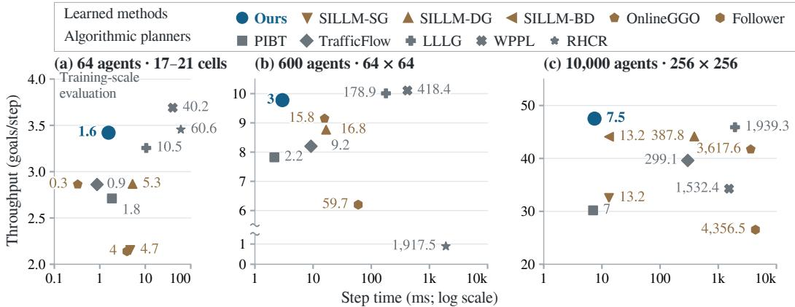  
Figure 1: Throughput and execution cost across random-map scales. Our unstructured policy, trained on small tiles, is reused without retraining at all three scales. Panel (a) averages 128 connected random maps with 17–21 cells per dimension (Appendix C). WPPL uses 500 LNS iterations in (a) and 40,000 in $^ { ( \mathrm { b , c } ) }$ . Labels give ms per step; cost axes are logarithmic. Throughput axes differ; (b) omits 1.5–5.5 goals/step and compresses the lower segment.

We train this policy end-to-end using average-reward reinforcement learning. The population is treated as one controlled system, with the total number of completed goals at each step as its reward. Gradients through route reweighting and destination allocation train the convolutional network. Training requires no planner demonstrations or additional task reward shaping (Sec. 3.4).

We train one policy for structured layouts and one for unstructured layouts, each on a fixed mixture of small maps with roughly a hundred agents per map. The structured mixture contains rack and sortation layouts; the unstructured mixture contains random maps, dumbbell layouts and street crops. Each policy is applied without retraining to larger layouts excluded from training and to different agent populations (Sec. 4)

Figure 1 summarises throughput and execution cost across random-map scales. Across three training seeds per class at 25k updates, the unstructured policies reach 95–99% of RHCR’s throughput on small random maps with 8–64 agents and are reused on 256 × 256 maps with 2000–20,000 agents. Across the six 10,000-agent layouts, the policies attain throughput comparable to or higher than the highest-throughput evaluated baseline on each layout, with execution below 10 ms per step and 68–320× faster than that baseline (Sec. 4.1).

## 2 PROBLEM FORMULATION

Continuing multi-agent control. We model LMAPF as a continuing Markov decision process on a four-connected grid $G = ( V , E )$ with obstacles removed. For a fixed map and population of N agents, the state $s _ { t }$ contains agent positions, goal information, previous moves, elapsed-task counters and the task-stream state. The action is a joint movement proposal $\mathbf { a } _ { t } = ( a _ { 1 , t } , \ldots , a _ { N , t } )$ . At cell $x ,$ let $\mathcal M ( x )$ be the moves to adjacent free cells and $\mathcal { A } ( x ) = \dot { \mathcal { M } } ( \dot { x } ) \cup \{ \mathrm { W A I T } \}$ the available actions; $x ^ { a }$ denotes action $\therefore { } a \mathbf { \hat { s } } { }$ destination. Movement follows POGEMA’s soft collision rules (Skrynnik et al., 2025), which prevent agents from occupying the same cell or exchanging positions in one timestep. Completing a goal assigns the next task, so operation continues (Ma et al., 2017; Li et al., 2021). These movement rules and task assignment define the transition law $P ( s _ { t + 1 } \mid s _ { t } , \mathbf { a } _ { t } )$

Throughput objective. The reward $r _ { t }$ counts goals completed by all agents at step t. For a policy $\pi _ { \theta } ,$ , the objective is long-run throughput for a fixed initial-state distribution,

$$
\rho ( \theta ) = \operatorname* { l i m } _ { T  \infty } \frac { 1 } { T } \mathbb { E } _ { \pi _ { \theta } } [ \sum _ { t = 1 } ^ { T } r _ { t } ] .\tag{1}
$$

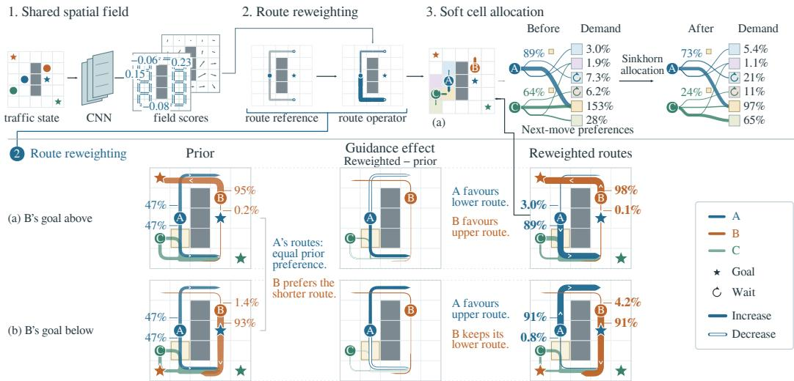  
Figure 2: Policy. A CNN computes a shared spatial field; route reweighting and Sinkhorn allocation produce next-move probabilities. Example. Changing B’s goal between (a) and (b) reverses A’s preferred route, with A’s reference fixed. Route widths give edge-traversal probabilities at each departure under $P ^ { 0 }$ and $Q ;$ the middle column gives their difference, and labels give first-action probabilities. The allocation panel compares q and π, redistributing A’s and C’s demand for the gold cell in (a).

The limit is assumed to exist. This continuing task has no terminal configuration in which all goals are complete. Average-reward reinforcement learning targets the sustained completion rate; its value estimates describe future reward relative to that rate (Mahadevan, 1996; Sutton & Barto, 2018). Section 3.4 specifies the estimator and treatment of training resets.

Soft shortest-path reference. Before considering traffic, map geometry and a goal g define a reference action distribution. Let $\widehat { D } _ { g } ( x )$ be a precomputed soft distance obtained by exponentially weighting the lengths of walks to g (Fosgerau et al., 2013). For cells with available movement actions,

$$
\begin{array} { r l } { p ^ { 0 } ( \mathrm { W A I T } \mid x , g ) = w _ { 0 } , \qquad } & { { } w _ { 0 } = \cfrac { e ^ { - \beta } } { 1 + e ^ { - \beta } } , } \\ { p ^ { 0 } ( a \mid x , g ) = ( 1 - w _ { 0 } ) \cfrac { e ^ { - \beta \widehat { D } _ { g } ( x ^ { a } ) } } { \displaystyle \sum _ { b \in \mathcal { M } ( x ) } e ^ { - \beta \widehat { D } _ { g } ( x ^ { b } ) } } , \qquad } & { { } a \in \mathcal { M } ( x ) . } \end{array}\tag{2}
$$

We fix $\beta = 3$ . The soft distances supply geometric route information beyond a single move, while retaining alternatives to a shortest path. They contain no traffic information or learned parameters. Appendix A.1 gives the distance construction and boundary rules.

## 3 APPROACH

The centralised policy computes a shared spatial field, goal-conditioned route probabilities and a destination allocation (Fig. 2). A convolutional network processes the scene once per timestep. The route operator uses its output and each agent’s goals to compute action probabilities, which allocation adjusts for competing demand for cells. All learned parameters are shared across agents; their number is independent of population size and map dimensions. Appendix A.6 specifies the example in Figure 2.

## 3.1 SHARED SPATIAL FIELD

Let $O _ { t } = O ( s _ { t } )$ be an aggregate spatial representation of the full state $s _ { t }$ , containing map geometry, agent positions and previous moves, current and queued goal information, and aggregates of reference routes. The convolutional network $W _ { \theta _ { W } }$ computes the shared field $\Phi _ { t } = \breve { W } _ { \theta _ { W } } \big ( O _ { t } \big )$ once per timestep. Its outputs supply scores for movement and waiting. For a continuation of H departures, $h \in \{ 0 , \ldots , H - 1 \}$ indexes the departure depth. A base action-score vector is shared across depths, with additive corrections for later departures. Scores enter the route probabilities exponentially, so higher accumulated scores favour the corresponding continuations. All depths use the current scene; the field is refreshed at the next timestep. The network has 39,615 parameters, with six further scalars in the route operator and allocation. Appendix A.2 specifies the observations, architecture and field construction.

## 3.2 GOAL-CONDITIONED ROUTE OPERATOR

Goal-conditioned guidance. Agents with different goals can interpret the same field differently. A route state $z = ( x , \varphi )$ records a candidate cell and the active goal phase. Write $p _ { i } ^ { 0 } ( a \mid z )$ for Eq. (2) evaluated at agent $i \ ' s$ active goal. Each move or wait consumes one departure. Appendix A.1 specifies the goal-phase transitions and continuation boundary. For action $^ { a , }$ let $\psi _ { i } ( z , \bar { a } ) \in \mathbb { R } ^ { 2 }$ contain two contrasts formed after centring the reference probabilities over valid movement actions. They compare opposite directions and perpendicular axes, and are zero for waiting. The local guidance score is

$$
U _ { i , h } ( z , a ) = b _ { h } ( x , a ) + \gamma _ { h } ( x ) ^ { \top } \psi _ { i } ( z , a ) .\tag{3}
$$

Here $b _ { h }$ is a shared action score derived from the field. Four learned coefficients, shared across agents, cells and depths, map the field’s waiting score and summed movement scores to the two gains $\gamma _ { h } ( x )$ The reference determines the direction of the adjustment; the field determines its strength and sign. At an unobstructed junction, the eastward contrast is $\frac { 1 } { \gamma } [ p _ { i } ^ { 0 } ( E \mid z ) - p _ { i } ^ { 0 } ( W \mid z ) ]$ so a positive gain reinforces the direction favoured by the reference in the local score. Appendix A.3 gives the contrasts and field-to-gain map, including obstacle masks.

Route reweighting. For a continuation ${ \boldsymbol { \xi } } = \left( a _ { 0 } , \ldots , a _ { H - 1 } \right)$ with successive route states $z _ { h }$ , the reference law and cumulative guidance are

$$
P _ { i } ^ { 0 } ( \xi \mid z _ { 0 } ) = \prod _ { h = 0 } ^ { H - 1 } p _ { i } ^ { 0 } ( a _ { h } \mid z _ { h } ) , \qquad S _ { i } ( \xi ) = \sum _ { h = 0 } ^ { H - 1 } U _ { i , h } ( z _ { h } , a _ { h } ) .\tag{4}
$$

The operator reweights these routes at learned temperature $\tau _ { f } ~ > ~ 0$ and returns their first-action marginal,

$$
Q _ { i } ( \xi ) = \frac { P _ { i } ^ { 0 } ( \xi ) \exp ( S _ { i } ( \xi ) / \tau _ { f } ) } { \sum _ { \xi ^ { \prime } } P _ { i } ^ { 0 } ( \xi ^ { \prime } ) \exp ( S _ { i } ( \xi ^ { \prime } ) / \tau _ { f } ) } ,\tag{5}
$$

$$
q _ { i } ( a ) = \sum _ { \xi : a _ { 0 } = a } Q _ { i } ( \xi ) .\tag{6}
$$

This is KL-regularized route choice (Todorov, 2006; Kivimäki et al., 2014),

$$
Q _ { i } = \arg \operatorname* { m a x } _ { Q } \left\{ \mathbb { E } _ { Q } [ S _ { i } ( \xi ) ] - \tau _ { f } \mathrm { K L } ( Q \| P _ { i } ^ { 0 } ) \right\} .\tag{7}
$$

The optimisation ranges over distributions on the reference support. It balances cumulative guidance against a KL penalty for departing from the geometric reference. Throughput remains the objective used to train the policy.

A backward log-sum-exp recursion computes $q _ { i }$ over H departures. Fixed H bounds the per-agent continuation computation independently of map size (Appendix A.4). Gradients of the next-move probabilities can therefore update field scores along these continuations, beyond the agent’s current cell. Section 5 compares policies trained with different continuation depths.

## 3.3 DESTINATION ALLOCATION

The route operator supplies next-move probabilities $q _ { i }$ . To account for competing demand for cells, we use affinities $A _ { i } ( a ) = \tau _ { f } \log q _ { i } ( a )$ in an entropy-regularized assignment between agents and their one-step destinations (Cuturi, 2013). Each agent receives unit mass and each cell has unit capacity. Additional rows represent unoccupied capacity; entropy applies to both these rows and the agent assignments, at learned temperature $\tau _ { p } > 0$ . Each agent connects only to its valid one-step destinations, and the identical extra rows are represented collectively without constructing a dense assignment matrix.

We apply Sinkhorn iterations twice, using a fixed iteration budget in each pass. The first uses $A _ { i } ( a )$ to estimate a penalty $c _ { i } ( a )$ for a likely move by the destination’s occupant into agent i’s current cell. The second uses $A _ { i } ( a ) \stackrel { \cdot \cdot } { - } c _ { i } ( a )$ and computes destination potentials $\lambda _ { x }$ jointly across agents. Row normalisation gives the proposal probabilities

$$
\pi _ { \theta , i } ( a \mid s _ { t } ) \propto q _ { i } ( a ) ^ { \tau _ { f } / \tau _ { p } } \exp \biggl [ - \frac { c _ { i } ( a ) + \lambda _ { x _ { i } ^ { a } } } { \tau _ { p } } \biggr ] .\tag{8}
$$

Allocation also raises $q _ { i }$ to the power $\tau _ { f } / \tau _ { p }$ before normalisation, independently of the reverse-move penalties and destination potentials. The potentials adjust demand for each cell. This identity holds at finite iteration count without requiring converged capacities. We abbreviate $\pi _ { \theta , i } ( \boldsymbol { a } \mid s _ { t } )$ as $\pi _ { i } ( a )$ below.

Training samples movement proposals from $\pi _ { i } ;$ deployment chooses each agent’s most probable action. Gradients pass through the route operator and final allocation pass, with the first pass’s reverse-move probabilities held fixed. Appendix A.5 gives the allocation formulation and numerical procedure.

## 3.4 LEARNING FROM THROUGHPUT

We train the policy with AR-EAPO (Choe et al., 2025), an average-reward actor–critic method using a PPO surrogate (Schulman et al., 2017) and a separate entropy advantage. We train with the total goal completion count defined in Section 2 as the task reward, without planner demonstrations or additional task reward shaping.

Average-reward estimation. For training-map entry m, $\widehat { \rho } _ { m } ^ { r }$ estimates its reward rate and $V _ { t } ^ { r } =$ $V _ { \chi , m } ^ { r } ( O _ { t } ^ { V } )$ is the critic’s differential value estimate from its scene representation $O _ { t } ^ { V }$ . Let $V _ { t + 1 } ^ { r , + }$ denote its value at the successor before any reset. The reward TD residual is

$$
\delta _ { t } ^ { r } = r _ { t } - \widehat { \rho } _ { m } ^ { r } + V _ { t + 1 } ^ { r , + } - V _ { t } ^ { r } .\tag{9}
$$

Generalised advantage estimation (Schulman et al., 2016) accumulates these residuals without temporal discounting. A separate average-reward estimator uses the negative log probability of sampled proposals, averaged over active agents, to estimate an entropy advantage. The reward and entropy advantages are scaled separately and combined with entropy temperature τ . Per-map rate estimates and value-target normalisation accommodate different throughput levels across the training mixture. The critic is discarded at deployment.

Joint policy update. Conditional on the scene, agents sample their proposals independently from the probabilities computed by the shared network, route operator and joint allocation. The log probability of the joint proposal is

$$
\log \pi _ { \theta } ( \mathbf { a } _ { t } \mid s _ { t } ) = \sum _ { i = 1 } ^ { N } \log \pi _ { \theta , i } ( a _ { i , t } \mid s _ { t } ) .\tag{10}
$$

The PPO update uses the corresponding joint likelihood ratio and one advantage for the full population, with an adaptive KL penalty. Gradients through these proposal probabilities train the differentiable policy.

Training mixtures and continuing rollouts. We train three seeds per fixed mixture, using $H =$ 4 for the full policies. The structured mixture contains rack and sortation layouts, with uniform goals and alternating workstation–storage tasks. The unstructured mixture contains random maps, dumbbell layouts and street crops from Denver, Moscow, Boston and Milan; Berlin and Paris are excluded. States persist across updates. Independent random resets introduce fresh placements on the same map and change the sampled state distribution. At a reset, value targets bootstrap from the ordinary successor state before replacement and the advantage trace stops. Appendix B gives the full optimisation settings, reset rates, pool composition and final weight-averaging procedure.

<table><tr><td colspan="2"></td><td colspan="2">Training and reuse</td><td colspan="2">Planner involvement</td></tr><tr><td>Method</td><td>Learning</td><td>Trained on</td><td>Reused on</td><td>Training</td><td>Execution</td></tr><tr><td>Ours</td><td>RL</td><td>Mixed small tiles</td><td>All layouts within a class</td><td>None</td><td>None</td></tr><tr><td>SILLM</td><td>IL</td><td>Target mapm (downscaled)</td><td>Larger target; new populations</td><td>Planner demonstrations</td><td>PIBT; guide paths for DG</td></tr><tr><td>OnlineGGO</td><td>ES</td><td>Small source mapm</td><td>Larger layouts; new populations</td><td>Planner rollouts</td><td>PIBT; distance updates</td></tr><tr><td>Follower</td><td>RL</td><td>40 generated mazes</td><td>All layouts</td><td>Planned routes and rewards</td><td>A* routes</td></tr></table>

Table 1: Training and reuse in the headline learned-policy comparison. RL, IL and ES denote reinforcement learning, imitation learning and evolution strategies. m denotes map-specific training; SILLM also uses separate policies for each guidance variant. The headline SILLM comparison uses IL checkpoints; its authors report that IL outperforms their MAPPO (Yu et al., 2022) implementation (Jiang et al., 2025). Planner involvement excludes geometric preprocessing.

## 4 EXPERIMENTS

We evaluate throughput and per-step execution cost on unseen layouts, then examine transfer as agent populations change. We use the structured and unstructured policies from Section 3.4, with the terminal averaged checkpoint from each of three training seeds. Unless stated otherwise, results average cases within each seed and then weight the seed means equally. The six-layout benchmark uses 10,000 agents, occupying 17–26% of free cells. Throughput counts the entire episode; map descriptions, case counts and rollout lengths appear in Appendix C. Instances, task streams and rollout lengths follow SILLM’s released evaluation protocol for every method.

Baselines. SILLM (Jiang et al., 2025) combines learned action preferences and PIBT with shortest-distance heuristics (BD), fixed directional edge costs (SG), or TrafficFlow’s congestionaware guide paths (DG). OnlineGGO (Zang et al., 2025) instead learns traffic-dependent edge costs for PIBT. We use publicly released checkpoints for SILLM and Follower (Skrynnik et al., 2024a), and train OnlineGGO once per configuration following its released recipe. For our policies, we report variability across three independent training seeds per class. Table 1 summarises training and reuse. Non-learned baselines comprise PIBT, RHCR/WPPL, LLLG (Arita & Okumura, 2026) and TrafficFlow (Chen et al., 2024).

All entries in Table 2 are reproduced measurements. Baseline configurations are specified in Appendix C, and timing protocols in Appendix D.

## 4.1 THROUGHPUT AND COST ACROSS LAYOUTS

We transfer the small-tile policies to larger layouts outside their training pools. For each training seed, one terminal checkpoint is reused across all layouts within its class, without target-layout retraining or checkpoint selection. Goal-distance tables are constructed for each deployment map.

On warehouse and sortation (Table 2), the policy trained on the structured mixture matches SILLM-SG’s throughput and stays within 1.3% of the reproduced WPPL scores, with a 1.5–1.6× execution speedup over SILLM-SG.

On unstructured layouts, the policy takes 6.0–8.9 ms per step. On the 20% obstacle-density random map, throughput exceeds SILLM-DG by 7.6% and TrafficFlow by 20.0%, with approximately 52× and 40× faster execution, respectively. On Berlin and Paris, the same policy also exceeds SILLM-DG’s throughput despite receiving no training crops from either city.

Across the six benchmark layouts, the transferred policies match or exceed the best throughput among the evaluated SILLM variants while running faster than SILLM-SG on every layout.

Figure 1 also reports throughput and cost at smaller map sizes and populations. Additional largelayout and small-map comparisons, per-seed scores and 10,000-step evaluations appear in Appendix E. Step times exclude map preprocessing; Appendix D gives the measurement protocols and setup costs.

<table><tr><td rowspan="2">Method</td><td colspan="2">Structured</td><td colspan="4">Unstructured</td></tr><tr><td>Warehouse</td><td>Sortation</td><td>Berlin</td><td>Paris</td><td>Random 10%</td><td>Random 20%</td></tr><tr><td>Ours</td><td>42.31 9.0</td><td>44.20 8.3</td><td>32.99 8.9</td><td>33.17 8.9</td><td>54.19 6.0</td><td>47.52 7.5</td></tr><tr><td>SILLM-SG</td><td>42.25 13.4</td><td>43.98 13.2</td><td>21.62 13.3</td><td>22.53 13.2</td><td>52.49 13.1</td><td>32.53 13.2</td></tr><tr><td>SILLM-DG</td><td>35.40 292.7</td><td>39.39 407.1</td><td>30.02 617.3</td><td>30.89 602.9</td><td>50.50 455.0</td><td>44.15 387.8</td></tr><tr><td>SILLM-BD</td><td>27.27 13.5</td><td>42.91 13.2</td><td>19.16 13.3</td><td>18.68 13.3</td><td>53.73 15.3</td><td>44.09 13.2</td></tr><tr><td>OnlineGGO</td><td>21.22 3,427.4 8.52</td><td>38.13 3,928.2</td><td>26.15 3,762.6</td><td>27.93 3,586.9 10.08</td><td>50.15 4,084.5</td><td>41.72 3,617.6</td></tr><tr><td>Follower</td><td>4,623.1</td><td>27.14 4,266.9</td><td>8.78 6,204.1</td><td>5,510.8</td><td>40.34 4,207.2</td><td>26.53 4,356.5</td></tr><tr><td>WPPL</td><td>42.79 1,432.0 27.45</td><td>44.25 1,759.4 36.98</td><td>19.86 1,353.5 27.12</td><td>22.23 1,715.7 27.10</td><td>53.45 1,201.5 46.94</td><td>34.28 1,532.4</td></tr><tr><td>TrafficFlow</td><td>208.6 19.07</td><td>337.0 32.48</td><td>244.1 14.92</td><td>269.6 15.39</td><td>389.2 46.52</td><td>39.62 299.1 30.19</td></tr><tr><td>PIBT</td><td>7.1 17.57</td><td>6.9 42.33</td><td>7.0 19.53</td><td>7.0 20.28</td><td>6.9 54.80</td><td>7.0 45.90</td></tr><tr><td>LLLG</td><td>1,361.1</td><td>1,567.5</td><td>2,017.9</td><td>1,941.4</td><td>1,909.3</td><td>1,939.3</td></tr></table>

Table 2: Throughput and execution cost at 10,000 agents. Each cell gives throughput (goals/step) above step time (ms). Random percentages denote obstacle density. WPPL uses 40,000 LNS iterations. Ours reuses one policy per class without retraining; throughput averages three training seeds and eight cases. Ours runs 144 plain allocation iterations on the structured and random layouts and 288 on the city layouts. Timing protocols: Appendix D.  
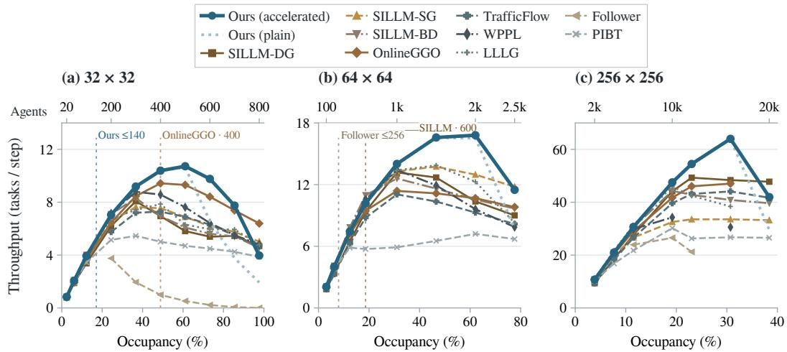  
Figure 3: Population transfer with accelerated (solid) and plain (light dotted) Sinkhorn. Both use 288 iterations per pass, except accelerated at 20k agents in (c), which uses 4,608. Ours averages three training seeds and eight cases per seed, with 1,000 steps in (a,b) and 2,500 in (c). Upper axes give agent counts; vertical guides mark training populations (maxima where varied).

## 4.2 TRANSFER ACROSS POPULATIONS

We vary population on three fixed random maps of sizes $3 2 ^ { 2 } , 6 4 ^ { 2 }$ and $2 5 6 ^ { 2 }$ , reusing the unstructured policy with unchanged learned parameters (Figure 3). Occupancy denotes agents per free cell; Appendix C.2 specifies the evaluation. The 16,000–20,000-agent settings extend beyond the 12,000- agent evaluations reported in the original SILLM and TrafficFlow studies (Jiang et al., 2025; Chen et al., 2024).

Although training uses at most 140 agents, mean throughput exceeds the displayed baselines at 600 and 700 agents on $3 2 ^ { 2 }$ , 1000–2000 on $6 4 ^ { 2 }$ , and 16,000 on $2 5 6 ^ { 2 }$ . At 20,000 agents on $2 5 6 ^ { 2 }$ , our policy achieves 42.0 tasks per step, compared with 47.8 for SILLM-DG, which uses about $2 . 8 \times$ our per-step computation (Appendix D).

## 4.3 EVALUATION-TIME SINKHORN

We vary the number and form of Sinkhorn updates at evaluation while keeping the trained policy parameters fixed. Temperature scaling (Schmitzer, 2019) starts above the learned temperature $\tau _ { p }$ and decreases to it; over-relaxation (Thibault et al., 2021) accelerates the potential updates. Both retain the same fixed-point equations at the final temperature.

On the headline city layouts, acceleration improves throughput with half as many iterations, reducing per-step time by about 35%. At 20,000 agents in Figure 3c, 4608 accelerated iterations per pass attain throughput comparable to TrafficFlow. Recorded costs are 323 ms per step for our policy and 616 ms for TrafficFlow on their respective evaluation hosts (Appendix D). Appendix E.3 reports convergence, throughput and cost measurements. Section 5 complements these evaluations with a retrained control that removes allocation.

## 5 MECHANISM AND INTERPRETATION

We examine how route continuation and destination allocation affect learning and throughput, using retrained controls matched to each policy’s training pool.

Continuation depth. The next-move probabilities depend on field scores along the route continuations. Policy gradients therefore update scores at successive cells along these routes. We examine this structure by training with $H \stackrel { - } { = } 1 , 2 , 4 .$ , retaining the structured training pool, training budget and destination allocation. Figure 4a shows that longer continuations improve validation throughput during training. The terminal averaged policies retain this ordering on the 10,000-agent warehouse.

(a) Learning  
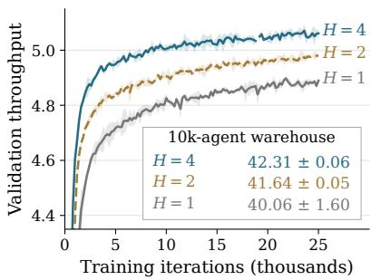

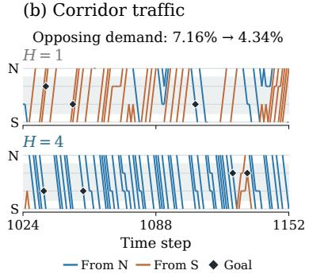

(c) Allocation  
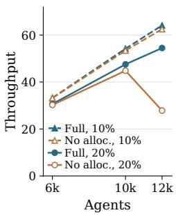  
Figure 4: Continuation and destination allocation. (a) Validation throughput with current weights; annotations report terminal averaged-policy throughput on the 10,000-agent warehouse. Both show three-run means and standard deviations. The deployment annotations average eight warehouse instances per run. (b) Actual agent trajectories through one passage; colours indicate entry side and diamonds mark goal completions. Opposing-demand percentages aggregate all passages, eight instances and three training runs at 400 agents. (c) Throughput with and without allocation on 10% and 20% obstacle-density random maps, averaged over three training runs and eight instances per run.

To examine the resulting traffic, we record terminal-policy rollouts on a $3 3 \times 5 7$ warehouse with 400 agents. Across its narrow passages, the mean probability that neighbouring agents request moves towards each other falls from 7.16% with $H = 1 \mathrm { t o } 4 . 3 4 \%$ with $H = 4 ,$ , while throughput rises from 8.38 to 9.17. Figure 4b illustrates the traffic through one fixed passage. Preferred travel directions through a passage can change with the traffic state. These measurements describe traffic generated over complete rollouts. Appendix F.3 gives the protocol, a comparison on identical traffic states and additional depth comparisons under load.

Destination allocation. To test the contribution of allocation, we replace both allocation passes and the reverse-move penalty with independent normalisation, then retrain with the same convolutional network, route operator and simulator (Figure 4c). At 12,000 agents, removing allocation reduces throughput from 54.47 to 27.85 on the 20%-obstacle random map, but by only 2.4% on the 10%-obstacle map. Allocation therefore contributes most on the more obstructed layout. Appendix F.4 reports the full population comparison.

## 6 RELATED WORK

Large-scale lifelong MAPF. Planning methods balance coordination over future steps against the computation available for each decision. RHCR solves windowed MAPF problems and reports lifelong experiments with up to 1000 agents (Li et al., 2021). PIBT uses priority inheritance and backtracking for single-step coordination, with runtime experiments reaching 10,000 agents (Oku mura et al., 2022). WPPL refines PIBT-initialized plans using large-neighborhood search and evaluates 10,000 agents in lifelong MAPF with rotations (Jiang et al., 2024). Traffic Flow Optimi sation supplies congestion-aware guide paths to PIBT, reporting lifelong experiments with 12,000 agents (Chen et al., 2024). LLLG combines local guidance with LaCAM in a receding-horizon planner, evaluated with up to 10,000 agents (Arita & Okumura, 2026).

PRIMAL and PRIMAL2 combine reinforcement and imitation learning, reporting evaluations with up to 1024 agents in one-shot MAPF and 2048 in lifelong MAPF, respectively (Sartoretti et al., 2019; Damani et al., 2021). PRIMAL2 introduces corridor observations and movement conventions. Follower learns to follow planned paths and reports lifelong evaluations with up to 256 agents (Skrynnik et al., 2024a). SILLM combines imitation from windowed plan refinement, spatial communica tion, global guidance and PIBT-style collision resolution, with population sweeps reaching 12,000 agents (Jiang et al., 2025).

Spatial guidance and shared representations. Spatial guidance and our shared field both associate movement preferences with map locations or directed moves. Direction maps (Jansen & Sturtevant, 2008) and highways (Cohen et al., 2015) encode preferred traffic directions. GGO optimizes guidance graphs, including through convolutional update models, with lifelong evaluations reaching 6000 agents (Zhang et al., 2024). Online GGO adapts their costs to recent traffic and reports 12,000-agent evaluations with guided PIBT (Zang et al., 2025). These costs are used by planners or guide-path calculations. SJRL learns environment guidance and communicating subgoal policies, with Causal PIBT resolving subgoal conflicts; its lifelong experiments with rotations reach 320 agents (Jiang et al., 2026). RAILGUN predicts per-cell action distributions with a map-based convolutional policy trained on planner-generated trajectories, with reported city-tile experiments using up to 256 agents (Tang et al., 2025).

Differentiable allocation. Sinkhorn layers provide continuous relaxations for learning latent permutations (Mena et al., 2018). Sinkhorn Policy Gradient uses such a layer in an actor–critic policy over permutations (Emami & Ranka, 2018). Here, sparse allocation coordinates next-move proposals within a navigation policy trained from throughput.

## 7 CONCLUSION

We presented a reinforcement learning approach to large-scale LMAPF that learns traffic guidance as part of an end-to-end navigation policy. A shared spatial field guides goal-conditioned route choices, and differentiable destination allocation coordinates competing moves. The policy is trained directly from throughput without planner demonstrations and executes without a separate online path planner. One policy per layout class, trained on small-map mixtures, transfers to larger, unseen layouts and populations. Across six benchmark layouts with 10,000 agents, the policies attain throughput comparable to or higher than the strongest evaluated baselines, with execution below 10 ms per step. These results show that reinforcement learning from throughput can yield fast, transferable policies competitive with planning and imitation-learning approaches.

## AI USE STATEMENT

We used AI coding assistants to write code to launch experiments and collect data, to search for related work, and to draft and polish text.

## REFERENCES

Tomoki Arita and Keisuke Okumura. Lifelong LaCAM with local guidance for lifelong MAPF. In Proceedings of the International Symposium on Combinatorial Search (SoCS), volume 19, pp. 2–10, 2026. doi: 10.1609/socs.v19i1.43067.

Zhe Chen, Daniel Harabor, Jiaoyang Li, and Peter J. Stuckey. Traffic flow optimisation for lifelong multi-agent path finding. In Proceedings of the AAAI Conference on Artificial Intelligence, volume 38, pp. 20674–20682, 2024. doi: 10.1609/aaai.v38i18.30054.

Jean Seong Bjorn Choe, Bumkyu Choi, and Jong-kook Kim. Simplifying reward design in complex robotics: Average-reward maximum entropy reinforcement learning. In 2025 IEEE International Conference on Robotics and Automation (ICRA), pp. 1–7, 2025. doi: 10.1109/ICRA55743.2025. 11128043.

Liron Cohen, Tansel Uras, and Sven Koenig. Feasibility study: Using highways for boundedsuboptimal multi-agent path finding. In Proceedings of the International Symposium on Combinatorial Search (SoCS), volume 6, pp. 2–8, 2015. doi: 10.1609/socs.v6i1.18363.

Marco Cuturi. Sinkhorn distances: Lightspeed computation of optimal transport. In Advances in Neural Information Processing Systems, volume 26, pp. 2292–2300. Curran Associates, Inc., 2013.

Mehul Damani, Zhiyao Luo, Emerson Wenzel, and Guillaume Sartoretti. PRIMAL2: Pathfinding via reinforcement and imitation multi-agent learning – lifelong. IEEE Robotics and Automation Letters, 6(2):2666–2673, 2021. doi: 10.1109/LRA.2021.3062803.

Patrick Emami and Sanjay Ranka. Learning permutations with Sinkhorn policy gradient. arXiv preprint arXiv:1805.07010, 2018.

Mogens Fosgerau, Emma Frejinger, and Anders Karlström. A link based network route choice model with unrestricted choice set. Transportation Research Part B: Methodological, 56:70–80, 2013. doi: 10.1016/j.trb.2013.07.012.

M. Renee Jansen and Nathan R. Sturtevant. Direction maps for cooperative pathfinding. In Proceedings of the AAAI Conference on Artificial Intelligence and Interactive Digital Entertainment (AIIDE), volume 4, pp. 185–190, 2008. doi: 10.1609/aiide.v4i1.18695.

He Jiang, Yulun Zhang, Rishi Veerapaneni, and Jiaoyang Li. Scaling lifelong multi-agent path finding to more realistic settings: Research challenges and opportunities. In Proceedings of the International Symposium on Combinatorial Search (SoCS), volume 17, pp. 234–242, 2024. doi: 10.1609/socs.v17i1.31565.

He Jiang, Yutong Wang, Rishi Veerapaneni, Tanishq Duhan, Guillaume Sartoretti, and Jiaoyang Li. Deploying ten thousand robots: Scalable imitation learning for lifelong multi-agent path finding. In 2025 IEEE International Conference on Robotics and Automation (ICRA), pp. 1–7, 2025. doi: 10.1109/ICRA55743.2025.11127445.

He Jiang, Jingtian Yan, Yulun Zhang, Yimin Tang, Tanishq Duhan, Rishi Veerapaneni, Guillaume Sartoretti, and Jiaoyang Li. Search-aided joint agent-environment reinforcement learning for robust lifelong multi-agent path finding with rotations. arXiv preprint arXiv:2608.05588, 2026.

Diederik P. Kingma and Jimmy Ba. Adam: A method for stochastic optimization. In International Conference on Learning Representations, 2015. URL https://arxiv.org/abs/1412. 6980.

Ilkka Kivimäki, Masashi Shimbo, and Marco Saerens. Developments in the theory of randomized shortest paths with a comparison of graph node distances. Physica A: Statistical Mechanics and its Applications, 393:600–616, 2014. doi: 10.1016/j.physa.2013.09.016.

Jiaoyang Li, Andrew Tinka, Scott Kiesel, Joseph W. Durham, T. K. Satish Kumar, and Sven Koenig. Lifelong multi-agent path finding in large-scale warehouses. In Proceedings of the AAAI Conference on Artificial Intelligence, volume 35, pp. 11272–11281, 2021. doi: 10.1609/aaai.v35i13. 17344.

Ilya Loshchilov and Frank Hutter. Decoupled weight decay regularization. In International Conference on Learning Representations, 2019.

Hang Ma, Jiaoyang Li, T. K. Satish Kumar, and Sven Koenig. Lifelong multi-agent path finding for online pickup and delivery tasks. In Proceedings of the 16th International Conference on Autonomous Agents and Multiagent Systems (AAMAS), pp. 837–845, 2017.

Hang Ma, Daniel Harabor, Peter J. Stuckey, Jiaoyang Li, and Sven Koenig. Searching with consistent prioritization for multi-agent path finding. In Proceedings of the AAAI Conference on Artificial Intelligence, volume 33, pp. 7643–7650, 2019. doi: 10.1609/aaai.v33i01.33017643.

Sridhar Mahadevan. Average reward reinforcement learning: Foundations, algorithms, and empirical results. Machine Learning, 22(1–3):159–195, 1996. doi: 10.1007/BF00114727.

Gonzalo E. Mena, David Belanger, Scott Linderman, and Jasper Snoek. Learning latent permutations with Gumbel-Sinkhorn networks. In International Conference on Learning Representations, 2018.

Keisuke Okumura, Manao Machida, Xavier Défago, and Yasumasa Tamura. Priority inheritance with backtracking for iterative multi-agent path finding. Artificial Intelligence, 310:103752, 2022. doi: 10.1016/j.artint.2022.103752.

Mike Phillips and Maxim Likhachev. SIPP: Safe interval path planning for dynamic environments. In Proceedings of the IEEE International Conference on Robotics and Automation (ICRA), pp. 5628–5635, 2011. doi: 10.1109/ICRA.2011.5980306.

Guillaume Sartoretti, Justin Kerr, Yunfei Shi, Glenn Wagner, T. K. Satish Kumar, Sven Koenig, and Howie Choset. PRIMAL: Pathfinding via reinforcement and imitation multi-agent learning. IEEE Robotics and Automation Letters, 4(3):2378–2385, 2019. doi: 10.1109/LRA.2019.2903261.

Bernhard Schmitzer. Stabilized sparse scaling algorithms for entropy regularized transport problems. SIAM Journal on Scientific Computing, 41(3):A1443–A1481, 2019. doi: 10.1137/16M1106018. URL https://epubs.siam.org/doi/10.1137/16M1106018.

John Schulman, Philipp Moritz, Sergey Levine, Michael I. Jordan, and Pieter Abbeel. Highdimensional continuous control using generalized advantage estimation. In International Conference on Learning Representations, 2016.

John Schulman, Filip Wolski, Prafulla Dhariwal, Alec Radford, and Oleg Klimov. Proximal policy optimization algorithms. arXiv preprint arXiv:1707.06347, 2017.

David Silver. Cooperative pathfinding. In Proceedings of the AAAI Conference on Artificial Intelligence and Interactive Digital Entertainment (AIIDE), volume 1, pp. 117–122, 2005. doi: 10.1609/aiide.v1i1.18726.

Richard Sinkhorn and Paul Knopp. Concerning nonnegative matrices and doubly stochastic matrices. Pacific Journal ofMathematics, 21(2):343–348, 1967. doi: 10.2140/pjm.1967.21.343.

Alexey Skrynnik, Anton Andreychuk, Maria Nesterova, Konstantin Yakovlev, and Aleksandr Panov. Learn to follow: Decentralized lifelong multi-agent pathfinding via planning and learning. In Proceedings of the AAAI Conference on Artificial Intelligence, volume 38, pp. 17541–17549, 2024a. doi: 10.1609/aaai.v38i16.29704.

Alexey Skrynnik, Anton Andreychuk, Konstantin Yakovlev, and Aleksandr Panov. Decentralized Monte Carlo tree search for partially observable multi-agent pathfinding. In Proceedings of the AAAI Conference on Artificial Intelligence, volume 38, pp. 17531–17540, 2024b. doi: 10.1609/ aaai.v38i16.29703.

Alexey Skrynnik, Anton Andreychuk, Anatolii Borzilov, Alexander Chernyavskiy, Konstantin Yakovlev, and Aleksandr Panov. POGEMA: A benchmark platform for cooperative multi-agent pathfinding. In The Thirteenth International Conference on Learning Representations, 2025.

Roni Stern, Nathan R. Sturtevant, Ariel Felner, Sven Koenig, Hang Ma, Thayne T. Walker, Jiaoyang Li, Dor Atzmon, Liron Cohen, T. K. Satish Kumar, Eli Boyarski, and Roman Barták. Multiagent pathfinding: Definitions, variants, and benchmarks. In Proceedings of the International Symposium on Combinatorial Search (SoCS), volume 10, pp. 151–158, 2019. doi: 10.1609/socs. v10i1.18510.

Nathan R. Sturtevant. Benchmarks for grid-based pathfinding. IEEE Transactions on Computational Intelligence and AI in Games, 4(2):144–148, 2012. doi: 10.1109/TCIAIG.2012.2197681. URL https://www.cs.du.edu/\~sturtevant/papers/benchmarks.pdf.

Richard S. Sutton and Andrew G. Barto. Reinforcement Learning: An Introduction. MIT Press, 2nd edition, 2018. ISBN 9780262039246.

Yimin Tang, Xiao Xiong, Jingyi Xi, Jiaoyang Li, Erdem Bıyık, and Sven Koenig. RAILGUN: A unified convolutional policy for multi-agent path finding across different environments and tasks. In 2025 IEEE/RSJ International Conference on Intelligent Robots and Systems (IROS), pp. 8645– 8651, 2025. doi: 10.1109/IROS60139.2025.11247527.

Alexis Thibault, Lénaïc Chizat, Charles Dossal, and Nicolas Papadakis. Overrelaxed Sinkhorn– Knopp algorithm for regularized optimal transport. Algorithms, 14(5):143, 2021. doi: 10.3390/ a14050143. URL https://www.mdpi.com/1999-4893/14/5/143.

Emanuel Todorov. Linearly-solvable Markov decision problems. In Advances in Neural Information Processing Systems, volume 19. MIT Press, 2006.

Hado van Hasselt, Arthur Guez, Matteo Hessel, Volodymyr Mnih, and David Silver. Learning values across many orders of magnitude. In Advances in Neural Information Processing Systems, volume 29, 2016.

Chao Yu, Akash Velu, Eugene Vinitsky, Jiaxuan Gao, Yu Wang, Alexandre Bayen, and Yi Wu. The surprising effectiveness of PPO in cooperative multi-agent games. In Advances in Neural Information Processing Systems, volume 35, pp. 24611–24624, 2022. doi: 10.52202/068431-1787.

Hongzhi Zang, Yulun Zhang, He Jiang, Zhe Chen, Daniel Harabor, Peter J. Stuckey, and Jiaoyang Li. Online guidance graph optimization for lifelong multi-agent path finding. In Proceedings of the AAAI Conference on Artificial Intelligence, volume 39, pp. 14726–14735, 2025. doi: 10.1609/ aaai.v39i14.33614.

Yulun Zhang, He Jiang, Varun Bhatt, Stefanos Nikolaidis, and Jiaoyang Li. Guidance graph optimization for lifelong multi-agent path finding. In Proceedings of the Thirty-Third International Joint Conference on Artificial Intelligence (IJCAI), pp. 311–320, 2024. doi: 10.24963/ijcai.2024/ 35.

## A ACTOR SPECIFICATION

## A.1 REFERENCE MOVEMENT PROBABILITIES

Soft-distance construction. For a reachable goal $^ { g , }$ let $\mathscr { W } _ { g } ( x )$ contain finite walks from x whose first visit to g is their final cell. These walks use valid movement actions, may revisit other cells, and contain no WAIT actions; $\mathscr { W } _ { g } ( g )$ contains only the empty walk. The ideal soft distance is

$$
D _ { g } ( x ) = - \frac { 1 } { \beta } \log \sum _ { w \in \mathcal { W } _ { g } ( x ) } e ^ { - \beta | w | } , \qquad D _ { g } ( g ) = 0 .\tag{11}
$$

We use $\beta = 3$ . Since the grid degree is at most four and $4 e ^ { - \beta } < 1$ , this sum converges. For $x \neq g ,$ it satisfies $\begin{array} { r } { e ^ { - \beta D _ { g } ( x ) } = \smile \smile \sp { - } \sum _ { a \in \mathcal { M } ( x ) } \sp { - } e ^ { - \beta ( 1 + D _ { g } ( x _ { a } ) ) } } \end{array}$

Numerical tables. Write $\widehat { D } _ { g }$ for the numerical table used by the actor. The standard builder performs $2 \operatorname* { m a x } ( L _ { y } , L _ { x } ) + 6 4$ soft-Bellman sweeps in float32 on a map of height $L _ { u }$ and width $L _ { x }$ . The deployment configuration uses a layered fixed-point iteration in $m _ { g } ( x ) = \exp \{ \breve { \beta } [ d ( x , g ) - D _ { g } ( x ) ] \}$ where d is shortest-path distance. It stops when the largest change relative to the updated $m _ { g } ( x )$ is below $1 0 ^ { - 3 }$ over reachable cells, with a budget of 100 passes, and stores distances in uint16 increments of $1 / 6 4$ . These finite computations approximate Eq. (11). Tables depend only on the static map and goal, are constructed before online action selection, and have no learned parameters.

Normalised action rows and goal phase. At a live route state $z = ( x , \varphi )$ , the active goal $g _ { i } ( z )$ and Eq. (2) define the reference row. We use the shorthand

$$
p _ { i } ^ { 0 } ( a \mid z ) = p ^ { 0 } ( a \mid x , g _ { i } ( z ) ) .\tag{12}
$$

Equation (2) normalises rows even for approximate distance tables and adds WAIT separately from the walks in Eq. (11). Before each row is read, arrival at the current goal promotes the queued goal without consuming an extra departure. Completing both goals makes the finite continuation absorbing, with a probability-one WAIT row and zero local scores thereafter. Cells with no valid moves and inactive padding also use WAIT-only rows. Every WAIT consumes one of the $H = 4$ departures. This boundary applies only to the finite continuation; the environment continues assigning tasks.

## A.2 OBSERVATION AND CONVOLUTIONAL NETWORK

The network’s raw output is

$$
\Phi _ { t } = \bigl ( \widehat { F } _ { t , 0 : 3 } , G _ { t } \bigr ) , \qquad \widehat { F } _ { t , h } ( x ) \in \mathbb { R } ^ { 5 } , \quad G _ { t } ( x ) \in \mathbb { R } ^ { 2 } .\tag{13}
$$

The five-entry rows use $\mathrm { [ W A I T , } N , S , W , E \mathrm { ] }$ coordinates, and $G _ { t }$ is the vector branch output. The shared score $b _ { h }$ and gain inputs $\sigma _ { h }$ in Eq. (16) are derived from these outputs, not separate learned heads.

Scene image. The convolutional network’s 21 input planes consist of occupancy (one plane), the previous realised move of each occupant (two), the navigable mask (one), descent directions for both goals (eight), a relative goal-distance feature (one), and rendered reference routes (eight). Previous moves are zero after a stay. Descent directions and the distance feature are deposited at the agent’s current cell. In particular, the distance feature for agent i is

$$
{ \frac { d ( x _ { i } , g _ { i } ^ { \mathrm { n e x t } } ) } { d ( x _ { i } , g _ { i } ^ { \mathrm { n e x t } } ) + d ( x _ { i } , g _ { i } ) + 1 } } ,
$$

where d is graph distance. Reference-route rendering draws one 40-action route per agent by inverse-CDF sampling from the reference probabilities. Draws use a fixed state-based hash independent of agent ordering. Four planes accumulate directional move counts at departure cells across agents; four more use linearly decreasing weights to emphasise earlier route steps. All eight are divided by one plus the $9 \times 9$ local mean of the total unweighted counts, then passed through tanh. This trace length is separate from the route operator’s four departures.

Replacing the frozen actor’s next-goal input with random goals changes mean throughput by less than 0.3% on all six main layouts, over three training seeds and eight cases per seed. On the Random 30% and Random 40% layouts (Appendix E.5), the changes are +1.91% and −1.38%, respectively.

Architecture and parameters. The branches have independent encoders and hidden activations. Each base output sums a local $3 \times 3$ head and half the summed responses of an affine multiscale head. Two shared kernel bases $B _ { 0 } , B _ { 1 }$ form kernels $B _ { 0 } - B _ { 1 } , B _ { 0 }$ , and $B _ { 0 } + B _ { 1 }$ at dilations 2, 4, and 8; the local head supplies dilation 1. The action-row bases have shape $5 \times 4 8 \times 3 \times 3$ . Each vector basis has shape $2 \times 8 \times 8 \colon$ two output channels, eight input channels and eight non-central spatial offsets; the local head supplies the centre.

<table><tr><td>Component</td><td>Architecture</td><td>Parameters</td></tr><tr><td>Action-row branch</td><td>Two width-48 3 × 3 ReLU convolutions; local and affine heads</td><td>36,389</td></tr><tr><td>Vector branch</td><td>Two width-8  $3 \times 3$  ReLU convolutions; zero-initialised local and affine heads</td><td>2,506</td></tr><tr><td>Continuation Guidance network</td><td>Bias-free  $1 5 \times 4 8$  pointwise map</td><td>720 39,615</td></tr><tr><td>Route operator</td><td>Four coefficients and  $\tau _ { f }$ </td><td>5</td></tr><tr><td>Allocation</td><td> $\tau _ { p }$ </td><td>1</td></tr><tr><td>Total actor</td><td></td><td>39,621</td></tr></table>

Writing Ht for the action branch’s hidden image, the continuation rows are

$$
\widehat { F } _ { t , 0 } = \widehat { F } _ { t } , \qquad \widehat { F } _ { t , h } = \widehat { F } _ { t } + W _ { h } \mathcal { H } _ { t } , \quad h = 1 , 2 , 3 .\tag{14}
$$

The $W _ { h }$ are slices of the pointwise map. The base row and vector output are shared across depths; all outputs are constructed before route branching and refreshed at the next real timestep. The reference tables, recurrence and bound have no learned parameters.

Continuation bound. Restrict $\widehat { F } _ { t , h } ( x )$ to actions valid at $x ,$ giving $F _ { t , h } ( x )$ , and write $\Delta _ { t , h } =$ $F _ { t , h } - F _ { t , 0 }$ for the corresponding depth correction. Let $\bar { F }$ and $d _ { F } = F - \bar { F }$ denote a row’s validentry mean and mean-free part, including WAIT. The fixed transformation is applied to the sum of the base row and each continuation correction:

$$
\begin{array} { r l } & { \mathcal { B } ( F ) = \bar { F } + \operatorname* { m i n } \biggr ( 1 , \frac { \beta _ { b } \tau _ { f } } { \| d _ { F } \| _ { 2 } } \biggr ) d _ { F } , \qquad \beta _ { b } = 3 , } \\ & { F _ { t , 0 } ^ { \mathrm { c o n t } } = F _ { t , 0 } , \qquad F _ { t , h } ^ { \mathrm { c o n t } } = \mathcal { B } ( F _ { t , 0 } + \Delta _ { t , h } ) , \quad h = 1 , 2 , 3 . } \end{array}\tag{15}
$$

The scale is one at zero norm, with numerical norm stabilisation. The immediate row and all row means remain unrestricted. Only the corrected continuation row’s mean-free norm is bounded in temperature units by $\beta _ { b }$ . Subsequent goal-conditioned adjustment and vector addition are unbounded, so this bound does not apply to the full score $U _ { i , h }$ . The transformation adds no learned parameters.

## A.3 GOAL-CONDITIONED GUIDANCE COEFFICIENTS

Goal-conditioned directional and axis preferences. At route state $z = ( x , \varphi )$ , let $p _ { i } ^ { 0 } ( \cdot \mid z )$ be the reference row of Eq. (12). Use canonical coordinates [WAIT, $N , S , W , E ]$ , with unavailable move entries set to zero after mapping from valid actions. Write $\mathcal M ( x )$ for the valid movement actions. First remove WAIT and the uniform mass over valid moves from the reference row:

$$
r _ { \mathrm { W A I T } } = 0 , \qquad r _ { a } = { \bf 1 } [ a \in \mathcal { M } ( x ) ] \left( p _ { i } ^ { 0 } ( a \mid z ) - \frac { \sum _ { m \in \mathcal { M } ( x ) } p _ { i } ^ { 0 } ( m \mid z ) } { | \mathcal { M } ( x ) | } \right) .
$$

For a cell without valid moves, set $r = 0$ . The opposite-direction preference $D _ { i }$ and the vertical– horizontal preference $B _ { i }$ forming $\psi _ { i }$ in Eq. (3) are the rows

$$
\begin{array} { r l } & { D _ { i } ( z , \cdot ) = \frac { 1 } { 2 } \big ( 0 , r _ { N } - r _ { S } , r _ { S } - r _ { N } , r _ { W } - r _ { E } , r _ { E } - r _ { W } \big ) , } \\ & { B _ { i } ( z , \cdot ) = \frac { 1 } { 4 } \big ( r _ { N } + r _ { S } - r _ { W } - r _ { E } \big ) \big ( 0 , 1 , 1 , - 1 , - 1 \big ) , } \\ & { \psi _ { i } ( z , a ) = \big ( D _ { i } ( z , a ) , B _ { i } ( z , a ) \big ) ^ { \top } . } \end{array}
$$

These components satisfy $r = D _ { i } + B _ { i }$ and use the same construction for every agent.

Shared scores and field-controlled gains. Suppress timestep t and write $F = F _ { h } ^ { \mathrm { c o n t } } ( x )$ for the departure row. The shared action score and the two gains used in Eq. (3) are

$$
\begin{array} { r l r } {  { b _ { h } ( x , a ) = F _ { a } + d _ { a } ^ { \top } G ( x ) , } } & { \ \sigma _ { h } ( x ) = ( \sum _ { m \in \mathcal { M } ( x ) } F _ { m } ) , } & \\ & { } & { \gamma _ { h } ( x ) = K \sigma _ { h } ( x ) , \qquad K = ( \eta _ { 1 } - \eta _ { 3 } \quad \eta _ { 2 } - \eta _ { 4 } ) . } \end{array}\tag{16}
$$

Here $d _ { a }$ is the action displacement, $d _ { \mathrm { W A I T } } = 0$ , and $\eta _ { 1 } , \dots , \eta _ { 4 }$ are the learned coefficients, shared across agents, cells and depths with unrestricted signs. The gains multiply $D _ { i }$ and $B _ { i }$ , respectively. The gain inputs contain $\bar { F }$ only. The term $d _ { a } ^ { \top } G ( x )$ contributes to $b _ { h }$ after the goal-conditioned adjustment; including it in the gain inputs would change the route operator at obstacle boundaries.

Obstacle masks. Reference centring uses the mean over valid moves. Form $D _ { i }$ and $B _ { i }$ in canonical, zero-padded coordinates and discard invalid output actions after combining them: either component can be nonzero in blocked directions. The combined term need not have zero mean over valid moves; its WAIT entry is zero.

## A.4 COMPUTING THE GUIDED ROUTE DISTRIBUTION

Soft dynamic programming. The distribution in Eq. (5) is evaluated by a backward recursion. Write $\boldsymbol { \mathcal { A } } ( \boldsymbol { z } )$ for the available actions at route state $z ,$ and $z _ { a }$ for its successor after action $^ { a , }$ including any goal-phase change. Define a soft route value $\mathcal { V } _ { i , h }$ in the same score units as $U _ { i , h } \colon$

$$
\mathcal { V } _ { i , H } ( z ) = 0 ,
$$

$$
\mathcal { V } _ { i , h } ( z ) = \tau _ { f } \log \sum _ { a \in A ( z ) } p _ { i } ^ { 0 } ( a \mid z ) \exp \left( \frac { U _ { i , h } ( z , a ) + \mathcal { V } _ { i , h + 1 } ( z _ { a } ) } { \tau _ { f } } \right) , \qquad h = H - 1 , \ldots , 0 .\tag{17}
$$

Here $H = 4$ , and goal phases follow Appendix A.1. Absorbing and inactive states have zero local scores and soft value. The first-action marginal is

$$
q _ { i } ( a ) = p _ { i } ^ { 0 } ( a \mid z _ { 0 } ) \exp \left( \frac { U _ { i , 0 } ( z _ { 0 } , a ) + \mathcal { V } _ { i , 1 } ( z _ { a } ) - \mathcal { V } _ { i , 0 } ( z _ { 0 } ) } { \tau _ { f } } \right) .\tag{18}
$$

The implementation uses log max $\cdot ( p _ { i } ^ { 0 } , 1 0 ^ { - 3 0 } )$ on positive numerical reference probabilities, with zero-probability and invalid actions masked separately. The finite route law uses the supplied nu merical reference weights, subject to this floor and floating-point evaluation. The root affinity equals τf log qi(a) up to a per-agent constant removed by allocation row centring.

Score derivative. Differentiating the finite route marginal with respect to one local score gives

$$
\frac { \partial \log q _ { i } ( a _ { 0 } ) } { \partial U _ { i , h } ( z , b ) } = \frac { 1 } { \tau _ { f } } \left[ \operatorname* { P r } _ { Q _ { i } } ( z _ { h } = z , a _ { h } = b \mid a _ { 0 } ) - \operatorname* { P r } _ { Q _ { i } } ( z _ { h } = z , a _ { h } = b ) \right] .\tag{19}
$$

Field gradients chain through the route operator and continuation transform and accumulate across agents, phases and depths. Equation (19) applies before allocation; proposal gradients also pass through its final allocation pass.

## A.5 DESTINATION ALLOCATION AND ACTION SELECTION

For allocation, express each route-operator output in score units as

$$
A _ { i } ( a ) = \tau _ { f } \log q _ { i } ( a ) .\tag{20}
$$

Allocation constraints and slack. Let $M = | V |$ be the number of cells, N the number of agents, and $D = M - N$ the number of dummy rows representing unused cell capacity, termed slack rows. Write $\mathcal { C } _ { i } = \{ x _ { i } ^ { a } : a \in \mathcal { A } ( z _ { i } ) \}$ , with root state ${ \boldsymbol { z } } _ { i } = ( x _ { i } , \varphi _ { i } )$ , for agent i’s candidate destinations, including its current cell. The augmented allocation in Eq. (22) has one row per agent or slack row and one column per cell, with feasible set

$$
\mathcal { U } = \left\{ T \in \mathbb { R } _ { + } ^ { M \times M } : T \mathbf { 1 } = \mathbf { 1 } , \quad T ^ { \top } \mathbf { 1 } = \mathbf { 1 } , \quad T _ { i x } = 0 \mathrm { i f } i \leq N , x \notin \mathcal { C } _ { i } \right\} .\tag{21}
$$

Thus every real agent receives one unit of mass and every cell has unit capacity; slack fills the unused capacity. With fixed affinity matrix B, including a common score $b _ { d } = - 2 0$ for slack rows, the ideal assignment is

$$
T ^ { * } ( B ) = \arg \operatorname* { m a x } _ { T \in \mathcal { U } } \big \{ \langle T , B \rangle + \tau _ { p } \mathcal { H } ( T ) \big \} , \qquad \mathcal { H } ( T ) = - \sum _ { j , x } T _ { j x } \log T _ { j x } .\tag{22}
$$

We apply a fixed number of Sinkhorn iterations to this balanced entropic transport formulation on the candidate support (Cuturi, 2013).

Entropy applies to both agent and slack rows. When $D = 0 ;$ , there are no slack rows and every cell receives one unit of real-agent mass.

Finite scaling and reverse-edge repricing. The allocation procedure subtracts each valid affinity row’s arithmetic mean, $\begin{array} { r } { \bar { A } _ { i } ( { a } ) \bar { = } \bar { A _ { i } ( { a } ) } - \bar { | } \bar { \mathcal { A } ( { z _ { i } } ) | ^ { - 1 } } \sum _ { b } { A _ { i } ( \bar { b } ) } } \end{array}$ . Row constants leave the finite allocation procedure unchanged in exact arithmetic. Each pass starts from zero destination potentials. For scores $B _ { i x }$ , one sweep computes

$$
\begin{array} { l } { { f _ { i } = - \tau _ { p } \log \displaystyle \sum _ { x \in \mathcal { C } _ { i } } e ^ { ( B _ { i x } + g _ { x } ) / \tau _ { p } } , \qquad f _ { d } = - \tau _ { p } \log \displaystyle \sum _ { x \in V } e ^ { ( b _ { d } + g _ { x } ) / \tau _ { p } } , \hfill } } \\ { { g _ { x } = - \tau _ { p } \log \left[ \displaystyle \sum _ { i : x \in \mathcal { C } _ { i } } e ^ { ( B _ { i x } + f _ { i } ) / \tau _ { p } } + D e ^ { ( b _ { d } + f _ { d } ) / \tau _ { p } } \right] . \hfill } } \end{array}\tag{23}
$$

The sums use log space and sparse candidate gathers and scatters. The common slack affinity $b _ { d }$ cancels in $b _ { d } + f _ { d }$ under the ordinary row update above; slack rows are represented by the scalar $f _ { d }$ and multiplicity $D _ { : }$ , without materialising the augmented matrix.

The first pass uses $B _ { i , x _ { i } ^ { a } } = \bar { A } _ { i } ( a )$ . Its candidate logits are normalised within each valid row to give $p _ { i } ^ { ( 1 ) }$ . The second pass uses $B _ { i , x _ { i } ^ { a } } = \bar { A } _ { i } ( a ) - c _ { i } ( a )$ , where

$$
c _ { i } ( a ) = \left\{ \begin{array} { l l } { 2 p _ { j } ^ { ( 1 ) } ( b ) , } & { a \neq \mathrm { W A I T } , x _ { i } ^ { a } = x _ { j } , x _ { j } ^ { b } = x _ { i } , } \\ { 0 , } & { \mathrm { o t h e r w i s e } . } \end{array} \right.\tag{24}
$$

Here $j$ is the current occupant of the candidate destination and b is its reverse move. WAIT and vacant destinations incur no surcharge. Each pass uses 48 sweeps during training; headline evaluations use 144 on structured and random layouts and 288 on Berlin and Paris (Appendix C). The objective in Eq. (22) describes each pass with its scores held fixed.

Returned probabilities and gradients. From the final pass, the allocation procedure returns valid candidate logits

$$
\ell _ { i } ( a ) = \frac { \bar { A } _ { i } ( a ) - c _ { i } ( a ) + f _ { i } + g _ { x _ { i } ^ { a } } } { \tau _ { p } } , \qquad \pi _ { i } ( a ) = \mathrm { s o f t m a x } _ { a } \ell _ { i } ( a ) .\tag{25}
$$

Row normalisation removes $f _ { i }$ and the subtracted affinity mean. Using Eq. (20) and setting $\lambda _ { x } =$ $- g _ { x }$ therefore gives Eq. (8) at any finite sweep count, up to numerical error.

Each sweep ends with column normalisation of the augmented transport, while finite row-sum errors can remain. The final row normalisation can therefore violate the cell capacities.

The temperatures are $\tau _ { f } = \exp ( \omega _ { f } )$ and $\tau _ { p } = \exp ( \omega _ { p } )$ , both initialised at 0.15 and exempt from weight decay. The backward pass differentiates the final allocation pass, including its dependence on the affinity rows and $\tau _ { p } .$ . It holds the first pass’s probabilities fixed when forming the reverse-edge surcharge. Training uses the log probability of the sampled proposals.

## A.6 CONSTRUCTION OF THE MECHANISM ILLUSTRATION

Figure 2 uses terminal averaged weights from unstructured training seed 2. Selected route prefixes span four departures, using the current guidance throughout. Ribbon widths indicate the probability of traversing each edge at its departure depth; a minimum width preserves rare alternatives. The guidance effect is the reweighted probability minus the prior probability at the same edge and departure. Numeric route labels give first-move probabilities. The allocation views compare the operator output $q _ { i }$ with the complete output $\pi _ { i }$ of Eq. (8), including temperature scaling within allocation. B participates in the calculation; its candidate destinations are disjoint from A’s and C’s and are omitted from the connection diagram.

## B TRAINING DETAILS

Shared settings. Table 3 gives the shared optimisation settings. Each seed uses 25,000 updates of $1 2 8 \times 6 4$ joint environment steps, totalling 204,800,000 steps. Training takes approximately 12–13 hours per seed on one RTX 5090, including periodic evaluation. Advantages use generalised advantage estimation (Schulman et al., 2016); the actor uses the clipped PPO surrogate (Schulman et al., 2017) with an adaptive KL penalty and Adam (Kingma & Ba, 2015) with decoupled weight decay (Loshchilov & Hutter, 2019). The scene likelihood ratio is the product of agents’ proposal likelihood ratios. The actor and critic have separate parameters; the critic is discarded at deployment.

<table><tr><td>Component</td><td>Setting</td></tr><tr><td>learning setup</td><td>average reward,  $\gamma = 1 .$  , per-map rate; entropy temperature  $\tau = 0 . 0 5$ </td></tr><tr><td>advantage estimation</td><td>GAE: reward  $\lambda = 0 . 9 ;$  entropy  $\lambda = 0 . 5$ </td></tr><tr><td>actor update</td><td>PPO clip 0.296; 2 passes; 8 minibatches</td></tr><tr><td>KL penalty</td><td>adaptive coefficient, initial value 1; target  $0 . 0 1 5$ </td></tr><tr><td>critic update</td><td>4 passes, decoupled; loss  $0 . 7 5 1 ( \mathrm { M S E } _ { r } + \mathrm { M S E } _ { e } )$  per-map target normalisa- tion; no weight decay</td></tr><tr><td>optimiser</td><td>Adam, constant learning rate  $2 \times 1 0 ^ { - 4 } ;$  actor weight decay 0.03, learned temperatures exempt</td></tr><tr><td>gradient clipping</td><td>norm limit 10, applied separately to actor and critic updates</td></tr><tr><td>batch reported checkpoint</td><td>B = 128 environments ×  $T = { \dot { 6 } } 4$  steps per iteration terminal exponentially averaged weights; decay 0.9998, initialised from the</td></tr><tr><td></td><td>initial actor and updated once per iteration</td></tr><tr><td>allocation</td><td>48 Sinkhorn iterations per pass during training</td></tr></table>

Table 3: Shared training settings for the two selected policies.

Reward and entropy advantages. AR-EAPO (Choe et al., 2025) treats reward and entropy as separate learning signals, each centred by its estimated long-term average. For map entry $m ,$ the two signals are $\boldsymbol { x } _ { t } ^ { r } = \boldsymbol { r } _ { t }$ and $x _ { t } ^ { e } = - N ^ { \ - 1 } \sum _ { i } \log \pi _ { \mathrm { o l d } , i } ( a _ { i , t } ^ { \_ } \mid s _ { t } )$ , where N counts active agents. Write $V _ { t } ^ { j } = V _ { \chi , m } ^ { j } ( O _ { t } ^ { V } )$ for critic output $j \in \{ r , e \}$ and $V _ { t + 1 } ^ { j , + }$ for its value at the successor before any random reset. The differential TD residual and GAE recursion are

$$
\begin{array} { l } { { \delta _ { t } ^ { j } = x _ { t } ^ { j } - \widehat { \rho } _ { m } ^ { j } + V _ { t + 1 } ^ { j , + } - V _ { t } ^ { j } , } } \\ { { \mathcal { A } _ { t } ^ { j } = \delta _ { t } ^ { j } + \lambda _ { j } c _ { t } \mathcal { A } _ { t + 1 } ^ { j } , } } \end{array}\tag{26}
$$

where $c _ { t } = 0$ at a reset and 1 otherwise. At rollout boundaries, the advantage trace ends with zero and the critic supplies the successor value. After each rollout, the zero-initialised rates are updated by $\widehat { \rho } _ { m } ^ { j } \gets \widehat { \rho } _ { m } ^ { j } + \eta _ { j } ( 1 - \lambda _ { j } ) \mathbb { E } _ { t } [ \mathcal { A } _ { t } ^ { j } ]$ , with $( \eta _ { r } , \eta _ { e } ) = ( 0 . 2 3 , 0 . 1 1 6 )$ and $\mathbb { E } _ { t }$ the empirical average of unnormalised rollout advantages. The actor divides each advantage by its map’s temporal standard deviation plus $1 0 ^ { - 6 }$ , combines them as $\widetilde { A } _ { t } ^ { r } + \tau \widetilde { A } _ { t } ^ { e }$ with entropy temperature $\tau ,$ and subtracts the minibatch mean.

Critic and value-target normalisation. The critic augments the actor’s 21 channels with four planes at agents’ current cells. These encode normalised time since the last goal completion and three indicators of whether the current goal is within 1, 2 or 4 moves. Two $3 \times 3$ convolutions with 128 channels and tanh activations, global spatial averaging and a shared two-output linear head produce $g _ { \chi } ^ { j } ( O _ { t } ^ { V } )$ . Per-map statistics give $V _ { \chi , m } ^ { j } = \sigma _ { m } ^ { j } { g _ { \chi } ^ { j } } ^ { - } + \bar { \mu } _ { m } ^ { j }$ for target construction. Targets $\mathcal { A } _ { t } ^ { j } + V _ { \chi , m } ^ { j } ( O _ { t } ^ { V } )$ update running first and second moments with weight 0.2, then are normalised using the updated moments and clipped to $[ - 1 0 , 1 0 ]$ . Each standard deviation is floored at the larger of 0.01 and 0.1 times the cross-map RMS standard deviation. This follows the value-target normalisation of PopArt (van Hasselt et al., 2016), but the shared head is not rescaled to preserve outputs when the statistics change.

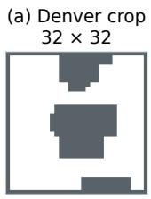

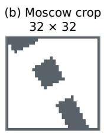

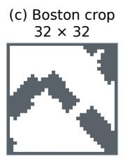

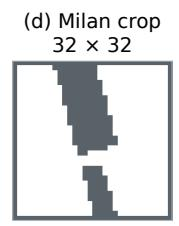

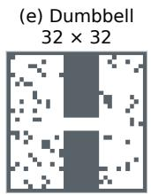

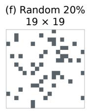

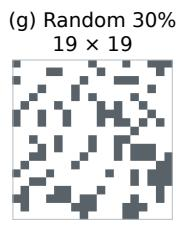

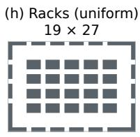

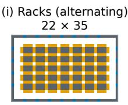

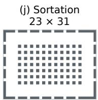  
Figure 5: Examples from the fixed training pools. Gray cells are obstacles; the dumbbell layout connects two regions through a narrow passage. In (i), blue and orange mark workstations and storage endpoints. Dimensions are in cells.

KL control. The penalty uses the old-to-new categorical KL averaged over padded agent rows; inactive rows are deterministic waits and contribute zero. Its coefficient is multiplied by 1.5 above 1.5 times the target and divided by 1.5 below the target divided by 1.5, with bounds [10−3, 103]. The PPO surrogate uses the joint scene likelihood ratio, not per-agent ratios.

Fixed training pools. Figure 5 illustrates the training layouts. Each policy uses three independent training seeds and one fixed pool of 128 entries, shared across its seeds; maps are padded and masked to a common tensor size within the pool. The structured policy uses 48 rack layouts with uniform goals and 128 agents, 48 rack layouts with alternating workstation–storage goals and 160 agents, and 32 sortation layouts with uniform goals and 128 agents. Rack layouts use a three-cell outer ring. The unstructured policy uses 48 32 × 32 street crops and 48 32 × 32 dumbbell layouts, each with 140 agents, plus 16 19 × 19 random maps at each of 20% and 30% obstacle probability, with 64 agents. Dumbbell layouts are rotated and reflected across the pool. Pool generation uses seeds 4300 and 10,000 for the structured and unstructured policies, respectively; training and initialisation use seeds 0, 1 and 2.

Street-crop windows are sampled from Denver, Moscow, Boston and Milan in the Moving AI benchmarks (Sturtevant, 2012). After closing each crop’s boundary, valid candidates have 40–85% free cells with at least 90% in one connected component, which is retained. The score is the largest k ∈ {2, 3, 4, 5} for which k cross-shaped erosions leave at least two components, each containing at least 15% of the retained free cells (zero if none). The sampler accepts the first score of at least 3, or the best valid candidate among 200 proposals.

Goal sampling and resets. Uniform training goals are drawn from reachable cells at graph distance at least 15 on structured maps and 10 on unstructured maps. On the alternating-goal rack entries, a workstation source draws uniformly from storage endpoints; any other source draws uniformly from workstations. Workstations occupy perimeter gaps, and endpoints are free cells adjacent to interior racks. The distance floor of 15 applies within the required category; if no candidate satisfies it, the floor relaxes to 1 within that category, preserving alternation. Deployment consumes the released benchmark task streams. Each environment resets independently at every step with probability $5 \times 1 0 ^ { - 4 }$ on structured maps or $2 . 5 \times 1 0 ^ { - 4 }$ on unstructured maps, giving expected intervals of 2000 and 4000 steps, respectively. Resets place fresh agents on the same map; states otherwise persist across updates.

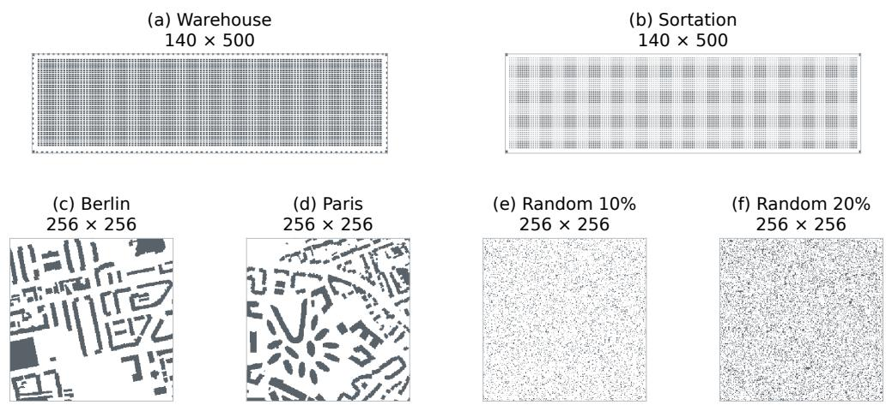  
Figure 6: The six deployment layouts evaluated with 10,000 agents. Gray cells are obstacles; dimensions are in cells.

C EVALUATION PROTOCOL

## C.1 LAYOUT AND SMALL-MAP COMPARISONS

Policies and reporting. The structured and unstructured policies are trained as specified in Appendix B. Each seed’s terminal averaged parameters are reused across every layout of its class. Throughput counts all completed goals over the episode; we average cases within each seed, then average seed means equally.

Berlin and Paris are excluded from the training crops.

Baselines. The headline SILLM comparison uses released IL checkpoints trained on downscaled target layouts, with BD, SG and DG guidance as specified in Section 4. Follower uses its released checkpoint across layouts. The Follower scores reported by Jiang et al. (2025, Table III) use targetretrained models and are not paired with our released-checkpoint timings. The headline OnlineGGO on+PIBT comparison transfers policies trained on smaller source maps to the corresponding large layouts. TrafficFlow uses GP-R100-Re10-F2 without action-LNS. The headline WPPL comparison uses PIBT-LNS with 40,000 iterations, eight threads and a 15-step planning window. At 10,000 agents, LLLG uses planning window 8, horizon 5, two refinements and a 10-second planning-call limit.

Maps and cases. Figure 6 shows the six large layouts from SILLM (Jiang et al., 2025). We use its released start/task cases; Table 4 gives the evaluation settings. Random percentages specify obstacle density; occupancy is agents per free cell.
<table><tr><td>Class</td><td>Layout</td><td>Size</td><td>Free cells</td><td>Occupancy</td><td>Steps</td></tr><tr><td>Structured</td><td>Warehouse</td><td> $1 4 0 \times 5 0 0$ </td><td>38,586</td><td>25.9%</td><td>3200</td></tr><tr><td>Structured</td><td>Sortation</td><td> $1 4 0 \times 5 0 0$ </td><td>54,320</td><td>18.4%</td><td>3200</td></tr><tr><td>Unstructured</td><td>Berlin</td><td> $2 5 6 \times 2 5 6$ </td><td>46,880</td><td>21.3%</td><td>2500</td></tr><tr><td>Unstructured</td><td>1 Paris</td><td> $2 5 6 \times 2 5 6$ </td><td>47,096</td><td>21.2%</td><td>2500</td></tr><tr><td></td><td>Unstructured Random, 10%</td><td> $2 5 6 \times 2 5 6$ </td><td>58,859</td><td>17.0%</td><td>2500</td></tr><tr><td></td><td>Unstructured Random, 20%</td><td> $2 5 6 \times 2 5 6$ </td><td>52,090</td><td>19.2%</td><td>2500</td></tr></table>

Table 4: Deployment maps at 10,000 agents, with eight released cases (0–7) per layout. Size is height × width; occupancy is agents per free cell.

The small random benchmark uses 128 POGEMA (Skrynnik et al., 2025) maps, 17–21 cells per axis, populations 8, 16, 24, 32, 48 and 64, and 256-step episodes. Baselines use the corresponding cases (Li et al., 2021; Arita & Okumura, 2026; Skrynnik et al., 2024b). The dense 642/600-agent comparison uses eight released start/task cases and 256 steps. These populations support the small and intermediate panels of Figure 1; the separate population-transfer study is specified below. Panel (a) of Figure 1 uses a connected twin of the 128 maps: each map is regenerated with the POGEMA generator at the same size and obstacle fraction (within 0.01) until its free cells form one 4-connected component, because SILLM’s map loader keeps only the largest component and 43 of the original maps place agents outside it. Every method in panel (a) is measured on that set with the same instances. PIBT denotes SILLM’s released implementation throughout, so that PIBT and the SILLM variants share one simulator.

Movement rules. Training and evaluation use POGEMA’s soft collision rules (Skrynnik et al., 2025). Attempted swaps are cancelled. At a contested cell, a stationary occupant takes precedence over incoming agents; otherwise, the lowest-index mover takes precedence. Rejected moves become WAIT, and the resulting cancellations propagate until no conflicts remain. This cancellation process does not reconsider alternative moves.

Execution. The headline policies use argmax proposals and layered 16-bit reference tables. Table 2 uses 144 plain allocation iterations per pass on structured and random layouts and 288 on Berlin and Paris. Throughput evaluations may batch independent instances; execution-cost measurements use one policy on one instance. Every task stream is long enough to supply fresh goal throughout the episode.

Map preprocessing and execution-cost measurements are reported in Appendix D.

## C.2 POPULATION-TRANSFER STUDY

Policy reuse. Figure 3 uses the same unstructured policy as the headline comparison, with its training pool specified in Appendix B. Each seed reuses its terminal averaged parameters across every map and population, with argmax proposals and 288 accelerated allocation iterations, increased to 4608 at 20,000 agents on the $2 5 6 ^ { 2 }$ map. A plain 288-iteration reference uses the same checkpoints and cases. The accelerated updates are specified in Appendix E.3. Geometric route tables are constructed for each deployment map.

Evaluation cases. The $3 2 ^ { 2 }$ , 642 and $2 5 6 ^ { 2 }$ maps contain 819, 3221 and 52,090 free cells, respectively. Episodes last 1000 steps on the two smaller maps and 2500 steps on the largest; throughput counts the whole episode. Our policy uses eight start/task cases at every population. The $3 2 ^ { 2 }$ cases use uniform goals on OnlineGGO’s random map. For the two larger maps, additional populations use SILLM’s released agent-placement generator and task streams. Our points average three training seeds and eight cases per seed.

Baseline training and execution. OnlineGGO is trained on the $3 2 ^ { 2 }$ evaluation map with 400 agents using the released recipe; its guidance is updated every 20 steps, with the initial 20-step unitguidance warm-up included in the episode. The SILLM policies are trained on the $6 4 ^ { 2 }$ evaluation map with 600 agents. Follower uses the released policy trained on 40 separate $6 5 ^ { 2 }$ mazes with 128 or 256 agents. The vertical guides therefore mark training agent counts, not the occupancy of the source maps. WPPL uses 2500, 10,000 and 40,000 LNS iterations on the $3 2 ^ { 2 }$ , 642 and $2 5 6 ^ { \overline { { 2 } } }$ maps, respectively (Appendix D); TrafficFlow uses GP-R100-Re10-F2 without additional action-LNS. The PIBT curve uses SILLM’s released implementation. Unmeasured populations are left as gaps in the curves.

## D EXECUTION-COST PROTOCOL AND MEASUREMENTS

Execution cost. Execution cost is wall-clock time per simulated step for one method on one instance, including inference or planning and simulator advancement. Our policy timings synchronise the complete rollout and exclude setup, compilation and warm-up. Dedicated measurements use an AMD Ryzen 7 7800X3D and RTX 5090. The warehouse comparison with SILLM-SG and the Random 20% comparison with SILLM-DG use matched full rollouts on this host. Table 5 summarises the timed intervals; throughput always uses complete episodes. Windowed timings reduce measurement time; the WPPL and LLLG checks agree with full-rollout cost within 3%, small relative to the observed cost gap.

<table><tr><td>Method</td><td>Timed interval</td></tr><tr><td>Ours, SILLM-SG/BD</td><td>Complete rollout.</td></tr><tr><td>SILLM-DG</td><td>Complete rollout on Berlin, Paris and Random 20%; steps 20–300 elsewhere.</td></tr><tr><td>PIBT</td><td>Complete simulation loop, excluding initialisation.</td></tr><tr><td>TrafficFlow</td><td>Complete simulation loop on warehouse and Random 20%; recorded intervals on the other layouts.</td></tr><tr><td>WPPL</td><td>Complete rollout on Random 20%; steps 20–300 elsewhere.</td></tr><tr><td>LLLG</td><td>Steps 20–300, excluding setup.</td></tr><tr><td>OnlineGGO</td><td>Complete rollout (median) on warehouse; steps 20–300 elsewhere.</td></tr><tr><td>Follower</td><td>Complete rollout (median).</td></tr></table>

Table 5: Timed intervals for the six 10,000-agent layouts in Table 2. All intervals include simulator execution.

Hardware and baseline settings. Headline timings use 16 OpenMP threads for SILLM-SG/DG, eight for SILLM-BD, six for PIBT, one for TrafficFlow and eight LNS threads for WPPL. Planner configurations are given in Appendix C. OnlineGGO on sortation, Berlin, Paris and the two random layouts uses a Ryzen 9 7950X3D. Follower and warehouse OnlineGGO retain timings from their evaluation hosts, with RTX 5090 GPUs for Follower.

Other operating scales. On the 128-map benchmark, RHCR is timed over its complete environment loop; LLLG uses process wall time with setup subtracted. At 600 agents, our cost covers a 256-step rollout and baseline costs use recorded execution intervals. RHCR uses PBS/SIPP, windows 5/10, a 10-second planning-call limit and its Python executor. In Table 13, both actionselection rules average three full rollouts after warm-up on the dedicated host; OnlineGGO uses one CPU thread over steps 20–1000 on that host. At 20,000 agents, SILLM-DG uses a complete rollout on an AMD EPYC 7B12 with RTX 5090. TrafficFlow averages eight full rollouts on an AMD EPYC 7702 with four OpenMP threads, including process setup.

WPPL refinement budget. Table 6 varies the LNS iteration budget on Random 10% with 10,000 agents. Increasing the budget from 2500 to 40,000 improves throughput by 3.0% while increasing execution cost by 4.8×. On the 10,000-agent layouts, 2500 iterations give 41.97 on the warehouse, 43.75 on sortation (seven of eight cases) and 28.34 on Random 20%, against 42.79, 44.25 and 34.28 at 40,000 iterations (Table 2), at 255 and 348 ms per step on the warehouse and Random 20% (stepsegment costs on the dedicated hardware). The population study (Figure 3) scales the budget with map size: 2500 iterations on the $3 2 ^ { 2 }$ map, 10,000 on $6 4 ^ { 2 }$ and 40,000 on $2 5 6 ^ { 2 }$ , the setting SILLM’s harness applies to the 10,000-agent layouts. At 40,000 iterations on Random 20%, complete case-0 rollouts cost 1031, 1532 and 1600 ms per step at 6000, 10,000 and 12,000 agents. At the smaller budgets, case-0 rollouts cost 61–100 ms per step on the $3 2 ^ { 2 }$ map (200–800 agents, 2500 iterations) and 146–377 ms per step on the $6 4 ^ { 2 }$ map (100–2500 agents, 10,000 iterations), on the same host.

<table><tr><td>LNS iterations</td><td>Throughput (tasks/step)</td><td>Execution cost (ms/step)</td></tr><tr><td>2500</td><td> $5 1 . 8 6 7 \pm 0 . 0 8 9$ </td><td>252.0</td></tr><tr><td>10,000</td><td> $5 2 . 7 2 5 \pm 0 . 1 1 0$ </td><td>474.9</td></tr><tr><td>40,000</td><td> $5 3 . 4 4 8 \pm 0 . 1 0 7$ </td><td>1201.5</td></tr></table>

Table 6: WPPL refinement-budget comparison. Throughput is mean ± standard deviation over eight 2500-step cases. Costs use case 0, steps 20–300, on the dedicated hardware above, following Table 5.

Map preparation. Reference tables are constructed once per map and shared across agents and successive tasks (Table 7). Their storage is already included in the deployment memory measurements below.

Deployment memory. Table 8 separates preparation from rollout memory at 10,000 agents, distinguishing setup peaks from memory used during execution. SILLM-SG/BD and our policy store precomputed map tables on the GPU and have comparable GPU requirements. SILLM-DG computes guidance on the host and transfers local values to the GPU for inference. On the host, the evaluated PIBT and WPPL implementations cache distance tables; WPPL and LLLG also retain candidate paths and search states for replanning. TrafficFlow stores guiding paths and their distance estimates, while Online GGO maintains distance estimates under its learned guidance weights.

<table><tr><td>Map</td><td>Construction (s)</td><td>Shared tables (GiB)</td></tr><tr><td>Warehouse</td><td>16.5</td><td>5.53</td></tr><tr><td>Sortation</td><td>65.8</td><td>10.86</td></tr><tr><td>Berlin</td><td>24.7</td><td>8.13</td></tr><tr><td>Paris</td><td>24.5</td><td>8.21</td></tr><tr><td>Random, 10%</td><td>91.1</td><td>12.70</td></tr><tr><td>Random, 20%</td><td>63.1</td><td>10.00</td></tr></table>

Table 7: Reference-table construction times and sizes on RTX 5090. Times cover the host construction call; compilation and asynchronous completion are included in warm-up.
<table><tr><td></td><td colspan="4">Random 20%</td><td colspan="4">Warehouse</td></tr><tr><td></td><td colspan="2">Host</td><td colspan="2">GPU</td><td colspan="2">Host</td><td colspan="2">GPU</td></tr><tr><td>Method</td><td>Prep.</td><td>Rollout</td><td>Prep.</td><td>Rollout</td><td>Prep.</td><td>Rollout</td><td>Prep.</td><td>Rollout</td></tr><tr><td>Ours</td><td>12.1</td><td>7.5</td><td>10.3</td><td>10.3</td><td>7.4</td><td>5.1</td><td>5.8</td><td>5.8</td></tr><tr><td>SILLM-SG</td><td>20.0</td><td>1.7</td><td>10.1</td><td>10.7</td><td>11.6</td><td>1.8</td><td>5.6</td><td>6.2</td></tr><tr><td>SILLM-DG</td><td>1.0</td><td>23.3</td><td>&lt; 0.1</td><td>0.6</td><td>0.9</td><td>22.2</td><td>&lt; 0.1</td><td>0.6</td></tr><tr><td>SILLM-BD</td><td>20.2</td><td>1.8</td><td>10.1</td><td>10.7</td><td>9.8</td><td>1.8</td><td>5.6</td><td>6.2</td></tr><tr><td>PIBT</td><td>10.4</td><td>10.6</td><td></td><td></td><td>5.9</td><td>6.0</td><td></td><td></td></tr><tr><td>WPPL</td><td>10.8</td><td>11.5</td><td></td><td></td><td>6.2</td><td>6.9</td><td></td><td></td></tr><tr><td>TrafficFlow</td><td>0.1</td><td>23.3</td><td></td><td></td><td>0.1</td><td>22.5</td><td></td><td></td></tr><tr><td>LLLG</td><td>2.2</td><td>8.4</td><td></td><td></td><td>1.6</td><td>6.5</td><td></td><td></td></tr><tr><td>Online GGO</td><td>4.5</td><td>41.8</td><td></td><td></td><td>4.7</td><td>47.1</td><td></td><td></td></tr><tr><td>Follower</td><td>30.4</td><td>31.2</td><td>0.1</td><td>0.2</td><td>32.5</td><td>33.4</td><td>0.1</td><td>0.2</td></tr></table>

Table 8: Peak host memory and live GPU allocation (GiB) during preparation and rollout. Peaks need not coincide; dashes denote CPU-only methods.

## E ADDITIONAL EVALUATION RESULTS

## E.1 DEPLOYMENT RESULTS BY TRAINING SEED

Table 9 gives the seed-level plain-allocation results behind Table 2, under the protocol in Appendix C.
<table><tr><td>Layout</td><td>Seed 0</td><td>Seed 1</td><td>Seed 2</td></tr><tr><td>Warehouse</td><td>42.272</td><td>42.387</td><td>42.279</td></tr><tr><td>Sortation</td><td>44.191</td><td>44.228</td><td>44.180</td></tr><tr><td>Berlin</td><td>33.518</td><td>32.033</td><td>33.412</td></tr><tr><td>Paris</td><td>33.618</td><td>31.097</td><td>34.809</td></tr><tr><td>Random 10%</td><td>54.161</td><td>54.217</td><td>54.180</td></tr><tr><td>Random 20%</td><td>47.483</td><td>47.564</td><td>47.514</td></tr></table>

Table 9: Terminal-checkpoint throughput by training seed; each entry averages eight cases.

## E.2 SMALL AND INTERMEDIATE OPERATING SCALES

Table 10 reports six populations on the original 128-map random benchmark, using the unstructured policy with 144 plain allocation iterations and 256-step episodes, with RHCR as the reference across populations.

Table 11 compares methods on eight dense 642/600-agent cases over 256 steps. At this intermediate scale, our throughput is within 3.3% of WPPL and LLLG, and 11.5% above SILLM-DG. RHCR uses PBS (Ma et al., 2019) with SIPP (Phillips & Likhachev, 2011), simulation/planning windows 5/10 and a 10-second planning-call limit, reached by 46–49 calls per case.

<table><tr><td>Agents</td><td>Seed 0</td><td>Seed 1</td><td>Seed 2</td><td>RHCR</td></tr><tr><td>8</td><td>0.607</td><td>0.610</td><td>0.607</td><td>0.625</td></tr><tr><td>16</td><td>1.208</td><td>1.211</td><td>1.207</td><td>1.251</td></tr><tr><td>24</td><td>1.725</td><td>1.728</td><td>1.722</td><td>1.798</td></tr><tr><td>32</td><td>2.175</td><td>2.174</td><td>2.164</td><td>2.286</td></tr><tr><td>48</td><td>3.041</td><td>3.042</td><td>3.036</td><td>3.203</td></tr><tr><td>64</td><td>3.795</td><td>3.795</td><td>3.785</td><td>3.819</td></tr></table>

Table 10: Throughput on 128 small random maps at every tested population. Policy columns distinguish training seeds; each covers the same benchmark cases as RHCR.
<table><tr><td>Method</td><td>Throughput</td></tr><tr><td>Ours (three seeds)</td><td>9.778</td></tr><tr><td>WPPL</td><td>10.108</td></tr><tr><td>LLLG</td><td>10.007</td></tr><tr><td>SILLM-DG</td><td>8.766</td></tr><tr><td>PIBT</td><td>7.821</td></tr><tr><td>RHCR (PBS/SIPP)</td><td>0.892</td></tr></table>

Table 11: Reproduced dense $6 4 ^ { 2 } / 6 0 0 \mathrm { - a g e n t }$ comparison, eight cases and 256 steps. Ours uses plain allocation and averages three training seeds.

## E.3 EVALUATION-TIME ALLOCATION

Destination allocation supplies the proposal probabilities $\pi _ { i }$ used for action selection (Section 3.3). Accelerated updates change how these probabilities are computed; iterative action selection reuses them to reconsider moves cancelled by conflicts. Both operate at evaluation with the same learned field, route operator and trained parameters.

Accelerated updates. Destination allocation adjusts the route probabilities $q _ { i }$ for competing demand for cells (Section 3.3). In each of its two passes, plain Sinkhorn iterations alternate row normalisation, which assigns unit mass to each agent, and destination normalisation, which balances demand against unit cell capacity (Appendix A.5). We accelerate these updates at evaluation with temperature scaling (Schmitzer, 2019) and over-relaxation (Thibault et al., 2021). Temperature scaling begins with a higher entropy weight and gradually returns to the learned temperature $\tau _ { p } ;$ over-relaxation extrapolates each ordinary potential update. For an allocation pass with $K \geq 2$ iterations, iteration $k \in \{ 0 , \ldots , K - 1 \}$ uses

$$
\begin{array} { r } { \tau _ { p , k } = \tau _ { p } \kappa ^ { \mathrm { m a x } \left\{ 1 - k / \lfloor K / 2 \rfloor , 0 \right\} } , \qquad f _ { i } \gets ( 1 - \omega ) f _ { i } + \omega \widetilde { f } _ { i } . } \end{array}\tag{27}
$$

Here $\kappa \geq 1$ is the initial-temperature multiplier and ω is the relaxation factor. We fix $\kappa = 8$ and $\omega = 1 . 6$ in these evaluations; the temperature reaches $\tau _ { p }$ halfway through each pass and remains there. The value $\widetilde { f } _ { i }$ is the ordinary row update in Eq. (23), evaluated at $\tau _ { p , k } ;$ the same relaxation applies to the slack potential $f _ { d }$ and destination potentials $g _ { x }$ . Row and slack potentials are updated before computing the destination update. Both allocation passes start from zero potentials and use this schedule; the reverse-edge repricing rule is unchanged. Setting $\kappa = \omega = 1$ recovers plain scaling. At the final temperature $\tau _ { p } ,$ the relaxed updates have the same fixed-point equations as plain scaling. Learned parameters remain fixed, and all checkpoints were trained with 48 plain Sinkhorn iterations per pass.

Iterative action selection. At deployment, each agent proposes its most probable action under $\pi _ { i }$ (Section 3.3). POGEMA’s movement rules (Appendix C) cancel conflicting moves to WAIT. Iterative action selection lets agents whose moves were cancelled reconsider alternatives using the already computed allocation probabilities.

First apply the movement rules provisionally and reserve every assigned next cell, including each waiting agent’s current cell. In each round, agents whose original moves were cancelled and who still wait choose, in parallel, their highest-scoring action among WAIT and valid moves to unassigned cells. Comparisons use the fixed logits in $\operatorname { E q . }$ . (25) and the original action order for ties. For each proposed non-WAIT destination, the lowest-index proposer is accepted; its destination stays reserved and its current cell becomes available in the next round. This preserves feasibility while permanently adding moves. Repeat until a round accepts no additional move, then advance the simulator once with the resulting joint proposal. The learned field, route probabilities and Sinkhorn allocation are each computed only once per timestep. In the long-horizon comparison of Figure 8, iterative selection changes mean throughput by less than 0.5% on warehouse, sortation and both random layouts, while improving it on Berlin and Paris.

Deployment results. We first evaluate accelerated updates with independent argmax action selection. The population comparisons below and the long-horizon evaluation in Appendix E.4 also evaluate iterative action selection. Table 12 compares plain allocation with 144 accelerated iterations on the six headline layouts. Throughput averages eight cases within each of three training seeds. Execution cost uses seed 0, case 0 and the synchronised rollout protocol in Appendix D.

<table><tr><td rowspan="2">Layout</td><td colspan="3">Plain</td><td colspan="2">Accelerated, 144 iterations</td></tr><tr><td>Iterations</td><td>Throughput</td><td>ms/step</td><td>Throughput</td><td>ms/step</td></tr><tr><td>Warehouse</td><td>144</td><td>42.31</td><td>9.02</td><td>42.30</td><td>9.24</td></tr><tr><td>Sortation</td><td>144</td><td>44.20</td><td>8.31</td><td>44.19</td><td>8.52</td></tr><tr><td>Berlin</td><td>288</td><td>32.99</td><td>8.89</td><td>33.47</td><td>5.77</td></tr><tr><td>Paris</td><td>288</td><td>33.17</td><td>8.91</td><td>33.79</td><td>5.87</td></tr><tr><td>Random 10%</td><td>144</td><td>54.19</td><td>5.97</td><td>54.19</td><td>6.19</td></tr><tr><td>Random 20%</td><td>144</td><td>47.52</td><td>7.46</td><td>47.53</td><td>7.91</td></tr></table>

Table 12: Evaluation-time allocation at 10,000 agents. Throughput is in tasks per step and execution time in ms per step. Plain values are those of Table 2; accelerated values use 144 iterations on every layout.

At 96 accelerated iterations, warehouse and sortation attain 42.31 and 44.20 tasks per step in 6.81 and 6.37 ms. Their throughput, and that on the two random layouts, differs from the headline result by less than 0.004 tasks per step. At 288 accelerated iterations, Berlin and Paris reach 33.86 and 34.24 tasks per step.

Population and iteration count. Figure 7 extends the population study to the warehouse and compares both action-selection rules across the full population range. Table 13 reports the throughput– cost tradeoff across allocation budgets with the same trained policy. At 20,000 agents, 864 iterations with iterative selection attain 48.04 tasks per step at 64.58 ms per step, compared with SILLM-DG’s 47.77 tasks per step at 924 ms per step (Appendix D). Larger budgets provide further throughput gains, with their costs reported in Table 13. For the population curves, baseline counts are 288 on random maps and 144 on the warehouse; higher counts follow the offline probability-accuracy calibration below. Our points average three training seeds and eight cases per seed.

On the $3 3 \times 5 7$ warehouse with 700 agents, 144 accelerated iterations attain 9.50 tasks per step, compared with 2.63 at 144 plain iterations and 9.51 at 4032 plain iterations. At 600 agents on $3 2 ^ { 2 }$ and 2500 on 642, acceleration at 288 iterations raises throughput from 6.58 to 9.77 and from 7.71 to 11.49 (Figure 3). These comparisons show that changing the allocation updates can improve throughput under congestion without retraining.

Competition across scales. We connect agents through destination cells to which they assign probability greater than 0.01 and whose total assigned probability exceeds 0.95. Table 14 reports the largest connected group’s size and approximate graph diameter, measured in agent–cell–agent links. Training measurements use the saved states and live actors at 3000, 10,000 and 24,999 updates, with 128 streams per checkpoint and policy. Evaluation measurements use 25 evenly spaced states from each of ten 1000-step rollouts, with training seed 0 and case 0. The largest group averages about four agents during training, compared with 3641 at 20,000 agents on $2 5 6 ^ { \breve { 2 } }$ . On the 900-agent warehouse, its mean spatial span is 49 by 26 cells on the $3 3 \times 5 7$ map. Increasing population can therefore connect local competition over distances substantially larger than those observed during training.

Offline iteration calibration. For the population curves, we calibrate iteration counts on saved states by comparing allocation probabilities with those from a much longer run. Each selected budget remains fixed throughout its rollout. Holding each state’s inputs fixed, let $\pi _ { i , K } ( \cdot \mid s )$ be agent i’s allocation distribution after K iterations per pass. We measure

<table><tr><td colspan="3"></td><td colspan="2">Accelerated</td><td colspan="2">+ iterative selection</td><td colspan="2">OnlineGGO</td></tr><tr><td>Map</td><td>Agents</td><td>Iterations</td><td>Tasks/step ms/step</td><td></td><td>Tasks/step ms/step</td><td></td><td>Tasks/step</td><td>ms/step</td></tr><tr><td rowspan="2">Random  $3 2 ^ { 2 }$ </td><td>700</td><td>288</td><td>7.67</td><td>7.02</td><td>8.50</td><td>7.35</td><td>7.39</td><td>6.49</td></tr><tr><td></td><td>576</td><td>7.86</td><td>12.90</td><td>8.79</td><td>13.25</td><td></td><td></td></tr><tr><td>Random  $3 2 ^ { 2 }$ </td><td>800</td><td>288</td><td>3.97</td><td>7.54</td><td>4.75</td><td>8.14</td><td>6.39</td><td>7.14</td></tr><tr><td rowspan="2">Random  $6 4 ^ { 2 }$ </td><td></td><td>2,304</td><td>4.65</td><td>42.74</td><td>5.58</td><td>43.31</td><td></td><td></td></tr><tr><td>2,500</td><td>288</td><td>11.46</td><td>9.24</td><td>14.00</td><td>9.80</td><td>9.82</td><td></td></tr><tr><td rowspan="3">Random  $2 5 6 ^ { 2 }$ </td><td></td><td>2,304</td><td>12.37</td><td>52.71</td><td>14.66</td><td>53.36</td><td></td><td></td></tr><tr><td>20,000</td><td>288</td><td>32.64</td><td>24.68</td><td>41.28</td><td>25.44</td><td></td><td></td></tr><tr><td></td><td>864 4,608</td><td>36.89 41.98</td><td>64.44</td><td>48.04</td><td>64.58</td><td></td><td></td></tr><tr><td rowspan="2">Warehouse</td><td>700</td><td></td><td></td><td>321.10</td><td>54.14</td><td>317.03</td><td></td><td></td></tr><tr><td></td><td>144 288</td><td>9.50 9.53</td><td>4.41 8.01</td><td>9.66 9.42</td><td>4.26</td><td>7.97</td><td>7.98</td></tr><tr><td rowspan="2">Warehouse</td><td>800</td><td>144</td><td>4.49</td><td>5.34</td><td></td><td>7.25</td><td></td><td></td></tr><tr><td></td><td>4,608</td><td>6.86</td><td>116.96</td><td>4.89 7.33</td><td>4.99 109.83</td><td>7.37</td><td>9.84</td></tr><tr><td rowspan="2">Warehouse</td><td>900</td><td>144</td><td>2.07</td><td>5.29</td><td></td><td></td><td></td><td></td></tr><tr><td></td><td>4,608</td><td>5.23</td><td>119.48</td><td>2.12 5.59</td><td>5.26 111.35</td><td>6.64</td><td>10.29</td></tr><tr><td rowspan="2">Warehouse</td><td>1,000</td><td>144</td><td>1.12</td><td>6.00</td><td>0.99</td><td>5.54</td><td>5.59</td><td>11.36</td></tr><tr><td></td><td>2,304</td><td>3.51</td><td>61.83</td><td>3.94</td><td>57.88</td><td></td><td></td></tr></table>

Table 13: Action selection at selected Sinkhorn budgets. Our two action-selection variants use matched checkpoints, cases and allocation updates; throughput averages three training seeds and eight cases per seed. All costs use single-instance measurements (Appendix D). Dashes denote unavailable measurements.

<table><tr><td>Setting</td><td>Group size</td><td>Diameter</td><td> $K ^ { \star }$ </td></tr><tr><td>Unstructured training Structured training</td><td>4.34 4.03</td><td>2.25 2.51</td><td></td></tr><tr><td>Warehouse, 600 Warehouse, 700</td><td>13.84 49.68</td><td>6.36 17.56</td><td>144 288</td></tr><tr><td>Warehouse, 800 Warehouse, 900</td><td>314.68 456.36</td><td>53.52 60.68</td><td>4608 4608</td></tr><tr><td>Warehouse, 1000</td><td>675.80</td><td>68.68</td><td>2304</td></tr><tr><td>Random  $3 2 ^ { 2 } .$  700</td><td>96.52</td><td></td><td></td></tr><tr><td>Random  $3 2 ^ { 2 } .$  800</td><td>521.28</td><td>24.00</td><td>576</td></tr><tr><td>Random  $6 4 ^ { 2 } , 2 5 0 0$ </td><td></td><td>56.96</td><td>2304</td></tr><tr><td></td><td>816.60</td><td>60.36</td><td>2304</td></tr><tr><td>Random  $2 5 6 ^ { 2 } ,$  16,000</td><td>32.76</td><td>12.72</td><td>288</td></tr><tr><td>Random  $2 5 6 ^ { 2 }$  ,20,000</td><td>3641.16</td><td>91.00</td><td>4608</td></tr></table>

Table 14: Connected competition in historical training and evaluation states. Group sizes and graph diameters are means over sampled states, using an 18,432-iteration allocation reference. $K ^ { \star }$ is the smallest eligible count selected by the empirical allocation-error criterion; training rows report no evaluation count. Diameter is estimated by two successive breadth-first searches.

<table><tr><td>Ours (accelerated) Ours (+ iterative selection)</td><td>SILLM-SG → SILLM-BD</td><td>·TrafficFlow → WPPL</td><td>Follower -× - PIBT</td></tr></table>

(a) Random $3 2 \times 3 2$  
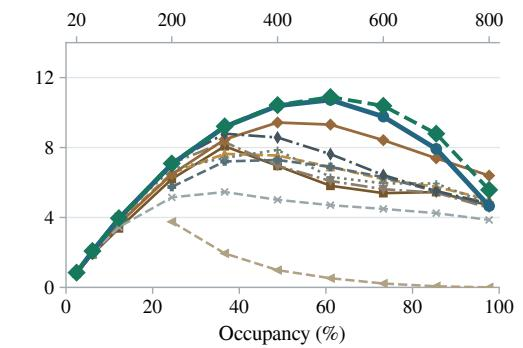

(b) Random 64 × 64  
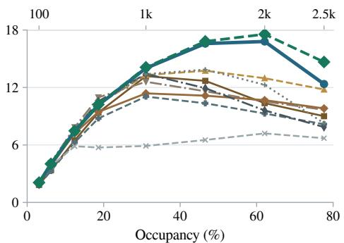

(c) Random 256 × 256  
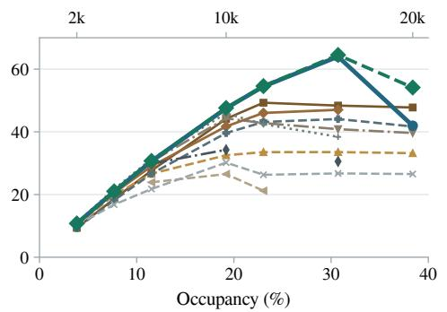

(d) Warehouse 33 × 57  
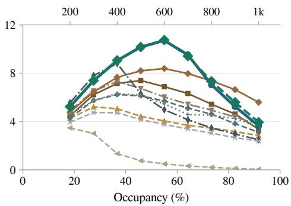  
Figure 7: Population transfer with accelerated Sinkhorn, with and without iterative action selection. Iteration counts use the offline probability-accuracy calibration described in the text, with fixed baseline counts at lower populations. Table 13 also reports lower-cost operating points. Ours averages three training seeds and eight cases per seed, with 1,000 steps in (a,b,d) and 2,500 in (c). Upper axes give agent counts.

$$
e _ { K } = \frac { 1 } { | { \cal S } | } \sum _ { s \in { \cal S } } \frac { 1 } { 2 N ( s ) } \sum _ { i = 1 } ^ { N ( s ) } \| \pi _ { i , K } ( \cdot  { | } s ) - \pi _ { i , K _ { \mathrm { r e f } } } ( \cdot  { | } s ) \| _ { 1 } ,\tag{28}
$$

where $s$ is the set of sampled states, $N ( s )$ is the number of active agents, and $K _ { \mathrm { r e f } } ~ = ~ 1 8 { , } 4 3 2 .$ Thus $e _ { K }$ measures the average difference in allocation probabilities over agents and sampled states. We use 0.005 as an empirical tolerance for this comparison; the longer run is a finite numerical reference. Among counts with complete three-seed, eight-case evaluations, we choose the smallest at or above the family baseline for which $e _ { K } \le 0 . 0 0 5$ and remains within this tolerance at larger tested counts. For example, on $2 5 6 ^ { 2 }$ we select 288 iterations at 16,000 agents and 4608 at 20,000 agents. The 9216- and 18,432-iteration references differ by less than 0.0005 in mean total variation in every evaluated condition.

Training occupancy spans 16.8–34.2% for the unstructured pool and 21.7–68.4% for the structured pool; the highest evaluated occupancies also extend beyond these ranges. The larger connected groups provide a possible explanation for the increased allocation budgets at high occupancy.

## E.4 LONG-HORIZON EVALUATION

We extend evaluation to 10,000 uninterrupted steps with 10,000 agents to examine whether throughput persists under the transfer protocol of Table 2. For each of three training seeds, the same terminal checkpoint is reused across all layouts within its class, without target-layout retraining or checkpoint selection. Both action-selection rules use 144 accelerated Sinkhorn iterations per pass; learned parameters remain fixed. WPPL retains the headline setting of 40,000 LNS iterations, eight threads and a 15-step planning window. Standard-horizon execution costs are reported in Tables 2 and 12. Figure 8 compares all six layouts with the three SILLM variants and WPPL. Our policy closely tracks SILLM-SG and WPPL on warehouse and sortation; on Berlin and both random layouts, its whole-run mean exceeds those of all four baselines. Iterative selection raises mean throughput from 32.38 to 33.40 on Berlin and from 23.43 to 26.01 on Paris, where SILLM-DG has the highest base line mean of 24.69.

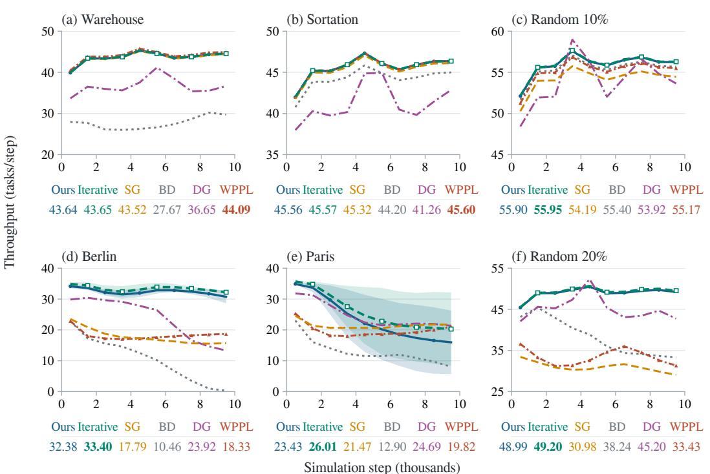  
Figure 8: Continuation throughput on six layouts. All methods use 10,000 agents over 10,000 steps. Curves show 1000-step window means over eight cases; our curves additionally average three training seeds, with shading indicating ±1 sample standard deviation across seed means. Values below panels are whole-run means, with the largest in bold. Vertical scales vary by panel.

## E.5 ADDITIONAL LARGE LAYOUTS

Table 15 evaluates the same unstructured policy on two $2 5 6 ^ { 2 }$ random layouts and the $1 9 4 ^ { 2 }$ Dragon Age: Origins map ost003d from the Moving AI benchmark (Sturtevant, 2012). Random 30% retains the largest connected component of a 30%-obstacle draw; Random 40% uses clustered obstacles. The three maps contain 45,049, 39,322 and 13,214 free cells, respectively.

Each method uses the same eight cases per layout and 2500 scored steps. Our policy uses terminal averaged weights from three training seeds and 288 plain allocation iterations. On the additional random layouts, SILLM-BD and SILLM-DG transfer their released IL checkpoints trained on 20%- obstacle random maps, TrafficFlow uses GP-R100-Re10-F2, and LLLG uses its 10,000-agent setting (planning window 8, horizon 5, two refinements, 10-second limit). WPPL uses 2500 LNS iterations on these layouts. PIBT uses SILLM’s implementation on every layout, and hm+GPIBT uses OnlineGGO’s handcrafted guidance on ost003d. All learned policies retain their trained parameters.

The same unstructured policy transfers to these more obstructed layouts without retraining, attaining the highest mean throughput among the evaluated methods on all three maps.

<table><tr><td>Layout</td><td>Agents</td><td>Ours</td><td>SILLM-BD</td><td>SILLM-DG</td><td>LLLG</td><td>TrafficFlow</td><td>PIBT</td><td></td><td>WPPL hm+GPIBT</td></tr><tr><td>Random 30% (LCC)</td><td>10,000</td><td>18.86±2.26</td><td>12.83</td><td>18.62</td><td>16.68</td><td>17.50</td><td>13.91</td><td>14.26</td><td></td></tr><tr><td>Random 40% (clustered)</td><td>10,000</td><td>22.10±1.02</td><td>9.64</td><td>14.49</td><td>12.05</td><td>13.50</td><td>11.88</td><td>14.33</td><td></td></tr><tr><td>ost003d</td><td>6000</td><td> $6 . 0 9 { \pm } 0 . 5 3 $ </td><td></td><td></td><td></td><td></td><td>3.78</td><td></td><td>3.90</td></tr></table>

Table 15: Throughput on additional large layouts, in tasks per step. Our entries show mean ± sample standard deviation across three training seeds; each seed and each baseline average eight matching cases. Dashes indicate unavailable eight-case results.

## F MECHANISM CONTROLS AND SUPPORTING EVIDENCE

The following controls use separate runs from the structured and unstructured training pools in Appendix B. Deployment evaluations use terminal averaged weights; learning curves use current parameters.

## F.1 ACTOR STRUCTURE AT DEPLOYMENT SCALE

Table 16 compares the full actor with six retrained variants on the six deployment layouts at 10,000 agents. Each variant retains its policy family’s training pool and 25,000-update budget. We evaluate terminal averaged weights from three training seeds on eight cases per layout, using 3200 steps and 144 plain allocation iterations on structured maps, and 2500 steps and 288 iterations on unstructured maps.

Controls. The depth variants use $H = 1$ or $H \ : = \ : 2$ during both training and evaluation. Removing allocation replaces both Sinkhorn passes and the reverse-move penalty with independent normalisation of route affinities, leaving the simulator unchanged. The combined variant also sets $H = 1$ . Removing the vector branch sets $G = 0$ in Eq. (16), retaining the action-score branch, goalconditioned gains and depth corrections. The no-gain control fixes $\gamma _ { h } ( x ) = 0$ in Eq. (3), retaining the shared scores, vector branch, depth corrections, geometric reference and allocation.
<table><tr><td rowspan="2">Actor</td><td colspan="2">Structured</td><td colspan="4">Unstructured</td></tr><tr><td>Warehouse</td><td>Sortation</td><td>Berlin</td><td></td><td></td><td>Paris Random 10% Random 20%</td></tr><tr><td> $\mathrm { F u l l } \left( H = 4 \right)$ </td><td> $4 2 . 3 1 { \pm } 0 . 0 6$ </td><td> $4 4 . 2 0 { \pm } 0 . 0 2$ </td><td> $3 2 . 9 9 { \pm } 0 . 8 3 $ </td><td> $3 3 . 1 7 { \pm } 1 . 9 0 $ </td><td> $5 4 . 1 9 { \pm } 0 . 0 4 $ </td><td> $4 7 . 5 3 { \pm } 0 . 0 4$ </td></tr><tr><td> $H = 1$ </td><td> $4 0 . 0 6 \pm 1 . 6 0$ </td><td> $4 3 . 9 0 { \pm } 0 . 0 4$ </td><td> $3 0 . 2 3 { \pm } 1 . 3 7$ </td><td> $3 3 . 3 3 { \pm } 1 . 8 9 $ </td><td> $5 3 . 8 0 { \pm } 0 . 0 1 $ </td><td> $4 5 . 9 9 \pm 0 . 0 4$ </td></tr><tr><td> $H = 2$ </td><td> $4 1 . 6 4 { \pm } 0 . 0 5$ </td><td> $4 4 . 0 6 { \pm } 0 . 0 3$ </td><td> $2 6 . 7 3 { \scriptstyle \pm 3 . 0 0 }$ </td><td> $3 2 . 1 3 { \pm } 2 . 5 9$ </td><td> $5 4 . 1 4 { \pm } 0 . 0 5$ </td><td> $4 6 . 9 5 { \scriptstyle \pm 0 . 0 6 }$ </td></tr><tr><td>Without allocation</td><td> $4 0 . 7 7 { \scriptstyle \pm 2 . 2 6 }$ </td><td> $4 4 . 1 0 { \pm } 0 . 0 7$ </td><td> $1 8 . 7 6 { \pm } 3 . 4 4$ </td><td> $2 2 . 6 6 { \pm } 3 . 4 1$ </td><td> $5 3 . 4 0 { \pm } 0 . 0 4$ </td><td> $4 4 . 8 1 { \pm } 0 . 3 4$ </td></tr><tr><td> $H = 1 ,$  , no allocation</td><td> $2 2 . 2 4 \pm 1 6 . 6 1$ </td><td> $4 3 . 8 2 { \pm } 0 . 0 5$ </td><td> $2 0 . 6 5 { \pm } 0 . 6 1$ </td><td> $2 0 . 7 9 { \pm } 1 . 6 9$ </td><td> $5 3 . 0 4 { \pm } 0 . 0 5$ </td><td> $4 2 . 9 1 { \pm } 0 . 3 3 $ </td></tr><tr><td>Without vector field G</td><td> $4 2 . 1 8 { \pm } 0 . 0 9$ </td><td> $4 4 . 2 0 { \pm } 0 . 0 1$ </td><td> $2 9 . 3 3 { \pm } 3 . 3 4 $ </td><td> $3 1 . 2 4 \pm 2 . 8 2$ </td><td> $5 4 . 2 7 { \pm } 0 . 0 3$ </td><td> $4 7 . 6 6 { \pm } 0 . 0 5$ </td></tr><tr><td>Without gains γ</td><td> $4 2 . 0 0 { \pm } 0 . 1 7 \ $ </td><td> $4 4 . 2 3 { \pm } 0 . 0 3$ </td><td> $2 9 . 1 7 { \pm } 1 . 9 1 $ </td><td> $3 1 . 2 9 { \pm } 1 . 8 1 $ </td><td> $5 4 . 3 4 { \pm } 0 . 0 5$ </td><td> $4 7 . 9 1 { \pm } 0 . 0 4$ </td></tr></table>

Table 16: Actor-structure ablations at 10,000 agents. Entries are throughput in tasks per step, reported as mean ± sample standard deviation over three training seeds; each seed averages eight cases.

Four departures improve mean throughput over one on warehouse, sortation and both random maps; the city results do not follow a monotonic depth ordering. Removing allocation reduces Berlin throughput from 32.99 to 18.76 and Paris from 33.17 to 22.66. On warehouse, combining $H = 1$ with allocation removal gives a larger mean throughput reduction than either change alone. Removing the vector branch leaves structured and random-map throughput close to the full actor, while reducing throughput on both cities. Appendices F.3 and F.4 examine continuation depth and allocation across populations.

Goal-conditioned gains. Removing the gains reduces mean throughput from 42.31 to 42.00 on warehouse, from 32.99 to 29.17 on Berlin, and from 33.17 to 31.29 on Paris. Sortation throughput is nearly unchanged, while both random-map means increase slightly. The benefit of these gains therefore depends on the layout.

## F.2 LEARNING PROGRESS

Figure 9 tracks validation throughput for selected variants in Table 16. Current parameters are evaluated every 200 updates on 32 procedural validation maps generated separately from the training

pool, using 64 reset cases, deterministic proposals and 128 steps per case, with the first 15 excluded from scoring. Each training update collects $1 2 8 \times 6 4$ joint environment transitions.

$$
{ \begin{array} { r l r l } & { { \mathrm { ~ --- ~ } } \operatorname { F u l l } \left( H = 4 \right) } & { } & { { \mathrm { ~ --- ~ } } H = 1 } & { } & { { \mathrm { ~ --- ~ } } H = 1 + { \mathrm { n o ~ a l l o c a t i o n } } } \\ & { } & { { \mathrm { ~ --- ~ } } H = 2 } & { } & { { \mathrm { --- ~ } } { \mathrm { N o ~ a l l o c a t i o n } } } & { } & { { \mathrm { --- ~ } } { \mathrm { N o ~ } } G } \end{array} }
$$

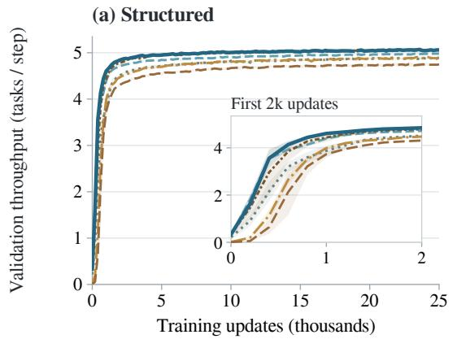

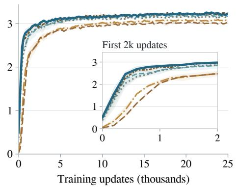  
Figure 9: Current-parameter validation throughput during training for the structured (left) and unstructured (right) actor families. Lines show three-seed means and shaded bands one standard deviation. Insets show the first 2,000 updates; gaps indicate incomplete seed coverage.

On structured validation, $H = 4$ outperforms $H = 1$ from early training onward. Allocation improves early validation in both families, with a larger separation on unstructured maps that narrows as training progresses. Removing G has little effect on late validation in either family, despite the lower city throughput in Table 16.

## F.3 CONTINUATION DEPTH

Training controls. The full policies use $H = 4$ departures. Depth controls set $H = 1$ or $H = 2$ during both training and evaluation, retaining their respective fixed training pools and the other training settings in Appendix B. Each run completes 25,000 training iterations. The convolutional network still observes the same traffic inputs at every depth.

Learning and deployment. Figure 4a uses three independent structured-policy training runs per depth, following the validation protocol in Appendix F.2 with 48 plain allocation iterations per pass. Curves show equal-run means and sample standard deviations without smoothing; gaps indicate incomplete seed coverage. The common training batch makes update counts comparable across depths.

The annotations use terminal averaged weights, evaluated on eight large-warehouse instances per training run with 10,000 agents, 3200 steps, 144 allocation iterations and layered reference tables. All steps contribute to throughput. Cases are averaged within each run before computing the mean and sample standard deviation across the three runs.

Corridor traffic. Figure 4b uses terminal averaged policies from three independent training runs per depth, evaluated separately on eight $3 3 \times 5 7$ warehouse instances with 400 agents and 3200 scored steps. Execution uses deterministic proposals, 144 allocation iterations and layered reference tables. We identify all 172 narrow passages from the walls alone: 84 horizontal passages with three interior cells and 88 vertical passages with two.

For neighbouring occupied cells, let $q _ { i } ( j )$ be agent i’s probability of moving into agent $j ^ { \circ } \mathbf { s }$ cell after route reweighting and before allocation. Opposing demand is the mean of $q _ { i } ( j ) q _ { j } ( i )$ over occupied internal passage edges and time steps. We first compute this rate within each case, then average equally over the eight cases and three training runs. It measures incompatible route preferences, not executed collisions; outward movement by both agents is valid. The traffic illustration shows actual moves and waits in passage 122, training run 0, case 0, at steps 1024–1151. The central passage and time window were fixed before inspecting the results. Colours track the entry side, not the current direction. Diamonds mark goal completions because passage cells can be goals, and returning towards the entry can therefore be productive.

At 400 agents, opposing demand falls by 39.4% with $H = 4$ and throughput rises by 9.4%. Actual axial moves per occupied passage-cell step remain similar (87.97% and 87.59% for $H = 1 , 4 )$ . A lower-load control at 200 agents gives smaller improvements of 5.9% in opposing demand and 2.9% in throughput, with overlapping training-run ranges for demand.

To distinguish the visited traffic states from the immediate effect of the route operator, we also apply all six intact policies to the same 1152 states, sampled every 128 steps from 128 to 3072 across all 48 policy–case rollouts. On these common states, mean opposing demand is 5.69% for $H = 1$ and 5.36% for $H = 4 .$ , with overlapping training-run ranges. Both depth variants produce lower opposing demand on states generated by $H = 4 .$ The larger rollout difference concerns the traffic produced over time; the immediate difference on identical states is smaller.

Evaluation under load. The following population comparisons use terminal averaged weights. The structured policy is evaluated on the $3 3 \times 5 7$ warehouse with alternating workstation–storage tasks; the unstructured policy uses the $3 2 \times 3 2$ random map with uniform tasks. The maps contain 1091 and 819 free cells, respectively. Occupancy is population divided by this count. Each point uses eight cases, 1000-step episodes and deterministic proposals; all steps count. Plain allocation uses 144 iterations on warehouse and 288 on random, fixed across populations and continuation depths. Reference tables use the layered and sweep builders, respectively. Within each map, full and depth-control evaluations use the same initial-state and task files.

Table 17 reports throughput by training seed. The comparisons below average training seeds 0–2.

At approximately 37% occupancy, $H = 4$ raises mean throughput over $H = 1$ by 9.2% on warehouse and 8.5% on random. The depths give similar throughput at light load on random; depth ordering becomes nonmonotonic at the highest loads, where warehouse throughput also deteriorates.

<table><tr><td></td><td></td><td></td><td colspan="3"> $H = 1$ </td><td colspan="3"> $H = 2$ </td><td colspan="3"> $H = 4$ </td></tr><tr><td> $\mathbf { M a p }$ </td><td>Agents</td><td>Occ. (%)</td><td> $s 0$ </td><td>s1</td><td> $^ { s 2 }$ </td><td> $_ { \mathrm { s 0 } }$ </td><td>s1</td><td> $^ { s 2 }$ </td><td>s0</td><td>s1</td><td> $^ { s 2 }$ </td></tr><tr><td>Warehouse</td><td>200</td><td>18.3</td><td>5.092</td><td>5.100</td><td>5.086</td><td>5.141</td><td>5.158</td><td>5.129</td><td>5.223</td><td>5.246</td><td>5.225</td></tr><tr><td></td><td>300</td><td>27.5</td><td>6.943</td><td>6.991</td><td>6.973</td><td>7.070</td><td>7.145</td><td>7.055</td><td>7.382</td><td>7.440</td><td>7.340</td></tr><tr><td></td><td>400</td><td>36.7</td><td>8.163</td><td>8.364</td><td>8.329</td><td>8.440</td><td>8.654</td><td>8.426</td><td>9.052</td><td>9.103</td><td>8.984</td></tr><tr><td></td><td>500</td><td>45.8</td><td>8.667</td><td>9.192</td><td>7.203</td><td>6.533</td><td>9.676</td><td>9.165</td><td>9.925</td><td>9.470</td><td>10.069</td></tr><tr><td></td><td>600</td><td>55.0</td><td>3.509</td><td>3.574</td><td>2.089</td><td>3.086</td><td>6.167</td><td>5.055</td><td>5.030</td><td>3.266</td><td>9.561</td></tr><tr><td>Random</td><td>20</td><td>2.4</td><td>0.855</td><td>0.853</td><td>0.847</td><td>0.849</td><td>0.853</td><td>0.849</td><td>0.844</td><td>0.835</td><td>0.836</td></tr><tr><td></td><td>50</td><td>6.1</td><td>2.090</td><td>2.088</td><td>2.088</td><td>2.094</td><td>2.092</td><td>2.084</td><td>2.063</td><td>2.056</td><td>2.061</td></tr><tr><td></td><td>100</td><td>12.2</td><td>3.931</td><td>3.944</td><td>3.940</td><td>3.967</td><td>3.975</td><td>3.953</td><td>3.943</td><td>3.949</td><td>3.933</td></tr><tr><td></td><td>200</td><td>24.4</td><td>6.755</td><td>6.830</td><td>6.805</td><td>6.947</td><td>6.997</td><td>6.959</td><td>7.042</td><td>7.051</td><td>7.072</td></tr><tr><td></td><td>300</td><td>36.6</td><td>8.311</td><td>8.569</td><td>8.526</td><td>8.865</td><td>8.902</td><td>8.919</td><td>9.225</td><td>9.050</td><td>9.302</td></tr><tr><td></td><td>500</td><td>61.1</td><td>8.761</td><td>9.338</td><td>8.965</td><td>7.694</td><td>7.177</td><td>9.852</td><td>10.622</td><td>10.474</td><td>10.861</td></tr></table>

Table 17: Throughput by continuation depth and training seed. Each entry averages the same eight cases for its layout and population.

## F.4 DESTINATION ALLOCATION UNDER LOAD

The allocation control replaces both allocation passes and the reverse-move penalty with independent normalisation of next-move affinities at the learned allocation temperature. The convolutional network, goal-conditioned route calculation and simulator are unchanged. Controls use the unstructured training pool, with the full policy’s batch, rollout length, update count and optimiser settings.

Table 18 compares terminal averaged weights at populations 6000, 10,000 and 12,000, on the two $2 5 6 ^ { 2 }$ random maps. Each cell averages eight released start/task cases over 2500 steps, with argmax proposals, layered route tables and 288 plain allocation iterations in the full policy. Results average three training runs per condition (seeds 0–2). The policies have similar throughput at 6000 agents. At 12,000 agents on Random 20%, allocation preserves throughput as demand increases: the full policy attains 54.47 tasks per step, compared with 27.85 without allocation.

<table><tr><td colspan="3"></td><td colspan="3">Full</td><td colspan="3">Without allocation</td></tr><tr><td>Layout</td><td>Agents</td><td>Seed 0</td><td>Seed 1</td><td></td><td>Seed 2</td><td>Seed 0</td><td>Seed 1</td><td>Seed 2</td></tr><tr><td>Random 20%</td><td>6,000</td><td></td><td>30.63</td><td>30.67</td><td>30.62</td><td>30.20</td><td>30.28</td><td>30.25</td></tr><tr><td>Random 20%</td><td>10,000</td><td>47.50</td><td></td><td>47.58</td><td>47.51</td><td>44.42</td><td>45.06</td><td>44.95</td></tr><tr><td>Random 20%</td><td>12,000</td><td>54.40</td><td>54.52</td><td></td><td>54.49</td><td>22.55</td><td>32.28</td><td>28.72</td></tr><tr><td>Random 10%</td><td>6,000</td><td>33.25</td><td></td><td>33.26</td><td>33.26</td><td>33.14</td><td>33.17</td><td>33.16</td></tr><tr><td>Random 10%</td><td>10,000</td><td>54.15</td><td></td><td>54.23</td><td>54.19</td><td>53.35</td><td>53.44</td><td>53.40</td></tr><tr><td>Random 10%</td><td>12,000</td><td>64.03</td><td>64.14</td><td></td><td>64.09</td><td>62.43</td><td>62.60</td><td>62.53</td></tr></table>

Table 18: Full and allocation-removed policies on sparse and dense random layouts. Throughput averages eight cases per training seed, over all 2500 steps.