# REVISITING THE 16× PRETRAINING COMPUTE GAP BETWEEN DIFFUSION AND AUTOREGRESSIVE LANGUAGE MODELS

Guanghan Wang1,†,‡ Bing He2 Zhan Shi2 Benoit Dumoulin2 Hanqing Lu2,∗ Volodymyr Kuleshov1,∗

1Cornell University, Cornell Tech 2Amazon Project page: https://guanghanwang.com/dlm-scaling

## ABSTRACT

Diffusion language models (DLMs) have attracted wide attention for their fast, parallel decoding, but they are believed to be far less efficient to train than autoregressive language models (ARMs): a widely cited study reports that a DLM needs roughly 16× the training compute of an ARM to match its likelihood, a figure that has made pretraining DLMs from scratch look prohibitive at scale. We find that the methodology behind this figure has fallen out of step with current DLM practice: it scores the model with its evidence lower bound (ELBO) and trains a full-sequence, decoder-only model. We therefore revisit the scaling laws of DLMs, adopting the exact likelihood under the model’s own decoding order, block diffusion training, an encoder–decoder architecture, and a sweep over the block sizes used in practice. Under this new protocol, we study across ten model variants, about 1,700 models in total, and find that pretraining DLMs is far cheaper than previously thought. Concretely, scoring with the exact likelihood reduces the compute multiple to 12.8×; block diffusion training and an encoder–decoder architecture further reduce it to 7.8× at block size 32, and smaller block sizes narrow it to 4.6× at block size 8 and 3.0× at block size 4. We complement these scaling analyses with an empirical rule for the optimal decoder depth of encoder–decoder block diffusion, a held-out compute budget beyond the fitting range at which the gap between variants persists, and downstream benchmark results where likelihood improvements carry over to accuracy. Overall, the 16× figure substantially overstates the pretraining cost gap between DLMs and ARMs, and pretraining DLMs from scratch is far more viable than previously assumed.

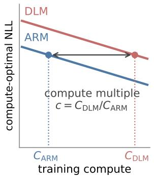

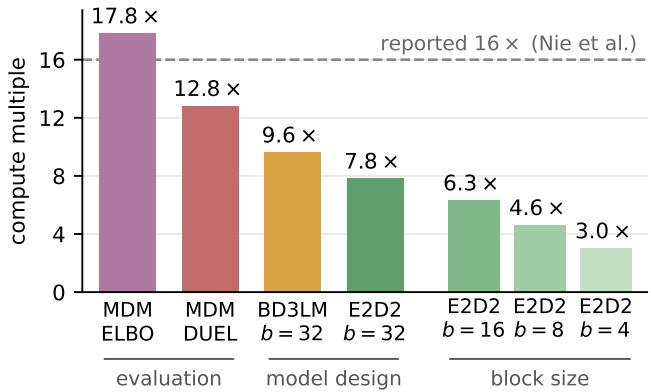  
Figure 1: Revisiting the 16× compute multiple between diffusion and autoregressive language models. Left: illustration of the compute multiple $c = C _ { \mathrm { D L M } } / C _ { \mathrm { A R M } }$ on the compute-optimal negative log-likelihood (NLL) scaling law plot. Right: c at 1020 FLOPs as the evaluation (ELBO → DUEL), the model design (MDM → BD3LM → E2D2) and the block size are revised.

## 1 INTRODUCTION

Masked diffusion models (MDMs) have become the leading non-autoregressive alternative for language modeling (Austin et al., 2021; Lou et al., 2023; Sahoo et al., 2024; Shi et al., 2024; Ou et al., 2025; Nie et al., 2026). Their appeal is fast, parallel generation: open-weight masked diffusion language models report about 2.5× the generation throughput of autoregressive language models (ARMs) at comparable accuracy (Wu et al., 2026a; Reda et al., 2026), with commercial systems reporting up to 10× (Labs et al., 2025). Yet, their training efficiency is widely believed to be far worse than that of ARMs. The most cited quantification is the IsoFLOP study of Nie et al. (2025) (SMDM), which concludes that an MDM needs about 16× the training FLOPs of an ARM to reach the same validation perplexity, and the number is now routinely quoted as a property of the MDM family. This 16× figure has made pretraining MDMs from scratch look prohibitive at scale.

Taking a closer look at how this 16× figure was achieved, however, we find that the methodology behind it has fallen out of step with current practice of diffusion language modeling. SMDM measured it on a full-sequence, decoder-only MDM scored with its negative evidence lower bound (ELBO), all three of which now have alternatives. First, the ELBO is an upper bound on the negative log-likelihood (NLL), and it scores the model under uniformly random token orders it never uses at inference; in contrast, DUEL (Turok et al., 2026) computes the exact NLL of a diffusion model under the custom decoding order it is deployed with. Second, nearly all of today’s large-scale diffusion language models (DLMs) use block-wise factorization (BD3LM; Arriola et al., 2025) with block sizes between 4 and 32, rather than operating over the full sequence. Third, encoder–decoder architectures that separate the processing of clean and noised tokens (E2D2; Arriola et al., 2026) offer computationally cheaper training than the decoder-only network. While the papers that introduce these techniques compare a handful of models at fixed sizes, none of these has been measured under a rigorous compute-matched IsoFLOP analysis.

We therefore revisit the scaling laws of masked diffusion models with a protocol that implements the ideas above: we score every diffusion model using the exact likelihood induced by its top-1 confidence decoding rule, utilize block-aware training and an encoder–decoder architecture, and sweep the block sizes b ∈ {4, 8, 16, 32} which are commonly used in practice. In addition, we make two corrections to the SMDM protocol: we count training FLOPs exactly, including the output head and attention computation, and we read compute multiples within the measured range of the scaling laws rather than by extrapolation. Under this new protocol we study ten model variants and train about 1,700 models in total; to our knowledge, this is the largest compute-matched scaling analysis of diffusion language models to date.

With this analysis, we find that pretraining diffusion language models is far cheaper than previously thought (Figure 1). Scored with the ELBO, our full-sequence MDM lands close to the published figure, at 17.8×. Scoring the very same checkpoints with the exact likelihood lowers the multiple to 12.8×. Block diffusion training and the encoder–decoder architecture then reduce it further to 7.8× at block size 32, and smaller block sizes narrow it to 4.6× at block size 8 and 3.0× at block size 4. In addition, we find that the optimal decoder depth of encoder–decoder block diffusion follows a simple rule that depends on the block size alone, that the gap between E2D2 and the ARM holds at a held-out budget three times larger than our largest fitted FLOPs, and that likelihood improvements carry over to downstream accuracy.

Our contributions are the following. (i) We revisit the scaling laws of diffusion language models under a revised protocol that reflects recent advances: exact likelihood evaluation, block diffusion, encoder–decoder models, and a sweep over practically used block sizes. (ii) We show that, under this protocol, pretraining diffusion language models is far cheaper than the 16× suggests: exact like lihood evaluation reduces the compute multiple to 12.8×, block diffusion training with an encoder– decoder architecture reduces it to $\mathsf { \bar { 7 } . 8 } \mathsf { \times }$ at $b { = } 3 2$ , and smaller block sizes further narrow it to 4.6× at b=8 and 3.0× at b=4. (iii) We complement these scaling analyses with an empirical rule for the optimal decoder depth of encoder–decoder block diffusion, which depends on the block size alone; a held-out budget at $\mathrm { 3 \times 1 0 ^ { 2 0 } }$ FLOPs, at which the gap between E2D2 and the ARM persists; and downstream benchmark results where likelihood improvements carry over to downstream accuracy.

## 2 BACKGROUND

Masked diffusion models. Let $\mathbf { x } ^ { 1 : n } = ( x ^ { 1 } , \ldots , x ^ { n } )$ be a sequence of n tokens from a vocabulary V augmented with a mask token m. The forward process of a masked diffusion model (Austin et al., 2021; Sahoo et al., 2024; Shi et al., 2024; Ou et al., 2025) is indexed by $t \in [ 0 , 1 ]$ and masks each token independently with probability $1 - \alpha _ { t }$ , where the schedule $\alpha _ { t }$ decreases from $\alpha _ { 0 } ~ = ~ 1$ to $\alpha _ { 1 } = 0 ;$ we write $\bar { \mathbf { z } } _ { t } ^ { 1 : n }$ for the partially masked sequence. A network $p _ { \theta } ( \cdot \ | \ \mathbf { z } _ { t } ^ { 1 : n } )$ predicts every masked position given the partially masked token sequence. Under the linear schedule $\alpha _ { t } = 1 - t .$ an MDM is trained with a negative ELBO,

$$
\mathcal { L } _ { \mathrm { E L B O } } ( \mathbf { x } ^ { 1 : n } ) = \mathbb { E } _ { t \sim \mathcal { U } ( 0 , 1 ) } \mathbb { E } _ { \mathbf { z } _ { t } ^ { 1 : n } \sim q _ { t } ( \cdot | \mathbf { x } ^ { 1 : n } ) } \bigg [ \frac { 1 } { t } \sum _ { \ell : z _ { t } ^ { \ell } = \mathbb { n } } - \log p _ { \theta } ( x ^ { \ell } \mid \mathbf { z } _ { t } ^ { 1 : n } ) \bigg ] \geq - \log p _ { \theta } ( \mathbf { x } ^ { 1 : n } ) .\tag{1}
$$

Following Sahoo et al. (2026), we train all diffusion models on the low-variance version of this loss that drops the weight $1 / t$

Prior scaling studies (Nie et al., 2025; Von Rutte et al.¨ , 2026; Ni et al., 2025b) evaluate a trained MDM by a Monte-Carlo estimate of Eq. 1 and compare it with the exact NLL of an ARM. This comparison is problematic in two respects. First, Eq. 1 is only an upper bound on the NLL; how far it lies from the ${ \mathrm { N L L } } ,$ and how this varies across models, is poorly understood. Second, Eq. 1 equals the expected NLL of an autoregressive factorization under a uniformly random token order (Hoogeboom et al., 2021; Shi et al., 2024; Ou et al., 2025; Kim et al., 2025), whereas an MDM is never decoded in a random order in practice: its sampler chooses the order adaptively, most commonly by the model’s own confidence (Chang et al., 2022; Nie et al., 2026). Scoring a model under orders it never uses thus evaluates a distribution that differs from the one induced by its decoding rule at deployment.

Exact likelihood under a deterministic unmasking rule (DUEL). Turok et al. (2026) address both points. Let π be a deterministic unmasking rule that, given the tokens unmasked so far, selects the next position to reveal. Writing $\sigma _ { i }$ for the position revealed at step i, scoring $\mathbf { x } ^ { 1 : n }$ under π amounts to teacher-forcing the true tokens in the order σ, and $\begin{array} { r } { p _ { \theta } ^ { \pi } ( \mathbf { x } ^ { 1 : n } ) \stackrel { \bullet } { = } \prod _ { i = 1 } ^ { n } p _ { \theta } ( \breve { x } ^ { \sigma _ { i } } \mid x ^ { \sigma _ { < i } } ) } \end{array}$ is a properly normalized distribution, since $\sigma _ { i }$ depends only on $x ^ { \sigma _ { < i } }$ . Throughout the paper, we fix π to the top-1 confidence rule (Nie et al., 2026), the default sampler of diffusion language models, and report $- \log p _ { \theta } ^ { \pi } ( \mathbf { x } ^ { 1 : n } )$ (DUEL) in nats per token like the ARM’s NLL.

Block diffusion. Full-sequence MDMs cannot generate sequences of arbitrary length and cannot reuse a KV cache. Block diffusion (BD3LM; Arriola et al., 2025) partitions $\bar { \mathbf { x } } ^ { 1 : n }$ into contiguous blocks of b tokens, factorizes the sequence autoregressively over blocks, and models each block with a masked diffusion model conditioned on the clean prefix. Nearly all large-scale diffusion language models utilize block decomposition now. BD3LM keeps the decoder-only architecture: to score all blocks in one forward pass it concatenates the noised and clean sequences, so a training step runs over 2n tokens and costs roughly twice the FLOPs of an ARM or MDM step at the same size.

Encoder–decoder block diffusion. E2D2 (Arriola et al., 2026) avoids this overhead by splitting the L-layer transformer into an $L _ { \mathrm { e n c } }$ -layer encoder that represents the clean prefix and an $\bar { L } _ { \mathrm { d e c } } =$ $L - L _ { \mathrm { e n c } }$ -layer decoder that denoises the noisy block, attending to its own block by self-attention and to the encoder outputs of the prefix by cross-attention. Each training step is therefore cheaper than a BD3LM step because clean and noised tokens do not go through the same big network.

IsoFLOP scaling laws and the compute multiple. Prior scaling studies of diffusion language models (Nie et al., 2025; Von Rutte et al.¨ , 2026; Sahoo et al., 2026; Yang et al., 2026) adopt one IsoFLOP protocol from Hoffmann et al. (2022): for a fixed training budget $C ,$ a ladder of model sizes N is trained on $D = C / c ( N )$ tokens each, where $c ( N )$ is the training cost per token. Then, a parabola fitted to the loss against log N gives the compute-optimal loss $\mathcal { L } ^ { * } ( \breve { C } )$ at that budget. Across budgets they fit the power law $\mathcal { L } ^ { * } ( \bar { C } ) \stackrel { - } { = } a C ^ { \alpha }$ by least squares in log–log space. The compute gap between two model families is measured at fixed loss: if family X reaches loss $\mathcal { L }$ at budget $C _ { X } \bar { ( \mathcal { L } ) }$ and family $Y$ at $C _ { Y } ( \mathcal { L } )$ , the compute multiple is $C _ { X } ( \mathcal { L } ) / C _ { Y } \mathbf { \bar { ( } } \mathcal { L } )$ . It is in this sense that Nie et al. (2025) report a multiple of 16 between MDM and ARM.

## 3 SCALING LAW PROTOCOL

In this section, we introduce our revised scaling law protocol for masked diffusion language models. It inherits the protocol of SMDM (Nie et al., 2025) with two kinds of changes. First, we replace three of SMDM’s choices with more recent alternatives: exact likelihood evaluation, block diffusion at commonly used block sizes, and an encoder–decoder architecture. Second, we correct two aspects of the original SMDM protocol, namely the FLOP count that sets the length of each run and the readout of the compute multiple from the fitted laws. Section 3.1 describes the first kind of changes, and Sections 3.2 and 3.3 state the resulting training and fitting procedure with both corrections included.

## 3.1 INCORPORATING RECENT ADVANCES

Exact likelihood evaluation. We score every diffusion model with DUEL under the top-1 confidence unmasking rule, yielding the exact likelihood induced by this decoding order. To keep the comparison with SMDM, we also score every diffusion model with the ELBO (Eq. 1, estimated with 128-particle Monte-Carlo), and the ARM with its exact NLL. All models are scored on one frozen validation set of 49,152 sequences, and unless stated otherwise the diffusion models are reported with DUEL.

Block diffusion. In our scaling law analysis protocol, we train block diffusion models at block sizes $b \in \{ 4 , 8 , 1 6 , 3 2 \}$ . These configurations are chosen from the perspective of language model serving. By the roofline model (Williams et al., 2009), a GPU becomes compute-bound only above the ratio of its peak throughput to its memory bandwidth; taking BF16 serving as an example, this ratio is about 300 FLOPs per byte for an H100 GPU (NVIDIA, 2023). A block diffusion model decodes up to b tokens per sequence in one forward pass, which raises the arithmetic intensity to about Bb, where $B$ is the batch size. For mid-size serving with B between 8 and 32, block sizes from 32 down to 8 thus bring Bb to about 256 and put the compute units left idle by autoregressive decoding to use, while a larger block adds little throughput. We therefore take $b \in \{ 8 , 1 6 , 3 2 \}$ as the main block sizes, and use b=4 as a reference for how much training compute a still smaller block can save. These block sizes also match those used to train large diffusion language models: Nemotron-Labs-Diffusion (Fu et al., 2026) is trained with b=32, Nemotron-TwoTower (Reda et al., 2026) with $b { = } 1 6$ , and SDAR (Cheng et al., 2026) and FLARE (Zhu et al., 2026) with b=4 (see Table 4 in Appendix A.1 for more models).

Encoder–decoder architecture. Besides decoder-only block diffusion models (BD3LM), we also train encoder–decoder block diffusion models (E2D2) at the same four block sizes in our scaling law analysis protocol. Overall, this gives us ten model variants: ARM, MDM, BD3LM with $b \in$ {4, 8, 16, 32} and E2D2 with $b \in \{ 4 , 8 , 1 6 , 3 2 \}$

Optimal decoder depth of E2D2. E2D2 has one degree of freedom that the other variants do not have: how the L layers of a given ladder size are split between the encoder and the decoder, i.e., the decoder fraction $L _ { \mathrm { d e c } } / L . { \overset { } { \mathrm { A } } }$ wrong split would penalize E2D2 for a reason unrelated to the architecture design itself, so at every grid point of E2D2, i.e., every combination of block size $b ,$ training budget $\breve { C }$ and model size $\dot { N , }$ we hold the total depth L fixed and sweep $L _ { \mathrm { d e c } }$ over a wide range. We then report the best DUEL value from the sweep. As a side product, we also analyze how the optimal decoder depth $L _ { \mathrm { d e c } } ^ { * }$ is related to b, C and N. We believe our results (Section 4.2) can give practical guidance on the pretraining of encoder–decoder block diffusion models.

## 3.2 TRAINING RECIPE AND ISOFLOP SWEEP

Training recipe. To keep our results consistent with the 16× scaling analysis of SMDM, we largely inherit its choices of network architecture, data, tokenizer and hyperparameters. Concretely, all models are LLaMA-style transformers (Touvron et al., 2023) trained on SlimPajama (Soboleva et al., 2023) with a sequence length of 2048 and a batch of $2 5 6 \times 2 0 4 8$ tokens. Following SMDM, we use standard parameterization (SP, as opposed to $\mu \mathrm { P } ;$ Yang et al., 2022) and AdamW $( \beta = ( 0 . 9 , 0 . 9 5 )$ , weight decay 0.1, gradient clipping at 1.0) with a peak learning rate of $4 \times 1 0 ^ { - 4 }$ a linear warm-up over $1 \%$ of the steps (at least 100) and cosine decay to 1/10 of the peak. All diffusion variants use the linear noise schedule $\alpha _ { t } = 1 - t$ and, following Sahoo et al. (2026), the low-variance training loss; following Arriola et al. (2026), BD3LM and E2D2 draw an independent noise level for every block and always mask at least one token in each block.

IsoFLOP grid. We reuse the size ladder of SMDM (19M–2.1B non-embedding parameters) for all variants and, for each variant, train 7–10 sizes around the compute-optimal size on each of five budgets $\{ 6 \times 1 0 ^ { 1 8 } , 1 0 ^ { 1 9 } , 3 \times 1 0 ^ { 1 9 } , 6 \times 1 0 ^ { 1 9 } , 1 0 ^ { 2 0 } \}$ FLOPs. Across the ten variants, five budgets, sizes per budget and the decoder-depth sweep of E2D2, the grids comprise about 1,700 trained models (approximately 136k B200 GPU hours), more than any prior compute-matched study of diffusion language model scaling that we are aware of.

Compute accounting. At a FLOP budget C, the length of each run is set by the variant’s training FLOPs per token. SMDM takes this to be 6N (Kaplan et al., 2020), which is too coarse for a comparison across variants. The 6N rule ignores the attention score computation entirely, although at our sequence length of 2048 it accounts for a non-negligible fraction of the training FLOPs. More importantly, this fraction differs across variants. We therefore follow Hoffmann et al. (2022) and count the actual training FLOPs, including the output head and the score computation of every attention sublayer (Appendix B.1 gives the per-variant formulas).

## 3.3 FITTING SCALING LAWS

Fitting. For each variant we have five budgets $C ,$ each contributing 7–10 sizes N with their measured NLL (DUEL for the diffusion variants). For each (variant, $C )$ we fit a centered parabola in $\log _ { 1 0 } N$ to these values and take its vertex, which gives the compute-optimal NLL ${ \mathcal { L } } ^ { * } ( C ) { \bar { \langle } }$ for E2D2, each size contributes only its best $L _ { \mathrm { d e c } } .$ . Across budgets we fit the power law ${ \mathcal { L } } ^ { * } ( C ) = { \dot { a } } C ^ { \alpha }$ in log– log space, keeping the pure power-law form of prior work so that our numbers are comparable (see further discussion on the law’s functional form in Appendix C.4).

Reading the compute multiple. For each diffusion variant we take its compute-optimal $\mathrm { N L L } \mathcal { L } ^ { * }$ at $1 0 ^ { 2 0 }$ FLOPs, find the compute at which the ARM’s fitted law reaches that same $\hat { \mathcal { L } } ^ { * }$ , and take the ratio. Unlike SMDM, we do not extrapolate to do so: given the compute gap between the ARM and the diffusion variants, extrapolating a diffusion law to reach the ARM’s loss lands several times beyond the largest budget we ran, where a small level of noise in the fitted exponent would swing the multiple substantially. Reading the multiple inside the ARM’s measured range instead introduces little noise (see Appendix C.2 for a comparison between the two readouts).

## 4 RESULTS

## 4.1 THE 16× OVERSTATES THE COST OF PRETRAINING DLMS

In Figure 2 we show the IsoFLOP curves of eight main model variants (those of the two b=4 variants are in Appendix C.1), and in Figure 3 the fitted scaling laws, whose parameters we list in Table 1. These laws fit the data well, with a maximum relative residual of only 0.5%. Next, we analyze one by one how each technique introduced in our revised protocol affects the scaling and the compute multiple of masked diffusion language models.

An ELBO baseline in line with 16×. With the ELBO readout, our MDM needs 17.8× the ARM’s compute at $1 0 ^ { 2 0 }$ FLOPs, comparable to the 16× of Nie et al. (2025). Although our protocol differs from theirs (in the low-variance training loss, real FLOPs in place of 6ND, and the readout), our compute multiple still agrees roughly with their 16×. On the same corpus and tokenizer, Sahoo et al. (2026) and Yang et al. (2026) report a smaller ≈ 14× for the low-variance MDM, but with a DiT backbone (Peebles & Xie, 2023) in place of the Llama-style transformer of SMDM that we adopt. This baseline anchors the decomposition that follows.

Exact likelihood readout: the evaluation penalty. Scoring the very same MDM checkpoints with DUEL instead of the ELBO lowers the multiple to 12.8×. Nothing about the model or its training has changed; about a third of the reported gap is thus an artifact of the evaluation. A reduction is expected: the negative ELBO is an upper bound on the marginal NLL of the MDM whose tightness is poorly understood, whereas DUEL is the exact NLL of the distribution induced by the model’s top-1 confidence decoding rule, and is therefore directly comparable with the ARM’s NLL. This is further supported by extra empirical evidence: in Table 2, where every diffusion variant is scored both ways, DUEL gives a smaller multiple than the negative ELBO in every case. Beyond likelihood, we also find that DUEL scores higher than the ELBO on multiple-choice benchmarks (Section 4.4), further evidence in favor of DUEL than the ELBO.

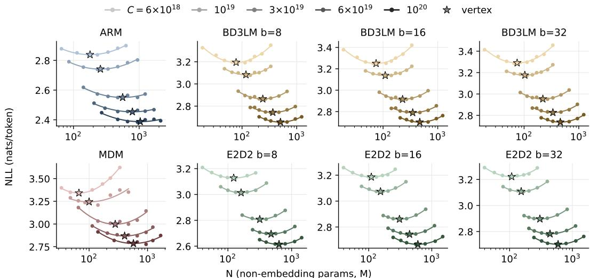  
Figure 2: IsoFLOP curves for eight main model variants (DUEL for diffusion variants, exact NLL for the ARM; for E2D2, each point is the best $L _ { \mathrm { d e c } }$ at that size). Darker shades mark larger budgets,

Table 1: Fitted laws ${ \mathcal { L } } ^ { * } ( C ) = a C ^ { \alpha }$ (DUEL for diffusion unless stated) and the compute multiple against ARM.
<table><tr><td>variant</td><td>a</td><td>α</td><td>multiple</td></tr><tr><td>ARM</td><td>40.95</td><td>-0.0618</td><td></td></tr><tr><td>MDM (ELBO)</td><td>49.93</td><td>-0.0623</td><td>17.8</td></tr><tr><td>MDM</td><td>57.87</td><td>-0.0659</td><td>12.8</td></tr><tr><td>BD3LM b=32</td><td>55.54</td><td>-0.0654</td><td>9.6</td></tr><tr><td>E2D2 b=32</td><td>47.79</td><td>-0.0624</td><td>7.8</td></tr><tr><td>BD3LM b=16</td><td>55.56</td><td>-0.0657</td><td>7.8</td></tr><tr><td>E2D2 b=16</td><td>49.26</td><td>-0.0634</td><td>6.3</td></tr><tr><td>BD3LM b=8</td><td>54.34</td><td>-0.0656</td><td>5.9</td></tr><tr><td>E2D2 b=8</td><td>48.52</td><td>-0.0635</td><td>4.6</td></tr><tr><td>BD3LM b=4</td><td>52.99</td><td>-0.0655</td><td>4.1</td></tr><tr><td>E2D2 b=4</td><td>45.50</td><td>-0.0627</td><td>3.0</td></tr></table>

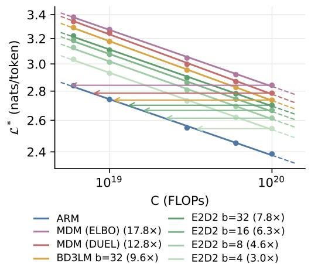  
Figure 3: Compute-optimal NLL of different model variants, solid inside the fitted range and dashed outside.

Table 2: Compute multiples at $1 0 ^ { 2 0 }$ FLOPs of every diffusion variant, measured with the negative ELBO and with DUEL. DUEL yields a smaller multiple than the negative ELBO for every variant.
<table><tr><td></td><td>MDM</td><td>BD3LM32</td><td>BD3LM 16</td><td>BD3LM8</td><td>BD3LM4</td><td>E2D2 32</td><td>E2D2 16</td><td>E2D2 8</td><td>E2D2 4</td></tr><tr><td>DUEL</td><td>12.8</td><td>9.6</td><td>7.8</td><td>5.9</td><td>4.1</td><td>7.8</td><td>6.3</td><td>4.6</td><td>3.0</td></tr><tr><td>ELBO</td><td>17.8</td><td>16.5</td><td>13.6</td><td>10.1</td><td>6.3</td><td>12.0</td><td>9.8</td><td>7.1</td><td>4.2</td></tr></table>

Block factorization: the first modeling change. The remaining 12.8× is a genuine trainingcompute gap, and the next two replacements reduce it by changing how the model is built. Moving from the full-sequence MDM to BD3LM lowers the multiple to 9.6× at b=32, 7.8× at b=16 and 5.9× at b=8. Although block-wise training has become common practice (Bie et al., 2025; Wu

$$
L _ { \mathrm { d e c } }
$$

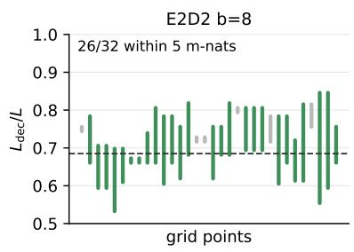

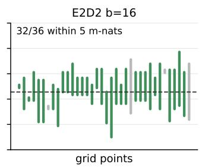

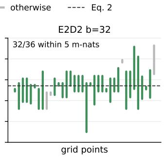  
Figure 4: The decoder depth given by Eq. 2 is near-optimal for E2D2 at $b { = } 8 .$ , 16 and 32. Each bar represents one grid point $( C , { \bar { N } } )$ and spans the decoder fractions $L _ { \mathrm { d e c } } / L$ whose DUEL lies within 5 m-nats of the minimum of that grid point’s sweep. A bar is green if the DUEL of the decoder depth given by Eq. 2, i.e., its prediction multiplied by L and rounded to an integer, is within 5 m-nats of the minimum.

et al., 2026a; Fu et al., 2026; Reda et al., 2026; Cheng et al., 2026; Zhu et al., 2026), this is, to our knowledge, the first controlled, compute-matched demonstration of the benefit of this method in pretraining diffusion language models. We take this as evidence that introducing some degree of left-to-right bias helps language model learning, and that the likelihood gain from the left-toright block factorization outweighs the penalty of BD3LM’s more expensive training steps, which at matched compute roughly halve the number of steps relative to the MDM.

Encoder–decoder architecture: the second modeling change. Moving from BD3LM to E2D2 at the same block size lowers the multiple once more, from 9.6× to 7.8× at b=32, from 7.8× to 6.3× at b=16 and from 5.9× to 4.6× at b=8; at b=4 it reaches 3.0×. Note that the decoder-only architecture, inherited from ARMs, remains the convention for diffusion language models: nearly all large-scale DLMs to date, including those trained with block diffusion, use a single decoder-only network (Nie et al., 2026; Ye et al., 2025; Wu et al., 2026a; Fu et al., 2026). Our experiments provide strong evidence that this convention is not the most training-efficient choice for masked diffusion: at matched compute, the encoder–decoder architecture is consistently better, which suggests that it is better suited to the masked diffusion training task. This shows that, for diffusion language models, a conceptual split between encoding and decoding is beneficial: although the encoder and the decoder each have less capacity than the original unified model, letting each concentrate on a different job allows them to use the pretraining compute more efficiently.

## 4.2 WHERE THE LAYERS GO: OPTIMAL DECODER DEPTH IN E2D2

The decoder-depth sweeps of Section 3.1 give the optimal decoder fraction $L _ { \mathrm { d e c } } ^ { * } / L$ at every one of the 142 $( b , C , { \bar { N } } )$ grid points of E2D2. They lead to a simple conclusion: the optimal decoder fraction depends on the block size alone, and it is decoder-heavy. A regression of $L _ { \mathrm { d e c } } ^ { * } / L$ on $\log _ { 1 0 } N , \log _ { 1 0 } C$ and $\log _ { 2 } b$ finds $\log _ { 2 } b$ to be the dominant predictor, with the dependence on N and C at most weak (Appendix C.3); regressing on $\log _ { 2 } b$ alone gives the empirical rule

$$
L _ { \mathrm { d e c } } ^ { \ast } / L \approx 0 . 5 5 6 + 0 . 0 4 3 \log _ { 2 } b .\tag{2}
$$

The rule is convenient because the DUEL basin around $L _ { \mathrm { d e c } } ^ { * }$ is flat, so a slightly wrong choice costs little. To apply the rule, one multiplies it by the total depth L and rounds to a whole number of decoder layers. Figure 4 shows that this choice is nearly optimal: at 90 of the 104 grid points with $b \in \{ 8 , 1 6 , 3 2 \}$ , its DUEL lies within 5 m-nats of the best split found by the sweep, and within 10 m-nats at 99 of them, including every compute-optimal one (see Appendix C.3 for b=4).

## 4.3 THE GAP BETWEEN VARIANTS PERSISTS BEYOND THE FITTING RANGE

The laws of Section 4.1 are fitted on five budgets spanning 1.2 decades, and the natural question is whether the training efficiency gain they describe holds beyond that range. Given the cost of a full sweep at a larger budget, we proceeded as follows: at $\mathrm { 3 \times 1 0 ^ { \dot { 2 } 0 } }$ FLOPs we trained the ARM and E2D2 at $b \in \{ 1 6 , 3 2 \}$ . Each variant was trained at the three ladder sizes that bracket the optimal model size predicted by its law, and E2D2 additionally at three values of $L _ { \mathrm { d e c } }$ centered on the prediction of $\operatorname { E q . 2 } .$ . We compare the measured NLL of each variant at the held-out budget with the prediction of the law fitted on the five smaller budgets (Figure 5).

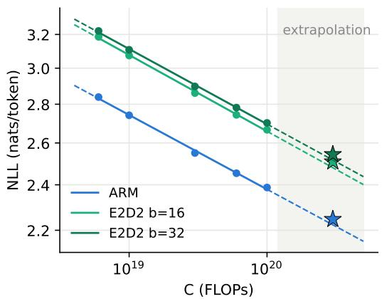  
Figure 5: The held-out budget at $\mathrm { 3 \times 1 0 ^ { 2 0 } }$ FLOPs. Lines are the power laws fitted on the five budgets $\leq 1 0 ^ { 2 0 }$ (dots), dashed outside the fitted range; stars are the measured values at the held-out budget.

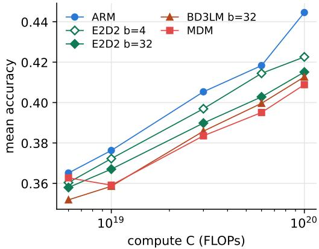  
Figure 6: Mean accuracy over the eight retained benchmarks against compute, for the computeoptimal cell of the ARM and of four diffusion variants. The order in benchmark accuracy broadly matches the order in NLL.

The gap between variants is reproduced; the absolute laws are not exact. All three variants exhibit a common upward deviation of about 1.1% (24–28 m-nats) from the pure power-law extrapolation, suggesting a mild misspecification of the functional form, which Appendix C.4 traces to a small irreducible term that the five budgets cannot pin down (we therefore conservatively keep the pure power-law form of SMDM and leave fits with an irreducible term to future work). Importantly, the deviation is shared across variants, and the ARM–E2D2 gap is reproduced almost exactly: 261.6 m-nats measured against 257 predicted at b=16, and 296.8 against 294 at b=32. The quantity this paper is about, the gap between variants, is thus insensitive to the misspecification.

## 4.4 DOWNSTREAM PERFORMANCE BROADLY TRACKS LIKELIHOOD

We hereby test whether the improvements in likelihood generalize to downstream benchmarks. Concretely, we take the union of the benchmarks of Nie et al. (2025) and Prabhudesai et al. (2026), eleven in all, and score the compute-optimal cell of every variant at every budget zero-shot with lmevaluation-harness (Gao et al., 2021). We rank the candidate answers by the exact NLL for the ARM, and by both DUEL and the 128-sample Monte-Carlo ELBO for the diffusion variants. Three

Table 3: Difference between DUEL and the ELBO in the eight-benchmark mean accuracy, as mean $\pm \ : s . 0$ . over the five budgets of each variant. DUEL outperforms the ELBO with statistical significance.
<table><tr><td></td><td>b=4</td><td>b=8</td><td>b=16</td><td>b=32</td></tr><tr><td>MDM</td><td colspan="4">+0.4 ± 0.1</td></tr><tr><td>BD3LM</td><td> $+ 1 . 0 \pm 0 . 4$ </td><td> $+ 0 . 9 \pm 0 . 2$ </td><td> $+ 0 . 9 \pm 0 . 2$ </td><td> $+ 0 . 8 \pm 0 . 2$ </td></tr><tr><td>E2D2</td><td> $+ 1 . 0 \pm 0 . 5$ </td><td> $+ 1 . 1 \pm 0 . 4$ </td><td> $+ 1 . 0 \pm 0 . 3$ </td><td> $+ 1 . 0 \pm 0 . 2$ </td></tr></table>

benchmarks (WinoGrande, BoolQ and COPA) are excluded because, at these scales, the models performance on them is indistinguishable from chance or from noise (Appendix C.5). For each variant and budget we record the mean accuracy over the remaining eight—HellaSwag, ARC-easy, PIQA, SciQ, RACE, SIQA, OpenBookQA and LAMBADA (Table 15 reports every benchmark)— and find two things.

DUEL is the better scoring rule. As Table 3 shows, DUEL yields a statistically significantly higher accuracy than the ELBO for every diffusion variant. The exact readout is thus the better one, which also justifies fitting the scaling laws on DUEL rather than on the ELBO.

Likelihood improvements carry over to downstream accuracy. Figure 6 plots the eightbenchmark mean against compute for ARM, MDM, BD3LM (b=32), E2D2 (b=32), and E2D2 (b=4). Across variants, the order in accuracy tracks the order in NLL—the ARM, then E2D2 at b=4, E2D2 at b=32, BD3LM at b=32 and the MDM. The two orders coincide exactly at the three largest budgets and differ only within noise at the two smallest. Likelihood improvements in pretraining thus carry over to downstream accuracy. Full results on each of the eight benchmarks are reported in Table 15 in Appendix C.5.

## 5 RELATED WORK

As diffusion language models have attracted attention for their fast, parallel inference, a number of studies have examined how they scale. Nie et al. (2025) were the first to study the scaling of diffu sion language models: with IsoFLOP sweeps of MDMs and ARMs on SlimPajama with Llama-style transformers, they found that MDM needs 16× the compute of the ARM to reach the same likelihood. Since then, a number of scaling studies of diffusion language models have followed. Sahoo et al. (2026) and Yang et al. (2026) extend the IsoFLOP methodology to other types of diffusion language model: Sahoo et al. (2026) find that uniform-state diffusion needs 23× the compute of the ARM, and Yang et al. (2026) find that continuous diffusion needs 20×. Von Rutte et al.¨ (2026) measure scaling laws for masked, uniform and hybrid-noise diffusion language models on Nemotron-CC with a CompleteP-parameterized transformer. Interestingly, although they criticize the pure powerlaw form of Nie et al. (2025) for implicitly assuming a zero irreducible loss, their own fits return an approximately zero irreducible term within their compute range, and they adopt a pure power law in the end. Ni et al. (2025b) refit a Chinchilla-form scaling law for the MDM. Beyond the compute-optimal setting, Prabhudesai et al. (2026) and Ni et al. (2025a) study the scaling of masked diffusion language models in the data-constrained regime and find that, under multi-epoch training, the MDM eventually overtakes the ARM. Our study differs from all of these. To our knowledge, ours is the first to substantially lower the 16× figure, revealing that pretraining a diffusion language model from scratch is far cheaper than previously assumed.

## 6 CONCLUSION

In this paper we revisited the scaling laws of diffusion language models, whose widely cited 16× compute gap to ARMs (Nie et al., 2025) was measured with a methodology that has fallen out of step with current practice. We revisited and substantially revised their scaling law protocol, proposing to score the model with its exact likelihood, utilize block-aware training and the encoder–decode architecture, and sweep the commonly used block sizes. In total, we trained about 1,700 models across ten model variants, to our knowledge the largest diffusion language model scaling analysis to date, and found that pretraining diffusion language models is far cheaper than previously thought. Exact likelihood evaluation reduces the compute multiple to 12.8×; block diffusion training and an encoder–decoder architecture reduce it further to 7.8× at block size 32; and smaller block sizes narrow it to 4.6× at block size 8 and 3.0× at block size 4. We complemented these scaling analyses with a simple empirical rule for the optimal decoder depth of encoder–decoder block diffusion models, a held-out budget at which the gap between variants persists, and downstream benchmarks where likelihood improvements carry over to accuracy. In conclusion, the 16× figure substantially overstates the compute gap between diffusion and autoregressive language models, and pretraining diffusion language models from scratch is far more viable than previously assumed.

Limitations. We hereby list the limitations of this work. Owing to the cost of the grid, all experiments use a single fixed random seed. The held-out budget was not run for b=8. When measuring DUEL we use only the top-1 confidence sampler, the default sampler of diffusion language models. The exact likelihood under other unmasking rules may differ. All experiments share one learning-rate and batch-size configuration; although Porian et al. (2024) show that not tuning the hyperparameters at every scale can distort a scaling law, we keep the recipe of Nie et al. (2025) for consistency with the protocol under which the 16× was measured. Likewise, we fit pure power laws without an irreducible term for consistency with Nie et al. (2025); the consistent miss at the held-out budget suggests that a small irreducible term is present (Appendix C.4), and we treat the fitted exponents as local to our compute range. It should be noted that, rather than the exact form of the scaling laws themselves, this paper is more concerned with the comparison between variants.

## REPRODUCIBILITY STATEMENT

In Section 3, we state the training recipe, the FLOP accounting, the IsoFLOP grids and the readout and fitting procedure in full. Appendix B gives the FLOP formulas and the benchmark evaluation protocol. We also list the per-cell ledgers with the NLL of every model in Appendix E, so that the scaling law results can be regenerated without running any code.

## AI USE STATEMENT

Generative AI tools were used to help develop the code to conduct experiments and to assist with writing, including drafting certain sections of this paper. The research ideas, the experimental design, and the interpretation of the results are the authors’ own. The authors take full responsibility for the content of the paper.

## ACKNOWLEDGMENTS

We thank Gilad Turok for helpful discussions on DUEL, and Youngsuk Park for helpful discussions and feedback on the manuscript.

## REFERENCES

Marianne Arriola, Aaron Gokaslan, Justin Chiu, Zhihan Yang, Zhixuan Qi, Jiaqi Han, Subham Sahoo, and Volodymyr Kuleshov. Block diffusion: Interpolating between autoregressive and diffusion language models. In International Conference on Learning Representations, volume 2025, pp. 50726–50753, 2025.

Marianne Arriola, Yair Schiff, Hao Phung, Aaron Gokaslan, and Volodymyr Kuleshov. Encoderdecoder diffusion language models for efficient training and inference. Advances in Neural Information Processing Systems, 38:15612–15644, 2026.

Jacob Austin, Daniel D Johnson, Jonathan Ho, Daniel Tarlow, and Rianne Van Den Berg. Structured denoising diffusion models in discrete state-spaces. Advances in neural information processing systems, 34:17981–17993, 2021.

Tiwei Bie, Maosong Cao, Kun Chen, Lun Du, Mingliang Gong, Zhuochen Gong, Yanmei Gu, Jiaqi Hu, Zenan Huang, Zhenzhong Lan, et al. Llada2. 0: Scaling up diffusion language models to 100b. arXiv preprint arXiv:2512.15745, 2025.

Yonatan Bisk, Rowan Zellers, Ronan Le Bras, Jianfeng Gao, and Yejin Choi. Piqa: Reasoning about physical commonsense in natural language. In Proceedings of the AAAI Conference on Artificial Intelligence, 2020.

Sidney Black, Stella Biderman, Eric Hallahan, Quentin Anthony, Leo Gao, Laurence Golding, Horace He, Connor Leahy, Kyle McDonell, Jason Phang, et al. Gpt-neox-20b: An open-source autoregressive language model. In Proceedings of BigScience Episode# 5–Workshop on Challenges & Perspectives in Creating Large Language Models, pp. 95–136, 2022.

Huiwen Chang, Han Zhang, Lu Jiang, Ce Liu, and William T Freeman. Maskgit: Masked generative image transformer. In 2022 IEEE/CVF Conference on Computer Vision and Pattern Recognition (CVPR), pp. 11305–11315. IEEE, 2022.

Shuang Cheng, Yihan Bian, Dawei Liu, Yuhua Jiang, Yihao Liu, Linfeng Zhang, Qian Yao, Zhongbo Tian, Wenhai Wang, Qipeng Guo, et al. Sdar: A synergistic diffusion-autoregression paradigm for scalable sequence generation. In Findings of the Association for Computational Linguistics: ACL 2026, pp. 22058–22075, 2026.

Christopher Clark, Kenton Lee, Ming-Wei Chang, Tom Kwiatkowski, Michael Collins, and Kristina Toutanova. Boolq: Exploring the surprising difficulty of natural yes/no questions. In Proceedings of the 2019 Conference of the North American Chapter of the Association for Computational Linguistics: Human Language Technologies, Volume 1 (Long and Short Papers), pp. 2924–2936, 2019.

Peter Clark, Isaac Cowhey, Oren Etzioni, Tushar Khot, Ashish Sabharwal, Carissa Schoenick, and Oyvind Tafjord. Think you have solved question answering? try arc, the ai2 reasoning challenge. arXiv preprint arXiv:1803.05457, 2018.

Tri Dao. Flashattention-2: Faster attention with better parallelism and work partitioning. In International Conference on Learning Representations, volume 2024, pp. 35549–35562, 2024.

Yonggan Fu, Lexington Whalen, Abhinav Garg, Chengyue Wu, Maksim Khadkevich, Nicolai Oswald, Enze Xie, Daniel Egert, Sharath Turuvekere Sreenivas, Shizhe Diao, et al. Nemotron-labsdiffusion: A tri-mode language model unifying autoregressive, diffusion, and self-speculation decoding. arXiv preprint arXiv:2607.05722, 2026.

Leo Gao, Jonathan Tow, Stella Biderman, Sid Black, Anthony DiPofi, Charles Foster, Laurence Golding, Jeffrey Hsu, Kyle McDonell, Niklas Muennighoff, et al. A framework for few-shot language model evaluation. Zenodo, 2021.

Jordan Hoffmann, Sebastian Borgeaud, Arthur Mensch, Elena Buchatskaya, Trevor Cai, Eliza Rutherford, Diego de Las Casas, Lisa Anne Hendricks, Johannes Welbl, Aidan Clark, et al. Train ing compute-optimal large language models. arXiv preprint arXiv:2203.15556, 2022.

Emiel Hoogeboom, Alexey A Gritsenko, Jasmijn Bastings, Ben Poole, Rianne van den Berg, and Tim Salimans. Autoregressive diffusion models. arXiv preprint arXiv:2110.02037, 2021.

Jared Kaplan, Sam McCandlish, Tom Henighan, Tom B Brown, Benjamin Chess, Rewon Child, Scott Gray, Alec Radford, Jeffrey Wu, and Dario Amodei. Scaling laws for neural language models. arXiv preprint arXiv:2001.08361, 2020.

Andrej Karpathy. nanoGPT. https://github.com/karpathy/nanoGPT, 2022.

Jaeyeon Kim, Kulin Shah, Vasilis Kontonis, Sham Kakade, and Sitan Chen. Train for the worst, plan for the best: Understanding token ordering in masked diffusions. arXiv preprint arXiv:2502.06768, 2025.

Taku Kudo and John Richardson. Sentencepiece: A simple and language independent subword tokenizer and detokenizer for neural text processing. In Proceedings of the 2018 conference on empirical methods in natural language processing: System demonstrations, pp. 66–71, 2018.

Inception Labs, Samar Khanna, Siddhant Kharbanda, Shufan Li, Harshit Varma, Eric Wang, Sawyer Birnbaum, Ziyang Luo, Yanis Miraoui, Akash Palrecha, et al. Mercury: Ultra-fast language models based on diffusion. arXiv preprint arXiv:2506.17298, 2025.

Guokun Lai, Qizhe Xie, Hanxiao Liu, Yiming Yang, and Eduard Hovy. Race: Large-scale reading comprehension dataset from examinations. In Proceedings of the 2017 conference on empirical methods in natural language processing, pp. 785–794, 2017.

Benjamin Lefaudeux, Francisco Massa, Diana Liskovich, Wenhan Xiong, Vittorio Caggiano, Sean Naren, Min Xu, Jieru Hu, Marta Tintore, Susan Zhang, Patrick Labatut, Daniel Haziza, Luca Wehrstedt, Jeremy Reizenstein, and Grigory Sizov. xformers: A modular and hackable transformer modelling library. https://github.com/facebookresearch/xformers, 2022.

Quentin Lhoest, Albert Villanova Del Moral, Yacine Jernite, Abhishek Thakur, Patrick Von Platen, Suraj Patil, Julien Chaumond, Mariama Drame, Julien Plu, Lewis Tunstall, et al. Datasets: A community library for natural language processing. In Proceedings of the 2021 conference on empirical methods in natural language processing: system demonstrations, pp. 175–184, 2021.

Aaron Lou, Chenlin Meng, and Stefano Ermon. Discrete diffusion modeling by estimating the ratios of the data distribution. arXiv preprint arXiv:2310.16834, 2023.

Todor Mihaylov, Peter Clark, Tushar Khot, and Ashish Sabharwal. Can a suit of armor conduct electricity? a new dataset for open book question answering. In Proceedings of the 2018 conference on empirical methods in natural language processing, pp. 2381–2391, 2018.

Jinjie Ni, Qian Liu, Longxu Dou, Chao Du, Zili Wang, Hang Yan, Tianyu Pang, and Michael Qizhe Shieh. Diffusion language models are super data learners. arXiv preprint arXiv:2511.03276, 2025a.

Jinjie Ni, Qian Liu, Chao Du, Longxu Dou, Hang Yan, Zili Wang, Tianyu Pang, and Michael Qizhe Shieh. Training optimal large diffusion language models. arXiv preprint arXiv:2510.03280, 2025b.

Shen Nie, Fengqi Zhu, Chao Du, Tianyu Pang, Qian Liu, Guangtao Zeng, Min Lin, and Chongxuan Li. Scaling up masked diffusion models on text. In International Conference on Learning Representations, volume 2025, pp. 82974–82997, 2025.

Shen Nie, Fengqi Zhu, Zebin You, Xiaolu Zhang, Jingyang Ou, Jun Hu, Jun Zhou, Yankai Lin, Ji-Rong Wen, and Chongxuan Li. Large language diffusion models. Advances in Neural Information Processing Systems, 38:50608–50646, 2026.

NVIDIA. NVIDIA H100 tensor core GPU datasheet. https://resources.nvidia.com/e n-us-gpu-resources/h100-datasheet-24306, 2023.

Jingyang Ou, Shen Nie, Kaiwen Xue, Fengqi Zhu, Jiacheng Sun, Zhenguo Li, and Chongxuan Li. Your absorbing discrete diffusion secretly models the conditional distributions of clean data. In International Conference on Learning Representations, volume 2025, pp. 64972–65009, 2025.

Denis Paperno, German Kruszewski, Angeliki Lazaridou, Ngoc-Quan Pham, Raffaella Bernardi,´ Sandro Pezzelle, Marco Baroni, Gemma Boleda, and Raquel Fernandez. The lambada dataset:´ Word prediction requiring a broad discourse context. In Proceedings of the 54th annual meeting of the association for computational linguistics (volume 1: Long papers), pp. 1525–1534, 2016.

Adam Paszke, Sam Gross, Francisco Massa, Adam Lerer, James Bradbury, Gregory Chanan, Trevor Killeen, Zeming Lin, Natalia Gimelshein, Luca Antiga, et al. Pytorch: An imperative style, highperformance deep learning library. Advances in neural information processing systems, 32, 2019.

William Peebles and Saining Xie. Scalable diffusion models with transformers. In 2023 IEEE/CVF International Conference on Computer Vision (ICCV), pp. 4172–4182. IEEE, 2023.

Tomer Porian, Mitchell Wortsman, Jenia Jitsev, Ludwig Schmidt, and Yair Carmon. Resolving discrepancies in compute-optimal scaling of language models. Advances in Neural Information Processing Systems, 37:100535–100570, 2024.

Mihir Prabhudesai, Mengning Wu, Amir Zadeh, Katerina Fragkiadaki, and Deepak Pathak. Diffusion beats autoregressive in data-constrained settings. Advances in Neural Information Processing Systems, 38:10581–10606, 2026.

Fitsum Reda, John Kamalu, Roger Waleffe, Mostofa Patwary, Mohammad Shoeybi, and Bryan Catanzaro. Nemotron-twotower: Diffusion language modeling with pretrained autoregressive context. arXiv preprint arXiv:2606.26493, 2026.

Melissa Roemmele, Cosmin Adrian Bejan, and Andrew S Gordon. Choice of plausible alternatives: An evaluation of commonsense causal reasoning. In AAAI spring symposium: logical formalizations ofcommonsense reasoning, pp. 90–95, 2011.

Subham S Sahoo, Marianne Arriola, Yair Schiff, Aaron Gokaslan, Edgar Marroquin, Justin T Chiu, Alexander Rush, and Volodymyr Kuleshov. Simple and effective masked diffusion language models. Advances in Neural Information Processing Systems, 37:130136–130184, 2024.

Subham Sekhar Sahoo, Jean-Marie Lemercier, Zhihan Yang, Justin Deschenaux, Jingyu Liu, John Thickstun, and Ante Jukic. Scaling beyond masked diffusion language models. arXiv preprint arXiv:2602.15014, 2026.

Keisuke Sakaguchi, Ronan Le Bras, Chandra Bhagavatula, and Yejin Choi. Winogrande: An adversarial winograd schema challenge at scale. Communications ofthe ACM, 64(9):99–106, 2021.

Maarten Sap, Hannah Rashkin, Derek Chen, Ronan Le Bras, and Yejin Choi. Social iqa: Commonsense reasoning about social interactions. In Proceedings of the 2019 conference on empirical methods in natural language processing and the 9th international joint conference on natural language processing (EMNLP-IJCNLP), pp. 4463–4473, 2019.

Jiaxin Shi, Kehang Han, Zhe Wang, Arnaud Doucet, and Michalis Titsias. Simplified and generalized masked diffusion for discrete data. Advances in neural information processing systems, 37: 103131–103167, 2024.

Daria Soboleva, Faisal Al-Khateeb, Robert Myers, Jacob R Steeves, Joel Hestness, and Nolan Dey. Slimpajama: A 627b token cleaned and deduplicated version of redpajama. https://www.ce rebras.net/blog/slimpajama-a-627b-token-cleaned-and-deduplicate d-version-of-redpajama, 2023.

The PyTorch Lightning team. Pytorch lightning. https://github.com/Lightning-AI/ pytorch-lightning, 2019.

Hugo Touvron, Thibaut Lavril, Gautier Izacard, Xavier Martinet, Marie-Anne Lachaux, Timothee´ Lacroix, Baptiste Roziere, Naman Goyal, Eric Hambro, Faisal Azhar, et al. Llama: Open and\` efficient foundation language models. arXiv preprint arXiv:2302.13971, 2023.

Gilad Turok, Chris De Sa, and Volodymyr Kuleshov. Duel: Exact likelihood for masked diffusion via deterministic unmasking. arXiv preprint arXiv:2603.01367, 2026.

Dimitri Von Rutte, Janis Fluri, Omead Pooladzandi, Bernhard Sch¨ olkopf, Thomas Hofmann, and¨ Antonio Orvieto. Scaling behavior of discrete diffusion language models. In International Con ference on Learning Representations, volume 2026, pp. 36638–36663, 2026.

Johannes Welbl, Nelson F Liu, and Matt Gardner. Crowdsourcing multiple choice science questions. In Proceedings ofthe 3rd Workshop on Noisy User-generated Text, pp. 94–106, 2017.

Samuel Williams, Andrew Waterman, and David Patterson. Roofline: an insightful visual performance model for multicore architectures. Communications ofthe ACM, 52(4):65–76, 2009.

Thomas Wolf, Lysandre Debut, Victor Sanh, Julien Chaumond, Clement Delangue, Anthony Moi, Pierric Cistac, Tim Rault, Remi Louf, Morgan Funtowicz, et al. Transformers: State-of-the-art´ natural language processing. In Proceedings of the 2020 conference on empirical methods in natural language processing: system demonstrations, pp. 38–45, 2020.

Chengyue Wu, Hao Zhang, Shuchen Xue, Shizhe Diao, Yonggan Fu, Zhijian Liu, Pavlo Molchanov, Ping Luo, Song Han, and Enze Xie. Fast-dllm v2: Efficient block-diffusion llm. In International Conference on Learning Representations, volume 2026, pp. 128353–128370, 2026a.

Chengyue Wu, Hao Zhang, Shuchen Xue, Zhijian Liu, Shizhe Diao, Ligeng Zhu, Ping Luo, Song Han, and Enze Xie. Fast-dllm: Training-free acceleration of diffusion llm by enabling kv cache and parallel decoding. In International Conference on Learning Representations, volume 2026, pp. 57027–57051, 2026b.

Greg Yang, Edward J. Hu, Igor Babuschkin, Szymon Sidor, Xiaodong Liu, David Farhi, Nick Ryder, Jakub Pachocki, Weizhu Chen, and Jianfeng Gao. Tensor programs v: Tuning large neural networks via zero-shot hyperparameter transfer. arXiv preprint arXiv:2203.03466, 2022.

Zhihan Yang, Wei Guo, Shuibai Zhang, Subham Sekhar Sahoo, Yongxin Chen, Arash Vahdat, Morteza Mardani, and John Thickstun. Continuous diffusion scales competitively with discrete diffusion for language. arXiv preprint arXiv:2605.18530, 2026.

Jiacheng Ye, Zhihui Xie, Lin Zheng, Jiahui Gao, Zirui Wu, Xin Jiang, Zhenguo Li, and Lingpeng Kong. Dream 7b: Diffusion large language models. arXiv preprint arXiv:2508.15487, 2025.

Rowan Zellers, Ari Holtzman, Yonatan Bisk, Ali Farhadi, and Yejin Choi. Hellaswag: Can a machine really finish your sentence? In Proceedings of the 57th annual meeting of the association for computational linguistics, pp. 4791–4800, 2019.

Peiyuan Zhang, Guangtao Zeng, Tianduo Wang, and Wei Lu. Tinyllama: An open-source small language model. arXiv preprint arXiv:2401.02385, 2024.

Yuchen Zhu, Jing Shi, Chongjian Ge, Hao Tan, Yiran Xu, Wanrong Zhu, Jason Kuen, Koustava Goswami, Rajiv Jain, Yongxin Chen, et al. Flare: Diffusion for hybrid language model. arXiv preprint arXiv:2606.01774, 2026.

## CONTENTS

Introduction 2   
2 Background 3   
Scaling law protocol 4   
3.1 Incorporating recent advances 4   
3.2 Training recipe and IsoFLOP sweep 4   
3.3 Fitting scaling laws 5   
4 Results 5   
4.1 The 16× overstates the cost of pretraining DLMs 5   
4.2 Where the layers go: optimal decoder depth in E2D2 7   
4.3 The gap between variants persists beyond the fitting range 7   
4.4 Downstream performance broadly tracks likelihood 8   
5 Related work 9   
6 Conclusion 9   
A Additional background 16   
A.1 Existing large-scale diffusion language models 16   
A.2 Attention patterns of the model variants 16   
B Additional experimental details 16   
B.1 FLOP accounting 16   
B.2 Scaling-law runs 17   
B.3 Compute cost 18   
B.4 Benchmark evaluation protocol . 19   
C Additional experimental results 20   
C.1 IsoFLOP curves 20   
C.2 Compute multiple 20   
C.3 Decoder depth . 20   
C.4 Held-out budget 22   
C.5 Downstream benchmarks . 23   
D Assets 24   
E Per-cell results of the IsoFLOP sweeps 24

## A ADDITIONAL BACKGROUND

## A.1 EXISTING LARGE-SCALE DIFFUSION LANGUAGE MODELS

Table 4 lists the block sizes adopted by recent large-scale masked diffusion language models.

Table 4: Block sizes adopted by large-scale masked diffusion language models. †Trained with fullsequence masking; the block size is the semi-autoregressive block length used at inference (for Dream, the setting chosen by Fast-dLLM (Wu et al., 2026b)).
<table><tr><td>Model</td><td>Size</td><td>Block size</td></tr><tr><td>LLaDA† (Nie et al., 2026)</td><td>8B</td><td>32</td></tr><tr><td>Dream† (Ye et al., 2025)</td><td>7B</td><td>32</td></tr><tr><td>LLaDA2.0 (Bie et al., 2025)</td><td>16B, 100B</td><td>32</td></tr><tr><td>Fast-dLLM v2 (Wu et al., 2026a)</td><td>1.5B, 7B</td><td>32</td></tr><tr><td>Nemotron-Labs-Diffusion (Fu et al., 2026)</td><td>3B, 8B, 14B</td><td>32</td></tr><tr><td>Nemotron-TwoTower (Reda et al., 2026)</td><td>30B-A3B</td><td>16</td></tr><tr><td>SDAR (Cheng et al., 2026)</td><td>1.7B, 4B, 8B, 30B-A3B</td><td>4 (4–64 released)</td></tr><tr><td>FLARE (Zhu et al., 2026)</td><td>2B, 4B, 9B</td><td>4</td></tr></table>

## A.2 ATTENTION PATTERNS OF THE MODEL VARIANTS

Figure 7 illustrates the attention masks of the four model variants on a short sequence, which is what the (query, key) pair counts of Appendix B.1 are derived from.

• ARM uses a causal mask: each position attends to itself and to all earlier positions, giving $\textstyle { \frac { n ( n + 1 ) } { 2 } }$ pairs per layer.

• MDM runs full bidirectional attention over the partially masked sequence: every position, masked or not, attends to every other position, giving $\bar { n ^ { 2 } }$ pairs.

• BD3LM keeps the decoder-only architecture but runs a single tower over the length-2n concatenation of the clean sequence x and the noised sequence $\mathbf { x } _ { t } \mathbf { : }$ the clean half attends block-causally to itself, and each noised block attends to itself and to the clean tokens of all earlier blocks, so that a token can be denoised given its own block and an exact clean prefix; logits are scored on the noised half only.

• E2D2 separates the two roles into an encoder and a decoder: the encoder runs block-causal self-attention over the clean sequence, and the decoder runs block-diagonal self-attention within each noised block together with cross-attention to the encoder outputs of the strictly preceding blocks.

## B ADDITIONAL EXPERIMENTAL DETAILS

## B.1 FLOP ACCOUNTING

We count real training FLOPs identically for every variant. Unlike 6ND, our count includes the output head and the attention score computation. Let n be the sequence length, d the width, L the number of layers, V the vocabulary size, $P$ the non-embedding parameter count, and b the block size; the number of (query, key) pairs per layer depends on the attention mask: causal $\textstyle { \frac { n ( n + 1 ) } { 2 } }$ full $n ^ { 2 }$ , block-causal $\textstyle { \frac { n ^ { 2 } } { 2 } } + { \frac { n b } { 2 } }$ , block-diagonal nb, and block strict-prefix $\textstyle { \frac { n ^ { 2 } } { 2 } } \ - \ { \frac { n b } { 2 } }$ . For E2D2, the L layers split into $L _ { \mathrm { e n c } }$ encoder and $L _ { \mathrm { d e c } }$ decoder layers with non-embedding parameter counts $P _ { \mathrm { e n c } }$ and $P _ { \mathrm { d e c } }$ , the latter including the cross-attention projections. For each variant, the per-sample

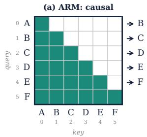

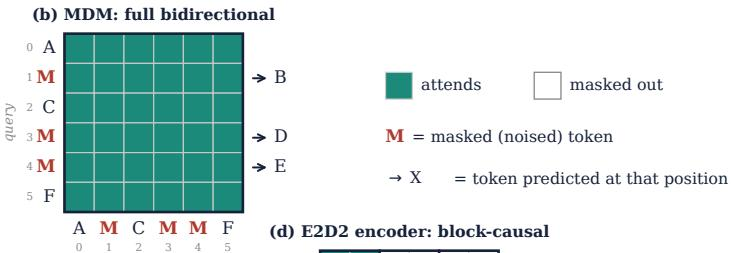

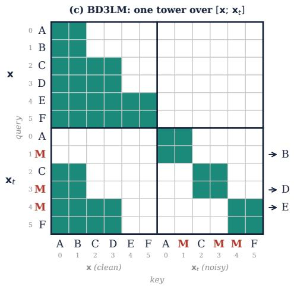

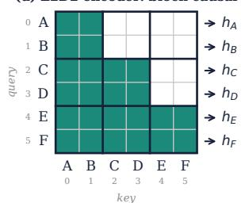

(e) E2D2 decoder: cross-attention to h + block self-attention  
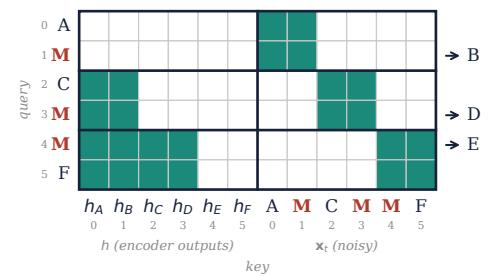  
Figure 7: Attention masks of the four model variants on a six-token sequence with block size $b { = } 2 .$ Rows are queries and columns are keys; filled cells attend. (a) ARM: causal self-attention. (b) MDM: full bidirectional self-attention over the partially masked sequence. (c) BD3LM: a single tower over the concatenation of the clean sequence x and the noised sequence $\mathbf { x } _ { t } ;$ the clean half attends block-causally, and each noised block attends to itself and to the clean tokens of all earlier blocks. (d, e) E2D2: a block-causal encoder over the clean sequence, and a decoder with blockdiagonal self-attention within each noised block plus cross-attention to the encoder outputs h of the strictly preceding blocks. M marks a masked (noised) token; arrows mark the token predicted at that position.

training FLOPs are computed as follows:

$$
\begin{array} { r l } & { \quad \mathrm { A R M } = 6 P n + 6 d L n ( n + 1 ) + 6 d V n , } \\ & { \quad \mathrm { M D M } = 6 P n + 1 2 d L n ^ { 2 } + 6 d V n , } \\ & { \quad \mathrm { B D 3 L M } = 1 2 P n + 1 2 d L \left( n ^ { 2 } + n b \right) + 6 d V n , } \\ & { \quad \mathrm { E 2 D 2 } = 6 P _ { \mathrm { e n c } } n + 6 d L _ { \mathrm { e n c } } \left( n ^ { 2 } + n b \right) + 6 P _ { \mathrm { d e c } } n + 1 2 d L _ { \mathrm { d e c } } n b + 6 d L _ { \mathrm { d e c } } \left( n ^ { 2 } - n b \right) + 6 d V n . } \end{array}
$$

Table 5 reports the attention score term as a fraction of the per-token training FLOPs for every variant across the size ladder. For BD3LM and E2D2 we take b=32 as the example, and for E2D2 we additionally set the decoder depth to half the total depth. Two patterns motivate counting real FLOPs rather than using 6ND. First, the fraction is sizeable and grows toward smaller models, reaching about 30% for the MDM, so 6ND distorts the shape of $\mathcal { L } ^ { * } ( C )$ along the ladder. Second, at matched size it differs markedly across variants: the MDM’s full bidirectional attention $( n ^ { 2 } )$ costs about twice the ARM’s causal attention $( n ^ { 2 } / 2 )$ , while E2D2’s decoder attention is the cheapest. An attention-agnostic count therefore mis-charges the variants relative to one another, and this variantspecific difference, unlike terms common to all variants, does not cancel in the compute multiple.

## B.2 SCALING-LAW RUNS

Tables 6 and 7 list every cell of the scaling-law grids: for each variant and budget, the ladder sizes N that were trained (non-embedding parameters in millions, as named in the SMDM ladder), and

Table 5: Attention score FLOPs as a percentage of per-token training FLOPs, by variant and model size (b=32; E2D2 decoder = L/2; sequence length 2048).
<table><tr><td>Size (M)</td><td> $d$ </td><td> $L$ </td><td>ARM</td><td>MDM</td><td>BD3LM</td><td>E2D2</td></tr><tr><td>19</td><td>384</td><td>8</td><td>16.8</td><td>28.8</td><td>20.3</td><td>16.0</td></tr><tr><td>34</td><td>512</td><td>8</td><td>14.4</td><td>25.1</td><td>16.9</td><td>13.6</td></tr><tr><td>66</td><td>640</td><td>10</td><td>13.2</td><td>23.4</td><td>14.9</td><td>12.4</td></tr><tr><td>113</td><td>768</td><td>12</td><td>12.0</td><td>21.5</td><td>13.2</td><td>11.2</td></tr><tr><td>170</td><td>768</td><td>18</td><td>12.7</td><td>22.6</td><td>13.6</td><td>11.8</td></tr><tr><td>268</td><td>1024</td><td>16</td><td>10.0</td><td>18.2</td><td>10.7</td><td>9.2</td></tr><tr><td>472</td><td>1280</td><td>18</td><td>8.4</td><td>15.5</td><td>8.9</td><td>7.7</td></tr><tr><td>761</td><td>1408</td><td>24</td><td>7.9</td><td>14.6</td><td>8.2</td><td>7.2</td></tr><tr><td>1233</td><td>1792</td><td>24</td><td>6.4</td><td>12.0</td><td>6.6</td><td>5.8</td></tr><tr><td>1678</td><td>2048</td><td>25</td><td>5.7</td><td>10.7</td><td>5.9</td><td>5.2</td></tr><tr><td>2121</td><td>2176</td><td>28</td><td>5.4</td><td>10.2</td><td>5.6</td><td>4.9</td></tr></table>

for E2D2 the decoder depths $L _ { \mathrm { d e c } }$ swept at each size. BD3LM at $b \in \{ 8 , 1 6 , 3 2 \}$ share one grid; BD3LM at b=4 and E2D2 at $b { = } 4$ use a slightly shifted one. The held-out budget of $\mathrm { 3 \times 1 0 ^ { 2 0 } }$ FLOPs (Section 4.3) is listed in its own rows.

Table 6: Ladder sizes N (millions of non-embedding parameters) trained at each budget for the ARM, the MDM and BD3LM.
<table><tr><td>variant</td><td>C (FLOPs)</td><td>trained sizes N</td></tr><tr><td rowspan="5">ARM</td><td> $6 \times 1 0 ^ { 1 8 }$ </td><td>{66, 113, 170, 231, 336, 472, 629}</td></tr><tr><td> $1 0 ^ { 1 9 }$ </td><td>{85, 142, 231, 336, 472, 666, 944}</td></tr><tr><td> $\mathrm { 3 \times 1 0 ^ { 1 9 } }$ </td><td>{142, 231, 336, 472, 666, 944, 1233}</td></tr><tr><td> $6 \times 1 0 ^ { 1 9 }$ </td><td>{206, 302, 472, 666, 944, 1233, 1678}</td></tr><tr><td> $1 0 ^ { 2 0 }$ </td><td>{268, 472, 666, 944, 1233, 1678, 2121}</td></tr><tr><td rowspan="5">MDM</td><td> $6 \times 1 0 ^ { 1 8 }$ </td><td>{34, 48, 66, 113, 170, 231, 336}</td></tr><tr><td> $1 0 ^ { 1 9 }$ </td><td>{48, 66, 85, 142, 231, 336, 472}</td></tr><tr><td> $\mathrm { 3 \times 1 0 ^ { 1 9 } }$ </td><td>{66, 142, 231, 336, 472, 666, 944}</td></tr><tr><td> $6 \times 1 0 ^ { 1 9 }$ </td><td>{113, 206, 302, 472, 666, 944, 1233}</td></tr><tr><td> $1 0 ^ { 2 0 }$ </td><td>{142, 268, 472, 666, 944, 1233, 1678}</td></tr><tr><td rowspan="5"> $\mathtt { B D 3 L M } b \in \{ 8 , 1 6 , 3 2 \}$ </td><td> $6 \times 1 0 ^ { 1 8 }$ </td><td>{19, 34, 48, 66, 85, 113, 142, 170, 231, 336}</td></tr><tr><td> $1 0 ^ { 1 9 }$ </td><td>{48, 66, 85, 113, 142, 170, 206, 268, 336}</td></tr><tr><td> $\mathrm { 3 \times 1 0 ^ { 1 9 } }$ </td><td>{85, 113, 142, 170, 206, 268, 336, 472, 666}</td></tr><tr><td> $6 \times 1 0 ^ { 1 9 }$ </td><td>{142, 170, 206, 268, 336, 472, 666, 944}</td></tr><tr><td> $1 0 ^ { 2 0 }$ </td><td>{206, 268, 336, 472, 666, 944, 1233}</td></tr><tr><td rowspan="5">BD3LM b=4</td><td> $6 \times 1 0 ^ { 1 8 }$ </td><td>{34, 48, 66, 85, 113, 142, 170, 231, 336}</td></tr><tr><td> $1 0 ^ { 1 9 }$ </td><td>{48, 66, 85, 113, 142, 170, 206, 268, 336}</td></tr><tr><td> $\mathrm { 3 \times 1 0 ^ { 1 9 } }$ </td><td>{142, 170, 206, 268, 336, 472, 666}</td></tr><tr><td> $6 \times 1 0 ^ { 1 9 }$ </td><td></td></tr><tr><td> $1 0 ^ { 2 0 }$ </td><td>{206, 268, 336, 472, 666, 944, 1233} {268, 336, 472, 666, 944, 1233, 1678}</td></tr></table>

## B.3 COMPUTE COST

Table 8 lists the cost of the scaling law runs in B200 GPU hours, split into training and DUEL evaluation, for a total of approximately 136k GPU hours over 1,741 training runs (downstream benchmark evaluation not included). The E2D2 rows include the decoder-depth sweep, which is why they dominate the total. DUEL evaluation is by far the most expensive for the MDM, whose unmasking sweep spans the full sequence rather than one block at a time.

Table 7: E2D2 grid: for each budget and ladder size N (with total depth $L ) ,$ , the range of decoder depths $L _ { \mathrm { d e c } }$ trained at each block size. “—” means the size was not trained at that block size.
<table><tr><td>C (FLOPs)</td><td>N (M)</td><td>L</td><td>b=4</td><td>b=8</td><td> $b { = } 1 6$ </td><td>b=32</td></tr><tr><td> $6 \times 1 0 ^ { 1 8 }$ </td><td>34</td><td>8</td><td>2-7</td><td>2-7</td><td>2-7</td><td>2-7</td></tr><tr><td></td><td>48</td><td>9</td><td>2-8</td><td>2-8</td><td>2-8</td><td>2-8</td></tr><tr><td></td><td>66</td><td>10</td><td>2-9</td><td>2-9</td><td>2-9</td><td>3-9</td></tr><tr><td></td><td>85</td><td>13</td><td>2-12</td><td>4-12</td><td>4-12</td><td>5-12</td></tr><tr><td></td><td>113</td><td>12</td><td>2-11</td><td>4-11</td><td>3-11</td><td>3-11</td></tr><tr><td></td><td>142</td><td>15</td><td></td><td></td><td>6-14</td><td>5-14</td></tr><tr><td></td><td>170</td><td>18</td><td>2-17</td><td>8-16</td><td>8-17</td><td>8-17</td></tr><tr><td></td><td>231</td><td>18</td><td>2-17</td><td>7-15</td><td>8-17</td><td>7-17</td></tr><tr><td></td><td>336</td><td>20</td><td>2-19</td><td></td><td></td><td></td></tr><tr><td></td><td>472</td><td>18</td><td>2-17</td><td></td><td></td><td></td></tr><tr><td> $1 0 ^ { 1 9 }$ </td><td>66</td><td>10</td><td>4-9</td><td>3-9</td><td>2-9</td><td>3-9</td></tr><tr><td></td><td>85</td><td>13</td><td>4-12</td><td>5-12</td><td>4-11</td><td>6-12</td></tr><tr><td></td><td>113</td><td>12</td><td>4-11</td><td>4-11</td><td>3-11</td><td>5-11</td></tr><tr><td></td><td>142</td><td>15</td><td>3-14</td><td>6-14</td><td>6-14</td><td>8-14</td></tr><tr><td></td><td>170</td><td>18</td><td>4-17</td><td>9-17</td><td>8-17</td><td>11-17</td></tr><tr><td></td><td>231</td><td>18</td><td>4-17</td><td>8-16</td><td>6-16</td><td>10-16</td></tr><tr><td></td><td>336</td><td>20</td><td>4-19</td><td>8-16</td><td>8-18</td><td>10-16</td></tr><tr><td></td><td>472</td><td>18</td><td>4-17</td><td></td><td></td><td></td></tr><tr><td> $\mathrm { 3 \times 1 0 ^ { 1 9 } }$ </td><td>142</td><td>15</td><td>4-14</td><td>8-14</td><td>6-14</td><td>8-14</td></tr><tr><td></td><td>170</td><td>18</td><td></td><td></td><td>8-17</td><td>11-17</td></tr><tr><td></td><td>206</td><td>16</td><td>4-15</td><td>8-15</td><td>7-15</td><td>9-15</td></tr><tr><td></td><td>268</td><td>16</td><td>3-15</td><td>8-15</td><td>7-15</td><td>9-15</td></tr><tr><td></td><td>336</td><td>20</td><td>4-19</td><td>10-18</td><td>9-19</td><td>12-18</td></tr><tr><td></td><td>472</td><td>18</td><td>4-17</td><td>8-16</td><td>8-17</td><td>9-17</td></tr><tr><td></td><td>666</td><td>21</td><td>4-20</td><td>11-19</td><td>10-20</td><td>11-20</td></tr><tr><td></td><td>944</td><td>25</td><td>4-24</td><td></td><td></td><td></td></tr><tr><td> $6 \times 1 0 ^ { 1 9 }$ </td><td>170</td><td>18</td><td></td><td></td><td>7-17</td><td>11-17</td></tr><tr><td></td><td>206</td><td>16</td><td>4-14</td><td>8-15</td><td>7-15</td><td>9-15</td></tr><tr><td></td><td>268</td><td>16</td><td>4-14</td><td>8-15</td><td>6-15</td><td>9-15</td></tr><tr><td></td><td>336</td><td>20</td><td>4-19</td><td>10-18</td><td>10-19</td><td>13-19</td></tr><tr><td></td><td>472</td><td>18</td><td>3-17</td><td>8-16</td><td>8-17</td><td>10-16</td></tr><tr><td></td><td>666</td><td>21</td><td>4-20</td><td>10-18</td><td>10-20</td><td>12-20</td></tr><tr><td></td><td>944</td><td>25</td><td>4-24</td><td>14-22</td><td>14-24</td><td>15-21</td></tr><tr><td></td><td>1233</td><td>24</td><td>4-23</td><td></td><td></td><td></td></tr><tr><td> $1 0 ^ { 2 0 }$ </td><td>206</td><td>16</td><td></td><td></td><td>7-15</td><td>9-15</td></tr><tr><td></td><td>268</td><td>16</td><td>5-14</td><td>8-15</td><td>7-15</td><td>9-15</td></tr><tr><td></td><td>336</td><td>20</td><td>4-19</td><td>11-19</td><td>11-19</td><td>13-19</td></tr><tr><td></td><td>472</td><td>18</td><td>4-17</td><td>8-15</td><td>8-17</td><td>11-17</td></tr><tr><td></td><td>666</td><td>21</td><td>3-20</td><td>10-18</td><td>11-20</td><td>13-19</td></tr><tr><td></td><td>944</td><td>25</td><td>4-24</td><td>14-22</td><td>14-24</td><td>16-22</td></tr><tr><td></td><td>1233</td><td>24</td><td>4-23</td><td>12-20</td><td>14-23</td><td>14-23</td></tr><tr><td></td><td>1678</td><td>25</td><td>4-24</td><td></td><td></td><td></td></tr><tr><td> $\mathrm { 3 \times 1 0 ^ { 2 0 } }$  (held-out)</td><td></td><td></td><td></td><td></td><td></td><td></td></tr><tr><td></td><td>831 944</td><td>22 25</td><td></td><td></td><td>15-17 16-20</td><td>16-18 18-20</td></tr><tr><td></td><td>1233</td><td>24</td><td></td><td></td><td>16-18</td><td>17-21</td></tr></table>

## B.4 BENCHMARK EVALUATION PROTOCOL

We obtain benchmark accuracies with lm-evaluation-harness (Gao et al., 2021). For HellaSwag (Zellers et al., 2019), ARC-easy (Clark et al., 2018), PIQA (Bisk et al., 2020), SciQ (Welbl et al., 2017), RACE (Lai et al., 2017) and OpenBookQA (Mihaylov et al., 2018) we report the acc norm metric returned by the harness, and for SIQA (Sap et al., 2019), LAMBADA (Paperno et al., 2016), WinoGrande (Sakaguchi et al., 2021), BoolQ (Clark et al., 2019) and COPA (Roemmele et al., 2011) we report acc. The diffusion variants are scored with DUEL (top-1 confidence) and with the 128-sample ELBO. For LAMBADA the two readouts coincide, since the task is a single-word completion.

Table 8: Compute cost in B200 GPU hours by variant, split into training and DUEL evaluation. E2D2 rows include the decoder-depth sweep.
<table><tr><td>variant</td><td>runs</td><td>training</td><td>DUEL evaluation</td><td>total</td></tr><tr><td>ARM</td><td>43</td><td>1,507</td><td></td><td>1,507</td></tr><tr><td>MDM</td><td>80</td><td>2,393</td><td>8,384</td><td>10,777</td></tr><tr><td>BD3LM b=32</td><td>43</td><td>3,901</td><td>292</td><td>4,193</td></tr><tr><td>BD3LM b=16</td><td>43</td><td>3,903</td><td>147</td><td>4,050</td></tr><tr><td>BD3LM b=8</td><td>43</td><td>3,903</td><td>74</td><td>3,977</td></tr><tr><td>BD3LM b=4</td><td>40</td><td>3,504</td><td>39</td><td>3,543</td></tr><tr><td>E2D2 b=32</td><td>285</td><td>22,551</td><td>1,155</td><td>23,706</td></tr><tr><td>E2D2 b=16</td><td>355</td><td>28,082</td><td>718</td><td>28,800</td></tr><tr><td>E2D2 b=8</td><td>270</td><td>18,349</td><td>269</td><td>18,618</td></tr><tr><td>E2D2 b=4</td><td>539</td><td>36,960</td><td>327</td><td>37,287</td></tr><tr><td>total</td><td>1,741</td><td>125,053</td><td>11,405</td><td>136,458</td></tr></table>

## C ADDITIONAL EXPERIMENTAL RESULTS

## C.1 ISOFLOP CURVES

Figure 8 shows the IsoFLOP curves of the two b=4 variants, which complement the eight variants in Figure 2.

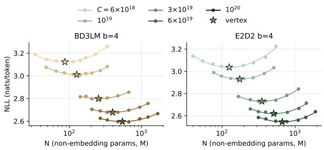  
Figure 8: IsoFLOP curves for BD3LM and E2D2 at b=4 (DUEL; for E2D2, each point is the best $L _ { \mathrm { d e c } }$ at that size). Darker shades mark larger budgets, and stars mark fitted vertices.

## C.2 COMPUTE MULTIPLE

Table 9 reports the compute multiple of every diffusion variant at every budget under the protocol of Section 3: the variant’s measured compute-optimal NLL at budget C is located on the ARM’s fitted law, and the multiple is C divided by the ARM compute that reaches the same NLL. Below $6 \times 1 0 ^ { 1 9 }$ FLOPs, the NLL of most diffusion variants lies above the ARM’s measured range (2.39– 2.84 nats), so the ARM law has to be extrapolated below $6 \times 1 0 ^ { 1 8 }$ FLOPs; these entries are shown in parentheses for reference only. Table 10 reports the alternative, extrapolating readout of SMDM (Nie et al., 2025): the diffusion variant’s fitted law is extrapolated to the compute at which it reaches the ARM’s compute-optimal NLL at budget C, and the multiple is that compute divided by C. Since the fitted exponents of the diffusion variants are slightly steeper than the ARM’s, this readout decreases with $C ;$ at $1 0 ^ { 2 0 }$ FLOPs it differs from Table 9 by at most 22% (the MDM under DUEL), and the ordering of the variants is the same under both readouts.

## C.3 DECODER DEPTH

Three readouts of the optimal split. Table 11 reads $L _ { \mathrm { d e c } } ^ { * } / L$ off the decoder-depth sweeps in three ways: the discrete argmin of DUEL, the vertex of a parabola fitted near the minimum (the readout used in the main text), and the argmin restricted to the compute-optimal N of each budget. All three agree closely at every block size, so the optimal split is insensitive to how it is read.

Table 9: Compute multiple against the ARM under the protocol of the main text (DUEL for diffusion unless stated), at each of the five budgets. Values in parentheses require extrapolating the ARM law below $6 \times 1 0 ^ { 1 8 }$ FLOPs and are shown for reference only; the last column is the value reported in Table 2.  
Table 10: Compute multiple against the ARM under the extrapolating readout of SMDM (DUEL for diffusion unless stated): the fitted law of the diffusion variant is extrapolated to the compute at which it reaches the ARM’s computeoptimal NLL at each budget.
<table><tr><td>variant</td><td> $6 \times 1 0 ^ { 1 8 }$ </td><td> $1 0 ^ { 1 9 }$ </td><td> $3 \times 1 0 ^ { 1 9 }$ </td><td> $6 \times 1 0 ^ { 1 9 }$ </td><td> $1 0 ^ { 2 0 }$ </td></tr><tr><td>MDM (ELBO)</td><td>(17.5)</td><td>(17.6)</td><td>(16.3)</td><td>(16.5)</td><td>17.8</td></tr><tr><td>MDM</td><td>(14.6)</td><td>(15.1)</td><td>(12.6)</td><td>(12.4)</td><td>12.8</td></tr><tr><td>BD3LM b=32</td><td>(11.4)</td><td>(10.7)</td><td>(9.9)</td><td>9.7</td><td>9.6</td></tr><tr><td>BD3LM b=16</td><td>(9.3)</td><td>(8.8)</td><td>(8.0)</td><td>7.9</td><td>7.8</td></tr><tr><td>BD3LM b=8</td><td>(7.1)</td><td>(6.6)</td><td>(6.1)</td><td>6.0</td><td>5.9</td></tr><tr><td>BD3LM b=4</td><td>(4.9)</td><td>(4.5)</td><td>4.2</td><td>4.1</td><td>4.1</td></tr><tr><td>E2D2 b=32</td><td>(8.1)</td><td>(7.5)</td><td>(7.3)</td><td>7.5</td><td>7.8</td></tr><tr><td>E2D2 b=16</td><td>(6.7)</td><td>(6.3)</td><td>(5.9)</td><td>6.0</td><td>6.3</td></tr><tr><td>E2D2 b=8</td><td>(5.0)</td><td>(4.6)</td><td>4.4</td><td>4.5</td><td>4.6</td></tr><tr><td>E2D2 b=4</td><td>(3.1)</td><td>(2.9)</td><td>2.8</td><td>2.9</td><td>3.0</td></tr></table>

<table><tr><td>variant</td><td> $6 \times 1 0 ^ { 1 8 }$ </td><td> $1 0 ^ { 1 9 }$ </td><td> $3 \times 1 0 ^ { 1 9 }$ </td><td> $6 \times 1 0 ^ { 1 9 }$ </td><td> $1 0 ^ { 2 0 }$ </td></tr><tr><td>MDM (ELBO)</td><td>16.9</td><td>16.8</td><td>16.7</td><td>16.6</td><td>16.5</td></tr><tr><td>MDM</td><td>12.5</td><td>12.1</td><td>11.3</td><td>10.8</td><td>10.5</td></tr><tr><td>BD3LM b=32</td><td>9.8</td><td>9.5</td><td>8.9</td><td>8.6</td><td>8.4</td></tr><tr><td>BD3LM b=16</td><td>8.0</td><td>7.8</td><td>7.3</td><td>7.0</td><td>6.8</td></tr><tr><td>BD3LM b=8</td><td>6.2</td><td>6.0</td><td>5.6</td><td>5.4</td><td>5.3</td></tr><tr><td>BD3LM b=4</td><td>4.3</td><td>4.2</td><td>4.0</td><td>3.8</td><td>3.7</td></tr><tr><td>E2D2  $\scriptstyle b = 3 2$ </td><td>7.6</td><td>7.6</td><td>7.5</td><td>7.4</td><td>7.4</td></tr><tr><td>E2D2 b=16</td><td>6.2</td><td>6.1</td><td>5.9</td><td>5.8</td><td>5.8</td></tr><tr><td>E2D2 b=8</td><td>4.6</td><td>4.5</td><td>4.4</td><td>4.3</td><td>4.3</td></tr><tr><td>E2D2 b=4</td><td>2.9</td><td>2.9</td><td>2.9</td><td>2.8</td><td>2.8</td></tr></table>

Table 11: Optimal decoder fraction $L _ { \mathrm { d e c } } ^ { * } / L$ of E2D2 at each block size, read off in three ways: the discrete argmin of DUEL over all columns, the vertex of a parabola fitted near the minimum over all columns, and the argmin restricted to the compute-optimal N of each budget. Entries are ${ \mathrm { m e a n ~ } } \pm$ s.d.
<table><tr><td>b</td><td>4</td><td>8</td><td>16</td><td>32</td></tr><tr><td>argmin, all columns</td><td> $0 . 6 4 5 \pm 0 . 0 8 5$ </td><td> $0 . 7 1 6 \pm 0 . 0 4 0$ </td><td> $0 . 7 2 8 \pm 0 . 0 6 2$ </td><td> $0 . 7 8 0 \pm 0 . 0 5 5$ </td></tr><tr><td>vertex, all columns</td><td> $0 . 6 4 3 \pm 0 . 0 6 4$ </td><td> $0 . 6 8 2 \pm 0 . 0 2 9$ </td><td> $0 . 7 2 3 \pm 0 . 0 3 0$ </td><td> $0 . 7 7 1 \pm 0 . 0 4 9$ </td></tr><tr><td>at compute-optimal  $N$ </td><td> $0 . 6 3 0 \pm 0 . 0 4 5$ </td><td> $0 . 7 0 6 \pm 0 . 0 4 8$ </td><td> $0 . 7 2 4 \pm 0 . 0 3 4$ </td><td> $0 . 7 5 6 \pm 0 . 0 1 8$ </td></tr></table>

The smallest block size. Figure 9 repeats the analysis of Section 4.2 for b=4 (38 columns). The picture is the same as at the larger block sizes: the optimal split is decoder-heavy, and the three readouts agree (0.63–0.65, against 0.64 predicted by Eq. 2). Rounding Eq. 2 to the nearest integer number of decoder layers lands within 10 m-nats of the column minimum in 87% of columns and in all five compute-optimal columns (Table 12).

Regressions. We regress the parabola-vertex readout of $L _ { \mathrm { d e c } } ^ { * } / L$ over the 142 columns on $\log _ { 1 0 } N ,$ $\log _ { 1 0 } C$ and log b jointly. The block size dominates: its coefficient is +0.043 per doubling of b $\scriptstyle ( t = 1 2 . 7 )$ . The model size has no detectable effect, with a coefficient of −0.007 per decade of N $( t = - 0 . 5 )$ . The budget has a small one, +0.029 per decade of C (t=2.4); across the 1.2 decades of our budgets this amounts to a shift of 0.035 in $\bar { L } _ { \mathrm { d e c } } ^ { * } / L$ , less than one layer at every depth in the $\mathrm { g r i d } .$ , whereas going from b=4 to b=32 shifts it by 0.13. We therefore regress on $\log _ { 2 }$ b alone, which gives Eq. 2. The rule describes the data well: it reproduces the mean vertex at each block size to within 0.005 (0.643, 0.682, 0.723 and 0.771 measured at $b = 4 , 8 ,$ 16 and 32, against 0.642, 0.685, 0.728 and 0.771 predicted), and its residuals over the individual columns have an rms of 0.045 in $L _ { \mathrm { d e c } } ^ { * } / L$ , or 0.8 layers.

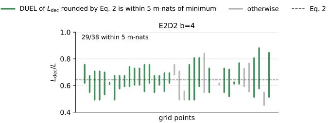  
Figure 9: Same as Figure 4, for E2D2 at b=4.

Table 12: Rounded Eq. 2 against the column minimum, by block size.
<table><tr><td>b</td><td>columns</td><td>within 5 m-nats</td><td>within 10 m-nats</td><td>compute-optimal columns within 10 m-nats</td></tr><tr><td>4</td><td>38</td><td>76%</td><td>87%</td><td>5/5</td></tr><tr><td>8</td><td>32</td><td>81%</td><td>88%</td><td>5/5</td></tr><tr><td>16</td><td>36</td><td>89%</td><td>97%</td><td>5/5</td></tr><tr><td>32</td><td>36</td><td>89%</td><td>100%</td><td>5/5</td></tr><tr><td>all</td><td>142</td><td>84%</td><td>93%</td><td>20/20</td></tr></table>

## C.4 HELD-OUT BUDGET

Table 13 compares, at the held-out budget of $\mathrm { 3 \times 1 0 ^ { 2 0 } }$ FLOPs, the NLL predicted by the power law fitted on the five budgets $\leq ~ 1 0 ^ { 2 0 }$ with the best measured cell of the ARM and of E2D2 at $b \in \{ 1 6 , 3 2 \}$ . As reported in Section 4.3, the gap between E2D2 and the ARM is reproduced: 261.6 m-nats measured against 257 predicted at $b { = } 1 6 ,$ , and 296.8 against 294 at b=32. At the same time, all three variants land 24–28 m-nats (1.07–1.15%) above their own law, a miss that is consistent in sign and size across the three.

Table 13: The held-out budget at $\mathrm { 3 \times 1 0 ^ { 2 0 } }$ FLOPs. Power laws fitted on the five budgets $\leq 1 0 ^ { 2 0 }$ are compared with the best measured cell.
<table><tr><td>variant</td><td>law  $\mathcal { L } ^ { * } ( 3 { \times } 1 0 ^ { 2 0 } )$ </td><td>measured best cell</td><td>miss</td></tr><tr><td>ARM</td><td>2.2231</td><td>2.2468</td><td>+23.7 m-nats  $( + 1 . 0 7 \% )$ </td></tr><tr><td>E2D2 b=16</td><td>2.4800</td><td>2.5084</td><td>+28.4 m-nats  $\left( + 1 . 1 5 \% \right)$ </td></tr><tr><td>E2D2 b=32</td><td>2.5167</td><td>2.5436</td><td>+26.9 m-nats (+1.07%)</td></tr></table>

Fits with an irreducible term. A pure power law has no irreducible term, whereas the loss is bounded below by the entropy of the data (Hoffmann et al., 2022), a known weakness of the pure power law (Von Rutte et al.¨ , 2026; Ni et al., 2025b): a curve that bends towards a floor is underpredicted by a straight line in log–log space, by more the further one extrapolates, which is the signature observed. We therefore refit $\mathcal { \bar { L } } ^ { * } ( C ) \overset { \cdot } { = } E + a C ^ { \alpha }$ jointly over the eight DUEL variants (ARM, MDM, BD3LM and E2D2 at $b \in \{ 4 , 1 6 , 3 2 \} )$ with a single shared E and per-variant $( a , \alpha )$ on the five b $\mathrm { \ u d g e t s \leq 1 0 ^ { 2 0 } }$ , and profile the fit over fixed values of E (Table 14). Two observations follow. First, the in-sample rms decreases from 5.9 m-nats at E = 0 to 3.1 at $E \approx 1 . 5 .$ , so the five budgets favor $E > 0 ;$ but the minimum is shallow (3.1–3.9 m-nats for $E \in [ 1 . 2 , 1 . 8 ] )$ , and the exponents move along a ridge with E, so the five budgets cannot determine the value of E. Second, adding $E \approx 1 . 5$ removes the miss at the held-out budget: at $E = 1 . 5$ the three $\mathrm { 3 \times 1 0 ^ { 2 0 } }$ cells are predicted $\mathrm { t o \ - } 7 , \ + 0 . 4$ and 0.0 m-nats (Figure 10). However, the held-out cells come from three sizes bracketing the predicted optimal model size rather than from a full IsoFLOP search, so we do not use them to fix E, and we conservatively keep the pure power law in the body of the paper, treating its exponents as local to the fitted range. We leave a scaling law with an irreducible term, which would require more budgets to pin down E, to future work.

Table 14: Profile of the shared-E fit on the five budget $\mathrm { s \leq 1 0 ^ { 2 0 } }$ : in-sample rms, exponents, and the miss at the held-out budget (measured minus predicted, m-nats).
<table><tr><td>E</td><td>rms (m-nats)</td><td>αARM</td><td>αE2D2 16</td><td>miss ARM</td><td>miss E2D2 16</td><td>miss E2D2 32</td></tr><tr><td>0.0</td><td>5.9</td><td>-0.062</td><td>-0.063</td><td>+23.7</td><td>+28.4</td><td>+26.9</td></tr><tr><td>1.0</td><td>4.1</td><td>-0.101</td><td>-0.097</td><td>+9.2</td><td>+14.2</td><td>+13.2</td></tr><tr><td>1.2</td><td>3.7</td><td>-0.115</td><td>-0.108</td><td>+4.1</td><td>+9.5</td><td>+8.7</td></tr><tr><td>1.4</td><td>3.2</td><td>-0.134</td><td>-0.122</td><td>-2.5</td><td>+3.8</td><td>+3.2</td></tr><tr><td>1.5</td><td>3.1</td><td>-0.147</td><td>-0.131</td><td>-6.7</td><td>+0.4</td><td>-0.0</td></tr><tr><td>1.6</td><td>3.2</td><td>-0.161</td><td>-0.141</td><td>-11.5</td><td>-3.5</td><td>-3.7</td></tr><tr><td>1.8</td><td>3.9</td><td>-0.203</td><td>-0.167</td><td>-24.1</td><td>-13.0</td><td>-12.7</td></tr></table>

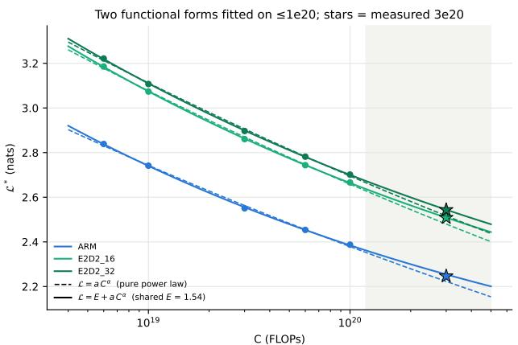  
Figure 10: Pure power laws (dashed) and shared-E laws $\mathcal { L } ^ { * } = E + a C ^ { \alpha }$ (solid), both fitted on $\leq 1 0 ^ { 2 0 }$ , against the held-out budget at $\mathrm { 3 \times 1 0 ^ { 2 0 } }$ FLOPs (stars).

## C.5 DOWNSTREAM BENCHMARKS

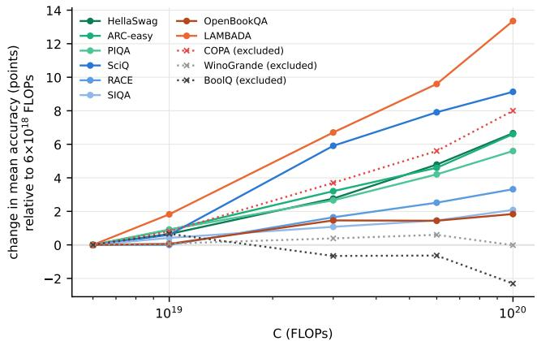  
Figure 11: Benchmark screening. For each benchmark, the accuracy averaged over the ten variants at their compute-optimal cells, relative to its value at $6 \times 1 0 ^ { 1 8 }$ FLOPs. Dotted lines mark the three benchmarks we exclude.

Benchmark screening. We score the compute-optimal cell of every variant at every budget on all eleven benchmarks. Figure 11 shows, for each benchmark, how the accuracy averaged over the ten variants moves with compute. Eight benchmarks rise with compute by well more than their standard error. WinoGrande and BoolQ do not: on WinoGrande accuracy stays at chance at every budget (50.8% at $1 0 ^ { 2 0 }$ FLOPs against a chance level of 50%), and on BoolQ it decreases with compute, so neither can distinguish a better model from a worse one at these scales. COPA does rise with compute, but it has only 100 questions, so the standard error of a single COPA accuracy is 4.8 points, against at most 2 points for every other benchmark; in a mean over nine benchmarks, COPA would account for about two-thirds of the variance. We therefore exclude these three benchmarks and use the remaining eight.

Per-benchmark accuracy. Table 15 lists the accuracy on each of the eight retained benchmarks, and their mean, for the compute-optimal cell of every variant at every budget; the means are the values plotted in Figure 6.

## D ASSETS

Table 15: Zero-shot accuracy (%) on the eight retained benchmarks at the compute-optimal cell of every variant at every budget (DUEL scoring for the diffusion variants; exact NLL for the ARM), and their mean. This is the data plotted in Figure 6.
<table><tr><td>variant</td><td>C</td><td>HellaSwag</td><td>ARC-e</td><td>PIQA</td><td>SciQ</td><td>RACE</td><td>SIQA</td><td>OBQA</td><td>LAMBADA</td><td>mean</td></tr><tr><td>ARM</td><td> $6 \times 1 0 ^ { 1 8 }$ </td><td>28.9</td><td>35.1</td><td>61.1</td><td>60.1</td><td>27.0</td><td>37.0</td><td>26.2</td><td>16.6</td><td>36.5</td></tr><tr><td></td><td> $1 0 ^ { 1 9 }$ </td><td>30.2</td><td>37.7</td><td>60.8</td><td>60.6</td><td>28.3</td><td>37.0</td><td>27.4</td><td>19.0</td><td>37.6</td></tr><tr><td></td><td> $3 \times 1 0 ^ { 1 9 }$ </td><td>34.1</td><td>40.4</td><td>63.2</td><td>65.9</td><td>29.8</td><td>37.4</td><td>27.2</td><td>26.3</td><td>40.5</td></tr><tr><td></td><td> $6 \times 1 0 ^ { 1 9 }$ </td><td>37.1</td><td>41.8</td><td>65.6</td><td>67.3</td><td>29.1</td><td>37.1</td><td>29.4</td><td>27.2</td><td>41.8</td></tr><tr><td></td><td> $1 0 ^ { 2 0 }$ </td><td>40.1</td><td>42.9</td><td>67.7</td><td>72.4</td><td>33.3</td><td>38.3</td><td>30.2</td><td>30.8</td><td>44.5</td></tr><tr><td>MDM</td><td> $6 \times 1 0 ^ { 1 8 }$ </td><td>28.5</td><td>32.1</td><td>56.2</td><td>63.1</td><td>27.0</td><td>36.7</td><td>25.4</td><td>21.1</td><td>36.3</td></tr><tr><td></td><td> ${ 1 0 } ^ { 1 9 }$ </td><td>28.7</td><td>34.2</td><td>56.6</td><td>61.0</td><td>27.8</td><td>36.3</td><td>24.8</td><td>17.9</td><td>35.9</td></tr><tr><td></td><td> $3 \times 1 0 ^ { 1 9 }$ </td><td>30.5</td><td>36.3</td><td>58.8</td><td>64.7</td><td>30.1</td><td>37.3</td><td>25.0</td><td>24.2</td><td>38.4</td></tr><tr><td></td><td> $6 \times 1 0 ^ { 1 9 }$ </td><td>31.9</td><td>36.6</td><td>59.6</td><td>66.0</td><td>31.8</td><td>36.5</td><td>26.8</td><td>26.9</td><td>39.5</td></tr><tr><td></td><td> $1 0 ^ { 2 0 }$ </td><td>33.4</td><td>39.2</td><td>61.0</td><td>68.5</td><td>32.0</td><td>36.7</td><td>26.8</td><td>29.6</td><td>40.9</td></tr><tr><td>BD3LM b=32</td><td> $6 \times 1 0 ^ { 1 8 }$ </td><td>28.6</td><td>32.7</td><td>56.1</td><td>60.1</td><td>27.6</td><td>34.9</td><td>25.4</td><td>16.1</td><td>35.2</td></tr><tr><td></td><td>1019</td><td>29.3</td><td>33.4</td><td>56.8</td><td>62.0</td><td>26.8</td><td>36.0</td><td>25.2</td><td>17.5</td><td>35.9</td></tr><tr><td></td><td> $3 \times 1 0 ^ { 1 9 }$ </td><td>30.2</td><td>36.1</td><td>58.5</td><td>67.5</td><td>29.1</td><td>36.1</td><td>27.2</td><td>23.9</td><td>38.6</td></tr><tr><td></td><td> $6 \times 1 0 ^ { 1 9 }$ </td><td>32.3</td><td>37.2</td><td>60.2</td><td>70.0</td><td>29.9</td><td>38.0</td><td>26.4</td><td>25.8</td><td>40.0</td></tr><tr><td>BD3LM b=16</td><td> $1 0 ^ { 2 0 }$ </td><td>32.9</td><td>40.3</td><td>61.5</td><td>72.5</td><td>30.2</td><td>38.0</td><td>24.8</td><td>29.9</td><td>41.3</td></tr><tr><td></td><td> $6 \times 1 0 ^ { 1 8 }$ </td><td>28.3</td><td>33.5</td><td>55.8</td><td>60.0</td><td>27.8</td><td>35.6</td><td>23.6</td><td>15.5</td><td>35.0</td></tr><tr><td></td><td> $1 0 ^ { 1 9 }$ </td><td>28.6</td><td>34.3</td><td>57.9</td><td>60.7</td><td>28.1</td><td>35.5</td><td>25.8</td><td>19.4</td><td>36.3</td></tr><tr><td></td><td> $3 \times 1 0 ^ { 1 9 }$ </td><td>30.6</td><td>36.2</td><td>58.9</td><td>67.5</td><td>27.8</td><td>36.2</td><td>28.0</td><td>24.3</td><td>38.7</td></tr><tr><td></td><td> $6 \times 1 0 ^ { 1 9 }$ </td><td>32.4</td><td>38.4</td><td>60.3</td><td>70.5</td><td>30.0</td><td>37.3</td><td>26.2</td><td>28.0</td><td>40.4</td></tr><tr><td>BD3LM b=8</td><td> $1 0 ^ { 2 0 }$ </td><td>34.3</td><td>40.2</td><td>61.6</td><td>71.2</td><td>30.2</td><td>37.0</td><td>27.4</td><td>30.8</td><td>41.6</td></tr><tr><td></td><td> $6 \times 1 0 ^ { 1 8 }$ </td><td>28.3</td><td>34.1</td><td>57.2</td><td>60.7</td><td>27.1</td><td>34.9</td><td>26.4</td><td>16.6</td><td>35.7</td></tr><tr><td></td><td> ${ 1 0 } ^ { 1 9 }$ </td><td>29.0</td><td>34.4</td><td>58.3</td><td>61.4</td><td>28.3</td><td>36.4</td><td>24.6</td><td>18.6</td><td>36.4</td></tr><tr><td></td><td> $3 \times 1 0 ^ { 1 9 }$ </td><td>30.6</td><td>35.8</td><td>58.9</td><td>68.6</td><td>28.7</td><td>37.7</td><td>27.2</td><td>24.2</td><td>39.0</td></tr><tr><td></td><td> $6 \times 1 0 ^ { 1 9 }$ </td><td>32.8</td><td>37.2</td><td>60.9</td><td>70.3</td><td>30.5</td><td>37.0</td><td>25.2</td><td>26.3</td><td>40.1</td></tr><tr><td></td><td> $1 0 ^ { 2 0 }$ </td><td>34.4</td><td>39.9</td><td>60.6</td><td>71.2</td><td>30.5</td><td>38.0</td><td>27.4</td><td>32.4</td><td>41.8</td></tr><tr><td>BD3LM b=4</td><td> $6 \times 1 0 ^ { 1 8 }$ </td><td>28.4</td><td>32.7</td><td>55.7</td><td>61.1</td><td>28.3</td><td>36.2</td><td>27.0</td><td>17.4</td><td>35.9</td></tr><tr><td></td><td>1019</td><td>28.7</td><td>34.6</td><td>58.4</td><td>60.8</td><td>26.1</td><td>36.9</td><td>25.2</td><td>19.2</td><td>36.2</td></tr><tr><td></td><td> $3 \times 1 0 ^ { 1 9 }$ </td><td>31.1</td><td>36.4</td><td>59.7</td><td>64.9</td><td>29.7</td><td>37.1</td><td>25.8</td><td>23.2</td><td>38.5</td></tr><tr><td></td><td>6×1019</td><td>33.3</td><td>37.7</td><td>60.6</td><td>67.8</td><td>29.4</td><td>36.1</td><td>27.8</td><td>25.7</td><td>39.8</td></tr><tr><td>E2D2 b=32</td><td> $1 0 ^ { 2 0 }$ </td><td>35.4</td><td>40.7</td><td>63.4</td><td>66.8</td><td>30.6</td><td>37.8</td><td>27.8</td><td>31.5</td><td>41.8</td></tr><tr><td></td><td> $6 \times 1 0 ^ { 1 8 }$ </td><td>28.2</td><td>33.5</td><td>56.3</td><td>64.3</td><td>27.8</td><td>35.3</td><td>26.6</td><td>14.4</td><td>35.8</td></tr><tr><td></td><td>1019</td><td>28.7</td><td>34.6</td><td>58.1</td><td>65.6</td><td>27.8</td><td>35.2</td><td>26.2</td><td>17.5</td><td>36.7</td></tr><tr><td></td><td> $3 \times 1 0 ^ { 1 9 }$ </td><td>30.5</td><td>37.0</td><td>59.1</td><td>70.3</td><td>28.7</td><td>36.8</td><td>28.4</td><td>21.1</td><td>39.0</td></tr><tr><td></td><td> $6 \times 1 0 ^ { 1 9 }$ </td><td>32.3</td><td>37.7</td><td>60.5</td><td>72.4</td><td>31.4</td><td>36.6</td><td>26.8</td><td>24.6</td><td>40.3</td></tr><tr><td></td><td> $\stackrel { . } { 1 } 0 ^ { 2 0 }$ </td><td>34.0</td><td>38.4</td><td>61.4</td><td>72.2</td><td>30.6</td><td>38.4</td><td>29.0</td><td>28.1</td><td>41.5</td></tr><tr><td>E2D2 b=16</td><td> $6 \times 1 0 ^ { 1 8 }$ </td><td>28.6</td><td>33.7</td><td>56.6</td><td>64.0</td><td>28.0</td><td>34.8</td><td>26.0</td><td>17.1</td><td>36.1</td></tr><tr><td></td><td>1019</td><td>29.6</td><td>32.9 36.3</td><td>57.2 58.9</td><td>63.6 68.2</td><td>29.9 29.8</td><td>35.5 36.1</td><td>26.4 26.8</td><td>17.6 20.8</td><td>36.6 38.5</td></tr><tr><td></td><td> $3 \times 1 0 ^ { 1 9 }$  6×1019</td><td>31.2 33.0</td></table>

Table 16 lists the third-party code, data and benchmarks used in this study, with their licenses.

## E PER-CELL RESULTS OF THE ISOFLOP SWEEPS

Table 17 lists every cell of the ARM, MDM and BD3LM sweeps, with the size that minimizes each IsoFLOP curve in bold, and Tables 18–24 every trained model of the E2D2 decoder-depth sweeps, with the best decoder depth of each (budget, size) group in bold.

Table 16: Third-party assets used in this study and their licenses.
<table><tr><td>asset</td><td>license</td><td>asset</td><td>license</td></tr><tr><td>Code</td><td></td><td>Data</td><td></td></tr><tr><td>SMDM (Nie et al., 2025)</td><td>Apache-2.0</td><td>SlimPajama-627B (Soboleva et al., 2023)</td><td>Apache-2.0</td></tr><tr><td>TinyLlama (Zhang et al., 2024) / lit-gpt</td><td>Apache-2.0</td><td>Benchmarks</td><td></td></tr><tr><td>nanoGPT (Karpathy, 2022)</td><td>MIT</td><td>HellaSwag (Zellers et al., 2019)</td><td>MIT</td></tr><tr><td>GPT-NeoX (Black et al., 2022)</td><td>Apache-2.0</td><td>ARC-easy (Clark et al., 2018)</td><td>CC BY-SA 4.0</td></tr><tr><td>FlashAttention 2.6.3 (Dao, 2024)</td><td>BSD-3-Clause</td><td>PIQA (Bisk et al., 2020)</td><td>AFL-3.0</td></tr><tr><td>xFormers 0.0.28 (Lefaudeux et al., 2022)</td><td>BSD-3-Clause</td><td>SciQ (Welbl et al., 2017)</td><td>CC BY-NC 3.0</td></tr><tr><td>PyTorch 2.4.1 (Paszke et al., 2019)</td><td>BSD-3-Clause</td><td>RACE (Lai et al., 2017)</td><td>Apache-2.0</td></tr><tr><td>Lightning 2.1.2 (team, 2019)</td><td>Apache-2.0</td><td>SIQA (Sap et al., 2019)</td><td>CC BY 4.0</td></tr><tr><td>Transformers 4.31.0 (Wolf et al., 2020)</td><td>Apache-2.0</td><td>OpenBookQA (Mihaylov et al., 2018)</td><td>Apache-2.0</td></tr><tr><td>Datasets 3.0.1 (Lhoest et al., 2021)</td><td>Apache-2.0</td><td>LAMBADA (Paperno et al., 2016)</td><td>CC BY 4.0</td></tr><tr><td>SentencePiece (Kudo &amp; Richardson, 2018)</td><td>Apache-2.0</td><td>WinoGrande (Sakaguchi et al., 2021)</td><td>Apache-2.0</td></tr><tr><td>lm-evaluation-harness 0.4.4 (Gao et al., 2021)</td><td>MIT</td><td>BoolQ (Clark et al., 2019)</td><td>CC BY-SA 3.0</td></tr><tr><td></td><td></td><td>COPA (Roemmele et al., 2011)</td><td>BSD-2-Clause</td></tr></table>

Table 17: Per-cell results of the IsoFLOP sweeps for the ARM, the MDM and BD3LM. N is the nominal model size in millions of non-embedding parameters, as named in Table $6 ;$ entries are validation NLLs in nats per token (exact for the ARM; DUEL and ELBO for the diffusion variants), and “—” marks a size that was not trained for that variant. The last three ARM rows are the held-out budget of Section 4.3. Within each budget, the smallest value in each column, i.e. the minimum of each IsoFLOP curve, is in bold.
<table><tr><td rowspan=1 colspan=5>ARM    MDM</td><td></td><td></td><td></td><td></td><td></td><td></td><td rowspan=1 colspan=15>BD3LM b=4</td></tr><tr><td rowspan=1 colspan=5>C        N  NLLDUELELBO</td><td></td><td></td><td rowspan=1 colspan=2>DUELELBO</td><td rowspan=1 colspan=2>DUELELBO</td><td rowspan=1 colspan=15>DUELELBO</td></tr><tr><td rowspan=1 colspan=3> $6 \times 1 0 ^ { 1 8 }$    19</td><td></td><td></td><td></td><td></td><td rowspan=1 colspan=1>3.3783</td><td rowspan=1 colspan=1>3.4803</td><td rowspan=1 colspan=1>3.3263</td><td rowspan=1 colspan=1>3.4305</td><td rowspan=1 colspan=15></td></tr><tr><td rowspan=1 colspan=1></td><td rowspan=1 colspan=2>34</td><td></td><td></td><td></td><td rowspan=1 colspan=1>3.4422</td><td rowspan=1 colspan=1>3.3074</td><td rowspan=1 colspan=1>3.4069</td><td rowspan=1 colspan=1>3.2588</td><td rowspan=1 colspan=1>3.3601</td><td rowspan=1 colspan=1>3.1909</td><td rowspan=1 colspan=14>3.2756</td></tr><tr><td rowspan=1 colspan=1></td><td rowspan=1 colspan=2>48</td><td></td><td></td><td></td><td rowspan=1 colspan=1>3.4000</td><td rowspan=1 colspan=1>3.2640</td><td rowspan=1 colspan=1>3.3654</td><td rowspan=1 colspan=1>3.2125</td><td rowspan=1 colspan=1>3.3146</td><td rowspan=1 colspan=1>3.1442</td><td rowspan=1 colspan=14>3.2268</td></tr><tr><td rowspan=1 colspan=1></td><td rowspan=1 colspan=2>662.8782</td><td></td><td></td><td></td><td rowspan=1 colspan=1>3.3809</td><td rowspan=1 colspan=1>3.2504</td><td rowspan=1 colspan=1>3.3511</td><td rowspan=1 colspan=1>3.1987</td><td rowspan=1 colspan=1>3.2975</td><td rowspan=1 colspan=1>3.1310</td><td rowspan=1 colspan=14>3.2150</td></tr><tr><td rowspan=1 colspan=1></td><td rowspan=1 colspan=2>85</td><td></td><td></td><td></td><td rowspan=1 colspan=1>3.3836</td><td rowspan=1 colspan=1>3.2611</td><td rowspan=1 colspan=1>3.3577</td><td rowspan=1 colspan=1>3.1953</td><td rowspan=1 colspan=1>3.2954</td><td rowspan=1 colspan=1>3.1331</td><td rowspan=1 colspan=14>3.2176</td></tr><tr><td rowspan=1 colspan=1></td><td rowspan=1 colspan=1>113</td><td></td><td></td><td></td><td></td><td rowspan=1 colspan=1>3.3883</td><td rowspan=1 colspan=1>3.2510</td><td rowspan=1 colspan=1>3.3505</td><td rowspan=1 colspan=1>3.1914</td><td rowspan=1 colspan=1>3.2895</td><td rowspan=1 colspan=1>3.1242</td><td rowspan=1 colspan=14>3.2081</td></tr><tr><td rowspan=1 colspan=1></td><td rowspan=1 colspan=1>142</td><td></td><td></td><td></td><td></td><td rowspan=1 colspan=1>3.4035</td><td rowspan=1 colspan=1>3.2722</td><td rowspan=1 colspan=1>3.3680</td><td rowspan=1 colspan=1>3.2130</td><td rowspan=1 colspan=1>3.3090</td><td rowspan=1 colspan=1>3.1347</td><td rowspan=1 colspan=14>3.2168</td></tr><tr><td rowspan=1 colspan=1></td><td rowspan=1 colspan=1>170</td><td></td><td></td><td></td><td></td><td rowspan=1 colspan=1>3.4346</td><td rowspan=1 colspan=1>3.3004</td><td rowspan=1 colspan=1>3.3931</td><td rowspan=1 colspan=1>3.2480</td><td rowspan=1 colspan=1>3.3422</td><td rowspan=1 colspan=1>3.1593</td><td rowspan=1 colspan=14>3.2393</td></tr><tr><td rowspan=1 colspan=3>2312.8373</td><td></td><td></td><td></td><td rowspan=1 colspan=1>3.4586</td><td rowspan=1 colspan=1>3.3369</td><td rowspan=1 colspan=1>3.4312</td><td rowspan=1 colspan=1>3.2711</td><td rowspan=1 colspan=1>3.3655</td><td rowspan=1 colspan=1>3.1918</td><td rowspan=1 colspan=14>3.2730</td></tr><tr><td rowspan=1 colspan=3>3362.8558</td><td></td><td></td><td></td><td rowspan=1 colspan=1>3.5405</td><td rowspan=1 colspan=1>3.4207</td><td rowspan=1 colspan=1>3.5132</td><td rowspan=1 colspan=1>3.3495</td><td rowspan=1 colspan=1>3.4449</td><td rowspan=1 colspan=1>3.2598</td><td rowspan=1 colspan=14>3.3437</td></tr><tr><td rowspan=1 colspan=1></td><td rowspan=1 colspan=1>472</td><td></td><td></td><td></td><td></td><td rowspan=1 colspan=1></td><td rowspan=1 colspan=1></td><td></td><td></td><td></td><td></td><td></td><td></td><td></td><td rowspan=1 colspan=1>2.8818</td><td rowspan=1 colspan=1></td><td rowspan=1 colspan=1></td><td rowspan=1 colspan=1></td><td></td><td></td><td></td><td></td><td></td><td></td><td></td></tr><tr><td></td><td></td><td></td><td></td><td></td><td></td><td rowspan=1 colspan=1></td><td rowspan=1 colspan=1></td><td rowspan=1 colspan=1></td><td rowspan=1 colspan=1></td><td rowspan=1 colspan=1></td><td rowspan=1 colspan=1></td><td rowspan=1 colspan=14></td></tr><tr><td rowspan=1 colspan=1> $1 0 ^ { 1 9 }$ </td><td rowspan=1 colspan=1>48</td><td></td><td></td><td></td><td></td><td rowspan=1 colspan=1>3.3067</td><td rowspan=1 colspan=1>3.1806</td><td rowspan=1 colspan=1>3.2793</td><td rowspan=1 colspan=1>3.1372</td><td rowspan=1 colspan=1>3.2371</td><td rowspan=1 colspan=1>3.0758</td><td rowspan=1 colspan=14>3.1581</td></tr><tr><td rowspan=1 colspan=1></td><td rowspan=1 colspan=1>66</td><td></td><td></td><td></td><td></td><td rowspan=1 colspan=1>3.2867</td><td rowspan=1 colspan=1>3.1536</td><td rowspan=1 colspan=1>3.2548</td><td rowspan=1 colspan=1>3.1053</td><td rowspan=1 colspan=1>3.2049</td><td rowspan=1 colspan=1>3.0426</td><td rowspan=1 colspan=14>3.1240</td></tr><tr><td rowspan=1 colspan=1></td><td rowspan=1 colspan=1>85</td><td></td><td></td><td></td><td></td><td rowspan=1 colspan=1>3.2755</td><td rowspan=1 colspan=1>3.1508</td><td rowspan=1 colspan=1>3.2476</td><td rowspan=1 colspan=1>3.0994</td><td rowspan=1 colspan=1>3.1950</td><td rowspan=1 colspan=1>3.0264</td><td rowspan=1 colspan=14>3.1066</td></tr><tr><td></td><td></td><td></td><td></td><td></td><td></td><td rowspan=1 colspan=1>3.2663</td><td rowspan=1 colspan=1>3.1323</td><td rowspan=1 colspan=1>3.2310</td><td rowspan=1 colspan=1>3.0750</td><td rowspan=1 colspan=1>3.1724</td><td rowspan=1 colspan=1>3.0121</td><td rowspan=1 colspan=14>3.0946</td></tr><tr><td rowspan=1 colspan=1></td><td rowspan=1 colspan=1>142</td><td></td><td></td><td></td><td></td><td rowspan=1 colspan=1>3.2708</td><td rowspan=1 colspan=1>3.1379</td><td rowspan=1 colspan=1>3.2349</td><td rowspan=1 colspan=1>3.0788</td><td rowspan=1 colspan=1>3.1751</td><td rowspan=1 colspan=1>3.0078</td><td rowspan=1 colspan=14>3.0859</td></tr><tr><td rowspan=1 colspan=1></td><td rowspan=1 colspan=1>170</td><td></td><td></td><td></td><td></td><td rowspan=1 colspan=1>3.2860</td><td rowspan=1 colspan=1>3.1595</td><td rowspan=1 colspan=1>3.2539</td><td rowspan=1 colspan=1>3.1031</td><td rowspan=1 colspan=1>3.1968</td><td rowspan=1 colspan=1>3.0219</td><td rowspan=1 colspan=14>3.0986</td></tr><tr><td rowspan=1 colspan=1></td><td rowspan=1 colspan=1>206</td><td></td><td></td><td></td><td></td><td rowspan=1 colspan=1>3.2962</td><td rowspan=1 colspan=1>3.1567</td><td rowspan=1 colspan=1>3.2536</td><td rowspan=1 colspan=1>3.1020</td><td rowspan=1 colspan=1>3.1972</td><td rowspan=1 colspan=1>3.0253</td><td rowspan=1 colspan=14>3.1045</td></tr><tr><td rowspan=1 colspan=1></td><td rowspan=1 colspan=1>231</td><td></td><td></td><td></td><td></td><td rowspan=1 colspan=1></td><td rowspan=1 colspan=1></td><td rowspan=1 colspan=1></td><td rowspan=1 colspan=1></td><td></td><td></td><td></td><td></td><td></td><td rowspan=1 colspan=1>2.7396</td><td rowspan=1 colspan=1>3.3178</td><td rowspan=1 colspan=1>3.3264</td><td rowspan=1 colspan=1></td><td></td><td></td><td></td><td></td><td></td><td></td><td></td></tr><tr><td rowspan=1 colspan=1></td><td rowspan=1 colspan=1>268</td><td></td><td></td><td></td><td></td><td rowspan=1 colspan=1>3.3165</td><td rowspan=1 colspan=1>3.1870</td><td rowspan=1 colspan=1>3.2812</td><td rowspan=1 colspan=1>3.1259</td><td rowspan=1 colspan=1>3.2186</td><td rowspan=1 colspan=1>3.0456</td><td rowspan=1 colspan=14>3.1233</td></tr><tr><td rowspan=1 colspan=1></td><td rowspan=1 colspan=1>336472</td><td></td><td></td><td></td><td></td><td rowspan=1 colspan=1>3.3602</td><td rowspan=1 colspan=1>3.2233</td><td rowspan=1 colspan=1>3.3187</td><td rowspan=1 colspan=1>3.1585</td><td rowspan=1 colspan=1>3.2521</td><td rowspan=1 colspan=1>3.0818</td><td rowspan=1 colspan=14>3.1587</td></tr><tr><td rowspan=1 colspan=1></td><td></td><td></td><td></td><td></td><td></td><td rowspan=1 colspan=1></td><td rowspan=1 colspan=1></td><td rowspan=1 colspan=1></td><td rowspan=1 colspan=1></td><td rowspan=1 colspan=1></td><td rowspan=1 colspan=1></td><td rowspan=1 colspan=14></td></tr><tr><td></td><td></td><td></td><td></td><td></td><td></td><td rowspan=1 colspan=1></td><td rowspan=1 colspan=1></td><td rowspan=1 colspan=1></td><td rowspan=1 colspan=1></td><td rowspan=1 colspan=1></td><td rowspan=1 colspan=1></td><td rowspan=1 colspan=14></td><td rowspan=1 colspan=1> $3 \times 1 0 ^ { 1 9 }$ </td><td rowspan=1 colspan=1>944</td><td rowspan=1 colspan=1>2.8030</td><td rowspan=1 colspan=1></td><td rowspan=1 colspan=1></td><td rowspan=1 colspan=1></td></tr><tr><td rowspan=1 colspan=1></td><td></td><td></td><td></td><td></td><td></td><td rowspan=1 colspan=1>3.1064</td><td rowspan=1 colspan=1>2.9810</td><td rowspan=1 colspan=1>3.0795</td><td rowspan=1 colspan=1>2.9349</td><td rowspan=1 colspan=1>3.0304</td><td rowspan=1 colspan=1></td><td rowspan=1 colspan=14></td></tr><tr><td rowspan=1 colspan=1></td><td></td><td></td><td></td><td></td><td></td><td rowspan=1 colspan=1>3.0741</td><td rowspan=1 colspan=1>2.9440</td><td rowspan=1 colspan=1>3.0435</td><td rowspan=1 colspan=1>2.8955</td><td rowspan=1 colspan=1>2.9913</td><td rowspan=1 colspan=1></td><td rowspan=1 colspan=14></td></tr><tr><td rowspan=1 colspan=1></td><td></td><td></td><td></td><td></td><td></td><td rowspan=1 colspan=1>3.0577</td><td rowspan=1 colspan=1>2.9234</td><td rowspan=1 colspan=1>3.0198</td><td rowspan=1 colspan=1>2.8763</td><td rowspan=1 colspan=1>2.9709</td><td rowspan=1 colspan=1>2.8156</td><td rowspan=1 colspan=14>2.8916</td></tr><tr><td rowspan=2 colspan=1></td><td></td><td></td><td></td><td></td><td></td><td rowspan=1 colspan=1>3.0587</td><td rowspan=1 colspan=1>2.9333</td><td rowspan=1 colspan=1>3.0275</td><td rowspan=1 colspan=1>2.8848</td><td rowspan=1 colspan=1>2.9760</td><td rowspan=1 colspan=1>2.8203</td><td rowspan=1 colspan=14>2.8950</td></tr><tr><td></td><td></td><td></td><td></td><td></td><td rowspan=1 colspan=1>3.0467</td><td rowspan=1 colspan=1>2.9151</td><td rowspan=1 colspan=1>3.0108</td><td rowspan=1 colspan=1>2.8660</td><td rowspan=1 colspan=1>2.9594</td><td rowspan=1 colspan=1>2.7973</td><td rowspan=1 colspan=14>2.8708</td></tr><tr><td rowspan=1 colspan=1></td><td></td><td></td><td></td><td></td><td></td><td rowspan=1 colspan=1></td><td rowspan=1 colspan=1></td><td rowspan=1 colspan=1></td><td rowspan=1 colspan=1></td><td rowspan=1 colspan=1></td><td rowspan=1 colspan=1></td><td rowspan=1 colspan=14></td></tr><tr><td rowspan=1 colspan=1></td><td></td><td></td><td></td><td></td><td></td><td rowspan=1 colspan=1>3.0426</td><td rowspan=1 colspan=1>2.9151</td><td rowspan=1 colspan=1>3.0098</td><td rowspan=1 colspan=1>2.8646</td><td rowspan=1 colspan=1>2.9561</td><td rowspan=1 colspan=1>2.7974</td><td rowspan=1 colspan=14>2.8712</td></tr><tr><td rowspan=1 colspan=1></td><td></td><td></td><td></td><td></td><td></td><td rowspan=1 colspan=1>3.0526</td><td rowspan=1 colspan=1>2.9240</td><td rowspan=1 colspan=1>3.0186</td><td rowspan=1 colspan=1>2.8716</td><td rowspan=1 colspan=1>2.9637</td><td rowspan=1 colspan=1>2.8053</td><td rowspan=1 colspan=14>2.8777</td></tr><tr><td rowspan=1 colspan=1></td><td></td><td></td><td></td><td></td><td></td><td rowspan=1 colspan=1>3.0820</td><td rowspan=1 colspan=1>2.9457</td><td rowspan=1 colspan=1>3.0401</td><td rowspan=1 colspan=1>2.8910</td><td rowspan=1 colspan=1>2.9819</td><td rowspan=1 colspan=1>2.8240</td><td rowspan=1 colspan=14>2.8957</td></tr><tr><td rowspan=1 colspan=1></td><td></td><td></td><td></td><td></td><td></td><td rowspan=1 colspan=1>3.1251</td><td rowspan=1 colspan=1>2.9956</td><td rowspan=1 colspan=1>3.0895</td><td rowspan=1 colspan=1>2.9326</td><td rowspan=1 colspan=1>3.0234</td><td rowspan=1 colspan=1>2.8565</td><td rowspan=1 colspan=14>2.9289</td></tr><tr><td rowspan=1 colspan=1></td><td></td><td></td><td></td><td></td><td></td><td rowspan=1 colspan=1></td><td rowspan=1 colspan=1></td><td rowspan=1 colspan=1></td><td rowspan=2 colspan=1></td><td rowspan=2 colspan=1></td><td rowspan=2 colspan=1></td><td rowspan=2 colspan=14></td></tr><tr><td rowspan=1 colspan=1></td><td></td><td></td><td></td><td></td><td></td><td rowspan=1 colspan=1></td><td rowspan=1 colspan=1></td><td rowspan=1 colspan=1></td><td rowspan=1 colspan=1></td><td rowspan=1 colspan=1>1233</td><td rowspan=1 colspan=1>2.5734</td><td rowspan=1 colspan=1></td><td rowspan=1 colspan=1></td><td rowspan=1 colspan=1></td></tr><tr><td rowspan=2 colspan=1> $6 \times 1 0 ^ { 1 9 }$ </td><td></td><td></td><td></td><td></td><td></td><td rowspan=2 colspan=1></td><td rowspan=2 colspan=1></td><td rowspan=2 colspan=1></td><td rowspan=2 colspan=1></td><td rowspan=2 colspan=1></td><td rowspan=2 colspan=1></td><td></td><td></td><td rowspan=2 colspan=1>113</td><td rowspan=2 colspan=1></td><td rowspan=2 colspan=1>2.9785</td><td rowspan=2 colspan=1>3.0238</td><td rowspan=2 colspan=1></td><td></td><td></td><td></td><td></td><td></td><td></td><td></td></tr><tr><td></td><td></td><td></td><td></td><td></td><td rowspan=1 colspan=14></td></tr><tr><td rowspan=1 colspan=1></td><td></td><td></td><td></td><td></td><td></td><td rowspan=1 colspan=1>2.9627</td><td rowspan=1 colspan=1>2.8299</td><td rowspan=1 colspan=1>2.9279</td><td rowspan=1 colspan=1>2.7880</td><td rowspan=1 colspan=1>2.8801</td><td rowspan=1 colspan=1></td><td rowspan=1 colspan=14></td></tr><tr><td rowspan=1 colspan=1></td><td></td><td></td><td></td><td></td><td></td><td rowspan=1 colspan=1>2.9582</td><td rowspan=1 colspan=1>2.8332</td><td rowspan=1 colspan=1>2.9271</td><td rowspan=1 colspan=1>2.7887</td><td rowspan=1 colspan=1>2.8803</td><td rowspan=1 colspan=1></td><td rowspan=1 colspan=14></td></tr><tr><td rowspan=1 colspan=1></td><td></td><td></td><td></td><td></td><td></td><td rowspan=1 colspan=1>2.9350</td><td rowspan=1 colspan=1>2.8059</td><td rowspan=1 colspan=1>2.9016</td><td rowspan=1 colspan=1>2.7648</td><td rowspan=1 colspan=1>2.8552</td><td rowspan=1 colspan=1>2.7046</td><td rowspan=1 colspan=14>2.7763</td></tr><tr><td rowspan=1 colspan=1></td><td></td><td></td><td></td><td></td><td></td><td rowspan=1 colspan=1>2.9248</td><td rowspan=1 colspan=1>2.7982</td><td rowspan=1 colspan=1>2.8936</td><td rowspan=1 colspan=1>2.7475</td><td rowspan=1 colspan=1>2.8380</td><td rowspan=1 colspan=1>2.6911</td><td rowspan=1 colspan=14>2.7621</td></tr><tr><td rowspan=1 colspan=1></td><td></td><td></td><td></td><td></td><td></td><td rowspan=1 colspan=1></td><td rowspan=1 colspan=1></td><td></td><td></td><td></td><td></td><td></td><td></td><td rowspan=1 colspan=1>302</td><td rowspan=1 colspan=1>2.4781</td><td rowspan=1 colspan=1>2.8813</td><td rowspan=1 colspan=1>2.9301</td><td rowspan=1 colspan=1></td><td></td><td></td><td></td><td></td><td></td><td></td><td></td></tr><tr><td rowspan=1 colspan=1></td><td></td><td></td><td></td><td></td><td></td><td rowspan=1 colspan=1>2.9188</td><td rowspan=1 colspan=1>2.7890</td><td rowspan=1 colspan=1>2.8847</td><td rowspan=1 colspan=1>2.7408</td><td rowspan=1 colspan=1>2.8310</td><td rowspan=1 colspan=1>2.6794</td><td rowspan=1 colspan=14>2.7497</td></tr><tr><td rowspan=1 colspan=1></td><td></td><td></td><td></td><td></td><td></td><td rowspan=1 colspan=1>2.9243</td><td rowspan=1 colspan=1>2.7918</td><td rowspan=1 colspan=1>2.8875</td><td rowspan=1 colspan=1>2.7448</td><td rowspan=1 colspan=1>2.8338</td><td rowspan=1 colspan=1>2.6788</td><td rowspan=1 colspan=14>2.7480</td></tr><tr><td rowspan=1 colspan=1></td><td></td><td></td><td></td><td></td><td></td><td rowspan=1 colspan=1>2.9433</td><td rowspan=1 colspan=1>2.8117</td><td rowspan=1 colspan=1>2.9058</td><td rowspan=1 colspan=1>2.7664</td><td rowspan=1 colspan=1>2.8553</td><td rowspan=1 colspan=1>2.6977</td><td rowspan=1 colspan=14>2.7665</td></tr><tr><td rowspan=1 colspan=1></td><td></td><td></td><td></td><td></td><td></td><td rowspan=1 colspan=1>2.9912</td><td rowspan=1 colspan=1>2.8542</td><td rowspan=1 colspan=1>2.9474</td><td rowspan=1 colspan=1>2.7961</td><td rowspan=1 colspan=1>2.8862</td><td rowspan=1 colspan=1>2.7234</td><td rowspan=1 colspan=14>2.7926</td></tr><tr><td rowspan=1 colspan=1></td><td></td><td></td><td></td><td></td><td></td><td rowspan=1 colspan=1></td><td rowspan=1 colspan=1></td><td rowspan=1 colspan=1></td><td rowspan=1 colspan=1></td><td rowspan=1 colspan=1></td><td rowspan=1 colspan=1>2.7568</td><td rowspan=1 colspan=14>2.8280</td></tr><tr><td rowspan=1 colspan=1></td><td></td><td></td><td></td><td></td><td></td><td rowspan=1 colspan=1></td><td rowspan=1 colspan=1></td><td rowspan=1 colspan=1></td><td rowspan=1 colspan=1></td><td rowspan=1 colspan=1></td><td rowspan=1 colspan=1></td><td></td><td></td><td rowspan=1 colspan=1>1678</td><td rowspan=1 colspan=1>2.4680</td><td rowspan=1 colspan=1></td><td rowspan=1 colspan=1></td><td rowspan=1 colspan=1></td><td></td><td></td><td></td><td></td><td></td><td></td><td></td></tr><tr><td></td><td></td><td></td><td></td><td></td><td></td><td></td><td></td><td></td><td></td><td></td><td></td><td rowspan=1 colspan=14></td><td rowspan=1 colspan=2> $1 0 ^ { 2 0 }$ </td><td rowspan=1 colspan=1>142</td><td rowspan=1 colspan=1></td><td rowspan=1 colspan=1>2.9131</td><td rowspan=1 colspan=1>2.9637</td><td rowspan=1 colspan=1></td><td rowspan=1 colspan=1></td><td rowspan=1 colspan=1></td><td rowspan=1 colspan=1></td><td rowspan=1 colspan=1></td><td rowspan=1 colspan=1></td></tr><tr><td rowspan=1 colspan=1></td><td></td><td></td><td></td><td></td><td></td><td rowspan=1 colspan=1>2.8696</td><td rowspan=1 colspan=1>2.7412</td><td rowspan=1 colspan=1>2.8363</td><td rowspan=1 colspan=1>2.7037</td><td rowspan=1 colspan=1>2.7934</td><td rowspan=1 colspan=1></td><td rowspan=1 colspan=14></td></tr><tr><td rowspan=1 colspan=1></td><td></td><td></td><td></td><td></td><td></td><td rowspan=1 colspan=1>2.8532</td><td rowspan=1 colspan=1>2.7252</td><td rowspan=1 colspan=1>2.8199</td><td rowspan=1 colspan=1>2.6823</td><td rowspan=1 colspan=1>2.7719</td><td rowspan=1 colspan=1>2.6262</td><td rowspan=1 colspan=14>2.6961</td></tr><tr><td></td><td></td><td></td><td></td><td></td><td></td><td rowspan=1 colspan=1>2.8363</td><td rowspan=1 colspan=1>2.7120</td><td rowspan=1 colspan=1>2.8063</td><td rowspan=1 colspan=1>2.6668</td><td rowspan=1 colspan=1>2.7557</td><td rowspan=1 colspan=1>2.6112</td><td rowspan=1 colspan=14>2.6803</td></tr><tr><td rowspan=1 colspan=1></td><td></td><td></td><td></td><td></td><td></td><td rowspan=1 colspan=1>2.8323</td><td rowspan=1 colspan=1>2.7019</td><td rowspan=1 colspan=1>2.7963</td><td rowspan=1 colspan=1>2.6557</td><td rowspan=1 colspan=1>2.7438</td><td rowspan=1 colspan=1>2.5973</td><td rowspan=1 colspan=14>2.6647</td></tr><tr><td rowspan=1 colspan=1></td><td></td><td></td><td></td><td></td><td></td><td rowspan=1 colspan=1>2.8335</td><td rowspan=1 colspan=1>2.7030</td><td rowspan=1 colspan=1>2.7979</td><td rowspan=1 colspan=1>2.6570</td><td rowspan=1 colspan=1>2.7451</td><td rowspan=1 colspan=1>2.5943</td><td rowspan=1 colspan=14>2.6619</td></tr><tr><td rowspan=1 colspan=1></td><td></td><td></td><td></td><td></td><td></td><td rowspan=1 colspan=1>2.8604</td><td rowspan=1 colspan=1>2.7344</td><td rowspan=1 colspan=1>2.8268</td><td rowspan=1 colspan=1>2.6842</td><td rowspan=1 colspan=1>2.7719</td><td rowspan=1 colspan=1>2.6205</td><td rowspan=1 colspan=14>2.6879</td></tr><tr><td rowspan=1 colspan=1></td><td></td><td></td><td></td><td></td><td></td><td rowspan=1 colspan=1>2.8964</td><td rowspan=1 colspan=1>2.7625</td><td rowspan=1 colspan=1>2.8564</td><td rowspan=1 colspan=1>2.7034</td><td rowspan=1 colspan=1>2.7910</td><td rowspan=1 colspan=1>2.6372</td><td rowspan=1 colspan=14>2.7051</td></tr><tr><td rowspan=1 colspan=1></td><td></td><td></td><td></td><td></td><td></td><td rowspan=1 colspan=1></td><td rowspan=1 colspan=1></td><td rowspan=1 colspan=1></td><td rowspan=1 colspan=1></td><td rowspan=1 colspan=1></td><td rowspan=1 colspan=1>2.6672</td><td rowspan=1 colspan=14>2.7348</td></tr><tr><td rowspan=1 colspan=1></td><td></td><td></td><td></td><td></td><td></td><td rowspan=1 colspan=1></td><td rowspan=1 colspan=1></td><td rowspan=1 colspan=1></td><td rowspan=1 colspan=1></td><td rowspan=1 colspan=1></td><td rowspan=1 colspan=1></td><td rowspan=1 colspan=14></td></tr><tr><td rowspan=1 colspan=1> $\mathrm { 3 \times 1 0 ^ { 2 0 } }$ </td><td></td><td></td><td></td><td></td><td></td><td rowspan=1 colspan=1></td><td rowspan=1 colspan=1></td><td rowspan=1 colspan=1></td><td rowspan=1 colspan=1></td><td rowspan=1 colspan=1></td><td rowspan=5 colspan=1></td><td rowspan=5 colspan=14></td></tr><tr><td rowspan=1 colspan=1></td><td></td><td></td><td></td><td></td><td></td><td></td><td></td><td></td><td></td><td></td><td rowspan=1 colspan=1>2121</td><td rowspan=1 colspan=1>2.2610</td><td rowspan=1 colspan=1></td><td rowspan=1 colspan=1></td></tr><tr><td rowspan=3 colspan=1></td><td></td><td></td><td></td><td></td><td></td><td></td><td></td><td></td><td></td><td></td></tr><tr><td></td><td></td><td></td><td></td><td></td><td rowspan=2 colspan=1></td><td rowspan=2 colspan=1></td><td rowspan=2 colspan=1></td><td rowspan=2 colspan=1></td><td rowspan=2 colspan=1></td><td rowspan=2 colspan=1></td></tr><tr><td></td><td></td><td></td><td></td><td></td><td rowspan=1 colspan=1>2718</td><td rowspan=1 colspan=1>2.2627</td><td rowspan=1 colspan=1></td><td rowspan=1 colspan=1></td></tr></table>

Table 18: Decoder-depth sweep of E2D2 b=32 (part 1 of 2): every trained model, one row per decoder depth. N is the nominal model size in millions of non-embedding parameters, as named in Table 6; DUEL and ELBO are validation NLLs in nats per token. $L _ { \mathrm { d e c } } / L$ is the decoder depth over the total depth. The best $L _ { \mathrm { d e c } }$ of each (budget, size) group is in bold. The rows at $\mathrm { 3 \times 1 0 ^ { 2 0 } } ^ { \mathrm { { 2 0 } } ^ { \mathrm { { . } } } }$ FLOPs are the held-out budget of Section 4.3.
<table><tr><td rowspan=1 colspan=4></td><td rowspan=1 colspan=6> $L _ { \mathrm { d e c } } / L$ </td><td></td><td></td><td></td><td rowspan=2 colspan=1>DUEL</td><td></td><td></td><td></td><td></td><td></td><td></td><td></td><td></td><td></td><td></td><td></td><td></td><td></td><td></td><td></td><td rowspan=2 colspan=1>ELBO</td><td></td><td></td><td></td><td></td><td></td><td></td><td></td><td></td><td></td><td></td><td></td><td></td><td></td><td></td><td></td><td></td><td></td><td></td><td></td><td></td><td></td><td></td><td></td><td rowspan=2 colspan=1> $L _ { \mathrm { d e c } } / L$ </td><td></td><td></td><td rowspan=2 colspan=1> $L _ { \mathrm { d e c } } / L$ </td><td rowspan=2 colspan=1>DUEL ELBO</td></tr><tr><td rowspan=1 colspan=4> $L _ { \mathrm { d e c } } / L$ </td><td></td><td rowspan=1 colspan=2> $C = 6 { \times } 1 0 ^ { 1 8 } \ : ( \math</td><td></td><td></td><td></td><td></td><td></td><td></td><td></td><td></td><td></td><td></td><td></td><td></td><td></td><td></td><td></td><td></td><td rowspan=1 colspan=2>rm { c o n t . } )$ </td><td></td><td></td><td></td><td></td><td></td><td></td><td></td><td></td><td></td><td></td><td></td><td></td><td></td><td></td><td></td><td></td><td></td><td></td><td></td><td></td><td></td><td></td><td></td><td></td><td></td><td></td><td></td><td></td></tr><tr><td></td><td></td><td></td><td></td><td></td><td></td><td></td><td></td><td rowspan=2 colspan=2>3.3543</td><td></td><td></td><td></td><td rowspan=2 colspan=1>(cont.)</td><td></td><td></td><td></td><td></td><td></td><td rowspan=1 colspan=39></td></tr><tr><td rowspan=1 colspan=4> $C = 6 { \times } 1 0 ^ { 1 8 }$ </td><td></td><td rowspan=1 colspan=2>23114/18</td><td></td><td></td><td></td><td></td><td></td><td></td><td></td><td></td><td></td><td></td><td></td><td></td><td></td><td></td><td rowspan=1 colspan=1>3.2890</td><td></td><td></td><td></td><td></td><td></td><td></td><td></td><td></td><td></td><td></td><td></td><td></td><td></td><td></td><td></td><td></td><td></td><td></td><td></td><td></td><td></td><td></td><td></td><td></td><td></td><td></td><td></td><td></td><td></td><td></td></tr><tr><td></td><td></td><td></td><td></td><td></td><td></td><td></td><td></td><td rowspan=2 colspan=2>3.3613</td><td></td><td></td><td></td><td rowspan=2 colspan=1>2.9091</td><td></td><td></td><td></td><td></td><td></td><td rowspan=2 colspan=39>2.8609</td></tr><tr><td rowspan=1 colspan=2>342/8</td><td></td><td></td><td></td><td rowspan=1 colspan=2>23115/18</td><td></td><td></td><td></td><td></td><td></td><td></td><td></td><td></td><td></td><td rowspan=1 colspan=1>3,5005</td><td rowspan=1 colspan=1>3.5703</td><td rowspan=1 colspan=1>3.2972</td></tr><tr><td></td><td></td><td></td><td></td><td></td><td></td><td></td><td></td><td></td><td></td><td></td><td></td><td></td><td rowspan=2 colspan=1>2.9223</td><td></td><td></td><td></td><td></td><td></td><td rowspan=2 colspan=39>2.8587</td></tr><tr><td rowspan=1 colspan=2>34    3/8</td><td></td><td></td><td></td><td rowspan=1 colspan=2>231  16/18</td><td></td><td rowspan=1 colspan=2>.3618</td><td></td><td></td><td></td><td></td><td></td><td></td><td></td><td></td><td rowspan=1 colspan=1>3.3989</td><td rowspan=1 colspan=1>3.4660</td><td rowspan=1 colspan=1></td><td rowspan=1 colspan=1>3.29753</td></tr><tr><td></td><td></td><td></td><td></td><td></td><td></td><td></td><td></td><td></td><td></td><td></td><td></td><td></td><td rowspan=2 colspan=1>2.9396</td><td></td><td></td><td></td><td></td><td></td><td rowspan=2 colspan=39>2.8527</td></tr><tr><td rowspan=2 colspan=2>34    4/8</td><td></td><td></td><td></td><td rowspan=2 colspan=2>231  17/18</td><td></td><td rowspan=2 colspan=2>.3804</td><td></td><td></td><td></td><td></td><td></td><td></td><td></td><td></td><td rowspan=2 colspan=1>3.3500</td><td rowspan=2 colspan=1>3.4175</td><td rowspan=2 colspan=1>3.31103</td></tr><tr><td></td><td></td><td></td><td></td><td></td><td></td><td></td><td rowspan=1 colspan=1>2.9238</td><td></td><td></td><td></td><td></td><td></td><td rowspan=1 colspan=39>2.8530</td></tr><tr><td></td><td></td><td></td><td></td><td></td><td rowspan=2 colspan=2> $C = 1 0 ^ { 1 9 }$ </td><td></td><td rowspan=2 colspan=2></td><td></td><td></td><td></td><td></td><td></td><td></td><td></td><td></td><td></td><td></td><td></td><td rowspan=2 colspan=1>3.3794</td><td></td><td></td><td rowspan=2 colspan=1></td><td></td><td></td><td></td><td></td><td></td><td></td><td></td><td></td><td></td><td></td><td></td><td></td><td></td><td></td><td></td><td></td><td></td><td></td><td></td><td></td><td></td><td></td><td></td><td></td><td></td><td></td><td></td><td></td><td rowspan=2 colspan=1>206   9/16</td><td></td><td></td><td></td><td></td></tr><tr><td rowspan=1 colspan=2>34    5/8</td><td></td><td></td><td></td><td></td><td></td><td></td><td></td><td></td><td></td><td></td><td></td><td></td><td></td><td></td><td rowspan=1 colspan=1>3.3105</td><td></td><td></td><td></td><td></td><td></td><td></td><td></td><td></td><td></td><td></td><td></td><td></td><td></td><td></td><td></td><td></td><td></td><td></td><td></td><td></td><td></td><td></td><td></td><td></td><td></td><td></td><td></td><td></td><td></td><td></td><td></td><td></td><td></td><td></td></tr><tr><td></td><td></td><td></td><td></td><td></td><td rowspan=2 colspan=2>66   3/10</td><td></td><td rowspan=2 colspan=2>.3547</td><td></td><td></td><td></td><td rowspan=2 colspan=1>2.9113</td><td></td><td></td><td></td><td></td><td></td><td rowspan=2 colspan=39>2.85682.8690</td></tr><tr><td rowspan=1 colspan=2>34    6/8</td><td></td><td></td><td></td><td></td><td></td><td></td><td></td><td></td><td></td><td></td><td></td><td></td></tr><tr><td rowspan=1 colspan=2>34    7/8</td><td></td><td></td><td></td><td rowspan=1 colspan=2>66   4/10</td><td></td><td></td><td></td><td></td><td></td><td></td><td rowspan=1 colspan=1>2.8997</td><td></td><td></td><td></td><td></td><td></td><td rowspan=2 colspan=39>2.8832</td></tr><tr><td rowspan=1 colspan=2>48    2/9</td><td></td><td></td><td></td><td rowspan=1 colspan=2>66   5/10</td><td></td><td></td><td></td><td></td><td></td><td></td><td></td><td></td><td></td><td></td><td></td><td></td><td rowspan=1 colspan=1>3.4762</td><td rowspan=1 colspan=1>3.5476</td><td rowspan=1 colspan=1>3.1850</td><td rowspan=1 colspan=1>3.2533</td></tr><tr><td></td><td></td><td></td><td></td><td></td><td></td><td></td><td></td><td></td><td></td><td></td><td></td><td></td><td rowspan=1 colspan=1>2.9010</td><td></td><td></td><td></td><td></td><td></td><td rowspan=1 colspan=39>2.8772</td><td rowspan=1 colspan=1>48</td><td rowspan=1 colspan=13>3/9</td></tr><tr><td rowspan=1 colspan=1>48</td><td rowspan=1 colspan=1>4/9</td><td></td><td></td><td></td><td rowspan=1 colspan=2>66   7/10</td><td></td><td></td><td></td><td></td><td></td><td></td><td></td><td></td><td></td><td></td><td></td><td></td><td></td><td rowspan=1 colspan=1>3.3219</td><td rowspan=1 colspan=1>3.3888</td><td></td><td></td><td rowspan=1 colspan=1>3.1454</td><td rowspan=1 colspan=1>3.2150</td><td></td><td></td><td></td><td></td><td></td><td></td><td></td><td></td><td></td><td></td><td></td><td></td><td></td><td></td><td></td><td></td><td></td><td></td><td></td><td></td><td></td><td></td><td></td><td></td><td></td><td></td><td></td><td></td><td></td><td></td><td></td><td></td></tr><tr><td></td><td></td><td></td><td></td><td></td><td></td><td></td><td></td><td></td><td></td><td></td><td></td><td></td><td rowspan=2 colspan=1>2.9258</td><td></td><td></td><td></td><td></td><td></td><td rowspan=1 colspan=39>2.8639</td></tr><tr><td rowspan=1 colspan=1>48</td><td rowspan=1 colspan=1>5/9</td><td></td><td></td><td></td><td rowspan=1 colspan=2>66   8/10</td><td></td><td></td><td></td><td></td><td></td><td></td><td></td><td></td><td></td><td></td><td></td><td></td><td rowspan=1 colspan=1>3.2818</td><td rowspan=1 colspan=1>3.3501</td><td></td><td></td><td rowspan=1 colspan=1>3.1444</td><td rowspan=1 colspan=1>3.2144</td><td></td><td></td><td></td><td></td><td></td><td></td><td></td><td></td><td></td><td></td><td></td><td></td><td></td><td></td><td></td><td></td><td></td><td></td><td></td><td></td><td></td><td></td><td></td><td></td><td></td><td></td><td></td><td></td><td></td><td></td></tr><tr><td></td><td></td><td></td><td></td><td></td><td></td><td></td><td></td><td></td><td></td><td></td><td></td><td></td><td rowspan=2 colspan=1>2.9229</td><td></td><td></td><td></td><td></td><td></td><td rowspan=2 colspan=39>2.8609</td></tr><tr><td rowspan=1 colspan=1>48</td><td rowspan=1 colspan=1>6/9</td><td></td><td></td><td></td><td rowspan=2 colspan=2>66   9/10</td><td></td><td></td><td></td><td></td><td></td><td></td><td></td><td></td><td></td><td></td><td></td><td rowspan=1 colspan=1>3.2562</td><td rowspan=1 colspan=1>3.3238</td><td rowspan=1 colspan=1>3.1517</td></tr><tr><td></td><td></td><td></td><td></td><td></td><td></td><td></td><td></td><td></td><td></td><td></td><td rowspan=1 colspan=1>2.9077</td><td></td><td></td><td></td><td></td><td></td><td rowspan=1 colspan=39>2.8630</td></tr><tr><td></td><td></td><td></td><td></td><td></td><td rowspan=1 colspan=2>85   6/13</td><td rowspan=1 colspan=1>48</td><td rowspan=1 colspan=2>7/9</td><td></td><td></td><td></td><td></td><td></td><td></td><td></td><td></td><td></td><td></td><td rowspan=1 colspan=1>3.2534</td><td rowspan=1 colspan=1>3.3226</td><td></td><td></td><td rowspan=1 colspan=1>3.1741</td><td rowspan=1 colspan=1>3.2438</td><td></td><td></td><td></td><td></td><td></td><td></td><td></td><td></td><td></td><td></td><td></td><td></td><td></td><td></td><td></td><td></td><td></td><td></td><td></td><td></td><td></td><td></td><td></td><td></td><td></td><td></td><td></td><td rowspan=1 colspan=1>268  10/16</td><td></td><td></td><td></td><td></td></tr><tr><td></td><td></td><td></td><td></td><td></td><td></td><td></td><td></td><td></td><td></td><td></td><td></td><td></td><td rowspan=1 colspan=1>2.8987</td><td></td><td></td><td></td><td></td><td></td><td rowspan=1 colspan=39>2.8647</td></tr><tr><td rowspan=1 colspan=1>48</td><td rowspan=2 colspan=1>8/9</td><td></td><td></td><td></td><td rowspan=2 colspan=2>85   7/13</td><td></td><td></td><td></td><td></td><td></td><td></td><td></td><td></td><td></td><td></td><td></td><td></td><td></td><td rowspan=2 colspan=1>3.2626</td><td rowspan=2 colspan=1>3.3335</td><td></td><td></td><td rowspan=2 colspan=1>3.1486</td><td rowspan=2 colspan=1>3.2199</td><td></td><td></td><td></td><td></td><td></td><td></td><td></td><td></td><td></td><td></td><td></td><td></td><td></td><td></td><td></td><td></td><td></td><td></td><td></td><td></td><td></td><td></td><td></td><td></td><td></td><td></td><td></td><td></td><td></td><td></td><td></td><td></td></tr><tr><td></td><td></td><td></td><td></td><td></td><td></td><td></td><td></td><td></td><td></td><td rowspan=2 colspan=1>2.8975</td><td></td><td></td><td></td><td></td><td></td><td rowspan=1 colspan=39>2.8677</td></tr><tr><td rowspan=1 colspan=1>66</td><td rowspan=1 colspan=1>3/10</td><td></td><td></td><td></td><td rowspan=1 colspan=2>85   8/13</td><td></td><td></td><td></td><td></td><td></td><td></td><td></td><td></td><td></td><td></td><td></td><td></td><td rowspan=1 colspan=1>3.3548</td><td rowspan=1 colspan=1>3.4228</td><td></td><td></td><td rowspan=1 colspan=1>3.1349</td><td rowspan=1 colspan=1>3.2035</td><td></td><td></td><td></td><td></td><td></td><td></td><td></td><td></td><td></td><td></td><td></td><td></td><td></td><td></td><td></td><td></td><td></td><td></td><td></td><td></td><td></td><td></td><td></td><td></td><td></td><td></td><td></td><td></td><td></td></tr><tr><td></td><td></td><td></td><td></td><td></td><td></td><td></td><td></td><td></td><td></td><td></td><td></td><td></td><td rowspan=1 colspan=1>2.8986</td><td></td><td></td><td></td><td></td><td></td><td rowspan=2 colspan=39>2.8977</td></tr><tr><td rowspan=1 colspan=1>66</td><td rowspan=2 colspan=1>4/10</td><td></td><td></td><td></td><td rowspan=2 colspan=2>85   9/13</td><td></td><td></td><td></td><td></td><td></td><td></td><td></td><td></td><td></td><td></td><td></td><td></td><td rowspan=2 colspan=1>3.3043</td><td rowspan=2 colspan=1>3.3710</td><td rowspan=2 colspan=1>3.1242</td><td rowspan=2 colspan=1>3.1940</td></tr><tr><td></td><td></td><td></td><td></td><td></td><td></td><td></td><td></td><td></td><td></td><td rowspan=1 colspan=1>2.9083</td><td></td><td></td><td></td><td></td><td></td><td></td><td></td><td></td><td></td><td></td><td></td><td rowspan=1 colspan=1>2.9806</td><td></td><td></td><td></td><td></td><td></td><td></td><td></td><td></td><td></td><td></td><td></td><td></td><td></td><td></td><td></td><td></td><td></td><td></td><td></td><td></td><td></td><td></td><td></td><td rowspan=1 colspan=1>268  14/16</td><td></td><td></td><td rowspan=1 colspan=1>666  13/21</td><td rowspan=1 colspan=1>2.8139</td></tr><tr><td rowspan=1 colspan=1>66</td><td rowspan=1 colspan=1>5/10</td><td></td><td></td><td></td><td rowspan=1 colspan=2>85  10/13</td><td></td><td></td><td></td><td></td><td></td><td></td><td></td><td></td><td></td><td></td><td></td><td></td><td></td><td rowspan=1 colspan=1>3.2647</td><td rowspan=1 colspan=1>3.3304</td><td></td><td></td><td rowspan=1 colspan=1>3.1189</td><td rowspan=1 colspan=1>3.1893</td><td></td><td></td><td></td><td></td><td></td><td></td><td></td><td></td><td></td><td></td><td></td><td></td><td></td><td></td><td></td><td></td><td></td><td></td><td></td><td></td><td></td><td></td><td></td><td></td><td></td><td></td><td></td><td></td><td></td><td></td><td></td><td></td></tr><tr><td></td><td></td><td></td><td></td><td></td><td></td><td></td><td></td><td></td><td></td><td></td><td></td><td></td><td rowspan=2 colspan=1>2.9191</td><td></td><td></td><td></td><td></td><td></td><td rowspan=2 colspan=39>2.8815</td></tr><tr><td></td><td rowspan=1 colspan=1>6/10</td><td></td><td></td><td></td><td rowspan=1 colspan=2>85  11/13</td><td rowspan=1 colspan=1>66</td><td></td><td></td><td></td><td></td><td></td><td></td><td></td><td></td><td></td><td></td><td rowspan=1 colspan=1>3.2478</td><td rowspan=1 colspan=1>3.3148</td><td rowspan=1 colspan=1>3.1270</td><td rowspan=1 colspan=1>3.1962</td></tr><tr><td></td><td></td><td></td><td></td><td></td><td></td><td></td><td></td><td></td><td></td><td></td><td></td><td></td><td rowspan=2 colspan=1>2.9157</td><td></td><td></td><td></td><td></td><td></td><td rowspan=2 colspan=39>2.8901</td></tr><tr><td rowspan=2 colspan=1>66</td><td rowspan=2 colspan=1>7/10</td><td></td><td></td><td></td><td rowspan=2 colspan=2>85  12/13</td><td></td><td></td><td></td><td></td><td></td><td></td><td></td><td></td><td></td><td></td><td></td><td rowspan=2 colspan=1>3.2308</td><td rowspan=2 colspan=1>3.2984</td><td rowspan=2 colspan=1>3.1374</td><td rowspan=2 colspan=1>3.2090</td></tr><tr><td></td><td></td><td></td><td></td><td></td><td></td><td></td><td></td><td></td><td rowspan=1 colspan=1>2.9147</td><td></td><td></td><td></td><td></td><td></td><td rowspan=1 colspan=39>2.8839</td></tr><tr><td></td><td></td><td></td><td></td><td></td><td rowspan=2 colspan=2>113   5/12</td><td></td><td></td><td></td><td></td><td></td><td></td><td></td><td></td><td></td><td></td><td></td><td></td><td></td><td></td><td rowspan=2 colspan=1>3.3023</td><td></td><td></td><td rowspan=2 colspan=1>3.1728</td><td rowspan=2 colspan=1>3.2425</td><td></td><td></td><td></td><td></td><td></td><td></td><td></td><td></td><td></td><td></td><td></td><td></td><td></td><td></td><td></td><td></td><td></td><td></td><td></td><td></td><td></td><td></td><td></td><td></td><td></td><td></td><td rowspan=2 colspan=1>336  13/20</td><td></td><td></td><td></td></tr><tr><td rowspan=2 colspan=1>66</td><td rowspan=2 colspan=1>8/10</td><td></td><td></td><td></td><td></td><td></td><td></td><td></td><td></td><td></td><td></td><td></td><td></td><td></td><td></td><td></td><td></td><td rowspan=2 colspan=1>3.2336</td><td></td><td></td><td></td><td></td><td></td><td></td><td></td><td></td><td></td><td></td><td></td><td></td><td></td><td></td><td></td><td></td><td></td><td></td><td></td><td></td><td></td><td></td><td></td><td></td><td></td><td></td><td></td><td></td><td></td><td></td><td></td><td></td><td></td></tr><tr><td></td><td></td><td></td><td></td><td></td><td></td><td></td><td></td><td></td><td></td><td></td><td rowspan=1 colspan=1>2.9062</td><td></td><td></td><td></td><td></td><td></td><td rowspan=1 colspan=39>2.8807</td></tr><tr><td rowspan=2 colspan=1>66</td><td rowspan=2 colspan=1>9/10</td><td></td><td></td><td></td><td rowspan=2 colspan=2>113   6/12</td><td></td><td></td><td></td><td></td><td></td><td></td><td></td><td></td><td></td><td></td><td></td><td></td><td></td><td rowspan=2 colspan=1>3.2377</td><td rowspan=2 colspan=1>3.3105</td><td></td><td></td><td rowspan=2 colspan=1>3.1466</td><td rowspan=2 colspan=1>3.2149</td><td></td><td></td><td></td><td></td><td></td><td></td><td></td><td></td><td></td><td></td><td></td><td></td><td></td><td></td><td></td><td></td><td></td><td></td><td></td><td></td><td></td><td></td><td></td><td></td><td></td><td></td><td></td><td></td><td></td><td></td><td></td><td></td></tr><tr><td></td><td></td><td></td><td></td><td></td><td></td><td rowspan=1 colspan=3>336  15/20</td><td rowspan=1 colspan=1>2.9020</td><td></td><td></td><td></td><td></td><td></td><td rowspan=1 colspan=39>2.8803</td></tr><tr><td rowspan=1 colspan=1>85</td><td rowspan=1 colspan=1>5/13</td><td></td><td></td><td></td><td rowspan=1 colspan=2>113   7/12</td><td></td><td></td><td></td><td rowspan=1 colspan=3>336  16/20</td><td rowspan=1 colspan=1>2.9032</td><td></td><td></td><td></td><td></td><td></td><td rowspan=1 colspan=39>2.8829</td></tr><tr><td rowspan=1 colspan=1>85</td><td rowspan=1 colspan=1>6/13</td><td></td><td></td><td></td><td rowspan=1 colspan=2>113   8/12113   9/12</td><td></td><td></td><td></td><td rowspan=1 colspan=3>336  17/20</td><td rowspan=1 colspan=1>2.9135</td><td></td><td></td><td></td><td></td><td></td><td rowspan=1 colspan=39>2.8915</td></tr><tr><td rowspan=1 colspan=1>85</td><td rowspan=1 colspan=1>8/13</td><td></td><td></td><td></td><td rowspan=1 colspan=2>113  10/12</td><td></td><td></td><td></td><td rowspan=1 colspan=3>336  18/20</td><td rowspan=1 colspan=1>2.9173</td><td></td><td></td><td></td><td></td><td></td><td rowspan=1 colspan=39>2.9421</td></tr><tr><td></td><td></td><td></td><td></td><td></td><td></td><td></td><td></td><td></td><td></td><td rowspan=2 colspan=3>472   9/18</td><td rowspan=2 colspan=1>2.9606</td><td></td><td></td><td></td><td></td><td></td><td rowspan=2 colspan=39>2.9439</td></tr><tr><td rowspan=1 colspan=1>85</td><td rowspan=1 colspan=1>9/13</td><td></td><td></td><td></td><td rowspan=1 colspan=2>113  11/12</td><td></td><td></td><td></td><td></td><td></td><td></td><td></td><td></td><td rowspan=1 colspan=1>3.2232</td><td rowspan=1 colspan=1>3.2913</td><td rowspan=1 colspan=1>3.1282</td></tr><tr><td rowspan=1 colspan=1>85</td><td rowspan=1 colspan=1>10/13</td><td></td><td></td><td></td><td rowspan=1 colspan=2>142   8/15</td><td></td><td></td><td></td><td rowspan=1 colspan=3>472  10/18</td><td rowspan=1 colspan=1>2.9472</td><td></td><td></td><td></td><td></td><td></td><td rowspan=1 colspan=39>2.93342.9289</td></tr><tr><td rowspan=1 colspan=1>85</td><td rowspan=1 colspan=1>11/13</td><td></td><td></td><td></td><td rowspan=1 colspan=2>142   9/15</td><td></td><td></td><td></td><td rowspan=2 colspan=3>472  12/18</td><td rowspan=2 colspan=1>2.9451</td><td></td><td></td><td></td><td></td><td></td><td rowspan=2 colspan=39>2.9156</td></tr><tr><td rowspan=1 colspan=1>85</td><td rowspan=1 colspan=1>12/13</td><td></td><td></td><td></td><td rowspan=2 colspan=2>142  10/15</td><td></td><td></td><td></td><td></td><td></td><td></td><td></td><td></td><td rowspan=1 colspan=1>3.2378</td><td rowspan=2 colspan=1>3.3084</td><td rowspan=2 colspan=1>3.1141</td><td rowspan=2 colspan=1>3.1830</td></tr><tr><td></td><td></td><td></td><td></td><td></td><td></td><td></td><td></td><td></td><td></td><td rowspan=1 colspan=1>13/18</td><td rowspan=1 colspan=1>2.9342</td><td></td><td></td><td></td><td></td><td></td><td rowspan=1 colspan=39>2.9326</td></tr><tr><td rowspan=1 colspan=1>113</td><td rowspan=1 colspan=1>3/12</td><td></td><td></td><td></td><td rowspan=1 colspan=2>142  11/15</td><td></td><td></td><td></td><td rowspan=1 colspan=2>472</td><td rowspan=1 colspan=1>14/18</td><td rowspan=1 colspan=1>2.9368</td><td></td><td></td><td></td><td></td><td></td><td rowspan=1 colspan=39>2.9225</td></tr><tr><td rowspan=1 colspan=1>113</td><td rowspan=1 colspan=1>4/12</td><td rowspan=1 colspan=1>3.3188</td><td></td><td></td><td rowspan=1 colspan=2>142  12/15</td><td></td><td></td><td></td><td rowspan=1 colspan=2>472</td><td rowspan=1 colspan=1>15/18</td><td rowspan=1 colspan=1>2.9334</td><td rowspan=1 colspan=1>3.0046</td><td></td><td></td><td></td><td></td><td></td><td></td><td rowspan=1 colspan=1>3.3869</td><td></td><td></td><td rowspan=1 colspan=1>3.1146</td><td rowspan=1 colspan=1>3.1825</td><td></td><td></td><td></td><td></td><td></td><td></td><td></td><td></td><td></td><td></td><td></td><td></td><td></td><td></td><td></td><td></td><td></td><td></td><td></td><td></td><td></td><td></td><td></td><td></td><td></td><td></td><td></td><td></td><td></td><td></td><td></td><td></td></tr><tr><td rowspan=2 colspan=1>113</td><td></td><td></td><td></td><td></td><td></td><td></td><td></td><td></td><td></td><td></td><td></td><td></td><td></td><td></td><td></td><td></td><td></td><td></td><td></td><td></td><td></td><td></td><td></td><td></td><td></td><td></td><td></td><td></td><td></td><td></td><td></td><td></td><td></td><td></td><td></td><td></td><td></td><td></td><td></td><td></td><td></td><td></td><td></td><td></td><td></td><td></td><td></td><td></td><td></td><td></td><td></td><td></td><td></td><td></td><td></td><td></td><td></td></tr><tr><td></td><td></td><td></td><td></td><td></td><td></td><td></td><td></td><td></td><td></td><td></td><td></td><td></td><td></td><td></td><td></td><td></td><td></td><td></td><td></td><td></td><td></td><td></td><td></td><td></td><td></td><td></td><td></td><td></td><td></td><td></td><td></td><td></td><td></td><td></td><td></td><td></td><td></td><td></td><td></td><td></td><td></td><td></td><td></td><td></td><td></td><td></td><td></td><td></td><td></td><td></td><td></td><td></td><td></td><td></td><td rowspan=1 colspan=1> $C = 1 0 ^ { 2 0 }$ </td><td></td></tr><tr><td></td><td rowspan=1 colspan=1>5/12</td><td></td><td></td><td></td><td></td><td></td><td></td><td></td><td></td><td></td><td></td><td></td><td></td><td></td><td></td><td></td><td></td><td></td><td rowspan=1 colspan=39></td><td rowspan=1 colspan=1>3.3501</td><td rowspan=1 colspan=1>142  13/15</td><td rowspan=1 colspan=1>3.1180</td><td rowspan=1 colspan=13>3.1874</td></tr><tr><td rowspan=1 colspan=1>113</td><td rowspan=1 colspan=1>8/12</td><td></td><td></td><td></td><td rowspan=1 colspan=2>170  12/18</td><td></td><td></td><td></td><td></td><td></td><td></td><td></td><td></td><td></td><td></td><td></td><td></td><td></td><td rowspan=1 colspan=1>3.2292</td><td rowspan=1 colspan=1>3.2974</td><td></td><td></td><td rowspan=1 colspan=1>3.1241</td><td rowspan=1 colspan=1>3.1910</td><td></td><td></td><td></td><td></td><td></td><td></td><td></td><td></td><td></td><td></td><td></td><td></td><td></td><td></td><td></td><td></td><td></td><td></td><td></td><td></td><td></td><td></td><td></td><td></td><td></td><td></td><td></td><td></td><td></td><td></td><td></td><td></td></tr><tr><td></td><td></td><td></td><td></td><td></td><td></td><td></td><td></td><td></td><td></td><td rowspan=2 colspan=1>66</td><td></td><td rowspan=2 colspan=1>12/21</td><td rowspan=2 colspan=1>3.0039</td><td></td><td></td><td></td><td></td><td></td><td rowspan=2 colspan=39>2.8269</td></tr><tr><td rowspan=1 colspan=1>113</td><td></td><td></td><td></td><td></td><td rowspan=1 colspan=2>170  13/18</td><td></td><td></td><td></td><td></td><td></td><td></td><td></td><td></td><td rowspan=1 colspan=1>9/12</td><td rowspan=1 colspan=1>3.2338</td><td rowspan=1 colspan=1>3.3021</td><td rowspan=1 colspan=1>3.1155</td><td rowspan=1 colspan=1>3.1845</td></tr><tr><td></td><td></td><td></td><td></td><td></td><td></td><td></td><td></td><td></td><td></td><td></td><td></td><td rowspan=1 colspan=1>13/21</td><td rowspan=1 colspan=1>2.9899</td><td></td><td></td><td></td><td></td><td></td><td rowspan=2 colspan=39>2.8273</td></tr><tr><td></td><td></td><td></td><td></td><td></td><td rowspan=1 colspan=2>170  14/18</td><td></td><td></td><td></td><td></td><td></td><td></td><td></td><td></td><td></td><td></td><td></td><td rowspan=1 colspan=1>10/12</td><td rowspan=1 colspan=1>3.2352</td><td rowspan=1 colspan=1>3.3019</td><td rowspan=1 colspan=1>3.1119</td><td rowspan=2 colspan=1>3.1797</td></tr><tr><td></td><td></td><td></td><td></td><td></td><td></td><td></td><td></td><td></td><td></td><td rowspan=1 colspan=2>666</td><td rowspan=1 colspan=1>14/21</td><td rowspan=1 colspan=1>2.9878</td><td></td><td></td><td></td><td></td><td></td><td rowspan=1 colspan=39>2.8369</td><td rowspan=1 colspan=1>113</td><td rowspan=1 colspan=1>11/12</td><td rowspan=1 colspan=1>3.2371</td><td rowspan=1 colspan=1>3.3085</td><td rowspan=1 colspan=2>170  15/18</td><td rowspan=1 colspan=1>3.1189</td><td rowspan=1 colspan=1>3.1871</td></tr><tr><td></td><td></td><td></td><td></td><td></td><td></td><td></td><td></td><td></td><td></td><td rowspan=2 colspan=2>666666</td><td rowspan=2 colspan=1>15/21</td><td rowspan=2 colspan=1>2.9981</td><td></td><td></td><td></td><td></td><td></td><td rowspan=1 colspan=39>2.8591</td></tr><tr><td rowspan=2 colspan=1>142</td><td></td><td></td><td></td><td></td><td rowspan=1 colspan=2>170  16/18</td><td></td><td></td><td></td><td></td><td></td><td></td><td></td><td rowspan=1 colspan=1>5/15</td><td></td><td rowspan=1 colspan=1>3.3172</td><td rowspan=1 colspan=1>3.3820</td><td></td><td></td><td rowspan=1 colspan=1>3.1256</td><td rowspan=1 colspan=1>3.1951</td><td></td><td></td><td></td><td></td><td></td><td></td><td></td><td></td><td></td><td></td><td></td><td></td><td></td><td></td><td></td><td></td><td></td><td></td><td></td><td></td><td></td><td></td><td></td><td></td><td></td><td></td><td></td><td></td><td></td><td></td><td></td></tr><tr><td></td><td></td><td></td><td></td><td></td><td></td><td></td><td></td><td></td><td></td><td></td><td rowspan=1 colspan=1>16/21</td><td rowspan=1 colspan=1>2.9752</td><td></td><td></td><td></td><td></td><td></td><td rowspan=2 colspan=39>2.8322</td></tr><tr><td></td><td></td><td></td><td></td><td></td><td rowspan=1 colspan=2>170  17/18</td><td></td><td></td><td></td><td></td><td></td><td></td><td></td><td></td><td></td><td></td><td></td><td></td><td rowspan=1 colspan=1>3.2957</td><td rowspan=1 colspan=1>3.3613</td><td rowspan=1 colspan=1>3.1404</td><td rowspan=2 colspan=1>3.2114</td></tr><tr><td></td><td></td><td></td><td></td><td></td><td></td><td></td><td></td><td></td><td></td><td></td><td></td><td></td><td></td><td></td><td></td><td></td><td></td><td></td><td rowspan=1 colspan=39>2.8158</td><td rowspan=1 colspan=1>142</td><td rowspan=1 colspan=1>7/15</td><td rowspan=1 colspan=1>3.2731</td><td rowspan=1 colspan=13>3.3385</td></tr><tr><td rowspan=1 colspan=1>142</td><td rowspan=1 colspan=1>8/15</td><td rowspan=1 colspan=1>3.2565</td><td></td><td></td><td rowspan=1 colspan=2>231  11/18</td><td></td><td></td><td></td><td rowspan=1 colspan=2>666</td><td rowspan=1 colspan=1>19/21</td><td rowspan=1 colspan=1>2.9740</td><td rowspan=1 colspan=1>3.0450</td><td></td><td></td><td></td><td></td><td rowspan=1 colspan=39>2.8018</td><td rowspan=1 colspan=1>142</td><td rowspan=1 colspan=1>9/15</td><td rowspan=1 colspan=1>3.2431</td><td rowspan=1 colspan=1>3.3104</td></tr><tr><td rowspan=1 colspan=1>142</td><td></td><td></td><td></td><td></td><td rowspan=1 colspan=2>231  13/18</td><td></td><td></td><td></td><td></td><td></td><td rowspan=1 colspan=1> $C = 6 { \times } 1 0 ^ { 1 9 }$ </td><td rowspan=1 colspan=1></td><td></td><td></td><td></td><td></td><td rowspan=1 colspan=1>10/15</td><td rowspan=1 colspan=39>2.8122</td><td rowspan=1 colspan=1>142</td><td rowspan=1 colspan=1>11/15</td><td rowspan=1 colspan=1>3.2352</td><td rowspan=1 colspan=1>3.3007</td><td rowspan=1 colspan=2>231  14/18</td><td rowspan=1 colspan=1>3.1362</td><td rowspan=1 colspan=1>3.2052</td></tr><tr><td></td><td></td><td></td><td></td><td rowspan=2 colspan=3>231  15/18</td><td></td><td></td><td></td><td rowspan=2 colspan=2>170</td><td rowspan=2 colspan=1>11/18</td><td rowspan=2 colspan=1>2.8514</td><td></td><td></td><td rowspan=2 colspan=3>2.7582</td><td rowspan=2 colspan=39>2.8322</td></tr><tr><td rowspan=1 colspan=1>142</td><td></td><td></td><td></td><td></td><td></td><td></td><td></td><td></td><td rowspan=1 colspan=1>12/15</td><td rowspan=1 colspan=1>3.2443</td><td rowspan=1 colspan=1>3.3089</td></tr><tr><td></td><td></td><td></td><td></td><td rowspan=1 colspan=2>231</td><td rowspan=1 colspan=1>16/18</td><td></td><td></td><td></td><td rowspan=1 colspan=2>170</td><td rowspan=1 colspan=1>12/18</td><td rowspan=1 colspan=1>2.8404</td><td></td><td></td><td></td><td></td><td></td><td rowspan=1 colspan=39>2.8002</td><td rowspan=1 colspan=1>142</td><td rowspan=1 colspan=1>13/15</td><td rowspan=1 colspan=1>3.2443</td><td rowspan=1 colspan=1>3.3105</td></tr><tr><td rowspan=1 colspan=1>142</td><td></td><td></td><td></td><td></td><td rowspan=1 colspan=1>336</td><td rowspan=1 colspan=1>10/20</td><td></td><td></td><td></td><td rowspan=1 colspan=2>170170</td><td rowspan=1 colspan=1>13/1814/18</td><td rowspan=1 colspan=1>2.83172.8241</td><td></td><td></td><td></td><td></td><td rowspan=1 colspan=1>14/15</td><td rowspan=1 colspan=39>2.78982.7856</td></tr><tr><td rowspan=1 colspan=1>170</td><td></td><td></td><td></td><td></td><td rowspan=1 colspan=1>336</td><td></td><td></td><td></td><td></td><td rowspan=1 colspan=2>170</td><td rowspan=1 colspan=1>15/18</td><td rowspan=1 colspan=1>2.8250</td><td></td><td></td><td></td><td></td><td rowspan=1 colspan=1>8/18</td><td rowspan=1 colspan=39>2.7810</td></tr><tr><td rowspan=1 colspan=1>170</td><td></td><td></td><td></td><td></td><td rowspan=1 colspan=2>336  12/20</td><td></td><td rowspan=1 colspan=2>3.2617</td><td rowspan=1 colspan=2>170</td><td rowspan=1 colspan=1>16/18</td><td rowspan=1 colspan=1>2.8357</td><td rowspan=1 colspan=1>2.9063</td><td></td><td></td><td></td><td rowspan=1 colspan=1>9/18</td><td rowspan=1 colspan=39>2.7866</td><td rowspan=1 colspan=1>170</td><td rowspan=1 colspan=1>10/18</td><td rowspan=1 colspan=1>3.2764</td></tr><tr><td></td><td></td><td></td><td></td><td></td><td></td><td></td><td></td><td></td><td></td><td rowspan=2 colspan=2>206</td><td rowspan=2 colspan=1>9/16</td><td rowspan=2 colspan=1>2.8356</td><td></td><td></td><td></td><td></td><td></td><td rowspan=2 colspan=39>2.8237</td></tr><tr><td rowspan=1 colspan=1>170</td><td></td><td></td><td></td><td></td><td rowspan=1 colspan=1>336</td><td rowspan=1 colspan=1>15/20</td><td></td><td></td><td></td><td></td><td></td><td></td><td></td><td rowspan=1 colspan=1>12/18</td><td rowspan=1 colspan=1>3.2564</td><td rowspan=1 colspan=1>3.3208</td></tr><tr><td></td><td></td><td></td><td></td><td></td><td rowspan=2 colspan=1>336</td><td rowspan=2 colspan=1>16/20</td><td></td><td></td><td></td><td rowspan=2 colspan=2>206</td><td rowspan=2 colspan=1>10/16</td><td rowspan=2 colspan=1>2.8207</td><td></td><td></td><td rowspan=2 colspan=3>2.7163</td><td rowspan=2 colspan=39>2.7891</td></tr><tr><td rowspan=1 colspan=1>170</td><td></td><td></td><td></td><td></td><td></td><td></td><td></td><td></td><td></td><td rowspan=1 colspan=1>13/18</td><td rowspan=1 colspan=1>3.2547</td></tr><tr><td rowspan=1 colspan=1>170</td><td></td><td></td><td></td><td></td><td rowspan=1 colspan=1> $C = 3 { \times } 1</td><td rowspan=1 colspan=1>0 ^ { 1 9 }$ </td><td></td><td></td><td></td><td rowspan=1 colspan=3>206  11/16206  12/16</td><td rowspan=1 colspan=1>2.81202.8056</td><td></td><td></td><td></td><td></td><td rowspan=1 colspan=1>14/18</td><td rowspan=1 colspan=39>2.78272.7787</td></tr><tr><td rowspan=1 colspan=1>170</td><td></td><td></td><td></td><td></td><td rowspan=1 colspan=1>142</td><td rowspan=1 colspan=1>8/15</td><td></td><td></td><td></td><td rowspan=1 colspan=3>206  13/16</td><td rowspan=1 colspan=1>2.8047</td><td></td><td></td><td></td><td></td><td rowspan=1 colspan=1>15/18</td><td rowspan=1 colspan=39>2.7761</td></tr><tr><td rowspan=1 colspan=1>170</td><td rowspan=1 colspan=1>16/18</td><td rowspan=1 colspan=1>3.2590</td><td rowspan=1 colspan=1>3.3253</td><td></td><td rowspan=1 colspan=1>142</td><td rowspan=1 colspan=1>9/15</td><td rowspan=1 colspan=1>2.9414</td><td rowspan=1 colspan=2>3.0128</td><td rowspan=1 colspan=2>206</td><td rowspan=1 colspan=1>14/16</td><td rowspan=1 colspan=1>2.8164</td><td rowspan=1 colspan=1>2.8890</td><td rowspan=1 colspan=1>472  15/18</td><td rowspan=1 colspan=3>2.7049</td><td rowspan=1 colspan=1>170</td><td rowspan=1 colspan=39>17/18</td></tr><tr><td></td><td></td><td></td><td></td><td rowspan=1 colspan=2>142</td><td></td><td></td><td></td><td></td><td rowspan=1 colspan=2>268</td><td></td><td rowspan=1 colspan=1>2.8035</td><td></td><td></td><td></td><td></td><td rowspan=1 colspan=1>9/18</td><td rowspan=1 colspan=39>2.7915</td><td rowspan=1 colspan=1>231</td></tr><tr><td></td><td></td><td></td><td></td><td rowspan=1 colspan=2>142</td><td></td><td></td><td></td><td></td><td rowspan=1 colspan=2>268</td><td></td><td rowspan=1 colspan=1>2.7944</td><td></td><td></td><td></td><td></td><td rowspan=1 colspan=1>10/18</td><td rowspan=1 colspan=39>2.7874</td><td rowspan=1 colspan=1>231</td></tr><tr><td></td><td></td><td rowspan=1 colspan=1>231</td><td rowspan=1 colspan=2>11/18</td><td></td><td></td><td></td><td></td><td></td><td></td><td></td><td></td><td rowspan=1 colspan=1>2.7890</td><td></td><td></td><td></td><td></td><td></td><td rowspan=1 colspan=39>2.7861</td><td rowspan=1 colspan=1>3.2940</td><td rowspan=1 colspan=1>3.3569</td><td rowspan=1 colspan=1>170</td><td rowspan=1 colspan=1>11/18</td><td rowspan=1 colspan=1>2.9314</td><td rowspan=1 colspan=1>3.0031</td><td rowspan=1 colspan=1>268  13/16</td><td rowspan=1 colspan=1>2.7888</td><td rowspan=1 colspan=1>2.8613</td></tr><tr><td rowspan=2 colspan=1>231</td><td></td><td></td><td></td><td></td><td></td><td></td><td></td><td></td><td></td><td></td><td></td><td></td><td></td><td></td><td></td><td></td><td></td><td></td><td></td><td></td><td></td><td></td><td></td><td></td><td></td><td></td><td></td><td></td><td></td><td></td><td></td><td></td><td></td><td></td><td></td><td></td><td></td><td></td><td></td><td></td><td></td><td></td><td></td><td></td><td></td><td></td><td></td><td></td><td></td><td></td><td></td><td></td><td></td><td></td><td></td><td></td><td></td></tr><tr><td></td><td rowspan=1 colspan=1>12/18</td><td></td><td></td><td></td><td></td><td></td><td></td><td></td><td></td><td></td><td></td><td></td><td></td><td></td><td></td><td></td><td></td><td rowspan=1 colspan=39>2.7805</td><td rowspan=1 colspan=1>3.2929</td><td rowspan=1 colspan=1>3.3579</td><td rowspan=1 colspan=14>170</td></tr><tr><td rowspan=2 colspan=2>231  13/18</td><td></td><td></td><td></td><td></td><td></td><td></td><td></td><td></td><td></td><td></td><td></td><td></td><td></td><td rowspan=2 colspan=1>666  17/21</td><td></td><td></td><td></td><td></td><td></td><td></td><td></td><td></td><td></td><td></td><td></td><td></td><td></td><td></td><td></td><td></td><td></td><td></td><td></td><td></td><td></td><td></td><td></td><td></td><td></td><td></td><td></td><td></td><td></td><td></td><td></td><td></td><td></td><td></td><td></td><td></td><td></td><td></td><td></td><td></td><td></td><td></td></tr><tr><td></td><td></td><td></td><td></td><td></td><td></td><td></td><td></td><td></td><td></td><td></td><td></td><td></td><td></td><td></td><td></td><td rowspan=1 colspan=39>2.7829</td><td rowspan=1 colspan=1>170</td><td rowspan=1 colspan=1>13/18</td><td rowspan=1 colspan=1>2.9097</td><td rowspan=1 colspan=13>2.98122.9813</td></tr><tr><td rowspan=1 colspan=4></td><td rowspan=1 colspan=3>170  14/18</td><td></td><td></td><td></td><td></td><td></td><td></td><td></td><td></td><td></td><td></td><td></td><td></td><td></td><td></td><td></td><td></td><td></td><td></td><td></td><td></td><td></td><td></td><td></td><td></td><td></td><td></td><td></td><td></td><td></td><td></td><td></td><td></td><td></td><td></td><td></td><td></td><td></td><td></td><td></td><td></td><td></td><td></td><td></td><td></td><td></td><td></td><td></td><td></td><td></td><td></td><td></td></tr></table>

Table 19: Decoder-depth sweep of E2D2 b=32 (part 2 of 2): every trained model, one row per decoder depth.
<table><tr><td>N</td><td> $L _ { \mathrm { d e c } } / L$ </td><td>DUEL</td><td>ELBO</td></tr><tr><td colspan="4"> $C = 1 0 ^ { 2 0 } \ : ( \mathrm { c o n t . ) }$ </td></tr><tr><td>666</td><td></td><td></td><td>19/21 2.7170 2.7904</td></tr><tr><td>944</td><td>16/25</td><td>2.7424</td><td>2.8160</td></tr><tr><td>944</td><td>17/25</td><td>2.7359</td><td>2.8078</td></tr><tr><td>944</td><td>18/25</td><td>2.7294</td><td>2.8019</td></tr><tr><td>944</td><td>19/25</td><td>2.7291</td><td>2.8018</td></tr><tr><td>944</td><td>20/25</td><td>2.7277</td><td>2.8001</td></tr><tr><td>944</td><td>21/25</td><td>2.7293</td><td>2.8018</td></tr><tr><td>944</td><td>22/25</td><td>2.7353</td><td>2.8089</td></tr><tr><td>1233</td><td>14/24</td><td>2.7788</td><td>2.8515</td></tr><tr><td>1233</td><td>15/24</td><td>2.7746</td><td>2.8472</td></tr><tr><td>1233</td><td>16/24</td><td>2.7747</td><td>2.8472</td></tr><tr><td>1233</td><td>17/24</td><td>2.7796</td><td>2.8531</td></tr><tr><td>1233</td><td>18/24</td><td>2.7737</td><td>2.8456</td></tr><tr><td>1233</td><td>19/24</td><td>2.7682</td><td>2.8402</td></tr><tr><td>1233</td><td>20/24</td><td>2.7663</td><td>2.8392</td></tr><tr><td>1233</td><td>21/24</td><td>2.7632</td><td>2.8364</td></tr><tr><td>1233</td><td>22/24</td><td>2.7619</td><td>2.8352</td></tr><tr><td>1233</td><td>23/24</td><td>2.7655</td><td>2.8388</td></tr><tr><td colspan="4"> $C = 3 { \times } 1 0 ^ { 2 0 }$ </td></tr><tr><td>831</td><td>16/22</td><td>2.5473</td><td>2.6205</td></tr><tr><td>831</td><td>17/22</td><td>2.5462</td><td>2.6192</td></tr><tr><td>831</td><td>18/22</td><td>2.5461</td><td>2.6193</td></tr><tr><td>944</td><td>18/25</td><td>2.5465</td><td>2.6188</td></tr><tr><td>944</td><td>19/25</td><td>2.5436</td><td>2.6166</td></tr><tr><td>944</td><td>20/25</td><td>2.5453</td><td>2.6182</td></tr><tr><td>1233</td><td>17/24</td><td>2.5548</td><td>2.6277</td></tr><tr><td>1233</td><td>18/24</td><td>2.5527</td><td>2.6258</td></tr><tr><td>1233</td><td>19/24</td><td>2.5543</td><td>2.6266</td></tr><tr><td>1233</td><td>20/24</td><td>2.5523</td><td>2.6261</td></tr><tr><td>1233</td><td>21/24</td><td>2.5562 2.6301</td><td></td></tr></table>

Table 20: Decoder-depth sweep of E2D2 b=16 (part 1 of 2): every trained model, one row per decoder depth. N is the nominal model size in millions of non-embedding parameters, as named in Table 6; DUEL and ELBO are validation NLLs in nats per token. $L _ { \mathrm { d e c } } / L$ is the decoder depth over the total depth. The best $L _ { \mathrm { d e c } }$ of each (budget, size) group is in bold. The rows at $\mathrm { 3 \times 1 0 ^ { 2 0 } } ^ { \mathrm { { 2 0 } } ^ { \mathrm { { . } } } }$ FLOPs are the held-out budget of Section 4.3.
<table><tr><td></td><td></td><td></td><td></td><td></td><td></td><td></td><td></td><td></td><td></td><td></td><td></td><td></td><td rowspan=1 colspan=4> $L _ { \mathrm { d e c } } / L$ </td><td rowspan=1 colspan=14>ELBO</td></tr><tr><td></td><td></td><td></td><td></td><td></td><td></td><td></td><td rowspan=1 colspan=1>m { c o n t . } )</eq></td><td rowspan=1 colspan=1></td><td></td><td></td><td></td><td rowspan=1 colspan=1></td><td rowspan=1 colspan=3> $C = 3 { \times } 1 0 ^ { 1 9 } \ \mathrm</td><td rowspan=1 colspan=1>{ ( c o n t . ) }$ </td><td rowspan=1 colspan=14></td></tr><tr><td></td><td></td><td></td><td></td><td></td><td></td><td></td><td rowspan=1 colspan=1>3.2537</td><td rowspan=1 colspan=1>3.3226</td><td></td><td></td><td></td><td rowspan=1 colspan=1>3.2336</td><td rowspan=1 colspan=2>666</td><td rowspan=1 colspan=1>11/21</td><td rowspan=1 colspan=1>2.9580</td><td rowspan=1 colspan=14>3.0307</td></tr><tr><td rowspan=1 colspan=2>34    3/8</td><td rowspan=1 colspan=1>3.3382</td><td rowspan=1 colspan=1>3.4073</td><td rowspan=1 colspan=3>231  16/18</td><td rowspan=1 colspan=1>3.2710</td><td rowspan=1 colspan=1>3.3424</td><td rowspan=1 colspan=2>336  15/20</td><td rowspan=1 colspan=1>3.1575</td><td rowspan=1 colspan=1>3.2273</td><td rowspan=1 colspan=2>666</td><td rowspan=1 colspan=1>12/21</td><td rowspan=1 colspan=1>2.9602</td><td rowspan=1 colspan=14>3.0322</td></tr><tr><td></td><td></td><td></td><td></td><td></td><td></td><td></td><td rowspan=1 colspan=1></td><td rowspan=1 colspan=1></td><td></td><td></td><td></td><td rowspan=1 colspan=1>3.2224</td><td rowspan=1 colspan=2>666</td><td rowspan=1 colspan=1>14/21</td><td rowspan=1 colspan=1>2.9481</td><td></td><td rowspan=1 colspan=1>34    6/8</td><td rowspan=1 colspan=1>3.2583</td><td rowspan=1 colspan=1>3.3294</td><td rowspan=1 colspan=1> $C = 1 0 ^ { 1 9 }$ </td><td></td><td></td><td rowspan=1 colspan=1>336  17/20</td><td rowspan=1 colspan=1>3.1530</td><td></td><td></td><td></td><td></td><td></td></tr><tr><td></td><td></td><td></td><td></td><td></td><td></td><td></td><td rowspan=2 colspan=1>3.3111</td><td rowspan=2 colspan=1>3.3815</td><td></td><td></td><td rowspan=2 colspan=1>3.1663</td><td rowspan=2 colspan=1>3.2377</td><td rowspan=2 colspan=2>666</td><td rowspan=2 colspan=1>15/21</td><td rowspan=2 colspan=1>2.9588</td><td rowspan=2 colspan=14>3.0310</td></tr><tr><td></td><td></td><td></td><td></td><td></td><td></td><td></td><td></td><td></td><td rowspan=1 colspan=1>34    7/83</td><td rowspan=1 colspan=1>.2755</td><td rowspan=1 colspan=1>3.3502</td><td rowspan=1 colspan=1>66   2/10</td></tr><tr><td></td><td></td><td></td><td></td><td></td><td></td><td></td><td rowspan=2 colspan=1>3.2211</td><td rowspan=2 colspan=1>3.2923</td><td></td><td></td><td rowspan=2 colspan=1></td><td rowspan=2 colspan=1></td><td rowspan=2 colspan=2>666</td><td rowspan=2 colspan=1>16/21</td><td rowspan=2 colspan=1>2.9437</td><td rowspan=2 colspan=14>3.0175</td></tr><tr><td></td><td></td><td></td><td></td><td></td><td></td><td></td><td></td><td></td><td rowspan=1 colspan=1>48    2/9</td><td rowspan=1 colspan=1>3.4005</td><td rowspan=1 colspan=1>3.4749</td><td rowspan=1 colspan=1>66   3/10</td></tr><tr><td></td><td></td><td></td><td></td><td></td><td></td><td></td><td></td><td></td><td></td><td></td><td></td><td rowspan=2 colspan=1>3.0278</td><td rowspan=2 colspan=2>666</td><td rowspan=2 colspan=1>17/21</td><td rowspan=2 colspan=1>2.9373</td><td rowspan=2 colspan=14>3.0097</td></tr><tr><td></td><td></td><td></td><td></td><td></td><td></td><td></td><td rowspan=1 colspan=1>3.1700</td><td rowspan=1 colspan=1>3.2394</td><td></td><td></td><td></td><td rowspan=1 colspan=1>48    3/9</td><td rowspan=1 colspan=1>3.3136</td><td rowspan=1 colspan=1>3.3830</td><td rowspan=1 colspan=1>66   4/10</td></tr><tr><td></td><td></td><td></td><td></td><td></td><td></td><td></td><td></td><td rowspan=2 colspan=1>3.2091</td><td></td><td></td><td rowspan=2 colspan=1>2.9341</td><td rowspan=2 colspan=1>3.0062</td><td rowspan=2 colspan=2>666</td><td rowspan=2 colspan=1>18/21</td><td rowspan=2 colspan=1>2.9458</td><td rowspan=2 colspan=14>3.0184</td></tr><tr><td></td><td rowspan=1 colspan=1>4/9</td><td></td><td></td><td></td><td></td><td></td><td rowspan=1 colspan=1>3.1397</td><td></td><td></td><td rowspan=1 colspan=1>48</td><td rowspan=1 colspan=1>3.2617</td><td rowspan=1 colspan=1>3.3317</td><td rowspan=1 colspan=1>66   5/10</td></tr><tr><td></td><td></td><td></td><td></td><td></td><td></td><td></td><td></td><td rowspan=2 colspan=1>3.1951</td><td></td><td></td><td></td><td rowspan=2 colspan=1>2.9904</td><td rowspan=2 colspan=2>666</td><td rowspan=2 colspan=1>19/21</td><td rowspan=2 colspan=1>2.9460</td><td rowspan=2 colspan=14>3.0193</td></tr><tr><td></td><td rowspan=1 colspan=1>5/9</td><td></td><td></td><td></td><td></td><td></td><td rowspan=1 colspan=1>3.1244</td><td></td><td></td><td></td><td rowspan=1 colspan=1>48</td><td rowspan=1 colspan=1>3.2391</td><td rowspan=1 colspan=1>3.3097</td><td rowspan=1 colspan=1>66   6/10</td></tr><tr><td></td><td></td><td></td><td></td><td></td><td></td><td></td><td rowspan=2 colspan=1>3.1138</td><td rowspan=2 colspan=1>3.1849</td><td></td><td></td><td></td><td rowspan=2 colspan=1>2.9746</td><td rowspan=2 colspan=2>666</td><td rowspan=2 colspan=1>20/21</td><td rowspan=2 colspan=1>2.9511</td><td rowspan=2 colspan=14>3.0255</td></tr><tr><td></td><td rowspan=1 colspan=1>6/9</td><td></td><td></td><td></td><td></td><td></td><td></td><td></td><td></td><td rowspan=1 colspan=1>48</td><td rowspan=1 colspan=1>3.2199</td></tr><tr><td></td><td rowspan=1 colspan=1>7/9</td><td></td><td></td><td></td><td></td><td></td><td rowspan=1 colspan=1>3.1156</td><td rowspan=1 colspan=1>3.1880</td><td></td><td></td><td></td><td rowspan=1 colspan=1>2.9674</td><td rowspan=1 colspan=2> $C = 6 \times 1</td><td rowspan=1 colspan=1>0 ^ { 1 9 }$ </td><td rowspan=1 colspan=1></td><td rowspan=1 colspan=14></td></tr><tr><td></td><td rowspan=1 colspan=1>8/9</td><td></td><td></td><td></td><td></td><td></td><td rowspan=1 colspan=1>3.1351</td><td rowspan=1 colspan=1>3.2110</td><td></td><td></td><td></td><td rowspan=1 colspan=1>2.9623</td><td rowspan=1 colspan=2>170</td><td rowspan=1 colspan=1>7/18</td><td rowspan=1 colspan=1>2.8697</td><td rowspan=1 colspan=14>2.9412</td></tr><tr><td></td><td></td><td></td><td></td><td></td><td></td><td></td><td rowspan=1 colspan=1>3.1851</td><td rowspan=1 colspan=1>3.2561</td><td></td><td></td><td></td><td rowspan=1 colspan=1>2.9622</td><td rowspan=1 colspan=2>170</td><td rowspan=1 colspan=1>8/18</td><td rowspan=1 colspan=1>2.8483</td><td rowspan=1 colspan=14>2.9210</td><td rowspan=1 colspan=1>66</td><td rowspan=1 colspan=1>2/10</td></tr><tr><td></td><td></td><td></td><td></td><td></td><td></td><td></td><td rowspan=1 colspan=1>3.1503</td><td rowspan=1 colspan=1>3.2202</td><td></td><td></td><td></td><td rowspan=2 colspan=1>2.9754</td><td rowspan=2 colspan=3>170   9/18</td><td rowspan=2 colspan=1>2.8349</td><td rowspan=2 colspan=14>2.9086</td></tr><tr><td></td><td rowspan=1 colspan=1>3/10</td><td></td><td></td><td></td><td></td><td></td><td></td><td></td><td></td><td></td><td></td><td rowspan=1 colspan=1>66</td><td rowspan=1 colspan=1>3.2972</td><td rowspan=2 colspan=1>3.3679</td></tr><tr><td></td><td></td><td></td><td></td><td></td><td></td><td></td><td rowspan=2 colspan=1>3.1275</td><td rowspan=2 colspan=1>3.1989</td><td></td><td></td><td></td><td rowspan=1 colspan=1>3.0048</td><td rowspan=1 colspan=2>170</td><td rowspan=1 colspan=1>10/18</td><td rowspan=1 colspan=1>2.8211</td><td></td><td></td><td></td><td rowspan=2 colspan=1>85   6/13</td><td></td><td></td><td rowspan=1 colspan=1>142  14/15</td><td rowspan=1 colspan=1>2.9290</td><td></td><td></td><td></td><td></td><td></td></tr><tr><td></td><td rowspan=1 colspan=1>4/10</td><td></td><td></td><td></td><td></td><td></td><td></td><td></td><td></td><td></td><td></td><td></td><td></td><td></td><td></td><td rowspan=1 colspan=1>66</td><td rowspan=1 colspan=1>3.2492</td><td rowspan=1 colspan=1>3.3184</td><td></td><td></td><td></td><td></td><td></td><td></td><td></td><td></td><td></td></tr><tr><td></td><td></td><td></td><td></td><td></td><td></td><td></td><td></td><td></td><td></td><td></td><td rowspan=2 colspan=1>2.9330</td><td rowspan=2 colspan=1>3.0043</td><td rowspan=2 colspan=2>170</td><td rowspan=2 colspan=1>11/18</td><td rowspan=2 colspan=1>2.8102</td><td rowspan=2 colspan=14>2.8828</td></tr><tr><td></td><td rowspan=1 colspan=1>5/10</td><td></td><td></td><td></td><td></td><td></td><td rowspan=1 colspan=1>3.1055</td><td rowspan=1 colspan=1>3.1782</td><td></td><td></td><td rowspan=1 colspan=1>66</td><td rowspan=1 colspan=1>3.2228</td><td rowspan=1 colspan=1>3.2934</td><td rowspan=1 colspan=1>85   7/13</td></tr><tr><td></td><td></td><td></td><td></td><td></td><td></td><td></td><td rowspan=2 colspan=1>3.0957</td><td rowspan=2 colspan=1>3.1664</td><td></td><td></td><td rowspan=2 colspan=1>2.9134</td><td rowspan=2 colspan=1>2.9856</td><td rowspan=2 colspan=2>170</td><td rowspan=2 colspan=1>12/18</td><td rowspan=2 colspan=1>2.8011</td><td rowspan=2 colspan=14>2.8745</td></tr><tr><td></td><td rowspan=1 colspan=1>6/10</td><td></td><td></td><td></td><td></td><td></td><td></td><td></td><td rowspan=1 colspan=1>66</td><td rowspan=1 colspan=1>3.2085</td><td rowspan=1 colspan=1>3.2788</td><td rowspan=1 colspan=1>85   8/13</td></tr><tr><td></td><td></td><td></td><td></td><td></td><td></td><td></td><td rowspan=2 colspan=1>3.0924</td><td rowspan=2 colspan=1>3.1648</td><td></td><td></td><td rowspan=2 colspan=1>2.9040</td><td rowspan=2 colspan=1>2.9768</td><td rowspan=2 colspan=2>170</td><td rowspan=2 colspan=1>13/18</td><td rowspan=2 colspan=1>2.7938</td><td rowspan=2 colspan=14>2.8681</td></tr><tr><td></td><td rowspan=1 colspan=1>7/10</td><td></td><td></td><td></td><td></td><td></td><td></td><td></td><td rowspan=1 colspan=1>66</td><td rowspan=1 colspan=1>3.1981</td><td rowspan=1 colspan=1>3.2685</td></tr><tr><td></td><td></td><td></td><td></td><td></td><td></td><td></td><td rowspan=1 colspan=1>3.0923</td><td rowspan=1 colspan=1>3.1647</td><td></td><td></td><td></td><td rowspan=1 colspan=1>2.9611</td><td rowspan=1 colspan=2>170</td><td rowspan=1 colspan=1>14/18</td><td rowspan=1 colspan=1>2.7905</td><td rowspan=1 colspan=14>2.8646</td><td rowspan=1 colspan=1>66</td><td rowspan=1 colspan=1>8/10</td><td rowspan=1 colspan=1>3.2098</td><td rowspan=1 colspan=1>3.2800</td></tr><tr><td></td><td></td><td></td><td></td><td></td><td></td><td></td><td rowspan=1 colspan=1>3.0991</td><td rowspan=1 colspan=1>3.1707</td><td></td><td></td><td rowspan=1 colspan=1>2.8867</td><td rowspan=1 colspan=1>2.9590</td><td rowspan=1 colspan=2>170</td><td rowspan=1 colspan=1>15/18</td><td rowspan=1 colspan=1>2.7941</td><td rowspan=1 colspan=14>2.8689</td><td rowspan=1 colspan=1>66</td><td rowspan=1 colspan=1>9/10</td><td rowspan=1 colspan=1>3.2212</td><td rowspan=1 colspan=1>3.2965</td></tr><tr><td></td><td></td><td></td><td></td><td></td><td></td><td></td><td></td><td rowspan=2 colspan=1>3.2715</td><td></td><td></td><td rowspan=2 colspan=1>2.8776</td><td rowspan=2 colspan=1>2.9512</td><td rowspan=2 colspan=2>170</td><td rowspan=2 colspan=1>16/18</td><td rowspan=2 colspan=1>2.8064</td><td rowspan=2 colspan=14>2.8813</td></tr><tr><td></td><td rowspan=1 colspan=1>4/13</td><td></td><td></td><td></td><td></td><td></td><td rowspan=1 colspan=1>3.2018</td><td></td><td></td><td rowspan=1 colspan=1>85</td><td rowspan=1 colspan=1>3.2726</td><td rowspan=1 colspan=1>3.3412</td><td rowspan=1 colspan=1>113   3/12</td></tr><tr><td></td><td></td><td></td><td></td><td></td><td></td><td></td><td></td><td></td><td></td><td></td><td rowspan=2 colspan=1>2.8768</td><td rowspan=2 colspan=1>2.9506</td><td rowspan=2 colspan=2>170</td><td rowspan=2 colspan=1>17/18</td><td rowspan=2 colspan=1>2.8363</td><td rowspan=2 colspan=14>2.9135</td></tr><tr><td></td><td rowspan=1 colspan=1>5/13</td><td></td><td></td><td></td><td></td><td></td><td rowspan=1 colspan=1>3.1557</td><td rowspan=1 colspan=1>3.2266</td><td></td><td></td><td rowspan=1 colspan=1>85</td><td rowspan=1 colspan=1>3.2452</td><td rowspan=1 colspan=1>3.3136</td><td rowspan=1 colspan=1>113   4/12</td></tr><tr><td></td><td></td><td></td><td></td><td></td><td></td><td></td><td rowspan=2 colspan=1>3.1234</td><td rowspan=2 colspan=1>3.1945</td><td></td><td></td><td rowspan=2 colspan=1>2.8825</td><td rowspan=2 colspan=1>2.9559</td><td rowspan=2 colspan=2>206</td><td rowspan=2 colspan=1>7/16</td><td rowspan=2 colspan=1>2.8312</td><td rowspan=2 colspan=14>2.9036</td></tr><tr><td></td><td rowspan=1 colspan=1>6/13</td><td></td><td></td><td></td><td></td><td></td><td></td><td></td><td rowspan=1 colspan=1>85</td><td rowspan=1 colspan=1>3.2211</td><td rowspan=1 colspan=1>3.2902</td><td rowspan=1 colspan=1>113   5/12</td></tr><tr><td></td><td></td><td></td><td></td><td></td><td></td><td></td><td rowspan=2 colspan=1>3.1065</td><td rowspan=2 colspan=1>3.1757</td><td></td><td></td><td rowspan=2 colspan=1>2.8966</td><td rowspan=2 colspan=1>2.9718</td><td rowspan=2 colspan=2>206</td><td rowspan=2 colspan=1>8/16</td><td rowspan=2 colspan=1>2.8105</td><td rowspan=2 colspan=14>2.8830</td></tr><tr><td></td><td rowspan=1 colspan=1>7/13</td><td></td><td></td><td></td><td></td><td></td><td></td><td></td><td rowspan=1 colspan=1>85</td><td rowspan=1 colspan=1>3.2026</td><td rowspan=1 colspan=1>3.2727</td></tr><tr><td></td><td></td><td></td><td></td><td></td><td></td><td></td><td rowspan=1 colspan=1>3.0861</td><td rowspan=1 colspan=1>3.1570</td><td></td><td></td><td></td><td rowspan=1 colspan=1>2.9975</td><td rowspan=1 colspan=2>206</td><td rowspan=1 colspan=1>9/16</td><td rowspan=1 colspan=1>2.7945</td><td rowspan=1 colspan=14>2.8673</td><td rowspan=1 colspan=1>85</td><td rowspan=1 colspan=1>8/13</td><td rowspan=1 colspan=1>3.1886</td><td rowspan=1 colspan=1>3.2575</td></tr><tr><td></td><td></td><td></td><td></td><td></td><td></td><td></td><td rowspan=1 colspan=1>3.0753</td><td rowspan=1 colspan=1>3.1475</td><td></td><td></td><td></td><td rowspan=1 colspan=1>2.9820</td><td rowspan=1 colspan=2>206</td><td rowspan=1 colspan=1>10/16</td><td rowspan=1 colspan=1>2.7829</td><td rowspan=1 colspan=14>2.8565</td><td rowspan=1 colspan=1>85</td><td rowspan=1 colspan=1>9/13</td><td rowspan=1 colspan=1>3.1891</td></tr><tr><td></td><td></td><td></td><td></td><td></td><td></td><td></td><td rowspan=1 colspan=1>3.0781</td><td rowspan=1 colspan=1>3.1499</td><td></td><td></td><td></td><td rowspan=1 colspan=1>2.9677</td><td rowspan=1 colspan=2>206</td><td rowspan=1 colspan=1>11/16</td><td rowspan=1 colspan=1>2.7781</td><td rowspan=1 colspan=14>2.8517</td><td rowspan=1 colspan=1>85</td><td rowspan=1 colspan=1>10/13</td><td rowspan=1 colspan=1>3.1921</td><td rowspan=1 colspan=1>3.2617</td></tr><tr><td></td><td></td><td></td><td></td><td></td><td></td><td rowspan=1 colspan=1>10/12</td><td rowspan=1 colspan=1>3.0941</td><td rowspan=1 colspan=1>3.1679</td><td></td><td></td><td></td><td rowspan=1 colspan=1>2.9558</td><td rowspan=1 colspan=2>206</td><td rowspan=1 colspan=1>12/16</td><td rowspan=1 colspan=1>2.7724</td><td rowspan=1 colspan=14>2.8463</td><td rowspan=1 colspan=1>85</td><td rowspan=1 colspan=1>11/13</td><td rowspan=1 colspan=1>3.2077</td><td rowspan=1 colspan=1>3.2783</td><td rowspan=1 colspan=1>113</td></tr><tr><td></td><td></td><td></td><td></td><td></td><td></td><td rowspan=2 colspan=1>1/12</td><td rowspan=2 colspan=1>3.1057</td><td rowspan=2 colspan=1>3.1820</td><td></td><td></td><td></td><td rowspan=2 colspan=1>2.9454</td><td rowspan=2 colspan=2>206</td><td rowspan=2 colspan=1>13/16</td><td rowspan=2 colspan=1>2.7754</td><td rowspan=2 colspan=14>2.8493</td></tr><tr><td></td><td rowspan=1 colspan=1>12/13</td><td></td><td></td><td></td><td rowspan=1 colspan=1>1</td><td></td><td></td><td></td><td rowspan=1 colspan=1>85</td><td rowspan=1 colspan=1>3.2217</td><td rowspan=1 colspan=1>3.2959</td><td rowspan=1 colspan=1>113</td></tr><tr><td></td><td></td><td></td><td></td><td></td><td></td><td></td><td></td><td rowspan=2 colspan=1>3.1919</td><td></td><td></td><td rowspan=2 colspan=1>2.8674</td><td rowspan=2 colspan=1>2.9412</td><td rowspan=2 colspan=2>206</td><td rowspan=2 colspan=1>14/16</td><td rowspan=2 colspan=1>2.7891</td><td rowspan=2 colspan=14>2.8648</td></tr><tr><td></td><td rowspan=1 colspan=1>3/12</td><td></td><td></td><td></td><td rowspan=1 colspan=1></td><td rowspan=1 colspan=1>6/15</td><td rowspan=1 colspan=1>3.1211</td><td></td><td></td><td rowspan=1 colspan=1>113</td><td rowspan=1 colspan=1>3.3007</td><td rowspan=1 colspan=1>3.3700</td><td rowspan=1 colspan=1>142</td></tr><tr><td></td><td></td><td></td><td></td><td></td><td></td><td></td><td></td><td></td><td></td><td rowspan=2 colspan=1>12/16</td><td rowspan=2 colspan=1>2.8645</td><td rowspan=2 colspan=1>2.9384</td><td rowspan=2 colspan=1>206</td><td rowspan=2 colspan=1></td><td rowspan=2 colspan=1>15/16</td><td rowspan=2 colspan=1>2.8152</td><td rowspan=2 colspan=14>2.8917</td></tr><tr><td></td><td rowspan=1 colspan=1>4/12</td><td></td><td></td><td></td><td rowspan=1 colspan=2>7/15</td><td rowspan=1 colspan=1>3.1070</td><td rowspan=1 colspan=1>3.1779</td><td></td><td rowspan=1 colspan=1>113</td><td rowspan=1 colspan=1>3.2572</td><td rowspan=1 colspan=1>3.3283</td><td rowspan=1 colspan=1>142</td></tr><tr><td></td><td></td><td></td><td></td><td></td><td></td><td></td><td rowspan=2 colspan=1>3.0910</td><td rowspan=2 colspan=1>3.1630</td><td></td><td rowspan=2 colspan=1>13/16</td><td rowspan=2 colspan=1>2.8704</td><td rowspan=2 colspan=1>2.9444</td><td rowspan=2 colspan=1>268</td><td rowspan=2 colspan=1></td><td rowspan=2 colspan=1>6/16</td><td rowspan=2 colspan=1>2.8319</td><td rowspan=2 colspan=14>2.9042</td></tr><tr><td></td><td rowspan=1 colspan=1>5/12</td><td></td><td></td><td></td><td rowspan=1 colspan=1></td><td rowspan=1 colspan=1>8/15</td><td></td><td rowspan=1 colspan=1>113</td><td rowspan=1 colspan=1>3.2272</td><td rowspan=1 colspan=1>3.2967</td><td rowspan=1 colspan=1>142</td></tr><tr><td></td><td></td><td></td><td></td><td></td><td></td><td rowspan=2 colspan=1>9/15</td><td rowspan=2 colspan=1>3.0824</td><td rowspan=2 colspan=1>3.1528</td><td></td><td rowspan=2 colspan=1>14/16</td><td rowspan=2 colspan=1>2.8857</td><td rowspan=2 colspan=1>2.9607</td><td rowspan=2 colspan=1>268</td><td rowspan=2 colspan=1></td><td rowspan=2 colspan=1>7/16</td><td rowspan=2 colspan=1>2.8050</td><td rowspan=2 colspan=14>2.8790</td></tr><tr><td></td><td rowspan=1 colspan=1>6/12</td><td></td><td></td><td></td><td rowspan=1 colspan=1></td><td></td><td rowspan=1 colspan=1>113</td><td rowspan=1 colspan=1>3.2065</td><td rowspan=1 colspan=1>3.2759</td><td rowspan=1 colspan=1>142</td></tr><tr><td></td><td></td><td></td><td></td><td></td><td></td><td></td><td></td><td rowspan=2 colspan=1>3.1496</td><td></td><td rowspan=2 colspan=1>15/16</td><td></td><td rowspan=2 colspan=1>2.9850</td><td rowspan=2 colspan=1>268</td><td rowspan=2 colspan=1></td><td rowspan=2 colspan=1>8/16</td><td rowspan=2 colspan=1>2.7890</td><td rowspan=2 colspan=14>2.8623</td></tr><tr><td></td><td rowspan=1 colspan=1>7/12</td><td></td><td></td><td></td><td rowspan=1 colspan=1></td><td rowspan=1 colspan=1>10/15</td><td rowspan=1 colspan=1>3.0790</td><td></td><td></td><td rowspan=1 colspan=1>113</td><td rowspan=1 colspan=1>3.1931</td><td rowspan=1 colspan=1>3.2626</td><td rowspan=1 colspan=1>142</td></tr><tr><td></td><td></td><td></td><td></td><td></td><td rowspan=2 colspan=1></td><td rowspan=2 colspan=1>11/15</td><td rowspan=2 colspan=1>3.0739</td><td rowspan=2 colspan=1>3.1461</td><td></td><td rowspan=2 colspan=1>7/16</td><td></td><td rowspan=2 colspan=1>2.9755</td><td rowspan=2 colspan=1>268</td><td rowspan=2 colspan=1></td><td rowspan=2 colspan=1>9/16</td><td rowspan=2 colspan=1>2.7732</td><td rowspan=2 colspan=14>2.8471</td></tr><tr><td></td><td rowspan=1 colspan=1>8/12</td><td></td><td></td><td></td><td></td><td></td><td rowspan=1 colspan=1>113</td><td rowspan=1 colspan=1>3.1857</td><td rowspan=1 colspan=1>3.2549</td><td rowspan=1 colspan=1>142</td></tr><tr><td></td><td></td><td></td><td></td><td></td><td rowspan=1 colspan=1></td><td rowspan=1 colspan=1>12/15</td><td rowspan=1 colspan=1>3.0783</td><td rowspan=1 colspan=1>3.1502</td><td></td><td rowspan=1 colspan=1>8/16</td><td rowspan=1 colspan=1>2.8880</td><td rowspan=1 colspan=1>2.9610</td><td rowspan=1 colspan=1>268</td><td rowspan=1 colspan=1></td><td rowspan=1 colspan=1>10/16</td><td rowspan=1 colspan=1>2.7640</td><td rowspan=1 colspan=14>2.8378</td><td rowspan=1 colspan=1>113</td><td rowspan=1 colspan=1>9/12</td><td rowspan=1 colspan=1>3.1949</td><td rowspan=1 colspan=1>3.2657</td></tr><tr><td></td><td></td><td></td><td></td><td></td><td></td><td rowspan=2 colspan=1>13/15</td><td rowspan=2 colspan=1>3.0993</td><td rowspan=2 colspan=1>3.1723</td><td></td><td rowspan=2 colspan=1>9/16</td><td rowspan=2 colspan=1>2.8785</td><td rowspan=2 colspan=1>2.9525</td><td rowspan=2 colspan=1>268</td><td rowspan=2 colspan=1></td><td rowspan=2 colspan=1>11/16</td><td rowspan=2 colspan=1>2.7574</td><td rowspan=2 colspan=14>2.8315</td></tr><tr><td></td><td rowspan=1 colspan=1>10/12</td><td></td><td></td><td></td><td rowspan=1 colspan=1></td><td></td><td rowspan=1 colspan=1>113</td><td rowspan=1 colspan=1>3.2068</td><td rowspan=1 colspan=1>3.2778</td><td rowspan=1 colspan=1>142</td></tr><tr><td></td><td></td><td></td><td></td><td></td><td></td><td></td><td></td><td rowspan=2 colspan=1>3.1881</td><td></td><td rowspan=2 colspan=1>10/16</td><td></td><td rowspan=2 colspan=1>2.9425</td><td rowspan=2 colspan=1>268</td><td rowspan=2 colspan=1></td><td rowspan=2 colspan=1>12/16</td><td rowspan=2 colspan=1>2.7546</td><td rowspan=2 colspan=14>2.8283</td></tr><tr><td></td><td rowspan=1 colspan=1>11/12</td><td></td><td></td><td></td><td rowspan=1 colspan=1></td><td rowspan=1 colspan=1>14/15</td><td rowspan=1 colspan=1>3.1125</td><td></td><td></td><td rowspan=1 colspan=1>113</td><td rowspan=1 colspan=1>3.2170</td><td rowspan=1 colspan=1>3.2914</td><td rowspan=1 colspan=1>142</td></tr><tr><td></td><td></td><td></td><td></td><td></td><td></td><td></td><td></td><td></td><td></td><td rowspan=2 colspan=1>11/16</td><td></td><td rowspan=2 colspan=1>2.9379</td><td rowspan=2 colspan=1>268</td><td rowspan=1 colspan=1></td><td rowspan=2 colspan=1>13/16</td><td rowspan=2 colspan=1>2.7584</td><td rowspan=2 colspan=14>2.8329</td></tr><tr><td></td><td rowspan=1 colspan=1>6/15</td><td></td><td></td><td></td><td></td><td rowspan=1 colspan=1>8/18</td><td rowspan=1 colspan=1>3.1151</td><td rowspan=1 colspan=1>3.1865</td><td></td><td></td><td></td><td rowspan=1 colspan=1>142</td><td rowspan=1 colspan=1>3.2401</td><td rowspan=1 colspan=1>3.3078</td><td rowspan=1 colspan=1>170</td></tr><tr><td></td><td></td><td></td><td></td><td></td><td></td><td></td><td></td><td></td><td></td><td rowspan=2 colspan=1>12/16</td><td rowspan=2 colspan=1>2.8609</td><td rowspan=2 colspan=1>2.9362</td><td rowspan=2 colspan=1>268</td><td rowspan=2 colspan=1></td><td rowspan=2 colspan=1>14/16</td><td rowspan=2 colspan=1>2.7743</td><td rowspan=2 colspan=14>2.8496</td></tr><tr><td></td><td rowspan=1 colspan=1>7/15</td><td></td><td></td><td></td><td></td><td rowspan=1 colspan=1>9/18</td><td rowspan=1 colspan=1>3.1040</td><td rowspan=1 colspan=1>3.1738</td><td></td><td rowspan=1 colspan=1>142</td><td rowspan=1 colspan=1>3.2216</td><td rowspan=1 colspan=1>3.2906</td><td rowspan=1 colspan=1>170</td></tr><tr><td></td><td></td><td></td><td></td><td></td><td></td><td></td><td></td><td rowspan=2 colspan=1>3.1679</td><td></td><td rowspan=2 colspan=1>13/16</td><td></td><td rowspan=2 colspan=1>2.9436</td><td rowspan=2 colspan=2>268</td><td rowspan=2 colspan=1>15/16</td><td rowspan=2 colspan=1>2.7980</td><td rowspan=2 colspan=14>2.8746</td></tr><tr><td></td><td rowspan=1 colspan=1>8/15</td><td></td><td></td><td></td><td></td><td rowspan=1 colspan=1>10/18</td><td rowspan=1 colspan=1>3.0968</td><td></td><td></td><td rowspan=1 colspan=1>142</td><td rowspan=1 colspan=1>3.2104</td><td rowspan=1 colspan=1>3.2791</td><td rowspan=1 colspan=1>170</td></tr><tr><td></td><td></td><td></td><td></td><td></td><td></td><td rowspan=2 colspan=1>11/18</td><td rowspan=2 colspan=1>3.0885</td><td rowspan=2 colspan=1>3.1608</td><td></td><td rowspan=2 colspan=1>14/16</td><td rowspan=2 colspan=1>2.8816</td><td rowspan=2 colspan=1>2.9567</td><td rowspan=2 colspan=2>336</td><td rowspan=2 colspan=1>10/20</td><td rowspan=2 colspan=1>2.7782</td><td rowspan=2 colspan=14>2.8520</td></tr><tr><td></td><td rowspan=1 colspan=1>9/15</td><td></td><td></td><td></td><td></td><td></td><td rowspan=1 colspan=1>142</td><td rowspan=1 colspan=1>3.2002</td><td rowspan=1 colspan=1>3.2702</td></tr><tr><td></td><td></td><td></td><td></td><td></td><td></td><td rowspan=1 colspan=1>12/18</td><td rowspan=1 colspan=1>3.0829</td><td rowspan=1 colspan=1>3.1545</td><td></td><td rowspan=1 colspan=1>15/16</td><td rowspan=1 colspan=1>2.9009</td><td rowspan=1 colspan=1>2.9774</td><td rowspan=1 colspan=2>336</td><td rowspan=1 colspan=1>11/20</td><td rowspan=1 colspan=1>2.7665</td><td rowspan=1 colspan=14>2.8401</td><td rowspan=1 colspan=1>142</td><td rowspan=1 colspan=1>10/15</td></tr><tr><td></td><td></td><td></td><td></td><td></td><td></td><td rowspan=1 colspan=1>13/18</td><td rowspan=1 colspan=1>3.0791</td><td rowspan=1 colspan=1>3.1495</td><td></td><td rowspan=1 colspan=1>9/20</td><td rowspan=1 colspan=1>2.9007</td><td rowspan=1 colspan=1>2.9746</td><td rowspan=1 colspan=2>336</td><td rowspan=1 colspan=1>12/20</td><td rowspan=1 colspan=1>2.7625</td><td rowspan=1 colspan=14>2.8362</td><td rowspan=1 colspan=1>142</td><td rowspan=1 colspan=1>11/15</td></tr><tr><td></td><td></td><td></td><td></td><td></td><td></td><td></td><td></td><td rowspan=2 colspan=1>3.1490</td><td></td><td rowspan=2 colspan=1>10/20</td><td rowspan=2 colspan=1>2.8880</td><td rowspan=2 colspan=1>2.9624</td><td rowspan=2 colspan=2>336</td><td rowspan=2 colspan=1>13/20</td><td rowspan=2 colspan=1>2.7531</td><td rowspan=2 colspan=14>2.8276</td></tr><tr><td></td><td rowspan=1 colspan=1>12/15</td><td></td><td></td><td></td><td></td><td rowspan=1 colspan=1>14/18</td><td rowspan=1 colspan=1>3.0777</td><td></td><td rowspan=1 colspan=1>142</td><td rowspan=1 colspan=1>3.2105</td><td rowspan=1 colspan=1>3.2819</td><td rowspan=1 colspan=1>170</td></tr><tr><td></td><td></td><td></td><td></td><td></td><td></td><td></td><td rowspan=2 colspan=1>3.0858</td><td rowspan=2 colspan=1>3.1583</td><td></td><td rowspan=2 colspan=1>11/20</td><td></td><td rowspan=2 colspan=1>2.9588</td><td rowspan=2 colspan=2>336</td><td rowspan=2 colspan=1>14/20</td><td rowspan=2 colspan=1>2.7484</td><td rowspan=2 colspan=14>2.8216</td></tr><tr><td></td><td rowspan=1 colspan=1>13/15</td><td></td><td></td><td></td><td></td><td rowspan=1 colspan=1>15/18</td><td></td><td></td><td rowspan=1 colspan=1>142</td><td rowspan=1 colspan=1>3.2207</td><td rowspan=1 colspan=1>3.2915</td><td rowspan=1 colspan=1>170</td></tr><tr><td></td><td rowspan=1 colspan=1>14/15</td><td></td><td></td><td></td><td></td><td rowspan=1 colspan=1>16/1817/18</td><td rowspan=1 colspan=1>3.10183.1267</td><td rowspan=1 colspan=1>3.17413.2009</td><td></td><td rowspan=1 colspan=1>12/20</td><td rowspan=1 colspan=1>2.8794</td><td rowspan=1 colspan=1>2.9528</td><td rowspan=1 colspan=2>336336</td><td rowspan=1 colspan=1>15/2016/20</td><td rowspan=1 colspan=1>2.74542.7476</td><td rowspan=1 colspan=14>2.82002.8215</td></tr><tr><td></td><td rowspan=1 colspan=1>8/18</td><td></td><td></td><td></td><td></td><td rowspan=2 colspan=1>6/18</td><td rowspan=2 colspan=1>3.1535</td><td rowspan=2 colspan=1>3.2230</td><td></td><td rowspan=1 colspan=1>14/20</td><td rowspan=1 colspan=1>2.87142.8682</td><td rowspan=1 colspan=1>2.94572.9424</td><td rowspan=1 colspan=2>336</td><td rowspan=1 colspan=1>17/20</td><td rowspan=1 colspan=1>2.7525</td><td rowspan=1 colspan=14>2.8261</td></tr><tr><td></td><td rowspan=1 colspan=1>9/18</td><td></td><td></td><td></td><td></td><td></td><td></td><td></td><td></td><td></td><td></td><td></td><td></td><td></td><td rowspan=1 colspan=1>170</td><td></td><td></td><td></td><td></td><td></td><td></td><td></td><td></td><td></td><td></td></tr><tr><td></td><td></td><td></td><td></td><td></td><td></td><td></td><td></td><td rowspan=2 colspan=1>3.2038</td><td></td><td rowspan=2 colspan=1>15/20</td><td rowspan=2 colspan=1>2.8642</td><td rowspan=2 colspan=1>2.9382</td><td rowspan=2 colspan=2>336</td><td rowspan=2 colspan=1>18/20</td><td rowspan=2 colspan=1>2.7723</td><td rowspan=2 colspan=14>2.8472</td></tr><tr><td></td><td rowspan=1 colspan=1>10/18</td><td></td><td></td><td></td><td></td><td rowspan=1 colspan=1>7/18</td><td rowspan=1 colspan=1>3.1344</td><td></td><td rowspan=1 colspan=1>170</td><td rowspan=1 colspan=1>3.2244</td><td rowspan=1 colspan=1>3.2947</td><td rowspan=1 colspan=1>231</td></tr><tr><td></td><td></td><td></td><td></td><td></td><td></td><td></td><td></td><td rowspan=2 colspan=1>3.1975</td><td></td><td rowspan=2 colspan=1>16/20</td><td rowspan=2 colspan=1>2.8649</td><td rowspan=2 colspan=1>2.9396</td><td rowspan=2 colspan=2>336</td><td rowspan=2 colspan=1>19/20</td><td rowspan=2 colspan=1>2.7957</td><td rowspan=2 colspan=14>2.8720</td></tr><tr><td></td><td rowspan=1 colspan=1>11/18</td><td></td><td></td><td></td><td></td><td rowspan=1 colspan=1>8/18</td><td rowspan=1 colspan=1>3.1261</td><td></td><td rowspan=1 colspan=1>170</td><td rowspan=1 colspan=1>3.2176</td><td rowspan=1 colspan=1>3.2878</td><td rowspan=1 colspan=1>231</td></tr><tr><td></td><td></td><td></td><td></td><td></td><td></td><td></td><td></td><td></td><td></td><td rowspan=2 colspan=1>17/20</td><td rowspan=2 colspan=1>2.8812</td><td rowspan=2 colspan=1>2.9559</td><td rowspan=2 colspan=3>472   8/18</td><td rowspan=2 colspan=1>2.7802</td><td rowspan=2 colspan=14>2.8549</td></tr><tr><td></td><td rowspan=1 colspan=1>12/18</td><td></td><td></td><td></td><td></td><td rowspan=1 colspan=1>9/18</td><td rowspan=1 colspan=1>3.1167</td><td rowspan=1 colspan=1>3.1863</td><td></td><td rowspan=1 colspan=1>170</td><td rowspan=1 colspan=1>3.2104</td><td rowspan=1 colspan=1>3.2787</td><td rowspan=1 colspan=1>231</td></tr><tr><td></td><td></td><td></td><td></td><td></td><td></td><td rowspan=1 colspan=1>10/18</td><td rowspan=2 colspan=1>3.1238</td><td rowspan=2 colspan=1>3.1949</td><td></td><td rowspan=2 colspan=1>18/20</td><td></td><td rowspan=2 colspan=1>.9697</td><td rowspan=2 colspan=3>472   9/18</td><td rowspan=2 colspan=1>2.7722</td><td rowspan=2 colspan=14>2.8477</td></tr><tr><td></td><td rowspan=1 colspan=1>13/18</td><td></td><td></td><td></td><td></td><td></td><td></td><td></td><td rowspan=1 colspan=1>170</td><td rowspan=2 colspan=1>3.2039</td><td rowspan=2 colspan=1>3.2739</td></tr><tr><td></td><td></td><td></td><td></td><td></td><td></td><td rowspan=2 colspan=1>11/18</td><td rowspan=2 colspan=1>3.1016</td><td rowspan=2 colspan=1>3.1733</td><td></td><td rowspan=1 colspan=1>19/20</td><td></td><td rowspan=1 colspan=1>2.9881</td><td rowspan=1 colspan=2>472</td><td rowspan=1 colspan=1>10/18</td><td rowspan=1 colspan=1>2.7620</td><td rowspan=1 colspan=14>2.8357</td></tr><tr><td></td><td rowspan=1 colspan=1>14/18</td><td></td><td></td><td></td><td></td><td></td><td></td><td></td><td></td><td></td><td></td><td></td><td></td><td></td><td rowspan=1 colspan=1>170</td><td rowspan=1 colspan=1>3.2087</td><td rowspan=1 colspan=1>3.2780</td><td></td><td></td><td></td><td></td><td></td><td></td><td></td><td></td></tr><tr><td></td><td></td><td></td><td></td><td></td><td></td><td></td><td></td><td rowspan=2 colspan=1>3.1749</td><td></td><td rowspan=2 colspan=1>8/18</td><td rowspan=2 colspan=1>2.9181</td><td rowspan=2 colspan=1>2.9915</td><td rowspan=2 colspan=2>472</td><td rowspan=2 colspan=1>11/18</td><td rowspan=2 colspan=1>2.7540</td><td rowspan=2 colspan=14>2.8289</td></tr><tr><td></td><td rowspan=1 colspan=1>15/18</td><td></td><td></td><td></td><td></td><td rowspan=1 colspan=1>12/18</td><td rowspan=1 colspan=1>3.1036</td><td></td><td rowspan=1 colspan=1>170</td><td rowspan=1 colspan=1>3.2196</td><td rowspan=1 colspan=1>3.2914</td><td rowspan=1 colspan=1>231</td></tr><tr><td></td><td></td><td></td><td></td><td></td><td></td><td rowspan=2 colspan=1>13/18</td><td rowspan=2 colspan=1>3.1055</td><td rowspan=2 colspan=1>3.1774</td><td></td><td rowspan=2 colspan=1>9/18</td><td rowspan=2 colspan=1>2.9081</td><td rowspan=2 colspan=1>2.9829</td><td rowspan=2 colspan=2>472</td><td rowspan=2 colspan=1>12/18</td><td rowspan=2 colspan=1>2.7515</td><td rowspan=2 colspan=14>2.8256</td></tr><tr><td></td><td rowspan=1 colspan=1>16/18</td><td></td><td></td><td></td><td></td><td></td><td rowspan=1 colspan=1>170</td><td rowspan=1 colspan=1>3.2356</td><td rowspan=1 colspan=1>3.3060</td></tr><tr><td></td><td rowspan=1 colspan=1>17/18</td><td></td><td></td><td></td><td></td><td rowspan=1 colspan=1>14/1815/18</td><td rowspan=1 colspan=1>3.10873.1115</td><td rowspan=1 colspan=1>3.18053.1833</td><td></td><td rowspan=1 colspan=1>10/18</td><td></td><td rowspan=1 colspan=1>2.9828</td><td rowspan=1 colspan=2>472472</td><td rowspan=1 colspan=1>13/1814/18</td><td rowspan=1 colspan=1>2.74612.7479</td><td rowspan=1 colspan=14>2.82182.8238</td></tr><tr><td></td><td rowspan=1 colspan=1>8/18</td><td></td><td></td><td></td><td></td><td rowspan=1 colspan=1>16/18</td><td rowspan=1 colspan=1>3.1245</td><td rowspan=1 colspan=1>3.1969</td><td></td><td rowspan=1 colspan=1>11/1812/18</td><td></td><td rowspan=1 colspan=1>2.9684</td><td rowspan=1 colspan=2>472</td><td rowspan=1 colspan=1>15/18</td><td rowspan=1 colspan=1>2.7556</td><td rowspan=1 colspan=14>2.8310</td></tr><tr><td></td><td rowspan=1 colspan=1>9/18</td><td></td><td></td><td></td><td></td><td rowspan=1 colspan=1>8/20</td><td rowspan=1 colspan=1>3.2038</td><td rowspan=1 colspan=1>3.2751</td><td></td><td rowspan=1 colspan=1>13/18</td><td></td><td rowspan=1 colspan=1>.9699</td><td rowspan=1 colspan=2>472</td><td rowspan=1 colspan=1>16/18</td><td rowspan=1 colspan=1>2.7655</td><td rowspan=1 colspan=14>2.8410</td></tr><tr><td></td><td rowspan=1 colspan=1>10/18</td><td></td><td></td><td></td><td></td><td></td><td></td><td></td><td></td><td></td><td></td><td></td><td></td><td></td><td></td><td></td><td></td><td rowspan=1 colspan=1>231</td><td rowspan=1 colspan=1>3.2462</td><td rowspan=1 colspan=1>3.3155</td><td></td><td></td><td></td><td></td><td></td><td></td><td></td><td></td><td></td><td></td></tr><tr><td></td><td></td><td></td><td></td><td></td><td></td><td rowspan=2 colspan=1>9/20</td><td rowspan=2 colspan=1>3.1698</td><td rowspan=2 colspan=1>3.2396</td><td></td><td rowspan=2 colspan=1>14/18</td><td></td><td rowspan=1 colspan=1>2.9662</td><td rowspan=1 colspan=2>472</td><td rowspan=1 colspan=1>17/18</td><td rowspan=1 colspan=1>2.7836</td><td rowspan=1 colspan=14>2.8612</td></tr><tr><td></td><td rowspan=1 colspan=1>11/18</td><td></td><td></td><td></td><td></td><td></td><td></td><td></td><td></td><td></td><td></td><td></td><td></td><td rowspan=1 colspan=1>231</td><td rowspan=1 colspan=1>3.2469</td><td rowspan=1 colspan=1>3.3167</td><td></td><td></td><td></td><td></td><td></td><td></td><td></td><td></td></tr><tr><td></td><td></td><td></td><td></td><td></td><td></td><td></td><td rowspan=2 colspan=1>3.1660</td><td rowspan=2 colspan=1>3.2364</td><td></td><td rowspan=2 colspan=1>15/18</td><td></td><td rowspan=2 colspan=1>2.9701</td><td rowspan=2 colspan=2>666</td><td rowspan=2 colspan=1>10/21</td><td rowspan=2 colspan=1>2.7918</td><td rowspan=2 colspan=14>2.8656</td></tr><tr><td></td><td rowspan=1 colspan=1>12/18</td><td></td><td></td><td></td><td></td><td rowspan=1 colspan=1>10/20</td><td></td><td></td><td rowspan=1 colspan=1>231</td><td rowspan=1 colspan=1>3.2532</td><td rowspan=1 colspan=1>3.3213</td><td rowspan=1 colspan=1>336</td></tr><tr><td></td><td></td><td></td><td></td><td></td><td></td><td rowspan=2 colspan=1>11/20</td><td rowspan=2 colspan=1>3.1764</td><td rowspan=2 colspan=1>3.2456</td><td></td><td rowspan=2 colspan=1>16/18</td><td></td><td rowspan=2 colspan=1>2.9772</td><td rowspan=2 colspan=2>666</td><td rowspan=2 colspan=1>11/21</td><td rowspan=2 colspan=1>2.7846</td><td rowspan=2 colspan=14>2.8589</td></tr><tr><td></td><td rowspan=2 colspan=1>13/18</td><td></td><td></td><td></td><td></td><td></td><td></td><td rowspan=2 colspan=1>231</td><td rowspan=2 colspan=1>3.2479</td></tr><tr><td></td><td></td><td></td><td></td><td></td><td></td><td rowspan=1 colspan=1>3.1707</td><td rowspan=1 colspan=1>3.2424</td><td></td><td></td><td></td><td rowspan=1 colspan=1>2.9923</td><td rowspan=1 colspan=3>666  12/21</td><td rowspan=1 colspan=1>2.7810</td><td rowspan=1 colspan=14>2.8556</td></tr></table>

Table 21: Decoder-depth sweep of E2D2 b=16 (part 2 of 2): every trained model, one row per decoder depth.
<table><tr><td rowspan=1 colspan=3>N $L _ { \mathrm { d e c } } / L$ DUELELBO</td></tr><tr><td rowspan=1 colspan=3>C = 6×10199 (cont.)</td></tr><tr><td rowspan=1 colspan=3>666  13/212.77242.8466</td></tr><tr><td rowspan=1 colspan=2>666  14/212.7700</td><td rowspan=1 colspan=1>2.8447</td></tr><tr><td rowspan=1 colspan=1>666  15/21</td><td rowspan=1 colspan=1>2.7675</td><td rowspan=1 colspan=1>2.8432</td></tr><tr><td rowspan=1 colspan=1>666  16/21</td><td rowspan=1 colspan=1>2.7751</td><td rowspan=1 colspan=1>2.8503</td></tr><tr><td rowspan=1 colspan=1>666  17/21</td><td rowspan=1 colspan=1>2.7710</td><td rowspan=1 colspan=1>2.8465</td></tr><tr><td rowspan=1 colspan=1>666  18/21</td><td rowspan=1 colspan=1>2.7764</td><td rowspan=1 colspan=1>2.8519</td></tr><tr><td rowspan=1 colspan=1>666  19/21</td><td rowspan=1 colspan=1>2.7817</td><td rowspan=1 colspan=1>2.8579</td></tr><tr><td rowspan=1 colspan=1>666  20/21</td><td rowspan=1 colspan=1>2.8005</td><td rowspan=1 colspan=1>2.8772</td></tr><tr><td rowspan=1 colspan=1>944  14/25</td><td rowspan=1 colspan=1>2.8181</td><td rowspan=1 colspan=1>2.8915</td></tr><tr><td rowspan=1 colspan=1>944  15/25</td><td rowspan=1 colspan=1>2.8161</td><td rowspan=1 colspan=1>2.8914</td></tr><tr><td rowspan=1 colspan=1>944  16/25</td><td rowspan=1 colspan=1>2.8265</td><td rowspan=1 colspan=1>2.9005</td></tr><tr><td rowspan=1 colspan=1>944  17/25</td><td rowspan=1 colspan=1>2.8104</td><td rowspan=1 colspan=1>2.8834</td></tr><tr><td rowspan=1 colspan=1>944  18/25</td><td rowspan=1 colspan=1>2.8149</td><td rowspan=1 colspan=1>2.8889</td></tr><tr><td rowspan=1 colspan=1>944  19/25</td><td rowspan=1 colspan=1>2.8134</td><td rowspan=1 colspan=1>2.8879</td></tr><tr><td rowspan=1 colspan=1>944  20/25</td><td rowspan=1 colspan=1>2.8107</td><td rowspan=1 colspan=1>2.8862</td></tr><tr><td rowspan=1 colspan=1>944  21/25</td><td rowspan=1 colspan=1>2.8131</td><td rowspan=1 colspan=1>2.8866</td></tr><tr><td rowspan=1 colspan=1>944  22/25</td><td rowspan=1 colspan=1>2.8142</td><td rowspan=1 colspan=1>2.8881</td></tr><tr><td rowspan=1 colspan=1>944  23/25</td><td rowspan=1 colspan=1>2.8184</td><td rowspan=1 colspan=1>2.8938</td></tr><tr><td rowspan=1 colspan=1>944  24/252</td><td rowspan=1 colspan=1>.8282</td><td rowspan=1 colspan=1>2.9038</td></tr><tr><td rowspan=1 colspan=1> $C = 1 0 ^ { 2 0 }$ </td><td rowspan=1 colspan=1></td><td rowspan=1 colspan=1></td></tr><tr><td rowspan=1 colspan=1>206   7/162</td><td rowspan=1 colspan=1>.7813</td><td rowspan=1 colspan=1>2.8535</td></tr><tr><td rowspan=1 colspan=1>206   8/16</td><td rowspan=1 colspan=1>2.7601</td><td rowspan=1 colspan=1>2.8330</td></tr><tr><td rowspan=1 colspan=1>206   9/16</td><td rowspan=1 colspan=1>2.7437</td><td rowspan=1 colspan=1>2.8164</td></tr><tr><td rowspan=1 colspan=1>206  10/16</td><td rowspan=1 colspan=1>2.7314</td><td rowspan=1 colspan=1>2.8049</td></tr><tr><td rowspan=1 colspan=1>206  11/16</td><td rowspan=1 colspan=1>2.7242</td><td rowspan=1 colspan=1>2.7980</td></tr><tr><td rowspan=1 colspan=1>206  12/16</td><td rowspan=1 colspan=1>2.7196</td><td rowspan=1 colspan=1>2.7942</td></tr><tr><td rowspan=1 colspan=1>206  13/16</td><td rowspan=1 colspan=1>2.7239</td><td rowspan=1 colspan=1>2.7984</td></tr><tr><td rowspan=1 colspan=1>206  14/16</td><td rowspan=1 colspan=1>2.7369</td><td rowspan=1 colspan=1>2.8125</td></tr><tr><td rowspan=1 colspan=1>206  15/16</td><td rowspan=1 colspan=1>2.7635</td><td rowspan=1 colspan=1>2.8412</td></tr><tr><td rowspan=1 colspan=1>268   7/16</td><td rowspan=1 colspan=1>2.7530</td><td rowspan=1 colspan=1>2.8257</td></tr><tr><td rowspan=1 colspan=1>268   8/16</td><td rowspan=1 colspan=1>2.7323</td><td rowspan=1 colspan=1>2.8054</td></tr><tr><td rowspan=1 colspan=1>268   9/16</td><td rowspan=1 colspan=1>2.7170</td><td rowspan=1 colspan=1>2.7899</td></tr><tr><td rowspan=1 colspan=1>268  10/16</td><td rowspan=1 colspan=1>2.7059</td><td rowspan=1 colspan=1>2.7791</td></tr><tr><td rowspan=1 colspan=1>268  11/16</td><td rowspan=1 colspan=1>2.6967</td><td rowspan=1 colspan=1>2.7707</td></tr><tr><td rowspan=1 colspan=1>268  12/16</td><td rowspan=1 colspan=1>2.6967</td><td rowspan=1 colspan=1>2.7710</td></tr><tr><td rowspan=1 colspan=1>268  13/16</td><td rowspan=1 colspan=1>2.6963</td><td rowspan=1 colspan=1>2.7715</td></tr><tr><td rowspan=1 colspan=1>268  14/16</td><td rowspan=1 colspan=1>2.7103</td><td rowspan=1 colspan=1>2.7861</td></tr><tr><td rowspan=1 colspan=1>268  15/16</td><td rowspan=1 colspan=1>2.7374</td><td rowspan=1 colspan=1>2.8139</td></tr><tr><td rowspan=1 colspan=1>336  11/20</td><td rowspan=1 colspan=1>2.7018</td><td rowspan=1 colspan=1>2.7748</td></tr><tr><td rowspan=1 colspan=1>336  12/20</td><td rowspan=1 colspan=1>2.6964</td><td rowspan=1 colspan=1>2.7695</td></tr><tr><td rowspan=1 colspan=1>336  13/20</td><td rowspan=1 colspan=1>2.6897</td><td rowspan=1 colspan=1>2.7632</td></tr><tr><td rowspan=1 colspan=1>336  14/20</td><td rowspan=1 colspan=1>2.6812</td><td rowspan=1 colspan=1>2.7551</td></tr><tr><td rowspan=1 colspan=1>336  15/20</td><td rowspan=1 colspan=1>2.6786</td><td rowspan=1 colspan=1>2.7521</td></tr><tr><td rowspan=1 colspan=1>336  16/20</td><td rowspan=1 colspan=1>2.6788</td><td rowspan=1 colspan=1>2.7528</td></tr><tr><td rowspan=1 colspan=1>336  17/20</td><td rowspan=1 colspan=1>2.6840</td><td rowspan=1 colspan=1>2.7582</td></tr><tr><td rowspan=1 colspan=1>336  18/20</td><td rowspan=1 colspan=1>2.7013</td><td rowspan=1 colspan=1>2.7771</td></tr><tr><td rowspan=1 colspan=1>336  19/20</td><td rowspan=1 colspan=1>2.7217</td><td rowspan=1 colspan=1>2.8012</td></tr><tr><td rowspan=1 colspan=1>472   8/18</td><td rowspan=1 colspan=1>2.7056</td><td rowspan=1 colspan=1>2.7798</td></tr><tr><td rowspan=1 colspan=1>472   9/18</td><td rowspan=1 colspan=1>2.6917</td><td rowspan=1 colspan=1>2.7663</td></tr><tr><td rowspan=1 colspan=1>472  10/18</td><td rowspan=1 colspan=1>2.6821</td><td rowspan=1 colspan=1>2.7563</td></tr><tr><td rowspan=1 colspan=1>472  11/18</td><td rowspan=1 colspan=1>2.6755</td><td rowspan=1 colspan=1>2.7492</td></tr><tr><td rowspan=1 colspan=1>472  12/18</td><td rowspan=1 colspan=1>2.6705</td><td rowspan=1 colspan=1>2.7455</td></tr><tr><td rowspan=1 colspan=1>472  13/18</td><td rowspan=1 colspan=1>2.6678</td><td rowspan=1 colspan=1>2.7422</td></tr><tr><td rowspan=1 colspan=1>472  14/18</td><td rowspan=1 colspan=1>2.6689</td><td rowspan=1 colspan=1>2.7430</td></tr><tr><td rowspan=1 colspan=1>472  15/18</td><td rowspan=1 colspan=1>2.6709</td><td rowspan=1 colspan=1>2.7465</td></tr><tr><td rowspan=1 colspan=1>472  16/18</td><td rowspan=1 colspan=1>2.6895</td><td rowspan=1 colspan=1>2.7653</td></tr><tr><td rowspan=1 colspan=1>472  17/18</td><td rowspan=1 colspan=1>2.7068</td><td rowspan=1 colspan=1>2.7839</td></tr><tr><td rowspan=1 colspan=1>666  11/21</td><td rowspan=1 colspan=1>2.6899</td><td rowspan=1 colspan=1>2.7644</td></tr><tr><td rowspan=1 colspan=1>666  12/21</td><td rowspan=1 colspan=1>2.6825</td><td rowspan=1 colspan=1>2.7573</td></tr><tr><td rowspan=1 colspan=1>666  13/21</td><td rowspan=1 colspan=1>2.6794</td><td rowspan=1 colspan=1>2.7534</td></tr><tr><td rowspan=1 colspan=1>666  14/21</td><td rowspan=1 colspan=1>2.6712</td><td rowspan=1 colspan=1>2.7462</td></tr><tr><td rowspan=1 colspan=1>666  15/21</td><td rowspan=1 colspan=1>2.6698</td><td rowspan=1 colspan=1>2.7448</td></tr><tr><td rowspan=1 colspan=1>666  16/21</td><td rowspan=1 colspan=1>2.6702</td><td rowspan=1 colspan=1>2.7444</td></tr><tr><td rowspan=1 colspan=1>666  17/21</td><td rowspan=1 colspan=1>2.6700</td><td rowspan=1 colspan=1>2.7444</td></tr><tr><td rowspan=1 colspan=2>666  18/212.6800</td><td rowspan=1 colspan=1>2.7551</td></tr></table>

<table><tr><td>N</td><td> $L _ { \mathrm { d e c } } / L$ </td><td>DUEL</td><td>ELBO</td></tr><tr><td colspan="4">C = 1020 (cont.)</td></tr><tr><td>666</td><td>19/21</td><td>2.6891</td><td>2.7651</td></tr><tr><td>666</td><td>20/21</td><td>2.7072</td><td>2.7864</td></tr><tr><td>944</td><td>14/25</td><td>2.7049</td><td>2.7792</td></tr><tr><td>944</td><td>15/25</td><td>2.6998</td><td>2.7757</td></tr><tr><td>944</td><td>16/25</td><td>2.6951</td><td>2.7698</td></tr><tr><td>944</td><td>17/25</td><td>2.6902</td><td>2.7635</td></tr><tr><td>944</td><td>18/25</td><td>2.6903</td><td>2.7651</td></tr><tr><td>944</td><td>19/25</td><td>2.6918</td><td>2.7668</td></tr><tr><td>944</td><td>20/25</td><td>2.6901</td><td>2.7645</td></tr><tr><td>944</td><td>21/25</td><td>2.6979</td><td>2.7731</td></tr><tr><td>944</td><td>22/25</td><td>2.6994</td><td>2.7749</td></tr><tr><td>944</td><td>23/25</td><td>2.7136</td><td>2.7899</td></tr><tr><td>944</td><td>24/25</td><td>2.7256</td><td>2.8027</td></tr><tr><td>1233</td><td>14/24</td><td>2.7341</td><td>2.8092</td></tr><tr><td>1233</td><td>15/24</td><td>2.7299</td><td>2.8049</td></tr><tr><td>1233</td><td>16/24</td><td>2.7303</td><td>2.8054</td></tr><tr><td>1233</td><td>17/24</td><td>2.7345</td><td>2.8089</td></tr><tr><td>1233</td><td>19/24</td><td>2.7302</td><td>2.8051</td></tr><tr><td>1233</td><td>20/24</td><td>2.7258</td><td>2.8012</td></tr><tr><td>1233</td><td>21/24</td><td>2.7311</td><td>2.8071</td></tr><tr><td>1233</td><td>22/24</td><td>2.7358</td><td>2.8117</td></tr><tr><td>1233</td><td>23/24</td><td>2.7430</td><td>2.8203</td></tr><tr><td colspan="4">C = 3×1020</td></tr><tr><td>831</td><td>15/22</td><td>2.5136</td><td>2.5862</td></tr><tr><td>831</td><td>16/22</td><td>2.5095</td><td>2.5824</td></tr><tr><td>831</td><td>17/22</td><td>2.5097</td><td>2.5834</td></tr><tr><td>944</td><td>16/25</td><td>2.5127</td><td>2.5858</td></tr><tr><td>944</td><td>17/25</td><td>2.5123</td><td>2.5852</td></tr><tr><td>944</td><td>18/25</td><td>2.5106</td><td>2.5841</td></tr><tr><td>944</td><td>19/25</td><td>2.5084</td><td>2.5816</td></tr><tr><td>944</td><td>20/25</td><td>2.5112</td><td>2.5838</td></tr><tr><td>1233</td><td>16/24</td><td>2.5199</td><td>2.5930</td></tr><tr><td>1233</td><td>17/24</td><td>2.5165</td><td>2.5897</td></tr><tr><td>1233</td><td>18/24</td><td>2.5129</td><td>2.5866</td></tr></table>

Table 22: Decoder-depth sweep of E2D2 b=8 (part 1 of 2): every trained model, one row per decoder depth. N is the nominal model size in millions of non-embedding parameters, as named in Table 6; DUEL and ELBO are validation NLLs in nats per token. $L _ { \mathrm { d e c } } / L$ is the decoder depth over the total depth. The best $L _ { \mathrm { d e c } }$ of each (budget, size) group is in bold.
<table><tr><td rowspan=1 colspan=4> $L _ { \mathrm { d e c } } / L$ </td><td rowspan=1 colspan=4> $L _ { \mathrm { d e c } } / L$ </td><td rowspan=1 colspan=3> $L _ { \mathrm { d e c } } / L$ </td><td rowspan=1 colspan=1>DUEL</td><td rowspan=1 colspan=1>ELBO</td><td rowspan=1 colspan=4> $L _ { \mathrm { d e c } } / L$ </td></tr><tr><td rowspan=1 colspan=3> $C = 6 { \times } 1 0 ^ { 1 8 }$ </td><td rowspan=1 colspan=1></td><td rowspan=1 colspan=4> $C = 1 0 ^ { 1 9 } \ : ( \mathrm { c o n t . ) }$ </td><td rowspan=1 colspan=3> $C = 3 { \times } 1 0 ^ { 1 9 } \ : ( \mathr</td><td rowspan=1 colspan=1>m { c o n t . } )$ </td><td rowspan=1 colspan=1></td><td rowspan=1 colspan=2> $C = 6 \times 1 0 ^ { 1 9 }$ </td><td rowspan=1 colspan=2>(cont.)</td></tr><tr><td rowspan=1 colspan=2>342/8</td><td rowspan=1 colspan=1>3.3391</td><td rowspan=1 colspan=1>3.4108</td><td rowspan=1 colspan=3>856/133.0641</td><td rowspan=1 colspan=1>3.1339</td><td rowspan=1 colspan=3>20614/16</td><td rowspan=1 colspan=1>2.8432</td><td rowspan=1 colspan=1>2.9188</td><td rowspan=1 colspan=2>47211/18</td><td rowspan=1 colspan=1>2.6989</td><td rowspan=1 colspan=1>2.7701</td></tr><tr><td rowspan=1 colspan=2>343/8</td><td rowspan=1 colspan=1>3.2682</td><td rowspan=1 colspan=1>3.3356</td><td rowspan=1 colspan=2>7/13</td><td rowspan=1 colspan=1>3.0438</td><td rowspan=1 colspan=1>3.1147</td><td rowspan=1 colspan=3>20615/16</td><td rowspan=1 colspan=1>2.8737</td><td rowspan=1 colspan=1>2.9502</td><td rowspan=1 colspan=2>472  12/18</td><td rowspan=1 colspan=1>2.6987</td><td rowspan=1 colspan=1>2.7704</td></tr><tr><td rowspan=1 colspan=2>34    4/8</td><td rowspan=1 colspan=1>3.2355</td><td rowspan=1 colspan=1>3.3051</td><td rowspan=1 colspan=2>85   8/13</td><td rowspan=1 colspan=1>3.0353</td><td rowspan=1 colspan=1>3.1070</td><td rowspan=1 colspan=3>268   8/16</td><td rowspan=1 colspan=1>2.8263</td><td rowspan=1 colspan=1>2.8980</td><td rowspan=1 colspan=2>472  13/18</td><td rowspan=1 colspan=1>2.6969</td><td rowspan=1 colspan=1>2.7691</td></tr><tr><td rowspan=1 colspan=2>34    5/8</td><td rowspan=1 colspan=1>3.2167</td><td rowspan=1 colspan=1>3.2879</td><td rowspan=1 colspan=2>85   9/13</td><td rowspan=1 colspan=2>3.03273.1051</td><td rowspan=1 colspan=3>268   9/16</td><td rowspan=1 colspan=1>2.8153</td><td rowspan=1 colspan=1>2.8880</td><td rowspan=1 colspan=2>472  14/18</td><td rowspan=1 colspan=1>2.6968</td><td rowspan=1 colspan=1>2.7694</td></tr><tr><td rowspan=1 colspan=2>34    6/8</td><td rowspan=1 colspan=1>3.2092</td><td rowspan=1 colspan=1>3.2822</td><td rowspan=1 colspan=2>85  10/13</td><td rowspan=1 colspan=2>3.04093.1141</td><td rowspan=1 colspan=3>268  10/16</td><td rowspan=1 colspan=1>2.8107</td><td rowspan=1 colspan=1>2.8831</td><td rowspan=1 colspan=2>472  15/18</td><td rowspan=1 colspan=1>2.7079</td><td rowspan=1 colspan=1>2.7810</td></tr><tr><td rowspan=1 colspan=2>34    7/8</td><td rowspan=1 colspan=1>3.2386</td><td rowspan=1 colspan=1>3.3156</td><td rowspan=1 colspan=3>85  11/133.0553</td><td rowspan=1 colspan=1>3.1286</td><td rowspan=1 colspan=3>268  11/16</td><td rowspan=1 colspan=1>2.8074</td><td rowspan=1 colspan=1>2.8800</td><td rowspan=1 colspan=2>472  16/18</td><td rowspan=1 colspan=1>2.7273</td><td rowspan=1 colspan=1>2.8019</td></tr><tr><td rowspan=1 colspan=2>48    2/9</td><td rowspan=1 colspan=1>3.3077</td><td rowspan=1 colspan=1>3.3766</td><td rowspan=1 colspan=3>85  12/133.0869</td><td rowspan=1 colspan=1>3.1637</td><td rowspan=1 colspan=3>268  12/16</td><td rowspan=1 colspan=1>2.8076</td><td rowspan=1 colspan=1>2.8812</td><td rowspan=1 colspan=2>666  10/21</td><td rowspan=1 colspan=1>2.7268</td><td rowspan=1 colspan=1>2.7985</td></tr><tr><td rowspan=1 colspan=2>48    3/9</td><td rowspan=1 colspan=1>3.2392</td><td rowspan=1 colspan=1>3.3078</td><td rowspan=1 colspan=3>113   4/123.0764</td><td rowspan=1 colspan=1>3.1453</td><td rowspan=1 colspan=3>268  13/16</td><td rowspan=1 colspan=1>2.8168</td><td rowspan=1 colspan=1>2.8911</td><td rowspan=1 colspan=2>666  11/21</td><td rowspan=1 colspan=1>2.7237</td><td rowspan=1 colspan=1>2.7955</td></tr><tr><td rowspan=1 colspan=1>48</td><td rowspan=1 colspan=1>4/9</td><td rowspan=1 colspan=1>3.1997</td><td rowspan=1 colspan=1>3.2707</td><td rowspan=1 colspan=2>113   5/12</td><td rowspan=1 colspan=1>3.0560</td><td rowspan=1 colspan=1>3.1259</td><td rowspan=1 colspan=3>268  14/16</td><td rowspan=1 colspan=1>2.8390</td><td rowspan=1 colspan=1>2.9148</td><td rowspan=1 colspan=2>666  12/21</td><td rowspan=1 colspan=1>2.7173</td><td rowspan=1 colspan=1>2.7893</td></tr><tr><td rowspan=1 colspan=1>48</td><td rowspan=1 colspan=1>5/93</td><td rowspan=1 colspan=1>.1757</td><td rowspan=1 colspan=1>3.2461</td><td rowspan=1 colspan=2>113   6/12</td><td rowspan=1 colspan=1>3.0334</td><td rowspan=1 colspan=1>3.1041</td><td rowspan=1 colspan=3>268  15/16</td><td rowspan=1 colspan=1>2.8663</td><td rowspan=1 colspan=1>2.9437</td><td rowspan=1 colspan=2>666  13/21</td><td rowspan=1 colspan=1>2.7128</td><td rowspan=1 colspan=1>2.7848</td></tr><tr><td rowspan=1 colspan=1>48</td><td rowspan=1 colspan=1>6/93</td><td rowspan=1 colspan=1>.1698</td><td rowspan=1 colspan=1>3.2405</td><td rowspan=1 colspan=2>113   7/12</td><td rowspan=1 colspan=1>3.0233</td><td rowspan=1 colspan=1>3.0947</td><td rowspan=1 colspan=3>336  10/20</td><td rowspan=1 colspan=1>2.8274</td><td rowspan=1 colspan=1>2.8999</td><td rowspan=1 colspan=2>666  14/21</td><td rowspan=1 colspan=1>2.7133</td><td rowspan=1 colspan=1>2.7860</td></tr><tr><td rowspan=1 colspan=1>48</td><td rowspan=1 colspan=1>7/9</td><td rowspan=1 colspan=1>3.1739</td><td rowspan=1 colspan=1>3.2472</td><td rowspan=1 colspan=2>113   8/12</td><td rowspan=1 colspan=1>3.0175</td><td rowspan=1 colspan=1>3.0900</td><td rowspan=1 colspan=3>336  11/20</td><td rowspan=1 colspan=1>2.8230</td><td rowspan=1 colspan=1>2.8957</td><td rowspan=1 colspan=2>666  15/21</td><td rowspan=1 colspan=1>2.7093</td><td rowspan=1 colspan=1>2.7812</td></tr><tr><td rowspan=1 colspan=1>48</td><td rowspan=1 colspan=1>8/9</td><td rowspan=1 colspan=1>3.2048</td><td rowspan=1 colspan=1>3.2808</td><td rowspan=1 colspan=2>113   9/12</td><td rowspan=1 colspan=1>3.0266</td><td rowspan=1 colspan=1>3.1011</td><td rowspan=1 colspan=3>336  12/20</td><td rowspan=1 colspan=1>2.8162</td><td rowspan=1 colspan=1>2.8900</td><td rowspan=1 colspan=2>666  16/21</td><td rowspan=1 colspan=1>2.7159</td><td rowspan=1 colspan=1>2.7885</td></tr><tr><td rowspan=1 colspan=1>66</td><td rowspan=1 colspan=1>2/10</td><td rowspan=1 colspan=1>3.2886</td><td rowspan=1 colspan=1>3.3568</td><td rowspan=1 colspan=2>113  10/12</td><td rowspan=1 colspan=1>3.0477</td><td rowspan=1 colspan=1>3.1232</td><td rowspan=1 colspan=3>336  14/20</td><td rowspan=1 colspan=1>2.8119</td><td rowspan=1 colspan=1>2.8847</td><td rowspan=1 colspan=2>666  17/21</td><td rowspan=1 colspan=1>2.7181</td><td rowspan=1 colspan=1>2.7915</td></tr><tr><td rowspan=1 colspan=2>66   3/10</td><td rowspan=1 colspan=1>3.2121</td><td rowspan=1 colspan=1>3.2812</td><td rowspan=1 colspan=2>113  11/12</td><td rowspan=1 colspan=1>3.0709</td><td rowspan=1 colspan=1>3.1476</td><td rowspan=1 colspan=3>336  15/20</td><td rowspan=1 colspan=1>2.8088</td><td rowspan=1 colspan=1>2.8823</td><td rowspan=1 colspan=2>666  18/21</td><td rowspan=1 colspan=1>2.7265</td><td rowspan=1 colspan=1>2.8007</td></tr><tr><td rowspan=1 colspan=2>66   4/10</td><td rowspan=1 colspan=1>3.1750</td><td rowspan=1 colspan=1>3.2441</td><td rowspan=1 colspan=2>142   6/15</td><td rowspan=1 colspan=1>3.0496</td><td rowspan=1 colspan=1>3.1206</td><td rowspan=1 colspan=3>336  16/20</td><td rowspan=1 colspan=1>2.8138</td><td rowspan=1 colspan=1>2.8881</td><td rowspan=1 colspan=2>944  14/25</td><td rowspan=1 colspan=1>2.7562</td><td rowspan=1 colspan=1>2.8282</td></tr><tr><td rowspan=1 colspan=1>66</td><td rowspan=1 colspan=1>5/10</td><td rowspan=1 colspan=1>3.1579</td><td rowspan=1 colspan=1>3.2267</td><td rowspan=1 colspan=2>142   7/15</td><td rowspan=1 colspan=1>3.0376</td><td rowspan=1 colspan=1>3.1081</td><td rowspan=1 colspan=3>336  17/20</td><td rowspan=1 colspan=1>2.8354</td><td rowspan=1 colspan=1>2.9105</td><td rowspan=1 colspan=2>944  15/25</td><td rowspan=1 colspan=1>2.7547</td><td rowspan=1 colspan=1>2.8281</td></tr><tr><td rowspan=1 colspan=1>66</td><td rowspan=1 colspan=1>6/10</td><td rowspan=1 colspan=1>3.1460</td><td rowspan=1 colspan=1>3.2171</td><td rowspan=1 colspan=2>142   8/15</td><td rowspan=1 colspan=1>3.0256</td><td rowspan=1 colspan=1>3.0972</td><td rowspan=1 colspan=3>336  18/20</td><td rowspan=1 colspan=1>2.8474</td><td rowspan=1 colspan=1>2.9229</td><td rowspan=1 colspan=2>944  16/25</td><td rowspan=1 colspan=1>2.7626</td><td rowspan=1 colspan=1>2.8352</td></tr><tr><td rowspan=1 colspan=1>66</td><td rowspan=1 colspan=1>7/10</td><td rowspan=1 colspan=1>3.1412</td><td rowspan=1 colspan=1>3.2141</td><td rowspan=1 colspan=2>142   9/15</td><td rowspan=1 colspan=1>3.0230</td><td rowspan=1 colspan=1>3.0955</td><td rowspan=1 colspan=3>472   8/18</td><td rowspan=1 colspan=1>2.8496</td><td rowspan=1 colspan=1>2.9215</td><td rowspan=1 colspan=2>944  17/25</td><td rowspan=1 colspan=1>2.7568</td><td rowspan=1 colspan=1>2.8289</td></tr><tr><td rowspan=1 colspan=1>66</td><td rowspan=1 colspan=1>8/10</td><td rowspan=1 colspan=1>3.1604</td><td rowspan=1 colspan=1>3.2346</td><td rowspan=1 colspan=2>142  10/15</td><td rowspan=1 colspan=1>3.0159</td><td rowspan=1 colspan=1>3.0883</td><td rowspan=1 colspan=3>472   9/18</td><td rowspan=1 colspan=1>2.8450</td><td rowspan=1 colspan=1>2.9175</td><td rowspan=1 colspan=2>944  18/25</td><td rowspan=1 colspan=1>2.7596</td><td rowspan=1 colspan=1>2.8330</td></tr><tr><td rowspan=1 colspan=1>66</td><td rowspan=1 colspan=1>9/10</td><td rowspan=1 colspan=1>3.1849</td><td rowspan=1 colspan=1>3.2623</td><td rowspan=1 colspan=2>142  11/15</td><td rowspan=1 colspan=1>3.0156</td><td rowspan=1 colspan=1>3.0892</td><td rowspan=1 colspan=3>472  10/18</td><td rowspan=1 colspan=1>2.8488</td><td rowspan=1 colspan=1>2.9204</td><td rowspan=1 colspan=2>944  19/25</td><td rowspan=1 colspan=1>2.7524</td><td rowspan=1 colspan=1>2.8256</td></tr><tr><td rowspan=1 colspan=1>85</td><td rowspan=1 colspan=1>4/13</td><td rowspan=1 colspan=1>3.1946</td><td rowspan=1 colspan=1>3.2630</td><td rowspan=1 colspan=2>142  12/15</td><td rowspan=1 colspan=1>3.0244</td><td rowspan=1 colspan=1>3.0975</td><td rowspan=1 colspan=3>472  11/18</td><td rowspan=1 colspan=1>2.8430</td><td rowspan=1 colspan=1>2.9152</td><td rowspan=1 colspan=2>944  20/25</td><td rowspan=1 colspan=1>2.7576</td><td rowspan=1 colspan=1>2.8302</td></tr><tr><td rowspan=1 colspan=1>85</td><td rowspan=1 colspan=1>5/13</td><td rowspan=1 colspan=1>3.1726</td><td rowspan=1 colspan=1>3.2414</td><td rowspan=1 colspan=2>142  13/15</td><td rowspan=1 colspan=1>3.0530</td><td rowspan=1 colspan=1>3.1292</td><td rowspan=1 colspan=3>472  12/18</td><td rowspan=1 colspan=1>2.8424</td><td rowspan=1 colspan=1>2.9155</td><td rowspan=1 colspan=2>944  21/25</td><td rowspan=1 colspan=1>2.7526</td><td rowspan=1 colspan=1>2.8254</td></tr><tr><td rowspan=1 colspan=1>85</td><td rowspan=1 colspan=1>6/13</td><td rowspan=1 colspan=1>3.1515</td><td rowspan=1 colspan=1>3.2232</td><td rowspan=1 colspan=2>142  14/15</td><td rowspan=1 colspan=1>3.0762</td><td rowspan=1 colspan=1>3.1545</td><td rowspan=1 colspan=3>472  13/18</td><td rowspan=1 colspan=1>2.8368</td><td rowspan=1 colspan=1>2.9100</td><td rowspan=1 colspan=2>944  22/25</td><td rowspan=1 colspan=1>2.7660</td><td rowspan=1 colspan=1>2.8395</td></tr><tr><td rowspan=1 colspan=1>85</td><td rowspan=1 colspan=1>7/13</td><td rowspan=1 colspan=1>3.1352</td><td rowspan=1 colspan=1>3.2068</td><td rowspan=1 colspan=2>170  9/18</td><td rowspan=1 colspan=1>3.0391</td><td rowspan=1 colspan=1>3.1105</td><td rowspan=1 colspan=3>472  14/18</td><td rowspan=1 colspan=1>2.8398</td><td rowspan=1 colspan=1>2.9137</td><td rowspan=1 colspan=2> $C = 1 0 ^ { 2 0 }$ </td><td rowspan=1 colspan=1></td><td rowspan=1 colspan=1></td></tr><tr><td rowspan=1 colspan=1>85</td><td rowspan=1 colspan=1>8/13</td><td rowspan=1 colspan=1>3.1308</td><td rowspan=1 colspan=1>3.2015</td><td rowspan=1 colspan=1>170</td><td rowspan=1 colspan=1>10/18</td><td rowspan=1 colspan=1>3.0349</td><td rowspan=1 colspan=1>3.1074</td><td rowspan=1 colspan=2>472</td><td rowspan=1 colspan=1>15/18</td><td rowspan=1 colspan=1>2.8455</td><td rowspan=1 colspan=1>2.9193</td><td rowspan=1 colspan=2>268</td><td rowspan=1 colspan=1>2.6807</td><td rowspan=1 colspan=1>2.7504</td></tr><tr><td rowspan=1 colspan=1>85</td><td rowspan=1 colspan=1>9/13</td><td rowspan=1 colspan=1>3.1310</td><td rowspan=1 colspan=1>3.2033</td><td rowspan=1 colspan=1>170</td><td rowspan=1 colspan=1>11/18</td><td rowspan=1 colspan=1>3.0246</td><td rowspan=1 colspan=1>3.0965</td><td rowspan=1 colspan=1>472</td><td rowspan=1 colspan=1></td><td rowspan=1 colspan=1>16/18</td><td rowspan=1 colspan=1>2.8568</td><td rowspan=1 colspan=1>2.9323</td><td rowspan=1 colspan=2>268   9/16</td><td rowspan=1 colspan=1>2.6647</td><td rowspan=1 colspan=1>2.7343</td></tr><tr><td rowspan=1 colspan=1>85</td><td rowspan=1 colspan=1>10/13</td><td rowspan=1 colspan=1>3.1368</td><td rowspan=1 colspan=1>3.2112</td><td rowspan=1 colspan=1>170</td><td rowspan=1 colspan=1>12/18</td><td rowspan=1 colspan=1>3.0239</td><td rowspan=1 colspan=1>3.0970</td><td rowspan=1 colspan=1>666</td><td rowspan=1 colspan=1></td><td rowspan=1 colspan=1>11/21</td><td rowspan=1 colspan=1>2.8856</td><td rowspan=1 colspan=1>2.9580</td><td rowspan=1 colspan=2>268  10/16</td><td rowspan=1 colspan=1>2.6562</td><td rowspan=1 colspan=1>2.7263</td></tr><tr><td rowspan=1 colspan=1>85</td><td rowspan=1 colspan=1>11/13</td><td rowspan=1 colspan=1>3.1533</td><td rowspan=1 colspan=1>3.2274</td><td rowspan=1 colspan=1>170</td><td rowspan=1 colspan=1>13/18</td><td rowspan=1 colspan=1>3.0192</td><td rowspan=1 colspan=1>3.0934</td><td rowspan=1 colspan=1>666</td><td rowspan=1 colspan=1></td><td rowspan=1 colspan=1>12/21</td><td rowspan=1 colspan=1>2.8856</td><td rowspan=1 colspan=1>2.9578</td><td rowspan=1 colspan=1>268</td><td rowspan=1 colspan=1>11/16</td><td rowspan=1 colspan=1>2.6501</td><td rowspan=1 colspan=1>2.7208</td></tr><tr><td rowspan=1 colspan=1>85</td><td rowspan=1 colspan=1>12/13</td><td rowspan=1 colspan=1>3.1849</td><td rowspan=1 colspan=1>3.2621</td><td rowspan=1 colspan=1>170</td><td rowspan=1 colspan=1>14/18</td><td rowspan=1 colspan=1>3.0231</td><td rowspan=1 colspan=1>3.0968</td><td rowspan=1 colspan=1>666</td><td rowspan=1 colspan=1></td><td rowspan=1 colspan=1>13/21</td><td rowspan=1 colspan=1>2.8854</td><td rowspan=1 colspan=1>2.9581</td><td rowspan=1 colspan=1>268</td><td rowspan=1 colspan=1>12/16</td><td rowspan=1 colspan=1>2.6507</td><td rowspan=1 colspan=1>2.7220</td></tr><tr><td rowspan=1 colspan=1>113</td><td rowspan=1 colspan=1>4/12</td><td rowspan=1 colspan=1>3.1760</td><td rowspan=1 colspan=1>3.2457</td><td rowspan=1 colspan=1>170</td><td rowspan=1 colspan=1>15/18</td><td rowspan=1 colspan=1>3.0341</td><td rowspan=1 colspan=1>3.1097</td><td rowspan=1 colspan=2>666</td><td rowspan=1 colspan=1>14/21</td><td rowspan=1 colspan=1>2.8898</td><td rowspan=1 colspan=1>2.9636</td><td rowspan=1 colspan=1>268</td><td rowspan=1 colspan=1>13/16</td><td rowspan=1 colspan=1>2.6535</td><td rowspan=1 colspan=1>2.7258</td></tr><tr><td rowspan=1 colspan=1>113</td><td rowspan=1 colspan=1>5/12</td><td rowspan=1 colspan=1>3.1503</td><td rowspan=1 colspan=1>3.2205</td><td rowspan=1 colspan=1>170</td><td rowspan=1 colspan=1>16/18</td><td rowspan=1 colspan=1>3.0595</td><td rowspan=1 colspan=1>3.1353</td><td rowspan=1 colspan=2>666</td><td rowspan=1 colspan=1>15/21</td><td rowspan=1 colspan=1>2.8914</td><td rowspan=1 colspan=1>2.9639</td><td rowspan=1 colspan=1>268</td><td rowspan=1 colspan=1>14/16</td><td rowspan=1 colspan=1>2.6693</td><td rowspan=1 colspan=1>2.7427</td></tr><tr><td rowspan=1 colspan=1>113</td><td rowspan=1 colspan=1>6/12</td><td rowspan=1 colspan=1>3.1394</td><td rowspan=1 colspan=1>3.2100</td><td rowspan=1 colspan=1>170</td><td rowspan=1 colspan=1>17/18</td><td rowspan=1 colspan=1>3.0878</td><td rowspan=1 colspan=1>3.1659</td><td rowspan=1 colspan=1>666</td><td rowspan=1 colspan=1></td><td rowspan=1 colspan=1>16/21</td><td rowspan=1 colspan=1>2.8771</td><td rowspan=1 colspan=1>2.9501</td><td rowspan=1 colspan=1>268</td><td rowspan=1 colspan=1>15/16</td><td rowspan=1 colspan=1>2.6986</td><td rowspan=1 colspan=1>2.7742</td></tr><tr><td rowspan=1 colspan=1>113</td><td rowspan=1 colspan=1>7/12</td><td rowspan=1 colspan=1>3.1355</td><td rowspan=1 colspan=1>3.2064</td><td rowspan=1 colspan=1>231</td><td rowspan=1 colspan=1>8/18</td><td rowspan=1 colspan=1>3.0534</td><td rowspan=1 colspan=1>3.1251</td><td rowspan=1 colspan=1>666</td><td rowspan=1 colspan=1></td><td rowspan=1 colspan=1>17/21</td><td rowspan=1 colspan=1>2.8802</td><td rowspan=1 colspan=1>2.9533</td><td rowspan=1 colspan=1>336</td><td rowspan=1 colspan=1>11/20</td><td rowspan=1 colspan=1>2.6546</td><td rowspan=1 colspan=1>2.7243</td></tr><tr><td rowspan=1 colspan=1>113</td><td rowspan=1 colspan=1>8/12</td><td rowspan=1 colspan=1>3.1259</td><td rowspan=1 colspan=1>3.1987</td><td rowspan=1 colspan=1>231</td><td rowspan=1 colspan=1>9/18</td><td rowspan=1 colspan=1>3.0469</td><td rowspan=1 colspan=1>3.1189</td><td rowspan=1 colspan=1>666</td><td rowspan=1 colspan=1></td><td rowspan=1 colspan=1>18/21</td><td rowspan=1 colspan=1>2.8856</td><td rowspan=1 colspan=1>2.9595</td><td rowspan=1 colspan=1>336</td><td rowspan=1 colspan=1>12/20</td><td rowspan=1 colspan=1>2.6476</td><td rowspan=1 colspan=1>2.7173</td></tr><tr><td rowspan=1 colspan=1>113</td><td rowspan=1 colspan=1>9/12</td><td rowspan=1 colspan=1>3.1424</td><td rowspan=1 colspan=1>3.2152</td><td rowspan=1 colspan=1>231</td><td rowspan=1 colspan=1>10/18</td><td rowspan=1 colspan=1>3.0599</td><td rowspan=1 colspan=1>3.1326</td><td rowspan=1 colspan=2>666</td><td rowspan=1 colspan=1>19/21</td><td rowspan=1 colspan=1>2.8983</td><td rowspan=1 colspan=1>2.9728</td><td rowspan=1 colspan=1>336</td><td rowspan=1 colspan=1>13/20</td><td rowspan=1 colspan=1>2.6383</td><td rowspan=1 colspan=1>2.7088</td></tr><tr><td rowspan=1 colspan=1>113</td><td rowspan=1 colspan=1>10/12</td><td rowspan=1 colspan=1>3.1649</td><td rowspan=1 colspan=1>3.2403</td><td rowspan=1 colspan=1>231</td><td rowspan=1 colspan=1>11/18</td><td rowspan=1 colspan=1>3.0374</td><td rowspan=1 colspan=1>3.1105</td><td rowspan=1 colspan=3> $C = 6 { \times } 1 0 ^ { 1 9 }$ </td><td rowspan=1 colspan=1></td><td rowspan=1 colspan=1></td><td rowspan=1 colspan=1>336</td><td rowspan=1 colspan=1>14/20</td><td rowspan=1 colspan=1>2.6344</td><td rowspan=1 colspan=1>2.7046</td></tr><tr><td rowspan=1 colspan=1>113</td><td rowspan=1 colspan=1>11/12</td><td rowspan=1 colspan=1>3.1820</td><td rowspan=1 colspan=1>3.2602</td><td rowspan=1 colspan=1>231</td><td rowspan=1 colspan=1>12/18</td><td rowspan=1 colspan=1>3.0564</td><td rowspan=1 colspan=1>3.1292</td><td rowspan=1 colspan=3>206   8/16</td><td rowspan=1 colspan=1>2.7552</td><td rowspan=1 colspan=1>2.8238</td><td rowspan=1 colspan=1>336</td><td rowspan=1 colspan=1>15/20</td><td rowspan=1 colspan=1>2.6314</td><td rowspan=1 colspan=1>2.7019</td></tr><tr><td rowspan=1 colspan=1>170</td><td rowspan=1 colspan=1>8/18</td><td rowspan=1 colspan=1>3.1673</td><td rowspan=1 colspan=1>3.2381</td><td rowspan=1 colspan=1>231</td><td rowspan=1 colspan=1>13/18</td><td rowspan=1 colspan=1>3.0323</td><td rowspan=1 colspan=1>3.1063</td><td rowspan=1 colspan=2>206</td><td rowspan=1 colspan=1>9/16</td><td rowspan=1 colspan=1>2.7430</td><td rowspan=1 colspan=1>2.8130</td><td rowspan=1 colspan=1>336</td><td rowspan=1 colspan=1>16/20</td><td rowspan=1 colspan=1>2.6364</td><td rowspan=1 colspan=1>2.7077</td></tr><tr><td rowspan=1 colspan=1>170</td><td rowspan=1 colspan=1>9/18</td><td rowspan=1 colspan=1>3.1587</td><td rowspan=1 colspan=1>3.2310</td><td rowspan=1 colspan=1>231</td><td rowspan=1 colspan=1>14/18</td><td rowspan=1 colspan=1>3.0554</td><td rowspan=1 colspan=1>3.1295</td><td rowspan=1 colspan=2>206</td><td rowspan=1 colspan=1>10/16</td><td rowspan=1 colspan=1>2.7341</td><td rowspan=1 colspan=1>2.8043</td><td rowspan=1 colspan=1>336</td><td rowspan=1 colspan=1>17/20</td><td rowspan=1 colspan=1>2.6425</td><td rowspan=1 colspan=1>2.7146</td></tr><tr><td rowspan=1 colspan=1>170</td><td rowspan=1 colspan=1>10/18</td><td rowspan=1 colspan=1>3.1561</td><td rowspan=1 colspan=1>3.2286</td><td rowspan=1 colspan=1>231</td><td rowspan=1 colspan=1>15/18</td><td rowspan=1 colspan=1>3.0544</td><td rowspan=1 colspan=1>3.1291</td><td rowspan=1 colspan=2>206</td><td rowspan=1 colspan=1>11/16</td><td rowspan=1 colspan=1>2.7287</td><td rowspan=1 colspan=1>2.7993</td><td rowspan=1 colspan=1>336</td><td rowspan=1 colspan=1>18/20</td><td rowspan=1 colspan=1>2.6615</td><td rowspan=1 colspan=1>2.7347</td></tr><tr><td rowspan=1 colspan=1>170</td><td rowspan=1 colspan=1>11/18</td><td rowspan=1 colspan=1>3.1505</td><td rowspan=1 colspan=1>3.2231</td><td rowspan=1 colspan=1>231</td><td rowspan=1 colspan=1>16/18</td><td rowspan=1 colspan=1>3.0803</td><td rowspan=1 colspan=1>3.1553</td><td rowspan=1 colspan=2>206</td><td rowspan=1 colspan=1>12/16</td><td rowspan=1 colspan=1>2.7271</td><td rowspan=1 colspan=1>2.7978</td><td rowspan=1 colspan=1>336</td><td rowspan=1 colspan=1>19/20</td><td rowspan=1 colspan=1>2.6919</td><td rowspan=1 colspan=1>2.7687</td></tr><tr><td rowspan=1 colspan=1>170</td><td rowspan=1 colspan=1>12/18</td><td rowspan=1 colspan=1>3.1467</td><td rowspan=1 colspan=1>3.2190</td><td rowspan=1 colspan=1>336</td><td rowspan=1 colspan=1>8/20</td><td rowspan=1 colspan=1>3.1034</td><td rowspan=1 colspan=1>3.1759</td><td rowspan=1 colspan=2>206</td><td rowspan=1 colspan=1>13/16</td><td rowspan=1 colspan=1>2.7305</td><td rowspan=1 colspan=1>2.8030</td><td rowspan=1 colspan=1>472</td><td rowspan=1 colspan=1>8/18</td><td rowspan=1 colspan=1>2.6443</td><td rowspan=1 colspan=1>2.7125</td></tr><tr><td rowspan=1 colspan=1>170</td><td rowspan=1 colspan=1>13/18</td><td rowspan=1 colspan=1>3.1457</td><td rowspan=1 colspan=1>3.2187</td><td rowspan=1 colspan=1>336</td><td rowspan=1 colspan=1>9/20</td><td rowspan=1 colspan=1>3.1241</td><td rowspan=1 colspan=1>3.1958</td><td rowspan=1 colspan=2>206</td><td rowspan=1 colspan=1>14/16</td><td rowspan=1 colspan=1>2.7488</td><td rowspan=1 colspan=1>2.8223</td><td rowspan=1 colspan=1>472</td><td rowspan=1 colspan=1>9/18</td><td rowspan=1 colspan=1>2.6355</td><td rowspan=1 colspan=1>2.7043</td></tr><tr><td rowspan=1 colspan=1>170</td><td rowspan=1 colspan=1>14/18</td><td rowspan=1 colspan=1>3.1504</td><td rowspan=1 colspan=1>3.2236</td><td rowspan=1 colspan=1>336</td><td rowspan=1 colspan=1>10/20</td><td rowspan=1 colspan=1>3.1047</td><td rowspan=1 colspan=1>3.1780</td><td rowspan=1 colspan=2>206</td><td rowspan=1 colspan=1>15/16</td><td rowspan=1 colspan=1>2.7773</td><td rowspan=1 colspan=1>2.8535</td><td rowspan=1 colspan=1>472</td><td rowspan=1 colspan=1>10/18</td><td rowspan=1 colspan=1>2.6285</td><td rowspan=1 colspan=1>2.6968</td></tr><tr><td rowspan=1 colspan=1>170</td><td rowspan=1 colspan=1>15/183</td><td rowspan=1 colspan=1>.1657</td><td rowspan=1 colspan=1>3.2402</td><td rowspan=1 colspan=1>336</td><td rowspan=1 colspan=1>11/20</td><td rowspan=1 colspan=1>3.1223</td><td rowspan=1 colspan=1>3.1948</td><td rowspan=1 colspan=2>268</td><td rowspan=1 colspan=1>8/16</td><td rowspan=1 colspan=1>2.7310</td><td rowspan=1 colspan=1>2.8010</td><td rowspan=1 colspan=1>472</td><td rowspan=1 colspan=1>11/18</td><td rowspan=1 colspan=1>2.6225</td><td rowspan=1 colspan=1>2.6924</td></tr><tr><td rowspan=1 colspan=1>170</td><td rowspan=1 colspan=1>16/18</td><td rowspan=1 colspan=1>3.1883</td><td rowspan=1 colspan=1>3.2649</td><td rowspan=1 colspan=1>336</td><td rowspan=1 colspan=1>12/20</td><td rowspan=1 colspan=1>3.1077</td><td rowspan=1 colspan=1>3.1805</td><td rowspan=1 colspan=2>268</td><td rowspan=1 colspan=1>9/16</td><td rowspan=1 colspan=1>2.7200</td><td rowspan=1 colspan=1>2.7905</td><td rowspan=1 colspan=1>472</td><td rowspan=1 colspan=1>12/18</td><td rowspan=1 colspan=1>2.6168</td><td rowspan=1 colspan=1>2.6868</td></tr><tr><td rowspan=1 colspan=1>231</td><td rowspan=1 colspan=1>7/18</td><td rowspan=1 colspan=1>3.2318</td><td rowspan=1 colspan=1>3.3039</td><td rowspan=1 colspan=1>336</td><td rowspan=1 colspan=1>13/20</td><td rowspan=1 colspan=1>3.1074</td><td rowspan=1 colspan=1>3.1810</td><td rowspan=1 colspan=2>268</td><td rowspan=1 colspan=1>10/16</td><td rowspan=1 colspan=1>2.7131</td><td rowspan=1 colspan=1>2.7838</td><td rowspan=1 colspan=1>472</td><td rowspan=1 colspan=1>13/18</td><td rowspan=1 colspan=1>2.6173</td><td rowspan=1 colspan=1>2.6874</td></tr><tr><td rowspan=1 colspan=1>231</td><td rowspan=1 colspan=1>8/18</td><td rowspan=1 colspan=1>3.1947</td><td rowspan=1 colspan=1>3.2657</td><td rowspan=1 colspan=1>336</td><td rowspan=1 colspan=1>14/20</td><td rowspan=1 colspan=1>3.1072</td><td rowspan=1 colspan=1>3.1809</td><td rowspan=1 colspan=2>268</td><td rowspan=1 colspan=1>11/16</td><td rowspan=1 colspan=1>2.7076</td><td rowspan=1 colspan=1>2.7785</td><td rowspan=1 colspan=1>472</td><td rowspan=1 colspan=1>14/18</td><td rowspan=1 colspan=1>2.6215</td><td rowspan=1 colspan=1>2.6924</td></tr><tr><td rowspan=1 colspan=1>231</td><td rowspan=1 colspan=1>9/18</td><td rowspan=1 colspan=1>3.1851</td><td rowspan=1 colspan=1>3.2572</td><td rowspan=1 colspan=1>336</td><td rowspan=1 colspan=1>15/20</td><td rowspan=1 colspan=1>3.1021</td><td rowspan=1 colspan=1>3.1754</td><td rowspan=1 colspan=2>268</td><td rowspan=1 colspan=1>12/16</td><td rowspan=1 colspan=1>2.7096</td><td rowspan=1 colspan=1>2.7817</td><td rowspan=1 colspan=1>472</td><td rowspan=1 colspan=1>15/18</td><td rowspan=1 colspan=1>2.6283</td><td rowspan=1 colspan=1>2.6999</td></tr><tr><td rowspan=1 colspan=1>231</td><td rowspan=1 colspan=1>10/18</td><td rowspan=1 colspan=1>3.2050</td><td rowspan=1 colspan=1>3.2760</td><td rowspan=1 colspan=1>336</td><td rowspan=1 colspan=1>16/2</td><td rowspan=1 colspan=1>3.08840</td><td rowspan=1 colspan=1>3.1624</td><td rowspan=1 colspan=2>268</td><td rowspan=1 colspan=1>13/162</td><td rowspan=1 colspan=1>.7145</td><td rowspan=1 colspan=1>2.7867</td><td rowspan=1 colspan=1>666</td><td rowspan=1 colspan=1>10/21</td><td rowspan=1 colspan=1>2.6385</td><td rowspan=1 colspan=1>2.7078</td></tr><tr><td rowspan=1 colspan=1>231</td><td rowspan=1 colspan=1>11/18</td><td rowspan=1 colspan=1>3.1760</td><td rowspan=1 colspan=1>3.2481</td><td rowspan=1 colspan=1> $C = 3 { \times } 1</td><td rowspan=1 colspan=1>0 ^ { 1 9 }$ </td><td rowspan=1 colspan=1></td><td rowspan=1 colspan=1></td><td rowspan=1 colspan=2>268</td><td rowspan=1 colspan=1>14/16</td><td rowspan=1 colspan=1>2.7316</td><td rowspan=1 colspan=1>2.8056</td><td rowspan=1 colspan=1>666</td><td rowspan=1 colspan=1>11/21</td><td rowspan=1 colspan=1>2.6330</td><td rowspan=1 colspan=1>2.7033</td></tr><tr><td rowspan=1 colspan=1>231</td><td rowspan=1 colspan=1>12/18</td><td rowspan=1 colspan=1>3.2084</td><td rowspan=1 colspan=1>3.2811</td><td rowspan=1 colspan=1>142</td><td rowspan=1 colspan=1>8/15</td><td rowspan=1 colspan=1>2.8637</td><td rowspan=1 colspan=1>2.9332</td><td rowspan=1 colspan=2>268</td><td rowspan=1 colspan=1>15/16</td><td rowspan=1 colspan=1>2.7632</td><td rowspan=1 colspan=1>2.8391</td><td rowspan=1 colspan=1>666</td><td rowspan=1 colspan=1>12/21</td><td rowspan=1 colspan=1>2.6277</td><td rowspan=1 colspan=1>2.6985</td></tr><tr><td rowspan=1 colspan=1>231</td><td rowspan=1 colspan=1>13/18</td><td rowspan=1 colspan=1>3.1670</td><td rowspan=1 colspan=1>3.2395</td><td rowspan=1 colspan=1>142</td><td rowspan=1 colspan=1>9/15</td><td rowspan=1 colspan=1>2.8489</td><td rowspan=1 colspan=1>2.9200</td><td rowspan=1 colspan=2>336</td><td rowspan=1 colspan=1>10/20</td><td rowspan=1 colspan=1>2.7247</td><td rowspan=1 colspan=1>2.7952</td><td rowspan=1 colspan=1>666</td><td rowspan=1 colspan=1>13/21</td><td rowspan=1 colspan=1>2.6231</td><td rowspan=1 colspan=1>2.6938</td></tr><tr><td rowspan=1 colspan=1>231</td><td rowspan=1 colspan=1>14/18</td><td rowspan=1 colspan=1>3.1914</td><td rowspan=1 colspan=1>3.2634</td><td rowspan=1 colspan=1>142</td><td rowspan=1 colspan=1>10/15</td><td rowspan=1 colspan=1>2.8438</td><td rowspan=1 colspan=1>2.9155</td><td rowspan=1 colspan=2>336</td><td rowspan=1 colspan=1>11/20</td><td rowspan=1 colspan=1>2.7152</td><td rowspan=1 colspan=1>2.7864</td><td rowspan=1 colspan=1>666</td><td rowspan=1 colspan=1>14/21</td><td rowspan=1 colspan=1>2.6219</td><td rowspan=1 colspan=1>2.6927</td></tr><tr><td rowspan=1 colspan=1>231</td><td rowspan=1 colspan=1>15/183</td><td rowspan=1 colspan=1>.1962</td><td rowspan=1 colspan=1>3.2710</td><td rowspan=1 colspan=1>142</td><td rowspan=1 colspan=1>11/15</td><td rowspan=1 colspan=1>2.8403</td><td rowspan=1 colspan=1>2.9125</td><td rowspan=1 colspan=2>336</td><td rowspan=1 colspan=1>12/20</td><td rowspan=1 colspan=1>2.7047</td><td rowspan=1 colspan=1>2.7760</td><td rowspan=1 colspan=1>666</td><td rowspan=1 colspan=1>15/21</td><td rowspan=1 colspan=1>2.6207</td><td rowspan=1 colspan=1>2.6913</td></tr><tr><td rowspan=1 colspan=1> $C = 1 0</td><td rowspan=1 colspan=1>^ { 1 9 }$ </td><td rowspan=1 colspan=1></td><td rowspan=1 colspan=1></td><td rowspan=1 colspan=1>142</td><td rowspan=1 colspan=1>12/15</td><td rowspan=1 colspan=1>2.8448</td><td rowspan=1 colspan=1>2.9179</td><td rowspan=1 colspan=2>336</td><td rowspan=1 colspan=1>13/20</td><td rowspan=1 colspan=1>2.7038</td><td rowspan=1 colspan=1>2.7756</td><td rowspan=1 colspan=1>666</td><td rowspan=1 colspan=1>16/21</td><td rowspan=1 colspan=1>2.6181</td><td rowspan=1 colspan=1>2.6896</td></tr><tr><td rowspan=1 colspan=1>66</td><td rowspan=1 colspan=1>3/103</td><td rowspan=1 colspan=1>.1454</td><td rowspan=1 colspan=1>3.2138</td><td rowspan=1 colspan=1>142</td><td rowspan=1 colspan=1>13/15</td><td rowspan=1 colspan=1>2.8587</td><td rowspan=1 colspan=1>2.9340</td><td rowspan=1 colspan=2>336</td><td rowspan=1 colspan=1>14/20</td><td rowspan=1 colspan=1>2.7007</td><td rowspan=1 colspan=1>2.7721</td><td rowspan=1 colspan=1>666</td><td rowspan=1 colspan=1>17/21</td><td rowspan=1 colspan=1>2.6222</td><td rowspan=1 colspan=1>2.6933</td></tr><tr><td rowspan=1 colspan=1>66</td><td rowspan=1 colspan=1>4/10</td><td rowspan=1 colspan=1>3.0988</td><td rowspan=1 colspan=1>3.1682</td><td rowspan=1 colspan=1>142</td><td rowspan=1 colspan=1>14/15</td><td rowspan=1 colspan=1>2.8905</td><td rowspan=1 colspan=1>2.9664</td><td rowspan=1 colspan=2>336</td><td rowspan=1 colspan=1>15/20</td><td rowspan=1 colspan=1>2.6986</td><td rowspan=1 colspan=1>2.7710</td><td rowspan=1 colspan=1>666</td><td rowspan=1 colspan=1>18/21</td><td rowspan=1 colspan=1>2.6310</td><td rowspan=1 colspan=1>2.7030</td></tr><tr><td rowspan=1 colspan=1>66</td><td rowspan=1 colspan=1>5/10</td><td rowspan=1 colspan=1>3.0779</td><td rowspan=1 colspan=1>3.1472</td><td rowspan=1 colspan=1>206</td><td rowspan=1 colspan=1>8/16</td><td rowspan=1 colspan=1>2.8349</td><td rowspan=1 colspan=1>2.9046</td><td rowspan=1 colspan=2>336</td><td rowspan=1 colspan=1>16/20</td><td rowspan=1 colspan=1>2.7011</td><td rowspan=1 colspan=1>2.7736</td><td rowspan=1 colspan=1>944</td><td rowspan=1 colspan=1>14/25</td><td rowspan=1 colspan=1>2.6424</td><td rowspan=1 colspan=1>2.7135</td></tr><tr><td rowspan=1 colspan=1>66</td><td rowspan=1 colspan=1>6/10</td><td rowspan=1 colspan=1>3.0635</td><td rowspan=1 colspan=1>3.1340</td><td rowspan=1 colspan=1>206</td><td rowspan=1 colspan=1>9/16</td><td rowspan=1 colspan=1>2.8247</td><td rowspan=1 colspan=1>2.8958</td><td rowspan=1 colspan=2>336</td><td rowspan=1 colspan=1>17/20</td><td rowspan=1 colspan=1>2.7102</td><td rowspan=1 colspan=1>2.7844</td><td rowspan=1 colspan=1>944</td><td rowspan=1 colspan=1>15/25</td><td rowspan=1 colspan=1>2.6393</td><td rowspan=1 colspan=1>2.7104</td></tr><tr><td rowspan=1 colspan=1>66</td><td rowspan=1 colspan=1>7/10</td><td rowspan=1 colspan=1>3.0599</td><td rowspan=1 colspan=1>3.1317</td><td rowspan=1 colspan=1>206</td><td rowspan=1 colspan=1>10/16</td><td rowspan=1 colspan=1>2.8155</td><td rowspan=1 colspan=1>2.8867</td><td rowspan=1 colspan=2>336</td><td rowspan=1 colspan=1>18/20</td><td rowspan=1 colspan=1>2.7297</td><td rowspan=1 colspan=1>2.8034</td><td rowspan=1 colspan=1>944</td><td rowspan=1 colspan=1>16/25</td><td rowspan=1 colspan=1>2.6385</td><td rowspan=1 colspan=1>2.7104</td></tr><tr><td rowspan=1 colspan=1>66</td><td rowspan=1 colspan=1>8/10</td><td rowspan=1 colspan=1>3.0652</td><td rowspan=1 colspan=1>3.1388</td><td rowspan=1 colspan=1>206</td><td rowspan=1 colspan=1>11/16</td><td rowspan=1 colspan=1>2.8150</td><td rowspan=1 colspan=1>2.8880</td><td rowspan=1 colspan=3>472   8/18</td><td rowspan=1 colspan=1>2.7219</td><td rowspan=1 colspan=1>2.7924</td><td rowspan=1 colspan=1>944</td><td rowspan=1 colspan=1>17/25</td><td rowspan=1 colspan=1>2.6362</td><td rowspan=1 colspan=1>2.7074</td></tr><tr><td rowspan=1 colspan=1>66</td><td rowspan=1 colspan=1>9/10</td><td rowspan=1 colspan=1>3.0973</td><td rowspan=1 colspan=1>3.1735</td><td rowspan=1 colspan=1>206</td><td rowspan=1 colspan=1>12/16</td><td rowspan=1 colspan=1>2.8161</td><td rowspan=1 colspan=1>2.8882</td><td rowspan=1 colspan=3>472   9/18</td><td rowspan=1 colspan=1>2.7141</td><td rowspan=1 colspan=1>2.7850</td><td rowspan=1 colspan=1>944</td><td rowspan=1 colspan=1>18/25</td><td rowspan=1 colspan=1>2.6357</td><td rowspan=1 colspan=1>2.7074</td></tr><tr><td rowspan=1 colspan=2>85   5/133</td><td rowspan=1 colspan=1>.0832</td><td rowspan=1 colspan=1>3.1518</td><td rowspan=1 colspan=1>206</td><td rowspan=1 colspan=1>13/16</td><td rowspan=1 colspan=1>2.8233</td><td rowspan=1 colspan=1>2.8969</td><td rowspan=1 colspan=3>472  10/18</td><td rowspan=1 colspan=1>2.7066</td><td rowspan=1 colspan=1>2.7771</td><td rowspan=1 colspan=2>944  19/25</td><td rowspan=1 colspan=1>2.6357</td><td rowspan=1 colspan=1>2.7082</td></tr></table>

Table 23: Decoder-depth sweep of E2D2 b=8 (part 2 of 2): every trained model, one row per decoder depth.
<table><tr><td rowspan=1 colspan=3>N $L _ { \mathrm { d e c } } / L$ DUELELBO</td></tr><tr><td rowspan=1 colspan=3> $C = 1 0 ^ { 2 0 }$ (cont.)944   20/252.64262.7151</td></tr><tr><td rowspan=1 colspan=2>944   21/252.6398</td><td rowspan=1 colspan=1>2.7117</td></tr><tr><td rowspan=1 colspan=2>944  22/252.6566</td><td rowspan=1 colspan=1>2.7302</td></tr><tr><td rowspan=1 colspan=1>1233   12/24</td><td rowspan=1 colspan=1>2.6782</td><td rowspan=1 colspan=1>2.7507</td></tr><tr><td rowspan=1 colspan=1>1233   13/24</td><td rowspan=1 colspan=1>2.6743</td><td rowspan=1 colspan=1>2.7464</td></tr><tr><td rowspan=1 colspan=1>1233   14/24</td><td rowspan=1 colspan=1>2.6712</td><td rowspan=1 colspan=1>2.7427</td></tr><tr><td rowspan=1 colspan=1>1233   15/24</td><td rowspan=1 colspan=1>2.6751</td><td rowspan=1 colspan=1>2.7469</td></tr><tr><td rowspan=1 colspan=1>1233   16/24</td><td rowspan=1 colspan=1>2.6657</td><td rowspan=1 colspan=1>2.7384</td></tr><tr><td rowspan=1 colspan=1>1233   17/24</td><td rowspan=1 colspan=1>2.6696</td><td rowspan=1 colspan=1>2.7422</td></tr><tr><td rowspan=1 colspan=1>1233   18/24</td><td rowspan=1 colspan=1>2.6692</td><td rowspan=1 colspan=1>2.7415</td></tr><tr><td rowspan=1 colspan=1>1233   19/24</td><td rowspan=1 colspan=1>2.6730</td><td rowspan=1 colspan=1>2.7449</td></tr><tr><td rowspan=1 colspan=1>1233  20/24</td><td rowspan=1 colspan=1>2.6758</td><td rowspan=1 colspan=1>2.7491</td></tr></table>

Table 24: Decoder-depth sweep of E2D2 b=4 (part 1 of 3): every trained model, one row per decoder depth. N is the nominal model size in millions of non-embedding parameters, as named in Table 6; DUEL and ELBO are validation NLLs in nats per token. $L _ { \mathrm { d e c } } / L$ is the decoder depth over the total depth. The best $L _ { \mathrm { d e c } }$ of each (budget, size) group is in bold.
<table><tr><td rowspan=3 colspan=4> $L _ { \mathrm { d e c } } / L$ </td><td></td><td></td><td></td><td></td><td></td><td></td><td></td><td></td><td></td><td></td><td></td><td></td><td></td><td></td><td></td><td></td><td></td><td></td><td></td><td></td><td></td><td></td><td></td><td></td><td></td></tr><tr><td rowspan=1 colspan=12> $L _ { \mathrm { d e c } } / L$ </td><td rowspan=1 colspan=13> $L _ { \mathrm { d e c } } / L$ </td></tr><tr><td></td><td></td><td></td><td></td><td></td><td rowspan=1 colspan=1></td><td rowspan=1 colspan=5> $L _ { \mathrm { d e c } } / L$ </td><td rowspan=1 colspan=2>FLDO</td><td></td><td></td><td></td><td></td><td></td><td></td><td></td><td></td><td></td><td></td><td></td><td></td><td></td></tr><tr><td rowspan=1 colspan=3> $C = 6 { \times } 1 0 ^ { 1 8 }$ </td><td></td><td rowspan=1 colspan=3> $C = 6 { \times } 1 0 ^ { 1 8 } \ : ( \mathr</td><td rowspan=1 colspan=1>m { c o n t . } )$ </td><td rowspan=1 colspan=2></td><td></td><td></td><td></td><td></td><td rowspan=1 colspan=2></td><td rowspan=1 colspan=3> $C = 1 0 ^ { 1 9 } \ : ( \mathrm { c o n t . ) }$ </td><td rowspan=1 colspan=10></td></tr><tr><td></td><td></td><td></td><td></td><td rowspan=3 colspan=3>2318/18</td><td rowspan=3 colspan=1>3.0854</td><td rowspan=3 colspan=2>3.1464</td><td></td><td></td><td></td><td></td><td></td><td></td><td></td><td></td><td></td><td></td><td></td><td></td><td></td><td></td><td></td><td></td><td></td><td></td><td></td></tr><tr><td></td><td></td><td></td><td></td><td rowspan=2 colspan=4> $C = 1 0 ^ { 1 9 } \ : ( \mathrm { c o n t . ) }$ </td><td></td><td></td><td></td><td></td><td></td><td></td><td></td><td></td><td></td><td></td><td></td><td></td><td></td><td></td><td></td></tr><tr><td></td><td></td><td></td><td></td><td rowspan=1 colspan=3>342/8</td><td rowspan=1 colspan=2></td><td rowspan=1 colspan=2>4729/18</td><td></td><td></td><td></td><td rowspan=1 colspan=1>3.2262</td><td rowspan=1 colspan=1>3.2826</td><td></td><td></td><td></td><td></td><td></td><td></td></tr><tr><td></td><td></td><td></td><td></td><td></td><td></td><td></td><td></td><td></td><td></td><td rowspan=2 colspan=3>10/12</td><td rowspan=2 colspan=1>2.9466</td><td rowspan=2 colspan=2>3.0098</td><td rowspan=2 colspan=2>47210/18</td><td rowspan=2 colspan=1>3.0556</td><td rowspan=2 colspan=10>3.1181</td></tr><tr><td></td><td></td><td></td><td></td><td rowspan=1 colspan=3>2319/18</td><td rowspan=1 colspan=1>3.0870</td><td rowspan=1 colspan=3>343/8</td><td rowspan=1 colspan=1>3.1761</td><td rowspan=1 colspan=1>3.2335</td></tr><tr><td></td><td></td><td></td><td></td><td></td><td></td><td></td><td rowspan=2 colspan=1>3.0777</td><td rowspan=2 colspan=2>3.1400</td><td rowspan=2 colspan=3>11310/12</td><td rowspan=2 colspan=1>2.9768</td><td rowspan=2 colspan=2>3.0424</td><td rowspan=2 colspan=2>472  11/18</td><td rowspan=2 colspan=1>3.0455</td><td rowspan=2 colspan=10>3.1082</td></tr><tr><td rowspan=1 colspan=2>34    4/83</td><td></td><td></td><td rowspan=1 colspan=3>231   10/18</td><td rowspan=1 colspan=1>.1530</td><td rowspan=1 colspan=1>3.2133</td></tr><tr><td rowspan=1 colspan=2>34    5/8</td><td></td><td></td><td rowspan=1 colspan=3>231  11/18</td><td rowspan=1 colspan=1>3.0780</td><td rowspan=1 colspan=2>3.1398</td><td rowspan=1 colspan=3>11/12142   3/15</td><td rowspan=1 colspan=1>3.01163.0189</td><td rowspan=1 colspan=2>3.07953.0731</td><td rowspan=1 colspan=2>472  12/18</td><td rowspan=1 colspan=1>3.0566</td><td rowspan=1 colspan=10>3.1194</td></tr><tr><td rowspan=1 colspan=2>34    6/8</td><td></td><td></td><td rowspan=1 colspan=3>231  13/18</td><td rowspan=1 colspan=1>3.07743.0898</td><td rowspan=1 colspan=2>3.14163.1523</td><td rowspan=1 colspan=3>142   4/15</td><td rowspan=1 colspan=1>2.9882</td><td rowspan=1 colspan=2>3.0437</td><td rowspan=1 colspan=2>472  13/18472  14/18</td><td rowspan=1 colspan=1>3.04343.0454</td><td rowspan=2 colspan=10>3.10643.1091</td></tr><tr><td rowspan=1 colspan=2>34    7/83</td><td></td><td></td><td rowspan=1 colspan=3>231  14/18</td><td rowspan=1 colspan=1>3.0908</td><td rowspan=1 colspan=2>3.1542</td><td rowspan=1 colspan=3>142   5/15</td><td rowspan=1 colspan=1>2.9670</td><td rowspan=1 colspan=2>3.0239</td><td rowspan=1 colspan=2>472  15/18</td><td rowspan=1 colspan=1>3.0544</td><td rowspan=1 colspan=10>3.1185</td></tr><tr><td rowspan=1 colspan=2>48    2/9</td><td></td><td></td><td rowspan=1 colspan=3>231  15/18</td><td rowspan=1 colspan=1>3.1165</td><td rowspan=1 colspan=2>3.1812</td><td rowspan=1 colspan=4>142   6/152.9550</td><td rowspan=1 colspan=2>3.0121</td><td rowspan=1 colspan=2>472  16/18</td><td rowspan=1 colspan=1>3.0602</td><td rowspan=1 colspan=10>3.1252</td></tr><tr><td rowspan=1 colspan=2>48    3/9</td><td></td><td></td><td rowspan=1 colspan=2>231</td><td rowspan=1 colspan=1>16/18</td><td rowspan=1 colspan=1>3.1464</td><td rowspan=1 colspan=2>3.2133</td><td rowspan=1 colspan=4>142   7/152.9458</td><td rowspan=1 colspan=2>3.0045</td><td rowspan=1 colspan=2>472  17/18</td><td rowspan=1 colspan=1>3.0848</td><td rowspan=1 colspan=10>3.1521</td></tr><tr><td rowspan=1 colspan=2>48    4/9</td><td></td><td></td><td rowspan=1 colspan=2>231</td><td rowspan=1 colspan=1>17/18</td><td rowspan=1 colspan=1>3.2015</td><td rowspan=1 colspan=2>3.2731</td><td rowspan=1 colspan=3>142   8/15</td><td rowspan=1 colspan=1>2.9367</td><td rowspan=1 colspan=2>2.9971</td><td rowspan=1 colspan=2></td><td></td><td></td><td></td><td rowspan=1 colspan=1>3.1095</td><td rowspan=1 colspan=1>3.1675</td><td></td><td></td><td></td><td></td><td></td><td></td></tr><tr><td></td><td></td><td></td><td></td><td rowspan=2 colspan=2>336</td><td rowspan=2 colspan=1>2/20</td><td rowspan=1 colspan=1>3.2797</td><td rowspan=1 colspan=2>3.3339</td><td rowspan=1 colspan=3>142   9/15</td><td rowspan=1 colspan=1>2.9310</td><td rowspan=1 colspan=2>2.9918</td><td rowspan=1 colspan=2>C = 3× 10</td><td></td><td></td><td></td><td></td><td></td><td></td><td></td><td></td><td></td><td></td><td></td></tr><tr><td rowspan=2 colspan=2>48    6/9</td><td></td><td></td><td></td><td></td><td></td><td></td><td></td><td></td><td rowspan=1 colspan=1>2.9333</td><td rowspan=1 colspan=2>2.9950</td><td rowspan=2 colspan=2>142   4/15</td><td rowspan=2 colspan=1>2.8474</td><td rowspan=2 colspan=10>2.9014</td></tr><tr><td></td><td></td><td></td><td></td><td></td><td></td><td rowspan=1 colspan=2>3.3282</td><td rowspan=1 colspan=2>142</td><td rowspan=1 colspan=1>10/15</td><td></td><td></td><td></td></tr><tr><td rowspan=2 colspan=2>48    719</td><td></td><td></td><td rowspan=2 colspan=2>336336</td><td></td><td></td><td></td><td></td><td></td><td></td><td></td><td></td><td></td><td></td><td></td><td></td><td></td><td></td><td></td><td rowspan=2 colspan=1>3.0999</td><td rowspan=2 colspan=1>3.1653</td><td></td><td></td><td></td><td></td><td></td><td></td></tr><tr><td></td><td></td><td rowspan=1 colspan=1>4/20</td><td rowspan=1 colspan=1>3.2812</td><td rowspan=1 colspan=2>3.3417</td><td rowspan=1 colspan=2>142</td><td rowspan=1 colspan=1>11/15</td><td rowspan=1 colspan=1>2.9362</td><td rowspan=1 colspan=2>2.9989</td><td rowspan=1 colspan=2>142   5/15</td><td rowspan=1 colspan=1>2.8215</td><td rowspan=1 colspan=10>2.8772</td></tr><tr><td></td><td></td><td></td><td></td><td rowspan=1 colspan=2>336</td><td rowspan=1 colspan=1>5/20</td><td rowspan=1 colspan=1>3.2417</td><td rowspan=1 colspan=2>3.3034</td><td rowspan=1 colspan=2>142</td><td rowspan=1 colspan=1>12/15</td><td rowspan=1 colspan=1>2.9478</td><td rowspan=1 colspan=2>3.0116</td><td rowspan=1 colspan=2>142   6/15</td><td rowspan=1 colspan=1>2.8036</td><td rowspan=1 colspan=10>2.8593</td><td rowspan=1 colspan=1>48    8/9</td><td rowspan=1 colspan=1>3.1420</td></tr><tr><td></td><td></td><td></td><td></td><td></td><td></td><td></td><td rowspan=2 colspan=1>3.2278</td><td rowspan=2 colspan=2>3.2902</td><td rowspan=2 colspan=2>142  1</td><td rowspan=2 colspan=1>3/15</td><td rowspan=2 colspan=1>2.9769</td><td rowspan=2 colspan=2>3.0414</td><td rowspan=2 colspan=2>142   7/15</td><td rowspan=2 colspan=1>2.7955</td><td rowspan=2 colspan=10>2.8525</td></tr><tr><td rowspan=1 colspan=2>66   2/10</td><td></td><td></td><td rowspan=1 colspan=2>336</td><td rowspan=1 colspan=1>6/20</td><td rowspan=1 colspan=1>3.1607</td><td rowspan=1 colspan=1>3.2162</td></tr><tr><td></td><td></td><td></td><td></td><td></td><td></td><td></td><td></td><td></td><td></td><td rowspan=3 colspan=2>142</td><td rowspan=3 colspan=1>14/15</td><td rowspan=3 colspan=1>3.0164</td><td rowspan=3 colspan=2>3.0850</td><td rowspan=1 colspan=2>142   8/15</td><td rowspan=1 colspan=1>2.7849</td><td rowspan=1 colspan=10>2.8422</td></tr><tr><td rowspan=1 colspan=2>66   3/10</td><td></td><td></td><td rowspan=2 colspan=2>336</td><td rowspan=2 colspan=1>7/20</td><td rowspan=2 colspan=1>3.2010</td><td rowspan=2 colspan=2>3.2630</td><td></td><td></td><td></td><td></td><td></td><td rowspan=2 colspan=1>3.1083</td><td rowspan=2 colspan=1>3.1649</td><td></td><td></td><td></td><td></td><td></td><td></td></tr><tr><td></td><td></td><td></td><td></td><td rowspan=1 colspan=2>142   9/15</td><td rowspan=1 colspan=1>2.7756</td><td rowspan=1 colspan=10>2.8333</td></tr><tr><td rowspan=1 colspan=2>66   4/10</td><td></td><td></td><td rowspan=1 colspan=3>336   8/20</td><td rowspan=1 colspan=1>3.1415</td><td rowspan=1 colspan=2>3.2038</td><td rowspan=1 colspan=2>170</td><td rowspan=1 colspan=1>4/18</td><td rowspan=1 colspan=1>3.0089</td><td rowspan=1 colspan=2>3.0648</td><td rowspan=1 colspan=1>142</td><td rowspan=1 colspan=1>10/15</td><td rowspan=1 colspan=1>2.7756</td><td rowspan=1 colspan=10>2.8343</td></tr><tr><td rowspan=1 colspan=2>66   5/10</td><td></td><td></td><td rowspan=1 colspan=3>336   9/20</td><td rowspan=1 colspan=1>3.2137</td><td rowspan=1 colspan=2>3.2766</td><td rowspan=1 colspan=3>170   5/18</td><td rowspan=1 colspan=1>2.9824</td><td rowspan=1 colspan=2>3.0404</td><td rowspan=1 colspan=1>142</td><td rowspan=1 colspan=1>11/15</td><td rowspan=1 colspan=1>2.7737</td><td rowspan=1 colspan=10>2.8335</td></tr><tr><td rowspan=1 colspan=2>66   6/10</td><td></td><td></td><td rowspan=1 colspan=3>336  10/20</td><td rowspan=1 colspan=1>3.1313</td><td rowspan=1 colspan=2>3.1947</td><td rowspan=1 colspan=3>170   6/18</td><td rowspan=1 colspan=1>2.9722</td><td rowspan=1 colspan=2>3.0308</td><td rowspan=1 colspan=1>142</td><td rowspan=1 colspan=1>12/15</td><td rowspan=1 colspan=1>2.7809</td><td rowspan=1 colspan=10>2.8425</td></tr><tr><td rowspan=1 colspan=2>66   7/10</td><td></td><td></td><td rowspan=1 colspan=3>336  11/20</td><td rowspan=1 colspan=1>3.1955</td><td rowspan=1 colspan=2>3.2597</td><td rowspan=1 colspan=3>170   7/18</td><td rowspan=1 colspan=1>2.9595</td><td rowspan=1 colspan=2>3.0183</td><td rowspan=1 colspan=2>142  13/15</td><td rowspan=1 colspan=1>2.7978</td><td rowspan=1 colspan=10>2.8602</td></tr><tr><td rowspan=1 colspan=2>66   8/10</td><td></td><td></td><td rowspan=1 colspan=3>336  12/20</td><td rowspan=1 colspan=1>3.1408</td><td rowspan=1 colspan=2>3.2052</td><td rowspan=1 colspan=3>170   8/18</td><td rowspan=1 colspan=1>2.9469</td><td rowspan=1 colspan=2>3.0065</td><td rowspan=1 colspan=2>142  14/15</td><td rowspan=1 colspan=1>2.8355</td><td rowspan=1 colspan=10>2.9001</td></tr><tr><td rowspan=1 colspan=2>66   9/10</td><td></td><td></td><td rowspan=1 colspan=3>336  13/20</td><td rowspan=1 colspan=1>3.1485</td><td rowspan=1 colspan=2>3.2123</td><td rowspan=1 colspan=3>170   9/18</td><td rowspan=1 colspan=1>2.9431</td><td rowspan=1 colspan=2>3.0036</td><td rowspan=1 colspan=2>206   4/16</td><td rowspan=1 colspan=1>2.8121</td><td rowspan=1 colspan=10>2.8658</td></tr><tr><td rowspan=1 colspan=1>85</td><td rowspan=1 colspan=1>2/13</td><td></td><td></td><td rowspan=1 colspan=3>336  14/20</td><td rowspan=1 colspan=1>3.1275</td><td rowspan=1 colspan=2>3.1904</td><td rowspan=1 colspan=3>170  10/18</td><td rowspan=1 colspan=1>2.9403</td><td rowspan=1 colspan=2>3.0018</td><td></td><td></td><td></td><td></td><td></td><td rowspan=1 colspan=1>3.1711</td><td rowspan=1 colspan=1>3.2241</td><td></td><td></td><td></td><td></td><td></td><td></td></tr><tr><td></td><td></td><td></td><td></td><td rowspan=2 colspan=3>336  15/20</td><td rowspan=2 colspan=1>3.1393</td><td rowspan=2 colspan=2>3.2036</td><td rowspan=2 colspan=3>170  11/18</td><td rowspan=2 colspan=1>2.9358</td><td rowspan=2 colspan=2>2.9971</td><td rowspan=2 colspan=2>206   5/16</td><td rowspan=2 colspan=1>2.7933</td><td rowspan=2 colspan=10>2.8480</td></tr><tr><td rowspan=1 colspan=1>85</td><td rowspan=1 colspan=1>3/13</td><td></td><td></td><td rowspan=1 colspan=1>3.1202</td><td rowspan=1 colspan=1>3.1756</td></tr><tr><td></td><td></td><td></td><td></td><td rowspan=1 colspan=2>336</td><td rowspan=1 colspan=1>16/20</td><td rowspan=1 colspan=1>3.1700</td><td rowspan=1 colspan=2>3.2349</td><td rowspan=1 colspan=2>170</td><td rowspan=1 colspan=1>12/18</td><td rowspan=1 colspan=1>2.9349</td><td rowspan=1 colspan=2>2.9963</td><td rowspan=1 colspan=1>206</td><td rowspan=1 colspan=1>6/16</td><td rowspan=1 colspan=1>2.7719</td><td rowspan=1 colspan=10>2.8277</td><td rowspan=1 colspan=1>85</td><td rowspan=1 colspan=1>4/13</td><td rowspan=1 colspan=1>3.0906</td><td rowspan=1 colspan=1>3.1462</td></tr><tr><td></td><td></td><td></td><td></td><td></td><td></td><td rowspan=2 colspan=1>17/20</td><td rowspan=2 colspan=1>3.1777</td><td rowspan=2 colspan=2>3.2436</td><td rowspan=2 colspan=2>170</td><td rowspan=2 colspan=1>13/18</td><td rowspan=2 colspan=1>2.9362</td><td rowspan=2 colspan=2>2.9978</td><td rowspan=2 colspan=1>206</td><td rowspan=2 colspan=1>8/16</td><td rowspan=2 colspan=1>2.7535</td><td rowspan=2 colspan=10>2.8107</td></tr><tr><td rowspan=1 colspan=1>85</td><td rowspan=1 colspan=1>5/13</td><td></td><td></td><td rowspan=1 colspan=2>336</td><td rowspan=1 colspan=1>3.0702</td><td rowspan=1 colspan=1>3.1279</td></tr><tr><td></td><td></td><td></td><td></td><td></td><td></td><td></td><td></td><td rowspan=2 colspan=2>3.2589</td><td rowspan=2 colspan=2>170</td><td rowspan=2 colspan=1>14/18</td><td rowspan=2 colspan=1>2.9442</td><td rowspan=2 colspan=2>3.0074</td><td rowspan=2 colspan=1>206</td><td rowspan=2 colspan=1>9/16</td><td rowspan=2 colspan=1>2.7487</td><td rowspan=2 colspan=10>2.8065</td></tr><tr><td rowspan=1 colspan=1>85</td><td rowspan=1 colspan=1>6/13</td><td></td><td></td><td rowspan=1 colspan=2>336</td><td rowspan=1 colspan=1>18/20</td><td rowspan=1 colspan=1>3.1915</td><td rowspan=1 colspan=1>3.0552</td><td rowspan=1 colspan=1>3.1155</td></tr><tr><td></td><td></td><td></td><td></td><td></td><td></td><td></td><td></td><td></td><td></td><td rowspan=2 colspan=2>170</td><td rowspan=2 colspan=1>15/18</td><td rowspan=2 colspan=1>2.9531</td><td rowspan=2 colspan=2>3.0177</td><td rowspan=2 colspan=1>206</td><td rowspan=1 colspan=1>10/16</td><td rowspan=1 colspan=1>2.7475</td><td rowspan=1 colspan=10>2.8059</td></tr><tr><td rowspan=1 colspan=1>85</td><td rowspan=1 colspan=1>7/13</td><td></td><td></td><td rowspan=1 colspan=2>336</td><td rowspan=1 colspan=1>19/20</td><td rowspan=1 colspan=1>3.2588</td><td rowspan=1 colspan=2>3.3340</td><td></td><td></td><td></td><td></td><td rowspan=1 colspan=1>3.0463</td><td rowspan=1 colspan=1>3.1065</td><td></td><td></td><td></td><td></td><td></td><td></td></tr><tr><td></td><td></td><td></td><td></td><td></td><td></td><td></td><td rowspan=2 colspan=1>3.2975</td><td rowspan=2 colspan=2>3.3505</td><td rowspan=2 colspan=2>170</td><td rowspan=2 colspan=1>16/18</td><td rowspan=2 colspan=1>2.9886</td><td rowspan=2 colspan=2>3.0553</td><td rowspan=2 colspan=1>206</td><td rowspan=2 colspan=1>11/16</td><td rowspan=2 colspan=1>2.7463</td><td rowspan=2 colspan=10>2.8057</td></tr><tr><td rowspan=1 colspan=1>85</td><td rowspan=1 colspan=1>8/13</td><td></td><td></td><td rowspan=1 colspan=2>472</td><td rowspan=1 colspan=1>2/18</td><td rowspan=1 colspan=1>3.0448</td><td rowspan=1 colspan=1>3.1057</td></tr><tr><td></td><td></td><td></td><td></td><td rowspan=1 colspan=2>472</td><td rowspan=1 colspan=1>3/18</td><td rowspan=1 colspan=1>3.2595</td><td rowspan=1 colspan=2>3.3149</td><td rowspan=1 colspan=2>170</td><td rowspan=1 colspan=1>17/18</td><td rowspan=1 colspan=1>3.0301</td><td rowspan=1 colspan=2>3.0994</td><td rowspan=1 colspan=1>206206</td><td rowspan=1 colspan=1>12/16</td><td rowspan=1 colspan=1>2.74542.7563</td><td rowspan=1 colspan=10>2.80462.8177</td></tr><tr><td rowspan=1 colspan=1>85</td><td rowspan=1 colspan=1>10/13</td><td></td><td></td><td rowspan=1 colspan=2>472</td><td rowspan=1 colspan=1>4/18</td><td rowspan=1 colspan=1>3.2478</td><td rowspan=1 colspan=2>3.3063</td><td rowspan=1 colspan=2>231</td><td rowspan=1 colspan=1>4/18</td><td rowspan=1 colspan=1>3.0219</td><td rowspan=1 colspan=2>3.0788</td><td rowspan=1 colspan=1>206</td><td rowspan=1 colspan=1>14/16</td><td rowspan=1 colspan=1>2.7814</td><td rowspan=1 colspan=10>2.8446</td></tr><tr><td rowspan=1 colspan=1>85</td><td rowspan=1 colspan=1>11/13</td><td></td><td></td><td rowspan=1 colspan=2>472</td><td rowspan=1 colspan=1>5/18</td><td rowspan=1 colspan=1>3.2865</td><td rowspan=1 colspan=2>3.3474</td><td rowspan=1 colspan=2>231</td><td rowspan=1 colspan=1>5/18</td><td rowspan=1 colspan=1>2.9889</td><td rowspan=1 colspan=2>3.04643.0384</td><td rowspan=1 colspan=1>206</td><td rowspan=1 colspan=1>15/16</td><td rowspan=1 colspan=1>2.8161</td><td rowspan=1 colspan=10>2.8806</td></tr><tr><td rowspan=1 colspan=1>85</td><td rowspan=1 colspan=1>12/13</td><td></td><td></td><td rowspan=1 colspan=2>472</td><td rowspan=1 colspan=1>6/18</td><td rowspan=1 colspan=1>3.2411</td><td rowspan=1 colspan=2>3.3019</td><td rowspan=1 colspan=2>231</td><td rowspan=1 colspan=1>6/18</td><td rowspan=1 colspan=1>2.9789</td><td></td><td></td><td rowspan=1 colspan=1>268</td><td rowspan=1 colspan=1>3/16</td><td rowspan=1 colspan=1>2.8260</td><td rowspan=1 colspan=10>2.8783</td></tr><tr><td rowspan=1 colspan=1>113</td><td rowspan=1 colspan=1>2/12</td><td></td><td></td><td rowspan=1 colspan=2>472</td><td rowspan=1 colspan=1>7/18</td><td rowspan=1 colspan=1>3.2493</td><td rowspan=1 colspan=2>3.3107</td><td rowspan=1 colspan=2>231</td><td></td><td></td><td></td><td></td><td></td><td></td><td></td><td></td><td></td><td rowspan=1 colspan=1>3.1474</td><td rowspan=1 colspan=1>3.2003</td><td></td><td></td><td></td><td></td><td></td><td></td></tr><tr><td></td><td></td><td></td><td></td><td rowspan=2 colspan=2>472</td><td rowspan=2 colspan=1>8/18</td><td rowspan=2 colspan=1>3.2467</td><td rowspan=2 colspan=2>3.3073</td><td rowspan=2 colspan=2>231</td><td rowspan=2 colspan=1>8/18</td><td rowspan=2 colspan=1>2.9557</td><td rowspan=2 colspan=2>3.0164</td><td rowspan=2 colspan=1>268</td><td rowspan=2 colspan=1>4/16</td><td rowspan=2 colspan=1>2.7929</td><td rowspan=2 colspan=10>2.8464</td></tr><tr><td rowspan=1 colspan=1>113</td><td rowspan=1 colspan=1>3/12</td><td></td><td></td><td rowspan=1 colspan=1>3.0970</td><td rowspan=1 colspan=1>3.1530</td></tr><tr><td></td><td></td><td></td><td></td><td rowspan=1 colspan=2>472</td><td rowspan=1 colspan=1>9/18</td><td rowspan=1 colspan=1>3.2641</td><td rowspan=1 colspan=2>3.3274</td><td rowspan=1 colspan=2>231</td><td rowspan=1 colspan=1>9/18</td><td rowspan=1 colspan=1>2.9529</td><td rowspan=1 colspan=2>3.0139</td><td rowspan=1 colspan=1>268</td><td rowspan=1 colspan=1>5/16</td><td rowspan=1 colspan=1>2.7751</td><td rowspan=1 colspan=10>2.8296</td><td rowspan=1 colspan=1>113</td><td rowspan=1 colspan=1>4/12</td><td rowspan=1 colspan=1>3.0689</td><td rowspan=1 colspan=1>3.1266</td></tr><tr><td></td><td></td><td></td><td></td><td></td><td></td><td rowspan=2 colspan=1>10/18</td><td rowspan=2 colspan=1>3.2269</td><td rowspan=2 colspan=2>3.2898</td><td rowspan=2 colspan=2>231</td><td rowspan=2 colspan=1>10/18</td><td rowspan=2 colspan=1>2.9477</td><td rowspan=2 colspan=2>3.0086</td><td rowspan=2 colspan=1>268</td><td rowspan=2 colspan=1>6/16</td><td rowspan=2 colspan=1>2.7559</td><td rowspan=2 colspan=10>2.8117</td></tr><tr><td rowspan=1 colspan=1>113</td><td rowspan=1 colspan=1>5/12</td><td></td><td></td><td rowspan=1 colspan=2>472</td><td rowspan=1 colspan=1>3.0507</td><td rowspan=1 colspan=1>3.1095</td></tr><tr><td></td><td></td><td></td><td></td><td></td><td></td><td></td><td></td><td rowspan=2 colspan=2>3.2877</td><td rowspan=2 colspan=2>231</td><td rowspan=2 colspan=1>11/18</td><td rowspan=2 colspan=1>2.9426</td><td rowspan=2 colspan=2>3.0043</td><td rowspan=2 colspan=1>268</td><td rowspan=2 colspan=1>7/16</td><td rowspan=2 colspan=1>2.7492</td><td rowspan=2 colspan=10>2.8060</td></tr><tr><td rowspan=1 colspan=1>113</td><td rowspan=1 colspan=1>6/12</td><td></td><td></td><td rowspan=1 colspan=2>472</td><td rowspan=1 colspan=1>11/18</td><td rowspan=1 colspan=1>3.2243</td><td rowspan=1 colspan=1>3.0410</td><td rowspan=1 colspan=1>3.1007</td></tr><tr><td></td><td></td><td></td><td></td><td></td><td></td><td></td><td></td><td rowspan=2 colspan=2>3.3094</td><td rowspan=2 colspan=2>231</td><td rowspan=2 colspan=1>12/18</td><td rowspan=2 colspan=1>2.9434</td><td rowspan=2 colspan=2>3.0063</td><td rowspan=2 colspan=1>268</td><td rowspan=2 colspan=1>8/16</td><td rowspan=2 colspan=1>2.7430</td><td rowspan=2 colspan=10>2.8008</td></tr><tr><td rowspan=1 colspan=1>113</td><td rowspan=1 colspan=1>7/12</td><td></td><td></td><td rowspan=1 colspan=2>472</td><td rowspan=1 colspan=1>12/18</td><td rowspan=1 colspan=1>3.2456</td><td rowspan=1 colspan=1>3.0360</td><td rowspan=1 colspan=1>3.0984</td></tr><tr><td></td><td></td><td></td><td></td><td></td><td></td><td></td><td></td><td rowspan=2 colspan=2>3.2934</td><td rowspan=2 colspan=2>231</td><td rowspan=2 colspan=1>13/18</td><td rowspan=2 colspan=1>2.9521</td><td rowspan=2 colspan=2>3.0148</td><td rowspan=2 colspan=1>268</td><td rowspan=2 colspan=1>9/16</td><td rowspan=2 colspan=1>2.7340</td><td rowspan=2 colspan=10>2.7923</td></tr><tr><td rowspan=1 colspan=1>113</td><td rowspan=1 colspan=1>8/12</td><td></td><td></td><td rowspan=1 colspan=2>472</td><td rowspan=1 colspan=1>13/18</td><td rowspan=1 colspan=1>3.2295</td><td rowspan=1 colspan=1>3.0362</td><td rowspan=1 colspan=1>3.0979</td></tr><tr><td></td><td></td><td></td><td></td><td></td><td></td><td></td><td></td><td rowspan=2 colspan=2>3.2883</td><td rowspan=2 colspan=2>231</td><td rowspan=2 colspan=1>14/18</td><td rowspan=2 colspan=1>2.9487</td><td rowspan=2 colspan=2>3.0114</td><td rowspan=2 colspan=1>268</td><td rowspan=2 colspan=1>10/16</td><td rowspan=2 colspan=1>2.7338</td><td rowspan=2 colspan=10>2.7927</td></tr><tr><td rowspan=1 colspan=1>113</td><td rowspan=1 colspan=1>9/12</td><td></td><td></td><td rowspan=1 colspan=3>472  14/18</td><td rowspan=1 colspan=1>3.2243</td><td rowspan=1 colspan=1>3.0549</td><td rowspan=1 colspan=1>3.1200</td></tr><tr><td></td><td></td><td></td><td></td><td></td><td></td><td></td><td rowspan=2 colspan=1>3.2244</td><td rowspan=2 colspan=2>3.2891</td><td rowspan=2 colspan=2>231</td><td rowspan=2 colspan=1>15/18</td><td rowspan=2 colspan=1>2.9779</td><td rowspan=2 colspan=2>3.0417</td><td rowspan=2 colspan=1>268</td><td rowspan=2 colspan=1>11/16</td><td rowspan=2 colspan=1>2.7317</td><td rowspan=2 colspan=10>2.7905</td></tr><tr><td rowspan=1 colspan=1>113</td><td rowspan=1 colspan=1>10/12</td><td></td><td></td><td rowspan=1 colspan=3>472  15/18</td><td rowspan=1 colspan=1>3.0934</td><td rowspan=1 colspan=1>3.1587</td></tr><tr><td></td><td></td><td></td><td></td><td></td><td></td><td></td><td rowspan=2 colspan=1>3.2368</td><td rowspan=2 colspan=2>3.3033</td><td rowspan=2 colspan=2>231</td><td rowspan=2 colspan=1>16/18</td><td rowspan=2 colspan=1>3.0055</td><td rowspan=2 colspan=2>3.0704</td><td rowspan=2 colspan=1>268</td><td rowspan=2 colspan=1>12/16</td><td rowspan=2 colspan=1>2.7392</td><td rowspan=2 colspan=10>2.7993</td></tr><tr><td rowspan=1 colspan=1>113</td><td rowspan=1 colspan=1>11/12</td><td></td><td></td><td rowspan=1 colspan=3>472  16/18</td><td rowspan=1 colspan=1>3.1255</td><td rowspan=1 colspan=1>3.1943</td></tr><tr><td></td><td></td><td></td><td></td><td rowspan=1 colspan=3>472  17/18</td><td rowspan=1 colspan=1>3.2727</td><td rowspan=1 colspan=2>3.3419</td><td rowspan=1 colspan=2>231</td><td rowspan=1 colspan=1>17/18</td><td rowspan=1 colspan=1>3.0416</td><td rowspan=1 colspan=2>3.1102</td><td rowspan=1 colspan=1>268268</td><td rowspan=1 colspan=1>13/16</td><td rowspan=1 colspan=1>2.74792.7724</td><td rowspan=1 colspan=10>2.80952.8356</td></tr><tr><td rowspan=1 colspan=1>170</td><td rowspan=1 colspan=1>3/18</td><td></td><td></td><td rowspan=1 colspan=3> $C = 1 0 ^ { 1 9 }$ </td><td rowspan=1 colspan=1></td><td rowspan=1 colspan=2></td><td rowspan=1 colspan=2>336</td><td rowspan=1 colspan=1>4/20</td><td rowspan=1 colspan=1>3.0964</td><td rowspan=1 colspan=2>3.1552</td><td rowspan=1 colspan=1>268</td><td rowspan=1 colspan=1>15/16</td><td rowspan=1 colspan=1>2.8097</td><td rowspan=1 colspan=10>2.8743</td></tr><tr><td rowspan=1 colspan=1>170</td><td rowspan=1 colspan=1>4/18</td><td></td><td></td><td rowspan=1 colspan=3>66   4/10</td><td rowspan=1 colspan=1>3.0106</td><td rowspan=1 colspan=2>3.0676</td><td rowspan=1 colspan=2>336</td><td rowspan=1 colspan=1>5/20</td><td rowspan=1 colspan=1>3.0726</td><td rowspan=1 colspan=2>3.13283.0987</td><td rowspan=1 colspan=1>336</td><td rowspan=1 colspan=1>4/20</td><td rowspan=1 colspan=1>2.8114</td><td rowspan=1 colspan=10>2.8660</td></tr><tr><td rowspan=1 colspan=1>170</td><td rowspan=1 colspan=1>5/18</td><td></td><td></td><td rowspan=1 colspan=3>66   5/10</td><td rowspan=1 colspan=1>2.9942</td><td rowspan=1 colspan=2>3.0531</td><td rowspan=1 colspan=2>336</td><td></td><td></td><td></td><td></td><td></td><td></td><td></td><td></td><td></td><td rowspan=1 colspan=1>3.1012</td><td rowspan=1 colspan=1>3.1596</td><td></td><td></td><td></td><td></td><td></td><td></td></tr><tr><td></td><td></td><td></td><td></td><td></td><td></td><td></td><td rowspan=2 colspan=1>2.9908</td><td rowspan=2 colspan=2>3.0510</td><td rowspan=2 colspan=2>336</td><td rowspan=2 colspan=1>7/20</td><td rowspan=2 colspan=1>3.0004</td><td rowspan=2 colspan=2>3.0602</td><td rowspan=2 colspan=1>336</td><td rowspan=2 colspan=1>5/20</td><td rowspan=2 colspan=1>2.7910</td><td rowspan=2 colspan=10>2.8457</td></tr><tr><td rowspan=1 colspan=1>170</td><td rowspan=1 colspan=1>6/18</td><td rowspan=1 colspan=1>3.0895</td><td></td><td rowspan=1 colspan=3>66   6/10</td><td rowspan=1 colspan=1>3.1490</td></tr><tr><td></td><td></td><td></td><td></td><td></td><td></td><td></td><td></td><td rowspan=2 colspan=2>3.0517</td><td rowspan=2 colspan=2>336</td><td rowspan=2 colspan=1>8/20</td><td rowspan=2 colspan=1>2.9888</td><td rowspan=2 colspan=2>3.0497</td><td rowspan=2 colspan=1>336</td><td rowspan=2 colspan=1>6/20</td><td rowspan=2 colspan=1>2.7713</td><td rowspan=2 colspan=10>2.8258</td></tr><tr><td rowspan=1 colspan=1>170</td><td rowspan=1 colspan=1>7/18</td><td rowspan=1 colspan=1>3.0757</td><td></td><td rowspan=1 colspan=3>66   7/10</td><td rowspan=1 colspan=1>2.9894</td><td rowspan=1 colspan=1>3.1357</td></tr><tr><td></td><td></td><td></td><td></td><td></td><td></td><td></td><td></td><td rowspan=2 colspan=2>3.0599</td><td rowspan=2 colspan=2>336</td><td rowspan=1 colspan=1>9/20</td><td rowspan=2 colspan=1>2.9890</td><td rowspan=2 colspan=2>3.0501</td><td rowspan=2 colspan=1>336</td><td rowspan=2 colspan=1>7/20</td><td rowspan=2 colspan=1>2.7625</td><td rowspan=2 colspan=10>2.8192</td></tr><tr><td rowspan=1 colspan=1>170</td><td rowspan=1 colspan=1>8/18</td><td></td><td></td><td rowspan=1 colspan=3>66   8/10</td><td rowspan=1 colspan=1>2.9954</td><td></td><td rowspan=1 colspan=1>3.0676</td><td rowspan=1 colspan=1>3.1289</td></tr><tr><td></td><td></td><td></td><td></td><td rowspan=2 colspan=3>66   9/10</td><td rowspan=2 colspan=1>3.0359</td><td rowspan=2 colspan=2>3.1031</td><td rowspan=2 colspan=2>336</td><td rowspan=2 colspan=1>10/20</td><td rowspan=2 colspan=1>2.9805</td><td rowspan=2 colspan=2>3.0415</td><td rowspan=2 colspan=1>336336</td><td rowspan=2 colspan=1>8/209/20</td><td rowspan=2 colspan=1>2.75182.7465</td><td rowspan=2 colspan=10>2.80862.8044</td></tr><tr><td rowspan=1 colspan=1>170170</td><td rowspan=1 colspan=1>9/1810/18</td><td></td><td></td></tr><tr><td></td><td rowspan=1 colspan=1>1016</td><td></td><td></td><td rowspan=1 colspan=3>85   4/13</td><td rowspan=1 colspan=1>3.0153</td><td rowspan=1 colspan=2>3.0710</td><td rowspan=1 colspan=2>336</td><td rowspan=1 colspan=1>12/20</td><td rowspan=1 colspan=1>2.98092.9914</td><td rowspan=2 colspan=2>3.0548</td><td rowspan=2 colspan=1>336  1</td><td rowspan=2 colspan=1>0/20</td><td rowspan=2 colspan=1>2.7380</td><td rowspan=2 colspan=10>2.7957</td></tr><tr><td rowspan=1 colspan=1>170</td><td rowspan=1 colspan=1>11/18</td><td></td><td></td><td rowspan=1 colspan=1>85</td><td rowspan=1 colspan=2>5/13</td><td rowspan=1 colspan=1>2.9904</td><td rowspan=1 colspan=2>3.0473</td><td rowspan=1 colspan=2>336</td><td rowspan=1 colspan=1>13/20</td><td rowspan=1 colspan=1>2.9982</td><td rowspan=1 colspan=2>3.0606</td><td rowspan=1 colspan=1>336</td><td rowspan=1 colspan=1>11/20</td><td rowspan=1 colspan=1>2.7376</td><td rowspan=1 colspan=10>2.7961</td></tr><tr><td rowspan=1 colspan=1>170</td><td rowspan=1 colspan=1>12/18</td><td></td><td></td><td rowspan=1 colspan=1>85</td><td rowspan=1 colspan=2>6/13</td><td rowspan=1 colspan=1>2.9753</td><td rowspan=1 colspan=2>3.0333</td><td rowspan=1 colspan=2>336</td><td rowspan=1 colspan=1>14/20</td><td rowspan=1 colspan=1>2.9899</td><td rowspan=1 colspan=2>3.0530</td><td rowspan=1 colspan=1>336</td><td rowspan=1 colspan=2>12/202.7352</td><td rowspan=1 colspan=10>2.7946</td></tr><tr><td rowspan=2 colspan=1>170</td><td rowspan=2 colspan=1>14/18</td><td></td><td></td><td></td><td></td><td></td><td></td><td></td><td></td><td></td><td></td><td></td><td></td><td></td><td></td><td></td><td></td><td></td><td></td><td></td><td rowspan=2 colspan=1>3.0590</td><td rowspan=2 colspan=1>3.1224</td><td></td><td></td><td></td><td></td><td></td><td></td></tr><tr><td></td><td></td><td rowspan=1 colspan=1>85</td><td rowspan=1 colspan=2>7/13</td><td rowspan=1 colspan=1>2.9639</td><td rowspan=1 colspan=2>3.0233</td><td rowspan=1 colspan=2>336</td><td rowspan=1 colspan=1>15/20</td><td rowspan=1 colspan=1>2.9965</td><td rowspan=1 colspan=2>3.0603</td><td rowspan=1 colspan=1>336</td><td rowspan=1 colspan=2>13/20</td><td rowspan=1 colspan=10>2.7950</td></tr><tr><td rowspan=1 colspan=1>170</td><td rowspan=1 colspan=1>15/18</td><td></td><td></td><td rowspan=1 colspan=1>85</td><td rowspan=1 colspan=2>8/13</td><td rowspan=1 colspan=1>2.9567</td><td rowspan=1 colspan=2>3.0169</td><td rowspan=1 colspan=2>336</td><td rowspan=1 colspan=1>16/20</td><td rowspan=1 colspan=1>3.0084</td><td rowspan=1 colspan=2>3.0718</td><td rowspan=1 colspan=1>336</td><td rowspan=1 colspan=2>14/202.7338</td><td rowspan=1 colspan=10>2.7938</td></tr><tr><td></td><td></td><td></td><td></td><td></td><td rowspan=1 colspan=1>170</td><td rowspan=1 colspan=1>16/18</td><td></td><td></td><td></td><td></td><td></td><td></td><td rowspan=1 colspan=1>3.0198</td><td rowspan=1 colspan=2>3.0847</td><td rowspan=1 colspan=1>336</td><td rowspan=1 colspan=1>15/20</td><td rowspan=1 colspan=1>2.7378</td><td rowspan=1 colspan=10>2.7979</td></tr><tr><td></td><td></td><td></td><td></td><td rowspan=1 colspan=1>85</td><td rowspan=1 colspan=2>10/13</td><td rowspan=1 colspan=1>2.9705</td><td rowspan=1 colspan=2>3.0337</td><td rowspan=1 colspan=2>336</td><td rowspan=1 colspan=1>18/20</td><td rowspan=1 colspan=1>3.0396</td><td rowspan=1 colspan=1>170</td><td rowspan=1 colspan=1>17/18</td><td rowspan=1 colspan=1>336</td><td rowspan=1 colspan=1>16/20</td><td rowspan=1 colspan=1>2.7419</td><td rowspan=1 colspan=10>2.8029</td></tr><tr><td></td><td></td><td rowspan=1 colspan=1>231</td><td rowspan=1 colspan=1>2/18</td><td></td><td></td><td></td><td></td><td rowspan=1 colspan=2>3.0494</td><td rowspan=1 colspan=2>336</td><td rowspan=1 colspan=1>19/20</td><td rowspan=1 colspan=1>3.0807</td><td rowspan=1 colspan=2>3.1524</td><td rowspan=1 colspan=1>336336</td><td rowspan=1 colspan=1>17/2018/20</td><td rowspan=1 colspan=1>2.75622.7837</td><td rowspan=1 colspan=10>2.81882.8482</td></tr><tr><td rowspan=1 colspan=2>231   3/18</td><td></td><td></td><td rowspan=1 colspan=3>113   4/12</td><td rowspan=1 colspan=1>2.9733</td><td rowspan=1 colspan=2>3.0294</td><td rowspan=1 colspan=2>472472</td><td rowspan=1 colspan=1>4/185/18</td><td rowspan=1 colspan=1>3.09023.0874</td><td rowspan=1 colspan=2>3.14753.1465</td><td rowspan=1 colspan=1>336</td><td rowspan=1 colspan=2>19/202.8215</td><td rowspan=1 colspan=10>2.8893</td></tr><tr><td rowspan=1 colspan=2>231    4/18</td><td></td><td></td><td rowspan=1 colspan=3>113   5/12</td><td rowspan=1 colspan=1>2.9566</td><td rowspan=1 colspan=2>3.0139</td><td rowspan=1 colspan=2>472</td><td rowspan=1 colspan=1>6/18</td><td rowspan=1 colspan=1>3.0325</td><td rowspan=1 colspan=2>3.0915</td><td rowspan=1 colspan=1>472</td><td rowspan=1 colspan=2>4/182.8030</td><td rowspan=1 colspan=10>2.8573</td></tr><tr><td rowspan=1 colspan=2>231   6/18</td><td></td><td></td><td rowspan=1 colspan=3>113   6/12</td><td rowspan=1 colspan=1>2.9422</td><td rowspan=1 colspan=2>3.0005</td><td rowspan=1 colspan=2>472</td><td rowspan=1 colspan=1>7/18</td><td rowspan=1 colspan=1>3.0649</td><td rowspan=1 colspan=2>3.1255</td><td rowspan=1 colspan=1>472</td><td rowspan=1 colspan=2>5/182.7847</td><td rowspan=1 colspan=10>2.8403</td></tr><tr><td></td><td></td><td></td><td></td><td rowspan=1 colspan=3>113   7/12</td><td rowspan=1 colspan=1>2.9395</td><td rowspan=1 colspan=2>2.9993</td><td rowspan=1 colspan=2>472</td><td rowspan=1 colspan=1>8/18</td><td rowspan=1 colspan=1>3.0558</td><td rowspan=1 colspan=2>3.1163</td><td rowspan=1 colspan=1>472</td><td rowspan=1 colspan=2>6/182.7723</td><td rowspan=1 colspan=10>2.8282</td><td rowspan=1 colspan=1>231   7/18</td><td rowspan=1 colspan=1>3.0962</td><td rowspan=1 colspan=1>3.1571         8/12113</td><td rowspan=1 colspan=1>2.9363</td></tr></table>

Table 25: Decoder-depth sweep of E2D2 b=4 (part 2 of 3): every trained model, one row per decoder depth.
<table><tr><td rowspan=4 colspan=5> $L _ { \mathrm { d e c } } / L$ </td><td></td><td></td><td></td><td></td><td></td><td></td><td></td><td></td><td></td><td></td><td></td><td></td><td></td><td></td><td></td></tr><tr><td rowspan=3 colspan=2> $L _ { \mathrm { d e c } } / L$ </td><td rowspan=3 colspan=1>DUEL</td><td rowspan=3 colspan=1>ELBC</td><td rowspan=3 colspan=1>0</td><td></td><td></td><td></td><td></td><td></td><td></td><td></td><td></td><td></td><td></td></tr><tr><td rowspan=2 colspan=5> $L _ { \mathrm { d e c } } / L$ </td><td></td><td></td><td></td><td></td><td></td></tr><tr><td rowspan=1 colspan=5> $L _ { \mathrm { d e c } } / L$ </td></tr><tr><td rowspan=1 colspan=3> $C = 3 { \times } 1 0 ^ { 1 9 }$ </td><td rowspan=1 colspan=1>(cont.)</td><td rowspan=1 colspan=1></td><td></td><td></td><td></td><td></td><td></td><td rowspan=1 colspan=3> $C = 6 { \times } 1 0 ^ { 1 9 } \ : ( \mathrm { c o n t . } )$ </td><td></td><td></td><td></td><td></td><td></td><td></td><td></td></tr><tr><td rowspan=4 colspan=3>4728/18</td><td rowspan=4 colspan=1>2.7557</td><td rowspan=4 colspan=1>2.8136</td><td></td><td></td><td></td><td></td><td></td><td></td><td></td><td></td><td></td><td></td><td></td><td></td><td></td><td></td><td></td></tr><tr><td rowspan=3 colspan=2> $C = 6 \times 1 0 ^ { 1 9 }$ </td><td rowspan=3 colspan=1>(cont.)</td><td rowspan=3 colspan=2></td><td></td><td></td><td></td><td></td><td></td><td></td><td></td><td></td><td></td><td></td></tr><tr><td rowspan=2 colspan=3>94414/25</td><td></td><td></td><td></td><td></td><td></td><td></td><td></td></tr><tr><td></td><td rowspan=1 colspan=1>2.7289</td><td rowspan=1 colspan=4> $C = 1 0 ^ { 2 0 }$ </td><td rowspan=1 colspan=1></td></tr><tr><td rowspan=1 colspan=3>4729/18</td><td rowspan=1 colspan=1>2.7522</td><td rowspan=1 colspan=1>2.8107</td><td rowspan=1 colspan=2>2689/16</td><td rowspan=1 colspan=1>2.6497</td><td rowspan=1 colspan=2>2.7047</td><td rowspan=1 colspan=3>94415/25</td><td rowspan=1 colspan=1>2.6678</td><td rowspan=1 colspan=1>2.7253</td><td rowspan=1 colspan=3>47211/18</td><td rowspan=1 colspan=1>2.5524</td><td rowspan=1 colspan=1>2.6063</td></tr><tr><td rowspan=1 colspan=3>472   10/18</td><td rowspan=1 colspan=1>2.7473</td><td rowspan=1 colspan=1>2.8059</td><td rowspan=1 colspan=2>268  10/16</td><td rowspan=1 colspan=1>2.6419</td><td rowspan=1 colspan=2>2.6981</td><td rowspan=1 colspan=3>944  16/25</td><td rowspan=1 colspan=1>2.6762</td><td rowspan=1 colspan=1>2.7350</td><td rowspan=1 colspan=3>472  12/18</td><td rowspan=1 colspan=1>2.5555</td><td rowspan=1 colspan=1>2.6107</td></tr><tr><td rowspan=1 colspan=1>472</td><td rowspan=1 colspan=2>11/18</td><td rowspan=1 colspan=1>2.7401</td><td rowspan=1 colspan=1>2.7998</td><td rowspan=1 colspan=2>268  11/16</td><td rowspan=1 colspan=1>2.0379</td><td rowspan=1 colspan=2>2.0944</td><td rowspan=1 colspan=1>944</td><td rowspan=1 colspan=2>17/25</td><td rowspan=1 colspan=1>2.6729</td><td rowspan=1 colspan=1>2.7318</td><td></td><td></td><td></td><td></td><td></td></tr><tr><td rowspan=1 colspan=1>472</td><td rowspan=1 colspan=2>12/18</td><td rowspan=1 colspan=1>2.7457</td><td rowspan=1 colspan=1>2.8048</td><td rowspan=1 colspan=2>268  12/16</td><td rowspan=1 colspan=1>2.6453</td><td rowspan=1 colspan=2>2.7028</td><td rowspan=1 colspan=1>944</td><td rowspan=1 colspan=2>18/25</td><td rowspan=1 colspan=1>2.6690</td><td rowspan=1 colspan=1>2.7277</td><td rowspan=1 colspan=3>472  14/18</td><td rowspan=1 colspan=1>2.5601</td><td rowspan=1 colspan=1>2.6164</td></tr><tr><td rowspan=1 colspan=3>472  13/18</td><td rowspan=1 colspan=1>2.7531</td><td rowspan=1 colspan=1>2.8128</td><td rowspan=1 colspan=2>268  13/16</td><td rowspan=1 colspan=1>2.6531</td><td rowspan=1 colspan=2>2.7117</td><td rowspan=1 colspan=1>944</td><td rowspan=1 colspan=2>19/25</td><td rowspan=1 colspan=1>2.6664</td><td rowspan=1 colspan=1>2.7255</td><td rowspan=1 colspan=3>472  15/18</td><td rowspan=1 colspan=1>2.5693</td><td rowspan=1 colspan=1>2.6266</td></tr><tr><td rowspan=1 colspan=3>472  14/18</td><td rowspan=1 colspan=1>2.7558</td><td rowspan=1 colspan=1>2.8160</td><td rowspan=1 colspan=2>268  14/16</td><td rowspan=1 colspan=1>2.6728</td><td rowspan=1 colspan=2>2.7333</td><td rowspan=1 colspan=3>944  20/25</td><td rowspan=1 colspan=1>2.6770</td><td rowspan=1 colspan=1>2.7357</td><td rowspan=1 colspan=3>472  16/18</td><td rowspan=1 colspan=1>2.5909</td><td rowspan=1 colspan=1>2.6503</td></tr><tr><td rowspan=1 colspan=1>472</td><td rowspan=1 colspan=2>15/18</td><td rowspan=1 colspan=1>2.7699</td><td rowspan=1 colspan=1>2.8313</td><td rowspan=1 colspan=2>336   4/20</td><td rowspan=1 colspan=1>2.7227</td><td rowspan=1 colspan=2>2.7742</td><td rowspan=1 colspan=3>944  21/25</td><td rowspan=1 colspan=1>2.6759</td><td rowspan=1 colspan=1>2.7341</td><td rowspan=1 colspan=3>472  17/18</td><td rowspan=1 colspan=1>2.6229</td><td rowspan=1 colspan=1>2.6840</td></tr><tr><td rowspan=1 colspan=1>472</td><td rowspan=1 colspan=2>16/18</td><td rowspan=1 colspan=1>2.7879</td><td rowspan=1 colspan=1>2.8507</td><td rowspan=1 colspan=2>336   5/20</td><td rowspan=1 colspan=1>2.7075</td><td rowspan=1 colspan=2>2.7609</td><td rowspan=1 colspan=3>944  22/25</td><td rowspan=1 colspan=1>2.6891</td><td rowspan=1 colspan=1>2.7493</td><td rowspan=1 colspan=3>666   3/21</td><td rowspan=1 colspan=1>2.6577</td><td rowspan=1 colspan=1>2.7067</td></tr><tr><td rowspan=1 colspan=1>472</td><td rowspan=1 colspan=2>17/18</td><td rowspan=1 colspan=1>2.8122</td><td rowspan=1 colspan=1>2.8768</td><td rowspan=1 colspan=2>336   6/20</td><td rowspan=1 colspan=1>2.6809</td><td rowspan=1 colspan=2>2.7342</td><td rowspan=1 colspan=3>944  23/25</td><td rowspan=1 colspan=1>2.7030</td><td rowspan=1 colspan=1>2.7643</td><td rowspan=1 colspan=3>666   4/21</td><td rowspan=1 colspan=1>2.6229</td><td rowspan=1 colspan=1>2.6728</td></tr><tr><td rowspan=1 colspan=1>666</td><td rowspan=1 colspan=2>4/21</td><td rowspan=1 colspan=1>2.8589</td><td rowspan=1 colspan=1>2.9140</td><td rowspan=1 colspan=2>336   7/20</td><td rowspan=1 colspan=1>2.6661</td><td rowspan=1 colspan=2>2.7203</td><td rowspan=1 colspan=3>944  24/25</td><td rowspan=1 colspan=1>2.7255</td><td rowspan=1 colspan=1>2.7886</td><td rowspan=1 colspan=1>666</td><td rowspan=1 colspan=2>5/21</td><td rowspan=1 colspan=1>2.6037</td><td rowspan=1 colspan=1>2.6549</td></tr><tr><td rowspan=1 colspan=1>666</td><td rowspan=1 colspan=2>5/21</td><td rowspan=1 colspan=1>2.8463</td><td rowspan=1 colspan=1>2.9021</td><td rowspan=1 colspan=2>336   8/20</td><td rowspan=1 colspan=1>2.6553</td><td rowspan=1 colspan=2>2.7095</td><td rowspan=1 colspan=2>1233</td><td rowspan=1 colspan=1>4/24</td><td rowspan=1 colspan=1>2.7630</td><td rowspan=1 colspan=1>2.8180</td><td rowspan=1 colspan=1>666</td><td rowspan=1 colspan=2>6/21</td><td rowspan=1 colspan=1>2.5892</td><td rowspan=1 colspan=1>2.6415</td></tr><tr><td rowspan=1 colspan=1>666</td><td rowspan=1 colspan=2>6/21</td><td rowspan=1 colspan=1>2.8193</td><td rowspan=1 colspan=1>2.8759</td><td rowspan=1 colspan=2>336   9/20</td><td rowspan=1 colspan=1>2.6556</td><td rowspan=1 colspan=2>2.7107</td><td rowspan=1 colspan=2>1233</td><td rowspan=1 colspan=1>5/24</td><td rowspan=1 colspan=1>2.7853</td><td rowspan=1 colspan=1>2.8420</td><td rowspan=1 colspan=1>666</td><td rowspan=1 colspan=2>7/21</td><td rowspan=1 colspan=1>2.5738</td><td rowspan=1 colspan=1>2.6265</td></tr><tr><td rowspan=1 colspan=1>666</td><td rowspan=1 colspan=2>7/21</td><td rowspan=1 colspan=1>2.8202</td><td rowspan=1 colspan=1>2.8785</td><td rowspan=1 colspan=2>336  10/20</td><td rowspan=1 colspan=1>2.6363</td><td rowspan=1 colspan=2>2.6920</td><td rowspan=1 colspan=2>1233</td><td rowspan=1 colspan=1>6/24</td><td rowspan=1 colspan=1>2.7545</td><td rowspan=1 colspan=1>2.8118</td><td rowspan=1 colspan=1>666</td><td rowspan=1 colspan=2>8/21</td><td rowspan=1 colspan=1>2.5668</td><td rowspan=1 colspan=1>2.6199</td></tr><tr><td rowspan=1 colspan=1>666</td><td rowspan=1 colspan=2>8/21</td><td rowspan=1 colspan=1>2.8150</td><td rowspan=1 colspan=1>2.8733</td><td rowspan=1 colspan=2>336  11/20</td><td rowspan=1 colspan=1>2.6368</td><td rowspan=1 colspan=2>2.6930</td><td rowspan=1 colspan=3>1233   7/24</td><td rowspan=1 colspan=1>2.7437</td><td rowspan=1 colspan=1>2.8015</td><td rowspan=1 colspan=1>666</td><td rowspan=1 colspan=2>9/21</td><td rowspan=1 colspan=1>2.5576</td><td rowspan=1 colspan=1>2.6114</td></tr><tr><td rowspan=1 colspan=1>666</td><td rowspan=1 colspan=2>9/21</td><td rowspan=1 colspan=1>2.7979</td><td rowspan=1 colspan=1>2.8566</td><td rowspan=1 colspan=2>336  12/20</td><td rowspan=1 colspan=1>2.6355</td><td rowspan=1 colspan=2>2.6918</td><td rowspan=1 colspan=3>1233   8/24</td><td rowspan=1 colspan=1>2.7343</td><td rowspan=1 colspan=1>2.7917</td><td rowspan=1 colspan=3>666  10/21</td><td rowspan=1 colspan=1>2.5535</td><td rowspan=1 colspan=1>2.6074</td></tr><tr><td rowspan=1 colspan=1>666</td><td rowspan=1 colspan=2>10/21</td><td rowspan=1 colspan=1>2.7952</td><td rowspan=1 colspan=1>2.8535</td><td rowspan=1 colspan=2>336  13/20</td><td rowspan=1 colspan=1>2.6365</td><td rowspan=1 colspan=2>2.6933</td><td rowspan=1 colspan=3>1233   9/24</td><td rowspan=1 colspan=1>2.7298</td><td rowspan=1 colspan=1>2.7875</td><td rowspan=1 colspan=3>666  11/21</td><td rowspan=1 colspan=1>2.5515</td><td rowspan=1 colspan=1>2.6056</td></tr><tr><td rowspan=1 colspan=1>666</td><td rowspan=1 colspan=2>11/21</td><td rowspan=1 colspan=1>2.7941</td><td rowspan=1 colspan=1>2.8533</td><td rowspan=1 colspan=2>336  14/20</td><td rowspan=1 colspan=1>2.6336</td><td rowspan=1 colspan=2>2.6904</td><td rowspan=1 colspan=3>1233  10/24</td><td rowspan=1 colspan=1>2.7349</td><td rowspan=1 colspan=1>2.7935</td><td rowspan=1 colspan=3>666  12/21</td><td rowspan=1 colspan=1>2.5506</td><td rowspan=1 colspan=1>2.6055</td></tr><tr><td rowspan=1 colspan=1>666</td><td rowspan=1 colspan=2>12/21</td><td rowspan=1 colspan=1>2.7961</td><td rowspan=1 colspan=1>2.8562</td><td rowspan=1 colspan=2>336  15/20</td><td rowspan=1 colspan=1>2.6367</td><td rowspan=1 colspan=2>2.6945</td><td rowspan=1 colspan=3>1233  11/24</td><td rowspan=1 colspan=1>2.7293</td><td rowspan=1 colspan=1>2.7880</td><td rowspan=1 colspan=3>666  13/21</td><td rowspan=1 colspan=1>2.5488</td><td rowspan=1 colspan=1>2.6039</td></tr><tr><td rowspan=1 colspan=1>666</td><td rowspan=1 colspan=2>13/21</td><td rowspan=1 colspan=1>2.7839</td><td rowspan=1 colspan=1>2.8438</td><td rowspan=1 colspan=2>336  16/20</td><td rowspan=1 colspan=1>2.6379</td><td rowspan=1 colspan=2>2.6964</td><td rowspan=1 colspan=3>1233  12/24</td><td rowspan=1 colspan=1>2.7199</td><td rowspan=1 colspan=1>2.7780</td><td rowspan=1 colspan=3>666  14/21</td><td rowspan=1 colspan=1>2.5484</td><td rowspan=1 colspan=1>2.6042</td></tr><tr><td rowspan=1 colspan=1>666</td><td rowspan=1 colspan=2>14/21</td><td rowspan=1 colspan=1>2.7901</td><td rowspan=1 colspan=1>2.8500</td><td rowspan=1 colspan=2>336  17/20</td><td rowspan=1 colspan=1>2.6494</td><td rowspan=1 colspan=2>2.7091</td><td rowspan=1 colspan=1>1233</td><td rowspan=1 colspan=2>13/24</td><td rowspan=1 colspan=1>2.7287</td><td rowspan=1 colspan=1>2.7877</td><td rowspan=1 colspan=3>666  15/21</td><td rowspan=1 colspan=1>2.5492</td><td rowspan=1 colspan=1>2.6049</td></tr><tr><td rowspan=1 colspan=3>666  15/21</td><td rowspan=1 colspan=1>2.7911</td><td rowspan=1 colspan=1>2.8510</td><td rowspan=1 colspan=2>336  18/20</td><td rowspan=1 colspan=1>2.6719</td><td rowspan=1 colspan=2>2.7326</td><td rowspan=1 colspan=1>1233</td><td rowspan=1 colspan=2>14/24</td><td rowspan=1 colspan=1>2.7186</td><td rowspan=1 colspan=1>2.7777</td><td rowspan=1 colspan=3>666  16/21</td><td rowspan=1 colspan=1>2.5535</td><td rowspan=1 colspan=1>2.6098</td></tr><tr><td rowspan=1 colspan=1>666</td><td rowspan=1 colspan=2>16/21</td><td rowspan=1 colspan=1>2.7971</td><td rowspan=1 colspan=1>2.8580</td><td rowspan=1 colspan=2>336  19/20</td><td rowspan=1 colspan=1>2.7075</td><td rowspan=1 colspan=2>2.7724</td><td rowspan=1 colspan=1>1233</td><td rowspan=1 colspan=2>15/24</td><td rowspan=1 colspan=1>2.7141</td><td rowspan=1 colspan=1>2.7731</td><td rowspan=1 colspan=3>666  17/21</td><td rowspan=1 colspan=1>2.5562</td><td rowspan=1 colspan=1>2.6130</td></tr><tr><td rowspan=1 colspan=1>666</td><td rowspan=1 colspan=2>17/21</td><td rowspan=1 colspan=1>2.7984</td><td rowspan=1 colspan=1>2.8591</td><td rowspan=1 colspan=2>472   3/18</td><td rowspan=1 colspan=1>2.7143</td><td rowspan=1 colspan=2>2.7648</td><td rowspan=1 colspan=1>1233</td><td rowspan=1 colspan=1></td><td rowspan=1 colspan=1>16/24</td><td rowspan=1 colspan=1>2.7417</td><td rowspan=1 colspan=1>2.8025</td><td rowspan=1 colspan=3>666  18/21</td><td rowspan=1 colspan=1>2.5697</td><td rowspan=1 colspan=1>2.6275</td></tr><tr><td rowspan=1 colspan=1>666</td><td rowspan=1 colspan=2>18/21</td><td rowspan=1 colspan=1>2.8061</td><td rowspan=1 colspan=1>2.8683</td><td rowspan=1 colspan=2>472   4/18</td><td rowspan=1 colspan=1>2.6872</td><td rowspan=1 colspan=2>2.7388</td><td rowspan=1 colspan=1>1233</td><td rowspan=1 colspan=1></td><td rowspan=1 colspan=1>17/24</td><td rowspan=1 colspan=1>2.7216</td><td rowspan=1 colspan=1>2.7817</td><td rowspan=1 colspan=3>666  19/21</td><td rowspan=1 colspan=1>2.5902</td><td rowspan=1 colspan=1>2.6495</td></tr><tr><td rowspan=1 colspan=1>666</td><td rowspan=1 colspan=2>19/21</td><td rowspan=1 colspan=1>2.8174</td><td rowspan=1 colspan=1>2.8795</td><td rowspan=1 colspan=2>472   5/18</td><td rowspan=1 colspan=1>2.6659</td><td rowspan=1 colspan=2>2.7180</td><td rowspan=1 colspan=1>1233</td><td rowspan=1 colspan=1></td><td rowspan=1 colspan=1>18/24</td><td rowspan=1 colspan=1>2.7215</td><td rowspan=1 colspan=1>2.7806</td><td rowspan=1 colspan=3>666  20/21</td><td rowspan=1 colspan=1>2.6251</td><td rowspan=1 colspan=1>2.6870</td></tr><tr><td rowspan=1 colspan=1>666</td><td rowspan=1 colspan=2>20/21</td><td rowspan=1 colspan=1>2.8400</td><td rowspan=1 colspan=1>2.9027</td><td rowspan=1 colspan=2>472   6/18</td><td rowspan=1 colspan=1>2.6506</td><td rowspan=1 colspan=2>2.7037</td><td rowspan=1 colspan=1>1233</td><td rowspan=1 colspan=2>19/24</td><td rowspan=1 colspan=1>2.7165</td><td rowspan=1 colspan=1>2.7751</td><td rowspan=1 colspan=3>944   4/25</td><td rowspan=1 colspan=1>2.6421</td><td rowspan=1 colspan=1>2.6934</td></tr><tr><td rowspan=1 colspan=1>944</td><td rowspan=1 colspan=2>4/25</td><td rowspan=1 colspan=1>2.9194</td><td rowspan=1 colspan=1>2.9758</td><td rowspan=1 colspan=2>472   7/18</td><td rowspan=1 colspan=1>2.6413</td><td rowspan=1 colspan=2>2.6953</td><td rowspan=1 colspan=3>1233  20/24</td><td rowspan=1 colspan=1>2.7208</td><td rowspan=1 colspan=1>2.7804</td><td rowspan=1 colspan=3>944   5/25</td><td rowspan=1 colspan=1>2.6204</td><td rowspan=1 colspan=1>2.6729</td></tr><tr><td rowspan=1 colspan=1>944</td><td rowspan=1 colspan=2>5/25</td><td rowspan=1 colspan=1>2.9191</td><td rowspan=1 colspan=1>2.9768</td><td rowspan=1 colspan=2>472   8/18</td><td rowspan=1 colspan=1>2.6340</td><td rowspan=1 colspan=2>2.6891</td><td rowspan=1 colspan=2>1233</td><td rowspan=1 colspan=1>21/24</td><td rowspan=1 colspan=1>2.7187</td><td rowspan=1 colspan=1>2.7782</td><td rowspan=1 colspan=3>944   6/25</td><td rowspan=1 colspan=1>2.6076</td><td rowspan=1 colspan=1>2.6604</td></tr><tr><td rowspan=1 colspan=1>944</td><td rowspan=1 colspan=2>6/25</td><td rowspan=1 colspan=1>2.9078</td><td rowspan=1 colspan=1>2.9666</td><td rowspan=1 colspan=2>472   9/18</td><td rowspan=1 colspan=1>2.6270</td><td rowspan=1 colspan=2>2.6821</td><td rowspan=1 colspan=2>1233</td><td rowspan=1 colspan=1>22/24</td><td rowspan=1 colspan=1>2.7286</td><td rowspan=1 colspan=1>2.7885</td><td rowspan=1 colspan=3>944   7/25</td><td rowspan=1 colspan=1>2.5954</td><td rowspan=1 colspan=1>2.6487</td></tr><tr><td rowspan=1 colspan=1>944</td><td rowspan=1 colspan=2>7/25</td><td rowspan=1 colspan=1>2.8925</td><td rowspan=1 colspan=1>2.9508</td><td rowspan=1 colspan=1>472</td><td rowspan=1 colspan=1>10/18</td><td rowspan=1 colspan=1>2.6227</td><td rowspan=1 colspan=2>2.6780</td><td rowspan=1 colspan=1>1233</td><td rowspan=1 colspan=1></td><td rowspan=1 colspan=1>23/24</td><td rowspan=1 colspan=1>2.7476</td><td rowspan=1 colspan=1>2.8087</td><td rowspan=1 colspan=3>944   8/25</td><td rowspan=1 colspan=1>2.5867</td><td rowspan=1 colspan=1>2.6406</td></tr><tr><td rowspan=1 colspan=1>944</td><td rowspan=1 colspan=2>8/25</td><td rowspan=1 colspan=1>2.8742</td><td rowspan=1 colspan=1>2.9344</td><td rowspan=1 colspan=1>472</td><td rowspan=1 colspan=1>11/18</td><td rowspan=1 colspan=1>2.6206</td><td rowspan=1 colspan=2>2.6773</td><td rowspan=1 colspan=1> $C = 1 0 ^</td><td rowspan=1 colspan=1>{ 2 0 }</</td><td rowspan=1 colspan=1>eq></td><td rowspan=1 colspan=1></td><td rowspan=1 colspan=1></td><td rowspan=1 colspan=1>944</td><td rowspan=1 colspan=1></td><td rowspan=1 colspan=1>9/25</td><td rowspan=1 colspan=1>2.5767</td><td rowspan=1 colspan=1>2.6317</td></tr><tr><td rowspan=1 colspan=1>944944</td><td rowspan=1 colspan=2>9/2510/25</td><td rowspan=1 colspan=1>2.87952.8697</td><td rowspan=1 colspan=1>2.93982.9289</td><td rowspan=1 colspan=2>472  12/18472  13/18</td><td rowspan=1 colspan=1>2.62232.6214</td><td rowspan=1 colspan=2>2.67962.6791</td><td rowspan=1 colspan=1>268268</td><td rowspan=1 colspan=1></td><td rowspan=1 colspan=1>5/166/16</td><td rowspan=1 colspan=1>2.64772.6346</td><td rowspan=1 colspan=1>2.70012.6875</td><td rowspan=1 colspan=1>944944</td><td rowspan=1 colspan=1></td><td rowspan=1 colspan=1>10/2511/25</td><td rowspan=1 colspan=1>2.57142.5679</td><td rowspan=1 colspan=1>2.62582.6234</td></tr><tr><td rowspan=1 colspan=1>944944</td><td rowspan=1 colspan=2>11/2512/25</td><td rowspan=1 colspan=1>2.90582.8689</td><td rowspan=1 colspan=1>2.96592.9293</td><td rowspan=1 colspan=2>472  14/18472  15/18</td><td rowspan=1 colspan=1>2.62762.6405</td><td rowspan=1 colspan=2>2.68552.6996</td><td rowspan=1 colspan=1>268</td><td rowspan=1 colspan=1></td><td rowspan=1 colspan=1>7/16</td><td rowspan=1 colspan=1>2.6178</td><td rowspan=1 colspan=1>2.6726</td><td rowspan=1 colspan=1>944944</td><td rowspan=1 colspan=1></td><td rowspan=1 colspan=1>12/2513/25</td><td rowspan=1 colspan=1>2.56902.5633</td><td rowspan=1 colspan=1>2.62472.6185</td></tr><tr><td></td><td></td><td></td><td></td><td rowspan=1 colspan=1>2.9071</td><td rowspan=1 colspan=2>472  16/18</td><td rowspan=1 colspan=1>2.6639</td><td rowspan=1 colspan=2>2.7245</td><td rowspan=1 colspan=1>268</td><td rowspan=1 colspan=1></td><td rowspan=1 colspan=1>8/16</td><td rowspan=1 colspan=1>2.6048</td><td rowspan=1 colspan=1>2.6591</td><td rowspan=1 colspan=2>944</td><td rowspan=1 colspan=3>944  13/25</td><td rowspan=1 colspan=1>2.8468</td></tr><tr><td></td><td></td><td></td><td rowspan=1 colspan=1>2.8795</td><td rowspan=1 colspan=1>2.9402</td><td rowspan=1 colspan=2>472  17/18</td><td rowspan=1 colspan=1>2.6940</td><td rowspan=1 colspan=2>2.7561</td><td rowspan=1 colspan=1>268268</td><td rowspan=1 colspan=1></td><td rowspan=1 colspan=1>9/1610/16</td><td rowspan=1 colspan=1>2.59472.5910</td><td rowspan=1 colspan=1>2.6495</td><td rowspan=1 colspan=1>944</td><td rowspan=1 colspan=1></td><td rowspan=1 colspan=2>944  14/25</td><td rowspan=1 colspan=1>2.6171</td></tr><tr><td></td><td></td><td></td><td></td><td rowspan=2 colspan=1>2.9051</td><td rowspan=2 colspan=2>6664/21</td><td rowspan=2 colspan=1>2.7031</td><td rowspan=2 colspan=2>2.7556</td><td rowspan=2 colspan=1>268</td><td rowspan=2 colspan=1></td><td rowspan=2 colspan=1>11/16</td><td rowspan=2 colspan=1>2.5853</td><td rowspan=2 colspan=1>2.6405</td><td rowspan=2 colspan=1>944</td><td rowspan=2 colspan=1></td><td rowspan=2 colspan=1>16/25</td><td rowspan=2 colspan=1>2.5630</td><td rowspan=2 colspan=1>2.6200</td></tr><tr><td rowspan=1 colspan=3>944  15/25</td><td rowspan=1 colspan=1>2.8439</td></tr><tr><td rowspan=1 colspan=3>944  16/25</td><td rowspan=1 colspan=1>2.8612</td><td rowspan=1 colspan=1>2.9219</td><td rowspan=1 colspan=2>666   5/21</td><td rowspan=1 colspan=1>2.6807</td><td rowspan=1 colspan=2>2.7336</td><td rowspan=1 colspan=1>268</td><td rowspan=1 colspan=1></td><td rowspan=1 colspan=1>12/16</td><td rowspan=1 colspan=1>2.5890</td><td rowspan=1 colspan=1>2.6454</td><td rowspan=1 colspan=1>944</td><td rowspan=1 colspan=1></td><td rowspan=1 colspan=1>17/25</td><td rowspan=1 colspan=1>2.5609</td><td rowspan=1 colspan=1>2.6169</td></tr><tr><td rowspan=1 colspan=3>944  17/25</td><td rowspan=1 colspan=1>2.8485</td><td rowspan=1 colspan=1>2.9108</td><td rowspan=1 colspan=2>6/21</td><td rowspan=1 colspan=1>2.6704</td><td rowspan=1 colspan=2>2.7245</td><td rowspan=1 colspan=1>268</td><td rowspan=1 colspan=1></td><td rowspan=1 colspan=1>13/16</td><td rowspan=1 colspan=1>2.5966</td><td rowspan=1 colspan=1>2.6543</td><td rowspan=1 colspan=1>944</td><td rowspan=1 colspan=1></td><td rowspan=1 colspan=1>18/25</td><td rowspan=1 colspan=1>2.5644</td><td rowspan=1 colspan=1>2.6204</td></tr><tr><td rowspan=1 colspan=3>944  18/25944  19/25</td><td rowspan=1 colspan=1>2.84092.8564</td><td rowspan=1 colspan=1>2.9036</td><td rowspan=1 colspan=2>666   8/21</td><td rowspan=1 colspan=1>2.6494</td><td rowspan=1 colspan=2>2.7043</td><td rowspan=1 colspan=1>268</td><td rowspan=1 colspan=1></td><td rowspan=1 colspan=1>14/16</td><td rowspan=1 colspan=1>2.6139</td><td rowspan=1 colspan=1>2.6734</td><td rowspan=1 colspan=1>944944</td><td></td><td></td><td></td><td></td></tr><tr><td rowspan=1 colspan=2>944</td><td rowspan=1 colspan=1>20/25</td><td rowspan=1 colspan=1>2.8542</td><td rowspan=1 colspan=1>2.9160</td><td rowspan=1 colspan=2>666   9/21</td><td rowspan=1 colspan=1>2.6435</td><td rowspan=1 colspan=2>2.6997</td><td rowspan=1 colspan=1>336</td><td rowspan=1 colspan=1></td><td rowspan=1 colspan=1>4/20</td><td rowspan=1 colspan=1>2.6765</td><td rowspan=1 colspan=1>2.7279</td><td rowspan=1 colspan=2>944</td><td rowspan=1 colspan=1>21/25</td><td rowspan=1 colspan=1>2.5707</td><td rowspan=1 colspan=1>2.6278</td></tr><tr><td></td><td></td><td></td><td></td><td></td><td></td><td></td><td rowspan=1 colspan=1>2.6377</td><td rowspan=1 colspan=2>2.6934</td><td rowspan=1 colspan=1>336</td><td rowspan=1 colspan=1></td><td rowspan=1 colspan=1>5/20</td><td rowspan=1 colspan=1>944</td><td rowspan=1 colspan=1>21/25</td><td rowspan=1 colspan=1>2.8547</td><td rowspan=1 colspan=2>2.9168</td><td rowspan=1 colspan=2>666  10/21</td></tr><tr><td></td><td></td><td></td><td></td><td></td><td rowspan=2 colspan=2>666  11/21</td><td rowspan=2 colspan=1>2.6380</td><td rowspan=2 colspan=2>2.6945</td><td rowspan=2 colspan=1>336</td><td rowspan=2 colspan=1></td><td rowspan=2 colspan=1>6/20</td><td rowspan=2 colspan=1>2.6362</td><td rowspan=2 colspan=1>2.6898</td><td rowspan=2 colspan=2>944</td><td rowspan=2 colspan=1>23/25</td><td rowspan=2 colspan=1>2.6057</td><td rowspan=2 colspan=1>2.6642</td></tr><tr><td rowspan=1 colspan=2>944</td><td rowspan=1 colspan=1>22/25</td><td rowspan=1 colspan=1>2.8533</td><td rowspan=1 colspan=1>2.9162</td></tr><tr><td rowspan=1 colspan=2>944</td><td rowspan=1 colspan=1>23/25</td><td rowspan=1 colspan=1>2.8615</td><td rowspan=1 colspan=1>2.9240</td><td rowspan=1 colspan=2>666  12/21</td><td rowspan=1 colspan=1>2.6407</td><td rowspan=1 colspan=2>2.6984</td><td rowspan=1 colspan=1>336</td><td rowspan=1 colspan=1></td><td rowspan=1 colspan=1>7/20</td><td rowspan=1 colspan=1>2.6168</td><td rowspan=1 colspan=1>2.6706</td><td rowspan=1 colspan=2>944</td><td rowspan=1 colspan=1>24/25</td><td rowspan=1 colspan=1>2.6330</td><td rowspan=1 colspan=1>2.6955</td></tr><tr><td rowspan=1 colspan=2>944</td><td rowspan=1 colspan=1>24/25</td><td rowspan=1 colspan=1>2.8812</td><td rowspan=1 colspan=1>2.9459</td><td rowspan=1 colspan=2>666  13/21</td><td rowspan=1 colspan=1>2.6332</td><td rowspan=1 colspan=2>2.6901</td><td rowspan=1 colspan=1>336</td><td rowspan=1 colspan=1></td><td rowspan=1 colspan=1>8/20</td><td rowspan=1 colspan=1>2.6108</td><td rowspan=1 colspan=1>2.6651</td><td rowspan=1 colspan=1>1233</td><td rowspan=1 colspan=1></td><td rowspan=1 colspan=1>4/24</td><td rowspan=1 colspan=1>2.6590</td><td rowspan=1 colspan=1>2.7112</td></tr><tr><td rowspan=1 colspan=2><eq>C = 6 \times 1</td><td rowspan=1 colspan=1>0 ^ { 1 9 }$ </td><td rowspan=1 colspan=1></td><td rowspan=1 colspan=1></td><td rowspan=1 colspan=2>666  14/21</td><td rowspan=1 colspan=1>2.6346</td><td rowspan=1 colspan=2>2.6925</td><td rowspan=1 colspan=1>336</td><td rowspan=1 colspan=1></td><td rowspan=1 colspan=1>9/20</td><td rowspan=1 colspan=1>2.6024</td><td rowspan=1 colspan=1>2.6564</td><td rowspan=1 colspan=1>1233</td><td rowspan=1 colspan=1></td><td rowspan=1 colspan=1>5/24</td><td rowspan=1 colspan=1>2.6434</td><td rowspan=1 colspan=1>2.6964</td></tr><tr><td></td><td></td><td></td><td></td><td rowspan=2 colspan=1>2.8055</td><td></td><td></td><td></td><td rowspan=1 colspan=2>2.6887</td><td rowspan=1 colspan=1>330</td><td rowspan=1 colspan=1></td><td rowspan=1 colspan=1>10/20</td><td rowspan=2 colspan=1>206</td><td rowspan=2 colspan=1>4/16</td><td rowspan=2 colspan=1>2.7523</td><td rowspan=1 colspan=1></td><td rowspan=1 colspan=1>6/24</td><td rowspan=1 colspan=1>2.6366</td><td rowspan=1 colspan=1>2.6912</td></tr><tr><td></td><td></td><td></td><td></td><td rowspan=1 colspan=2>666  16/21</td><td rowspan=1 colspan=1>2.6321</td><td rowspan=1 colspan=2>2.6904</td><td rowspan=1 colspan=1>336</td><td rowspan=1 colspan=1></td><td rowspan=1 colspan=1>11/20</td><td rowspan=1 colspan=1>2.5856</td><td rowspan=1 colspan=1>2.6406</td><td rowspan=1 colspan=2>1233</td><td rowspan=1 colspan=1>7/24</td><td rowspan=1 colspan=1>2.6208</td><td rowspan=1 colspan=1>2.6751</td></tr><tr><td rowspan=1 colspan=3>206   5/16</td><td rowspan=1 colspan=1>2.7298</td><td rowspan=1 colspan=1>2.7842</td><td rowspan=1 colspan=2>666  17/21</td><td rowspan=1 colspan=1>2.6384</td><td rowspan=1 colspan=2>2.6965</td><td rowspan=1 colspan=2>336</td><td rowspan=1 colspan=1>12/20</td><td rowspan=1 colspan=1>2.5774</td><td rowspan=1 colspan=1>2.6323</td><td rowspan=1 colspan=2>1233</td><td rowspan=1 colspan=1>8/24</td><td></td><td></td></tr><tr><td></td><td></td><td></td><td></td><td></td><td></td><td></td><td></td><td></td><td></td><td rowspan=3 colspan=1>336</td><td rowspan=3 colspan=1></td><td rowspan=3 colspan=1>13/20</td><td rowspan=3 colspan=1>2.5744</td><td rowspan=3 colspan=1>2.6300</td><td></td><td></td><td></td><td></td><td></td></tr><tr><td></td><td></td><td></td><td></td><td></td><td></td><td></td><td></td><td></td><td></td><td></td><td></td><td></td><td rowspan=2 colspan=1>2.6089</td><td rowspan=1 colspan=1>2.6640</td></tr><tr><td rowspan=1 colspan=3>206   6/16206   7/16</td><td rowspan=1 colspan=1>2.7063</td><td rowspan=1 colspan=1>2.76072.7432</td><td rowspan=1 colspan=2>666  18/21</td><td rowspan=1 colspan=1>2.6578</td><td rowspan=1 colspan=2>2.7169</td><td></td><td></td><td></td><td></td></tr><tr><td></td><td></td><td></td><td></td><td></td><td></td><td></td><td></td><td></td><td rowspan=1 colspan=4>666  19/21</td><td rowspan=1 colspan=1>2.6749</td><td rowspan=1 colspan=1>2.7363</td><td rowspan=1 colspan=1>1233</td><td rowspan=1 colspan=1></td><td rowspan=1 colspan=1>9/24</td><td rowspan=1 colspan=1>2.6036</td><td></td></tr><tr><td></td><td></td><td></td><td></td><td></td><td></td><td></td><td></td><td></td><td></td><td></td><td></td><td></td><td></td><td rowspan=2 colspan=1>2.6292</td><td></td><td rowspan=2 colspan=1></td><td rowspan=2 colspan=1>10/24</td><td rowspan=2 colspan=1>2.6059</td><td rowspan=2 colspan=1>2.6619</td></tr><tr><td rowspan=1 colspan=3>206   8/16</td><td rowspan=1 colspan=1>2.6833</td><td rowspan=1 colspan=1>2.7385</td><td></td><td></td><td></td><td></td><td></td><td></td><td rowspan=1 colspan=1></td><td rowspan=1 colspan=1>15/20</td><td rowspan=1 colspan=1>2.5724</td><td></td></tr><tr><td></td><td></td><td></td><td></td><td></td><td rowspan=2 colspan=2>666  20/21</td><td rowspan=2 colspan=1>2.7062</td><td rowspan=2 colspan=2>2.7701</td><td rowspan=1 colspan=1>336</td><td rowspan=1 colspan=1></td><td rowspan=1 colspan=1>16/20</td><td rowspan=1 colspan=1>2.5765</td><td></td><td rowspan=1 colspan=1>1233</td><td rowspan=1 colspan=1></td><td rowspan=1 colspan=1>11/24</td><td></td><td></td></tr><tr><td></td><td></td><td></td><td></td><td></td><td></td><td></td><td></td><td></td><td rowspan=1 colspan=1>2.6338</td><td></td><td></td><td></td><td rowspan=1 colspan=1>2.5904</td><td rowspan=1 colspan=1>2.6469</td></tr><tr><td rowspan=1 colspan=3>206  10/16</td><td rowspan=1 colspan=1>2.6645</td><td rowspan=1 colspan=1>2.7214</td><td rowspan=1 colspan=2>944   4/25944</td><td rowspan=1 colspan=1>2.7380</td><td rowspan=1 colspan=2>2.7908</td><td rowspan=1 colspan=1>336</td><td rowspan=1 colspan=1></td><td rowspan=1 colspan=1>17/20</td><td rowspan=1 colspan=1>2.5849</td><td rowspan=1 colspan=1>2.6432</td><td rowspan=1 colspan=1>12331233</td><td rowspan=1 colspan=1></td><td rowspan=1 colspan=1>12/2413/24</td><td rowspan=1 colspan=1>2.58642.5858</td><td rowspan=1 colspan=1>2.64192.6416</td></tr><tr><td rowspan=1 colspan=3>206  11/16</td><td rowspan=1 colspan=1>2.6620</td><td rowspan=1 colspan=1>2.7193</td><td rowspan=1 colspan=2>9443725</td><td rowspan=1 colspan=1>2.7249</td><td rowspan=1 colspan=2>2.7800</td><td rowspan=1 colspan=1>336</td><td rowspan=1 colspan=1></td><td rowspan=1 colspan=1>18/20</td><td rowspan=1 colspan=1>2.6046</td><td rowspan=1 colspan=1>2.6640</td><td rowspan=1 colspan=1>1233</td><td rowspan=1 colspan=1></td><td rowspan=1 colspan=1>14/24</td><td rowspan=1 colspan=1>2.5971</td><td rowspan=1 colspan=1>2.6543</td></tr><tr><td rowspan=1 colspan=1>206</td><td rowspan=1 colspan=2>12/16</td><td rowspan=1 colspan=1>2.6618</td><td rowspan=1 colspan=1>2.7200</td><td rowspan=1 colspan=2>944   6/25</td><td rowspan=1 colspan=1>2.7171</td><td rowspan=1 colspan=2>2.7731</td><td rowspan=1 colspan=1>336</td><td rowspan=1 colspan=1></td><td rowspan=1 colspan=1>19/20</td><td rowspan=1 colspan=1>2.6394</td><td rowspan=1 colspan=1>2.7017</td><td></td><td></td><td></td><td></td><td></td></tr><tr><td rowspan=1 colspan=1>206206</td><td rowspan=1 colspan=2>13/1614/16</td><td rowspan=1 colspan=1>2.66962.6917</td><td rowspan=1 colspan=1>2.72852.7526</td><td rowspan=1 colspan=2>944   7/25944   8/25</td><td rowspan=1 colspan=1>2.69762.6959</td><td rowspan=1 colspan=2>2.7531</td><td rowspan=1 colspan=3>472   4/18</td><td rowspan=1 colspan=1>2.6306</td><td rowspan=1 colspan=1>2.6810</td><td rowspan=1 colspan=2>1233</td><td rowspan=1 colspan=1>16/24</td><td rowspan=1 colspan=1>2.5918</td><td rowspan=1 colspan=1>2.6488</td></tr><tr><td rowspan=1 colspan=1>268</td><td rowspan=1 colspan=2>4/16</td><td rowspan=1 colspan=1>2.7199</td><td rowspan=1 colspan=1>2.7725</td><td rowspan=1 colspan=2>944   9/25944  10/25</td><td rowspan=1 colspan=1>2.69842.6978</td><td rowspan=1 colspan=2>2.75522.7553</td><td rowspan=1 colspan=1>472</td><td rowspan=1 colspan=2>5/186/18</td><td rowspan=1 colspan=1>2.59972.5820</td><td rowspan=1 colspan=1>2.65062.6330</td><td rowspan=1 colspan=2>12331233</td><td rowspan=1 colspan=1>17/2418/24</td><td rowspan=1 colspan=1>2.59722.5922</td><td rowspan=1 colspan=1>2.65412.6492</td></tr><tr><td rowspan=1 colspan=1>268</td><td rowspan=1 colspan=2>5/16</td><td rowspan=1 colspan=1>2.6993</td><td rowspan=1 colspan=1>2.7534</td><td rowspan=1 colspan=2>944  11/25</td><td rowspan=1 colspan=1>2.6845</td><td rowspan=1 colspan=2>2.7424</td><td rowspan=1 colspan=1>472</td><td rowspan=1 colspan=2>7/18</td><td rowspan=1 colspan=1>2.5704</td><td rowspan=1 colspan=1>2.6227</td><td rowspan=1 colspan=2>1233</td><td rowspan=1 colspan=1>19/24</td><td rowspan=1 colspan=1>2.5931</td><td rowspan=1 colspan=1>2.6502</td></tr><tr><td rowspan=1 colspan=1>268268</td><td rowspan=1 colspan=2>6/167/16</td><td rowspan=1 colspan=1>2.67352.6604</td><td rowspan=1 colspan=1>2.72652.7144</td><td rowspan=1 colspan=2>944  12/25</td><td rowspan=1 colspan=1>2.6793</td><td rowspan=1 colspan=2>2.7376</td><td rowspan=1 colspan=1>472472</td><td rowspan=1 colspan=2>8/189/18</td><td rowspan=1 colspan=1>2.56142.5581</td><td rowspan=1 colspan=1>2.61412.6111</td><td rowspan=1 colspan=2>1233</td><td rowspan=1 colspan=1>20/24</td><td rowspan=1 colspan=1>2.5928</td><td rowspan=1 colspan=1>2.6498</td></tr><tr><td rowspan=1 colspan=3>268   8/16</td><td rowspan=1 colspan=1>2.6531</td><td rowspan=1 colspan=1>2.7081</td><td rowspan=1 colspan=2>944  13/25</td><td rowspan=1 colspan=1>2.6772</td><td rowspan=1 colspan=5>2.7355472  10/18</td><td rowspan=1 colspan=1>2.5538</td><td rowspan=1 colspan=1>2.6079</td><td rowspan=1 colspan=3>1233  21/24</td><td rowspan=1 colspan=1>2.6052</td><td rowspan=1 colspan=1>2.6632</td></tr></table>

Table 26: Decoder-depth sweep of E2D2 b=4 (part 3 of 3): every trained model, one row per decoder depth.
<table><tr><td>N</td><td> $L _ { \mathrm { d e c } } / L$ </td><td>DUEL</td><td>ELBO</td></tr><tr><td></td><td> $C = 1 0 ^ { 2 0 } \ : ( \mathrm { c o n t . ) }$ </td><td></td><td></td></tr><tr><td>1233</td><td></td><td>22/24 2.6232 2.6821</td><td></td></tr><tr><td>1233</td><td>23/24</td><td>2.6418</td><td>2.7035</td></tr><tr><td>1678</td><td>4/25</td><td>2.6946</td><td>2.7491</td></tr><tr><td>1678</td><td>5/25</td><td>2.6936</td><td>2.7485</td></tr><tr><td>1678</td><td>6/25</td><td>2.6715</td><td>2.7271</td></tr><tr><td>1678</td><td>7/25</td><td>2.6638</td><td>2.7204</td></tr><tr><td>1678</td><td>8/25</td><td>2.6658</td><td>2.7217</td></tr><tr><td>1678</td><td>9/25</td><td>2.6566</td><td>2.7136</td></tr><tr><td>1678</td><td>10/25</td><td>2.6458</td><td>2.7022</td></tr><tr><td>1678</td><td>11/25</td><td>2.6635</td><td>2.7211</td></tr><tr><td>1678</td><td>12/25</td><td>2.6448</td><td>2.7016</td></tr><tr><td>1678</td><td>13/25</td><td>2.6374</td><td>2.6945</td></tr><tr><td>1678</td><td>14/25</td><td>2.6472</td><td>2.7049</td></tr><tr><td>1678</td><td>15/25</td><td>2.6409</td><td>2.6976</td></tr><tr><td>1678</td><td>16/25</td><td>2.6394</td><td>2.6973</td></tr><tr><td>1678</td><td>17/25</td><td>2.6477</td><td>2.7055</td></tr><tr><td>1678</td><td>18/25</td><td>2.6475</td><td>2.7057</td></tr><tr><td>1678</td><td>19/25</td><td>2.6486</td><td>2.7068</td></tr><tr><td>1678</td><td>20/25</td><td>2.6484</td><td>2.7068</td></tr><tr><td>1678</td><td>21/25</td><td>2.6397</td><td>2.6976</td></tr><tr><td>1678</td><td>22/25</td><td>2.6442</td><td>2.7034</td></tr><tr><td>1678</td><td>23/25</td><td>2.6571</td><td>2.7165</td></tr><tr><td></td><td></td><td></td><td></td></tr><tr><td>1678</td><td>24/25</td><td></td><td>2.6741 2.7344</td></tr></table>