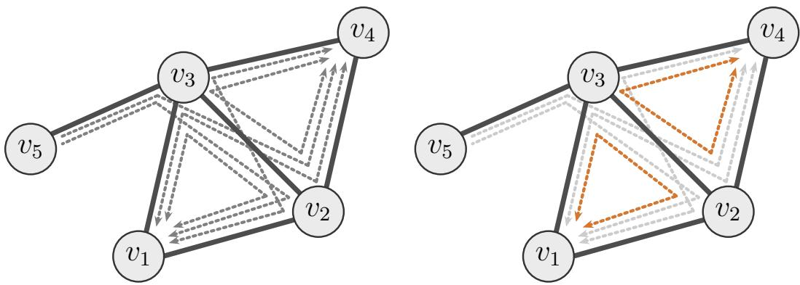
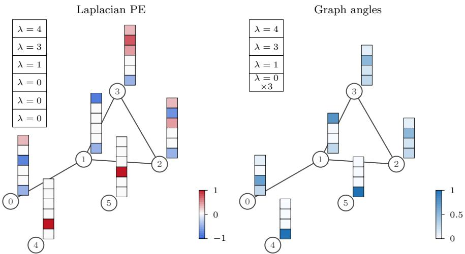

# Random Probing for Structural Self-Interactions in Graph Neural Networks

Saku Peltonen ETH Zurich speltonen@ethz.ch

H. Çagrı Bilgi ˘ TU Delft h.c.bilgi@tudelft.nl

Kubilay Atasu TU Delft kubilay.atasu@tudelft.nl

## Abstract

Graph Neural Networks (GNNs) fundamentally lack the ability to capture structural properties defined by node self-interactions, such as cycle counts, subgraph centrality, and heat kernel signatures. Existing solutions often rely on computationally expensive higher-order architectures or hand-crafted features. In this work, we introduce DIAL, a message-passing layer that gives nodes access to graph structure through the diagonal of graph-derived operators. Our approach uses randomized probing to provide nodes with learnable, permutation equivariant access to diagonal entries. We prove that our approach can express important structural features, including cycle counts, subgraph centrality, and heat kernel signatures. The proposed method can be integrated directly into message passing layers. Experiments on molecular property prediction, cycle counting, and pattern detection demonstrate the effectiveness of DIAL across a range of graph learning tasks.

## 1 Introduction

Graph Neural Networks (GNNs) have been successful in many applications. However, they are known to have limited expressive power, often failing to distinguish basic structures or count fundamental motifs like cycles [1]. Higher-order GNN architectures can partially address these limitations, but often at a significant computational cost [2]. In practice, one often resorts to hand-crafted structural features, such as cycle or motif counts [3]. While effective, this approach is brittle and requires choosing the relevant structures in advance.

Many structural node properties that message passing fails to capture can be described in terms of selfinteractions of nodes. Intuitively, these interactions quantify how information originating from a node flows through the graph and returns to it. Standard GNNs cannot capture such patterns—for example closed-walk participation—as they require isolating information that originates from a node and later returns to it. This concept naturally generalizes to subgraph centrality, which characterizes a node’s global importance by weighing its closed walk participation. In the spectral domain, Laplacian-based self-interactions cover graph angles (Figure 2), as well as diffusion dynamics like the heat kernel signature, which measures heat return rates over time.

Mathematically, these notions can all be expressed as functions of a Graph Shift Operator (GSO) S, such as the adjacency matrix A or Laplacian L. Crucially, all such node-level self-interactions correspond to the diagonal entries of these GSO-derived operators $M = f ( S ) \in \mathbb { R } ^ { n \times n }$ . In practice, f is often approximated by low-degree polynomials of the GSO, $\begin{array} { r } { M = \sum _ { k = 0 } ^ { K - 1 } \alpha _ { k } S ^ { k } } \end{array}$ . This naturally aligns with message-passing architectures, which implicitly compute GSO polynomials through neighborhood aggregation. However, standard message-passing GNNs cannot express any of the self-interaction-based structural properties above. The aggregation mechanism mixes information from different nodes, failing to isolate self-interactions.

Our key observation is that message passing algorithms can access diagonal entries in a permutation equivariant way using a randomized probing mechanism. With a stochastic approach based on the Hutchinson diagonal estimator [4], nodes can efficiently approximate the diagonal of GSO powers, and hence the diagonal of any graph-derived operator, through simple message passing steps. This mechanism allows nodes to capture structural properties, such as cycle counts, within a fully learnable framework, avoiding rigid hand-crafted features and expensive higher-order architectures. See Figure 1 for an example of triangle counting.

  
Figure 1: Message-passing view of Hutchinson’s diagonal estimator. We illustrate triangle counting for all nodes simultaneously using random probes and ordinary message passing. Left: The arrowed paths show a subset of length-3 messages received at $v _ { 1 }$ and $v _ { 4 } .$ After propagation, node v observes $\begin{array} { r } { ( A ^ { 3 } z ) _ { v } = \sum _ { u } ( A ^ { 3 } ) _ { v u } z _ { u } } \end{array}$ , which mixes self-returning messages with messages originating elsewhere. Without identifying information, standard message passing cannot isolate the diagonal term. Right: Hutchinson’s estimator correlates the propagated value with the original probe $z _ { v }$ . Since $\mathbb { E } [ z _ { v } z _ { u } ] = 0$ for $u \ne v$ and $\mathbb { E } [ z _ { v } ^ { 2 } ] = 1$ , the non-diagonal terms vanish in expectation, yielding $\mathbb { E } [ z _ { v } ( A ^ { 3 } z ) _ { v } ] =$ $( A ^ { 3 } ) _ { v v }$ . For an adjacency matrix, this diagonal entry counts length-3 closed walks at $v ,$ i.e., twice the number of triangles incident to v.

The resulting architecture, which we call DIAL, can be integrated into any standard GNN and is permutation equivariant in expectation. Adjusting the number of random probes allows a trade-off between computational cost and estimation accuracy. We prove DIAL can express a variety of important structural properties, including cycle counts, graph angles, subgraph centrality, and heat kernel signatures.

Empirically, we evaluate DIAL on molecular property prediction on ZINC and on synthetic nodelevel pattern counting tasks. The results show that DIAL is competitive with spectral and randomprobe positional encoding methods on ZINC, and improves over other random-probe methods on cycle counting while remaining substantially cheaper than specialized subgraph and higher-order architectures.

## 2 Preliminaries

A graph is denoted $G = ( V , E )$ with $| V | = n$ . A graph shift operator (GSO) is a matrix ${ \textbf { S } } \in$ $\mathbb { R } ^ { n \times n }$ . Common choices include the adjacency matrix A, normalized adjacency $\mathbf { D } ^ { - 1 / 2 } \mathbf { A } \mathbf { D } ^ { - 1 / 2 }$ , the Laplacian $\mathbf { L } = \mathbf { D } - \mathbf { A }$ , where D is the degree matrix, or the normalized Laplacian. We consider message-passing layers of the form

$$
\mathbf { X } ^ { ( \ell ) } = \sigma \Big ( \sum _ { k = 0 } ^ { K - 1 } \mathbf { S } ^ { k } \mathbf { X } ^ { ( \ell - 1 ) } \mathbf { H } _ { k } ^ { ( \ell ) } \Big ) ,\tag{1}
$$

where $\sigma$ is a nonlinearity and $\mathbf { H } _ { k } ^ { ( \ell ) }$ are learnable weights. The parameter $K$ controls the maximum hop distance used for aggregation (specifically $K - 1 )$ , with $K = 2$ for typical GNNs such as GCN. In what follows, we assume the graph is undirected, making the GSO symmetric. Let ${ \bf S } = \Phi \Lambda \Phi ^ { - 1 }$ be the eigendecomposition of the GSO S, where $\boldsymbol { \Lambda } = \mathsf { d i a g } ( \lambda _ { 1 } , \ldots , \lambda _ { n } )$ is the diagonal matrix of eigenvalues and $\Phi = [ \phi _ { 1 } , \ldots , \phi _ { n } ]$ is the matrix of eigenvectors. For symmetric GSOs (undirected graphs), Φ is orthonormal, i.e. $\bar { \Phi } ^ { - 1 } = \Phi ^ { T }$

Each eigenvalue $\mu$ defines an eigenspace $E _ { \mu }$ spanned by the eigenvectors with eigenvalue $\mu .$ . Let $I _ { \mu } = \{ i : \lambda _ { i } = \mu \}$ denote the corresponding index set and let $\Phi _ { \mu } \in \mathbb { R } ^ { n \times | I _ { \mu } | }$ be the matrix whose columns are these eigenvectors. The projector onto $E _ { \mu }$ is $P _ { \mu } = \Phi _ { \mu } \Phi _ { \mu } ^ { T }$ . These projections allow the GSO to be expressed as a sum over eigenspaces: $\begin{array} { r } { S = \sum _ { \mu } \mu P _ { \mu } } \end{array}$ , where the sum is over distinct eigenvalues.

Graph angles describe how nodes relate to these eigenspaces. For a node $v ,$ let $\mathbf { e } _ { v }$ denote its indicator vector. The graph angle of v with respect to $E _ { \mu }$ is

$$
\angle _ { \mu } ( v ) = ( P _ { \mu } ) _ { v v } = \| P _ { \mu } \mathbf { e } _ { v } \| ^ { 2 } = \sum _ { i \in I _ { \mu } } ( \phi _ { i } ( v ) ) ^ { 2 } .
$$

The term graph angle comes from the geometric interpretation

$$
( P _ { \mu } ) _ { v v } = \cos ^ { 2 } ( \theta _ { v , \mu } ) , \qquad \theta _ { v , \mu } = \angle ( \mathbf { e } _ { v } , E _ { \mu } ) .
$$

Unlike individual eigenvector coordinates, graph angles are invariant to sign changes and changes of basis inside eigenspaces. These invariances remove arbitrary choices from the representation and can therefore simplify learning [5].

Graph filters are operators of the form $p ( S )$ , where $p : \mathbb { R }  \mathbb { R }$ is applied to the GSO S. For symmetric GSOs, spectral filters can be written as

$$
p ( S ) = \Phi p ( \Lambda ) \Phi ^ { T } = \sum _ { \mu } p ( \mu ) P _ { \mu } .
$$

A polynomial filter is the special case where $\begin{array} { r } { p ( \mu ) = \sum _ { k = 0 } ^ { K - 1 } a _ { k } \mu ^ { k } } \end{array}$ , equivalently

$$
p ( S ) = \sum _ { k = 0 } ^ { K - 1 } a _ { k } S ^ { k } .
$$

The linear propagation part of Equation (1) naturally implements polynomial filters of the GSO.

## 3 Related Work

Expressivity of GNNs. Standard message passing architectures are limited in their expressiveness. In particular, they are at most as powerful as the Weisfeiler-Leman test [1] in distinguishing nonisomorphic graphs. This limitation surfaces in the inability of message-passing GNNs to count many basic substructures [6]. For example, standard GNNs cannot count triangles [2] or longer cycles, despite the practical relevance of this information in several applications, such as molecular property prediction [7]. From the perspective of this work, this limitation stems from the fact that message passing aggregates information arriving from neighboring nodes, but does not keep track of where that information originally comes from. Consequently, message passing cannot isolate self-interactions such as cycles.

There have been many works proposing more expressive GNN architectures [2, 6, 8–10]. Higherorder GNNs operate on tuples of nodes, making richer structural interactions available to the model [2]. However, this comes at a cost growing polynomially with the tuple order. Other approaches increase expressivity by explicitly augmenting node representations with structural information. Substructure-counting methods add counts of selected substructures [3, 6], but require selecting the relevant substructures in advance. Distance encodings instead assign each node an encoding of its distance to a target node set [11], conditioning the resulting representation on that set. In contrast to these approaches, our method exposes self-interaction information through randomized diagonal estimation. This allows a standard message passing backbone to access structural information without higher-order tuples, a preselected substructure vocabulary, or target-conditioned encodings.

Random Features in GNNs. Random node features have been studied as a way to overcome expressivity limitations in message passing [12–14]. These works show that random initialization can break node symmetries and increase expressive power, with universality results in some settings [15].

However, this relies on the model learning to use randomness as node identifiers, and the theoretical power does not directly provide stable, task-relevant structural quantities. Hence, more direct uses of random features have been proposed [16–18].

R-PEARL [17] introduces a randomized variant of a positional encoding framework. While effective for PEs, its expressivity guarantees are limited.2

Eliasof et al. [18] use message passing with random features to learn positional encodings. They show that, combined with appropriate normalization, random feature propagation simulates power iteration and subspace iteration. This allows approximating the leading eigenvectors of the graph shift operator. They also note that random features can be used to estimate cycle counts using Hutchinson’s trace estimator. However, the focus of their work is on positional encodings, and their analysis is based on what can be achieved in the limit as the propagation depth increases. In contrast, we focus on structural self-interactions and explicitly correlate propagated signals with the input randomness. This correlation is essential: it yields an unbiased estimator of diagonal entries in expectation and provides a stable structural signal that can be learned from finite random probes.

Spectral Graph Theory and GNNs. Spectral approaches to graph learning are rooted in spectral graph theory and graph signal processing [19]. Graph signal processing interprets node features as signals on the graph and defines filters as functions of a graph shift operator [20]. Classical spectral filters are typically fixed or analytically chosen.

Spectral GNNs learn such filters from data. Early spectral GNNs implemented filters directly in the Fourier basis, requiring an eigendecomposition [21]. ChebNet [22] introduced Chebyshev polynomial approximations. GCN can be viewed as a first-order approximation of this spectral filtering perspective [23]. These methods apply graph-derived operators to node features, but the resulting node representations do not explicitly expose the diagonal entries of those operators. Our method complements spectral GNNs by showing how randomized probing can make these diagonal entries accessible to message passing.

## 4 Main Tool: Diagonal Estimation via Message Passing

This section presents our main technical tool: a randomized technique to estimate the diagonal entries of a matrix via message passing. It is based on Hutchinson’s diagonal estimator [4], which is formalized in the next lemma:

Lemma 4.1. Let $M \in \mathbb { R } ^ { n \times n }$ $L e t z \in \mathbb { R } ^ { n }$ be a random vector with i.i.d. Rademacher entries $( i . e .$ each entry is independently +1 or −1 with probability 1/2). Then

$$
\mathbb { E } [ z \odot ( M z ) ] = { \mathsf { d i a g } } ( M )
$$

where $\odot$ is the elementwise product. The variance ofthe ith entry is $\textstyle \sum _ { j \neq i } M _ { i j } ^ { 2 }$

Proof. The ith entry is $\begin{array} { r } { \mathbb E [ z _ { i } ( M z ) _ { i } ] = \mathbb E [ \sum _ { j } M _ { i j } z _ { i } z _ { j } ] } \end{array}$ . Here, $\mathbb { E } [ z _ { i } z _ { j } ] = 0$ for $i \neq j$ since $\mathbb { E } [ z _ { i } ] = 0$ and $z _ { i } , z _ { j }$ are independent, making all cross terms vanish. Thus, only the $j = i$ term remains, giving $\mathbb { E } [ z _ { i } ^ { 2 } ] M _ { i i } = M _ { i i }$

The variance is computed from $\mathsf { V a r } ( d _ { i } ) = \mathbb { E } [ d _ { i } ^ { 2 } ] - ( \mathbb { E } [ d _ { i } ] ) ^ { 2 }$ . Here,

$$
d _ { i } ^ { 2 } = ( \sum _ { j } M _ { i j } z _ { i } z _ { j } ) ( \sum _ { j } M _ { i j } z _ { i } z _ { j } ) = \sum _ { j , k } M _ { i j } M _ { i k } z _ { i } ^ { 2 } z _ { j } z _ { k } = \sum _ { j , k } M _ { i j } M _ { i k } z _ { j } z _ { k }
$$

because $z _ { i } ^ { 2 } ~ = ~ 1$ . Taking the expectation, $\begin{array} { r } { \mathbb { E } [ d _ { i } ^ { 2 } ] = \mathbb { E } \Big [ \sum _ { j , k } M _ { i j } M _ { i k } z _ { j } z _ { k } \Big ] = \sum _ { j } M _ { i j } ^ { 2 } } \end{array}$ , since $\mathbb { E } [ z _ { j } z _ { k } ] = 0 { \mathrm { f o r } } j \neq k$ . Thus, $\begin{array} { r } { \mathsf { V a r } ( d _ { i } ) = \mathbb { E } [ d _ { i } ^ { 2 } ] - ( \mathbb { E } [ d _ { i } ] ) ^ { 2 } \stackrel {  } { = } \sum _ { j } M _ { i j } ^ { 2 } - M _ { i i } ^ { 2 } } \end{array}$ □

In the context of GNNs, the matrix M can be the GSO or a matrix derived from it, such as powers or spectral filters. Mz corresponds to a message passing operation on the graph with input features z.

## 4.1 Warm-up: Cycle Counting via Diagonal Estimation

Consider a message passing model of the form

$$
X ^ { ( l ) } = \sigma ( A X ^ { ( l - 1 ) } W )\tag{2}
$$

Ignoring nonlinearities and weights, after k layers, we have $X ^ { ( k ) } = A ^ { k } X ^ { ( 0 ) }$ . We illustrate how diagonal estimation can be used to compute cycle counts of the graph:

Lemma 4.2. With a GNN in Equation 2 and uniformly random initialfeatures $X ^ { ( 0 ) } \in \{ - 1 , 1 \} ^ { n }$ , each node v can compute the number of closed walks of length k starting and ending at v in expectation.

Proof. Initialize node features as independent Rademacher random variables, $z \in \{ - 1 , 1 \} ^ { n }$ . By Lemma 4.1, $\mathbb { E } [ z \odot ( A ^ { k } z ) ] = { \mathsf { d i a g } } ( A ^ { k } )$ . It is well known that $( A ^ { k } ) _ { v v }$ counts the number of closed walks of length k starting and ending at node v (see Lemma B.1). □

## 4.2 DIAL: Diagonal Access Layer

Building on Lemma 4.1, we propose the Diagonal Access Layer (DIAL), a stochastic message-passing module that gives nodes access to structural quantities through diagonal entries of graph-derived operators. DIAL is based on propagating random features, and correlating the propagated probes with the original random values. The technique is general and can be applied to directed and undirected graphs for any GNN architecture.

Random probes. For initial features, we sample a probe vector $\textbf { z } \in \ \{ - 1 , 1 \} ^ { n }$ with i.i.d.   
Rademacher entries.

Probe propagation. Let $\mathbf { p } ^ { ( 0 ) } = \mathbf { z }$ . DIAL’s main hyperparameter is $K$ , the number of layers from which diagonal estimates are formed. For $k = 1 , \ldots \cdot \bar { K } \bar { - } 1$ , DIAL propagates the probe features by

$$
\mathbf { p } ^ { ( k ) } = \mathcal { T } _ { \mathbf { S } } ^ { ( k ) } ( \mathbf { p } ^ { ( k - 1 ) } ) ,
$$

where ${ \mathcal { T } } _ { \mathbf { s } } ^ { ( k ) }$ is a local propagation operator built from the GSO S. For example, choosing ${ \mathcal T } _ { \mathbf { S } } ^ { ( k ) } ( \mathbf { p } ) =$ Sp gives $\mathbf { p } ^ { ( k ) } = \mathbf { S } ^ { k } \mathbf { z }$ . More generally, the stack of probe-propagation layers may implement powers of the GSO or polynomial filters, such as those arising from the linear propagation part of Equation (1). Thus each propagated probe state can be written as $\mathbf { p } ^ { ( k ) } = M _ { k } \mathbf { z }$ for some graph-derived operator $M _ { k }$

Diagonal readout. For each state $k = 0 , \ldots , K - 1$ , DIAL forms a local correlation with the original probe,

$$
\mathbf { d } ^ { ( k ) } = \mathbf { z } \odot \mathbf { p } ^ { ( k ) } ,
$$

where $\odot$ denotes the elementwise product. For every k, Lemma 4.1 gives

$$
\mathbb { E } \Big [ \mathbf { z } \odot \mathbf { p } ^ { ( k ) } \Big ] = \mathsf { d i a g } ( M _ { k } ) .
$$

Thus the K DIAL readouts expose structural signals corresponding to the diagonals of $M _ { 0 } , \dots , M _ { K - 1 }$ . For instance, if ${ \dot { M } } _ { k } = \mathbf { A } ^ { k }$ , these signals give closed-walk counts up to length $K - 1$

Aggregation. In practice, we reduce variance by using r independent probes $\mathbf { z } ^ { ( 1 ) } , \ldots , \mathbf { z } ^ { ( r ) }$ . Equivalently, stacking them as $\mathbf { Z } = [ \mathbf { z } ^ { ( 1 ) } , \ldots , \mathbf { z } ^ { ( r ) } ] \in \mathbb { R } ^ { n \times r }$ introduces a sample dimension, and the same probe propagation is applied column-wise to produce estimates $\mathbf { D } ^ { ( k ) } \in \mathbb { R } ^ { n \times r }$ . The state-wise estimates are then aggregated across propagation depths and independent probes using a shared readout:

$$
\mathbf { h } _ { i } ^ { \mathrm { { D I A L } } } = \frac { 1 } { r } \sum _ { s = 1 } ^ { r } \mathrm { M L P } \Big ( \big \| _ { k = 0 } ^ { K - 1 } \mathbf { D } _ { i , s } ^ { ( k ) } \Big ) \in \mathbb { R } ^ { d _ { \mathrm { { d i a l } } } } .
$$

Averaging over r probes reduces the estimator variance at a rate of $1 / r$ , while the distribution of the probes makes the construction permutation equivariant in expectation.

The resulting DIAL layer can be stacked with a standard message-passing GNN by using $\mathbf { h } _ { i } ^ { \mathrm { { D I A I } } }$ directly as a structural node representation or concatenating it with ordinary node features,

$$
\begin{array} { r } { \mathbf { H } _ { i } ^ { ( 0 ) } = \mathbf { x } _ { i } \parallel \mathbf { h } _ { i } ^ { \mathrm { D I A L } } . } \end{array}
$$

  
Figure 2: Graph-angle structural encodings compared to Laplacian positional encodings. Left: Laplacian PE represents node i by $\Phi _ { i , : }$ , the row of eigenvector coordinates (in practice only a subset). This captures relative position in the graph: nodes 0 and 1 are close to each other so their encodings are similar, whereas nodes 4 and 5 are in different components so their encodings can be very different. Right: graph angles represent node i by $( ( P _ { \mu _ { j } } ) _ { i i } ) _ { j = 1 } ^ { q }$ , where $\mu _ { 1 } , \ldots , \mu _ { q }$ are the distinct (Laplacian) eigenvalues. Graph angles are an example of a structural encoding: unlike eigenvectors, graph angles assign the same representation to automorphic nodes (such as 4 and 5). They are also invariant to basis and sign choices.

## 5 Structural Embeddings via Diagonal Estimation

Many classical node-level structural features, such as closed-walk counts and centrality measures, can be expressed as node-wise statistics derived from linear operators on the graph. In this section, we first show that $\mathrm { D I A L }$ gives nodes access to diagonal entries of graph filters. This can be used to recover several classical node quantities relevant for structural embeddings, including closed-walk counts, subgraph centrality, heat kernel signatures and graph angles. We also extend the diagonal estimation technique to off-diagonals for neighboring nodes, which is useful for counting simple cycles. Proofs for this section are in Appendix A.

## 5.1 Diagonals of Graph Filters

Recall that a polynomial filter of degree $K - 1$ can be expressed as

$$
p ( S ) = \sum _ { k = 0 } ^ { K - 1 } a _ { k } S ^ { k }
$$

where $S$ is a graph shift operator. With diagonalization, this can also be written as $p ( S ) = \Phi p ( \Lambda ) \Phi ^ { T }$ where $p ( \Lambda ) = \mathsf { d i a g } ( p ( \lambda _ { 1 } ) , \ldots , p ( \lambda _ { n } ) )$ ). In particular, spectral filters act independently on each eigenspace of S.

The linear propagation part of Equation (1) allows such filters to be applied in message passing effectively. However, many relevant structural properties, such as cycle counts, depend on $s e l f -$ interactions. Intuitively, this is encoded in the diagonal entries of $p ( S )$ . The diagonal is not accessible via standard message passing, which aggregates information row-wise and cannot isolate self-interactions. The following theorem shows that diagonal entries can be accessed in expectation using DIAL:

Theorem 5.1. DIAL can compute node-wise statistics of the form

$$
v \mapsto ( p ( S ) ) _ { v v }
$$

in expectation, where p is a polynomial filter of degree at most $K - 1$ . Equivalently, DIAL can compute expressions oftheform

$$
v \mapsto \sum _ { i = 1 } ^ { n } g ( \lambda _ { i } ) ( \phi _ { i } ( v ) ) ^ { 2 }
$$

where $\lambda _ { i }$ and $\phi _ { i }$ are the eigenvalues and eigenvectors ofthe GSO, and g is any polynomialfunction of degree at most $K - 1$ . Moreover, multiple polynomial filters can be expressed in parallel by increasing the (output)feature dimension.

## 5.2 Structural Quantities

The diagonal-filter view gives a compact way to recover several standard structural embeddings. We first focus on the quantities that can be expressed as polynomials of the GSO.

Example: graph angles. Figure 2 illustrates the distinction between positional and structural spectral encodings. Graph angles, defined in the preliminaries, are a canonical example of diagonal spectral features. They describe how strongly a node participates in an eigenspace through $\angle _ { \mu } ( v ) =$ $( \bar { P } _ { \mu } ) _ { v v }$ This differs from eigenvector positional encodings, which assign nodes coordinates in selected eigenvectors. While eigenvector coordinates are useful positional features, they depend on sign choices and, for repeated eigenvalues, on an arbitrary basis for the eigenspace. Graph angles instead summarize the whole eigenspace through the projector $P _ { \mu } ,$ , making them intrinsic structural features.

Theorem 5.2. DIAL can compute the following node-level structural quantities in expectation:

• Closed-walk counts. For every $1 \leq k \leq K - 1$

$$
v \mapsto ( A ^ { k } ) _ { v v } ,
$$

gives the number of closed walks of length k starting and ending at v.

• Graph angles. For a Laplacian eigenspace $E _ { \mu }$ with projector $P _ { \mu } ,$

$$
v \mapsto \angle _ { \mu } ( v ) = ( P _ { \mu } ) _ { v v } ,
$$

can be computed, provided the eigenspace projector $P _ { \mu }$ is represented by a polynomial in L of degree at most $K - 1$ . In particular, this holds ifL has at most K distinct eigenvalues.

Spectral quantities defined by exponential graph filters can be approximated with polynomials of the GSO:

Theorem 5.3. DIAL can approximate the following node-level structural quantities in expectation:

• Subgraph centrality. For $S C ( v ) = ( e ^ { A } ) _ { v v } , i f A$ is symmetric and $\| A \| _ { 2 } \leq \alpha _ { \mathrm { ; } }$ , the degree-(K − 1) Taylor approximation yields an estimate $\widehat { S C } _ { K } ( v )$ satisfying

$$
| \mathbb { E } [ \widehat { S C } _ { K } ( v ) ] - S C ( v ) | \leq \frac { e ^ { \alpha } \alpha ^ { K } } { K ! } .
$$

• Heat kernel signature. For $\mathrm { H K S } _ { t } ( v ) = ( e ^ { - t L } ) _ { v v } ,$ , if L is symmetric and $\| L \| _ { 2 } \leq \beta ,$ the $d e g r e e  – ( K - 1 )$ Taylor approximation yields an estimate $\widehat { \mathrm { H K S } } _ { t , K } ( v )$ satisfying

$$
| \mathbb { E } [ \widehat { \mathrm { H K S } } _ { t , K } ( v ) ] - \mathrm { H K S } _ { t } ( v ) | \leq \frac { ( t \beta ) ^ { K } } { K ! } .
$$

Estimator variances for both the exact and approximate quantities above are derived in Appendix A.1.

## 5.3 Neighbor Off-Diagonal Readout

Some structural quantities require off-diagonal entries of graph-derived operators. For example, the number of common neighbors of adjacent nodes u and v is $\bar { ( A ^ { 2 } ) } _ { u v }$ , which is useful for link prediction, and also appears in formulas for counting simple cycles. The same random probing idea can estimate such entries: nodes first share their original probe values with their neighbors, and after ℓ layers of message propagation, each endpoint correlates the last layer state with the original probe values of their neighbors.

Theorem 5.4. For each node v, DIAL can compute the multiset of off-diagonal elements of p(S) over neighbors w $\in N ( v )$

$$
\{ \{ ( p ( S ) ) _ { v w } : w \in N ( v ) \} \}
$$

in expectation, where p is a polynomialfilter ofdegree at most K − 1.

The proof is in Appendix A.

Combined with closed-walk counts from Theorem 5.2, the off-diagonal estimation from Theorem 5.4 can be used to express counts of simple cycles:

Theorem 5.5. A DIAL-augmented message-passing model can compute the number of simple cycles of lengths 3,4 and 5 at each node.

The proof of Theorem 5.5 is given in Section B.

## 6 Experiments

We present empirical results in three main settings: molecular property prediction on ZINC [24, 25], synthetic node-level cycle counting [26], and directed structural pattern detection on synthetic multigraphs [27]. These experiments test the usefulness of DIAL as a lightweight structural encoding, and its ability to recover explicitly structural information in controlled settings.

Our comparisons include standard message-passing GNNs, hand-crafted cycle features, spectral positional encodings, PEARL and other random-probe baselines, as well as subgraph and higher-order architectures for cycle counting. Random Feature Propagation (RFP) [18] is a closely related baseline, but we omit it from the experiments because no public implementation was available.3

## 6.1 Setup

We use the PEARL codebase [17] as the starting point, modifying the positional-encoding module for DIAL. In the DIAL variants reported here, Hutchinson correlations are applied at two levels inside the structural encoding module: first after explicit graph-shift propagation of the random probes, and then again after a number of learned GIN layers. The outputs of each layer are concatenated and projected to the final node encoding. Full experimental details can be found in Appendix E.

## 6.2 Results

Table 1 reports a PE-focused comparison on ZINC, with logP prediction evaluated by test MAE. The non-DIAL entries follow the baseline set reported by Kanatsoulis et al. [17]. Hence, the table should be read as a comparison to positional-encoding methods rather than as a comprehensive ZINC leaderboard. DIAL performs comparably to strong spectral and random-probe positional encoding methods.

Table 2 compares DIAL with several baselines on node-level cycle counting. Methods designed specifically to expose cycle information, such as subgraph and higher-order architectures, achieve the lowest errors, but require substantially higher space or time complexity. Among random-probe methods, DIAL improves over R-PEARL across all cycle lengths while retaining linear scaling in N, ¯d, and r.

We further evaluate DIAL on a directed synthetic pattern-detection task introduced by Egressy et al. [27]. See Table 3 for the results. The task is node-level multi-label classification: nodes are labeled by whether they participate in directed cycles of length 2–6, scatter-gather motifs (S-G), or bicliques (B-C), following Altman et al. [33]. DIAL outperforms R-PEARL on every directed pattern. The improvement is especially large for short directed cycles. Overall, DIAL raises macro F1 from 52.24 to 77.84. This suggests that correlating propagated representations with the original probes provides a substantially stronger signal for directed structural patterns.

Table 1: Test MAE for logP prediction on ZINC; lower is better. For SignNet, BasisNet, and SPE, “8 smallest” uses the eigenvectors corresponding to the eight smallest eigenvalues of the normalized Laplacian, whereas “full” uses the complete eigenbasis. Best within each block is bolded.
<table><tr><td rowspan=1 colspan=3>Method                         Test MAE</td></tr><tr><td rowspan=1 colspan=3>GCN [23]                      $0 . 4 6 9 \pm 0 . 0 0 2$ GIN [1]                        $0 . 2 0 9 \pm 0 . 0 1 8$ GSN with cycles [3]          $\mathbf { 0 . 1 1 5 \pm 0 . 0 1 2 }$ GIN + random ID [1]          $0 . 2 7 9 \pm 0 . 0 2 3$ </td></tr><tr><td rowspan=4 colspan=3>SignNet (8 smallest) [5]      $0 . 1 0 3 4 \pm 0 . 0 0 5 6$ SignNet (full) [5]             $0 . 0 8 5 3 \pm 0 . 0 0 2 6$ BasisNet (8 smallest) [5]     $0 . 1 5 5 4 \pm 0 . 0 0 4 8$ BasisNet (full) [5]            $0 . 1 5 5 5 \pm 0 . 0 1 2 4$ SPE (8 smallest) [28]         $0 . 0 7 3 6 \pm 0 . 0 0 0 7$ SPE (full) [28]                $0 . 0 6 9 3 \pm 0 . 0 0 4 0$ R-PEARL [17]                $0 . 0 6 9 9 \pm 0 . 0 0 2$ B-PEARL [17]               $\mathbf { 0 . 0 6 4 4 \pm 0 . 0 0 1 }$ </td></tr><tr><td rowspan=2 colspan=2>t 5] 0.1554 ± 0..</td></tr><tr><td rowspan=1 colspan=1>048</td></tr><tr><td rowspan=1 colspan=1></td><td rowspan=1 colspan=1>10.05 ± 0.01</td></tr><tr><td rowspan=1 colspan=3>DIAL (K = 1)               $0 . 0 7 0 3 \pm 0 . 0 0 1 2$ DIAL (K = 4)              $\mathbf { 0 . 0 6 5 8 \pm 0 . 0 0 2 0 }$  $\mathrm { D I A L } \left( K = 8 \right)$                $0 . 0 7 3 3 \pm 0 . 0 0 2 6$  $\mathrm { D I A L } \left( K = 1 2 \right)$               $0 . 0 7 5 2 \pm 0 . 0 0 7 4$ </td></tr></table>

Table 2: Normalized MAE for node-level cycle counting. Complexities assume fixed hidden width; N is the number of nodes, ¯d the average degree, s the maximum extracted subgraph size, r the number of probes, L the number of learned layers or blocks, and K the propagation depth. Inference space excludes graph storage. The lower block contains the random-probe methods; best results are bolded separately in the final two blocks. R-PEARL and DIAL are reported as mean ± standard deviation.
<table><tr><td rowspan="2">Method</td><td colspan="2">Complexity</td><td colspan="4">Synthetic (norm. MAE)</td></tr><tr><td>Space</td><td>Time</td><td>3-Cycle</td><td>4-Cycle</td><td>5-Cycle</td><td>6-Cycle</td></tr><tr><td>Base GNN</td><td>O(N)</td><td>O(LNā)</td><td>0.3515</td><td>0.2742</td><td>0.2088</td><td>0.1555</td></tr><tr><td>ID-GNN [29]</td><td>O(Ns)</td><td>O(LNsā)</td><td>0.0006</td><td>0.0022</td><td>0.0490</td><td>0.0495</td></tr><tr><td>NGNN [30]</td><td> $O ( N s )$ </td><td> $O ( L N s \bar { d } )$ </td><td>0.0003</td><td>0.0013</td><td>0.0402</td><td>0.0439</td></tr><tr><td>GNN-AK+ [31]</td><td> $O ( N s )$ </td><td> $O ( L N s \bar { d } )$ </td><td>0.0004</td><td>0.0041</td><td>0.0133</td><td>0.0238</td></tr><tr><td>PPGN [8]</td><td> $O ( N ^ { 2 } )$ </td><td> ${ \cal O } \dot { ( } L { \cal N } ^ { 3 } )$ </td><td>0.0003</td><td>0.0009</td><td>0.0036</td><td>0.0071</td></tr><tr><td>I2-GNN [26]</td><td>O(Nsd)</td><td> $O ( L N s \bar { d } ^ { 2 } )$ </td><td>0.0003</td><td>0.0016</td><td>0.0028</td><td>0.0082</td></tr><tr><td>2-DRFWL(2) [32]</td><td>O(Nd2)</td><td> ${ \cal O } \dot { ( } L N \bar { d } ^ { 4 } )$ </td><td>0.0004</td><td>0.0015</td><td>0.0034</td><td>0.0087</td></tr><tr><td>R-PEARL [17]</td><td>O(rN)</td><td> $O ( ( K + L ) r N \bar { d } )$ </td><td>.0118±.0037</td><td>.0360±.0054</td><td> $. 0 5 6 1 \pm . 0 0 3 5$ </td><td>.0622±.0025</td></tr><tr><td>DIAL (Ours)</td><td> $O ( K r N )$ </td><td> $O ( ( K + L ) r N \bar { d } )$ </td><td></td><td>.0041±.0001 .0185±.0027 .0271±.0005 .0348±.0030</td><td></td><td></td></tr></table>

Table 3: Pattern detection on synthetic directed graphs. We report minority-class F1 scores in percent for node-level binary labels; higher is better. The detected patterns include directed cycles of length 2–6, scatter-gather motifs (S-G), and bicliques (B-C). Both methods use K = 4 and six learned probe-aggregation layers. Best in each column is bolded.
<table><tr><td>Method</td><td>2-Cycle</td><td>3-Cycle</td><td>4-Cycle</td><td>5-Cycle</td><td>6-Cycle</td><td>S-G</td><td>B-C</td><td>Macro F1</td></tr><tr><td>R-PEARL [17]</td><td> $\overline { { 1 5 . 4 8 \pm 7 . 5 9 } }$ </td><td> $\overline { { 4 1 . 2 1 \pm 5 . 4 2 } }$ </td><td> $\overline { { 6 6 . 0 5 \pm 0 . 5 2 } }$ </td><td>55.13 ± 0.80</td><td> $\overline { { 5 4 . 7 4 \pm 0 . 6 0 } }$ </td><td>70.54 ± 1.09</td><td> $\overline { { 6 2 . 5 6 \pm 2 . 4 9 } }$ </td><td>52.24</td></tr><tr><td>DIAL (Ours)</td><td> ${ \bf 9 1 . 0 7 \pm 3 . 3 3 }$ </td><td> ${ \bf 8 2 . 4 4 \pm 4 . 4 8 }$ </td><td> ${ \bf 7 9 . 7 2 \pm 1 . 5 0 }$ </td><td>72.10 ± 2.21</td><td> ${ \bf 7 4 . 8 3 \pm 2 . 9 5 }$ </td><td> ${ \bf 7 8 . 6 8 \pm 2 . 7 9 }$ </td><td> ${ \bf 6 6 . 0 7 \pm 1 . 4 8 }$ </td><td>77.84</td></tr></table>

## 7 Conclusions

We introduce DIAL, a message-passing layer that uses randomized probing to give nodes access to structural self-interactions expressed as the diagonals of graph-derived operators. We showed that DIAL can express or approximate closed-walk and short-cycle counts, graph angles, subgraph centrality, and heat kernel signatures. In our experiments, DIAL is competitive with strong positionalencoding methods on ZINC. It also outperforms comparable random-probe methods on undirected cycle counting and directed pattern detection. Overall, DIAL provides a simple way to improve structural expressivity without using higher-order architectures or a fixed set of motifs.

## Acknowledgements

The support of the Swiss National Science Foundation (project number: 212158) for this work is gratefully acknowledged.

## References

[1] Keyulu Xu, Weihua Hu, Jure Leskovec, and Stefanie Jegelka. How powerful are graph neural networks? In International Conference on Learning Representations, 2019. URL https: //openreview.net/forum?id=ryGs6iA5Km. 1, 3, 9

[2] Christopher Morris, Martin Ritzert, Matthias Fey, William L Hamilton, Jan Eric Lenssen, Gaurav Rattan, and Martin Grohe. Weisfeiler and leman go neural: Higher-order graph neural networks. In Proceedings of the AAAI conference on artificial intelligence, volume 33, pages 4602–4609, 2019. 1, 3

[3] Giorgos Bouritsas, Fabrizio Frasca, Stefanos Zafeiriou, and Michael M. Bronstein. Improving graph neural network expressivity via subgraph isomorphism counting. IEEE Transactions on Pattern Analysis and Machine Intelligence, 45(1):657–668, 2023. doi: 10.1109/TPAMI.2022. 3154319. 1, 3, 9

[4] M.F. Hutchinson. A stochastic estimator of the trace of the influence matrix for laplacian smoothing splines. Communications in Statistics - Simulation and Computation, 19(2): 433–450, 1990. doi: 10.1080/03610919008812866. URL https://doi.org/10.1080/ 03610919008812866. 1, 4

[5] Derek Lim, Joshua Robinson, Lingxiao Zhao, Tess Smidt, Suvrit Sra, Haggai Maron, and Stefanie Jegelka. Sign and basis invariant networks for spectral graph representation learning. In International Conference on Learning Representations, 2023. 3, 9, 17

[6] Zhengdao Chen, Lei Chen, Soledad Villar, and Joan Bruna. Can graph neural networks count substructures? Advances in neural information processing systems, 33:10383–10395, 2020. 3

[7] Tom Wollschläger, Niklas Kemper, Leon Hetzel, Johanna Sommer, and Stephan Günnemann. Expressivity and generalization: Fragment-biases for molecular GNNs. In Ruslan Salakhutdinov, Zico Kolter, Katherine Heller, Adrian Weller, Nuria Oliver, Jonathan Scarlett, and Felix Berkenkamp, editors, Proceedings of the 41st International Conference on Machine Learning, volume 235 of Proceedings ofMachine Learning Research, pages 53113–53139. PMLR, 21–27 Jul 2024. URL https://proceedings.mlr.press/v235/wollschlager24a.html. 3

[8] Haggai Maron, Heli Ben-Hamu, Hadar Serviansky, and Yaron Lipman. Provably powerful graph networks. Advances in neural information processing systems, 2019. 3, 9

[9] Pál András Papp, Karolis Martinkus, Lukas Faber, and Roger Wattenhofer. DropGNN: Random dropouts increase the expressiveness of graph neural networks. Advances in Neural Information Processing Systems, 34:21997–22009, 2021.

[10] Clement Vignac, Andreas Loukas, and Pascal Frossard. Building powerful and equivariant graph neural networks with structural message-passing. Advances in neural information processing systems, 33:14143–14155, 2020. 3

[11] Pan Li, Yanbang Wang, Hongwei Wang, and Jure Leskovec. Distance encoding: Design provably more powerful neural networks for graph representation learning. Advances in Neural Information Processing Systems, 33:4465–4478, 2020. 3

[12] George Dasoulas, Ludovic Dos Santos, Kevin Scaman, and Aladin Virmaux. Coloring graph neural networks for node disambiguation. In Christian Bessiere, editor, Proceedings of the Twenty-Ninth International Joint Conference on Artificial Intelligence, IJCAI-20, pages 2126– 2132. International Joint Conferences on Artificial Intelligence Organization, 2020. doi: 10. 24963/ijcai.2020/294. URL https://doi.org/10.24963/ijcai.2020/294. 3

[13] Ralph Abboud, ˙Ismail ˙Ilkan Ceylan, Martin Grohe, and Thomas Lukasiewicz. The surprising power of graph neural networks with random node initialization. In Zhi-Hua Zhou, editor, Proceedings of the Thirtieth International Joint Conference on Artificial Intelligence, IJCAI-21, pages 2112–2118. International Joint Conferences on Artificial Intelligence Organization, 2021. doi: 10.24963/ijcai.2021/291. URL https://doi.org/10.24963/ijcai.2021/291.

[14] Pál András Papp and Roger Wattenhofer. A theoretical comparison of graph neural network extensions. In International Conference on Machine Learning, pages 17323–17345. PMLR, 2022. 3

[15] Omri Puny, Heli Ben-Hamu, and Yaron Lipman. Global attention improves graph networks generalization, 2020. URL https://arxiv.org/abs/2006.07846. 3

[16] Charilaos Kanatsoulis and Alejandro Ribeiro. Counting graph substructures with graph neural networks. In The twelfth international conference on learning representations, 2024. 4, 19

[17] Charilaos Kanatsoulis, Evelyn Choi, Stefanie Jegelka, Jure Leskovec, and Alejandro Ribeiro. Learning efficient positional encodings with graph neural networks. In International Conference on Learning Representations, 2025. 4, 8, 9, 19, 23

[18] Moshe Eliasof, Fabrizio Frasca, Beatrice Bevilacqua, Eran Treister, Gal Chechik, and Haggai Maron. Graph positional encoding via random feature propagation. In International conference on machine learning, pages 9202–9223. PMLR, 2023. 4, 8

[19] Fan RK Chung. Spectral graph theory, volume 92. American Mathematical Soc., 1997. 4

[20] David I Shuman, Sunil K Narang, Pascal Frossard, Antonio Ortega, and Pierre Vandergheynst. The emerging field of signal processing on graphs: Extending high-dimensional data analysis to networks and other irregular domains. IEEE signal processing magazine, 30(3):83–98, 2013. 4

[21] Joan Bruna, Wojciech Zaremba, Arthur Szlam, and Yann LeCun. Spectral networks and locally connected networks on graphs. In International Conference on Learning Representations, 2014. 4

[22] Michaël Defferrard, Xavier Bresson, and Pierre Vandergheynst. Convolutional neural networks on graphs with fast localized spectral filtering. Advances in neural information processing systems, 29, 2016. 4

[23] Thomas N. Kipf and Max Welling. Semi-supervised classification with graph convolutional networks. In International Conference on Learning Representations, 2017. 4, 9

[24] John J Irwin, Teague Sterling, Michael M Mysinger, Erin S Bolstad, and Ryan G Coleman. Zinc: a free tool to discover chemistry for biology. Journal of chemical information and modeling, 52 (7):1757–1768, 2012. 8, 20

[25] Vijay Prakash Dwivedi, Chaitanya K Joshi, Anh Tuan Luu, Thomas Laurent, Yoshua Bengio, and Xavier Bresson. Benchmarking graph neural networks. Journal of Machine Learning Research, 24(43):1–48, 2023. 8, 20

[26] Yinan Huang, Xingang Peng, Jianzhu Ma, and Muhan Zhang. Boosting the cycle counting power of graph neural networks with I2-GNNs. In International Conference on Learning Representations, 2023. 8, 9, 20

[27] Béni Egressy, Luc Von Niederhäusern, Jovan Blanuša, Erik Altman, Roger Wattenhofer, and Kubilay Atasu. Provably powerful graph neural networks for directed multigraphs. In Proceedings ofthe AAAI Conference on Artificial Intelligence, volume 38, pages 11838–11846, 2024. 8, 20

[28] Yinan Huang, William Lu, Joshua Robinson, Yu Yang, Muhan Zhang, Stefanie Jegelka, and Pan Li. On the stability of expressive positional encodings for graphs. In International Conference on Learning Representations, 2024. 9

[29] Jiaxuan You, Jonathan M Gomes-Selman, Rex Ying, and Jure Leskovec. Identity-aware graph neural networks. In Proceedings of the AAAI conference on artificial intelligence, volume 35, pages 10737–10745, 2021. 9

[30] Muhan Zhang and Pan Li. Nested graph neural networks. Advances in Neural Information Processing Systems, 34:15734–15747, 2021. 9

[31] Lingxiao Zhao, Wei Jin, Leman Akoglu, and Neil Shah. From stars to subgraphs: Uplifting any GNN with local structure awareness. In International Conference on Learning Representations, 2022. URL https://openreview.net/forum?id=Mspk\_WYKoEH. 9

[32] Junru Zhou, Jiarui Feng, Xiyuan Wang, and Muhan Zhang. Distance-restricted folklore weisfeiler-leman GNNs with provable cycle counting power. Advances in Neural Information Processing Systems, 36:14293–14337, 2023. 9

[33] Erik Altman, Jovan Blanuša, Luc Von Niederhäusern, Béni Egressy, Andreea Anghel, and Kubilay Atasu. Realistic synthetic financial transactions for anti-money laundering models. Advances in Neural Information Processing Systems, 36:29851–29874, 2023. 8, 20

[34] Haggai Maron, Ethan Fetaya, Nimrod Segol, and Yaron Lipman. On the universality of invariant networks. In Kamalika Chaudhuri and Ruslan Salakhutdinov, editors, Proceedings ofthe 36th International Conference on Machine Learning, volume 97 of Proceedings of Machine Learning Research, pages 4363–4371. PMLR, 09–15 Jun 2019. URL https://proceedings.mlr. press/v97/maron19a.html. 17

[35] Haggai Maron, Heli Ben-Hamu, Nadav Shamir, and Yaron Lipman. Invariant and equivariant graph networks. In International Conference on Learning Representations, 2019. 17

[36] Yuanfeng Ji, Lu Zhang, Jiaxiang Wu, Bingzhe Wu, Lanqing Li, Long-Kai Huang, Tingyang Xu, Yu Rong, Jie Ren, Ding Xue, et al. Drugood: Out-of-distribution dataset curator and benchmark for ai-aided drug discovery–a focus on affinity prediction problems with noise annotations. In Proceedings ofthe AAAI Conference on Artificial Intelligence, volume 37, pages 8023–8031, 2023. 20

[37] Diederik P. Kingma and Jimmy Ba. Adam: A method for stochastic optimization. In International Conference on Learning Representations (ICLR), 2015. 20

[38] Ladislav Rampášek, Mikhail Galkin, Vijay Prakash Dwivedi, Anh Tuan Luu, Guy Wolf, and Dominique Beaini. Recipe for a general, powerful, scalable graph transformer. In Advances in Neural Information Processing Systems, volume 35, pages 14501–14515, 2022. 21

## A Proofs for Section 5

Theorem 5.1. DIAL can compute node-wise statistics of the form

$$
v \mapsto ( p ( S ) ) _ { v v }
$$

in expectation, where p is a polynomial filter of degree at most $K - 1$ . Equivalently, DIAL can compute expressions oftheform

$$
v \mapsto \sum _ { i = 1 } ^ { n } g ( \lambda _ { i } ) ( \phi _ { i } ( v ) ) ^ { 2 }
$$

where $\lambda _ { i }$ and $\phi _ { i }$ are the eigenvalues and eigenvectors of the GSO, and g is any polynomial function of degree at most $K - 1$ . Moreover, multiple polynomial filters can be expressed in parallel by increasing the (output)feature dimension.

Proof. Let $\begin{array} { r } { p ( S ) = \sum _ { k = 0 } ^ { K - 1 } a _ { k } S ^ { k } } \end{array}$ be the target polynomial filter. Since the linear propagation part of Equation (1) represents polynomial graph filters of degree $K - 1$ , the DIAL probe-propagation weights can learn the coefficients of ${ \dot { p } } .$ Thus, for a Rademacher probe $\mathbf { z } ,$ the learned probe propagation can produce

$$
\mathbf { p } = p ( S ) \mathbf { z } .
$$

The DIAL readout then forms the node-wise correlation

$$
\mathbf { z } \odot \mathbf { p } = \mathbf { z } \odot p ( S ) \mathbf { z } .
$$

Applying Lemma 4.1 with $M = p ( S )$ gives

$$
\mathbb { E } [ { \mathbf { z } } \odot p ( S ) { \mathbf { z } } ] = { \mathsf { d i a g } } ( p ( S ) ) .
$$

Hence node v obtains $( p ( S ) ) _ { v v }$ in expectation.

For the equivalent spectral expression, write $S = \Phi \Lambda \Phi ^ { T }$ . Then $p ( S ) = \Phi p ( \Lambda ) \Phi ^ { T }$ , and therefore

$$
( \boldsymbol { p } ( \boldsymbol { S } ) ) _ { v v } = \sum _ { i = 1 } ^ { n } \boldsymbol { p } ( \lambda _ { i } ) ( \phi _ { i } ( \boldsymbol { v } ) ) ^ { 2 } .
$$

Since $p$ is an arbitrary polynomial of degree at most $K - 1$ , this gives the stated expression for any polynomial response g of that degree. Multiple polynomial filters can be handled in parallel by using separate output channels for $p _ { 1 } , \ldots , p _ { d }$ and applying the same argument channel-wise. □

Theorem 5.4. For each node $v ,$ DIAL can compute the multiset of off-diagonal elements of $p ( S )$ over neighbors $w \in N ( v )$

$$
\{ \{ ( p ( S ) ) _ { v w } : w \in N ( v ) \} \}
$$

in expectation, where p is a polynomial filter of degree at most $K - 1$

Proof. Let $M = p ( S )$ . Since the linear propagation part of Equation (1) represents polynomial graph filters of degree $K - 1$ , the DIAL probe-propagation weights can learn the coefficients of $p .$ . Thus, after the corresponding probe-propagation layer, the probe feature is

$$
\begin{array} { r } { \mathbf { p } ^ { ( \ell ) } = M \mathbf { z } . } \end{array}
$$

For the readout, each node keeps its original probe value z alongside the propagated state $\mathbf { p } ^ { ( \ell ) } = M \mathbf { z }$ A subsequent GIN layer allows node v to receive the multiset of probe values $z _ { w }$ of its neighbors while retaining $p _ { v } ^ { ( \ell ) }$ . Node v can therefore form $z _ { w } p _ { v } ^ { ( \ell ) }$ for every $w \in N ( v )$ , and permutation-invariant aggregation encodes the resulting unordered collection

$$
R _ { v } ^ { ( \ell ) } = \{ \{ z _ { w } p _ { v } ^ { ( \ell ) } : w \in N ( v ) \} \} .
$$

To analyze this, temporarily retain the identity of the sending neighbor and write $r _ { v w } ^ { ( \ell ) } = z _ { w } p _ { v } ^ { ( \ell ) }$ . Since $\begin{array} { r } { p _ { v } ^ { ( \ell ) } = \sum _ { j } M _ { v j } z _ { j } } \end{array}$ , we have

$$
\mathbb { E } [ r _ { v w } ^ { ( \ell ) } ] = \mathbb { E } \left[ \sum _ { j } M _ { v j } z _ { w } z _ { j } \right] = \sum _ { j } M _ { v j } \mathbb { E } [ z _ { w } z _ { j } ] = M _ { v w } ,
$$

because $\mathbb { E } [ z _ { w } z _ { j } ] = 0$ for $j \neq$ w and $\mathbb { E } [ z _ { w } ^ { 2 } ] = 1$ . Therefore $R _ { v } ^ { ( \ell ) }$ estimates the multiset $\{ \{ M _ { v w } : w \in$ $N ( v ) \}$ in expectation. Substituting $M = p ( S )$ gives the claim. □

## A.1 Estimator Variance and Concentration

Lemma 4.1 establishes unbiasedness for diagonal entries, and Theorem 5.4 extends this to neighbor off-diagonal entries. Here, we compute the variance of these estimators in terms of the number of probes.

Lemma A.1. Let $M \in \mathbb { R } ^ { n \times n }$ be fixed, and let $\mathbf { z } ^ { ( 1 ) } , \ldots , \mathbf { z } ^ { ( r ) }$ be independent Rademacher probes. For fixed nodes v, w, define

$$
\widehat { M } _ { v w } = \frac { 1 } { r } \sum _ { s = 1 } ^ { r } z _ { w } ^ { ( s ) } ( M \mathbf { z } ^ { ( s ) } ) _ { v } .
$$

The variance of this estimator is

$$
\mathsf { V a r } ( \widehat { M } _ { v w } ) = \frac { 1 } { r } \sum _ { j \neq w } M _ { v j } ^ { 2 } = \frac { \| M _ { v , : } \| _ { 2 } ^ { 2 } - M _ { v w } ^ { 2 } } { r } .\tag{3}
$$

$H M$ is symmetric, the diagonal case simplifies to

$$
\mathsf { V a r } ( \widehat { M } _ { v v } ) = \frac { ( M ^ { 2 } ) _ { v v } - M _ { v v } ^ { 2 } } { r } .
$$

Proof. For one probe, write $X _ { v w } = z _ { w } ( M \mathbf { z } ) _ { \imath }$ v and separate the desired entry from the remaining terms:

$$
\begin{array} { l } { { X _ { v w } = z _ { w } \displaystyle \sum _ { j } M _ { v j } z _ { j } } } \\ { { \ ~ = M _ { v w } z _ { w } ^ { 2 } + \displaystyle \sum _ { j \ne w } M _ { v j } z _ { w } z _ { j } } } \\ { { \ ~ = M _ { v w } + \displaystyle \sum _ { j \ne w } M _ { v j } z _ { w } z _ { j } . } } \end{array}
$$

Thus, the desired entry $M _ { v w }$ is recovered as a deterministic term and does not contribute to the variance. Every other entry in row v contributes a zero-mean random term. Expanding the square of these remaining terms gives

$$
\begin{array} { r l } & { \mathsf { V a r } ( X _ { v w } ) = \mathbb E \Bigl [ \Bigl ( \displaystyle \sum _ { j \neq w } M _ { v j } z _ { w } z _ { j } \Bigr ) \Bigl ( \displaystyle \sum _ { k \neq w } M _ { v k } z _ { w } z _ { k } \Bigr ) \Bigr ] } \\ & { \qquad = \displaystyle \sum _ { j , k \neq w } M _ { v j } M _ { v k } \mathbb E [ z _ { j } z _ { k } ] = \displaystyle \sum _ { j \neq w } M _ { v j } ^ { 2 } , } \end{array}
$$

since the cross terms vanish. Finally, independence across probes gives

$$
\mathsf { V a r } ( \widehat { M } _ { v w } ) = \frac { 1 } { r ^ { 2 } } \sum _ { s = 1 } ^ { r } \mathsf { V a r } ( X _ { v w } ^ { ( s ) } ) = \frac { 1 } { r } \sum _ { j \neq w } M _ { v j } ^ { 2 } .
$$

The row-norm expression follows directly. If M is symmetric, then $\| M _ { v , : } \| _ { 2 } ^ { 2 } = ( M ^ { 2 } ) _ { v v } .$ □

Corollary A.2. For r independent probes, the random-probe estimators satisfy the following:

• Closed walks and triangles. On an undirected graph,

$$
{ \mathsf { V a r } } \Big ( \widehat { ( A ^ { k } ) _ { v v } } \Big ) = \frac { ( A ^ { 2 k } ) _ { v v } - ( A ^ { k } ) _ { v v } ^ { 2 } } { r } .
$$

In particular, for a simple graph without self-loops, $C _ { 3 } ( v ) = ( A ^ { 3 } ) _ { v v } / 2 ,$ , so

$$
\mathsf { V a r } \Big ( \widehat C _ { 3 } ( v ) \Big ) = \frac { ( A ^ { 6 } ) _ { v v } - ( A ^ { 3 } ) _ { v v } ^ { 2 } } { 4 r } .
$$

• Graph angles. Let $P _ { \mu }$ be the orthogonal projector onto the eigenspace associated with $\mu ,$ and assume it is represented by a polynomialfilter available to DIAL, as in Theorem 5.2. Then

$$
\mathsf { V a r } \Big ( \widehat { ( P _ { \mu } ) _ { v v } } \Big ) = \frac { \angle _ { \mu } ( v ) ( 1 - \angle _ { \mu } ( v ) ) } { r } \leq \frac { 1 } { 4 r } .
$$

• Subgraph centrality and heat kernel signature. Define the polynomial filters

$$
p _ { K - 1 } ( A ) = \sum _ { \ell = 0 } ^ { K - 1 } { \frac { A ^ { \ell } } { \ell ! } } , \qquad h _ { t , K - 1 } ( L ) = \sum _ { \ell = 0 } ^ { K - 1 } { \frac { ( - t L ) ^ { \ell } } { \ell ! } } .
$$

Their estimator variances are

$$
\begin{array} { r } { \mathsf { V a r } \Big ( \widehat { S C } _ { K } ( v ) \Big ) = \frac { ( p _ { K - 1 } ( A ) ^ { 2 } ) _ { v v } - ( p _ { K - 1 } ( A ) _ { v v } ) ^ { 2 } } { r } , \qquad } \\ { \mathsf { V a r } \Big ( \widehat { \mathrm { H K S } } _ { t , K } ( v ) \Big ) = \frac { ( h _ { t , K - 1 } ( L ) ^ { 2 } ) _ { v v } - ( h _ { t , K - 1 } ( L ) _ { v v } ) ^ { 2 } } { r } . } \end{array}
$$

Proof. For closed walks, set $M = A ^ { k }$ in Lemma A.1 and use $( A ^ { k } ) ^ { 2 } = A ^ { 2 k }$ . Scaling the resulting estimate by $1 / 2$ gives the triangle-count variance. For graph angles, set $M = P _ { \mu }$ and use $P _ { \mu } ^ { 2 } = P _ { \mu } ^ { \bar { } }$ Finally, substituting $M = p _ { K - 1 } ( A )$ and $M = h _ { t , K - 1 } ( L )$ gives the subgraph-centrality and heatkernel formulas. □

Combining estimates. Lemma A.1 also gives the variance of each randomized matrix-entry estimate used in the longer-cycle constructions. When several estimates formed from the same probes are combined (as in Theorem 5.5), the variance of the final quantity additionally depends on their covariance.

Concentration. Let $\begin{array} { r } { \sigma _ { v w } ^ { 2 } = \sum _ { j \neq w } M _ { v j } ^ { 2 } } \end{array}$ . The products $\{ z _ { w } z _ { j } : j \neq w \}$ are jointly independent Rademacher variables, so for every $\epsilon > 0$

$$
\mathbb { P } \Big ( \Big | \widehat { M } _ { v w } - M _ { v w } \Big | \geq \epsilon \Big ) \leq 2 \exp \left( - \frac { r \epsilon ^ { 2 } } { 2 \sigma _ { v w } ^ { 2 } } \right) .
$$

## A.2 Structural Quantities

The next proofs use a Lagrange polynomial, which is a construction for polynomials of minimal degree interpolating a given set of points:

Lemma A.3 (Lagrange interpolation polynomials). Given a set of $k \mathrm { ~  ~ { ~ + ~ } ~ 1 ~ }$ points $\left\{ ( x _ { 1 } , y _ { 1 } ) , \dotsc , ( x _ { k + 1 } , y _ { k + 1 } ) \right\}$ , where $x _ { i } ~ \neq ~ x _ { j }$ , there is a polynomial $L ( x )$ of $d e g r e e \ \leq \ k$ such that $L ( x _ { i } ) = y _ { i } f o r a l l 1 \leq i \leq k + 1$

Proof. For each i, construct a polynomial $\ell _ { i } ( x )$ such that $\ell _ { i } ( x _ { i } ) = 1$ and $\ell _ { i } ( x _ { j } ) = 0$ for all $j \neq i$ Such a polynomial is given by

$$
\ell _ { i } ( x ) = \prod _ { \substack { j \neq i : 1 \leq j \leq k + 1 } } \frac { x - x _ { j } } { x _ { i } - x _ { j } }
$$

since all factors are equal to one for $x = x _ { i } $ , and for $x = x _ { j } , j \neq i , ( x - x _ { j } ) / ( x _ { i } - x _ { j } ) = 0$ . Note that the degree of $\ell _ { i } ( x )$ is k. The polynomial $L ( x )$ is given by $\textstyle \sum _ { i = 1 } ^ { k + 1 } y _ { i } \ell _ { i } ( x )$ □

Theorem 5.2. DIAL can compute the following node-level structural quantities in expectation:

• Closed-walk counts. For every $1 \leq k \leq K - 1$

$$
v \mapsto ( A ^ { k } ) _ { v v } ,
$$

gives the number ofclosed walks oflength k starting and ending at v.

• Graph angles. For a Laplacian eigenspace $E _ { \mu }$ with projector $P _ { \mu } { } _ { ; }$

$$
v \mapsto \angle _ { \mu } ( v ) = ( P _ { \mu } ) _ { v v } ,
$$

can be computed, provided the eigenspace projector $P _ { \mu }$ is represented by a polynomial in L of degree at most $K - 1$ . In particular, this holds if L has at most K distinct eigenvalues.

Proof. Closed walks: With the adjacency matrix A as the $\mathrm { G S O } , ( A ^ { k } ) _ { v v }$ gives the number of closed walks of length k starting and ending at v (Lemma B.1). This is the diagonal of the polynomial filter $p ( A ) = A ^ { k }$ , which has degree k. Theorem 5.1 gives access to $( A ^ { k } ) _ { v v }$ in expectation.

Graph angles: Use the Laplacian L as the GSO, and let $\eta _ { 1 } , \ldots , \eta _ { m }$ be the distinct eigenvalues of $L .$ Fix an eigenvalue $\mu \in \{ \eta _ { 1 } , \dots , \eta _ { m } \}$ . Let $P _ { \mu } = \Phi _ { \mu } \Phi _ { \mu } ^ { T }$ be the projector onto the eigenspace $E _ { \mu } ,$ , so that the graph angle is $\mathcal { L } _ { \mu } ( v ) = ( P _ { \mu } ) _ { v v }$ . By Lemma ${ \mathrm { A } } . 3$ , there is a polynomial $p _ { \mu }$ of degree at most $m - 1$ such that

$$
p _ { \mu } ( \eta ) = \left\{ { 1 \atop 0 } \right. \eta = \mu \qquad 
$$

With this choice of polynomial,

$$
p _ { \mu } ( L ) = \Phi p _ { \mu } ( \Lambda ) \Phi ^ { T } = \sum _ { i \in I _ { \mu } } \phi _ { i } \phi _ { i } ^ { T } = P _ { \mu } .
$$

If the Laplacian has at most K distinct eigenvalues, then $\deg ( p _ { \mu } ) \leq m - 1 \leq K - 1$ . Theorem 5.1 then gives access to dia ${ \sf g } ( P _ { \mu } )$ in expectation, which is exactly the vector of graph angles for $E _ { \mu }$ . □

Note that for graph angles, this theorem is an exact-recovery result. Since an n-node graph may have up to n distinct Laplacian eigenvalues, the interpolation construction may require a large $K$

Subgraph centrality and heat kernel signature. For completeness, the subgraph centrality of node v is

$$
\mathrm { S C } ( v ) = ( e ^ { A } ) _ { v v } = \sum _ { k = 0 } ^ { \infty } \frac { ( A ^ { k } ) _ { v v } } { k ! } ,
$$

and thus measures participation in closed walks of all lengths, with longer walks receiving smaller weights. Similarly, if ${ \bf \Psi } L = \Phi \Lambda \Phi ^ { T }$ , the heat kernel signature is

$$
\mathrm { H K S } _ { t } ( v ) = ( e ^ { - t L } ) _ { v v } = \sum _ { k = 0 } ^ { \infty } \frac { ( - t ) ^ { k } } { k ! } ( L ^ { k } ) _ { v v } = \sum _ { i } e ^ { - t \lambda _ { i } } ( \phi _ { i } ( v ) ) ^ { 2 } .
$$

It gives the heat at v at time t when one unit of heat is initially placed at v.

Theorem 5.3. DIAL can approximate the following node-level structural quantities in expectation:

• Subgraph centrality. For $S C ( v ) = ( e ^ { A } ) _ { v v } ,$ ifA is symmetric and $\| A \| _ { 2 } \leq \alpha _ { \mathrm { ; } }$ , the $d e g r e e  – ( K - 1 )$ Taylor approximation yields an estimate $\widehat { S C } _ { K } ( v )$ satisfying

$$
| \mathbb { E } [ \widehat { S C } _ { K } ( v ) ] - S C ( v ) | \leq \frac { e ^ { \alpha } \alpha ^ { K } } { K ! } .
$$

• Heat kernel signature. For $\mathrm { H K S } _ { t } ( v ) = ( e ^ { - t L } ) _ { v v } , i f L$ is symmetric and $\| L \| _ { 2 } \leq \beta ,$ , the degree-(K − 1) Taylor approximation yields an estimate $\widehat { \mathrm { H K S } } _ { t , K } ( v )$ satisfying

$$
| \mathbb { E } [ \widehat { \mathrm { H K S } } _ { t , K } ( v ) ] - \mathrm { H K S } _ { t } ( v ) | \leq \frac { ( t \beta ) ^ { K } } { K ! } .
$$

Proof. For subgraph centrality, use the degree- $( K - 1 )$ Taylor polynomial

$$
p _ { K - 1 } ( x ) = \sum _ { r = 0 } ^ { K - 1 } \frac { x ^ { r } } { r ! } .
$$

By Theorem 5.1, DIAL can compute an estimate $\widehat { \mathsf { S C } } _ { K } ( v )$ such that

$$
\mathbb { E } [ \widehat { \mathrm { S C } } _ { K } ( v ) ] = ( p _ { K - 1 } ( A ) ) _ { v v } .
$$

Since A is symmetric, write $A = \Phi \Lambda \Phi ^ { T }$ . Then

$$
\| e ^ { A } - p _ { K - 1 } ( A ) \| _ { 2 } = \operatorname* { m a x } _ { i } | e ^ { \lambda _ { i } } - p _ { K - 1 } ( \lambda _ { i } ) | .
$$

Taylor’s theorem gives

$$
| e ^ { \lambda } - p _ { K - 1 } ( \lambda ) | \leq { \frac { e ^ { \alpha } \alpha ^ { K } } { K ! } } \qquad { \mathrm { f o r ~ a l l ~ } } | \lambda | \leq \alpha .
$$

Therefore

$$
| \mathbb E [ \widehat { \mathbf { S C } } _ { K } ( v ) ] - \mathbf { S C } ( v ) | = | ( p _ { K - 1 } ( A ) - e ^ { A } ) _ { v v } | \leq \| p _ { K - 1 } ( A ) - e ^ { A } \| _ { 2 } \leq \frac { e ^ { \alpha } \alpha ^ { K } } { K ! } .
$$

For the heat kernel signature at time $t ,$ use

$$
h _ { t , K - 1 } ( x ) = \sum _ { r = 0 } ^ { K - 1 } \frac { ( - t x ) ^ { r } } { r ! } .
$$

Theorem 5.1 gives an estimate $\widehat { \mathrm { H K S } } _ { t , K } ( v )$ satisfying

$$
\mathbb { E } [ \widehat { \mathrm { H K S } } _ { t , K } ( v ) ] = ( h _ { t , K - 1 } ( L ) ) _ { v v } .
$$

Since $L$ is symmetric positive semidefinite, its eigenvalues satisfy $0 \leq \lambda _ { i } \leq \beta$ . Taylor’s theorem applied $\mathsf { t o } e ^ { \dot { x } } \mathrm { o n } x \in [ \bar { - } t \beta , 0 ]$ gives

$$
| e ^ { - t \lambda } - h _ { t , K - 1 } ( \lambda ) | \leq \frac { ( t \beta ) ^ { K } } { K ! } \qquad \mathrm { ~ f o r ~ a l l ~ } 0 \leq \lambda \leq \beta .
$$

As above,

$$
| \mathbb { E } [ \widehat { \mathrm { H K S } } _ { t , K } ( v ) ] - \mathrm { H K S } _ { t } ( v ) | \leq \| h _ { t , K - 1 } ( L ) - e ^ { - t L } \| _ { 2 } \leq \frac { ( t \beta ) ^ { K } } { K ! } .
$$

## A.3 Simulating BasisNet

BasisNet [5] computes functions of the projection matrices $P _ { \mu _ { i } } = \Phi _ { \mu _ { i } } \Phi _ { \mu _ { i } } ^ { T }$ . Permutation equivariance requires that any such function $\varphi$ satisfy

$$
\varphi ( \Pi \Phi \Phi ^ { T } \Pi ^ { T } ) = \Pi \varphi ( \Phi \Phi ^ { T } )
$$

for any permutation matrix Π, since a permutation of the nodes permutes both the rows and columns of the projection matrix. The class of functions with this property is characterized in [34], and BasisNet instantiates $\varphi$ using the Invariant Graph Network (IGN) [35].

IGNs are a family of GNNs that operate on tensors of order k representing k-tuples of nodes. Maron et al. [35] characterize all linear equivariant layers between such tensors. In the setting of BasisNet, only a mixed-order equivariant layer is needed, mapping a matrix $\boldsymbol { X } \in \mathbb { R } ^ { n \times n }$ to node features $Y \in \mathbb { R } ^ { n \times d }$ . The following operations can be shown to span the space of all linear layers of this type.

• The diagonal operation: $Y _ { i } = X _ { i i }$

• Row-wise sum: $\textstyle Y _ { i } = \sum _ { j = 1 } ^ { n } X _ { i j }$

• Column-wise sum: $\textstyle Y _ { i } = \sum _ { j = 1 } ^ { n } X _ { j i }$

• Sum of all entries: $\begin{array} { r } { Y _ { i } = \sum _ { j = 1 } ^ { n } \sum _ { k = 1 } ^ { n } X _ { j k } } \end{array}$

• Sum of diagonal entries: $\textstyle Y _ { i } = \sum _ { j = 1 } ^ { n } X _ { j j }$

Lemma A.4. DIAL with a virtual node can simulate BasisNet.

Proof. From Theorem 5.1, DIAL can compute diag $\mathbf { \nabla } \cdot ( P _ { \mu _ { i } } )$ for each eigenspace. This gives the diagonal operation. For a symmetric graph shift operator, the row-wise and column-wise sums can be computed with $z = \mathbf { 1 }$ as the initial features. The sum of all entries and sum of diagonal entries can be computed with the help of a virtual node, by summing over the node features obtained from the previous operations. □

The diagonal estimate is key to obtaining the diagonal operation, which is not possible with standard message passing GNNs. The diagonal operation is the most important one, as it is the only one not constant across nodes:

Lemma A.5. Let L be the Laplacian matrix and $P _ { \lambda } = \Phi _ { \lambda } \Phi _ { \lambda } ^ { T }$ be the projection matrix to the eigenspace of eigenvalue λ. Then, the diagonal operation is the only non-constant operation among thefive operations above when applied to $P _ { \lambda }$

Proof. The vector 1 is an eigenvector with eigenvalue 0, since $L \mathbf { 1 } = 0$ . The row-wise sums are zero for $\dot { \lambda } \neq 0 : P _ { \lambda } { \bf 1 } = 0$ since 1 is orthogonal to these eigenspaces for any $\lambda \neq 0$ . The same holds for the column sums by symmetry. For the case $\lambda = 0 , \mathbf { \bar { \mathit { P } } } _ { 0 } \mathbf { 1 } \mathbf { \bar { \mathit { = } } 1 }$ since 1 is an eigenvector. Thus, the row-wise and column-wise sums are constant across nodes in all cases.

The diagonal sum and total sum are constant across nodes by definition. Note that the diagonal sum $\sum _ { i } ( P _ { \lambda } ) _ { i i }$ is equal to the multiplicity of $\lambda ,$ , since trace $\langle \bar { P _ { \lambda } } \rangle = \mathsf { t r a c e } ( P _ { \lambda } ^ { T } ) = \mathsf { t r a c e } ( \Phi _ { \lambda } ^ { T } \bar { \Phi _ { \lambda } } ) =$ rank $\left( \Phi _ { \lambda } \right)$ □

## B Cycle Counting Proofs

The following lemma is a basic result in graph theory, which we include for completeness.

Lemma B.1. Let A be the adjacency matrix. $( A ^ { k } ) _ { v w }$ gives the number ofwalks oflength exactly k from v to w.

Proof. By induction on $k .$ The base case $k = 1$ is true by definition of the adjacency matrix. Assume the claim holds for k. The number of walks of length $k \overset { \cdot } { + } 1$ from v to w can be partitioned according to the node u visited at step $k ,$ where u must be a neighbor of w. This is given by $A ^ { k } A$

$$
( \boldsymbol { A } ^ { k + 1 } ) _ { v w } = \sum _ { u } ( \boldsymbol { A } ^ { k } ) _ { v u } \boldsymbol { A } _ { u w }
$$

This completes the induction.

Let $C _ { k } ( v )$ denote the number of distinct simple undirected k-cycles containing vertex v. $C _ { k } ( v ) = 0$   
for $k \leq 2$ . Let $C _ { k } ^ {  } ( v )$ denote the number of distinct simple directed k-cycles containing vertex v.   
Note that $C _ { k } ^ { \right. } ( v ) \overset { \left. } { = } 2 C _ { k } ( v )$ since each undirected cycle can be traversed in two directions.

Lemma B.2 (Triangles). For any vertex v, $C _ { 3 } ^ {  } ( v ) = ( A ^ { 3 } ) _ { v i }$

Proof. Since there are no self-loops, any closed walk of length 3 is a simple directed 3-cycle.

Lemma B.3 (4-cycles). $\begin{array} { r } { C _ { 4 } ^ {  } ( v ) = ( A ^ { 4 } ) _ { v v } - d ( v ) ^ { 2 } + d ( v ) - \sum _ { w \in N ( v ) } d ( w ) } \end{array}$

Proof. We count the number of closed walks of length 4 that are not simple cycles, starting from v. Closed walks of length 4 which are not simple cycles must revisit some node. This node can be v, meaning the walk must be of the form $v - x - v - y - v$ , which can be formed in $d ( v ) ^ { 2 } = ( ( A ^ { 2 } ) _ { v v } ) ^ { 2 }$ ways. If the revisited node is not $v ,$ the walk must be of the form $v - x - y - x - v ,$ , which can be formed in $\textstyle \sum _ { w \in N ( v ) } d ( w )$ ways. These cases overlap for paths of the form $v - x - v - x - v$ , of which there are $d ( v ) = ( A ^ { 2 } ) _ { v v }$ in total. □

Lemma B.4 (5-cycles).

$$
C _ { 5 } ^ {  } ( v ) = ( A ^ { 5 } ) _ { v v } - \Big ( 2 d ( v ) ( A ^ { 3 } ) _ { v v } + 2 \sum _ { u \in N ( v ) } d ( u ) ( A ^ { 2 } ) _ { u v } + \sum _ { u \in N ( v ) } ( A ^ { 3 } ) _ { u u } - 5 ( A ^ { 3 } ) _ { v v } \Big ) .
$$

Proof. The entry $( A ^ { 5 } ) _ { v v }$ counts all closed walks of length 5 starting and ending at v. We subtract those that are not simple 5-cycles.

Every non-simple closed walk of length 5 in a simple graph consists of a directed triangle together with a backtracking walk of the form $x - y - x$ . We count such 5-walks in two cases.

First suppose that the triangle contains v. Let $T _ { v }$ be the set of undirected triangles containing $v ,$

$$
T _ { v } = \{ \{ v , a , b \} : \{ v , a \} , \{ a , b \} , \{ b , v \} \in E \}
$$

Fix an undirected triangle $\{ v , a , b \}$ . There are two orientations. For one orientation, say

$$
v  a  b  v ,
$$

the backtracking walk can be inserted at one of the four positions $v , a , b , v .$ . Here, the two occurrences of v are distinct, since the 5-walk is rooted at v. Thus, before correcting overcounting, this gives

$$
2 { \bigl ( } 2 d ( v ) + d ( a ) + d ( b ) { \bigr ) }
$$

walks for the triangle $\{ v , a , b \}$

However, if the edge on the backtracking walk is one of the triangle edges, the same walk is counted twice: once as a backtrack inserted at one endpoint of the edge and once as a backtrack inserted at the other endpoint. For each orientation there are three such choices. Therefore the number of non-simple closed 5-walks whose underlying triangle contains v is

$$
\sum _ { \{ v , a , b \} \in T _ { v } } ( 4 d ( v ) + 2 d ( a ) + 2 d ( b ) - 6 ) \ : ,
$$

We now rewrite this expression in matrix form. First, since $d ( v )$ is independent of the triangle,

$$
\sum _ { \{ v , a , b \} \in T _ { v } } 4 d ( v ) = 4 d ( v ) | T _ { v } | = 2 d ( v ) ( A ^ { 3 } ) _ { v v }
$$

Second, consider the term involving the degrees of the two non-v vertices:

$$
\sum _ { \{ v , a , b \} \in T _ { v } } \bigl ( 2 d ( a ) + 2 d ( b ) \bigr ) .
$$

We rewrite this by summing over neighbors $u \in N ( v )$ . A neighbor u appears as one of the two non-v vertices in exactly as many triangles as there are common neighbors of u and v. This number is $\left( A ^ { 2 } \right) _ { u v }$ . Thus

$$
\sum _ { \{ v , a , b \} \in T _ { v } } \left( 2 d ( a ) + 2 d ( b ) \right) = 2 \sum _ { u \in N ( v ) } d ( u ) ( A ^ { 2 } ) _ { u v } .
$$

Finally,

$$
\sum _ { \{ v , a , b \} \in T _ { v } } 6 = 6 | T _ { v } | = 3 ( A ^ { 3 } ) _ { v v } .
$$

Combining the three identities gives

$$
\sum _ { \{ v , a , b \} \in T _ { v } } ( 4 d ( v ) + 2 d ( a ) + 2 d ( b ) - 6 ) = 2 d ( v ) ( A ^ { 3 } ) _ { v v } + 2 \sum _ { u \in N ( v ) } d ( u ) ( A ^ { 2 } ) _ { u v } - 3 ( A ^ { 3 } ) _ { v v } .
$$

It remains to count the non-simple closed 5-walks whose triangle does not contain v. Such a walk must have the form

$$
v  u  ( \mathrm { a \mathrm { d i r e c t e d } \ t r i a n g l e \ w a l k \ b a s e d \ a t \ } u )  v
$$

for some $u \in N ( v )$ . The number of directed triangles through u is $( A ^ { 3 } ) _ { u u }$ . Among these, the directed triangles that also contain v are exactly those using the edge $\{ u , v \}$ , and there are $2 ( A ^ { 2 } ) _ { u v }$ of them. Therefore this case contributes

$$
\sum _ { u \in N ( v ) } \left( ( A ^ { 3 } ) _ { u u } - 2 ( A ^ { 2 } ) _ { u v } \right) .
$$

The expression can be simplified using the fact that $\textstyle \sum _ { u \in N ( v ) } ( A ^ { 2 } ) _ { u v } = ( A ^ { 3 } ) _ { v v }$ . Hence, the second case contributes

$$
- 2 ( A ^ { 3 } ) _ { v v } + \sum _ { u \in N ( v ) } ( A ^ { 3 } ) _ { u u } .
$$

Adding the two cases, the number of non-simple closed 5-walks from v to itself is

$$
2 d ( v ) ( A ^ { 3 } ) _ { v v } + 2 \sum _ { u \in N ( v ) } d ( u ) ( A ^ { 2 } ) _ { u v } + \sum _ { u \in N ( v ) } ( A ^ { 3 } ) _ { u u } - 5 ( A ^ { 3 } ) _ { v v } .
$$

Subtracting these walks from all closed 5-walks gives the claimed formula.

## C Cycle Counting in [16] and [17]

Kanatsoulis and Ribeiro [16] study the substructure-counting power of GNNs under random inputs. However, a key assumption in their analysis does not appear to be satisfiable, which undermines the validity of the resulting guarantees. We highlight this issue because the same assumption is directly reused in PEARL [17], which is closely related to our method.

In more detail, the analysis in [16] uses higher-order moments of random variables. A core assumption is access to random variables with all moments equal to 1:

We assume that they $( x _ { 1 } , \ldots , x _ { N } )$ are identically distributed and satisfy $\mathbb { E } [ x _ { i } ] = 0 , \mathbb { E } [ x _ { i } ^ { p } ] =$

1 for $i = 1 , \ldots , N$ and $p \geq 2 \in \mathbb { Z }$

While this assumption can hold for even moments (for example by taking $\operatorname* { P r } ( x _ { i } = \pm 1 ) = 1 / 2 )$ , it cannot hold simultaneously for odd moments:

Lemma C.1. There does not exist a random variable X such that

$$
\operatorname { \mathbb { E } } [ X ] = 0 , \operatorname { \mathbb { E } } [ X ^ { 2 } ] = 1 , \operatorname { \mathbb { E } } [ X ^ { 3 } ] = 1 , \operatorname { \mathbb { E } } [ X ^ { 4 } ] = 1
$$

hold simultaneously.

Proof. Applying the Cauchy–Schwarz inequality (Theorem C.2) to X and $X ^ { 2 }$ gives

$$
1 = | \mathbb { E } [ X ^ { 3 } ] | ^ { 2 } \leq \mathbb { E } [ X ^ { 2 } ] \mathbb { E } [ X ^ { 4 } ] = 1 .
$$

Thus equality holds. Equality in Cauchy–Schwarz implies that $X ^ { 2 } = c X$ almost surely for some constant c. Taking expectations gives

$$
1 = \mathbb { E } [ X ^ { 2 } ] = c \mathbb { E } [ X ] = 0 ,
$$

which is a contradiction.

The Cauchy-Schwarz inequality is included below for convenience:

Theorem C.2 (Cauchy-Schwarz inequality). For any two random variables A, B, we have

$$
| \mathbb { E } [ A B ] | ^ { 2 } \leq \mathbb { E } [ A ^ { 2 } ] \mathbb { E } [ B ^ { 2 } ]
$$

where equality holds iff $A = c B ,$ ,for some constant c.

## D Dataset Details

ZINC. We use the 12,000-molecule subset of ZINC and its 10,000/1,000/1,000 train/validation/test split [24, 25]. Molecules are represented by graphs with categorical atom types as node features and categorical bond types as edge features. The task is graph-level regression with the standard normalized penalized-logP as target, evaluated by mean absolute error.

Cycle counting. We use the synthetic benchmark of Huang et al. [26], containing 5,000 undirected graphs divided into 1,500/1,000/2,500 training, validation, and test graphs. The node-level targets are the numbers of 3-, 4-, 5-, and 6-cycles containing each node. The graphs have no input node or edge attributes, so every node receives the same constant feature. We report mean absolute error normalized by the target standard deviation.

Directed pattern detection. We use the synthetic directed-multigraph benchmark of Egressy et al. [27]. The dataset has a separate 8,192-node graph for training, validation, and testing. The task is node-level multi-label classification of participation in directed cycles of lengths 2–6, scatter-gather motifs, and bicliques [33]. Node features are constant and there are no edge attributes. Performance is measured by minority-class F1 for each pattern.

DrugOOD. We use the LBAP-core IC50 task from DrugOOD [36], under distribution shifts defined by assay, molecular scaffold, and molecule size. Molecules are represented using 39-dimensional atom features, including atom type, hybridization, hydrogen count, and chirality, and 10-dimensional bond features, including bond type, conjugation, ring membership, and stereochemistry. Each setting provides an in-distribution training split and both in- and out-of-distribution validation and test splits. The split sizes depend on the chosen shift.

CIFAR10 superpixels. We use the CIFAR10 superpixel benchmark of Dwivedi et al. [25], with 45,000/5,000/10,000 train/validation/test graphs. Each image is represented by an 8-nearest-neighbor graph containing 85–150 superpixels. Node features contain continuous RGB values and twodimensional coordinates, while each edge has a scalar feature derived from spatial distance. The task is graph classification with 10 classes, evaluated by accuracy.

Table 4: Statistics and input features for the datasets with fixed train/validation/test splits. Average node and edge counts are computed over the full dataset. DrugOOD uses shift-dependent five-way splits and is described in the text.
<table><tr><td>Dataset</td><td>#Graphs (train/val/test)</td><td>Avg. nodes</td><td>Avg. edges</td><td>Node inputs</td><td>Edge inputs</td></tr><tr><td>ZINC</td><td>10,000 / 1,000 / 1,000</td><td>23.16</td><td>49.83</td><td>Atom type (28 cat.)</td><td>Bond type (3 cat.)</td></tr><tr><td>Cycle counting</td><td>1,500 / 1,000 / 2,500</td><td>18.80</td><td>62.68</td><td>Constant</td><td>None</td></tr><tr><td>Directed pattern detection</td><td>1/1/1</td><td>8,192.00</td><td>23,630.67</td><td>Constant</td><td>None</td></tr><tr><td>CIFAR10 superpixels</td><td>45,000 / 5,000 / 10,000</td><td>117.63</td><td>941.07</td><td>RGB + coordinates (5D)</td><td>Spatial distance (1D)</td></tr></table>

## E Experimental Details

For ZINC, the structural encoder uses r = 120 Rademacher probes, a 37-dimensional output encoding, and an eight-layer GIN with hidden dimension 40. The resulting encoding is added to the initial node embeddings and passed to the task GNN: four GINE layers with hidden dimension 128, additive graph pooling, and a three-layer prediction MLP.

For the cycle counting task, we use the same DIAL structural encoder and no additional base GNN. DIAL uses r = 120 Rademacher probes, a 37-dimensional output encoding, and a six-layer GIN with hidden dimension 40. This encoding is added to 64-dimensional node embeddings, and node-level predictions are made directly with a two-layer MLP.

For directed pattern detection, both R-PEARL and DIAL are trained as node-level multi-label classifiers using r = 120 random probes, K = 4, a 37-dimensional structural encoding, six learned GIN layers with hidden dimension 40, and no additional downstream base GNN. Predictions are made from the resulting node embeddings with a two-layer MLP.

In all experiments, the DIAL structural encoder and the downstream task GNN are trained jointly in an end-to-end fashion. We use the Adam [37] optimizer with a base learning rate of 0.001. For directed pattern detection and ZINC, we train for 150 and 2000 epochs, respectively, using a cosine learning-rate schedule with warmup. For the cycle counting task, we train for 2000 epochs and use a ReduceLROnPlateau learning-rate scheduler. Results are averaged over five random seeds for pattern detection and ZINC, and over three random seeds for node-level cycle counting, following the evaluation protocol of the compared methods.

Table 5: Per-epoch training and inference time for DIAL on each main benchmark used in the paper. Total training time is a projection, computed as the mean per-epoch training time multiplied by the reported number of training epochs.
<table><tr><td>Dataset</td><td>Epochs</td><td>Train (s/epoch)</td><td>Inference (s)</td><td>Total train (h)</td><td>Peak mem. (GiB)</td></tr><tr><td>ZINC</td><td>2000</td><td> $1 5 . 1 5 \pm 0 . 0 3$ </td><td> $0 . 9 1 \pm 0 . 0 1$ </td><td>8.42</td><td>9.94</td></tr><tr><td>Directed pattern detection</td><td>150</td><td> $0 . 1 7 1 \pm 0 . 0 0 0$ </td><td> $0 . 0 7 8 \pm 0 . 0 0 0$ </td><td>0.01</td><td>10.67</td></tr><tr><td>Cycle counting</td><td>2000</td><td> $1 . 1 9 1 \pm 0 . 0 0 9$ </td><td> $0 . 9 5 2 \pm 0 . 0 1 1$ </td><td>0.66</td><td>5.11</td></tr></table>

## E.1 Runtime Results

Table 5 reports the per-epoch training and inference times for DIAL on each benchmark used in the paper. Experiments were run on a single machine with an NVIDIA RTX 4090 (24 GB) GPU and an AMD Ryzen 9 7950X CPU using PyTorch 2.2.2 and CUDA 11.8. Training and inference times are reported as per-epoch means over 22 measured epochs, excluding 3 warmup epochs, and averaged across 3 independent runs.

## F Additional Experimental Results

## F.1 GraphGPS Backbone

To test whether DIAL is also useful with a hybrid message-passing/Transformer architecture, we combine it with a GraphGPS backbone [38]. We use the same dataset, fixed train/validation/test splits, target normalization, evaluation metric, three seeds, and 2,000-epoch training budget as in the original cycle-counting experiment. The GraphGPS and DIAL+GraphGPS variants use identical four-layer GraphGPS backbones with GIN as the local model and four attention heads, and differ only in whether DIAL is included. The original DIAL results are included as a reference.

Table 6: Node-level cycle-counting results with a GraphGPS backbone. We report normalized MAE as mean ± standard deviation over three seeds; lower is better. Best results are bolded.
<table><tr><td>Method</td><td>3-Cycle</td><td>4-Cycle</td><td>5-Cycle</td><td>6-Cycle</td></tr><tr><td>GraphGPS</td><td> $. 2 5 5 7 \pm . 0 0 3 3$ </td><td> $. 2 0 2 7 \pm . 0 0 2 9$ </td><td> $. 1 6 8 0 \pm . 0 0 3 1$ </td><td> $. 1 2 6 8 \pm . 0 0 1 9$ </td></tr><tr><td> $\mathrm { { D I A L } ( o r i g i n a l ) }$ </td><td> $\mathbf { 0 0 4 1 } \pm . 0 0 0 1$ </td><td> $. 0 1 8 5 \pm . 0 0 2 7$ </td><td> $\mathbf { 0 2 7 1 } \pm . 0 0 0 5$ </td><td> $. 0 3 4 8 \pm . 0 0 3 0$ </td></tr><tr><td> $\mathrm { { D I A L + G r a p h G P S } }$ </td><td> $. 0 0 8 0 \pm . 0 0 1 1$ </td><td> $\mathbf { . 0 1 7 7 \pm . 0 0 0 6 }$ </td><td> $. 0 2 7 4 \pm . 0 0 1 2$ </td><td> $\mathbf { . 0 2 9 2 } \pm . 0 0 0 9$ </td></tr></table>

Adding DIAL substantially reduces the error of GraphGPS across all four targets. Relative to the original DIAL architecture, DIAL+GraphGPS has lower mean error on 4- and 6-cycles, similar error on 5-cycles, and higher error on 3-cycles.

## F.2 Ablation of the Post-GIN Correlation

DIAL correlates the original random probes with their propagated representations at two points in the structural encoder: after linear graph-shift propagation and after the learned GIN layers. The first correlation is the mechanism analyzed theoretically. Since the GIN layers contain nonlinearities, the same analysis does not directly apply to the second correlation. We therefore ablate only the post-GIN correlation, leaving the GIN layers and all other architectural and training choices unchanged.

Table 7: Effect of removing the post-GIN probe correlation on node-level cycle counting. We report normalized MAE as mean ± standard deviation over three seeds; lower is better. Best results are bolded.
<table><tr><td>Method</td><td> $3 { \mathrm { - C y c l e } }$ </td><td> $4 \mathrm { - C y c l e }$ </td><td> $5 { \mathrm { - C y c l e } }$ </td><td> $6 { \mathrm { - } } \mathrm { C y c l e }$ </td></tr><tr><td>DIAL</td><td> $\mathbf { . 0 0 4 1 \pm . 0 0 0 1 }$ </td><td> $\mathbf { . 0 1 8 5 \pm . 0 0 2 7 }$ </td><td> $. 0 2 7 1 \pm . 0 0 0 5$ </td><td> $\mathbf { . 0 3 4 8 \pm . 0 0 3 0 }$ </td></tr><tr><td> $\mathrm { D I A L \left( n o p o s t { \mathrm { - } } G I N \ c o r r . \right) }$ </td><td> $. 0 0 4 6 \pm . 0 0 0 7$ </td><td> $. 0 2 0 3 \pm . 0 0 2 0$ </td><td> $\mathbf { . 0 2 6 0 \pm . 0 0 0 6 }$ </td><td> $. 0 3 7 1 \pm . 0 0 4 2$ </td></tr></table>

Table 8: Effect of removing the post-GIN probe correlation on directed pattern detection. Per-pattern entries are minority-class F1 scores in percent, reported as mean ± standard deviation over five seeds. Macro F1 is the unweighted mean of the per-pattern means; higher is better. Best results are bolded.
<table><tr><td>Method</td><td>2-Cycle</td><td>3-Cycle</td><td> $4 { \mathrm { - C y c l e } }$ </td><td> $5 { \mathrm { - C y c l e } }$ </td><td>6-Cycle</td><td>S-G</td><td>B-C</td><td>Macro F1</td></tr><tr><td>DIAL</td><td>91.07 ± 3.33</td><td> $\overline { { 8 2 . 4 4 \pm 4 . 4 8 } }$ </td><td> $\mathbf { 7 9 . 7 2 \pm 1 . 5 0 }$ </td><td> ${ \bf 7 2 . 1 0 \pm 2 . 2 1 }$ </td><td> $\overline { { { \bf 7 4 . 8 3 \pm 2 . 9 5 } } }$ </td><td> $\mathbf { 7 8 . 6 8 \pm 2 . 7 9 }$ </td><td>66.07 ± 1.48</td><td>77.84</td></tr><tr><td>DIAL (no post-GIN corr.)</td><td>70.56 ± 17.03</td><td> $7 1 . 4 2 \pm 5 . 0 6$ </td><td> $7 5 . 3 6 \pm 2 . 5 0$ </td><td> $6 9 . 2 1 \pm 2 . 5 7$ </td><td> $7 3 . 5 2 \pm 4 . 6 4$ </td><td> $7 5 . 8 1 \pm 4 . 2 6$ </td><td> $6 5 . 4 5 \pm 0 . 7 8$ </td><td>71.62</td></tr></table>

Removing the post-GIN correlation has a small and mixed effect on cycle counting: it increases the error for 3-, 4-, and 6-cycles, but slightly reduces it for 5-cycles. On directed pattern detection, the ablation performs worse on every target and reduces macro F1 from 77.84 to 71.62, with the largest drops on 2 and 3-cycles. Thus, the post-GIN correlation is empirically useful, particularly for directed pattern detection, even though our estimator analysis applies only to the correlation after linear propagation.

We do not include a variant without either probe correlation because it would closely overlap with the R-PEARL random-feature architecture already evaluated in Tables 2 and 3.

## F.3 CIFAR10 Superpixels

We additionally evaluate DIAL on CIFAR10 superpixels, where the input node features contain continuous color and coordinate information. Both methods use 120 probes and concatenate the resulting representation with the task features. All variants use the same four-layer downstream GINE classifier. Table 9 shows that both methods improve over the task-only GINE backbone, while R-PEARL performs better than DIAL on this benchmark.

Table 9: CIFAR10 superpixel graph-classification accuracy (%) at the checkpoint with the highest validation accuracy. We report mean ± standard deviation over three seeds; higher is better.
<table><tr><td>Method</td><td>Test accuracy</td></tr><tr><td>GINE (task only)</td><td> $5 7 . 5 5 \pm 0 . 7 8$ </td></tr><tr><td>R-PEARL</td><td> ${ \bf 6 1 . 0 0 \pm 0 . 3 4 }$ </td></tr><tr><td>DIAL</td><td> $5 9 . 3 5 \pm 0 . 5 3$ </td></tr></table>

## F.4 DrugOOD

Table 10 reports in-distribution (ID) and out-of-distribution (OOD) AUROC for DIAL $( K = 4 )$ alongside previously reported baselines. DIAL is close to the strongest baseline on the assay split, but performs slightly worse on the scaffold and size splits.

<table><tr><td rowspan="2">Domain Method</td><td rowspan="2"></td><td colspan="2">ID</td><td colspan="2">OOD</td></tr><tr><td>Val</td><td>Test</td><td>Val</td><td>Test</td></tr><tr><td rowspan="8">Assay</td><td>No PE</td><td> ${ \bf 9 2 . 9 2 \pm 0 . 1 4 }$ </td><td> $9 2 . 8 9 \pm 0 . 1 4$ </td><td> $7 1 . 0 2 \pm 0 . 7 9$ </td><td> $7 1 . 6 8 \pm 1 . 1 0$ </td></tr><tr><td>PEG</td><td> $9 2 . 5 1 \pm 0 . 1 7$ </td><td> $9 2 . 5 7 \pm 0 . 2 2$ </td><td> $7 0 . 8 6 \pm 0 . 4 4$ </td><td> $7 1 . 9 8 \pm 0 . 6 5$ </td></tr><tr><td>SignNet</td><td> $9 2 . 2 6 \pm 0 . 2 1$ </td><td> $9 2 . 4 3 \pm 0 . 2 7$ </td><td> $7 0 . 1 6 \pm 0 . 5 6$ </td><td> $7 2 . 2 7 \pm 0 . 9 7$ </td></tr><tr><td>BasisNet</td><td> $8 8 . 9 6 \pm 1 . 3 5$ </td><td> $8 9 . 4 2 \pm 1 . 1 8$ </td><td> $7 1 . 1 9 \pm 0 . 7 2$ </td><td> $7 1 . 6 6 \pm 0 . 0 5$ </td></tr><tr><td>SPE</td><td> $9 2 . 8 4 \pm 0 . 2 0$ </td><td> ${ \bf 9 2 . 9 4 \pm 0 . 1 5 }$ </td><td> $7 1 . 2 6 \pm 0 . 6 2$ </td><td> $\mathbf { 7 2 . 5 3 \pm 0 . 6 6 }$ </td></tr><tr><td>SPE-8S</td><td> $9 2 . 3 6 \pm 0 . 1 8$ </td><td> $9 2 . 6 2 \pm 0 . 1 0$ </td><td> $7 0 . 7 1 \pm 0 . 4 7$ </td><td> $7 1 . 7 2 \pm 0 . 7 1$ </td></tr><tr><td>R-PEARL</td><td> $9 2 . 7 1 \pm 0 . 1 0$ </td><td> $9 2 . 9 2 \pm 0 . 1 2$ </td><td> $7 0 . 5 7 \pm 0 . 7 2$ </td><td> $7 2 . 2 4 \pm 0 . 3 0$ </td></tr><tr><td>B-PEARL</td><td> $9 0 . 5 4 \pm 0 . 8 9$ </td><td> $9 0 . 8 1 \pm 0 . 7 9$ </td><td> $7 0 . 5 3 \pm 0 . 6 7$ </td><td> $7 1 . 2 2 \pm 0 . 4 2$ </td></tr><tr><td rowspan="8">Scaffold</td><td>DIAL (K = 4)</td><td> $9 2 . 5 4 \pm 0 . 0 9$ </td><td> $9 2 . 6 4 \pm 0 . 1 5$ </td><td> $\mathbf { 7 1 . 3 3 \pm 0 . 6 4 }$ </td><td> $7 2 . 0 3 \pm 0 . 4 9$ </td></tr><tr><td>No PE</td><td> ${ \bf 9 6 . 5 6 \pm 0 . 1 0 }$ </td><td> $8 7 . 9 5 \pm 0 . 2 0$ </td><td> $7 9 . 0 7 \pm 0 . 9 7$ </td><td> $6 8 . 0 0 \pm 0 . 6 0$ </td></tr><tr><td>PEG</td><td> $9 5 . 6 5 \pm 0 . 2 9$ </td><td> $8 6 . 2 0 \pm 0 . 1 4$ </td><td> $7 9 . 1 7 \pm 0 . 9 7$ </td><td> $6 9 . 1 5 \pm 0 . 7 5$ </td></tr><tr><td>SignNet</td><td> $9 5 . 4 8 \pm 0 . 3 4$ </td><td> $8 6 . 7 3 \pm 0 . 5 6$ </td><td> $7 7 . 8 1 \pm 0 . 7 0$ </td><td> $6 6 . 4 3 \pm 1 . 0 6$ </td></tr><tr><td>BasisNet</td><td> $8 5 . 8 0 \pm 3 . 7 5$ </td><td> $7 8 . 4 4 \pm 2 . 4 5$ </td><td> $7 3 . 3 6 \pm 1 . 4 4$ </td><td> $6 6 . 3 2 \pm 5 . 6 8$ </td></tr><tr><td>SPE</td><td> $9 6 . 3 2 \pm 0 . 2 8$ </td><td> $\mathbf { 8 8 . 1 2 \pm 0 . 4 1 }$ </td><td> ${ \bf 8 0 . 0 3 \pm 0 . 5 8 }$ </td><td> ${ \bf 6 9 . 6 4 \pm 0 . 4 9 }$ </td></tr><tr><td>SPE-8S</td><td> $9 6 . 4 4 \pm 0 . 0 7 9$ </td><td> $8 7 . 8 8 \pm 0 . 4 5$ </td><td> $7 9 . 3 4 \pm 0 . 5 0$ </td><td> $6 8 . 7 2 \pm 0 . 6 3$ </td></tr><tr><td>R-PEARL</td><td> $9 6 . 0 9 \pm 0 . 3 2$ </td><td> $8 8 . 0 1 \pm 0 . 4 3$ </td><td> $7 8 . 7 2 \pm 0 . 0 2$ </td><td> $6 9 . 2 0 \pm 1 . 0 0$ </td></tr><tr><td rowspan="8"></td><td>B-PEARL</td><td></td><td></td><td></td><td></td></tr><tr><td></td><td> $9 6 . 0 6 \pm 0 . 2 9$ </td><td> $8 7 . 5 6 \pm 0 . 8 1$ </td><td> $7 9 . 8 6 \pm 0 . 5 8$ </td><td> $6 9 . 5 1 \pm 0 . 6 2$ </td></tr><tr><td>DIAL (K = 4)</td><td> $9 5 . 8 4 \pm 0 . 5 4$ </td><td> $8 6 . 9 9 \pm 1 . 0 3$ </td><td> $7 8 . 6 9 \pm 0 . 4 2$ </td><td> $6 7 . 8 9 \pm 0 . 7 9$ </td></tr><tr><td>No PE PEG</td><td> ${ \bf 9 3 . 7 8 \pm 0 . 1 2 }$ </td><td> $9 3 . 6 0 \pm 0 . 2 7$ </td><td> $8 2 . 7 6 \pm 0 . 0 4$ </td><td> $6 6 . 0 4 \pm 0 . 7 0$ </td></tr><tr><td>SignNet</td><td> $9 2 . 4 6 \pm 0 . 3 5$ </td><td> $9 2 . 6 7 \pm 0 . 2 3$ </td><td> $8 2 . 1 2 \pm 0 . 4 9$ </td><td> $6 6 . 0 1 \pm 0 . 1 0$ </td></tr><tr><td>BasisNet</td><td> $9 3 . 3 0 \pm 0 . 4 3$ </td><td> $9 3 . 2 0 \pm 0 . 3 9$ </td><td> $8 0 . 6 7 \pm 0 . 5 0$ </td><td> $6 4 . 0 3 \pm 0 . 7 0$ </td></tr><tr><td>SPE</td><td> $8 6 . 0 4 \pm 4 . 0 1$ </td><td> $8 5 . 5 1 \pm 4 . 0 4$ </td><td> $7 5 . 9 7 \pm 1 . 7 1$ </td><td> $6 0 . 7 9 \pm 3 . 1 9$ </td></tr><tr><td>SPE-8S</td><td> $9 2 . 4 6 \pm 0 . 3 5$ </td><td> $9 2 . 6 7 \pm 0 . 2 3$ </td><td> $8 2 . 1 2 \pm 0 . 4 9$ </td><td> $6 6 . 0 2 \pm 0 . 4 9$ </td></tr><tr><td rowspan="5"></td><td></td><td> $9 3 . 6 8 \pm 0 . 2 0$ </td><td> $9 3 . 8 6 \pm 0 . 1 2$ </td><td> $8 3 . 0 4 \pm 0 . 6 3$ </td><td> $6 5 . 7 4 \pm 2 . 2 0$ </td></tr><tr><td>R-PEARL</td><td> $9 3 . 3 2 \pm 0 . 3 4$ </td><td> ${ \bf 9 3 . 9 2 \pm 0 . 2 0 }$ </td><td> $8 2 . 0 9 \pm 0 . 4 4$ </td><td> $6 5 . 8 9 \pm 1 . 3 0$ </td></tr><tr><td>B-PEARL</td><td> $9 3 . 1 8 \pm 0 . 4 5$ </td><td> $9 3 . 2 9 \pm 0 . 4 6$ </td><td> ${ \bf 8 3 . 1 4 \pm 0 . 3 7 }$ </td><td> ${ \bf 6 6 . 5 8 \pm 0 . 6 7 }$ </td></tr><tr><td>DIAL (K = 4)</td><td> $9 3 . 4 6 \pm 0 . 1 7$ </td><td> $9 3 . 7 2 \pm 0 . 2 5$ </td><td> $8 2 . 0 7 \pm 0 . 3 4$ </td><td> $6 5 . 7 1 \pm 0 . 2 3$ </td></tr><tr><td></td><td></td><td></td><td></td><td></td></tr></table>

Table 10: DrugOOD binding-affinity prediction results (AUROC, %). Baseline results are taken from Kanatsoulis et al. [17] and reported as mean ± standard deviation over five seeds. Best point estimates for each domain are bolded.