# Recalibrating Many Questions with Few Labels: Minimax Rates and Identification Limits

Xiaoyu Li∗

Chiwun Yang†

October 14, 2026

## Abstract

Many related prediction problems, which we call questions, come with few labels each. What information can be shared across them, and what is actually necessary for good decisions? We answer both for recalibration, motivated by decision models such as Jev (TypeSafe AI, 2026a,b) that return a probability for any yes/no question a developer writes. A predictor reports a probability $P$ with output law $\mu$ on m questions, each with n labels and a nondecreasing map $g _ { j } ( p ) = \mathbb { P } ( Y = 1 \mid P = p )$ ; the compound risk is the excess Brier score over the true maps, averaged over questions. Over maps within sup-distance $\tau \leq 1$ and total variation $V \leq 2$ of one nondecreasing shape (fixed efects), the minimax compound risk is $( m n ) ^ { - 2 / 3 } + \operatorname* { m i n } \{ \tau ^ { 2 } , 1 / n \} + \operatorname* { m i n } \{ \tau ^ { 2 } , V ^ { 2 } , ( V / n ) ^ { 2 / 3 } \}$ up to universal constants, for every non-atomic $\mu .$ . A pooled isotonic fit with a per-question correction sized once, on held-out labels of all questions, attains it without knowing $\tau , V$ or $\mu \left( n \geq 2 , m \geq 3 \right)$ ; tuning each question on its own labels loses a factor of order min $\{ n , \log ( m ^ { 2 } / n ) \}$ when the maps difer by constants and $m ^ { 2 } / n$ is large. When the maps are drawn from an unknown prior (random efects), other questions need not identify the Bayes rule. The loss, the identification regret, is at most $2 ^ { - n }$ once the law of a question’s data is known, extending a bound of Skibinsky (1968) for coins, and in the worst case at least $\beta _ { \star } ^ { - n } / ( 7 2 \sqrt { n } )$ at every finite m, where $\beta _ { \star } \approx 3 . 5 8 3$ Beyond a few labels per question, what cannot be learned is nearly unnecessary. For constant maps (an uninformative predictor) and constant-map priors, the exponential base is exactly $\beta _ { \star }$ , not the 4 suggested by the moment range; for monotone maps it lies in $[ 2 , \beta _ { \star } ]$

Keywords: recalibration; calibration; Jev; isotonic regression; minimax rates; compound decisions;   
empirical Bayes; identification; moment problems.

(a) What can be shared  
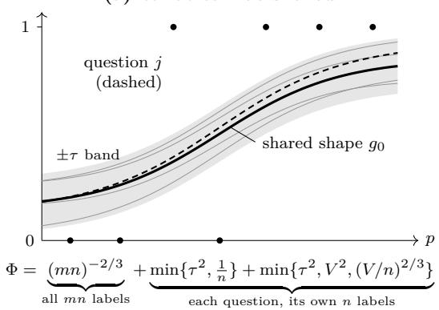

(b) What is necessary for decisions  
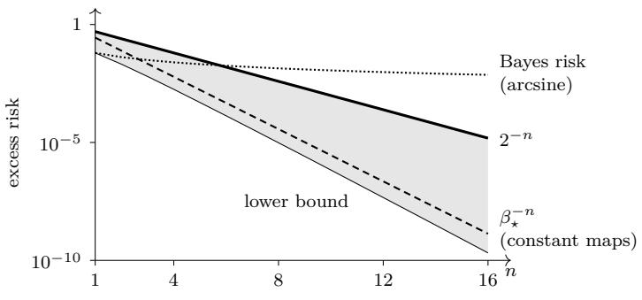  
Figure 1: (a) m nondecreasing maps (thin) within sup-distance $\tau$ of a shared shape $g _ { 0 }$ (thick; band $\pm \tau )$ ; dots: the n labels of one question $j$ (dashed); bottom: the rate of Theorem 3.2. (b) Random efects, logarithmic scale. Not knowing the prior costs, in the worst case over priors on nondecreasing maps, at most $2 ^ { - n }$ when the law of a question’s data is known (solid; Theorem 4.2), and at least max $\{ 1 / ( 8 { \binom { 2 n } { n } } ) , \beta _ { \star } ^ { - n } / ( 7 2 { \sqrt { n } } ) \}$ for every number of questions (thin; Corollary 4.7). Dashed: $\beta _ { \star } ^ { - n }$ , the upper bound for constant maps, with the regret computed among constant-map priors; its base is exact (Theorem 4.8). Dotted, for scale: the Bayes risk $1 / ( 8 ( n + 1 ) )$ of the arcsine prior (Section 6.1).

## Contents

1 Introduction 3   
2 Setting 6   
2.1 Many questions, few labels . 6   
2.2 Risk and the minimax rate 6   
2.3 Excess Brier risk and calibration error 7   
2.4 Remarks on the model 7   
3 What can be shared: the compound minimax rate 8   
3.1 The procedure 8   
3.2 The exact compound minimax rate 9   
3.3 Least squares with non-identical pairs and a common design 11   
3.4 Adaptation by a compound hold-out 11   
3.5 Per-question tuning cannot adapt . 12   
4 What is necessary for decisions: the identification regret 13   
4.1 Random efects and the identification regret 13   
4.2 The identification regret for monotone maps 14   
4.3 The regret as a Chebyshev radius 15   
4.4 Monotone maps: diagonal domination 16   
4.5 Every finite number of questions 17   
4.6 Constant maps: the exact base 18   
4.7 Skibinsky’s gap and the identification regret 19   
4.8 The monotone base . 21   
5 Numerical illustrations 21   
6 Discussion 25   
6.1 Two benchmarks, and a practical reading 2526   
6.2 Open problems   
References 28   
A Related work and limitations 32   
A.1 Extended related work 32   
A.2 Scope and limitations 34   
B Proofs for the compound minimax rate and the separation 35   
B.1 The lower bound 36   
B.2 Least squares with a common design law 38   
B.3 The pooled stage and the local stage 44   
B.4 The oracle estimator, the compound hold-out, and the rate 47   
B.5 Per-question tuning: proof of Proposition 3.6 52   
C Proofs for the identification regret 54   
C.1 The identification regret is a Chebyshev radius 55   
C.2 Constant maps: the moment-range formula 59   
C.3 Diagonal domination for sorted vectors 61   
C.4 The upper bound for monotone maps . 62   
C.5 The exact base for constant maps . 64   
C.6 The lower bound for monotone priors . 6667   
C.7 Proof of the empirical-Bayes theorem .   
C.8 The identification regret at every finite m 68

## 1 Introduction

Suppose we face many related statistical problems, which we call questions, and observe each of them only a few times. Having m questions with n observations each is not the same as having mn observations of one: information can be shared across questions only to the extent that their structure is shared. How much can then be learned collectively—what does the heterogeneity between the questions cost each of them? And what remains impossible to learn about an individual question, however many others are observed? In short: what information can be shared across questions, and what information is actually necessary for good decisions? For one nonparametric problem, the recalibration of probabilities, we answer both halves: with fixed efects, where the questions are arbitrary members of a class of heterogeneous problems and we take the worst case, and with random efects, where they are exchangeable draws from an unknown prior.

The first answer is a minimax rate, exact up to universal constants: the shared shape is learned from all mn labels, and each question pays for its own deviation at the rate of its own n labels. The second answer concerns exchangeable questions, where the target is the Bayes risk. Other questions reveal the law of one question’s data, but in general not the Bayes rule. The part they cannot reveal costs at most $2 ^ { - n }$ when that law is known, and at least $\beta _ { \star } ^ { - n } / ( 7 2 \sqrt { n } )$ in the worst case, where $\beta _ { \star } \approx 3 . 5 8 3 \ ( \mathrm { F i g u r e \ 1 } )$ . Beyond a few labels per question, what cannot be learned is nearly unnecessary. The setting is that of compound decision theory (Robbins, 1951) and empirical Bayes (Robbins, 1956; Zhang, 2003), and of learning many related tasks (Baxter, 2000).

Recalibration with few labels per question. A predictor reports a probability $P \in [ 0 , 1 ]$ for a binary event and is used on many questions: sub-populations or slices of a dataset $\left( \mathrm { L i ~ e t ~ a l . , ~ 2 0 2 4 } \right)$ , raters $\mathrm { ( R a j }$ 2026), groups (Ji et al., 2020), or $\mathrm { y e s } / \mathrm { n o }$ questions that developers write for decision models such as Jev and Laya (Convai Innovations, 2026; TypeSafe AI, 2026a,b), systems that return a probability for each such question. Calibration of the predictor, if it holds, is a property of the population of questions and says nothing about a particular question. For question $j$ the relevant object is its recalibration map $g _ { j } ( p ) = \mathbb { P } ( Y = 1 \mid P = p ;$ , question $j )$ . It is the identity exactly when the predictor is calibrated on question $j ,$ and we assume it nondecreasing: the predictor ranks cases correctly within a question even when its numbers are of. The map is observed through n pairs $( P _ { j k } , Y _ { j k } )$ with $P _ { j k } \sim \mu ,$ , the output law, shared by all questions (Definition 2.1). An estimator sees all mn pairs and returns maps ${ \widehat { g } } _ { 1 } , \ldots , { \widehat { g } } _ { m } ;$ its compound risk, the average over $j$ of E $\| \widehat { g } _ { j } - g _ { j } \| _ { L _ { 2 } ( \mu ) } ^ { 2 }$ , is the average excess Brier score over ideal per-question recalibration. Heterogeneity is measured against a shared shape $g _ { 0 }$ , a nondecreasing map: the deviations $g _ { j } - g _ { 0 }$ have sup-norm at most τ and total variation at most $V$ (the class $\Theta ( \tau , V )$ of Definition 2.2). We write ${ \mathfrak { M } } _ { m , n } ( \tau , V ; \mu )$ for the minimax compound risk over $\Theta ( \tau , V )$

What can be shared: the shape, and the size of the deviations. Our first answer is the minimax rate (Theorem 3.2): for every non-atomic $\mu ,$ all $m , n \geq 1 , \tau \in [ 0 , 1 ]$ ] and $V \in [ 0 , 2 ]$ , with constants independent of $\mu , m , n , \tau , V$

$$
\mathfrak { M } _ { m , n } ( \tau , V ; \mu ) \ \asymp \ \Phi ( m , n , \tau , V ) = ( m n ) ^ { - 2 / 3 } + \operatorname* { m i n } \Bigl \{ \tau ^ { 2 } , \frac { 1 } { n } \Bigr \} + \operatorname* { m i n } \Bigl \{ \tau ^ { 2 } , V ^ { 2 } , \Bigl ( \frac { V } { n } \Bigr ) ^ { 2 / 3 } \Bigr \} .\tag{1.1}
$$

All questions share the cost of the shape. Each question either learns its ofset from its n labels, at price $1 / n ,$ or ignores it, at price $\tau ^ { 2 } ;$ ; likewise it learns the rest of its deviation, its wiggle, at price $( V / n ) ^ { 2 / 3 }$ , or ignores it, at price min $\{ \tau ^ { 2 } , V ^ { 2 } \}$ . The shape is what pooling buys, and heterogeneity is paid question by question. With $m = 3 0 0$ questions and $n = 1 6$ labels each (orders of magnitude, constants ignored), a question alone resolves its map only at $n ^ { - 2 / 3 } \approx 0 . 1 6$ (the rate for $m = 1$ , non-atomic $\mu )$ , the pool resolves the shared shape at $( m n ) ^ { - 2 / 3 } \approx 0 . 0 0 3 5$ , and each ofset costs at most $1 / n \approx 0 . 0 6$ . In the shift model, where every deviation $g _ { j } - g _ { 0 }$ is a constant $( V = 0 )$ , the rate is $( m n ) ^ { - 2 / 3 } + \operatorname* { m i n } \{ \tau ^ { 2 } , 1 / n \}$ , parametric in n even when $\tau = 1 \colon$ heterogeneity is paid in variation, not in distance.

One procedure attains the rate without knowing $\tau , V$ or $\mu$ (Theorem 3.5): a pooled isotonic fit with a bounded-variation correction, whose two size parameters are chosen once, for all questions, on held-out labels (the compound hold-out; plain isotonic fits when $n = 1 \mathrm { o r } m \le 2 )$ . That choice shares one more piece of information across questions: the size of the deviations. This sharing is necessary once n and $m ^ { 2 } / n$ are large. In the shift model with $m ^ { 2 } \geq 2 1 6 n$ , even the best rule that tunes each question on its own data, and knows the shared shape, has worst-case ratio to the rate of order min $\{ n , \log ( m ^ { 2 } / n ) \}$ (Proposition 3.6), while the compound hold-out keeps it bounded.

What is necessary for decisions: an identification limit. Now let the maps $g _ { 1 } , g _ { 2 } , \ldots$ . be drawn independently from a prior $G$ on nondecreasing maps. The natural target is then the Bayes risk $R _ { n } ^ { * } ( G )$ of the posterior mean, which can be far below the minimax rate. If every map is the constant $1 / 4$ or $3 / 4$ with probability $1 / 2$ , predicting $3 / 4$ when at least half of a question’s labels are positive and $1 / 4$ otherwise errs by $1 / 2$ with probability at most $e ^ { - n / 8 }$ (Hoefding’s inequality), so $R _ { n } ^ { * } ( G ) \leq e ^ { - n / 8 } / 4 ;$ yet these maps lie in $\Theta ( 1 / 4 , 0 )$ , whose minimax risk is at least a universal constant times min $\{ 1 / 1 6 , 1 / n \}$ for non-atomic $\mu$ (Theorem 3.2). Reaching this target needs the Bayes rule, which other questions need not reveal: with infinitely many questions the law of one question’s data is known exactly, but $G$ need not be, and n labels per question need not determine the Bayes rule. One label and constant maps (coins) already show this: the priors $\delta _ { 1 / 2 }$ and $\begin{array} { r } { \frac { 1 } { 2 } \delta _ { 0 } + \frac { 1 } { 2 } \delta _ { 1 } } \end{array}$ give the same label law, Bern $( 1 / 2 )$ , but the Bayes rule predicts $1 / 2$ under the first and Y under the second, and every rule loses at least $1 / 1 6$ against one of them (Robbins, 1964; Skibinsky, 1968). With n labels the law of a question’s data determines the product moments $\mathbb { E } _ { G } [ g ( t _ { 1 } ) \cdot \cdot \cdot g ( t _ { r } ) ]$ for $r \leq n$ , while the posterior mean needs $r = n + 1 ;$ ; for coins, Skibinsky (1968) showed that, among the priors with given first n moments, the minimax risk exceeds each prior’s Bayes risk by at most $2 ^ { - n }$ . Let $\mathcal { G } _ { \mathrm { m o n o } }$ be the class of priors on nondecreasing maps. We measure the price by the identification regret $\operatorname { R e g } _ { n } ( G ; { \mathcal { G } } _ { \mathrm { m o n o } } )$ the smallest excess over the Bayes risk that one rule can guarantee simultaneously against every prior in $\mathcal { G } _ { \mathrm { m o n o } }$ (the second argument) inducing the same law of the data as $G .$ For random monotone maps and every output law (Theorem 4.2),

$$
\operatorname* { m a x } \Bigl \{ \frac { 1 } { 8 { \binom { 2 n } { n } } } , \ \frac { \beta _ { \star } ^ { - n } } { 7 2 \sqrt { n } } \Bigr \} \ \le \ \operatorname* { s u p } _ { G \in \mathcal { G } _ { \mathrm { m o n o } } } \mathrm { R e g } _ { n } ( G ; \mathcal { G } _ { \mathrm { m o n o } } ) \ \le \ 2 ^ { - n } , \qquad \beta _ { \star } = 2 e ^ { 2 \mathrm { C a t } / \pi } \approx 3 . 5 8 3 ,\tag{1.2}
$$

where Cat is Catalan’s constant. The upper bound assumes the law of a question’s data known $( m = \infty )$ ; the lower bounds hold for every finite number of questions (Corollary 4.7).

## Contributions (Table 1).

1. The compound minimax rate and compound tuning (Theorems 3.2 and 3.5 and Proposition 3.6). The rate (1.1) is exact up to universal constants, with no logarithmic factor, in every regime with $\tau \leq 1$ and $V \leq 2$ , for every non-atomic $\mu .$ Because all questions share the output law $\mu ,$ the pooled isotonic fit tracks the average of m diferent maps at the rate of all its labels, and a localized least-squares bound for independent, non-identically distributed pairs (Proposition 3.4) removes the logarithmic factor that a global entropy bound puts on the $1 / n$ ofset term.

2. The identification regret for monotone maps (Proposition 4.4, Theorem 4.2, and Corollary 4.7). The regret is the squared Chebyshev radius—the radius of the smallest enclosing ball—of the set of unidentified top moments in an explicit weighted $L _ { 2 }$ space: a data-averaged, functional form of posteriorregret Γ-minimax estimation. The bound $2 ^ { - n }$ has a short reason: the unidentified $( n + 1 ) – \mathrm { t h }$ moment ranges over an interval of length at most $4 ^ { - n }$ (classical for coins; for monotone maps we prove it with a diagonal-domination inequality for sorted vectors), and each of the $2 ^ { n }$ label patterns contributes at most this length. It holds for every output law, for the posterior mean of any monotone prior that reproduces the law of the data.

3. The exact base for constant maps (Theorem 4.8 and Corollary 4.11). For priors on constant maps (an uninformative predictor), with the regret computed among such priors, its supremum lies between $\beta _ { \star } ^ { - n } / ( 7 2 \sqrt { n } )$ and $\beta _ { \star } ^ { - n } \colon$ : the natural guess, $4 ^ { - n }$ up to polynomial factors, is false. The arcsine law attains the largest moment range, $4 ^ { - n }$ , which suggests base $4 ;$ near-extremal priors instead trade range for an exponentially rare label pattern, which gives the smaller base $\beta _ { \star }$ . For monotone maps the base lies in $[ 2 , \beta _ { \star } ]$ (Conjecture 4.13: it is $\beta _ { \star } )$ . The lower bound also bounds Skibinsky’s minimax-minus-Bayes gap, whose base appears numerically to be 2.

<table><tr><td>Result</td><td>Benchmark</td><td>m</td><td>Class</td><td>Bound</td><td>Tight?</td></tr><tr><td colspan="6">What can be shared (fixed effects)</td></tr><tr><td>Thm. 3.2 minimax</td><td>compound risk</td><td>every  $m \geq 1$ </td><td> $\Theta ( \tau , V ) , \tau \leq 1 ,$   $V \leq 2 ,$  non-atomic µ</td><td> $\mathfrak { M } _ { m , n } ( \tau , V ; \mu ) \asymp \Phi ( m , n , \tau , V )$ </td><td>yes, up to universal constants</td></tr><tr><td></td><td>Prop. 3.6 worst-case ratio  $\kappa _ { g _ { 0 } }$  to Φ</td><td> $m ^ { 2 } \ge$   $2 1 6 n$ </td><td>per-question rules, shift model  $V = 0$ </td><td>best per-question rule:  $\asymp \operatorname* { m i n } \{ n , \log ( m ^ { 2 } / n ) \} ;$  compound hold-out: O(1) (non-atomic µ)</td><td>yes, in order</td></tr><tr><td colspan="6">What is necessary  $f o r$  decisions (random effects)</td></tr><tr><td></td><td>Thm. 4.2 identification regret  ${ \mathrm { R e g } } _ { n }$ </td><td> $m = \infty$ </td><td>Gmono, every µ</td><td> $\begin{array} { r } { \mathrm { R e g } _ { n } ( G ; \mathcal G _ { \mathrm { m o n o } } ) \le 2 ^ { - n } } \end{array}$  G, guaranteed by the posterior mean of any data-equivalent prior</td><td>at every prior open: base in  $[ 2 , \beta _ { \star } ]$ </td></tr><tr><td>Cor. 4.7</td><td>worst-case excess over  $R _ { n } ^ { * }$ </td><td>every m  $\geq 1$ </td><td>Gmono, every µ</td><td> $\geq 1 / ( 8 { \binom { 2 n } { n } } )$  and  $\ge \beta _ { \star } ^ { - n } / ( 7 2 \sqrt { n } )$ </td><td>lower bound only (open problem 2, Sec. 6.2)</td></tr><tr><td>Thm. 4.8</td><td> ${ \mathrm { R e g } } _ { n }$  within Gconst</td><td> $m = \infty$ </td><td> $\mathcal { G } _ { \mathrm { c o n s t } }$  (constant maps)</td><td> $\beta _ { \star } ^ { - n } / ( 7 2 \sqrt { n } ) \le \operatorname* { s u p } _ { H } \mathrm { R e g } _ { n } \le \beta _ { \star } ^ { - n }$ </td><td>exact base  $\beta _ { \star } ;$  factor  $7 2 \sqrt { n }$  open</td></tr><tr><td>Cor. 4.11</td><td>Skibinsky&#x27;s gap  $W _ { n }$ </td><td> $m = \infty$ </td><td>Gconst</td><td> $\beta _ { \star } ^ { - n } / ( 7 2 \sqrt { n } ) \le \operatorname* { s u p } _ { H } W _ { n } \le 2 ^ { - n }$ </td><td>no: base in  $[ 2 , \beta _ { \star } ] ;$  numerically 2 (E2)</td></tr><tr><td>Conj. 4.13 identification</td><td>(Rem. 4.10) regret  ${ \mathrm { R e g } } _ { n }$ </td><td> $m = \infty$ </td><td>Gmono, every µ</td><td> $( \operatorname* { s u p } _ { G } \mathrm { R e g } _ { n } ) ^ { 1 / n } \to 1 / \beta _ { \star }$ </td><td>open</td></tr></table>

Table 1: The results at a glance. Fixed efects: the maps are arbitrary members of the class; random efects: they are independent draws from a prior, and $m = \infty$ means that the law of one question’s data is known. “In order”: up to universal constants, which are not optimized. Evidence grades (Section 5): E1, seeded simulation sweep; E2, global search, values attained but optimality not certified; E3, exact rational arithmetic.

Related work. Risk bounds for isotonic least squares (Chatterjee et al., 2015; Guntuboyina and Sen, 2018; Zhang, 2002) hold in the empirical norm; we prove population-norm bounds for independent, nonidentically distributed pairs by bracketing chaining (van de Geer, 2000; van der Vaart and Wellner, 1996). The rate (1.1) follows the shared-plus-local template of multitask learning (Baxter, 2000). Its closest parametric instance is the adaptive and robust estimator of Duan and Wang (2023), with compound risk of order $d / ( m n ) + \operatorname* { m i n } \{ \delta ^ { 2 } , d / n \}$ up to logarithmic factors for d-dimensional parameters within distance δ of a common centre; Theorem 3.2 is the shape-constrained, Bernoulli analogue, with universal constants and no logarithmic factor. Limits of adaptation in multitask learning (Hanneke and Kpotufe, 2022; Hanneke and Xu, 2026) concern unknown task relatedness, while Proposition 3.6 prices tuning each question on its own data in a known class where one compound hold-out adapts.

Our identification regret difers from the empirical-Bayes regret of Polyanskiy and Wu (2021), the excess risk of a data-driven procedure over the oracle that knows the prior: ours is measured against a Bayes risk that the data cannot identify (Skibinsky and Rukhin, 1989), so it is a floor, not the estimation cost of a procedure. It is the posterior regret of Γ-minimax estimation (Ríos Insua et al., 1995), with Γ the priors that induce the same law of the data, averaged over the data before the supremum over Γ is taken. For one real estimand the minimax action is the midpoint of the range of posterior means, and Proposition 4.4 is the functional version of this rule. Methods for recalibration with few labels per unit exist (Ji et al., 2020; Li et al., 2024; Raj, 2026), and calibration across groups is a large literature (Gopalan et al., 2024; Zhao et al., 2021); we ask what is achievable in the minimax sense. Section A.1 gives a more detailed account.

Scope and organization. The risk is the excess Brier risk. It upper-bounds the $L _ { 2 }$ calibration error, so our upper bounds transfer to calibration error and our lower bounds do not (Section 2.3). We assume monotone maps and one output law shared by all questions; Theorem 3.2 also needs that law to be non-atomic, while the empirical-Bayes results hold for every $\mu .$ The empirical-Bayes upper bound is a population statement, and a finite-m procedure is open; Section A.2 lists all limitations. Section 2 sets up the model and the risk. Section 3 gives the minimax rate, the procedure that attains it adaptively and the separation from per-question tuning, with proof outlines. Section 4 gives the identification regret: its bounds, its representation as a Chebyshev radius, the confinement for monotone maps, the exact base for constant maps, and its relation to Skibinsky’s gap. Section 5 illustrates the results numerically, and Section 6 compares the two benchmarks, draws practical conclusions and lists open problems. Section A gives the extended related work and the limitations, and Sections B and C the proofs.

## 2 Setting

Throughout, $\mu$ is a Borel probability measure on $[ 0 , 1 ] , [ n ] : = \{ 1 , \ldots , n \}$ , and $\begin{array} { r } { \| f \| _ { L _ { 2 } ( \mu ) } ^ { 2 } = \int _ { 0 } ^ { 1 } f ^ { 2 } d \mu } \end{array}$

## 2.1 Many questions, few labels

Definition 2.1 (Model). Let $m , n \geq 1$ . Question $j \in [ m ]$ carries a nondecreasing recalibration map $g _ { j } : [ 0 , 1 ] $ $[ 0 , 1 ]$ and n labelled pairs $( P _ { j k } , Y _ { j k } ) , k \in [ n ]$ , with $P _ { j k } \sim \mu$ and, conditionally on $P _ { j k } , Y _ { j k } \sim \mathrm { B e r n } ( g _ { j } ( P _ { j k } ) )$ All mn pairs are mutually independent, within and across questions.

The output law $\mu$ is shared by all questions; only the maps difer. The upper bound uses this: with a common $\mu$ the pooled fit tracks the plain average of the maps (Section 2.4). We write $\mathcal { F } _ { \uparrow }$ for the set of nondecreasing maps $[ 0 , 1 ]  [ 0 , 1 ]$ . For $d : [ 0 , 1 ]  \mathbb { R }$ the variation $\mathrm { T V } ( d )$ is the supremum of $\begin{array} { r } { \sum _ { l = 1 } ^ { L } \vert d ( x _ { l } ) - d ( x _ { l - 1 } ) \vert } \end{array}$ over all $L \geq 1$ and $0 \leq x _ { 0 } < x _ { 1 } < \cdot \cdot \cdot < x _ { L } \leq 1$ , a seminorm (constant functions have variation zero).

Definition 2.2 (Heterogeneity class). For $\tau , V \geq 0$ let $\Theta ( \tau , V )$ be the set of m-tuples $\left( g _ { 1 } , \ldots , g _ { m } \right)$ of nondecreasing maps $[ 0 , 1 ]  [ 0 , 1 ]$ for which there is one nondecreasing witness $g _ { 0 } : [ 0 , 1 ] \to \mathbb { R }$ with

$$
\operatorname* { s u p } _ { x \in [ 0 , 1 ] } | g _ { j } ( x ) - g _ { 0 } ( x ) | \leq \tau \quad { \mathrm { a n d } } \quad \mathrm { T V } ( g _ { j } - g _ { 0 } ) \leq V \qquad { \mathrm { f o r ~ a l l ~ } } j \in [ m ] .
$$

The deviation class is $\mathcal { D } ( \tau , V ) : = \{ d : [ 0 , 1 ]  \mathbb { R }$ measurable : $\operatorname* { s u p } \lvert d \rvert \leq \tau , \ \mathrm { T V } ( d ) \leq V \}$ ; thus $( g _ { j } ) \in \Theta ( \tau , V )$ if and only if $g _ { j } - g _ { 0 } \in \mathcal { D } ( \tau , V )$ for all $j$ and some nondecreasing g0.

We call $g _ { 0 }$ the shared shape. The parameter τ measures how far the maps are from it, and V how much the deviations oscillate. For $\tau = 0$ the problem is a single isotonic regression with mn samples; for $V = 0$ every deviation $g _ { j } - g _ { 0 }$ is a constant of size at most τ: the shift model. Requiring the shared shape to take values in $[ 0 , 1 ]$ gives a smaller class; for it, sup $| g _ { j } - g _ { 0 } | \le 1$ and $\mathrm { T V } ( g _ { j } - g _ { 0 } ) \leq \mathrm { T V } ( g _ { j } ) + \mathrm { T V } ( g _ { 0 } ) \leq 2$ , so the ranges $\tau \in [ 0 , 1 ]$ and $V \in [ 0 , 2 ]$ cover every case for that class (Section 2.4 explains the choice of sup-distance and variation).

## 2.2 Risk and the minimax rate

An estimator ${ \widehat { \boldsymbol { g } } } = ( { \widehat { \boldsymbol { g } } } _ { 1 } , \dots , { \widehat { \boldsymbol { g } } } _ { m } )$ is a jointly measurable map from the mn pairs (and, possibly, an independent auxiliary randomization) to m real functions on $[ 0 , 1 ] ;$ each $\widehat { g } _ { j }$ may use the data of all questions. Its compound risk at $g = ( g _ { 1 } , \dots , g _ { m } )$ is

$$
\mathcal { R } ( \widehat { g } ; g ) : = \frac { 1 } { m } \sum _ { j = 1 } ^ { m } \mathbb { E } \| \widehat { g } _ { j } - g _ { j } \| _ { L _ { 2 } ( \mu ) } ^ { 2 } .\tag{2.1}
$$

For a fresh pair $( P , Y )$ of question $j ,$ , independent of the data, ${ \mathbb E } [ ( \widehat g _ { j } ( P ) - Y ) ^ { 2 } \mid \mathrm { d a t a } ] - { \mathbb E } [ ( g _ { j } ( P ) - Y ) ^ { 2 } ] =$ $\| \widehat { g } _ { j } - g _ { j } \| _ { L _ { 2 } ( \mu ) } ^ { 2 }$ , because $\mathbb { E } [ Y \mid P ] = g _ { j } ( P )$ removes the cross term. So R is the average excess Brier score of the recalibrated forecasts $\widehat { g } _ { j } ( P )$ over the oracle forecasts $g _ { j } ( P )$ . It is at least their average $L _ { 2 }$ calibration error, and it also asks that the recalibrated forecasts keep the resolution of the original model (Section 2.3). The minimax compound risk is

$$
{ \mathfrak { M } } _ { m , n } ( \tau , V ; \mu ) : = { \underset { g } { \operatorname* { i n f } } } \quad \operatorname* { s u p } _ { ( g _ { j } ) \in \Theta ( \tau , V ) } \ { \mathcal { R } } ( { \widehat { g } } ; g ) ,\tag{2.2}
$$

the infimum taken over all estimators. Its order of magnitude will turn out to be

$$
\Phi ( m , n , \tau , V ) : = ( m n ) ^ { - 2 / 3 } + \operatorname* { m i n } \{ \tau ^ { 2 } , \frac { 1 } { n } \} + \operatorname* { m i n } \{ \tau ^ { 2 } , V ^ { 2 } , ( V / n ) ^ { 2 / 3 } \} ,\tag{2.3}
$$

$$
\Psi ( m , n , \tau , V ) : = ( m n ) ^ { - 2 / 3 } + \operatorname* { m i n } \{ \tau ^ { 2 } , { \frac { 1 } { n } } + ( V / n ) ^ { 2 / 3 } \} ,\tag{2.4}
$$

two expressions that agree up to a factor 2 (Theorem 3.2): Ψ makes one learn-or-ignore choice for the whole deviation, Φ one for each of its two parts (Remark 3.3 uses Ψ). Each term of Φ prices one object at its own sample size, through the metric entropy of the class it lives in: the logarithm of the number of ε-balls needed to cover that class. The shared shape is a monotone function, with entropy of order $1 / \varepsilon$ , learned from all mn labels at rate $( m n ) ^ { - 2 / 3 }$ . A question’s ofset is one number, learned from n labels at rate $1 / n$ or ignored at cost $\tau ^ { 2 }$ . Its wiggle lives in a variation ball, with entropy of order $V / \varepsilon$ , learned at rate $( V / n ) ^ { 2 / 3 }$ or ignored at cost min $\{ \tau ^ { 2 } , V ^ { 2 } \}$ . The law $\mu$ does not enter Φ, and for non-atomic $\mu$ it cannot enter the minimax risk either: only the order of the outputs matters (Remark 2.3).

## 2.3 Excess Brier risk and calibration error

For fixed data, the forecast $q : = \widehat { g } _ { j } ( P )$ has squared calibration error $\mathrm { C E } _ { j } : = \mathbb { E } [ ( q - \mathbb { E } [ Y \mid q ] ) ^ { 2 } ]$ . Since $\sigma ( q ) \subseteq \sigma ( P )$ , the tower property gives $\mathbb { E } [ Y \mid q ] = \mathbb { E } [ g _ { j } ( P ) \mid q ]$ , the orthogonal projection of $g _ { j } ( P )$ onto the $\sigma ( q )$ -measurable square-integrable variables, a subspace that contains q. A projection does not increase distances, so

$$
\operatorname { C E } _ { j } = \operatorname { \mathbb { E } } \left[ \left( \operatorname { \mathbb { E } } [ q - g _ { j } ( P ) \mid q ] \right) ^ { 2 } \right] \leq \operatorname { \mathbb { E } } \left[ ( q - g _ { j } ( P ) ) ^ { 2 } \right] = \| { \widehat { g } } _ { j } - g _ { j } \| _ { L _ { 2 } ( \mu ) } ^ { 2 } ,
$$

with equality when q determines $P$ (for instance, when $\widehat { g } _ { j }$ is strictly increasing). Every upper bound on R in Section 3 is therefore an upper bound on the average calibration error. Lower bounds do not transfer. At $\tau = 0$ all maps equal one map $^ { g ; }$ let every ${ \widehat { g } } _ { j }$ be the constant $\bar { Y }$ , the mean of all mn labels. For fixed data the forecast is a constant, so $\mathbb { E } [ Y \mid q ] = \textstyle \int g$ dµ and $\begin{array} { r } { \mathrm { C E } _ { j } = ( \bar { Y } - \int g d \mu ) ^ { 2 } } \end{array}$ . The mn labels are i.i.d. Bern $( \int g d \mu )$ so the expected calibration error is $\operatorname { V a r } ( { \bar { Y } } ) \leq 1 / ( 4 m n )$ , far below the lower bound $c ( m n ) ^ { - 2 / 3 }$ of Theorem 3.2 once mn is large. Calibration alone is cheap; the risk R asks in addition that the recalibrated forecasts keep the resolution of the original model.

## 2.4 Remarks on the model

The shared output law. The pooled fit of Section 3.2 tracks the plain average $\bar { g }$ of the maps, not the shared shape $g _ { 0 } .$ , because every $P _ { j k }$ has law $\mu$ (Lemma B.4); and, because that target is a plain average of maps in the class, a question’s deviation from it stays in the deviation class $\mathcal { D } ( 2 \tau , 2 V )$ of Definition 2.2 (Proposition B.7, Step 2). If question $j$ had its own law $\mu _ { j }$ , with density $p _ { j }$ with respect to a common measure, the population least-squares target of the pooled pairs would be $\sum _ { j } p _ { j } g _ { j } / \sum _ { j } p _ { j }$ , which need not be monotone (take $g _ { 1 } \equiv 0 , g _ { 2 } \equiv 1$ and a ratio $p _ { 2 } / p _ { 1 }$ that is not monotone), so the pooled isotonic fit would target its monotone projection, not an average of the maps; this extension is open problem 6.

Why sup-distance and variation. The two parameters do diferent jobs. The sup-distance τ bounds, pointwise and hence for every $\mu ,$ what a question loses by ignoring its deviation $g _ { j } - g _ { 0 } ;$ measuring it in $L _ { 2 } ( \mu )$ instead would make the class itself depend on the output law. The variation V bounds the metric entropy of the deviations (of order $V / \varepsilon$ at scale ε, besides one ofset direction), and this is what lets n labels estimate a deviation at the rate $( V / n ) ^ { 2 / 3 }$ . The class is a nonparametric envelope, and for structured families it is coarse. A per-question temperature and intercept, $g _ { j } = { \mathrm { l o g i t } } ^ { - 1 } ( a _ { j } + b _ { j } \ { \mathrm { l o g i t } } g _ { 0 } )$ with $b _ { j } \geq 0$ , is a two-parameter family. Its variation is at most four times its sup-distance τ (proof below), so for such a family the variation constraint adds little to the sup constraint, and the class does not exploit that the family has only two parameters. A warping $g _ { j } = g _ { 0 } \circ \phi _ { j }$ with $\phi _ { j }$ a nondecreasing self-map of [0, 1] always satisfies $\mathrm { T V } ( g _ { j } - g _ { 0 } ) \leq \mathrm { T V } ( g _ { j } ) + \mathrm { T V } ( g _ { 0 } ) \leq 2$ for a [0, 1]-valued $g _ { 0 } .$ , but its sup-distance can be as large as the largest jump of $g _ { 0 }$ , even for $\phi _ { j }$ close to the identity. Theorem 3.2 is the price of assuming none of these structures.

The factor 4 for a temperature and an intercept. In the coordinate $t = \mathrm { l o g i t } g _ { 0 } ( x ) \in [ - \infty , \infty ]$ the deviation is $\Delta ( t ) = \mathrm { l o g i t } ^ { - 1 } ( a + b t ) - \mathrm { l o g i t } ^ { - 1 } ( t )$ ; since $x \mapsto$ logit $g _ { 0 } ( x )$ is nondecreasing, the variation of the deviation in x is the variation of $\Delta$ along a subset of the extended line, and its sup-distance is the sup of $| \Delta |$ there. For $b > 0 , \Delta ( \pm \infty ) = 0$ and, as the derivative of $\mathrm { l o g i t } ^ { - 1 }$ at u is $1 / ( 4 \cosh ^ { 2 } ( u / 2 ) ) , \Delta ^ { \prime } ( t ) = 0$ if and only if cosh $( ( a + b t ) / 2 ) = \sqrt { b } \cosh ( t / 2 )$ ); for $b \neq 1$ this is an exponential sum with exponent-ordered coeficient signs $( + , - , - , + ) \mathrm { ~ o r ~ } ( - , + , + , - )$ , so it has at most two real zeros (Descartes’ rule of signs for exponential sums; for $b = 1$ two terms of opposite sign remain, so at most one zero, unless $a = 0$ and $\Delta \equiv 0 )$ . So $\Delta$ rises from 0, falls and rises back to 0 (or the mirror image, or is one-signed), and along any subset of the line its variation is at most 4 times its sup there $( \mathrm { a d j o i n } \pm \infty$ , where $\Delta = 0 ;$ ; this neither decreases the variation no changes the sup, and a sequence from 0 to 0 with at most two turns has variation $2 ( \operatorname* { m a x } - \operatorname* { m i n } ) \leq 4 \operatorname* { s u p } | \Delta | )$ For $b = 0 , \Delta$ is monotone and the ratio is at most 2. The constant 4 is attained on the full line: for $a = 0$ and $b \notin \{ 0 , 1 \} , \Delta$ is odd, so its maximum and minimum have the same size.

Remark 2.3 (Only the order of the outputs matters). Let $\mu$ be non-atomic, with distribution function $F$ and quantile function $F ^ {  } ( u ) : = \operatorname* { i n f } \{ x \in [ 0 , 1 ] : F ( x ) \geq u \}$ . Composition with a nondecreasing map preserves monotonicity and does not increase sup-distances or variations; $F ( P )$ is uniform for $P \sim \mu ; F ^ {  } ( F ( P ) ) = P$ almost surely; and $F ( F ^ {  } ( u ) ) = u$ . Hence the substitutions $( P , Y ) \mapsto ( F ( P ) , Y ) , g \mapsto g \circ F ^ {  } { \mathrm { ~ a n d } }$ , in the other direction, $( U , Y ) \mapsto ( F ^ {  } ( U ) , Y ) , g \mapsto g \circ F$ , carry the model, the class $\Theta ( \tau , V )$ and the risk (2.1) for $\mu$ to those for the uniform law on [0, 1] and back (Step 0 of the proof of Lemma B.1 spells out one direction). So ${ \mathfrak { M } } _ { m , n } ( \tau , V ; \mu )$ is the same for every non-atomic $\mu ,$ and constants free of $\mu$ in Theorem 3.2 come at no extra cost. The procedure of Definition 3.1 is built from pool-adjacent-violators and a variation-constrained fit, whose fitted values depend on the design points only through their order.

## 3 What can be shared: the compound minimax rate

This section answers the first question, for fixed efects. In one sentence: pooling buys the shared shape at the rate $( m n ) ^ { - 2 / 3 }$ of all mn labels, each question still pays min $\{ \tau ^ { 2 } , 1 / n \}$ for its ofset and the variation cost of its own deviation, and a single compound hold-out attains this without knowledge of $\tau , V$ or $\mu .$ Section 3.1 defines the procedure, Section 3.2 states the minimax rate and outlines its proof, Section 3.3 isolates the least-squares bound that removes the logarithm from the ofset term, Section 3.4 shows that the procedure attains the rate without knowing $\tau , V$ or $\mu ,$ and Section 3.5 shows why its tuning must be shared across questions.

## 3.1 The procedure

Definition 3.1 (Pooled isotonic fit, two-stage estimator, compound hold-out).

(i) Isotonic $\it { \Omega } \mathcal { f } t .$ The isotonic fit to a set of pairs is the least-squares fit over $\mathcal { F } _ { \uparrow }$ taken as the right-continuous step interpolation of the pool-adjacent-violators values at the sorted design points, constant below the smallest and above the largest design point; on the null event of tied design points, the tied points are pooled into one weighted pool-adjacent-violators block, a rule that does not use $\mu .$

(ii) Two-stage estimator with radii $( \tau ^ { \prime } , V ^ { \prime } ) \in ( 0 , 1 ] \times ( 0 , 2 ] \ ( \mathrm { f o r } \ m \geq 2 )$ . For each $j \colon$ let $\widehat { g } _ { 0 } ^ { ( - j ) }$ be the isotonic fit to the pooled pairs of all questions $i \neq j ;$ let $\widehat { d } _ { j }$ be a non-randomized, jointly measurable least-squares selection over $\begin{array} { r } {  { \mathcal { D } } ( \tau _ { 2 } , V _ { 2 } ) , \tau _ { 2 } : = \operatorname* { m i n } \{ 2 \tau ^ { \prime } , 1 \} , V _ { 2 } : = \operatorname* { m i n } \{ 2 V ^ { \prime } , 2 \} } \end{array}$ , fitted to the residuals $Y _ { j k } - \widehat { g } _ { 0 } ^ { ( - j ) } ( P _ { j k } )$ $k \in [ n ]$ , that does not use $\mu$ (for instance the right-continuous step interpolation of the unique fitted values at the sorted design points); and let $\widehat { g } _ { j } : = \mathrm { c l i p } _ { [ 0 , 1 ] } \left( \widehat { g } _ { 0 } ^ { ( - j ) } + \widehat { d } _ { j } \right)$ .

(iii) Compound hold-out (for $m \geq 3 , n \geq 2 )$ . Split the pairs of question $j$ into $A _ { j }$ (the first $\lfloor n / 2 \rfloor$ pairs) and $B _ { i } \ ( \mathrm { t h e \ r e s t } )$ . Let $K : = \lceil \log _ { 2 } ( m n ) \rceil$ and $\Lambda : = \{ ( 2 ^ { - a } , 2 ^ { 1 - b } ) : a , b \in \{ 0 , 1 , \cdot . . , K \} \}$ . For $\lambda \in \Lambda$ let $\widehat { g } ^ { \lambda } = ( \bar { \widehat { g } } _ { 1 } ^ { \lambda } , \ldots , \widehat { g } _ { m } ^ { \lambda } )$ be the two-stage estimator with parameters λ computed from the A-halves only (its pooled stage uses the A-halves of the other questions). Select

$$
\widehat { \lambda } \in \underset { \lambda \in \Lambda } { \arg \operatorname* { m i n } } \ \sum _ { j = 1 } ^ { m } \sum _ { k \in B _ { j } } \left( Y _ { j k } - \widehat { g } _ { j } ^ { \lambda } ( P _ { j k } ) \right) ^ { 2 }
$$

(ties broken by a fixed order) and output $\widehat { g } _ { j } ^ { \widehat { \lambda } } , j \in [ m ]$

(iv) The adaptive procedure $\widetilde { g } ^ { \mathrm { a d } } . \mathrm { H } n = 1$ , every $\widehat { g } _ { j } ^ { \mathrm { a d } }$ is the isotonic fit to all m pairs; else, if $m \leq 2 , \widehat { g } _ { j } ^ { \mathrm { a d } }$ is the isotonic fit to the n pairs of question $j ;$ else $( m \geq 3 , n \geq 2 ) , \overleftrightarrow { g } ^ { \mathrm { a d } }$ is the compound hold-out estimator of (iii).

The procedure fits the shape on the pooled data and corrects each question on its own labels $( { \mathrm { F i g u r e ~ } } 2 )$ The radii are doubled because the target of the correction, the deviation $g _ { j } - { \bar { g } } ^ { ( - j ) }$ of question j from the average map $\bar { g } ^ { ( - j ) }$ of the other questions, lies in $\mathcal { D } ( 2 \tau , 2 V )$ when $( g _ { j } ) \in \Theta ( \tau , V ) ;$ ; the caps 1 and 2 are the largest sup-norm and variation of a diference of two nondecreasing [0, 1]-valued maps.

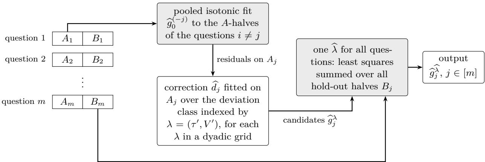  
pools data across questions fitted to one question’s labels  
Figure 2: The compound hold-out procedure of Definition 3.1(iii) $( m \geq 3 , n \geq 2 )$ . The shape is learned from the pooled A-halves of the other questions, each question fits its own constrained correction for every candidate λ, and a single ${ \widehat { \lambda } } ,$ the size of the deviations, is chosen from the hold-out halves of all questions together. For n = 1 or $m \leq 2$ the procedure is a plain isotonic fit (Definition 3.1(iv)).

## 3.2 The exact compound minimax rate

Theorem 3.2 (Exact compound minimax rate). There are universal constants $0 < c \le C < \infty$ such that for every non-atomic Borel probability measure µ on [0, 1], all $m , n \geq 1 , \tau \in [ 0 , 1 ]$ and $V \in [ 0 , 2 ]$

$$
c \Phi ( m , n , \tau , V ) \ \leq \ \mathfrak { M } _ { m , n } ( \tau , V ; \mu ) \ \leq \ C \Phi ( m , n , \tau , V ) ,
$$

whether or not the witness $g _ { 0 }$ of Definition 2.2 is required to take values in [0, 1]. The upper bound is attained, up to the constant C, by one non-randomized jointly measurable procedure that uses only the data and $( m , n )$ and neither $( \tau , V )$ nor µ: a pooled isotonic fit with a bounded-variation correction, tuned by a compound hold-out, when $m \geq 3$ and $n \geq 2 ;$ the pooled isotonic fit when $n = 1$ ; and per-question isotonic fits when $m \le 2$ and $n \geq 2 \ ( D e f n i t i o n \ 3 . 1 )$ . Moreover $\Phi / 2 \leq \Psi \leq 2 \Phi$

Each question learns its ofset and its wiggle from its own labels or ignores them, whichever is cheaper (Section 2.2); Remark 3.3 and Figure 3 read the rate in its regimes.

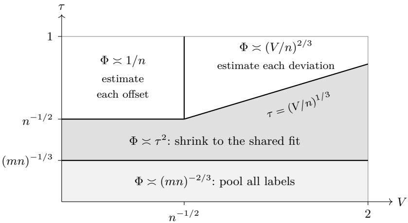  
Figure 3: Which term of Φ dominates, for fixed $m , n$ with $m ^ { 2 } \gg n$ (schematic; logarithmic axes; boundaries up to constant factors, read of Ψ in Theorem 3.2). The shift model $V = 0$ is the left edge. In the two shaded regions the pooled isotonic fit alone attains the rate (for non-atomic $\mu )$ , since its risk is $O ( ( \stackrel { - } { m } n ) ^ { - 2 / 3 } + \tau ^ { 2 } )$ (Lemma B.4, and $| g _ { j } - { \bar { g } } | \leq 2 \tau )$ ; above them each question pays for its own ofset $( V \le n ^ { - 1 / 2 } )$ or for its own deviation $( V \geq n ^ { - 1 / 2 } )$ When $m ^ { 2 } \lesssim n$ the pooling term $( m n ) ^ { - 2 / 3 } \geq 1 / n$ absorbs the ofset region.

The picture behind the rate. Section 2.2 prices each term of Φ through the metric entropy of one object at its own sample size. Heterogeneity never enters the first term, and m never enters the last two. The lower bound makes this exact with a compound Assouad argument, one hypercube per object. On the upper side, two facts carry the argument. First, least squares only needs independent observations with a common output law, so the pooled fit tracks the average of m diferent maps, and heterogeneity averages out. Second, the ofset is a single direction, and it should cost $1 / n .$ , not $\log ( e n ) / n !$ the logarithm that a global entropy count charges disappears once entropy is counted locally, around the target (Proposition 3.4). Finally, tuning each question on its own data cannot adapt. A rule that does so and is to stay within a constant of the rate when all questions coincide must keep its risk at order $( m n ) ^ { - 2 / 3 }$ , far below its own parametric $1 / n ;$ by a constrained-risk inequality (Brown and Low, 1996) it then remains biased for shifts of order $\sqrt { \log ( m ^ { 2 } / n ) / n }$ which its n labels cannot reliably detect. A compound hold-out pays its selection error with the hold-out labels of all questions, about $m n / 2$ of them.

Remark 3.3 (Reading the rate).

(a) Heterogeneity is paid in variation, not in distance. If $\tau ^ { 2 } \geq 1 / n + ( V / n ) ^ { 2 / 3 }$ , then $\Psi = ( m n ) ^ { - 2 / 3 } + 1 / n +$ $( V / n ) ^ { 2 / 3 }$ . A single question on its own has rate of order $n ^ { - 2 / 3 } \ ( \mathrm { t a k e } \ m = 1 ; \ n ^ { - 2 / 3 } \ \leq \ \Phi ( 1 , n , \tau , V ) \leq$ $4 n ^ { - 2 / 3 } )$ . Pooling therefore helps through V: in the shift model $V = 0$ the rate is $( m n ) ^ { - 2 / 3 } + \operatorname* { m i n } \{ \tau ^ { 2 } , 1 / n \}$ parametric in n even when $\tau = 1$

(b) One label per question. For $n = 1 , m ^ { - 2 / 3 } + \tau ^ { 2 } \le \Phi ( m , 1 , \tau , V ) \le m ^ { - 2 / 3 } + 2 \tau ^ { 2 }$ , and the optimal procedure is the pooled isotonic fit, which ignores the identity of the questions.

(c) Template. Φ is the shape-constrained, nonparametric counterpart of the multi-task rate $d / ( m n ) +$ min $\{ \delta ^ { 2 } , d / n \}$ (up to logarithmic factors and an outlier term) for d-dimensional Gaussian means within distance δ of a common centre (Duan and Wang, 2023): the parametric $d / ( m n )$ becomes the isotonic rate $( m n ) ^ { - 2 / 3 }$ , and the local term splits into an ofset and a variation part.

Outline of the proof of Theorem 3.2. The lower bound is a compound Assouad argument over three hypercubes inside $\Theta ( \tau , V )$ (Lemma B.1): bumps of height of order $( \bar { m } n ) ^ { - 1 / 3 }$ shared by all questions, ofsets $\cdot \pm \operatorname* { m i n } \{ \tau , 1 / ( 8 \sqrt { n } ) \}$ chosen independently per question, and per-question bumps whose number $K _ { b } \asymp$ max $\{ 1 , ( n V ^ { 2 } ) ^ { 1 / 3 } \}$ and height of order min $\{ \tau , V / K _ { b } \}$ exhaust the variation budget; a quantile transform reduces every non-atomic $\mu$ to Lebesgue measure, which is where non-atomicity enters the lower bound. The upper bound analyses a two-stage estimator. A leave-one-out pooled isotonic fit tracks the average map $\bar { g } ^ { ( - j ) }$ of the other questions at rate $( m n ) ^ { - 2 / 3 }$ , although no single pair has $\bar { g } ^ { ( - j ) }$ as its regression function (Lemma B.4); the deviation $g _ { j } - { \bar { g } } ^ { ( - j ) }$ lies in $\mathcal { D } ( 2 \tau , 2 V )$ , and a constrained least-squares correction on question $j ^ { \circ } \mathfrak { s }$ own labels pays the pooled error plus min $\{ \tau ^ { 2 } , 1 / n + \operatorname* { m i n } \{ V ^ { 2 } , ( V / n ) ^ { 2 / 3 } \} \}$ by an oracle inequality (Lemma B.5 and Proposition B.7). The dificulty concentrates in the term $1 / n \colon \mathrm { a }$ global entropy bound (Lemma B.2) charges the ofset direction log $( e n ) / n ,$ and the localized bound of Proposition 3.4 removes this logarithm, which is what makes the rate exact rather than exact up to log n. Adaptation costs only a constant facto because the tuning parameter is chosen once, for all questions together (Theorem 3.5).

## 3.3 Least squares with non-identical pairs and a common design

Both stages of the estimator are least-squares fits to independent pairs that are not identically distributed: the pooled stage mixes questions with diferent maps, and the correction stage regresses residuals around an estimated ofset. What the pairs do share is the law of the design points. The bound below is the analogue, for this design, of the localized rate theorem for least squares (van der Vaart and Wellner, 1996, Theorem 3.4.1), which we need in $L _ { 2 } ( \mu )$ for independent, non-identically distributed pairs; we state it for completeness. For a class $\mathcal { F }$ of functions on $[ 0 , 1 ]$ , the bracketing number $N _ { [ ] } ( \varepsilon , \mathcal { F } , L _ { 2 } ( \mu ) )$ is the least number of pointwise ε-brackets covering ${ \mathcal { F } } \colon$ pairs [l, u] of real measurable functions with $\| u - l \| _ { L _ { 2 } ( \mu ) } \leq \varepsilon .$ where $f \in [ l , u ]$ means $l \leq f \leq u$ at every point of $[ 0 , 1 ] ;$ the brackets need not lie in $\mathcal { F }$ (van der Vaart and Wellner, 1996).

Proposition 3.4 (Localized least squares, non-identical pairs, common design). Let $( P _ { i } , Y _ { i } ) , i \in [ N ]$ be independent random pairs with values in $[ 0 , 1 ] \times [ - 1 , 1 ]$ such that $P _ { i } \ \sim \ \mu$ for every $i ;$ let $\eta _ { i } ( p ) : =$ ${ \mathbb E } [ Y _ { i } \mid P _ { i } = p ]$ (a version) and $\begin{array} { r } { \bar { \eta } : = \frac { 1 } { N } \sum _ { i } \eta _ { i } } \end{array}$ . Let $\mathcal { F }$ be a nonempty convex class of measurable functions $[ 0 , 1 ]  [ - 1 , 1 ] ,$ , closed in $L _ { 2 } ( \mu )$ , let $f ^ { * }$ be the $L _ { 2 } ( \mu )$ -projection of η¯ onto ${ \mathcal { F } } ,$ , and $\it { l e t } \widehat { f }$ be a measurable selection of arg min $\textstyle f \in { \mathcal { F } } \sum _ { i = 1 } ^ { N } ( Y _ { i } - f ( P _ { i } ) ) ^ { 2 }$ (assumed to exist). For $\delta > 0$ let $\mathcal { F } ( \delta ) : = \{ f \in \mathcal { F } : \| f - f ^ { * } \| _ { L _ { 2 } ( \mu ) } \leq \delta \}$ , and assume that for some $A , B \geq 0$

$$
\log N _ { [ ] } ( \varepsilon , \mathcal { F } ( \delta ) , L _ { 2 } ( \mu ) ) \ \leq \ \frac { A } { \varepsilon } + B \log \frac { e \delta } { \varepsilon } ~ f o r \ a l l \ 0 < \delta \leq 2 \ a n d \ 0 < \varepsilon \leq \delta .
$$

Then, with a universal constant C (the expectation may be read as an outer expectation, which equals E whenever $\| \widehat { f } - f ^ { * } \| _ { L _ { 2 } ( \mu ) }$ is measurable),

$$
\mathbb { E } \| \widehat { f } - f ^ { * } \| _ { L _ { 2 } ( \mu ) } ^ { 2 } \ \leq \ C \Big [ \Big ( \frac { A } { N } \Big ) ^ { 2 / 3 } + \frac { B + 1 } { N } \Big ] .
$$

Three features of Proposition 3.4 matter for the first part of the paper. $( i )$ The target is the average. The expected empirical risk is N times the average of the individual risks, whose minimizer over $\mathcal { F }$ is the projection of $\bar { \eta } ;$ the empirical process is centred summand by summand, and its natural norm $\begin{array} { r } { \big ( \frac { 1 } { N } \sum _ { i } \mathbb { E } h ( P _ { i } , Y _ { i } ) ^ { 2 } ) ^ { 1 / 2 } } \end{array}$ reduces to the $L _ { 2 } ( \mu )$ norm on functions of the design point because every $P _ { i } \sim \mu .$ . The heterogeneity of the $\eta _ { i }$ therefore never enters the entropy, and this is why the pooled fit tracks the average map (Lemma B.4). (ii) Localization removes the logarithm. As in the identically distributed case, a bracketing chaining bound with Bernstein truncation, here proved for independent non-identically distributed summands, controls the empirical process on $\mathcal { F } ( \delta )$ , and peeling over δ locates the fixed point $\sqrt { N } \delta ^ { 2 } \asymp \sqrt { A \delta } + \delta \sqrt { B }$ . The geometric quantity is the local entropy integral: since $\begin{array} { r } { \int _ { 0 } ^ { \delta } \sqrt { B \log ( e \delta / \varepsilon ) } d \varepsilon \leq \sqrt { 2 } \delta \sqrt { B } } \end{array}$ is scale-free, the finite-dimensional part costs $( B + 1 ) / N$ ; under a global bound $B \log ( e / \varepsilon )$ (Lemma B.2) the same integral carries a factor $\sqrt { \log ( e / \delta ) }$ , and the bound becomes $( B + 1 ) \log ( e N ) / N$ . (iii) The deviation class. For $\mathcal { D } ( \tau , V )$ the hypothesis holds with A of order $V$ and $B = 2 ;$ ; the term $B \log ( e \delta / \varepsilon )$ is the entropy of the one-dimensional ofset direction inside the localized ball. This gives the correction stage its log-free rate $( V / n ) ^ { 2 / 3 } + 1 / n$ (Lemma B.5).

## 3.4 Adaptation by a compound hold-out

Theorem 3.5 is the upper half of Theorem 3.2, stated for the procedure itself; we write $C _ { \mathrm { A D } }$ for its constant C.

Theorem 3.5 (Adaptive upper bound). Let $\mu$ be non-atomic, $m , n \geq 1$ , and let $\tau \in [ 0 , 1 ]$ and $V \in [ 0 , 2 ]$ be unknown. The procedure ${ \widehat { \boldsymbol { g } } } ^ { \mathrm { a d } }$ of Definition ${ \it 3 . 1 } ( i v )$ is non-randomized, jointly measurable in $( d a t a , p )$ , and uses only the data and $( m , n )$ . There is a universal constant $C ,$ independent of $\mu , m , n , \tau , V$ , such that for every $( g _ { 1 } , \hdots , g _ { m } ) \in \Theta ( \tau , V )$

$$
\frac { 1 } { m } \sum _ { j = 1 } ^ { m } \mathbb { E } \| \widehat { g } _ { j } ^ { \mathrm { a d } } - g _ { j } \| _ { L _ { 2 } ( \mu ) } ^ { 2 } \ \leq \ C \Phi ( m , n , \tau , V ) .
$$

Outline of the proof of Theorem 3.5. For $m \geq 3$ and $n \geq 2$ , Bernstein’s inequality applied conditionally on the A-halves, with a union bound over the $| \Lambda | = ( K + 1 ) ^ { 2 }$ candidates, shows that the selected candidate has average risk at most $5 / 3$ times the best candidate’s plus 25 $( \log ( 2 | \Lambda | ) + 1 ) / ( m | B _ { j } | )$ in expectation (Proposition B.8). The grid contains a point within a factor 2 of $\mathrm { ( m a x } \{ \tau , 2 ^ { - \stackrel { . } { K } } \}$ , max $\{ V , 2 ^ { 1 - } K \} )$ , at which the two-stage estimator on half-samples attains $C \Phi$ (Proposition B.7); the selection cost is of order log $\log ( m n ) / ( m n )$ below $( m n ) ^ { - 2 / 3 }$ . The point of choosing one λ for all questions is that the selection cost is divided by the total hold-out size $m | B _ { j } | \ge m n / 2 ;$ ; the same argument applied per question only gives an overhead of order log $| \Lambda | / n$ , which exceeds Φ when τ is small and m is large. For $n = 1$ the pooled fit pays $m ^ { - 2 / 3 }$ plus a bias of at most $4 \tau ^ { 2 }$ , and for m ≤ 2 the per-question fit pays $n ^ { - 2 / 3 }$ ; both are $O ( \Phi )$ in their regimes. Proposition 3.6 shows that the loss of per-question tuning is not an artefact of this analysis.

## 3.5 Per-question tuning cannot adapt

The obvious alternative to a compound hold-out tunes each question on its own labels; it cannot adapt. In words, a per-question estimator computes the map of question $j$ from that question’s data and a randomization fixed in advance. Formally, call an estimator per-question if $\widehat { g } _ { j } = T _ { j } ( D _ { j } , \xi , \cdot )$ for every $j \in [ m ]$ , where $D _ { j } : = ( ( P _ { j k } , Y _ { j k } ) ) _ { k \in [ n ] }$ is the data of question $j ; \xi$ is an auxiliary random element with values in a measurable space $\Xi ,$ independent of the mn pairs, whose law is fixed in advance (it depends on none of $( g _ { j } ) , \tau , V$ , and it may be shared by the questions); and each $T _ { j } : ( [ 0 , 1 ] \times \{ 0 , 1 \} ) ^ { n } \times \Xi \times [ 0 , 1 ] \to \mathbb { R }$ is jointly measurable. The maps $T _ { j }$ may difer across $j$ and may depend on $( m , n , \mu , j )$ and on anything fixed in advance, but not on the data of other questions, on $( \tau , V )$ , or on $( g _ { j } )$ . The lower bound is proved on shifts of a shared shape that the rules may know: for a nondecreasing $g _ { 0 } : [ \bar { 0 } , 1 ] \to [ { \frac { 1 } { 4 } } , { \frac { 3 } { 4 } } ]$ and $\tau \in [ 0 , { \frac { 1 } { 4 } } ]$ , ranges that keep every shifted map in $[ 0 , 1 ]$ , let $\Theta _ { g _ { 0 } } ( \tau )$ be the set of tuples $( g _ { 0 } + c _ { 1 } , \hdots , g _ { 0 } + c _ { m } )$ with $c _ { j } \in [ - \tau , \tau ]$ , and define the adaptivity ratio, the worst-case ratio of the risk to the rate,

$$
\kappa _ { g _ { 0 } } ( \widehat g ) : = \operatorname* { s u p } _ { \tau \in [ 0 , 1 / 4 ] } \operatorname* { s u p } _ { g \in \Theta _ { g _ { 0 } } ( \tau ) } \frac { \mathcal { R } ( \widehat g ; g ) } { \Phi ( m , n , \tau , 0 ) } \ \in [ 0 , \infty ] , \quad \Phi ( m , n , \tau , 0 ) = ( m n ) ^ { - 2 / 3 } + \operatorname* { m i n } \{ \tau ^ { 2 } , \frac { 1 } { n } \} .
$$

Proposition 3.6 (Per-question tuning cannot adapt). Let $\mu$ be any Borel probability measure on $[ 0 , 1 ]$ , let $m , n \geq 1$ , let $g _ { 0 } : [ 0 , 1 ] \to [ { \frac { 1 } { 4 } } , { \frac { 3 } { 4 } } ]$ be nondecreasing, and put $M : = ( m ^ { 2 } / n ) ^ { 1 / 3 }$

(i) (Lower bound.) $I f m ^ { 2 } \geq 2 1 6 n _ { \cdot }$ , then $\kappa _ { g _ { 0 } } ( \widehat { g } ) \geq \frac { 1 } { 2 5 6 }$ min $\{ 3 n , \log ( m ^ { 2 } / n ) \}$ } for every per-question estimator ${ \widehat { g } } .$ Consequently every per-question ${ \widehat { g } } ,$ whether or not it uses $g _ { 0 }$ , satisfies

$$
\operatorname* { s u p } _ { \tau \in [ 0 , 1 ] } \operatorname* { s u p } _ { g \in \Theta ( \tau , 0 ) } \frac { \mathcal { R } ( \widehat { g } ; g ) } { \Phi ( m , n , \tau , 0 ) } \geq \frac { 1 } { 2 5 6 } \operatorname* { m i n } \Bigl \{ 3 n , \log \frac { m ^ { 2 } } { n } \Bigr \} .
$$

(ii) (Tightness within per-question rules.) Let $\begin{array} { r } { \hat { c } _ { j } : = { \frac { 1 } { n } } \sum _ { k } ( Y _ { j k } - g _ { 0 } ( P _ { j k } ) ) } \end{array}$ . The per-question rule $\widehat { g } _ { j } : =$ $g _ { 0 } + \hat { c } _ { j } { \bf 1 } \{ | \hat { c } _ { j } | > t \}$ , with $t : = 0 \mathrm { ~ } i f M < e$ and $t : = ( \dot { 2 8 } \log M / ( 3 n ) ) ^ { 1 / 2 } \ i f M \ge e _ { \cdot }$ has $\kappa _ { g _ { 0 } } \leq e / 4 \ i f M < e$ and $\kappa _ { g _ { 0 } } \leq 4 + 5 0 \log ( m ^ { 2 } / n ) \ i f M \geq e ;$ the rule $\widehat { g } _ { j } : = g _ { 0 }$ has $\kappa _ { g _ { 0 } } \leq \operatorname* { m a x } \{ 1 , n / 1 6 \}$ . Hence, $i f m ^ { 2 } \geq 2 1 6 n$

$$
\frac { 1 } { 2 5 6 } \operatorname* { m i n } \Bigl \{ 3 n , \log \frac { m ^ { 2 } } { n } \Bigr \} \ \le \ \operatorname* { i n f } _ { \widehat { g } \ p e r - q u e s t i o n } \kappa _ { g _ { 0 } } ( \widehat { g } ) \ \le \ 5 1 \operatorname* { m i n } \Bigl \{ n , \log \frac { m ^ { 2 } } { n } \Bigr \} ,
$$

and if $m ^ { 2 } < e ^ { 3 } n$ (that is, $M < e )$ , the rule above (with t = 0) has $\kappa _ { g _ { 0 } } \leq e / 4$ (iii) (Compound tuning adapts.) Let $\mu$ be non-atomic and let $C _ { \mathrm { A D } }$ be the constant of Theorem 3.5. The procedure ${ \widehat { \boldsymbol { g } } } ^ { \mathrm { a d } }$ of Definition ${ \it 3 . 1 } ( i v )$ , which uses neither g0, τ, V nor $\mu$ and for $m \geq 3$ is not per-question, has $\kappa _ { g _ { 0 } } ( \widehat { g } ^ { \mathrm { a d } } ) \leq C _ { \mathrm { A D } }$ . Hence, if $m ^ { 2 } \geq 2 1 6 n$ , every per-question procedure, even one given $g _ { 0 }$ and $\mu _ { ; }$ , has $\kappa _ { g _ { 0 } } ( \widehat { g } ) / C _ { \mathrm { A D } } \geq \operatorname* { m i n } \{ 3 n , \log ( m ^ { 2 } / n ) \} / ( 2 5 6 C _ { \mathrm { A D } } )$ , a ratio that tends to infinity as $n \to \infty$ and $m ^ { 2 } / n  \infty ;$ in particular, when min $\{ 3 n , \log ( m ^ { 2 } / n ) \} > 2 5 6 C _ { \mathrm { A D } }$ , no per-question procedure matches the guarantee of ${ \widehat { \boldsymbol { g } } } ^ { \mathrm { a d } }$

Why per-question tuning fails. $\mathrm { A t } \tau = 0$ the class $\Theta _ { g _ { 0 } } ( 0 )$ is the single tuple $( g _ { 0 } , \ldots , g _ { 0 } )$ , so a per-question rule $\widehat g$ has risk at most $\kappa _ { g _ { 0 } } ( \widehat { g } ) ( m n ) ^ { - 2 / 3 }$ there, far below the $1 / n$ at which one question’s own labels can estimate its ofset; it must shrink every estimated ofset almost to zero. The constrained-risk inequality of Brown and Low (1996, Theorem 1), carried to a Bernoulli shift family, measures the cost. For one question, the likelihood ratio between shift c and shift 0 has second moment at most $e ^ { 1 6 n c ^ { 2 } / 3 }$ , so the mean, under shift $c ,$ of the ofset that the rule estimates is at most $e ^ { 8 n c ^ { 2 } / 3 }$ times its root risk under shift 0. For $n c ^ { 2 }$ of order $\log ( m ^ { 2 } / n )$ these means stay below $c / 2$ on average over the questions, and the rule pays $c ^ { 2 } / 4$ , of order log $\cdot ( m ^ { 2 } / n ) / n$ , against $\Phi ( m , n , c , 0 ) \leq 2 / n$ . A compound procedure escapes the trade-of because the radius it uses is selected on the hold-out labels of all questions together, about $m n / 2$ of them (Theorem 3.5).

Remark 3.7 (Scope of Proposition 3.6).

(a) The separation is asymptotic: since $C _ { \mathrm { A D } }$ is not explicit, the proposition gives no concrete $( m , n )$ at which per-question rules lose to ${ \widehat { g } } ^ { \mathrm { a d } }$ ; Section 5 gives evidence at moderate sizes.

(b) Per-question rules use their own data only. Tuning each question around a shape estimated from the pooled data is not covered, since pooled statistics can carry information about the size of the shifts (Section $\mathrm { A . 2 ( v i i ) }$ ; open problem 7 of Section 6.2).

(c) The inequality behind (i) is the constrained-risk inequality of Brown and Low (1996, Theorem 1), with an exact chi-square computation for the Bernoulli shift family; we prove the form we use (Section B.5).

## 4 What is necessary for decisions: the identification regret

This section answers the second question, for random efects. In one sentence: not knowing the prior over monotone recalibration maps costs at most $2 ^ { - n }$ in excess Brier score, for every output law and for the posterior mean of every monotone prior consistent with the law of the data, and in the worst case it costs at least $\beta _ { \star } ^ { - n } / ( 7 2 \sqrt { n } )$ , with $\beta _ { \star } = 2 e ^ { 2 \mathrm { C a t } / \pi } \approx 3 . 5 8 3$ . Section 4.1 sets up random efects and defines the identification regret, and Section 4.2 states the bounds. Sections 4.3 and 4.4 explain the upper bound: the regret is a Chebyshev radius, and for monotone maps the unidentified moment is confined by a diagonal-domination inequality. Section 4.5 shows that the lower bounds hold for every finite number of questions, Section 4.6 pins the exponential base for constant maps, Section 4.7 relates the regret to Skibinsky’s minimax-minus-Bayes gap, and Section 4.8 states our conjecture for monotone maps.

## 4.1 Random efects and the identification regret

Now the $g _ { j }$ are independent with a common law $G$ on monotone maps. The Bayes rule uses $G ,$ which other questions reveal only through the law of one question’s data; the second part measures what is lost even when this law is known exactly (the idealization $m = \infty )$

Definition 4.1 (Random-efects setting). Let $\mu$ be any Borel probability measure on [0, 1] (atoms allowed) and $n \geq 1 . \mathrm { ~ A ~ }$ prior G is the law of a random map $g : [ 0 , 1 ]  [ 0 , 1 ]$ that is jointly measurable in (sample point, argument). One question’s data is $D = ( X , Y )$ , where $X = ( P _ { 1 } , \ldots , P _ { n } )$ has i.i.d. coordinates with law $\mu$ and is independent of $g$ (precisely: $g$ is $\mathcal { A } \otimes B ( [ 0 , 1 ] )$ -measurable for a σ-field $\mathcal { A }$ independent of X), and, given ${ \mathcal { A } } \lor \sigma ( X )$ , the labels $Y _ { 1 } , \dots , Y _ { n }$ are independent with $Y _ { k } \sim \mathrm { B e r n } ( g ( P _ { k } ) )$ ). Write $s ( Y ) : = \textstyle \sum _ { k } Y _ { k }$ and, for

$$
r \geq 1 , t \in [ 0 , 1 ] ^ { r } , x \in [ 0 , 1 ] ^ { n } , y \in \{ 0 , 1 \} ^ { n } , p \in [ 0 , 1 ] ,
$$

$$
\begin{array} { c } { { M _ { r } ^ { G } ( t ) : = \displaystyle \mathbb { E } _ { G } \big [ g ( t _ { 1 } ) \cdot \cdot \cdot g ( t _ { r } ) \big ] , \qquad Z _ { G } ( x , y ) : = \displaystyle \mathbb { E } _ { G } \Big [ \prod _ { k = 1 } ^ { n } g ( x _ { k } ) ^ { y _ { k } } ( 1 - g ( x _ { k } ) ) ^ { 1 - y _ { k } } \Big ] , } } \\ { { \displaystyle N _ { G } ( p ; x , y ) : = \mathbb { E } _ { G } \Big [ g ( p ) \prod _ { k = 1 } ^ { n } g ( x _ { k } ) ^ { y _ { k } } ( 1 - g ( x _ { k } ) ) ^ { 1 - y _ { k } } \Big ] . } } \end{array}
$$

$Z _ { G }$ is the density of D with respect to $\mu ^ { \otimes n } \otimes$ (counting measure on $\{ 0 , 1 \} ^ { n } )$ . A rule δ assigns to each D a function $\delta ( D ) : [ 0 , 1 ]  [ 0 , 1 ]$ such that $( p , D ) \mapsto \delta ( D ) ( p )$ is jointly measurable. Its risk is $R ( \delta , G ) : =$ $\mathbb { E } _ { G } \mathbb { E } \| \delta ( D ) - g \| _ { L _ { 2 } ( \mu ) } ^ { 2 } ,$ and the Bayes risk is $R _ { n } ^ { * } ( G ) : = \operatorname* { i n f } _ { \delta } R ( \delta , G )$ . The posterior mean is the rule $\delta _ { G } ^ { * } ( D ) ( p ) : = $ $N _ { G } ( p ; D ) / Z _ { G } ( D )$ on $\{ Z _ { G } ( D ) > 0 \}$ and 0 elsewhere. For a convex set $\mathcal { G }$ of priors and $G \in { \mathcal { G } }$ , the identified set and the identification regret are

$$
[ G ] : = \{ G ^ { \prime } \in \mathcal { G } : \operatorname { L a w } _ { G ^ { \prime } } ( D ) = \operatorname { L a w } _ { G } ( D ) \} , \qquad \operatorname { R e g } _ { n } ( G ; \mathcal { G } ) : = \operatorname* { i n f } _ { \delta } \operatorname* { s u p } _ { G ^ { \prime } \in [ G ] } \big ( R ( \delta , G ^ { \prime } ) - R _ { n } ^ { * } ( G ^ { \prime } ) \big ) .\tag{4.1}
$$

Conventions: $0 \cdot ( + \infty ) : = 0$ and $1 / 0 : = + \infty$

The posterior mean attains the Bayes risk, $R ( \delta _ { G } ^ { * } , G ) = R _ { n } ^ { * } ( G )$ (Proposition 4.4(i)). The regret $\mathrm { R e g } _ { n } ( G ; \mathcal { G } )$ is a minimax excess risk over the priors that the law of the data cannot distinguish from G. At G alone the question would be empty, since the posterior mean of G has zero excess there. It is a population quantity: that law is known exactly.

Two classes of priors. $\mathcal { G } _ { \mathrm { m o n o } }$ is the set of priors admitting a jointly measurable version whose paths are nondecreasing maps $[ 0 , 1 ]  [ 0 , 1 ]$ . It is convex: a mixture of two such priors is the law of $B g _ { 1 } + ( 1 - B ) g _ { 2 }$ with B an independent Bernoulli variable. $\mathcal { G } _ { \mathrm { c o n s t } } \subseteq \mathcal { G } _ { \mathrm { m o n o } }$ is the set of priors on constant maps, $g \equiv \theta$ with $\theta \sim H$ for a Borel probability measure H on $[ 0 , 1 ] ;$ ; we identify the prior with H. This is the case of an uninformative predictor, whose reported probability carries no information about the label: the classical binomial empirical-Bayes problem (Robbins, 1956).

Constant maps: moments. For constant maps the regret has a closed form (Section 4.6), built from two quantities. For $H \in \mathcal G _ { \mathrm { c o n s t } }$ and $s = 0 , \ldots , n$ let $\begin{array} { r } { b _ { s } ( H ) : = \int \theta ^ { s } ( 1 - \theta ) ^ { n - s } d H ( \theta ) } \end{array}$ , the prior probability of one label sequence with s positive labels, and let $\rho _ { n } ( H )$ be the length of the interval of values of $\int \theta ^ { n + 1 } d H ^ { \prime }$ over probability measures $H ^ { \prime }$ on [0, 1] with the same first n moments as H: the range of the one moment that n labels leave free. Always $\rho _ { n } ( H ) \leq 4 ^ { - n }$ , with equality for the arcsine law $\omega ( d t ) : = d t / ( \pi \sqrt { t ( 1 - t ) } )$ on $[ 0 , 1 ]$ (Skibinsky, 1967; see also Skibinsky, 1968, eq. (17) and Proposition C.2). For measurable $f > 0$ we write $\mathrm { G M } _ { \omega } ( f ) : = \exp _ { \downarrow }$ R log f dω for the geometric mean under $\omega ,$ and $\mathcal { P } _ { n }$ for the real polynomials of degree at most n. Finally, $\begin{array} { r } { \mathrm { C a t } : = \sum _ { k > 0 } ( - 1 ) ^ { k } / ( 2 k + 1 ) ^ { 2 } = 0 . 9 1 5 9 6 . . } \end{array}$ . is Catalan’s constant, and $\beta _ { \star } : = 2 e ^ { 2 \mathrm { C a t } / \pi } = 3 . 5 8 3 2 4 .$ which we round to 3.583.

The coin example. One label and constant maps (coins) already show the identification problem. The priors $\delta _ { 1 / 2 }$ (every question is a fair coin) and $\begin{array} { r } { \frac { 1 } { 2 } \delta _ { 0 } + \frac { 1 } { 2 } \delta _ { 1 } } \end{array}$ (every question is deterministic, half of them positive) give the same label law, $\operatorname { B e r n } ( 1 / 2 )$ . Under the first the label is worthless and the Bayes rule predicts $1 / 2 ;$ under the second it is decisive and the Bayes rule predicts Y. A rule that predicts $a _ { y }$ after the label y has excess risk $\begin{array} { r } { \frac { 1 } { 2 } ( a _ { 0 } - \frac { 1 } { 2 } ) ^ { 2 } + \frac { 1 } { 2 } ( a _ { 1 } - \frac { 1 } { 2 } ) ^ { 2 } } \end{array}$ against the first prior and $\textstyle { \frac { 1 } { 2 } } a _ { 0 } ^ { 2 } + { \frac { 1 } { 2 } } ( 1 - a _ { 1 } ) ^ { 2 }$ against the second. The two sum to at least $1 / 8 ,$ so one of them is at least $1 / 1 6$ , with equality at $\begin{array} { r } { ( \tilde { a } _ { 0 } , a _ { 1 } ) = ( \frac { 1 } { 4 } , \frac { 3 } { 4 } ) } \end{array}$ ; this rule and the value $1 / 1 6 ~ \mathrm { g o }$ back to Robbins (1964, Section 5) and Skibinsky (1968, Section 5).

## 4.2 The identification regret for monotone maps

For exchangeable questions the target is the Bayes risk, which can be exponentially smaller than the minimax rate (Section 1), and reaching it needs the Bayes rule. In the setting of Definition 4.1, one question’s n labels identify the product moments $M _ { r } ^ { G }$ with $r \leq n .$ while the posterior mean needs $M _ { n + 1 } ^ { G }$ . The next theorem measures the resulting loss.

Theorem 4.2 (Identification regret for empirical-Bayes recalibration). In the setting of Definition $4 . 1 ,$ let [G] denote identified sets within $\mathcal { G } _ { \mathrm { m o n o } }$ . For every Borel probability measure $\mu$ on [0, 1] (atoms allowed) and every $n \geq 1$

$$
\operatorname* { m a x } \biggl \{ \frac { 1 } { 8 { \binom { 2 n } { n } } } , \ \frac { \beta _ { \star } ^ { - n } } { 7 2 \sqrt { n } } \biggr \} \ \leq \ \operatorname* { s u p } _ { G \in \mathcal { G } _ { \operatorname* { m o n o } } } \mathrm { R e g } _ { n } ( G ; \mathcal { G } _ { \operatorname* { m o n o } } ) \ \leq \ 2 ^ { - n } ,
$$

and for every $G \in \mathcal { G } _ { \mathrm { m o n o } }$ the posterior-mean rule of any $G ^ { \prime \prime } \in [ G ]$ has excess risk at most $2 ^ { - n }$ against every $G ^ { \prime } \in [ G ] \colon R ( \delta _ { G ^ { \prime \prime } } ^ { * } , G ^ { \prime } ) - R _ { n } ^ { * } ( G ^ { \prime } ) \leq 2 ^ { - n }$ . For priors on constant maps, with the identification regret computed within $\mathcal { G } _ { \mathrm { c o n s t } }$ , the exponential base is exact:

$$
\frac { \beta _ { \star } ^ { - n } } { 7 2 \sqrt { n } } \ \leq \ \operatorname* { s u p } _ { H \in \mathcal { G } _ { \mathrm { c o n s t } } } \mathrm { R e g } _ { n } ( H ; \mathcal { G } _ { \mathrm { c o n s t } } ) \ \leq \ \beta _ { \star } ^ { - n } ,
$$

so that $\begin{array} { r } { \big ( \operatorname* { s u p } _ { H \in \mathcal G _ { \mathrm { c o n s t } } } \mathrm { R e g } _ { n } ( H ; \mathcal G _ { \mathrm { c o n s t } } ) \big ) ^ { 1 / n } \to 1 / \beta , } \end{array}$ ⋆ as $n  \infty$ . At n = 1 the lower bound $1 / ( 8 \binom { 2 } { 1 } ) = 1 / 1 6$ equals the Bayes risk $R _ { 1 } ^ { * }$ of the arcsine constant-map prior.

Why it is true. The coin example of Section 1 is the case $n = 1$ . With n labels every product moment of order at most n is identified, and only the (n + 1)-point moment is free. For constant maps it ranges over an interval of length at most $4 ^ { - n }$ (Section 4.1), and for monotone maps Lemma 4.5 gives the same confinement (see below). Recall that $Z _ { G } ( x , y )$ is the probability of the label pattern y at outputs x, and $N _ { G } / Z _ { G }$ is the posterior mean. By Proposition $4 . 4 ( \mathrm { i } )$ –(ii) below, the excess risk of the posterior mean of $G$ against another prior in [G] is a sum over the $2 ^ { n }$ label patterns, integrated over the outputs, of $U ^ { 2 } / Z _ { G }$ , where U is the gap between the two top moments. Write $U ^ { 2 } / Z _ { G } = | U | \cdot ( | U | / Z _ { G } )$ . The first factor is at most $4 ^ { - n }$ ; the second is the gap between two posterior means, so it is at most 1. Summing gives $2 ^ { n } \cdot 4 ^ { - n } = 2 ^ { - n }$

Remark 4.3 (Scope of Theorem 4.2).

(a) The trivial bound is $1 / 4$ (the rule $\delta \equiv 1 / 2$ has risk at most $1 / 4 )$ , so the upper bound $2 ^ { - n }$ is informative for $n \geq 3 .$

(b) Of the two lower bounds, the first is larger for $n \leq 6 2$ and the second for $n \geq 6 3$ (Remark $\mathrm { C . 6 ) }$ . For every $n \leq 6 0$ , explicit constant-map priors have regret, computed within $\mathcal { G } _ { \mathrm { c o n s t } }$ , between $0 . 2 2 \beta _ { \star } ^ { - n }$ and $0 . 4 4 \beta _ { \star } ^ { - n } ;$ ; for instance $0 . 4 3 \beta _ { \star } ^ { - n } , 0 . 4 1 \beta _ { \star } ^ { - n }$ and $0 . 3 7 \beta _ { \star } ^ { - n }$ at $n = 1 0 , 2 0 , 3 0$ (E3 lower bounds; Section 5). So $\beta _ { \star } ^ { n } \operatorname* { s u p } _ { H } \mathrm { R e g } _ { n } ( H ; \mathcal { G } _ { \mathrm { c o n s t } } ) \geq 0 . 2 2$ for $n \leq 6 0$ , against the $1 / ( 7 2 { \sqrt { n } } ) \leq 0 . 0 1 4$ that the theorem guarantees.

(c) The exact base $\beta _ { \star }$ is a statement about the class $\mathcal { G } _ { \mathrm { c o n s t } }$ , with the regret computed within $\mathcal { G } _ { \mathrm { c o n s t } }$ Section A.2, items (iv) and (v), gives the scope of the upper bound $( m = \infty )$ and of the base for monotone priors.

## 4.3 The regret as a Chebyshev radius

Why the price of non-identification is exponentially small. Proposition 4.4 turns the identification regret into geometry: it is the squared Chebyshev radius of the set of unidentified top moments, in an $L _ { 2 }$ space weighted by the inverse probabilities of the $2 ^ { n }$ label patterns. Upper bounds thus reduce to bounding the diameter of the unidentified moment, and lower bounds to finding a wide identified set at a prior with a rare label pattern. For coins the diameter is classical: given the first n moments of a law on $[ 0 , 1 ]$ , the $( n + 1 ) \mathrm { s t }$ ranges over an interval of length at most $4 ^ { - n }$ (Proposition $\mathrm { C . 2 ( b ) }$ , a product of canonical moments (Dette and Studden, 1997; Skibinsky, 1967). For monotone maps the role of the coin is played by the values of the map at $n + 1$ sorted points, a sorted vector in $[ 0 , 1 ] ^ { n + 1 }$ , and the needed one-dimensional fact is that the monic shifted Chebyshev polynomial of degree $n + 1$ has sup-norm $2 ^ { - ( 2 n + 1 ) }$ on [0, 1]. Our key lemma (Lemma 4.5) transfers this bound to sorted vectors: the multi-afine product of matched Chebyshev factors is dominated by its values on the diagonal. Section 4.2 explains how the confinement and the regret representation combine. The Chebyshev radius of a set, which appears next, is the radius of the smallest ball containing it (unrelated to the Chebyshev polynomials below).

Proposition 4.4 (Identification regret as a Chebyshev radius). In the setting of Definition $4 . 1 ,$ let G be a convex set of priors and $G \in { \mathcal { G } }$ . For $G ^ { \prime } \in [ G ]$ put $U _ { G ^ { \prime } } ( p , x ) : = M _ { n + 1 } ^ { G ^ { \prime } } ( p , x _ { 1 } , \ldots , x _ { n } ) - M _ { n + 1 } ^ { G } ( p , x _ { 1 } , \ldots , x _ { n } )$

(i) (Pythagoras.) For every rule δ and every $G ^ { \prime } \in [ G ] , R ( \delta , G ^ { \prime } ) - R _ { n } ^ { * } ( G ^ { \prime } ) = \mathbb { E } _ { D \sim G } \| \delta ( D ) - \delta _ { G ^ { \prime } } ^ { * } ( D ) \| _ { L _ { 2 } ( \mu ) } ^ { 2 } .$

(ii) (Only the top moment is unidentified.) For every $G ^ { \prime } \in [ G ]$ and $\mu \otimes \operatorname { L a w } _ { G } ( D )$ -almost every $( p , D )$ with $Z _ { G } ( D ) > 0 ,$

$$
\delta _ { G ^ { \prime } } ^ { * } ( D ) ( p ) - \delta _ { G } ^ { * } ( D ) ( p ) = ( - 1 ) ^ { n - s ( Y ) } \frac { U _ { G ^ { \prime } } ( p , X ) } { Z _ { G } ( X , Y ) } .
$$

(iii) (Chebyshev radius.) Let $\begin{array} { r } { w _ { G } ( x ) : = \sum _ { y \in \{ 0 , 1 \} ^ { n } } 1 / Z _ { G } ( x , y ) } \end{array}$ , and let $\mathcal { U } [ G ]$ be the set of $\mu ^ { \otimes ( n + 1 ) } - a . e ^ { \textstyle ( n + 1 ) }$ . classes of the functions $U _ { G ^ { \prime } } , G ^ { \prime } \in [ G ]$ . Every $U \in \mathcal { U } [ G ]$ satisfies $| U ( p , x ) | \leq \mathrm { m i n } _ { y } Z _ { G } ( x , y )$ for $\mu ^ { \otimes ( n + 1 ) } - a . e .$ $( p , x )$ , and

$$
\mathrm { R e g } _ { n } ( G ; \mathcal { G } ) = \operatorname* { i n f } _ { c \in \mathcal { H } } \operatorname* { s u p } _ { U \in \mathcal { U } [ G ] } \iint w _ { G } ( x ) \big ( c ( p , x ) - U ( p , x ) \big ) ^ { 2 } d \mu ( p ) d \mu ^ { \otimes n } ( x ) ,
$$

where $\mathcal { H } : = \{ c : [ 0 , 1 ] ^ { n + 1 }  \mathbb { R }$ measurable : $\textstyle \int { \int w _ { G } c ^ { 2 } < \infty } \}$ (so $c = 0 \ a . e .$ . on $\{ w _ { G } = \infty \}$ , and $0 \cdot \infty = 0$ there). That is, $\operatorname { R e g } _ { n } ( G ; { \mathcal { G } } )$ is the squared Chebyshev radius of U[G] in the weighted space H. The infimum defining $\operatorname { R e g } _ { n }$ is unchanged if real-valued rules are admitted. A Chebyshev centre $c ^ { * }$ exists, and for a Borel representative of $i t ,$ the rule equal to $\mathrm { c l i p } _ { [ 0 , 1 ] } \left( \delta _ { G } ^ { * } ( D ) + ( - 1 ) ^ { n - s ( Y ) } c ^ { * } ( \cdot , X ) / Z _ { G } ( X , Y ) \right)$ on $\{ Z _ { G } ( D ) > 0 \}$ and to $\delta _ { G } ^ { * } ( D )$ elsewhere is minimax.

(iv) (Monotonicity in the prior class.) If $\mathcal { G } _ { 1 } \subseteq \mathcal { G } _ { 2 }$ are convex sets of priors and $G \in \mathcal { G } _ { 1 }$ , then ${ \mathrm { R e g } } _ { n } ( G ; { \mathcal { G } } _ { 1 } ) \leq$ $\mathrm { R e g } _ { n } ( G ; \mathcal { G } _ { 2 } )$

The price of not knowing the prior is geometric: it is the squared radius of the set of top moments that the data cannot rule out, in a norm that weights each label pattern by its inverse probability $( w _ { G } )$ . The prior class enters only through [G].

Proof idea. (i) is the Pythagorean identity for the posterior mean, an $L _ { 2 }$ projection. For (ii), expanding the products $\textstyle \prod _ { k } ( 1 - g ( x _ { k } ) )$ writes $N _ { G }$ as a signed sum of moments $M _ { r } ^ { G }$ at sub-tuples of $( p , x ) ;$ ; every moment of order $r \leq n$ is identified, and only the full $( n + 1 )$ -point moment survives. Substituting (ii) into (i) and summing over the $2 ^ { n }$ label patterns gives (iii).

Details of Proposition 4.4. Two details complete the proof idea: in (i), the expectation may be taken under G because $G ^ { \prime }$ and G induce the same law of $D ;$ and (iv) holds because a smaller class has a smaller identified set. In decision-theoretic terms, $\mathrm { R e g } _ { n } ( G ; { \mathcal { G } } )$ is the posterior regret of Γ-minimax estimation with $\Gamma = [ G ]$ , averaged over the common law of the data, and (iii) replaces the classical midpoint rule for one real estimand by a Chebyshev centre of a set of functions; see Section A.1.

## 4.4 Monotone maps: diagonal domination

Fix outputs $t _ { 0 } \leq \cdots \leq t _ { n }$ and constants $\zeta _ { 0 } , \ldots , \zeta _ { n }$ . Since every product moment of order at most n is identified, the expectations of $\textstyle \prod _ { i = 0 } ^ { n } ( g ( t _ { i } ) - \zeta _ { i } )$ under two priors in [G] difer exactly by the diference of their top moments, which is therefore at most twice the largest value of $\begin{array} { r l } {  { \vert \prod _ { i } ( g ( t _ { i } ) - \zeta _ { i } ) \vert } } \end{array}$ . For constant maps, taking the $\zeta _ { i } ~ \mathrm { t o }$ be the zeros of the monic shifted Chebyshev polynomial of degree $n + 1$ , of sup-norm $2 ^ { - ( 2 n + 1 ) }$ on $[ 0 , 1 ]$ , gives the classical $4 ^ { - n }$ . A nondecreasing map takes sorted values at sorted outputs, and Lemma 4.5, a diagonal-domination inequality, shows that with the zeros matched to the values in increasing order the product is never larger in absolute value than at some point of the diagonal, where it is the Chebyshev polynomial. So two monotone priors with the same law of the data have top moments within $4 ^ { - n }$ almost everywhere, for every µ (Theorem 4.6; Sections C.3 and C.4).

Lemma 4.5 (Diagonal domination for sorted sequences). Let $n \geq 0$ , let $x _ { 0 } \leq x _ { 1 } \leq \cdot \cdot \cdot \leq x _ { n }$ and $y _ { 0 } \le y _ { 1 } \le$ $\cdots \leq y _ { n }$ be real numbers, and put $\textstyle P ( t ) : = \prod _ { i = 0 } ^ { n } ( t - y _ { i } )$

$$
( a ) \ \prod _ { i = 0 } ^ { n } | x _ { i } - y _ { i } | \leq \operatorname* { m a x } _ { 0 \leq k \leq n } | P ( x _ { k } ) | .
$$

(b) In particular, $\begin{array} { r } { i f y _ { i } : = \sin ^ { 2 } \left( \frac { ( 2 i + 1 ) \pi } { 4 n + 4 } \right) = \frac { 1 } { 2 } \big ( 1 - \cos \frac { ( 2 i + 1 ) \pi } { 2 n + 2 } \big ) , i = 0 , \dots , n } \end{array}$ (the zeros, listed increasingly, of the monic shifted Chebyshev polynomial $\widetilde T _ { n + 1 } ( t ) : = 2 ^ { - ( 2 n + 1 ) } T _ { n + 1 } ( 2 t - 1 ) )$ , and $x _ { 0 } \leq \cdots \leq x _ { n }$ lie in $[ 0 , 1 ]$ , then $\begin{array} { r } { \prod _ { i = 0 } ^ { \overset { . } { n } } \lvert x _ { i } - y _ { i } \rvert \leq 2 ^ { - ( 2 n + 1 ) } } \end{array}$

Part (a) says that, among sorted vectors, the product of coordinatewise distances is dominated by its values on the diagonal. The proof is an induction that peels of the largest pair. If $y _ { n }$ is at least as near to $x _ { n }$ as to the point $x _ { k }$ that works for the first n pairs, then $x _ { k }$ works for all $n + 1 ;$ otherwise $y _ { n }$ lies left of the midpoint of $x _ { k }$ and $x _ { n } ,$ every $y _ { i }$ does so too, and replacing $x _ { k }$ by $x _ { n }$ only increases every factor. Both sequences must be sorted: ${ \boldsymbol { x } } = ( 1 , 0 ) , { \boldsymbol { y } } = ( 0 , 1 )$ gives 1 on the left and 0 on the right, and, by symmetry of $P$ in $y , x = ( 0 , 1 ) , y = ( 1 , 0 )$ shows the same for $y .$ . The value $2 ^ { - ( 2 n + 1 ) }$ in (b) is the least sup-norm on the ordered simplex $\{ 0 \leq x _ { 0 } \leq \cdot \cdot \cdot \leq x _ { n } \leq 1 \}$ among polynomials of degree $n + 1$ in $n + 1$ variables whose $\mathrm { d e g r e e } { - } ( n + 1 )$ coeficients sum to 1 (Dressler et al., 2026, Theorem 3.1 and Example 3.3); (b) shows that the multi-afine product with matched Chebyshev roots is such a least polynomial. Multi-afinity is what the moment argument needs: every lower-order monomial of $\prod _ { i } ( \theta _ { i } - y _ { i } )$ is a product over a proper subset of distinct coordinates.

Theorem 4.6 (Exponentially small regret for monotone maps). In the setting of Definition $4 . 1 ,$ let $\mu$ be any Borel probability measure on [0, 1] (atoms allowed), $n \geq 1 , G \in \mathcal G _ { \mathrm { m o n o } }$ , and let [G] be its identified set within $\mathcal { G } _ { \mathrm { m o n o } } .$

(a) (Diameter of the unidentified moment.) For all G′ $, G ^ { \prime \prime } \in [ G ] , | M _ { n + 1 } ^ { G ^ { \prime } } ( t ) - M _ { n + 1 } ^ { G ^ { \prime \prime } } ( t ) | \leq 4 ^ { - n } f o r \mu ^ { \otimes ( n + 1 ) } - a . e .$ $t \in [ 0 , 1 ] ^ { n + 1 }$ ; in particular $| U _ { G ^ { \prime } } | \leq 4 ^ { - n }$ a.e. for every $G ^ { \prime } \in [ G ]$

(b) $R ( \delta _ { G } ^ { * } , G ^ { \prime } ) - R _ { n } ^ { * } ( G ^ { \prime } ) \leq 2 ^ { - n }$ for every $G ^ { \prime } \in [ G ]$ ; hence $\mathrm { R e g } _ { n } ( G ; \mathcal { G } _ { \mathrm { m o n o } } ) \leq 2 ^ { - n }$

(c) (Plug-in robustness.) For all $G ^ { \prime \prime } , G ^ { \prime } \in [ G ] , R ( \delta _ { G ^ { \prime \prime } } ^ { * } , G ^ { \prime } ) - R _ { n } ^ { * } ( G ^ { \prime } ) \leq 2 ^ { - n }$

Proof idea. Fix $t = ( t _ { 0 } , \ldots , t _ { n } )$ and sort its coordinates; on a nondecreasing path the values $\theta _ { i } = g ( t _ { \pi ( i ) } )$ form a sorted vector. Write $\theta _ { 0 } \cdot \cdot \cdot \theta _ { n } = Q ( \theta ) - q ( \theta )$ with $\begin{array} { r } { Q ( \theta ) = \prod _ { i } ( \theta _ { i } - a _ { i } ) , a _ { i } } \end{array}$ the Chebyshev nodes of Lemma $4 . 5 ( \mathrm { b } ) ; q$ is a combination of products over proper subsets, whose expectations are identified. Hence the two top moments difer by $\mathbb { E } _ { G ^ { \prime } } Q - \mathbb { E } _ { G ^ { \prime \prime } } Q$ , and $| Q | \leq 2 ^ { - ( 2 n + 1 ) }$ by Lemma $4 . 5 ( \mathrm { b } )$ , giving (a). For (b), both posterior means lie in [0, 1], so $| U _ { G ^ { \prime } } | / Z _ { G } \leq 1$ by Proposition $4 . 4 ( \mathrm { i i } )$ and $U _ { G ^ { \prime } } ^ { 2 } / Z _ { G } \le | U _ { G ^ { \prime } } | ;$ summing over the $2 ^ { n }$ label patterns in Proposition $4 . 4 ( \mathrm { i } )$ gives $2 ^ { n } \cdot 4 ^ { - n }$ . Part (c) is (b) applied with $G ^ { \prime \prime }$ in place of $G ,$ since $[ G ^ { \prime \prime } ] = [ G ]$ . Non-atomicity of $\mu$ is never used: only distinct indices of the tuple are selected, and coincident values are allowed.

## 4.5 Every finite number of questions

Theorem 4.2 assumes the law of one question’s data known $( m = \infty )$ ; its lower bounds do not need this.

Corollary 4.7 (The identification regret is paid at every finite m). In the setting of Definition $4 . 1 ,$ let G be a convex set of priors and $m \geq 1$ . Under a prior $G ^ { \prime } \in { \mathcal { G } }$ , the compound data are m independent copies $( g _ { 1 } , D _ { 1 } ) , \ldots , ( g _ { m } , D _ { m } ) ~ o f ~ ( g , D )$ and an auxiliary variable $\xi _ { 0 } \sim \mathrm { U n i f o r m } [ 0 , 1 ]$ independent of them (precisely: the blocks $( \mathcal { A } _ { j } , X _ { j } , Y _ { j } ) , j \in [ m ]$ , each as in Definition $4 . 1$ with $g _ { j }$ measurable for $\mathcal { A } _ { j } \otimes \mathcal { B } ( [ 0 , 1 ] )$ and $\xi _ { 0 }$ are independent). A compound procedure $\widehat { \boldsymbol { g } } = ( \widehat { g } _ { 1 } , \dots , \widehat { g } _ { m } )$ consists of jointly measurable maps $( p , D _ { 1 } , \hdots , D _ { m } , \xi _ { 0 } ) \mapsto \widehat { g } _ { j } ( p ) \in [ 0 , 1 ]$ ; its compound excess risk is

$$
\mathcal { E } _ { m } ( \widehat { g } , G ^ { \prime } ) : = \frac { 1 } { m } \sum _ { j = 1 } ^ { m } \mathbb { E } _ { G ^ { \prime } } \Vert \widehat { g } _ { j } - g _ { j } \Vert _ { L _ { 2 } ( \mu ) } ^ { 2 } - R _ { n } ^ { * } ( G ^ { \prime } ) .
$$

(i) For every $G \in { \mathcal { G } }$ , every $m \geq 1$ and every compound procedure ${ \widehat { g } } ,$ $\begin{array} { r } { \operatorname* { s u p } _ { G ^ { \prime } \in [ G ] } \mathcal { E } _ { m } ( \widehat { g } , G ^ { \prime } ) \geq \operatorname { R e g } _ { n } ( G ; \mathcal { G } ) } \end{array}$

(ii) Consequently, for every Borel probability measure µ on [0, 1] and all $n , m \geq 1$

$$
\operatorname* { i n f } _ { \widehat { \mathcal { G } } } \operatorname* { s u p } _ { G \in \mathcal { G } _ { \mathrm { m o n o } } } \mathcal { E } _ { m } ( \widehat { g } , G ) \ \geq \ \operatorname* { m a x } \bigg \{ \frac { 1 } { 8 { \binom { 2 n } { n } } } , \ \frac { \beta _ { \star } ^ { - n } } { 7 2 \sqrt { n } } \bigg \} , \qquad \operatorname* { i n f } _ { \widehat { \mathcal { G } } } \operatorname* { s u p } _ { H \in \mathcal { G } _ { \mathrm { c o n s t } } } \mathcal { E } _ { m } ( \widehat { g } , H ) \ \geq \ \frac { \beta _ { \star } ^ { - n } } { 7 2 \sqrt { n } } .
$$

Proof idea. Under every $G ^ { \prime } \in [ G ]$ the other questions, together with $\xi _ { 0 } ,$ , have the same law. Averaging $\widehat { g } _ { j }$ over this law (Jensen’s inequality) and then over $j$ yields one rule $\bar { \delta }$ for a single question with $\mathcal { E } _ { m } ( \widehat { \boldsymbol { g } } , G ^ { \prime } ) \geq$ $R ( \bar { \delta } , G ^ { \prime } ) - R _ { n } ^ { * } ( G ^ { \prime } )$ for every $G ^ { \prime } \in [ G ]$ . So however many other questions a procedure observes, it does no beat the identification regret in the worst case over priors.

The finite-m lower bound and the fixed-efects model. Under every $G ^ { \prime } \in [ G ]$ the other questions and $\xi _ { 0 }$ have the law $\mathrm { L a w } _ { G } ( D ) ^ { \otimes ( m - 1 ) }$ ⊗ Uniform[0, 1], because all priors in $\big [ G \big ]$ induce the same law of D: other questions inform a procedure only through the law of the data, and that law is the same for all the priors over which the regret is taken.

Corollary 4.7 is a random-efects statement: the $g _ { j }$ are i.i.d. from $G ^ { \prime } ,$ and the excess is over the Bayes risk $R _ { n } ^ { * } ( G ^ { \prime } )$ . As a fixed-efects bound it gives only a weak consequence at $\tau = 1 / 2$ 2 $V = 1 :$ every tuple of nondecreasing [0, 1]-valued maps lies in $\Theta ( 1 / 2 , 1 )$ , with shared shape $g _ { 0 } \equiv 1 / 2$ , and the compound risk is at least the excess. For non-atomic $\mu ,$ Theorem 3.2 already dominates this consequence; fixed-efects estimators reduce to compound procedures by clipping to [0, 1] and realizing their randomization from $\xi _ { 0 }$ . The matching finite-m upper bound, an empirical-Bayes procedure with excess at most $2 ^ { - n } + o ( 1 )$ as $m  \infty$ , is open problem 2 of Section 6.2.

## 4.6 Constant maps: the exact base

For a prior $H \in \mathcal G _ { \mathrm { c o n s t } }$ the data inform about the constant θ only through the number of positive labels, and the identification regret has a closed form (Proposition $\mathrm { C . 2 ( a ) }$ , proved in Section C.2):

$$
\mathrm { R e g } _ { n } ( H ; \mathcal { G } _ { \mathrm { c o n s t } } ) = \Big ( \frac { \rho _ { n } ( H ) } { 2 } \Big ) ^ { 2 } \sum _ { s = 0 } ^ { n } \frac { { \binom { n } { s } } } { b _ { s } ( H ) } ,\tag{4.2}
$$

with the right side read as 0 when $\rho _ { n } ( H ) = 0 \colon$ the squared half-width of the free moment interval, times the sum over the $2 ^ { n }$ label sequences of their inverse prior probabilities. Rare label sequences amplify the regret. The arcsine law $\omega ,$ , whose range is the largest, $4 ^ { - n }$ , has regret $1 / ( 8 { \binom { 2 n } { n } } )$ ) (Proposition $\mathrm { C . 2 ( c ) }$ . Formula (4.2) is the midpoint case of the bound in Skibinsky (1968, eq. (24)); Section C.2 traces its classical roots.

Why the base is $\beta _ { \star }$ and not 4. For constant maps, with the regret computed within constant-map priors, the regret has a closed form, $( \rho _ { n } / 2 ) ^ { 2 }$ times a weight $\sum _ { s } \binom { n } { s } / b _ { s }$ built from the prior probabilities $b _ { s }$ of the label sequences, where $\rho _ { n }$ is the length of the moment range (4.2). The arcsine law maximizes the range, $\rho _ { n } = 4 ^ { - n }$ , and its regret $1 / ( 8 \binom { 2 n } { n } ) \asymp { \sqrt { n } } 4 ^ { - n }$ suggests a base of 4. But the arcsine law leaves every $b _ { s }$ moderate, and near-extremal priors (optimal up to a polynomial factor) trade an exponential factor in the range for an exponentially rare label pattern. A Szegő-type inequality for the moment range measures this trade at the exponential scale, and Catalan’s constant enters through an integral of log sin over the central half of the arcsine law; the lower-bound priors reweight the arcsine law on a set of half its mass (Theorem 4.8 and its proof idea).

Theorem 4.8 (Exact exponential base for constant maps). In the setting of Definition 4.1 with priors $H \in \mathcal G _ { \mathrm { c o n s t } }$ on constant maps and any Borel $\mu , f o r$ every $n \geq 1$

(i) $\mathrm { R e g } _ { n } ( H ; \mathcal { G } _ { \mathrm { c o n s t } } ) \leq \beta _ { \star } ^ { - n }$ for every $H \in \mathcal G _ { \mathrm { c o n s t } }$ ;

(ii) $\begin{array} { r } { \operatorname* { s u p } _ { H \in \mathcal G _ { \mathrm { c o n s t } } } \mathrm { R e g } _ { n } ( H ; \mathcal G _ { \mathrm { c o n s t } } ) \ge \beta _ { \star } ^ { - n } / ( 7 2 \sqrt { n } ) } \end{array}$ ; for even $n = 2 k$ it is at least $\frac { 1 } { 1 6 } \binom { 2 k } { k } 4 ^ { - k } \beta _ { \star } ^ { - n }$ , and an explicit prior $H _ { k }$ (constructed in the proof) has regret at least this value;

(iii) (Szegő-type sandwich.) For every H and every $\begin{array} { r l r } { P } & { { } \in } & { \mathcal { P } _ { n } } \end{array}$ with $ { \boldsymbol { P } } _ { }  { \mathrm { ~ \tiny ~  ~ } } { } > 0$ on [0, 1], $\begin{array} { r } { \rho _ { n } ( H ) \le 4 ^ { - n } \int P d H / \mathrm { G M } _ { \omega } ( P ) , } \end{array}$ ; and $i f H = h \omega$ with ess inf $h > 0$ , then $\begin{array} { r } { \rho _ { n } ( H ) \geq \frac { 1 } { 2 } 4 ^ { - n } \mathrm { G M } _ { \omega } ( h ) } \end{array}$

Consequently $\begin{array} { r } { \left( \operatorname* { s u p } _ { H } \operatorname { R e g } _ { n } ( H ; \mathcal { G } _ { \mathrm { c o n s t } } ) \right) ^ { 1 / n } \to 1 / \beta _ { \star } } \end{array}$ , and no bound of the form sup $_ H \mathrm { R e g } _ { n } ( H ; \mathcal { G } _ { \mathrm { c o n s t } } ) \leq C n ^ { \alpha } 4 ^ { - n }$ holds, for any constants $C , \alpha .$

Proof idea. The sandwich (iii), a finite-n form of Szegő’s theorem (Remark 4.9), prices the trade between moment range and rare label patterns described above. For (i), apply its upper half with the test polynomial $Q _ { s } = 1 + v _ { s } / b _ { s } ( H ) , v _ { s } ( t ) = t ^ { s } ( 1 - t ) ^ { n - s }$ , so that $\begin{array} { r } { \int Q _ { s } d H = 2 . } \end{array}$ . Since $\log ( 1 + u ) \geq \operatorname* { m a x } \{ 0 , \log u \}$ , restricting to the central half $\mathcal { C } = [ \sin ^ { 2 } \frac { \pi } { 8 } , \cos ^ { 2 } \frac { \pi } { 8 } ]$ of the arcsine law gives $\mathrm { G M } _ { \omega } ( Q _ { s } ) \ge b _ { s } ^ { - 1 / 2 } e ^ { \int _ { \cal C } \log v _ { s } d \omega }$ , where Catalan’s constant enters through $\begin{array} { r } { \int _ { \mathcal { C } } \log v _ { s } \ : d \omega = n ( \mathrm { C a t } / \pi - \log 2 ) } \end{array}$ . Hence $\rho _ { n } ^ { 2 } \le { 4 } \cdot { 4 } ^ { - n } b _ { s } e ^ { - 2 \mathrm { C a t } n / \pi }$ , and summing the terms of (4.2) gives $2 ^ { n } 4 ^ { - n } e ^ { - 2 \mathrm { C a t } n / \pi } = \beta _ { \star } ^ { - n }$ . For (ii), a prior equal to ω of a half-mass superlevel set of $v _ { s }$ and proportional to $\omega / v _ { s }$ on it makes one term of the sum match this bound up to a polynomial factor, by the lower half of (iii). The exact base matters because it shows that the regret is not governed by the moment range alone. Already at $n = 2$ a symmetric prior with a smaller range than the arcsine law has regret $( 5 \sqrt { 5 } - 1 1 ) / 8 \approx 0 . 0 2 2 5$ , above the arcsine value $1 / 4 8 \approx 0 . 0 2 0 8$ (Section 5).

Remark 4.9 (Szegő asymptotics and the constant $\beta _ { \star } )$ . Part (iii) is not new: both halves can be read of from the variational formula for the moment range of Gamboa and Lozada-Chang (2004, Theorem 3.1 and Remark 3.1), which gives the lower half without the factor $\scriptstyle { \frac { 1 } { 2 } } ;$ we include a self-contained proof because (i) and (ii) consume exactly these two inequalities. It is a finite-n form of the Szegő asymptotics $4 ^ { n } \rho _ { n } ( h \omega ) \to \mathrm { G M } _ { \omega } ( h )$ which in canonical-moment form, $\begin{array} { r } { \prod _ { k } 4 p _ { k } ( 1 - p _ { k } ) \to \mathrm { G M } _ { \omega } ( h ) } \end{array}$ , is the Szegő sum rule on [0, 1] (Gamboa et al., 2016, Section 2.3); on the unit circle, the $( N + 1 )$ -th moment given the first N ranges over a disk of radius $\Pi _ { j < N } ( 1 - | \alpha _ { j } | ^ { 2 } )$ in the Verblunsky coeficients $\alpha _ { j }$ , and $\mathrm { S z e g \ddot { o } s }$ theorem identifies the limit of the product with exp R log w $\frac { d \theta } { 2 \pi }$ (Simon, 2005, Sections 3 and 8). The new point of $( \mathrm { i } ) { - } ( \mathrm { i i } )$ , stated in Section 4.2, is that the regret is not governed by the moment range alone: the arcsine law maximizes the range, $\rho _ { n } ( \omega ) = 4 ^ { - n }$ , and its regret $1 / ( 8 { \binom { 2 n } { n } } )$ has base 4 (Proposition C.2), while the supremum has the smaller base $\beta _ { \star } ,$ so near-extremal priors (optimal up to a polynomial factor in n) trade moment range for weight in the product $\rho _ { n } ^ { 2 } \sum _ { s } { \binom { n } { s } } / b _ { s }$ Two equivalent forms of the base are

$$
\beta _ { \star } = 2 \mathrm { M a h } ( 1 + x + y - x y ) = 4 \exp \Big ( \frac { 1 } { 2 } \int _ { 0 } ^ { 1 } \log \operatorname* { m a x } \{ t , 1 - t \} d \omega ( t ) \Big ) ,
$$

where Mah is the Mahler measure; the first is the formula $\begin{array} { r } { \mathrm { C a t } = \frac { \pi } { 2 } \log \mathrm { M a h } ( 1 + x + y - x y ) } \end{array}$ (Kurokawa, 2006, $\mathrm { e q . \ ( 1 . 8 ) } )$ , and the second follows from the substitution $t = ( 1 - \cos \vartheta ) / 2$ , which gives $\begin{array} { r } { \int _ { 0 } ^ { 1 } \log \operatorname* { m a x } \{ t , 1 - t \} d \omega = } \end{array}$ 8π $\textstyle \int _ { \pi / 4 } ^ { \pi / 2 }$ log sin u $\begin{array} { r } { d u = { \frac { 4 \mathrm { C a t } } { \pi } } - 2 \log 2 } \end{array}$ . The second form makes the gap to the base 4 of the moment range explicit: $\beta _ { \star } / 4 \approx 0 . 8 9 6$

Relative to the Bayes risk. For priors on constant maps, the price relative to the Bayes risk is first-order only for very few labels: Skibinsky’s gap is $O ( n ^ { - 1 / 2 } )$ times the Bayes risk, uniformly over priors (Joshi, 1975), and for the arcsine prior, with the regret computed within constant-map priors, the ratio $\mathrm { R e g } _ { n } / R _ { n } ^ { * }$ is $( n + 1 ) / { \binom { 2 n } { n } }$ , the reciprocal of the n-th Catalan number (unrelated to Catalan’s constant $\mathrm { C a t } ) { - } 1 , \frac { 1 } { 2 } , \frac { 1 } { 5 } ,$ 1 for $n = 1 , 2 , 3 , 4$ (Section 6.1). The Bayes risk is the benchmark of the second answer and may be far below the minimax rate of the first (Section 6.1).

## 4.7 Skibinsky’s gap and the identification regret

Remark 4.10 (Skibinsky’s minimax-minus-Bayes gap). Skibinsky (1968) estimates θ by a rule $a ( s ) \in [ 0 , 1 ]$ of the count $s = s ( Y )$ ; with $R ( a , H ^ { \prime } )$ its risk under H′ and $[ H ]$ the priors with the first n moments of H (the identified set within $\mathcal { G } _ { \mathrm { c o n s t } } )$ , his gap is $\begin{array} { r } { W _ { n } ( H ) : = \operatorname* { i n f } _ { a } \operatorname* { s u p } _ { H ^ { \prime } \in [ H ] } R ( a , H ^ { \prime } ) - R _ { n } ^ { * } ( H ) } \end{array}$ , and he proves supH $W _ { n } ( H ) \leq 2 ^ { - n }$ (Skibinsky, 1968, Theorem 3). Since every function of the count is a rule, the two quantities are ordered (as explained below):

$$
\mathrm { R e g } _ { n } ( H ; \mathcal { G } _ { \mathrm { c o n s t } } ) \ \leq \ \operatorname* { s u p } _ { H ^ { \prime } \in [ H ] } W _ { n } ( H ^ { \prime } ) \qquad \mathrm { f o r ~ e v e r y ~ } H \in \mathcal { G } _ { \mathrm { c o n s t } } .\tag{4.3}
$$

Remark 4.10 defines Skibinsky’s gap $W _ { n }$ and orders it above the identification regret. The class of priors with the same first n moments as H is the identified set [H] within $\mathcal { G } _ { \mathrm { c o n s t } }$ (Step 1 of the proof of Proposition C.2), and $R _ { n } ^ { * } ( H )$ is also the least risk among rules of the count, because the posterior mean of a

constant-map prior depends on the data only through $s ( Y )$ . The order (4.3) holds because every function of the count is a rule, so

$$
\mathrm { R e g } _ { n } ( H ; \mathcal { G } _ { \mathrm { c o n s t } } ) \ \leq \ \operatorname* { i n f } _ { a } \ \operatorname* { s u p } _ { H ^ { \prime } \in [ H ] } \big ( R ( a , H ^ { \prime } ) - R _ { n } ^ { * } ( H ^ { \prime } ) \big ) \ \leq \ \operatorname* { i n f } _ { a } \ \operatorname* { s u p } _ { H ^ { \prime } \in [ H ] } R ( a , H ^ { \prime } ) - \operatorname* { i n f } _ { H ^ { \prime } \in [ H ] } R _ { n } ^ { * } ( H ^ { \prime } ) ,
$$

and the right side equals su $\ni _ { H ^ { \prime } \in [ H ] } W _ { n } ( H ^ { \prime } )$ because $[ H ^ { \prime } ] = [ H ]$ for every $H ^ { \prime } \in [ H ]$ . So Skibinsky’s theorem gives $\mathrm { R e g } _ { n } ( H ; \mathcal { G } _ { \mathrm { c o n s t } } ) \leq 2 ^ { - n }$ for every $H \in \mathcal G _ { \mathrm { c o n s t } }$ , which Theorem $4 . 8 ( \mathrm { i } )$ improves to $\beta _ { \star } ^ { - n }$ , and our lower bound transfers to his gap (Corollary 4.11). The two quantities answer diferent questions. An empirical-Bayes procedure competes with the Bayes risk of the true prior, which the data locate only up to its identified set; $\operatorname { R e g } _ { n }$ therefore charges the excess over each candidate prior’s own Bayes risk, uniformly over [H], while $W _ { n }$ compares the minimax risk over [H] with the Bayes risk of the single prior H. For the regret ${ \mathrm { R e g } } _ { n }$ the exact base over constant maps is $\beta _ { \star }$ (Theorem 4.8); for Skibinsky’s gap, Corollary 4.11 places the base in $[ 2 , \beta _ { \star } ]$ . To our knowledge no base other than 2 had been stated for either quantity. Relative to the Bayes risk, Joshi (1975) proved Robbins’ conjecture that the gap is negligible: $W _ { n } ( H ) / R _ { n } ^ { * } ( H ) = O ( n ^ { - 1 / 2 } )$ uniformly over priors.

Corollary 4.11 (A lower bound on Skibinsky’s gap). For every $n \geq 1$ , with the supremum over Borel probability measures H on [0, 1],

$$
{ \frac { \beta _ { \star } ^ { - n } } { 7 2 { \sqrt { n } } } } \ \leq \ \operatorname* { s u p } _ { H } W _ { n } ( H ) \ \leq \ 2 ^ { - n } .
$$

Hence the lim inf and lim sup of $\left( \operatorname* { s u p } _ { H } W _ { n } ( H ) \right) ^ { - 1 / n }$ lie in $[ 2 , \beta _ { \star } ]$

Proof. The upper bound is Skibinsky (1968, Theorem 3). Since every $H ^ { \prime } \in [ H ]$ is itself a Borel probability measure on [0, 1], (4.3) gives sup $\begin{array} { r } { { \bf \Phi } _ { H ^ { \prime \prime } } W _ { n } ( H ^ { \prime \prime } ) \geq \operatorname* { s u p } _ { H ^ { \prime } \in [ H ] } W _ { n } ( H ^ { \prime } ) \geq \mathrm { R e g } _ { n } ( H ; \mathcal G _ { \mathrm { c o n s t } } ) } \end{array}$ for every H; taking the supremum over H and using the constant-map clause of Theorem 4.2, supH $W _ { n } ( H ) \geq \operatorname* { s u p } _ { H } \mathrm { R e g } _ { n } ( H ; \mathcal { G } _ { \mathrm { c o n s t } } ) \geq$ $\beta _ { \star } ^ { - n } / ( 7 2 \sqrt { n } )$ . Take n-th roots and use $( 7 2 \sqrt { n } ) ^ { 1 / n } \to 1$ □

Remark 4.12 (Skibinsky’s gap appears to decay with base $2 ;$ numerical evidence, E2). The two notions of the price of an unknown prior appear to difer at the exponential scale, and Skibinsky’s analysis shows why (Figure 4). On the identified set the Bayes risk is a concave quadratic in the free moment $\int \theta ^ { n + 1 } d H ^ { \prime }$ , with leading coeficient $- \textstyle \sum _ { s } { \binom { n } { s } } / b _ { s } ( H )$ ; the minimax risk over [H] is its maximum over the moment interval, of length $\rho _ { n } ( H )$ , and so the gap maximized over [H] is the range of the Bayes risk over the identified set (Skibinsky, 1968, eqs. (8)–(9), Theorem 1 and $\mathrm { e q . ~ ( 2 4 ) } )$ . Our regret (4.2), $( \rho _ { n } / 2 ) ^ { 2 } \sum _ { s } { \binom { n } { s } } / b _ { s }$ , is the range this quadratic would have if its vertex sat at the midpoint of the interval: the curvature part alone. When the vertex lies outside the interval, the range is instead $\rho _ { n } ( H )$ times the slope at the midpoint; Skibinsky’s proof of his Theorem 3 bounds the range by $2 ^ { n } \rho _ { n } ( H ) \leq 2 ^ { - n }$ . So $W _ { n }$ also counts how the Bayes risk varies with the free moment, while $\operatorname { R e g } _ { n }$ counts only what a rule loses against each candidate prior’s own Bayes risk. This is why $\operatorname { R e g } _ { n }$ is the empirical-Bayes quantity, and why its exact base $\beta _ { \star }$ needed an argument of its own (Theorem 4.8).

The numbers agree with this picture: the lower bound of Corollary 4.11 is valid but appears weak. A global search over priors (E2; $n \leq 4 4$ , with the values re-evaluated in exact arithmetic for $n \leq 4 0 )$ indicates that $\operatorname* { s u p } _ { H } W _ { n } ( H )$ decays with base 2 up to a polynomial factor, and for $n \geq 4$ the numerical maximizers have their vertex outside the interval, far outside for larger n. Write $S _ { n } ^ { W }$ for the best values found, which are lower estimates of supH $, W _ { n } \colon 2 ^ { n } S _ { n } ^ { W }$ falls only from 0.125 at $n = 1$ to 0.0010 at $n = 4 4$ , with a local power exponent near 2 for $3 0 \leq n \leq 4 4 ;$ the local base $S _ { n } ^ { W } / S _ { n + 1 } ^ { W }$ is 2.08 and 2.13 at $n = 4 0$ and 41 and still falling on each parity class; and a fit with a power term on $3 7 \leq n \leq 4 4$ gives base 2.008.1 So Skibinsky’s $2 ^ { - n }$ appears to be sharp in the base, and the transferred bound $\beta _ { \star } ^ { - n } / ( 7 2 \sqrt { n } )$ appears exponentially loose for $W _ { n } { \colon }$ at $n = 4 0$ the search value $S _ { 4 0 } ^ { W }$ exceeds $\beta _ { \star } ^ { - 4 0 }$ , our upper bound on su $\mathrm { p } _ { H } \mathrm { R e g } _ { 4 0 } ( H ; \mathcal { G } _ { \mathrm { c o n s t } } )$ , by a factor of about $1 . 7 \cdot 1 0 ^ { 7 }$ Proving sup $_ H W _ { n } ( H ) \geq 2 ^ { - n } / \operatorname { p o l y } ( n )$ is open problem 9.

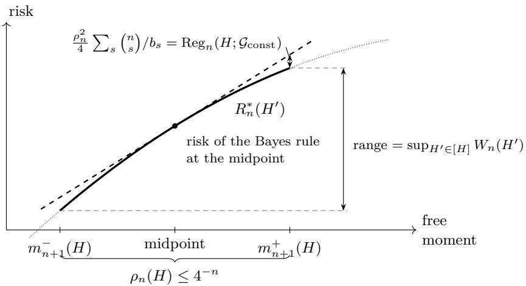  
Figure 4: The two prices of an unknown prior, for priors on constant maps (schematic). On the identified set [H] the risks depend on $H ^ { \prime } \in [ H ]$ only through the free moment $\int \theta ^ { n + 1 } d H ^ { \prime }$ , which ranges over an interval of length $\rho _ { n } ( H ) \leq 4 ^ { - n }$ , and the Bayes risk is a concave quadratic in it (Skibinsky, 1968, eqs. (8)–(9)); the risk of a fixed rule is afine in it, being linear in the moments of $H ^ { \prime }$ . The Bayes rule at the midpoint therefore has the tangent there as its risk, and its largest excess over the Bayes risk, at the endpoints, is the curvature term $( \rho _ { n } / 2 ) ^ { 2 } \sum _ { s } { \binom { n } { s } } / b _ { s } = \mathrm { R e g } _ { n } ( H ; \mathcal { G } _ { \mathrm { c o n s t } } )$ of (4.2). Skibinsky’s gap, maximized over $[ H ]$ , is the whole range of the Bayes risk over the interval (Skibinsky, 1968, Theorem 1); when the vertex lies outside the interval, as for the numerical maximizers with $n \geq 4$ (Remark 4.12), the range is $\rho _ { n } ( H )$ times the absolute slope at the midpoint and can be much larger.

## 4.8 The monotone base

Numerically, Skibinsky’s gap appears to have base 2 (Remark 4.12). For monotone maps the base of the regret lies in $[ 2 , \beta _ { \star } ]$ in the same sense, by Theorem 4.2, and we conjecture that monotone maps are no harder than constant ones (evidence below).

Conjecture 4.13 (The monotone base is $\beta _ { \star } )$ . For every Borel probability measure $\mu$ on [0, 1], $\begin{array} { r } { \operatorname* { l i m } _ { n  \infty } ( \operatorname* { s u p } _ { G \in \mathcal { G } _ { \mathrm { m o n o } } } \mathrm { R e g } _ { n } ( G ; \mathcal { G } _ { \mathrm { m o n o } } ) ) ^ { 1 / n } = 1 / \beta _ { \star } } \end{array}$

The conjecture on the monotone base. By Theorem 4.2 the lim inf is at least $1 / \beta _ { \star }$ , so Conjecture 4.13 asks for the matching upper bound. Evidence (numerical, evidence level E2; not a proof): for $n \leq 4$ , a pointwise version of the monotone problem—maximize the weighted squared range of $\mathbb { E } \prod _ { i } \theta _ { i }$ over pairs of laws on ordered tuples $0 \leq \theta _ { 0 } \leq \cdot \cdot \cdot \leq \theta _ { n } \leq 1$ with equal multilinear moments over every proper subset of coordinates—was optimized on grids (from 401 points per coordinate at $n = 1$ to 21 at $n = 4 )$ , and no value above its restriction to the diagona $\theta _ { 0 } = \cdots = \theta _ { n }$ , which is the constant-map problem, was found; the grid values are lower estimates. What resists is the lift: the proof of Theorem 4.6 transfers the unweighted Chebyshev bound to sorted vectors through matched-root products, while the base $\beta _ { \star }$ comes from the weighted bounds of Theorem 4.8, and we have no transfer of these weighted bounds to sorted vectors.

## 5 Numerical illustrations

These computations illustrate the theorems; no proof uses them. They are graded E1–E3 as in Table 1; an E3 value that is the identification regret of an explicit prior is a rigorous lower bound on the supremum. Seeds, parameter ranges and fit windows were fixed before each run (we call such a run declared). Later additions are marked post hoc, and every fitted slope is an in-sample fit to the runs it describes.

Rates (E1). Outputs were uniform on [0, 1] with Bernoulli labels around one fixed nondecreasing shape, and the questions difered from it by random shifts or by random bump perturbations whose number of bumps is the least-favorable one of the lower-bound construction; $n \in \{ 8 , 1 6 , . . . , 2 5 6 \}$ , $m \in \{ 1 0 , 3 0 , 1 0 0 , 3 0 0 \}$ five values of $\tau$ and two of $V ,$ , and 30 replications per configuration (10,800 runs). The terms of Φ appear where the declared range can show them. $\mathrm { A t } ~ \tau = 0$ the pooled isotonic fit has risk decaying in mn with fitted exponent −0.68 $( R ^ { 2 } = 0 . 9 9 8 )$ , against the predicted $- 2 / 3$ . At $( \tau , V ) = ( 0 . 3 , 0 . 3 )$ a two-stage estimator tuned with the true $( \tau , V )$ has exponent −0.633 in $n$ (bootstrap 95% interval $[ - 0 . 6 4 , - 0 . 6 3 ] )$ , against −2/3. The interval excludes $- 2 / 3 ;$ we read the gap as pre-asymptotic rather than as a diferent exponent. The risk of a specific estimator mixes terms with diferent constants (at $n = 8$ the variation term is still capped by $\tau ^ { 2 } = V ^ { 2 } = 0 . 0 9 )$ , so one slope fitted over $n \in [ 8 , 2 5 6 ]$ need not equal any single exponent, and slopes on sliding windows of three values of n range from −0.62 to −0.64. Its risk is nearly free of m: 2.99, 2.68, 2.44 and $2 . 4 3 \times 1 0 ^ { - 3 }$ at $n = 2 5 6$ for $m = 1 0 , 3 0 , 1 0 0 , 3 0 0$ . With three constants fitted in sample to the same runs, the three-term formula Φ reproduces the risk of the two-stage estimator tuned with the true $( \tau , V )$ in every configuration within a factor 2.3 (median deviation 12%); this describes the runs and is not an out-of-sample test. The regime min $\{ \tau ^ { 2 } , V ^ { 2 } \} = V ^ { 2 }$ was not tested, and per-question isotonic regression has not reached its asymptotic slope by $n = 2 5 6$ (local exponent −0.81).

The $1 / n$ term (E1, post hoc). The term $1 / n$ can dominate only when $V < \tau .$ , which the declared range did not contain. A post-hoc supplement with pure shifts $( V = 0 , \tau = 0 . 3 )$ gives exponents −0.92 and −0.96 for two shift-correcting estimators, against −1, and at $\tau = 0 . 1$ the local slope moves from −0.51 to −0.81 across $n \approx 1 / \tau ^ { 2 } = 1 0 0$ , the predicted crossover from the cap $\tau ^ { 2 }$ to $1 / n$

Adaptivity (E1). Figure 5 compares data-driven tuning rules. Choosing among the fixed estimators separately for each question, by two-fold cross-validation on that question’s labels (panels (a) and (b)), costs a median factor 2.5 to 2.6 and up to 14.6 over the best fixed estimator, and at $\tau = 0$ its risk decays in m with exponent only −0.15 to −0.18 instead of $- 2 / 3 \colon$ the selection noise of n labels does not shrink with m. Choosing once for all questions, by the cross-validation error summed over questions, stays within a factor 1.40 of the best fixed estimator everywhere in the declared range (median 1.05), without knowledge of $( \tau , V )$ (panel (c)). This compound rule is a close relative of the compound hold-out of Theorem 3.5 (two-fold cross-validation in place of one split, a fixed grid of seven radius pairs in place of the dyadic grid); it was added post hoc, after the failure of per-question tuning had been seen.

The constant-map identification regret (E2, with E3 lower bounds). For priors on constant maps the regret has the closed form of Proposition C.2, which we maximized over priors parametrized by their canonical moments: 68 starts plus diferential evolution for each $n \leq 3 0$ , and, post hoc, 10 starts for each $3 1 \leq n \leq 6 0$ . One basin was found at every n. The best prior at each n was re-evaluated in exact rational arithmetic, so each reported value $S _ { n }$ is a certified lower bound on su $\Rightarrow _ { H } \operatorname { R e g } _ { n } ( H ; \mathcal { G } _ { \mathrm { c o n s t } } )$ (E3), while its optimality is not certified (E2). Within $\mathcal { G } _ { \mathrm { c o n s t } }$ , the arcsine law is not extremal for $2 \leq n \leq 6 0$ (exact values, E3) and for $n \geq 6 2 \colon$ at $n = 6 2$ the even-n bound of Theorem 4.8(ii) exceeds $1 / ( 8 { \binom { 1 2 4 } { 6 2 } } )$ by a factor 3.3, and for $n \geq 6 3$ the bound $\beta _ { \star } ^ { - n } / ( 7 2 \sqrt { n } )$ exceeds $1 / ( 8 { \binom { 2 n } { n } } )$ ) (Remark C.6: the ratio of the two is $1 . 0 1 7 \dots \mathrm { a t } \ n = 6 3$ and increases from then on); $n = 6 1$ is not covered. $\mathrm { A t } \ n = 2$ the symmetric prior with second canonical moment $( { \sqrt { 5 } } - 1 ) / 2$ has regret $( 5 \sqrt { 5 } - 1 1 ) / 8 \approx 0 . 0 2 2 5 4$ , above the arcsine value $1 / 4 8 \approx 0 . 0 2 0 8 3$ . Figure 6 places the values against Theorem 4.8. The normalized values $\beta _ { \star } ^ { n } S _ { n }$ rise to 0.44 at $n = 1 2$ and then decrease slowly, to 0.29 at $n = 6 0$ , well inside the range $[ 1 / ( 7 2 \sqrt { n } ) , 1 ]$ that the theorem allows, while the arcsine regret, normalized the same way, decays like $\sqrt { n } ( \beta _ { \star } / 4 ) ^ { n }$ . The local base $S _ { n } / S _ { n + 1 }$ levels of far below 4: it peaks at 3.6205 at $n = 2 4$ and decreases to 3.607 at $n = 5 9$ , within 0.7% of $\beta _ { \star } \approx 3 . 5 8 3$ and still decreasing. A base-4 model with a polynomial prefactor, $S _ { n } \approx C n ^ { \alpha } 4 ^ { - n }$ , does not fit: the fitted α doubles, from 1.37 to 2.68, across the declared fit windows. The numerically optimal priors are symmetric (all odd canonical moments equal $1 / 2 )$ ; their even canonical moments alternate above and below $1 / 2$ at low indices and approach $1 / 2$ at high indices, so that their moment range falls short of $4 ^ { - n }$ by a factor between about $e ^ { - 0 . 0 6 n }$ and $e ^ { - 0 . 1 n }$ for $1 0 \leq n \leq 6 0$ the trade of moment range for a rare label pattern behind Theorem 4.8. Numerical evidence for Conjecture 4.13 from the same experiment is described in Section 4.8.

(a) per-question CV, all four fixed estimators  
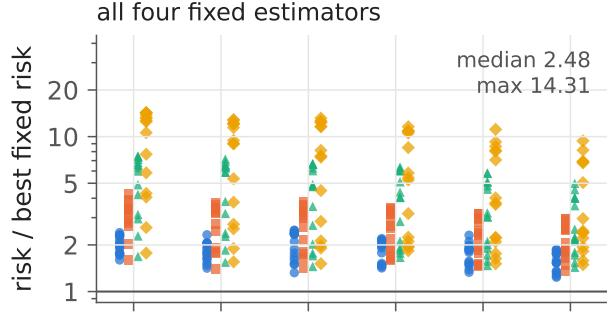

(b) per-question CV, without the two-stage estimator  
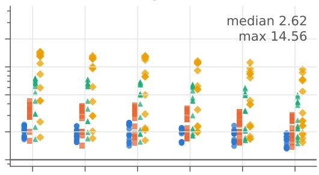

(c) global CV, two-stage on a fixed grid of radii (post hoc)  
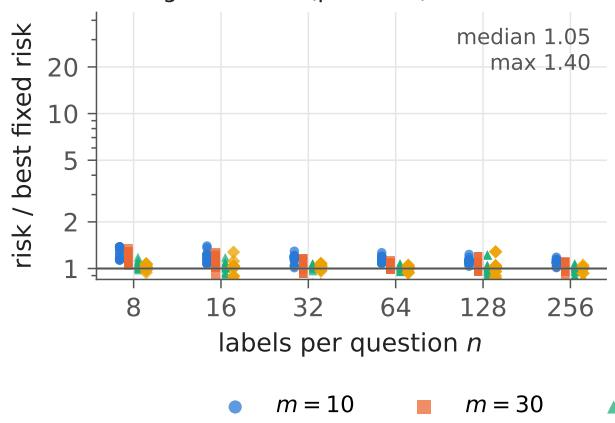

(d) global CV, all four fixed estimators (post hoc)  
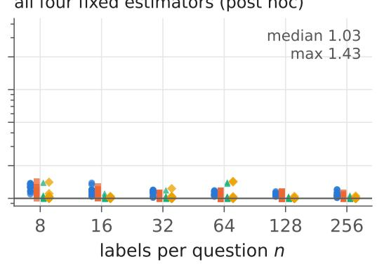  
Figure 5: Per-question versus compound tuning (numerical evidence, E1; 30 replications per configuration of the declared range). Each marker is one configuration, colored and shaped by m: the risk of a data-driven rule divided by the smallest risk among four fixed estimators (the pooled isotonic fit; the pooled fit plus a per-question mean shift; the two-stage estimator with the true $( \tau , V ) ;$ ; per-question isotonic regression). (a), (b): one choice per question by two-fold cross-validation on that question’s labels, (a) among all four fixed estimators, (b) without the two-stage estimator. (c), (d): one choice for all questions by the cross-validation error summed over questions, (c) among the pooled fit, the pooled fit plus shift, per-question isotonic regression and the two-stage estimator on a fixed grid of seven radius pairs (no knowledge of $( \tau , V ) )$ , (d) among all four fixed estimators. Panels (c) and (d) were added post hoc. The insets give the median and the maximum ratio over the range.

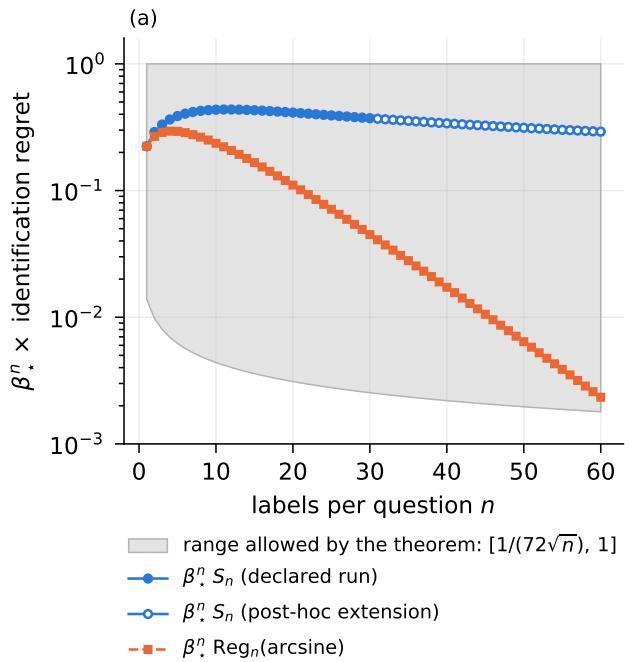

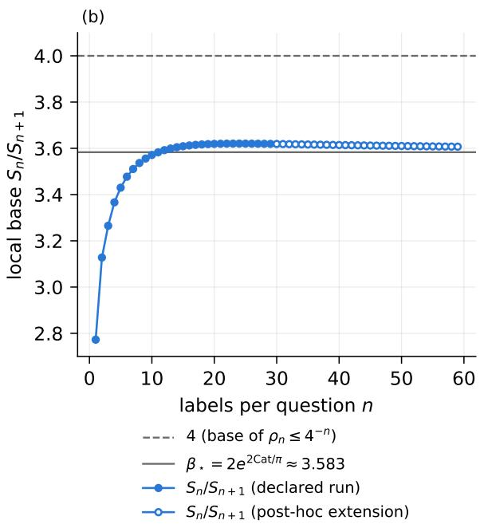  
Figure 6: The constant-map identification regret against Theorem 4.8 (numerical evidence). $S _ { n }$ is the largest value of Reg $( H ; \mathcal { G } _ { \mathrm { c o n s t } } )$ found by global search; each $S _ { n }$ is an exact-arithmetic lower bound on the supremum (E3), its optimality is not certified (E2). Filled markers: declared run $( n \leq 3 0 )$ ; open markers: post-hoc extension $( 3 1 \leq n \leq 6 0 )$ (a) $\beta _ { \star } ^ { n } S _ { n } ,$ , the range $[ 1 / ( 7 2 { \sqrt { n } } ) ,$ 1] allowed by Theorem 4.8, and the arcsine regret $\beta _ { \star } ^ { n } / ( 8 \binom { 2 n } { n } ) $ ). (b) The local base $S _ { n } / S _ { n + 1 }$ , with the base 4 of the moment range and $\beta _ { \star }$

## 6 Discussion

Across questions, the shape is learned from all mn labels, and the size of the deviations is tuned once, for all questions (Theorem 3.2 and Proposition 3.6); within a question, what n labels never reveal about a random monotone map costs at most $2 ^ { - n } \left( m = \infty \right)$ , and no number of other questions removes this cost (Theorem 4.2 and Corollary 4.7). The two answers use diferent benchmarks: the rate Φ guards against every heterogeneous configuration, while for exchangeable questions the Bayes risk can be exponentially smaller, and chasing it costs at most $2 ^ { - n }$ at $m = \infty$

## 6.1 Two benchmarks, and a practical reading

Two benchmarks for one problem. Both parts study the same compound problem, m questions with n labels each, against two benchmarks. Theorem 3.2 is a worst-case statement over $\Theta ( \tau , V )$ and needs no exchangeability: the maps are arbitrary members of the class. Theorem 4.2 applies when the questions are exchangeable draws from a prior $G ;$ the natural target is then the Bayes risk $R _ { n } ^ { * } ( G )$ , and it can be far below Φ: for the prior that picks the constant map $1 / 4$ or $3 / 4$ with probability $1 / 2$ each, $\begin{array} { r } { R _ { n } ^ { * } ( G ) \leq \frac { 1 } { 4 } e ^ { - n / 8 } } \end{array}$ , while the minimax risk of $\Theta ( 1 / 4 , 0 )$ , which contains these maps, is at least a universal constant times min $\{ 1 / 1 6 , 1 / n \}$ for non-atomic µ (Section 1). The second part prices what non-identification costs a practitioner who chases this Bayes target: at $m = \infty$ , the posterior mean of any monotone prior that reproduces the law of the data loses at most $2 ^ { - n }$ against it (Theorem $4 . 6 ( \mathrm { c } ) )$ , and for every finite m no procedure does better than the identification regret in the worst case over priors (Corollary 4.7). With finitely many questions the law of the data must itself be estimated, and a procedure that attains $2 ^ { - n }$ up to a vanishing term is open problem 2 of Section 6.2.

What the results say for practice. Three recommendations follow (constants not optimized).

Pool the shape. With $m = 3 0 0$ questions and $n = 1 6$ labels each (orders of magnitude, ignoring constants), a question on its own resolves its map only at the scale $n ^ { - 2 / 3 } \approx 0 . 1 6$ (the rate for $m = 1$ , Remark 3.3), while the pool resolves the shared shape at $( m n ) ^ { - 2 / 3 } \approx 0 . 0 0 3 5 ;$ what is left per question is its ofset, of order min $\{ \tau ^ { 2 } , 1 / n \}$ with $1 / n \approx 0 . 0 6$ , and its wiggle. A pooled fit followed by a per-question correction captures both, and the correction must be allowed to vanish: when the questions difer by less than $n ^ { - 1 / 2 }$ in sup-distance, ignoring the diferences is rate-optimal.2

Tune once, for all questions. The radii of the correction should be chosen once, from the hold-out error summed over questions (Definition 3.1). Theorem 3.5 covers this rule, and Proposition 3.6 shows that tuning each question on its own data cannot adapt: once $m ^ { 2 } / n$ and n are large, the best worst-case loss factor of such rules is of order min $\{ n , \log ( m ^ { 2 } / n ) \}$ . The simulations of Section 5 show per-question cross-validation among estimators that are mostly built on a pooled shape, a class the proposition does not cover, failing b factors up to 14.6 at moderate sizes.

Empirical-Bayes identification is a few-label phenomenon. By Theorem 4.2, not knowing the prior over monotone maps costs at most $2 ^ { - n } \ i$ : less than 0.008 for $n \geq 7$ and less than $1 0 ^ { - 3 }$ for $n \geq 1 0$ . Relative to the Bayes risk the decay is even sharper. For the arcsine prior on constant maps, $\theta \sim \mathrm { B e t a } ( \frac { 1 } { 2 } , \frac { 1 } { 2 } )$ , the posterior after s positive labels is Beta $( { \textstyle { \frac { 1 } { 2 } } } + s , { \frac { 1 } { 2 } } + n - s )$ , with mean $( \textstyle { \frac { 1 } { 2 } } + s ) / ( n + 1 )$ . Since $\textstyle \operatorname { V a r } \theta = { \frac { 1 } { 8 } }$ and the Beta–binomial count has Var $\begin{array} { r } { s = n ( n + 1 ) / 8 , R _ { n } ^ { * } = \operatorname { \mathbb { E } } \operatorname { V a r } ( \theta \mid s ) = \operatorname { V a r } \theta - \operatorname { V a r } \left( \frac { 1 / 2 + s } { n + 1 } \right) = \frac { 1 } { 8 } - \frac { n } { 8 ( n + 1 ) } = \frac { 1 } { 8 ( n + 1 ) } } \end{array}$ Its identification regret within $\mathcal { G } _ { \mathrm { c o n s t } }$ is $1 / ( 8 { \binom { 2 n } { n } } )$ ) (Proposition C.2), so the ratio is $( n + 1 ) / { \binom { 2 n } { n } } \colon 1 , 1 / 2 , 1 / 5$ $1 / 1 4$ and $1 / 4 2$ for $n = 1 , \ldots , 5$ . So with one to three labels per question the identification loss can be of the order of the Bayes risk itself, and no amount of pooling removes it (Corollary 4.7); from about ten labels per question on, the posterior mean of any monotone prior that reproduces the law of the data is within $1 0 ^ { - 3 }$ of the Bayes risk (Theorem $4 . 6 ( \mathrm { c } ) )$ . The ratio $\textstyle { \left( n + 1 \right) } / { \binom { 2 n } { n } }$ is specific to the arcsine prior; uniformly over priors on constant maps, Joshi’s result says that Skibinsky’s gap is $O ( n ^ { - 1 / 2 } )$ times the Bayes risk (Joshi, 1975).

These upper bounds hold at $m = \infty ;$ estimating the law of the data from finitely many questions is open problem 2.

## 6.2 Open problems

Section A.2 lists the limitations of our results. In particular, the rate theorems bound the average risk over questions, not the worst question’s. The open problems they leave are the following.

1. The monotone base. Prove Conjecture 4.13: for priors on monotone maps the identification regret decays with base $\beta _ { \star }$ , as for constant maps, rather than with base 2. A quantitative form would be $\operatorname* { s u p } _ { \mathcal G _ { \mathrm { m o n o } } } \mathrm { R e g } _ { n } \leq$ $\begin{array} { r } { \operatorname { p o l y } ( n ) \operatorname { s u p } _ { \mathcal G _ { \mathrm { c o n s t } } } \operatorname { R e g } _ { n } } \end{array}$ . The upper bound of Theorem 4.6 uses only the diameter of the unidentified moment, which Lemma 4.5 controls on sorted vectors; the base $\beta _ { \star }$ comes instead from a weighted inequality, the Szegő-type bound of Theorem 4.8, in which the moment range is traded against the probabilities of the label patterns. The natural route is a weighted analogue of Lemma 4.5 on the ordered simplex, and we do not know one. Even for constant maps the polynomial prefactor is open: our bounds difer by $7 2 { \sqrt { n } } ,$ , and the numerics of Figure 6 suggest a prefactor that decays, but slowly.

2. Empirical Bayes with finitely many questions. Give an empirical-Bayes procedure with compound risk at most $R _ { n } ^ { * } ( G ) + 2 ^ { - n } + \varepsilon _ { m } .$ , with an explicit $\varepsilon _ { m } \to 0$ , for every prior $G \in \mathcal { G } _ { \mathrm { m o n o } }$ —for instance the posterior mean of a nonparametric maximum-likelihood prior fitted to the pooled data, at least for a finite output grid. Theorem $4 . 6 ( \mathrm { c } )$ handles the limit case, a fitted prior that reproduces the law of the data exactly, and Corollary 4.7 shows that the term $2 ^ { - n }$ cannot be replaced by anything below the identification regret, whatever $m$ . What is missing is stability: if $\operatorname { L a w } _ { G ^ { \prime \prime } } ( D )$ is only ε-close to $\operatorname { L a w } _ { G } ( D )$ , say in Hellinger distance, how far is the posterior mean of $G ^ { \prime \prime }$ from the Bayes rule of $G 2$ The dificulty is that the posterior mean divides by the pattern probabilities $Z _ { G }$ , and the rare label patterns that drive the lower bound of Theorem 4.8 are exactly where small errors in the law of the data are amplified.

3. Discrete outputs. Deployed models often report probabilities on a finite grid, and then Theorem 3.2 does not apply: for a point mass $\mu = \delta _ { 1 / 2 }$ and $\tau = 0$ , the pooled label mean already has risk at most $1 / ( 4 m n )$ , far below $( m n ) ^ { - 2 / 3 }$ . Determine the compound minimax rate when $\mu$ has L atoms, as a function of $( m , n , L , \tau , V )$ . Per-atom averaging suggests a parametric regime when $L$ is small compared with $( m n ) ^ { 1 / 3 }$ and the answer should interpolate between it and Φ. Our lower bound does not help: it transports every non-atomic $\mu$ to the uniform law by a quantile transform, which atoms break, and its shared hypercube uses about $( m n ) ^ { 1 / 3 }$ bumps, which need that many distinct output values.

4. Lower bounds for calibration error. Our lower bounds are for the excess Brier risk; for calibration error alone no lower bound of the order of Φ can hold, since at $\tau = 0$ the pooled label mean has expected calibration error at most $1 / ( 4 m n )$ (Section 2.3). The meaningful question is a trade-of: among estimators whose excess Brier risk is within a constant factor of Φ, how small can the compound calibration error be, in $L _ { 2 }$ or in the $L _ { 1 }$ and smooth calibration errors used in practice? Our upper bounds give Φ for the $L _ { 2 }$ version, and the isotonic fits we use are step functions, for which calibration error can be strictly smaller than the risk. The obstacle to a lower bound is that calibration error depends on the level sets of the estimate and not only on its distance to the truth, while the Assouad constructions of Theorem 3.2 control distances.

5. Is monotonicity necessary? Remark C.4 shows that without monotonicity in a known direction the unidentified moment is no longer confined to an interval of length $4 ^ { - n }$ . Does the identification regret still decay exponentially, or at all, for priors on arbitrary measurable maps $[ 0 , 1 ]  [ 0 , 1 ] ?$ Without an order, the values of the map at $n + 1$ points form an arbitrary point of the cube, and Lemma 4.5 has no analogue; an answer in either direction would show whether shape constraints are what makes empirical-Bayes recalibration nearly free of identification loss.

6. Questions with their own output laws. All our results for the compound rate assume one output law µ shared by all questions. With question-specific laws $\mu _ { j }$ the pooled isotonic fit targets the monotone projection of a weighted average of the maps, not their average, and our argument does not control the deviations of the questions from it (Section 2.4). Determine the compound minimax rate when the $\mu _ { j }$ difer, for instance when they have densities with respect to a common law that are bounded above and below by constants.

7. Per-question tuning around a pooled shape. Proposition 3.6 covers procedures that tune each question on its own data only. A natural intermediate procedure estimates the shape from the pooled data and then tunes each question’s correction on that question’s labels alone. Does such a rule attain Φ adaptively, or does it also lose a factor that grows with $m ^ { 2 } / n ?$ Our lower bound does not apply: the pooled shape estimate is a statistic of all questions and can carry information about the size of the shifts, so the likelihood-ratio argument of Section B.5, which compares the laws of one question’s data alone, breaks down. The evidence points to a loss: panels (a) and (b) of ${ \mathrm { F i g u r e ~ 5 ~ ( E 1 ) } }$ show such per-question choices costing up to a factor 14.6 at moderate sizes, but no rate in $m ^ { 2 } / n$ can be read of a box of four values of $m$

8. The worst question. Our fixed-efects theorems bound the average risk over questions (Section $\mathrm { A . 2 ( v i i i ) } )$ the compound hold-out of Definition 3.1 selects one pair of radii by the hold-out error summed over questions, and its guarantee (Proposition B.8) controls only the average. Does some adaptive procedure attain maxj $\begin{array} { r } { \mathbb { E } \| \widehat { g } _ { j } - g _ { j } \| _ { L _ { 2 } ( \mu ) } ^ { 2 } \leq C \Phi ( m , n , \tau , V ) } \end{array}$ over $\Theta ( \tau , V )$ , and if not, what is the price of a worst-question guarantee?

9. The base of Skibinsky’s gap. Prove that sup $_ { T } W _ { n } ( H ) \geq 2 ^ { - n } / \operatorname { p o l y } ( n )$ , so that Skibinsky’s bound $2 ^ { - n }$ is sharp in the base, as the numerics of Remark 4.12 suggest; Corollary 4.11 gives only $\beta _ { \star } ^ { - n } / ( 7 2 \sqrt { n } )$ The lower bound needs priors for which the Bayes risk changes steeply along the moment interval while the interval stays within a polynomial factor of its largest length $4 ^ { - n }$ . The numerical maximizers (E2) point to a shape: their posterior means jump from about $1 / 4$ to about $3 / 4$ near $s = n / 2$ , as for a prior with two clusters, and their canonical moments of high order are close to $1 / 2$

## AI Disclosure

In preparing this work we made use of AI assistants based on large language models. They helped us survey and summarize the literature, develop and cross-check proof arguments, run and verify the numerical computations, and draft and edit parts of the text, the figures and the LATEX source. Every mathematical statement, proof, citation and numerical claim was checked by the authors, who take full responsibility for the content of the paper.

## References

Gustaf Ahdritz, Aravind Gollakota, Parikshit Gopalan, Charlotte Peale, and Udi Wieder. Provable uncertainty decomposition via higher-order calibration. In International Conference on Learning Representations (ICLR), 2025.

J. Baxter. A model of inductive bias learning. Journal of Artificial Intelligence Research, 12:149–198, 2000. doi: 10.1613/jair.731.

James O. Berger. An overview of robust Bayesian analysis (with discussion). Test, 3(1):5–124, 1994. doi: 10.1007/BF02562676.

Stéphane Boucheron, Gábor Lugosi, and Pascal Massart. Concentration Inequalities: A Nonasymptotic Theory of Independence. Oxford University Press, 2013. doi: 10.1093/acprof:oso/9780199535255.001.0001.

Lawrence D. Brown and Mark G. Low. A constrained risk inequality with applications to nonparametric functional estimation. The Annals of Statistics, 24(6):2524–2535, 1996. doi: 10.1214/aos/1032181166.

T. Tony Cai and Hongming Pu. Transfer learning for nonparametric regression: Non-asymptotic minimax analysis and adaptive procedure. arXiv preprint arXiv:2401.12272, 2024. URL https://arxiv.org/abs/2401. 12272.

T. Tony Cai and Hongji Wei. Transfer learning for nonparametric classification: Minimax rate and adaptive classifier. The Annals of Statistics, 49(1):100–128, 2021. doi: 10.1214/20-AOS1949.

Abhinav Chakraborty and Subha Maity. The statistical cost of adaptation in multi-source transfer learning. arXiv preprint arXiv:2605.09471, 2026. URL https://arxiv.org/abs/2605.09471.

Sabyasachi Chatterjee, Adityanand Guntuboyina, and Bodhisattva Sen. On risk bounds in isotonic and other shape restricted regression problems. The Annals of Statistics, 43(4):1774–1800, 2015. doi: 10.1214/ 15-AOS1324.

Shuxiao Chen, Qinqing Zheng, Qi Long, and Weijie J. Su. Minimax estimation for personalized federated learning: An alternative between fedavg and local training? Journal of Machine Learning Research, 24: 1–59, 2023.

Yan Chen and Lihua Lei. Compound estimation for binomials. arXiv preprint arXiv:2512.25042, 2025. URL https://arxiv.org/abs/2512.25042.

Kamil Ciosek, Banafsheh Rafiee, Sina Ghiassian, and Nicolò Felicioni. The minimax rate of perturbed second-order calibration. In Advances in Neural Information Processing Systems (NeurIPS 2026), to appear, 2026. URL https://arxiv.org/abs/2605.07808.

Convai Innovations. Laya: Multilingual, non-autoregressive System 1 decision engine. GitHub repository, https://github.com/NandhaKishorM/laya, Apache-2.0 license, 2026.

Holger Dette and William J. Studden. The Theory of Canonical Moments with Applications in Statistics, Probability, and Analysis. Wiley Series in Probability and Statistics. John Wiley & Sons, New York, 1997. ISBN 978-0-471-10991-4.

Holger Dette and Dominik Tomecki. Hankel determinants of random moment sequences. Journal of Theoretical Probability, 30(4):1539–1564, 2017. doi: 10.1007/s10959-016-0699-z.

Holger Dette and Jens Wagener. Matrix measures on the unit circle, moment spaces, orthogonal polynomials and the Geronimus relations. Linear Algebra and its Applications, 432(7):1609–1626, 2010. doi: 10.1016/j. laa.2009.11.006.

Mareike Dressler, Simon Foucart, Mioara Joldes, Etienne de Klerk, J. B. Lasserre, and Yuan Xu. Least multivariate Chebyshev polynomials on diagonally determined sets. SIAM Journal on Applied Algebra and Geometry, 10(2):450–466, 2026. doi: 10.1137/24M1717853.

Yaqi Duan and Kaizheng Wang. Adaptive and robust multi-task learning. The Annals of Statistics, 51(5): 2015–2039, 2023. doi: 10.1214/23-AOS2319.

Nicolas Emmenegger, Ellery Stahler, and Chara Podimata. Prediction-powered inference across many tasks for AI evaluation & social science research. arXiv preprint arXiv:2605.29249, 2026. URL https: //arxiv.org/abs/2605.29249.

Fabrice Gamboa and Li-Vang Lozada-Chang. Large deviations for random power moment problem. The Annals of Probability, 32(3B):2819–2837, 2004. doi: 10.1214/009117904000000559.

Fabrice Gamboa and Alain Rouault. Canonical moments and random spectral measures. Journal of Theoretical Probability, 23(4):1015–1038, 2010. doi: 10.1007/s10959-009-0239-1.

Fabrice Gamboa, Jan Nagel, and Alain Rouault. Sum rules via large deviations. Journal of Functional Analysis, 270(2):509–559, 2016. doi: 10.1016/j.jfa.2015.08.009.

Parikshit Gopalan, Princewill Okoroafor, Prasad Raghavendra, Abhishek Shetty, and Mihir Singhal. Omnipredictors for regression and the approximate rank of convex functions. In COLT, PMLR 247, 2024.

Adityanand Guntuboyina and Bodhisattva Sen. Nonparametric shape-restricted regression. Statistical Science, 33(4):568–594, 2018. doi: 10.1214/18-STS665.

Adityanand Guntuboyina, Donovan Lieu, Sabyasachi Chatterjee, and Bodhisattva Sen. Adaptive risk bounds in univariate total variation denoising and trend filtering. The Annals of Statistics, 48(1):205–229, 2020. doi: 10.1214/18-AOS1799.

Qiyang Han, Tengyao Wang, Sabyasachi Chatterjee, and Richard J. Samworth. Isotonic regression in general dimensions. The Annals of Statistics, 47(5):2440–2471, 2019. doi: 10.1214/18-AOS1753.

Steve Hanneke and Samory Kpotufe. A no-free-lunch theorem for multitask learning. The Annals of Statistics, 50(6):3119–3143, 2022. doi: 10.1214/22-AOS2189.

Steve Hanneke and Mingyue Xu. When more data doesn’t help: Limits of adaptation in multitask learning. In Proceedings of the 43rd International Conference on Machine Learning (ICML 2026), volume 306 of Proceedings of Machine Learning Research, pages 40378–40404. PMLR, 2026. URL https://proceedings. mlr.press/v306/hanneke26c.html.

Xinmeng Huang, Kan Xu, Donghwan Lee, Hamed Hassani, Hamsa Bastani, and Edgar Dobriban. Optimal multitask linear regression and contextual bandits under sparse heterogeneity. Journal of the American Statistical Association, 120(552):2262–2275, 2025. doi: 10.1080/01621459.2024.2439622.

Nikolaos Ignatiadis and Stefan Wager. Confidence intervals for nonparametric empirical bayes analysis. Journal of the American Statistical Association, 117(539):1149–1166, 2022. doi: 10.1080/01621459.2021.2008403.

Nikolaos Ignatiadis, Sujayam Saha, Dennis L. Sun, and Omkar Muralidharan. Empirical bayes mean estimation with nonparametric errors via order statistic regression on replicated data. Journal of the American Statistical Association, 118(542):987–999, 2023. doi: 10.1080/01621459.2021.1967164.

Disi Ji, Padhraic Smyth, and Mark Steyvers. Can I trust my fairness metric? Assessing fairness with unlabeled data and Bayesian inference. In Advances in Neural Information Processing Systems 33 (NeurIPS 2020), pages 18600–18612, 2020.

Daniel D. Johnson, Daniel Tarlow, David Duvenaud, and Chris J. Maddison. Experts don’t cheat: Learning what you don’t know by predicting pairs. In Proceedings of the 41st International Conference on Machine Learning (ICML 2024), volume 235 of Proceedings of Machine Learning Research, pages 22406–22464, 2024.

V. M. Joshi. On the minimax estimation of a random probability with known first N moments. The Annals of Statistics, 3(3):680–687, 1975. doi: 10.1214/aos/1176343130.

Saman Sarker Joy. Do System One decisions add up? A study of probabilistic coherence. arXiv preprint arXiv:2609.33971, 2026. URL https://arxiv.org/abs/2609.33971.

Mohammad Jafari Jozani and Nahid Jafari Tabrizi. Intrinsic posterior regret gamma-minimax estimation for the exponential family of distributions. Electronic Journal of Statistics, 7:1856–1874, 2013. doi: 10.1214/13-EJS828.

Alois Kneip and Joachim Engel. Model estimation in nonlinear regression under shape invariance. The Annals of Statistics, 23(2):551–570, 1995. doi: 10.1214/aos/1176324535.

Nobushige Kurokawa. Quantum deformations of Catalan’s constant, Mahler’s measure and the Hölder– Shintani double sine function. Proceedings of the Edinburgh Mathematical Society, 49(3):667–681, 2006. doi: 10.1017/S0013091505000015.

Xiang Lisa Li, Urvashi Khandelwal, and Kelvin Guu. Few-shot recalibration of language models. arXiv preprint arXiv:2403.18286, 2024. URL https://arxiv.org/abs/2403.18286.

Charles F. Manski. Econometrics for decision making: Building foundations sketched by Haavelmo and Wald. Econometrica, 89(6):2827–2853, 2021. doi: 10.3982/ECTA17985.

Mary Meyer and Michael Woodroofe. On the degrees of freedom in shape-restricted regression. The Annals of Statistics, 28(4):1083–1104, 2000. doi: 10.1214/aos/1015956708.

José Luis Montiel Olea, Chen Qiu, and Jörg Stoye. Decision theory for treatment choice problems with partial identification. The Review of Economic Studies, 2026. doi: 10.1093/restud/rdag015.

Yury Polyanskiy and Yihong Wu. Sharp regret bounds for empirical Bayes and compound decision problems. arXiv preprint arXiv:2109.03943, 2021. URL https://arxiv.org/abs/2109.03943.

Arnav Raj. PEBS: Per-rater empirical-Bayes shrinkage for RLHF reward-model calibration. ICML 2026 Workshop on Pluralistic Alignment, 2026.

David Ríos Insua, Fabrizio Ruggeri, and Brani Vidakovic. Some results on posterior regret Γ-minimax estimation. Statistics & Decisions, 13(4):315–332, 1995. doi: 10.1524/strm.1995.13.4.315.

Herbert Robbins. Asymptotically subminimax solutions of compound statistical decision problems. In Proceedings of the Second Berkeley Symposium on Mathematical Statistics and Probability, pages 131–148. University of California Press, 1951. doi: 10.1525/9780520411586-011.

Herbert Robbins. An empirical Bayes approach to statistics. In Jerzy Neyman, editor, Proceedings of the Third Berkeley Symposium on Mathematical Statistics and Probability, Volume 1: Contributions to the Theory of Statistics, pages 157–163. University of California Press, 1956. doi: 10.1525/9780520313880-015.

Herbert Robbins. The empirical Bayes approach to statistical decision problems. The Annals of Mathematical Statistics, 35(1):1–20, 1964. doi: 10.1214/aoms/1177703729.

Rahul Sharma, Andrew B. Ducan, Gaétan Marceau Caron, and Sebastian J. Vollmer. TypedBench: A benchmark for calibration, framing sensitivity, and cost in System One decision models. arXiv preprint arXiv:2610.11392, 2026. URL https://arxiv.org/abs/2610.11392.

Barry Simon. OPUC on one foot. Bulletin of the American Mathematical Society, 42(4):431–460, 2005. doi: 10.1090/S0273-0979-05-01075-X.

S. Sivaganesan and James O. Berger. Robust bayesian analysis of the binomial empirical bayes problem. Canadian Journal of Statistics, 21(1):107–119, 1993. doi: 10.2307/3315663.

Morris Skibinsky. The range of the (n+1)th moment for distributions on [0,1]. Journal of Applied Probability, 4(3):543–552, 1967. doi: 10.2307/3212220.

Morris Skibinsky. Minimax estimation of a random probability whose first N moments are known. The Annals of Mathematical Statistics, 39(2):492–501, 1968. doi: 10.1214/aoms/1177698412.

Morris Skibinsky. Some striking properties of binomial and beta moments. The Annals of Mathematical Statistics, 40(5):1753–1764, 1969. doi: 10.1214/aoms/1177697387.

Morris Skibinsky and Andrew L. Rukhin. Admissible estimators of binomial probability and the inverse Bayes rule map. Annals of the Institute of Statistical Mathematics, 41(4):699–716, 1989. doi: 10.1007/BF00057736.

Kevin Tian, Weihao Kong, and Gregory Valiant. Learning populations of parameters. In Advances in Neural Information Processing Systems 30 (NIPS 2017), 2017.

Ye Tian, Yuqi Gu, and Yang Feng. Learning from similar linear representations: Adaptivity, minimaxity, and robustness. Journal of Machine Learning Research, 26(187):1–125, 2025.

Alexandre B. Tsybakov. Introduction to Nonparametric Estimation. Springer Series in Statistics. Springer, 2009. doi: 10.1007/b13794.

TypeSafe AI. Introduction. TypeSafe AI documentation, https://docs.typesafe.ai/introduction, 2026a.

TypeSafe AI. Introducing system one models & jev. TypeSafe AI blog, https : / / typesafe . ai / blog / introducing-system-one-models-and-jev, 2026b.

Sara A. van de Geer. Empirical Processes in M-Estimation, volume 6 of Cambridge Series in Statistical and Probabilistic Mathematics. Cambridge University Press, 2000.

Aad W. van der Vaart and Jon A. Wellner. Weak Convergence and Empirical Processes: With Applications to Statistics. Springer Series in Statistics. Springer, New York, 1996. doi: 10.1007/978-1-4757-2545-2.

Roman Vershynin. High-Dimensional Probability: An Introduction with Applications in Data Science. Cambridge University Press, 2018. doi: 10.1017/9781108231596.

Ramya Korlakai Vinayak, Weihao Kong, Gregory Valiant, and Sham M. Kakade. Maximum likelihood estimation for learning populations of parameters. In Proceedings of the 36th International Conference on Machine Learning (ICML 2019), volume 97 of Proceedings of Machine Learning Research, pages 6448–6457, 2019.

Cun-Hui Zhang. Risk bounds in isotonic regression. The Annals of Statistics, 30(2):528–555, 2002. doi: 10.1214/aos/1021379864.

Cun-Hui Zhang. Compound decision theory and empirical Bayes methods. The Annals of Statistics, 31(2): 379–390, 2003. doi: 10.1214/aos/1051027872.

Shengjia Zhao, Michael P. Kim, Roshni Sahoo, Tengyu Ma, and Stefano Ermon. Calibrating predictions to decisions: A novel approach to multi-class calibration. In Advances in Neural Information Processing Systems 34 (NeurIPS 2021), pages 22313–22324, 2021.

## A Related work and limitations

This appendix gives a more detailed account of related work (Section A.1) and the full list of the limitations of our results (Section A.2).

## A.1 Extended related work

Shape-constrained regression. The worst-case risk of isotonic least squares, of order $( V / n ) ^ { 2 / 3 } + \log ( e n ) / n$ for a nondecreasing signal of variation V and unit noise variance, is due to Zhang (2002) (for Gaussian errors it appeared in Meyer and Woodroofe, 2000); adaptive bounds of order $\left( k + 1 \right) \log ( e n ) / n$ for monotone signals with k jumps are due to Chatterjee et al. (2015), analogous bounds for total-variation denoising to Guntuboyina et al. (2020), and isotonic regression in dimension $d \geq 2$ , on a lattice or with random design, is treated by Han et al. (2019); see Guntuboyina and Sen (2018) for a survey. These results bound the risk at the design points, in the empirical norm (which is $L _ { 2 } ( P _ { n } )$ in the random-design case). We need the population norm $L _ { 2 } ( \mu )$ and observations that are independent but not identically distributed, so we prove the bounds we use (Lemma B.2 and Proposition 3.4) by bracketing chaining with Bernstein’s inequality, followed by peeling, in the tradition of van der Vaart and Wellner (1996) and van de Geer (2000). The shift model $V = 0 , g _ { j } = g _ { 0 } + c _ { j }$ , is the vertical-shift special case of the shape-invariant model of Kneip and Enge (1995), in which every curve is a common shape under a linear change of both axes; there the shape and the curve parameters are estimated by alternating least squares and kernel smoothing, and the results concern asymptotic distributions and asymptotic bias and variance.

Multitask and transfer learning. Learning many related tasks together goes back at least to Baxter (2000), and the shape of (1.1) follows the shared-plus-local template. Its closest parametric instance is the adaptive and robust multitask estimator of Duan and Wang (2023): for m tasks with d-dimensional parameters within distance δ of a common center, apart from a small fraction of outlier tasks, it attains compound risk of order $d / ( m n ) + \operatorname* { m i n } \{ \delta ^ { 2 } , d / n \}$ (plus a term for the outliers) adaptively, up to logarithmic factors, and this matches a minimax lower bound for multitask Gaussian mean estimation. Huang et al. (2025) obtain optimal rates, up to logarithmic factors, for multitask linear regression when the task parameters difer from a common one in at most s coordinates; Tian et al. (2025) give nearly minimax rates, adaptive to the degree of similarity, when the tasks share a linear representation up to a perturbation; and Chen et al. (2023) find the phase transition between federated averaging and local training in personalized federated learning. In nonparametric transfer learning, Cai and Wei (2021) give the minimax rate and an adaptive classifier for classification, and Cai and Pu (2024) minimax rates, up to logarithmic factors, and an adaptive procedure for regression under posterior drift. Theorem 3.2 is a shape-constrained, random-design, Bernoulli analogue of this template (Remark 3.3): the rate holds with universal constants and with no logarithmic factors, and adaptation is achieved by one compound hold-out choice.

Limits of adaptation in multitask learning have a diferent source. In multitask classification with a common optimal classifier, Hanneke and Kpotufe (2022) show that the minimax rate improves with the number of tasks but that, without distributional information, no algorithm can adapt in general: for noisy classes (Bernstein parameter $\beta < 1 )$ and fewer than $2 / \beta - 1$ samples per task it is stuck at the rate of the target task alone; Hanneke and Xu (2026) extend this impossibility to arbitrarily large samples per task when the tasks are super-exponentially many. For parametric multi-source transfer with biased sources, Chakraborty and Maity (2026) define an intrinsic cost of adaptation, the smallest, over bias-agnostic estimators, worst-case ratio of the risk to the oracle minimax rate; it is free with one source and has a phase transition with two or more. These limits concern unknown task relatedness or source quality. Proposition 3.6 is of another kind: in a known shared-plus-local class, where one compound hold-out adapts, it is the cost, of order min $\{ n , \log ( m ^ { 2 } / n ) \}$ , of tuning each question on its own data.

Compound decisions and empirical Bayes. Robbins’ compound decision problem (Robbins, 1951) treats many independent problems of the same form jointly, and his empirical-Bayes program (Robbins, 1956) models the unknown parameters as draws from an unknown prior; Zhang (2003) surveys both and stresses that stochastically independent experiments need not be uninformative about one another. Our two parts are the compound and the empirical-Bayes view of one problem. For binomial data the empirical-Bayes rule is not identified: after n trials the Bayes rule depends on the first $n + 1$ moments of the prior (Skibinsky and Rukhin, 1989), while only n are estimable. Robbins (1964, Section 5) works out the case $n = 1$ . Skibinsky (1968) quantifies the price for every n: over the class of priors with given first n moments, the minimax risk exceeds the Bayes risk of each member by at most $2 ^ { - n }$ . He records Robbins’ conjecture that this gap is negligible relative to the Bayes risk, which Joshi (1975) proved, with relative gap $O ( n ^ { - 1 / 2 } )$ uniformly over priors. Remark 4.10 and Section 4.7 relate these quantities to ours. Our identification regret difers from the empirical-Bayes regret of Polyanskiy and Wu (2021), the total excess risk of a data-driven procedure over m coordinates relative to m times the Bayes risk of the oracle that knows the prior; Robbins showed that it can be made $o ( m )$ , and they determine its optimal order for Poisson models and give lower bounds for normal means. Ours is measured against a Bayes risk that the data cannot identify even as the number of questions grows, so no procedure beats it at any m (Corollary 4.7): it is a floor, not the estimation cost of a procedure. Sivaganesan and Berger (1993) study the range of posterior means over all priors with the estimable moments, and Ignatiadis and Wager (2022), constructing confidence intervals for nonparametric empirical-Bayes estimands, note that the binomial posterior mean is only partially identified. Two contrasts are instructive. Tian et al. (2017) show that a population of coin biases is recoverable from t flips per coin only to Wasserstein error of order $1 / t$ , and the maximum likelihood estimator attains this order when t is small compared with the logarithm of the number of coins (Vinayak et al., 2019); the Bayes rule, in contrast, is identified up to an exponentially small regret—identifying the prior and identifying the Bayes rule are very diferent problems. In a replicated-data setting with nonparametric noise, Ignatiadis et al. (2023) bound the loss from using $K - 1$ of $K$ replicates by a quantity of order $1 / K ^ { 2 }$ in regular problems. Chen and Lei (2025) study compound estimation for binomials; a bias bound of order $2 ^ { - n }$ in their work has the same source as ours, the unidentified $( n + 1 )$ -th moment.

Partial identification and Γ-minimax. Restricting attention to the priors consistent with the data is the moment class of robust Bayesian analysis (Berger, 1994; Sivaganesan and Berger, 1993). Our regret is the posterior regret of Γ-minimax estimation (Ríos Insua et al., 1995), with $\Gamma = [ G ]$ the identified set, averaged over the common law of the data and with the supremum over Γ taken after averaging. Under squared loss and for a single real estimand, the posterior-regret Γ-minimax action is the midpoint of the range of posterior means over Γ (see, e.g., Jozani and Tabrizi, 2013, Example 1), just as the minimax-regret predictor under partial identification is the midpoint of the identified interval (Manski, 2021); minimax-regret rules for treatment choice under partial identification are studied by Olea et al. (2026). Proposition 4.4 is the integrated, functional version of the midpoint rule: the identified Bayes rules form a set of functions of $( p , X )$ governed by one unidentified $( n + 1 )$ -point moment function, the regret is integrated over the data with an explicit weight $w _ { G }$ , the midpoint becomes a Chebyshev centre in a weighted $L _ { 2 }$ space, and a measurable centre, hence a minimax rule, exists.

Moment spaces and Szegő asymptotics. The moment range is a product of canonical moments, $\begin{array} { r } { \rho _ { n } = \prod _ { k < n } p _ { k } ( 1 - p _ { k } ) } \end{array}$ (Skibinsky, 1967); see Dette and Studden (1997) for the theory, in which the arcsine law, all of whose canonical moments equal $1 / 2$ (Dette and Tomecki, 2017; Skibinsky, 1969), is the center of the moment space. The Szegő-type sandwich in Theorem $4 . 8 ( \mathrm { i i i } )$ is classical: it can be read of from Gamboa and Lozada-Chang (2004, Theorem 3.1 and Remark 3.1), and through the identification of canonical moments with Verblunsky coeficients (Dette and Wagener, 2010; Gamboa and Rouault, 2010) it is a finite-n form of Szegő’s theorem for orthogonal polynomials on the unit circle (Gamboa et al., 2016; Simon, 2005); see Remark 4.9. What is new is its use: the supremum of the identification regret, its exact exponential base, and near-extremal priors. Finally, the value $2 ^ { - ( 2 n + 1 ) }$ in Lemma 4.5 is the least Chebyshev norm on the ordered simplex computed by Dressler et al. (2026), whose exhibited extremal polynomials are univariate; we did not find in the literature the diagonal-domination inequality for sorted vectors, or the fact that the matched multi-afine product, which is what our moment argument needs, attains this value.

Calibration and recalibration. Calibration of a single predictor across groups and decisions is a large literature (Gopalan et al., 2024; Zhao et al., 2021); our object is diferent—many recalibration maps, one per question, each with few labels. Recalibration with little labelled data per unit has been approached by predicting a slice’s recalibration curve from a few unlabelled examples (Li et al., 2024), by hierarchical Bayesian models for per-group calibration with few labels (Ji et al., 2020), and, in a workshop paper, by empirical-Bayes shrinkage of per-rater afine calibrators of reward models (Raj, 2026); these works propose and evaluate methods, while we ask what is achievable in the minimax sense. Emmenegger et al. (2026) study prediction-powered inference across many tasks. That k labels per instance identify k moments of the conditional law also drives higher-order calibration (Ahdritz et al., 2025) and the equivalence between second-order calibration and calibration over pairs of labels (Johnson et al., 2024), and Ciosek et al. (2026) determine the minimax rate for estimating a perturbed second-order calibration error.

Applications. Section 1 lists the applications that motivate the model; in each, a shared predictor is audited with a few labels per unit, and personalized prediction more broadly has the same shape. For the decision models Jev and Laya, the probabilities have been examined empirically for coherence and for calibration across questions (Joy, 2026; Sharma et al., 2026).

## A.2 Scope and limitations

Limitations.

(i) The risk is the excess Brier, or $L _ { 2 }$ estimation, risk of the recalibration maps. It bounds the $L _ { 2 }$ calibration error of the recalibrated forecasts from above, so our upper bounds transfer to calibration error; our lower bounds do not: at $\tau = 0$ the forecast equal to the mean of all mn labels has expected calibration error at most $1 / ( 4 m n )$ , of smaller order than $( m n ) ^ { - 2 / 3 }$ (Section 2.3).

(ii) One output law $\mu$ shared by all questions, and monotone maps, are assumptions; the upper bound uses the first (Section 2.4). The lower bound of Theorem 3.2 is a supremum over $\Theta ( \tau , V )$ whose first term comes from perturbing the shared shape; it says nothing about sub-models in which the average map is known, for instance the identity when the predictor is calibrated on the same mixture of questions.

(iii) Theorem 3.2 needs a non-atomic output law. On a coarse output grid the rate is diferent: for a point mass and $\tau = 0$ the pooled label mean has risk at most $1 / ( 4 m n )$ (open problem 3). The empirical-Bayes results hold for every $\mu .$

(iv) The empirical-Bayes results are random-efects statements. The upper bound $2 ^ { - n }$ assumes that the law of a question’s data is known (the population idealization $m = \infty ) ;$ ; a finite-m empirical-Bayes procedure, and a rate in $m ,$ , are open problem 2. The lower bounds hold for every m (Corollary 4.7); they concern $\operatorname* { s u p } _ { G } \operatorname { R e g } _ { n } ( G ; { \mathcal { G } } _ { \mathrm { m o n o } } )$ , while the upper bound $2 ^ { - n }$ holds prior by prior. $\mathrm { R e g } _ { n } ( G ; \mathcal { G } _ { \mathrm { m o n o } } )$ is a minimax quantity over the identified set of $G ,$ , not the excess risk at the true prior, where the question is empty. These results concern all monotone priors, not $\Theta ( \tau , V )$ , and they are not the $m = \infty$ limit of Theorem 3.2 (Section 6.1 compares the two benchmarks).

(v) For monotone priors the exponential base lies in $[ 2 , \beta _ { \star } ]$ . The hard instances of our lower bound are priors on constant maps, an uninformative predictor; whether a lower bound of the same order holds in subclasses that exclude them (for instance, maps with slope bounded below) is open. For constant maps the base is exactly $\beta _ { \star }$ , and the polynomial prefactor is open: our two bounds difer by the factor $7 2 { \sqrt { n } }$

(vi) “Exact” means up to universal constants, which we do not optimize; nor do we optimize the constants $1 / 2 5 6$ of Proposition 3.6 and $1 / 7 2$ of Theorem 4.2. The bound $2 ^ { - n }$ is below the trivial value $1 / 4$ only for $n \geq 3$ (Remark 4.3).

(vii) Proposition 3.6 concerns procedures that treat each question on its own data; per-question tuning around a shape estimated from the pooled data is open problem 7. For that class there is numerical evidence (E1) that it also loses at moderate sizes (Figure 5(a),(b)).

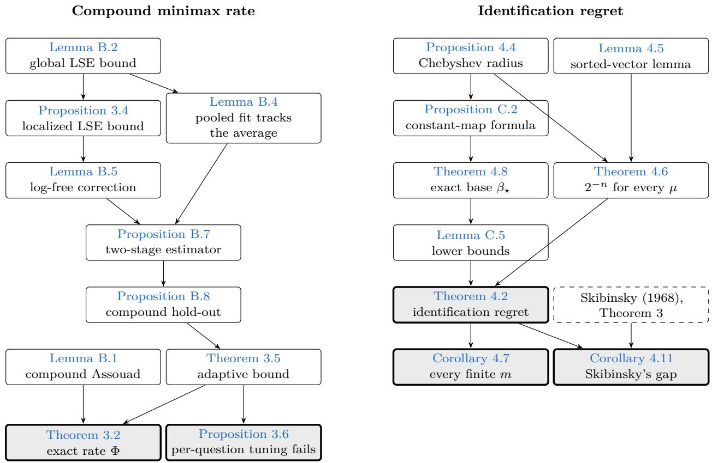  
Figure 7: How the results depend on each other: an arrow points from a result to a result whose proof uses it (arrows implied by transitivity are omitted). Shaded boxes are the main statements; the dashed box is a cited theorem.

(viii) The fixed-efects theorems concern the average risk over questions, $\begin{array} { r } { \frac { 1 } { m } \sum _ { j } \mathbb { E } \| \widehat { g } _ { j } - g _ { j } \| _ { L _ { 2 } ( \mu ) } ^ { 2 } } \end{array}$ . A worstquestion guarantee, on maxj $\mathbb { E } \Vert \widehat { g } _ { j } - g _ { j } \Vert _ { L _ { 2 } ( \mu ) } ^ { 2 } ,$ for the adaptive procedure is open problem 8. The open problems are those of Section 6.2.

## B Proofs for the compound minimax rate and the separation

Figure 7 shows how the results depend on each other. This appendix proves the results of Section 3, and Section C those of Section 4.

Conventions. Throughout this appendix λ is Lebesgue measure on [0, 1] and log is the natural logarithm. For a Borel probability $\mu$ on $[ 0 , 1 ] , \| \cdot \|$ is the norm of $L ^ { 2 } ( \mu )$ and $\langle \cdot , \cdot \rangle$ its inner product, unless another measure is indicated. The variation of $d : [ 0 , 1 ] $ R is $\mathrm { T V } ( d ) : =$ sup $\begin{array} { r } { \sum _ { l = 1 } ^ { L ^ { \cdot } } \dot { | d ( x _ { l } ) - d ( x _ { l - 1 } ) | } } \end{array}$ , the supremum over finite partitions $0 \leq x _ { 0 } < \cdot \cdot \cdot < x _ { L } \leq 1 ;$ ; it is a seminorm, and constants have variation 0. We write $\mathcal { F } _ { \uparrow }$ for the nondecreasing measurable $f : [ 0 , 1 ]  [ 0 , 1 ]$ , and $\mathcal { D } ( \tau , V ) : = \{ d : [ 0 , 1 ]  \mathbb { R }$ measurable : sup $\begin{array} { r } { \mathsf { \Lambda } ) | d | \le \tau , \mathrm { T V } ( d ) \le } \end{array}$ $V \}$

In Model M there are m questions with n pairs each. All mn pairs $( P _ { j k } , Y _ { j k } )$ are mutually independent, $P _ { j k } \sim \mu$ and $Y _ { j k } \mid P _ { j k } \sim \mathrm { B e r n } ( g _ { j } ( P _ { j k } ) )$ ). The class $\Theta ( \tau , V )$ consists of the tuples $\left( g _ { 1 } , \ldots , g _ { m } \right)$ of nondecreasing maps $[ 0 , 1 ] \ \to \ [ 0 , 1 ]$ for which one nondecreasing witness $g _ { 0 } : [ 0 , 1 ] \to \mathbb { R }$ satisfies $\operatorname* { s u p } _ { [ 0 , 1 ] } | g _ { j } - g _ { 0 } | \ \leq \ \tau$ and $\mathrm { T V } ( g _ { j } - g _ { 0 } ) \leq V$ for all $j .$ . The subclass $\Theta _ { \mathrm { L B } } ( \tau , V )$ is defined by the same predicate with $g _ { 0 }$ in addition [0, 1]-valued. An estimator is a jointly measurable map from the mn pairs (and possibly an independent auxiliary randomization with a parameter-free law) to m functions on [0, 1]. Its compound risk is $\begin{array} { r } { \mathcal { R } _ { \mu } ( \widehat { g } ; g ) : = \frac { 1 } { m } \sum _ { j = 1 } ^ { m } \mathbb { E } \| \widehat { g } _ { j } - g _ { j } \| _ { L ^ { 2 } ( \mu ) } ^ { 2 } } \end{array}$ . We write $\begin{array} { r } { \mathfrak { M } _ { m , n } ( \tau , V ) : = \operatorname* { i n f } _ { \hat { g } } \operatorname* { s u p } _ { g \in \Theta ( \tau , V ) } \mathcal { R } _ { \mu } ( \hat { g } ; g ) } \end{array}$ (with $\mu$ fixed), and $\Phi ( m , n , \tau , V ) : = ( m n ) ^ { - 2 / 3 } + \operatorname* { m i n } \{ \tau ^ { 2 } , 1 / n \} + \operatorname* { m i n } \{ \tau ^ { 2 } , V ^ { 2 } , ( V / n ) ^ { 2 / 3 } \}$

Brackets are pointwise, following van der Vaart and Wellner (1996). For a seminorm $\rho ,$ an ε-bracket [l, u] is a pair of real measurable functions $l \leq u$ with $\rho ( u - l ) \leq \varepsilon .$ A function $f$ lies in [l, u] if $l \leq f \leq u$ at every point. $N _ { [ ] } ( \varepsilon , \mathcal { F } , \rho )$ is the least number of ε-brackets that cover $\mathcal { F } ;$ the brackets need not lie in ${ \mathcal F } .$

Roadmap. We give the proofs in dependency order. Section B.1 proves the lower bound (Lemma B.1). Section B.2 proves a least-squares bound for independent, non-identically distributed observations that share a design law (here the output law $\mu )$ . It is proved first under global bracketing entropy (Lemma B.2), then under localized bracketing entropy (Proposition 3.4). Section B.3 applies these bounds to the pooled isotonic stage (Lemma B.4) and to the local bounded-variation stage (Lemma B.5). Section B.4 assembles the oracle estimator (Proposition B.7), the compound hold-out (Proposition B.8), the adaptive bound for all $m , n$ (Theorem 3.5) and Theorem 3.2. Section B.5 proves that per-question tuning cannot match this guarantee (Proposition 3.6).

## B.1 The lower bound

Lemma B.1 (Compound minimax lower bound). There is a universal constant $c > 0$ such that, for every non-atomic Borel probability µ on [0, 1] (c does not depend on $\mu )$ , all $m \geq 1 , n \geq 1$ and all $\tau , V \in [ 0 , 1 / 8 ]$ ，

$$
\operatorname* { i n f } _ { \widehat { \boldsymbol { g } } } \operatorname* { s u p } _ { \boldsymbol { g } \in \Theta _ { \mathrm { L B } } ( \tau , V ) } \mathcal { R } _ { \mu } ( \widehat { \boldsymbol { g } } ; \boldsymbol { g } ) \geq c \Big [ ( m n ) ^ { - 2 / 3 } + \operatorname* { m i n } \{ \tau ^ { 2 } , 1 / n \} + \operatorname* { m i n } \{ \tau ^ { 2 } , V ^ { 2 } , ( V / n ) ^ { 2 / 3 } \} \Big ] ,
$$

where the infimum is over all estimators of Model $M ,$ randomized ones included.

The proof reduces the problem to $\mu = \lambda$ . It then uses three hypercubes of monotone maps, one for each term of $\Phi _ { i }$ , and a product form of Assouad’s lemma in which flipping one coordinate changes the data of a single question.

Proof. Conventions. For probability measures $P , Q$ with densities $p , q$ with respect to any dominating $\nu ,$ $\begin{array} { r } { d _ { \mathrm { T V } } ( P , Q ) : = \operatorname* { s u p } _ { A } \lvert P ( A ) - Q ( A ) \rvert = \frac { 1 } { 2 } \int \lvert p - q \rvert d \nu = 1 - \int \operatorname* { m i n } ( p , q ) d \nu } \end{array}$ , because min $( p , q ) = ( p + q - | p - q | ) / 2$ We write $\mathrm { k l } ( p \| q ) : = p \log ( p / q ) + ( 1 - p ) \log ( ( 1 - p ) / ( 1 - q ) )$ for the Bernoulli divergence, and $\mathcal { R } _ { \lambda }$ for the compound risk in Model M with $\mu = \lambda$ . Randomized estimators are covered: adding an independent $\xi$ with a parameter-free law R to the data leaves every Kullback–Leibler and total-variation bound below unchanged, since $\mathrm { K L } ( P \otimes R | | P ^ { \prime } \otimes R ) = \mathrm { K L } ( P | | P ^ { \prime } )$

Step 0 (reduction to $\mu = \lambda )$ . Let $\mu$ be non-atomic and $H \subseteq \Theta _ { \mathrm { L B } } ( \tau , V )$ . We show

$$
\operatorname* { i n f } _ { \hat { g } } \operatorname* { s u p } _ { g \in \Theta _ { \mathrm { L B } } ( \tau , V ) } \mathcal { R } _ { \mu } ( \hat { g } ; g ) \ \geq \ \operatorname* { i n f } _ { \hat { g } ^ { \prime } } \operatorname* { s u p } _ { \tilde { g } \in H } \mathcal { R } _ { \lambda } ( \hat { g } ^ { \prime } ; \tilde { g } ) .\tag{B.1}
$$

(i) Quantile map. $F ( x ) : = \mu ( [ 0 , x ] )$ is nondecreasing with $F ( 1 ) = 1$ . It is continuous because $\mu$ is non-atomic, and in particular $F ( 0 ) = \mu ( \{ 0 \} ) = 0$ . Put $F ^ {  } ( u ) : = \operatorname* { i n f } \{ x \in [ 0 , 1 ] : F ( x ) \geq u \}$ for $u \in [ 0 , 1 ]$ . The set contains 1 and is closed $( F$ is continuous), so the infimum is attained. Galois relation: $F ^ {  } ( u ) \leq x$ if and only if $u \leq F ( x )$ . Indeed, if $u \leq F ( x )$ then x lies in the set; conversely $F ( x ) \geq F ( F ^ {  } ( u ) ) \geq u$ . Hence $\lambda ( F ^ {  } \leq x ) = \lambda ( u \leq F ( x ) ) = F ( x )$ , that is, $F _ { \# } ^ {  } \lambda = \mu$ . Also $F ( F ^ {  } ( u ) ) = u$ on $[ 0 , 1 ]$ . Attainment gives $F ( F ^ {  } ( u ) ) \geq u$ . If $u = 0$ then $F ^ {  } ( 0 ) = 0$ and $F ( 0 ) = 0$ . If $u > 0$ then $F ^ {  } ( u ) > 0$ , every $x < F ^ {  } ( u )$ has $F ( x ) < u _ { : }$ , and continuity gives $F ( F ^ {  } ( u ) ) \ \leq \ u$ . (Non-atomicity is used exactly for $F ( 0 ) = 0$ and $F ( F ^ {  } ( u ) ) = u . )$

(ii) Membership. Let $\tilde { g } \in H$ with witness ${ \tilde { g } } _ { 0 } .$ , and put $g _ { j } : = \tilde { g } _ { j } \circ F , g _ { 0 } : = \tilde { g } _ { 0 }$ ◦ F. A composition of nondecreasing maps is nondecreasing, values stay in $[ 0 , 1 ]$ , and $\begin{array} { r } { \operatorname* { s u p } _ { x } | ( \tilde { g } _ { j } - \tilde { g } _ { 0 } ) ( F ( x ) ) | \leq \tau } \end{array}$ . Variation does not increase. Let $\tilde { d } : = \tilde { g } _ { j } - \tilde { g } _ { 0 }$ and take any partition $0 \leq x _ { 0 } < \cdot \cdot \cdot < x _ { L } \leq 1$ . The points $u _ { l } : = F ( x _ { l } )$ are nondecreasing in $[ 0 , 1 ] .$ . Removing repetitions removes only zero terms and leaves an admissible partition, so $\begin{array} { r } { \sum _ { l } \lvert \tilde { d } ( u _ { l } ) - \tilde { d } ( u _ { l - 1 } ) \rvert \le \mathrm { T V } ( \tilde { d } ) \le V } \end{array}$ . With the witness $g _ { 0 } = \tilde { g } _ { 0 } \circ F$ (nondecreasing and [0, 1]-valued) we get $g \in \Theta _ { \mathrm { L B } } ( \tau , V )$

(iii) Data transport. Let $x ^ { \prime } = ( U _ { j k } , Y _ { j k } )$ be data of the λ-model under ${ \tilde { g } } ,$ and put $T ( x ^ { \prime } ) : = ( F ^ {  } ( U _ { j k } ) , Y _ { j k } ) = :$ $( P _ { j k } , Y _ { j k } )$ . By (i) the $P _ { j k }$ are i.i.d. µ and $U _ { j k } ~ = ~ F ( P _ { j k } )$ . Hence $\sigma ( P _ { j k } ) ~ = ~ \sigma ( U _ { j k } )$ and $Y _ { j k } ~ \mid ~ P _ { j k } ~ \sim$ Bern $\begin{array} { r } { \mathrm { \iota } ( \tilde { g } _ { j } ( F ( P _ { j k } ) ) ) = \mathrm { B e r n } ( g _ { j } ( P _ { j k } ) ) } \end{array}$ , with every independence preserved. So $T ( x ^ { \prime } )$ has exactly the law of the µ-model under $g = \tilde { g } \circ F$

(iv) Risks. Given gˆ, define $\hat { g } _ { j } ^ { \prime } ( x ^ { \prime } , u ) : = \hat { g } _ { j } ( T ( x ^ { \prime } ) , F ^ {  } ( u ) )$ (for a randomized gˆ with auxiliary $\xi , \hat { g } _ { i } ^ { \prime } ( x ^ { \prime } , \xi , u ) : =$ $\hat { g } _ { j } ( T ( x ^ { \prime } ) , \xi , F ^ {  } ( u ) )$ ; the argument is unchanged). By $( \mathrm { i } ) , \tilde { g } _ { j } ( u ) = g _ { j } ( F ^ {  } ( u ) )$ , and $F _ { \# } ^ {  } \lambda = \mu$ gives

$$
\int _ { 0 } ^ { 1 } \big ( \widehat { g } _ { j } ^ { \prime } ( x ^ { \prime } , u ) - \widetilde { g } _ { j } ( u ) \big ) ^ { 2 } d u = \int _ { 0 } ^ { 1 } \big ( \widehat { g } _ { j } ( T ( x ^ { \prime } ) , F ^ {  } ( u ) ) - g _ { j } ( F ^ {  } ( u ) ) \big ) ^ { 2 } d u = \| \widehat { g } _ { j } ( T ( x ^ { \prime } ) , \cdot ) - g _ { j } \| _ { L ^ { 2 } ( \mu ) } ^ { 2 } .
$$

Taking expectations and using (iii), $\mathcal { R } _ { \lambda } ( \hat { g } ^ { \prime } ; \tilde { g } ) = \mathcal { R } _ { \mu } ( \hat { g } ; \tilde { g } \circ F )$ . Hence $\begin{array} { r } { \operatorname* { s u p } _ { \Theta _ { \mathrm { L B } } } \mathcal { R } _ { \mu } ( \hat { g } ; \cdot ) \geq \operatorname* { s u p } _ { \tilde { g } \in H } \mathcal { R } _ { \mu } ( \hat { g } ; \tilde { g } \circ F ) = } \end{array}$ $\operatorname* { s u p } _ { \tilde { g } \in H } \mathcal { R } _ { \lambda } ( \hat { g } ^ { \prime } ; \tilde { g } )$ . Taking the infimum over gˆ proves (B.1).

Step 1 (tools). Tool $( A ) .$ Assouad’s lemma, compound product form. Let $N \geq 1 , \Omega = \{ - 1 , + 1 \} ^ { N }$ , let $\boldsymbol { \omega } ^ { ( i ) }$ be ω with coordinate i flipped, and let $( P _ { \omega } ) _ { \omega \in \Omega }$ be probability measures on $( \mathcal { X } , \mathcal { A } )$ . Assume:

• for each i and $s \in \{ \pm 1 \} , f _ { i } ^ { s } : \mathcal { X } \to [ 0 , \infty ]$ is measurable, with $f _ { i } ^ { + 1 } ( x ) + f _ { i } ^ { - 1 } ( x ) \ge \alpha _ { i } \ge 0$ for all x;

• maxω $d _ { \mathrm { T V } } ( P _ { \omega } , P _ { \omega ^ { ( i ) } } ) \leq \beta _ { i } ;$

$L _ { \omega } : \mathcal { X }  [ 0 , \infty ]$ is measurable, with $\begin{array} { r } { L _ { \omega } ( x ) \ge \sum _ { i } f _ { i } ^ { \omega _ { i } } ( x ) } \end{array}$

Then max $\begin{array} { r } { _ { \sigma } \mathbb { E } _ { P _ { \omega } } L _ { \omega } \geq 2 ^ { - N } \sum _ { \omega } \mathbb { E } _ { P _ { \omega } } L _ { \omega } \geq \sum _ { i } ( \alpha _ { i } / 2 ) ( 1 - \beta _ { i } ) } \end{array}$ . Proof of $( A )$ . The first inequality holds because a maximum is at least a mean. By Tonelli, $\begin{array} { r } { 2 ^ { - N } \sum _ { \omega } \mathbb { E } _ { P _ { \omega } } L _ { \omega } \ge \sum _ { i } \frac { 1 } { 2 } \big [ \int f _ { i } ^ { + 1 } d \bar { P } _ { i } ^ { + } + \int f _ { i } ^ { - 1 } d \bar { P } _ { i } ^ { - } \big ] } \end{array}$ with $\begin{array} { r } { \bar { P } _ { i } ^ { s } : = 2 ^ { - ( N - 1 ) } \sum _ { \omega : \omega _ { i } = s } P _ { \omega } } \end{array}$ . Let $\nu : = \bar { P } _ { i } ^ { + } + \bar { P } _ { i } ^ { - }$ with densities $p ^ { \pm }$ . Then $\begin{array} { r } { \int \bar { f ^ { + } } p ^ { + } d \nu + \int f ^ { - } p ^ { - } d \nu \geq \bar { \int } ( f ^ { + } + } \end{array}$ $f ^ { - } ) \operatorname* { m i n } ( p ^ { + } , p ^ { - } ) d \nu \geq \alpha _ { i } \big ( 1 - d _ { \mathrm { T V } } ( \bar { P } _ { i } ^ { + } , \bar { P } _ { i } ^ { - } ) \big )$ . Finally, $\omega \mapsto \omega ^ { ( i ) }$ is a bijection from $\{ \omega _ { i } = + 1 \}$ onto $\{ \omega _ { i } = - 1 \}$ So $\begin{array} { r } { \bar { P } _ { i } ^ { - } = 2 ^ { - ( N - 1 ) } \sum _ { \omega _ { i } = + 1 } \bar { P } _ { \omega ^ { ( i ) } } } \end{array}$ , and $\begin{array} { r } { | \bar { P } _ { i } ^ { + } ( \mathcal { \dot { A } } ) - \bar { P } _ { i } ^ { - } ( A ) | \leq 2 ^ { - ( N - 1 ) } \sum _ { \omega _ { i } = + 1 } | P _ { \omega } ( A ) - P _ { \omega ^ { ( i ) } } ( A ) | \leq \beta _ { i } } \end{array}$ for every $A .$ We apply Tool $\mathrm { ( A ) }$ to a fixed estimator. $P _ { \omega }$ is the joint law of all mn pairs, and $L _ { \omega }$ is the question-averaged loss. The uniform-prior Bayes risk $2 ^ { - N } \sum _ { \omega } \mathbb { E } _ { P _ { \omega } } L _ { \omega }$ is at most the maximum over the hypercube, which is at most the supremum of $\mathcal { R } _ { \lambda }$ over the hypercube family. The lower bound does not depend on the estimator, so it bounds infgˆ sup.

Tool $( B ) .$ : an information bound. Let $a \in ( 0 , 1 / 2 ]$ and let $g , g ^ { \prime } : [ 0 , 1 ]  [ a , 1 - a ]$ be measurable. Let $Q _ { g }$ be the law of $( U , Y )$ with $U \sim \lambda$ and $Y \mid U \sim \operatorname { B e r n } ( g ( U ) )$ ). Then KL $\begin{array} { r } { \iota ( Q _ { g } \| Q _ { g ^ { \prime } } ) \leq ( a ( 1 - a ) ) ^ { - 1 } \int _ { 0 } ^ { 1 } ( g - g ^ { \prime } ) ^ { 2 } d u } \end{array}$ and the divergence of a product measure is the sum of the divergences of its factors. Proof of $( B ) . \ Q _ { g }$ has density $g ( u ) ^ { y } ( 1 - g ( u ) ) ^ { 1 - y }$ with respect to λ⊗counting, with values in $[ a , 1 - a ]$ . So log-ratios are bounded, and $\begin{array} { r } { \mathrm { K L } ( Q _ { g } | | Q _ { g ^ { \prime } } ) = \int \mathrm { k l } ( g ( u ) | | g ^ { \prime } ( u ) ) } \end{array}$ du. Jensen’s inequality (log is concave; the expectation is under Bern(p)) gives $\mathrm { k l } ( p \| q ) \le \log \left( \bar { p ^ { 2 } } / q + ( 1 - p ) ^ { 2 } / ( 1 - q ) \right)$ . Moreover $p ^ { 2 } / q + ( 1 - p ) ^ { 2 } / ( 1 - q ) - 1 = ( p - q ) ^ { 2 } / ( q ( 1 - q ) )$ , so $\ker ( p \| q ) \leq \log \bigl ( 1 + ( p - q ) ^ { 2 } / ( q ( 1 - q ) ) \bigr ) \leq ( p - q ) ^ { 2 } / ( q ( 1 - q ) ) \leq ( p - q ) ^ { 2 } / ( a ( 1 - a ) )$ . For a product, the log-ratio is a sum of bounded factor log-ratios, each depending on one coordinate, and it integrates to the sum of the factor divergences.

By Pinsker’s inequality (see, e.g., Tsybakov, 2009), $d _ { \mathrm { T V } } ( P , Q ) \leq \sqrt { \mathrm { K L } ( P \| Q ) / 2 }$ . So if $\mathrm { K L } ( P _ { \omega } | | P _ { \omega ^ { ( i ) } } ) \leq 1 / 2$ for all $\omega ,$ then $\beta _ { i } = 1 / 2$ is admissible in Tool (A).

Tents. Fix an integer $K \geq 1$ . Let $I _ { b } : = [ ( b - 1 ) / K , b / K )$ for $b < K$ and $I _ { K } : = [ ( K - 1 ) / K , 1 ]$ ; let $\phi _ { b } ( u ) : = ( 1 - | 2 K u - ( 2 b - 1 ) | ) _ { + } \ \mathrm { a n d } \ \ell ( u ) : = 1 / 4 + u / 2 .$

(T1) $\phi _ { b }$ vanishes outside $\overline { { I _ { b } } } .$ , and $0 \leq \phi _ { b } \leq 1$

(T2) $\phi _ { b }$ is continuous and piecewise linear, with slopes in {0, ±2K} and breakpoints in $( 1 / ( 2 K ) ) \mathbb { Z }$

(T3) $\begin{array} { r } { \int \phi _ { b } ^ { 2 } = 2 \int _ { 0 } ^ { 1 / ( 2 K ) } ( 2 K t ) ^ { 2 } d t = 1 / ( 3 K ) . } \end{array}$

(T4) For signs $s _ { b }$ and $h \geq 0$ , the function $d : = h \textstyle \sum _ { b } s _ { b } \phi _ { b }$ has sup $| d | \leq h$ and $\mathrm { T V } ( d ) \leq 2 h K$ . Indeed, d is continuous and monotone on each $[ t _ { i - 1 } , t _ { i } ] , t _ { i } : = i / ( 2 K )$ , with $| d ( t _ { i } ) - d ( t _ { i - 1 } ) | = h$ . Adding all $t _ { i }$ to a partition does not decrease the variation sum (triangle inequality), and within each of the 2K pieces the refined sum telescopes to at most h.

(T5) If $2 K h \le 1 / 2$ , then $\ell + d$ is continuous and piecewise linear with slopes at least $1 / 2 - 2 K h \ge 0$ . Hence it is nondecreasing, with values in $[ 1 / 4 - h , 3 / 4 + h ]$

Separation: on $I _ { b }$ we have $\ell + d = \ell + s _ { b } h \phi _ { b }$ by (T1), and $( y - t ) ^ { 2 } + ( y + t ) ^ { 2 } \geq 2 t ^ { 2 }$ for reals $y , t .$ Step 2 (the term $( m n ) ^ { - 2 / 3 } )$ . Let $K : = \lceil ( m n ) ^ { 1 / 3 } \rceil \ \geq \ 1$ , so that $K ^ { 3 } \ge m n$ and $K \leq 2 ( m n ) ^ { 1 / 3 }$ , and let $h : = 1 / ( 8 K )$ . For $\sigma \in \{ \pm 1 \} ^ { K }$ let $\begin{array} { r } { g _ { j } : = g ^ { \sigma } : = \ell + h \sum _ { b } \sigma _ { b } \phi _ { b } } \end{array}$ for every $j$ . Membership holds for every $\tau , V \geq 0$ . Since $2 K h = 1 / 4 , g ^ { \sigma }$ is nondecreasing by (T5), with values in $[ 1 / 8 , 7 / 8 ]$ . The witness $g _ { 0 } : = g ^ { \sigma }$ gives deviations 0 (supremum 0, variation 0). Information. $\textstyle P _ { \sigma } = Q _ { q ^ { \sigma } } ^ { \otimes m n }$ , and flipping b changes $g ^ { \sigma }$ only on $I _ { b } .$ , by $2 h \phi _ { b }$ . Tool (B) with $a = 1 / 8$ and (T3) give $\begin{array} { r } { \mathrm { K L } \leq m n \cdot \frac { 6 4 } { 7 } \cdot \frac { { \bar { 4 } } h ^ { 2 } } { 3 K } = \frac { 2 5 6 } { 2 1 } \frac { m n h ^ { 2 } } { K } = \frac { 4 } { 2 1 } \frac { m n } { K ^ { 3 } } \leq \frac { 4 } { 2 1 } \leq \frac { 1 } { 2 } } \end{array}$ . Loss. Let $\begin{array} { r } { f _ { b } ^ { s } ( x ) : = \frac { 1 } { m } \sum _ { j } \int _ { I _ { b } } ( \widehat { g } _ { j } ( x , u ) - \ell ( u ) - s h \phi _ { b } ( u ) ) ^ { 2 } d u } \end{array}$ . The $I _ { b }$ are disjoint, so $\begin{array} { r } { L _ { \sigma } \geq \sum _ { b } f _ { b } ^ { \sigma _ { b } } } \end{array}$ , and separation gives $\alpha _ { b } = 2 h ^ { 2 } / ( 3 K )$ . Tool (A) yields max $\textstyle \mathcal { R } _ { \lambda } \geq K \cdot \frac { h ^ { 2 } } { 3 K } \cdot \frac { 1 } { 2 } = \frac { h ^ { 2 } } { 6 } = \frac { 1 } { 3 8 4 K ^ { 2 } } \geq \frac { ( m n ) ^ { - 2 / 3 } } { 1 5 3 6 }$ . This holds for all $m , n \geq 1$ Step 3 (the term min $\{ \tau ^ { 2 } , 1 / n \} )$ . Let $\theta : = \operatorname* { m i n } \{ \tau , 1 / ( 8 \sqrt { n } ) \} , \sigma \in \{ \pm 1 \} ^ { m } , g _ { j } \equiv 1 / 2 + \theta \sigma _ { j }$ , and take the witness $g _ { 0 } \equiv 1 / 2$ . Membership. Constant maps are nondecreasing, with values in $[ 3 / 8 , 5 / 8 ] ; \| g _ { j } - g _ { 0 } \| _ { \infty } = \theta \leq \tau ;$ and $\mathrm { T V } ( g _ { j } - g _ { 0 } ) = 0$ because TV is a seminorm. Information. $P _ { \sigma } = \bigotimes _ { j } Q _ { g _ { j } } ^ { \otimes n }$ , and flipping $j$ changes only factor j. Tool (B) with $a = 3 / 8$ gives $\begin{array} { r } { \mathrm { K L } \le n \cdot \frac { 6 4 } { 1 5 } \cdot 4 \theta ^ { 2 } \le \frac { 4 } { 1 5 } \le \frac { 1 } { 2 } } \end{array}$ . Loss. Let $\begin{array} { r } { f _ { j } ^ { s } ( x ) : = \frac { 1 } { m } \int _ { 0 } ^ { 1 } ( \hat { g } _ { j } - 1 / 2 - s \theta ) ^ { 2 } d u . } \end{array}$ so $\alpha _ { j } = 2 \theta ^ { 2 } / m$ . Tool (A) gives Bayes risk at least $\begin{array} { r } { m \cdot \frac { \theta ^ { 2 } } { m } \cdot \frac { 1 } { 2 } = \frac { \theta ^ { 2 } } { 2 } = \frac { 1 } { 2 } \operatorname* { m i n } \{ \tau ^ { 2 } , \frac { 1 } { 6 4 n } \} \ge \frac { \operatorname* { m i n } \{ \tau ^ { 2 } , 1 / n \} } { 1 2 8 } } \end{array}$

Step 4 (the term min $\{ \tau ^ { 2 } , V ^ { 2 } , ( V / n ) ^ { 2 / 3 } \} )$ . Regimes.

(c1) If $n V ^ { 2 } < 2 / 2 5 \colon K : = 1$ and $h : = \operatorname* { m i n } \{ \tau , V / 2 \}$

$$
n V ^ { 2 } \geq 2 / 2 5 ; K _ { * } : = ( 2 5 n V ^ { 2 } / 2 ) ^ { 1 / 3 } \geq 1 , K : = \lfloor K _ { * } \rfloor \mathrm { ~ a n d ~ } h : = \operatorname* { m i n } \{ \tau , V / ( 2 K _ { * } ) \} .
$$

In regime $( \mathrm { c 2 } ) , K \in [ K _ { * } / 2 , K _ { * } ] ;$ : for $1 \leq K _ { * } < 2 , \lfloor K _ { * } \rfloor = 1 > K _ { * } / 2 ;$ ; for $K _ { * } \ge 2 , \lfloor K _ { * } \rfloor > K _ { * } - 1 \ge K _ { * } / 2$ . Four properties follow.

(Q1) $h \leq \tau$ in both regimes.

(Q2) $2 h K \leq V .$ . In (c1), 2h ≤ V . In (c2), 2hK ≤ V K/K∗ ≤ V .

(Q3) $n h ^ { 2 } / K \le 1 / 2 5$ . In (c1), $n h ^ { 2 } \le n V ^ { 2 } / 4 < 1 / 5 0$ . In $( \mathrm { c 2 } ) , n h ^ { 2 } / K \le ( 2 / K _ { * } ) n V ^ { 2 } / ( 4 K _ { * } ^ { 2 } ) = n V ^ { 2 } / ( 2 K _ { * } ^ { 3 } ) =$ 1/25.

(Q4) $\begin{array} { r } { h ^ { 2 } \geq \frac { 1 } { 9 2 9 } \operatorname* { m i n } \{ \tau ^ { 2 } , V ^ { 2 } , ( V / n ) ^ { 2 / 3 } \} . \mathrm { I n } ( \mathrm { c 1 } ) , h ^ { 2 } = \operatorname* { m i n } \{ \tau ^ { 2 } , V ^ { 2 } / 4 \} . \mathrm { I n } ( \mathrm { c 2 } ) , ( V / ( 2 K _ { \mathrm { s } } ) ) ^ { 2 } = ( V / n ) ^ { 2 / 3 } / ( 4 \cdot 1 2 . 5 ^ { 2 / 3 } ) } \end{array}$ and $4 ^ { -- } 1 2 . 5 ^ { 2 / 3 } < 2 1 . 5 5 \leq 2 2 , \mathrm { s o } h ^ { 2 } = \operatorname* { m i n } \{ \tau ^ { 2 } , ( V / ( 2 K _ { * } ) ) ^ { 2 } \} \geq \operatorname* { m i n } \{ \tau ^ { 2 } , ( V / n ) ^ { 2 / 3 } \} / 2 2 .$

Construction. The coordinates are $( j , b ) \in [ m ] \times [ K ]$ , so $N = m K$ . For $\omega \in \{ \pm 1 \} ^ { m K }$ let $\begin{array} { r } { g _ { i } ^ { \omega } : = \ell + h \sum _ { b } \omega _ { j b } \phi _ { b } . } \end{array}$ with witness $g _ { 0 } : = \ell .$ . Membership. $2 K h \le V \le 1 / 8 < 1 / 2$ , so gω is nondecreasing by (T5). Since $h \leq \tau \leq 1 / 8 .$ its values lie in $[ 1 / 8 , 7 / 8 ]$ . By (T4), (Q1) and (Q2), sup $g _ { i } ^ { \omega } - \ell | \leq h \leq \tau$ and $\mathrm { T V } ( g _ { i } ^ { \omega } - \ell ) \le 2 h K \le V$ Information. $P _ { \omega } = \otimes _ { j } Q _ { g _ { j } ^ { \omega } } ^ { \otimes n }$ , and flipping (j, b) changes only question $j ^ { \cdot } \mathrm { s }$ factor, and only on $I _ { b }$ . Tool (B) $( a = 1 / 8 ) , ( \mathrm { T 3 } )$ and (Q3) give $\begin{array} { r } { \mathrm { K L } \le n { \cdot } \frac { 6 4 } { 7 } { \cdot } \frac { 4 h ^ { 2 } } { 3 K } = \frac { 2 5 6 } { 2 1 } \frac { n h ^ { 2 } } { K } \le \frac { 2 5 6 } { 5 2 5 } < \frac { 1 } { 2 } } \end{array}$ . Loss. Let $\begin{array} { r } { f _ { j b } ^ { s } ( x ) : = \frac { 1 } { m } \int _ { I _ { h } } ( \hat { g } _ { j } - \ell - s h \phi _ { b } ) ^ { 2 } d u . } \end{array}$ so $\alpha = 2 h ^ { 2 } / ( 3 K m )$ . Tool (A) gives Bayes risk at least mK $\begin{array} { r } { \cdot \frac { h ^ { 2 } } { 3 K m } \cdot \frac { 1 } { 2 } = \frac { h ^ { 2 } } { 6 } \geq \frac { \operatorname* { m i n } \{ \tau ^ { 2 } , V ^ { 2 } , ( V / n ) ^ { 2 / 3 } \} } { 1 3 2 } } \end{array}$ , by (Q4). If $\tau = 0$ or $V = 0$ , then $h = 0$ and min $\{ \tau ^ { 2 } , V ^ { 2 } , ( V / n ) ^ { 2 / 3 } \} = 0$ , so there is nothing to prove.

Step 5 (combination). The three families of Steps 2–4 are subsets of $\Theta _ { \mathrm { L B } } ( \tau , V )$ , with maps defined on [0, 1] and data generated under λ. Let $T _ { 1 } : = ( m n ) ^ { - 2 / 3 } / 1 5 3 6 , \ T _ { 2 } : = \mathrm { m i n } \{ \tau ^ { 2 } , 1 / n \} / 1 2 8$ and $T _ { 3 } \ : =$ min $\{ \tau ^ { 2 } , \bar { V } ^ { 2 } , ( V / n ) ^ { 2 / 3 } \} / 1 3 2$ . By (B.1), applied with each family as $H _ { ; }$ , and by Steps 2–4,

$$
\operatorname* { i n f } _ { \widehat { \boldsymbol { g } } } \operatorname* { s u p } _ { \boldsymbol { \Theta } _ { \mathrm { L B } } ( \tau , V ) } \mathcal { R } _ { \mu } \geq \operatorname* { m a x } \{ T _ { 1 } , T _ { 2 } , T _ { 3 } \} \geq \frac { T _ { 1 } + T _ { 2 } + T _ { 3 } } { 3 } \geq \frac { \Phi ( m , n , \tau , V ) } { 4 6 0 8 } .
$$

So the lemma holds with $c : = 1 / 4 6 0 8$ , which does not depend on $\mu , m , n , \tau \mathrm { o r } V$

## B.2 Least squares with a common design law

Lemma B.2 (Least squares, independent non-identically distributed pairs). Let µ be a Borel probability on [0, 1]. Let $( P _ { i } , Y _ { i } ) , i = 1 , \ldots , N$ , be independent random pairs with values in $[ 0 , 1 ] \times [ - 1 , 1 ]$ such that $P _ { i } \sim \mu$ for every i. Let $\eta _ { i } ( p ) : = \mathbb { E } [ Y _ { i } \mid P _ { i } = p ]$ (a version) and $\begin{array} { r } { \bar { \eta } : = \frac { 1 } { N } \sum _ { i } \eta _ { i } } \end{array}$ . Let $\mathcal { F }$ be a nonempty convex class of measurable functions $[ 0 , 1 ]  [ - 1 , 1 ]$ , closed in $L ^ { 2 } ( \mu )$ , and let $f ^ { * }$ be the $L ^ { 2 } ( \mu )$ -projection of η¯ onto ${ \mathcal F } .$ Assume

the pointwise bracketing entropy bound

$$
\log N _ { [ ] } ( \varepsilon , \mathcal { F } , L ^ { 2 } ( \mu ) ) \ \leq \ \frac { A } { \varepsilon } + B \log \frac { e } { \varepsilon } \qquad f o r \ a l l \ 0 < \varepsilon \leq 2 ,\tag{B.2}
$$

for some $A , B \geq 0$ . Let $\hat { f }$ be a least-squares estimator, that is, a measurable selection of arg min $\ L _ { f \in \mathcal { F } } \sum _ { i = 1 } ^ { N } ( Y _ { i } -$ $f ( P _ { i } ) ) ^ { 2 }$ (assumed to exist). Then, for a universal constant $C _ { \cdot }$

$$
\mathbb { E } \| \hat { f } - f ^ { * } \| _ { L ^ { 2 } ( \mu ) } ^ { 2 } \le C \Big [ \Big ( \frac { A } { N } \Big ) ^ { 2 / 3 } + \frac { ( B + 1 ) \log ( e N ) } { N } \Big ] .
$$

Here $\mathbb { E }$ may be read as the outer expectation $\mathbb { E } ^ { * }$ , which equals E whenever $\| { \hat { f } } - f ^ { * } \|$ is measurable.

The regression functions $\eta _ { i }$ may difer from pair to pair; only the design law is shared. The proof follows the standard route: a basic inequality, bracketing chaining, and peeling. Every empirical-process step is written for independent, non-identically distributed summands. Each summand is centred by its own mean, and the average η¯ enters only through the population risk.

Notation for Lemma B.2 and Proposition 3.4. $\| \cdot \| : = \| \cdot \| _ { L ^ { 2 } ( \mu ) } , Z _ { i } : = ( P _ { i } , Y _ { i } ) \in \mathcal { Z } : = [ 0 , 1 ] \times [ - 1 , 1 ]$ For bounded measurable $h : \mathcal { Z }  \mathbb { R }$

$$
\mathbb { G } _ { N } h : = N ^ { - 1 / 2 } \sum _ { i = 1 } ^ { N } \bigl ( h ( Z _ { i } ) - \mathbb { E } h ( Z _ { i } ) \bigr ) , \qquad \| h \| _ { N } : = \Big ( N ^ { - 1 } \sum _ { i = 1 } ^ { N } \mathbb { E } h ( Z _ { i } ) ^ { 2 } \Big ) ^ { 1 / 2 } .
$$

$\mathbb { G } _ { N }$ centres each summand by its own mean, and identical distribution is never used. Let $g _ { f } ( p , y ) : =$ $( y - f ( p ) ) ^ { 2 } - ( y - f ^ { * } ( p ) ) ^ { 2 }$ and $\hat { D } : = \| \hat { f } - f ^ { * } \| \in [ 0 , 2 ]$ . The bounds are proved for the outer expectation $\mathbb { E } ^ { * }$ which equals E whenever $\hat { D }$ is measurable. Every event below is built from countably many fixed measurable functions evaluated at $Z _ { 1 } , \dots , Z _ { N }$ , hence it is measurable. The estimator $\hat { f }$ enters only through inclusions that hold pointwise in $\omega .$

Bernstein’s inequality in quantile form. Let $X _ { 1 } , \ldots , X _ { N }$ be independent, with $\mathbb { E } X _ { i } = 0 , | X _ { i } | \le b$ and $\begin{array} { r } { \sum _ { i } \operatorname { V a r } X _ { i } \leq v . } \end{array}$ . Then $\begin{array} { r } { \mathbb { P } ( \sum _ { i } X _ { i } > t ) \le \exp \left( - t ^ { 2 } / ( 2 ( v + b t / 3 ) ) \right) } \end{array}$ for $t \geq 0$ . This is Bernstein’s inequality; Vershynin (2018, Thm. 2.8.4) states the two-sided form, and the one-sided form is the upper-tail half of the same Chernof argument (see also Boucheron et al., 2013). We use three consequences.

(B1) $\mathbb { P } \big ( \sum _ { i } X _ { i } > \sqrt { 2 v u } + 2 b u / 3 \big ) \le e ^ { - u }$ for $u \geq 0$ . Indeed, with $t : = \sqrt { 2 v u } + 2 b u / 3$ we have $t ^ { 2 } - 2 u ( v + b t / 3 ) =$ $( 2 b u / 3 ) \sqrt { 2 v u } \geq 0 , \mathrm { ~ s o ~ } t ^ { 2 } / ( 2 ( v + b t / 3 ) ) \geq u . \mathrm { ~ } ( \mathrm { I f ~ } v = b = 0$ , the probability is 0.)

(B2) Let h be a fixed measurable function with $| h ( z ) - \mathbb { E } h ( Z _ { i } ) | \le b$ for all z and i, and $\| h \| _ { N } \leq \sigma$ . Then $\begin{array} { r } { \sum _ { i } \operatorname { V a r } h ( Z _ { i } ) \leq N \sigma ^ { 2 } } \end{array}$ and $\mathbb { P } \big ( \mathbb { G } _ { N } h > \sigma \sqrt { 2 u } + 2 b u / ( 3 \sqrt { N } ) \big ) \le e ^ { - u }$ . If $0 \leq h \leq c ,$ , then $b = c$ works; if $| h | \leq c ,$ , then $b = 2 c$ works.

(B3) For a finite family H with common σ and $b ,$ the union of the events in (B2) has probability at most $| \mathcal { H } | e ^ { - u }$ . The two-sided version (apply (B2) to h and to −h) has probability at most $2 | \mathcal { H } | e ^ { - u }$ . Only the independence of $Z _ { 1 } , \dots , Z _ { N }$ is used.

Lemma B.3 (Bracketing chaining, independent non-identically distributed observations). Let $Z _ { 1 } , \dots , Z _ { N }$ be independent random elements of Z; they need not be identically distributed. Let G be a class of measurable $g : { \mathcal { Z } } $ R with $\operatorname { s u p } | g | \leq M$ and $\| g \| _ { N } \leq \rho .$ Let $\tilde { H } : ( 0 , \rho ]  [ 0 , \infty )$ be nonincreasing. Assume that $f o r$ each $q \geq 0$ the class $\mathcal { G }$ is covered by $m _ { q } \leq e ^ { { \tilde { H } ( \varepsilon _ { q } ) } }$ pointwise brackets $[ L _ { q , j } , U _ { q , j } ]$ with $\lVert U _ { q , j } - L _ { q , j } \rVert _ { N } \leq \varepsilon _ { q } : = 2 ^ { - q } \rho .$ Put $\begin{array} { r } { \tilde { J } : = \int _ { 0 } ^ { \rho } \sqrt { \tilde { H } ( \varepsilon ) } d \varepsilon } \end{array}$ . Then for every $x \geq 0$ there is an event $\Omega _ { x }$ with $\mathbb { P } ( \Omega _ { x } ) \geq 1 - 2 e ^ { - x }$ on which, for all $g \in { \mathcal { G } }$ simultaneously,

$$
\vert \mathbb { G } _ { N } g \vert \leq 5 2 \tilde { J } + 2 6 \rho \sqrt { x } + 3 9 \rho + \frac { 8 M } { 3 \sqrt { N } } \bigl ( \tilde { H } ( \rho ) + x + 1 \bigr ) .
$$

The proof chains over nested partitions at the dyadic scales $\varepsilon _ { q } .$ . It applies Bernstein’s inequality to each link and truncates the links whose brackets are too wide, which yields the bracketing entropy integral J˜. The scheme is that of van der Vaart and Wellner (1996, Lemma 3.4.2), with the i.i.d. law replaced by the average $\begin{array} { r } { N ^ { - 1 } \sum _ { i } \mathbb { E } [ \cdot ( Z _ { i } ) ] } \end{array}$

Proof. (a) Nested partitions. For $g \in { \mathcal { G } }$ let $j _ { q } ( g ) : = \operatorname* { m i n } \{ j : L _ { q , j } \leq g \leq U _ { q , j } \}$ . Write $g \sim _ { q } g ^ { \prime } \mathrm { i f } j _ { r } ( g ) = j _ { r } ( g ^ { \prime } )$ for all $r \leq q$ . These partitions are nested. Level q has $\begin{array} { r } { n _ { q } \le \prod _ { r < q } m _ { r } \le e ^ { S _ { q } } } \end{array}$ classes, where $\begin{array} { r } { S _ { q } : = \sum _ { r = 0 } ^ { q } \tilde { H } ( \varepsilon _ { r } ) } \end{array}$ Fix, deterministically, a representative in $\mathcal { G }$ of each class, and let $\pi _ { q } g$ be the representative of the level-q class of g. Let $\Delta _ { q } g : = \operatorname* { m i n } \{ 2 M$ , mi $\mathrm { n } _ { r \leq q } ( U _ { r , j _ { r } ( g ) } - L _ { r , j _ { r } ( g ) } ) \}$ . Then:

(L1) $\pi _ { q } g$ and $\Delta _ { q } g$ depend on g only through its level-q class;

(L2) $0 \leq \Delta _ { q } g \leq \Delta _ { q - 1 } g \leq 2 M ;$

(L3) $\| \Delta _ { q } g \| _ { N } \le \varepsilon _ { q } ;$

(L4) $| g - \pi _ { q } g | \leq \Delta _ { q } g$ , because both functions lie in the bracket ${ j _ { r } } ( g )$ for every $r \leq q$ and both are bounded by M;

(L5) $| \pi _ { q } g - \pi _ { q - 1 } g | \le \Delta _ { q - 1 } g .$ , because by nestedness $\pi _ { q } g$ lies in the level- $\cdot ( q - 1 )$ class of $^ { g , }$ so the argument of (L4) applies at level $q - 1$

(b) Truncation. Let $u _ { q } : = S _ { q } + x + q + 1$ and $a _ { q } : = \varepsilon _ { q } / \sqrt { u _ { q + 1 } }$ . Then $a _ { q } \leq \varepsilon _ { q }$ and $a _ { q - 1 } u _ { q } = 2 \varepsilon _ { q } \sqrt { u _ { q } }$ . Let $A _ { q } g : = \mathbf { 1 } \{ \Delta _ { r } g \leq \sqrt { N } a _ { \ i }$ for all $r \leq q \}$ $B _ { 0 } g : = 1 - A _ { 0 } g$ , and $B _ { q } g : = A _ { q - 1 } g - A _ { q } g = A _ { q - 1 } g { \bf 1 } \{ \Delta _ { q } g > \sqrt { N } a _ { q } \}$ for $q \geq 1$ . All of them depend on g only through its level-q class.

(c) An exact identity. For every $Q \geq 0$ , pointwise,

$$
g - \pi _ { 0 } g = ( g - \pi _ { 0 } g ) B _ { 0 } g + \sum _ { q = 1 } ^ { Q } \Bigl [ ( g - \pi _ { q } g ) B _ { q } g + ( \pi _ { q } g - \pi _ { q - 1 } g ) A _ { q - 1 } g \Bigr ] + ( g - \pi _ { Q } g ) A _ { Q } g .
$$

This follows by induction. The case $Q = 0$ is $A _ { 0 } + B _ { 0 } = 1$ . For the inductive step, $( g - \pi _ { Q } g ) A _ { Q } g \ =$ $( g - \pi _ { Q + 1 } g ) ( B _ { Q + 1 } g + A _ { Q + 1 } g ) + ( \pi _ { Q + 1 } g - \pi _ { Q } g ) A _ { Q } g .$

(d) Envelopes. Let $k _ { q } q : = \Delta _ { q } g B _ { q } g$ for $q \geq 0$ , and $h _ { q } g : = ( \pi _ { q } g - \pi _ { q - 1 } g ) A _ { q - 1 } g$ for $q \geq 1$ . Then: • |(g − πqg)Bqg| ≤ kqg, by (L4);

$0 \leq k _ { 0 } g \leq 2 M$ , and for $q \geq 1 , 0 \leq k _ { q } g \leq \Delta _ { q - 1 } g A _ { q - 1 } g \leq \sqrt { N } a _ { q - 1 }$ , by (L2) and $B _ { q } \le A _ { q - 1 } ;$

$\| k _ { q } g \| _ { N } \leq \varepsilon _ { q } ;$

$k _ { q } g \le \Delta _ { q } g { \bf 1 } \{ \Delta _ { q } g > \sqrt { N } a _ { q } \} \le ( \Delta _ { q } g ) ^ { 2 } / ( \sqrt { N } a _ { q } )$ , hence $\begin{array} { r } { N ^ { - 1 } \sum _ { i } \mathbb { E } k _ { q } g ( Z _ { i } ) \leq \varepsilon _ { q } ^ { 2 } / ( \sqrt { N } a _ { q } ) ; } \end{array}$

$| h _ { q } g | \leq \sqrt { N } a _ { q - 1 } \ \mathrm { a n d } \ \| h _ { q } g \| _ { N } \leq \varepsilon _ { q - 1 } = 2 \varepsilon _ { q } , \mathrm { b y } \ ( \mathrm { L 5 } )$

$| ( g - \pi _ { Q } g ) A _ { Q } g | \leq \sqrt { N } a _ { Q } .$

(e) Comparison facts. If $| h | \leq k$ pointwise, then $\begin{array} { r } { \vert \mathbb G _ { N } h \vert \leq \mathbb G _ { N } k + 2 N ^ { - 1 / 2 } \sum _ { i } \mathbb E k ( Z _ { i } ) } \end{array}$ , because $\pm h ( Z _ { i } ) \mp$ $\mathbb { E } h ( Z _ { i } ) \leq k ( Z _ { i } ) + \mathbb { E } k ( Z _ { i } )$ . Always $| \mathbb { G } _ { N } h | \leq 2 { \sqrt { N } } \operatorname* { s u p } | h |$

(f) Events. By (L1), as g ranges over $\mathcal { G }$ there are at most $n _ { 0 }$ functions $\pi _ { 0 } g$ and $k _ { 0 } g$ , and at most $n _ { q }$ functions $k _ { q } g$ and $h _ { q } g . \mathrm { { \ A p p l y \ ( B 3 ) } }$ with $u = u _ { q } \geq \log n _ { q } + x + q + 1$ to the following families:

• $\pi _ { 0 } g ,$ two-sided, with $\sigma = \rho$ and $b = 2 M$ (failure probability at most $2 e ^ { - x - 1 } )$ 1);

$k _ { 0 } g .$ , one-sided, with $\sigma = \rho$ and $b = 2 M$ (at most $e ^ { - x - 1 } )$ );

• for $q \geq 1 , k _ { q } g _ { \cdot }$ , one-sided, with $\sigma = \varepsilon _ { q }$ and $b = \sqrt { N } a _ { q - 1 }$ (at most $e ^ { - x - q - 1 } )$ );

• for $q \geq 1 , h _ { q } g$ , two-sided, with $\sigma = 2 \varepsilon _ { q }$ and $b = 2 \sqrt { N } a _ { q - 1 }$ (at most $2 e ^ { - x - q - 1 } )$

Let $\Omega _ { x }$ be the intersection of these countably many events. Then $\begin{array} { r } { \mathbb { P } ( \Omega _ { x } ^ { c } ) \leq 3 \sum _ { q \geq 0 } e ^ { - x - q - 1 } = 3 e ^ { - x } / ( e - 1 ) < } \end{array}$ $2 e ^ { - x }$

(g) Bounds on $\Omega _ { x }$ . On $\Omega _ { x } ,$ , for all g, (B2), (d) and (e) give

$$
\begin{array} { r } { | \mathbb G _ { N } \pi _ { 0 } g | \le \rho \sqrt { 2 u _ { 0 } } + \frac { 4 M u _ { 0 } } { 3 \sqrt { N } } , } \end{array}
$$

$$
\begin{array} { r l } & { | \mathbb { G } _ { N } \big ( ( g - \pi _ { 0 } g ) B _ { 0 } g \big ) | \le \mathbb { G } _ { N } k _ { 0 } g + 2 \varepsilon _ { 0 } ^ { 2 } / a _ { 0 } \le \rho \sqrt { 2 u _ { 0 } } + \frac { 4 M u _ { 0 } } { 3 \sqrt { N } } + 2 \varepsilon _ { 0 } \sqrt { u _ { 1 } } , } \\ & { | \mathbb { G } _ { N } \big ( ( g - \pi _ { q } g ) B _ { q } g \big ) | \le \varepsilon _ { q } \sqrt { 2 u _ { q } } + \frac { 2 } { 3 } a _ { q - 1 } u _ { q } + 2 \varepsilon _ { q } ^ { 2 } / a _ { q } = \big ( \sqrt { 2 } + \frac { 4 } { 3 } \big ) \varepsilon _ { q } \sqrt { u _ { q } } + 2 \varepsilon _ { q } \sqrt { u _ { q + 1 } } ( q \ge 1 ) , } \\ & { \quad \quad \quad | \mathbb { G } _ { N } h _ { q } g | \le 2 \varepsilon _ { q } \sqrt { 2 u _ { q } } + \frac { 4 } { 3 } a _ { q - 1 } u _ { q } = \big ( 2 \sqrt { 2 } + \frac { 8 } { 3 } \big ) \varepsilon _ { q } \sqrt { u _ { q } } ( q \ge 1 ) . } \end{array}
$$

The remainder satisfies $| \mathbb { G } _ { N } ( ( g - \pi _ { Q } g ) A _ { Q } g ) | \le 2 N a _ { Q } \to 0$ as $Q  \infty ,$ , with N fixed. Sum the pieces of (c) and let $Q  \infty$ . The truncation-bias terms satisfy $\begin{array} { r } { \sum _ { q \ge 0 } 2 \varepsilon _ { q } \sqrt { u _ { q + 1 } } = 4 \sum _ { q \ge 1 } \varepsilon _ { q } \sqrt { u _ { q } } , } \end{array}$ so

$$
\left| \mathbb { G } _ { N } g \right| \le \left( 3 \sqrt { 2 } + 8 \right) \sum _ { q \ge 0 } \varepsilon _ { q } \sqrt { u _ { q } } + \frac { 8 M u _ { 0 } } { 3 \sqrt { N } } \le 1 3 \sum _ { q \ge 0 } \varepsilon _ { q } \sqrt { u _ { q } } + \frac { 8 M u _ { 0 } } { 3 \sqrt { N } } .
$$

(h) The entropy sum. We have $\sqrt { u _ { q } } \le \sqrt { S _ { q } } + \sqrt { x } + \sqrt { q + 1 }$ and $\begin{array} { r } { \sqrt { S _ { q } } \leq \sum _ { r \leq q } \sqrt { \tilde { H } ( \varepsilon _ { r } ) } } \end{array}$ . Hence $\begin{array} { r } { \sum _ { q } \varepsilon _ { q } \sqrt { S _ { q } } \leq } \end{array}$ $\begin{array} { r } { \sum _ { r } \sqrt { \tilde { H } ( \varepsilon _ { r } ) \sum _ { q \geq r } \varepsilon _ { q } } = 2 \sum _ { r } \varepsilon _ { r } \sqrt { \tilde { H } ( \varepsilon _ { r } ) } } \end{array}$ . Since H˜ is nonincreasing, $\begin{array} { r } { \varepsilon _ { r } \sqrt { \tilde { H } ( \varepsilon _ { r } ) } \leq 2 \int _ { \varepsilon _ { r + 1 } } ^ { \varepsilon _ { r } } \sqrt { \tilde { H } } , \mathrm { s o } \sum _ { q } \varepsilon _ { q } \sqrt { S _ { q } } \leq } \end{array}$ $4 { \tilde { J } } .$ . Further, $\begin{array} { r } { \sum _ { q } \varepsilon _ { q } \sqrt { x } = 2 \rho \sqrt { x } , \sum _ { q } \varepsilon _ { q } \sqrt { q + 1 } = \rho \sum _ { q } 2 ^ { - q } \sqrt { q + 1 } \leq 2 . 7 0 \rho \leq 3 \rho , } \end{array}$ , and $u _ { 0 } = \tilde { H } ( \rho ) + x + 1$ Combined with (g), these bounds give the lemma. □

Proof of Lemma B.2. Step 1 (population geometry). (i) $| Y _ { i } | \le 1$ gives $| \eta _ { i } | \leq 1 ~ \mu { \mathrm { - a . e . } }$ (as $P _ { i } \sim \mu )$ , so $\bar { \eta } \in L ^ { 2 } ( \mu ) . \mathrm { ( i i ) } \mathcal { F }$ is nonempty and convex, and its set of µ-classes is closed in $L ^ { 2 } ( \mu )$ . By the Hilbert projection theorem a unique nearest class to $\bar { \eta }$ exists. Fix a representative $f ^ { * } \in { \mathcal { F } } ;$ ; the quantity in the lemma does not depend on the choice. For $f \in { \mathcal { F } }$ and $t \in ( 0 , 1 ]$ ] we have $f ^ { * } + t ( f - f ^ { * } ) \in { \mathcal { F } }$ , so $\| \bar { \eta } - f ^ { * } - t ( f - f ^ { * } ) \| ^ { 2 } \geq \| \bar { \eta } - f ^ { * } \| ^ { 2 }$ that is, $- 2 t \langle { \bar { \eta } } - f ^ { * } , f - f ^ { * } \rangle + t ^ { 2 } \| f - f ^ { * } \| ^ { 2 } \geq 0$ . Dividing by t and letting $t  0$ gives $\langle \bar { \eta } - f ^ { * } , f - f ^ { * } \rangle \leq 0$ (iii) Let $\begin{array} { r } { \bar { R } ( f ) : = N ^ { - 1 } \sum _ { i } \mathbb { E } ( Y _ { i } - f ( P _ { i } ) ) ^ { 2 } } \end{array}$ . For bounded measurable $f ,$ , the tower property and $P _ { i } \sim \mu \ \mathrm { g i v e }$ $\mathbb { E } ( Y _ { i } - f ( P _ { i } ) ) ^ { 2 } = \mathbb { E } Y _ { i } ^ { 2 } - \dot { 2 } \langle \eta _ { i } , f \rangle + \| f \| ^ { 2 }$ . Averaging, $\bar { R } ( f ) = c + \| f - \bar { \eta } \| ^ { 2 }$ with $\begin{array} { r } { c : = N ^ { - 1 } \sum _ { i } \mathbb { E } Y _ { i } ^ { 2 } - \| \bar { \eta } \| ^ { 2 } } \end{array}$ , which does not depend on $f .$ This is where the common design law is used. (iv) Hence, by (ii), for every $f \in { \mathcal { F } }$

$$
\bar { R } ( f ) - \bar { R } ( f ^ { * } ) = \| f - f ^ { * } \| ^ { 2 } + 2 \langle f - f ^ { * } , f ^ { * } - \bar { \eta } \rangle \geq \| f - f ^ { * } \| ^ { 2 } .\tag{B.3}
$$

(v) For every $f \in { \mathcal { F } }$

$$
\begin{array} { r } { \sum _ { i = 1 } ^ { N } \mathbb { E } g _ { f } ( Z _ { i } ) = N \big ( \bar { R } ( f ) - \bar { R } ( f ^ { * } ) \big ) . } \end{array}\tag{B.4}
$$

Step 2 (the loss-diference class). We have $g _ { f } = ( f ^ { * } - f ) ( 2 y - f - f ^ { * } )$ and $| 2 y - f - f ^ { * } | \le 4$ . Moreover $\mathbb { E } g _ { f } ( Z _ { i } ) ^ { 2 } \leq 1 6 \mathbb { E } ( f - f ^ { * } ) ^ { 2 } ( P _ { i } ) = 1 6 \| f - f ^ { * } \| ^ { 2 }$ for each $i ,$ since $P _ { i } \sim \mu .$ . Therefore

$$
| g _ { f } | \le 4 | f - f ^ { * } | \le 8 \ \mathrm { p o i n t w i s e } , \qquad \| g _ { f } \| _ { N } \le 4 \| f - f ^ { * } \| .\tag{B.5}
$$

Brackets (no monotonicity of $f \mapsto g _ { f }$ is used). Fix $\varepsilon \in ( 0 , 8 ]$ and a minimal cover of $\mathcal { F }$ by $\varepsilon / 4$ -brackets $[ l _ { j } , u _ { j } ]$ in $L ^ { 2 } ( \mu )$ . Drop the brackets that contain no element of ${ \mathcal F } .$ For each remaining bracket put $l _ { i } ^ { \prime } : = \operatorname* { m a x } ( l _ { j } , - 1 )$ and $u _ { i } ^ { \prime } : = \operatorname* { m i n } ( u _ { j } , 1 )$ . Some $f \in { \mathcal { F } }$ with values in $[ - 1 , 1 ]$ lies in the bracket, $\mathrm { s o ~ - 1 } \le l _ { j } ^ { \prime } \le u _ { j } ^ { \prime } \le 1$ and $u _ { j } ^ { \prime } - l _ { j } ^ { \prime } \leq u _ { j } - l _ { j }$ . Every $f \in { \mathcal { F } }$ that lies in $[ l _ { j } , u _ { j } ]$ also lies in $[ l _ { j } ^ { \prime } , u _ { j } ^ { \prime } ]$ . Define

$$
U _ { j } ( p , y ) : = \operatorname* { m a x } \{ ( y - l _ { j } ^ { \prime } ( p ) ) ^ { 2 } , ( y - u _ { j } ^ { \prime } ( p ) ) ^ { 2 } \} - ( y - f ^ { * } ( p ) ) ^ { 2 } , \quad L _ { j } ( p , y ) : = ( y - \kappa _ { j } ) ^ { 2 } - ( y - f ^ { * } ( p ) ) ^ { 2 } ,
$$

where $\kappa _ { j } : = \mathrm { m i n } ( \mathrm { m a x } ( y , l _ { j } ^ { \prime } ( p ) ) , u _ { j } ^ { \prime } ( p ) )$ . Both are measurable. Since $t \mapsto ( y - t ) ^ { 2 }$ is convex, they are the maximum and the minimum of $t \mapsto ( y - t ) ^ { 2 } - ( y - f ^ { * } ( p ) ) ^ { 2 }$ over $t \in [ l _ { j } ^ { \prime } ( p ) , u _ { j } ^ { \prime } ( p ) ]$ . Hence $f \in \mathcal { F } \cap [ l _ { j } , u _ { j } ]$ implies $L _ { j } \leq g _ { f } \leq U _ { j }$ . For the width, take $s , t \in [ l _ { j } ^ { \prime } , u _ { j } ^ { \prime } ] \subseteq [ - 1 , 1 ]$ . Then $| ( y - \check { s } ) ^ { 2 } - ( y ^ { - } - t ) ^ { 2 } | = | s - t | | 2 y - s - t | \leq 4 ( u _ { i } ^ { \prime } - l _ { i } ^ { \prime } )$ so $0 \leq U _ { j } - L _ { j } \leq 4 ( u _ { j } - l _ { j } ) ( p )$ . Since $\begin{array} { r } { P _ { i } \overset {  } { \sim } \ddot { \mu } , \| U _ { j } - L _ { j } \| _ { N } ^ { 2 } \le 1 6 N ^ { - 1 } \sum _ { i } \mathbb { E } ( u _ { j } - l _ { j } ) ^ { 2 } ( P _ { i } ) = 1 6 \| u _ { j } - l _ { j } \| ^ { 2 } \le \check { \varepsilon } ^ { 2 } } \end{array}$ Consequence. Let $\delta > 0$ and $\varepsilon \in ( 0 , 8 ]$ . The class $\mathcal { G } _ { \delta } : = \{ g _ { f } : f \in \mathcal { F } , \| f - f ^ { * } \| \le \delta \}$ is covered by at most $N _ { \lceil \rceil } ( \varepsilon / 4 , \mathcal { F } , L ^ { 2 } ( \mu ) ) \leq e ^ { H ( \varepsilon ) }$ pointwise brackets of $\left\| \cdot \right\| _ { N } .$ -width at most ε. Here $H ( \varepsilon ) : = 4 A / \varepsilon + B \log ( 4 e / \varepsilon )$ from (B.2) at $\varepsilon / 4 \in ( 0 , 2 ]$ . H is nonincreasing and nonnegative on $( 0 , 8 ] .$ , because $\log ( 4 e / \varepsilon ) \geq \log ( e / 2 ) > 0$

Step 3 (a localized bound). For $\delta \in ( 0 , 2 ]$ and $x \geq 0$ there is an event $\Omega _ { \delta , x }$ with probability at least $1 - 2 e ^ { - x }$ on which, for all $f \in { \mathcal { F } }$ with $\| f - f ^ { * } \| \leq \delta$

$$
\begin{array} { l } { \displaystyle { \left| \mathbb { G } _ { N } g _ { f } \right| \le \Gamma _ { N } ( \delta , x ) : = 4 1 6 \sqrt { A \delta } + 2 0 8 \delta \sqrt { B ( 1 + \log ( e / \delta ) ) + 1 0 4 \delta \sqrt { x } } } } \\ { \displaystyle { \qquad + 1 5 6 \delta + \frac { 2 2 } { \sqrt { N } } \Big ( \frac { A } { \delta } + B \log \frac { e } { \delta } + x + 1 \Big ) . } } \end{array}\tag{B.6}
$$

Indeed, apply Lemma B.3 to $\mathcal { G } _ { \delta }$ with $M = 8 , \rho = 4 \delta \leq 8$ and $\tilde { H } = H$ . By Step $2 , \| g _ { f } \| _ { N } \leq 4 \delta$ , and the covers of Step 2 exist at every level $\varepsilon _ { q } = 2 ^ { - q } \cdot 4 \delta \in ( 0 , 8 ]$ . By ${ \sqrt { a + b } } \leq { \sqrt { a } } + { \sqrt { b } }$ and Cauchy–Schwarz, $\begin{array} { r } { \int _ { 0 } ^ { \delta } \sqrt { \log ( e / s ) } d s \leq \left( \delta \int _ { 0 } ^ { \delta } \log ( e / s ) d s \right) ^ { 1 / 2 } = \delta \sqrt { 1 + \log ( e / \delta ) } } \end{array}$ , so

$$
\tilde { J } = 4 \int _ { 0 } ^ { \delta } \sqrt { A / s + B \log ( e / s ) } d s \leq 4 \Big [ 2 \sqrt { A \delta } + \delta \sqrt { B \big ( 1 + \log ( e / \delta ) \big ) } \Big ] .
$$

Also $H ( 4 \delta ) = A / \delta + B \log ( e / \delta )$ , and $6 4 / 3 \leq 2 2$

Step 4 (basic inequality). ˆf minimizes the empirical risk and $\begin{array} { r } { f ^ { * } \in \mathcal { F } , \mathrm { s o } \sum _ { i } g _ { \hat { f } } ( Z _ { i } ) \leq 0 } \end{array}$ for every ω. For each fixed $\begin{array} { r } { f \in \mathcal { F } \mathrm { ~ a n d ~ } \omega , ( \mathrm { B . 4 } ) \mathrm { ~ g i v e s } \sum _ { i } g _ { f } ( Z _ { i } ) = \sqrt { N } \mathbb { G } _ { N } g _ { f } + N ( \bar { R } ( f ) - \bar { R } ( f ^ { * } ) ) . \mathrm { ~ A t ~ } f = \hat { f } ( \omega ) } \end{array}$ , with (B.3), $\begin{array} { r } { N \hat { D } ^ { 2 } \leq N ( \bar { R } ( \hat { f } ) - \bar { R } ( f ^ { * } ) ) \leq - \sqrt { N } \left( \mathbb { G } _ { N } g _ { f } \right) \big | _ { f = \hat { f } } . } \end{array}$ , hence

$$
\begin{array} { r } { \sqrt { N } \hat { D } ^ { 2 } \ \leq \ \left. \mathbb { G } _ { N } g _ { f } \right. \big | _ { f = \hat { f } ( \omega ) } \qquad \mathrm { f o r ~ e v e r y ~ } \omega . } \end{array}\tag{B.7}
$$

This is the only place where the aggregate centring enters; $Y _ { i } - \bar { \eta } ( P _ { i } )$ is never centred individually.

Step 5 (peeling). Let $K _ { 0 } : = 2 { \cdot } 2 4 9 6 ^ { 2 } = 1 2 { , } 4 6 0 { , } 0 3 2$ and $r ( x ) ^ { 2 } : = K _ { 0 } \big [ ( A / N ) ^ { 2 / 3 } + ( B + 1 ) \log ( e N ) / N + x / N \big ]$ We claim that there is an event $\Omega _ { x } ^ { \prime }$ with $\mathbb { P } ( \Omega _ { x } ^ { \prime } ) \geq 1 - 4 e ^ { - x }$ on which ${ \hat { D } } \leq r : = r ( x ) . { \mathrm { ~ I f ~ } } r \geq 2$ , take $\Omega _ { x } ^ { \prime } : = \Omega$ since $\hat { D } \leq 2 . \operatorname { I f } r < 2 $ , then for each $j \geq 0$ with $2 ^ { j } r < 2$ let $\delta _ { j } : = \operatorname* { m i n } ( 2 ^ { j + 1 } r , 2 ) \in [ r , 2 ]$ , and let $\Omega _ { x } ^ { \prime } : = \cap _ { j } \Omega _ { \delta _ { j } , x + j }$ Then $\begin{array} { r } { \mathbb { P } ( \Omega _ { x } ^ { \prime c } ) \leq \sum _ { i } 2 e ^ { - x - j } = ( 2 e / ( e - 1 ) ) e ^ { - x } < 4 e ^ { - x } } \end{array}$ . Suppose $\hat { D } > r$ at some point of $\Omega _ { x } ^ { \prime }$ . Since $\hat { D } \le 2$ , some j has $2 ^ { j } r < \hat { D } \le \delta _ { j }$ . By Step 4 and (B.6),

$$
T : = \sqrt N 4 ^ { j } r ^ { 2 } < \sqrt N \hat { D } ^ { 2 } \leq \Gamma _ { N } ( \delta _ { j } , x + j ) .
$$

We use the following facts. $r ^ { 2 } \ge K _ { 0 } / N \ge 1 / N$ , so $\begin{array} { r } { \log ( e / \delta _ { j } ) \le \log ( e / r ) \le 1 + \frac 1 2 \log N \le \log ( e N ) } \end{array}$ and $1 + \log ( e / \delta _ { j } ) \leq 2 \log ( e N )$ . Also $\delta _ { j } \leq 2 ^ { j + 1 } r , 2 ^ { j / 2 } \leq 2 ^ { j } \leq 4 ^ { j } , \sqrt { x + j } \leq 2 ^ { j } ( \sqrt { x } + 1 ) \mathrm { ~ a n d ~ } j + 1 \leq 4 ^ { j }$ . Term by term:

(a) $4 1 6 \sqrt { A \delta _ { j } } \leq 4 1 6 \cdot 4 ^ { j } \sqrt { 2 A r } \leq T / 6$ , because $r ^ { 3 } \ge K _ { 0 } ^ { 3 / 2 } A / N \ge 2 \cdot 2 4 9 6 ^ { 2 } A / N ;$

(b) 208 $\begin{array} { r } { \cdot \delta _ { j } \sqrt { B ( 1 + \log ( e / \delta _ { j } ) ) } \leq 4 1 6 \cdot 4 ^ { j } r \sqrt { 2 B \log ( e N ) } \leq T / 6 , \mathrm { b e c a u s e } r ^ { 2 } \geq K _ { 0 } B \log ( e N ) / N ; } \end{array}$

(c) 104 $\delta _ { j } { \sqrt { x + j } } \leq 2 0 8 \cdot 4 ^ { j } r ( { \sqrt { x } } + 1 ) \leq T / 6$ , because $r ^ { 2 } \ge K _ { 0 } ( 1 + x ) / N \ge 2 \cdot 1 2 4 8 ^ { 2 } ( x + 1 ) / N ;$

(d) 156 $\delta _ { j } \leq 3 1 2 \cdot 4 ^ { j } r \leq T / 6$ , because $K _ { 0 } \geq 1 8 7 2 ^ { 2 }$

(e) $\begin{array} { r } { \frac { 2 2 } { \sqrt { N } } \big ( A / \delta _ { j } + B \log ( e / \delta _ { j } ) + x + j + 1 \big ) \leq \frac { 2 2 } { \sqrt { N } } \big ( A / r + B \log ( e N ) + 4 ^ { j } ( x + 1 ) \big ) } \end{array}$ , and each of the three pieces is at most $T / 1 8 ,$ because $r ^ { 3 } \geq 3 9 6 A / N , \stackrel { \cdot \cdot \cdot } { r ^ { 2 } } \geq 3 9 6 B \log ( e N ) / N \mathrm { ~ a n d ~ } r ^ { 2 } \geq 3 9 6 ( x + 1 ) / N .$

The total is at most $( 4 / 6 + 3 / 1 8 ) T = ( 5 / 6 ) T < T$ , a contradiction. So $\hat { D } \leq r \ \mathrm { o n } \ \Omega _ { x } ^ { \prime }$

Step 6 (from high probability to expectation). Let $W ( \omega ) : = \operatorname* { m i n } \big ( \{ r ( k ) ^ { 2 } : k \in \mathbb { Z } _ { \ge 0 } , \ \omega \in \Omega _ { k } ^ { \prime } \} \cup \{ 4 \} \big )$ It is measurable (countably many measurable events) and $\hat { D } ^ { 2 } \leq W$ pointwise. Moreover $\mathbb { P } ( W > r ( k ) ^ { 2 } ) \le$ $\mathbb { P } ( ( \Omega _ { k } ^ { \prime } ) ^ { c } ) \le 4 e ^ { - k }$ . Hence

$$
\mathbb { E } ^ { * } \hat { D } ^ { 2 } \le \mathbb { E } W = \int _ { 0 } ^ { \infty } \mathbb { P } ( W > t ) d t \le r ( 0 ) ^ { 2 } + \sum _ { k \ge 0 } \bigl ( r ( k + 1 ) ^ { 2 } - r ( k ) ^ { 2 } \bigr ) 4 e ^ { - k } = r ( 0 ) ^ { 2 } + \frac { 4 e } { e - 1 } \cdot \frac { K _ { 0 } } { N } .
$$

Since $\begin{array} { r } { 1 / N \le ( B + 1 ) \log ( e N ) / N , \ \mathbb { E } \hat { D } ^ { 2 } = \mathbb { E } ^ { \ast } \hat { D } ^ { 2 } \le K _ { 0 } \big ( 1 + \frac { 4 e } { e - 1 } \big ) \big [ ( A / N ) ^ { 2 / 3 } + ( B + 1 ) \log ( e N ) / N \big ] \le } \end{array}$ $1 0 ^ { 8 } \big \lceil ( A / N ) ^ { 2 / 3 } + ( B + 1 ) \log ( e N ) / N \big \rceil$ . The constant $C = 1 0 ^ { 8 }$ does not depend on $A , B , N , \mu$ or the $\eta _ { i } . \ $

Localized least squares under a common design. We restate Proposition 3.4, discussed in Section 3.3, and prove it.

Proposition 3.4 (Localized least squares, non-identical pairs, common design). Let $( P _ { i } , Y _ { i } ) , i \in [ N ]$ be independent random pairs with values in $[ 0 , 1 ] \times [ - 1 , 1 ]$ such that $P _ { i } \ \sim \ \mu$ for every i; let $\eta _ { i } ( p ) : =$ ${ \mathbb E } [ Y _ { i } \mid P _ { i } = p ]$ (a version) and $\begin{array} { r } { \bar { \eta } : = \frac { 1 } { N } \sum _ { i } \eta _ { i } } \end{array}$ . Let $\mathcal { F }$ be a nonempty convex class of measurable functions

$[ 0 , 1 ]  [ - 1 , 1 ]$ , closed in $L _ { 2 } ( \mu )$ , let f∗ be the $L _ { 2 } ( \mu )$ -projection of η¯ onto ${ \mathcal F } ,$ and let $\widehat { f }$ be a measurable selection of arg min $f { \in } { \mathcal { F } } \sum _ { i = 1 } ^ { N } ( Y _ { i } - f ( P _ { i } ) ) ^ { 2 }$ (assumed to exist). For $\delta > 0$ let $\mathcal { F } ( \delta ) : = \{ f \in \mathcal { F } : \| f - f ^ { * } \| _ { L _ { 2 } ( \mu ) } \leq \delta \}$ , and assume that for some $A , B \geq 0$

$$
\log N _ { [ ] } ( \varepsilon , \mathcal { F } ( \delta ) , L _ { 2 } ( \mu ) ) \ \leq \ \frac { A } { \varepsilon } + B \log \frac { e \delta } { \varepsilon } ~ f o r \ a l l \ 0 < \delta \leq 2 \ a n d \ 0 < \varepsilon \leq \delta .
$$

Then, with a universal constant C (the expectation may be read as an outer expectation, which equals E whenever $\| \widehat { f } - f ^ { * } \| _ { L _ { 2 } ( \mu ) }$ is measurable),

$$
\mathbb { E } \| \widehat { f } - f ^ { * } \| _ { L _ { 2 } ( \mu ) } ^ { 2 } \ \leq \ C \Big [ \Big ( \frac { A } { N } \Big ) ^ { 2 / 3 } + \frac { B + 1 } { N } \Big ] .
$$

In the proof of Lemma B.2, the entropy hypothesis is used only to cover the classes $\mathcal { G } _ { \delta }$ , which involve only those f with $\| f - f ^ { * } \| \leq \delta$ . Under a hypothesis on these local classes, the parametric part of the entropy integral over a shell of radius δ is of order $\delta \sqrt { B }$ instead of $\delta \sqrt { B \log ( e / \delta ) }$ . Every peeling threshold is then free of δ, and the log(eN) factor disappears.

Proof. The setting and notation are those of Lemma B.2 and its proof. In addition, ${ \mathcal { F } } ( \delta ) : = \{ f \in { \mathcal { F } }$ $\| f - f ^ { * } \| \leq \delta \}$ , and the localized hypothesis reads log $N _ { [ ] } ( \varepsilon , \mathcal { F } ( \delta ) , L ^ { 2 } ( \mu ) ) \le A / \varepsilon + B \log ( e \delta / \varepsilon )$ for $0 < \delta \leq 2$ and $0 < \varepsilon \le \delta$

Imports. Four ingredients of the proof of Lemma B.2 use only the common setting: independence, $P _ { i } \sim \mu ,$ $| Y _ { i } | \leq 1 , { \mathcal { F } }$ nonempty, convex, closed and $[ - 1 , 1 ]$ -valued, and $\hat { f } \mathrm { ~ a ~ }$ least-squares estimator. None of them uses the entropy hypothesis (B.2). They are:

(I1) Step 1: the representative $f ^ { * } \in { \mathcal { F } }$ exists, and (B.3) and (B.4) hold;

(I2) the envelope bounds (B.5);

(I3) Lemma B.3, together with Bernstein’s inequality (B1)–(B3);

(I4) the basic inequality (B.7).

The parts of that proof that used the global hypothesis (the brackets of Step 2, and Steps 3, 5 and 6) are replaced by Steps $1 ^ { \prime } { - } 4 ^ { \prime }$ below.

Step 1′ (localized loss brackets). Fix $\delta \in ( 0 , 2 ]$ and $\varepsilon \in ( 0 , 4 \delta ]$ . Since $0 < \varepsilon / 4 \le \delta$ , the hypothesis at $( \delta , \varepsilon / 4 )$ gives a cover of $\mathcal { F } ( \delta )$ by at most $\exp ( 4 A / \varepsilon + B \log ( 4 e \delta / \varepsilon ) )$ pointwise $\varepsilon / 4 \cdot$ -brackets $[ l _ { j } , u _ { j } ]$ in $L ^ { 2 } ( \mu )$ . Drop the brackets that contain no element of $\mathcal { F } ( \delta )$ . For each remaining j put $l _ { j } ^ { \prime } : = \operatorname* { m a x } ( l _ { j } , - 1 )$ and $u _ { j } ^ { \prime } : = \operatorname* { m i n } ( u _ { j } , 1 )$ . Some $f \in { \mathcal { F } } ( \delta )$ with values in $[ - 1 , 1 ]$ lies in $[ l _ { j } , u _ { j } ]$ , so $- 1 \leq l _ { j } ^ { \prime } \leq u _ { j } ^ { \prime } \leq 1$ everywhere and $0 \leq u _ { j } ^ { \prime } - l _ { j } ^ { \prime } \leq u _ { j } - l _ { j }$ . Every $f \in { \mathcal { F } }$ that lies in $[ l _ { j } , u _ { j } ]$ also lies in $[ l _ { j } ^ { \prime } , u _ { j } ^ { \prime } ]$ . Define $U _ { j } , L _ { j }$ and $\kappa _ { j }$ as in Step 2 of the proof of Lemma B.2. For fixed $( p , y )$ , the function $\varphi ( t ) : = ( y ^ { . } - t ) ^ { 2 } - ( y - f ^ { . } ( p ) ) ^ { 2 }$ is convex in t. On $[ l _ { j } ^ { \prime } ( p ) , u _ { j } ^ { \prime } ( p ) ]$ its maximum is attained at an endpoint, where it equals $U _ { j } ( p , y )$ . Its minimum is attained at the projection $\kappa _ { j }$ of y onto the interval, where it equals $L _ { j } ( p , y )$ . Hence $f \in \mathcal { F } ( \delta ) \cap [ l _ { j } , u _ { j } ]$ implies $L _ { j } \leq g _ { f } \leq U _ { j }$ on $\mathcal { Z } .$ . For the width, $U _ { j } - L _ { j } = \varphi ( s ) - \varphi ( t )$ for some $s , t \in [ l _ { j } ^ { \prime } ( p ) , u _ { j } ^ { \prime } ( p ) ] \subseteq [ - 1 , 1 ]$ and $| \varphi ( s ) - \varphi ( t ) | = | s - t | | 2 y - s - t | \leq 4 ( u _ { i } ^ { \prime } - l _ { i } ^ { \prime } ) ( p )$ . So $0 \leq U _ { j } - L _ { j } \leq 4 ( u _ { j } - l _ { j } ) ( \bar { p } )$ and, since $P _ { i } \sim \mu .$ $\begin{array} { r } { \| U _ { j } - L _ { j } \| _ { N } ^ { 2 } \leq 1 6 N ^ { - 1 } \sum _ { i } \mathbb { E } ( u _ { j } - l _ { j } ) ^ { 2 } ( P _ { i } ) = 1 \mathring \Theta \| u _ { j } ^ { , } - l _ { j } \| ^ { 2 } \leq \varepsilon ^ { 2 } } \end{array}$ . Consequence. For every $\varepsilon \in ( 0 , 4 \delta ]$ , the class $\mathcal G _ { \delta } : = \{ g _ { f } : f \in \mathcal F ( \delta ) \}$ is covered by at most exp $( \tilde { H } _ { \delta } ( \varepsilon ) )$ pointwise brackets of $\lVert \cdot \rVert _ { N ^ { - } \mathrm { { w i d t h } } }$ at most ε, where $\tilde { H } _ { \delta } ( \varepsilon ) : = 4 A / \varepsilon + B \log ( 4 e \delta / \varepsilon ) . \mathrm { O n } ( 0 , 4 \delta ] , \tilde { H } _ { \delta }$ is nonincreasing and nonnegative, since lo $_ { \zeta } ( 4 e \delta / \varepsilon ) \geq 1$ there. Step $\mathbf { 2 ^ { \prime } }$ (a localized bound). For $\delta \in ( 0 , 2 ]$ and $x \ge 0$ there is an event $\Omega _ { \delta , x }$ with $\mathbb { P } ( \Omega _ { \delta , x } ) \geq 1 - 2 e ^ { - x }$ on which, for all $f \in \mathcal { F } ( \delta )$

$$
| \mathbb { G } _ { N } g _ { f } | \le \Gamma _ { N } ^ { \prime } ( \delta , x ) : = 4 1 6 \sqrt { A \delta } + 2 0 8 \sqrt { 2 } \delta \sqrt { B } + 1 0 4 \delta \sqrt { x } + 1 5 6 \delta + \frac { 2 2 } { \sqrt { N } } \Big ( \frac { A } { \delta } + B + x + 1 \Big ) .\tag{B.8}
$$

Indeed, apply (I3) to $\mathcal { G } : = \mathcal { G } _ { \delta }$ with $M : = 8 , \rho : = 4 \delta$ and ${ \tilde { H } } : = { \tilde { H } } _ { \delta }$ on $( 0 , \rho ]$ . By (I2), sup $| g _ { f } | \le 8$ and $\lVert g _ { f } \rVert _ { N } \leq 4 \delta$ on $\mathcal { F } ( \delta )$ . For each $q \geq 0$ we use the cover of Step 1′ at ${ \varepsilon } _ { q } = 2 ^ { - q } \cdot 4 \delta \in ( 0 , 4 \delta ]$ . For the entropy integral, substitute $\varepsilon = 4 s$ , use ${ \sqrt { a + b } } \leq { \sqrt { a } } + { \sqrt { b } }$ , and then substitute $s = \delta t$

$$
\tilde { J } = 4 \int _ { 0 } ^ { \delta } \sqrt { A / s + B \log ( e \delta / s ) } d s \leq 4 \Big [ 2 \sqrt { A \delta } + \delta \sqrt { B } \int _ { 0 } ^ { 1 } \sqrt { 1 + \log ( 1 / t ) } d t \Big ]
$$

$$
\leq 8 { \sqrt { A } } \delta + 4 { \sqrt { 2 } } \delta { \sqrt { B } } .
$$

The last step is Cauchy–Schwarz on $\begin{array} { r } { [ 0 , 1 ] \colon \int _ { 0 } ^ { 1 } \sqrt { 1 + \log ( 1 / t ) } d t \leq \left( \int _ { 0 } ^ { 1 } ( 1 + \log ( 1 / t ) ) d t \right) ^ { 1 / 2 } = \sqrt { 2 } } \end{array}$ . Also $\tilde { H } ( \rho ) = A / \delta + B$ . Inserting these into (I3) gives ${ \bf \tilde { 5 } } 2 \cdot 8 = 4 1 6 , 5 2 \cdot 4 { \sqrt { 2 } } = 2 0 8 { \sqrt { 2 } } , 2 6 \cdot 4 = 1 0 4 , 3 9 \cdot 4 = 1 5 6$ and $8 M / 3 = 6 4 / 3 \le 2 2$

Step $\mathbf { 3 ^ { \prime } }$ (peeling). Let $K _ { 0 } : = 2 \cdot 2 4 9 6 ^ { 2 } = 1 2 { , } 4 6 0 { , } 0 3 2$ and $r ( x ) ^ { 2 } : = K _ { 0 } \big [ ( A / N ) ^ { 2 / 3 } + ( B + 1 ) / N + x / N \big ]$ . We claim that there is an event $\Omega _ { x } ^ { \prime }$ with $\mathbb { P } ( \Omega _ { x } ^ { \prime } ) \geq 1 - 4 e ^ { - x }$ on which ${ \hat { D } } \leq r : = r ( x ) . { \mathrm { ~ I f ~ } } r \geq 2 .$ , take $\Omega _ { x } ^ { \prime } : = \Omega$ , since $\hat { D } \le 2$ always. If $r < 2$ , let $J : = \{ j \geq 0 : 2 ^ { j } r < 2 \}$ , which is finite and contains 0. Put $\delta _ { j } : = \operatorname* { m i n } ( 2 ^ { j + 1 } r , 2 )$ , which lies in $( 2 ^ { j } r , 2 ^ { j + 1 } r ] \cap ( 0 , 2 ]$ , and let $\begin{array} { r } { \Omega _ { x } ^ { \prime } : = \bigcap _ { j \in J } \Omega _ { \delta _ { j } , x + j } } \end{array}$ . Then $\begin{array} { r } { \mathbb { P } ( ( \Omega _ { x } ^ { \prime } ) ^ { c } ) \leq \sum _ { j > 0 } 2 e ^ { - \hat { x } - j } = ( 2 e / ( e - 1 ) ) e ^ { - x } < } \end{array}$ $4 e ^ { - x }$ . Suppose $\omega \in \Omega _ { x } ^ { \prime }$ and $\hat { D } > r$ . Since $r < \hat { D } \le 2$ , the integer j with $2 ^ { j } r < \hat { D } \le 2 ^ { j + 1 } r$ satisfies $j \ge 0 , j \in J$ and $\hat { D } \leq \delta _ { j }$ , so $\hat { f } ( \omega ) \in \mathcal { F } ( \delta _ { j } )$ . By (I4) and (B.8) at $( \delta _ { j } , x + j )$

$$
\begin{array} { r } { T : = \sqrt { N } \ : 4 ^ { j } r ^ { 2 } < \sqrt { N } \ : \hat { D } ^ { 2 } \leq | \mathbb G _ { N } g _ { f } | | _ { f = \hat { f } } \leq \Gamma _ { N } ^ { \prime } ( \delta _ { j } , x + j ) . } \end{array}
$$

We use the following facts: $r > 0 ; r \le \delta _ { j } \le 2 ^ { j + 1 } r ; 2 ^ { j / 2 } \le 2 ^ { j } \le 4 ^ { j } ; \sqrt { x + j } \le \sqrt { x } + \sqrt { j }$ and ${ \sqrt { j } } \leq 2 ^ { j }$ $x + j + 1 \leq 4 ^ { j } ( x + 1 ) \colon$ ; and $r ^ { 2 } \geq K _ { 0 } ( 1 + x ) / N , r ^ { 2 } \geq K _ { 0 } B / N , r ^ { 3 } \geq K _ { 0 } ^ { 3 / 2 } A / N \geq K _ { 0 } A / N$ . Term by term: (a) 416 $\sqrt { A \delta _ { j } } \leq 4 1 6 \sqrt { 2 } \cdot 4 ^ { j } \sqrt { A r } \leq T / 6 ,$ since $N r ^ { 3 } \geq 2 \cdot 2 4 9 6 ^ { 2 } A = K _ { 0 } A ;$

(b) 20 $3 \sqrt { 2 } \delta _ { j } \sqrt { B } \le 4 1 6 \sqrt { 2 } \cdot 4 ^ { j } r \sqrt { B } \le T / 6$ , since $N r ^ { 2 } \geq K _ { 0 } B ;$

(c) 104 $\delta _ { j } \sqrt { x + j } \leq 2 0 8 r 2 ^ { j } ( \sqrt { x } + \sqrt { j } ) \leq 2 0 8 \cdot 4 ^ { j } r ( \sqrt { x } + 1 ) \leq T / 6$ . This needs $N r ^ { 2 } \geq 1 2 4 8 ^ { 2 } ( \sqrt { x } + 1 ) ^ { 2 }$ , which follows from $N r ^ { 2 } \geq 2 \cdot 1 2 4 8 ^ { 2 } ( x + 1 )$ (as $( \sqrt { x } + 1 ) ^ { 2 } \leq 2 ( x + 1 ) )$ and $2 \cdot 1 2 4 8 ^ { 2 } = 3 , 1 1 5 , 0 0 8 \leq K _ { 0 } ;$

(d) 156 $\delta _ { j } \leq 3 1 2 \cdot 4 ^ { j } r \leq T / 6$ , since $N r ^ { 2 } \ge K _ { 0 } \ge 1 8 7 2 ^ { 2 } = 3 , 5 0 4 , 3 8 4 ;$

(e) $\begin{array} { r } { \frac { 2 2 } { \sqrt { N } } \big ( A / \delta _ { j } + B + x + j + 1 \big ) \le \frac { 2 2 } { \sqrt { N } } \big ( A / r + B + 4 ^ { j } ( x + 1 ) \big ) } \end{array}$ , and each of the three pieces is at most $T / 1 8$ since $N r ^ { 3 } \geq 3 9 6 A$ $N r ^ { 2 } \geq 3 9 6 \dot { B }$ (and $4 ^ { j } \geq 1 )$ and $N r ^ { 2 } \geq 3 9 6 ( x + 1 )$ , all implied by $K _ { 0 } \geq 3 9 6$

The total is at most $4 T / 6 + 3 T / 1 8 = 5 T / 6 < T$ , a contradiction. So $\hat { D } \le r \ \mathrm { o n } \ \Omega _ { x } ^ { \prime }$

Step 4′ (from high probability to expectation). Define W from the events $\Omega _ { k } ^ { \prime }$ of Step $3 ^ { \prime }$ exactly as in Step 6 of the proof of Lemma B.2. Then W is measurable and $\hat { D } ^ { 2 } \leq W$ pointwise, by Step $3 ^ { \prime }$ and $\hat { D } \le 2$ . For $t \in [ r ( k ) ^ { 2 } , r ( k + 1 ) ^ { 2 } )$ , the event $\{ W > t \}$ is contained in $( \Omega _ { k } ^ { \prime } ) ^ { c } , \mathrm { s o } \ \mathbb { P } ( W > t ) \leq 4 e ^ { - k } ;$ ; and $r ( k ) ^ { 2 }$ increases to infinity. Hence $\begin{array} { r } { \mathbb { E } ^ { \dot { \mathfrak { s } } } \dot { D } ^ { 2 } \le \mathbb { E } W \le r ( 0 ) ^ { 2 } + \dot { \sum } _ { k \ge 0 } ( r ( k + 1 ) ^ { 2 } - r \binom { \ddot { k } } { k } ^ { 2 } ) 4 e ^ { - \dot { k } } = r ( 0 ) ^ { 2 } + \frac { 4 e } { e - 1 } \cdot \frac { K _ { 0 } } { N } } \end{array}$ . Since $1 / N \le ( B + 1 ) / N$ ，

$$
\mathbb { E } ^ { * } \hat { D } ^ { 2 } \le K _ { 0 } \Big ( 1 + \frac { 4 e } { e - 1 } \Big ) \Big [ \Big ( \frac { A } { N } \Big ) ^ { 2 / 3 } + \frac { B + 1 } { N } \Big ] \le 9 . 1 4 \cdot 1 0 ^ { 7 } \Big [ \Big ( \frac { A } { N } \Big ) ^ { 2 / 3 } + \frac { B + 1 } { N } \Big ] .
$$

So the proposition holds with $C = 1 0 ^ { 8 }$ , which does not depend on $A , B , N , \mu$ or the $\eta _ { i }$

## B.3 The pooled stage and the local stage

Lemma B.4 (Pooled isotonic regression tracks the average map). Let µ be a Borel probability on $[ 0 , 1 ]$ with no atoms. Let I be a finite index set with $| I | = q \ge 1$ , let $n \geq 1$ , and $f o r \ i \in I$ let $g _ { i } : [ 0 , 1 ]  [ 0 , 1 ]$ be nondecreasing. Observe $N = q n$ independent pairs: for each $i \in I ,$ , n i.i.d. pairs $( P _ { i k } , Y _ { i k } )$ with $P _ { i k } \sim \mu$ and $Y _ { i k } \mid P _ { i k } \sim \mathrm { { B e r n } } ( g _ { i } ( P _ { i k } ) )$ ). Let $\begin{array} { r } { \bar { g } _ { I } : = \frac { 1 } { q } \sum _ { i \in I } g _ { i } } \end{array}$ . Let $\hat { g } _ { 0 }$ be the isotonic least-squares estimator fitted to all $N$ pairs over $\mathcal { F } _ { \uparrow }$ , that is, any gˆ0, jointly measurable in (data, p), such that $\hat { g } _ { 0 } \big ( d a t a , \cdot \big ) \in \mathcal { F } _ { \uparrow }$ and $\hat { g } _ { 0 } ( P _ { ( l ) } ) = v _ { l }$ for every l. Here v is the PAV solution at the sorted design points $P _ { ( 1 ) } < \cdots < P _ { ( N ) } ;$ on the null event of ties, gˆ0 is any jointly measurable least-squares selection over $\mathcal { F } _ { \uparrow }$ , for instance the one that pools tied design points into one weighted pool-adjacent-violators block, a rule that does not use $\mu .$ An example is the right-continuous step interpolation, equal to $v _ { 1 }$ on $[ 0 , P _ { ( 1 ) } )$ and to $v _ { N }$ on $[ P _ { ( N ) } , 1 ]$ . Then, for a universal constant C (independent of $\mu , \ q ,$ n and the $g _ { i } )$

$$
\mathbb { E } \| \hat { g } _ { 0 } - \bar { g } _ { I } \| _ { L ^ { 2 } ( \mu ) } ^ { 2 } \le C \Big [ N ^ { - 2 / 3 } + \frac { \log ( e N ) } { N } \Big ] .
$$

The heterogeneity of the $g _ { i }$ does not enter the bound: the deviations $g _ { i } - { \bar { g } } _ { I }$ average out, although each pair’s conditional mean $\mathbb { E } [ Y _ { i k } ~ \vert ~ P _ { i k } ] = g _ { i } ( P _ { i k } )$ difers from ${ \bar { g } } _ { I } ( P _ { i k } )$ . In the language of Lemma B.2, the regression functions difer across pairs but the design law is common.

Proof. Step 1 (the hypotheses of Lemma B.2). The $N = q n$ pairs are independent, take values in $[ 0 , 1 ] \times \{ 0 , 1 \} \subseteq [ 0 , 1 ] \times [ - 1 , 1 ]$ , and every $P _ { i k } \sim \mu .$ . For a pair of question $i , \eta ( p ) : = \mathbb { E } [ Y _ { i k } \mid P _ { i k } = p ] = g _ { i } ( p )$ (a version). Since every question has n pairs, $\bar { \eta } = \bar { g } _ { I }$ . The class $\mathcal { F } _ { \uparrow }$ is convex, and its set of $\mu \cdot$ -classes is closed in $L ^ { 2 } ( \mu )$ . Indeed, let $f _ { k } \in \mathcal { F } _ { \uparrow }$ with $f _ { k }  f$ in $L ^ { 2 } ( \mu )$ . Helly’s selection theorem (statement (H) in the proof of Lemma B.5, with $V = 1 )$ gives a subsequence that converges at every point to some $\tilde { f } \in \mathcal { F } _ { \uparrow }$ . A further subsequence converges $\mu { \mathrm { - a . e . } }$ . to $f ,$ so $f = \tilde { f } ~ \mu { \mathrm { - a . e } }$

Bracketing entropy. By van der Vaart and Wellner (1996, Thm. 2.7.5), the class of monotone functions $\mathbb { R }  [ 0 , 1 ]$ satisfies log $N _ { \lceil \rceil } ( \varepsilon , \cdot , L ^ { r } ( Q ) ) \leq K _ { r } / \varepsilon$ for every probability $Q$ and every $0 < \varepsilon < 1$ , where $K _ { r }$ depends only on r. We apply it with $r = 2$ and with $Q = \mu$ viewed as a law on R with $\mu ( \mathbb { R } \setminus [ 0 , 1 ] ) = 0$ The theorem holds for every $Q ,$ , so gaps in supp $\mu$ need no quantile reduction. Extend each $f \in { \mathcal { F } } _ { \uparrow }$ to R by $f ( 0 )$ on $( - \infty , 0 )$ and by $f ( 1 )$ on $( 1 , \infty )$ ; the extension is still nondecreasing and [0, 1]-valued. Restricting a pointwise bracket $[ l , u ]$ on R to [0, 1] keeps pointwise inclusion on [0, 1] and the same $L ^ { 2 } ( \mu )$ -width. The width convention of van der Vaart and Wellner (1996) $( \cdot < \varepsilon ^ { \prime } )$ is stricter than ours $( \stackrel { \cdot } { \leq } \varepsilon ^ { \prime } )$ , so the count transfers: log $N _ { \lceil \rceil } ( \varepsilon , \mathcal { F } _ { \uparrow } , L ^ { 2 } ( \mu ) ) \le K _ { \uparrow } / \varepsilon$ for $0 < \varepsilon < 1$ , with $K _ { \uparrow } : = K _ { 2 }$ . For $1 \leq \varepsilon \leq 2$ , the single bracket [0, 1] has $L ^ { 2 } ( \mu ) \dot { }$ -width $1 \leq \varepsilon ,$ so log $N _ { \lceil \rceil } = 0 \leq K _ { \uparrow } / \varepsilon$ . Hence (B.2) holds with $A = K _ { \uparrow }$ , a universal constant, and $B = 0$ Step 2 (the projection). $\bar { g } _ { I }$ is nondecreasing with values in $[ 0 , 1 ]$ , as an average of such maps. So $\bar { g } _ { I } \in \mathcal { F } _ { \uparrow }$ is its own $L ^ { 2 } ( \mu ) { \mathrm { - p r o j } }$ ection onto $\mathcal { F } _ { \uparrow } \colon f ^ { * } = \bar { g } _ { I }$

Step 3 (the estimator is a least-squares estimator over $\mathcal { F } _ { \uparrow } )$ . By definition $\hat { g } _ { 0 } \in \mathcal { F } _ { \uparrow }$ . Since $\mu$ is non-atomic, the $P _ { i k }$ are a.s. distinct. The PAV solution is the unique minimizer of $\textstyle \sum _ { l } ( Y _ { l } - v _ { l } ) ^ { 2 }$ over the vectors v that are nondecreasing in the order of the sorted design points. Its values are averages of consecutive responses, so they lie in [0, 1]. Let $f \in { \mathcal { F } } _ { \uparrow }$ satisfy $f ( P _ { ( l ) } ) = v _ { l }$ for all $l ;$ such $f$ exist, for example the step interpolation. Then $f$ minimizes $\begin{array} { r } { \sum _ { l } ( Y _ { l } - \dot { f } ( P _ { l } ) ) ^ { 2 } } \end{array}$ over $\mathcal { F } _ { \uparrow \uparrow } ,$ because for every $f \in { \mathcal { F } } _ { \uparrow }$ the vector $( f ( P _ { ( l ) } ) ) _ { l }$ is nondecreasing in the sorted order. On the null event that two design points coincide, replace gˆ0 by a jointly measurable weighted-PAV least-squares selection. The modified estimator is a least-squares selection everywhere, so Lemma B.2 applies to it, and it equals $\hat { g } _ { 0 }$ a.s., so the expectations agree. Thus $\hat { g } _ { 0 }$ is a least-squares estimator over $\mathcal { F } _ { \uparrow }$ . The right-continuous step interpolation is a measurable function of the data jointly with the evaluation point.

Step 4 (conclusion). With $C _ { E }$ the constant of Lemma B.2, $\begin{array} { r } { \mathbb { E } \| \hat { g } _ { 0 } - \bar { g } _ { I } \| ^ { 2 } \leq C _ { E } \big [ ( K _ { \uparrow } / N ) ^ { 2 / 3 } + \log ( e N ) / N \big ] \leq } \end{array}$ $C [ N ^ { - 2 / 3 } + \log ( e N ) / N ]$ , where $C : = C _ { E } \operatorname* { m a x } \{ K _ { \uparrow } ^ { 2 / 3 } , 1 \}$ □

Lemma B.5 (Constrained least squares for a bounded-variation deviation). Let $\mu$ be a Borel probability on [0, 1] with no atoms, and let $h : [ 0 , 1 ] \to [ 0 , 1 ]$ be a fixed Borel function. Let $( P _ { k } , Y _ { k } ) , k = 1 , \dots , n$ $( n \geq 1 )$ , be i.i.d. with $P \sim \mu , Y \in [ 0 , 1 ]$ and $\mathbb { E } [ Y \mid P ] = h ( P ) + f ^ { * } ( P )$ . For $\tau \in [ 0 , 1 ]$ and $V \in [ 0 , 2 ]$ let $\hat { d } \in$ arg min $\begin{array} { r } { \iota _ { d \in { \mathcal { D } } ( \tau , V ) } \sum _ { k } ( Y _ { k } - h ( P _ { k } ) - d ( P _ { k } ) ) ^ { 2 } } \end{array}$ be any measurable selection. Here E is read as the outer expectation $\mathbb { E } ^ { * }$ , which equals E for jointly measurable selections such as the step interpolation of Remark B.6. Then, for a universal constant $C$ (independent of $\mu , h , f ^ { * } , n , \tau$ and $V )$

$$
\mathbb { E } \| \hat { d } - f ^ { * } \| _ { L ^ { 2 } ( \mu ) } ^ { 2 } \le C \Big [ \operatorname* { i n f } _ { d \in \mathcal { D } ( \tau , V ) } \| d - f ^ { * } \| _ { L ^ { 2 } ( \mu ) } ^ { 2 } + \operatorname* { m i n } \Big \{ \tau ^ { 2 } , \ \frac { 1 } { n } + \operatorname* { m i n } \big \{ V ^ { 2 } , ( V / n ) ^ { 2 / 3 } \big \} \Big \} \Big ] .
$$

Write $d$ as its µ-mean plus a centred part. Over the local class, the mean ranges over an interval of length at most $2 \delta .$ which costs only $B = 2$ in the localized entropy of Proposition 3.4. The centred part is a bounded-variation class with entropy of order $V / \varepsilon$ and no logarithmic term. Proposition 3.4 then gives the rate without a logarithm.

Proof. Conventions. $\textstyle \mu ( g ) : = \int g d \mu$ and $\mathcal { D } : = \mathcal { D } ( \tau , V ) . ~ K _ { \uparrow }$ is the constant of van der Vaart and Wellner (1996, Thm. 2.7.5) at $r = 2$ , as in the proof of Lemma B.4, and $C _ { E }$ is the constant of Proposition $3 . 4 . \ f ^ { * }$ is the deviation function in the lemma: it is measurable (the $L ^ { 2 } ( \mu )$ norm presupposes this) and $\mathbb { E } [ Y \mid P ] = h ( P ) + f ^ { * } ( P )$ a.s. Brackets are pointwise.

Step $\textbf { 0 } ( \tau = 0 )$ . Then $\mathcal { D } = \{ 0 \} , \hat { d } = 0$ , and $\begin{array} { r } { \mathbb { E } \| \hat { d } - f ^ { * } \| ^ { 2 } = \| f ^ { * } \| ^ { 2 } = \operatorname* { i n f } _ { d \in \mathcal { D } } \| d - f ^ { * } \| ^ { 2 } } \end{array}$ , so the claim holds for every $C \geq 1$ . From now on, $\tau \in ( 0 , 1 ]$

Step 1 (the setting of Proposition 3.4). Put $N : = n$ and $\tilde { Y } _ { k } : = Y _ { k } - h ( P _ { k } ) \in [ - 1 , 1 ] ;$ ; recall that h is a fixed measurable [0, 1]-valued function and $Y _ { k } \in [ 0 , 1 ]$ . The pairs $( P _ { k } , \tilde { Y } _ { k } )$ are i.i.d., as measurable images of i.i.d. pairs. Hence they are independent, with $P _ { k } \sim \mu$ . Also $\eta _ { k } ( p ) : = \mathbb { E } [ \tilde { Y } _ { k } \mid P _ { k } = p ] = f ^ { * } ( p )$ for $\mu { \mathrm { - a . e . ~ } } p .$ , so we may take $\eta _ { k } : = f ^ { * }$ for every k, and then $\bar { \eta } = f ^ { * } , \ : \mathsf { S }$ ince $\begin{array} { r } { \sum _ { k } ( Y _ { k } - h ( P _ { k } ) - d ( P _ { k } ) ) ^ { 2 } = \sum _ { k } ( \tilde { Y } _ { k } - d ( P _ { k } ) ) ^ { 2 } , } \end{array}$ ˆd is a measurable selection of the argmin in Proposition 3.4 with $\mathcal { F } : = \mathcal { D }$ . The class D is (i) nonempty, since $0 \in { \mathcal { D } } ;$ (ii) made of measurable functions with values in $[ - \tau , \tau ] \subseteq [ - 1 , 1 ]$ ; (iii) convex, because sup|·| and TV are seminorms (TV is subadditive and absolutely homogeneous term by term in every partition sum, hence after the supremum); and (iv) closed in $L ^ { 2 } ( \mu )$ , by Step 3.

Step 2 (Jordan decomposition). Let $\mathrm { T V } ( d ) \leq V$ , and let $T ( x )$ be the variation of d on $[ 0 , x ]$ , with $T ( 0 ) = 0$ . Let $0 \leq x < y \leq 1$ . Take a partition of $[ 0 , x ]$ whose last point is x; we may do so, since inserting x never decreases the partition sum, by the triangle inequality. Appending y gives $T ( y ) \geq T ( x ) + | d ( y ) - d ( x ) |$ Put $v ^ { + } : = ( T + d - d ( 0 ) ) / 2$ and $v ^ { - } : = ( T - d + d ( 0 ) ) / 2$ . Then:

$$
\bullet v ^ { \pm } ( 0 ) = 0 ;
$$

$v ^ { \pm } ( y ) - v ^ { \pm } ( x ) = \big ( T ( y ) - T ( x ) \pm ( d ( y ) - d ( x ) ) \big ) / 2 \geq 0 , \mathrm { ~ s o ~ } v ^ { \pm }$ is nondecreasing, hence Borel;

• 0 ≤ v± ≤ v+ + v− = T ≤ TV(d) ≤ V ;

$d = d ( 0 ) + v ^ { + } - v ^ { - }$ everywhere.

Step 3 (closedness). (H) Helly’s selection theorem. Every sequence of nondecreasing $\phi _ { k } : [ 0 , 1 ] \to [ 0 , V ]$ has a subsequence that converges at every point to a nondecreasing [0, V]-valued function. Proof of (H). A diagonal extraction gives convergence on $\mathbb { Q } _ { 1 } : = \mathbb { Q } \cap [ 0 , 1 ]$ , to a limit ψ. The function $\Psi ( x ) : = \operatorname* { s u p } \{ \psi ( q ) : q \in$ $\mathbb { Q } _ { 1 } , \ q \leq x \}$ is nondecreasing, so its set E of discontinuities is countable. Let $x \in ( 0 , 1 ) \setminus E$ , and let $q < x < q ^ { \prime }$ be rationals. From $\phi _ { k } ( q ) \leq \phi _ { k } ( x ) \leq \phi _ { k } ( q ^ { \prime } )$ we get $\Psi ( x - ) \leq$ lim $\operatorname { i n f } _ { k } \phi _ { k } ( x ) \leq$ lim s $\begin{array} { r } { \operatorname* { u p } _ { k } \phi _ { k } ( x ) \leq \Psi ( x + ) } \end{array}$ , and the two ends are equal of $E$ (the points 0 and 1 lie in $\mathbb { Q } _ { 1 } )$ ). A second diagonal extraction over the countable set E gives convergence everywhere. A pointwise limit of nondecreasing [0, V ]-valued functions is nondecreasing and [0, V]-valued.

Now let $d _ { k } \in \mathcal { D }$ with $d _ { k } \to d$ in $L ^ { 2 } ( \mu )$ . By Step 2, $d _ { k } = d _ { k } ( 0 ) + v _ { k } ^ { + } - v _ { k } ^ { - }$ . Apply (H) to $( v _ { k } ^ { + } )$ , then to $( v _ { k } ^ { - } )$ along that subsequence, then Bolzano–Weierstrass to $d _ { k } ( 0 ) \in [ - \tau , \tau ]$ . Along the resulting subsequence, $v _ { k } ^ { \pm } \to v ^ { \pm }$ at every point and $d _ { k } ( 0 ) \to c _ { 0 }$ , so $d _ { k } \to \tilde { d } : = c _ { 0 } + v ^ { + } - v ^ { - }$ at every point. The limit ˜d is Borel and $| \tilde { d } | \le \tau$ . For every partition, $\begin{array} { r } { \sum _ { l } [ \tilde { d } ( x _ { l } ) - \tilde { d } ( x _ { l - 1 } ) ] = } \end{array}$ limk $\begin{array} { r } { \sum _ { l } \vert d _ { k } ( x _ { l } ) - d _ { k } ( x _ { l - 1 } ) \vert \le V } \end{array}$ , so $\tilde { d } \in \mathcal { D }$ . Since $| d _ { k } - \tilde { d } | ^ { 2 } \leq 4 \tau ^ { 2 }$ , dominated convergence gives $d _ { k }  \dot { d }$ in $L ^ { 2 } ( \mu )$ along the subsequence, so $d = \tilde { d } ~ \mu { \mathrm { - a . e } }$ . Hence the set of $\mu \cdot$ -classes of D is closed, which is the reading used in Lemma B.2 and Proposition 3.4.

Step 4 (projection and local entropy). By Steps 1–3 and the Hilbert projection theorem (as in Step 1(ii) of the proof of Lemma B.2), the projection of $\bar { \eta } = f ^ { * }$ onto D exists. Fix a representative $f _ { \mathcal { D } } ^ { * } \in \mathcal { D } ;$ it plays the role of $f ^ { * }$ in Proposition 3.4. Then $\begin{array} { r } { \| f _ { \mathcal { D } } ^ { * } - f ^ { * } \| ^ { 2 } = \operatorname* { i n f } _ { d \in \mathcal { D } } \| d - f ^ { * } \| ^ { 2 } } \end{array}$ . Put $m ^ { * } : = \mu ( f _ { \mathcal { D } } ^ { * } )$ and ${ \mathcal { D } } ( \delta ) : = \{ d \in { \mathcal { D } } : \| d - f _ { \mathcal { D } } ^ { * } \| \leq \delta \}$ , the class $\mathcal { F } ( \delta )$ of Proposition 3.4. We claim that, for every $\delta > 0$ and $0 < \varepsilon \le \delta$

$$
\log N _ { [ ] } { \left( \varepsilon , \mathcal { D } ( \delta ) , L ^ { 2 } ( \mu ) \right) } \ \leq \ \frac { 1 6 K _ { \uparrow } V } { \varepsilon } + 2 \log \frac { e \delta } { \varepsilon } .\tag{B.9}
$$

(a) Localizing the mean. For $d \in \mathcal { D } ( \delta )$ , the mean $m _ { d } : = \mu ( d )$ satisfies $| m _ { d } - m ^ { * } | = | \mu ( d - f _ { \mathcal { D } } ^ { * } ) | \leq \| d - f _ { \mathcal { D } } ^ { * } \| \leq \delta _ { \mathrm { m } }$ by Cauchy–Schwarz (µ is a probability). Let $G : = \{ m ^ { * } - \delta + ( 2 i - 1 ) \varepsilon / 4 : i = 1 , \ldots , \lceil 4 \delta / \varepsilon \rceil \}$ . The intervals of radius $\varepsilon / 4$ around the points of G cove $[ m ^ { * } - \delta , m ^ { * } + \delta ]$ . So some $c \in G$ has $| m _ { d } - c | \le \varepsilon / 4$ , and $| G | \leq 1 + 4 \delta / \varepsilon$

(b) Brackets for $V \cdot { \mathcal { F } } _ { \uparrow }$ . We transport van der Vaart and Wellner (1996, Thm. 2.7.5) $( r = 2 )$ as in Step 1 of the proof of Lemma B.4. View $Q : = \mu$ as a law on R, and extend each $\phi \in { \mathcal { F } } _ { \uparrow }$ to R by $\phi ( 0 )$ on $( - \infty , 0 )$ and $\phi ( 1 )$ on $( 1 , \infty )$ . Restricting brackets on R to [0, 1] keeps them pointwise, with the same $L ^ { 2 } ( \mu ) – \mathrm { w i d t h }$ , and the strict width convention $\cdot < \eta ^ { , }$ implies $\leq \eta .$ So, for $0 < \eta < 1 , \mathcal { F } _ { \uparrow }$ is covered by at most exp $K _ { \uparrow } / \eta )$ pointwise η-brackets. Drop the brackets that contain no element of $\mathcal { F } _ { \uparrow }$ , and replace each remaining $[ l , u ]$ by $[ \operatorname* { m a x } ( l , 0 ) , \operatorname* { m i n } ( u , 1 ) ]$ ]. This keeps the same elements of $\mathcal { F } _ { \uparrow }$ , does not increase the width, and gives $0 \leq \operatorname* { m a x } ( l , 0 ) \leq \operatorname* { m i n } ( u , 1 ) \leq 1$ . The family $B _ { V }$ of $\varepsilon / 8 – \mathrm { b r a c k e t s }$ for $V \cdot F _ { \uparrow }$ (which contains every $v ^ { \pm }$ of Step 2) is defined as follows:

• if $V = 0 , B _ { V } : = \{ [ 0 , 0 ] \}$ ;

• if $V > 0$ and $\eta : = \varepsilon / ( 8 V ) < 1 , \mathcal { B } _ { V } : = \{ [ V l , V u ] \}$ , from the truncated family at η (width $V \eta = \varepsilon / 8 )$

• if $V > 0$ and $\eta \ge 1 , B _ { V } : = \{ [ 0 , V ] \}$ (width $V \leq \varepsilon / 8 )$

In all cases $\vert B _ { V } \vert \le \exp ( 8 K _ { \uparrow } V / \varepsilon )$ , and every bracket satisfies $0 \leq l \leq u \leq V$ , so $\mu ( l )$ and $\mu ( u )$ are finite.

(c) Centred brackets. Let $d \in \mathcal { D } ( \delta )$ and write d = d(0)+v+ −v− (Step 2). Pick $[ l ^ { \pm } , u ^ { \pm } ] \in B _ { V }$ containing $v ^ { \pm }$ and $c \in G$ with $| m _ { d } - c | \le \varepsilon / 4$ . Since $\mu ( d ) = d ( 0 ) + \mu ( v ^ { + } ) - \mu ( v ^ { - } )$ , we have $d = m _ { d } + ( v ^ { + } - \mu ( v ^ { + } ) ) - ( v ^ { - } - \mu ( v ^ { - } ) )$ everywhere. Integrating the pointwise brackets gives $\mu ( l ^ { \pm } ) \le \mu ( v ^ { \pm } ) \le \mu ( u ^ { \pm } )$ . Hence $L \leq d \leq U$ pointwise, where

$$
\begin{array} { r } { L : = c - \frac { \varepsilon } { 4 } + l ^ { + } - \mu ( u ^ { + } ) - u ^ { - } + \mu ( l ^ { - } ) , \qquad U : = c + \frac { \varepsilon } { 4 } + u ^ { + } - \mu ( l ^ { + } ) - l ^ { - } + \mu ( u ^ { - } ) . } \end{array}
$$

The width is $\begin{array} { r } { U - L = \frac { \varepsilon } { 2 } + ( u ^ { + } - l ^ { + } ) + \mu ( u ^ { + } - l ^ { + } ) + ( u ^ { - } - l ^ { - } ) + \mu ( u ^ { - } - l ^ { - } ) \ge 0 } \end{array}$ . By Minkowski’s inequality and $\mu ( g ) \leq \| g \|$ for $\begin{array} { r } { g \ge 0 , \| U - L \| \le \frac { \varepsilon } { 2 } + 2 \cdot \frac { \varepsilon } { 8 } + 2 \cdot \frac { \varepsilon } { 8 } = \varepsilon } \end{array}$ . The bracket $[ L , U ]$ is measurable and is determined by $( c , [ l ^ { + } , u ^ { + } ] , [ l ^ { - } , u ^ { - } ] )$ ; brackets need not lie in $\mathcal { D } .$ The centring constant is bracketed by integrating the v-brackets, so it adds no logarithmic term.

(d) Count. $N _ { \lceil \rceil } ( \varepsilon , \mathcal { D } ( \delta ) , L ^ { 2 } ( \mu ) ) \leq | G | | \mathcal { B } _ { V } | ^ { 2 } \leq ( 1 + 4 \delta / \varepsilon ) \exp ( 1 6 K _ { \uparrow } V / \varepsilon )$ . With $x : = \delta / \varepsilon \geq 1 , \log ( 1 + 4 x ) \leq$ log $5 + \log x \leq 2 + 2 \log x = 2 \log ( e x )$ , since log $5 < 2$ and log $x \geq 0$ . This proves (B.9). In particular, the hypothesis of Proposition 3.4 holds for all $0 < \delta \leq 2$ and $0 < \varepsilon \le \delta _ { \mathrm { { m } } }$ , with $A : = 1 6 K _ { \uparrow } V$ and $B : = 2$

Step 5 (Proposition 3.4). All hypotheses of Proposition 3.4 hold (Steps 1, 3 and 4), with $\mathcal { F } : = \mathcal { D }$ $f ^ { * } : = f _ { \mathcal { D } } ^ { * }$ and ${ \hat { f } } : = { \hat { d } } .$ . Proposition 3.4 gives

$$
\begin{array} { r } { \mathbb { E } \| \hat { d } - f _ { \mathcal { D } } ^ { * } \| ^ { 2 } \leq C _ { E } \Big [ \Big ( \displaystyle \frac { 1 6 K _ { \uparrow } V } { n } \Big ) ^ { 2 / 3 } + \displaystyle \frac { 3 } { n } \Big ] \leq C _ { 1 } \Big [ \Big ( \displaystyle \frac { V } { n } \Big ) ^ { 2 / 3 } + \displaystyle \frac { 1 } { n } \Big ] , \qquad C _ { 1 } : = C _ { E } \operatorname* { m a x } \{ ( 1 6 K _ { \uparrow } ) ^ { 2 / 3 } , 3 \} , } \end{array}
$$

with E read as in Proposition 3.4 $( \mathbb { E } = \mathbb { E } ^ { * }$ whenever the norm is measurable).

Step 6 (cap and $V ^ { 2 }$ refinement). For every $\omega ,$ both $\hat { d } ( \omega )$ and $f _ { \mathcal { D } } ^ { * }$ lie in ${ \mathcal { D } } ,$ so $\| \hat { d } - f _ { \mathcal { D } } ^ { * } \| ^ { 2 } \leq ( 2 \tau ) ^ { 2 } = 4 \tau ^ { 2 }$ Moreover $( V / n ) ^ { 2 / 3 } + 1 / n \le 2 \big \lceil 1 / n + \operatorname* { m i n } \{ V ^ { 2 } , ( V / n ) ^ { 2 / 3 } \} \big \rceil$ . If $V \leq n ^ { - \bar { 1 } / 2 }$ , then $( V / n ) ^ { 2 / 3 } \leq 1 / n$ and the left side is at most $2 / n . { \mathrm { ~ I f ~ } } V > n ^ { - 1 / 2 }$ , then $V ^ { 4 } > n ^ { - 2 }$ , so $\bar { V ^ { 6 } } > { V ^ { 2 } n ^ { - 2 } }$ , that is, $V ^ { 2 } > ( V / n ) ^ { 2 / 3 }$ ; the minimum equals $( V / n ) ^ { 2 / 3 }$ and the left side equals $1 / n$ plus the minimum. With $X : = 1 / n + \operatorname* { m i n } \{ V ^ { 2 } , ( V / n ) ^ { 2 / 3 } \}$ },

$$
\begin{array} { r } { \mathbb { E } \| \hat { d } - f _ { \mathcal { D } } ^ { * } \| ^ { 2 } \leq \operatorname* { m i n } \{ 4 \tau ^ { 2 } , 2 C _ { 1 } X \} \leq C _ { 2 } \operatorname* { m i n } \{ \tau ^ { 2 } , X \} , \qquad C _ { 2 } : = \operatorname* { m a x } \{ 4 , 2 C _ { 1 } \} . } \end{array}
$$

Step 7 (back to $f ^ { * } )$ . Pointwise in $\omega , \| \hat { d } - f ^ { * } \| ^ { 2 } \leq 2 \| \hat { d } - f _ { \mathcal { D } } ^ { * } \| ^ { 2 } + 2 \| f _ { \mathcal { D } } ^ { * } - f ^ { * } \| ^ { 2 } .$ and $\| f _ { \mathcal { D } } ^ { * } - f ^ { * } \| ^ { 2 } =$ $\mathrm { i n f } _ { d \in \mathcal { D } } \| d - f ^ { * } \| ^ { 2 }$ . Taking (outer) expectations, with $C : = 2 C _ { 2 } \geq 1$ (so that Step 0 is covered), $\mathbb { E } \| \hat { d } - f ^ { * } \| ^ { 2 } \leq$ $C \left[ \operatorname* { i n f } _ { d \in { \mathcal { D } } } \| d - f ^ { * } \| ^ { 2 } + \operatorname* { m i n } \{ \tau ^ { 2 } , X \} \right]$ . The constant C depends only on $C _ { E }$ and $K _ { \uparrow } ,$ , so it is universal. □

Remark B.6 (A measurable least-squares selection exists). This remark is not used in the proof above; it shows that Lemma B.5 is not vacuous. For fixed data, the criterion depends on d only through $( d ( P _ { k } ) ) _ { k }$ . Let $p _ { ( 1 ) } < \cdots < p _ { ( r ) }$ be the distinct design values, and let $w _ { i }$ be the common value at $p _ { ( i ) }$ . The achievable set is $S = \{ v : \ v _ { k } = v _ { l }$ when $\begin{array} { r } { P _ { k } = P _ { l } , \ | v _ { k } | \leq \tau , \ \sum _ { i } | w _ { i + 1 } - w _ { i } | \leq V \} } \end{array}$ . Indeed, the partition $p _ { ( 1 ) } < \cdots < p _ { ( r ) }$ is admissible in TV. Conversely, the step function equal to $w _ { 1 }$ on $[ 0 , p _ { ( 2 ) } )$ , to $w _ { i }$ on $[ p _ { ( i ) } , p _ { ( i + 1 ) } )$ and to $w _ { r }$ on $[ p _ { ( r ) } , 1 ]$ has variation $\textstyle \sum _ { i } | w _ { i + 1 } - w _ { i } |$ . The set S is nonempty, compact and convex. It depends on the data only through the weak order pattern of the $P _ { k }$ , which takes finitely many values on Borel cells. On each cell, the unique minimizer is the Euclidean projection of $\tilde { Y }$ onto a fixed closed convex set, which is 1-Lipschitz and Borel, and its step interpolation is jointly Borel in $( \omega , x )$ . By Tonelli, $\| \hat { d } - f ^ { * } \|$ is then measurable.

## B.4 The oracle estimator, the compound hold-out, and the rate

Proposition B.7 (Oracle-tuned two-stage estimator). Consider Model M with $\mu$ non-atomic, $m \geq 2 , n \geq 1$ and $( g _ { 1 } , \hdots , g _ { m } ) \in \Theta ( \tau , V )$ with $\tau \in [ 0 , 1 ]$ and $V \in [ 0 , 2 ]$ ]. The following estimator knows τ and V. For each $j \colon$ (1) $\hat { g } _ { 0 } ^ { ( - j ) }$ is the isotonic least-squares fit over $\mathcal { F } _ { \uparrow }$ to the pooled pairs of all questions $i \neq j$ , pinned as in Lemma $B . 4$ (a jointly measurable $\mathcal { F } _ { \uparrow }$ -valued interpolation of the PAV values);

(2) $\hat { d } _ { j }$ is a non-randomized selection, jointly measurable in $( d a t a , p )$ and not using µ, of the constrained least-squares estimator over $\mathcal { D } ( \tau _ { 2 } , V _ { 2 } )$ of the residuals $Y _ { j k } - \hat { g } _ { 0 } ^ { ( - j ) } ( P _ { j k } ) , k = 1 , \ldots , n$ , as in Lemma B.5, where $\tau _ { 2 } : = \operatorname* { m i n } \{ 2 \tau , 1 \}$ and $V _ { 2 } : = \operatorname* { m i n } \{ 2 V , 2 \}$ (for example, the right-continuous step interpolation of the unique fitted-value vector at the sorted design points);

( $\begin{array} { r } {  { 3 ) } \hat { g } _ { j } : = \mathrm { c l i p } _ { [ 0 , 1 ] } \big ( \hat { g } _ { 0 } ^ { ( - j ) } + \hat { d } _ { j } \big ) } \end{array}$

Then, for a universal constant C (independent of $\mu , m , n , \tau$ and V ),

$$
\frac { 1 } { m } \sum _ { j = 1 } ^ { m } \mathbb { E } \| \hat { g } _ { j } - g _ { j } \| _ { L ^ { 2 } ( \mu ) } ^ { 2 } \ \leq \ C \Big [ ( m n ) ^ { - 2 / 3 } + \operatorname* { m i n } \{ \tau ^ { 2 } , 1 / n \} + \operatorname* { m i n } \{ \tau ^ { 2 } , V ^ { 2 } , ( V / n ) ^ { 2 / 3 } \} \Big ] .
$$

The pooled stage estimates the leave-one-out average map at the rate $( m n ) ^ { - 2 / 3 }$ (Lemma B.4). The local stage estimates the deviation of question j from that pilot at the rate of a single question (Lemma B.5), and the pilot’s error enters only through the approximation term of Lemma B.5.

Proof. Fix j. Let $I : = \{ 1 , \ldots , m \} \backslash \{ j \}$ , so that $| I | = m - 1 \ge 1$ . Let $\begin{array} { r } { \bar { g } ^ { ( - j ) } : = \frac { 1 } { m - 1 } \sum _ { i \in I } g _ { i } } \end{array}$ and $h : = \hat { g } _ { 0 } ^ { ( - j ) }$ Let $C _ { \mathrm { p o o l } }$ and $C _ { \mathrm { l o c } }$ be the constants of Lemmas B.4 and B.5.

Step 1 (independence). h is a measurable function of the pairs of the questions in I, and these are independent of the pairs of question $j .$ . Moreover h is nondecreasing with values in [0, 1]: it is an isotonic fit to [0, 1]-valued responses, interpolated monotonically. We condition on the σ-field of the pairs of the questions in $I \ ( \mathrm { t h e } \ ^ { \mathrm { * } } I \mathrm { - d a t a } ^ { \mathrm { * } } )$ . By independence and the freezing (Fubini) argument, the conditional law of question $j ^ { \circ } \mathrm { s }$ pairs is unchanged, and for each fixed value of the I-data, $\hat { d } _ { j }$ is a selection as in Lemma B.5. Then h is a fixed measurable [0, 1]-valued function (by the pinning of Lemma $\mathrm { B . 4 } )$ , and the pairs $( P _ { j k } , Y _ { j k } ) , k = 1 , \ldots , n $ are still i.i.d. with $P \sim \mu$ . In the notation of Lemma B.5, the objects are $( Y , h , f ^ { * } ) : = ( Y _ { j k } , h , g _ { j } - h )$ , with $Y \in \left[ 0 , 1 \right]$ and $\mathbb { E } [ Y _ { j k } \ | \ P _ { j k } ] = h ( P _ { j k } ) + f ^ { * } ( P _ { j k } )$

Step 2 (the class contains the centred deviation). Let g0 witness $( g _ { 1 } , \ldots , g _ { m } ) \in \Theta ( \tau , V )$ . Then $\begin{array} { r } { g _ { j } - \bar { g } ^ { ( - j ) } = ( g _ { j } - g _ { 0 } ) - \frac { 1 } { m - 1 } \sum _ { i \in I } ( g _ { i } - g _ { 0 } ) } \end{array}$ . Hence $\| g _ { j } - \bar { g } ^ { ( - j ) } \| _ { \infty } \leq 2 \tau$ , and, since the variation seminorm is subadditive and absolutely homogeneous, $\mathrm { T V } ( g _ { j } - \bar { g } ^ { ( - j ) } ) \le V + V = 2 V$ . Also $| g _ { j } - \bar { g } ^ { ( - j ) } | \le 1$ and $\mathrm { T V } ( g _ { j } - \bar { g } ^ { ( - j ) } ) \leq \mathrm { T V } ( g _ { j } ) + \mathrm { T V } ( \bar { g } ^ { ( - j ) } ) \leq 2$ , because both maps are nondecreasing with values in [0, 1]. Hence $g _ { j } - { \bar { g } } ^ { ( - j ) } \in { \mathcal { D } } ( \tau _ { 2 } , V _ { 2 } )$

Step 3 (Lemma B.5). Apply Lemma B.5 conditionally on the I-data, with this h, with $f ^ { * } : = g _ { j } - h$ and with $( \tau _ { 2 } , V _ { 2 } ) \in [ 0 , 1 ] \times [ 0 , 2 ]$ :

$$
\begin{array} { r l r } {  { \mathbb { E } \big [ \| \hat { d } _ { j } - ( g _ { j } - h ) \| ^ { 2 } \big | \ I \mathrm { - } \mathrm { d a t a } \big ] \leq C _ { \mathrm { l o c } } \Big [ \operatorname* { i n f } _ { d \in { \mathscr { D } } ( \tau _ { 2 } , V _ { 2 } ) } \| d - ( g _ { j } - h ) \| ^ { 2 } } } \\ & { } & { + \operatorname* { m i n } \big \{ \tau _ { 2 } ^ { 2 } , \ 1 / n + \operatorname* { m i n } \{ V _ { 2 } ^ { 2 } , ( V _ { 2 } / n ) ^ { 2 / 3 } \} \big \} \Big ] . } \end{array}
$$

By Step 2, the infimum is at most $\| \big ( g _ { j } - \bar { g } ^ { ( - j ) } \big ) - \big ( g _ { j } - h \big ) \| ^ { 2 } = \| h - \bar { g } ^ { ( - j ) } \| ^ { 2 }$ . Since $\tau _ { 2 } \leq 2 \tau$ and $V _ { 2 } \leq 2 V$

$$
\begin{array} { r l } & { \operatorname* { m i n } \big \{ \tau _ { 2 } ^ { 2 } , \ 1 / n + \operatorname* { m i n } \{ V _ { 2 } ^ { 2 } , ( V _ { 2 } / n ) ^ { 2 / 3 } \} \big \} \leq 4 \operatorname* { m i n } \big \{ \tau ^ { 2 } , \ 1 / n + \operatorname* { m i n } \{ V ^ { 2 } , ( V / n ) ^ { 2 / 3 } \} \big \} } \\ & { \qquad \leq 4 \Big [ \operatorname* { m i n } \{ \tau ^ { 2 } , 1 / n \} + \operatorname* { m i n } \{ \tau ^ { 2 } , V ^ { 2 } , ( V / n ) ^ { 2 / 3 } \} \Big ] , } \end{array}
$$

using min $\{ a , x + y \} \leq \operatorname* { m i n } \{ a , x \} + \operatorname* { m i n } \{ a , y \}$ for $a , x , y \geq 0$ and min{a, min $\{ b , c \} \} = \operatorname* { m i n } \{ a , b , c \}$

Step 4 (clipping). Since $g _ { j }$ takes values in [0, 1], and $\mathrm { c l i p } _ { [ 0 , 1 ] }$ is 1-Lipschitz and fixes [0, 1], pointwise $| \hat { g } _ { j } - g _ { j } | = | \mathrm { c l i p } ( h + \hat { d } _ { j } ) - \mathrm { c l i p } ( g _ { j } ) | \leq | h + \hat { d } _ { j } - g _ { j } | = | \hat { d } _ { j } - ( g _ { j } - h ) |$ . Hence

$$
\begin{array} { r } { \mathbb { E } \big [ \| \hat { g } _ { j } - g _ { j } \| ^ { 2 } \big | I \mathrm { - } \mathrm { d a t a } \big ] \leq C _ { \mathrm { l o c } } \| h - \bar { g } ^ { ( - j ) } \| ^ { 2 } + 4 C _ { \mathrm { l o c } } \Big [ \operatorname* { m i n } \{ \tau ^ { 2 } , 1 / n \} + \operatorname* { m i n } \{ \tau ^ { 2 } , V ^ { 2 } , ( V / n ) ^ { 2 / 3 } \} \Big ] . } \end{array}
$$

Step 5 (Lemma B.4). Take expectations over the pairs of the questions in I. Lemma B.4 applies with index set $I \ ( q = m - 1 \geq 1 )$ , the same n, and the nondecreasing maps $( g _ { i } ) _ { i \in I }$ . It gives $\mathbb { E } \Vert h - \bar { g } ^ { ( - j ) } \Vert ^ { 2 } \leq$ $C _ { \mathrm { p o o l } } [ N ^ { - 2 / 3 } + \log ( e N ) / N ]$ with $N : = ( m - 1 ) n \geq m n / 2 \ ( { \mathrm { a s } } \ m \geq 2 )$ . Since $\log ( e N ) / N \le C _ { 3 } N ^ { - 2 / 3 }$ for all

$N \geq 1$ , where $C _ { 3 } : = \operatorname* { s u p } _ { N > 1 } N ^ { - 1 / 3 } \log ( e N ) < \infty$ , and since $N ^ { - 2 / 3 } \leq 2 ^ { 2 / 3 } ( m n ) ^ { - 2 / 3 }$ , we get $\mathbb { E } \Vert h - \bar { g } ^ { ( - j ) } \Vert ^ { 2 } \leq$ $C _ { 4 } ( m n ) ^ { - 2 / 3 }$ with $C _ { 4 } : = 2 ^ { \overline { { 2 } } / 3 } C _ { \mathrm { p o o l } } ( 1 + C _ { 3 } )$

Step 6 (conclusion). Combining Steps 4 and 5 and averaging over $j = 1 , \ldots , m$ gives the claim with $C : = \operatorname* { m a x } \{ C _ { \mathrm { l o c } } C _ { 4 } , 4 C _ { \mathrm { l o c } } \}$ □

Proposition B.8 (Adaptivity by compound hold-out). Consider Model M with $\mu$ non-atomic and $( g _ { j } ) \in$ $\Theta ( \tau , V )$ , where $\tau \in [ 0 , 1 ]$ and $V \in [ 0 , 2 ]$ are unknown, $m \geq 3$ and $n \geq 2$ . Split the pairs of each question into halves: $A _ { j }$ , the first $n _ { A } : = \lfloor n / 2 \rfloor$ pairs, and $B _ { j }$ , the remaining $n _ { B } : = n - n _ { A }$ pairs. Let $K : = \lceil \log _ { 2 } ( m n ) \rceil$ and

$$
\Lambda : = \{ ( 2 ^ { - a } , 2 ^ { 1 - b } ) : ~ a , b \in \{ 0 , 1 , \ldots , K \} \} .
$$

For each $\lambda = ( \tau ^ { \prime } , V ^ { \prime } ) \in \Lambda$ , form the two-stage estimator of Proposition B.7 with parameters $( \tau ^ { \prime } , V ^ { \prime } )$ from the A-halves only (its pooled stage uses the A-halves of the other questions), and call its maps $\hat { g } _ { j } ^ { \lambda }$ . Select one global

$$
\hat { \lambda } \in \underset { \lambda \in \Lambda } { \arg \operatorname* { m i n } } \sum _ { j = 1 } ^ { m } \sum _ { k \in B _ { j } } \big ( Y _ { j k } - \hat { g } _ { j } ^ { \lambda } ( P _ { j k } ) \big ) ^ { 2 } ,
$$

with ties broken by a fixed order, and output $\hat { g } _ { j } : = \hat { g } _ { j } ^ { \hat { \lambda } }$ . The procedure is non-randomized, jointly measurable in $( d a t a , p )$ , and uses neither $( \tau , V )$ nor $\mu ,$ the selections of Proposition B.7 being the µ-free step interpolations of Lemma $B . 4$ and Proposition B.7. Then, for a universal constant C (independent of $\mu , m , n , \tau$ and $V )$

$$
\frac { 1 } { m } \sum _ { j = 1 } ^ { m } \mathbb { E } \| \hat { g } _ { j } - g _ { j } \| _ { L ^ { 2 } ( \mu ) } ^ { 2 } \ \leq \ C \Big [ ( m n ) ^ { - 2 / 3 } + \operatorname* { m i n } \{ \tau ^ { 2 } , 1 / n \} + \operatorname* { m i n } \{ \tau ^ { 2 } , V ^ { 2 } , ( V / n ) ^ { 2 / 3 } \} \Big ] ,
$$

that is, the rate of Proposition B.7 without knowledge of $( \tau , V )$

Proof. Notation. Let $r _ { j } ( \lambda ) : = \| \hat { g } _ { j } ^ { \lambda } - g _ { j } \| _ { L ^ { 2 } ( \mu ) } ^ { 2 }$ and $\begin{array} { r } { \bar { R } ( \lambda ) : = \frac { 1 } { m } \sum _ { j } r _ { j } ( \lambda ) } \end{array}$ , and let A be the σ-field generated by all A-halves. The estimators of Proposition B.7 are non-randomized $( \hat { g } _ { 0 } ^ { ( - j ) }$ is a jointly measurable interpolation of the PAV values, and $\hat { d } _ { j }$ is a non-randomized jointly measurable selection). So every candidate is A-measurable. Given ${ \mathcal { A } } ,$ , every $\hat { g } _ { i } ^ { \lambda }$ is a fixed [0, 1]-valued function (Proposition B.7 clips to [0, 1] in its step (3)), jointly measurable in $( A { \mathrm { - } } \mathrm { d a t a } , p )$ . The B-pairs are independent of A and of each other, and $( P _ { j k } , Y _ { j k } )$ is distributed as $P \sim \mu , Y \mid P \sim \operatorname { B e r n } ( g _ { j } ( P ) )$ . Every λˆ-indexed quantity is measurable: $\hat { \lambda }$ is the argmin, with a fixed tie-break, of finitely many measurable criteria, and $\begin{array} { r } { r _ { j } ( \hat { \lambda } ) = \sum _ { \lambda } \mathbf { 1 } \{ \hat { \lambda } = \lambda \} r _ { j } ( \lambda ) } \end{array}$ . The grid Λ and the selection rule use neither $( \tau , V )$ nor $\mu ,$ so the output is non-randomized, jointly measurable, and free of $( \tau , V , \mu )$ .

Step 1 (selection inequality). For $\lambda \in \Lambda , j$ and $k \in B _ { j }$ , put

$$
Z _ { j k } ( \lambda ) : = \left( Y _ { j k } - \hat { g } _ { j } ^ { \lambda } ( P _ { j k } ) \right) ^ { 2 } - \left( Y _ { j k } - g _ { j } ( P _ { j k } ) \right) ^ { 2 } = ( g _ { j } - \hat { g } _ { j } ^ { \lambda } ) ( P _ { j k } ) \left( 2 Y _ { j k } - \hat { g } _ { j } ^ { \lambda } ( P _ { j k } ) - g _ { j } ( P _ { j k } ) \right) .
$$

Given A, E $[ Z _ { j k } ( \lambda ) \mid { \mathcal { A } } ] = r _ { j } ( \lambda )$ : condition on $P _ { j k }$ and use $\mathbb { E } [ Y \mid P ] = g _ { j } ( P )$ , so that $( g - \hat { g } ) ( 2 g - \hat { g } - g ) = ( g - \hat { g } ) ^ { 2 }$ Also $Z _ { j k } ( \lambda ) \in [ - 1 , 1 ]$ (both squares lie in [0, 1]), so $| Z - \mathbb { E } Z | \le 2 ;$ and $\mathbb { E } [ Z _ { j k } ( \lambda ) ^ { 2 } \mid { \mathcal { A } } ] \leq 4 r _ { j } ( \lambda )$ , since $| 2 Y - \hat { g } - g | \leq 2$ . Let $\begin{array} { r } { S ( \lambda ) : = \sum _ { j } \sum _ { k \in B _ { i } } Z _ { j k } ( \lambda ) } \end{array}$ and $M ( \lambda ) : = \operatorname { \mathbb { E } } [ S ( \lambda ) \mid \mathcal { A } ] = n _ { B } m \bar { R } ( \lambda )$ . The conditional variance of $S ( \lambda )$ is at most $4 M ( \lambda )$ . We apply Bernstein’s inequality conditionally on $\mathcal { A } ;$ the regular conditional law of the B-pairs is the product law. For independent summands with $\lvert X _ { i } - \mathbb { E } X _ { i } \rvert \leq 2$ and variance sum at most v, the two-sided form (Vershynin, 2018, Thm. 2.8.4), inverted as in (B1), gives for $u > 0$ $\begin{array} { r } { \mathbb { P } ( | S ( \lambda ) - M ( \lambda ) | \ge \sqrt { 2 v u } + \frac { 4 } { 3 } u \mid \mathcal { A } ) \le 2 e ^ { - u } } \end{array}$ . With $v = 4 M ( \lambda )$

$$
\begin{array} { r } { \mathbb { P } \Big ( | S ( \lambda ) - M ( \lambda ) | \geq \sqrt { 8 M ( \lambda ) u } + \frac { 4 } { 3 } u \Big | \ A \Big ) \leq 2 e ^ { - u } . } \end{array}
$$

Let $L : = | \Lambda | = ( K + 1 ) ^ { 2 }$ , and for $\delta \in ( 0 , 1 )$ let $u : = \log ( 2 L / \delta )$ . Each of the L inequalities fails with conditional probability at most $\delta / L$ . So on an event $E _ { \delta }$ of conditional probability at least $1 - \delta$ all of them hold, in particular at $\hat { \lambda }$ . The selection rule minimizes $S _ { \star }$ , because the subtracted square does not depend on λ. Let $\lambda ^ { * }$ be an A-measurable minimizer of M over Λ. On $E _ { \delta }$

$$
M ( \hat { \lambda } ) \leq S ( \hat { \lambda } ) + \sqrt { 8 M ( \hat { \lambda } ) u } + \textstyle { \frac { 4 } { 3 } } u \leq S ( \lambda ^ { * } ) + \sqrt { 8 M ( \hat { \lambda } ) u } + \frac { 4 } { 3 } u
$$

$$
\begin{array} { r } { \le M ( \lambda ^ { * } ) + \sqrt { 8 M ( \lambda ^ { * } ) u } + \sqrt { 8 M ( \hat { \lambda } ) u } + \frac { 8 } { 3 } u . } \end{array}
$$

By $2 { \sqrt { x y } } \leq x + y$ with $x = M / 4$ and $\begin{array} { r } { y = 8 u , \sqrt { 8 M u } \le M / 4 + 8 u . \mathrm { ~ S o ~ } \frac { 3 } { 4 } M ( \hat { \lambda } ) \le \frac { 5 } { 4 } M ( \lambda ^ { * } ) + \frac { 5 6 } { 3 } u . } \end{array}$ , hence $\begin{array} { r } { M ( \widehat { \lambda } ) \leq \frac { 5 } { 3 } M ( \lambda ^ { * } ) + \frac { 2 2 4 } { 9 } u \leq \frac { 5 } { 3 } M ( \lambda ^ { * } ) + 2 5 u } \end{array}$ , that is, $\bar { R } ( \hat { \lambda } ) \leq \frac { 5 } { 3 } \bar { R } ( \lambda ^ { * } ) + 2 5 \log ( 2 L / \delta ) / ( n _ { B } m )$ on $E _ { \delta }$ . Given $t > 0 ,$ choose $\delta : = e ^ { - t n _ { B } m / 2 5 } \in ( 0 , 1 )$ . With $\begin{array} { r } { a : = \frac { 5 } { 3 } \operatorname* { m i n } _ { \lambda } \bar { R } ( \lambda ) + 2 5 \log ( 2 L ) / ( n _ { B } m ) } \end{array}$ , this gives $\mathbb { P } ( \boldsymbol { \bar { R } } ( \boldsymbol { \hat { \lambda } } ) > a + t \mid \boldsymbol { \mathcal { A } } ) \leq$ $e ^ { - t n _ { B } m / 2 5 }$ . Since $\begin{array} { r } { \mathbb { E } [ X \mid \mathcal { A } ] \leq a + \int _ { 0 } ^ { \infty } \mathbb { P } ( X > a + t \mid \mathcal { A } ) } \end{array}$ dt for $X \geq 0$

$$
\mathbb { E } [ \bar { R } ( \hat { \lambda } ) \mid \mathcal { A } ] \leq \frac { 5 } { 3 } \operatorname* { m i n } _ { \lambda } \bar { R } ( \lambda ) + \frac { 2 5 \left( \log ( 2 L ) + 1 \right) } { n _ { B } m } .
$$

Taking expectations and using E min $\leq$ min E,

$$
\mathbb { E } \bar { R } ( \hat { \lambda } ) \leq \frac { 5 } { 3 } \operatorname* { m i n } _ { \lambda \in \Lambda } \mathbb { E } \bar { R } ( \lambda ) + \frac { 2 5 ( \log ( 2 L ) + 1 ) } { n _ { B } m } .\tag{B.10}
$$

Step 2 (a good grid point). Put $\bar { \tau } : = \operatorname* { m a x } \{ \tau , 2 ^ { - K } \} \in [ 2 ^ { - K } , 1 ]$ and $\bar { V } : = \operatorname* { m a x } \{ V , 2 ^ { 1 - K } \} \in [ 2 ^ { 1 - K } , 2 ]$ Let $a ^ { * } : = \lfloor \log _ { 2 } ( 1 / \bar { \tau } ) .$ ⌋ and $b ^ { * } : = | \log _ { 2 } ( 2 / \bar { V } ) |$ . Both lie in $\{ 0 , \ldots , K \}$ , since $1 / \bar { \tau }$ and $2 / { \bar { V } }$ lie in $[ 1 , 2 ^ { K } ] ;$ this uses $\tau \leq 1$ and $V \leq 2$ . Then $\tau ^ { \prime } : = 2 ^ { - a ^ { * } }$ satisfies $\bar { \tau } \leq \tau ^ { \prime } < 2 \bar { \tau }$ , and $V ^ { \prime } : = \stackrel { \cdot } { 2 } ^ { 1 - b ^ { * } }$ satisfies $\bar { V } \stackrel { \cdot } { \leq } V ^ { \prime } < 2 \bar { V }$ So $\lambda _ { \mathrm { g o o d } } : = ( \tau ^ { \prime } , V ^ { \prime } )$ lies in $\Lambda ,$ with $\tau ^ { \prime } \in ( 0 , 1 ]$ and $V ^ { \prime } \in ( 0 , 2 ]$ . Since $\tau ^ { \prime } \geq \tau$ and $V ^ { \prime } \geq V$ , any witness of $( g _ { j } ) \in \Theta ( \tau , V )$ also witnesses $\Theta ( \tau ^ { \prime } , V ^ { \prime } )$ . Also $2 ^ { - K } \leq 1 / ( m n )$ . The hypotheses of Proposition B.7 hold for the A-half instance at $( \tau ^ { \prime } , V ^ { \prime } )$ :

• Model M holds: the A-pairs are a subfamily of the mutually independent pairs, with $P \sim \mu$ and $Y \mid P \sim \operatorname { B e r n } ( g _ { j } ( P ) )$ ;

• $\mu$ is the same non-atomic law;

$m \geq 2$ (we assumed $m \geq 3 )$ and $n _ { A } = \lfloor n / 2 \rfloor \geq 1 { \mathrm { ~ ( a s ~ } } n \geq 2 { \mathrm { ) } }$

$\tau ^ { \prime } \in [ 0 , 1 ] , V ^ { \prime } \in [ 0 , 2 ]$ and $( g _ { j } ) \in \Theta ( \tau ^ { \prime } , V ^ { \prime } )$

By construction, the candidate at $\lambda _ { \mathrm { g o o d } }$ is the estimator of Proposition B.7 with parameters $( \tau ^ { \prime } , V ^ { \prime } )$ on that instance (its pooled stage uses the other questions’ A-halves). So, with the universal constant $C _ { U }$ of Proposition B.7,

$$
\begin{array} { r } { \mathbb { E } \bar { R } ( \lambda _ { \mathrm { g o o d } } ) \leq C _ { U } \left[ ( m n _ { A } ) ^ { - 2 / 3 } + \operatorname* { m i n } \{ \tau ^ { \prime 2 } , 1 / n _ { A } \} + \operatorname* { m i n } \{ \tau ^ { \prime 2 } , V ^ { \prime 2 } , ( V ^ { \prime } / n _ { A } ) ^ { 2 / 3 } \} \right] . } \end{array}\tag{B.11}
$$

Step 3 (back to the target rate). For $n \geq 2$ we have $n _ { A } \geq n / 3$ and $n _ { B } \ge n / 2 \colon \mathrm { i f } \ n = 2$ , then $n _ { A } = 1 \geq 2 / 3 ; \operatorname { i f } n \geq 3$ , then $n _ { A } \ge ( n - 1 ) / 2 \ge n / 3 ;$ and $n _ { B } = \lceil n / 2 \rceil$ . Hence: $\mathrm { ( a ) } \ : \ : ( m n _ { A } ) ^ { - 2 / 3 } \leq 3 ^ { 2 / 3 } ( m n ) ^ { - 2 / 3 }$ and $1 / n _ { A } \le 3 / n$

(b) Shift term. $\tau ^ { \prime 2 } < 4 \bar { \tau } ^ { 2 } \leq 4 ( \tau ^ { 2 } + 2 ^ { - 2 K } ) \leq 4 \tau ^ { 2 } + 4 ( m n ) ^ { - 2 }$ . Using min $\{ x + y , z \} \leq \operatorname* { m i n } \{ x , z \} + y$ for $y \geq 0 ,$ and min $\{ 4 x , 3 z \} \le 4 \operatorname* { m i n } \{ x , z \}$

$$
\begin{array} { r l } & { \operatorname* { m i n } \{ { \tau } ^ { \prime 2 } , 1 / n _ { A } \} \leq \operatorname* { m i n } \{ 4 \tau ^ { 2 } + 4 ( m n ) ^ { - 2 } , 3 / n \} \leq \operatorname* { m i n } \{ 4 \tau ^ { 2 } , 3 / n \} + 4 ( m n ) ^ { - 2 } } \\ & { \qquad \leq 4 \operatorname* { m i n } \{ \tau ^ { 2 } , 1 / n \} + 4 ( m n ) ^ { - 2 } . } \end{array}
$$

(c) Third term. $\tau ^ { \prime 2 } < 4 \bar { \tau } ^ { 2 } , V ^ { \prime 2 } < 4 \bar { V } ^ { 2 }$ , and $( V ^ { \prime } / n _ { A } ) ^ { 2 / 3 } < ( 6 \bar { V } / n ) ^ { 2 / 3 } \leq 4 ( \bar { V } / n ) ^ { 2 / 3 } ( \mathrm { a s ~ } 6 ^ { 2 / 3 } < 3 . 3 1 )$ . So the third term is at most 4 min $\{ \bar { \tau } ^ { 2 } , \bar { V } ^ { 2 } , ( \bar { V } / \dot { n } ) ^ { 2 \dot { / } 3 } \}$ . Moreover $\dot { \tau } ^ { 2 } \leq \tau ^ { 2 } + ( \dot { m } \dot { n } ) ^ { - 2 } , \bar { V } ^ { \dot { 2 } } \leq V ^ { 2 } + 4 ( m n ) ^ { - 2 }$ , and $( \bar { V } / n ) ^ { 2 / 3 } \le ( V / n ) ^ { 2 / 3 } + ( 2 ^ { 1 \dot { - } K } / n ) ^ { 2 / 3 } \overset { , } { \le } ( \bar { V } / n ) ^ { 2 / 3 } + 2 ^ { 2 / 3 } ( m n ) ^ { - 2 / 3 }$ , using $( x + y ) ^ { 2 / 3 } \leq x ^ { 2 / 3 } + y ^ { 2 / 3 }$ and $2 ^ { 1 - K } / n \leq 2 / ( m n )$ . Since mini $( a _ { i } + e _ { i } ) \leq \operatorname* { m i n } _ { i } a _ { i } + \operatorname* { m a x } _ { i } e _ { i }$ , and here maxi ${ \dot { e } } _ { i } \leq 2 ^ { 2 / 3 } ( m n ) ^ { - 2 / 3 } + 4 ( m n ) ^ { - 2 }$

$$
\operatorname* { m i n } \{ \tau ^ { \prime 2 } , V ^ { \prime 2 } , ( V ^ { \prime } / n _ { A } ) ^ { 2 / 3 } \} \leq 4 \operatorname* { m i n } \{ \tau ^ { 2 } , V ^ { 2 } , ( V / n ) ^ { 2 / 3 } \} + 4 \big ( 2 ^ { 2 / 3 } ( m n ) ^ { - 2 / 3 } + 4 ( m n ) ^ { - 2 } \big ) .
$$

(d) Selection term. $n _ { B } m \ge m n / 2 ,$ and $L = ( K + 1 ) ^ { 2 } \leq ( \log _ { 2 } ( m n ) + 2 ) ^ { 2 } $ because $K \leq \log _ { 2 } ( m n ) + 1$ So $2 5 ( \log ( 2 L ) + 1 ) / ( n _ { B } m ) \leq 5 0 h ( m n ) ( m n ) ^ { - 2 / 3 }$ , where $h ( x ) : = x ^ { - 1 / 3 } \bigl ( \log ( 2 ( \log _ { 2 } x + 2 ) ^ { 2 } ) + 1 \bigr )$ . With $s = \log _ { 2 } x , h = 2 ^ { - s / 3 } { \bigl ( } 1 + \log 2 + 2 \log ( s + 2 ) { \bigr ) }$ . For $s \in [ 0 , 6 0 ]$ , an interval evaluation on a grid of step $5 \cdot 1 0 ^ { - 4 } $ (on each cell, the decreasing factor is evaluated at the left end and the increasing factor at the right end) gives $h \leq 3 . 1 4 1 6 2$ . This is a computer-assisted bound; any finite constant would do, since $h$ is continuous on $\lbrack 1 , \infty )$ and tends to 0. For $s \geq 6 0 , 2 \log ( s + 2 ) \leq s + 2$ , so $h \leq 2 ^ { - s / 3 } ( 2 s + 6 )$ , which is decreasing for $s \geq 2$ and at most $1 . 3 \cdot 1 0 ^ { - 4 } \mathrm { ~ o n ~ } [ 6 0 , \infty )$ . Hence $\textstyle \operatorname* { s u p } _ { x \geq 1 } h ( x ) \leq 3 . 1 4 1 7$ , and the selection term is at most 158 $( m n ) ^ { - 2 / 3 }$ . An elementary bound, with no computer assistance, also sufices: the maximum of $( s + 2 ) ^ { 2 } 2 ^ { - s }$ over $s \geq 0$ is $1 6 / ( e \log 2 ) ^ { 2 } < 4 . 5 1$ , attained at $s = 2 / \log 2 - 2$ , so $( s + 2 ) ^ { 2 } \leq 9 \cdot 2 ^ { s }$ and $2 \log ( s + 2 ) \leq \log 9 + s \log 2$ . Then $h \leq 2 ^ { - s / 3 } ( 1 + \log 1 8 + s \log 2 ) = e ^ { - u / 3 } ( 1 + \log 1 8 + u )$ with $u : = s \log 2 \geq 0$ , which is decreasing in u because $1 + \log 1 8 > 3 ;$ so sup $h \leq 1 + \log 1 8 < 3 . 9$ and the selection term is at most $1 9 5 ( m n ) ^ { - 2 / 3 }$ . Step 4 then holds with 195 in place of 158; any finite constant sufices.

Step 4 (assembly). Use minλ $\mathbb { E } \bar { R } ( \lambda ) \leq \mathbb { E } \bar { R } ( \lambda _ { \mathrm { g o o d } } )$ in (B.10), then (B.11), (a)–(d) and $( m n ) ^ { - 2 } \ \leq$ $( m n ) ^ { - 2 \bar { / } 3 }$ :

$$
\begin{array} { r l } & { \mathbb { E } \bar { R } ( \hat { \lambda } ) \leq \frac { 5 } { 3 } C _ { U } \Big [ \big ( 3 ^ { 2 / 3 } + 4 \cdot 2 ^ { 2 / 3 } + 2 0 \big ) ( m n ) ^ { - 2 / 3 } + 4 \operatorname* { m i n } \{ \tau ^ { 2 } , 1 / n \} } \\ & { \qquad + \left. 4 \operatorname* { m i n } \{ \tau ^ { 2 } , V ^ { 2 } , ( V / n ) ^ { 2 / 3 } \} \right] + 1 5 8 ( m n ) ^ { - 2 / 3 } . } \end{array}
$$

Since ${ \frac { 5 } { 3 } } ( 3 ^ { 2 / 3 } + 4 \cdot 2 ^ { 2 / 3 } + 2 0 ) = 4 7 . 3 8 3 \ldots < 4 8 { \mathrm { ~ a n d ~ } } { \frac { 5 } { 3 } } \cdot 4 < 4 8 . $

$$
\begin{array} { r l r } {  { \frac { 1 } { m } \sum _ { j } \mathbb { E } \| \hat { g } _ { j } - g _ { j } \| _ { L ^ { 2 } ( \mu ) } ^ { 2 } = \mathbb { E } \bar { R } ( \hat { \lambda } ) \leq ( 4 8 C _ { U } + 1 5 8 ) \Big [ ( m n ) ^ { - 2 / 3 } + \operatorname* { m i n } \{ \tau ^ { 2 } , 1 / n \} } } \\ & { } & \\ & { } & { \qquad + \operatorname* { m i n } \{ \tau ^ { 2 } , V ^ { 2 } , ( V / n ) ^ { 2 / 3 } \} \Big ] . } \end{array}
$$

This is the claim, with $C : = 4 8 C _ { U } + 1 5 8$ , which does not depend on $\mu , m , n , \tau \mathrm { o r } V$

Theorem 3.5 (Adaptive upper bound). Let µ be non-atomic, $m , n \geq 1$ , and let $\tau \in [ 0 , 1 ]$ and $V \in [ 0 , 2 ]$ be unknown. The procedure $\widetilde { g } ^ { \mathrm { a d } } \ o f \ D e \ f i n i t i o n \ \mathcal { O } . 1 ( i v )$ is non-randomized, jointly measurable in $( d a t a , p ) _ { ; }$ , and uses only the data and $( m , n )$ . There is a universal constant $C ,$ independent of $\mu , m , n , \tau , V$ , such that for every $( g _ { 1 } , \hdots , g _ { m } ) \in \Theta ( \tau , V )$

$$
\frac { 1 } { m } \sum _ { j = 1 } ^ { m } \mathbb { E } \| \widehat { g } _ { j } ^ { \mathrm { a d } } - g _ { j } \| _ { L _ { 2 } ( \mu ) } ^ { 2 } \ \leq \ C \Phi ( m , n , \tau , V ) .
$$

The procedure branches on the known pair $( m , n )$ . When $n = 1 , \Phi \asymp m ^ { - 2 / 3 } + \tau ^ { 2 }$ , and the pooled fit, which ignores question identity, attains this. When $m \leq 2 , \Phi \asymp n ^ { - 2 / 3 }$ , and per-question isotonic fits attain it. Otherwise, the compound hold-out of Proposition B.8 applies

Proof. Recall the three branches of the procedure. If $n = 1$ , every ${ \hat { g } } _ { j }$ equals the pooled isotonic fit $\hat { g } _ { 0 }$ to all m pairs, pinned as in Lemma B.4, with tied design points (a null event) pooled into one weighted pool-adjacentviolators block, a rule that does not use µ. If $n \geq 2$ and $m \leq 2 , \hat { g } _ { j }$ is the isotonic fit to question $j ^ { \circ } \mathrm { s }$ own n pairs, pinned in the same way. If $m \geq 3$ and $n \geq 2 .$ , the procedure is that of Proposition B.8. Let $C _ { \mathrm { p o o l } }$ be the constant of Lemma $\mathrm { B . 4 }$ , and put $c _ { 0 } : = \operatorname* { s u p } _ { N > 1 } N ^ { - 1 / 3 } \log ( e N ) = 3 e ^ { - 2 / 3 }$ , which is attained at $N = e ^ { 2 }$ and is finite. Then $\log ( e N ) / N \le c _ { 0 } N ^ { - 2 / 3 }$ for every $N \geq 1$ , and Lemma B.4 gives E $| | \hat { g } _ { 0 } - \bar { g } _ { I } | | ^ { 2 } \leq C _ { \mathrm { p o o l } } ( 1 + c _ { 0 } ) N ^ { - 2 / 3 } = : C _ { 1 } N ^ { - 2 / 3 }$ Case $n = 1 . \ \mathrm { A p p l y }$ Lemma B.4 with $I = \{ 1 , \ldots , m \}$ (q = m), n = 1 and $\bar { N ^ { } } = m \colon \mathbb { E } \| \hat { g } _ { 0 } - \bar { g } \| ^ { 2 } \leq C _ { 1 } m ^ { - 2 / 3 }$ where $\begin{array} { r } { \bar { g } : = \frac { 1 } { m } \sum _ { i } g _ { i } } \end{array}$ . Let g0 witness $( g _ { j } ) \in \Theta ( \tau , V )$ . For every j, pointwise, $\begin{array} { r } { | g _ { j } - \bar { g } | \leq | g _ { j } - g _ { 0 } | + \frac 1 m \sum _ { i } | g _ { 0 } - g _ { i } | \leq } \end{array}$ $2 \tau$ , so $\| g _ { j } - \ddot { g } \| _ { L ^ { 2 } ( \mu ) } ^ { 2 } \le 4 \tau ^ { 2 }$ . Hence $\begin{array} { r } { \mathbb { E } \| \hat { g } _ { j } - g _ { j } \| ^ { 2 } \leq 2 \mathbb { E } \| \hat { g } _ { 0 } - \bar { g } \| ^ { 2 } + 2 \| \bar { g } - g _ { j } \| ^ { 2 } \leq 2 C _ { 1 } m ^ { - 2 / 3 } + 8 \tau ^ { 2 } } \end{array}$ . With $n = 1$ and $\tau \leq 1 , \Phi ( m , 1 , \tau , V ) \geq m ^ { - 2 / 3 } + \operatorname* { m i n } \{ \tau ^ { 2 } , 1 \} = m ^ { - 2 / 3 } + \tau ^ { 2 }$ . So the compound risk is at most max $\{ 2 C _ { 1 } , 8 \} \Phi$ Case n ≥ 2, m ≤ 2. Apply Lemma B.4 with $I = \{ j \} ( q = 1 )$ and $N = n \colon \mathbb { E } \| \hat { g } _ { j } - g _ { j } \| ^ { 2 } \leq C _ { 1 } n ^ { - 2 / 3 }$ . Since $m \leq 2 , \Phi \geq ( m n ) ^ { - 2 / 3 } \geq 2 ^ { - 2 / 3 } n ^ { - 2 / 3 }$ . So the compound risk is at most $2 ^ { 2 / 3 } C _ { 1 } \Phi$

Case $m \geq 3 , n \geq 2$ . Proposition B.8 bounds the compound risk by $C _ { \mathrm { H O } } \Phi$ , with $C _ { \mathrm { H O } }$ universal.

The branch is chosen from $( m , n )$ alone. Each branch is non-randomized, jointly measurable in (data, $p )$ (by the pinned fits of Lemma B.4 and by Proposition B.8), and uses neither $( \tau , V )$ nor $\mu .$ Take $C : =$ max $\{ 2 C _ { 1 } , 8 , 2 ^ { 2 / 3 } C _ { 1 } , C _ { \mathrm { H O } } \}$ □

Theorem 3.2 (Exact compound minimax rate). There are universal constants $0 < c \le C < \infty$ such that for every non-atomic Borel probability measure $\mu$ on $[ 0 , 1 ]$ , all $m , n \geq 1 , \tau \in [ 0 , 1 ]$ and $V \in [ 0 , 2 ]$ ，

$$
c \Phi ( m , n , \tau , V ) \ \leq \ \mathfrak { M } _ { m , n } ( \tau , V ; \mu ) \ \leq \ C \Phi ( m , n , \tau , V ) ,
$$

whether or not the witness $g _ { 0 }$ of Definition 2.2 is required to take values in [0, 1]. The upper bound is attained, up to the constant $C ,$ by one non-randomized jointly measurable procedure that uses only the data and $( m , n )$ and neither $( \tau , V )$ nor µ: a pooled isotonic $f i t$ with a bounded-variation correction, tuned by a compound hold-out, when $m \geq 3$ and $n \geq 2 ,$ ; the pooled isotonic fit when $n = 1 ,$ and per-question isotonic fits when $m \le 2$ and $n \geq 2$ (Definition 3.1). Moreover $\Phi / 2 \leq \Psi \leq 2 \Phi$

Proof. Recall that $\Theta _ { \mathrm { L B } } ( \tau , V ) \subseteq \Theta ( \tau , V )$ (the same predicate, with $g _ { 0 }$ in addition [0, 1]-valued), and that $\Theta ( \tau , V )$ is nondecreasing in each of τ and V.

Lower bound. Fix a non-atomic $\mu , m , n \geq 1 , \tau \in [ 0 , 1 ]$ and $V \in [ 0 , 2 ]$ , and put $\tau ^ { \prime } : = \operatorname* { m i n } \{ \tau , 1 / 8 \}$ and $V ^ { \prime } : = \mathrm { m i n } \{ V , 1 / 8 \}$ . Since $\Theta _ { \mathrm { L B } } ( \tau ^ { \prime } , V ^ { \prime } ) \subseteq \Theta ( \tau ^ { \prime } , V ^ { \prime } ) \subseteq \Theta ( \tau , V )$ , the supremum over $\Theta ( \tau , V )$ is at least the supremum over $\Theta _ { \mathrm { L B } } ( \tau ^ { \prime } , V ^ { \prime } )$ . Lemma B.1 holds for all $m , n \geq 1$ , all $\tau ^ { \prime } , V ^ { \prime } \in [ 0 , 1 / 8 ]$ and every non-atomic $\mu ,$ with a constant ${ \mathit { c } } _ { \mathrm { L B } }$ independent of $\mu$ and over the same estimator class. It gives $\mathfrak { M } _ { m , n } ( \tau , V ) \geq c _ { \mathrm { L B } } \Phi ( m , n , \tau ^ { \prime } , V ^ { \prime } )$ We claim that $\Phi ( m , n , \tau , V ) \leq 2 5 6 \Phi ( m , n , \tau ^ { \prime } , V ^ { \prime } )$ . Term by term:

$( m n ) ^ { - 2 / 3 }$ is unchanged.

$\mathrm { ~ I f ~ } \tau \le 1 / 8$ , the second term is unchanged. Otherwise min $\{ \tau ^ { 2 } , 1 / n \} \ \leq \ 1 / n$ and min $\{ \tau ^ { \prime 2 } , 1 / n \} \ =$ min $\{ 1 / 6 4 , 1 / n \} \ge 1 / ( 6 4 n ) ~ ( { \mathrm { a s } } ~ n \ge 1 )$ , so min $\{ \tau ^ { 2 } , 1 / n \} \le 6 4$ min $\{ \tau ^ { \prime 2 } , 1 / n \}$

• Third term: $\tau ^ { \prime 2 } \geq \tau ^ { 2 } / 6 4 \mathrm { ~ } ( \mathrm { a s ~ } \tau \leq 1 )$ . Also $V ^ { \prime 2 } \geq V ^ { 2 } / 2 5 6 \colon$ : if $V > 1 / 8$ , then $V ^ { \prime 2 } = 1 / 6 4 \geq V ^ { 2 } / 2 5 6$ as $V \leq 2$ . For the same reason $V ^ { \prime } \geq V / 1 6 ,$ so $( V ^ { \prime } / n ) ^ { 2 / 3 } \geq 1 6 ^ { - 2 / 3 } ( V / n ) ^ { 2 / 3 } \geq ( V / n ) ^ { 2 / 3 } / 2 5 6$ . Hence min $\{ \tau ^ { \prime 2 } , V ^ { \prime 2 } , ( V ^ { \prime } / n ) ^ { 2 / 3 } \} \ge \operatorname* { m i n } \{ \tau ^ { 2 } , V ^ { 2 } , ( V / n ) ^ { 2 / 3 } \} / 2 5 6$

Summing the three terms gives $\Phi ( m , n , \tau , V ) \leq 2 5 6 \Phi ( m , n , \tau ^ { \prime } , V ^ { \prime } )$ , so $\mathfrak { M } _ { m , n } ( \tau , V ) \geq ( c _ { \mathrm { L B } } / 2 5 6 ) \Phi ( m , n , \tau , V )$

Upper bound. For all $m , n \geq 1$ , the procedure of Theorem 3.5 is non-randomized, jointly measurable, and uses neither $( \tau , V )$ nor $\mu ,$ so it is an admissible estimator. Its compound risk on $\Theta ( \tau , V )$ (unrestricted witness), for $\tau \in [ 0 , 1 ]$ and $V \in [ 0 , 2 ]$ , is at most $C _ { A D } \Phi ( m , n , \tau , V )$ by Theorem 3.5. Hence $\mathfrak { M } _ { m , n } ( \tau , V ) \leq C _ { A D } \Phi$ . Take $c : = c _ { \mathrm { L B } } / 2 5 6$ and C := max $\big \{ C _ { A D } , c \big \}$

Witness convention. The lower bound holds on the class with [0, 1]-valued witness, and the upper bound on the class with unrestricted witness. A supremum over a larger class dominates the supremum over a smaller one. So both bounds hold for either convention, and for every class in between.

Equivalence of Φ and Ψ. Here $\Psi : = ( m n ) ^ { - 2 / 3 } +$ min $\{ \tau ^ { 2 } , 1 / n + ( V / n ) ^ { 2 / 3 } \}$ . (i) For $a , x , y ~ \ge ~ 0$ min $\{ a , x \} + \operatorname* { m i n } \{ a , y \} \leq 2$ min $\{ a , x + y \}$ ; and min $\{ \tau ^ { 2 } , V ^ { 2 } , ( V / n ) ^ { 2 / 3 } \} \le \operatorname* { m i n } \{ \tau ^ { 2 } , ( V / n ) ^ { 2 / 3 } \}$ . So $\Phi \leq ( m n ) ^ { - 2 / 3 } +$ $2 \operatorname* { m i n } \{ \tau ^ { 2 } , 1 / n + ( V / n ) ^ { 2 / 3 } \} \ \leq \ 2 \Psi$ . (ii) min $\{ \tau ^ { 2 } , 1 / n + ( V / n ) ^ { 2 / 3 } \} \ \leq \ \operatorname* { m i n } \{ \tau ^ { 2 } , 1 / n \} + \operatorname* { m i n } \{ \tau ^ { 2 } , ( V / n ) ^ { 2 / 3 } \}$ . If $V ^ { 2 } \ge ( V / n ) ^ { 2 / 3 }$ , then min $\{ \tau ^ { 2 } , ( V / n ) ^ { { 2 } / { 3 } } \} ~ = ~ \mathrm { m i n } \{ \tau ^ { 2 } , V ^ { 2 } , ( V / n ) ^ { { 2 } / { 3 } } \}$ . Otherwise $\dot { V } < n ^ { - \dot { 1 } / 2 }$ (since $V ^ { 2 } ~ <$ $( V / n ) ^ { 2 / \dot { 3 } }$ if and only if $V ^ { 4 } < n ^ { - 2 } )$ , so $( V / n ) ^ { 2 / 3 } < 1 / n$ and min $\{ \tau ^ { 2 } , ( V / n ) ^ { 2 / 3 } \} \ \leq$ min $\{ \tau ^ { 2 } , 1 / n \}$ . In both cases min $\{ \tau ^ { 2 } , ( V / n ) ^ { 2 / 3 } \} \ \leq$ min $\{ \tau ^ { 2 } , V ^ { 2 } , ( V / n ) ^ { 2 / 3 } \} + \mathrm { m i n } \{ \tau ^ { 2 } , 1 / n \}$ . So $\Psi \ \leq \ ( m n ) ^ { - 2 / 3 } + 2$ min $\{ \tau ^ { 2 } , 1 / n \} +$ min $\{ \tau ^ { 2 } , V ^ { 2 } , ( V / n ) ^ { 2 / 3 } \} \le 2 \Phi$ □

## B.5 Per-question tuning: proof of Proposition 3.6

Proposition 3.6 (Per-question tuning cannot adapt). Let µ be any Borel probability measure on $[ 0 , 1 ]$ , let $m , n \geq 1$ , let $g _ { 0 } : [ 0 , 1 ] \to [ { \frac { 1 } { 4 } } , { \frac { 3 } { 4 } } ]$ be nondecreasing, and put $M : = ( m ^ { 2 } / n ) ^ { 1 / 3 }$

(i) (Lower bound.) $I f m ^ { 2 } \geq 2 1 6 n$ , then $\kappa _ { g _ { 0 } } ( \widehat { g } ) \geq \frac { 1 } { 2 5 6 }$ min $\{ 3 n , \log ( m ^ { 2 } / n ) \}$ for every per-question estimator ${ \widehat { g } } .$ Consequently every per-question ${ \widehat { g } } ,$ whether or not it uses $g _ { 0 }$ , satisfies

$$
\operatorname* { s u p } _ { \tau \in [ 0 , 1 ] } \operatorname* { s u p } _ { g \in \Theta ( \tau , 0 ) } \frac { \mathcal { R } ( \widehat { g } ; g ) } { \Phi ( m , n , \tau , 0 ) } \geq \frac { 1 } { 2 5 6 } \operatorname* { m i n } \Bigl \{ 3 n , \log \frac { m ^ { 2 } } { n } \Bigr \} .
$$

(ii) (Tightness within per-question rules.) Let $\begin{array} { r } { \hat { c } _ { j } : = \frac { 1 } { n } \sum _ { k } ( Y _ { j k } - g _ { 0 } ( P _ { j k } ) ) } \end{array}$ . The per-question rule $\widehat { g } _ { j } : =$ $g _ { 0 } + \hat { c } _ { j } { \bf 1 } \{ | \hat { c } _ { j } | > t \} , w i t h t : = 0 \ i f M < e$ and $t : = ( 2 \widetilde { 8 } \log M / ( 3 n ) ) ^ { 1 / 2 } \ i f M \ge e$ , has $\kappa _ { g 0 } \leq e / 4$ $i f M < e$ and $\kappa _ { g _ { 0 } } \leq 4 + 5 0 \log ( m ^ { 2 } / n ) \ i f M \geq e ;$ the rule $\widehat { g } _ { j } : = g _ { 0 }$ has $\kappa _ { g _ { 0 } } \leq \operatorname* { m a x } \{ 1 , n / 1 6 \}$ . Hence, $i f m ^ { 2 } \geq 2 1 6 n _ { \cdot }$

$$
\frac { 1 } { 2 5 6 } \operatorname* { m i n } \Bigl \{ 3 n , \log \frac { m ^ { 2 } } { n } \Bigr \} \ \le \ \operatorname* { i n f } _ { \widehat { g } \ p e r - q u e s t i o n } \kappa _ { g _ { 0 } } ( \widehat { g } ) \ \le \ 5 1 \operatorname* { m i n } \Bigl \{ n , \log \frac { m ^ { 2 } } { n } \Bigr \} ,
$$

and $i f m ^ { 2 } < e ^ { 3 } n$ (that is, $M < e )$ , the rule above $( w i t h ~ t = 0 )$ has $\kappa _ { g _ { 0 } } \leq e / 4$

(iii) (Compound tuning adapts.) Let µ be non-atomic and let $C _ { \mathrm { A D } }$ be the constant of Theorem 3.5. The procedure ${ \widehat { \boldsymbol { g } } } ^ { \mathrm { a d } }$ of Definition ${ \it 3 . 1 } ( i v )$ , which uses neither $g _ { 0 } , \tau , V$ nor µ and for $m \geq 3$ is not per-question, has $\kappa _ { g _ { 0 } } ( \widehat { g } ^ { \mathrm { a d } } ) \leq C _ { \mathrm { A D } }$ . Hence, $i f m ^ { 2 } \geq 2 1 6 n ,$ , every per-question procedure, even one given g0 and $\mu _ { ; }$ , has $\kappa _ { g _ { 0 } } ( \widehat { g } ) / C _ { \mathrm { A D } } \geq$ min $\{ 3 n , \log ( m ^ { 2 } / n ) \} / ( 2 5 6 C _ { \mathrm { A D } } )$ , a ratio that tends to infinity as $n $ ∞ and $m ^ { 2 } / n  \infty ;$ in particular, when min $\{ 3 n , \log ( m ^ { 2 } / n ) \} > 2 5 6 C _ { \mathrm { A D } }$ , no per-question procedure matches the guarantee of ${ \widehat { \boldsymbol { g } } } ^ { \mathrm { a d } }$

Fix $\mu , m , n \geq 1$ and a nondecreasing $g _ { 0 } : [ 0 , 1 ] \to [ { \frac { 1 } { 4 } } , { \frac { 3 } { 4 } } ]$ , and write $\Phi _ { 0 } ( \tau ) : = \Phi ( m , n , \tau , 0 ) = ( m n ) ^ { - 2 / 3 } +$ min $\{ \tau ^ { 2 } , 1 / n \} , M : = ( m ^ { 2 } / n ) ^ { 1 / 3 }$ and $L : = \log ( m ^ { 2 } / n )$ . Note that $( m n ) ^ { - 2 / 3 } = 1 / ( n M )$ . For $c \in ( 0 , { \frac { 1 } { 4 } } ]$ and $s \in \{ \pm 1 \} ^ { m }$ put $g ^ { 0 } : = ( g _ { 0 } , \ldots , g _ { 0 } )$ and $g ^ { c , s } : = ( g _ { 0 } + s _ { j } c ) _ { j \in [ m ] }$ ; both lie in $\Theta _ { g _ { 0 } } ( c )$ . Let $\widehat g$ be a per-question estimator, $\widehat { g } _ { j } = T _ { j } ( D _ { j } , \xi , \cdot )$

Proof. Step 0 (structure). Let $g = ( g _ { 0 } + c _ { j } ) _ { j }$ with $\begin{array} { r } { | c _ { j } | \le \frac { 1 } { 4 } } \end{array}$ , and let $Q _ { c }$ be the law of one pair $( P , Y )$ with $P \sim \mu$ and $Y \mid P \sim \mathrm { B e r n } ( g _ { 0 } ( P ) + c )$ . The pair $( D _ { j } , \xi )$ has law $Q _ { c _ { i } } ^ { \otimes n } \otimes \operatorname { L a w } ( \xi )$ : the pairs are independent across questions, and ξ is independent of the data, with a law that does not depend on the parameters. Hence $\begin{array} { r } { \mathcal { R } ( \widehat { g } ; g ) = \frac { 1 } { m } \sum _ { j } r _ { j } ( c _ { j } ) } \end{array}$ with $r _ { j } ( c ) : = \mathbb { E } _ { c } \| T _ { j } ( D _ { j } , \xi , \cdot ) - g _ { 0 } - c \| _ { L _ { 2 } ( \mu ) } ^ { 2 } ,$ , which depends on $c _ { j }$ only.

Step 1 (reduction to a scalar). Let $\pi ( y ) : = \operatorname* { m i n } \{ 1 , \operatorname* { m a x } \{ 0 , \tilde { y } \} \}$ ; for $z \in [ 0 , 1 ] , | \pi ( y ) - z | \leq | y - z |$ . Put $\begin{array} { r } { \delta _ { j } : = \int \left( \pi ( T _ { j } ( D _ { j } , \xi , p ) ) - g _ { 0 } ( p ) \right) \mu ( d p ) \in [ - 1 , 1 ] } \end{array}$ , which is measurable in $( D _ { j } , \xi )$ by Tonelli’s theorem $( \pi \circ T _ { j }$ is jointly measurable and bounded, and g0 is monotone, hence Borel). For $c \in [ - \frac { 1 } { 4 } , \frac { 1 } { 4 } ]$ the map $g _ { 0 } + c$ is $[ 0 , 1 ]$ -valued, so, by Jensen’s inequality for the probability $\mu ,$

$$
\Vert T _ { j } - g _ { 0 } - c \Vert _ { L _ { 2 } ( \mu ) } ^ { 2 } ~ \geq ~ \Vert \pi \circ T _ { j } - g _ { 0 } - c \Vert _ { L _ { 2 } ( \mu ) } ^ { 2 } ~ \geq ~ ( \delta _ { j } - c ) ^ { 2 } .
$$

In particular $\mathbb { E } _ { 0 } \delta _ { j } ^ { 2 } \le e _ { j } ^ { 2 } : = r _ { j } ( 0 )$

Step 2 (exact chi-square). $Q _ { c }$ has density $q _ { c } ( p , y ) = ( g _ { 0 } ( p ) + c ) ^ { y } ( 1 - g _ { 0 } ( p ) - c ) ^ { 1 - y }$ with respect to $\mu \otimes$ (counting measure on $\{ 0 , 1 \} )$ ). Since $\begin{array} { r } { q _ { 0 } \ge \frac { 1 } { 4 } > 0 , Q _ { c } \ll Q _ { 0 } } \end{array}$ , the density of $Q _ { c } ^ { \otimes n }$ with respect to $Q _ { 0 } ^ { \otimes n }$ is $\begin{array} { r } { \Lambda _ { c } : = \prod _ { k } q _ { c } ( P _ { k } , Y _ { k } ) / q _ { 0 } ( P _ { k } , Y _ { k } ) } \end{array}$ , and $\mathbb { E } _ { 0 } \Lambda _ { c } ^ { 2 } = \left( \dot { \int } \sum _ { y } q _ { c } ^ { 2 } / q _ { 0 } d \mu \right) ^ { n }$ . With $a = g _ { 0 } ( p )$

$$
{ \frac { ( a + c ) ^ { 2 } } { a } } + { \frac { ( 1 - a - c ) ^ { 2 } } { 1 - a } } = 1 + { \frac { c ^ { 2 } } { a ( 1 - a ) } } ,
$$

and $\textstyle a ( 1 - a ) \geq { \frac { 3 } { 1 6 } }$ for $\textstyle a \in \left[ { \frac { 1 } { 4 } } , { \frac { 3 } { 4 } } \right]$ . Hence $\mathbb { E } _ { 0 } \Lambda _ { c } ^ { 2 } \leq ( 1 + \frac { 1 6 c ^ { 2 } } { 3 } ) ^ { n } \leq e ^ { 1 6 n c ^ { 2 } / 3 }$ and $I _ { c } : = ( \mathbb { E } _ { 0 } \Lambda _ { c } ^ { 2 } ) ^ { 1 / 2 } \leq e ^ { 8 n c ^ { 2 } / 3 } ,$ Step 3 (constrained-risk inequality). For bounded measurable $f , \mathbb { E } _ { c } f ( D _ { j } , \xi ) = \mathbb { E } _ { 0 } [ \Lambda _ { c } ( D _ { j } ) f ( D _ { j } , \xi ) ]$ , by Fubini’s theorem, since ξ is independent of $D _ { j }$ and has the same law under both parameters. By the Cauchy– Schwarz inequality, $| \mathbb { E } _ { c } \delta _ { j } | \le I _ { c } ( \mathbb { E } _ { 0 } \delta _ { j } ^ { 2 } ) ^ { 1 / 2 } \le I _ { c } e _ { j }$ . This is the form of the constrained-risk inequality of Brown and Low (1996, Theorem 1) that we use; the argument above is self-contained.

Step $\textit { 4 } \left( t h e \ t r a d e { - } o f f \right)$ . We show that for every $c \in ( 0 , { \frac { 1 } { 4 } } ]$ and $s \in \{ \pm 1 \} ^ { m }$ ，

$$
\mathcal { R } ( { \widehat { g } } ; g ^ { c , s } ) \ \geq \ \left( c - e ^ { 8 n c ^ { 2 } / 3 } \mathcal { R } ( { \widehat { g } } ; g ^ { 0 } ) ^ { 1 / 2 } \right) _ { + } ^ { 2 } .\tag{B.12}
$$

If $\begin{array} { r } { \varepsilon : = \mathcal { R } ( \widehat { g } ; g ^ { 0 } ) = \frac { 1 } { m } \sum _ { i } e _ { j } ^ { 2 } = + \infty } \end{array}$ , the right side is 0. Otherwise, by Step 1, $r _ { j } ( s _ { j } c ) \geq \mathbb { E } ( \delta _ { j } - s _ { j } c ) ^ { 2 } \geq$ $( \mathbb { E } \delta _ { j } - s _ { j } c ) ^ { 2 } = a _ { j } ^ { 2 }$ , where the expectations are under the shift $s _ { j } c$ and $a _ { j } : = c - s _ { j } \mathbb { E } _ { s _ { j } c } \delta _ { j }$ . By Steps 2 and $3 , \ s _ { j } \mathbb { E } _ { s _ { j } c } \delta _ { j } \ \stackrel { \cdot } { \leq } \ e ^ { 8 n c ^ { 2 } / 3 } e _ { j }$ (the same bound holds at $- c )$ , so $a _ { j } \ge c - e ^ { 8 n c ^ { 2 } / 3 } e _ { j }$ . Hence $\mathcal { R } ( \widehat { \boldsymbol { g } } ; \boldsymbol { g } ^ { c , s } ) =$ $\begin{array} { r } { \frac 1 m \sum _ { j } r _ { j } ( s _ { j } c ) \stackrel {  } { \ge } \frac { 1 } { m } \sum _ { j } a _ { j } ^ { 2 } \ge ( \frac 1 m \sum _ { j } a _ { j } ) ^ { 2 } } \end{array}$ whenever $\begin{array} { r } { \frac { 1 } { m } \sum _ { j } a _ { j } \ge 0 } \end{array}$ , and, by the Cauchy–Schwarz inequality, $\begin{array} { r } { \frac { 1 } { m } \sum _ { j } a _ { j } \ge c - e ^ { 8 n c ^ { 2 } / 3 } \frac { 1 } { m } \sum _ { j } e _ { j } \ge c - e ^ { 8 n c ^ { 2 } / 3 } \varepsilon ^ { 1 / 2 } } \end{array}$ . If the last right side is nonnegative, squaring nonnegative numbers gives $\left( \mathrm { B . 1 2 } \right)$ ; otherwise (B.12) is trivial.

Step $5 ~ ( p r o o f ~ o f ~ ( i ) )$ . Assume $m ^ { 2 } \geq 2 1 6 n$ , so that $M \geq 6$ . Let $\kappa : = \kappa _ { g _ { 0 } } ( \widehat { g } )$ and suppose that $\kappa < \kappa _ { 0 } : =$ $\textstyle { \frac { 3 } { 2 5 6 } } \operatorname* { m i n } \{ n , \log M \} = \frac { 1 } { 2 5 6 }$ min $\{ 3 n , L \}$ . Since $\Theta _ { g _ { 0 } } ( 0 ) = \{ g ^ { 0 } \} , \varepsilon \le \kappa \Phi _ { 0 } ( 0 ) \bar { = } \kappa / ( n M )$ . Put $\textstyle b : = { \frac { 3 } { 3 2 } }$ log M and $c : = \operatorname* { m i n } \{ { \textstyle { \frac { 1 } { 4 } } } , ( b / n ) ^ { 1 / 2 } \}$ . Then $n c ^ { 2 } \leq b , e ^ { 8 n c ^ { 2 } / 3 } \leq e ^ { 8 b / 3 } = M ^ { 1 / 4 }$ , and $e ^ { 8 n c ^ { 2 } / 3 } \varepsilon ^ { 1 / 2 } \le ( \kappa / n ) ^ { 1 / 2 } M ^ { - 1 / 4 }$ . This is at most $c / 2 { \mathrm { : } }$ i $\displaystyle { \mathrm { ~ f ~ } c = ( b / n ) ^ { 1 / 2 } }$ it needs $\kappa \leq b M ^ { 1 / 2 } / 4 = \textstyle { \frac { 3 } { 1 2 8 } } M ^ { 1 / 2 } \log M$ , which holds as $\kappa < \frac { 3 } { 2 5 6 }$ log $\textstyle M ; { \mathrm { i f ~ } } c = { \frac { 1 } { 4 } }$ it needs $\kappa \leq n M ^ { 1 / 2 } / 6 4$ , which holds as $\kappa < 3 n / 2 5 6$ . Since $g ^ { c , ( 1 , . . . , 1 ) } \in \Theta _ { q _ { 0 } } ( c )$ , (B.12) gives $\kappa \Phi _ { 0 } ( c ) \geq c ^ { 2 } / \bar { 4 }$ where $\Phi _ { 0 } ( c ) = n ^ { - 1 } ( M ^ { - 1 } + \operatorname* { m i n } \{ n c ^ { 2 } , 1 \} )$ . Case $c = ( b / n ) ^ { 1 / 2 }$ . Here $b \geq { \textstyle \frac { 3 } { 3 2 } } \log 6 = 0 . 1 6 7 9 8 \ldots > { \textstyle \frac { 1 } { 6 } } \geq { \frac { 1 } { M } }$ , so $\textstyle \Phi _ { 0 } ( c ) \leq { \frac { 2 } { n } }$ min $\{ b , 1 \}$ and $\kappa \geq b / ( 8 \operatorname* { m i n } \{ b , 1 \} ) \geq b / 8 = \frac { 3 } { 2 5 6 } \log M \geq \kappa _ { 0 }$ , a contradiction. Case $\textstyle c = { \frac { 1 } { 4 } }$ . Here $\Phi _ { 0 } ( c ) \leq { \frac { 7 } { 6 n } }$ , so $\kappa \geq { \frac { 3 n } { 2 2 4 } } > { \frac { 3 n } { 2 5 6 } } \geq \kappa _ { 0 }$ , a contradiction. Hence $\kappa _ { g _ { 0 } } ( \widehat { g } ) \geq \kappa _ { 0 }$ . For the consequence, note that $\Theta _ { g _ { 0 } } ( \tau ) \subseteq \Theta ( \tau , 0 )$ (each $g _ { 0 } + c _ { j }$ is nondecreasing and [0, 1]-valued, g0 is a witness, sup $| c _ { j } | \leq \tau ,$ , and constants have variation 0), that $\Phi ( m , n , \tau , 0 ) = \Phi _ { 0 } ( \tau )$ , and that $[ 0 , { \frac { 1 } { 4 } } ] \subseteq [ 0 , 1 ] ;$ ; so the supremum in (i) is at least $\kappa _ { g _ { 0 } } ( \widehat { \boldsymbol { g } } )$ for any one g0 as above, for instance $\begin{array} { r } { g _ { 0 } \equiv \frac { 1 } { 2 } } \end{array}$ , whether or not $\widehat g$ uses it.

Step 6 (proof of (ii)). Fix c with $| c | \leq { \frac { 1 } { 4 } }$ and a question $j ,$ and let $X : = { \hat { c } } _ { j } - c . $ . The variables $Z _ { k } : =$ $Y _ { j k } - g _ { 0 } ( P _ { j k } ) - c$ are i.i.d., with mean $0 , | Z _ { k } | \le 1$ and $\begin{array} { r } { \mathbb { E } Z _ { k } ^ { 2 } \le \frac { 1 } { 4 } } \end{array}$ . Bernstein’s inequality (Boucheron et al., 2013, eq. (2.10)) with $b = 1$ and $v \leq n / 4 .$ , applied to $\left( Z _ { k } \right)$ and to $\left( - Z _ { k } \right)$ , gives, for $s \leq 1 , \mathbb { P } ( | X | \geq s ) \leq$ $2 \exp \left( - n s ^ { 2 } / ( \frac { 1 } { 2 } + \frac { 2 s } { 3 } ) \right) \leq 2 e ^ { - \nu n s ^ { 2 } }$ with $\nu : = \frac { 6 } { 7 } :$ ; since $| X | \le 1$ , this holds for all $s \geq 0$ . Hence $\mathbb { E } X ^ { 4 } \ \leq$ $\textstyle \int _ { 0 } ^ { \infty } 8 s ^ { 3 } e ^ { - \nu n s ^ { 2 } } d s = 4 / ( \nu ^ { 2 } n ^ { 2 } )$ and $\mathbb { E } X ^ { 2 } \leq 1 / ( 4 n )$ . The risk of the rule at the shift c is $r ( c ) = \mathbb { E } [ X ^ { 2 } \mathbf { 1 } \{ | \hat { c } _ { j } | >$ $t \check  \} ] + c ^ { 2 } \mathbb { P } ( | \hat { c } _ { j } | \leq t )$ . (a) If $| c | \leq t / 2$ , then $| { \hat { c } } _ { j } | > t$ forces $\vert X \vert > t / 2$ , and by the Cauchy–Schwarz inequality $\begin{array} { r } { r ( c ) \leq c ^ { 2 } + \frac { 2 } { \nu n } \big ( 2 e ^ { - \nu n t ^ { 2 } / 4 } \big ) ^ { 1 / 2 } } \end{array}$ . (b) $\operatorname { I f } | c | > t / 2$ , the first term is at most $\mathbb { E } X ^ { 2 } \leq 1 / ( 4 n )$ . For the second, if $| c | \geq 2 t$ then $| \hat { c } _ { j } | \le t$ forces $| X | \geq | c | / 2$ , and $\begin{array} { r } { c ^ { 2 } \mathbb { P } ( | X | \geq | c | / 2 ) \leq \operatorname* { s u p } _ { x > 0 } 2 x e ^ { - \nu n x / 4 } = \frac { 2 8 } { 3 e n } ; \mathrm { i f ~ } t / 2 < | c | < 2 t } \end{array}$ it is at most $c ^ { 2 } \leq 4 t ^ { 2 } \leq 1 6$ min $\{ c ^ { 2 } , t ^ { 2 } \}$ . When $M \geq e , t ^ { 2 } = 2 8 \log M / ( 3 \bar { n } ) \geq 4 / n ,$ , so in case $\mathrm { ( b ) } c ^ { 2 } > 1 / n ;$ and $e ^ { - \nu n t ^ { 2 } / 8 } = 1 / M$ . Combining,

$$
r ( c ) ~ \leq ~ 1 6 \operatorname* { m i n } \{ c ^ { 2 } , t ^ { 2 } \} + 3 . 6 8 4 \operatorname* { m i n } \{ c ^ { 2 } , \frac { 1 } { n } \} + 3 . 3 0 0 ( m n ) ^ { - 2 / 3 } .
$$

Every term is nondecreasing in $| c | ,$ and min $\{ \tau ^ { 2 } , k / n \} \ \leq \ k \operatorname* { m i n } \{ \tau ^ { 2 } , 1 / n \}$ for $k \ : = \ { \frac { 2 8 } { 3 } } \log M \ \geq \ 1$ , so $\begin{array} { r } { \operatorname* { s u p } _ { | c | \leq \tau } r ( c ) \ \leq \ ( \frac { 4 4 8 } { 3 } } \end{array}$ log $M + 3 . 6 8 4 ) \Phi _ { 0 } ( \tau ) \leq ( 4 + 5 0 L ) \Phi _ { 0 } ( \tau )$ . The compound risk of a configuration in $\Theta _ { g _ { 0 } } ( \tau )$ is $\begin{array} { r } { \frac { 1 } { m } \sum _ { j } r ( c _ { j } ) \ \leq \ \operatorname* { s u p } _ { | c | \leq \tau } r ( c ) } \end{array}$ , which gives $\kappa _ { g _ { 0 } } ~ \leq ~ 4 + 5 0 L$ when $\textit { M } \geq \textit { e }$ . Case $\textit { M } < \textit { e }$ . Then $t = 0$ and $\begin{array} { r } { r ( c ) = \mathbb { E } X ^ { 2 } \leq \frac { 1 } { 4 n } < \frac { e } { 4 } ( m n ) ^ { - 2 / 3 } \leq \frac { e } { 4 } \Phi _ { 0 } ( \tau ) } \end{array}$ . The rule $g _ { 0 }$ . Its risk on $\Theta _ { g _ { 0 } } ( \tau )$ is at most $\tau ^ { 2 }$ , and $\tau ^ { 2 } / \Phi _ { 0 } ( \tau ) \leq$ max $\{ 1 , n \tau ^ { 2 } \} \le \mathrm { m a x } \{ 1 , n / 1 6 \}$ . Conclusion. For $m ^ { 2 } \geq 2 1 6 n$ we have $L \ge \log 2 1 6 = 5 . 3 7 5 \ldots ,$ so $4 + 5 0 L \leq 5 1 L ,$ and min $\{ \operatorname* { m a x } \{ 1 , n / 1 6 \} , 5 1 L \} \le 5 1$ min $\{ n , L \}$ . Together with (i) this gives the two-sided bound; the case $m ^ { 2 } < e ^ { 3 } n$ is the case $M < e$

Step 7 (proof of (iii)). Apply Theorem 3.5 at the non-atomic $\mu ,$ with $\tau \in [ 0 , { \frac { 1 } { 4 } } ] \subseteq [ 0 , 1 ]$ and $V = 0 \in [ 0 , 2 ]$ : $\mathcal { R } ( \widehat { g } ^ { \mathrm { a d } } ; g ) \leq C _ { \mathrm { A D } } \Phi ( m , n , \tau , 0 )$ for every $g \in \Theta ( \tau , 0 ) \supseteq \Theta _ { g _ { 0 } } ( \tau )$ (Step 5), so $\kappa _ { g _ { 0 } } ( \widehat { g } ^ { \mathrm { a d } } ) \leq C _ { \mathrm { A D } }$ . Combined with (i), every per-question $\widehat g$ has $\kappa _ { g _ { 0 } } ( \widehat { g } ) / C _ { \mathrm { A D } } \geq \operatorname* { m i n } \{ 3 n , L \} / ( 2 5 6 C _ { \mathrm { A D } } )$ when $m ^ { 2 } \geq 2 1 6 n$ □

## C Proofs for the identification regret

This appendix proves the empirical-Bayes results in dependency order. Section C.1 proves Proposition 4.4: the identification regret is the squared Chebyshev radius of the set of unidentified top moments. Every later bound reads of this representation. Section C.2 evaluates it for priors on constant maps, where it reduces to the classical range of the $( n + 1 )$ -th moment (Proposition C.2). Section C.3 proves the diagonal-domination inequality Lemma 4.5. Section C.4 combines it with the representation to prove the upper bound $2 ^ { - n }$ for monotone maps (Theorem 4.6). Section C.5 pins the exponential base $\beta _ { \star } = 2 e ^ { 2 \mathrm { C a t } / \pi }$ for constant maps (Theorem 4.8). Section C.6 transfers the constant-map lower bounds to monotone priors (Lemma C.5), Section C.7 assembles Theorem 4.2, and Section C.8 shows that its lower bounds hold for every finite number of questions (Corollary 4.7).

Throughout, µ is an arbitrary Borel probability measure on [0, 1]; atoms are allowed in every statement of this appendix. A prior is the law of a jointly measurable random map $g : [ 0 , 1 ]  [ 0 , 1 ]$ . One question’s data are $D = ( X , Y )$ , where $X = ( P _ { 1 } , \ldots , P _ { n } )$ has i.i.d. µ entries independent of $^ { g , }$ and, given g and X, the labels $Y _ { k } \sim$ Bernoulli(g(Pk)) are independent. Step 0 of the proof of Proposition 4.4 makes this reading precise.

## C.1 The identification regret is a Chebyshev radius

The proposition says that the excess risk one cannot avoid without knowing the prior is a purely geometric quantity: the squared radius of the smallest ball, in a weighted $L ^ { 2 }$ space, that contains the set of unidentified top moments. The proof has five steps. Step 0 fixes the measure-theoretic reading of the setting and the kernels $M _ { r } ^ { G } , Z _ { G } , N _ { G }$ . Step 1 is a Pythagorean identity for the risk. Step 2 shows that two observationally equivalent priors can difer only in the $( n + 1 )$ -point product moment. Step 3 rewrites the regret as a Chebyshev-radius problem, and Step 4 compares prior classes.

Proposition 4.4 (Identification regret as a Chebyshev radius). In the setting of Definition $4 . 1 ,$ let G be a convex set of priors and $G \in { \mathcal { G } }$ . For $G ^ { \prime } \in [ G ]$ put $U _ { G ^ { \prime } } ( p , x ) : = M _ { n + 1 } ^ { G ^ { \prime } } ( p , x _ { 1 } , \ldots , x _ { n } ) - M _ { n + 1 } ^ { G } ( p , x _ { 1 } , \ldots , x _ { n } )$

(i) (Pythagoras.) For every rule δ and every $G ^ { \prime } \in [ G ] , R ( \delta , G ^ { \prime } ) - R _ { n } ^ { * } ( G ^ { \prime } ) = \mathbb { E } _ { D \sim G } \| \delta ( D ) - \delta _ { G ^ { \prime } } ^ { * } ( D ) \| _ { L _ { 2 } ( \mu ) } ^ { 2 } .$

(ii) (Only the top moment is unidentified.) For every $G ^ { \prime } \in [ G ]$ and $\mu \otimes \operatorname { L a w } _ { G } ( D )$ -almost every $( p , D )$ with $Z _ { G } ( D ) > 0$

$$
\delta _ { G ^ { \prime } } ^ { * } ( D ) ( p ) - \delta _ { G } ^ { * } ( D ) ( p ) = ( - 1 ) ^ { n - s ( Y ) } \frac { U _ { G ^ { \prime } } ( p , X ) } { Z _ { G } ( X , Y ) } .
$$

(iii) (Chebyshev radius.) Let $\begin{array} { r } { w _ { G } ( x ) : = \sum _ { y \in \{ 0 , 1 \} ^ { n } } 1 / Z _ { G } ( x , y ) } \end{array}$ , and let $\mathcal { U } [ G ]$ be the set of $\mu ^ { \otimes ( n + 1 ) } - a . e .$ classes of the functions $U _ { G ^ { \prime } } , G ^ { \prime } \in [ G ]$ . Every $U \in \mathcal { U } [ G ]$ satisfies $| U ( p , x ) | \leq \mathrm { m i n } _ { y } Z _ { G } ( x , y )$ for $\mu ^ { \otimes ( n + 1 ) } - a . e .$ $( p , x )$ , and

$$
\mathrm { R e g } _ { n } ( G ; \mathcal { G } ) = \operatorname* { i n f } _ { c \in \mathcal { H } } \operatorname* { s u p } _ { U \in \mathcal { U } [ G ] } \iint w _ { G } ( x ) \big ( c ( p , x ) - U ( p , x ) \big ) ^ { 2 } d \mu ( p ) d \mu ^ { \otimes n } ( x ) ,
$$

where $\mathcal { H } : = \{ c : [ 0 , 1 ] ^ { n + 1 } $ R measurable : $\int \int w _ { G } c ^ { 2 } < \infty \}$ (so c = 0 a.e. on $\{ w _ { G } = \infty \}$ , and $0 \cdot \infty = 0$ there). That is, R $\textstyle \log _ { n } ( G ; { \mathcal { G } } )$ is the squared Chebyshev radius of U[G] in the weighted space H. The infimum defining $\operatorname { R e g } _ { n }$ is unchanged if real-valued rules are admitted. A Chebyshev centre $c ^ { * }$ exists, and for a Borel representative of $i t ,$ the rule equal to $\mathrm { c l i p } _ { [ 0 , 1 ] } \left( \delta _ { G } ^ { * } ( D ) + ( - 1 ) ^ { n - s ( Y ) } c ^ { * } ( \cdot , X ) / Z _ { G } ( X , Y ) \right)$ on $\{ Z _ { G } ( D ) > 0 \}$ and to $\delta _ { G } ^ { * } ( D )$ elsewhere is minimax.

(iv) (Monotonicity in the prior class.) If $\mathcal { G } _ { 1 } \subseteq \mathcal { G } _ { 2 }$ are convex sets of priors and $G \in \mathcal { G } _ { 1 }$ , then ${ \mathrm { R e g } } _ { n } ( G ; { \mathcal { G } } _ { 1 } ) \leq$ $\mathrm { R e g } _ { n } ( G ; \mathcal { G } _ { 2 } )$

Proof. Conventions. Fix $n \geq 1$ (the argument runs verbatim for $n = 0 )$ . Let $\mathcal { D } : = [ 0 , 1 ] ^ { n } \times \{ 0 , 1 \} ^ { n }$ with the σ-field $B ( [ 0 , 1 ] ^ { n } ) \otimes 2 ^ { \{ 0 , 1 \} ^ { n } }$ , and $ { \boldsymbol \nu } : =  { \boldsymbol \mu } ^ { \otimes n }$ ⊗ (counting measure). For $y \in \{ 0 , 1 \} ^ { n }$ write $\begin{array} { r } { s ( y ) = \sum _ { k } y _ { k } } \end{array}$ $T _ { 1 } ( y ) : = \{ k : y _ { k } = 1 \} , T _ { 0 } ( y ) : = [ n ] \setminus T _ { 1 } ( y )$ and $\sigma ( y ) : = ( - 1 ) ^ { n - s ( y ) } ;$ ; thus $\sigma ( y ) ^ { 2 } = 1$ and $| T _ { 0 } ( y ) | = n - s ( y )$ . For $h : [ 0 , 1 ]  [ 0 , 1 ]$ and $x \in [ 0 , 1 ] ^ { n }$ put $\begin{array} { r } { \pi _ { \boldsymbol { y } } ( h , \boldsymbol { x } ) : = \prod _ { k } h ( x _ { k } ) ^ { \boldsymbol { y } _ { k } } ( 1 - h ( x _ { k } ) ) ^ { 1 - \boldsymbol { y } _ { k } } } \end{array}$ . For $S = \{ k _ { 1 } < \dots < k _ { r } \} \subseteq [ n ]$ write $x _ { S } : = ( x _ { k _ { 1 } } , \ldots , x _ { k _ { r } } )$ , and set $M _ { 0 } : = 1$ . Let $\mathrm { c l i p } ( t ) : = \operatorname* { m i n } \{ 1 , \operatorname* { m a x } \{ 0 , t \} \}$ . A rule is written $\delta ( x , y ) ( p )$ , and regret $( \delta , G ^ { \prime } ) : = R ( \delta , G ^ { \prime } ) - R _ { n } ^ { * } ( G ^ { \prime } )$ . We use $0 \cdot \infty : = 0$ and $1 / 0 : = \infty$ , and write $\mathcal { L } _ { G } : = \mathrm { L a w } _ { G } ( D )$

## Step 0: formalization, kernels, and a jointly measurable posterior mean.

0.1. Reading of the setting. A prior G is realized on a probability space $( \Omega , \mathcal { F } , \mathbb { P } )$ carrying a subσ-field H such that: (F1) $g : \Omega \times [ 0 , 1 ] \to [ 0 , 1 ]$ is $\mathcal { H } \otimes B ( [ 0 , 1 ] )$ -measurable; (F2) $X = ( P _ { 1 } , \ldots , P _ { n } ) $ is F-measurable, has law $\mu ^ { \otimes n }$ , and is independent of H; (F3) for each $y , \mathbb { P } ( Y = y ~ \vert ~ \mathcal { H } \vee \sigma ( X ) ) = \pi _ { y } ( g , X )$ almost surely. Here $\pi _ { y } ( g , X )$ is $( { \mathcal { H } } \lor \sigma ( X ) )$ -measurable: the map $\varpi \mapsto ( \varpi , X _ { k } ( \varpi ) )$ is $( { \mathcal { H } } \lor \sigma ( X ) ) / ( { \mathcal { H } } \otimes B ) .$ measurable, because the preimage of $A \times B { \mathrm { ~ i s ~ } } A \cap \{ X _ { k } \in B \}$ ; now compose with $g . \mathrm { ~ A ~ }$ canonical realization is $\Omega = \Omega _ { 0 } \times [ 0 , 1 ] ^ { n } \times [ 0 , 1 ] ^ { n } , \mathbb { P } = \mathbb { P } _ { 0 } \otimes \mu ^ { \otimes n } \otimes \mathrm { L e b } ^ { \otimes n } , \mathcal { H } = \mathcal { F } _ { 0 } \otimes \{ \varnothing , [ 0 , 1 ] ^ { n } \} \otimes \{ \varnothing , [ 0 , 1 ] ^ { n } \}$ , X the second coordinate, and $Y _ { k } : = { \bf 1 } \{ \xi _ { k } < g ( \varpi _ { 0 } , X _ { k } ) \}$ with ξ the third coordinate; Fubini over ξ gives (F3). The weaker reading $^ { 6 6 } X$ is independent of $\sigma ( g ( t ) : t \in [ 0 , 1 ] ) ^ { \mapsto }$ is inconsistent with the density statement of the setting: take $n = 1$ $\mu = \operatorname { L e b } , T \sim \operatorname { U n i f } [ 0 , 1 ]$ and $g ( \varpi , t ) : = \mathbf { 1 } \{ t = T ( \varpi ) \}$ . This $g$ is jointly measurable, $\sigma ( g )$ is P-trivial, so $X : = T$ is independent of it; yet $g ( X ) = 1$ , while $Z ( x , 1 ) = \mathbb { P } ( T = x ) = 0$ for every x. Reading (F2) is the one under which the setting is consistent.

0.2. Lemma A (freezing). Let $( \mathbb { X } , \mathcal { X } )$ be a measurable space, $\zeta : \Omega \to \mathbb { X }$ an ${ \mathcal { F } } .$ measurable map independent of H with law κ, and $\Upsilon : \Omega \times \mathbb { X }  [ 0 , \infty ]$ an $\mathcal { H } \otimes \mathcal { X }$ -measurable function. Then ${ \mathrm { ( a ) ~ } \varpi \mapsto \Upsilon ( \varpi , \zeta ( \varpi ) ) }$ is F-measurable; $( \mathrm { b } ) \ : e \mapsto \mathbb { E } \Upsilon ( \cdot , e )$ is X-measurable; $\begin{array} { r } { \mathrm { ( c ) } \mathbb { E } \Upsilon ( \cdot , \zeta ) = \int \mathbb { E } \Upsilon ( \cdot , e ) \kappa ( d e ) } \end{array}$ . The same holds for bounded real Υ. Proof of Lemma A. (a) The map $\iota ( \varpi ) : = ( \varpi , \zeta ( \varpi ) )$ satisfies $\iota ^ { - 1 } ( A \times B ) = A \cap \zeta ^ { - 1 } ( B ) \in \mathcal { F }$ , and rectangles generate $\mathcal { H } \otimes \mathcal { X }$ . (b) Tonelli on $( \Omega , { \mathcal { H } } , \mathbb { P } ) \times ( \mathbb { X } , { \mathcal { X } } , \kappa )$ . (c) For rectangles, $\mathbb { E } [ { \bf 1 } _ { A } { \bf 1 } _ { B } ( \zeta ) ] = \mathbb { P } ( A ) \kappa ( B )$ by independence. The class of $C \in { \mathcal { H } } \otimes { \mathcal { X } }$ for which (c) holds with $\Upsilon = \mathbf { 1 } _ { C }$ contains $\Omega \times \mathbb { X }$ and is closed under proper diferences and increasing unions, so by the $\pi - \lambda$ theorem it is all of $\mathcal { H } \otimes \mathcal { X }$ . Extend by linearity and monotone convergence, and to bounded Υ via $\Upsilon = \Upsilon ^ { + } - \Upsilon ^ { - } , <$

0.3. Lemma B (disintegration of D). For every Υ : $\mathrm { : } \Omega \times \mathcal { D }  [ 0 , \infty ]$ (or bounded) that is $\mathcal { H } \otimes B ( [ 0 , 1 ] ^ { n } )$ ⊗ $2 ^ { \{ 0 , 1 \} ^ { r } }$ -measurable,

$$
\mathbb { E } \Upsilon ( \cdot , X , Y ) = \sum _ { y } \int \mathbb { E } \big [ \Upsilon ( \cdot , x , y ) \pi _ { y } ( g , x ) \big ] \mu ^ { \otimes n } ( d x ) .\tag{C.1}
$$

Proof of Lemma B. Write $\begin{array} { r } { \mathbb { E } \Upsilon ( \cdot , X , Y ) = \sum _ { u } \mathbb { E } [ \Upsilon ( \cdot , X , y ) \mathbf { 1 } \{ Y = y \} ] } \end{array}$ . For bounded Υ, $\Upsilon ( \cdot , X , y )$ is $( { \mathcal { H } } \vee$ $\sigma ( X ) )$ -measurable, so (F3) gives $\begin{array} { r } { \mathbb { E } [ \Upsilon ( \cdot , X , y ) \bar { \mathbf { 1 } } \{ Y = y \} ] = \mathbb { E } [ \Upsilon ( \cdot , X , y ) \pi _ { y } ( g , X ) ] } \end{array}$ . The function $\Upsilon _ { y } ( \varpi , x ) : =$ $\Upsilon ( \varpi , x , y ) \pi _ { y } ( g ( \varpi , \cdot ) , x )$ is $\mathcal { H } \otimes B ( [ 0 , 1 ] ^ { n } )$ -measurable by (F1), and Lemma $\mathrm { A ( c ) }$ with $\zeta = X$ gives (C.1). For nonnegative Υ, apply this to $\Upsilon \wedge j$ and let $j  \infty .$ ◁

0.4. Kernels. Let $\begin{array} { r } { M _ { r } ^ { G } ( t ) : = \mathbb { E } \prod _ { i < r } g ( t _ { i } ) , \ Z _ { G } ( x , y ) : = \mathbb { E } \pi _ { y } ( g , x ) } \end{array}$ and $N _ { G } ( p ; x , y ) : = \mathbb { E } [ g ( p ) \pi _ { y } ( g , x ) ]$ ; these are Borel by Tonelli. Pointwise in ϖ we have $0 \leq g ( p ) \pi _ { y } \leq \pi _ { y } ;$ for every $\begin{array} { r } { S \subseteq [ n ] , \prod _ { k \in S } g ( x _ { k } ) = } \end{array}$ $\textstyle \sum _ { y : y _ { S } = 1 } \pi _ { y } ( g , x )$ (multiply by $\begin{array} { r } { \prod _ { k \not \in S } \big ( g ( x _ { k } ) + ( 1 - g ( x _ { k } ) ) \big ) \ = \ 1 } \end{array}$ and expand); and $\begin{array} { r } { \prod _ { k \in T _ { 0 } } ( 1 - g ( x _ { k } ) ) \ = } \end{array}$ $\begin{array} { r } { \sum _ { A \subseteq T _ { 0 } } ( - 1 ) ^ { | A | } \prod _ { k \in A } g ( x _ { k } ) } \end{array}$ . Taking expectations,

$$
\begin{array} { r } { \mathrm { ( K 1 ) } \quad 0 \leq N _ { G } ( p ; x , y ) \leq Z _ { G } ( x , y ) \leq 1 ; \qquad \mathrm { ( K 2 ) } \quad \sum _ { y } Z _ { G } ( x , y ) = 1 ; } \end{array}
$$

$$
\begin{array} { r l } { \mathrm { ( K 3 ) } } & { { } M _ { | S | } ^ { G } ( x _ { S } ) = \sum _ { y : y _ { S } = 1 } Z _ { G } ( x , y ) ; } \end{array}
$$

$$
\begin{array} { r l } { \mathrm { ( K 4 ) } } & { { } N _ { G } ( p ; x , y ) = \sum _ { A \subseteq T _ { 0 } ( y ) } ( - 1 ) ^ { \left| A \right| } M _ { 1 + \left| T _ { 1 } ( y ) \cup A \right| } ^ { G } \big ( p , x _ { T _ { 1 } ( y ) \cup A } \big ) . } \end{array}
$$

Density. Lemma B with $\Upsilon = \mathbf { 1 } _ { B } ( x ) \mathbf { 1 } \{ y = y _ { 0 } \}$ gives $\begin{array} { r } { \mathbb { P } ( X \in B , Y = y _ { 0 } ) = \int _ { B } Z _ { G } ( x , y _ { 0 } ) \mu ^ { \otimes n } ( d x ) } \end{array}$ , so $\mathcal { L } _ { G } = Z _ { G } \cdot \nu _ { ; }$ and hence (K5) $\mathbb { P } ( Z _ { G } ( D ) = 0 ) = 0$ . Everything depends only on G. For a rule $\delta ,$ the map $( \varpi , p ) \mapsto$ $( \delta ( D ( \varpi ) ) ( p ) - g ( \varpi , p ) ) ^ { 2 }$ is ${ \mathcal { F } } \otimes B$ -measurable, and $\begin{array} { r } { \Upsilon ( \varpi , d ) : = \int ( \delta ( d ) ( p ) - g ( \varpi , p ) ) ^ { 2 } \mu ( d p ) } \end{array}$ is $\mathcal { H } \otimes B ( \mathcal { D } ) .$ measurable. Tonelli and Lemma B give

$$
R ( \delta , G ) = \sum _ { y } \int \mu ^ { \otimes n } ( d x ) \int \mu ( d p ) \mathbb { E } \big [ ( \delta ( x , y ) ( p ) - g ( p ) ) ^ { 2 } \pi _ { y } ( g , x ) \big ] \in [ 0 , 1 ] ,
$$

an expectation of a polynomial in $( g ( p ) , g ( x _ { 1 } ) , \ldots , g ( x _ { n } ) )$ . So $R , M _ { r } ^ { G } , Z _ { G }$ , NG and $\mathcal { L } _ { G }$ depend only on the finite-dimensional distributions of $g .$

0.5. Lemma C (jointly measurable posterior mean). Let $\delta _ { G } ^ { * } ( d ) ( p ) : = N _ { G } ( p ; d ) / Z _ { G } ( d )$ if $Z _ { G } ( d ) > 0$ , and 0 otherwise. Then: (a) $\delta _ { G } ^ { * }$ is a rule ([0, 1]-valued by (K1), jointly Borel); (b) $\delta _ { G } ^ { * } ( d ) ( p ) Z _ { G } ( d ) = N _ { G } ( p ; d )$ everywhere (where $Z _ { G } = 0 , N _ { G } = 0$ by (K1)); (c) for every p and every bounded measurable h on $\mathcal { D } _ { \ell }$ $\begin{array} { r } { \mathbb { E } [ g ( p ) h ( D ) ] = \mathbb { E } [ \delta _ { G } ^ { * } ( D ) ( p ) h ( D ) ] , \mathrm { ~ s o ~ } \delta _ { G } ^ { * } ( D ) ( p ) = \mathbb { E } _ { G } [ g ( p ) \mid D ] \mathrm { ~ a . s . ; \mathrm { ~ ( d ) } ~ } } \end{array}$ for every bounded jointly measurable φ on $\begin{array} { r } { [ 0 , 1 ] \times \mathcal { D } , \mathbb { E } \int \varphi ( p , D ) g ( p ) \mu ( d p ) = \mathbb { E } \int \varphi ( p , D ) \delta _ { G } ^ { * } ( D ) ( p ) \mu ( d p ) } \end{array}$ ; (e) every jointly measurable $\varphi ^ { * }$ with $\varphi ^ { * } ( p , D ) = \mathbb { E } _ { G } [ g ( p ) \mid D ]$ a.s. for every p equals $\delta _ { G } ^ { * } , \mu \otimes { \mathcal { L } } _ { G ^ { - } } \mathrm { a . e }$ . Proof of Lemma $C . \ { \mathrm { ( c ) } }$ Lemma B with $\Upsilon : = g ( \varpi , p ) h ( x , y )$ gives $\begin{array} { r } { \mathbb { E } [ g ( p ) h ( D ) ] = \sum _ { u } \int h N _ { G } ( p ; \cdot , y ) d \mu ^ { \otimes n } } \end{array}$ ; by the density and (b), $\mathbb { E } [ \delta _ { G } ^ { * } ( D ) ( p ) h ( D ) ] =$ $\begin{array} { r l } { \sum _ { u } \int h \delta _ { G } ^ { * } ( \cdot , y ) ( p ) Z _ { G } ( \cdot , y ) d \mu ^ { \otimes n } } \end{array}$ , which is the same. (d) Fubini on $\mathbb { P } \otimes \mu$ reduces both sides to $\textstyle \int \mu ( d p ) \operatorname { \mathbb { E } } [ \cdot ]$ and these agree by (c) with $h = \varphi ( p , \cdot ) . \ ( \mathrm { e } )$ The set $\{ \varphi ^ { * } \neq \delta _ { G } ^ { * } \}$ is measurable with $\mathcal { L } _ { G }$ -null p-sections; apply Tonelli. ◁

By (e), all statements below about $\delta _ { G ^ { \prime } } ^ { * }$ hold for every jointly measurable version (for $G ^ { \prime } \in [ G ] , \mu \otimes { \mathcal { L } } _ { G ^ { \prime } } =$ $\mu \otimes { \cal L } _ { G } )$

Step 1: part (i) (Pythagoras). Fix a prior $G ^ { \prime }$ and a rule $\delta ,$ and write $\delta ^ { * } { } ^ { \prime } : = \delta _ { G ^ { \prime } } ^ { * }$ . On $\Omega \times [ 0 , 1 ]$ put $a : = \delta ( D ) ( p ) - \delta ^ { * \prime } ( D ) ( p )$ and $b : = \delta ^ { * \prime } ( D ) ( p ) - g ( p )$ ; both are ${ \mathcal { F } } \otimes B $ -measurable with values in $[ - 1 , 1 ]$ , and $( \delta ( D ) ( p ) - g ( p ) ) ^ { 2 } = a ^ { 2 } + 2 a b + b ^ { 2 }$ . Integrating against $\begin{array} { r } { \mathbb { P } \otimes \mu , R ( \delta , G ^ { \prime } ) = \mathbb { E } \int a ^ { 2 } d \mu + 2 \mathbb { E } \int a b d \mu + R ( \delta ^ { * \prime } , G ^ { \prime } ) } \end{array}$ . For the cross term, $\varphi : = \delta - \delta ^ { * \prime }$ is bounded and jointly measurable, and E $\begin{array} { r } { \int a b d \mu = \mathbb { E } \int \varphi \delta ^ { * \prime } d \mu - \mathbb { E } \int \varphi g d \mu = 0 } \end{array}$ by Lemma C(d) for $G ^ { \prime }$ . Hence

$$
R ( \delta , G ^ { \prime } ) = R ( \delta ^ { * \prime } , G ^ { \prime } ) + \mathbb { E } _ { G ^ { \prime } } \Gamma _ { \delta } ( D ) , \qquad \Gamma _ { \delta } ( d ) : = \int \big ( \delta ( d ) ( p ) - \delta ^ { * \prime } ( d ) ( p ) \big ) ^ { 2 } \mu ( d p ) \in [ 0 , 1 ] ,\tag{C.2}
$$

with $\Gamma _ { \delta }$ Borel by Tonelli. Since $\delta ^ { * \prime }$ is a rule, $\left( \mathrm { C . 2 } \right)$ gives $R _ { n } ^ { * } ( G ^ { \prime } ) = R ( \delta ^ { * \prime } , G ^ { \prime } )$ (the posterior mean attains the Bayes risk) and regret $( \delta , G ^ { \prime } ) = \mathbb { E } _ { G ^ { \prime } } \Gamma _ { \delta } ( D )$ . If $G ^ { \prime } \in [ G ]$ , then $\begin{array} { r } { \mathbb { E } _ { G ^ { \prime } } \Gamma _ { \delta } ( D ) = \int \Gamma _ { \delta } d \mathcal { L } _ { G } = \mathbb { E } _ { D \sim G } \| \delta ( D ) - } \end{array}$ $\delta _ { G ^ { \prime } } ^ { * } ( D ) \| _ { L ^ { 2 } ( \mu ) } ^ { 2 } ,$ , because $\Gamma _ { \delta }$ is a fixed function of d and the two laws agree. This proves (i).

Step 2: part (ii) (only the top moment is unidentified). Fix $G ^ { \prime } \in [ G ]$ . Write $Z , N , M _ { r }$ for the kernels of G and $Z ^ { \prime } , N ^ { \prime } , M _ { r } ^ { \prime }$ for those of $G ^ { \prime }$

2.1. For each y and Borel $\begin{array} { r } { B , \ \int _ { R } Z ^ { \prime } ( \cdot , y ) d \mu ^ { \otimes n } \ = \ \mathbb { P } _ { G ^ { \prime } } ( X \ \in \ B , Y \ = \ y ) \ = \ \mathbb { P } _ { G } ( X \ \in \ B , Y \ = \ y ) \ = \ \mathbb { P } _ { G } ( X \ \in \ B , Y \ = \ y ) \ = } \end{array}$ $\textstyle \int _ { B } Z ( \cdot , y ) d \mu ^ { \otimes n }$ . Taking $B = \{ Z ^ { \prime } > \bar { Z } \}$ and $B = \{ Z ^ { \prime } < Z \}$ shows that $\mathsf E : = \mathsf U _ { y } \{ x : Z ^ { \prime } ( x , y ) \neq Z ( x , y ) \}$ is Borel with $\mu ^ { \otimes n } ( \mathsf { E } ) = 0 .$

2.2. For $r \in [ n ]$ let $B _ { r } : = \{ t \in [ 0 , 1 ] ^ { r } : M _ { r } ^ { \prime } ( t ) \neq M _ { r } ( t ) \}$ . For $x \notin \mathsf { E } , ( \mathrm { K 3 } )$ with $S = \{ 1 , \ldots , r \}$ gives $\begin{array} { r } { M _ { r } ^ { \prime } ( x _ { 1 } , \ldots , x _ { r } ) = \sum _ { y : y _ { 1 } = \cdots = y _ { r } = 1 } Z ^ { \prime } ( x , y ) = \sum _ { y : y _ { 1 } = \cdots = y _ { r } = 1 } Z ( x , y ) = M _ { r } ( x _ { 1 } , \ldots , x _ { r } ) } \end{array}$ . So $B _ { r } \times [ 0 , 1 ] ^ { n - r } \subseteq { \mathsf { E } }$ and $\mu ^ { \otimes r } ( B _ { r } ) = \mu ^ { \otimes n } \bigl ( \bar { B } _ { r } ^ { ^ { \circ } } \times [ 0 , \overset { \mathcal { S } ^ { * } } { 1 } ] ^ { n - r } \bigr ) = 0$

2.3 (a fresh point). For a proper subset $S \subsetneq [ n ]$ and $r : = 1 + | S | \in [ n ]$ , the map $\mathrm { p r } _ { S } ( p , x ) : = ( p , x _ { S } )$ selects r distinct coordinates of a product measure, so $( \mathrm { p r } _ { S } ) _ { \# } \mu ^ { \otimes ( n + 1 ) } = \mu ^ { \otimes r }$ (the two measures agree on rectangles, a generating π-system). Hence $\mathsf { F } _ { S } : = \{ ( p , x ) : M _ { r } ^ { \prime } ( p , x _ { S } ) \neq M _ { r } ( p , x _ { S } ) \} = \mathrm { p r } _ { S } ^ { - 1 } ( B _ { r } )$ is $\mu ^ { \otimes ( n + 1 ) }$ -null, and so is $\mathsf { F } : = \cup _ { S \subseteq [ n ] } \mathsf { F } _ { S }$ . No step assumes $\mu$ non-atomic: coincident coordinates are points of $[ 0 , 1 ] ^ { r }$ carrying their $\mu ^ { \otimes r } \mathrm { - m a s s }$ , and 2.2 identifies Mr on a $\mu ^ { \otimes r }$ -full set, diagonal points of positive mass included. Only the full $( n + 1 ) \mathrm { - t u p l e } \ ( p , x )$ escapes identification; that is where $U _ { G ^ { \prime } }$ lives.

2.4. By (K4), with $S _ { A } : = T _ { 1 } ( y ) \cup A$

$$
N ^ { \prime } ( p ; x , y ) - N ( p ; x , y ) = \sum _ { A \subseteq T _ { 0 } ( y ) } ( - 1 ) ^ { | A | } \left[ M _ { 1 + | S _ { A } | } ^ { \prime } - M _ { 1 + | S _ { A } | } \right] ( p , x _ { S _ { A } } ) .
$$

If $A \subsetneq T _ { 0 } ( y )$ , then $S _ { A } \subsetneq [ n ]$ and the bracket vanishes of F. If $A = T _ { 0 } ( y )$ , then $S _ { A } = [ n ]$ , the sign is $( - 1 ) ^ { n - s ( y ) } = \sigma ( y )$ , and the bracket is $U _ { G ^ { \prime } } ( p , x )$ . Therefore

$$
N ^ { \prime } ( p ; x , y ) - N ( p ; x , y ) = \sigma ( y ) U _ { G ^ { \prime } } ( p , x ) \qquad { \mathrm { f o r ~ a l l ~ } } ( p , x ) \not \in { \mathrm { ~ F ~ a n d ~ a l l ~ } } y .\tag{C.3}
$$

2.5. The set $\Xi : = \{ ( p , x , y ) : x \in \mathsf { E } \mathrm { ~ o r ~ } ( p , x ) \in \mathsf { F } \}$ has $( \mu \otimes \nu ) ( \Xi ) = 0$ , hence $( \mu \otimes { \mathcal { L } } _ { G } ) ( \Xi ) = 0$ since $\mathcal { L } _ { G } \ll \nu .$ For (p, (x, y)) ∈/ Ξ with $Z ( x , y ) > 0$ we have $Z ^ { \prime } ( x , y ) = Z ( x , y ) > 0$ , and by Lemma C and (C.3), $\delta _ { G ^ { \prime } } ^ { * } ( x , y ) ( p ) - \delta _ { G } ^ { * } ( x , y ) ( p ) = ( N ^ { \prime } - N ) / Z = \sigma ( y ) U _ { G ^ { \prime } } ( p , x ) / Z _ { G } ( x , y )$ . This proves (ii), for any versions by Lemma C(e).

Step 3: part (iii) (Chebyshev-radius representation). Write $Z : = Z _ { G } , Z _ { y } : = Z ( x , y )$ and $w : = w _ { G } =$ $\textstyle \sum _ { y } 1 / Z _ { y } ;$ w is Borel with values in $[ 2 ^ { n } , \infty ]$ , and $\left\{ w = \infty \right\} = \left\{ x : \mathrm { m i n } _ { y } Z _ { y } = 0 \right\}$

3.1 (the a.e. bound on U). Let $G ^ { \prime } \in [ G ] , ( p , x ) \notin \mathsf { F } \cup ( [ 0 , 1 ] \times \mathsf { E } )$ and y arbitrary. By (C.3), (K1) for G and $G ^ { \prime }$ , the inequality $| u - v | \leq$ max{u, v} for $u , v \geq 0 ;$ , and $Z ^ { \prime } = Z$ of E,

$$
| U _ { G ^ { \prime } } ( p , x ) | = | N ^ { \prime } - N | \leq \operatorname* { m a x } \{ N ^ { \prime } , N \} \leq \operatorname* { m a x } \{ Z ^ { \prime } ( x , y ) , Z ( x , y ) \} = Z _ { y } .
$$

Hence $\begin{array} { r } { | U | \leq \operatorname* { m i n } _ { y } Z ( x , y ) ~ \mu ^ { \otimes ( n + 1 ) } \mathrm { - a . e . } } \end{array}$ , for every representative. Two consequences: (3.1a) $U = 0$ a.e. on $\{ w = \infty \} ; ( 3 . 1 \mathrm { b } )$ $w U ^ { 2 } \leq 1$ a.e. Indeed, on $\{ w < \infty \} , U ^ { 2 } / Z _ { y } \le ( \operatorname* { m i n } _ { y ^ { \prime } } Z _ { y ^ { \prime } } ) ^ { 2 } / Z _ { y } \le Z _ { y }$ , and we sum over y using (K2); on $\{ w = \infty \} , \infty \cdot 0 = 0 \ \mathrm { a . e }$

3.2 (the Hilbert space). Let $\mathcal { H } _ { G }$ be the space of $\mu ^ { \otimes ( n + 1 ) } \mathrm { - a . e }$ . classes of Borel $c : [ 0 , 1 ] ^ { n + 1 } $ R with $\textstyle \int f w c ^ { 2 } <$ ∞, with inner product $\begin{array} { r } { \langle c , c ^ { \prime } \rangle : = \int _ { \{ w < \infty \} } w \overline { { c } } c ^ { \prime } d \mu ^ { \otimes ( n + 1 ) } } \end{array}$ . Every $c \in { \mathcal { H } } _ { G }$ vanishes a.e. on $\{ w = \infty \}$ , and $\| c \| = 0$ forces $c = 0$ a.e. (as $w \geq 1 )$ . Restriction to $\{ w < \infty \}$ is an isometric bijection onto $L ^ { 2 } ( \{ w < \infty \} , w \cdot \mu ^ { \otimes ( n + 1 ) } )$ (the null sets coincide since $1 \leq w < \infty$ there), so $\mathcal { H } _ { G }$ is complete. By (3.1b), $\mathcal { U } [ G ] \subseteq \mathcal { H } _ { G }$ with $\| U \| \leq 1$ , and for $c \in { \mathcal { H } } _ { G } , U \in { \mathcal { U } } [ G ]$ the integral $\textstyle \int \int w ( c - U ) ^ { 2 }$ of (iii) equals $\| c - U \| _ { \mathcal { H } _ { G } } ^ { 2 }$ . Define $f ( c ) : = \mathrm { s u p } _ { U \in { \mathscr U } [ G ] } \| c - U \| ^ { 2 }$ and $\Lambda : = \operatorname* { i n f } _ { c \in \mathcal { H } _ { G } } f ( c )$ . Since $G \in [ G ] , \mathcal { U } [ G ]$ contains 0, so $0 \leq f ( c ) \leq ( \| c \| + 1 ) ^ { 2 }$ and $\Lambda \leq 1$

3.3. Lemma D (representation). For jointly measurable $\eta \ : \ [ 0 , 1 ] \times \mathcal { D } \  \ \mathbb { R }$ put $c _ { \eta } ( p , x , y ) \ : =$ $\sigma ( y ) Z ( x , y ) \left( \eta ( x , y ) ( p ) - \delta _ { G } ^ { * } ( x , y ) ( p ) \right)$ . Then for every $G ^ { \prime } \in [ G ]$

$$
\begin{array} { r l } { \displaystyle \int _ { \mathcal { D } } \int _ { 0 } ^ { 1 } \big ( \eta ( d ) ( p ) - \delta _ { G ^ { \prime } } ^ { * } ( d ) ( p ) \big ) ^ { 2 } \mu ( d p ) \mathcal { L } _ { G } ( \mathrm { d } d d ) } & { } \\ & { \quad \quad \quad = \displaystyle \sum _ { y } \displaystyle \int \int \mathbf { 1 } \{ Z _ { y } > 0 \} \frac { \big ( c _ { \eta } ( p , x , y ) - U _ { G ^ { \prime } } ( p , x ) \big ) ^ { 2 } } { Z _ { y } } d \mu ^ { \otimes ( n + 1 ) } \in [ 0 , \infty ] . } \end{array}\tag{C.4}
$$

Proof of Lemma D. By the density and Tonelli, the left side is $\begin{array} { r l } { \sum _ { u } \int \mu ^ { \otimes n } ( d x ) Z _ { y } \int \mu ( d p ) ( \eta - \delta _ { G ^ { \prime } } ^ { * } ) ^ { 2 } } \end{array}$ , and terms with $Z _ { y } = 0$ vanish. Of Ξ and where $Z _ { y } > 0$ , part (ii) gives $\eta - \delta _ { G ^ { \prime } } ^ { * } = ( \eta - \delta _ { G } ^ { * } ) - ( \delta _ { G ^ { \prime } } ^ { * } - \delta _ { G } ^ { * } ) = \sigma ( y ) ( c _ { \eta } - U ) / Z _ { y }$ (using $\sigma ^ { 2 } = 1 )$ , so $Z _ { y } ( \eta - \delta _ { G ^ { \prime } } ^ { * } ) ^ { 2 } = ( \stackrel { . } { c } _ { \eta } - U ) ^ { 2 } / Z _ { y } ;$ and Ξ is null. ◁ By (i), for every [0, 1]-valued rule $\delta ,$ regret $( \delta , G ^ { \prime } )$ equals the right side of (C.4) with $\eta = \delta$

3.4 (lower bound $\mathrm { R e g } _ { n } \geq \Lambda )$ . Fix a rule δ and set $\begin{array} { r } { \bar { c } _ { \delta } ( p , x ) : = w ^ { - 1 } \sum _ { u } \sigma ( y ) \bigl ( \delta ( x , y ) ( p ) - \delta _ { G } ^ { * } ( x , y ) ( p ) \bigr ) } \end{array}$ on $\{ w < \infty \}$ and $\bar { c } _ { \delta } : = 0$ on $\{ w = \infty \}$ . It is Borel and $| \bar { c } _ { \delta } | \le 2 ^ { n } / w ,$ so $\int \int w \bar { c } _ { \delta } ^ { 2 } \leq 2 ^ { n }$ and $\bar { c } _ { \delta } \in \mathcal { H } _ { G }$ . On $\{ w < \infty \}$ every $Z _ { y } > 0$ and $c _ { \delta } ( \cdot , y ) / Z _ { y } = \sigma ( y ) ( \delta - \delta _ { G } ^ { * } )$ , so with $a _ { y } : = 1 / Z _ { y }$ and $\begin{array} { r } { c _ { y } : = c _ { \delta } ( \cdot , y ) , \bar { c } _ { \delta } = \sum _ { y } a _ { y } c _ { y } / w } \end{array}$ is the a-weighted mean of the $c _ { y }$ . The weighted-mean identity

$$
\sum _ { y } a _ { y } ( c _ { y } - u ) ^ { 2 } = \sum _ { y } a _ { y } ( c _ { y } - \bar { c } ) ^ { 2 } + w ( \bar { c } - u ) ^ { 2 } \ \geq \ w ( \bar { c } - u ) ^ { 2 }
$$

holds because the cross term $\begin{array} { r } { 2 ( \bar { c } - u ) \sum _ { u } a _ { y } ( c _ { y } - \bar { c } ) } \end{array}$ vanishes. So on $\{ w < \infty \}$ the integrand of (C.4) is at least $w ( \bar { c } _ { \delta } - U ) ^ { 2 }$ , and on $\{ w = \infty \}$ $\mathrm { a . e . , } U \overset { \cdot } { = } 0 = \bar { c } _ { \delta }$ . Integrating, regret $( \delta , G ^ { \prime } ) \geq \| { \bar { c } } _ { \delta } - U _ { G ^ { \prime } } \| ^ { 2 }$ for every $G ^ { \prime } \in [ G ]$ so $\begin{array} { r } { \operatorname* { s u p } _ { G ^ { \prime } \in [ G ] } \mathrm { r e g r e t } ( \delta , G ^ { \prime } ) \geq f ( \bar { c } _ { \delta } ) \geq \Lambda } \end{array}$ . Take the infimum over δ.

3.5 (upper bound $\mathrm { R e g } _ { n } \leq \Lambda$ , by clipping). For $c \in { \mathcal { H } } _ { G }$ let $\delta _ { c } ( x , y ) ( p ) : = \delta _ { G } ^ { * } ( x , y ) ( p ) + \sigma ( y ) c ( p , x ) / Z _ { y }$ on $\{ Z _ { y } > 0 \}$ and $\delta _ { c } : = \delta _ { G } ^ { * }$ elsewhere, and let $\tilde { \delta } _ { c } : = \mathrm { c l i p } \circ \delta _ { c } , \mathrm { a }$ jointly measurable $[ 0 , 1 ]$ -valued rule. On $\{ Z _ { y } > 0 \}$ ${ { c } _ { \delta _ { c } } } = c$ . The clip is 1-Lipschitz and fixes [0, 1], and $\delta _ { G ^ { \prime } } ^ { * } \in [ 0 , 1 ]$ , so $| \mathrm { c l i p } ( t ) - v | \leq | t - v |$ for $v \in [ 0 , 1 ]$ . With (i) and (C.4) for $\eta = \delta _ { c }$

$$
\mathrm { r e g r e t } ( \tilde { \delta } _ { c } , G ^ { \prime } ) = \mathbb { E } _ { D \sim G } \| \mathrm { c l i p } \circ \delta _ { c } ( D ) - \delta _ { G ^ { \prime } } ^ { * } ( D ) \| ^ { 2 } \leq \sum _ { y } \iint \mathbf { 1 } \{ Z _ { y } > 0 \} \frac { ( c - U _ { G ^ { \prime } } ) ^ { 2 } } { Z _ { y } } d \mu ^ { \otimes ( n + 1 ) } .
$$

The integrand on the right is $w ( c - U ) ^ { 2 }$ on $\{ w < \infty \}$ and, a.e., $0 = w ( c - U ) ^ { 2 }$ on $\{ w = \infty \} \ ( c = 0 \ \mathrm { a . e }$ . there because $c \in { \mathcal { H } } _ { G }$ , and $U = 0$ by $\left( 3 . 1 \mathrm { a } \right) )$ . Hence regret $( \tilde { \delta } _ { c } , G ^ { \prime } ) \leq \| c - U _ { G ^ { \prime } } \| ^ { 2 }$ for all $G ^ { \prime } \in [ G ]$ , so $\mathrm { R e g } _ { n } \leq f ( c )$ ; the infimum over c gives $\mathrm { R e g } _ { n } \leq \Lambda$

3.6. Therefore $\begin{array} { r } { \mathrm { R e g } _ { n } ( G ; \mathcal { G } ) = \Lambda = \operatorname* { i n f } _ { c } \operatorname* { s u p } _ { U } \iint w ( c - U ) ^ { 2 } = \left( \operatorname* { i n f } _ { c } \operatorname* { s u p } _ { U } \Vert c - U \Vert _ { \mathcal { H } _ { G } } \right) ^ { 2 } } \end{array}$ , the squared Chebyshev radius of $\mathcal { U } [ G ]$ in $\mathcal { H } _ { G }$

3.7 (the Chebyshev center exists and is unique). The parallelogram law with $u = c _ { 1 } - U , v = c _ { 2 } - U$ gives $\begin{array} { r } { \| \frac { c _ { 1 } + c _ { 2 } } { 2 } - U \| ^ { 2 } = \frac { 1 } { 2 } \| c _ { 1 } - U \| ^ { 2 } + \frac { 1 } { 2 } \| c _ { 2 } - U \| ^ { 2 } - \frac { 1 } { 4 } \| c _ { 1 } - c _ { 2 } \| ^ { 2 } ; } \end{array}$ taking the supremum over $U , f \big ( \textstyle { \frac { c _ { 1 } + c _ { 2 } } { 2 } } \big ) \le$ $\begin{array} { r } { \frac { 1 } { 2 } f ( c _ { 1 } ) + \frac { 1 } { 2 } f ( c _ { 2 } ) - \frac { 1 } { 4 } \| c _ { 1 } - c _ { 2 } \| ^ { 2 } . \mathrm { ~ A ~ } } \end{array}$ minimizing sequence with $f ( c _ { j } ) \leq \Lambda + 1 / j$ is therefore Cauchy, since $\begin{array} { r } { \frac 1 4 \| c _ { i } - c _ { j } \| ^ { 2 } \le \frac 1 2 ( 1 / \bar { i } + 1 / j ) \ge } \end{array}$ ; so $c _ { j } \to c ^ { * }$ in $\mathcal { H } _ { G }$ . The map $c \mapsto \operatorname* { s u p } _ { U } \| c - U \|$ is finite and 1-Lipschitz, so $f ( c ^ { * } ) = \Lambda$ . Uniqueness: $f ( c _ { 1 } ) = f ( c _ { 2 } ) = \Lambda$ forces $\| c _ { 1 } - c _ { 2 } \| = 0$

3.8 (a minimax rule). The rule $\hat { \delta } : = \tilde { \delta } _ { c } :$ ∗ has $\begin{array} { r } { \operatorname* { s u p } _ { G ^ { \prime } } \mathrm { r e g r e t } ( \hat { \delta } , G ^ { \prime } ) \leq f ( c ^ { * } ) = \Lambda = \mathrm { R e g } _ { n } , } \end{array}$ , so it is minimax. On $\{ Z _ { G } ( D ) > 0 \}$ , which has full probability by $( \mathrm { K } 5 ) , \hat { \delta } ( D ) = \mathrm { c l i p } \big ( \delta _ { G } ^ { * } ( D ) + \sigma ( Y ) c ^ { * } ( \cdot , X ) / Z _ { G } ( X , Y ) \big )$ , the rule displayed in (iii). Its values on null sets and the choice of a representative of $c ^ { * }$ do not change any regret, by (i) and Tonelli.

3.9 (real-valued versus [0, 1]-valued rules). For jointly measurable real-valued rules $( R \in [ 0 , \infty ]$ by Tonelli), $( \operatorname { c l i p } \circ \delta - g ) ^ { 2 } \leq ( \delta - g ) ^ { 2 }$ pointwise because $g \in [ 0 , 1 ]$ . So $R ( \mathrm { c l i p } \circ \delta , G ^ { \prime } ) \leq R ( \delta , G ^ { \prime } )$ , the Bayes risk over real rules equals $R _ { n } ^ { * } ( G ^ { \prime } )$ , regret $( \delta , G ^ { \prime } ) \geq$ regret $( \exp \circ \delta , G ^ { \prime } )$ , and the infimum over real δ of sup ′ regret equals ${ \mathrm { R e g } } _ { n }$ . The infimum over real c in (iii) corresponds to unclipped rules, and 3.5 clips them at no cost. This proves (iii).

Step 4: part (iv) (monotonicity in the prior class). Let $G \in { \mathcal { G } } _ { 1 } \subseteq { \mathcal { G } } _ { 2 }$ . The identified set $[ G ] _ { 1 } = \{ G ^ { \prime } \in$ $\mathcal { G } _ { 1 } : \mathcal { L } _ { G ^ { \prime } } = \mathcal { L } _ { G } \}$ is contained in $[ G ] _ { 2 }$ and contains G. Neither the class of rules nor $R _ { n } ^ { * } ( G ^ { \prime } )$ depends on the prior class, so sup[G] regre $\begin{array} { r } { \langle \delta , \cdot \rangle \leq \operatorname* { s u p } _ { [ G ] _ { 2 } } \operatorname { r e g r e t } ( \delta , \cdot ) } \end{array}$ for every rule $\delta ;$ take the infimum over δ. □

Remark C.1. The proof of $( \mathrm { i } ) { - } ( \mathrm { i } \mathrm { v } )$ does not use the convexity of the prior class; convexity is kept in the statement for uniformity with the definition of the identification regret (Definition 4.1).

## C.2 Constant maps: the moment-range formula

For a prior on constant maps $g \equiv \theta$ the data carry only the label counts, the identified set is a moment class, and the unidentified set $\mathcal { U } [ H ]$ is an interval of constants. The Chebyshev radius of Proposition 4.4 then becomes half the length of the classical range of the $( n + 1 )$ -th moment. Throughout, $T _ { N }$ is the Chebyshev polynomial of the first kind and $\widetilde T _ { N } ( t ) : = 2 ^ { - ( 2 N - 1 ) } T _ { N } ( 2 t - 1 )$ is the monic shifted Chebyshev polynomial of degree N on [0, 1], so $\mathrm { s u p } _ { [ 0 , 1 ] } | \widetilde { T } _ { N } | = 2 ^ { - ( 2 N - 1 ) }$ (since $| T _ { N } | \leq 1 \ \mathrm { o n } \ [ - 1 , 1 ]$ with equality at its extremal points).

Proposition C.2 (Constant maps). Consider the setting of Proposition $4 . 4$ with the convex class $\mathcal { G } _ { \mathrm { c o n s t } }$ of priors on constant maps: $g \equiv \theta$ with θ ∼ H, H a Borel probability measure on [0, 1] (we identify the prior with H). Let $m _ { k } ( H ) : = \textstyle \int \theta ^ { k }$ dH and $\begin{array} { r } { b _ { s } ( H ) : = \int \theta ^ { s } ( 1 - \theta ) ^ { n - s } d H ( \theta ) } \end{array}$ for $s = 0 , \ldots , n$ . Let $\rho _ { n } ( H ) : =$ $m _ { n + 1 } ^ { + } ( H ) - m _ { n + 1 } ^ { - } ( H )$ , where $m _ { n + 1 } ^ { \pm } ( H )$ are the supremum and infimum of $m _ { n + 1 } ( H ^ { \prime } )$ over probability measures $H ^ { \prime }$ on [0, 1] with $m _ { k } ( H ^ { \prime } ) = m _ { k } ( H )$ for $k = 1 , \dots , n$ . Then for every µ and every $n \geq 1 .$

$( a ) \ \mathrm { R e g } _ { n } ( H ; \mathcal { G } _ { \mathrm { c o n s t } } ) = \Big ( { \frac { \rho _ { n } ( H ) } { 2 } } \Big ) ^ { 2 } \sum _ { s = 0 } ^ { n } { \frac { \binom { n } { s } } { b _ { s } ( H ) } }$ , with the convention that the right side is 0 when $\rho _ { n } ( H ) = 0$ $\begin{array} { r } { ( a n d 0 \cdot ( + \infty ) = 0 ) ; W : = \sum _ { s } { \binom { n } { s } } / b _ { s } ( H ) = + \infty f o r c e s \rho _ { n } ( H ) = 0 , } \end{array}$ , so 0 · ∞ is the only indeterminate form that occurs.

(b) $\rho _ { n } ( H ) \leq 4 ^ { - n }$ for every H.

(c) For the arcsine law $H _ { \mathrm { a r c } } ( d \theta ) = d \theta / { \left( \pi \sqrt { \theta ( 1 - \theta )  } } ~ o n\right) ~ [ 0 , 1 ] \colon \rho _ { n } ( H _ { \mathrm { a r c } } ) = 4 ^ { - n }$ and

$$
\mathrm { R e g } _ { n } ( H _ { \mathrm { a r c } } ; \mathcal { G } _ { \mathrm { c o n s t } } ) = \frac { 1 } { 8 { \binom { 2 n } { n } } } = ( 1 + o ( 1 ) ) \frac { \sqrt { \pi n } } { 8 \cdot 4 ^ { n } } ;
$$

$$
a t \ n = 1 , \mathrm { R e g } _ { 1 } ( H _ { \mathrm { a r c } } ; \mathcal { G } _ { \mathrm { c o n s t } } ) = 1 / 1 6 = R _ { 1 } ^ { * } ( H _ { \mathrm { a r c } } ) .
$$

Here $H _ { \mathrm { a r c } } = \omega _ { : }$ , the arcsine law of Section 4.1. Part (b) and the value $\rho _ { n } ( H _ { \mathrm { a r c } } ) = 4 ^ { - n }$ are classical. For H not finitely supported, $\begin{array} { r } { \rho _ { n } ( H ) = \prod _ { i = 1 } ^ { n } p _ { i } ( 1 - p _ { i } ) } \end{array}$ , where the $p _ { i }$ are the canonical moments of H (Skibinsky, 1967); see Dette and Studden (1997) for the theory of canonical moments. Since $p _ { i } ( 1 - p _ { i } ) \leq 1 / 4$ , this gives (b), and the arcsine law, all of whose canonical moments equal $1 / 2$ , attains it. Part (a) also has classical roots: the quadratic structure of the Bayes risk in the $( n + 1 )$ -th moment and the value $1 / 1 6$ at $n = 1$ go back to Skibinsky (1968, eq. (8) and Section 5) and Robbins (1964, Section 5), and the regret formula (a) is the midpoint case of the bound in Skibinsky (1968, eq. (24)) (Remark 4.10). The proof below is self-contained: (b) comes from the extremal property of $\widetilde { T } _ { n + 1 }$ , and the arcsine value from splitting the Gauss–Lobatto–Chebyshev quadrature into its even and odd nodes.

Proof. We use standard facts: the Beta integral, the formula for $\Gamma ( k + { \textstyle { \frac { 1 } { 2 } } } )$ , Stirling’s asymptotics for $\binom { 2 n } { n }$ and, for the Chebyshev polynomials, $T _ { N } ( \cos \varphi ) = \cos ( N \varphi ) , | T _ { N } | \le 1 \ \mathrm { o n } \ [ \bar { - } 1 , 1 ]$ , and leading coeficient $2 ^ { N - 1 }$ (which makes $\widetilde { T } _ { N }$ monic).

Step 1 (the identified set). $\mathcal { G } _ { \mathrm { c o n s t } }$ is convex: a mixture of laws of constant random maps is the law of a   
constant random map whose value has the mixed law. The map $g ( \varpi , t ) = \theta ( \varpi )$ , with θ independent of X,   
is jointly measurable and fits the product construction (F1)–(F3) of the setting. For $\begin{array} { r } { g \equiv \theta , \prod _ { k } g ( x _ { k } ) ^ { y _ { k } } ( 1 - } \end{array}$   
$g ( x _ { k } ) ) ^ { 1 - y _ { k } } = \theta ^ { s ( y ) } ( 1 - \theta ) ^ { n - s ( y ) }$ , so $Z _ { H } ( x , y ) = b _ { s ( y ) } ( H )$ does not depend on x. Under every prior $X \sim \mu ^ { \otimes n }$   
so Law ${ \bf \dot { \theta } } _ { H ^ { \prime } } ( D ) = \mathrm { L a w } _ { H } ( D )$ if and only if $b _ { s } ( H ^ { \prime } ) = b _ { s } ( H )$ for all $s = 0 , \ldots , n \colon$ the density is constant in $x ,$   
$\mu ^ { \otimes n }$ is a probability measure, and every s is realized by some $y .$ The polynomials $\theta ^ { s } ( 1 - \theta ) ^ { n - s } , s = 0 , \ldots , n .$   
form a basis of the polynomials of degree at most n (the Bernstein basis up to binomial factors). Hence   
$b _ { s } ( H ^ { \prime } ) = b _ { s } ( H )$ for all s if and only i $\begin{array} { r } { \mathrm { ~ f ~ } m _ { k } ( H ^ { \prime } ) = m _ { k } ( H ) } \end{array}$ for $k = 0 , \ldots , n \ ( m _ { 0 } = 1 $ for probability measures). So   
[H], taken within $\mathcal { G } _ { \mathrm { c o n s t } }$ , is exactly the set of probability measures $H ^ { \prime }$ with $m _ { k } ( H ^ { \prime } ) = m _ { k } ( H )$ for $k = 1 , \dots , n$ Step 2 (the unidentified set). For Step 2 (the unidentified set). For $H ^ { \prime } \in [ H ] , M _ { n + 1 } ^ { H ^ { \prime } } ( p , x ) = \mathbb { E } _ { H ^ { \prime } } \theta ^ { n + 1 } = m _ { n + 1 } ( H ^ { \prime } )$ for all for all $( p , x )$ , so , SO $U _ { H ^ { \prime } }$ is is

the constant function $m _ { n + 1 } ( H ^ { \prime } ) - m _ { n + 1 } ( H )$ . The set $\mathcal { Z } : = \{ m _ { n + 1 } ( H ^ { \prime } ) - m _ { n + 1 } ( H ) : H ^ { \prime } \in [ H ] \}$ } is convex, as the image of the convex set [H] under an afine functional, with supremum and infimum $m _ { n + 1 } ^ { \pm } ( H ) - m _ { n + 1 } ( H )$ So its closure is an interval $[ u _ { - } , u _ { + } ]$ with $u _ { + } - u _ { - } = \rho _ { n } ( H )$ , and $\mathcal { U } [ H ] = .$ {constant functions $u : u \in \mathcal { I } \}$

$$
\begin{array} { r } { w _ { H } ( x ) = \sum _ { y } 1 / b _ { s ( y ) } ( H ) = \sum _ { s = 0 } ^ { n } \binom { n } { s } / b _ { s } ( H ) = : W \in ( 0 , + \infty ] } \end{array}
$$

Step $\begin{array} { r } { \mathbf { \Psi } 4 \mathbf { \Psi } \left( p a r t \mathbf { \Psi } ( a ) \right. } \end{array}$ when $W < \infty )$ . By Proposition 4.4(iii),

$$
\mathrm { R e g } _ { n } ( H ; \mathcal { G } _ { \mathrm { c o n s t } } ) = \operatorname* { i n f } _ { c } \operatorname* { s u p } _ { u \in \mathcal { T } } W \int \int ( c - u ) ^ { 2 } d \mu d \mu ^ { \otimes n } ,
$$

the infimum running over measurable c with $\int \int W c ^ { 2 } < \infty$ (so c is square integrable). Lower bound. Fix such a c and let $\textstyle { \bar { c } } : = \int \int c d \mu d \mu ^ { \otimes n }$ . For each constant u, the variance decomposition gives $\begin{array} { r } { \int \int ( c - u ) ^ { 2 } \geq ( \bar { c } - u ) ^ { 2 } } \end{array}$ If $\rho _ { n } ( H ) = 0$ the lower bound below is trivial. Otherwise, for every $\varepsilon \in ( 0 , \rho _ { n } ( H ) / 2 )$ there are $u _ { 1 } , u _ { 2 } \in \mathcal { I }$ with $u _ { 1 } < u _ { - } + \varepsilon$ and $u _ { 2 } > u _ { + } - \varepsilon ,$ and max $\{ | \bar { c } - u _ { 1 } | , | \bar { c } - u _ { 2 } | \} \ge ( u _ { 2 } - u _ { 1 } ) / 2 > \rho _ { n } ( H ) / 2 - \varepsilon > 0$ Letting $\varepsilon \downarrow 0 , \operatorname* { s u p } _ { u \in \mathcal { T } } W \iint ( c - u ) ^ { 2 } \geq W ( \rho _ { n } ( H ) / 2 ) ^ { 2 }$ . Upper bound. The constant $c \equiv ( u _ { - } + u _ { + } ) / 2$ gives $\begin{array} { r } { \operatorname* { s u p } _ { u \in \mathcal { T } } W \big ( ( u _ { - } + u _ { + } ) / 2 - u \big ) ^ { 2 } \leq W ( \rho _ { n } ( H ) / 2 ) ^ { 2 } . } \end{array}$ . Hence $\mathrm { R e g } _ { n } ( H ; \mathcal { G } _ { \mathrm { c o n s t } } ) = W \rho _ { n } ( H ) ^ { 2 } / 4$ , which is (a).

Step 5 (part (a) when $W = \infty )$ . Then $b _ { s } ( H ) = 0$ for some s, so $\theta ^ { s } ( 1 - \theta ) ^ { n - s } = 0 \ H \mathrm { - a . s }$ . If $s = 0$ then $H = \delta _ { 1 } ; \mathrm { i f } \ s = n$ then $H = \delta _ { 0 } ; { \mathrm { i f ~ } } 0 < s < n$ then H is supported in $\{ 0 , 1 \}$ . Every $H ^ { \prime } \in [ H ]$ has $b _ { s } ( H ^ { \prime } ) = b _ { s } ( H ) = 0$ , so $H ^ { \prime }$ is supported in the same set; a probability measure on $\{ 0 , 1 \}$ is determined by its first moment, and $m _ { 1 } ( H ^ { \prime } ) = m _ { 1 } ( H )$ , so $H ^ { \prime } = H$ . Hence $[ H ] = \{ H \} , \rho _ { n } ( H ) = 0$ and $\mathcal { U } [ H ] = \{ 0 \}$ , and by Proposition 4.4(iii) (admissible c vanish a.e. where $w = \infty ,$ and $0 \cdot \infty = 0 ) \ \mathrm { R e g } _ { n } ( H ; \mathcal { G } _ { \mathrm { c o n s t } } ) = 0$ , which is the right side of (a) by the stated convention.

Step 6 (part (b)). Let $H ^ { + } , H ^ { - } \in [ H ]$ ]. The polynomial $t ^ { n + 1 } - \widetilde { T } _ { n + 1 } ( t )$ has degree at most n, so its integrals under $H ^ { + }$ and H− coincide, and

$$
m _ { n + 1 } ( H ^ { + } ) - m _ { n + 1 } ( H ^ { - } ) = \int \tilde { T } _ { n + 1 } d ( H ^ { + } - H ^ { - } ) \leq 2 \operatorname* { s u p } _ { [ 0 , 1 ] } \lvert \tilde { T } _ { n + 1 } \rvert = 2 \cdot 2 ^ { - ( 2 n + 1 ) } = 4 ^ { - n } .
$$

Taking the supremum over $H ^ { + }$ and the infimum over $H ^ { - }$ gives $\rho _ { n } ( H ) \leq 4 ^ { - n }$

Step 7 (part $( c ) \colon \rho _ { n } ( H _ { \mathrm { a r c } } ) = 4 ^ { - n } )$ . Put $N : = n + 1$ , nodes $\xi _ { j } : = \cos ( j \pi / N )$ for $j = 0 , \ldots , N$ , and Lobatto weights $\lambda _ { 0 } = \lambda _ { N } : = 1 / ( 2 N ) , \lambda _ { j } : = 1 / N$ for $1 \leq j \leq N - 1$

Fact 1. For integers $\begin{array} { r } { 0 \leq k \leq 2 N - 1 , \sum _ { i = 0 } ^ { N } \lambda _ { j } \cos ( k j \pi / N ) } \end{array}$ equals 1 if $k = 0$ and 0 if $1 \leq k \leq 2 N - 1$ . Indeed, for $k = 0$ the weights sum to $2 / ( 2 N ) + ( N - 1 ) / N = 1$ . For $1 \leq k \leq 2 N - 1$ , cos $( k j \pi / N ) = \cos ( k ( 2 N - j ) \pi / N )$ so $\begin{array} { r } { \sum _ { j = 0 } ^ { N } \lambda _ { j } \cos ( \bar { k j } \pi / N ) = \frac { 1 } { 2 N } \sum _ { j = 0 } ^ { 2 \bar { N } - 1 } } \end{array}$ cos $\begin{array} { r } { ( k j \pi / N ) = \frac { 1 } { 2 N } \operatorname { R e } \sum _ { j = 0 } ^ { 2 N - 1 } z ^ { j } } \end{array}$ with $z : = e ^ { i k \pi / N }$ ; since $z ^ { 2 N } = 1$ and $z \neq 1 \ ( k$ is not a multiple of $2 N )$ , the geometric sum vanishes.

Fact 2. $\begin{array} { r } { \int _ { - 1 } ^ { 1 } T _ { k } ( s ) \frac { d s } { \pi \sqrt { 1 - s ^ { 2 } } } = \frac { 1 } { \pi } \int _ { 0 } ^ { \pi } \cos ( k \varphi ) d \varphi } \end{array}$ , which is 1 if $k = 0$ and $0 \mathrm { i f } k \geq 1$

Since $T _ { k } ( \xi _ { j } ) = \mathrm { c o s } ( k j \pi / N )$ , the probability measure $\begin{array} { r } { L : = \sum _ { i } \lambda _ { j } \delta _ { \xi _ { j } } } \end{array}$ and the arcsine law A on $[ - 1 , 1 ]$ integrate $T _ { 0 } , \ldots , T _ { 2 N - 1 }$ identically (Facts 1 and 2), hence all polynomials of degree at most $2 N - 1 = 2 n + 1$ and in particular those of degree at most n. Let $\begin{array} { r } { \nu : = \sum _ { i } ( - 1 ) ^ { j } \lambda _ { j } \delta _ { \xi _ { j } } } \end{array}$ . Since sin $( j \pi ) = 0 , ( - 1 ) ^ { j }$ cos $( k j \pi / N ) =$ cos $( ( N + k ) j \pi / N )$ , so $\begin{array} { r } { \int T _ { k } d \nu = \sum _ { j } \lambda _ { j } \cos ( ( N + k ) j \pi / \overset { \cdot } { N } ) } \end{array}$ ; this is 0 for $0 \leq k \leq N - 1$ (then $1 \leq N + k \leq$ $2 N - 1$ , Fact 1), and equals $\textstyle \sum _ { j } \lambda _ { j } ^ { - } = 1$ for $k = N$ . Write $\nu = \nu ^ { + } - \nu ^ { - }$ with $\begin{array} { r } { \nu ^ { + } : = \sum _ { j \mathrm { ~ e v e n } } \lambda _ { j } \delta _ { \xi _ { j } } } \end{array}$ and $\begin{array} { r } { \nu ^ { - } : = \sum _ { j \mathrm { ~ o d d } } \lambda _ { j } \delta _ { \xi _ { j } } } \end{array}$ . Then $\nu ^ { + } + \stackrel { \cdot } { \nu } ^ { - } = L$ has mass 1 and $\nu ^ { + } - \nu ^ { - } = \nu$ has mass $\int T _ { 0 } d \nu = 0$ , so each has mass $1 / 2$ . Hence $K ^ { + } : = 2 \nu ^ { + } = L + \nu$ and $K ^ { - } : = 2 \nu ^ { - } = L - \nu$ are probability measures on $[ - 1 , 1 ]$ with $\begin{array} { r } { \int T _ { k } d K ^ { \pm } = \int T _ { k } d L = \int T _ { k } d A \mathrm { ~ f o r ~ } k \le n , } \end{array}$ , and $\begin{array} { r } { \int T _ { N } d ( K ^ { + } - K ^ { - } ) = 2 \int T _ { N } d \nu = 2 } \end{array}$

Push forward by $t = ( 1 + s ) / 2 \colon .$ A goes to $H _ { \mathrm { a r c } } .$ , and $K ^ { \pm } { \mathrm { ~ g o ~ } }$ to probability measures $H ^ { \pm } \mathrm { o n } \left[ 0 , 1 \right]$ . Polynomials of degree at most n in t are polynomials of degree at most n in s, so $m _ { k } ( H ^ { \pm } ) = m _ { k } ( H _ { \mathrm { a r c } } )$ for $k \leq n$ , i.e. $H ^ { \pm } \in [ H _ { \mathrm { a r c } } ]$ . As in Step 6,

$$
\begin{array} { l } { { m _ { n + 1 } ( H ^ { + } ) - m _ { n + 1 } ( H ^ { - } ) = \displaystyle \int \widetilde T _ { N } d ( H ^ { + } - H ^ { - } ) } } \\ { { \mathrm { } } } \\ { { \mathrm { } = 2 ^ { - ( 2 n + 1 ) } \displaystyle \int T _ { N } d ( K ^ { + } - K ^ { - } ) = 2 ^ { - ( 2 n + 1 ) } \cdot 2 = 4 ^ { - n } . } } \end{array}
$$

Hence $\rho _ { n } ( H _ { \mathrm { a r c } } ) \geq 4 ^ { - n }$ , and with (b), equality holds.

$S t e p \ S \ ( p a r t \ ( c ) .$ the weight and the value). By the Beta integral, $\begin{array} { r } { b _ { s } ( H _ { \mathrm { a r c } } ) = \frac { 1 } { \pi } \int _ { 0 } ^ { 1 } \theta ^ { s - 1 / 2 } ( 1 - \theta ) ^ { n - s - 1 / 2 } d \theta = } \end{array}$ $\frac { \Gamma ( s + \frac { 1 } { 2 } ) \Gamma ( n - s + \frac { 1 } { 2 } ) } { \pi \Gamma ( n + 1 ) }$ , and $\Gamma ( k + \textstyle { \frac { 1 } { 2 } } ) = ( 2 k ) ! \sqrt { \pi } / ( 4 ^ { k } k ! )$ , so $\begin{array} { r } { b _ { s } ( H _ { \mathrm { a r c } } ) = \frac { ( 2 s ) ! ( 2 n - 2 s ) ! } { 4 ^ { n } \ s ! ( n - s ) ! n ! } > 0 } \end{array}$ . Therefore

$$
\sum _ { s = 0 } ^ { n } \frac { { \binom { n } { s } } } { b _ { s } } = \sum _ { s = 0 } ^ { n } \frac { n ! } { s ! \left( n - s \right) ! } \cdot \frac { 4 ^ { n } s ! \left( n - s \right) ! n ! } { ( 2 s ) ! \left( 2 n - 2 s \right) ! } = \frac { 4 ^ { n } ( n ! ) ^ { 2 } } { ( 2 n ) ! } \sum _ { s = 0 } ^ { n } { \binom { 2 n } { 2 s } } = \frac { 4 ^ { n } } { { \binom { 2 n } { n } } } 2 ^ { 2 n - 1 } ,
$$

where, for $\begin{array} { r } { n \geq 1 , \sum _ { s } { \binom { 2 n } { 2 s } } = 2 ^ { 2 n - 1 } } \end{array}$ (add the expansions of $( 1 + 1 ) ^ { 2 n }$ and $( 1 - 1 ) ^ { 2 n } )$ . By (a) and $\mathrm { S t e p ~ 7 }$

$$
\mathrm { R e g } _ { n } ( H _ { \mathrm { a r c } } ; \mathcal G _ { \mathrm { c o n s t } } ) = \Bigl ( \frac { 4 ^ { - n } } { 2 } \Bigr ) ^ { 2 } \cdot \frac { 4 ^ { n } 2 ^ { 2 n - 1 } } { \binom { 2 n } { n } } = \frac { 1 } { 8 { \binom { 2 n } { n } } } .
$$

Since ${ \binom { 2 n } { n } } = ( 1 + o ( 1 ) ) 4 ^ { n } / { \sqrt { \pi n } }$ (Stirling), $\mathrm { R e g } _ { n } ( H _ { \mathrm { a r c } } ; \mathcal { G } _ { \mathrm { c o n s t } } ) = ( 1 + o ( 1 ) ) \sqrt { \pi n } / ( 8 \cdot 4 ^ { n } )$ . At $n = 1 , \mathrm { R e g _ { 1 } = }$ $1 / 1 6$ . Under $H _ { \mathrm { a r c } } = \operatorname { B e t a } ( { \frac { 1 } { 2 } } , { \frac { 1 } { 2 } } )$ the posterior of θ given one label y is Beta $( { \textstyle { \frac { 1 } { 2 } } } + y , { \frac { 3 } { 2 } } - y )$ , whose variance $( \textstyle { \frac { 1 } { 2 } } + y ) ( \textstyle { \frac { 3 } { 2 } } - y ) / ( 2 ^ { 2 } \cdot 3 )$ equals $3 / 4 8 = 1 / 1 6$ for $y = 0$ and for $y = 1$ . The posterior mean is the Bayes rule (Step 1 of the proof of Proposition 4.4), so $R _ { 1 } ^ { * } ( H _ { \mathrm { a r c } } )$ is the expected posterior variance, $1 / 1 6$ □

## C.3 Diagonal domination for sorted vectors

The upper bound for monotone maps rests on one elementary inequality: matching two sorted lists index by index never beats evaluating the polynomial with the second list as roots at the best point of the first. With the Chebyshev zeros as roots, this turns a multivariate product into a univariate sup-norm.

Lemma 4.5 (Diagonal domination for sorted sequences). Let $n \geq 0$ , let $x _ { 0 } \leq x _ { 1 } \leq \cdot \cdot \cdot \leq x _ { n }$ and $y _ { 0 } \le y _ { 1 } \le$ $\cdots \leq y _ { n }$ be real numbers, and put $\textstyle P ( t ) : = \prod _ { i = 0 } ^ { n } ( t - y _ { i } )$

$$
( a ) \ \prod _ { i = 0 } ^ { n } | x _ { i } - y _ { i } | \leq \operatorname* { m a x } _ { 0 \leq k \leq n } | P ( x _ { k } ) | .
$$

(b) In particular, $\begin{array} { r } { i f y _ { i } : = \sin ^ { 2 } \left( \frac { \left( 2 i + 1 \right) \pi } { 4 n + 4 } \right) = \frac { 1 } { 2 } \big ( 1 - \cos \frac { \left( 2 i + 1 \right) \pi } { 2 n + 2 } \big ) , i = 0 , \dots , n } \end{array}$ (the zeros, listed increasingly, of the monic shifted Chebyshev polynomial $\widetilde T _ { n + 1 } ( t ) : = 2 ^ { - ( 2 n + 1 ) } T _ { n + 1 } ( 2 t - 1 ) )$ , and $x _ { 0 } \leq \cdots \leq x _ { n }$ lie in $[ 0 , 1 ]$ , then $\begin{array} { r } { \prod _ { i = 0 } ^ { n } \lvert x _ { i } - y _ { i } \rvert \leq 2 ^ { - ( 2 n + 1 ) } } \end{array}$

Proof. Part (a). We induct on n. For $n = 0$ both sides equal $| x _ { 0 } - y _ { 0 } |$ . Let $n \geq 1$ and assume (a) for every pair of nondecreasing sequences of length n (indices $0 , \ldots , n - 1 )$ . Put $\begin{array} { r } { \bar { P } ( t ) : = \prod _ { i = 0 } ^ { n - 1 } ( t - y _ { i } ) } \end{array}$ , so $P ( t ) = \bar { P } ( t ) ( t - y _ { n } )$ The truncated sequences $\left( x _ { 0 } , \ldots , x _ { n - 1 } \right)$ and $\left( y _ { 0 } , \ldots , y _ { n - 1 } \right)$ are nondecreasing, so by the induction hypothesis there is $k \leq n - 1$ with $\begin{array} { r } { \prod _ { i = 0 } ^ { n - 1 } \lvert x _ { i } - y _ { i } \rvert \leq \lvert \bar { P } ( x _ { k } ) \rvert } \end{array}$ . Hence

$$
\Pi : = \prod _ { i = 0 } ^ { n } | x _ { i } - y _ { i } | \leq | \bar { P } ( x _ { k } ) | \cdot | x _ { n } - y _ { n } | .\tag{C.5}
$$

Case A: $\left| x _ { n } - y _ { n } \right| \leq \left| x _ { k } - y _ { n } \right|$ . Then by (C.5), $\Pi \leq | \bar { P } ( x _ { k } ) | | x _ { k } - y _ { n } | = | P ( x _ { k } ) |$

Case $B \colon | x _ { n } - y _ { n } | > | x _ { k } - y _ { n } |$ . Since $k \leq n - 1$ and x is nondecreasing, $x _ { k } \ \leq \ x _ { n } ;$ $\leq x _ { n } ; { \mathrm { i f ~ } } x _ { k } = x _ { n }$ then $\left| x _ { n } - y _ { n } \right| = \left| x _ { k } - y _ { n } \right|$ , contradicting Case B. So $x _ { k } < x _ { n }$ . Put $\bar { x } : = ( x _ { k } + x _ { n } ) / 2$ . For real $v , ( x _ { n } - v ) ^ { 2 } - ( x _ { k } - v ) ^ { 2 } =$ $( x _ { n } - x _ { k } ) ( x _ { n } + x _ { k } - 2 v )$ , which is positive if and only if $v < \bar { x }$ (because $x _ { n } - x _ { k } > 0 ) ;$ ; so $\left| x _ { n } - v \right| > \left| x _ { k } - v \right|$ if and only if $v < \bar { x }$ . Hence $y _ { n } < { \bar { x } } ,$ , and since the $y \mathrm { { s } }$ are nondecreasing, $y _ { i } \leq y _ { n } < \bar { x }$ for every $i \le n - 1$ . Fix such an i. As $y _ { i } < { \bar { x } } < x _ { n } , | x _ { n } - y _ { i } | = x _ { n } - y _ { i } . { \mathrm { ~ I f ~ } } y _ { i } \leq x _ { k }$ , then $| x _ { k } - y _ { i } | = x _ { k } - y _ { i } \leq x _ { n } - y _ { i }$ . If $x _ { k } < y _ { i } < \bar { x } ,$ then $\left| x _ { k } - y _ { i } \right| = y _ { i } - x _ { k } < { \bar { x } } - x _ { k } = x _ { n } - { \bar { x } } < x _ { n } - y _ { i }$ . In both sub-cases $\left| x _ { k } - y _ { i } \right| \leq \left| x _ { n } - y _ { i } \right|$ |. Multiplying over $i = 0 , \ldots , n - 1$ gives $| \bar { P } ( x _ { k } ) | \leq | \bar { P } ( x _ { n } ) |$ , and with $( { \mathrm { C . 5 } } ) , \Pi \leq | { \bar { P } } ( x _ { n } ) | | x _ { n } - y _ { n } | = | P ( x _ { n } ) |$

In both cases $\Pi \leq \mathrm { m a x } _ { k } | P ( x _ { k } ) |$ |, which proves (a) for n.

Part (b). We use standard Chebyshev facts, which follow from $T _ { m } ( \cos \varphi ) = \cos ( m \varphi )$ and the recurrence $T _ { m + 1 } ( s ) = 2 s T _ { m } ( s ) - T _ { m - 1 } ( s ) , T _ { 0 } = 1 , T _ { 1 } = s \colon$ for $m \geq 1 , T _ { m }$ has degree m and leading coeficient $2 ^ { m - 1 }$ ; $| T _ { m } | \leq 1 \ \mathrm { o n } \ [ - 1 , 1 ]$ , with equality at $s = \pm 1 ;$ and its zeros are co $ ; ( ( 2 i + 1 ) \pi / ( 2 m ) ) , i = 0 , \dots , m - 1$ . Hence $T _ { n + 1 }$ has leading coeficient $2 ^ { n }$ , and the substitution $s = 2 t - 1$ multiplies the leading coeficient by $2 ^ { n + 1 }$ ; since $2 ^ { - ( 2 n + 1 ) } \cdot 2 ^ { n } \cdot 2 ^ { n + 1 } = 1 , \widetilde { T } _ { n + 1 }$ is monic of degree $n + 1$ . Its $n + 1$ zeros $\big ( 1 + \cos ( ( 2 i + 1 ) \pi / ( 2 n + 2 ) ) \big ) / 2$ are real, distinct and lie in (0, 1); listed increasingly they are the $y _ { i }$ of the statement (the map $i \mapsto n - i$ reverses the order, since cos $( \pi - a ) = - \cos a )$ . So ${ \widetilde { T } } _ { n + 1 } = P$ . Moreover $\begin{array} { r } { \operatorname* { s u p } _ { t \in [ 0 , 1 ] } | \widetilde { T } _ { n + 1 } ( t ) | = 2 ^ { - ( 2 n + 1 ) } \operatorname* { s u p } _ { s \in [ - 1 , 1 ] } | T _ { n + 1 } ( s ) | = } \end{array}$ $2 ^ { - ( 2 n + 1 ) }$ . Each $x _ { k }$ lies in $[ 0 , 1 ]$ , so $| P ( x _ { k } ) | \leq 2 ^ { - ( 2 n + 1 ) }$ , and (a) gives (b). □

Remark C.3 (Sharpness). Sortedness of both sequences is needed in (a): for $x = ( 1 , 0 )$ and $\boldsymbol { y } = ( 0 , 1 )$ the left side is 1, while $P ( t ) = t ( t - 1 )$ vanishes at both $x _ { k } ;$ and, by symmetry of P in $y , x = ( 0 , 1 )$ and $y = ( 1 , 0 )$ show the same for y. The constant in (b) is attained at $x \equiv 0$ and at $x \equiv 1$ , and it cannot be improved by any other choice of the $y _ { i } { \mathrm { : } }$ on the diagonal $x _ { 0 } = \cdots = x _ { n } = x$ the left side is $\left| \prod _ { i } ( x - y _ { i } ) \right|$ , a monic polynomial of degree $n + 1$ , whose sup-norm on [0, 1] is at least $2 ^ { - ( 2 n + 1 ) }$ by the minimality of the Chebyshev polynomial. Equivalently, $\prod _ { i } ( x _ { i } - y _ { i } )$ is a polynomial of degree $n + 1$ whose top-degree coeficients sum to one, and $2 ^ { - ( 2 n + 1 ) }$ is the least sup-norm of such polynomials on the ordered simplex $\{ 0 \leq x _ { 0 } \leq \cdot \cdot \cdot \leq x _ { n } \leq 1 \}$ (Dressler et al., 2026, Theorem 3.1 and Example 3.3); part (b) shows that the multi-afine product with matched Chebyshev roots attains this value.

## C.4 The upper bound for monotone maps

The mechanism is this. Fix an $( n + 1 )$ )-tuple of design points and sort it. For a nondecreasing path, the vector of values $\left( \theta _ { 0 } , \ldots , \theta _ { n } \right)$ at the sorted points lies in the ordered simplex. Every lower-order product moment is identified $\mathrm { ( S t e p ~ 1 ) }$ . So the diference between the top moments of two observationally equivalent priors equals the diference between the expectations of any multi-afine polynomial in θ with top term $\Pi _ { i } \theta _ { i }$ . We choose the one whose roots are the Chebyshev zeros, matched index by index to the sorted coordinates. Lemma 4.5 bounds it by $2 ^ { - ( 2 n + 1 ) }$ on the whole simplex. The bound on the unidentified moment therefore depends neither on µ nor on the prior. Proposition $4 . 4 ( \mathrm { i } ) { - } ( \mathrm { i i } )$ turn it into a regret bound, with one factor $4 ^ { - n }$ for each of the $2 ^ { n }$ label patterns.

Theorem 4.6 (Exponentially small regret for monotone maps). In the setting of Definition $4 . 1 ,$ , let $\mu$ be any Borel probability measure on [0, 1] (atoms allowed), $n \geq 1 , G \in \mathcal G _ { \mathrm { m o n o } }$ , and let [G] be its identified set within $\mathcal { G } _ { \mathrm { m o n o } }$

(a) (Diameter of the unidentified moment.) For all $G ^ { \prime } , G ^ { \prime \prime } \in [ G ] , | M _ { n + 1 } ^ { G ^ { \prime } } ( t ) - M _ { n + 1 } ^ { G ^ { \prime \prime } } ( t ) | \leq 4 ^ { - n } f o r \mu ^ { \otimes ( n + 1 ) } - a . e \nonumber$ $t \in [ 0 , 1 ] ^ { n + 1 } ,$ ; in particular $| U _ { G ^ { \prime } } | \leq 4 ^ { - n } \ a . e .$ . for every $G ^ { \prime } \in [ G ]$

(b) $R ( \delta _ { G } ^ { * } , G ^ { \prime } ) - R _ { n } ^ { * } ( G ^ { \prime } ) \leq 2 ^ { - n }$ for every $G ^ { \prime } \in [ G ]$ ; hence $\mathrm { R e g } _ { n } ( G ; \mathcal { G } _ { \mathrm { m o n o } } ) \leq 2 ^ { - n }$

(c) (Plug-in robustness.) For all $G ^ { \prime \prime } , G ^ { \prime } \in [ G ] , R ( \delta _ { G ^ { \prime \prime } } ^ { * } , G ^ { \prime } ) - R _ { n } ^ { * } ( G ^ { \prime } ) \leq 2 ^ { - n }$

Proof. Throughout, $\mathrm { ^ { 6 6 } a . e . } ^ { 9 9 }$ refers to $\mu ^ { \otimes ( n + 1 ) }$ on tuples $t = ( t _ { 0 } , t _ { 1 } , \ldots , t _ { n } ) : = ( p , x _ { 1 } , \ldots , x _ { n } )$ . For a prior G and $r \geq 1 , M _ { r } ^ { G } ( s _ { 1 } , \ldots , s _ { r } ) : = \mathbb { E } _ { G } [ g ( s _ { 1 } ) \cdot \cdot \cdot g ( s _ { r } ) ]$ is defined for every tuple, coinciding coordinates allowed. The identified set depends only on the law of D: if $G ^ { \prime \prime } \in [ G ]$ , then $[ G ^ { \prime \prime } ] = [ G ]$ , since both are the set of priors in $\mathcal { G } _ { \mathrm { m o n o } }$ whose law of D equals $\operatorname { L a w } _ { G } ( D )$

Step 1 (identified product moments, every Borel $\mu )$ . Let $G ^ { \prime } , G ^ { \prime \prime } \in [ G ]$ . Then Law ${ \mathrm { \Pi } } _ { G ^ { \prime } } ( D ) = \operatorname { L a w } _ { G ^ { \prime \prime } } ( D )$ and both laws have densities $Z _ { G ^ { \prime } } , Z _ { G ^ { \prime } }$ ′ with respect to the same σ-finite measure $\mu ^ { \otimes n } \otimes ( \mathrm { c o u n t i n g } )$ on $[ 0 , 1 ] ^ { n } \times \{ 0 , 1 \} ^ { n }$ . By uniqueness of Radon–Nikodym derivatives, $Z _ { G ^ { \prime } } ( x , y ) = Z _ { G ^ { \prime \prime } } ( x , y )$ for every y and $\mu ^ { \otimes n _ { - \mathrm { a . e } } }$ x. For every prior, every $x \in [ 0 , 1 ] ^ { n }$ (no distinctness needed) and every $S = \{ k _ { 1 } < \dots < k _ { r } \} \subseteq \{ 1 , \dots , n \}$

$$
M _ { r } ( x _ { k _ { 1 } } , \ldots , x _ { k _ { r } } ) = \sum _ { y : y _ { k } = 1 { \mathrm { ~ f o r ~ } } k \in S } Z ( x , y ) ,
$$

as one sees by expanding $\begin{array} { r } { \prod _ { k \not \in S } \big ( g ( x _ { k } ) + ( 1 - g ( x _ { k } ) ) \big ) = 1 } \end{array}$ inside the expectation. Taking $S = \{ 1 , \ldots , r \}$ with $r \leq n$ gives $M _ { r } ^ { G ^ { \prime } } ( s ) = M _ { r } ^ { G ^ { \prime \prime } } ( \stackrel { \sim } { s } )$ for $\mu ^ { \otimes r } \mathrm { - a . e . } \ s \in [ 0 , 1 ] ^ { r }$ : the set of x where the $Z \mathrm { { s } }$ difer is $\mu ^ { \otimes n } \mathrm { - n u l l } .$ and the identity reads $M _ { r } ( x _ { 1 } , \ldots , x _ { r } )$ on its left side. Now let S be a proper subset of $\{ 0 , \ldots , n \}$ with $| S | = r \leq n$ and list $t _ { S }$ in increasing index order. The set of $t \in [ 0 , 1 ] ^ { n + 1 }$ with $\mathbf { \dot { \Pi } } M _ { r } ^ { G ^ { \prime } } ( t _ { S } ) \neq M _ { r } ^ { \mathbf { \dot { G } } ^ { \prime \prime } } ( t _ { S } )$ is the preimage of a $\mu ^ { \otimes r }$ -null set under the coordinate projection $t \mapsto t _ { S }$ , which pushes $\mu ^ { \otimes ( n + 1 ) }$ forward to $\mu ^ { \otimes r }$ (distinct indices are selected; values may coincide). Hence it is $\mu ^ { \otimes ( n + 1 ) }$ -null. These sets are measurable because s 7→ $M _ { r } ^ { G } ( s )$ is Borel, by Tonelli and the joint measurability of the priors. Let N be the union of these finitely many null sets (at most $2 ^ { n + 1 } - 2$ of them; $S = \emptyset$ contributes nothing). Since $M _ { r }$ is a symmetric function of its arguments, for $t \not \in { \mathsf { N } }$

$$
\mathbb { E } _ { G ^ { \prime } } \prod _ { k \in S ^ { \prime } } g ( t _ { k } ) = \mathbb { E } _ { G ^ { \prime \prime } } \prod _ { k \in S ^ { \prime } } g ( t _ { k } ) \qquad { \mathrm { ~ f o r ~ e v e r y ~ p r o p e r ~ s u b s e t ~ } } S ^ { \prime } \subset \{ 0 , \ldots , n \} .
$$

Step $\mathcal { Z } \ ( p a r t \ ( a ) )$ . Fix $t \not \in { \mathsf { N } }$ . Let $\psi$ be the permutation of $\{ 0 , \ldots , n \}$ that sorts the coordinates nondecreasingly, ties broken by index, so that $t _ { \psi ( 0 ) } \leq \dots \leq t _ { \psi ( n ) }$ . For a map g put $\theta _ { i } : = g ( t _ { \psi ( i ) } )$ . For nondecreasing $g , 0 \leq \theta _ { 0 } \leq \theta _ { 1 } \leq \cdot \cdot \cdot \leq \theta _ { n } \leq 1$ (equal coordinates of t give equal $\theta ^ { \prime } \mathrm { s } )$ . Let $a _ { 0 } \leq \cdots \leq a _ { n }$ be the zeros of $\widetilde { T } _ { n + 1 }$ as in Lemma $4 . 5 ( \mathrm { b } )$ . Expand

$$
\prod _ { i = 0 } ^ { n } ( \theta _ { i } - a _ { i } ) = \prod _ { i = 0 } ^ { n } \theta _ { i } + q ( \theta ) ,
$$

where $q$ is a linear combination, with coeficients depending only on a, of the monomials $\textstyle \prod _ { i \in S } \theta _ { i } \ =$ $\textstyle \prod _ { k \in \psi ( S ) } g ( t _ { k } )$ over proper subsets S of $\{ 0 , \dots , n \} \ ( S = \emptyset \ \mathrm { g i v e s \ 1 } )$ . Each $\psi ( S )$ is a proper subset of $\{ 0 , \ldots , n \}$ so by Step 1, $\mathbb { E } _ { G ^ { \prime } } q ( \theta ) = \mathbb { E } _ { G ^ { \prime \prime } } q ( \theta )$ . Since $\begin{array} { r } { \prod _ { i } \theta _ { i } = g ( t _ { 0 } ) \cdot \cdot \cdot g ( t _ { n } ) } \end{array}$ ，

$$
M _ { n + 1 } ^ { G ^ { \prime } } ( t ) - M _ { n + 1 } ^ { G ^ { \prime \prime } } ( t ) = \mathbb { E } _ { G ^ { \prime } } Q ( \theta ) - \mathbb { E } _ { G ^ { \prime \prime } } Q ( \theta ) , \qquad Q ( \theta ) : = \prod _ { i = 0 } ^ { n } ( \theta _ { i } - a _ { i } ) .
$$

By Lemma $4 . 5 ( \mathrm { b } ) , | Q ( \theta ) | \leq 2 ^ { - ( 2 n + 1 ) }$ for every nondecreasing g, and $G ^ { \prime } \mathrm { - a . s }$ . and $G ^ { \prime \prime } { \mathrm { - a . s } }$ . the path is nondecreasing. So the diference is at most $2 \cdot 2 ^ { - ( 2 n + 1 ) } = 4 ^ { - n }$ in absolute value. The particular case $G ^ { \prime \prime } = G$ is $| U _ { G ^ { \prime } } | \leq 4 ^ { - n } \mathrm { ~ a . e . }$

Step $\mathcal { 3 } \ : ( p a r t \ : ( b ) )$ . Let $G ^ { \prime } \in [ G ]$ . By Proposition 4.4(i), $R ( \delta _ { G } ^ { * } , G ^ { \prime } ) - R _ { n } ^ { * } ( G ^ { \prime } ) = \mathbb { E } _ { D \sim G } \| \delta _ { G } ^ { * } ( D ) - \delta _ { G ^ { \prime } } ^ { * } ( D ) \| _ { L ^ { 2 } ( \mu ) } ^ { 2 }$ We first record which measure each a.e. statement lives in. The integral is against $\mu \otimes$ $\operatorname { L a w } _ { G } ( D ) = Z _ { G } ^ { \cdot } .$ $\left( \mu ^ { \otimes ( n + 1 ) } \otimes \left( \mathrm { c o u n t i n g } \right) \right)$ , and $\{ Z _ { G } = 0 \}$ is $\operatorname { L a w } _ { G } ( D )$ -null. Since $Z _ { G } \leq 1$ , every $\mu ^ { \otimes ( n + 1 ) }$ -null set of $( p , x )$ is $\mu \otimes \mathrm { L a w } _ { G } ( D ) \mathrm { - n u l l }$ , so the a.e. statements of Proposition $4 . 4 ( \mathrm { i i } )$ and of part (a) combine inside the integral. Conversely, on $\{ Z _ { G } > 0 \}$ a set that is null for $Z _ { G } \cdot \left( \mu ^ { \otimes \left( n + 1 \right) } \odot \right.$ ⊗ counting) is null for $\mu ^ { \otimes ( n + 1 ) }$ ⊗ counting, because the density is positive there. So the bound $| U _ { G ^ { \prime } } | / Z _ { G } \leq 1$ below holds $\mu ^ { \otimes ( n + 1 ) } \otimes$ counting-a.e. on $\{ Z _ { G } > 0 \}$ By Proposition 4.4(ii), for $\operatorname { L a w } _ { G } ( D ) \operatorname { - a . e } .$ . D with $Z _ { G } ( D ) > 0$ and µ-a.e. $\mid _ { 0 , } \mid \delta _ { G ^ { \prime } } ^ { * } ( D ) ( p ) - \delta _ { G } ^ { * } ( D ) ( p ) \mid =$ $| U _ { G ^ { \prime } } ( p , X ) | / Z _ { G } ( X , Y )$ , and this is at most 1 because both posterior means lie in [0, 1]. Hence

$$
\begin{array} { l l } { \displaystyle \mathbb { E } _ { D \sim G } \| \delta _ { G } ^ { * } ( D ) - \delta _ { G ^ { \prime } } ^ { * } ( D ) \| ^ { 2 } = \displaystyle \int \int \displaystyle \sum _ { y : Z _ { G } ( x , y ) > 0 } \frac { U _ { G ^ { \prime } } ( p , x ) ^ { 2 } } { Z _ { G } ( x , y ) } d \mu ( p ) d \mu ^ { \otimes n } ( x ) } \\ { \displaystyle } & { \qquad \le \displaystyle \int \int \displaystyle \sum _ { y : Z _ { G } ( x , y ) > 0 } | U _ { G ^ { \prime } } ( p , x ) | \cdot \frac { | U _ { G ^ { \prime } } ( p , x ) | } { Z _ { G } ( x , y ) } d \mu ( p ) d \mu ^ { \otimes n } ( x ) } \\ { \displaystyle } & { \qquad \le \displaystyle \int \int ^ { n } \cdot 4 ^ { - n } d \mu ( p ) d \mu ^ { \otimes n } ( x ) = 2 ^ { - n } , } \end{array}
$$

using $| U _ { G ^ { \prime } } | \leq 4 ^ { - n }$ from part $( \mathrm { a } ) , | U _ { G ^ { \prime } } | / Z _ { G } \leq 1$ , and the fact that there are $2 ^ { n }$ label patterns y. Taking $\delta = \delta _ { G } ^ { * }$ in the definition of $\operatorname { R e g } _ { n }$ gives $\mathrm { R e g } _ { n } ( G ; \mathcal { G } _ { \mathrm { m o n o } } ) \leq 2 ^ { - n }$

Step $\begin{array} { r } { { 4 } \left( p a r t \left( c \right) \right) } \end{array}$ . Let $G ^ { \prime \prime } , G ^ { \prime } \in [ G ]$ . Then $G ^ { \prime \prime } \in \mathcal { G } _ { \mathrm { m o n o } } .$ and $[ G ^ { \prime \prime } ] = [ G ]$ contains $G ^ { \prime }$ . Steps 1–3 used nothing about G beyond $G \in { \mathcal { G } } _ { \mathrm { m o n o } } ,$ , so we may apply Step 3 with $G ^ { \prime \prime }$ in the role of G: $R ( \delta _ { G ^ { \prime \prime } } ^ { * } , G ^ { \prime } ) - R _ { n } ^ { * } ( G ^ { \prime } ) \leq 2 ^ { - n }$ .

Remark C.4 (Monotonicity in a known direction; sharpness). Monotonicity in one known direction cannot be dropped from (a). Take $n = 1$ and $\mu$ uniform on $[ 0 , 1 ] ;$ the law of D depends only on $M _ { 1 }$ . The priors $\textstyle { \frac { 1 } { 2 } } \delta _ { \{ g = \mathrm { i d } \} } + { \frac { 1 } { 2 } } \delta _ { \{ g = 1 - \mathrm { i d } \} }$ and $\scriptstyle { \frac { 1 } { 2 } } \delta _ { \{ g \equiv 0 \} } + { \frac { 1 } { 2 } } \delta _ { \{ g \equiv 1 \} }$ both have $M _ { 1 } \equiv 1 / 2$ , while their second moments are $M _ { 2 } ( s , t ) =$ $\frac { 1 } { 2 } \big ( 1 - s - t + 2 s t \big )$ and $\begin{array} { r } { M _ { 2 } \equiv \frac { 1 } { 2 } } \end{array}$ . The gap $\begin{array} { r } { \frac { 1 } { 2 } ( s + t - 2 s t ) } \end{array}$ exceeds $4 ^ { - 1 }$ exactly where $( s - \textstyle \frac { 1 } { 2 } ) ( t - \textstyle \frac { 1 } { 2 } ) < 0$ a set of $\mu ^ { \otimes 2 }$ -measure $\frac { 1 } { 2 }$ (at $( s , t ) = ( 0 , 1 )$ it equals $\textstyle { \frac { 1 } { 2 } } \int$ . Conversely, (a) is attained at $n = 1 \colon \delta _ { \{ g \equiv 1 / 2 \} }$ and $\textstyle { \frac { 1 } { 2 } } \delta _ { \{ g \equiv 0 \} } + { \frac { 1 } { 2 } } \delta _ { \{ g \equiv 1 \} }$ both have $M _ { 1 } \equiv 1 / 2$ , and their second moments are $M _ { 2 } \equiv 1 / 4$ and $M _ { 2 } \equiv 1 / 2 ,$ , a gap of exactly $4 ^ { - 1 }$ at every t.

## C.5 The exact base for constant maps

By Proposition C.2(a), for a constant-map prior $\begin{array} { r } { \mathrm { R e g } _ { n } ( H ; \mathcal { G } _ { \mathrm { c o n s t } } ) = \frac { 1 } { 4 } \rho _ { n } ( H ) ^ { 2 } \sum _ { s } \binom { n } { s } / b _ { s } ( H ) } \end{array}$ . This is the product of a squared moment range and a sum of inverse label-pattern probabilities. Both factors are governed by the logarithmic potential of the arcsine law ω. The lower half of part (iii) bounds $4 ^ { n } \rho _ { n } ( H )$ below by half the geometric mean of the density of H with respect to ω. The upper half bounds it above by the ratio of the H-mean to the ω-geometric mean of any positive polynomial of degree at most n. The upper bound (i) applies the upper half of (iii) once for each label count s, with a polynomial that trades $\rho _ { n }$ against $b _ { s }$ The lower bound (ii) uses a prior that starves $b _ { \lfloor n / 2 \rfloor } !$ : on a set of arcsine mass $1 / 2$ where $t ^ { s } ( 1 - t ) ^ { n - s }$ is largest, its density is inversely proportional to that weight. Catalan’s constant enters as the arcsine average of $\log ( t ( 1 - t ) )$ ) over the central half $[ \sin ^ { 2 } ( \pi / 8 ) , \cos ^ { 2 } ( \pi / 8 ) ]$

Part (iii) is known. The lower half, with constant 1 in place of $\frac { 1 } { 2 }$ , follows from the exact formula of Gamboa and Lozada-Chang (2004, Theorem 3.1(i)), and the upper half follows from their Remark 3.1(i). In the language of orthogonal polynomials on the unit circle it is a finite-n form of $\mathrm { S z e g \ddot { o } s }$ theorem (Simon, 2005, Theorem 8.1); see also Gamboa et al. (2016, eq. (2.10)). The proof below is self-contained (Fejér–Riesz for the upper half, duality and Jensen for the lower half), and parts (i) and (ii) apply its two halves directly.

Theorem 4.8 (Exact exponential base for constant maps). In the setting of Definition 4.1 with priors $H \in \mathcal G _ { \mathrm { c o n s t } }$ on constant maps and any Borel $\mu , f o r$ every $n \geq 1$

(i) $\mathrm { R e g } _ { n } ( H ; \mathcal { G } _ { \mathrm { c o n s t } } ) \leq \beta _ { \star } ^ { - n }$ for every $H \in \mathcal G _ { \mathrm { c o n s t } }$ ;

(ii) $\begin{array} { r } { \operatorname* { s u p } _ { H \in \mathcal G _ { \mathrm { c o n s t } } } \mathrm { R e g } _ { n } ( H ; \mathcal G _ { \mathrm { c o n s t } } ) \ge \beta _ { \star } ^ { - n } / ( 7 2 \sqrt { n } ) } \end{array}$ ; for even $n = 2 k \ i t$ is at least $\frac { 1 } { 1 6 } \binom { 2 k } { k } 4 ^ { - k } \beta _ { \star } ^ { - n }$ , and an explicit prior $H _ { k }$ (constructed in the proof) has regret at least this value;

(iii) (Szegő-type sandwich.) For every H and every $\begin{array} { r l r } { P } & { { } \in } & { \mathcal { P } _ { n } } \end{array}$ with $ { \boldsymbol { P } } _ { }  { \mathrm { ~ \tiny ~  ~ } } { } > 0$ on [0, 1], $\begin{array} { r } { \rho _ { n } ( H ) \le 4 ^ { - n } \int P d H / \mathrm { G M } _ { \omega } ( P ) } \end{array}$ ; and if $H = h \omega$ with ess inf $h > 0$ , then $\begin{array} { r } { \rho _ { n } ( H ) \geq \frac { 1 } { 2 } 4 ^ { - n } \mathrm { G M } _ { \omega } ( h ) } \end{array}$

Consequently $\begin{array} { r } { \left( \operatorname* { s u p } _ { H } \operatorname { R e g } _ { n } ( H ; \mathcal { G } _ { \mathrm { c o n s t } } ) \right) ^ { 1 / n } \to 1 / \beta _ { \star } } \end{array}$ , and no bound of the form sup $_ H \mathrm { R e g } _ { n } ( H ; \mathcal { G } _ { \mathrm { c o n s t } } ) \leq C n ^ { \alpha } 4 ^ { - n }$ holds, for any constants $C , \alpha$

Proof. Notation. We write ${ \mathrm { G M } } ( f ) : = \exp \int \log f d \omega$ for the geometric mean under ω, $v _ { s } ( t ) : = t ^ { s } ( 1 - t ) ^ { n - s }$ (so $\begin{array} { r } { b _ { s } ( H ) = \int v _ { s } d H ) } \end{array}$ , and $\mathcal { P } _ { n }$ for the real polynomials of degree at most n. The substitution $t = ( 1 - \cos \vartheta ) / 2$ carries dϑ/π on [0, π] (or $d \vartheta / ( 2 \pi )$ on [0, 2π)) to ω. Let $\mathcal { C } : = [ a _ { * } , 1 - a _ { * } ]$ with $a _ { * } = \sin ^ { 2 } ( \pi / 8 )$ , i.e. $\vartheta \in [ \pi / 4 , 3 \pi / 4 ]$ so $\omega ( \mathcal { C } ) = 1 / 2$ . We abbreviate $\rho : = \rho _ { n } ( H )$ and $\mathrm { R e g } : = \mathrm { R e g } _ { n } ( H ; \mathcal { G } _ { \mathrm { c o n s t } } )$

Step 1 (two integrals). (a) For $x \in [ 0 , 1 ]$ write $x = ( 1 - \cos \varphi ) / 2 . \mathrm { T h e n } | t - x | = | \sin ( ( \vartheta + \varphi ) / 2 ) | \left| \sin ( ( \vartheta - \varphi ) / 2 ) \right|$ Substituting $\vartheta  - \vartheta$ in the second factor,

$$
\int \log \left| t - x \right| d \omega ( t ) = \frac { 1 } { \pi } \int _ { - \pi } ^ { \pi } \log \left| \sin ( ( \vartheta + \varphi ) / 2 ) \right| d \vartheta = \frac { 2 } { \pi } ( - \pi \log 2 ) = - \log 4 ,
$$

using R log|sin u| $d u = - \pi$ log 2 over any interval of length π. (b) Since $t ( 1 - t ) = \sin ^ { 2 } \vartheta / 4$

$$
\int _ { \mathcal { C } } \log ( t ( 1 - t ) ) d \omega = \frac { 2 } { \pi } \int _ { \pi / 4 } ^ { 3 \pi / 4 } \log \sin \vartheta d \vartheta - \log 2 = \frac { 2 \mathrm { C a t } } { \pi } - 2 \log 2 .
$$

For the last equality we use $\begin{array} { r } { \int _ { 0 } ^ { \pi / 4 } \log \sin = - \frac { \pi } { 4 } \log 2 - \frac { \mathrm { C a t } } { 2 } } \end{array}$ . Indeed, log sin $= { \textstyle \frac { 1 } { 2 } } [ \log ( \sin \cos ) + { \cal { \cent } }$ log tan] on $( 0 , \pi / 4 ]$ . Next, $ { \int _ { 0 } } ^ { \pi / 4 }$ log tan = −Cat, because $ { \int _ { 0 } } ^ { \pi / 4 }$ log tan ϑ d $\begin{array} { r } { \beta = \int _ { 0 } ^ { 1 } \frac { \log u } { 1 + u ^ { 2 } } d u = - \sum _ { k \geq 0 } \frac { ( - 1 ) ^ { k } } { ( 2 k + 1 ) ^ { 2 } } = - \mathrm { { C a t } } } \end{array}$ And $\begin{array} { r } { \int _ { 0 } ^ { \pi / 4 } \log ( \sin \cos ) = \int _ { 0 } ^ { \pi / 4 } \log ( \sin ( 2 \vartheta ) / 2 ) = \frac { 1 } { 2 } \int _ { 0 } ^ { \pi / 2 } } \end{array}$ log sin u du − π4 log $2 = - { \frac { \pi } { 2 } }$ log 2. Then $\int _ { \pi / 4 } ^ { 3 \pi / 4 }$ log sin = $2 \bigl ( \int _ { 0 } ^ { \pi / 2 } - \int _ { 0 } ^ { \pi / 4 } \bigr )$ log sin $= - { \textstyle \frac { \pi } { 2 } } \log 2 + \mathrm { C a t }$ . By the symmetry $\begin{array} { r } { t  1 - t , \int _ { \mathcal { C } } \log t d \omega = \int _ { \mathcal { C } } \log ( 1 - t ) d \omega = } \end{array}$ $\mathrm { C a t } / \pi - \log 2$ , so

$$
\int _ { \mathcal { C } } \log v _ { s } d \omega = n \Big ( \frac { \mathrm { C a t } } { \pi } - \log 2 \Big ) \qquad \mathrm { f o r ~ e v e r y ~ } s .\tag{C.6}
$$

Step 2 (Lemma U: the upper half of $( i i i ) )$ . Weak duality. If $Q ^ { \prime } , Q \in \mathcal { P } _ { n }$ and $Q ^ { \prime } \leq t ^ { n + 1 } \leq Q$ on $[ 0 , 1 ]$ then every $H ^ { \prime }$ with the same moments $0 , \ldots , n$ as H satisfies $\begin{array} { r } { \int Q ^ { \prime } d H \le m _ { n + 1 } ( H ^ { \prime } ) \le \int Q d H } \end{array}$ . Hence $\textstyle \rho \leq \int ( Q - Q ^ { \prime } ) d H$

Fejér–Riesz (proved inline). Write $\begin{array} { r } { \widetilde P ( \vartheta ) : = P ( ( 1 - \cos \vartheta ) / 2 ) = \sum _ { | k | < d } a _ { k } e ^ { i k \vartheta } > 0 } \end{array}$ with $d = \deg P \leq n$ and $a _ { - k } = { \overline { { a _ { k } } } } ;$ the $a _ { k }$ are real since $\widetilde { P }$ is even, and $a _ { - d } = a _ { d } \neq 0$ (the case $d = 0$ is trivial). The polynomial $\begin{array} { r } { R ( z ) : = \sum _ { k } a _ { k } z ^ { k + d } } \end{array}$ has degree $2 d , R ( 0 ) \neq 0 , \overline { { R ( 1 / \bar { z } ) } } = z ^ { - 2 d } R ( z )$ , and no roots on $| z | = 1$ . By the functional equation its roots pair, with multiplicity, as $z _ { j } , 1 / \bar { z } _ { j }$ with $| z _ { j } | > 1$ , and for $| z | = 1 , | z - 1 / \bar { z } _ { j } | = | z - z _ { j } | / | z _ { j } |$ Hence ${ \widetilde { P } = | p ( e ^ { i \vartheta } ) | ^ { 2 } }$ with $\begin{array} { r } { p ( z ) : = c \prod _ { j } ( z - z _ { j } ) } \end{array}$ , deg p ≤ n, p zero-free on the closed unit disk, and c chosen so that $p ( 0 ) > 0$ . Since $\log | p |$ is harmonic near the closed disk, $\mathrm { G M } ( P ) = p ( 0 ) ^ { 2 }$

The gap pair. Write $\begin{array} { r } { p ^ { 2 } = \sum _ { j \leq 2 d } c _ { j } z ^ { j } \ ( \mathrm { s o } \ c _ { 0 } = p ( 0 ) ^ { 2 } ) } \end{array}$ , and let $J ( \vartheta ) : = \mathrm { R e } \big ( e ^ { i ( n + 1 ) \vartheta } \overline { { p \big ( e ^ { i \vartheta } \big ) } } ^ { 2 } \big )$ and $J _ { e } ( \vartheta ) : =$ $\begin{array} { r } { [ J ( \vartheta ) + J ( - \vartheta ) ] / 2 = \sum _ { i } } \end{array}$ Re(cj) cos((n + 1 − j)ϑ). Then $| J _ { e } | \le | p | ^ { 2 } = \widetilde P$ . Only $j = 0$ reaches frequency $n + 1$ , so $J _ { e }$ corresponds to a polynomial $\mathcal { I } ( t ) = c _ { 0 } T _ { n + 1 } ( 1 - 2 t ) + ( \mathrm { d e g r e e } \leq n )$ , whose $t ^ { n + 1 }$ coeficient is $c _ { 0 } ( - 1 ) ^ { n + 1 } 2 ^ { 2 n + 1 }$ . With $\varsigma : = ( - 1 ) ^ { n + 1 }$ and $K : = 2 \cdot 4 ^ { n } \mathrm { G M } ( P )$ , put

$$
A : = ( P + \varsigma { \mathcal { I } } ) / K \geq 0 , \qquad B : = ( P - \varsigma { \mathcal { I } } ) / K \geq 0 .
$$

A is monic of degree $n + 1$ and B has leading coeficient −1, so $Q ^ { \prime } : = t ^ { n + 1 } - A$ and $Q : = t ^ { n + 1 } + B$ lie in $\mathcal { P } _ { n }$ and satisfy $Q ^ { \prime } \leq t ^ { n + 1 } \leq Q$ . Therefore

$$
\rho \leq \int ( A + B ) d H = { \frac { 2 } { K } } \int P d H = 4 ^ { - n } { \frac { \int P d H } { \mathrm { G M } ( P ) } } .\tag{C.7}
$$

Step 3 (Lemma L: the lower half of (iii)). Assume $H = h \omega$ with $h \geq \underline { { h } } > 0$

$\mathrm { ( a ) } ~ \rho > 0$ . The polynomial $T ^ { * } ( t ) : = T _ { n + 1 } ( 1 - 2 t )$ has $\left| T ^ { * } \right| \leq 1$ , is ω-orthogonal to ${ \mathcal { P } } _ { n } .$ and satisfies $\textstyle { \int t ^ { n + 1 } T ^ { * } d \omega = ( - 1 ) ^ { n + 1 } 4 ^ { - ( n + 1 ) } }$ , since its leading coeficient is $( - 1 ) ^ { n + 1 } 2 ^ { 2 n + 1 }$ and $\begin{array} { r } { \int ( T ^ { * } ) ^ { 2 } d \omega = 1 / 2 } \end{array}$ . The measures $( h \pm \underline { { h } } T ^ { * } ) \underline { { \omega } }$ are probability measures with the moments $1 , \ldots , n$ of H, so $\rho \ge 2 \underline { { h } } 4 ^ { - ( n + 1 ) } > 0$

(b) Strong duality. We use the supporting-hyperplane theorem and compactness of the moment set; these are standard convex analysis. The moment set $\mathcal { M } _ { n + 1 }$ (the vectors $\left( m _ { 1 } , \ldots , m _ { n + 1 } \right)$ of moments of probability measures on [0, 1]) is convex and compact, and the extremes $m ^ { \pm }$ of the $( n + 1 ) – \mathrm { t h }$ moment given m $\mathbf { \Omega } : = ( m _ { 1 } ( H ) , \dots , m _ { n } ( H ) )$ are attained. At $x ^ { + } = ( { \mathbf { m } } , m ^ { + } )$ a supporting hyperplane gives $\textstyle \sum _ { j = 1 } ^ { n + 1 } \gamma _ { j } x _ { j } \leq \gamma _ { 0 }$ on $\mathcal { M } _ { n + 1 }$ , with equality at $x ^ { + }$ . Evaluating at $( \mathbf { m } , m ^ { - } )$ and using $\rho > 0$ gives $\gamma _ { n + 1 } \geq 0$ . If $\gamma _ { n + 1 } = 0$ , then $\begin{array} { r } { \Phi : = \gamma _ { 0 } - \sum _ { i = 1 } ^ { n } \gamma _ { j } t ^ { j } } \end{array}$ is a nonzero polynomial with $\Phi \ge 0$ on [0, 1] and $\textstyle \int \Phi d H = 0$ , so H would be supported on the finitely many zeros of Φ, which is impossible for $H = h \omega$ . Normalizing $\gamma _ { n + 1 } = 1$ yields $Q \in \mathcal { P } _ { n }$ with $Q \geq t ^ { n + 1 }$ on [0, 1] and $\textstyle \int Q d H = m ^ { + }$ . Likewise, the mirrored supporting hyperplane at $x ^ { - } = ( \mathbf { m } , m ^ { - } )$ where $\gamma _ { n + 1 } < 0$ by the same finite-support argument, normalized to $\gamma _ { n + 1 } = - 1$ , yields $Q ^ { \prime } \leq t ^ { n + 1 }$ with $\begin{array} { r } { \int Q ^ { \prime } d H = m ^ { - } } \end{array}$ . Hence $\textstyle \rho = \int ( Q - Q ^ { \prime } ) d H$

(c) A potential bound. Let $A : = t ^ { n + 1 } - Q ^ { \prime } \geq 0$ and $B : = Q - t ^ { n + 1 } \geq 0 ;$ A and −B are monic of degree $n + 1$ . Put $\Delta : = A + B \ge 2 \sqrt { A B }$ . For each complex root z of $A \ ( \mathrm { r e s p . \ o f \ } - B )$ , let x¯ be Re z clamped to [0, 1]. Then $| t - z | \geq | t - \bar { x } |$ on [0, 1], so by Step 1(a), $\textstyle \int \log \left| t - z \right| d \omega \geq - \log 4$ . Since $\begin{array} { r } { A = | A | = \prod _ { i } \left| t - z _ { i } \right| } \end{array}$ over its $n + 1$ roots, and likewise for $B , { \mathrm { G M } } ( A ) , { \mathrm { G M } } ( B ) \geq 4 ^ { - ( n + 1 ) } , { \mathrm { s o ~ G M } } ( \Delta ) \geq 2 \cdot 4 ^ { - ( n + 1 ) } = 4 ^ { - n } / 2 .$

(d) By Jensen’s inequality,

$$
\rho = \int \Delta h d \omega \ge { \mathrm { G M } } ( \Delta h ) = { \mathrm { G M } } ( \Delta ) { \mathrm { G M } } ( h ) \ge { \textstyle \frac { 1 } { 2 } } 4 ^ { - n } { \mathrm { G M } } ( h ) .\tag{C.8}
$$

Steps 2 and 3 prove (iii).

Step 4 (part (i)). If $\rho = 0$ then $\mathrm { R e g } = 0$ by Proposition C.2(a). If $b _ { s } ( H ) = 0$ for some s, apply (C.7) with $P = 1 + v _ { s } / \varepsilon$ . Since l $\mathrm { o g } ( 1 + y ) \geq \mathbf { 1 } _ { C }$ log y pointwise and $\omega ( \mathcal { C } ) = 1 / 2$

$$
\rho \leq 4 ^ { - n } \frac { 1 + b _ { s } / \varepsilon } { \mathrm { G M } ( 1 + v _ { s } / \varepsilon ) } \leq 4 ^ { - n } \varepsilon ^ { 1 / 2 } e ^ { - \int _ { c } \log v _ { s } d \omega } \longrightarrow 0 \qquad ( \varepsilon  0 ) ,
$$

so $\rho = 0$ . Otherwise all $b _ { s } : = b _ { s } ( H ) > 0$ . For each s take $Q _ { s } : = 1 + v _ { s } / b _ { s } > 0$ (degree n), so $\int Q _ { s } d H = 2$ Pointwise log $( 1 + y ) \ge \mathbf { 1 } _ { c }$ log y for $y > 0$ , so $\begin{array} { r } { \mathrm { G M } ( Q _ { s } ) \geq \exp \bigl ( \int _ { \mathcal { C } } \log v _ { s } d \omega - \omega ( \mathcal { C } ) \log b _ { s } \bigr ) = b _ { s } ^ { - 1 / 2 } e ^ { \int _ { \mathcal { C } } \log v _ { s } d \omega } } \end{array}$ Then (C.7) and (C.6) give

$$
\rho ^ { 2 } \leq 4 \cdot 1 6 ^ { - n } b _ { s } e ^ { - 2 \int _ { c } \log v _ { s } d \omega } = 4 \cdot 4 ^ { - n } b _ { s } e ^ { - 2 \operatorname { C a t } n / \pi } .
$$

By Proposition C.2(a),

$$
\mathrm { R e g } = { \frac { 1 } { 4 } } \rho ^ { 2 } \sum _ { s } { \frac { \binom { n } { s } } { b _ { s } } } \leq \sum _ { s } { \binom { n } { s } } 4 ^ { - n } e ^ { - 2 \mathrm { C a t } n / \pi } = 2 ^ { n } 4 ^ { - n } e ^ { - 2 \mathrm { C a t } n / \pi } = \beta _ { \star } ^ { - n } .
$$

Step 5 (a general lower-bound prior). Fix s. Choose a level $\ell _ { s }$ such that $\mathcal { C } _ { s } : = \{ v _ { s } \geq \ell _ { s } \}$ has ω-mass $1 / 2 { \mathrm { ; } }$ this is possible because ω has no atoms and each level set of $v _ { s }$ is finite. Put $h _ { s } : = 1$ of $\mathcal { C } _ { s }$ and $h _ { s } : = \kappa _ { s } / v _ { s }$ on $\mathcal { C } _ { s } .$ where $\begin{array} { r } { \kappa _ { s } : = \left( 2 \int _ { \mathcal { C } _ { s } } v _ { s } ^ { - 1 } d \omega \right) ^ { - 1 } } \end{array}$ . Then $H _ { s } : = h _ { s } \omega$ is a probability measure $\begin{array} { r } { ( \int h _ { s } d \omega = \frac { 1 } { 2 } + \frac { 1 } { 2 } ) } \end{array}$ , and $h _ { s } \ge \operatorname* { m i n } ( 1 , \kappa _ { s } ) > 0 .$ On $\mathcal { C } _ { s } , v _ { s } \ge \ell _ { s } ,$ , so $\textstyle \int _ { { \mathcal { C } } _ { s } } v _ { s } ^ { - 1 } d \omega \leq 1 / ( 2 \ell _ { s } )$ , i.e. $\kappa _ { s } \geq \ell _ { s }$ . Hence $\begin{array} { r } { b _ { s } ( H _ { s } ) = \int _ { \mathcal { C } _ { s } ^ { c } } v _ { s } d \omega + \kappa _ { s } / 2 \leq } \end{array}$ $\ell _ { s } / 2 + \kappa _ { s } / 2 \leq \kappa _ { s }$ . Also $\mathrm { G M } ( h _ { s } ) ^ { 2 } = \kappa _ { s } e ^ { - 2 \int _ { c _ { s } } \log v _ { s } d \omega }$ . By (C.8) and Proposition $\mathrm { C . 2 ( a ) }$ , keeping only the s-th term of the sum,

$$
\mathrm { R e g } _ { n } ( H _ { s } ; \mathcal { G } _ { \mathrm { c o n s t } } ) \ge \frac { 1 } { 4 } \rho ^ { 2 } \frac { { \binom { n } { s } } } { b _ { s } } \ge \frac { 1 } { 4 } \cdot \frac { 1 } { 4 } 1 6 ^ { - n } \mathrm { G M } ( h _ { s } ) ^ { 2 } \frac { { \binom { n } { s } } } { \kappa _ { s } } = \frac { 1 } { 1 6 } 1 6 ^ { - n } { \binom { n } { s } } e ^ { - 2 \int _ { c _ { s } } \log { v _ { s } d \omega } } .
$$

Step 6 (even $n = 2 k , s = k )$ . Here $v _ { k } = ( t ( 1 - t ) ) ^ { k }$ , whose superlevel set of ω-mass $1 / 2$ is C. By (C.6), $e ^ { - 2 \int _ { c } \log v _ { k } d \omega } = 4 ^ { n } e ^ { - 2 \mathrm { C a t } n / \pi }$ , so the prior $H _ { k } : = H _ { s }$ s with $s = k$ has

$$
\mathrm { R e g } _ { n } ( H _ { k } ; \mathcal { G } _ { \mathrm { c o n s t } } ) \ge \frac { 1 } { 1 6 } { \binom { 2 k } { k } } 4 ^ { - n } e ^ { - 2 \mathrm { C a t } n / \pi } = \frac { 1 } { 1 6 } \frac { { \binom { 2 k } { k } } } { 4 ^ { k } } \beta _ { \star } ^ { - n } .
$$

Step 7 (odd $n = 2 k + 1 , s = k )$ . Here $v _ { k } = ( t ( 1 - t ) ) ^ { k } ( 1 - t )$ . By the bathtub principle, among sets E of ω-mass $1 / 2 , \mathcal { C }$ maximizes $\textstyle \int _ { E } \log ( t ( 1 - t ) )$ dω: with $f : = \log ( t ( 1 - t ) )$ and ℓ its value on the boundary of $\mathcal { C } , f \geq \ell$ on C and $f \leq \ell$ of C, so $\begin{array} { r } { \int _ { \mathcal { C } } f - \int _ { \mathit { E } } f \ge \ell \left( \omega ( \mathcal { C } \setminus E ) - \omega ( E \setminus \mathcal { C } ) \right) = 0 } \end{array}$ . Also $\log ( 1 - t ) \leq 0$ . So $\textstyle \int _ { { \mathcal { C } } _ { k } }$ log vk $\begin{array} { r } { d \omega \leq k \int _ { \mathcal { C } } \log ( t ( 1 - t ) ) d \omega = ( \bar { n - 1 } ) ( \bar { \mathrm { C a t } } / \pi - \log 2 ) } \end{array}$ , and Step 5 gives

$$
\mathrm { R e g } _ { n } ( H _ { k } ; \mathcal G _ { \mathrm { c o n s t } } ) \ge \frac { 1 } { 1 6 } 1 6 ^ { - n } \binom { n } { k } 4 ^ { n - 1 } e ^ { - 2 \mathrm { C a t } ( n - 1 ) / \pi } = \frac { e ^ { 2 \mathrm { C a t } / \pi } } { 6 4 } \frac { \binom { n } { k } } { 2 ^ { n } } \beta _ { \star } ^ { - n } .
$$

Step 8 (constants). First, ${ \binom { 2 k } { k } } / 4 ^ { k } \ \geq \ 1 / ( 2 \sqrt { k } )$ : the ratio of successive terms of ${ \Big ( } { \binom { 2 k } { k } } / 4 ^ { k } { \Big ) } \cdot 2 { \sqrt { k } }$ is $\textstyle { \frac { 2 k + 1 } { 2 k + 2 } } { \sqrt { \frac { k + 1 } { k } } } \geq 1$ , and the $k = 1$ value of ${ \binom { 2 k } { k } } / 4 ^ { k } { \mathrm { ~ i s ~ } } { \frac { 1 } { 2 } }$ . Next, $\textstyle { \binom { 2 k + 1 } { k } } / 2 ^ { 2 k + 1 } = { \binom { 2 k + 2 } { k + 1 } } / 4 ^ { k + 1 } \geq 1 / ( 2 \sqrt { k + 1 } ) =$ $1 / { \sqrt { 2 n + 2 } }$ . For even n, Step 6 gives $\mathrm { R e g } _ { n } ( H _ { k } ; \mathcal { G } _ { \mathrm { c o n s t } } ) \ge \beta _ { \star } ^ { - n } / ( 3 2 \sqrt { n / 2 } ) \ge \beta _ { \star } ^ { - n } / ( 7 2 \sqrt { n } )$ . For odd $n ,$ Step 7 gives $\begin{array} { r } { \mathrm { R e g } _ { n } ( H _ { k } ; \mathcal { G } _ { \mathrm { c o n s t } } ) \ge \frac { e ^ { 2 \mathrm { C a t } / \pi } } { 6 4 } \frac { \beta _ { \star } ^ { - n } } { \sqrt { 2 n + 2 } } \ge \frac { e ^ { 2 \mathrm { C a t } / \pi } } { 1 2 8 } \frac { \beta _ { \star } ^ { - n } } { \sqrt { n } } } \end{array}$ , and $e ^ { 2 \mathrm { C a t } / \pi } / 1 2 8 = 0 . 0 1 3 9 9 7 \ldots \ge 1 / 7 2$ . In both cases supH $\mathrm { R e g } _ { n } ( H ; \mathcal { G } _ { \mathrm { c o n s t } } ) \ge \beta _ { \star } ^ { - n } / ( 7 2 \sqrt { n } )$ , and Step 6 is the even-n bound witnessed by $H _ { k }$ . This proves (ii).

$$
( 7 2 \sqrt { n } ) ^ { 1 / n } \to 1
$$

$$
\left( \operatorname* { s u p } _ { H } \mathrm { R e g } _ { n } ( H ; \mathcal { G } _ { \mathrm { c o n s t } } ) \right) ^ { 1 / n } \to 1 / \beta _ { \star } .
$$

Moreover $4 ^ { n } \operatorname* { s u p } _ { H } \operatorname { R e g } _ { n } ( H ; \mathcal { G } _ { \mathrm { c o n s t } } ) \geq ( 4 / \beta _ { \star } ) ^ { n } / ( 7 2 \sqrt { n } )$ with $4 / \beta _ { \star } = 2 e ^ { - 2 \mathrm { C a t } / \pi } = 1 . 1 1 6 3 0 6 \ldots > 1$ , which exceeds $C n ^ { \alpha }$ for large n, for every C and α. So no bound of the form $\operatorname* { s u p } _ { H } \mathrm { R e g } _ { n } ( H ; \mathcal { G } _ { \mathrm { c o n s t } } ) \leq C n ^ { \alpha } 4 ^ { - n }$ holds. □

## C.6 The lower bound for monotone priors

Enlarging the prior class can only enlarge each identified set, so it can only increase the identification regret (Proposition $4 . 4 ( \mathrm { i v } ) )$ . Every constant map is nondecreasing, so the constant-map lower bounds of Proposition C.2 and Theorem 4.8 transfer verbatim to monotone priors. The hard instances are priors on constant maps, for every output law $\mu .$

Lemma C.5 (Lower bound for monotone priors). Consider the setting of Proposition $4 . 4$ with any Borel probability measure $\mu$ on [0, 1], and let $\mathcal { G } _ { \mathrm { m o n o } }$ be the class of Section 4.1: the priors admitting a jointly measurable version whose paths are nondecreasing maps $[ 0 , 1 ]  [ 0 , 1 ]$ . Then for every $n \geq 1$ 2

$$
\operatorname* { s u p } _ { G \in \mathcal { G } _ { \mathrm { m o n o } } } \mathrm { R e g } _ { n } ( G ; \mathcal { G } _ { \mathrm { m o n o } } ) \ \geq \ \operatorname* { m a x } \Big \{ \frac { 1 } { 8 { \binom { 2 n } { n } } } , \ \frac { \beta _ { \star } ^ { - n } } { 7 2 \sqrt { n } } \Big \} ,
$$

and in particular lim in $\begin{array} { r } { ⨏ _ { n  \infty } ( \operatorname* { s u p } _ { G \in \mathcal G _ { \mathrm { m o n o } } } \operatorname { R e g } _ { n } ( G ; \mathcal G _ { \mathrm { m o n o } } ) ) ^ { 1 / n } \geq 1 / \beta _ { \star } } \end{array}$ . Moreover, for the arcsine constant-map prior, $\mathrm { R e g } _ { n } ( H _ { \mathrm { a r c } } ; \mathcal { G } _ { \mathrm { m o n o } } ) \geq 1 / ( 8 { \binom { 2 n } { n } } ) = ( 1 + o ( 1 ) ) \sqrt { \pi n } / ( 8 \cdot 4 ^ { n } )$ , and at $n = 1 , \mathrm { R e g } _ { 1 } ( H _ { \mathrm { a r c } } ; \mathcal { G } _ { \mathrm { m o n o } } ) \ge 1 / 1 6 =$ $R _ { 1 } ^ { * } ( H _ { \mathrm { a r c } } )$ . The same bounds hold with $\mathcal { G } _ { \mathrm { m o n o } }$ replaced by the class $\mathcal { G } _ { \mathrm { p a t h } }$ of laws of jointly measurable random maps all of whose paths are nondecreasing maps $[ 0 , 1 ]  [ 0 , 1 ]$ . In words: with n audited labels per question, even when the law of one question’s data is known exactly, no recalibration rule can guarantee, uniformly over monotone-map priors, an excess risk over the prior-oracle Bayes rule below these values. $A t \ n = 1$ the unavoidable excess is at least the oracle Bayes risk of the arcsine constant-map prior.

Proof. Let $\mathcal { G } _ { \mathrm { c o n s t } }$ be the class of priors on constant maps, as in Proposition C.2. A constant map $g \equiv \theta$ is jointly measurable and nondecreasing, and a jointly measurable map whose paths are all nondecreasing is its own jointly measurable nondecreasing version, so

$$
{ \mathcal { G } } _ { \mathrm { c o n s t } } \subseteq { \mathcal { G } } _ { \mathrm { p a t h } } \subseteq { \mathcal { G } } _ { \mathrm { m o n o } } .
$$

All three classes are convex: a mixture of two priors in a class is the law of $B g _ { 1 } + ( 1 - B ) g _ { 2 }$ , with $g _ { 1 } , g _ { 2 }$ jointly measurable representatives (versions, for $\mathcal { G } _ { \mathrm { m o n o } } )$ of the two priors and B an independent Bernoulli variable, and this map is again jointly measurable, with nondecreasing (respectively constant) paths. For every $H \in \mathcal G _ { \mathrm { c o n s t } } .$ , Proposition $4 . 4 ( \mathrm { i v } )$ , applied to each inclusion, gives

$$
\begin{array} { r } { \mathrm { R e g } _ { n } ( H ; \mathcal { G } _ { \mathrm { m o n o } } ) ~ \ge ~ \mathrm { R e g } _ { n } ( H ; \mathcal { G } _ { \mathrm { p a t h } } ) ~ \ge ~ \mathrm { R e g } _ { n } ( H ; \mathcal { G } _ { \mathrm { c o n s t } } ) . } \end{array}\tag{C.9}
$$

Below we write the argument for $\mathcal { G } _ { \mathrm { m o n o } } ;$ ; the same lines, with the middle term of (C.9), give the bounds for $\mathcal { G } _ { \mathrm { p a t h } }$

The arcsine term. Take $H = H _ { \mathrm { a r c } } \in \mathcal { G } _ { \mathrm { c o n s t } }$ . By (C.9) and Proposition C.2(c), $\mathrm { R e g } _ { n } ( H _ { \mathrm { a r c } } ; \mathcal { G } _ { \mathrm { m o n o } } ) \geq$ $1 / ( 8 { \binom { 2 n } { n } } )$ for every $\mu$ and every $n \geq 1 ;$ the asymptotic form is that of Proposition $\mathrm { C . 2 ( c ) }$ . At $n = 1$ Proposition $\mathrm { C . 2 ( c ) ~ g i v e s ~ R e g _ { 1 } ( H _ { a r c } ; \mathcal { G } _ { c o n s t } ) } = 1 / 1 6 = R _ { 1 } ^ { * } ( H _ { a r c } ) , \mathrm { s o ~ R e g _ { 1 } ( H _ { a r c } ; \mathcal { G } _ { m o n o } ) } \geq R _ { 1 } ^ { * } ( H _ { a r c } )$

The $\beta _ { \star }$ term. Taking the supremum of (C.9) over $H \in \mathcal G _ { \mathrm { c o n s t } } \subseteq \mathcal G _ { \mathrm { m o n o } }$ and using Theorem $4 . 8 ( \mathrm { i i } )$ , which holds for every Borel $\mu ,$

$$
\operatorname* { s u p } _ { G \in \mathcal { G } _ { \mathrm { m o n o } } } \mathrm { R e g } _ { n } ( G ; \mathcal { G } _ { \mathrm { m o n o } } ) \geq \operatorname* { s u p } _ { H \in \mathcal { G } _ { \mathrm { c o n s t } } } \mathrm { R e g } _ { n } ( H ; \mathcal { G } _ { \mathrm { c o n s t } } ) \geq \frac { \beta _ { \star } ^ { - n } } { 7 2 \sqrt { n } } .
$$

Together with the arcsine term this gives the maximum. The statement about the lim inf follows from $( 7 2 \sqrt { n } ) ^ { 1 / n } \to 1$ □

Remark C.6 (Which term is larger). Let $r _ { n } : = 8 \binom { 2 n } { n } / ( 7 2 \sqrt { n } \beta _ { \star } ^ { n } )$ be the ratio of the second term to the first. Then $r _ { n + 1 } / r _ { n } = \left( 4 - \textstyle { \frac { 2 } { n + 1 } } \right) \sqrt { n / ( n + 1 ) } / \beta _ { \star }$ . This ratio is increasing in n, since both factors are. It equals 0.99399 . . . at $n = 8$ and 1.00607 . . . at $n = 9$ , so r decreases on $\{ 1 , \ldots , 9 \}$ and increases from $n = 9$ on. Direct evaluation gives $r _ { 1 } = 0 . 0 6 2 0 \ldots < 1$ and $r _ { 6 2 } < 1 \leq r _ { 6 3 }$ . Hence the $\beta _ { \star }$ term is the larger exactly for $n \geq 6 3$ The constant $1 / 7 2$ is not optimized, so the crossover point reflects the constants of the proof rather than the behaviour of the supremum itself.

## C.7 Proof of the empirical-Bayes theorem

Theorem 4.2 (Identification regret for empirical-Bayes recalibration). In the setting of Definition 4.1, let [G] denote identified sets within $\mathcal { G } _ { \mathrm { m o n o } }$ . For every Borel probability measure $\mu$ on [0, 1] (atoms allowed) and every $n \geq 1$

$$
\operatorname* { m a x } \biggl \{ \frac { 1 } { 8 { \binom { 2 n } { n } } } , \ \frac { \beta _ { \star } ^ { - n } } { 7 2 \sqrt { n } } \biggr \} \ \leq \ \operatorname* { s u p } _ { G \in \mathcal { G } _ { \operatorname* { m o n o } } } \mathrm { R e g } _ { n } ( G ; \mathcal { G } _ { \operatorname* { m o n o } } ) \ \leq \ 2 ^ { - n } ,
$$

and for every $G \in \mathcal { G } _ { \mathrm { m o n o } }$ the posterior-mean rule of any $G ^ { \prime \prime } \in [ G ]$ has excess risk at most $2 ^ { - n }$ against every $G ^ { \prime } \in [ G ] \colon R ( \delta _ { G ^ { \prime \prime } } ^ { * } , G ^ { \prime } ) - R _ { n } ^ { * } ( G ^ { \prime } ) \leq 2 ^ { - n }$ . For priors on constant maps, with the identification regret computed within $\mathcal { G } _ { \mathrm { c o n s t } }$ , the exponential base is exact:

$$
\frac { \beta _ { \star } ^ { - n } } { 7 2 \sqrt { n } } \ \leq \ \operatorname* { s u p } _ { H \in \mathcal { G } _ { \mathrm { c o n s t } } } \mathrm { R e g } _ { n } ( H ; \mathcal { G } _ { \mathrm { c o n s t } } ) \ \leq \ \beta _ { \star } ^ { - n } ,
$$

so that $\begin{array} { r } { \big ( \operatorname* { s u p } _ { H \in \mathcal G _ { \mathrm { c o n s t } } } \mathrm { R e g } _ { n } ( H ; \mathcal G _ { \mathrm { c o n s t } } ) \big ) ^ { 1 / n } \to 1 / \beta , } \end{array}$ ⋆ as $n  \infty$ . At $n = 1$ the lower bound $1 / ( 8 \binom { 2 } { 1 } ) = 1 / 1 6$ equals the Bayes risk $R _ { 1 } ^ { * }$ of the arcsine constant-map prior.

Proof. All objects are those of Proposition 4.4 with $\mathcal { G } = \mathcal { G } _ { \mathrm { m o n o } } ,$ , the class of Section 4.1 (laws admitting a jointly measurable version with nondecreasing paths): the identified set [G], the identification regret $\operatorname { R e g } _ { n } ( G ) = \operatorname { R e g } _ { n } ( G ; { \mathcal { G } } _ { \mathrm { m o n o } } )$ , and the Bayes risk $R _ { n } ^ { * }$ . Lemma C.5 and Theorem 4.6 are stated for this same class.

Lower side. For every Borel $\mu$ and every $n \geq 1 .$ , Lemma C.5 gives

$$
\operatorname* { s u p } _ { G \in { \mathcal G } _ { \mathrm { m o n o } } } \mathrm { R e g } _ { n } ( G ; { \mathcal G } _ { \mathrm { m o n o } } ) \ge \operatorname* { m a x } \{ 1 / ( 8 \binom { 2 n } { n } ) , \beta _ { \star } ^ { - n } / ( 7 2 \sqrt { n } ) \} ;
$$

its proof uses only that $\mathcal { G } _ { \mathrm { c o n s t } }$ and $\mathcal { G } _ { \mathrm { p a t h } }$ are convex subclasses of $\mathcal { G } _ { \mathrm { m o n o } }$ (Proposition $4 . 4 ( \mathrm { i v } ) )$

Upper side. For every Borel $\mu ,$ Theorem 4.6(b) gives $\mathrm { R e g } _ { n } ( G ; \mathcal { G } _ { \mathrm { m o n o } } ) \leq 2 ^ { - n }$ for every $G \in { \mathcal { G } } _ { \mathrm { m o n o } } .$ , so the supremum is at most $2 ^ { - n }$ . Theorem $4 . 6 ( \mathrm { c } )$ gives the plug-in statement: for every $G \in \mathcal { G } _ { \mathrm { m o n o } }$ , the posterior-mean rule of any $G ^ { \prime \prime } \in [ G ]$ has excess risk at most $2 ^ { - n }$ against every $G ^ { \prime } \in [ G ]$

Constant maps. For every Borel $\mu ,$ Theorem 4.8(i)–(ii) give the two-sided bound

$$
\frac { \beta _ { \star } ^ { - n } } { 7 2 \sqrt { n } } \ \leq \ \operatorname* { s u p } _ { H \in \mathcal { G } _ { \mathrm { c o n s t } } } \mathrm { R e g } _ { n } ( H ; \mathcal { G } _ { \mathrm { c o n s t } } ) \ \leq \ \beta _ { \star } ^ { - n } ,
$$

and $( 7 2 \sqrt { n } ) ^ { 1 / n } \to 1$ gives $\left( \operatorname* { s u p } _ { H } \mathrm { R e g } _ { n } ( H ; \mathcal { G } _ { \mathrm { c o n s t } } ) \right) ^ { 1 / n } \to 1 / \beta _ { \star } .$

The case $n = 1$ . The lower side is $1 / ( 8 \binom { 2 } { 1 } ) = 1 / 1 6 .$ , which equals $R _ { 1 } ^ { * } ( H _ { \mathrm { a r c } } )$ , the oracle Bayes risk of the arcsine constant-map prior, by Proposition $\mathrm { C . 2 ( c ) }$ (as recorded in Lemma C.5). □

## C.8 The identification regret at every finite m

The proof treats the data of the other questions as an auxiliary randomization. Its law is the same under every prior in the identified set, so averaging over it produces a single rule for one question.

Corollary 4.7 (The identification regret is paid at every finite m). In the setting of Definition $4 . 1 ,$ let $\mathcal { G }$ be a convex set of priors and $m \geq 1$ . Under a prior $G ^ { \prime } \in \mathcal { G }$ , the compound data are m independent copies $( g _ { 1 } , D _ { 1 } ) , \ldots , ( g _ { m } , D _ { m } ) ~ o f ~ ( g , D )$ and an auxiliary variable $\xi _ { 0 } \sim \mathrm { U n i f o r m } [ 0 , 1 ]$ independent of them (precisely: the blocks $( \mathcal { A } _ { j } , X _ { j } , Y _ { j } ) , j \in [ m ]$ , each as in Definition 4.1 with $g _ { j }$ measurable for $\mathcal { A } _ { j } \otimes \mathcal { B } ( [ 0 , 1 ] )$ and $\xi _ { 0 }$ are independent). A compound procedure $\widehat { \boldsymbol { g } } = ( \widehat { g } _ { 1 } , \dots , \widehat { g } _ { m } )$ consists of jointly measurable maps $( p , D _ { 1 } , \ldots , D _ { m } , \xi _ { 0 } ) \mapsto \widehat { g } _ { j } ( p ) \in [ 0 , 1 ] .$ ; its compound excess risk is

$$
\mathcal { E } _ { m } ( \widehat { g } , G ^ { \prime } ) : = \frac { 1 } { m } \sum _ { j = 1 } ^ { m } \mathbb { E } _ { G ^ { \prime } } \Vert \widehat { g } _ { j } - g _ { j } \Vert _ { L _ { 2 } ( \mu ) } ^ { 2 } - R _ { n } ^ { * } ( G ^ { \prime } ) .
$$

(i) For every $G \in { \mathcal { G } }$ , every $m \geq 1$ and every compound procedure ${ \widehat { g } } ,$ su $) _ { G ^ { \prime } \in [ G ] } \mathcal { E } _ { m } ( \widehat { g } , G ^ { \prime } ) \geq \operatorname { R e g } _ { n } ( G ; \mathcal { G } )$

(ii) Consequently, for every Borel probability measure $\mu$ on [0, 1] and all $n , m \geq 1$

$$
\operatorname* { i n f } _ { \widehat { \mathcal { G } } } \operatorname* { s u p } _ { G \in \mathcal { G } _ { \mathrm { m o n o } } } \mathcal { E } _ { m } ( \widehat { g } , G ) \ \geq \ \operatorname* { m a x } \bigg \{ \frac { 1 } { 8 { \binom { 2 n } { n } } } , \ \frac { \beta _ { \star } ^ { - n } } { 7 2 \sqrt { n } } \bigg \} , \qquad \operatorname* { i n f } _ { \widehat { \mathcal { G } } } \operatorname* { s u p } _ { H \in \mathcal { G } _ { \mathrm { c o n s t } } } \mathcal { E } _ { m } ( \widehat { g } , H ) \ \geq \ \frac { \beta _ { \star } ^ { - n } } { 7 2 \sqrt { n } } .
$$

Proof. Write $\mathcal { D } : = [ 0 , 1 ] ^ { n } \times \{ 0 , 1 \} ^ { n }$ for the space of one question’s data, as in Step 0 of the proof of Proposition $4 . 4$ , and $A _ { j }$ for the σ-field of block $j$ in the product construction of the statement.

Step 1 (the other questions are an auxiliary randomization with an identified law). Fix $G \in { \mathcal { G } } , G ^ { \prime } \in [ G ]$ m, $\widehat g$ and $j .$ . Put $W _ { j } : = ( ( D _ { i } ) _ { i \neq j } , \xi _ { 0 } )$ , with values in $\mathcal { W } : = \mathcal { D } ^ { m - 1 } \times [ 0 , 1 ]$ . Under $G ^ { \prime }$ , the pair $( g _ { j } , D _ { j } )$ is independent of $W _ { j }$ , since the m blocks are independent and $\xi _ { 0 }$ is independent of them, and

$$
\mathrm { L a w } _ { G ^ { \prime } } ( W _ { j } ) = \mathrm { L a w } _ { G ^ { \prime } } ( D ) ^ { \otimes ( m - 1 ) } \otimes \mathrm { U n i f o r m } [ 0 , 1 ] = \mathrm { L a w } _ { G } ( D ) ^ { \otimes ( m - 1 ) } \otimes \mathrm { U n i f o r m } [ 0 , 1 ] = : Q _ { W } ,
$$

because $G ^ { \prime } \in [ G ]$ means $\operatorname { L a w } _ { G ^ { \prime } } ( D ) = \operatorname { L a w } _ { G } ( D )$ . So $Q _ { W }$ does not depend on $G ^ { \prime } \in \left[ G \right]$

Step 2 (the averaged rule). Write $\widehat { g } _ { j } ( p ; d , w )$ for $\widehat { g } _ { j }$ evaluated with $D _ { j } = d$ and $W _ { j } = w$ (the arguments re-ordered by a measurable bijection), and define $\bar { \delta } _ { j } ( d ) ( p ) : = \int _ { \mathcal { W } } \widehat { g } _ { j } ( p ; d , w ) Q _ { W } ( d w )$ . Since ${ \widehat { g } } _ { j }$ is jointly measurable and [0, 1]-valued, the Fubini–Tonelli theorem makes $( { \dot { p } } , d ) \mapsto { \bar { \delta } } _ { j } ( d ) ( p )$ jointly measurable and [0, 1]-valued: $\delta _ { j }$ is a rule in the sense of Definition 4.1, and it does not depend on $G ^ { \prime }$ (only on $Q _ { W } , G$ and $\widehat g )$ Step 3 (Jensen’s inequality, question by question). For every $( p , d )$ and every $a \in [ 0 , 1 ]$ , convexity of $b \mapsto ( b - a ) ^ { 2 }$ gives

$$
\int \left( \widehat { g } _ { j } ( p ; d , w ) - a \right) ^ { 2 } Q _ { W } ( d w ) \geq \big ( \bar { \delta } _ { j } ( d ) ( p ) - a \big ) ^ { 2 } .
$$

Put $\mathcal { A } _ { i } ^ { \prime } : = \mathcal { A } _ { j } \vee \sigma ( X _ { j } , Y _ { j } )$ . Since $W _ { j }$ is a function of the blocks $i \neq j$ and of $\xi _ { 0 } ,$ the product construction makes $\sigma ( W _ { j } )$ independent of $\mathcal { A } _ { j } ^ { \prime }$ , and $W _ { j }$ has law $Q _ { W }$ by Step 1. The function ${ \cal F } ( \varpi , p , w ) : = ( \widehat { g } _ { j } ( p ; D _ { j } ( \varpi ) , w ) -$ $g _ { j } ( \varpi , p ) ) ^ { 2 }$ is nonnegative and $\mathcal { A } _ { j } ^ { \prime } \otimes \mathcal { B } ( [ 0 , 1 ] ) \otimes \mathcal { B } ( \mathcal { W } )$ -measurable $( g _ { j }$ is $\mathcal { A } _ { j } \otimes \mathcal { B } ( [ 0 , 1 ] )$ -measurable, $D _ { j }$ is $\mathcal { A } _ { j } ^ { \prime }$ -measurable, and $\widehat { g } _ { j }$ is jointly measurable). By Tonelli’s theorem over $\mu$ and, for each fixed $p ,$ the freezing lemma (Lemma A in Step 0.2 of the proof of Proposition 4.4, applied with $A _ { j } ^ { \prime }$ in place of $\mathcal { H }$ and $\zeta = W _ { j } )$ ,

$$
\begin{array} { r l r } & { } & { \mathbb { E } _ { G ^ { \prime } } \| \widehat { g } _ { j } - g _ { j } \| _ { L _ { 2 } ( \mu ) } ^ { 2 } = \displaystyle \int \mathbb { E } _ { G ^ { \prime } } \Big [ \int \big ( \widehat { g } _ { j } ( p ; D _ { j } , w ) - g _ { j } ( p ) \big ) ^ { 2 } Q _ { W } ( d w ) \Big ] d \mu ( p ) } \\ & { } & { \geq \displaystyle \int \mathbb { E } _ { G ^ { \prime } } \Big [ \big ( \bar { \delta } _ { j } ( D _ { j } ) ( p ) - g _ { j } ( p ) \big ) ^ { 2 } \Big ] d \mu ( p ) \ = \ R ( \bar { \delta } _ { j } , G ^ { \prime } ) , } \end{array}
$$

the last equality because for every p the pair $( g _ { j } ( p ) , D _ { j } )$ has the law of $( g ( p ) , D )$ under $G ^ { \prime }$ , and, by Tonelli’s theorem over $\mu , R ( \delta , G ^ { \prime } )$ depends on $G ^ { \prime }$ only through these laws.

Step $\it 4$ (average over questions). The rule $\begin{array} { r } { \bar { \delta } : = \frac { 1 } { m } \sum _ { j } \bar { \delta } _ { j } } \end{array}$ is again $[ 0 , 1 ]$ -valued, jointly measurable, and independent of $G ^ { \prime }$ . Pointwise convexity of $b \mapsto ( b - a ) ^ { 2 }$ gives $\begin{array} { r } { \frac 1 m \sum _ { j } ( \bar { \delta } _ { j } ( d ) ( p ) - a ) ^ { 2 } \geq ( \bar { \delta } ( d ) ( p ) - a ) ^ { 2 } } \end{array}$ . Evaluating at $( d , a ) = ( D , g ( p ) )$ under $G ^ { \prime }$ , taking $\mathbb { E } _ { G ^ { \prime } }$ for each p and integrating over $\mu$ (Tonelli’s theorem; $g$ is jointly measurable), $\begin{array} { r } { \frac { 1 } { m } \sum _ { j } R ( \bar { \delta } _ { j } , G ^ { \prime } ) \geq R ( \bar { \delta } , G ^ { \prime } ) } \end{array}$ . With Step 3,

$$
{ \mathcal E } _ { m } ( \widehat { g } , G ^ { \prime } ) \ : \geq \ : R ( \bar { \delta } , G ^ { \prime } ) - R _ { n } ^ { * } ( G ^ { \prime } ) \qquad \mathrm { f o r ~ e v e r y ~ } G ^ { \prime } \in [ G ]
$$

(both risks lie in [0, 1], so the diference is well defined).

Step 5 (proof of (i)). The rule ¯δ is the same for all $G ^ { \prime } \in [ G ]$ , hence

$$
\operatorname* { s u p } _ { G ^ { \prime } \in [ G ] } \mathcal { E } _ { m } ( \widehat { g } , G ^ { \prime } ) \geq \operatorname* { s u p } _ { G ^ { \prime } \in [ G ] } \big ( R ( \bar { \delta } , G ^ { \prime } ) - R _ { n } ^ { * } ( G ^ { \prime } ) \big ) \geq \operatorname* { i n f } _ { \delta } \operatorname* { s u p } _ { G ^ { \prime } \in [ G ] } \big ( R ( \delta , G ^ { \prime } ) - R _ { n } ^ { * } ( G ^ { \prime } ) \big ) = \mathrm { R e g } _ { n } ( G ; \mathcal { G } ) .
$$

Step 6 (proof of $( i i ) )$ . For every $\widehat g$ and every convex ${ \mathcal { G } } _ { : }$ since $[ G ] \subseteq { \mathcal { G } }$ for $G \in { \mathcal { G } } , \operatorname* { s u p } _ { G \in { \mathcal { G } } } { \mathcal { E } } _ { m } ( { \widehat { g } } , G ) \geq$ $\begin{array} { r } { \operatorname* { s u p } _ { G \in \mathcal { G } } \operatorname* { s u p } _ { G ^ { \prime } \in [ G ] } \mathcal { E } _ { m } ( \widehat { g } , G ^ { \prime } ) \geq \operatorname* { s u p } _ { G \in \mathcal { G } } \operatorname { R e g } _ { n } ( G ; \mathcal { G } ) } \end{array}$ by (i). The classes $\mathcal { G } _ { \mathrm { m o n o } }$ and $\mathcal { G } _ { \mathrm { c o n s t } }$ are convex (proof of Lemma C.5); convexity is needed only because the definitions of Definition 4.1 are made for convex classes, and the argument of (i) does not use it. With $\mathcal { G } = \mathcal { G } _ { \mathrm { m o n o } }$ , Theorem 4.2 gives $\operatorname { s u p } _ { G } \operatorname { R e g } _ { n } ( G ; { \mathcal { G } } _ { \mathrm { m o n o } } ) \ \geq$ max $\{ 1 / ( 8 { \binom { 2 n } { n } } ) , \beta _ { \star } ^ { - n } / ( 7 2 { \sqrt { n } } ) \}$ ; with $\mathcal { G } ~ = ~ \mathcal { G } _ { \mathrm { c o n s t } }$ , its constant-map clause gives sup ${ \rangle } _ { H } \mathrm { R e g } _ { n } ( H ; { \mathcal G } _ { \mathrm { c o n s t } } ) \ge$ $\beta _ { \star } ^ { - n } / ( 7 2 \sqrt { n } )$ . The bounds do not depend on $\widehat g .$ , so taking the infimum over $\widehat g$ gives (ii). □