# Reliable Scale-Free Bandits via Empirical Likelihood

Pratham Gupta∗, Alhad Sethi∗, and Shubhada Agrawal

Indian Institute of Science {prathamgupta, alhadsethi, shubhada}@iisc.ac.in

October 14, 2026

## Abstract

We study stochastic bandits without knowledge of reward scales or tail parameters. Almost-sure regret guarantees describe eventual learning but do not quantify expected performance or the risk of large regret in a finite run. We introduce EL-F, an anytime empirical-likelihood (EL) extension of the g-Forcing policy of Cowan and Katehakis [2020], and characterize its performance at three levels. First, for integrable rewards and non-decreasing, diverging exploration schedules g with vanishing increments, EL-F preserves the g-Forcing asymptotics for pseudo-regret R(T): $\begin{array} { r } { R ( T ) / g ( T ) \to \sum _ { i : \Delta _ { i } > 0 } \Delta _ { i } } \end{array}$ almost surely as $T \to \infty$ , where $\Delta _ { i }$ is the suboptimality gap of arm i. Second, on every sub-exponential instance, for non-decreasing $g ( t ) =$ ω(log t) satisfying a mild feasibility condition, expected pseudo-regret is at most $\begin{array} { r } { g ( T ) \sum _ { i : \Delta _ { i } > 0 } \Delta _ { i } + C _ { \underline { { P } } } } \end{array}$ , where CP is an instance-dependent constant independent of T. Moreover, we also establish finite-time tail bounds with super-polynomial decay in regret beyond the forced-exploration budget. For slowly varying g, we determine the exact exponent of linear regret deviations on two-armed Gaussian instances with common variance and establish a matching lower bound among policies satisfying the same expected-regret budget on every such Gaussian instance. These quantitative guarantees also cover the greedy variant obtained at zero EL radius. A fixed positive radius introduces local optimism while preserving the leading asymptotic regret. We establish coupled pathwise dominance over the greedy variant in two-armed bandits with a deterministic suboptimal arm. Experiments demonstrate reductions in prolonged suboptimal allocation compared with g-Forcing on challenging instances.

## 1 Introduction

The stochastic multi-armed bandit is a classic statistical model for sequential decision making. At each time, the decision maker (or algorithm) chooses one of the K arms and observes a reward. The algorithm’s goal is to maximize total expected reward, equivalently minimize the expected regret. This framework captures the quintessential trade-of between exploration and exploitation and has been studied extensively; see Slivkins [2019], Lattimore and Szepesvári [2020].

The regret achievable in a stochastic bandit problem depends on the class of reward distributions the learner must accommodate. To make this dependence precise, let L denote the ambient class of admissible reward distributions, and write $m ( P )$ for the mean of a distribution P. A bandit instance with K arms is a vector $\underline { { P } } = ( P _ { 1 } , \dots , P _ { K } ) \in \mathcal { L } ^ { K }$ where $P _ { i }$ is the reward distribution of arm i. Let $A _ { t }$ and $X _ { t }$ denote the arm chosen and the reward observed at time t. The pseudo-regret up to time $T$ is $\begin{array} { r } { R ( T ) = \sum _ { i : \Delta _ { i } > 0 } \Delta _ { i } N _ { i } ( T + } \end{array}$ 1), where, for $m ^ { * } = \operatorname* { m a x } _ { j } m ( P _ { j } ) , \Delta _ { i } = m ^ { * } - m ( P _ { i } )$ is the sub-optimality gap and $N _ { i } ( t )$ is the number of pulls of arm i before time t. Pseudo-regret isolates the loss due to arm selection from reward noise. We study its almost-sure asymptotics, expectation, and finite-time tails, which describe complementary aspects of an algorithm’s performance.

To achieve low regret, the learner must distinguish a suboptimal arm’s reward distribution from alternatives under which that arm would be optimal. The dificulty of doing so depends on how close these alternatives can be to the original distribution, as measured by KL divergence, within the ambient class ${ \mathcal { L } } .$ . For a distribution $P$ and a candidate mean $m \in \mathbb { R }$ , define the information projection ${ \mathrm { K L } } _ { \operatorname* { i n f } } ^ { \mathcal { L } } ( P , m ) : =$ inf $\{ \mathrm { K L } ( P , Q ) : Q \in { \mathcal { L } } , m ( Q ) \geq m \}$ . Lai and Robbins [1985], Burnetas and Katehakis [1996] showed that any consistent algorithm1 satisfies

$$
\operatorname* { l i m } _ { T \to \infty } \operatorname* { i n f } _ { \log T } \geq \sum _ { i : \Delta _ { i } > 0 } \frac { \Delta _ { i } } { { \mathrm { K L } _ { \operatorname* { i n f } } ^ { \mathcal { L } } ( P _ { i } , m ^ { * } ) } } .
$$

For suitably restricted ambient classes, this lower bound is attained by algorithms such as Thompson Sampling [Thompson, 1933, Kaufmann et al., 2012, Agrawal and Goyal, 2017], KL-UCB [Cappé et al., 2013, Agrawal et al., 2021] and IMED [Honda and Takemura, 2015].

However, if L is too rich, then $\mathrm { K L } _ { \mathrm { i n f } } ^ { \mathcal { L } } ( P _ { i } , m ^ { * } ) = 0$ and logarithmic expected regret is impossible. For example, consistency on all bounded-support distributions $\mathcal { P } _ { \mathrm { b d d } } =$ $\textstyle { \bigcup _ { a < b } \mathcal { P } _ { [ a , b ] } }$ , where $\mathcal { P } _ { [ a , b ] }$ is the set of distributions supported on $[ a , b ]$ , already forces $\mathrm { K L } _ { \mathrm { i n f } } ^ { \mathcal { L } } = 0$ for $\mathcal { L } = \mathcal { P } _ { \mathrm { b d d } }$ [Hadiji and Stoltz, 2023, Theorem 11]; see also Lattimore [2017], Agrawal et al. [2020]. To recover logarithmic expected regret, one must therefore impose additional restrictions on ${ \mathcal { L } } ,$ for instance via a known bound on the kurtosis [Lattimore, 2017], moment conditions [Bubeck et al., 2013, Agrawal et al., 2021], quantile conditions [Baudry et al., 2021], or a mass condition on the negative half-line [Genalti et al., 2024].

An alternative to imposing additional distributional restrictions is to relax the target of logarithmic expected regret. Our finite-time expected-regret and tail guarantees concern the class of all light-tailed (sub-exponential) distributions, without known reward scales or tail parameters. Consistency over this class rules out logarithmic expected regret, but existing algorithms can approach this rate arbitrarily closely: expected regret $\mathcal { O } ( g ( T ) )$ is attainable with $g ( t ) /$ log t → ∞ arbitrarily slowly, without knowledge of the reward scales or tail parameters [Ashutosh et al., 2021]. We refer to such algorithms as scale-free. RDS is another scale-free method with expected-regret guarantees on this class [Baudry et al., 2021]. Related scale-free approaches have also been studied for bounded and sub-Gaussian families [Hadiji and Stoltz, 2023, Han et al., 2024].

A complementary perspective is provided by Cowan and Katehakis [2020], who study the g-Forcing policy. It samples a least-sampled arm at time t whenever some arm has fewer than $g ( t )$ observations, and otherwise selects an arm with the largest empirical mean. For integrable rewards and suitable slowly increasing exploration schedules $^ { g , }$ its pseudo-regret satisfies $R ( T ) / g ( T ) \longrightarrow \sum _ { i : \Delta _ { i } > 0 } \Delta _ { i }$ almost surely. However, these pathwise asymptotics do not provide finite-time bounds on expected regret or control the random time required to reach the asymptotic regime, which may be large. This motivates a quantitative analysis of the forcing architecture.

Regret tails quantify the probability of large regret in a single run, a concern in safetycritical applications such as clinical trials. These tails have been studied extensively under well-specified distributional assumptions [Audibert et al., 2009, Salomon and Audibert, 2011, Fan and Glynn, 2025, Simchi-Levi et al., 2023, Panda and Agrawal, 2026]. In particular, Fan and Glynn [2025] show that optimized algorithms can have heavy regret tails and that model misspecification can substantially worsen their performance. They propose increasing exploration to improve the polynomial tail decay rate, at the cost of larger expected regret. While this reduces fragility within the specified ambient class, it is still not scale-free.

A closely related result is that of Simchi-Levi et al. [2023], whose anytime UCB policy provides regret-tail guarantees for sub-exponential noise. Their analysis assumes that the arm means lie in a known range, and the sub-exponential extension introduces an additional tuning parameter. Existing scale-free algorithms such as R-UCB and RDS provide expected-regret guarantees but do not characterize the tails of pseudo-regret. See Table 1 for a snapshot summary. We therefore ask:

Can scale-free forced exploration combine almost-sure guarantees, near-

logarithmic expected regret, and strong finite-time tail bounds?

We answer this question with EL-F, an anytime empirical-likelihood (EL) extension of the g-Forcing architecture. EL-F retains forced exploration and uses a fixed-radius EL index for decisions between forced pulls. At zero radius, the index equals the empirical mean, giving the greedy forcing variant. Our finite-time expected-regret and tail guarantees hold for every fixed nonnegative radius, including zero. Under finite absolute means, we also show that the EL index is strongly consistent, allowing EL-F to preserve the almost-sure asymptotics of g-Forcing.

Forced exploration ensures continued sampling of arms that currently appear inferior and prevents the permanent trapping illustrated in Section 3. A positive EL radius introduces optimism adapted to the observed rewards. This local optimism can encourage an arm to be revisited before its next forced pull. We establish a coupled pathwise comparison with the greedy variant in two-armed bandits with a deterministic suboptimal arm, and experiments show reductions in prolonged suboptimal allocation on broader challenging instances.

Contributions. EL-F requires neither a known range for the arm means nor distribution-specific parameters. We analyze EL-F for every fixed EL radius $C _ { \mathrm { r a d } } \geq 0$ Let $\Delta : = \Sigma _ { i } \Delta _ { i }$

• Almost-sure regret. For integrable rewards and positive, non-decreasing exploration schedules satisfying $g ( t )  \infty$ and $g ( t + 1 ) - g ( t ) \to 0$ , we prove $R ( T ) / g ( T ) \longrightarrow$ $\Delta$ almost surely. This extends the g-Forcing asymptotics to EL-F with fixed EL radius (Theorem 5.1(1)).

• Expected regret. On any sub-exponential instance, for positive, non-decreasing schedules satisfying $g ( t ) ~ = ~ \omega ( \log t )$ and $g ( t ) \leq t - 1$ for $t \geq 2$ , EL-F satisfies $\begin{array} { r } { \mathbb { E } \left[ R ( T ) \right] \leq g ( T ) \Delta + C _ { \underline { { P } } } } \end{array}$ , where $C _ { \underline { { P } } }$ is finite and independent of $T$ (Theorem 5.1(2)).

• Regret tails. Under the same assumptions as the expected-regret result, for every $T , x \geq 1$ ，

$$
\begin{array} { r } { \log \mathbb { P } \left[ R ( T ) \geq ( x + \lceil g ( T ) \rceil ) \Delta \right] \leq \log ( ( K - 1 ) C _ { 0 } \lceil x \rceil ) - C _ { \operatorname* { m i n } } g ( x ) , } \end{array}
$$

where $C _ { 0 } , C _ { \mathrm { m i n } } > 0$ are instance-dependent constants (Theorem 6.1). This bound decays faster than any inverse polynomial in x, which measures regret beyond the forced exploration.

• Exact Gaussian exponent and optimality. If g is also slowly varying, then on every two-armed Gaussian instance with common variance $\sigma ^ { 2 }$ and gap $\Delta > 0$ , for each $c \in ( 0 , \Delta )$ , log $\begin{array} { r } { \mathbb { P } \left[ R ( T ) > c T \right] = - ( 1 + o ( 1 ) ) \frac { \Delta ^ { 2 } } { 2 \sigma ^ { 2 } } g ( T ) } \end{array}$ . A matching change-ofmeasure lower bound shows that EL-F achieves the best possible decay exponent for these linear-regret tails: no policy satisfying the same instance-wise expected-regret bound on two-armed Gaussian instances can improve this exponent (Proposition 6.2 and Corollary 6.3).

• Benefit of local optimism and experiments. We show that EL-F incurs no greater pseudo-regret than g-Forcing in two-armed bandits with a deterministic suboptimal arm (Lemma 4.2). We compare EL-F with existing scale-free algorithms on lighttailed instances and demonstrate its competitiveness across instances. The EL radius ablation demonstrates reductions in prolonged suboptimal allocation on challenging instances (Section 7 and Appendix C).

Organization. Table 1 summarizes the comparison with existing methods, and $\mathrm { A p \mathrm { - } }$ pendix A discusses the related work. Section 2 introduces notation and background. The failure example in Section 3 motivates the design of the algorithm in Section 4. We analyze the almost sure and expected regrets in Section 5 and the regret tails in Section 6, and report experiments in Section 7. Detailed experimental evaluation is presented in Appendix C.

## 2 Preliminaries

We first fix notation and review the bandit model and empirical likelihood. Let R and N denote the sets of real and natural numbers, respectively. For $k \in \mathbb N$ , write $[ k ] : =$ $\{ 1 , 2 , \ldots , k \}$ . We denote the set of probability distributions on R by ${ \mathcal { P } } ( \mathbb { R } )$ , and the Dirac mass at x by $\delta _ { x }$ . We adopt the convention inf $\varnothing = + \infty$ . For discrete $P \in { \mathcal { P } } ( \mathbb { R } )$ , we let $\operatorname { s u p p } ( P ) : = \{ x \in \mathbb { R } : P ( x ) > 0 \}$

Bandit conventions. Probabilities and expectations are taken under the joint law induced by the algorithm and the bandit instance $\underline { { P } } ;$ see Lattimore and Szepesvári [2020, Chapter 4] for the canonical construction. We represent the rewards of each arm $i \in$ $[ K ]$ by an i.i.d. sequence $( X _ { i , s } ) _ { s \geq 1 }$ with law $P _ { i } ,$ with these sequences independent across arms and independent of the algorithm’s internal randomization. The $s ^ { \mathrm { t h } }$ pull of arm i returns $X _ { i , s }$ . We assume there is at least one sub-optimal arm and label the optimal arm as arm 1, without loss of generality, so that $\Delta _ { i } = m ( P _ { 1 } ) - m ( P _ { i } )$ . For $s \geq 1$ , define the empirical distribution and empirical mean of the first s samples of arm i by $\hat { P } _ { i , s } =$ $\textstyle { \frac { 1 } { s } } \sum _ { j = 1 } ^ { s } \delta _ { X _ { i , j } }$ and $\begin{array} { r } { \hat { m } _ { i , s } = \frac { 1 } { s } \sum _ { j = 1 } ^ { s } X _ { i , j } } \end{array}$ , respectively. Recall that $N _ { i } ( t )$ counts the pulls of arm i before time t. Whenever $N _ { i } ( t ) \geq 1$ , we write $\hat { P } _ { i } ( t ) = \hat { P } _ { i , N _ { i } ( t ) }$ and $\hat { m } _ { i } ( t ) = \hat { m } _ { i , N _ { i } ( t ) }$

<table><tr><td>Algorithm</td><td>Anytime</td><td>Scale- free</td><td></td><td>Reward class Regret guarantee</td><td>Regret tail</td></tr><tr><td>g-Forcing [Cowan and Katehakis, 2020]</td><td> $\surd$ </td><td> $\surd$ </td><td>finite meanª</td><td> $R ( T ) / g ( T ) \to$   $\sum _ { i } \Delta _ { i } { \mathrm { ~ a . s . } }$ </td><td>not analyzed</td></tr><tr><td>R-UCB [Ashutosh et al., 2021]</td><td> $\surd$ </td><td>√</td><td>sub-exp.</td><td>O(g(T)) in exp.</td><td>not analyzed</td></tr><tr><td>RDS [Baudry et al., 2021]</td><td> $\surd$ </td><td>√</td><td>sub-exp.</td><td> $\mathcal { O } ( \log T \log \log T )$   $\exp . ^ { \mathrm { b } }$ </td><td>in not analyzed</td></tr><tr><td>FE [Han et al., 2024]</td><td> $\times ^ { \mathrm { c } }$ </td><td>√</td><td>sub-Gaussian</td><td> $\mathcal { O } ( \log ^ { 2 } T ) \mathrm { ~ i n ~ e x p . } ^ { \mathrm { d } }$ </td><td>not analyzed</td></tr><tr><td>AHB [Hadiji and Stoltz, 2023]</td><td> $\surd$ </td><td> $\surd$ </td><td>boundede</td><td> ${ \mathcal { O } } ( T ^ { 1 - \alpha } ) , \alpha \in$  [2, 1) in exp.</td><td>not analyzed</td></tr><tr><td>Simchi-Levi et al. [2023]</td><td> $\surd$ </td><td> $\times ^ { \mathrm { f } }$ </td><td>sub- Gaussian, sub-exp.</td><td>O(f(T)) in exp.</td><td> $e ^ { - \Theta ( f ( x ) ) } ;$  matching 1.b.</td></tr><tr><td>Fan and Glynn [2025]</td><td> $\surd$ </td><td> $\times ^ { \mathrm { g } }$ </td><td>exp. family</td><td>O(f(T)) in exp.</td><td> $e ^ { - \Theta ( f ( x ) ) } ;$  matching l.b.</td></tr><tr><td>EL-F (ours)</td><td> $\surd$ </td><td> $\surd$ </td><td>integrable sub-exp.</td><td> $R ( T ) / g ( T ) \to$   $\sum _ { i } \Delta _ { i } { \mathrm { ~ a . s . } }$   $g ( \dot { T } ) \sum _ { i } \Delta _ { i } + \mathcal { O } ( 1 ) \mathrm { ~ i n ~ } e ^ { - \Omega ( g ( x ) ) } ; \mathrm { e x a c t }$ </td><td></td></tr></table>

Table 1: Comparison with existing work; $f \geq \log t , g = \omega ( \log t )$ , in exp.: in expectation, a.s.: almost surely. l.b.: lower bound afinite variance assumed for remainder-term bounds. bFor $\rho _ { n } = \mathcal { O } ( \log n )$ . cNear-logarithmic schedules take $T$ as input; anytime schedule $f ( r ) = r { \mathrm { ~ g i v e s ~ } } { \sqrt { T } }$ regret. dEquation 12 in their work. eUnknown range. Distribution-free regret is $\mathcal { O } ( T ^ { \alpha } )$ ; show lower bound that distribution-free regret $\Phi ( T ) = o ( T )$ implies distribution-dependent regret $\Omega ( T / \Phi ( T ) )$ . fMeans assumed in [0, 1]. gKL-UCB for known one-parameter exponential family, $f ( t ) = ( 1 + b )$ log t gives tails $\bar { x } ^ { - ( 1 + b ) }$

Ambient class under consideration. We call a distribution light-tailed if its moment generating function is finite in a neighbourhood of the origin. This is equivalent to sub-exponentiality [Wainwright, 2019, Theorem 2.13]. Let $\mathcal { P } _ { \exp } = \cup _ { \nu , \alpha > 0 } \mathcal { P } _ { \nu , \alpha }$ for the class of all sub-exponential distributions, where for $\nu , \alpha > 0 , { \mathcal { P } } _ { \nu , \alpha } : = \{ Q \in { \mathcal { P } } ( \mathbb { R } )$ $\mathbb { E } _ { Q } [ e ^ { \lambda ( X - m ( Q ) ) } ] \le e ^ { \lambda ^ { 2 } \nu ^ { 2 } / 2 } , \forall | \lambda | \le 1 / \alpha \}$ . We note that while EL-F does not need any distributional knowledge whatsoever, the expected regret and regret-tail guarantees that we prove, hold for instances in $\mathcal { P } _ { \exp } ^ { K }$ , and the almost sure guarantees only require the existence of a finite first moment.

Empirical Likelihood. Our algorithm EL-F combines forced exploration with an upper confidence bound (UCB) phase. The index it uses in the UCB phase is constructed using empirical likelihood (EL), a nonparametric inference method that provides asymptotic confidence intervals under minimal distributional assumptions. We briefly review this method here, and refer the reader to Owen [2001] for a detailed exposition.

Let $X _ { 1 } , \ldots , X _ { n } \in \mathbb { R }$ be i.i.d. observations, and let their empirical distribution and empirical cumulative distribution function (CDF) be denoted by $\begin{array} { r } { \hat { P } _ { n } = \frac { 1 } { n } \sum _ { s = 1 } ^ { n } \delta _ { X _ { s } } , } \end{array}$ and $\begin{array} { r } { \hat { F } _ { n } ( x ) = \frac { 1 } { n } \sum _ { s = 1 } ^ { n } { \bf 1 } \left\{ X _ { s } \leq x \right\} } \end{array}$ , respectively. Then, for $Q \in { \mathcal { P } } ( \mathbb { R } )$ with CDF $F _ { Q }$ the nonparametric likelihood of the samples is given by $\begin{array} { r } { L ( Q ) \ = \ \prod _ { s = 1 } ^ { n } Q ( \{ X _ { s } \} ) \ = \ } \end{array}$ $\Pi _ { s = 1 } ^ { n } ( F _ { Q } ( X _ { s } ) - F _ { Q } ( X _ { s } ^ { - } ) )$ , where $F _ { Q } ( x ^ { - } ) = Q ( ( - \infty , x ) )$ . Here, no parametric family is assumed. It is classical that $L ( \cdot )$ is maximized by the empirical distribution, that is, $L ( Q ) \leq L ( { \hat { P } } _ { n } )$ for every $Q$ [Kiefer and Wolfowitz, 1956]; see also Owen [2001, Chapter 2].

Let $p$ be a distribution with weights $p _ { s } > 0$ on $X _ { s }$ so that $\textstyle \sum _ { s = 1 } ^ { n } p _ { s } = 1$ . For simplicity of presentation, we assume no ties in the observations. Then, the nonparametric likelihood ratio of $p$ is then given by $\begin{array} { r } { L ( p ) / L ( \hat { P } _ { n } ) = \prod _ { s = 1 } ^ { n } n p _ { s } } \end{array}$ . In analogy with parametric likelihood ratio tests, we maximize this ratio over the weights whose mean is $m _ { : }$ which gives the following profile (nonparametric) likelihood ratio

$$
R ( { \hat { P } } _ { n } , m ) = \operatorname* { s u p } \left\{ \prod _ { s = 1 } ^ { n } n p _ { s } : p _ { s } > 0 , \sum _ { s = 1 } ^ { n } p _ { s } = 1 , \sum _ { s = 1 } ^ { n } p _ { s } X _ { s } = m \right\} .\tag{1}
$$

Clearly, $R ( { \hat { P } } _ { n } , m ) \in [ 0 , 1 ]$ . In particular, $R ( { \hat { P } } _ { n } , m ) = 1$ when m is the empirical mean, and it decreases as m forces the weights further from uniform. If no feasible p exists, $\operatorname { i . e . , } m \not \in ( \operatorname* { m i n } _ { s } X _ { s } , \operatorname* { m a x } _ { s } X _ { s } )$ for non-degenerate samples, we define $R ( \hat { P } _ { n } , m ) = 0$ , since $R$ is a likelihood ratio and no reweighting of the data can attain such an $m .$ . Note that ties among the observations do not afect the profile likelihood ratio. For any fixed allocation of mass to the distinct values, $\Pi _ { s } { n p } _ { s }$ is maximized by splitting each value’s mass equally among its copies, where it coincides with the likelihood ratio. See Owen [2001, Section 2.3] for details.

Definition 2.1 (Profile Log-Likelihood Statistic). The profile log-likelihood statistic is given by

$$
\begin{array} { r } { \log \operatorname { E L } ( \hat { P } _ { n } , m ) : = - \frac { 1 } { n } \log R ( \hat { P } _ { n } , m ) \in [ 0 , + \infty ] , } \end{array}
$$

with − log $0 = + \infty$ . When mins $X _ { s } < \operatorname* { m a x } _ { s } X _ { s }$ , log $\operatorname { E L } ( { \hat { P } } _ { n } , m )$ is finite if and only if m $\in$ $\left( \operatorname* { m i n } _ { s } X _ { s } , \operatorname* { m a x } _ { s } X _ { s } \right)$ . When all samples are equal $( X _ { 1 } = \cdots = X _ { n } = c )$ , log $\mathrm { E L } ( \hat { P } _ { n } , c ) = 0$ and log $\operatorname { E L } ( { \hat { P } } _ { n } , m ) = + \infty { \ f o r \ m \neq c }$

We note the following infimum-over-divergences formulation for profile log-likelihood statistic:

$$
\begin{array} { r } { \log \operatorname { E L } ( \hat { P } _ { n } , m ) = \operatorname* { i n f } \{ \operatorname { K L } ( \hat { P } _ { n } , P ) : P \in \mathcal { P } ( \mathbb { R } ) , \operatorname { s u p p } ( P ) = \operatorname { s u p p } ( \hat { P } _ { n } ) , \mathbb { E } _ { P } [ X ] = m \} } \end{array}\tag{2}
$$

To see this, observe that for weights $( p _ { s } ) _ { s }$ on the sample points, $\mathrm { K L } ( \hat { P } _ { n } , P ) =$ $\begin{array} { r } { \sum _ { s } \frac { 1 } { n } \log ( 1 / n p _ { s } ) } \end{array}$ , which equals $\begin{array} { r } { - \frac { 1 } { n } \log \prod _ { s } n p _ { s } } \end{array}$ . Minimizing over p subject to $\textstyle \sum _ { s } p _ { s } X _ { s } =$ m gives $- { \frac { 1 } { n } }$ log $R ( { \hat { P } } _ { n } , m )$

Next, in the non-degenerate case, for any candidate mean $m \in ( \operatorname* { m i n } _ { s } X _ { s } , \operatorname* { m a x } _ { s } X _ { s } )$ the profile log-likelihood statistic also admits the following dual (cf. Owen [2001, Section 2.9]):

$$
\log \mathrm { E L } ( \hat { P } _ { n } , m ) = \operatorname* { s u p } _ { \lambda \in D _ { m } } \frac { 1 } { n } \sum _ { s = 1 } ^ { n } \log \left( 1 + \lambda ( m - X _ { s } ) \right) ,\tag{3}
$$

where $D _ { m } = \{ \lambda \in \mathbb { R } : 1 + \lambda ( m - X _ { s } ) > 0 { \mathrm { ~ f o r ~ a l l ~ } } s = 1 , \ldots , n \}$

Our focus in this work will be on adapting the EL method to the scale-free bandit setting and on exhibiting the finite-sample properties of our algorithm. To do so, we prove the following lower bound on the profile log-likelihood statistic that may be of independent interest.

Lemma 2.2. Let $\hat { P } _ { n }$ be the empirical distribution of $X _ { 1 } , \ldots , X _ { n } \in \mathbb { R }$ , with mean $m ( { \hat { P } } _ { n } )$ 2   
variance $\sigma ^ { 2 } ( \hat { P } _ { n } )$ and largest element $X _ { \operatorname* { m a x } } > m ( { \hat { P } } _ { n } )$ . Then for every $m \in ( m ( { \hat { P } } _ { n } ) , X _ { \operatorname* { m a x } } )$ 2

$$
\log \mathrm { E L } ( \hat { P } _ { n } , m ) \geq \frac { 0 . 5 ( m - m ( \hat { P } _ { n } ) ) ^ { 2 } } { \sigma ^ { 2 } ( \hat { P } _ { n } ) + ( m - m ( \hat { P } _ { n } ) ) ( X _ { \operatorname* { m a x } } - m ( \hat { P } _ { n } ) ) } .\tag{4}
$$

A proof of Lemma 2.2 can be found in Section B.2.3. A key step in the proof is expressing log $\operatorname { E L } ( { \hat { P } } _ { n } , m )$ using its dual representation (Equation (3)) and applying the following logarithmic inequality log $( 1 + x ) \ge x - 0 . 5 x ^ { 2 } / ( 1 - c )$ that holds for any $c \in$ $( 0 , 1 ) , x \geq - c$ . We refer the reader to Appendix B.4 for a proof of this inequality. We note that variants of this algebraic inequality are used to show (empirical) Bernstein-type bounds in the literature [Audibert et al., 2009, Maurer and Pontil, 2009, Boucheron et al., 2013].

Relating log $\operatorname { E L } ( \cdot , \cdot )$ and $\mathrm { K L } _ { \mathrm { i n f } } ^ { \mathcal { L } } ( \cdot , \cdot )$ . The non-parametric KL-UCB index of Agrawal et al. [2021] is built using the statistic given as $\mathrm { K L } _ { \mathrm { i n f } } ^ { \mathcal { L } } ( \hat { P } _ { n } , m ) = \operatorname* { i n f } \{ \mathrm { K L } ( \hat { P } _ { n } , Q ) : Q \ \in$ $\mathcal { L } , m ( Q ) \geq m \}$ , which can be understood as the closest distribution in the given class $\mathcal { L }$ that has mean at least $m$ . Its definition, therefore, requires fixing $\mathcal { L }$ in advance. Moreover, for rich ${ \mathcal { L } } ,$ it is identically zero. The comparison with log EL is easiest to see from Equation (2), which is a similar information projection, with the ambient class $\mathcal { L }$ replaced by the data-dependent class of distributions supported on the observed samples.

Two consequences drive the rest of the paper. First, log EL needs no specification of ${ \mathcal { L } } ,$ which is what makes an index built from it scale-free. Second, under $\mathrm { K L } _ { \mathrm { i n f } } ^ { \mathcal { L } }$ , a rich $\mathcal { L }$ lets a feasible $Q$ move a vanishing amount of mass arbitrarily far out to raise its mean at almost no KL cost, whereas under log EL this move is forbidden, so log $\mathrm { E L > 0 }$ for every m $\neq m ( { \hat { P } } _ { n } )$ . When $P _ { i } \in \mathcal { P } _ { [ a , b ] }$ , we have log $\begin{array} { r } { \mathrm { E L } \geq \mathrm { K L } _ { \operatorname* { i n f } } ^ { \mathcal { P } _ { [ a , b ] } } } \end{array}$ (for $m > m ( { \hat { P } } _ { n } )$ , since the feasible set is smaller), so the log EL index is never more optimistic than the KL-UCB index.

Slowly varying functions. Finally, we now recall the notion of slowly varying functions, which we use to formulate some of our asymptotic results on regret tails. A function $f : ( 0 , \infty ) \to ( 0 , \infty )$ is called slowly varying if $f ( c x ) / f ( x ) \to 1$ as $x \to \infty$ for every $c >$ 0. Examples of such functions include log x, $\log ^ { 2 } x$ , log x log log x. See Embrechts et al. [1997] for details.

Notation. For non-negative functions $f , g ,$ we write $\begin{array} { r l r } { f ( n ) } & { { } = } & { { \mathcal O } ( g ( n ) ) } \end{array}$ if lim su $. . . _ { \infty } f ( n ) / g ( n ) < \infty , f ( n ) = \Omega ( g ( n ) )$ if lim i $\operatorname { n f } _ { n \to \infty } f ( n ) / g ( n ) > 0 , f ( n ) =$ $o ( g ( n ) )$ if $\textstyle \operatorname* { l i m } _ { n \to \infty } f ( n ) / g ( n ) = 0$ , and $f ( n ) = \omega ( g ( n ) )$ if lim $_ { \cdot n \to \infty } f ( n ) / g ( n ) = \infty$

## 3 A false start: naive empirical-likelihood UCB

Increasing the exploration rate of UCB-type algorithms can improve robustness and regret-tail behavior, at the cost of larger expected regret [Audibert et al., 2009, Simchi-Levi et al., 2023, Fan and Glynn, 2025]. For scale-free non-parametric bandits, Ashutosh et al. [2021] study super-logarithmic exploration. However, applying this idea directly to KL-UCB requires an informative choice of ambient class ${ \mathcal { L } } .$ . As discussed in Section 2, taking $\mathcal { L } = \mathcal { P } _ { \exp }$ gives $\mathrm { K L } _ { \mathrm { i n f } } ^ { \mathcal { P } _ { \mathrm { e x p } } } ( \hat { P } _ { n } , m ) = 0$ for every finite $m ,$ making the resulting index uninformative.

EL ofers a data-adaptive alternative. Its candidate distributions are supported on the observed rewards, so computing the index requires no distributional knowledge. Motivated by the structural similarity between log EL and $\operatorname { K L } _ { \operatorname { i n f } }$ discussed in Section 2, a natural approach is to replace $\mathrm { K L } _ { \mathrm { i n f } }$ with log EL while retaining an inflated exploration threshold. This leads to the following naive EL-UCB policy.

Naive EL-UCB: Let $g ~ : ~ \mathbb { N } \ \to \ ( 0 , \infty )$ satisfy $g ( t ) ~ = ~ \omega ( \log { t } )$ . Pull each arm once. For $t \ \geq \ K + 1$ , let $A _ { t } ~ \in ~ \arg \operatorname* { m a x } _ { i \in [ K ] } ~ U _ { i } ( t )$ , where $U _ { i } ( t ) : = \operatorname* { s u p } \{ m \ \in \ \mathbb { R } \ :$ $N _ { i } ( t )$ log EL $( \hat { P } _ { i } ( t ) , m ) \leq g ( t ) \}$

Remark 3.1. This policy incurs linear expected regret on a bounded two-armed instance. To see this, fix $\epsilon \in ( 0 , 1 )$ , and consider $P _ { 1 } = \left( 1 - \epsilon \right) \delta _ { 0 } + \epsilon \delta _ { 2 / \epsilon } ,$ , and $P _ { 2 } = \delta _ { 1 }$ . The arm means are $m ( P _ { 1 } ) = 2$ and $m ( P _ { 2 } ) = 1$ , so arm 1 is optimal and $\Delta _ { 2 } = 1$ . Since arm 2 always returns 1, we have $\hat { P } _ { 2 } ( t ) = \delta _ { 1 }$ and $U _ { 2 } ( t ) = 1$ for all $t \geq 3$ (Definition 2.1). However, the first pull of arm 1 returns 0 with probability $1 - \epsilon$ . On this event, after both arms have been pulled once, we have $\hat { P } _ { 1 } ( 3 ) = \delta _ { 0 }$ , and hence $U _ { 1 } ( 3 ) = 0 < 1 = U _ { 2 } ( 3 )$ The policy therefore plays arm 2 at $t = 3$ , leaving the index of arm 1 unchanged. This repeats at every subsequent round, resulting in $N _ { 2 } ( T + 1 ) = T - 1$ on this event, and consequently,E $[ R ( T ) ] \geq ( 1 - \epsilon ) ( T - 1 )$ for all $T \geq 2$

The example in Remark 3.1 above, in fact, shows that no choice of exploration function g can repair the failure. It is a symptom of the convex hull condition that naive EL faces (cf. Owen [2001, Section 10.4]), which occurs because log EL places an infinite penalty on means outside the empirical convex hull. To build a sound scale-free algorithm, we therefore incorporate forced exploration, which ensures that sampling continues across all arms and prevents the index from collapsing.

## 4 Algorithm

We present EL-F in Algorithm 1. The algorithm interleaves forced exploration with selections based on an EL index: it samples an arm whose pull count is below $g ( t )$ whenever such an arm exists (forced exploration phase); otherwise, it selects the arm with the largest index (UCB phase). The parameter $C _ { \mathrm { r a d } } \geq 0$ controls the optimism of the index.

A few remarks are in order. First, note that since $g ( t ) > 0$ , the UCB phase is entered only when $N _ { i } ( t ) \geq g ( t ) > 0$ for every arm i, every index used in an index comparison is computed from at least one sample. Since with one sample, or several identical samples, the EL index equals the common observed value (Definition 2.1), the initial values +∞ of the EL index never influence arm selection. Next, since $C _ { \mathrm { r a d } }$ is fixed, only the index of the sampled arm needs updating at any time. Finally, note that we retain the term UCB phase by analogy with KL-UCB, but the index only supplies a local optimism and is not calibrated to provide a confidence guarantee.

Remark 4.1. For every arm $\textit { i } \in \ [ K ]$ and round $t ~ \geq ~ K + 1$ with $N _ { i } ( t ) ~ \geq ~ 1$ log EL $( \hat { P } _ { i } ( t ) , \hat { m } _ { i } ( t ) ) = 0$ . Thus, the empirical mean is feasible in the definition of the index, giving $\mathrm { U } _ { i } ^ { \mathrm { E L } } ( t ) \geq \hat { m } _ { i } ( t )$ . Consequently, a lower deviation of the index below any threshold requires the empirical mean to fall below that threshold. We use this to control lower deviations of the index in our analysis.

We note that forced exploration alone is suficient for our guarantees in Sections 5 and 6. Setting $C _ { \mathrm { r a d } } = 0$ reduces the index for each arm to the empirical mean of that arm, and the $\mathcal { O } ( g ( T ) )$ ) expected-regret guarantee continues to hold under the assumptions of Theorem 5.1. This greedy variant is exactly the g-Forcing policy of Cowan and Katehakis [2020], who establish almost-sure regret asymptotics for this policy, which our expected-regret and tail bounds complement. It is also related to FE [Han et al., 2024], although the algorithms difer in how they trigger exploration. However, a positive radius introduces local optimism between forced pulls and can encourage an arm to be revisited before its next forced-exploration pull. We demonstrate below an instance wherein this local optimism provably improves performance.

Algorithm 1: EL-F: Empirical Likelihood UCB with Forced Exploration   
Input: K, non-decreasing exploration function $g : [ 1 , \infty ) \to ( 0 , \infty )$ , decision radius   
$C _ { \mathrm { r a d } } \geq 0$   
Initialization: $\begin{array} { r } { N _ { i } ( 1 ) = 0 , \hat { P } _ { i } ( 1 ) = 0 , } \end{array}$ and $\mathrm { U } _ { i } ^ { \mathrm { E L } } ( 1 ) = + \infty \ \forall \ i \in [ K ]$   
for $t = 1 , 2 , \dots$ do   
if $\exists i \in [ K ]$ such that $N _ { i } ( t ) < g ( t )$ then   
Select $A _ { t } \in \{ i \in [ K ] : N _ { i } ( t ) < g ( t ) \}$ ▷ Choose least-sampled deficient   
arm.   
else   
Select $A _ { t } \in \mathrm { a r g m a x } _ { i \in [ K ] } \mathrm { U } _ { i } ^ { \mathrm { E L } } ( t )$ ▷ Break ties arbitrarily.   
Observe reward $X _ { t }$   
Update statistics of arm $A _ { t } \mathrm { : }$   
$\hat { P } _ { A _ { t } } ( t + 1 ) \gets \frac { N _ { A _ { t } } ( t ) \hat { P } _ { A _ { t } } ( t ) + \delta _ { X _ { t } } } { { \sf n } \tau . \mathrm { ~ \ } ( + ) \mathrm { ~ \ } _ { | } \mathrm { ~ \ } 1 }$   
$N _ { A _ { t } } ( t ) + 1$   
$N _ { A _ { t } } ( t + 1 )  N _ { A _ { t } } ( t ) + 1$   
$\mathrm { U } _ { A _ { t } } ^ { \mathrm { E L } } ( t + 1 ) \gets \operatorname* { s u p } \{ m \in \mathbb { R } : N _ { A _ { t } } ( t + 1 ) \cdot \log \mathrm { E L } ( \hat { P } _ { A _ { t } } ( t + 1 ) , m ) \leq C _ { \mathrm { r a d } } \}$   
for $j \neq A _ { t }$ do   
$\dot { N _ { j } } ( t + 1 )  N _ { j } ( t ) ;$   
$\hat { P } _ { j } ( t + 1 ) \gets \hat { P } _ { j } ( t ) ;$   
$\bar { \mathrm { U } } _ { j } ^ { \mathrm { E L } } ( t + 1 )  \mathrm { \bar { U } } _ { j } ^ { \mathrm { E L } } ( t )$

Lemma 4.2. Consider a two-armed bandit instance such that $P _ { 1 }$ is stochastic, $P _ { 2 } = \delta _ { \mu _ { 2 } }$ is deterministic, and m $( P _ { 1 } ) > \mu _ { 2 }$ . Keeping all else fixed, let $N _ { 1 } ^ { C } ( T ) , N _ { 1 } ^ { 0 } ( T )$ denote the number of pulls of arm 1 in Algorithm 1 with $C _ { \mathrm { r a d } } = C > 0$ and $C _ { \mathrm { r a d } } = 0$ , respectively, with corresponding pseudo-regrets $R ^ { C } ( T ) , R ^ { 0 } ( T )$ . Then, for every $T \geq 1 , N _ { 1 } ^ { C } ( T + 1 ) \geq$ $N _ { 1 } ^ { 0 } ( T + 1 )$ , and $R ^ { C } ( T ) \leq R ^ { 0 } ( T )$

Proof sketch. Let $\mathrm { U } _ { i , C _ { \mathrm { r a d } } } ^ { \mathrm { E L } } ( t )$ denote index of arm i at time t in Algorithm 1 with the appropriate choice of $C _ { \mathrm { r a d } }$ . Then $\mathrm { U } _ { 2 , C } ^ { \mathrm { E L } } ( t ) = \mathrm { U } _ { 2 , 0 } ^ { \mathrm { E L } } ( t ) = \mu _ { 2 }$ and $\mathrm { U } _ { 1 , C } ^ { \mathrm { E L } } ( t ) \geq \mathrm { U } _ { 1 , 0 } ^ { \mathrm { E L } } ( t ) =$ $m ( \hat { P } _ { 1 } ( t ) )$ , whenever arm 1 is chosen under $C _ { \mathrm { r a d } } = 0$ it is also pulled for $C _ { \mathrm { r a d } } = C _ { \cdot }$ . See Appendix B.1 for a proof. □

Our ablation study in Appendix C.2 shows that this optimism can reduce the frequency of prolonged suboptimal play in some instances. In fact, we demonstrate that this optimism enables the index to adapt to the empirical variance (Lemma 5.2), yielding a more adaptive index than the empirical mean alone. As noted in Remark 4.1, the index always upper bounds the empirical mean.

## 5 Almost Sure and Expected Regret Analysis

In this section, we analyze the almost sure and expected pseudo-regret of Algorithm 1. We state the key result of this section, followed by the key technical highlight of the proof.

Theorem 5.1. Let $g : [ 1 , \infty ) \to ( 0 , \infty )$ be non-decreasing with $g ( t )  \infty \ a s \ t  \infty$ , and $\begin{array} { r } { \Delta : = \sum _ { i : \Delta _ { i } > 0 } \Delta _ { i } } \end{array}$

1. If additionally, $g ( t + 1 ) - g ( t ) \to 0$ and $\mathbb { E } _ { P _ { i } } \left[ | X | \right] < \infty \forall i \in \left[ K \right]$ , then for $\delta \in ( 0 , 1 )$ , for all suficiently large T, Algorithm 1 satisfies

$$
( g ( T ) - \delta ) \Delta \ \leq \ R ( T ) \ \leq \ \lceil g ( T ) \rceil \Delta \quad a . s . ,\tag{5}
$$

which implies lim $_ { T  \infty } R ( T ) / g ( T ) = \Delta$ , almost surely.

2. If $g ( t ) = \omega ( \log t )$ and $g ( t ) \leq t - 1 f o r t \geq 2$ , then for every $\underline { { P } } \in \mathcal { P } _ { \exp } ^ { K }$ , Algorithm 1 satisfies, for every $T \in \mathbb { N }$

$$
\begin{array} { r } { \mathbb { E } \left[ R ( T ) \right] \leq g ( T ) \Delta + C _ { \underline { { P } } } , } \end{array}
$$

where $C _ { \underline { { P } } } < \infty$ is an instance-dependent constant, independent of T, explicitly presented in the proof (Equation (8)).

Proof sketch. We show that the EL index is a strongly consistent estimator of the true mean (Lemma B.3), following which Part (1) essentially follows the proof of Cowan and Katehakis [2020, Proposition 1]. For Part (2), our proof relies on decomposing the number of pulls of suboptimal arms in the forced exploration and UCB phases. In particular, for a sub-optimal arm i, we bound this as $\mathbb { E } \left[ N _ { i } ( T + 1 ) \right] \leq \left\lceil g ( T ) \right\rceil +$ Term A+ Term B, where Term A arises from the index of arm i overshooting its true mean, and Term B arises from the empirical mean of arm 1 underestimating its true mean. The latter term is easily shown to be $\mathcal { O } ( 1 )$ using a union bound and standard sub-exponential concentration inequalities.

For Term A, we use an upper bound on the index of arm i (Lemma 5.2), which allows us to control the index deviation. Following this, we control the sample variance in terms of the sample mean and the max deviation of a certain sub-exponential random variable (Lemma B.5). These diferent terms are then bounded using standard tools to complete the proof in Appendix B.2. □

A key intermediate technical step used in both parts of the proof above is to control for deviations of the index from the sample mean. To this end, we present the following lemma, which gives an upper bound on the index. See Section B.2.3 for a proof of Lemma 5.2.

Lemma 5.2. Fix an arm i and a round t with $N _ { i } ( t ) = n \ge 1$ . Let $\hat { m } _ { i } ( t ) , \hat { \sigma } _ { i } ^ { 2 } ( t )$ and $X _ { i } ^ { \operatorname* { m a x } } ( t )$ be the empirical mean, empirical variance and maximum of the n rewards observed from arm i before round t. Then

$$
0 \ \leq \ \mathrm { U } _ { i } ^ { \mathrm { E L } } ( t ) - \hat { m } _ { i } ( t ) \ \leq \ \frac { 2 C _ { \mathrm { r a d } } } { n } \big ( X _ { i } ^ { \mathrm { m a x } } ( t ) - \hat { m } _ { i } ( t ) \big ) + \sqrt { \frac { 2 C _ { \mathrm { r a d } } } { n } \hat { \sigma } _ { i } ^ { 2 } ( t ) } .
$$

## 6 Pseudo-regret Tail Characterization

We now study the tails of the pseudo-regret $R ( T )$ , which describe how likely rare, catastrophic runs are; see Audibert et al. [2009], Salomon and Audibert [2011], Fan and Glynn [2025], Simchi-Levi et al. [2023, 2025]. First, we demonstrate an upper bound on the tails of pseudo-regret for EL-F. Next, we show that these bounds are essentially tight in certain regimes, a notion we will make precise below.

Note that forced exploration contributes at most $\Delta \lceil g ( T ) \rceil$ to $R ( T )$ , where $\Delta =$ $\textstyle \sum _ { i : \Delta _ { i } > 0 } \Delta _ { i }$ . The next result says that regret beyond this budget has a tail controlled by g itself.

Theorem 6.1 (Regret tail bound). Let $g : [ 1 , \infty ) \to ( 0 , \infty )$ be non-decreasing with $g ( t ) \leq$ $t - 1$ for $t \geq 2$ and $g ( t ) = \omega ( \log t )$ . Let $\underline { { P } } \in \mathcal { P } _ { \mathrm { e x p } } ^ { K }$ . Then, there are instance-dependent constants $C _ { 0 } < \infty$ and $C _ { \mathrm { m i n } } > 0$ such that the following hold.

(i) For every $T \in \mathbb { N }$ and $x > \Delta \lceil g ( T ) \rceil$ , writing $\begin{array} { r } { k _ { x } = \lceil \frac { x - \Delta \lceil g ( T ) \rceil } { \Delta } \rceil } \end{array}$

$$
\begin{array} { r } { \log \mathbb { P } \big ( R ( T ) \geq x \big ) \ \leq \ \log ( ( K - 1 ) C _ { 0 } k _ { x } ) - C _ { \operatorname* { m i n } } g ( k _ { x } ) ; } \end{array}
$$

(ii) Moreover, $i f g$ is slowly varying and $x _ { T } = \omega ( g ( T ) )$ , then

$$
\operatorname* { l i m } _ { T \to \infty } \operatorname* { l p } _ { \bf \Phi } \frac { \log \mathbb { P } ( R ( T ) \geq x _ { T } ) } { g ( x _ { T } ) } \ \leq \ - C _ { \operatorname* { m i n } } .
$$

Proof sketch. We first split $R ( T )$ into a contribution from the forced exploration phase, which is at most $\Delta \lceil g ( T ) \rceil$ , and that from the UCB-phase. For the latter, we take a union bound over suboptimal arms. Thus, it sufices to bound $\mathbb { P } \left\lceil N _ { i } ^ { U } ( T ) \geq k \right\rceil$ , where $N _ { i } ^ { U } ( T )$ counts UCB-phase pulls for the sub-optimal arm i till time $T .$ . At the k-th such pull of arm $i ,$ it has at least $k - 1$ samples. Moreover, at that time, arm 1 has at least $g ( k )$ samples (by the forced-exploration), and the index of arm i is at least that of arm 1. As in Lemma B.1, this forces one of four concentration failures: one for arm 1, which is a geometric series starting at $g ( k )$ , and three for arm $i ,$ which decay exponentially in k. Each of these terms is bounded by $k e ^ { - C _ { \mathrm { m i n } } g ( k ) }$ . Part (ii) follows by taking logarithms and using $g = \omega ( \log t )$ , monotonicity of $g$ and slow variation. The full proof is in Section B.3.1. □

Thus, beyond the forced-exploration budget, the regret tails of EL-F are at most $\exp ( - \Omega ( g ( x ) ) )$ . Since $g ( t ) = \omega ( \log t )$ , this bound decays faster than $x ^ { - p }$ for every $p > 0$ while for sublinear $g$ it decays slower than exponentially. To place this rate within the landscape of existing results, we recall that no consistent policy can have exponentially decaying regret tails uniformly over the ambient class [Simchi-Levi et al., 2025, Theorem 1]. Moreover, it is helpful to contrast our rate with policies that attain logarithmic regret: Fan and Glynn [2025, Theorem 1] show that policies which attain the Lai-Robbins lower bound have tails of order $1 / x ,$ and that inflating the exploration of KL-UCB to (1 + b) log t only improves the rate to $x ^ { - ( 1 + b ) }$ at the price of a larger constant in front of log $T$

Next, we show that the upper bound in Theorem 6.1 is essentially tight. To do so, we will first show a lower bound on the tails of $\mathrm { a n y }$ bandit algorithm acting on a well-constructed Gaussian instance. Following this, we will show that on this instance the tails of EL-F exactly match the lower bound. The general lower bound result below provides a simplified proof of Simchi-Levi et al. [2023, Theorem 1 (2)] and improves the constants in their result.

Proposition 6.2 (Lower bound). Let $K = 2 , \underline { { P } } = ( N ( \mu _ { 1 } , \sigma ^ { 2 } ) , N ( \mu _ { 2 } , \sigma ^ { 2 } ) )$ with $\Delta =$ $\mu _ { 1 } - \mu _ { 2 } > 0$ , and $Q = ( N ( \mu _ { 1 , Q } , \sigma ^ { 2 } ) , N ( \mu _ { 2 } , \sigma ^ { 2 } ) )$ with $\mu _ { 1 , Q } < \mu _ { 2 }$ and $\Delta _ { Q } = \mu _ { 2 } - \mu _ { 1 , Q }$ . Let π be any policy with $\mathbb { E } _ { Q } \left[ R ( T ) \right] = o ( T )$ , and lim $\mathrm { s u p } _ { T } x _ { T } / T < \Delta$ . Then

$$
\log \mathbb { P } _ { \underline { { P } } } \big [ R ( T ) > x _ { T } \big ] \ \geq \ - ( 1 + o ( 1 ) ) \left[ \frac { ( \Delta + \Delta _ { Q } ) ^ { 2 } } { 2 \sigma ^ { 2 } } \mathbb { E } _ { \underline { { Q } } } \left[ N _ { 1 } ( T + 1 ) \right] + \log 2 \right] .
$$

Proof sketch. The two instances difer only in arm 1, so using a chain rule for KL divergences, we obtain that the divergence between the two histories is $\mathbb { E } _ { Q } \left[ N _ { 1 } ( T + 1 ) \right] ( \Delta + $ $\Delta _ { Q } ) ^ { 2 } / ( 2 \sigma ^ { 2 } )$ . Applying the data-processing inequality, followed by an algebraic inequality on the binary KL divergence completes the proof. The full proof is in Section B.3.2.

Using this, we characterize the exact exponent attained by our algorithm for linear deviations and demonstrate the tightness of our proposed algorithm.

Corollary 6.3 (Exact exponent and optimality). Let g be as in Theorem 6.1 and slowly varying. Let $\underline { { P } }$ and $\Delta$ be as in Proposition $6 . 2$ and let $c \in ( 0 , \Delta )$ . Then, for $E L - F$

$$
\operatorname* { l i m } _ { T \to \infty } { \frac { \log \mathbb { P } _ { \underline { { P } } } [ R ( T ) > c T ] } { g ( T ) } } \ = \ - { \frac { \Delta ^ { 2 } } { 2 \sigma ^ { 2 } } } .
$$

Proof sketch. For the upper bound, we follow the proof of Theorem 6.1 with $x = c T$ , now using Gaussian concentration for the optimal arm. For the lower bound, we essentially take $\Delta _ { Q }  0$ in Proposition 6.2. We note that the lower bound holds for all policies such that the expected number of pulls of the sub-optimal arm is at most $( 1 + o ( 1 ) ) g ( T )$ The full proof is in Section B.3.3. □

Thus, the constant in the exponent is exact: a catastrophic run of EL-F is one in which the optimal arm looks $\Delta$ worse than it is, for about $g ( T )$ samples. The probability of this happening is at most $\exp ( - ( 1 + o ( 1 ) ) g ( T ) \Delta ^ { 2 } / ( 2 \sigma ^ { 2 } ) )$ . In fact, no policy with the same expected number of pulls of the suboptimal arm can make this rarer.

## 7 Experiments

We empirically compare Algorithm 1 with existing scale-free bandit algorithms in terms of mean and median of pseudo-regret across independent runs. We consider two superlogarithmic exploration schedules, $\begin{array} { r } { g _ { 1 } ( t ) = \frac { 1 } { K } } \end{array}$ log t log log t and $\begin{array} { r } { g _ { 2 } ( t ) = \frac { 1 } { K } ( \log t ) ^ { 2 } } \end{array}$ , with the initial-round conventions specified in Appendix C. For EL-F, we consider $C _ { \mathrm { r a d } } \in$ {0, 3} to examine the efect of local optimism in addition to forced exploration.

• R-UCB [Ashutosh et al., 2021] plays argmax $\hat { m } _ { i } ( t ) + \sqrt { \varphi ( t ) / N _ { i } ( t ) }$ for an exploration function $\varphi ( t ) = \omega ( \log { t } )$ . We use $\varphi \in \{ g _ { 1 } , g _ { 2 } \}$

• FE [Han et al., 2024] alternates forced exploration with greedy pulls of the empirically best arm. Its exploration schedule is set by a sequence $f ( \cdot ) { \vdots }$ we use the three sequences suggested by the authors, $f ( r ) = { \sqrt { T } } , f ( r ) = r$ and $f ( r ) = e ^ { r / \log T }$ . The first and third require the horizon T in advance, whereas $f ( r ) = r$ can be run anytime.

• RDS [Baudry et al., 2021] is a Dirichlet re-sampling algorithm whose exploration is governed by a sequence $\rho _ { n }$ . We use $\rho _ { n } = \sqrt { \log ( 1 + n ) }$ , the choice in their experiments, and the more exploratory $\rho _ { n } = \log ( 1 + n )$

Instances. We evaluate all algorithms on six bandit instances: the four instances described in Table 2 and unscaled versions of the two Beta instances, with rewards in [0, 1]. We ran each (algorithm, instance) pair for $T = 1 0 { , } 0 0 0$ rounds and 1,024 independent runs, and report the mean and median of the pseudo-regret $\begin{array} { r } { R ( T ) = \sum _ { a } \Delta _ { a } N _ { a } ( T + 1 ) } \end{array}$ in Table 3. We omit R-UCB and FE in Figure 1 as their regret scales are significantly larger than EL-F and RDS (see Figure 2 in Appendix C.1).

Observations. With $C _ { \mathrm { r a d } } > 0$ , EL-F performs competitively with RDS, generally achieving smaller median regret and a comparable mean regret (illustrated in Table 3 and Figure 1). The distinction between mean and median regret is pronounced on more challenging instances like Beta with small gaps. This gap between its median and mean stems from heavier regret tails, which are observed to decrease with increased exploration and a larger optimism radius. R-UCB takes this to an extreme, achieving the lowest median regret on 4 out of 6 settings but incurring much larger mean regret (Table 3 and Figure 2). Moreover, we observe that R-UCB is not invariant under reward scaling and behaves diferently on the [0, 1] and [0, 50] versions of the same instance (see Table 3, and Appendix C.1 for a detailed discussion). FE exhibits consistent regret across runs, but often incurs higher exploration costs than the best configurations of EL-F and RDS.

The efects of forced exploration and local optimism are particularly evident in instances with frequent high-regret runs (Tables 3 to 5). Increasing exploration from $g _ { 1 }$ to $g _ { 2 }$ reduces the frequency of such runs and improves mean regret on the small-gap Beta and exponential instances, but incurs higher exploration costs on easier instances. Similarly, increasing $C _ { \mathrm { r a d } }$ reduces mean regret on the more challenging instances, while typically increasing median regret. Based on these observations, we recommend choosing $C _ { \mathrm { r a d } } = 3$ , which strikes a good balance between mean and median regret across the instances considered. As shown in Appendix C.2, a slowly increasing radius $C _ { \mathrm { r a d } } ( t )$ = log log $t + 3$ can further improve mean regret on some instances, although the gains are not uniform.

## 8 Conclusion & Discussion

We studied scale-free regret minimization on rich ambient classes, where $\mathrm { K L } _ { \mathrm { i n f } } ^ { \mathcal { L } } = 0$ rules out logarithmic expected regret. We proposed EL-F, an anytime EL extension of the g-Forcing policy that requires no knowledge of reward scales or tail parameters. We characterized its pseudo-regret at three levels. For integrable rewards, EL-F preserves the almost-sure asymptotics of g-Forcing. On every sub-exponential instance and for any $g = \omega ( \log t )$ , its expected regret is at most $g ( T ) \sum _ { i } \Delta _ { i }$ plus an instance-dependent constant, and its regret beyond the forced-exploration budget has tails $\exp ( - \Omega ( g ( x ) ) )$ ). For slowly varying $^ { g , }$ the exponent of linear regret deviations is exact on two-armed Gaussian instances with common variance. These guarantees hold for every fixed radius $C _ { \mathrm { r a d } } \geq 0$ , and thus also cover the greedy variant.

An important open direction is to better understand the role of local optimism. Our analysis shows that a positive radius preserves the leading regret, and our coupling argument shows that it never hurts in two-armed bandits with a deterministic suboptimal arm. Experimentally, it reduces prolonged suboptimal allocation on challenging instances. However, a general theory of when and by how much $C _ { \mathrm { r a d } } > 0$ helps remains open. Finally, the empirical-likelihood statistic requires no moment conditions, and sub-exponentiality enters our analysis only through concentration. This makes EL-F a natural candidate for scale-free learning with heavy-tailed rewards [Genalti and Metelli, 2025, 2026], which we leave for future work.

## 9 AI Disclosure

The core results in this work were obtained without using AI tools. The authors acknowledge the use of GPT-6 Astra/Sol for verifying the proofs. It also suggested

<table><tr><td>Instance</td><td>K</td><td>Parameters</td><td>Means  $( m _ { a } ) _ { a }$ </td></tr><tr><td>Beta (wide gaps)</td><td>4</td><td> $( \alpha _ { a } , \beta _ { a } ) \in \{ ( 1 , 9 ) , ( 3 , 7 ) , ( 5 , 5 ) , ( 8 , 2 ) \}$ </td><td>(5, 15, 25, 40)</td></tr><tr><td>Beta (small gaps)</td><td>5</td><td> $( \alpha _ { a } , \beta _ { a } ) \in \{ ( 5 , 1 0 ) , ( 6 , 9 ) , ( 7 , 8 ) , ( 8 , 7 ) , ( 9 , 6 ) \}$ </td><td>(16.67, 20, 23.33, 26.67, 30)</td></tr><tr><td>Gaussian</td><td>4</td><td> $\sigma = 1 0$ </td><td>(5, 15, 25, 40)</td></tr><tr><td>Exponential</td><td>4</td><td> $\mathrm { r a t e } ~ 1 / m _ { a }$ </td><td>(5, 15, 25, 40)</td></tr></table>

Table 2: Instances used in experiments. Beta instances are scaled by 50 (arm a has law 50 · Beta $( \alpha _ { a } , \beta _ { a } ) )$ ; Gaussian arms are $N ( m _ { a } , \sigma ^ { 2 } )$ and exponential arms are $\exp ( 1 / m _ { a } )$

$$
\begin{array} { r l } & { \mathrel { \mathop { \longrightarrow } } \mathrm { ~ E L - F } , g ( t ) = ( \log t ) ( \log \log t ) / K , C _ { \mathrm { r a d } } = 0 } \\ & { \mathrel { \mathop { \longrightarrow } } \mathrm { ~ E L - F } , g ( t ) = ( \log t ) ( \log \log t ) / K , C _ { \mathrm { r a d } } = 3 } \\ & { \mathrel { \mathop { \longrightarrow } } \mathrm { ~ \normalfont ~ \mathrm { R D S } ~ } , \rho _ { n } = \sqrt { \log ( 1 + n ) } } \end{array}
$$

$$
\begin{array} { r l r } { \quad } & { \cdots - } & { \mathrm { E L - F } , g ( t ) = ( \log t ) ^ { 2 } / K , C _ { \mathrm { r a d } } = 0 } \\ { \quad } & { \mathrm { E L - F } , g ( t ) = ( \log t ) ^ { 2 } / K , C _ { \mathrm { r a d } } = 3 } & \\ { \quad } & { \cdots - } & { \mathrm { R D S } , \rho _ { n } = \log ( 1 + n ) } \end{array}
$$

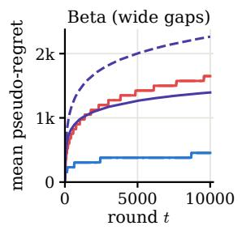

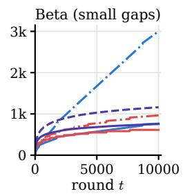

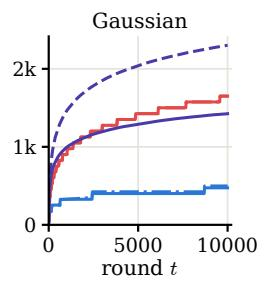

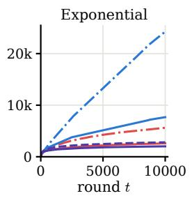

(a) Mean pseudo-regret over 1,024 runs.  
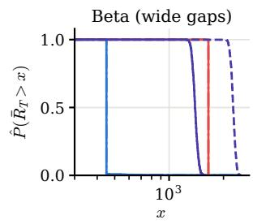

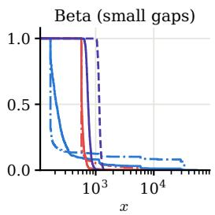

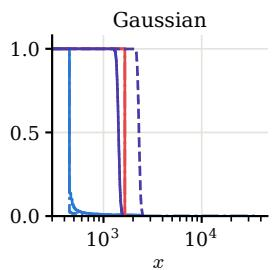  
(b) Empirical tail $\hat { P } ( R _ { T } > x )$ of the pseudo-regret (x on a logarithmic scale).

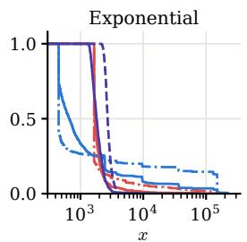  
Figure 1: Pseudo-regret performance over 1,024 runs.

Lemma B.5. Opus-5.5 was also used to help improve the presentation. The authors acknowledge Claude Code’s assistance in implementing the experiments. The authors have verified all code, statements, and proofs, and take full responsibility regarding the correctness and clarity of the work.

## Acknowledegments

SA acknowledges the support from ANRF’s grant ANRF/ECRG/2025/000560/ENS and the generous support from the Pratiksha Trust, Bangalore, through the Young Investigator Award. This work was also supported by the Centre for Networked Intelligence (a Cisco CSR initiative) at the Indian Institute of Science, Bengaluru.

Table 3: Pseudo-regret at $T = 1 0 , 0 0 0$ over 1,024 independent runs, where $g _ { 1 } ( t ) =$ ${ \frac { 1 } { K } } ( \log t )$ (log log t) and $\begin{array} { r } { g _ { 2 } ( t ) = \frac { 1 } { K } ( \log t ) ^ { 2 } } \end{array}$ , with K the number of arms.
<table><tr><td rowspan="3">Policy</td><td colspan="4">Beta (wide gaps)</td><td colspan="4">Beta (small gaps)</td><td colspan="2">Gaussian</td><td colspan="2">Exponential</td></tr><tr><td colspan="2">[0, 1]</td><td colspan="2">[0,50]</td><td colspan="2">[0, 1]</td><td colspan="2">[0,50]</td><td colspan="2"></td><td colspan="2"></td></tr><tr><td>mean</td><td>med.</td><td>mean</td><td>med.</td><td>mean</td><td>med.</td><td>mean</td><td>med.</td><td>mean</td><td>med.</td><td>mean</td><td>med.</td></tr><tr><td> $\mathtt { E L - F } , g _ { 1 } , C _ { \mathrm { r a d } } = 0$ </td><td>9.06</td><td>9.00</td><td>453</td><td>450</td><td>60.0</td><td>3.33</td><td>3,001</td><td>167</td><td>498</td><td>450</td><td>24,255</td><td>450</td></tr><tr><td> $\mathtt { E L - F } , g _ { 1 } , C _ { \mathrm { r a d } } = 3$ </td><td>9.10</td><td>9.00</td><td>455</td><td>450</td><td>15.3</td><td>4.20</td><td>765</td><td>210</td><td>474</td><td>450</td><td>7,672</td><td>660</td></tr><tr><td> $\mathtt { E L - F } , g _ { 2 } , C _ { \mathrm { r a d } } = 0$ </td><td>33.0</td><td>33.0</td><td>1,650</td><td>1,650</td><td>19.3</td><td>11.3</td><td>964</td><td>567</td><td>1,650</td><td>1,650</td><td>5,611</td><td>1,650</td></tr><tr><td> $\mathtt { E L - F } , g _ { 2 } , C _ { \mathrm { r a d } } = 3$ </td><td>33.0</td><td>33.0</td><td>1,650</td><td>1,650</td><td>12.3</td><td>11.5</td><td>614</td><td>573</td><td>1,650</td><td>1,650</td><td>2,607</td><td>1,695</td></tr><tr><td>RDS,  $\rho _ { n } = \sqrt { \log ( 1 + n ) }$ </td><td>27.9</td><td>27.8</td><td>1,395</td><td>1,390</td><td>15.1</td><td>14.9</td><td>754</td><td>743</td><td>1,425</td><td>1,425</td><td>2,018</td><td>1,810</td></tr><tr><td>RDS,  $\rho _ { n } = \log ( 1 + n )$ </td><td>45.3</td><td>45.3</td><td>2,264</td><td>2,265</td><td>23.2</td><td>23.1</td><td>1,161</td><td>1,153</td><td>2,302</td><td>2,295</td><td>2,804</td><td>2,710</td></tr><tr><td> $\mathtt { R - U C B } , \varphi = g _ { 1 }$ </td><td>31.8</td><td>31.8</td><td>833</td><td>75.0</td><td>88.7</td><td>88.6</td><td>6,554</td><td>46.7</td><td>3,313</td><td>75.0</td><td>56,385</td><td>120</td></tr><tr><td> $\mathtt { R - U C B } , \varphi = g _ { 2 }$ </td><td>116</td><td>116</td><td>680</td><td>75.0</td><td>260</td><td>259</td><td>4,952</td><td>50.0</td><td>2,510</td><td>75.0</td><td>55,007</td><td>120</td></tr><tr><td> $\mathbb { F } \mathbb { E } , f ( r ) = e ^ { r / \log T }$ </td><td>96.0</td><td>96.0</td><td>4,800</td><td>4,800</td><td>42.8</td><td>42.7</td><td>2,140</td><td>2,133</td><td>4,800</td><td>4,800</td><td>4,855</td><td>4,800</td></tr><tr><td>FE,  $f ( r ) = { \sqrt { T } }$ </td><td>149</td><td>149</td><td>7,473</td><td>7,460</td><td>71.5</td><td>66.5</td><td>3,573</td><td>3,323</td><td>7,514</td><td>7,460</td><td>10,049</td><td>7,520</td></tr><tr><td> $\operatorname { F E } , f ( r ) = r$ </td><td>210</td><td>210</td><td>10,500</td><td>10,500</td><td>93.6</td><td>93.3</td><td>4,681</td><td>4,667</td><td>10,500</td><td>10,500</td><td>10,659</td><td>10,500</td></tr></table>

## References

S. Agrawal and N. Goyal. Near-optimal regret bounds for thompson sampling. J. ACM, 64(5), 2017. ISSN 0004-5411. doi: 10.1145/3088510.

S. Agrawal, S. Juneja, and P. Glynn. Optimal δ-correct best-arm selection for heavytailed distributions. In Proceedings of the 31st International Conference on Algorithmic Learning Theory, volume 117, pages 61–110. PMLR, 2020.

S. Agrawal, S. K. Juneja, and W. M. Koolen. Regret minimization in heavy-tailed bandits. In Conference on Learning Theory, pages 26–62. PMLR, 2021.

K. Ashutosh, J. Nair, A. Kagrecha, and K. Jagannathan. Bandit algorithms: Letting go of logarithmic regret for statistical robustness. In International Conference on Artificial Intelligence and Statistics, pages 622–630. PMLR, 2021.

J.-Y. Audibert, R. Munos, and C. Szepesvári. Exploration–exploitation tradeof using variance estimates in multi-armed bandits. Theoretical Computer Science, 410(19): 1876–1902, 2009.

D. Baudry, P. Saux, and O.-A. Maillard. From optimality to robustness: Adaptive resampling strategies in stochastic bandits. Advances in Neural Information Processing Systems, 34:14029–14041, 2021.

S. Boucheron, G. Lugosi, and P. Massart. Concentration Inequalities: A Nonasymptotic Theory of Independence. Oxford University Press, 2013. ISBN 9780199535255. doi: 10.1093/acprof:oso/9780199535255.001.0001.

S. Bubeck, N. Cesa-Bianchi, and G. Lugosi. Bandits with heavy tail. IEEE Transactions on Information Theory, 59(11):7711–7717, 2013.

A. N. Burnetas and M. N. Katehakis. Optimal adaptive policies for sequential allocation problems. Advances in Applied Mathematics, 17(2):122–142, 1996.

O. Cappé, A. Garivier, O.-A. Maillard, R. Munos, and G. Stoltz. Kullback–leibler upper confidence bounds for optimal sequential allocation. The Annals of Statistics, 41(3), 2013. ISSN 0090-5364. doi: 10.1214/13-aos1119.

W. Cowan and M. N. Katehakis. An asymptotically optimal policy for uniform bandits of unknown support. arXiv preprint arXiv:1505.01918, 2015.

W. Cowan and M. N. Katehakis. Exploration–exploitation policies with almost sure, arbitrarily slow growing asymptotic regret. Probability in the Engineering and Informational Sciences, 34(3):406–428, 2020. doi: 10.1017/S0269964818000529.

W. Cowan, J. Honda, and M. N. Katehakis. Normal bandits of unknown means and variances. Journal of Machine Learning Research, 18(154):1–28, 2018.

J. C. Duchi, P. W. Glynn, and H. Namkoong. Statistics of robust optimization: A generalized empirical likelihood approach. Mathematics of Operations Research, 46(3): 946–969, 2021.

P. Embrechts, C. Klüppelberg, and T. Mikosch. Modelling Extremal Events. Springer Berlin Heidelberg, 1997. ISBN 9783642334832. doi: 10.1007/978-3-642-33483-2. URL http://dx.doi.org/10.1007/978-3-642-33483-2.

L. Fan and P. W. Glynn. The fragility of optimized bandit algorithms. Operations Research, 73(6):3173–3198, 2025.

G. Genalti and A. M. Metelli. Open problem: Regret minimization in heavy-tailed bandits with unknown distributional parameters. In COLT, pages 1–5, 2025.

G. Genalti and A. M. Metelli. Parameter-free heavy-tailed bandits. arXiv preprint arXiv:2607.29460, 2026.

G. Genalti, L. Marsigli, N. Gatti, and A. M. Metelli. (ε, u)-adaptive regret minimization in heavy-tailed bandits. In The Thirty Seventh Annual Conference on Learning Theory, pages 1882–1915. PMLR, 2024.

H. Hadiji and G. Stoltz. Adaptation to the range in k-armed bandits. Journal of Machine Learning Research, 24(13):1–33, 2023.

Q. Han, L. Zhu, and F. Guo. Forced exploration in bandit problems. In Proceedings of the AAAI Conference on Artificial Intelligence, volume 38, pages 12270–12277, 2024.

J. Honda and A. Takemura. Non-asymptotic analysis of a new bandit algorithm for semi-bounded rewards. The Journal of Machine Learning Research, 16(1):3721–3756, 2015.

N. Karampatziakis, J. Langford, and P. Mineiro. Empirical likelihood for contextual bandits. Advances in Neural Information Processing Systems, 33:9597–9607, 2020.

E. Kaufmann, N. Korda, and R. Munos. Thompson sampling: An asymptotically optimal finite-time analysis. In Algorithmic Learning Theory, pages 199–213, Berlin, Heidelberg, 2012. Springer Berlin Heidelberg. ISBN 978-3-642-34106-9.

E. Kaufmann, O. Cappé, and A. Garivier. On the complexity of best-arm identification in multi-armed bandit models. The Journal of Machine Learning Research, 17(1):1–42, 2016.

J. Kiefer and J. Wolfowitz. Consistency of the maximum likelihood estimator in the presence of infinitely many incidental parameters. The Annals of Mathematical Statistics, 27(4):887–906, Dec. 1956. ISSN 0003-4851. doi: 10.1214/aoms/1177728066. URL http://dx.doi.org/10.1214/aoms/1177728066.

T. Lai and H. Robbins. Asymptotically eficient adaptive allocation rules. Advances in Applied Mathematics, 6(1):4–22, 1985. ISSN 0196-8858. doi: https://doi.org/10.1016/ 0196-8858(85)90002-8.

T. Lattimore. A scale free algorithm for stochastic bandits with bounded kurtosis. Advances in Neural Information Processing Systems, 30, 2017.

T. Lattimore and C. Szepesvári. Bandit Algorithms. Cambridge University Press, 2020. ISBN 9781108486828. doi: 10.1017/9781108571401.

A. Maurer and M. Pontil. Empirical bernstein bounds and sample variance penalization. In Proceedings of the 22nd Annual Conference on Learning Theory (COLT), 2009.

J. Ouyang, M. Gong, and H. Bondell. Bayesian inference of contextual bandit policies via empirical likelihood. Journal of Machine Learning Research, 27(41):1–28, 2026.

A. B. Owen. Empirical Likelihood. Number 92 in Monographs on Statistics and Applied Probability. Chapman & Hall/CRC, Boca Raton, FL, 2001.

S. Panda and S. Agrawal. Regret tail characterization of optimal bandit algorithms with generic rewards. In 2026 IEEE International Symposium on Information Theory (ISIT), page 1–6. IEEE, 2026. doi: 10.1109/isit62367.2026.11654116.

A. Salomon and J.-Y. Audibert. Deviations of Stochastic Bandit Regret, page 159–173. Springer Berlin Heidelberg, 2011. ISBN 9783642244124. doi: 10.1007/ 978-3-642-24412-4\_15.

D. Simchi-Levi, Z. Zheng, and F. Zhu. Regret distribution in stochastic bandits: Optimal trade-of between expectation and tail risk. arXiv preprint arXiv:2304.04341, 2023.

D. Simchi-Levi, Z. Zheng, and F. Zhu. A simple and optimal policy design with safety against heavy-tailed risk for stochastic bandits. Management Science, 71(7):6298–6318, 2025.

A. Slivkins. Introduction to multi-armed bandits. Foundations and Trends® in Machine Learning, 12(1-2):1–286, Nov. 2019. ISSN 1935-8245. doi: 10.1561/2200000068. URL http://dx.doi.org/10.1561/2200000068.

A. Tamás, S. Szentpéteri, and B. C. Csáji. Data-driven upper confidence bounds with near-optimal regret for heavy-tailed bandits. arXiv preprint arXiv:2406.05710, 2024.

W. R. Thompson. On the likelihood that one unknown probability exceeds another in view of the evidence of two samples. Biometrika, 25(3-4):285–294, 1933. ISSN 0006-3444. doi: 10.1093/biomet/25.3-4.285.

M. J. Wainwright. High-Dimensional Statistics: A Non-Asymptotic Viewpoint. Cambridge University Press, 2019. ISBN 9781108498029. doi: 10.1017/9781108627771.

## A Related Work.

In this appendix, we discuss the related works in detail.

Impossibility and scale-free algorithms. Within parametric families, scale-free logarithmic regret is attainable: Cowan et al. [2018] give an inflated-sample-mean index policy that is asymptotically optimal for Gaussian rewards with unknown means and variances, and Cowan and Katehakis [2015] do the same for uniform rewards with unknown supports. Both their guarantees rely on the parametric form and do not extend to the non-parametric classes considered here.

On suficiently rich classes K $\mathcal { L } _ { \mathrm { i n f } } = 0$ , so logarithmic regret is impossible [Lattimore, 2017, Agrawal et al., 2020, Hadiji and Stoltz, 2023, Ashutosh et al., 2021]. Lattimore [2017] gives a scale-free algorithm under a known bound on the kurtosis and proposes inflating the exploration rate to trade a slightly super-logarithmic regret for adaptivity. Ashutosh et al. [2021] realize this with R-UCB, which inflates the exploration rate of UCB to $g ( t ) = \omega ( \log t )$ and obtains $\mathcal { O } ( g ( T ) )$ regret on light-tailed instances, together with a truncation-based variant for heavy tails. Baudry et al. [2021] obtain an analogous tradeof with re-sampling (Dirichlet sampling, RDS). By Hadiji and Stoltz [2023, Theorem 1], a scale-free policy whose distribution-dependent regret is $\mathcal { O } ( g ( T ) )$ on bounded instances cannot have distribution-free regret $o ( T / g ( T ) )$ ; like R-UCB and RDS, EL-F gives up worst-case regret in exchange for near-logarithmic instance-dependent regret.

Forced exploration. The g-Forcing policy of Cowan and Katehakis [2020] samples an arm whose pull count falls below g and otherwise plays greedily, and for slowly growing g its pseudo-regret is of order $g ( n )$ almost surely, with almost-sure bounds on the remainder term. With $C _ { \mathrm { r a d } } = 0$ , EL-F essentially reduces to this policy. Relative to their work, we provide finite-time expected-regret bounds with explicit constants, quantitative regret-tail bounds, an exact tail exponent on Gaussian instances, and the empirical-likelihood index for $C _ { \mathrm { r a d } } > 0$ . Han et al. [2024] interleave forced exploration with greedy choices and obtain near-logarithmic expected regret for sub-Gaussian rewards with unknown variance proxy. Their exploration is triggered by the time since an arm’s last pull, and their near-logarithmic schedules take the horizon as input. Unlike either of these works, we analyze the regret tails.

Heavy-tailed bandits. For rewards with only bounded moments, robust estimators give optimal regret when the moment bound is known [Bubeck et al., 2013, Agrawal et al., 2021]. Recent work studies parameter-free variants by imposing relaxing assumptions that allow them to get around the impossibility result. These include examples such as truncated non-positivity [Genalti et al., 2024] and symmetry [Tamás et al., 2024]. Genalti and Metelli [2025] stated several open problems on this front, including assumption-free adaptation, as well as understanding how diferent relaxing assumptions relate to one another. Recent work by Genalti and Metelli [2026] makes progress on the former of these problems. While our current setting is light-tailed, we believe it would be an interesting avenue of future work to extend our methods to the heavy-tailed setting.

Empirical likelihood. We note that the empirical likelihood method has been applied successfully in the contextual bandit literature [Karampatziakis et al., 2020, Ouyang et al., 2026]. Empirical-likelihood confidence bounds have also been used in distributionally robust optimization [Duchi et al., 2021].

Regret tails. The distribution of the pseudo-regret was studied by Audibert et al. [2009], Salomon and Audibert [2011], who show that UCB-type algorithms can have polynomially decaying regret tails. Fan and Glynn [2025] show that this heavy-tail behaviour is intrinsic to algorithms that match the Lai-Robbins bound. Simchi-Levi et al. [2023] characterize the trade-of between expected regret and tail risk: their lower bound ties the tail of a policy to its expected regret on an alternative instance, and they give an anytime UCB policy that attains the matching orders, also for sub-exponential noise, under the assumption that the means lie in a known range and with a hyper-parameter in the sub-exponential case. Simchi-Levi et al. [2025], Panda and Agrawal [2026] study tailsafe policies and tail characterizations for general reward models. In Section 6 we prove a lower bound by a change-of-measure argument of the same type, with an explicit constant, and use it to show that the exponent of our tail bound is exact on Gaussian instances (Corollary 6.3). Our tail bound $\exp ( - \Omega ( g ( x ) ) )$ holds for every sub-exponential instance without a known range for the means and without distribution-specific parameters.

## B Deferred proofs

This appendix contains the full proofs of the results appearing in the main text.

## B.1 Preliminary lemmas

Proof of Lemma 4.2. We couple the two runs of the algorithm (namely, with $C _ { \mathrm { r a d } } = 0$ and $C _ { \mathrm { r a d } } = C > 0 )$ by using the same reward stream for each arm (recall the reward-stack model specified in Section 2). Write $N _ { i } ^ { C } ( t )$ and $N _ { i } ^ { 0 } ( t )$ for the respective pull counts before round t. We prove by induction on t that

$$
N _ { 1 } ^ { C } ( t ) \geq N _ { 1 } ^ { 0 } ( t ) .
$$

The claim holds at $t = 1$ , since both counts are zero.

Suppose it holds at round t. The inequality can fail at round $t + 1$ only if the runs pull the following arms at time t and satisfy:

$$
N _ { 1 } ^ { C } ( t ) = N _ { 1 } ^ { 0 } ( t ) , \qquad A _ { t } ^ { C } = 2 , \quad A _ { t } ^ { 0 } = 1 .
$$

We show that this is impossible.

Since the two algorithms have made the same number of pulls of arm 1 by round t, and both have made exactly t − 1 pulls in total, their pull counts agree for both arms:

$$
N _ { i } ^ { C } ( t ) = N _ { i } ^ { 0 } ( t ) , \qquad i = 1 , 2 .
$$

$\mathrm { B y }$ the coupling, their empirical distributions are consequently identical.

First, consider the forced-exploration phase. The set of deficient arms is identical in the two runs. Since the same least-sampled rule and tie-breaking convention are used, both algorithms select the same arm. Thus the claimed divergence cannot occur in this phase.

Next, consider the UCB phase. Since arm 2 is deterministic, its empirical distribution is always $\delta _ { \mu _ { 2 } }$ . By the definition of the empirical-likelihood statistic,

$$
\mathrm { U } _ { 2 , C } ^ { \mathrm { E L } } ( t ) = \mathrm { U } _ { 2 , 0 } ^ { \mathrm { E L } } ( t ) = \mu _ { 2 } .
$$

From Remark 4.1, we have that the empirical mean lower bounds the index, i.e

$$
\mathrm { U } _ { 1 , C } ^ { \mathrm { E L } } ( t ) \geq \hat { m } _ { 1 } ( t ) = \mathrm { U } _ { 1 , 0 } ^ { \mathrm { E L } } ( t ) .
$$

If the zero-radius algorithm selects arm 1, then, by its selection rule,

$$
\begin{array} { r } { \mathrm { U } _ { 1 , 0 } ^ { \mathrm { E L } } ( t ) \geq \mathrm { U } _ { 2 , 0 } ^ { \mathrm { E L } } ( t ) = \mu _ { 2 } . } \end{array}
$$

It follows that

$$
\begin{array} { r } { \mathrm { U } _ { 1 , C } ^ { \mathrm { E L } } ( t ) \geq \mathrm { U } _ { 1 , 0 } ^ { \mathrm { E L } } ( t ) \geq \mu _ { 2 } = \mathrm { U } _ { 2 , C } ^ { \mathrm { E L } } ( t ) . } \end{array}
$$

Therefore, the radius-C algorithm must also select arm 1, using the stipulated tie-breaking rule. This contradicts $A _ { t } ^ { C } = 2$ and $A _ { t } ^ { 0 } = 1$

Hence the induction is complete, and

$$
N _ { 1 } ^ { C } ( t ) \geq N _ { 1 } ^ { 0 } ( t ) \qquad { \mathrm { f o r ~ a l l ~ } } t \geq 1 .
$$

Finally, since arm 1 is optimal and $\Delta = m ( P _ { 1 } ) - m ( P _ { 2 } ) > 0$ , the pseudo-regret of either algorithm is

$$
R ^ { C } ( T ) = \Delta N _ { 2 } ^ { C } ( T + 1 ) = \Delta \big ( T - N _ { 1 } ^ { C } ( T + 1 ) \big ) .
$$

Thus,

$$
N _ { 1 } ^ { C } ( T + 1 ) \geq N _ { 1 } ^ { 0 } ( T + 1 ) \implies R ^ { C } ( T ) \leq R ^ { 0 } ( T ) ,
$$

as claimed.

## B.2 Almost Sure and Expected Regret Analysis

In this section, we prove Theorem 5.1, our main result concerning the pseudo-regret random variable induced by Algorithm 1. Following the proof of Theorem 5.1, we prove the intermediate lemmas and results used, including Lemmas 2.2 and 5.2.

Proof of Theorem 5.1. Part (1). The proof efectively follows the proof of Proposition 1 in Cowan and Katehakis [2020]. Our algorithm can be seen as the g-forcing policy that simply uses the EL index instead of the sample mean in the UCB phase (called “play the winner" phase in their proof). The same lower bound on the number of sub-optimal pulls holds, since it only depends on g and not the nature of the UCB phase. On the other hand, using strong consistency of the EL index (Lemma B.3) instead of the strong law of large numbers in the paragraph preceding Cowan and Katehakis [2020, Equation 44] and following the same argument provides the upper bound.

Part (2). Let T be the time horizon and let $S _ { X } \subset [ T ]$ be the time indices spent in the forced exploration phase, and $S _ { U } = [ T ] \setminus S _ { X }$ be the time indices spent in the UCB phase. Then, for any $i \in [ K ]$ :

$$
\begin{array} { l } { { \displaystyle N _ { i } ( T + 1 ) = \sum _ { t = 1 } ^ { T } \mathbf { 1 } \left\{ A _ { t } = i \right\} } \ ~ } \\ { { \displaystyle ~ = \sum _ { t = 1 } ^ { T } \mathbf { 1 } \left\{ A _ { t } = i , t \in S _ { X } \right\} + \sum _ { t = 1 } ^ { T } \mathbf { 1 } \left\{ A _ { t } = i , t \in S _ { U } \right\} } \ ~ } \\ { { \displaystyle ~ \leq \left\lceil g ( T ) \right\rceil + \sum _ { t = 1 } ^ { T } \mathbf { 1 } \left\{ A _ { t } = i , t \in S _ { U } \right\} } , } \end{array}
$$

where the inequality follows from the definition of the forced exploration phase: a forced pull of arm i at round t requires $N _ { i } ( t ) < g ( t ) \leq g ( T )$ , so there are at most $\lceil g ( T ) \rceil$ of them. No separate initialization cost arises, because the forced phase itself initializes every arm. Now, we focus on controlling the latter term in expectation for some suboptimal arm $i ,$ i.e. where $\Delta _ { i } = m ( P _ { 1 } ) - m ( P _ { i } ) > 0$

Choose $\epsilon \in ( 0 , \Delta _ { i } )$

$$
\begin{array} { r l } { 2 [ \displaystyle \sum _ { i = 1 } ^ { n } \mathbf { 1 } _ { i } \lVert A _ { i } = i , i \in \mathcal { S } \boldsymbol { S } \boldsymbol { S } \boldsymbol { S } \boldsymbol { S } \boldsymbol { S } \boldsymbol { S } \boldsymbol { S } \boldsymbol { S } \boldsymbol { S } \boldsymbol { S } \boldsymbol { S } \boldsymbol { S } \boldsymbol { S } \boldsymbol { S } \boldsymbol { S } \boldsymbol { S } \boldsymbol { S } \boldsymbol { S } \boldsymbol { S } \boldsymbol { S } \boldsymbol { S } \boldsymbol { S } \boldsymbol { S } \boldsymbol { S } \boldsymbol { S } \boldsymbol { S } \boldsymbol { S } \boldsymbol { S } \boldsymbol { S } \boldsymbol { S } \boldsymbol { S } \boldsymbol { S } \boldsymbol { S } \boldsymbol { S } \boldsymbol { S } \boldsymbol { S } \boldsymbol { S } \boldsymbol { S } \boldsymbol { S } \boldsymbol { S } \boldsymbol { S } \boldsymbol { S } \boldsymbol { S } \boldsymbol { S } \boldsymbol { S } \boldsymbol { S } \boldsymbol { S } \boldsymbol { S } \boldsymbol { S } \boldsymbol { S } \boldsymbol { S } \boldsymbol { S } \boldsymbol { S } \boldsymbol { S } \boldsymbol { S } \boldsymbol { S } \boldsymbol { S } \boldsymbol { S } \boldsymbol { S } \boldsymbol { S } \boldsymbol { S } \boldsymbol { S } \boldsymbol { S } \boldsymbol { S } \boldsymbol { S } \boldsymbol { S } \boldsymbol { S } \boldsymbol { S } \boldsymbol { S } } \\  - \displaystyle \sum _ { i = 1 } ^ { n } \mathbf { S } [ \nabla _ { i } \nabla _ { i } \boldsymbol { G } ^ { ( 1 ) } \boldsymbol { G } ^ { ( 1 ) } \boldsymbol { S } \boldsymbol { S } \boldsymbol { S } \boldsymbol { S } \boldsymbol { S } \boldsymbol { S } \boldsymbol { S } \boldsymbol { S } ^ { ( 1 ) } \boldsymbol { ( 1 ) } \boldsymbol { G } ^ { ( 1 ) } \boldsymbol { S } - \boldsymbol { S } \boldsymbol { S } \boldsymbol { S } \boldsymbol { S } \boldsymbol { S } \boldsymbol { S } \boldsymbol { S } \boldsymbol { S } \boldsymbol { S } \boldsymbol { S } \boldsymbol { S } \boldsymbol { S } \boldsymbol { S } \boldsymbol { S } \boldsymbol { S } \boldsymbol { S } \boldsymbol { S } \boldsymbol { S } \boldsymbol { S } \boldsymbol { S } \boldsymbol { S } \boldsymbol { S } \boldsymbol { S } \boldsymbol { S } \boldsymbol { S } \boldsymbol { S } \boldsymbol { S } \boldsymbol { S } \boldsymbol { S } \boldsymbol { S } \boldsymbol { S } \boldsymbol { S } \boldsymbol { S } \boldsymbol { S } \boldsymbol { S } \boldsymbol { S }  \end{array}
$$

where the last inequality follows from Remark 4.1 and $\hat { m } _ { 1 } ( t )$ is the empirical mean of arm 1 from the $N _ { 1 } ( t )$ samples observed till time t. Next, we show that as T grows larger, the dominant cost is solely of the forced exploration and the UCB phase only contributes regret constant in T. More formally, we show in Lemmas B.1 and B.2 constant upper bounds on terms A and B respectively.

For each suboptimal arm i, fix $\epsilon = \epsilon _ { i } \in ( 0 , \Delta _ { i } ) \ ( \mathrm { e . g . } \ \epsilon _ { i } = \Delta _ { i } / 2 )$ , and let $A _ { i }$ and $B _ { i }$ denote the right-hand sides of Equation (9) and of the second inequality in Equation (14), with all constants computed for arm i. Using $\begin{array} { r } { \lceil g ( T ) \rceil \leq g ( T ) + 1 } \end{array}$ , we get $\mathbb { E } \left[ N _ { i } ( T + 1 ) \right] \leq$ $g ( T ) + 1 + A _ { i } + B _ { i }$ . Multiplying by $\Delta _ { i }$ and summing over suboptimal arms proves the theorem with

$$
C _ { \underline { { P } } } = \sum _ { i : \Delta _ { i } > 0 } \Delta _ { i } \left( 1 + A _ { i } + B _ { i } \right) ,\tag{8}
$$

where

$$
\begin{array} { l } { { A _ { i } = \displaystyle \frac { 1 } { 1 - e ^ { - C _ { \eta } } } \Big ( t _ { 1 } - 1 + \frac { \pi ^ { 2 } } { 6 } \Big ) + \displaystyle \frac { 1 } { 1 - e ^ { - C _ { L } } } \Big ( t _ { 2 } - 1 + \frac { \pi ^ { 2 } } { 6 } \Big ) + t _ { 0 } - 1 + \frac { \pi ^ { 2 } } { 3 } , } } \\ { { B _ { i } = \displaystyle \frac { 1 } { 1 - e ^ { - C _ { \epsilon } } } \Big ( t _ { B } - 1 + \frac { \pi ^ { 2 } } { 6 } \Big ) , } } \end{array}
$$

with the constants specified in Lemmas B.1 and B.2.

## B.2.1 Term A

Lemma B.1 (Controlling Term A for sub-exponential rewards.). For any sub-optimal arm i, suppose that $P _ { i } \in \mathcal { P } _ { \nu _ { 0 } , \alpha _ { 0 } }$ for some $\nu _ { 0 } , \alpha _ { 0 } > 0$ . Then, Term A in Equation (6) is

bounded:

$$
\mathrm { T e r m ~ A } \leq { \frac { 1 } { 1 - e ^ { - C _ { \eta } } } } \left( t _ { 1 } - 1 + { \frac { \pi ^ { 2 } } { 6 } } \right) + { \frac { 1 } { 1 - e ^ { - C _ { L } } } } \left( t _ { 2 } - 1 + { \frac { \pi ^ { 2 } } { 6 } } \right) + t _ { 0 } - 1 + { \frac { \pi ^ { 2 } } { 3 } } ,\tag{9}
$$

where $C _ { \eta } , C _ { L } > 0$ and $t _ { 0 } , t _ { 1 } , t _ { 2 } < \infty$ are explicit problem-dependent constants defined in the proof.

Proof. Let $\Delta _ { i } - \epsilon = \eta _ { 1 } > 0$ . For every $t \in S _ { U }$ , so that $N _ { i } ( t ) \geq g ( t ) > 0$ and all empirical quantities below are well defined, consider the ‘bad’ events

$$
E _ { t } = \{ \hat { m } _ { i } ( t ) - m ( P _ { i } ) \geq \eta _ { 1 } / 2 \} .
$$

From the intersection of the event $\{ \mathrm { U } _ { i } ^ { \mathrm { E L } } ( t ) - m ( P _ { i } ) \geq \eta _ { 1 } \}$ with $E _ { t } ^ { c }$ , we have:

$$
\mathrm { U } _ { i } ^ { \mathrm { E L } } ( t ) - m ( P _ { i } ) \geq \eta _ { 1 } , \hat { m } _ { i } ( t ) - m ( P _ { i } ) < \eta _ { 1 } / 2 \implies \mathrm { U } _ { i } ^ { \mathrm { E L } } ( t ) - \hat { m } _ { i } ( t ) \geq \eta _ { 1 } / 2 .
$$

Thus:

$$
\begin{array} { r l r } {  { \sum _ { t = 1 } ^ { T } \mathbb { P } [ \mathrm { U } _ { i } ^ { \mathrm { E L } } ( t ) - m ( P _ { i } ) \geq \eta _ { 1 } , A _ { t } = i , t \in S _ { U } ] \leq \sum _ { t = 1 } ^ { T } \mathbb { P } [ E _ { t } , t \in S _ { U } ] } } & { \displaystyle ( 1 0 ) ! } \\ & { } & { \quad + \sum _ { t = 1 } ^ { T } \mathbb { P } [ \mathrm { U } _ { i } ^ { \mathrm { E L } } ( t ) - \hat { m } _ { i } ( t ) \geq \eta _ { 1 } / 2 , t \in S _ { U } ] . } \end{array}\tag{11}
$$

The first part of the summation above (Equation (10)) is bounded above by a constant using standard exponential concentration inequalities.

For $E _ { t } = \{ \hat { m } _ { i } ( t ) - m ( P _ { i } ) \geq \eta _ { 1 } / 2 \}$ , applying the sub-exponential concentration inequality for sample means [Wainwright, 2019, Proposition 2.9, Eq. 2.18] with $C _ { \eta } =$ $\frac { 1 } { 2 }$ min $\left\{ \frac { \eta _ { 1 } ^ { 2 } } { 4 \nu _ { 0 } ^ { 2 } } , \frac { \eta _ { 1 } } { 2 \alpha _ { 0 } } \right\} > 0$ yields:

$$
\sum _ { t = 1 } ^ { T } \mathbb { P } \left[ E _ { t } , t \in S _ { U } \right] \leq \sum _ { t = 1 } ^ { T } \sum _ { s = \lceil g ( t ) \rceil } ^ { t - 1 } \exp { ( - s C _ { \eta } ) } < \frac { 1 } { 1 - e ^ { - C _ { \eta } } } \sum _ { t = 1 } ^ { T } e ^ { - C _ { \eta } g ( t ) } .
$$

Because $g ( t ) = \omega ( \log t )$ , there exists a timestep $t _ { 1 } = t _ { 1 } ( \eta _ { 1 } , \nu _ { 0 } , \alpha _ { 0 } )$ such that $C _ { \eta } g ( t ) \geq$ 2 log t for all $t \geq t _ { 1 }$ , giving $e ^ { - C _ { \eta } g ( t ) } \le 1 / t ^ { 2 }$ . Splitting the summation at $t _ { 1 }$ gives:

$$
\sum _ { t = 1 } ^ { T } \mathbb { P } \left[ E _ { t } , t \in S _ { U } \right] \leq \frac { 1 } { 1 - e ^ { - C _ { \eta } } } \left( t _ { 1 } - 1 + \frac { \pi ^ { 2 } } { 6 } \right) = \mathcal { O } ( 1 ) .
$$

Moreover, we show that the same holds for the latter term (Equation (11)) using Lemmas B.5 and 5.2. More precisely, we will show that:

$$
\sum _ { t = 1 } ^ { T } \mathbb { P } \left[ \mathrm { U } _ { i } ^ { \mathrm { E L } } ( t ) - \hat { m } _ { i } ( t ) \geq \eta _ { 1 } / 2 , t \in S _ { U } \right] = \mathcal { O } ( 1 ) .
$$

To do ${ \mathrm { s o } } .$ let $X _ { i , s }$ be the $s ^ { \mathrm { t h } }$ sample drawn from arm i and define the following relevant quantities for t with $N _ { i } ( t ) \geq 1$ :

$$
\begin{array} { r } { \bullet ( } \\ { \bullet ( M _ { i } ( t ) = \operatorname* { m a x } _ { s \leq N _ { i } ( t ) } | X _ { i , s } - m ( P _ { i } ) | , } \end{array}
$$

$$
\begin{array} { r } { \bullet ( \boldsymbol { \mathrm { \lambda } } _ { i } ( t ) = \frac { 1 } { N _ { i } ( t ) } \sum _ { \boldsymbol { s } \in N _ { i } ( t ) } | X _ { i , \boldsymbol { s } } - m ( P _ { i } ) | , } \end{array}
$$

$$
\begin{array} { r } { \bullet \ X _ { i } ^ { \operatorname* { m a x } } ( t ) = \operatorname* { m a x } _ { s \leq N _ { i } ( t ) } X _ { i , s } . } \end{array}
$$

$$
\begin{array} { r } { \bullet \widehat { \sigma } _ { i } ^ { 2 } ( t ) = \frac { 1 } { N _ { i } ( t ) } \sum _ { s \leq N _ { i } ( t ) } \bigl ( X _ { i , s } - \hat { m } _ { i } ( t ) \bigr ) ^ { 2 } . } \end{array}
$$

We write $M _ { i , n } , A _ { i , n } , X _ { i , n } ^ { \operatorname* { m a x } } , \hat { m } _ { i , n }$ and $\hat { \sigma } _ { i , n } ^ { 2 }$ for the same quantities computed from the first n samples of arm $i ,$ so that $M _ { i } ( t ) = M _ { i , N _ { i } ( t ) } ^ { ' } , A _ { i } ( t ) = A _ { i , N _ { i } ( t ) }$ , and so on. $\mathrm { B y }$ Lemma 5.2, $\begin{array} { r } { \mathrm { U } _ { i } ^ { \mathrm { E L } } ( t ) - \hat { m } _ { i } ( t ) \leq \frac { 2 C _ { \mathrm { r a d } } } { N _ { i } ( t ) } \big ( X _ { i } ^ { \operatorname* { m a x } } ( t ) - \hat { m } _ { i } ( t ) \big ) + \sqrt { \frac { 2 C _ { \mathrm { r a d } } } { N _ { i } ( t ) } } \hat { \sigma } _ { i } ^ { 2 } ( t ) } \end{array}$ . Since $| \hat { m } _ { i } ( t ) - m ( P _ { i } ) | \leq A _ { i } ( t ) \leq$ $M _ { i } ( t )$ , the triangle inequality gives $X _ { i } ^ { \operatorname* { m a x } } ( t ) { \dot { - m _ { i } } } ( t ) \leq 2 M _ { i } ( t )$ , and Lemma B.5 with $\mu =$ $m ( P _ { i } )$ gives $\hat { \sigma } _ { i } ^ { 2 } ( t ) \leq M _ { i } ( t ) A _ { i } ( t )$ . Hence:

$$
\mathrm { U } _ { i } ^ { \mathrm { E L } } ( t ) - \hat { m } _ { i } ( t ) \leq \frac { 4 C _ { \mathrm { r a d } } M _ { i } ( t ) } { N _ { i } ( t ) } + \sqrt { \frac { 2 C _ { \mathrm { r a d } } \cdot M _ { i } ( t ) \cdot A _ { i } ( t ) } { N _ { i } ( t ) } } .
$$

We will choose parameters $L , q \in \mathbb { R }$ such that on the paths where $\{ A _ { i } ( t ) \leq L , M _ { i } ( t ) \leq$ $q N _ { i } ( t ) \}$ , we have:

$$
\mathrm { U } _ { i } ^ { \mathrm { E L } } ( t ) - \hat { m } _ { i } ( t ) < \frac { \eta _ { 1 } } { 2 } .
$$

Thus, we have:

$$
\sum _ { t = 1 } ^ { T } \mathbb { P } \left[ \mathrm { U } _ { i } ^ { \mathrm { E L } } ( t ) - \hat { m } _ { i } ( t ) \geq \frac { \eta _ { 1 } } { 2 } , t \in S _ { U } \right] \leq \sum _ { t = 1 } ^ { T } \mathbb { P } \left[ A _ { i } ( t ) > L , t \in S _ { U } \right]\tag{12}
$$

$$
+ \sum _ { t = 1 } ^ { T } \mathbb { P } \left[ M _ { i } ( t ) > q N _ { i } ( t ) , t \in S _ { U } \right] .\tag{13}
$$

We want to choose $L , q$ such that:

$$
4 C _ { \mathrm { r a d } } q + \sqrt { 2 C _ { \mathrm { r a d } } q L } < \eta _ { 1 } / 2 .
$$

For any $L > 0$ , we can choose $q$ to satisfy the inequality as follows:

$$
q = \frac { 1 } { 2 } \operatorname* { m i n } \left\{ 1 , \ \frac { \eta _ { 1 } } { 1 6 C _ { \mathrm { r a d } } } , \ \frac { \eta _ { 1 } ^ { 2 } } { 3 2 C _ { \mathrm { r a d } } L } \right\} > 0 ,
$$

with the convention $x / 0 = + \infty$ , so that $\begin{array} { r } { q = \frac { 1 } { 2 } } \end{array}$ when $C _ { \mathrm { r a d } } = 0$ . (The factor $\frac { 1 } { 2 }$ makes the inequality strict.)

To choose a good $L _ { ; }$ we need to define an environment dependent constant. We define $\mu _ { A } = \mathbb { E } _ { P _ { i } } \left[ | X - m ( P _ { i } ) | \right]$ and set

$$
L = \mu _ { \cal A } + 1 .
$$

Note that L is only an analysis constant and need not be known to the algorithm. Since $X _ { i , s } , s \geq 1$ are independent, sub-exponential random variables, the variables $| X _ { i , s } -$ $m ( P _ { i } ) | , s \ge 1$ are also sub-exponential, so $\exists ~ \nu _ { A } , \alpha _ { A } > 0$ such that the law of $| X _ { i , 1 } -$ $m ( P _ { i } ) |$ lies in $\mathcal { P } _ { \nu _ { A } , \alpha _ { A } } .$ . (These are distinct from the parameters $( \nu _ { 0 } , \alpha _ { 0 } )$ of the original reward law.) Note that $L$ is strictly above $\mu _ { A }$ , which allows us to control the mean deviation terms.

Finally, we show that the terms on the right-hand side in Equations (12) and (13) are $\mathcal { O } ( 1 )$

• Consider $\textstyle \sum _ { t = 1 } ^ { T } \mathbb { P } \left[ A _ { i } ( t ) > L , t \in S _ { U } \right]$ . By choice of $L = \mu _ { A } + 1$ , we have $\delta _ { L } =$ $L - \mu _ { A } = 1$ . Applying the sub-exponential concentration inequality for sums [Wainwright, 2019, Eq. 2.18] to the i.i.d. sequence $Y _ { i , s } = | X _ { i , s } - m ( P _ { i } ) |$ | with law in $\mathcal { P } _ { \nu _ { A } , \alpha _ { A } } \mathrm { : }$

$$
\mathbb { P } \left[ A _ { i , s } > L \right] = \mathbb { P } \left[ \frac { 1 } { s } \sum _ { j = 1 } ^ { s } ( Y _ { i , j } - \mu _ { A } ) > \delta _ { L } \right] \leq \exp \left( - s C _ { L } \right) ,
$$

where $\begin{array} { r } { C _ { L } = \frac { 1 } { 2 } \operatorname* { m i n } \left\{ \frac { 1 } { \nu _ { A } ^ { 2 } } , \frac { 1 } { \alpha _ { A } } \right\} > 0 } \end{array}$ . Summing over $s \geq g ( t )$ for $t \in S _ { U }$ gives:

$$
\sum _ { t = 1 } ^ { T } \mathbb { P } \left[ A _ { i } ( t ) > L , t \in S _ { U } \right] \leq \sum _ { t = 1 } ^ { T } \sum _ { s = \lceil g ( t ) \rceil } ^ { t - 1 } e ^ { - s C _ { L } } < \frac { 1 } { 1 - e ^ { - C _ { L } } } \sum _ { t = 1 } ^ { T } e ^ { - C _ { L } g ( t ) } .
$$

Since $g ( t ) = \omega ( \log t )$ , there exists a timestep $t _ { 2 } = t _ { 2 } ( \nu _ { A } , \alpha _ { A } )$ such that $C _ { L } g ( t ) \geq$ 2 log t for all $t \geq t _ { 2 }$ , giving $e ^ { - C _ { L } g ( t ) } \leq 1 / t ^ { 2 }$ . Splitting the summation at $t _ { 2 }$ gives:

$$
\sum _ { t = 1 } ^ { T } \mathbb { P } \left[ A _ { i } ( t ) > L , t \in S _ { U } \right] \leq \frac { 1 } { 1 - e ^ { - C _ { L } } } \left( t _ { 2 } - 1 + \frac { \pi ^ { 2 } } { 6 } \right) = \mathcal { O } ( 1 ) .
$$

• $\mathrm { B y }$ Lemma B.6, for any t:

$$
\mathbb { P } \left[ M _ { i } ( t ) > q N _ { i } ( t ) , t \in S _ { U } \right] \leq 2 ( t - 1 ) \exp \left( - \frac { 1 } { 2 } \operatorname* { m i n } \left\{ \frac { q ^ { 2 } g ( t ) ^ { 2 } } { \nu _ { 0 } ^ { 2 } } , \frac { q g ( t ) } { \alpha _ { 0 } } \right\} \right) .
$$

Since $g ( t ) = \omega ( \log t )$ , there exists a finite timestep $t _ { 0 }$ such that for all $t \geq t _ { 0 } { : }$

$$
\frac { 1 } { 2 } \operatorname* { m i n } \left\{ \frac { q ^ { 2 } g ( t ) ^ { 2 } } { \nu _ { 0 } ^ { 2 } } , \frac { q g ( t ) } { \alpha _ { 0 } } \right\} \geq 3 \log t .
$$

Thus:

$$
2 ( t - 1 ) \exp \left( - \frac { 1 } { 2 } \operatorname* { m i n } \left\{ \frac { q ^ { 2 } g ( t ) ^ { 2 } } { \nu _ { 0 } ^ { 2 } } , \frac { q g ( t ) } { \alpha _ { 0 } } \right\} \right) \leq \frac { 2 } { t ^ { 2 } } ,
$$

yielding:

$$
\sum _ { t = 1 } ^ { T } \mathbb { P } \left[ M _ { i } ( t ) > q N _ { i } ( t ) , t \in S _ { U } \right] \leq t _ { 0 } - 1 + \sum _ { t = t _ { 0 } } ^ { T } \frac { 2 } { t ^ { 2 } } \leq t _ { 0 } - 1 + \frac { \pi ^ { 2 } } { 3 } = \mathcal { O } ( 1 ) .
$$

Combining the bounds for all three terms yields the explicit result in the lemma statement. □

## B.2.2 Term B

Lemma B.2 (Controlling Term B for sub-exponential rewards.). Suppose the optimal arm is such that $P _ { 1 } \in \mathcal { P } _ { \nu _ { 1 } , \alpha }$ for some $\nu _ { 1 } , \alpha _ { 1 } > 0$ . Then, Term B in Equation (7) is bounded above:

$$
\mathrm { T e r m ~ B } < \frac { 1 } { 1 - e ^ { - C _ { \epsilon } } } \sum _ { t = 1 } ^ { T } e ^ { - C _ { \epsilon } g ( t ) } \le \frac { 1 } { 1 - e ^ { - C _ { \epsilon } } } \left( t _ { B } - 1 + \frac { \pi ^ { 2 } } { 6 } \right) ,\tag{14}
$$

where $\begin{array} { r } { C _ { \epsilon } = \frac { 1 } { 2 } } \end{array}$ min $\left\{ \frac { \epsilon ^ { 2 } } { \nu _ { 1 } ^ { 2 } } , \frac { \epsilon } { \alpha _ { 1 } } \right\}$ and $t _ { B } = \operatorname* { i n f } \{ t : \forall t ^ { \prime } \geq t , C _ { \epsilon } g ( t ^ { \prime } ) \geq 2 \log t ^ { \prime } \}$

Proof. Recall that for any time $t \in S _ { U } , N _ { 1 } ( t ) \geq g ( t )$ . Taking a union bound over all possible values of $N _ { 1 } ( t )$

$$
\mathrm { T e r m ~ B } = \sum _ { t = 1 } ^ { T } \mathbb { P } \left[ \hat { m } _ { 1 } ( t ) < m ( P _ { 1 } ) - \epsilon , t \in S _ { U } \right] \leq \sum _ { t = 1 } ^ { T } \sum _ { s = \lceil g ( t ) \rceil } ^ { t - 1 } \mathbb { P } \left( \hat { m } _ { 1 , s } < m ( P _ { 1 } ) - \epsilon \right) .
$$

Applying the sub-exponential tail inequality [Wainwright, 2019, Eq. 2.18] to s i.i.d. draws yields:

$$
\mathbb { P } \left( \hat { m } _ { 1 , s } < m ( P _ { 1 } ) - \epsilon \right) = \mathbb { P } \left( \frac { 1 } { s } \sum _ { j = 1 } ^ { s } \left( m ( P _ { 1 } ) - X _ { 1 , j } \right) > \epsilon \right) \leq \exp ( - s C _ { \epsilon } ) ,
$$

where $\begin{array} { r } { C _ { \epsilon } = \frac { 1 } { 2 } } \end{array}$ min $\left\{ \frac { \epsilon ^ { 2 } } { \nu _ { 1 } ^ { 2 } } , \frac { \epsilon } { \alpha _ { 1 } } \right\} > 0$ . Bounding the inner geometric series gives:

$$
\sum _ { s = \lceil g ( t ) \rceil } ^ { t - 1 } e ^ { - s C _ { \epsilon } } < \sum _ { s = \lceil g ( t ) \rceil } ^ { \infty } e ^ { - s C _ { \epsilon } } = \frac { e ^ { - C _ { \epsilon } \lceil g ( t ) \rceil } } { 1 - e ^ { - C _ { \epsilon } } } \leq \frac { e ^ { - C _ { \epsilon } g ( t ) } } { 1 - e ^ { - C _ { \epsilon } } } .
$$

Substituting this back into the outer summation:

$$
\mathrm { T e r m ~ B } < \frac { 1 } { 1 - e ^ { - C _ { \epsilon } } } \sum _ { t = 1 } ^ { T } e ^ { - C _ { \epsilon } g ( t ) } .
$$

Since $g ( t ) = \omega ( \log t )$ , there exists a finite timestep $t _ { B } = t _ { B } ( \epsilon , \nu _ { 1 } , \alpha _ { 1 } )$ such that for all $t \geq$ $t _ { B } \colon$

$$
C _ { \epsilon } g ( t ) \geq 2 \log t \implies e ^ { - C _ { \epsilon } g ( t ) } \leq e ^ { - 2 \log t } = \frac { 1 } { t ^ { 2 } } .
$$

Splitting the outer summation at $t _ { B } \colon$

$$
\sum _ { t = 1 } ^ { T } e ^ { - C _ { \epsilon } g ( t ) } = \sum _ { t = 1 } ^ { \operatorname* { m i n } ( T , t _ { B } - 1 ) } e ^ { - C _ { \epsilon } g ( t ) } + \sum _ { t = t _ { B } } ^ { T } e ^ { - C _ { \epsilon } g ( t ) } \le ( t _ { B } - 1 ) + \sum _ { t = t _ { B } } ^ { T } \frac { 1 } { t ^ { 2 } } < t _ { B } - 1 + \frac { \pi ^ { 2 } } { 6 } .
$$

Thus, we obtain:

$$
\mathrm { T e r m ~ B } \leq \frac { 1 } { 1 - e ^ { - C _ { \epsilon } } } \left( t _ { B } - 1 + \frac { \pi ^ { 2 } } { 6 } \right) = \mathcal { O } ( 1 ) .
$$

## B.2.3 Proofs of Lemmas 2.2 and 5.2

Proof of Lemma 2.2. Abbreviate $\hat { m } : = m ( \hat { P } _ { n } )$ and $\hat { \sigma } ^ { 2 } : = \sigma ^ { 2 } ( \hat { P } _ { n } )$ . Let $Y _ { s } = m - X _ { s }$ $\bar { Y } = m - \hat { m } > 0$ , and $b = X _ { \operatorname* { m a x } } - m > 0$ , so $Y _ { s } \ge - b$ for all $s \in \{ 1 , \ldots , n \}$ . For any $\lambda >$ 0 satisfying $\lambda b < 1$ , setting $c ^ { \prime } = \lambda b \in ( 0 , 1 )$ guarantees $\lambda Y _ { s } \ge - c ^ { \prime } > - 1$ . This implies that λ is feasible for the dual problem given in Equation (3). Applying the logarithmic inequality log $\textstyle ( 1 + x ) \geq x - { \frac { x ^ { 2 } } { 2 ( 1 - c ^ { \prime } ) } }$ for $x \geq - c ^ { \prime }$ (see Lemma B.7 for a proof), we obtain:

$$
\log \mathrm { E L } ( \hat { P } _ { n } , m ) \geq \frac { 1 } { n } \sum _ { s = 1 } ^ { n } \log ( 1 + \lambda Y _ { s } ) \geq \lambda \bar { Y } - \frac { \lambda ^ { 2 } \hat { v } _ { n } } { 2 ( 1 - \lambda b ) } ,
$$

where $\begin{array} { r } { \hat { v } _ { n } = \frac { 1 } { n } \sum _ { s = 1 } ^ { n } Y _ { s } ^ { 2 } = \frac { 1 } { n } \sum _ { s = 1 } ^ { n } ( m - X _ { s } ) ^ { 2 } = \hat { \sigma } ^ { 2 } + ( m - \hat { m } ) ^ { 2 } } \end{array}$ is the sample second moment about m.

Setting $\begin{array} { r } { \lambda = \frac { \bar { Y } } { \hat { v } _ { n } + b \bar { Y } } } \end{array}$ (which guarantees $\begin{array} { r } { \lambda b = \frac { b \bar { Y } } { \hat { v } _ { n } + b \bar { Y } } < 1 ) } \end{array}$ yields:

$$
\begin{array} { r l } & { \log \mathrm { E L } ( \hat { P } _ { n } , m ) \geq \frac { \bar { Y } ^ { 2 } } { \hat { v } _ { n } + b \bar { Y } } - \frac { \bar { Y } ^ { 2 } \hat { v } _ { n } } { 2 ( \hat { v } _ { n } + b \bar { Y } ) ^ { 2 } \left( \frac { \hat { v } _ { n } } { \hat { v } _ { n } + b \bar { Y } } \right) } } \\ & { \quad \quad \quad = \frac { \bar { Y } ^ { 2 } } { 2 \left( \hat { v } _ { n } + b \bar { Y } \right) } . } \end{array}
$$

Substituting $\hat { v } _ { n } = \hat { \sigma } ^ { 2 } + ( m - \hat { m } ) ^ { 2 } , \bar { Y } = m - \hat { m }$ , and $b = X _ { \operatorname* { m a x } } - m$ , the denominator expands as:

$$
\hat { v } _ { n } + b \bar { Y } = \hat { \sigma } ^ { 2 } + ( m - \hat { m } ) ^ { 2 } + ( X _ { \operatorname* { m a x } } - m ) ( m - \hat { m } ) = \hat { \sigma } ^ { 2 } + ( m - \hat { m } ) ( X _ { \operatorname* { m a x } } - \hat { m } ) .
$$

Plugging this back yields Equation (4).

Proof of Lemma 5.2. Fix arm i and a round t with $n = N _ { i } ( t ) \geq 1$ . Throughout this proof we abbreviate $\hat { P } = \hat { P } _ { i } ( t ) , \hat { m } = \hat { m } _ { i } ( t ) , \hat { \sigma } ^ { 2 } = \hat { \sigma } _ { i } ^ { 2 } ( t ) , X _ { \operatorname* { m a x } } = X _ { i } ^ { \operatorname* { m a x } } ( t )$ and $U = \mathrm { U } _ { i } ^ { \mathrm { E L } } ( t )$ By Algorithm 1, $U = \operatorname* { s u p } \{ m \in \mathbb { R } : \ n$ log $\mathrm { E L } ( \hat { P } , m ) \leq C _ { \mathrm { r a d } } \}$

If all n observations coincide, then $X _ { \mathrm { m a x } } = \hat { m }$ and $\hat { \sigma } ^ { 2 } = 0$ , and by Definition 2.1

$$
\begin{array} { r } { \log \mathrm { E L } ( \hat { P } , m ) = \left\{ \begin{array} { l l } { 0 , } & { m = \hat { m } , } \\ { + \infty , } & { \mathrm { o t h e r w i s e } . } \end{array} \right. } \end{array}
$$

Thus $U = { \hat { m } }$ , and the claim holds with equality. Similarly, if $C _ { \mathrm { r a d } } = 0$ , the feasible set is $\{ \hat { m } \}$ , so $U = { \hat { m } } ;$ assume $C _ { \mathrm { r a d } } > 0$ from now on. If the observations are not all equal, there are at least two distinct observations, so $X _ { \mathrm { m a x } } > \hat { m }$ and $\hat { \sigma } ^ { 2 } > 0$ . Since log EL $( \hat { P } , \hat { m } ) = 0 \leq C _ { \mathrm { r a d } } / n$ , the mean $m = { \hat { m } }$ is always feasible, which gives $U \geq { \hat { m } } .$ , i.e. $0 \le U - \hat { m }$ . Moreover, log EL ${ ( \hat { P } , m ) = + \infty }$ for all $m \geq X _ { \operatorname* { m a x } } .$ , so every feasible $m > \hat { m }$ lies in $( \hat { m } , X _ { \mathrm { m a x } } )$ . For such $m _ { \colon }$ , Lemma 2.2, applied to the n observed rewards of arm i, gives

$$
\frac { n ( m - \hat { m } ) ^ { 2 } } { 2 \left( \hat { \sigma } ^ { 2 } + ( m - \hat { m } ) ( X _ { \mathrm { m a x } } - \hat { m } ) \right) } \ \leq \ n \log \mathrm { E L } ( \hat { P } , m ) \ \leq \ C _ { \mathrm { r a d } } ,
$$

which implies

$$
( m - \hat { m } ) ^ { 2 } \ \leq \ \frac { 2 C _ { \mathrm { r a d } } } { n } \Big ( \hat { \sigma } ^ { 2 } + ( m - \hat { m } ) ( X _ { \mathrm { m a x } } - \hat { m } ) \Big ) .\tag{15}
$$

By Lemma B.4 (with $m ( \hat { P } _ { n } ) , \sigma ^ { 2 } ( \hat { P } _ { n } )$ abbreviated as $\hat { m } , { \hat { \sigma } } ^ { 2 } )$ , every m $>$ mˆ satisfying (15) obeys

$$
m - \hat { m } \ \leq \ \frac { C _ { \mathrm { r a d } } } { n } ( X _ { \mathrm { m a x } } - \hat { m } ) + \sqrt { \left( \frac { C _ { \mathrm { r a d } } } { n } ( X _ { \mathrm { m a x } } - \hat { m } ) \right) ^ { 2 } + \frac { 2 C _ { \mathrm { r a d } } } { n } \hat { \sigma } ^ { 2 } } .
$$

This bound is nonnegative, so it also covers the feasible point $m = { \hat { m } }$ . Taking the supremum over feasible m and using ${ \sqrt { a ^ { 2 } + b } } \leq a + { \sqrt { b } }$ for $a , b \geq 0$ , we conclude

$$
U - \hat { m } \ \leq \ \frac { 2 C _ { \mathrm { r a d } } } { n } ( X _ { \mathrm { m a x } } - \hat { m } ) + \sqrt { \frac { 2 C _ { \mathrm { r a d } } } { n } \hat { \sigma } ^ { 2 } } .
$$

## B.2.4 Supporting results

Lemma B.3 (Strong consistency of the index). Fix an arm $j$ and $C _ { \mathrm { r a d } } \geq 0$ , and suppose that $P _ { j }$ has a finite mean $\mu = m ( P _ { j } )$ . For $n \geq 1$ , let

$$
\mathrm { U } _ { j , n } ^ { \mathrm { E L } } = \operatorname* { s u p } \{ m \in \mathbb { R } : \ n \log \mathrm { E L } ( \hat { P } _ { j , n } , m ) \leq C _ { \mathrm { r a d } } \}
$$

denote the index computed from the first n samples of arm $j .$ Then $\mathrm { U } _ { j , n } ^ { \mathrm { E L } } \to \mu$ almost surely as $n  \infty$ . Consequently, $\mathrm { U } _ { j } ^ { \mathrm { E L } } ( t ) = \mathrm { U } _ { j , N _ { j } ( t ) } ^ { \mathrm { E L } } \to \mu$ almost surely on the event $\{ N _ { j } ( t ) \to \infty \}$

Proof. Throughout, let

$$
M _ { n } = \operatorname* { m a x } _ { s \leq n } | X _ { j , s } - \mu | \qquad { \mathrm { a n d } } \qquad A _ { n } = { \frac { 1 } { n } } \sum _ { s \leq n } | X _ { j , s } - \mu | .
$$

We show upper bounds on the quantities in Lemma 5.2 below:

• Since $| \hat { m } _ { j , n } - \mu | \leq A _ { n } \leq M _ { n }$ , the triangle inequality gives $X _ { j , n } ^ { \mathrm { m a x } } - \hat { m } _ { j , n } \leq 2 M _ { n }$

• Lemma B.5, applied with this $\mu ,$ gives $\hat { \sigma } _ { j , n } ^ { 2 } \leq M _ { n } A _ { n }$

Substituting both bounds into Lemma 5.2 yields

$$
0 ~ \leq ~ \mathrm { U } _ { j , n } ^ { \mathrm { E L } } - \hat { m } _ { j , n } ~ \leq ~ 4 C _ { \mathrm { r a d } } \frac { M _ { n } } { n } + \sqrt { 2 C _ { \mathrm { r a d } } \frac { M _ { n } } { n } A _ { n } } .\tag{16}
$$

By the strong law of large numbers, $\hat { m } _ { j , n }  \mu$ and $A _ { n } \to \mathbb { E } _ { P _ { i } } \left[ | X - \mu | \right] < \infty$ almost surely. Hence the claim follows from (16) once we show that $M _ { n } / n \to 0$ almost surely. To show this, we will demonstrate that each observation is eventually small compared to its index. Let $Y = | X _ { j , 1 } - \mu | ;$ then $\mathbb { E } Y < \infty$ because $P _ { j }$ has a finite mean. $\operatorname { F i x } \epsilon > 0$ The map $x \mapsto \mathbb { P } ( Y > \epsilon x )$ is non-increasing, so $\begin{array} { r } { \mathbb { P } ( Y > \epsilon n ) \le \int _ { n - 1 } ^ { n } \mathbb { P } ( Y > \epsilon x ) } \end{array}$ dx for every $n \geq 1$ . Since the $X _ { j , n }$ are identically distributed, summing over n gives

$$
\sum _ { n \ge 1 } \mathbb { P } \big ( | X _ { j , n } - \mu | > \epsilon n \big ) = \sum _ { n \ge 1 } \mathbb { P } ( Y > \epsilon n ) \ \le \ \int _ { 0 } ^ { \infty } \mathbb { P } ( Y > \epsilon x ) d x \ = \ \frac { \mathbb { E } Y } { \epsilon } \ < \ \infty ,
$$

where the equality is the identity $\begin{array} { r } { \mathbb { E } Z = \int _ { 0 } ^ { \infty } \mathbb { P } ( Z > x ) } \end{array}$ dx for $Z = Y / \epsilon \ge 0$

By the Borel-Cantelli lemma, almost surely only finitely many of the events $\{ | X _ { j , n } -$ $\mu | > \epsilon n \}$ occur. That is, there is an almost surely finite random index $N _ { \epsilon }$ such that

$$
| X _ { j , s } - \mu | ~ \leq ~ \epsilon s ~ \mathrm { f o r ~ a l l } ~ s \geq N _ { \epsilon } .\tag{17}
$$

Fix a sample path on which (17) holds, and let $n \geq N _ { \epsilon }$ . We split the maximum defining $M _ { n }$ into early and late terms.

• The early terms $s < N _ { \epsilon }$ are finitely many, so their maximum $M _ { N _ { \epsilon } - 1 }$ is a finite number that does not depend on n (with $M _ { 0 } : = 0 )$ .

• Each late term $N _ { \epsilon } \leq s \leq n$ satisfies $| X _ { j , s } - \mu | \leq \epsilon s \leq \epsilon n$ , by (17).

Therefore $M _ { n } \leq$ max $\left\{ M _ { N _ { \epsilon } - 1 } , \epsilon n \right\}$ , and so

$$
\frac { M _ { n } } { n } \ \leq \ \frac { M _ { N _ { \epsilon } - 1 } } { n } + \epsilon \qquad \mathrm { f o r ~ a l l } \ n \geq N _ { \epsilon } .
$$

The numerator of the first term is fixed on this path, so lim $\operatorname* { s u p } _ { n } M _ { n } / n \leq \epsilon$

Since this holds for any $\epsilon > 0$ , it holds for $\epsilon = 1 / k$ for each $k \in \mathbb N .$ . The intersection of these countably many probability-one events has probability one, and on it lim su $\mathrm { p } _ { n } M _ { n } / n \leq 1 / k$ for every k. Hence $M _ { n } / n \to 0$ almost surely.

Hence $\mathrm { U } _ { j , n } ^ { \mathrm { E L } } - \hat { m } _ { j , n }  0$ , and combined with $\hat { m } _ { j , n }  \mu$ this proves the first claim. The second claim follows because $\mathrm { U } _ { j } ^ { \mathrm { E L } } ( t ) = \mathrm { U } _ { j , N _ { j } ( t ) } ^ { \mathrm { E L } }$ at every round t with $N _ { j } ( t ) \geq 1$ □

Lemma B.4 (Characterizing solutions to Equation (15)). Let S be the set of solutions to the inequalities:

$$
x ^ { 2 } \leq \frac { 2 C _ { \mathrm { r a d } } } { n } \left( \sigma ^ { 2 } ( \hat { P } _ { n } ) + x ( X _ { \mathrm { m a x } } - m ( \hat { P } _ { n } ) ) \right) , \quad x > 0 ,
$$

where $C _ { \mathrm { r a d } } > 0 , n \in \mathbb { N } , \sigma ^ { 2 } ( \hat { P } _ { n } ) > 0 , X _ { \operatorname* { m a x } } > m ( \hat { P } _ { n } )$ . Then, the set S is equal to

$$
\left\{ x \in \mathbb { R } \middle | 0 < x \leq \frac { C _ { \mathrm { r a d } } } { n } ( X _ { \mathrm { m a x } } - m ( \hat { P } _ { n } ) ) + \sqrt { \left( \frac { C _ { \mathrm { r a d } } } { n } ( X _ { \mathrm { m a x } } - m ( \hat { P } _ { n } ) ) \right) ^ { 2 } + \frac { 2 C _ { \mathrm { r a d } } } { n } \sigma ^ { 2 } ( \hat { P } _ { n } ) } \right\} .
$$

Proof. Consider the quadratic inequality:

$$
x ^ { 2 } - A x - B \leq 0 ,
$$

where the parameters are:

$$
A = \frac { 2 C _ { \mathrm { r a d } } } { n } ( X _ { \mathrm { m a x } } - m ( \hat { P } _ { n } ) ) , \quad B = \frac { 2 C _ { \mathrm { r a d } } } { n } \sigma ^ { 2 } ( \hat { P } _ { n } ) .
$$

To find the critical points, we find the solutions to $x ^ { 2 } - A x - B = 0$ using the quadratic formula:

$$
r _ { 1 } = \frac { A - \sqrt { A ^ { 2 } + 4 B } } { 2 } , \quad r _ { 2 } = \frac { A + \sqrt { A ^ { 2 } + 4 B } } { 2 } .
$$

Because $\sigma ^ { 2 } ( \hat { P } _ { n } ) > 0$ and $C _ { \mathrm { r a d } } , n > 0$ , it follows that $B > 0$ . This implies $\sqrt { A ^ { 2 } + 4 B } >$ $| A | .$ , guaranteeing:

$$
r _ { 1 } < 0 < r _ { 2 } .
$$

Finally, we intersect the feasible set with the constraint $x > 0 \AA$

$$
x \in [ r _ { 1 } , r _ { 2 } ] \cap ( 0 , \infty ) \implies x \in ( 0 , r _ { 2 } ] .
$$

Expanding A and B in the expression for r2 yields:

$$
r _ { 2 } = \frac { C _ { \mathrm { r a d } } } { n } ( X _ { \mathrm { m a x } } - m ( \hat { P } _ { n } ) ) + \sqrt { \Big ( \frac { C _ { \mathrm { r a d } } } { n } ( X _ { \mathrm { m a x } } - m ( \hat { P } _ { n } ) ) \Big ) ^ { 2 } + \frac { 2 C _ { \mathrm { r a d } } } { n } \sigma ^ { 2 } ( \hat { P } _ { n } ) } .
$$

Lemma B.5 (Bounding the sample variance). Let $X _ { 1 } , X _ { 2 } , . . . X _ { n } \in \mathbb { R }$ have empirical distribution $\hat { P } _ { n }$ , so that their sample mean and variance are $m ( \hat { P } _ { n } )$ and $\sigma ^ { 2 } ( \hat { P } _ { n } )$ , and let $\mu \in \mathbb { R }$ . Then, we have:

$$
\sigma ^ { 2 } ( \hat { P } _ { n } ) \leq M _ { n } \cdot A _ { n } ,
$$

where $M _ { n } = \operatorname* { m a x } _ { s } \left| X _ { s } - \mu \right|$ and $\begin{array} { r } { A _ { n } = \frac { 1 } { n } \sum _ { s = 1 } ^ { n } \left| X _ { s } - \mu \right| } \end{array}$

Proof. Let $Y _ { s } = | X _ { s } - \mu |$ and observe:

$$
\begin{array} { r l } { \displaystyle \frac { 1 } { n } \sum _ { s \in [ n ] } Y _ { s } ^ { 2 } = \displaystyle \frac { 1 } { n } \sum _ { s \in [ n ] } ( X _ { s } - \mu ) ^ { 2 } } \\ { \displaystyle } & { = \displaystyle \frac { 1 } { n } \sum _ { s \in [ n ] } \Big [ ( X _ { s } - m ( \hat { P } _ { n } ) ) ^ { 2 } + ( \mu - m ( \hat { P } _ { n } ) ) ^ { 2 } - 2 ( X _ { s } - m ( \hat { P } _ { n } ) ) ( \mu - m ( \hat { P } _ { n } ) ) \Big ] } \\ { \displaystyle } & { = \sigma ^ { 2 } ( \hat { P } _ { n } ) + ( \mu - m ( \hat { P } _ { n } ) ) ^ { 2 } . } \end{array}
$$

Thus, we have $\begin{array} { r } { \sigma ^ { 2 } ( \hat { P } _ { n } ) \leq \frac { 1 } { n } \sum _ { s \in [ n ] } Y _ { s } ^ { 2 } \leq ( \operatorname* { m a x } _ { s } Y _ { s } ) \big ( \frac { 1 } { n } \sum _ { s \in [ n ] } Y _ { s } \big ) } \end{array}$ , where the latter inequality follows from the non-negativity of $Y _ { s }$ □

Lemma B.6 (Maximum deviation of sub-exponential samples). Suppose $P _ { i } \in \mathcal { P } _ { \nu _ { 0 } , \alpha _ { 0 } }$ let $q > 0$ , and for $\begin{array} { r } { n \geq 1 \ l e t \ M _ { i , n } = \operatorname* { m a x } _ { s \leq n } | X _ { i , s } - m ( P _ { i } ) | . } \end{array}$ , so that $M _ { i } ( t ) = M _ { i , N _ { i } ( t ) }$

(i) For any t (recall that $N _ { i } ( t ) \geq g ( t )$ whenever $t \in S _ { U } )$

$$
\mathbb { P } \left[ M _ { i } ( t ) > q N _ { i } ( t ) , t \in S _ { U } \right] \leq 2 ( t - 1 ) \exp \left( - \frac { 1 } { 2 } \operatorname* { m i n } \left\{ \frac { q ^ { 2 } g ( t ) ^ { 2 } } { \nu _ { 0 } ^ { 2 } } , \frac { q g ( t ) } { \alpha _ { 0 } } \right\} \right) .
$$

(ii) For any $n \geq 1$

$$
\mathbb { P } \left[ M _ { i , n } > q n \right] \leq 2 n \exp \left( - \frac { 1 } { 2 } \operatorname* { m i n } \left\{ \frac { q ^ { 2 } n ^ { 2 } } { \nu _ { 0 } ^ { 2 } } , \frac { q n } { \alpha _ { 0 } } \right\} \right) \leq 2 n e ^ { - c _ { q } n } , c _ { q } = \frac { 1 } { 2 } \operatorname* { m i n } \left\{ \frac { q ^ { 2 } } { \nu _ { 0 } ^ { 2 } } , \frac { q } { \alpha _ { 0 } } \right\} .
$$

Proof. (i) Since $N _ { i } ( t ) \leq t - 1$ at any time, and $N _ { i } ( t ) \geq g ( t )$ for $t \in S _ { U }$ , on the event $\{ M _ { i } ( t ) > q N _ { i } ( t ) , t \in S _ { U } \}$ we have max $\cdot s \leq t - 1  | X _ { i , s } - m ( P _ { i } ) | \geq M _ { i } ( t ) > q N _ { i } ( t ) \geq q g ( t )$ Hence

$$
\{ M _ { i } ( t ) > q N _ { i } ( t ) , t \in S _ { U } \} \subseteq \Big \{ \operatorname* { m a x } _ { s \leqslant t - 1 } | X _ { i , s } - m ( P _ { i } ) | > q g ( t ) \Big \} .
$$

The right-hand side concerns the unconditional i.i.d. stream, so no conditioning on the (reward-dependent) count $N _ { i } ( t )$ is needed. A union bound over $s \in [ t - 1 ]$ together with the two-sided sub-exponential tail bound (cf. Wainwright [2019, Proposition 2.9]) applied to $X _ { i , s } - m ( P _ { i } )$ with $P _ { i } \in \mathcal { P } _ { \nu _ { 0 } , \alpha _ { 0 } }$ gives

$$
\mathbb { P } \Big [ \operatorname* { m a x } _ { s \leq t - 1 } | X _ { i , s } - m ( P _ { i } ) | > q g ( t ) \Big ] \leq 2 ( t - 1 ) \exp \left( - \frac { 1 } { 2 } \operatorname* { m i n } \left\{ \frac { q ^ { 2 } g ( t ) ^ { 2 } } { \nu _ { 0 } ^ { 2 } } , \frac { q g ( t ) } { \alpha _ { 0 } } \right\} \right) .
$$

(ii) The same union bound over $s \in [ n ]$ , at level $q n$ , gives the first inequality; the second uses $q ^ { 2 } n ^ { 2 } \geq q ^ { 2 } n$ for $n \geq 1$ □

## B.3 Regret Tails

In this section, we prove the results appearing in Section 6. First, we prove Theorem 6.1, which gives a finite time tail regret bound for EL-F. Following this, we analyse the tails of our algorithm by showing a lower bound (Proposition 6.2) and the optimality of our algorithm on Gaussian instances (Corollary 6.3).

## B.3.1 Upper bound on regret tails

Proof of Theorem 6.1. Let $x > \Delta \lceil g ( T ) \rceil$ . Let $\begin{array} { r } { N _ { i } ^ { U } ( T ) = \sum _ { t = 1 } ^ { T } \mathbf { 1 } \left\{ A _ { t } = i , t \in S _ { U } \right\} } \end{array}$ denote the number of pulls of arm i in the UCB phase. Splitting the pulls into forced and UCB pulls,

$$
R ( T ) = R _ { \mathrm { f o r c e d } } ( T ) + \sum _ { i : \Delta _ { i } > 0 } \Delta _ { i } N _ { i } ^ { U } ( T ) ,
$$

where $R _ { \mathrm { f o r c e d } } ( T ) \leq \Delta \lceil g ( T ) \rceil$ . Decomposing the total regret yields

$$
\begin{array} { r l } & { \mathbb { P } \left[ R ( T ) \geq x \right] \leq \mathbb { P } \left[ \displaystyle \sum _ { i : \Delta _ { i } > 0 } N _ { i } ^ { U } ( T ) \Delta _ { i } \geq x - \Delta [ g ( T ) ] \right] } \\ & { \qquad \leq \mathbb { P } \left[ \displaystyle \bigcup _ { i : \Delta _ { i } > 0 } \left\{ N _ { i } ^ { U } ( T ) \Delta _ { i } \geq \frac { ( x - \Delta [ g ( T ) ] ) \Delta _ { i } } { \Delta } \right\} \right] } \\ & { \qquad \leq \displaystyle \sum _ { i : \Delta _ { i } > 0 } \mathbb { P } \left[ N _ { i } ^ { U } ( T ) \geq \frac { x - \Delta [ g ( T ) ] } { \Delta } \right] . } \end{array}\tag{18}
$$

Let

$$
k _ { x } = \left\lceil \frac { x - \Delta \lceil g ( T ) \rceil } { \Delta } \right\rceil \geq 1 .
$$

We will control the summand in Equation (18) for any sub-optimal arm i. Observe that since $N _ { i } ^ { U } ( T )$ is an integer, the summand in Equation (18) equals $\mathbb { P } \left\lceil N _ { i } ^ { U } ( T ) \geq k _ { x } \right\rceil$

Assume for now $k _ { x } \geq 2$ , in which case $g ( k _ { x } ) \leq k _ { x } - 1$ by assumption. Observe that $\{ N _ { i } ^ { U } ( T ) \geq k _ { x } \}$ implies that there have been at least $k _ { x }$ instances in the UCB phase such that the index of the sub-optimal arm is at least that of the optimal arm. However, the sample counts at these instances are random. We will proceed by showing that this event is contained inside a union over possible sample counts, i.e.

$$
\begin{array} { r l r } { \{ N _ { i } ^ { U } ( T ) \geq k _ { x } \} } & { { } \subseteq } & { \Big \{ \exists n \geq k _ { x } - 1 , ~ s \geq \lceil g ( k _ { x } ) \rceil \colon \mathrm { U } _ { i , n } ^ { \mathrm { E L } } \geq \mathrm { U } _ { 1 , s } ^ { \mathrm { E L } } \Big \} , } \end{array}\tag{19}
$$

where $\mathrm { U } _ { j , n } ^ { \mathrm { E L } }$ denotes the index of arm $j$ computed from its first n samples.

To show the set inclusion in Equation (19), let $\tau$ be the round of the $k _ { x } .$ th pull of arm i in the UCB phase. Then $\tau \in S _ { U } , A _ { \tau } = i$ and $\tau \geq k _ { x }$ . Moreover, we have the following observations:

$N _ { i } ( \tau ) \geq k _ { x } - 1$ , by definition of $\tau ;$

$N _ { 1 } ( \tau ) \geq g ( \tau ) \geq g ( k _ { x } )$ , since $\tau \in S _ { U }$ and $g$ is non-decreasing;

$\mathrm { U } _ { i } ^ { \mathrm { E L } } ( \tau ) \geq \mathrm { U } _ { 1 } ^ { \mathrm { E L } } ( \tau )$ , since arm i maximizes the index at round $\tau .$

These observations and a union over all possible values of $N _ { i } ( \tau )$ and $N _ { 1 } ( \tau )$ show the desired set inclusion in Equation (19).

Next, we would like to analyze the event on the right hand side of Equation (19) in a manner similar to that in the proof of Theorem 5.1. We will demonstrate that this event is itself contained inside the union of four other events (defined in Equations (21) and (22)). To set up these events, we demonstrate a key inequality that will be used to control the index deviation of the sub-optimal arm.

Let $\begin{array} { r } { A _ { i , n } = \frac { 1 } { n } \sum _ { j = 1 } ^ { n } \left| X _ { i , j } - m ( P _ { i } ) \right| } \end{array}$ and $\begin{array} { r } { M _ { i , n } = \operatorname* { m a x } _ { 1 \leq j \leq n } \left| X _ { i , j } - m ( P _ { i } ) \right| } \end{array}$ . We claim

$$
\mathrm { U } _ { i , n } ^ { \mathrm { E L } } - \hat { m } _ { i , n } \leq \frac { 4 C _ { \mathrm { r a d } } M _ { i , n } } { n } + \sqrt { \frac { 2 C _ { \mathrm { r a d } } M _ { i , n } A _ { i , n } } { n } } ,\tag{20}
$$

where $\hat { m } _ { i , n }$ is the empirical mean from the first n samples of arm i. The claim follows from applying Lemma 5.2, an upper bound on the sample variance term (Lemma B.5) and finally, applying the triangle inequality to the range term as $\begin{array} { r } { \operatorname* { m a x } _ { j \leq n } X _ { i , j } - \hat { m } _ { i , n } \leq } \end{array}$ $2 M _ { i , n }$ . We note that since $\mathrm { U } _ { j , n } ^ { \mathrm { E L } }$ equals $\mathrm { U } _ { j } ^ { \mathrm { E L } } ( t )$ at any round t with $N _ { j } ( t ) = n _ { : }$ Lemma 5.2 applies to $\mathrm { U } _ { j , n } ^ { \mathrm { E L } }$ for every $n \geq 1$

To define the events, fix $\epsilon \in \mathsf { \Gamma } ( 0 , \Delta _ { i } )$ , and define $\eta _ { 1 } ~ = ~ \Delta _ { i } - \epsilon ~ > ~ 0 , ~ L ~ =$ $\mathbb { E } _ { P _ { i } } \left[ | X - m ( P _ { i } ) | \right] + 1$ and $\begin{array} { r } { q = \frac { 1 } { 2 } } \end{array}$ min $\left. 1 , \ \frac { \eta _ { 1 } } { 1 6 C _ { \mathrm { r a d } } } , \frac { \eta _ { 1 } ^ { 2 } } { 3 2 C _ { \mathrm { r a d } } L } \right.$ (with $x / 0 = + \infty )$ . Then

$$
\qquad \mathcal { E } _ { 1 , s } = \left\{ \hat { m } _ { 1 , s } < m ( P _ { 1 } ) - \epsilon \right\} , \qquad \mathcal { E } _ { 2 , n } = \left\{ \hat { m } _ { i , n } - m ( P _ { i } ) \geq \frac { \eta _ { 1 } } { 2 } \right\} ,\tag{21}
$$

$$
\begin{array} { r } { \mathcal { E } _ { 3 , n } = \{ A _ { i , n } > L \} , } \end{array} \qquad \mathcal { E } _ { 4 , n } = \{ M _ { i , n } > q n \} .\tag{22}
$$

We argue that

$$
\begin{array} { r } { \left\{ \mathrm { U } _ { i , n } ^ { \mathrm { E L } } \geq \mathrm { U } _ { 1 , s } ^ { \mathrm { E L } } \right\} \subseteq \mathcal { E } _ { 1 , s } \cup \mathcal { E } _ { 2 , n } \cup \mathcal { E } _ { 3 , n } \cup \mathcal { E } _ { 4 , n } . } \end{array}
$$

To see this, observe that if none of the four events occurs, then $\mathrm { U } _ { 1 , s } ^ { \mathrm { E L } } \geq \hat { m } _ { 1 , s } \geq m ( P _ { 1 } ) -$ ϵ, while, by Equation (20) and the choice of L and $q , \mathrm { U } _ { i , n } ^ { \mathrm { E L } } - m ( P _ { i } ) = ( \mathrm { U } _ { i , n } ^ { \mathrm { E L } } - \hat { m } _ { i , n } ) +$ $( \hat { m } _ { i , n } - m ( P _ { i } ) ) < \eta _ { 1 }$ , i.e. $\mathrm { U } _ { i , n } ^ { \mathrm { E L } } < m ( P _ { i } ) + \eta _ { 1 } = m ( P _ { 1 } ) - \epsilon \leq \mathrm { U } _ { 1 , s } ^ { \mathrm { E L } }$ . Hence $\mathrm { U } _ { i , n } ^ { \mathrm { E L } } \geq \mathrm { U } _ { 1 , s } ^ { \mathrm { E L } }$ does not hold. Equivalently, whenever $\mathrm { U } _ { i , n } ^ { \mathrm { E L } } \geq \mathrm { U } _ { 1 , s } ^ { \mathrm { E L } }$ , at least one of the four events occurs.

Finally, a union over sample counts $s \geq \lceil g ( k _ { x } ) \rceil$ and $n \geq k _ { x } - 1$ (note $k _ { x } - 1 \geq 1 )$ gives

$$
\left\{ \exists n \geq k _ { x } - 1 , \ s \geq \lceil g ( k _ { x } ) \rceil : \ \mathrm { U } _ { i , n } ^ { \mathrm { E L } } \geq \mathrm { U } _ { 1 , s } ^ { \mathrm { E L } } \right\} \subseteq \bigcup _ { s \geq \lceil g ( k _ { x } ) \rceil } \bigcup _ { n \geq k _ { x } - 1 } ( { \mathcal E } _ { 1 , s } \cup { \mathcal E } _ { 2 , n } \cup { \mathcal E } _ { 3 , n } \cup { \mathcal E } _ { 4 , n } ) ,
$$

which by Equation (19) and a union bound implies

$$
\mathbb { P } \left[ N _ { i } ^ { U } ( T ) \geq k _ { x } \right] \leq \sum _ { s = \lceil g ( k _ { x } ) \rceil } ^ { \infty } \mathbb { P } \left[ \mathcal { E } _ { 1 , s } \right] + \sum _ { n = k _ { x } - 1 } ^ { \infty } \left( \mathbb { P } \left[ \mathcal { E } _ { 2 , n } \right] + \mathbb { P } \left[ \mathcal { E } _ { 3 , n } \right] + \mathbb { P } \left[ \mathcal { E } _ { 4 , n } \right] \right)\tag{23}
$$

$$
\leq \frac { e ^ { - C _ { \epsilon } g ( k _ { x } ) } } { 1 - e ^ { - C _ { \epsilon } } } + \frac { e ^ { - C _ { \eta } ( k _ { x } - 1 ) } } { 1 - e ^ { - C _ { \eta } } } + \frac { e ^ { - C _ { L } ( k _ { x } - 1 ) } } { 1 - e ^ { - C _ { L } } } + \frac { 2 k _ { x } e ^ { - c _ { q } ( k _ { x } - 1 ) } } { ( 1 - e ^ { - c _ { q } } ) ^ { 2 } } ,\tag{24}
$$

where

$$
C _ { \epsilon } = \frac { 1 } { 2 } \operatorname* { m i n } \left\{ \frac { \epsilon ^ { 2 } } { \nu _ { 1 } ^ { 2 } } , \frac { \epsilon } { \alpha _ { 1 } } \right\} , C _ { \eta } = \frac { 1 } { 2 } \operatorname* { m i n } \left\{ \frac { \eta _ { 1 } ^ { 2 } } { 4 \nu _ { 0 } ^ { 2 } } , \frac { \eta _ { 1 } } { 2 \alpha _ { 0 } } \right\} , C _ { L } = \frac { 1 } { 2 } \operatorname* { m i n } \left\{ \frac { 1 } { \nu _ { A } ^ { 2 } } , \frac { 1 } { \alpha _ { A } } \right\}
$$

and $c _ { q } > 0$ as defined in Lemma $\mathrm { B . 6 ( i i ) }$ . The first three terms in Equation (24) follow from concentration for sums of sub-exponential random variables with appropriate parameters such that law $( X _ { 1 , s } ) \in \mathcal P _ { \nu _ { 1 } , \alpha _ { 1 } } , \mathrm { l a w } ( X _ { i , n } ) \in \mathcal P _ { \nu _ { 0 } , \alpha _ { 0 } }$ and law $( | X _ { i , n } - m ( P _ { i } ) | ) \in \mathcal { P } _ { \nu _ { A } , \alpha _ { A } }$ . The last term in Equation (24) follows from Lemma B.6 and the following inequality

$$
\sum _ { n > k - 1 } n r ^ { n } = r ^ { k - 1 } { \frac { ( k - 1 ) ( 1 - r ) + r } { ( 1 - r ) ^ { 2 } } } \leq { \frac { k r ^ { k - 1 } } { ( 1 - r ) ^ { 2 } } } ,
$$

for $r \in ( 0 , 1 )$ and $k \geq 2$

Simplifying Equation (24) using $g ( k _ { x } ) \leq k _ { x } - 1$ for $k _ { x } \geq 2$ , we obtain the following explicit finite-time bound

$$
\begin{array} { r l r } {  { \mathbb { P } [ N _ { i } ^ { U } ( T ) \geq k _ { x } ] \leq ( \frac { 1 } { 1 - e ^ { - C _ { \epsilon } } } + \frac { 1 } { 1 - e ^ { - C _ { \eta } } } + \frac { 1 } { 1 - e ^ { - C _ { L } } } + \frac { 2 } { ( 1 - e ^ { - c _ { q } } ) ^ { 2 } } ) k _ { x } e ^ { - C _ { \operatorname* { m i n } , i } g ( k _ { x } ) } } } \\ & { } & { \ \leq C _ { 0 , i } k _ { x } e ^ { - C _ { \operatorname* { m i n } , i } g ( k _ { x } ) } , \ ~ ( 2 \zeta _ { 0 } ^ { L } ) \geq \epsilon , } \end{array}\tag{5}
$$

where $C _ { \operatorname* { m i n } , i } = \operatorname* { m i n } \{ C _ { \epsilon } , C _ { \eta } , C _ { L } , c _ { q } \} > 0$ and

$$
C _ { 0 , i } : = \operatorname* { m a x } \Big \{ \frac { 1 } { 1 - e ^ { - C _ { \epsilon } } } + \frac { 1 } { 1 - e ^ { - C _ { \eta } } } + \frac { 1 } { 1 - e ^ { - C _ { L } } } + \frac { 2 } { ( 1 - e ^ { - c _ { q } } ) ^ { 2 } } , ~ e ^ { C _ { \operatorname* { m i n } , i } g ( 1 ) } \Big \} < \infty\tag{26}
$$

are instance-dependent constants depending on the arm i but independent of $T , k$ , and x. Notice that since we include the factor $e ^ { C _ { \mathrm { m i n } , i } g ( 1 ) }$ in $C _ { 0 , i }$ in Equation (26), if $k _ { x } = 1$ we obtain the trivial bound $\mathbb { P } \left[ N _ { i } ^ { U } ( T ) \ge k _ { x } \right] \le 1$ , ensuring Equation (25) holds for all $k _ { x }$

Set $C _ { 0 } = \mathrm { m a x } _ { i : \Delta _ { i } > 0 } C _ { 0 , i }$ and $\begin{array} { r } { C _ { \operatorname* { m i n } } = \operatorname* { m i n } _ { i : \Delta _ { i } > 0 } C _ { \operatorname* { m i n } , i } } \end{array}$ and sum over the at most $K -$ 1 suboptimal arms (note $C _ { 0 , i } \leq C _ { 0 } , C _ { \operatorname* { m i n } , i } \geq C _ { \operatorname* { m i n } }$ and $g > 0 )$ to obtain the key finite time-result:

$$
\mathbb { P } \left[ R ( T ) \geq x \right] \leq \sum _ { i : \Delta _ { i } > 0 } \mathbb { P } \left[ N _ { i } ^ { U } ( T ) \geq k _ { x } \right] \leq ( K - 1 ) C _ { 0 } k _ { x } \exp \left( - C _ { \operatorname* { m i n } } g \left( k _ { x } \right) \right) .
$$

Taking the logarithm proves part (i).

For part (ii), let $g$ be slowly varying and $x _ { T } = \omega ( g ( T ) )$ . Then $x _ { T } > \Delta \lceil g ( T ) \rceil$ for all suficiently large $T$ . Dividing the result of (i) by $g ( x _ { T } ) > 0$ and taking the limit as $T $ ∞ yields

$$
\begin{array} { r l r } {  { \operatorname* { l i m } _ { T \to \infty } \frac { \log \mathbb { P } ( R ( T ) \geq x _ { T } ) } { g ( x _ { T } ) } \leq \operatorname* { l i m } _ { T \to \infty } ( \frac { \log ( ( K - 1 ) C _ { 0 } ) } { g ( x _ { T } ) } + \frac { \log k _ { x _ { T } } } { g ( x _ { T } ) } - C _ { \operatorname* { m i n } } \frac { g ( k _ { x _ { T } } ) } { g ( x _ { T } ) } ) } } \\ & { } & { \leq - C _ { \operatorname* { m i n } } \operatorname* { l i m } _ { T \to \infty } \frac { g ( k _ { x _ { T } } ) } { g ( x _ { T } ) } , } \end{array}
$$

where the first term in the penultimate inequality trivially goes to zero, while the second term going to zero follows from the observation that since $k _ { x _ { T } } \leq x _ { T } / \Delta + 1$ , we have log $k _ { x _ { T } } = \mathcal { O } ( \log x _ { T } )$ , and log $x _ { T } = o ( g ( x _ { T } ) )$ because $g ( t ) = \omega ( \log t )$ . Finally, from monotonicity, we obtain

$$
g \left( k _ { x _ { T } } \right) \geq g \left( \frac { x _ { T } - \Delta \lceil g ( T ) \rceil } { \Delta } \right) ,
$$

which yields the desired result upon using $x _ { T } = \omega ( g ( T ) )$ and slow variation. □

## B.3.2 Lower bound

Proof of Proposition 6.2. To show the lower bound, we proceed using a standard change of measure approach. Using the data processing inequality, we will lower bound the KL divergence between the distributions of the history induced by the policy under the two instances.

Let P and $\mathbb { Q }$ denote the laws of the history $H _ { T } = ( A _ { 1 } , X _ { 1 } , \dots , A _ { T } , X _ { T } )$ induced by $\pi$ on $\underline { { P } }$ and $\underline { { Q } } .$ respectively, so that $\mathbb { P } = \mathbb { P } _ { \underline { { P } } }$ . Let

$$
\bar { N } _ { T } : = \mathbb { E } _ { \underline { { Q } } } \left[ N _ { 1 } ( T + 1 ) \right]
$$

denote the expected number of pulls of arm 1 under $\mathbb { Q } .$ In particular, $\Delta _ { Q } \bar { N } _ { T } ~ =$ $\mathbb { E } _ { Q } \left[ R ( T ) \right] = o ( T )$

Define the event

$$
A : = \{ N _ { 2 } ( T + 1 ) > x _ { T } / \Delta \} ,
$$

which coincides with $\{ R ( T ) > x _ { T } \}$ under $\underline { { P } } ;$ hence $\mathbb { P } _ { P } [ R ( T ) > x _ { T } ] = \mathbb { P } ( A )$

Since arm 2 is optimal under $\underline { { Q } } .$ we must have that $\mathbb { Q } ( A )$ is large. To make this precise, observe that since lim sup $_ T x _ { T } / T < \Delta$ , there exists $b \in ( 0 , 1 ]$ such that $x _ { T } / \Delta \leq$ $( 1 - b ) T$ for all suficiently large $T .$ . On $A ^ { c }$ we then have $N _ { 2 } ( T + 1 ) \leq ( 1 - b ) T$ , and since $N _ { 1 } ( T + 1 ) + N _ { 2 } ( T + 1 ) = T$ , we also have $N _ { 1 } ( T + 1 ) \geq b T$ . By Markov’s inequality,

$$
\mathbb { Q } ( A ^ { c } ) \ \le \ \mathbb { Q } \big ( N _ { 1 } ( T + 1 ) \ge b T \big ) \ \le \ \frac { \bar { N } _ { T } } { b T } \ \longrightarrow \ 0 ,\tag{27}
$$

because $\bar { N } _ { T } = o ( T )$ . Hence $\mathbb { Q } ( A )  1$ , and in particular $\mathbb { Q } ( A ) > 0$ for all suficiently large $T _ { i }$ , which we assume from now on.

Next, we apply the change of measure machinery from Kaufmann et al. [2016, Lemma 1], which essentially corresponds to applying the chain rule for KL divergences followed by the data processing inequality. In particular, note that the policy is same under both instances and the instances only difer in arm 1, which implies

$$
\mathrm { K L } ( \mathbb { Q } , \mathbb { P } ) = \bar { N } _ { T } \mathrm { K L } \big ( N ( \mu _ { 1 , Q } , \sigma ^ { 2 } ) , N ( \mu _ { 1 } , \sigma ^ { 2 } ) \big ) = \bar { N } _ { T } \frac { ( \mu _ { 1 } - \mu _ { 1 , Q } ) ^ { 2 } } { 2 \sigma ^ { 2 } } = \bar { N } _ { T } \frac { ( \Delta + \Delta _ { Q } ) ^ { 2 } } { 2 \sigma ^ { 2 } } ,
$$

since $\mu _ { 1 } - \mu _ { 1 , Q } = ( \mu _ { 1 } - \mu _ { 2 } ) + ( \mu _ { 2 } - \mu _ { 1 , Q } ) = \Delta + \Delta _ { Q }$ . By the data-processing inequality,

$$
\operatorname { K L } ( \mathbb { Q } , \mathbb { P } ) \geq \operatorname { k l } ( \mathbb { Q } ( A ) , \mathbb { P } ( A ) ) ,\tag{28}
$$

where $\begin{array} { r } { \operatorname { k l } ( a , b ) = a \log { \frac { a } { b } } + ( 1 - a ) \log { \frac { 1 - a } { 1 - b } } } \end{array}$ , with the convention $\operatorname { k l } ( a , 0 ) = + \infty$ for $a > 0$ To analyze the right hand side of Equation (28), we consider diferent cases for the value of $p : = \mathbb { P } ( A )$ :

• If $p \in ( 0 , 1 )$ , Lemma B.8 with $a = \mathbb { Q } ( A )$ and $b = p$ yields

$$
\bar { N } _ { T } { \frac { ( \Delta + \Delta _ { Q } ) ^ { 2 } } { 2 \sigma ^ { 2 } } } \ \geq \ \mathbb { Q } ( A ) \log { \frac { 1 } { p } } - \log 2 .
$$

Rearranging and dividing by $\mathbb { Q } ( A ) > 0$

$$
\log \mathbb { P } ( A ) \ \geq \ - \frac { 1 } { \mathbb { Q } ( A ) } \left[ \frac { ( \Delta + \Delta _ { Q } ) ^ { 2 } } { 2 \sigma ^ { 2 } } \bar { N } _ { T } + \log 2 \right] .\tag{29}
$$

$p = 0$ is impossible: since $\mathbb { Q } ( A ) > 0$ , the right-hand side of Equation (28) would be $+ \infty$ , contradicting the finiteness of the left-hand side since $\bar { N } _ { T } \leq T$

• If $p = 1$ , then log $p = 0$ and Equation (29) holds trivially, because the right-hand side is non-positive.

Since $\mathbb { Q } ( A )  1$ by Equation (27), we have $1 / \mathbb { Q } ( A ) = 1 + o ( 1 ) . { \mathrm { ~ A s ~ } } \mathbb { P } ( A ) = \mathbb { P } _ { \underline { { P } } } [ R ( T ) >$ $x _ { T } ]$ , this gives

$$
\log \mathbb { P } _ { \underline { { P } } } \big [ R ( T ) > x _ { T } \big ] \ \geq \ - ( 1 + o ( 1 ) ) \left[ \frac { ( \Delta + \Delta _ { Q } ) ^ { 2 } } { 2 \sigma ^ { 2 } } \mathbb { E } _ { \underline { { Q } } } \left[ N _ { 1 } ( T + 1 ) \right] + \log 2 \right] .
$$

## B.3.3 Optimality on Gaussian instance

Proof of Corollary 6.3. First, we will show an upper bound on the regret tail induced by EL-F on this instance. Following this, for the lower bound, we show that the algorithm satisfies the hypotheses of Proposition 6.2 and take $\Delta _ { Q }  0$

We first observe that slow variation of $g$ implies that $g$ grows sublinearly, i.e., $g ( T ) =$ $o ( T )$ . Indeed, by slow variation there is a $t _ { 0 }$ such that $g ( 2 t ) \leq \sqrt { 2 } g ( t )$ for all $t \geq t _ { 0 } ;$ iterating this together with the monotonicity of $g$ gives $g ( T ) \leq g ( t _ { 0 } ) \sqrt { 2 T / t _ { 0 } }$ for all $T \geq$ $t _ { 0 }$

Upper bound. We follow the proof of Theorem 6.1 up to the point where concentration bounds are applied, and there use concentration inequalities that are tight for the Gaussian environment. Let $a = \Delta ^ { 2 } / ( 2 \sigma ^ { 2 } )$ , fix $\epsilon \in ( 0 , \Delta )$ and $c ^ { \prime } \in ( 0 , c )$ , and let $a _ { \epsilon } = \epsilon ^ { 2 } / ( 2 \sigma ^ { 2 } )$

Define the deviation term

$$
k _ { T } = \left\lceil \frac { c T - \Delta \lceil g ( T ) \rceil } { \Delta } \right\rceil .
$$

Since $g ( T ) = o ( T )$ and $c ^ { \prime } < c < \Delta$ , for all suficiently large $T$ we have $c T > \Delta \lceil g ( T ) \rceil$ and $c ^ { \prime } T / \Delta \leq k _ { T } \leq T$ ; in particular, $k _ { T } \geq 2$ . Moreover, monotonicity gives $g ( c ^ { \prime } T / \Delta ) \leq$ $g ( k _ { T } ) \leq g ( T )$ , so slow variation implies

$$
\operatorname* { l i m } _ { T \to \infty } \frac { g ( k _ { T } ) } { g ( T ) } = 1 .\tag{30}
$$

Since $\{ R ( T ) > c T \} \subseteq \{ R ( T ) \geq c T \}$ , Equations (18) and (23) from Section B.3.1 give

$$
\begin{array} { r } { \mathbb { P } \left[ R ( T ) > c T \right] \ \leq \ \mathbb { P } \left[ N _ { 2 } ^ { U } ( T ) \geq k _ { T } \right] \ \leq \ S _ { 1 } ( T ) + S _ { 2 } ( T ) , } \end{array}
$$

where

$$
S _ { 1 } ( T ) = \sum _ { s \geq \left\lceil g ( k _ { T } ) \right\rceil } \mathbb { P } \left[ \mathcal { E } _ { 1 , s } \right] , \qquad S _ { 2 } ( T ) = \sum _ { n \geq k _ { T } - 1 } \left( \mathbb { P } \left[ \mathcal { E } _ { 2 , n } \right] + \mathbb { P } \left[ \mathcal { E } _ { 3 , n } \right] + \mathbb { P } \left[ \mathcal { E } _ { 4 , n } \right] \right) ,
$$

with the events of Equations (21) and (22) defined for $i = 2$ and the fixed $\epsilon .$

The term $S _ { 1 }$ concerns the optimal arm. Here $\mathcal { E } _ { 1 , s } = \{ \hat { m } 1 , s < \mu _ { 1 } - \epsilon \}$ and $\hat { m } _ { 1 , s } \sim$ $N ( \mu _ { 1 } , \sigma ^ { 2 } / s )$ , so the Gaussian tail bound gives $\mathbb { P } \left[ \mathcal { E } _ { 1 , s } \right] \leq e ^ { - a _ { \epsilon } s }$ . Summing the geometric series yields

$$
S _ { 1 } ( T ) \ \leq \ C _ { 1 } e ^ { - a _ { \epsilon } g ( k _ { T } ) } , \qquad C _ { 1 } = \frac { 1 } { 1 - e ^ { - a _ { \epsilon } } } .
$$

The term $S _ { 2 }$ concerns the suboptimal arm and does not involve $g .$ . Since $N ( \mu _ { 2 } , \sigma ^ { 2 } ) \in$ ${ \mathcal { P } } _ { \exp } ,$ the constants $C _ { \eta } , C _ { L } , c _ { q } > 0$ are similarly well defined, and the same geometric bounds give

$$
S _ { 2 } ( T ) \ \le \ \frac { e ^ { - C _ { \eta } ( k _ { T } - 1 ) } } { 1 - e ^ { - C _ { \eta } } } + \frac { e ^ { - C _ { L } ( k _ { T } - 1 ) } } { 1 - e ^ { - C _ { L } } } + \frac { 2 k _ { T } e ^ { - c _ { q } ( k _ { T } - 1 ) } } { ( 1 - e ^ { - c _ { q } } ) ^ { 2 } } \ \le \ C _ { 2 } k _ { T } e ^ { - \rho ( k _ { T } - 1 ) } ,
$$

where $\rho = \operatorname* { m i n } \{ C _ { \eta } , C _ { L } , c _ { q } \} > 0$ and $\begin{array} { r } { C _ { 2 } = \frac { 1 } { 1 - e ^ { - C _ { \eta } } } + \frac { 1 } { 1 - e ^ { - C _ { L } } } + \frac { 2 } { ( 1 - e ^ { - c _ { q } } ) ^ { 2 } } < \infty } \end{array}$ do not depend on $T$

Again, using $c ^ { \prime } T / \Delta \leq k _ { T } \leq T$ , we obtain

$$
\log S _ { 2 } ( T ) \ \leq \ \log C _ { 2 } + \log T + \rho - \rho { \frac { c ^ { \prime } T } { \Delta } } ,
$$

which decreases linearly in $T _ { i }$ , whereas $a _ { \epsilon } g ( k _ { T } ) \le a _ { \epsilon } g ( T ) = o ( T )$ . Hence $S _ { 2 } ( T ) \ \leq$ $e ^ { - a _ { \epsilon } g ( k _ { T } ) }$ for all suficiently large T, and therefore

$$
\frac { \log \mathbb { P } \left[ R ( T ) > c T \right] } { g ( T ) } \ \leq \ \frac { \log ( C _ { 1 } + 1 ) } { g ( T ) } \ - \ a _ { \epsilon } \frac { g ( k _ { T } ) } { g ( T ) }
$$

for all suficiently large $T . { \mathrm { A s ~ } } T \to \infty .$ , the first term on the right-hand side tends to 0 because $g ( T ) \to \infty$ , and we also have $g ( k _ { T } ) / g ( T ) \to 1$ by Equation (30). Hence the lim sup of the left-hand side is at most $- a _ { \epsilon }$ . Since $\epsilon \in ( 0 , \Delta )$ was arbitrary, letting $\epsilon \uparrow \Delta$ yields

$$
\operatorname* { l i m } _ { T \to \infty } \operatorname* { l o g } _ { } \mathbb { P } \left[ R ( T ) > c T \right] \atop g ( T ) \quad \leq \ - a .
$$

Lower bound. Fix $\eta > 0$ and let $Q ^ { \eta } = ( N ( \mu _ { 2 } - \eta , \sigma ^ { 2 } ) , N ( \mu _ { 2 } , \sigma ^ { 2 } ) )$ . Let

$$
\bar { N } _ { T } = \mathbb { E } _ { Q ^ { \eta } } \left[ N _ { 1 } ( T + 1 ) \right] .
$$

Since $Q ^ { \eta } \in \mathcal P _ { \exp } ^ { 2 }$ , Theorem 5.1 applies and gives

$$
\eta \bar { N } _ { T } ~ = ~ \mathbb { E } _ { \underline { { Q } } ^ { \eta } } \left[ R ( T ) \right] ~ \le ~ \eta g ( T ) + C _ { \underline { { Q } } ^ { \eta } } ,
$$

where $C _ { Q ^ { \eta } } < \infty$ does not depend on T. Since $g ( t ) = o ( t )$ , this implies $\mathbb { E } _ { Q ^ { \eta } } \left[ R ( T ) \right] = o ( T )$ and

$$
\bar { N } _ { T } \ \leq \ g ( T ) + C _ { Q ^ { \eta } } / \eta .
$$

Moreover, $x _ { T } = c T$ satisfies lim $\mathrm { s u p } _ { T } x _ { T } / T = c < \Delta$ . Hence Proposition 6.2 applies to EL-F and gives

$$
\log \mathbb { P } \left[ R ( T ) > c T \right] \ \geq \ - ( 1 + o ( 1 ) ) \left[ \frac { ( \Delta + \eta ) ^ { 2 } } { 2 \sigma ^ { 2 } } \Big ( g ( T ) + \frac { C _ { \underline { { Q } } ^ { \eta } } } { \eta } \Big ) + \log 2 \right] .
$$

Dividing by $g ( T )$ and using $g ( T ) \to \infty ,$ , we obtain

$$
\operatorname* { l i m } _ { T \to \infty } \operatorname* { l n f } _ { { \bf \Phi } } \frac { \log \mathbb { P } \left[ R ( T ) > c T \right] } { g ( T ) } \ \ge \ - \frac { ( \Delta + \eta ) ^ { 2 } } { 2 \sigma ^ { 2 } } .
$$

Since $\eta > 0$ was arbitrary, letting $\eta \downarrow 0$ shows that the lim inf is at least −a. Together with the upper bound, the limit exists and equals $- a = - \Delta ^ { 2 } / ( 2 \sigma ^ { 2 } )$ □

## B.4 Technical lemmas

Lemma B.7. For any parameter $c \in ( 0 , 1 )$ and any $x \geq - c ;$

$$
\log ( 1 + x ) \geq x - { \frac { x ^ { 2 } } { 2 ( 1 - c ) } } .
$$

Proof. Define $\begin{array} { r } { f ( x ) = \log ( 1 + x ) - x + \frac { x ^ { 2 } } { 2 ( 1 - c ) } \mathrm { ~ o n ~ } [ - c , \infty ) } \end{array}$ . Note that $f ( 0 ) = 0$ . Taking the derivative:

$$
f ^ { \prime } ( x ) = { \frac { 1 } { 1 + x } } - 1 + { \frac { x } { 1 - c } } = { \frac { - x } { 1 + x } } + { \frac { x } { 1 - c } } = x \left( { \frac { 1 } { 1 - c } } - { \frac { 1 } { 1 + x } } \right) .
$$

For $x \in [ - c , 0 ] , 1 + x \geq 1 - c \implies \frac { 1 } { 1 + x } \leq \frac { 1 } { 1 - c } \implies f ^ { \prime } ( x ) \leq 0$ . Thus, $f ( x )$ is decreasing on $[ - c , 0 ]$ , meaning $\begin{array} { r } { f ( x ) \geq f ( 0 ) = 0 . \mathrm { ~ F o r ~ } x \geq 0 , 1 + x \geq 1 > 1 - c \implies \frac { 1 } { 1 + x } < \frac { 1 } { 1 - c } \implies } \end{array}$ $f ^ { \prime } ( x ) \geq 0$ . Thus, $f ( x )$ is increasing on $[ 0 , \infty )$ , meaning $f ( x ) \geq f ( 0 ) = 0$ . Hence, $f ( x ) \geq$ 0 for all $x \geq - c .$ □

Lemma B.8 (A binary KL inequality). For $a \in [ 0 , 1 ]$ and $\begin{array} { r } { b \in ( 0 , 1 ) , \operatorname { k l } ( a , b ) : = a \log \frac { a } { b } + } \end{array}$ (1 − a) log $\frac { 1 - a } { 1 - b } \geq$ a log $\textstyle { \frac { 1 } { b } } - \log 2$

Proof. k $\lfloor ( a , b ) = - h ( a ) + a$ log $\textstyle { \frac { 1 } { b } } + ( 1 - a )$ log $\scriptstyle { \frac { 1 } { 1 - b } }$ , where $h ( a ) = - a \log a - ( 1 - a ) \log ( 1 -$ $a ) \leq \log 2$ and log $\textstyle { \frac { 1 } { 1 - b } } \geq 0$ □

## C Additional Experiments

We supplement the results in Section 7 with a detailed experimental protocol and comparisons of all algorithms on six bandit instances. We report mean regret, empirical regret tails, and the frequency of trapped runs to illustrate how forced exploration and the empirical-likelihood decision radius influences performance.

Experimental setup. For each algorithm and instance, we perform 1,024 independent runs of $T = 1 0 , 0 0 0$ rounds. We use common random numbers to compare algorithms: within each run, we generate a reward sequence for each arm and use the same sequences across algorithms. Thus, the n-th pull of an arm returns the same reward under every algorithm, regardless of the round in which it is selected.

The six instances comprise the four described in Table 2 and the two Beta instances without the scaling factor 50. The unscaled Beta instances have rewards in [0, 1], with means and gaps equal to one-fiftieth of those of their counterparts on [0, 50].

In our implementation, EL-F forces exploration whenever an arm has fewer than max $\{ g ( t ) , 2 \}$ samples, ensuring that every arm is sampled at least twice before the UCB phase. For the schedule $g _ { 1 }$ , we replace log log t by 0 whenever log $t \leq 1$ . These conventions specify the handling of initial rounds mentioned in Section 7. Both R-UCB and RDS initialize by pulling each arm once.

We report the empirical mean, median, and tail probabilities of the pseudo-regret $\begin{array} { r } { R ( T ) = \sum _ { a } \Delta _ { a } N _ { a } ( T + 1 ) } \end{array}$ . We classify a run as trapped if the optimal arm is selected fewer than $T / 2 = 5 { , } 0 0 0$ times over the horizon. This criterion provides a finite-horizon measure of poor allocation to the optimal arm, rather than necessarily indicating permanent trapping.

## C.1 Additional Discussion

Figures 2 and 3 compare the mean pseudo-regret and empirical regret tails of all algorithms on the six instances. The paired Beta instances allow us to examine the efect of multiplying rewards by 50.

Efect of reward scaling. The decisions of EL-F, RDS, and FE are invariant under positive reward scaling. Consequently, their mean and median regret on the Beta instances supported on [0, 50] are exactly 50 times those on the corresponding instances supported on [0, 1].

In contrast, the exploration bonus of R-UCB, $\sqrt { \varphi ( t ) / N _ { i } ( t ) }$ , does not scale with the rewards. Its behaviour therefore depends on the size of this bonus relative to the reward gaps. For example, on the wide-gap Beta instance with rewards in [0, 1], R-UCB achieves mean and median regret of 31.8 with $\varphi = g _ { 1 }$ . After scaling the rewards by 50, its median regret increases to 75, while its mean regret increases to 833 (Table 3).

Thus, although R-UCB is scale-free in the sense of requiring no prior knowledge of reward-scale parameters, it is not invariant under reward rescaling.

## C.2 Ablation of the empirical-likelihood radius

We examine how the radius $C _ { \mathrm { r a d } }$ afects the performance of EL-F under each exploration schedule $g \in \{ g _ { 1 } , g _ { 2 } \}$ . We compare $C _ { \mathrm { r a d } } = 0$ and $C _ { \mathrm { r a d } } = 3$ used in the main experiments, and two time-dependent radii, $C _ { \mathrm { r a d } } ( t ) = \log \log t + 3$ and $C _ { \mathrm { r a d } } ( t ) = \log { t } + 3$ . We use the same six instances and experimental protocol as above, including the convention for log log t in the initial rounds. Figures 4 and 5 show the empirical mean regret and regret tails, while Tables 4 and 5 report the mean and median regret and the frequency of trapped runs, respectively.

Benefit of local optimism. A positive radius substantially improves mean regret on the instances where the greedy variant has frequent poor runs. On the scaled Beta instance with small gaps, setting $C _ { \mathrm { r a d } } = 3$ reduces mean regret from 3,001 to 765 under $g _ { 1 }$ , while increasing median regret from 167 to 210. On the exponential instance, the corresponding mean decreases from 24,255 to 7,672, while the median increases from 450 to 660. The larger exploration schedule $g _ { 2 }$ complements this optimism. Thus, local optimism can reduce the contribution of poor runs to mean regret, at the cost of additional exploration in typical runs.

Efect of local optimism on trapped runs. To further examine the role of local optimism, we report the frequency of trapped runs for EL-F in Table 5. Under $g _ { 1 }$ increasing $C _ { \mathrm { r a d } }$ from 0 to 3 reduces this frequency from 8.1% to 1.2% on the small-gap Beta instance, and from 14.6% to 3.5% on the exponential instance. Under $g _ { 2 }$ , the corresponding frequencies decrease from 0.9% to 0% and from 2.0% to $0 . 4 \%$ , respectively.

These results suggest that a positive optimism radius helps EL-F avoid prolonged suboptimal allocation in finite-horizon runs, complementing the protection provided by forced exploration.

Time-dependent radii. Increasing the radius with time gives further improvements on some instances, but the gains are not uniform. With $g _ { 1 }$ , the radius log log $t + 3$ reduces mean regret on the scaled Beta instance with small gaps from 765 to 586. On the exponential instance, however, the mean improves only modestly. With $g _ { 2 }$ , the same radius reduces mean regret on the exponential instance from 2,607 to 2,389, but slightly increases it on the Beta instance with small gaps. The more aggressive radius log $t + 3$ generally raises median regret and does not consistently improve the mean relative to log log $t + 3$ . These results support the use of a small positive constant radius as a simple choice, while showing that a growing radius can help on particular instances. Growing radii also require recomputing every arm’s index in each UCB round, whereas a constant radius requires updating only the index of the pulled arm.

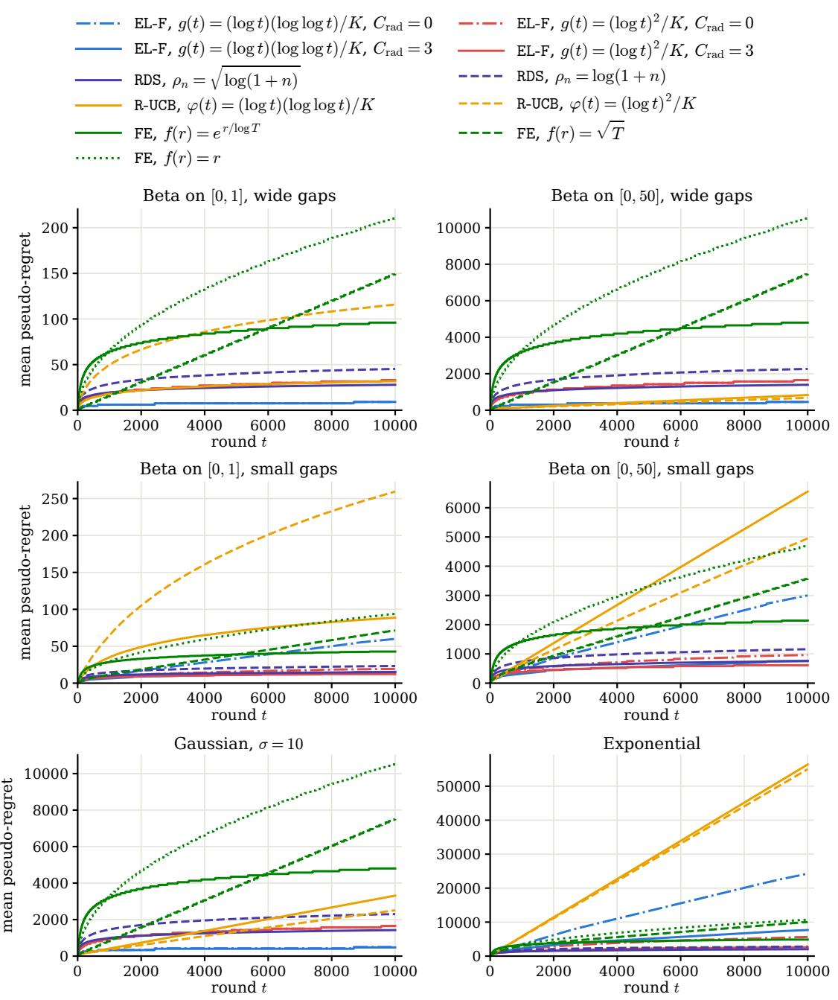  
Figure 2: Mean pseudo-regret over 1,024 runs on all six instances, for every algorithm.

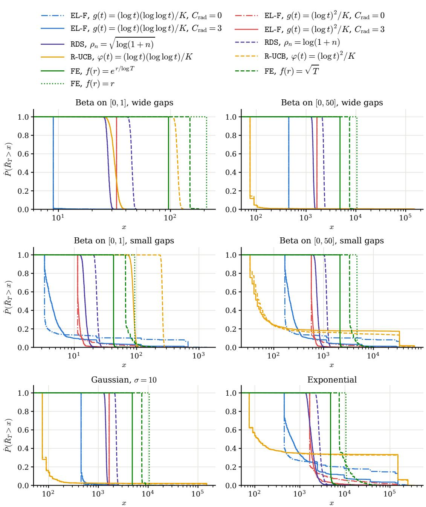  
Figure 3: Empirical tail $\hat { P } ( R _ { T } > x )$ of the final pseudo-regret over 1,024 runs on all six instances, for all the algorithms (x on a logarithmic scale).

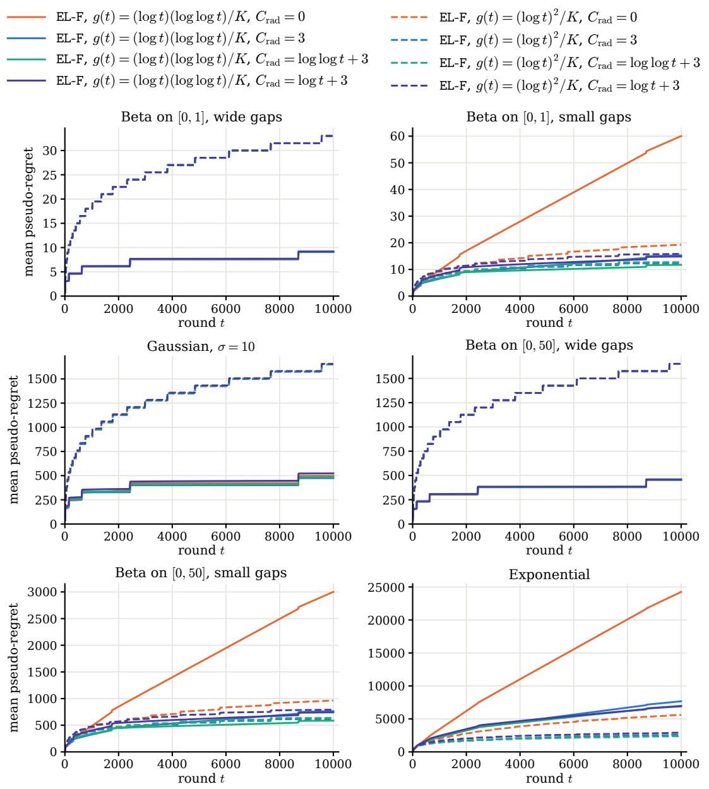  
Figure 4: Mean pseudo-regret for the radius ablation of EL-F over 1,024 runs on all six instances, under exploration schedules $g _ { 1 }$ and $g _ { 2 }$

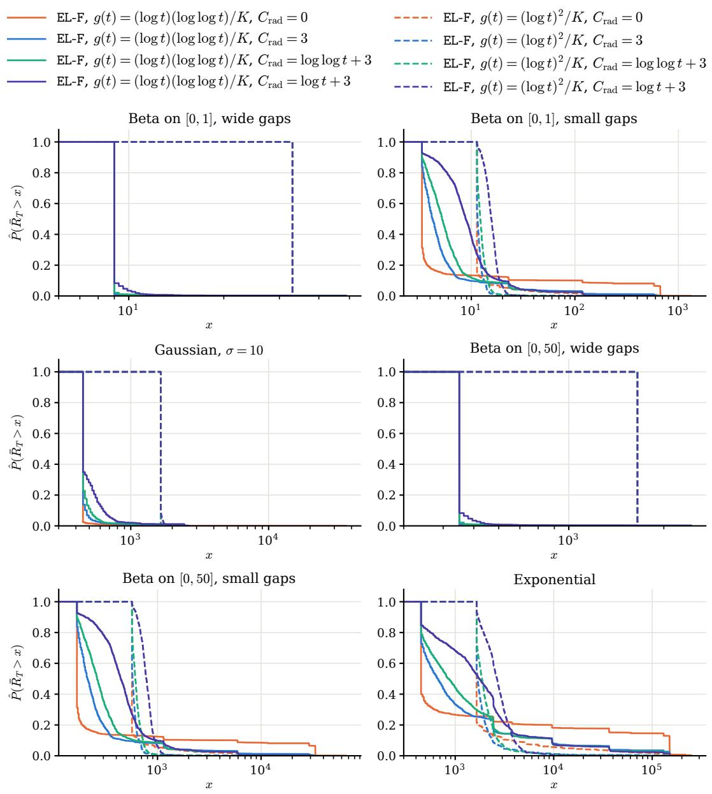  
Figure 5: Empirical tails of final pseudo-regret at $T = 1 0 , 0 0 0$ for the radius variants in Figure 4, over 1,024 runs (x on a logarithmic scale).

Table 4: Mean and median of the pseudo-regret $\begin{array} { r } { R ( T ) = \sum _ { a } \Delta _ { a } N _ { a } ( T + 1 ) } \end{array}$ at $T = 1 0 , 0 0 0$ over 1,024 independent runs, on all six instances, where $\begin{array} { r } { g _ { 1 } ( t ) = \frac { 1 } { K } } \end{array}$ log t log log t and $\begin{array} { r } { g _ { 2 } ( t ) = \frac { 1 } { K } ( \log t ) ^ { 2 } } \end{array}$ , with K the number of arms.
<table><tr><td rowspan="3">Policy</td><td colspan="4">Beta (wide gaps)</td><td colspan="4">Beta (small gaps)</td><td colspan="2">Gaussian</td><td colspan="2">Exponential</td></tr><tr><td colspan="2">[0,1]</td><td colspan="2">[0,50]</td><td colspan="2">[0,1]</td><td colspan="2">[0,50]</td><td rowspan="2"></td><td rowspan="2"></td><td rowspan="2"></td><td rowspan="2">med.</td></tr><tr><td>mean</td><td>med.</td><td>mean</td><td>med.</td><td>mean</td><td>med.</td><td>mean med.</td><td>mean</td></tr><tr><td> $\mathtt { E L - F } , g _ { 1 } , C _ { \mathrm { r a d } } = 0$ </td><td>9.06</td><td>9.00</td><td>453</td><td>450</td><td>60.0</td><td>3.33</td><td>3,001</td><td>167</td><td>498</td><td>450</td><td>24,255</td><td>450</td></tr><tr><td> $\mathtt { E L - F } , g _ { 1 } , C _ { \mathrm { r a d } } = 3$ </td><td>9.10</td><td>9.00</td><td>455</td><td>450</td><td>15.3</td><td>4.20</td><td>765</td><td>210</td><td>474</td><td>450</td><td>7,672</td><td>660</td></tr><tr><td> $\mathtt { E L - F } , g _ { 1 } , C _ { \mathrm { r a d } } = \log \log t + 3$ </td><td>9.13</td><td>9.00</td><td>456</td><td>450</td><td>11.7</td><td>5.20</td><td>586</td><td>260</td><td>484</td><td>450</td><td>6,994</td><td>855</td></tr><tr><td> $\mathtt { E L - F } , g _ { 1 } , C _ { \mathrm { r a d } } = \log t + 3$ </td><td>9.20</td><td>9.00</td><td>460</td><td>450</td><td>14.8</td><td>8.83</td><td>742</td><td>442</td><td>523</td><td>450</td><td>6,906</td><td>1,755</td></tr><tr><td> $\mathtt { E L - F } , g _ { 2 } , C _ { \mathrm { r a d } } = 0$ </td><td>33.0</td><td>33.0</td><td>1,650</td><td>1,650</td><td>19.3</td><td>11.3</td><td>964</td><td>567</td><td>1,650</td><td>1,650</td><td>5,611</td><td>1,650</td></tr><tr><td> $\mathtt { E L - F } , g _ { 2 } , C _ { \mathrm { r a d } } = 3$ </td><td>33.0</td><td>33.0</td><td>1,650</td><td>1,650</td><td>12.3</td><td>11.5</td><td>614</td><td>573</td><td>1,650</td><td>1,650</td><td>2,607</td><td>1,695</td></tr><tr><td> $\mathtt { E L - F } , g _ { 2 } , C _ { \mathrm { r a d } } = \log \log t + 3$ </td><td>33.0</td><td>33.0</td><td>1,650</td><td>1,650</td><td>12.7</td><td>12.2</td><td>636</td><td>610</td><td>1,651</td><td>1,650</td><td>2,389</td><td>1,875</td></tr><tr><td> $\mathtt { E L - F } , g _ { 2 } , C _ { \mathrm { r a d } } = \log t + 3$ </td><td>33.0</td><td>33.0</td><td>1,650</td><td>1,650</td><td>15.8</td><td>15.6</td><td>791</td><td>780</td><td>1,656</td><td>1,650</td><td>2,911</td><td>2,655</td></tr></table>

Table 5: Percentage of runs satisfying the trapped-run criterion for EL-F at $T = 1 0 , 0 0 0$ over 1,024 independent runs. A run is classified as trapped if the optimal arm is selected fewer than $T / 2 = 5 { , } 0 0 0$ times.
<table><tr><td rowspan="2">Policy</td><td colspan="2">Beta (wide gaps)</td><td colspan="2">Beta (small gaps)</td><td rowspan="2">Gaussian</td><td rowspan="2">Exponential</td></tr><tr><td>[0,1]</td><td>[0,50]</td><td>[0,1]</td><td>[0,50]</td></tr><tr><td> $\mathtt { E L - F } , g _ { 1 } , C _ { \mathrm { r a d } } = 0$ </td><td>0.0</td><td>0.0</td><td>8.1</td><td>8.1</td><td>0.0</td><td>14.6</td></tr><tr><td> $\mathtt { E L - F } , g _ { 1 } , C _ { \mathrm { r a d } } = 3$ </td><td>0.0</td><td>0.0</td><td>1.2</td><td>1.2</td><td>0.0</td><td>3.5</td></tr><tr><td> $\mathtt { E L - F } , g _ { 2 } , C _ { \mathrm { r a d } } = 0$ </td><td>0.0</td><td>0.0</td><td>0.9</td><td>0.9</td><td>0.0</td><td>2.0</td></tr><tr><td> $\mathtt { E L - F } , g _ { 2 } , C _ { \mathrm { r a d } } = 3$ </td><td>0.0</td><td>0.0</td><td>0.0</td><td>0.0</td><td>0.0</td><td>0.4</td></tr></table>