# SP<sup>2</sup>EC: Adaptive Self-Speculative Decoding for Vision-Language Models

Yuqi Huang<sup>1∗</sup> Xingyao Li<sup>1∗</sup> Yunlong Hou<sup>1∗†</sup> Fengzhuo Zhang<sup>3∗</sup> Jiachun Pan<sup>2</sup> Vincent Y. F. Tan<sup>1,2</sup>

<sup>1</sup>Department of Mathematics, National University of Singapore, Singapore <sup>2</sup>Department of Electrical and Computer Engineering, National University of Singapore, Singapore <sup>3</sup>Yale University, Center for Algorithms, Data, and Market Design, USA

## Abstract

Speculative Decoding (SD) has demonstrated its efficacy in accelerating large language model inference, but for Vision-Language Models (VLMs), the diverse input modalities make it difficult for a small trained drafter to achieve consistently high throughput. Self-speculative decoding reuses parts of the target model as a drafter which retains the multi-modal capability of the VLMs, yet its efficiency depends on choosing a suitable draft configuration for each prompt. We propose SINGLE-PEAK SPECULATIVE DECODING (SP<sup>2</sup>EC), a training-free bandit algorithm that adapts the draft configuration during generation. SP<sup>2</sup>ec exploits the single-peak throughput pattern observed in existing self-speculative methods, including SWIFT, KNAPSPEC, SPECVLM, and our simple COSSIM. Our algorithmic design explicitly minimizes a novel notion of wall-time regret for each given query, corresponding to the empirical wall-time latency. Theoretical guarantees on the wall-time regret show that SP<sup>2</sup>EC can exploit the optimal draft configuration, with negligible exploration cost. Extensive experiments on Qwen2.5- VL-7B-Instruct and LLaVA-NeXT-Mistral-7B across visual and textual tasks show consistent improvements of up to 11% over the original self-speculative methods, demonstrating the wide applicability of the proposed SP<sup>2</sup>EC algorithm.

## 1 Introduction

Speculative decoding has been widely used to accelerate Large Language Model (LLM) inference [Leviathan et al., 2023, Chen et al., 2023]. However, its efficiency remains limited for Vision Language Models (VLMs), where diverse input modalities and long multimodal contexts make it difficult for a separately trained small draft model to consistently match the target model [Kang et al., 2025]. Self-speculative decoding provides a promising alternative by reusing part of the target model itself as the drafter, thereby maintaining stronger draft-target alignment for any context [Elhoushi et al., 2024, Xia et al., 2025, Sadhukhan et al., 2025]. Motivated by its success in LLMs, we study self-speculative decoding for VLMs. We focus on two commonly used self-speculative decoding methods as an illustration of our approach: layer-skipping methods which construct the draft model by skipping a subset of layers during the forward pass [Xia et al., 2025], and token-selection methods where the draft model uses a small subset of the input tokens [Ji et al., 2025].

Despite their advantages, these methods are often limited by the need to choose suitable component configurations for each prompt, e.g., the retained layers and retained tokens. Specifically, throughput depends critically on the choice of retained layers in layer-skipping methods [Xia et al., 2025, Cha et al., 2026], and on the number of retained visual tokens in token-selection methods [Ji et al., 2025].

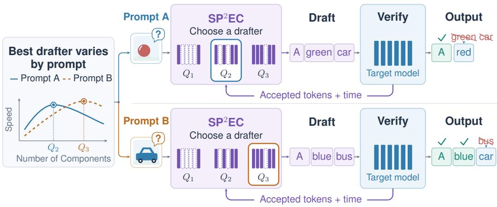  
Figure 1: Prompt-level adaptive drafter selection in $\mathbf { S P ^ { 2 } E C } .$ Each arm corresponds to a drafter with different layer-skipping configuration and wall-time cost. $\mathrm { S P ^ { 2 } E C }$ uses accepted-token and time feedback from the target model to exploit the single-peak throughput structure and adaptively select a drafter during generation. Different prompts can favor different arms, motivating per-query adaptation for VLM speculative decoding.

Retaining more components can improve acceptance but also increases drafting time, hence there is an optimal configuration that trades off between them and achieves the minimum latency. Crucially, this optimal configuration varies across prompts, e.g., a configuration that achieves lower latency for one prompt may be suboptimal for another. This motivates the central question of this work: Can we design a training-free and prompt-adaptive method to efficiently select the component configuration ofthe draft model (e.g., retained layers or tokens) and minimize wall-time latency?

We formulate this task as a single-peak bandit problem, where the algorithm adaptively chooses the retained components with empirically accepted tokens and time costs as feedback, with the ultimate goal of minimizing the wall-time latency. Our contributions are threefold:

• We first propose a fine-grained, cost-aware formulation of self-speculative decoding. In this framework, each retained component configuration is viewed as an arm with both reward and wall-time cost. We introduce wall-time regret as the primary metric, which measures the additional latency relative to the best fixed configuration. Based on the observed diminishing returns of the mean accepted token length and the linearity of the time cost, we establish a single-peak structure over the ordered draft model configuration sequence.

• We propose $\mathrm { S P ^ { 2 } E C } .$ , an algorithm that minimizes wall-time latency on a per-prompt basis. We derive theoretical guarantees on its wall-time regret and identify an instance-dependent hardness parameter. Thanks to the single-peak structure, this parameter shows that the leading term in the regret depends only on the neighborhood of the optimal configuration, rather than on the entire configuration set.

• We conduct extensive experiments with Qwen2.5-VL-7B-Instruct [Bai et al., 2025b] and LLaVA-NeXT-Mistral-7B [Liu et al., 2024] across various self-speculative decoding methods on both visual and textual tasks. $\mathrm { S P ^ { 2 } E C }$ consistently improves throughput over the original self-speculative methods, with gains of up to 11%. The results demonstrate the empirical effectiveness of $\mathrm { S P ^ { 2 } }$ EC compared with the vanilla self-speculative decoding method and adaptive configuration selection baseline.

Related Works. Speculative decoding accelerates autoregressive generation by drafting candidate continuations and verifying them in parallel with the target model. Early methods use lightweight draft models [Leviathan et al., 2023, Chen et al., 2023], blockwise or seq2seq parallelism [Stern et al., 2018, Xia et al., 2023], improved drafter alignment or distillation [Kim et al., 2023, Liu et al., 2023, Zhou et al., 2023], and retrieval or n-gram proposals [Yang et al., 2023, He et al., 2024]. Other works enrich verification with trees, cascades, multi-heads, or parallel drafters [Miao et al., 2023, Cai et al., 2024, Li et al., 2024b,c, 2025c, Ankner et al., 2024, Zhao et al., 2024, Xiao et al., 2024].

While effective, these methods often rely on auxiliary drafter quality, extra training, or prompt–drafter alignment. Self-speculative decoding instead reuses the target model through layer skipping or early exit [Zhang et al., 2024, Elhoushi et al., 2024]. Closely related works adapt skipped layers or modules under a fixed budget [Xia et al., 2025, Chen et al., 2025, Cha et al., 2026]. Our work is orthogonal: we allocate the skipping budget per prompt, rather than selecting layers or modules under a fixed budget. More related works are in Appendix A.

## 2 Preliminaries

Speculative decoding adopts a draft model $Q$ to accelerate inference from a target model $P .$ . At round t, given prefix $\mathrm { p t } _ { t - 1 } \in \mathcal { X } ^ { * }$ and maximum draft length $L ,$ where $\mathcal { X } ^ { \ast }$ denotes the set of finite sequences over alphabet X, the draft model samples $y _ { i } \sim Q ( \cdot \ | \ \mathsf { p t } _ { t - 1 } , y _ { < i } )$ for $i = 1 , \ldots , L$ The target model verifies these tokens in parallel by computing $P _ { i } ( \cdot ) = P ( \cdot \mid \mathrm { p t } _ { t - 1 } , y _ { < i } )$ and $Q _ { i } ( \cdot ) = Q ( \cdot \mid \mathsf { p t } _ { t - 1 } , y _ { < i } )$ . Each token is accepted with probability $\alpha _ { i } ( y _ { i } ) = \operatorname* { m i n } \{ 1 , P _ { i } ( y _ { i } ) / Q _ { i } ( y _ { i } ) \}$ Let

$$
A _ { t } = \operatorname* { m a x } \{ a \in \{ 0 , \ldots , L \} : u _ { i } \leq \alpha _ { i } ( y _ { i } ) , \forall i \leq a \}\tag{1}
$$

be the number of accepted draft tokens, where u ∼ Unif(0, 1). If $A _ { t } = L$ , one bonus token is sampled from $P ( \cdot \mid \mathsf { p t } _ { t - 1 } , y _ { 1 : L } )$ ; otherwise, the first rejected token is resampled from

$$
r _ { A _ { t } + 1 } ( v ) = \frac { [ P _ { A _ { t } + 1 } ( v ) - Q _ { A _ { t } + 1 } ( v ) ] _ { + } } { \sum _ { v ^ { \prime } \in \mathcal { X } } [ P _ { A _ { t } + 1 } ( v ^ { \prime } ) - Q _ { A _ { t } + 1 } ( v ^ { \prime } ) ] _ { + } } .\tag{2}
$$

The round outputs $x _ { t } = ( y _ { 1 } , \dots , y _ { A _ { t } } , z )$ and updates ${ \mathrm { p t } } _ { t } = \mathrm { c o n c a t } ( { \mathrm { p t } } _ { t - 1 } , x _ { t } )$ . Its acceptance length is $| x _ { t } | = A _ { t } + 1$ , with

$$
\mathbb { E } \left[ \left| x _ { t } \right| \ \middle | \ \mathrm { p t } _ { t - 1 } \right] = 1 + \sum _ { i = 1 } ^ { L } \mathbb { P } ( A _ { t } \geq i \ \middle | \ \mathrm { p t } _ { t - 1 } ) .\tag{3}
$$

Let $c _ { t }$ denote the wall-time cost of this round. Then $\mathbf { W } \mathbf { T } _ { t } = \mathbf { W } \mathbf { T } _ { t - 1 } + c _ { t }$ . Decoding stops at $\tau ( { \mathrm { p t } } , \Lambda ) = \operatorname* { m i n } \{ t : { \mathrm { E O S } } \in x _ { t } \}$ , with total wall time $\mathrm { W T } _ { \tau ( \mathrm { p t } , \Lambda ) }$

Multi-Armed Bandit is a standard online decision-making paradigm. There are $K$ arms indexed by $k \in [ K ]$ . At each round $t = 1 , \ldots , T$ , the learner selects an arm $I _ { t } \in [ K ]$ and observes only the reward $R _ { t } ( I _ { t } )$ of the selected arm. In the stochastic setting, each arm k has an unknown reward distribution with mean $\mu _ { k } = \mathbb { E } [ R _ { t } ( k ) ]$ . Let $k ^ { \star } \in \arg \operatorname* { m a x } _ { k \in [ K ] } \mu _ { k }$ be an optimal arm. The learner aims to minimize the expected regret $T \mu _ { k ^ { \star } } - \mathbb { E } [ \sum _ { t = 1 } ^ { T } R _ { t } ( I _ { t } ) ]$ , which requires a balance between the exploration of uncertain arms and the exploitation of empirically good arms. In our setting, each arm corresponds to a speculative-decoding configuration, such as a draft length, a skipped-layer pattern, or retained prefix tokens. Pulling an arm means applying that configuration to the current prompt and observing its realized wall time, acceptance length, or throughput. The bandit formulation therefore captures adaptive configuration selection under partial feedback, since only the performance of the chosen configuration is observed for each prompt.

## 3 Fine-Grained Formulation of Adaptive Self-Speculative Decoding

In this section, we focus on the modelling of adaptive self-speculative decoding. We construct the draft model by selecting a subset of the components that constitute the target model. We formulate this component selection problem as a single-peak stochastic bandit problem where each draft model corresponds to an arm in the bandit formulation, with the target of minimizing the wall time latency of the decoding process.

We adopt the BANDITSPEC framework from Hou et al. [2025] to adaptively select the retained components, and we use the recorded Wall Time (WT),

$$
\mathrm { W T } _ { \tau ( \mathrm { a l g , p t } , \Lambda ) } = \sum _ { t = 1 } ^ { \tau ( \mathrm { a l g , p t } , \Lambda ) } c _ { S _ { t } } ,\tag{4}
$$

as the golden metric to measure the performance (see Algorithm 1). Let $S$ denote the set of retained components and let $s$ be the set of all candidate S. The bandit configuration $\Lambda = ( P , \mathcal { Q } =$ $\{ Q _ { S } \} _ { S \in { S } } , L )$ consists of the target model $P _ { \mathrm { { : } } }$ , the draft model $Q _ { S }$ indexed by $S \in S$ and speculation length L. At each speculative decoding round t, a candidate component selection algorithm alg will choose the retained components $\bar { S _ { t } } \in \mathcal { S } \left( \mathrm { L i n e } 4 \right)$ , which will be used as the draft model to conduct one round of speculative decoding (Line 5). Both the accepted tokens $x _ { S _ { t } , t }$ (Line 6) and the elapsed wall time $c _ { S _ { t } }$ (Line 7) are then recorded. In the end, the total speculation rounds $\tau ( \mathrm { a l g } , \mathbf { p } \mathbf { t } , \boldsymbol { \Lambda } )$ the generated sequence $\mathfrak { p t } _ { \tau ( \mathrm { a l g } , \mathrm { p t } , \Lambda ) }$ and the total wall time $\mathbf { W T } _ { \tau ( \mathrm { a l g } , \mathrm { p t } , \Lambda ) }$ are returned. Without loss of generality, we assume the EOS token is accepted as the last accepted token in one speculative decoding round.

Algorithm 1 SPECULATIVE DECODING WITH COST-AWARE BANDITS   
Inputs: bandit configuration $\Lambda = ( P , \mathcal { Q } = \{ Q _ { S } \} _ { S \in \mathcal { S } } , L )$ , arm selection algorithm alg, initial prompt   
$\mathsf { p t } _ { 0 } = \mathsf { p t } \in \mathcal { X } ^ { * }$   
1: $t = 0 , \mathcal { H } _ { 0 } = \emptyset , S _ { 0 } = 1 , x _ { S _ { 0 } , 0 } = \emptyset , \mathbf { W } \mathbf { T } _ { 0 } = 0 .$   
2: while EOS $\notin \boldsymbol { x } _ { S _ { t } , t }$ do   
3: $t = t + 1 .$   
4: Select draft index $S _ { t } = \mathrm { a l g } ( \mathcal { H } _ { t - 1 } ) .$   
5: Conduct one SD round with $( \mathrm { p t } _ { t - 1 } , P , Q _ { S _ { t } } , L )$ , and obtain accepted tokens $x _ { S _ { t } , t }$ with elapsed   
time $c _ { S _ { t } }$   
6: $\mathrm { p t } _ { t } = \mathrm { c o n c a t } ( \mathbf { p t } _ { t - 1 } , x _ { S _ { t } , t } ) .$   
7: $\mathbf { W } \mathbf { T } _ { t } = \mathbf { W } \mathbf { T } _ { t - 1 } + \mathbf { \bar { \phi } } _ { C _ { S _ { t } } } .$   
8: $\mathcal { H } _ { t } =$ conca $\cdot ( \mathcal { H } _ { t - 1 } , ( S _ { t } , x _ { S _ { t } , t } ) )$   
9: end while   
10: return $\tau ( \mathrm { a l g , p t , } \Lambda ) = t \mathrm { , ~ } \mathsf { p t } _ { \tau ( \mathrm { a l g , p t , } \Lambda ) } = \mathsf { p t } _ { t } \mathrm { , W T } _ { \tau ( \mathrm { a l g , p t , } \Lambda ) } = \mathsf { W T } _ { t } .$

The Golden Metric: Wall-Time Regret. Given the prompt and bandit configuration, denote $\begin{array} { r } { \mathrm { { a l g } ^ { * } = \mathrm { { a r g m i n } _ { \mathrm { { a l g } } } \mathbb { E } \left[ W T _ { \tau ( \mathrm { { a l g } , p t } , \Lambda ) } \right] } } } \end{array}$ as the optimal component selection algorithm that minimizes the expected decoding wall time, where the expectation is taken with respect to the randomness in the algorithm and the decoding process. Our goal is to devise an adaptive component selection algorithm alg to minimize the expected decoding wall time compared to that of the optimal algorithm alg , i.e., the wall-time regret (with the unit second):

$$
\begin{array} { r } { \mathbf { W T R e g } ( \Lambda , \mathrm { p t } ) : = \mathbb { E } [ \mathbf { W T } _ { \tau ( \mathrm { a l g } , \mathrm { p t } , \Lambda ) } ] - \mathbb { E } [ \mathbf { W T } _ { \tau ( \mathrm { a l g } ^ { \ast } , \mathrm { p t } , \Lambda ) } ] . } \end{array}\tag{5}
$$

In practice, this wall-time regret characterizes the expected additional time alg requires, in addition to that of the oracle optimal algorithm alg<sup>∗</sup>, to complete the generation of a given prompt pt. Therefore, it is expected that an algorithm alg can achieve ${ \bar { o ( } } \tau ( \mathrm { a l g } ^ { * } , \bar { \mathsf { p t } } , \Lambda ) \rangle$ ) wall-time regret, suggesting that the additional wall time alg demands is negligible.

In order to model the problem in a fine-grained manner, we study two factors of this framework: the mean accepted tokens and the time cost.

## 3.1 Diminishing Return in the Mean Accepted Tokens

As Hou et al. [2025], Liu et al. [2026], Zhang et al. [2026a] indicate, the stationary mean assumption on the number of accepted tokens is aligned with the real-life scenario, we follow their assumption.

Assumption 3.1 (Stationary Mean of the Number of Accepted Tokens). There exists a function $\mu : { \mathcal { S } } \bar {  } [ 1 , L + 1 ]$ ], such that

$$
\mathbb { E } [ \mathrm { l e n } ( x _ { S _ { t } , t } ) \mid S _ { t } , \mathcal { H } _ { t - 1 } , \mathrm { p t } ] = \mu _ { S _ { t } } .\tag{6}
$$

This assumption enables the algorithm to predict the quality of the draft models based on their usage history. Furthermore, motivated by Sadhukhan et al. [2025], we assume that the mean number of accepted tokens exhibits diminishing returns along the ordered configurations considered by our method. Let $\bar { \mathcal { S } } : = \{ S _ { k } \} _ { k = 1 } ^ { K } \subset \mathcal { S }$ denote a set of ordered configurations with $S _ { k } \subset S _ { k + 1 }$ with equal increments in cost (see Section 3.2).

Assumption 3.2 (Diminishing Returns). Along the sequence $\{ S _ { k } \} _ { k = 1 } ^ { K }$ , the mean number of accepted tokens $\mu : { \mathcal { S } }  [ 1 , L + 1 ]$ satisfies

$$
0 \leq \mu ( S _ { k + 1 } ) - \mu ( S _ { k } ) \leq \mu ( S _ { k } ) - \mu ( S _ { k - 1 } ) .\tag{7}
$$

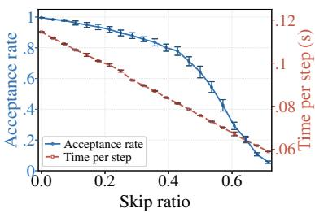  
(a) Acceptance rate and time.

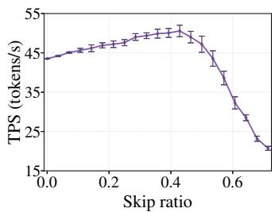  
(b) Throughput.

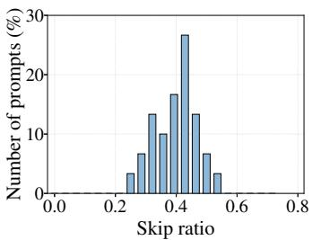  
(c) Optimal arm distribution.  
Figure 2: Empirical validation of the layer-skipping candidate arms with COSSIM on Qwen2.5-VL-7B-Instruct. (a) Average acceptance rate shows a diminishing return pattern and time per speculative decoding step is an affine function in skip ratio, supporting Assumptions 3.2 and 3.3. (b) Tokens per second (TPS) illustrate the single-peak structure of throughput. (c) Percentage of prompts for which the arm at each skip ratio is oracle best, i.e., attains the highest measured TPS. The best arm varies across prompts, motivating prompt-adaptive arm selection.

This assumption indicates that increasing the number of components improves the expected number of accepted tokens, but the marginal improvement decreases as more components are included. This assumption is empirically supported by the validation on COSSIM, a simple layer-skip speculative decoding method to be introduced in Section 3.3, where each draft model is indexed by the layer-skip ratio. Figure $2 ( \mathrm { a } )$ demonstrates that decreasing skip-ratio $( \mathrm { i . e . }$ , increasing retained ratio) results in diminishing gains in acceptance rate. In particular, keeping as few as 55% layers can achieve a mean acceptance rate 80%.

## 3.2 Linearity of the Time Cost

We denote the non-decreasing time cost function as $c : \{ | S | : S \in S \} \to \mathbb { R } _ { + }$ , where $c ( s )$ represents the time consumed by one speculative decoding round with draft model S. As the time cost $c ( s )$ only depends on deterministic factors, such as the number of tokens, the model, and the GPU employed, it can be considered as deterministic and can be measured or profiled on the validation dataset before the decoding process begins. Therefore, we assume the cost function c is known at the beginning. In addition, according to Sadhukhan et al. [2025], the time for one forward pass can be characterized as

$$
c ( s ) = L \cdot T _ { D } ( s ; N _ { \mathrm { b a t c h } } , N _ { \mathrm { t o k e n } } ) + T _ { V } ( N _ { \mathrm { b a t c h } } , N _ { \mathrm { t o k e n } } , L )\tag{8}
$$

where $T _ { D } ( s ; N _ { \mathrm { b a t c h } } , N _ { \mathrm { t o k e n } } )$ is the decoding time given $N _ { \mathrm { b a t c h } }$ batches with sequence length $N _ { \mathrm { t o k e n } }$ and s retained components in the draft model; $T _ { V } ( N _ { \mathrm { b a t c h } } , N _ { \mathrm { t o k e n } } , L )$ is the verification time for the target model. We start with the case where the generation length is short so that the change of $N _ { \mathrm { t o k e n } }$ on the time cost $c ( s )$ is negligible. We show that the algorithm is robust to the time cost function in Appendix I.4 when $\dot { N } _ { \mathrm { t o k e n } }$ increases during decoding.

Assumption 3.3. Given the hardware and models, the time cost for one speculative decoding with s retained components is

$$
c ( s ) = \kappa \cdot s + b ,\tag{9}
$$

where κ and b are constants depending on the hardware and models.

Figure 2(a) reports the average time cost per speculative decoding round of COSSIM over different layer-skip ratios. The time cost decreases linearly with the skip ratio, equivalently, increases linearly with the retained ratio s, which validates the above assumption. Furthermore, the standard deviation of time cost is small enough that we safely treat it as deterministic.

We define the decoding speed function $\begin{array} { r } { \nu _ { S } : = { \frac { \mu _ { S } } { c _ { S } } } } \end{array}$ . When the time cost function is deterministic, under Assumption 3.1, the oracle optimal algorithm alg<sup>∗</sup> becomes the algorithm that always adopts the oracle optimal layer configuration $S ^ { * } = \operatorname { a r g m a x } _ { S \in S } \nu _ { S }$ , which we denote as $\mathrm { a l g } _ { S ^ { * } }$

Lemma 3.4. When $\mathbb { E } [ \tau ( a l g , p t , \Lambda ) ] <$ ∞ and the time costfunction is deterministic, under Assumption 3.1, we have

$$
a l g _ { S ^ { * } } \in \mathop { \mathrm { a r g m i n } } _ { a l g } W T R e g ( \Lambda , p t ) .\tag{10}
$$

## 3.3 Draft Model Construction

Our algorithm will operate on an ordered sequence of draft models, each treated as an arm. In the following, we take the layer-skip self-speculative decoding method for demonstration purposes, where we propose a simple cosine-similarity-based construction of the ordered sequence of draft models. Our algorithm can readily be applied on top of other algorithms as an adaptive booster.

Cosine-similarity-based construction for layer-skipping method. Given a target model P with N transformer blocks, skipping entire blocks yields up to $2 ^ { \tilde { N } }$ layer-skip configurations, many of which may be suboptimal [Elhoushi et al., 2024, Xia et al., 2025, Qiao et al., 2025]. To reduce this search space, COSSIM constructs a sequence of draft models by removing redundant blocks one at a time in a recursive approach. Specifically, we define the redundancy score of a block as the mean cosine similarity between its input and output hidden states: a higher score indicates more closely aligned representations, suggesting greater redundancy. To obtain $\bar { K } < N$ draft models, after an initial token generation with the full model $P ,$ , we remove the block with the highest redundancy score to obtain the first draft model $S _ { K }$ . With this first draft model, a speculative decoding step is conducted and the redundancy scores of the remaining blocks get updated. We then remove the block with the highest updated score among the remaining blocks to obtain the second draft model $S _ { K - 1 }$ . This procedure can be conducted recursively which results in a sequence of draft models of decreasing size $\{ S _ { k } \} _ { k = 1 } ^ { K }$ Algorithm 3 in Appendix G details the procedure.

COSSIM yields an ordered sequence of layer-skip configurations by increasing retained-layer count, $\mathrm { i . e . , } \bar { S } = \mathsf { \bar { \{ S _ { k } \} } } _ { k = 1 } ^ { K }$ with $S _ { k } \subset S _ { k + 1 }$ . As k decreases, the configuration sequentially removes the most redundant block, which is expected to satisfy the diminishing acceptance gains assumption and the affine cost modelling. Figure 2(a) and (b) support these trends and the resulting single-peak throughput; additional results, including prompt-level measurements, can be found in Appendix H.1.

Write $\mu _ { i } = \mu _ { S _ { i } } , c _ { i } = c ( | S _ { i } | )$ , and $\nu _ { i } ~ = ~ \mu _ { i } / c _ { i }$ , and denote the oracle optimal arm by $\begin{array} { r l } { i ^ { * } } & { { } = } \end{array}$ $\operatorname { a r g m a x } _ { i \in [ K ] } \nu _ { i } .$ , which is assumed to be unique in the given ordered arm set. Under the stated path-wise and cost assumptions, we obtain the following property.

Lemma 3.5. Under Assumptions 3.2 and $3 . 3 , \nu : [ K ] \to \mathbb { R } _ { + }$ is a single-peakfunction.

We remark that the optimal retained ratio (or skip ratio) that attains the throughput peak varies across prompts. Figure 2(c) reports the distribution of the oracle optimal skip ratio, defined by the highest TPS for each prompt. The mass is spread across multiple skip ratios, indicating that no single draft model is uniformly optimal and motivating prompt-level adaptive arm selection.

Construction from existing methods. In the above, we demonstrate how the draft models are constructed via the simple COSSIM layer-skip method, which satisfies the diminishing return and affine cost assumptions (Assumptions 3.2 and 3.3). We remark that these assumptions are also satisfied in existing self-speculative decoding methods. For example,

• Given a layer-skip ratio $r \in ( 0 , 1 )$ , SWIFT [Xia et al., 2025] combines random search and Bayesian optimization to select attention and MLP layers to skip. Decreasing r results in a larger and more capable draft model.

• Under latency budgets b, KNAPSPEC [Cha et al., 2026] selects retained layers through knapsack optimization. Increasing b allows more forward time for the draft model.

• With pruning ratio $p \in ( 0 , 1 )$ , SPECVLM [Ji et al., 2025] prunes visual tokens using verifier-guided importance scores and uses the reduced visual context for draft generation. Enlarging p yields a more compact prefix token sequence.

The amount of retained components |S| is controlled by the skip ratio r in SWIFT, latency budget b in KNAPSPEC and pruning ratio p in SPECVLM respectively. Varying these parameters yields an ordered sequence of draft models $\bar { \mathcal { S } } = \{ S _ { k } \} _ { k = 1 } ^ { K } , \mathrm { i . e }$ ., the set of arms in our bandit formulation.

By construction, the time cost is expected to be an affine function of |S|, satisfying Assumption 3.3. For the diminishing return Assumption 3.2, intuitively, these methods prioritize retaining the layers or visual tokens that help the draft model match the target model. As |S| grows, the remaining components $( \mathrm { e . g . }$ ., layers or tokens) are less essential for the draft model, so further additions are expected to yield smaller acceptance gains. We further empirically verify that Assumptions 3.2 and 3.3 are met in Appendix H. Therefore, according to Lemma 3.5, the single-peak structure can be obtained. Further draft model construction details of these methods are postponed to Appendix G.2.

Algorithm 2 SINGLE-PEAK SPECULATIVE DECODING $( \mathrm { S P ^ { 2 } E C ) }$   
Inputs: draft model set $\bar { \cal S } = [ K ]$ , history $\mathcal { H } _ { t } = \left( ( I _ { s } , X _ { I _ { s } , s } ) \right) _ { s = 1 } ^ { t }$ , time cost profile $\{ c _ { i } \} _ { i \in [ K ] }$   
Procedures:   
1: i $\dot { \cdot } t \leq K - 1$ then return $I _ { t + 1 } = t + 1$   
2: Set the statistics $\{ \hat { \mu } _ { i } ( t ) \} _ { i \in [ K ] }$ , where   
$T _ { i } ( t ) = \sum _ { s = 1 } ^ { t } \mathbb { 1 } \{ I _ { s } = i \} , \hat { \mu } _ { i } ( t ) = \frac { \sum _ { s = 1 } ^ { t } \mathrm { l e n } ( X _ { i , s } ) \mathbb { 1 } \{ I _ { s } = i \} } { T _ { i } ( t ) } , L _ { t } = \arg \operatorname* { m a x } _ { i } \frac { \hat { \mu } _ { i } ( t ) } { c _ { i } } ,$ (11)   
3: if $\tilde { T } _ { L _ { t } } ( t ) \equiv 1$ (mod 3), then $I _ { t + 1 } = L _ { t }$ else $I _ { t + 1 } = \mathrm { a r g m a x } _ { i \in \{ L _ { t } - 1 , L _ { t } , L _ { t } + 1 \} \cap \{ K \} } \mathrm { U C B } _ { i , L _ { t } } ( t )$   
where for $i \in \{ L _ { t } - 1 , L _ { t } , L _ { t } + 1 \} \cap [ K ]$   
$\mathrm { U C B } _ { i , L _ { t } } ( t ) = \frac { \hat { \mu } _ { i } ( t ) + \mathrm { c r } _ { i , L _ { t } } ( t ) } { c _ { i } } , \tilde { T } _ { i } ( t ) = \sum _ { s = K } ^ { t } { \mathbb 1 } \{ L _ { s } = i \} ,$ (12)   
$\operatorname { c r } _ { i , L _ { t } } ( t ) = \frac { L } { 2 } \sqrt { \frac { 1 + T _ { i } ( t ) } { T _ { i } ^ { 2 } ( t ) } \Big ( 1 + 2 \ln \big ( 3 \cdot \tilde { T } _ { L _ { t } } ^ { 2 } ( t ) \cdot ( 1 + T _ { i } ( t ) ) ^ { 1 / 2 } \big ) \Big ) } .$ (13)   
4: return index $I _ { t + 1 }$

Given these self-speculative decoding methods, a fixed choice of the component need not remain optimal across models, datasets, or prompts (see Appendix H). In the following section, we introduce a bandit controller that adapts this choice online using accepted-token and wall-time feedback. It strongly exploits the single-peak structure (Lemma 3.5) to quickly locate the optimal components for the given prompt. This provides a broadly applicable meta-algorithm for making existing selfspeculative decoding methods more adaptive across models, datasets, and prompts.

To efficiently identify the best retained components, we aim to minimize the wall-time regret with respect to this ordered sequence of draft models $\bar { \cal S }$ instead of the whole draft model set S. This enables us to make use of the single-peak structure identified by Lemma 3.5.

## 4 The SP<sup>2</sup>EC Algorithm

We formally present the SINGLE-PEAK SPECULATIVE DECODING $( \mathsf { S P ^ { 2 } E C } )$ algorithm in Algorithm $^ { 2 , }$ which adaptively selects the retained components given the prompt and exploits the single-peak structure in the set of draft candidates $\bar { \cal S } = \dot { [ } { \cal K } ] .$

Given the sampling history $\mathcal { H } _ { t }$ , we firstly compute the statistics: the arm pulls $T _ { i } ( t )$ and the empirical mean ${ \hat { \mu } } _ { i } ( t )$ for arm $i \in [ \bar { K } ]$ ], and define the leader arm $L _ { t }$ which has the largest empirical decoding speed (Line 2). Afterwards, we decide which arm should be sampled only in the neighborhoods $\dot { \mathcal { N } } ( L _ { t } ) : = \{ L _ { t } - 1 , L _ { t } , L _ { t } + 1 \} \cap [ K ]$ of the leader arm $L _ { t } \colon$ the leader arm $L _ { t }$ is forced to be sampled every three times according to the local time $\tilde { T } _ { L _ { t } } ( t )$ ; otherwise, the arm with the highest local $\mathrm { U C B } _ { i , L _ { t } }$ index as (12) in the neighborhood $\mathcal { N } ( L _ { t } )$ is sampled (Line 3). In the end, the arm index $I _ { t + 1 }$ is returned and the corresponding draft model will be used to carry out one round of speculative decoding as in Line 5 of Algorithm 1.

We present the theoretical guarantee of the wall-time regret of $\mathrm { S P ^ { 2 } E C }$ . Given an instance Λ and a prompt pt, we define the hardness parameter,

$$
\mathrm { H } ( \Lambda , \mathrm { p t } ) : = \sum _ { i \in \mathcal { N } ( i ^ { * } ) \backslash \{ i ^ { * } \} } \frac { 1 } { \nu _ { i ^ { * } } c _ { i } } \cdot \frac { 8 L ^ { 2 } } { \nu _ { i ^ { * } } - \nu _ { i } } .\tag{14}
$$

Theorem 4.1. Under Assumptions $3 . 1 , 3 . 2$ and 3.3, and we further assume the stopping time has finite expectation $\mathbb { E } [ \tau ] < \infty ,$ then adopting $a l g { = } { \bf S P ^ { 2 } E C }$ in Algorithm 1 with bandit configuration

$\Lambda = ( P , \mathcal { Q } = \{ Q _ { S } \} _ { S \in \bar { S } } , L )$ achieves wall-time regret

$$
\begin{array} { r l } & { W T R e g ( \Lambda , p t ) \le \displaystyle \sum _ { i \in { \mathcal { N } } ( i ^ { * } ) \backslash \{ i ^ { * } \} } \mu _ { i } \Big ( \frac { 1 } { \nu _ { i } } - \frac { 1 } { \nu _ { i ^ { * } } } \Big ) \cdot \frac { 8 L ^ { 2 } \ln \mathbb { E } [ \tau ( a l g , p t , \Lambda ) ] } { ( c _ { i } \nu _ { i ^ { * } } - \mu _ { i } ) ^ { 2 } } + O ( 1 ) } \\ & { \quad \quad \quad = \mathrm { H } ( \Lambda , p t ) \cdot \ln \mathbb { E } [ \tau ( a l g , p t , \Lambda ) ] + O ( 1 ) . } \end{array}\tag{15}
$$

(16)

The big-O in (16) hides an instance-dependent constant, but is independent of the expected number of speculative decoding rounds $\mathbb { E } [ \tau ]$ . The proof of Theorem 4.1 is postponed to Appendix C. It theoretically guarantees that the additional wall-time latency of $\mathrm { S P ^ { 2 } E C }$ compared to the algorithm that always adopts the oracle best draft model alg is of order $O \big ( \mathbb { E } [ \tau ( \mathrm { a l g } , \mathrm { p t } , \mathbf { \bar { \Lambda } } ) ] \big )$ . Furthermore, we have identified a critical quantity, the hardness parameter $\mathrm { H } ( \Lambda , \dot { \mathfrak { p } } \mathfrak { t } )$ , which suggests the hardness of the instance under the given prompt and bandit configuration. In particular, this hardness parameter only depends on the neighborhoods of the oracle best arm $\mathcal { N } ( i ^ { * } ) \backslash \mathbf { \bar { \{ i ^ { * } \} } }$ , instead of relying on all arms in $\check { s }$ as in the previous works [Liu et al., 2026, Hou et al., 2025, Kim et al., 2026]. This improvement results from the single-peak structure embedded in the arm set S<sup>¯</sup>.

The dependence on $\mathcal { N } ( i ^ { * } ) \backslash \{ i ^ { * } \}$ also suggests that the costly full-information feedback is unnecessary under our problem formulation. In Liu et al. [2026], all draft models are evaluated after each speculative decoding round, which proves to be effective when the draft models are small and uncorrelated. Nevertheless, Theorem 4.1 suggests that the evaluation of all draft models is unnecessary, because most arms are quickly identified as suboptimal in $O ( 1 )$ rounds and as few as two suboptimal arms will contribute to the leading term in the final wall-time regret.

During experiments, we will report the speedup ratio compared to the vanilla autoregressive decoding, following the convention in the community. Specifically, for any prompt pt $\bar { \in \ X ^ { * } }$ , denote the expected wall time by the autoregressive decoding and by Algorithm 1 with alg as $\mathbb { E } [ \mathbf { W } \mathbf { \bar { T } _ { a u t o } } ( \mathbf { p t } ) ]$ and $\mathbb { E } [ \mathbf { W } \mathbf { T } _ { \mathrm { a l g } } ( \mathbf { p t } ) ]$ , respectively. The speedup ratio of alg on this prompt is defined as $\begin{array} { r } { \mathrm { S U } : = \frac { \mathbb { E } \left[ \mathrm { W T _ { a u t o } ( p t ) } \right] } { \mathbb { E } \left[ \mathrm { W T _ { a l g } ( p t ) } \right] } } \end{array}$

Proposition 4.2 (Transformation from Wall-time Regret to Speedup Ratio). Given a prompt pt and a bandit configuration Λ, let $a l g ^ { * }$ denote Algorithm 1 with the optimal draft model, $\bar { \mathbf { S } } \bar { \mathbf { P } } ^ { 2 } \bar { \mathbf { E } } \bar { \mathbf { C } }$ achieves the speedup ratio

$$
\mathrm { S U } = \frac { \mathbb { E } [ W T _ { a u t o } ( p t ) ] } { \mathbb { E } [ W T _ { a l g ^ { * } } ( p t ) ] + W T R e g ( \Lambda , p t ) } .\tag{17}
$$

The proposition can be obtained directly by the definition of wall-time regret. This provides a direct interpretation of the wall-time regret in Theorem 4.1: because $\mathrm { W T R e g } ( \Lambda , { \mathfrak { p t } } ) \ =$ $O \big ( \ln \mathbb { E } [ \tau ( \mathrm { a l g } , \mathrm { p t } , \Lambda ) ] \big ) = O \big ( \ln \mathbb { E } [ \mathrm { W T _ { \mathrm { a u t o } } ( \mathrm { p t } ) } ] \big )$ , $\mathrm { S P ^ { 2 } E C }$ approaches the optimal speedup $\frac { \mathbf { \bar { E } } [ \mathbf { W } \mathbf { T } _ { \mathrm { a u t o } } ( \mathbf { p t } ) ] } { \mathbf { \mathbb { E } } [ \mathbf { W } \mathbf { T } _ { \mathrm { a l g } ^ { * } } ( \mathbf { p t } ) ] }$ as the inference proceeds.

## 5 Experiments

Experimental Setups. We evaluate Qwen2.5-VL-7B-Instruct [Bai et al., 2025b] and LLaVA-NeXT-Mistral-7B [Liu et al., 2024] on four visual and textual benchmarks: Video-MME [Fu et al., 2025], MMBench-Video [Fang et al., 2024], ARKitScenes [Baruch et al., 2021], and AIME25 [OpenCompass, 2025]. Unless otherwise stated, we use greedy decoding, batch size 1, and draft length $L = 4$ for all speculative decoding methods. For stable latency measurements, we add a suffix instruction to all prompts to produce longer responses. We report Mean Accepted Tokens (MAT), including 1 bonus token from verification, and the normalized SpeedUp ratio (SU) over vanilla autoregressive decoding. Reported wall-clock speedup includes optimization, warm-up, and arm-construction overhead.

We apply $\mathrm { S P ^ { 2 } }$ EC to four self-speculative configuration schemes: our cosine-similarity-based layer skipping (COSSIM, as described in Section 3.3), SWIFT [Xia et al., 2025], KNAPSPEC [Cha et al., 2026], and SPECVLM [Ji et al., 2025]. For each scheme, we compare its original version (with its original drafter-configuration selection strategy) with two adaptive variants that use UCBSPEC [Hou et al., 2025] or $\mathrm { S P ^ { 2 } E C }$ to select the draft model online during generation. Within each scheme, the two bandit controllers use the same candidate arm set, with UCBSPEC treating the same arms independently and $\mathrm { S P ^ { 2 } E C }$ exploiting the ordered single-peak structure. Appendix F provides further implementation details.

The implementation is accessible via https: $/ / { \tt g i }$ thub.com/hyuqi/sp2ec.

Table 1: Main results on Qwen2.5-VL-7B-Instruct. MAT denotes mean accepted tokens, and SU denotes normalized speedup. SP<sup>2</sup>EC achieves consistent wall-time speedup.
<table><tr><td rowspan="2">Method</td><td colspan="2">Video-MME</td><td colspan="2">MMBench-Video</td><td colspan="2">ARKitScenes</td><td colspan="2">AIME25</td><td colspan="2">Average</td></tr><tr><td>MAT↑</td><td>SU↑</td><td>MAT ↑</td><td>SU↑</td><td>MAT↑</td><td>SU↑</td><td>MAT ↑</td><td>SU↑</td><td>MAT ↑</td><td>SU↑</td></tr><tr><td>COSSIM + UCBSPEC</td><td>2.53</td><td>1.21×</td><td>2.84</td><td>1.16×</td><td>4.33</td><td>1.15×</td><td>4.08</td><td>1.13×</td><td>3.45</td><td>1.16×</td></tr><tr><td>COSSIM + SP²EC</td><td>2.86</td><td>1.28×</td><td>3.38</td><td>1.27×</td><td>3.87</td><td>1.25×</td><td>3.35</td><td>1.22×</td><td>3.37</td><td>1.26×</td></tr><tr><td>SWIFT</td><td>2.43</td><td>1.14×</td><td>2.60</td><td>1.16×</td><td>3.22</td><td>1.22×</td><td>2.92</td><td>1.10×</td><td>2.79</td><td>1.16×</td></tr><tr><td>SWIFT + UCBSPEC</td><td>2.76</td><td>1.16×</td><td>2.87</td><td>1.13×</td><td>3.80</td><td>1.20×</td><td>3.45</td><td>1.15×</td><td>3.22</td><td>1.16×</td></tr><tr><td> $\mathrm { S W I F T } + \mathrm { S P ^ { 2 } E C }$ </td><td>2.51</td><td>1.23×</td><td>2.65</td><td>1.19×</td><td>3.55</td><td>1.24×</td><td>3.29</td><td>1.22×</td><td>3.00</td><td>1.22×</td></tr><tr><td>KNAPSPEC</td><td>3.38</td><td>1.22×</td><td>4.31</td><td>1.34×</td><td>4.32</td><td>1.30×</td><td>4.45</td><td>1.28×</td><td>4.12</td><td>1.29×</td></tr><tr><td>KNAPSPEC + UCBSPEC</td><td>3.75</td><td>1.17×</td><td>4.64</td><td>1.27×</td><td>4.57</td><td>1.28×</td><td>4.55</td><td>1.25×</td><td>4.38</td><td>1.24×</td></tr><tr><td>KNAPSPEC + SP²EC</td><td>3.62</td><td>1.31×</td><td>4.39</td><td>1.40×</td><td>4.24</td><td>1.35×</td><td>4.29</td><td>1.32×</td><td>4.14</td><td>1.35×</td></tr><tr><td>SPECVLM</td><td>3.54</td><td>1.50×</td><td>3.60</td><td>1.51×</td><td>3.60</td><td>1.39×</td><td></td><td></td><td>3.58</td><td>1.47×</td></tr><tr><td>SPECVLM + UCBSPEC</td><td>3.86</td><td>1.55×</td><td>3.66</td><td>1.50×</td><td>3.63</td><td>1.41×</td><td>一</td><td></td><td>3.72</td><td>1.49×</td></tr><tr><td> $\mathrm { S P E C V L M } + \mathrm { S P ^ { 2 } E C }$ </td><td>3.99</td><td>1.62×</td><td>3.90</td><td>1.60×</td><td>3.75</td><td>1.47×</td><td></td><td></td><td>3.88</td><td>1.56×</td></tr></table>

Table 2: Main results on LLaVA-NeXT-Mistral-7B. $\mathrm { S P ^ { 2 } E C }$ demonstrates consistent wall-time speedup.
<table><tr><td rowspan="2">Method</td><td colspan="2">Video-MME</td><td colspan="2">MMBench-Video</td><td colspan="2">ARKitScenes</td><td colspan="2">AIME25</td><td colspan="2">Average</td></tr><tr><td>MAT ↑</td><td>SU↑</td><td>MAT↑</td><td>SU↑</td><td>MAT ↑</td><td>SU↑</td><td>MAT ↑</td><td>SU↑</td><td>MAT↑</td><td>SU↑</td></tr><tr><td>COSSIM + UCBSPEC</td><td>3.30</td><td>1.19×</td><td>3.19</td><td>1.20×</td><td>3.09</td><td>1.18×</td><td>4.56</td><td>1.25×</td><td>3.54</td><td>1.21×</td></tr><tr><td>COSSIM + SP²EC</td><td>3.00</td><td>1.26×</td><td>2.87</td><td>1.26×</td><td>2.80</td><td>1.23×</td><td>4.28</td><td>1.40×</td><td>3.24</td><td>1.29×</td></tr><tr><td>SWIFT</td><td>3.00</td><td>1.12×</td><td>3.05</td><td>1.22×</td><td>3.11</td><td>1.12×</td><td>4.11</td><td>1.21×</td><td>3.32</td><td>1.17×</td></tr><tr><td>SWIFT + UCBSPEC</td><td>3.01</td><td>1.14×</td><td>3.33</td><td>1.22×</td><td>3.15</td><td>1.15×</td><td>4.35</td><td>1.26×</td><td>3.46</td><td>1.19×</td></tr><tr><td>SWIFT + SP²EC</td><td>2.87</td><td>1.19×</td><td>3.24</td><td>1.28×</td><td>3.04</td><td>1.22×</td><td>4.23</td><td>1.32×</td><td>3.35</td><td>1.25×</td></tr><tr><td>KNAPSPEC</td><td>3.41</td><td>1.19×</td><td>3.13</td><td>1.20×</td><td>3.06</td><td>1.18×</td><td>4.57</td><td>1.32×</td><td>3.54</td><td>1.22×</td></tr><tr><td>KNAPSPEC + UCBSPEC</td><td>3.44</td><td>1.19×</td><td>3.27</td><td>1.17×</td><td>3.15</td><td>1.16×</td><td>4.66</td><td>1.26×</td><td>3.63</td><td>1.20×</td></tr><tr><td>KNAPSPEC + SP²EC</td><td>3.24</td><td>1.30×</td><td>3.02</td><td>1.30×</td><td>3.05</td><td>1.24×</td><td>4.56</td><td>1.40×</td><td>3.47</td><td>1.31×</td></tr><tr><td>SPECVLM</td><td>3.95</td><td>1.36×</td><td>4.00</td><td>1.37×</td><td>3.89</td><td>1.42×</td><td>一</td><td>一</td><td>3.95</td><td>1.38×</td></tr><tr><td>SPECVLM + UCBSPEC</td><td>4.20</td><td>1.42×</td><td>4.09</td><td>1.38×</td><td>4.01</td><td>1.44×</td><td>一</td><td>一</td><td>4.10</td><td>1.41×</td></tr><tr><td> $\mathrm { S P E C V L M } + \mathrm { S P ^ { 2 } E C }$ </td><td>4.17</td><td>1.48×</td><td>4.08</td><td>1.42×</td><td>4.00</td><td>1.46×</td><td>一</td><td></td><td>4.08</td><td>1.45×</td></tr></table>

Experimental Results. Tables 1 and 2 report results on Qwen2.5-VL-7B-Instruct and LLaVA-NeXT-Mistral-7B, respectively. Across all 30 available model-scheme-dataset combinations, SP<sup>2</sup>EC consistently improves the self-speculative decoding baselines: SWIFT, KNAPSPEC, and SPECVLM, and achieves higher end-to-end speedup than the adaptive speculative decoding baseline UCBSPEC. In particular, our algorithm achieves an additional average speed-up ranging from 0.06× to 0.09× compared to the self-speculative decoding baselines, with a maximum increment of 0.12× on Video-MME benchmark with SPECVLM and on AIME25 with SWIFT.

This comparison also exposes the limitation of UCBSPEC: online adaptation can harm efficiency when exploration is too costly. For example, for KNAPSPEC, adding UCBSPEC reduces average speedup from 1.29× to 1.24× for Qwen2.5-VL and from 1.22× to 1.20× on LLaVA-NeXT, whereas SP<sup>2</sup>EC increases them to 1.35× and 1.31×. This observation is further corroborated by Figure 3: across the four Qwen2.5-VL benchmarks, UCBSPEC allocates 49.1-53.1% of its pulls outside the top three arms. As each exploratory pull incurs drafting and target-model verification costs, allocating many pulls on lower-throughput draft configurations as UCBSPEC does can offset the gains from online adaptation. In contrast, SP<sup>2</sup>EC exploits the single-peak structure and quickly concentrates pulls on the best draft configurations, e.g., only 6.1-16.1% of arm pulls outside the top three arms. This turns online adaptation into consistent acceleration and also highlights the importance of exploiting the single-peak structure in self-speculative decoding.

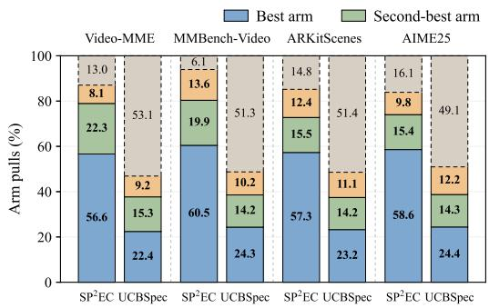  
\*+, '%-)\$##'

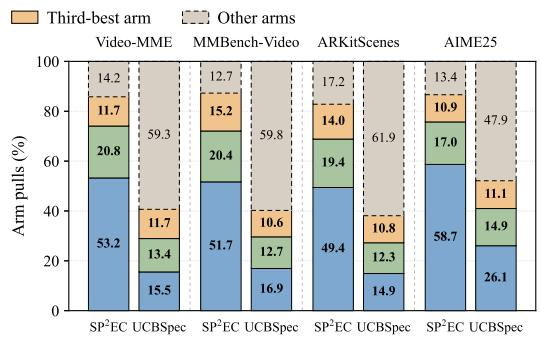  
.--\*/01#\*)  
Figure 3: Arm-pull allocation on (a) Qwen2.5-VL-7B-Instruct and (b) LLaVA-NeXT-Mistral-7B across Video-MME, MMBench-Video, ARKitScenes, and AIME25. Each dataset group contains two stacked bars: $\mathrm { S P ^ { 2 } E C }$ (left) and UCBSPEC (right). Segments show the percentage of pulls allocated to the best, second-best, third-best, and other arms. Bold labels highlight the percentages allocated to the top three arms; dashed outlines identify the other arms.

We also remark that higher MAT does not necessarily translate into higher speedup. In particular, a more accurate drafter can incur greater computation cost, offsetting the benefit of accepting more tokens. Therefore, there is a trade-off between the drafting accuracy and computation latency, in which $\mathrm { S P ^ { 2 } E C }$ achieves the optimal balance theoretically and empirically. We further examine this trade-off through a breakdown of drafting, verification, and optimization overhead in Appendix J.1.

Ablations and Additional Results. Appendix I reports ablations on draft length L, input size (visual-token budget), output length, and effect of resetting the optimizer every 512 speculative steps. Across the reported length and input-size ranges, $\mathrm { S P ^ { 2 } }$ EC maintains the highest speedup among the compared variants within each scheme. Its performance also varies least with hyperparameters. These results support its robustness through online adaptation to more efficient and suitable draft models.

We compare with EAGLE3 [Li et al., 2025c] in Appendix J.2. Our methods require no auxiliary training and avoid dependence on alignment between a separate draft model’s training distribution and test-time prompt distribution. The comparison suggests that small auxiliary draft models can struggle with complex mixed visual and textual context, limiting token acceptance and speedup.

Additional results with COSSIM on Qwen3-VL-4B-Instruct and LLaVA-1.5-7B are provided in Appendix J.3.

## 6 Conclusion

We presented $\mathrm { S P ^ { 2 } E C } ,$ , a training-free adaptive self-speculative decoding algorithm for vision-language models. $\mathrm { S P ^ { 2 } }$ EC helps to boost the performance of the existing self-speculative decoding methods by adapting the choice of components to the input prompt. We formulate this component selection problem with wall-time regret and exploit the single-peak structure of the ordered draft model sequence, allowing $\mathrm { S P ^ { 2 } }$ EC to focus exploration near the best component configuration rather than treating all configurations independently.

Our experiments on the two vision-language models, Qwen2.5-VL-7B-Instruct and LLaVA-NeXT-Mistral-7B, with four self-speculative decoding methods, namely COSSIM, SWIFT [Xia et al., 2025], KNAPSPEC [Cha et al., 2026], and SPECVLM [Ji et al., 2025], show that $\mathrm { S P ^ { 2 } }$ EC consistently improves wall-clock speedup over training-free baselines, while the comparison with EAGLE3 highlights the benefit of avoiding trained auxiliary drafters in multimodal settings.

Limitations and Further Applications. Our theory relies on structural assumptions on the candidate path, and our experiments focus on two VLM families. This paper instantiates the framework with layer skipping and token selection; similar single-peak trade-offs may arise in other ordered acceleration knobs, such as KV-cache sparsification; we discuss such extensions in Appendix B.

## Acknowledgements and Disclosure

Y. Hou and V. Y. F. Tan are supported by a Singapore Ministry of Education AcRF Tier 2 grant (A-8004062-00-00). V. Y. F. Tan is also supported by a Singapore National Research Foundation Investigatorship (A-8004657-00-00).

## References

Yasin Abbasi-yadkori, Dávid Pál, and Csaba Szepesvári. Improved algorithms for linear stochastic bandits. In Advances in Neural Information Processing Systems, volume 24, pages 2312–2320, 2011.

Shipra Agrawal and Navin Goyal. Analysis of thompson sampling for the multi-armed bandit problem. In Shie Mannor, Nathan Srebro, and Robert C. Williamson, editors, Proceedings of the 25th Annual Conference on Learning Theory, volume 23 of Proceedings of Machine Learning Research, pages 39.1–39.26, Edinburgh, Scotland, 25–27 Jun 2012. PMLR. URL https://proceedings.mlr.press/v23/agrawal12.html.

Shipra Agrawal and Navin Goyal. Near-optimal regret bounds for thompson sampling. Journal of the ACM (JACM), 64(5):1–24, 2017.

Sudhanshu Agrawal, Wonseok Jeon, and Mingu Lee. Adaedl: Early draft stopping for speculative decoding of large language models via an entropy-based lower bound on token acceptance probability. arXiv preprint arXiv:2410.18351, 2024.

Zachary Ankner, Rishab Parthasarathy, Aniruddha Nrusimha, Christopher Rinard, Jonathan Ragan-Kelley, and William Brandon. Hydra: Sequentially-dependent draft heads for medusa decoding. arXiv preprint arXiv:2402.05109, 2024.

András Antos, Varun Grover, and Csaba Szepesvári. Active learning in heteroscedastic noise. Theoretical Computer Science, 411(29-30):2712–2728, 2010.

P Auer, N Cesa-Bianchi, and Paul Fischer. Finite-time analysis of the multi-armed bandit problem. Machine Learning, 47:235–256, 2002.

Shuai Bai, Yuxuan Cai, Ruizhe Chen, Keqin Chen, Xionghui Chen, Zesen Cheng, Lianghao Deng, Wei Ding, Chang Gao, Chunjiang Ge, Wenbin Ge, Zhifang Guo, Qidong Huang, Jie Huang, Fei Huang, Binyuan Hui, Shutong Jiang, Zhaohai Li, Mingsheng Li, Mei Li, Kaixin Li, Zicheng Lin, Junyang Lin, Xuejing Liu, Jiawei Liu, Chenglong Liu, Yang Liu, Dayiheng Liu, Shixuan Liu, Dunjie Lu, Ruilin Luo, Chenxu Lv, Rui Men, Lingchen Meng, Xuancheng Ren, Xingzhang Ren, Sibo Song, Yuchong Sun, Jun Tang, Jianhong Tu, Jianqiang Wan, Peng Wang, Pengfei Wang, Qiuyue Wang, Yuxuan Wang, Tianbao Xie, Yiheng Xu, Haiyang Xu, Jin Xu, Zhibo Yang, Mingkun Yang, Jianxin Yang, An Yang, Bowen Yu, Fei Zhang, Hang Zhang, Xi Zhang, Bo Zheng, Humen Zhong, Jingren Zhou, Fan Zhou, Jing Zhou, Yuanzhi Zhu, and Ke Zhu. Qwen3-vl technical report, 2025a. URL https://arxiv.org/abs/2511.21631.

Shuai Bai, Keqin Chen, Xuejing Liu, Jialin Wang, Wenbin Ge, Sibo Song, Kai Dang, Peng Wang, Shijie Wang, Jun Tang, Humen Zhong, Yuanzhi Zhu, Mingkun Yang, Zhaohai Li, Jianqiang Wan, Pengfei Wang, Wei Ding, Zheren Fu, Yiheng Xu, Jiabo Ye, Xi Zhang, Tianbao Xie, Zesen Cheng, Hang Zhang, Zhibo Yang, Haiyang Xu, and Junyang Lin. Qwen2.5-vl technical report, 2025b. URL https://arxiv.org/abs/2502.13923.

Divya Jyoti Bajpai and Manjesh Kumar Hanawal. Fastvlm: Self-speculative decoding for fast vision-language model inference, 2025. URL https://arxiv.org/abs/2510.22641.

Gilad Baruch, Zhuoyuan Chen, Afshin Dehghan, Tal Dimry, Yuri Feigin, Peter Fu, Thomas Gebauer, Brandon Joffe, Daniel Kurz, Arik Schwartz, and Elad Shulman. Arkitscenes: A diverse realworld dataset for 3d indoor scene understanding using mobile rgb-d data, 2021. URL https: //arxiv.org/abs/2111.08897.

T. Cai, Y. Li, Z. Geng, H. Peng, J. D. Lee, D. Chen, and T. Dao. Medusa: Simple llm inference acceleration framework with multiple decoding heads. arXiv preprint arXiv:2401.10774, 2024.

Seongjin Cha, Gyuwan Kim, Dongsu Han, Tao Yang, and Insu Han. Knapspec: Self-speculative decoding via adaptive layer selection as a knapsack problem, 2026. URL https://arxiv.org/ abs/2602.20217.

Charlie Chen, Sebastian Borgeaud, Geoffrey Irving, Jean-Baptiste Lespiau, Laurent Sifre, and John Jumper. Accelerating large language model decoding with speculative sampling. arXiv preprint arXiv:2302.01318, 2023.

Longze Chen, Renke Shan, Huiming Wang, Lu Wang, Ziqiang Liu, Run Luo, Jiawei Wang, Hamid Alinejad-Rokny, and Min Yang. CLaSp: In-context layer skip for self-speculative decoding. In Proceedings of the 63rd Annual Meeting of the Association for Computational Linguistics (Volume 1: Long Papers), pages 31608–31618, Vienna, Austria, July 2025. Association for Computational Linguistics. ISBN 979-8-89176-251-0. doi: 10.18653/v1/2025.acl-long.1525. URL https://aclanthology.org/2025.acl-long.1525/.

Richard Combes and Alexandre Proutiere. Unimodal bandits: Regret lower bounds and optimal algorithms. In Proceedings ofthe 31st International Conference on Machine Learning, volume 32 of Proceedings ofMachine Learning Research, pages 521–529. PMLR, 22–24 Jun 2014.

Tencent AngelSlim Project Contributors. AngelSlim, 6 2025. URL https://github.com/ Tencent/AngelSlim.

Mostafa Elhoushi, Akshat Shrivastava, Diana Liskovich, Basil Hosmer, Bram Wasti, Liangzhen Lai, Anas Mahmoud, Bilge Acun, Saurabh Agarwal, Ahmed Roman, et al. Layerskip: Enabling early exit inference and self-speculative decoding. In Proceedings of the 62nd Annual Meeting of the Association for Computational Linguistics (Volume 1: Long Papers), pages 12622–12642, 2024.

Xinyu Fang, Kangrui Mao, Haodong Duan, Xiangyu Zhao, Yining Li, Dahua Lin, and Kai Chen. Mmbench-video: A long-form multi-shot benchmark for holistic video understanding, 2024. URL https://arxiv.org/abs/2406.14515.

Chaoyou Fu, Yuhan Dai, Yongdong Luo, Lei Li, Shuhuai Ren, Renrui Zhang, Zihan Wang, Chenyu Zhou, Yunhang Shen, Mengdan Zhang, Peixian Chen, Yanwei Li, Shaohui Lin, Sirui Zhao, Ke Li, Tong Xu, Xiawu Zheng, Enhong Chen, Caifeng Shan, Ran He, and Xing Sun. Video-mme: The first-ever comprehensive evaluation benchmark of multi-modal llms in video analysis, 2025. URL https://arxiv.org/abs/2405.21075.

Mukul Gagrani, Raghavv Goel, Wonseok Jeon, Junyoung Park, Mingu Lee, and Christopher Lott. On speculative decoding for multimodal large language models. In Proceedings of the IEEE/CVF Conference on Computer Vision and Pattern Recognition, pages 8285–8289, 2024.

Mugilan Ganesan, Shane Segal, Ankur Aggarwal, Nish Sinnadurai, Sean Lie, and Vithursan Thangarasa. MASSV: Multimodal adaptation and self-data distillation for speculative decoding of vision-language models. In ES-FoMo III: 3rd Workshop on Efficient Systemsfor Foundation Models, 2025. URL https://openreview.net/forum?id=ukDi9JyaL3.

Aayush Gautam, Susav Shrestha, and Narasimha Reddy. Token-driven gammatune: Adaptive calibration for enhanced speculative decoding. arXiv preprint arXiv:2504.00030, 2025.

Zhenyu He, Zexuan Zhong, Tianle Cai, Jason Lee, and Di He. REST: Retrieval-based speculative decoding. In Proceedings of the 2024 Conference of the North American Chapter of the Association for Computational Linguistics: Human Language Technologies (Volume 1: Long Papers), pages 1582–1595. Association for Computational Linguistics, June 2024.

Yunlong Hou, Fengzhuo Zhang, Cunxiao Du, Xuan Zhang, Jiachun Pan, Tianyu Pang, Chao Du, Vincent Y. F. Tan, and Zhuoran Yang. Banditspec: Adaptive speculative decoding via bandit algorithms, 2025. URL https://arxiv.org/abs/2505.15141.

Yunhai Hu, Tianhua Xia, Zining Liu, Rahul Raman, Xingyu Liu, BO BAO, Eric Sather, Vithursan Thangarasa, and Sai Qian Zhang. DREAM: Drafting with refined target features and entropyadaptive cross-attention fusion for multimodal speculative decoding. In The Thirty-ninth Annual Conference on Neural Information Processing Systems, 2025. URL https://openreview.net/ forum?id=M5jz47umjR.

Haiduo Huang, Fuwei Yang, Zhenhua Liu, Xuanwu Yin, Dong Li, Pengju Ren, and Emad Barsoum. Specvlm: Fast speculative decoding in vision-language models, 2025. URL https://arxiv. org/abs/2509.11815.

Hualong Huang, Wenhan Zhan, Hancong Duan, Kai Peng, Geyong Min, Zijia Zhao, Zitian Zhao, and Yalan Ye. Edgesd: Efficient speculative decoding with vision-decoding disaggregation for mllm inference in edge-cloud networks. IEEE Transactions on Mobile Computing, 2026.

Kaixuan Huang, Xudong Guo, and Mengdi Wang. Specdec++: Boosting speculative decoding via adaptive candidate lengths. arXiv preprint arXiv:2405.19715, 2024.

Mingxiao Huo, Jiayi Zhang, Hewei Wang, Jinfeng Xu, Zheyu Chen, Huilin Tai, and Yijun Chen. Spec-llava: Accelerating vision-language models with dynamic tree-based speculative decoding. arXiv preprint arXiv:2509.11961, 2025.

Yicheng Ji, Jun Zhang, Heming Xia, Jinpeng Chen, Lidan Shou, Gang Chen, and Huan Li. SpecVLM: Enhancing speculative decoding of video LLMs via verifier-guided token pruning. In Christos Christodoulopoulos, Tanmoy Chakraborty, Carolyn Rose, and Violet Peng, editors, Proceedings of the 2025 Conference on Empirical Methods in Natural Language Processing, pages 7205–7219, Suzhou, China, November 2025. Association for Computational Linguistics. ISBN 979-8-89176- 332-6. doi: 10.18653/v1/2025.emnlp-main.366. URL https://aclanthology.org/2025. emnlp-main.366/.

Jialiang Kang, Han Shu, Wenshuo Li, Yingjie Zhai, and Xinghao Chen. Vispec: Accelerating vision-language models with vision-aware speculative decoding, 2025. URL https://arxiv. org/abs/2509.15235.

Sehoon Kim, Karttikeya Mangalam, Suhong Moon, Jitendra Malik, Michael W Mahoney, Amir Gholami, and Kurt Keutzer. Speculative decoding with big little decoder. Advances in Neural Information Processing Systems, 36:39236–39256, 2023.

Taehyeon Kim, Hojung Jung, and Se-Young Yun. Multi-drafter speculative decoding with alignment feedback, 2026. URL https://arxiv.org/abs/2604.05417.

Tze Leung Lai and Herbert Robbins. Asymptotically efficient adaptive allocation rules. Advances in applied mathematics, 6(1):4–22, 1985.

Tor Lattimore and Csaba Szepesvári. Bandit algorithms. Cambridge University Press, 2020.

Minjae Lee, Wonjun Kang, Byeongkeun Ahn, Christian Classen, Minghao Yan, Hyung Il Koo, and Kangwook Lee. In-batch ensemble drafting: Robust speculative decoding for LVLMs. In First Workshop on Scalable Optimization for Efficient and Adaptive Foundation Models, 2025. URL https://openreview.net/forum?id=ffDhpmwqdu.

Minjae Lee, Wonjun Kang, Byeongkeun Ahn, Christian Classen, Kevin Galim, Seunghyuk Oh, Minghao Yan, Hyung Il Koo, and Kangwook Lee. Tabed: Test-time adaptive ensemble drafting for robust speculative decoding in lvlms. arXiv preprint arXiv:2601.20357, 2026.

Yaniv Leviathan, Matan Kalman, and Yossi Matias. Fast inference from transformers via speculative decoding. In International Conference on Machine Learning, pages 19274–19286. PMLR, 2023.

Guanghao Li, Zhihui Fu, Min Fang, Qibin Zhao, Ming Tang, Chun Yuan, and Jun Wang. Diffuspec: Unlocking diffusion language models for speculative decoding. arXiv preprint arXiv:2510.02358, 2025a.

Kunchang Li, Yali Wang, Yinan He, Yizhuo Li, Yi Wang, Yi Liu, Zun Wang, Jilan Xu, Guo Chen, Ping Lou, Limin Wang, and Yu Qiao. Mvbench: A comprehensive multi-modal video understanding benchmark. In 2024 IEEE/CVF Conference on Computer Vision and Pattern Recognition (CVPR), pages 22195–22206, 2024a. doi: 10.1109/CVPR52733.2024.02095.

Ruixiao Li, Fahao Chen, and Peng Li. Semi-clairvoyant scheduling of speculative decoding requests to minimize llm inference latency. arXiv preprint arXiv:2505.17074, 2025b.

Yuhui Li, Fangyun Wei, Chao Zhang, and Hongyang Zhang. Eagle: Speculative sampling requires rethinking feature uncertainty. arXiv preprint arXiv:2401.15077, 2024b.

Yuhui Li, Fangyun Wei, Chao Zhang, and Hongyang Zhang. EAGLE-2: Faster inference of language models with dynamic draft trees. In Empirical Methods in Natural Language Processing, 2024c.

Yuhui Li, Fangyun Wei, Chao Zhang, and Hongyang Zhang. Eagle-3: Scaling up inference acceleration of large language models via training-time test, 2025c. URL https://arxiv.org/abs/ 2503.01840.

Wenhui Liao, Hongliang Li, Pengyu Xie, Xinyu Cai, Yufan Shen, Yi Xin, Qi Qin, Shenglong Ye, Tianbin Li, Ming Hu, et al. Hsd: Training-free acceleration for document parsing vision-language model with hierarchical speculative decoding. arXiv preprint arXiv:2602.12957, 2026.

Luxi Lin, Zhihang Lin, Zhanpeng Zeng, and Rongrong Ji. Speculative decoding reimagined for multimodal large language models, 2025. URL https://arxiv.org/abs/2505.14260.

Haotian Liu, Chunyuan Li, Yuheng Li, Bo Li, Yuanhan Zhang, Sheng Shen, and Yong Jae Lee. Llavanext: Improved reasoning, ocr, and world knowledge, January 2024. URL https://llava-vl. github.io/blog/2024-01-30-llava-next/.

Hongyi Liu, Jiaji Huang, Zhen Jia, Youngsuk Park, and Yu-Xiang Wang. Not-a-bandit: Provably no-regret drafter selection in speculative decoding for LLMs. In The Fourteenth International Conference on Learning Representations, 2026. URL https://openreview.net/forum?id= JMmljf895g.

Jiesong Liu, Brian Park, and Xipeng Shen. A drop-in solution for on-the-fly adaptation of speculative decoding in large language models. In Wanxiang Che, Joyce Nabende, Ekaterina Shutova, and Mohammad Taher Pilehvar, editors, Proceedings ofthe 63rd Annual Meeting ofthe Association for Computational Linguistics (Volume 1: Long Papers), pages 9778–9794, Vienna, Austria, July 2025a. Association for Computational Linguistics. ISBN 979-8-89176-251-0. doi: 10.18653/v1/ 2025.acl-long.482. URL https://aclanthology.org/2025.acl-long.482/.

Tianyu Liu, Yun Li, Qitan Lv, Kai Liu, Jianchen Zhu, Winston Hu, and Xiao Sun. PEARL: Parallel speculative decoding with adaptive draft length. In The Thirteenth International Conference on Learning Representations, 2025b. URL https://openreview.net/forum?id=QOXrVMiHGK.

Xiaoxuan Liu, Lanxiang Hu, Peter Bailis, Alvin Cheung, Zhijie Deng, Ion Stoica, and Hao Zhang. Online speculative decoding. arXiv preprint arXiv:2310.07177, 2023.

Xukun Liu, Bowen Lei, Ruqi Zhang, and Dongkuan DK Xu. Adaptive draft-verification for efficient large language model decoding. In Proceedings ofthe AAAI Conference on Artificial Intelligence, volume 39, pages 24668–24676, 2025c.

Yuhan Liu, Lianhui Qin, and Shengjie Wang. Small drafts, big verdict: Information-intensive visual reasoning via speculation. arXiv preprint arXiv:2510.20812, 2025d.

Qitan Lv, Tianyu Liu, Wen Wu, Xuenan Xu, Bowen Zhou, Feng Wu, and Chao Zhang. Hippo: Accelerating video large language models inference via holistic-aware parallel speculative decoding. arXiv preprint arXiv:2601.08273, 2026.

Stefan Magureanu, Richard Combes, and Alexandre Proutiere. Lipschitz bandits: Regret lower bound and optimal algorithms. In Conference on Learning Theory, pages 975–999. PMLR, 2014.

Jonathan Mamou, Oren Pereg, Daniel Korat, Moshe Berchansky, Nadav Timor, Moshe Wasserblat, and Roy Schwartz. Dynamic speculation lookahead accelerates speculative decoding of large language models. arXiv preprint arXiv:2405.04304, 2024.

Xupeng Miao, Gabriele Oliaro, Zhihao Zhang, Xinhao Cheng, Zeyu Wang, Rae Ying Yee Wong, Zhuoming Chen, Daiyaan Arfeen, Reyna Abhyankar, and Zhihao Jia. Specinfer: Accelerating generative llm serving with speculative inference and token tree verification. ArXiv, abs/2305.09781, 2023. URL https://api.semanticscholar.org/CorpusID:258740799.

OpenCompass. AIME 2025 dataset, 2025. URL https://huggingface.co/datasets/ opencompass/AIME2025. Problems from the American Invitational Mathematics Examination 2025-I and 2025-II.

Jie Ou, Yueming Chen, et al. Lossless acceleration of large language model via adaptive n-gram parallel decoding. In Proceedings ofthe 2024 Conference ofthe North American Chapter ofthe Association for Computational Linguistics: Human Language Technologies (Volume 6: Industry Track), pages 10–22, 2024.

Kangyu Qiao, Shaolei Zhang, and Yang Feng. IG-pruning: Input-guided block pruning for large language models. In Proceedings of the 2025 Conference on Empirical Methods in Natural Language Processing, pages 10618–10629. Association for Computational Linguistics, November 2025. ISBN 979-8-89176-332-6. doi: 10.18653/v1/2025.emnlp-main.537. URL https:// aclanthology.org/2025.emnlp-main.537/.

Herbert Robbins. Some aspects of the sequential design of experiments. Bulletin ofthe American Mathematical Society, 58:527–535, 1952.

Ranajoy Sadhukhan, Jian Chen, Zhuoming Chen, Vashisth Tiwari, Ruihang Lai, Jinyuan Shi, Ian En-Hsu Yen, Avner May, Tianqi Chen, and Beidi Chen. Magicdec: Breaking the latency-throughput tradeoff for long context generation with speculative decoding. In The Thirteenth International Conference on Learning Representations, 2025. URL https://openreview.net/forum?id= CS2JWaziYr.

Aditya Sridhar, Nish Sinnadurai, Sean Lie, and Vithursan Thangarasa. Tapout: A bandit-based approach to dynamic speculative decoding, 2025. URL https://arxiv.org/abs/2511.02017.

Mitchell Stern, Noam Shazeer, and Jakob Uszkoreit. Blockwise parallel decoding for deep autoregressive models. Advances in Neural Information Processing Systems, 31, 2018.

Yujia Tong, Tian Zhang, Yunyang Wan, Kaiwei Lin, Jingling Yuan, and Chuang Hu. Sage: Accelerating vision-language models via entropy-guided adaptive speculative decoding. arXiv preprint arXiv:2602.00523, 2026.

Phuong Tran, Tzu-Hao Liu, Long Tan Le, Tung-Anh Nguyen, Van Quan La, Eason Yu, Han Shu, Choong Seon Hong, and Nguyen H Tran. Goodspeed: Optimizing fair goodput with adaptive speculative decoding in distributed edge inference. arXiv preprint arXiv:2512.09963, 2025.

Hanzhen Wang, Jiaming Xu, Yushun Xiang, Jiayi Pan, Yongkang Zhou, Yong-Lu Li, and Guohao Dai. Specprune-vla: Accelerating vision-language-action models via action-aware self-speculative pruning. arXiv preprint arXiv:2509.05614, 2025a.

Jikai Wang, Yi Su, Juntao Li, Qingrong Xia, Zi Ye, Xinyu Duan, Zhefeng Wang, and Min Zhang. OPT-tree: Speculative decoding with adaptive draft tree structure. Transactions of the Association for Computational Linguistics, 13:188–199, 2025b. doi: 10.1162/tacl\_a\_00735. URL https: //aclanthology.org/2025.tacl-1.8/.

Jikai Wang, Zhenxu Tian, Juntao Li, Qingrong Xia, Xinyu Duan, Zhefeng Wang, Baoxing Huai, and Min Zhang. Alignment-augmented speculative decoding with alignment sampling and conditional verification. In Proceedings of the 2025 Conference on Empirical Methods in Natural Language Processing, pages 6762–6774, 2025c.

Songsheng Wang, Rucheng Yu, Zhihang Yuan, Chao Yu, Feng Gao, Yu Wang, and Derek F Wong. Spec-vla: speculative decoding for vision-language-action models with relaxed acceptance. In Proceedings of the 2025 Conference on Empirical Methods in Natural Language Processing, pages 26916–26928, 2025d.

Zihua Wang, Ruibo Li, Haozhe Du, Joey Tianyi Zhou, Yu Zhang, and Xu Yang. Flash: Latent-aware semi-autoregressive speculative decoding for multimodal tasks. arXiv preprint arXiv:2505.12728, 2025e.

Zhaoxuan Wu, Zijian Zhou, Arun Verma, Alok Prakash, Daniela Rus, and Bryan Kian Hsiang Low. Tetris: Optimal draft token selection for batch speculative decoding. In Proceedings ofthe 63rd Annual Meeting ofthe Associationfor Computational Linguistics (Volume 1: Long Papers), pages 33329–33345, 2025.

Heming Xia, Tao Ge, Peiyi Wang, Si-Qing Chen, Furu Wei, and Zhifang Sui. Speculative decoding: Exploiting speculative execution for accelerating seq2seq generation. In Findings ofthe Association for Computational Linguistics: EMNLP 2023, pages 3909–3925, 2023.

Heming Xia, Yongqi Li, Jun Zhang, Cunxiao Du, and Wenjie Li. SWIFT: On-the-fly self-speculative decoding for LLM inference acceleration. In The Thirteenth International Conference on Learning Representations, 2025. URL https://openreview.net/forum?id=EKJhH5D5wA.

Zilin Xiao, Hongming Zhang, Tao Ge, Siru Ouyang, Vicente Ordonez, and Dong Yu. Parallelspec: Parallel drafter for efficient speculative decoding. arXiv preprint arXiv:2410.05589, 2024.

Zhinan Xie, Peisong Wang, Shuang Qiu, and Jian Cheng. Hivis: Hiding visual tokens from the drafter for speculative decoding in vision-language models. arXiv preprint arXiv:2509.23928, 2025.

Yunfan Xiong, Ruoyu Zhang, Yanzeng Li, and Lei Zou. Dyspec: Faster speculative decoding with dynamic token tree structure. World Wide Web, 28(3):36, 2025. doi: 10.1007/s11280-025-01344-0. URL https://doi.org/10.1007/s11280-025-01344-0.

Chaoqun Yang, Ran Chen, Muyang Zhang, Weiguang Pang, Yuzhi Chen, Rongtao Xu, Kexue Fu, Changwei Wang, and Longxiang Gao. Aasd: Accelerate inference by aligning speculative decoding in multimodal large language models. In 2025 62nd ACM/IEEE Design Automation Conference (DAC), pages 1–7. IEEE, 2025a.

Mingyu Yang, Jae-Young Choi, Kihyo Moon, Minsung Jang, and Eunjoo Jeon. Dsde: Dynamic speculative decoding with kld stability for real-world serving. arXiv preprint arXiv:2509.01083, 2025b.

Nan Yang, Tao Ge, Liang Wang, Binxing Jiao, Daxin Jiang, Linjun Yang, Rangan Majumder, and Furu Wei. Inference with reference: Lossless acceleration of large language models. arXiv preprint arXiv:2304.04487, 2023.

Ming Yin, Minshuo Chen, Kaixuan Huang, and Mengdi Wang. A theoretical perspective for speculative decoding algorithm. arXiv preprint arXiv:2411.00841, 2024.

Jia Yuan Yu and Shie Mannor. Unimodal bandits. In Proceedings ofthe 28th International Conference on International Conference on Machine Learning, ICML’11, page 41–48, Madison, WI, USA, 2011. Omnipress. ISBN 9781450306195.

Jiebin Zhang, Zhenghan Yu, Liang Wang, Nan Yang, Eugene J. Yu, Zheng Li, Yifan Song, Dawei Zhu, Xingxing Zhang, Furu Wei, and Sujian Li. Learning to draft: Adaptive speculative decoding with reinforcement learning. In The Fourteenth International Conference on Learning Representations, 2026a. URL https://openreview.net/forum?id=IK9cbzzXLt.

Jun Zhang, Jue Wang, Huan Li, Lidan Shou, Ke Chen, Gang Chen, and Sharad Mehrotra. Draft& verify: Lossless large language model acceleration via self-speculative decoding. In Proceedings of the 62nd Annual Meeting of the Association for Computational Linguistics (Volume 1: Long Papers), page 11263–11282. Association for Computational Linguistics, 2024. doi: 10.18653/v1/ 2024.acl-long.607. URL http://dx.doi.org/10.18653/v1/2024.acl-long.607.

Libo Zhang, Zhaoning Zhang, Wangyang Hong, Peng Qiao, and Dongsheng Li. Sparrow: Textanchored window attention with visual-semantic glimpsing for speculative decoding in video llms. arXiv preprint arXiv:2602.15318, 2026b.

Xuan Zhang, Cunxiao Du, Sicheng Yu, Jiawei Wu, Fengzhuo Zhang, Wei Gao, and Qian Liu. Sparseto-dense: A free lunch for lossless acceleration of video understanding in llms, 2025a. URL https://arxiv.org/abs/2505.19155.

Ziyin Zhang, Jiahao Xu, Tian Liang, Xingyu Chen, Zhiwei He, Rui Wang, and Zhaopeng Tu. Draft model knows when to stop: Self-verification speculative decoding for long-form generation. In Christos Christodoulopoulos, Tanmoy Chakraborty, Carolyn Rose, and Violet Peng, editors, Proceedings of the 2025 Conference on Empirical Methods in Natural Language Processing, pages 16685–16697, Suzhou, China, November 2025b. Association for Computational Linguistics. ISBN 979-8-89176-332-6. doi: 10.18653/v1/2025.emnlp-main.844. URL https://aclanthology. org/2025.emnlp-main.844/.

Weilin Zhao, Yuxiang Huang, Xu Han, Wang Xu, Chaojun Xiao, Xinrong Zhang, Yewei Fang, Kaihuo Zhang, Zhiyuan Liu, and Maosong Sun. Ouroboros: Generating longer drafts phrase by phrase for faster speculative decoding. In Proceedings ofthe 2024 Conference on Empirical Methods in Natural Language Processing, pages 13378–13393, 2024.

Yongchao Zhou, Kaifeng Lyu, Ankit Singh Rawat, Aditya Krishna Menon, Afshin Rostamizadeh, Sanjiv Kumar, Jean-François Kagy, and Rishabh Agarwal. Distillspec: Improving speculative decoding via knowledge distillation. arXiv preprint arXiv:2310.08461, 2023.

## A Related Work

Speculative decoding for vision-language models. Most speculative decoding methods target text-only LLMs, whereas VLMs face long visual prefixes, costly prefill and verification, and modalitysensitive draft–target alignment. Multimodal studies examine direct speculation and LVLM drafting [Gagrani et al., 2024, Lee et al., 2025], multimodal drafters, visual adapters, and alignment objectives [Bajpai and Hanawal, 2025, Huang et al., 2025, Ganesan et al., 2025], dynamic trees and test-time drafting [Lin et al., 2025, Yang et al., 2025a, Huo et al., 2025], and visual-token hiding, latent-aware speculation, or ensemble drafting [Xie et al., 2025, Wang et al., 2025e, Liu et al., 2025d, Lee et al., 2026, Tong et al., 2026]. Related extensions accelerate document VLMs, video LLMs, edge-cloud MLLM, and VLA models via hierarchical drafting, token pruning, sparse-to-dense decoding, adaptive visual features, disaggregation, relaxed acceptance, or action-aware pruning [Kang et al., 2025, Hu et al., 2025, Zhang et al., 2025a, Ji et al., 2025, Liao et al., 2026, Lv et al., 2026, Huang et al., 2026, Wang et al., 2025d,a, Zhang et al., 2026b]. Many require trained multimodal drafters, specialized visual modules, or modality-specific token processing. In contrast, our method builds the drafter directly from the target VLM via layer skipping, or token pruning, requires no auxiliary training, and adapts the skip budget prompt by prompt.

Adaptive speculative decoding. Recent adaptive methods adjust candidate length, stopping rules, or draft–verify schedules [Huang et al., 2024, Liu et al., 2025b, Zhang et al., 2025b], use banditor entropy-based stopping [Sridhar et al., 2025, Agrawal et al., 2024], adaptive n-gram or draftverification schemes [Ou et al., 2024, Liu et al., 2025c], and dynamic lookahead or calibration [Mamou et al., 2024, Yang et al., 2025b, Gautam et al., 2025]. Other works adapt draft trees or branching structures [Wang et al., 2025b, Xiong et al., 2025], tune serving-level speculation windows, batching, scheduling, or distributed execution [Liu et al., 2025a, Wu et al., 2025, Li et al., 2025b, Tran et al., 2025], or modify verification and drafting objectives via alignment-aware or diffusion-based designs [Wang et al., 2025c, Li et al., 2025a]. Closest to our setting, BanditSpec [Hou et al., 2025] casts hyperparameter selection as a bandit problem, but treats configurations as independent arms and optimizes stopping-time regret. Not-a-Bandit [Liu et al., 2026] uses full-information feedback when unchosen drafters are cheap to evaluate, which is costly for layer-skipped VLMs. In contrast, SP<sup>2</sup>EC uses partial feedback, optimizes wall-time regret, and exploits the ordered single-peak structure of the skipping path by exploring near the current leader and its neighbors.

Multi-Armed Bandit. The multi-armed bandit problem models the exploration-exploitation trade-off in decision making [Robbins, 1952, Lai and Robbins, 1985, Lattimore and Szepesvári, 2020, Auer et al., 2002]. For the stochastic K-armed setup, the most commonly used algorithms include UCB algorithm [Auer et al., 2002] and Thompson Sampling [Agrawal and Goyal, 2012, 2017]. The literature also introduces additional structures to the arm set, for instance, linear bandits [Abbasiyadkori et al., 2011], single-peak or unimodal bandits [Combes and Proutiere, 2014, Yu and Mannor, 2011], Lipschitz bandits [Magureanu et al., 2014].

## B More Applications

Other self-speculative schemes. While we focus on the layer-skip-style (and input-pruning-style) speculative decoding [Xia et al., 2025, Elhoushi et al., 2024, Chen et al., 2025], our method can also be extended to other self-speculative decoding methods, as long as the single-peak structure holds in the arm sets.

For instance, Video Large Language Models suffer from high inference latency in long video processing due to their auto-regressive decoding mechanism. In previous work, Zhang et al. [2025a] propose to use a sparse module that rapidly generates speculative tokens using efficient top-K attention, and a dense module that verifies these tokens in parallel via full self-attention. Specifically, they propose to use a draft model, which is obtained by simply replacing the dense attention modules with sparse ones in the target model. Using a sparse attention module reduces the time required to read the selected KV cache during attention, which can be particularly advantageous when KV cache loading time dominates the forward pass for the target model. This method has achieved over 1.9× wall time speed-up compared to the vanilla decoding method, and is better than the other speculative decoding methods [Zhang et al., 2025a].

However, Zhang et al. [2025a] adopt a fixed number of 1024 KV cache pairs, which lacks adaptivity in the face of heterogeneous tasks. We expect that when the input task is easier, a few KV cache pairs are enough for the acceleration; when the task is hard, more KV cache pairs can better enhance the inference. So the acceptance rate shows a diminishing return structure. In addition, the KV cache loading time is linear in the KV cache pairs when dealing with a long context. Thus, the time cost is also an affine function in the KV cache pairs. All in all, this problem is likely to have the same single-peak structure as we introduced in Section 3.

Joint adaptation of generation hyperparameters. Broadly speaking, $\mathrm { S P ^ { 2 } }$ EC suggests a way to adapt hyperparameters online during LLM generation, by exploiting single-peak throughput structure. The draft-length ablation in Appendix I.1 also shows that performance tends to peak at an intermediate draft length, motivating joint adaptation of the draft model configuration and draft length. A natural extension is to alternate between adapting the layer-skip ratio and the draft length, holding the other parameter fixed during each stage and using accepted-token and wall-time feedback. When throughput is single-peaked in each parameter with the other fixed, this approach could exploit the structure of both one-dimensional problems. The same idea could extend to additional generation hyperparameters. We leave the analysis of these alternating updates and their global optimality guarantees to future work.

## C Proofs of Main Results

## C.1 Proof of Theorem 4.1

For simplicity, we use the shorthand notation τ for $\tau ( \mathrm { a l g } , \mathbf { p } \mathbf { t } , \boldsymbol { \Lambda } )$ , and omit the condition prompt pt in this proof.

Step 1 We first decompose the wall time:

$$
\mathbb { E } [ \mathbf { W } \mathbf { T } _ { \tau } ] = \mathbb { E } \bigg [ \sum _ { t = 1 } ^ { \tau } c _ { I _ { t } } \bigg ] = \sum _ { i \in [ K ] } c _ { i } \cdot \mathbb { E } \big [ T _ { i } ( \tau ) \big ] ,\tag{18}
$$

where we adopt Doob’s optional stopping Theorem (Lemma E.1) and $\begin{array} { r } { T _ { i } ( t ) : = \sum _ { s = 1 } ^ { t } \mathbb { 1 } \{ I _ { s } = i \} } \end{array}$ The wall-time regret can be simplified as

$$
\operatorname { W T R e g } ( \Lambda , \operatorname { p t } ) = \sum _ { i \in [ K ] } c _ { i } \cdot \mathbb { E } \left[ T _ { i } ( \tau ( \operatorname { a l g } ) ) \right] - c _ { i ^ { * } } \cdot \mathbb { E } \left[ \tau ( \operatorname { a l g } _ { i ^ { * } } ) \right]\tag{19}
$$

By the unbiasedness of speculative decoding [Yin et al., 2024, Hou et al., 2025, Leviathan et al., 2023], i.e., $\mathsf { p t } _ { \tau ( \mathrm { a l g } ) } = \mathsf { p t } _ { \mathrm { t a r g e t } }$ no matter how the draft model is chosen by alg. Furthermore,

$$
\mathbb { E } \big [ \mathbf { l e n } ( \mathrm { p t } _ { \tau ( \mathrm { a l g } ) } ) - \mathbf { l e n } ( \mathbf { p t } _ { 0 } ) \big ] = \mathbb { E } \bigg [ \sum _ { t = 1 } ^ { \tau ( \mathrm { a l g } ) } \mathbf { l e n } ( x _ { I _ { t } , t } ) \bigg ] = \sum _ { i \in [ K ] } \mu _ { i } \cdot \mathbb { E } \big [ T _ { i } ( \tau ( \mathrm { a l g } ) ) \big ]\tag{20}
$$

Therefore,

$$
\sum _ { i \in [ K ] } c _ { i } \cdot \mathbb { E } \big [ T _ { i } ( \tau ( \mathrm { a l g } ) ) \big ] - c _ { i ^ { * } } \cdot \mathbb { E } \big [ \tau ( \mathrm { a l g } _ { i ^ { * } } ) \big ]\tag{21}
$$

$$
= \sum _ { i \in [ K ] } c _ { i } \cdot \mathbb { E } \big [ T _ { i } ( \tau ( \mathbf { a } \mathbf { l } \mathbf { g } ) ) \big ] - \frac { \mu _ { i ^ { * } } } { \nu _ { i ^ { * } } } \cdot \mathbb { E } \big [ \tau ( \mathbf { a } \mathbf { l } \mathbf { g } _ { i ^ { * } } ) \big ]\tag{22}
$$

$$
= \sum _ { i \in [ K ] } c _ { i } \cdot \mathbb { E } \big [ T _ { i } ( \tau ( \mathbf { a l g } ) ) \big ] - \sum _ { i \in [ K ] } \frac { \mu _ { i } } { \nu _ { i ^ { * } } } \cdot \mathbb { E } \big [ T _ { i } ( \tau ( \mathbf { a l g } ) ) \big ]\tag{23}
$$

$$
= \sum _ { i \in [ K ] } \mu _ { i } ( \frac { 1 } { \nu _ { i } } - \frac { 1 } { \nu _ { i ^ { * } } } ) \cdot \mathbb { E } \big [ T _ { i } ( \tau ( \mathrm { a l g } ) ) \big ] .\tag{24}
$$

Hence, we only need to bound E $\left\lceil T _ { i } ( \tau ( \mathrm { a l g } ) ) \right\rceil$ in the following steps.

Step 2 For any $i , j \in [ K ]$ , we define $\begin{array} { r } { \tilde { T } _ { j , i } ( t ) : = \sum _ { s = K } ^ { t } \mathbb { 1 } \{ L _ { s } = i , I _ { s + 1 } = j \} } \end{array}$ , which is the number of times candidate i is the leader and candidate j is adopted up to time step t. We can decompose

$$
\mathbb { E } \big [ T _ { i } ( \tau ) \big ] \leq 1 + \mathbb { E } \bigg [ \sum _ { t = K } ^ { \tau - 1 } \mathbb { 1 } \{ I _ { t + 1 } = i \} \bigg ]\tag{25}
$$

(26)

<sup>{z</sup>(♠)

According to our algorithm design, when $L _ { t } = i ^ { * } , I _ { t + 1 }$ must be in the neighborhood of $i ^ { * }$ . Thus, the analysis of $( \spadesuit )$ is similar to the standard Multi-Armed Bandits, and would yield regret of order $O ( \ln \mathbb { E } [ \bar { \tau } ] )$ ). In contrast, we will prove that (♣) is of order O(1) thanks to the unimodal structure of the candidate arms, which is of smaller order compared to $( \spadesuit )$ . We prove the above two claims in the following paragraph.

Bound (♣)

We note that

$$
( \bullet ) = \sum _ { j \neq i ^ { \ast } } \mathbb { E } \bigg [ \sum _ { t = K } ^ { \tau - 1 } \mathbb { 1 } \{ I _ { t + 1 } = i , L _ { t } = j \} \bigg ] \leq \sum _ { i \neq i ^ { \ast } } \mathbb { E } \bigg [ \tilde { T } _ { i } ( \tau - 1 ) \bigg ] .\tag{27}
$$

Therefore, we only need to bound $\mathbb { E } \bigg [ \tilde { T } _ { i } ( \tau ) \bigg ]$ . Let i be any suboptimal candidate and $i ^ { \dagger } : =$ argmax $_ { \cdot j = i \pm 1 } \nu _ { j }$ . We further define two complementary events:

$$
\begin{array} { r } { A _ { \varepsilon } : = \big \{ t < \tau : L _ { t } = i , T _ { i } { \mathsf { t } } ( t ) \geq \varepsilon \cdot \tilde { T } _ { i } ( t ) \big \} \quad \mathrm { a n d } \quad B _ { \varepsilon } : = \big \{ t < \tau : L _ { t } = i , T _ { i } { \mathsf { t } } ( t ) < \varepsilon \cdot \tilde { T } _ { i } ( t ) \big \} , } \end{array}\tag{28}
$$

so that

$$
\mathbb { E } [ \tilde { T } _ { i } ( \tau - 1 ) ] \leq \mathbb { E } [ | A _ { \varepsilon } | + | B _ { \varepsilon } | ] .\tag{29}
$$

Under event $A _ { \varepsilon } .$ , both i and $i ^ { \dagger }$ are pulled at least $\varepsilon \tilde { T } _ { i } ( t )$ times. If i is the leader most of the time, then we can distinguish these two arms with high probability. Under event $B _ { \varepsilon }$ , we show that it can happen with small probability, as there is a better candidate in the neighborhood of i, due to the unimodal structure.

• Under event $A _ { \varepsilon }$

For each $s \in  { \mathbb { N } } _ { + }$ , define the stopping time

$$
\begin{array} { r } { \phi _ { s } : = \operatorname* { i n f } \Big \{ t \geq 1 : K \leq t < \tau , L _ { t } = i , \tilde { T } _ { i } ( t ) = s , T _ { i ^ { \dagger } } ( t ) \geq \varepsilon s \Big \} , } \end{array}\tag{30}
$$

with the convention that $\phi _ { s } = \tau + 1$ if the above set is empty. Since the conditions in the definition of $\phi _ { s }$ are adapted, $\phi _ { s }$ is an F-stopping time and satisfies $\phi _ { s } \leq \tau + 1$ almost surely.

For every s, there is at most one time step t such that $L _ { t } = i$ and $\tilde { T } _ { i } ( t ) = s$ . Moreover, $\phi _ { s } \leq \tau$ if and only if this time step belongs to $A _ { \varepsilon }$ . Therefore,

$$
\vert A _ { \varepsilon } \vert = \sum _ { s = 1 } ^ { \infty } \mathbf { 1 } \{ \phi _ { s } \leq \tau \} ,\tag{31}
$$

and, by Tonelli’s theorem,

$$
\mathbb { E } [ | A _ { \varepsilon } | ] = \sum _ { s = 1 } ^ { \infty } \mathbb { P } ( \phi _ { s } \leq \tau ) .\tag{32}
$$

Let

$$
\Delta _ { i ^ { \dagger } , i } ^ { \nu } : = \nu _ { i ^ { \dagger } } - \nu _ { i } > 0 .
$$

On the event $\{ \phi _ { s } \le \tau \}$ , candidate i is the leader, so

$$
\frac { \hat { \mu } _ { i } ( \phi _ { s } ) } { c _ { i } } \geq \frac { \hat { \mu } _ { i ^ { \dagger } } ( \phi _ { s } ) } { c _ { i ^ { \dagger } } } .\tag{33}
$$

Furthermore, by the forced-sampling rule and the definition of $\phi _ { s }$

$$
T _ { i } ( \phi _ { s } ) \geq \frac { s } { 3 } , \qquad T _ { i ^ { \dagger } } ( \phi _ { s } ) \geq \varepsilon s .\tag{34}
$$

Consequently,

$$
\mathbb { P } ( \phi _ { s } \leq \tau ) \leq \mathbb { P } \left( \frac { \hat { \mu } _ { i } ( \phi _ { s } ) } { c _ { i } } - \nu _ { i } \geq \frac { \Delta _ { i ^ { \prime } , i } ^ { \nu } } { 2 } , \phi _ { s } \leq \tau \right) + \mathbb { P } \left( \frac { \hat { \mu } _ { i ^ { \dagger } } ( \phi _ { s } ) } { c _ { i ^ { \dagger } } } - \nu _ { i ^ { \dagger } } \leq - \frac { \Delta _ { i ^ { \dagger } , i } ^ { \nu } } { 2 } , \phi _ { s } \leq \tau \right) .\tag{35}
$$

The accepted-token length lies in an interval of length L. Applying Lemma C.1 to candidate i, with sample-count lower bound $s / 3$ and deviation level $c _ { i } \Delta _ { i ^ { \dagger } , i } ^ { \nu } / 2 .$ , gives

$$
\mathbb { P } \left( \frac { \hat { \mu } _ { i } \left( \phi _ { s } \right) } { c _ { i } } - \nu _ { i } \geq \frac { \Delta _ { i ^ { \dagger } , i } ^ { \nu } } { 2 } , \phi _ { s } \leq \tau \right) \leq \exp \left( - \frac { s c _ { i } ^ { 2 } \left( \Delta _ { i ^ { \dagger } , i } ^ { \nu } \right) ^ { 2 } } { 6 L ^ { 2 } } \right) .\tag{36}
$$

Similarly, applying Lemma C.1 to the negated reward of candidate $i ^ { \dagger }$ , with sample-count lower bound εs, gives

$$
\mathbb { P } \left( \frac { \hat { \mu } _ { i ^ { \dagger } } \left( \phi _ { s } \right) } { c _ { i ^ { \dagger } } } - \nu _ { i ^ { \dagger } } \leq - \frac { \Delta _ { i ^ { \dagger } , i } ^ { \nu } } { 2 } , \phi _ { s } \leq \tau \right) \leq \exp \left( - \frac { \varepsilon s c _ { i ^ { \dagger } } ^ { 2 } \left( \Delta _ { i ^ { \dagger } , i } ^ { \nu } \right) ^ { 2 } } { 2 L ^ { 2 } } \right) .\tag{37}
$$

Define the instance-dependent constant

$$
c o n s t : = \operatorname* { m i n } \left\{ \frac { c _ { i } ^ { 2 } { \left( \Delta _ { i ^ { \dagger } , i } ^ { \nu } \right) } ^ { 2 } } { 6 L ^ { 2 } } , \frac { \varepsilon c _ { i ^ { \dagger } } ^ { 2 } \left( \Delta _ { i ^ { \dagger } , i } ^ { \nu } \right) ^ { 2 } } { 2 L ^ { 2 } } \right\} > 0 .\tag{38}
$$

Combining the preceding inequalities yields

$$
\mathbb { P } ( \phi _ { s } \le \tau ) \le 2 \exp ( - c o n s t \cdot s ) .\tag{39}
$$

Therefore,

$$
\begin{array} { r l r } {  { \mathbb { E } [ | A _ { \varepsilon } | ] = \sum _ { s = 1 } ^ { \infty } \mathbb { P } ( \phi _ { s } \leq \tau ) } } \\ & { } & { \leq \sum _ { s = 1 } ^ { \infty } 2 \exp ( - c o n s t \cdot s ) } \\ & { } & { \leq 2 \int _ { 0 } ^ { \infty } \exp ( - c o n s t \cdot x ) \mathrm { d } x = \frac { 2 } { c o n s t } < \infty . } \end{array}\tag{40}
$$

Lemma C.1. Let $\mathcal { F } = ( \mathcal { F } _ { t } ) _ { t \in \mathbb { N } }$ be a filtration, and $X _ { t }$ is $\mathcal { F } _ { t }$ -adapted, $s . t . , \mathbb { E } [ X _ { t } \mid { \mathcal { F } } _ { t - 1 } ] = 0$ and $X _ { t } \in [ a , b ]$ with $b - a \leq c . \ \bar { B } _ { t } \in \{ 0 , 1 \}$ is an $\mathcal { F } _ { t - 1 }$ -measurable random variable. τ and ϕ are F-measurable stopping times such that $\phi \leq \tau + 1$ almost surely and $T _ { \phi } \geq s$ on the event $\{ \phi \leq \tau \}$ where $\mathbb { E } [ \tau ] < \infty$ . Define $\begin{array} { r } { \Gamma _ { t } = \sum _ { s = 1 } ^ { t } B _ { s } \cdot X _ { s } } \end{array}$ and $\begin{array} { r } { T _ { t } = \sum _ { s = 1 } ^ { t } B _ { s } } \end{array}$ . We have

$$
\mathbb { P } ( \Gamma _ { \phi } \geq T _ { \phi } \delta , \phi \leq \tau ) \leq \exp \bigg ( - \frac { 2 s \delta ^ { 2 } } { c ^ { 2 } } \bigg ) .\tag{41}
$$

• Under event $B _ { \varepsilon }$

The better candidate in the neighbor $i ^ { \dagger }$ is sampled fewer times. Let $\delta \in ( 0 , \frac { \nu _ { i } + - \nu _ { i } } { 2 } )$ , we will show that this event can happen only when at least one of the following events occurs (1) the leader candidate i is overestimated (1) the leader candidate i is overestimated,

$$
C ( \delta ) : = \{ t : L _ { t } = i , | \hat { \nu } _ { i } ( t ) - \nu _ { i } | > \delta \} ;\tag{42}
$$

(2) some other bad candidate $j$ is overestimated,

$$
D _ { j } ( \delta ) : = \{ t : L _ { t } = i , I _ { t + 1 } = j , | \hat { \nu } _ { j } ( t ) - \nu _ { j } | > \delta \} \quad \mathrm { a n d } \quad D ( \delta ) : = \bigcup _ { j \in \mathcal { N } ( i ) \backslash \{ i ^ { \dagger } \} } D _ { j } ( \delta ) ;\tag{43}
$$

(3) $i ^ { \dagger }$ is underestimated,

$$
E : = \{ t < \tau : L _ { t } = i , \mathrm { U C B } _ { i ^ { \dagger } , i } ( t ) \leq \nu _ { i ^ { \dagger } } \} .\tag{44}
$$

Let $t \in B _ { \varepsilon }$ , when i is the leader,

$$
\tilde { T } _ { i } ( t ) = \tilde { T } _ { i ^ { \dagger } , i } ( t ) + \sum _ { j \in \mathcal { N } ( i ) \backslash \{ i ^ { \dagger } \} } \tilde { T } _ { j , i } ( t ) .\tag{45}
$$

Because $t \in B _ { \varepsilon } , \tilde { T } _ { i ^ { \dagger } , i } ( t ) \leq \varepsilon \tilde { T } _ { i } ( t )$ which indicates

$$
( 1 - \varepsilon ) \tilde { T } _ { i } ( t ) \leq \sum _ { j \in \mathcal { N } ( i ) \backslash \{ i ^ { \dagger } \} } \tilde { T } _ { j , i } ( t ) .\tag{46}
$$

Let $\begin{array} { r } { \varepsilon = \frac { 1 } { 6 } } \end{array}$ , we show that we either have

(a) there exists $j \in \mathcal { N } ( i ) \setminus \{ i , i ^ { \dagger } \}$ , such that $\begin{array} { r } { \tilde { T } _ { j , i } ( t ) \geq \frac { \tilde { T } _ { i } ( t ) } { 3 } } \end{array}$

$$
\begin{array} { r } { \left( \mathbf { b } \right) \tilde { T } _ { i , i } ( t ) \geq \frac { \tilde { T } _ { i } ( t ) } { 2 } + 1 . } \end{array}
$$

If (a) $\begin{array} { r } { \tilde { T } _ { j , i } ( t ) \geq \frac { \tilde { T } _ { i } ( t ) } { 3 } } \end{array}$ holds: there exists a unique time step $\phi ( t ) < t$ such that $L _ { \phi ( t ) } = i , I _ { \phi ( t ) + 1 } = j$ and $\begin{array} { r } { \tilde { T } _ { j , i } ( \phi ( t ) ) = \lfloor \frac { \tilde { T } _ { i } ( t ) } { 6 } \rfloor } \end{array}$ . We will show that there exists a $\tilde { \cal T } _ { 0 }$ such that for $\tilde { T } _ { i } ( t ) \geq \tilde { T } _ { 0 }$ and δ small enough, we have $\bar { \phi } \in \bar { C } ( \delta ) \cup D ( \delta ) \cup E$ . We prove by contradiction. If not, then $\mathrm { U C B } _ { i ^ { \dagger } , i } ( \phi ) \geq \nu _ { i ^ { \dagger } }$ and $\hat { \nu } _ { j } ( \phi ) \leq \nu _ { j } + \delta$ . Therefore,

$$
\mathrm { U C B } _ { j , i } ( \phi ) \leq \hat { \nu } _ { j } ( \phi ) + \frac { 1 } { c _ { j } } \mathrm { c r } _ { j , i } ( \phi )\tag{47}
$$

$$
\leq \nu _ { j } + \delta + \frac { L } { 2 c _ { j } } \sqrt { \frac { 1 + T _ { j } ( \phi ( t ) ) } { T _ { j } ^ { 2 } ( \phi ( t ) ) } } \Big ( 1 + 2 \ln \big ( 3 \cdot \tilde { T } _ { i } ^ { 2 } ( \phi ( t ) ) \cdot ( 1 + T _ { j } ( \phi ( t ) ) ) ^ { 1 / 2 } \big ) \Big )\tag{48}
$$

$$
\leq \nu _ { j } + \delta + \frac { L } { 2 c _ { j } } \sqrt { \frac { 1 + \tilde { T } _ { j , i } ( \phi ( t ) ) } { \tilde { T } _ { j , i } ^ { 2 } ( \phi ( t ) ) } \Big ( 1 + 2 \ln \big ( 3 \cdot \tilde { T } _ { i } ^ { 2 } ( t ) \cdot \big ( 1 + \tilde { T } _ { j , i } ( \phi ( t ) ) \big ) ^ { 1 / 2 } \big ) \Big ) }\tag{49}
$$

$$
\leq \nu _ { j } + \delta + \frac { L } { \underline { { 2 c _ { j } } } } \sqrt { \frac { 3 6 ( 1 + \tilde { T } _ { i } ( t ) ) } { \tilde { T } _ { i } ^ { 2 } ( t ) } \Big ( 1 + 2 \ln \big ( 3 \cdot \tilde { T } _ { i } ^ { 2 } ( t ) \cdot ( 1 + \tilde { T } _ { i } ( t ) / 6 ) ^ { 1 / 2 } \big ) \Big ) } ~ .\tag{50}
$$

$$
\tilde { \mathrm { c r } } ( \tilde { T } _ { i } ( t ) ) / c _ { j }
$$

Note that $\tilde { \mathrm { c r } } ( x ) / c _ { j } = \Theta ( \sqrt { \frac { \ln x } { x } } )$ is decreasing in x for x $; \geq 1$ and converges to 0 as x grows. Hence, if we choose $\delta < \frac { \nu _ { i ^ { \dagger } } - \nu _ { i } } { 2 }$ and choose $\tilde { \cal T } _ { 0 }$ such that $\tilde { \mathrm { c r } } ( \tilde { T } _ { 0 } ) / c _ { j } < \delta .$ , we have

$$
\begin{array} { r } { \mathrm { U C B } _ { j , i } ( \phi ) \leq \nu _ { j } + 2 \delta \leq \mathrm { U C B } _ { i ^ { \dagger } , i } ( \phi ) . } \end{array}\tag{51}
$$

This leads to a contradiction. Hence, $\phi \in C ( \delta ) \cup D ( \delta ) \cup E$

For (b) $\begin{array} { r } { \tilde { T } _ { i , i } ( t ) \geq \frac { \tilde { T } _ { i } ( t ) } { 2 } + \tilde { . } } \end{array}$ 1: there are at least $\frac { \tilde { T } _ { i } ( t ) } { 6 }$ time steps s, such that $\tilde { T } _ { i } ( s ) - 1$ is not a multiple of 3 but $\tilde { L _ { s } } = \tilde { I _ { s + 1 } } = i$ . Denote the non-forced pulls of arm i given arm i is the leader arm as $\begin{array} { r } { \tilde { T } _ { i , i } ^ { \mathrm { n f } } ( t ) : = \sum _ { s = K } ^ { t } \mathbb { 1 } \{ L _ { s } = I _ { s + 1 } = i , \tilde { T } _ { i } ( s ) \not \equiv 1 } \end{array}$ (mod 3)}. There exists a unique time step $\phi ( t ) < t ,$ such that $L _ { \phi ( t ) } = i , I _ { \phi ( t ) + 1 } = i$ and $\begin{array} { r } { \tilde { T } _ { i , i } ^ { \mathrm { n f } } ( \phi ( t ) ) = \lfloor \frac { \tilde { T } _ { i } ( t ) } { 6 } \rfloor } \end{array}$ and $\tilde { T } _ { i } ( \phi ( t ) ) - 1$ cannot be divided by 3. Then $\mathrm { U C B } _ { i , i } ( \phi ( t ) ) \geq \mathrm { U C B } _ { i ^ { \dagger } , i } ( \phi ( t ) )$ . Applying the same argument as in case (a), we can conclude that $\phi ( t ) \in C ( \delta ) \cup D ( \delta ) \cup E$ when $\tilde { T } _ { i } ( t )$ is large.

Define $B _ { \varepsilon , \tilde { T } _ { 0 } } : = \{ t : t \in B _ { \varepsilon } , \tilde { T } _ { i } ( t ) > \tilde { T } _ { 0 } \}$ . By the uniqueness of the ϕ in the above discussions in cases (a) and (b), it defines a mapping from $B _ { \varepsilon , \tilde { T } _ { 0 } }$ to $C ( \delta ) \cup D ( \delta ) \cup E$ . Therefore,

$$
\{ t : t \in B _ { \varepsilon , \tilde { T } _ { 0 } } , \tilde { T } _ { i } ( t ) \geq \tilde { T } _ { 0 } \} \subset \bigcup _ { s \in C ( \delta ) \cup D ( \delta ) \cup E } \{ t : t \in B _ { \varepsilon , \tilde { T } _ { 0 } } , \phi ( t ) = s \} .\tag{52}
$$

Furthermore, for any time step s, i $\mathrm { ~ \ i ~ } t \in B _ { \varepsilon , \tilde { T } _ { 0 } }$ and $\phi ( t ) = s$ , then we have

$$
\left\lfloor \frac { \tilde { T } _ { i } ( t ) } { 6 } \right\rfloor \in \binom { \bigcup } { j \in \mathcal { N } ( i ) \backslash \{ i ^ { \dag } , i \} } \Big \{ \tilde { T } _ { j , i } ( s ) \Big \} \Big ) \bigcup \Big \{ \tilde { T } _ { i , i } ^ { \mathrm { n f } } ( s ) \Big \} .\tag{53}
$$

This implies

$$
| \{ t : t \in B _ { \varepsilon , \tilde { T } _ { 0 } } , \phi ( t ) = s \} | \le 2 \times 6 = 1 2\tag{54}
$$

which further yields

$$
| B _ { \varepsilon } | \leq \tilde { T } _ { 0 } + 1 2 \cdot \Big ( | C ( \delta ) | + | D ( \delta ) | + | E | \Big ) .\tag{55}
$$

Lastly, we upper bound the cardinality of the three sets.

By applying Lemma C.1, we have

$$
\mathbb { E } [ | C ( \delta ) | ] \le 2 \sum _ { s = 1 } ^ { \infty } \exp \bigg ( - \frac { 2 \lfloor s / 3 \rfloor ( c _ { i } \delta ) ^ { 2 } } { L ^ { 2 } } \bigg ) < \infty\tag{56}
$$

$$
\mathbb { E } [ | D ( \delta ) | ] \leq 2 \sum _ { j \in { \cal N } ( i ) \backslash \{ i ^ { \dagger } \} } \sum _ { s = 1 } ^ { \infty } \exp \bigg ( - \frac { 2 s ( c _ { j } \delta ) ^ { 2 } } { L ^ { 2 } } \bigg ) < \infty .\tag{57}
$$

To bound $| E |$ , we adopt Lemma E.2 for each leader i with its neighborhood. Specifically, when candidate i is the leader, we let $s = \tilde { T } _ { i } ( t )$ . Then with probability at least $1 - 1 / s ^ { 2 }$ , we have

$$
| \hat { \mu } _ { j } ( t ) - \mu _ { j } | \leq \frac { L } { 2 } \sqrt { \frac { 1 + T _ { j } ( t ) } { T _ { j } ^ { 2 } ( t ) } \Big ( 1 + 2 \ln \big ( 3 \cdot s ^ { 2 } \cdot ( 1 + T _ { j } ( t ) ) ^ { 1 / 2 } \big ) \Big ) } \quad \forall t > 0 , j \in \mathcal { N } ( i ) .\tag{58}
$$

This indicates $\mathbb { P } ( L _ { t } = i , \mathbf { U C B } _ { i ^ { \dagger } , i } ( t ) \leq \nu _ { i ^ { \dagger } } ) \leq 1 / s ^ { 2 }$ . Thus

$$
\mathbb { E } [ | E | ] \leq \sum _ { s = 1 } ^ { \infty } { \frac { 1 } { s ^ { 2 } } } = { \frac { \pi ^ { 2 } } { 6 } } < \infty .\tag{59}
$$

In conclusion, (55), (56) and (59) yield

$$
\mathbb { E } [ | B _ { \varepsilon } | ] \leq \tilde { T } _ { 0 } + c o n s t ^ { \prime } < \infty ,\tag{60}
$$

where const<sup>′</sup> is some constant that only depends on the instance. This bound does not scale with $\mathbb { E } [ \tau ]$

According to (40) and (60), we have that (♣) does not scale with E[τ ]

$$
\mathbf { ( 4 ) } < \infty .\tag{61}
$$

Bound (♠) Define

$$
\operatorname { G o o d } ( s ) = \Big \{ | \hat { \mu } _ { j } ( t ) - \mu _ { j } | \leq b ( T _ { j } ( t ) , s ) \quad \forall t > 0 , j \in \mathcal { N } ( i ^ { * } ) \Big \} .\tag{62}
$$

According to Lemma E.2,

$$
\mathbb { P } ( \mathbf { G o o d } ( s ) ) \geq 1 - { \frac { 1 } { s ^ { 2 } } } .\tag{63}
$$

By our sampling policy,

$$
\sum _ { t = K } ^ { \tau - 1 } \mathbb { 1 } \{ I _ { t + 1 } = i , L _ { t } = i ^ { * } \}\tag{64}
$$

$$
\leq \sum _ { t = K } ^ { \tau - 1 } \mathbb { 1 } \{ I _ { t + 1 } = i , L _ { t } = i ^ { * } , \mathrm { U C B } _ { i , i ^ { * } } ( t ) > \mathrm { U C B } _ { i ^ { * } , i ^ { * } } ( t ) \}\tag{65}
$$

$$
\leq \sum _ { t = K } ^ { \tau - 1 } \mathbb { 1 } \{ I _ { t + 1 } = i , L _ { t } = i ^ { * } , \mathrm { U C B } _ { i , i ^ { * } } ( t ) > \nu _ { i ^ { * } } , \mathrm { G o o d } ( \tilde { T } _ { i ^ { * } } ( t ) ) \}\tag{66}
$$

$$
+ \sum _ { t = K } ^ { \tau - 1 } \mathbb { 1 } \{ L _ { t } = i ^ { * } , { \mathrm { G o o d } } ( \tilde { T } _ { i ^ { * } } ( t ) ) ^ { c } \}\tag{67}
$$

For x, $y \in \mathbb { Z } _ { + }$ , define

$$
b ( x , y ) : = \frac { L } { 2 } \sqrt { \frac { 1 + x } { x ^ { 2 } } \Big ( 1 + 2 \ln \big ( 3 \cdot y ^ { 2 } \cdot ( 1 + x ) ^ { 1 / 2 } \big ) \Big ) } ,\tag{68}
$$

so that $\mathbf { c r } _ { i , i ^ { * } } ( t ) = b ( T _ { i } ( t ) , \tilde { T } _ { i ^ { * } } ( t ) )$ . By the definition of $\mathrm { U C B } _ { i , i ^ { * } } , T _ { i } ( t ) \geq \tilde { T } _ { i , i ^ { * } } ( t )$ and $\tilde { T } _ { i , i ^ { * } } ( t ) \leq$ $\tilde { T } _ { i ^ { * } } ( t ) \leq \tau$ , we have

$$
\sum _ { t = K } ^ { \tau - 1 } \mathbb { 1 } \{ I _ { t + 1 } = i , L _ { t } = i ^ { * } , \mathrm { U C B } _ { i , i ^ { * } } ( t ) > \nu _ { i ^ { * } } , \mathrm { G o o d } ( \tilde { T } _ { i ^ { * } } ( t ) ) \}\tag{69}
$$

$$
\leq \sum _ { t = K } ^ { \tau - 1 } \mathbb { 1 } \bigg \{ I _ { t + 1 } = i , L _ { t } = i ^ { * } , \hat { \mu } _ { i } + b \big ( T _ { i } ( t ) , \tilde { T } _ { i ^ { * } } ( t ) \big ) > c _ { i } \nu _ { i ^ { * } } , \mathrm { G o o d } ( \tilde { T } _ { i ^ { * } } ( t ) ) \bigg \}\tag{70}
$$

$$
\leq \sum _ { t = K } ^ { \tau - 1 } \mathbb { 1 } \bigg \{ I _ { t + 1 } = i , L _ { t } = i ^ { * } , T _ { i } ( t ) \leq t _ { i } ( \tau ) , \hat { \mu } _ { i } + b ( T _ { i } ( t ) , \tilde { T } _ { i ^ { * } } ( t ) ) > c _ { i } \nu _ { i ^ { * } } , \mathrm { G o o d } ( \tilde { T } _ { i ^ { * } } ( t ) ) \bigg \}\tag{71}
$$

$$
+ \sum _ { t = K } ^ { \tau - 1 } \mathbb { 1 } \bigg \{ I _ { t + 1 } = i , L _ { t } = i ^ { * } , T _ { i } ( t ) > t _ { i } ( \tau ) , \hat { \mu } _ { i } + b ( T _ { i } ( t ) , \tilde { T } _ { i ^ { * } } ( t ) ) > c _ { i } \nu _ { i ^ { * } } , \mathrm { G o o d } ( \tilde { T } _ { i ^ { * } } ( t ) ) \bigg \}\tag{72}
$$

$$
\leq t _ { i } ( \tau ) + \sum _ { t = K } ^ { \tau - 1 } \mathbb { 1 } \Bigg \{ I _ { t + 1 } = i , L _ { t } = i ^ { * } , T _ { i } ( t ) > t _ { i } ( \tau ) , \hat { \mu } _ { i } + b ( T _ { i } ( t ) , \tilde { T } _ { i ^ { * } } ( t ) ) > c _ { i } \nu _ { i ^ { * } } , \mathrm { G o o d } ( \tilde { T } _ { i ^ { * } } ( t ) ) \Bigg \} ,\tag{73}
$$

where

$$
\begin{array} { l } { { \displaystyle { t _ { i } ( \tau ) = \frac { 8 L ^ { 2 } \ln \tau } { ( c _ { i } \nu _ { i ^ { * } } - \mu _ { i } ) ^ { 2 } } + \frac { 2 L ^ { 2 } } { ( c _ { i } \nu _ { i ^ { * } } - \mu _ { i } ) ^ { 2 } } \bigg ( 2 \ln \frac { L } { c _ { i } \nu _ { i ^ { * } } - \mu _ { i } } + \frac { ( c _ { i } \nu _ { i ^ { * } } - \mu _ { i } ) ^ { 2 } } { L ^ { 2 } } + 1 + 2 \ln 3 \bigg ) } } } \\ { { \displaystyle { \phantom { \frac { L ^ { 2 } \ln \tau } { ( c _ { i } \nu _ { i ^ { * } } - \mu _ { i } ) ^ { 2 } } } } } } \end{array}\tag{74}
$$

(75)

When $T _ { i } ( t ) \geq t _ { i } ( \tau )$ , conditional on Good $( \tilde { T } _ { i ^ { * } } ( t ) )$ ),

$$
\hat { \mu } _ { i } + b ( T _ { i } ( t ) , \tilde { T } _ { i ^ { * } } ( t ) ) \leq \mu _ { i } + 2 b ( t _ { i } ( \tau ) , \tau ) \leq c _ { i } \nu _ { i ^ { * } } ,\tag{76}
$$

where we adopt the monotonicity of $b ( x , y )$ in the first inequality and Lemma E.3 in the second inequality.

By (69) and (63),

$$
\mathbb { E } \bigg [ \sum _ { t = K } ^ { \tau - 1 } \mathbb { 1 } \{ I _ { t + 1 } = i , L _ { t } = i ^ { * } , \mathrm { U C B } _ { i , i ^ { * } } ( t ) > \nu _ { i ^ { * } } , \mathrm { G o o d } ( \tilde { T } _ { i ^ { * } } ( t ) ) \} \bigg ]\tag{77}
$$

$$
\leq \mathbb { E } [ t _ { i } ( \tau ) ] + \mathbb { E } \left[ \sum _ { s = 1 } ^ { \tau } \mathbb { 1 } \{ \mathrm { G o o d } ^ { c } ( s ) \} \right]\tag{78}
$$

$$
\leq \frac { 8 L ^ { 2 } \ln { \mathbb E } [ \tau ] } { ( c _ { i } \nu _ { i ^ { * } } - \mu _ { i } ) ^ { 2 } } + \frac { 2 L ^ { 2 } } { ( c _ { i } \nu _ { i ^ { * } } - \mu _ { i } ) ^ { 2 } } \Bigg ( 2 \ln \frac { L } { c _ { i } \nu _ { i ^ { * } } - \mu _ { i } } + \frac { ( c _ { i } \nu _ { i ^ { * } } - \mu _ { i } ) ^ { 2 } } { L ^ { 2 } } + 1 + 2 \ln 3 \Bigg ) + \frac { \pi ^ { 2 } } { 6 }\tag{79}
$$

$$
= O \left( \frac { L ^ { 2 } \ln \mathbb { E } [ \tau ] } { ( c _ { i } \nu _ { i ^ { * } } - \mu _ { i } ) ^ { 2 } } \right) .\tag{80}
$$

This gives the bound for (♠):

$$
\mathbb { E } \bigg [ \sum _ { t = K } ^ { \tau - 1 } \mathbb { 1 } \{ I _ { t + 1 } = i , L _ { t } = i ^ { * } \} \bigg ] \le \frac { 8 L ^ { 2 } \ln \mathbb { E } [ \tau ] } { ( c _ { i } \nu _ { i ^ { * } } - \mu _ { i } ) ^ { 2 } } + O ( 1 ) .\tag{81}
$$

Step 3 We summarize the results in the previous steps: (21), (61) and (81) yield

$$
\operatorname { W T R e g } ( \Lambda , \operatorname { p t } ) \leq \sum _ { i \in { \mathcal { N } } ( i ^ { * } ) \setminus \{ i ^ { * } \} } \mu _ { i } ( \frac { 1 } { \nu _ { i } } - \frac { 1 } { \nu _ { i ^ { * } } } ) \cdot \frac { 8 L ^ { 2 } \ln \mathbb { E } [ \tau ] } { ( c _ { i } \nu _ { i ^ { * } } - \mu _ { i } ) ^ { 2 } } + O ( 1 )\tag{82}
$$

$$
= \mathrm { H } ( \Lambda , { \bf p } \mathrm { t } ) \cdot \ln \mathbb { E } [ \tau ] + O ( 1 ) ,\tag{83}
$$

where

$$
\mathrm { H } ( \Lambda , \mathrm { p t } ) = \sum _ { i \in \mathcal { N } ( i ^ { * } ) \backslash \{ i ^ { * } \} } \frac { 1 } { \nu _ { i ^ { * } } c _ { i } } \cdot \frac { 8 L ^ { 2 } } { \nu _ { i ^ { * } } - \nu _ { i } } .\tag{84}
$$

## D Technical Lemmas

## D.1 Proof of Lemma 3.4

Denote $\begin{array} { r } { \nu _ { S } = \frac { \mu _ { S } } { c _ { S } } } \end{array}$ for $S \in S$ . By Doob’s optional stopping Theorem (Lemma E.1), we have

$$
\mathbb { E } [ \mathbf { W } \mathbf { T } _ { \tau ( \mathrm { a l g } , \mathrm { p t } , \Lambda ) } \mid \mathbf { p t } ] = \mathbb { E } \left[ \sum _ { t = 1 } ^ { \tau ( \mathrm { a l g } , \mathrm { p t } , \Lambda ) } c _ { I _ { t } } \mid \mathbf { p t } \right]\tag{85}
$$

$$
= \sum _ { S \in \mathcal { S } } c _ { S } \cdot \mathbb { E } \big [ T _ { S } ( \tau ( \mathrm { a l g } , \mathrm { p t } , \Lambda ) ) \mid \mathrm { p t } \big ]\tag{86}
$$

$$
= \sum _ { S \in S } { \frac { \mu _ { S } } { \nu _ { S } } } \cdot \operatorname { \mathbb { E } } \left[ T _ { S } ( \tau ( { \mathrm { a l g } } , { \mathrm { p t } } , \Lambda ) ) \mid { \mathrm { p t } } \right] .\tag{87}
$$

Similarly, the expected length (which only depends on the target model) can be decomposed into

$$
\mathbb { E } \left[ \mathsf { l e n } ( \mathsf { p t } _ { \tau ( \mathrm { a l g } , \mathsf { p t } , \Lambda ) } ) - \mathsf { l e n } ( \mathsf { p t } ) \mid \mathsf { p t } \right] = \mathbb { E } \left[ \sum _ { t = 1 } ^ { \tau ( \mathrm { a l g } , \mathsf { p t } , \Lambda ) } \mathsf { l e n } ( x _ { S _ { t } , t } ) \mid \mathsf { p t } \right] = \sum _ { S \in S } \mu _ { S } \cdot \mathbb { E } \left[ T _ { S } \big ( \tau ( \mathrm { a l g } , \mathsf { p t } , \Lambda ) \big ) \mid \mathsf { p t } \right] .\tag{88}
$$

Therefore,

$$
\mathbb { E } \big [ \mathbf { W } \mathbf { T } _ { \tau ( \mathrm { a l g } , \mathrm { p t } , \Lambda ) } \mid \mathbf { p t } \big ] \ge \operatorname* { m i n } _ { S \in \mathcal { S } } \frac { 1 } { \nu _ { S } } \mathbb { E } \big [ \mathrm { l e n } \big ( \mathbf { p t } _ { \tau ( \mathrm { a l g } , \mathrm { p t } , \Lambda ) } \big ) - \mathrm { l e n } ( \mathrm { p t } ) \mid \mathrm { p t } \big ] ,\tag{89}
$$

where the minimum expected wall time is obtained at $S _ { t } = S ^ { * } = \operatorname { a r g m a x } _ { S } \nu _ { S }$ for all t. This indicates al $\mathbf { g } ^ { * } = \mathrm { a l g } _ { S ^ { * } }$

## D.2 Proof of Lemma 3.5

Let $\Delta _ { \mu _ { i } } = \mu _ { i + 1 } - \mu _ { i }$ , which is non-increasing in i according to the diminishing assumption, and let $s _ { i } : = \dot { | } S _ { i } |$ and $s _ { i + 1 } - s _ { i } = h$ . We have

$$
\Delta _ { \nu _ { i } } : = \frac { \mu _ { i + 1 } } { c _ { i + 1 } } - \frac { \mu _ { i } } { c _ { i } } = \frac { \Delta _ { \mu _ { i } } \cdot ( \kappa s _ { i } + b ) - \kappa h \mu _ { i } } { ( \kappa s _ { i + 1 } + b ) ( \kappa s _ { i } + b ) } .\tag{90}
$$

Let $g _ { i } : = \Delta _ { \mu _ { i } } \cdot ( \kappa s _ { i } + b ) - \kappa h \mu _ { i } $ , and

$$
\Delta _ { g _ { i } } : = g _ { i + 1 } - g _ { i }\tag{91}
$$

$$
= \Delta _ { \mu _ { i + 1 } } \cdot ( \kappa s _ { i + 1 } + b ) - \kappa h \mu _ { i + 1 } - \Delta _ { \mu _ { i } } \cdot ( \kappa s _ { i } + b ) + \kappa h \mu _ { i }\tag{92}
$$

$$
= ( \kappa s _ { i + 1 } + b ) ( \Delta _ { \mu _ { i + 1 } } - \Delta _ { \mu _ { i } } ) \leq 0\tag{93}
$$

Therefore, $g _ { i }$ is non-increasing in i and $\Delta _ { \nu _ { i } }$ can change sign from positive to negative at most once.   
This concludes that ν is a unimodal function.

## D.3 Proof of Lemma C.1

For any $\lambda > 0$ , we define

$$
Y _ { s } = B _ { s } ( \lambda X _ { s } - \frac { \lambda ^ { 2 } c ^ { 2 } } { 8 } ) , \quad \tilde { G } _ { t } = \exp \left( \sum _ { s = 1 } ^ { t } Y _ { s } \right) \mathbb { 1 } \{ t \leq \tau \}\tag{94}
$$

$$
\begin{array} { r l } { \mathrm { a n d } } & { { } G _ { t } = \exp \left( \lambda ( \Gamma _ { t } - \delta T _ { t } ) \right) \mathbb { 1 } \left\{ t \leq \tau \right\} } \end{array}\tag{95}
$$

$\{ \tilde { G } _ { t } \}$ is a supermartingale.

As $X _ { s } \in [ a , b ]$ with $b - a < c ,$ and $\mathbb { E } [ X _ { s } \mid { \mathcal { F } } _ { s - 1 } ] = 0$ , we have $X _ { s }$ is a $\frac { c ^ { 2 } } { 4 }$ -subGaussian random variable conditional on $\mathcal { F } _ { s - 1 }$ . Therefore, $\begin{array} { r } { \mathbb { E } [ \exp ( \lambda X _ { s } ) \mid { \mathcal F } _ { s - 1 } ] \le \exp \left( \frac { \lambda ^ { 2 } c ^ { 2 } } { 8 } \right) } \end{array}$ . Furthermore,

$$
\mathbb { E } [ \exp ( Y _ { s } ) \mid { \mathcal F } _ { s - 1 } ] = \mathbb { E } \left[ \exp \left( B _ { s } \Big ( \lambda X _ { s } - \frac { \lambda ^ { 2 } c ^ { 2 } } { 8 } \Big ) \right) \mid { \mathcal F } _ { s - 1 } \right]\tag{96}
$$

$$
= ( 1 - B _ { s } ) + B _ { s } \mathbb { E } \bigg [ \exp \bigg ( \lambda X _ { s } - \frac { \lambda ^ { 2 } c ^ { 2 } } { 8 } \bigg ) \mid \mathcal { F } _ { s - 1 } \bigg ] \leq 1 .\tag{97}
$$

This indicates $\mathbb { E } [ \tilde { G } _ { t } | \mathcal { F } _ { t - 1 } ] \le \tilde { G } _ { t - 1 }$ , thus $\{ \tilde { G } _ { t } \}$ is a supermartingale.

• Upper bound $G _ { t }$

By the definitions,

$$
G _ { t } = \exp \left( \lambda ( \Gamma _ { t } - \delta T _ { t } ) \right) \mathbb { 1 } \{ t \leq \tau \}\tag{98}
$$

$$
= \exp \bigg ( \sum _ { s = 1 } ^ { t } Y _ { s } - \lambda \delta T _ { t } + \frac { \lambda ^ { 2 } c ^ { 2 } } { 8 } T _ { t } \bigg ) \mathbb { 1 } \{ t \leq \tau \}\tag{99}
$$

$$
= \tilde { G } _ { t } \cdot \exp { \bigg ( - T _ { t } \Big ( \lambda \delta - \frac { \lambda ^ { 2 } c ^ { 2 } } { 8 } \Big ) \bigg ) }\tag{100}
$$

$$
\stackrel { \lambda = \frac { 4 \delta } { c ^ { 2 } } } { = } \tilde { G } _ { t } \cdot \exp \bigg ( - T _ { t } \frac { 2 \delta ^ { 2 } } { c ^ { 2 } } \bigg ) .\tag{101}
$$

When $\phi \leq \tau$ and $T _ { \phi } \geq s ,$

$$
G _ { \phi } = \tilde { G } _ { \phi } \exp \bigg ( - T _ { \phi } \frac { 2 \delta ^ { 2 } } { c ^ { 2 } } \bigg ) \leq \tilde { G } _ { \phi } \exp \bigg ( - \frac { 2 s \delta ^ { 2 } } { c ^ { 2 } } \bigg ) .\tag{102}
$$

When $\phi = \tau + 1 , G _ { \phi } = \tilde { G } _ { \phi } = 0$ , the above inequality still holds. Note that

$$
\begin{array} { r } { \mathbb { P } ( \Gamma _ { \phi } \geq T _ { \phi } \delta , \phi \leq \tau ) \leq \mathbb { P } \Big ( \exp \big ( \lambda ( \Gamma _ { \phi } - \delta T _ { \phi } ) \big ) \mathbb { 1 } \{ \phi \leq \tau \} \geq 1 \Big ) \leq \mathbb { E } [ G _ { \phi } ] , } \end{array}\tag{103}
$$

we have

$$
\mathbb { P } ( \Gamma _ { \phi } \geq T _ { \phi } \delta , \phi \leq \tau ) \leq \mathbb { E } [ \tilde { G } _ { \phi } ] \exp \bigg ( - \frac { 2 s \delta ^ { 2 } } { c ^ { 2 } } \bigg ) .\tag{104}
$$

• Bound $\mathbb { E } [ \tilde { G } _ { \phi } ]$

As ϕ can be infinity, we cannot directly apply the supermartingale property to upper bound $\mathbb { E } [ \tilde { G } _ { \phi } ]$ Define $\phi _ { m } = \phi \wedge \tau$ m for a given $m \in \mathbb { N } . \ \phi _ { m }$ is upper bounded by m. Therefore, we can apply the optional stopping theorem for the nonnegative supermartingale and obtain $\mathbb { E } [ \tilde { G } _ { \phi _ { m } } ] \leq \mathbb { E } [ \tilde { G } _ { 0 } ] = 1$ Because $\mathbb { E } [ \tau ] < \infty$ , then $\phi _ { m }  \phi$ almost surely. This indicates ${ \tilde { G } } _ { \phi _ { m } } \to { \tilde { G } } _ { \phi }$ almost surely. By Fatou’s Lemma,

$$
\mathbb { E } [ \tilde { G } _ { \phi } ] \leq \operatorname* { l i m } _ { m  \infty } \mathbb { E } [ \tilde { G } _ { \phi _ { m } } ] \leq 1 .\tag{105}
$$

Combining with (104), we have

$$
\mathbb { P } ( \Gamma _ { \phi } \geq T _ { \phi } \delta , \phi \leq \tau ) \leq \exp \bigg ( - \frac { 2 s \delta ^ { 2 } } { c ^ { 2 } } \bigg ) .\tag{106}
$$

## E Supporting Lemmas

Lemma E.1 (Doob’s optional stopping, Theorem 3.8 in Lattimore and Szepesvári [2020]). Let $\mathbb { F } = ( \mathcal { F } _ { t } ) _ { t \in \mathbb { N } }$ be afiltration and $( X _ { t } ) _ { t \in \mathbb { N } }$ be an F-adapted martingale and τ an $\mathbf { \overline { { F } } } .$ -stopping time such that at least one ofthefollowing holds:

(a) There exists an $n \in \mathbb { N }$ such that $\mathbb { P } [ \tau > n ] = 0 .$

(b) $\mathbb { E } [ \tau ] < \infty ,$ , and there exists a constant $c \in \mathbb { R }$ such thatfor all $t \in \mathbb { N } , \mathbb { E } [ | X _ { t + 1 } - X _ { t } | \mathbf { \theta } | \mathcal { F } _ { t } ] \leq c$ almost surely on the event that $\tau > t .$

(c) There exists a constant c such that $| X _ { t \wedge \tau } | \leq c$ almost surely for all $t \in \mathbb { N } .$

Then $X _ { \tau }$ is almost surely well-defined, and $\mathbb { E } [ X _ { \tau } ] = \mathbb { E } [ X _ { 0 } ]$ . Furthermore, when $( X _ { t } )$ is a super/submartingale rather than a martingale, then equality is replaced with less/greater-than, respectively. Lemma E.2 (Confidence Intervals, Lemma 6 in Abbasi-yadkori et al. [2011]). Assume that the noise $\eta _ { t }$ is conditionally 1-sub-Gaussian. With probability at least $1 - \delta ,$

$$
\forall i \in \{ 1 , 2 , \ldots , K \} , \ \forall t \geq 0 , \quad | \hat { \mu } _ { i , t } - \mu _ { i } | \leq \sqrt { \frac { ( 1 + n _ { i , t } ) } { n _ { i , t } ^ { 2 } } } \left( 1 + 2 \log \left( \frac { K ( 1 + n _ { i , t } ) ^ { 1 / 2 } } { \delta } \right) \right) .\tag{107}
$$

Lemma E.3 (Lemma 8 in Antos et al. [2010]). Let $a > 0 ,$ . For any $t \geq ( 2 / a ) [ \log ( 1 / a ) - b ] ^ { + } , a t + b >$ log t.

## F Experimental Details

Inputs and prompts. In the main experiments, we use greedy decoding, batch size 1, and draft length $L = 4$ for all speculative decoding methods. We use 128 frames per prompt on Video-MME, MMBench-Video, and ARKitScenes, and limit the input visual token size to be less than 16,384; whereas AIME25 evaluates text-only mathematical reasoning. To obtain stable latency measurements, we add a suffix instruction to all the prompts to produce longer responses. The resulting outputs are typically around 1000–2000 tokens on the visual benchmarks, and we limit the output to be below 10,000 tokens on AIME25.

UCBSpec adaptation. The original UCBSPEC uses the number of accepted tokens as its reward. We extend the reward to tokens per second to make a fair comparison with our $\mathrm { S P ^ { 2 } E C }$ . Within each construction scheme, UCBSPEC and $\mathrm { S P ^ { 2 } }$ EC use the same candidate draft models, whose construction is detailed in Appendix G.

Optimizer state and resets. $\mathrm { S P ^ { 2 } E C }$ clears its arm-pull and reward history at the start of each new prompt and adapts online without auxiliary training. By default, it also clears this history every 512 speculative decoding steps within a prompt. Appendix I.4 compares this default with a variant that resets only between prompts.

## G Draft Model Construction

## G.1 Cosine-Similarity-Based Construction

Each transformer block contains one attention layer and one MLP layer. The target model $P$ has N blocks, with block $b \in [ N ] = \{ 1 , \dots , N \}$ containing layers $2 b - 1$ and 2b. For a retained-layer set $S \subseteq [ 2 N ] , Q _ { S }$ denotes the draft model obtained by skipping all layers outside S, keeping the retained layers in their original order and using the same parameters as P. We always retain the first and last two blocks; the other retained blocks are eligible for removal. Hence, at most $K _ { \operatorname* { m a x } } = \lfloor N - 4 \rfloor$ arms can be constructed, skipping one additional block at each step.

A block’s redundancy score $r _ { b }$ is the mean cosine similarity between its input and output hidden states over the token positions used for the current update. Let U denote the tokens generated in a speculative step, used for the current score update. For each eligible retained block b, its redundancy score is

$$
r _ { b } = \frac { 1 } { \vert \mathcal { U } \vert } \sum _ { u \in \mathcal { U } } \frac { \langle h _ { b , u } ^ { \mathrm { i n } } , h _ { b , u } ^ { \mathrm { o u t } } \rangle } { \Vert h _ { b , u } ^ { \mathrm { i n } } \Vert _ { 2 } \Vert h _ { b , u } ^ { \mathrm { o u t } } \Vert _ { 2 } } ,
$$

where $h _ { b , u } ^ { \mathrm { i n } } , h _ { b , u } ^ { \mathrm { o u t } }$ are the input and output hidden states of block b for token u. A higher score indicates greater redundancy; equivalently, the implementation removes the block with minimum importance $1 - r _ { b }$ . We initialize these scores during a four-token target-model warm-up. After each new draft model’s speculative step, we refresh the scores using its hidden states for accepted draft tokens and, if present, the first rejected draft token.

```latex
Algorithm 3 COSSIM Draft Model Construction
Inputs: target model $P ,$ prefix pt, draft length $L ,$ output limit, arm limit $K _ { \mathrm { m a x } } .$
1: Initialize retained layers $S \gets [ 2 N ]$ , eligible blocks $ { \mathcal { B } } \gets \{ 3 , \dots , N - 2 \}$ , and an empty draft
model list $\mathcal { Q }  ( )$
2: Generate four warm-up tokens x with $P ,$ append pt ← concat(pt, x), and initialize redundancy
scores $\{ r _ { b } \} _ { b \in B } .$
3: for $j = 1 , \ldots , K _ { \mathrm { m a x } } .$ , while generation is unfinished do
4: Choose the eligible block with the highest redundancy score: $b \gets$ argmax<sub>b∈B</sub> r<sub>b</sub>.
5: Skip both layers of this block: $S \gets \breve { S } \setminus \{ 2 b - 1 , 2 b \} , \breve { B } \gets B \setminus \{ b \}$
6: Run one speculative decoding step: $( x , c _ { S } ) \gets \mathrm { S D } ( P , Q _ { S } , \mathrm { p t } , L )$ , where x is the output token
sequence and $c _ { S }$ is the drafting and verification time.
7: Add draft model $Q _ { S }$ as an arm, $\mathcal { Q }  \mathrm { c o n c a t } ( \mathcal { Q } , ( Q _ { S } ) )$ , and record its accepted-token count
len(x) and time cost $c _ { S } .$
8: Append the output, p $\mathsf { t } \gets \mathsf { c o n c a t } ( \mathsf { p t } , x )$ , and refresh the scores $\{ r _ { b } \} _ { b \in B }$ as described above.
9: end for
10: Order the $K = | \mathcal { Q } |$ draft models by increasing retained-layer count: ${ \mathcal { Q } } = ( Q _ { S _ { i } } ) _ { i = 1 } ^ { K }$ , with
$| S _ { 1 } | < \cdots < | S _ { K } | .$
11: Initialize each arm’s statistics from its recorded observation, setting its pull count $T _ { i } \gets 1$ for
$i \in [ K ]$
12: return the draft models Q, their initialized statistics, and the updated prefix pt.
```

Generation ends when an end-of-sequence token is produced or the output limit is reached. Each construction step generates output and provides its arm’s first observation, so no separate initialization pulls are needed. The arm construction overhead is mainly the calculation of cosine similarity, which is negligible. Hence COSSIM is efficient in both draft model configuration-building and bandit exploration.

Appendix H.1 reports the empirical acceptance, time-cost, and throughput trends for this method.

## G.2 Construction from Existing Methods

In each method specified below, we vary the computation budget to obtain K distinct draft model configurations $S _ { 1 } , \ldots , S _ { K }$ . Here, $S _ { k }$ specifies the retained attention and MLP layers for SWIFT and KNAPSPEC, or the retained visual tokens for SPECVLM. Each configuration defines a draft model

$Q _ { S _ { k } }$ , which serves as arm k; all draft models reuse the target model’s parameters. We will order the arms by increasing computation budget, as specified below. At each speculative round, the controller selects one draft model and records its accepted-token count and wall-time cost. Section 5 compares the original configuration-selection strategy, UCBSPEC, and $\mathrm { S P ^ { 2 } }$ EC; the two bandit controllers use the same candidate draft models within each construction scheme.

SWIFT. SWIFT [Xia et al., 2025] combines random search and Bayesian optimization to find a layer-skip configuration at a prescribed skip ratio r. For a target model with N transformer blocks, the first and last blocks are retained, leaving $2 ( N - 2 )$ eligible attention and MLP layers that can be skipped. Each Bayesian-optimization proposal assigns a continuous score in [0, 1] to each eligible layer; higher scores give higher priority for skipping. In SWIFT, the proposed configuration is evaluated by its greedy next-token agreement with the target model on the accumulated context.

To construct arms, we fix the score vector of the best-performing Bayesian proposal and rank all eligible layers by decreasing score. For each candidate skip ratio $r _ { k }$ , we skip the first $\lfloor 2 ( N - 2 ) r _ { k } \rfloor$ layers in this ranking and retain all other layers to obtain $S _ { k }$ . Attention and MLP layers share one ranking and can be skipped independently. The resulting draft model $Q _ { S _ { k } }$ is arm k. We use the same ranking for every ratio and order the arms by $r _ { 1 } > \cdots > r _ { K }$ , so successive draft models retain more layers and form nested retained-layer sets.

KnapSpec. KNAPSPEC [Cha et al., 2026] profiles attention and MLP layers separately and uses their estimated latencies as costs in a dynamic program. The search considers retaining or skipping each attention and MLP layer independently, giving different candidates, corresponding to different layer skip configurations. For each intermediate depth and discretized budget, it compares candidate hidden states with the target model’s hidden states at the same depth and token positions, retaining the candidate with the highest mean cosine similarity.

Eventually, at the final depth, the dynamic program provides layer-skip configurations for each feasible budget. We express budgets in terms of retained computation: increasing $\bar { b }$ allows more layer execution time, corresponding to a smaller saved-latency budget in KNAPSPEC’s discretized cost model. To construct arms, we collect the configurations returned for the different budgets, and retain the highest-ranked configurations according to KNAPSPEC’s throughput estimates. Each retainedlayer set $S _ { k }$ defines a draft model $Q _ { S _ { k } }$ , and we index these arms by increasing retained-latency budget, $b _ { 1 } < \dots < b _ { K }$ . We remark that the selected layers can change across budgets, so successive configurations need not be nested.

SpecVLM. SPECVLM [Ji et al., 2025] uses the target model’s attention from language tokens to visual tokens during prefill to identify important visual tokens. Its first stage retains highly attended visual tokens; its second stage samples from the remaining visual tokens uniformly in space to preserve spatial coverage.

To construct arms, we apply this two-stage selection for each candidate pruning ratio $p _ { k }$ , with a target retained fraction $1 - p _ { k }$ of the visual tokens. The selected visual-token set $S _ { k }$ , together with all language tokens, determines a pruned draft input context. In our self-speculative setting, $Q _ { S _ { k } }$ uses the target model’s parameters with this reduced visual context, and serves as arm $k .$ Thus, these arms differ in their visual-token selections rather than their model parameters or retained layers. Target-model verification always uses the full visual and textual context. We order the arms by $p _ { 1 } > \cdots > p _ { K }$ , equivalently by increasing retained visual-token count.

We remark that we modified the KV-cache handling to support online switching between these draft models. The original SPECVLM’s fixed-ratio implementation prefills the shortened input to construct the draft KV cache. We instead retain a complete draft prompt KV cache initialized from the target model’s full-context prefill. For arm $k ,$ draft attention uses the entries for $S _ { k }$ , all language-prompt tokens, and the cached generated history. When the arm changes, we gather the selected entries into a reusable compact cache while preserving the original token positions and reusing the generated history. This allows previously excluded visual tokens to be selected again without repeating prompt prefill or maintaining a separate cache for each arm. The cached prompt states are therefore computed from the full context, rather than from a separately pruned input.

In all three constructions, the original method determines which layers or visual tokens to retain at each budget, while $\mathrm { S P ^ { 2 } }$ EC adapts the choice among the resulting draft models during generation. Intuitively, these methods prioritize retaining the layers or visual tokens that help the drafter match the target model. As the budget grows, more of the essential computation is already retained, so additional components are expected to yield smaller acceptance gains. For a fixed draft length, this also means diminishing gains in the mean accepted-token count, while the time per speculative round grows approximately linearly with retained computation. Improved acceptance can initially compensate for the extra drafting time; once its gains become too small, the added cost reduces throughput. This tradeoff hence suggests an approximately single-peak throughput profile. Appendix H provides average and prompt-level empirical evidence for their acceptance, time-cost, and single-peak throughput trends.

## H Empirical Validation of the Single-Peak Structure

In this section, we provide empirical validation of the single-peak structure for COSSIM, SWIFT, KNAPSPEC and SPECVLM. We report both average (across prompts) and prompt-level statistics. For Qwen2.5-VL-7B-Instruct, we use AIME25 prompts for COSSIM, SWIFT, and KNAPSPEC, and Video-MME prompts for SPECVLM. For LLaVA-NeXT-Mistral-7B, all four methods use Video-MME prompts. For these experiments, we modify the suffix instruction appended to each prompt to encourage longer responses and obtain more stable estimates of acceptance rates, time costs, and throughput.

For each model–method pair, the first figure reports (a) mean acceptance rate and time per speculative decoding step, (b) Tokens per Second (TPS), and (c) the fraction of prompts for which each draft model attains the highest measured TPS. The second figure plots acceptance, time, and TPS for three randomly selected prompts, with ±1 SE bars.

## H.1 Cosine-Similarity-Based Layer Skipping

## H.1.1 Qwen2.5-VL-7B-Instruct

Figure 4(a) shows acceptance declining slowly at modest skip ratios and more sharply under aggressive skipping. Equivalently, restoring retained computation yields diminishing acceptance gains. Mean step time is almost perfectly linear, with negligible SEs at the plotted scale, consistent with skipping one attention layer and one MLP layer together in each block. Average TPS peaks near 0.43 before falling sharply. Figure 5 shows similar timing curves, and different prompt-specific TPS peaks.

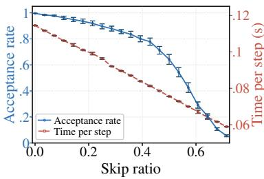  
(a) Acceptance rate and time.

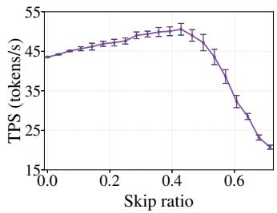  
(b) TPS.

  
(c) Optimal arm distribution.  
Figure 4: Average statistics across AIME25 prompts with COSSIM on Qwen2.5-VL-7B-Instruct. The horizontal axis is the fraction of skipped layers. (a) average acceptance rate and time per speculative decoding step. (b) Tokens per Second (TPS). (c) Percentage of prompts for which the arm at each skip ratio is oracle best, i.e., attains the highest measured TPS. Error bars in (a) and (b) show ±1 standard error (SE) for the corresponding metric.

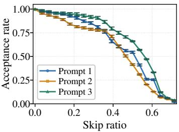  
(a) Acceptance rate.

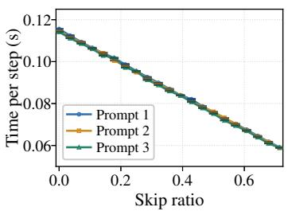  
(b) Time per step.

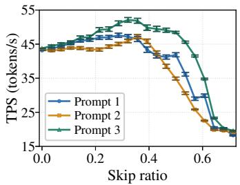  
(c) TPS.  
Figure 5: Prompt-level statistics for three randomly selected AIME25 prompts with COSSIM on Qwen2.5-VL-7B-Instruct. The figures are for (a) acceptance rate, (b) time per speculative decoding step, and (c) TPS, respectively. Colors identify the same prompts across all three figures. Error bars show ±1 SE specific to each prompt and metric at each skip ratio.

## H.1.2 LLaVA-NeXT-Mistral-7B

Figures 6 and 7 exhibit the same acceptance–time tradeoff on LLaVA-NeXT-Mistral-7B. Step time is linear, with small SEs relative to its magnitude; here acceptance drops slightly more rapidly.

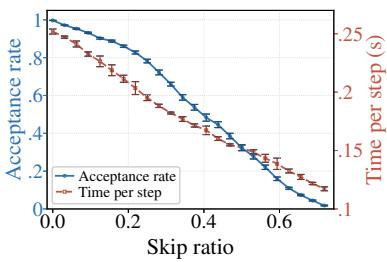  
(a) Acceptance rate and time.

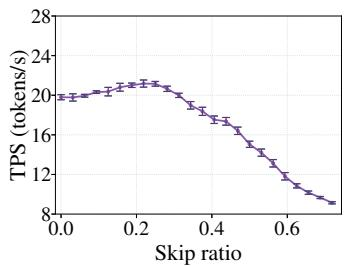  
(b) TPS.

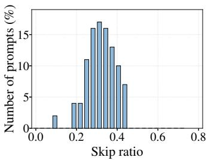  
(c) Optimal arm distribution.

Figure 6: Average statistics across Video-MME prompts with COSSIM on LLaVA-NeXT-Mistral-7B. The horizontal axis is the fraction of skipped layers. (a) average acceptance rate and time per speculative decoding step. (b) Tokens per Second (TPS). (c) Percentage of prompts for which the arm at each skip ratio is oracle best, i.e., attains the highest measured TPS. Error bars in (a) and (b) show ±1 standard error (SE) for the corresponding metric.  
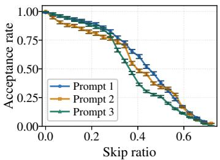  
(a) Acceptance rate.

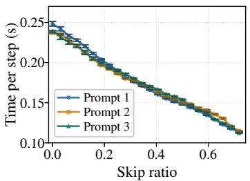  
(b) Time per step.

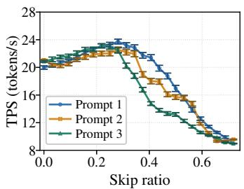  
(c) TPS.  
Figure 7: Prompt-level statistics for three randomly selected Video-MME prompts with COSSIM on LLaVA-NeXT-Mistral-7B. The figures are for (a) acceptance rate, (b) time per speculative decoding step, and (c) TPS, respectively. Colors identify the same prompts across all three figures. Error bars show ±1 SE specific to each prompt and metric at each skip ratio.

## H.2 SWIFT

## H.2.1 Qwen2.5-VL-7B-Instruct

The acceptance curve in Figure 8(a) has the same diminishing-return trend, but step time exhibits more local variation than for COSSIM. SWIFT obtains its layer ranking through random search and Bayesian optimization and skips attention and MLP layers independently. Because these layers have different execution costs, equal increments in skip ratio need not yield equal time savings; the changing mix of skipped layers can therefore explain some deviations from a straight line. Average TPS has a maximum near 0.23, with small local fluctuations around the overall single-peak trend.

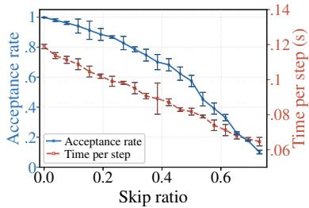  
(a) Acceptance rate and time.

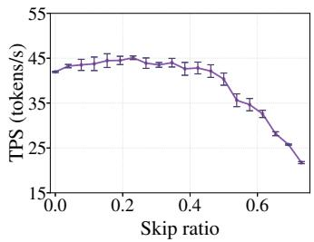  
(b) TPS.

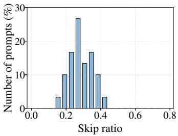  
(c) Optimal arm distribution.

Figure 8: Average statistics across AIME25 prompts with SWIFT on Qwen2.5-VL-7B-Instruct. The horizontal axis is the fraction of skipped layers. (a) average acceptance rate and time per speculative decoding step. (b) Tokens per Second (TPS). (c) Percentage of prompts for which the arm at each skip ratio is oracle best, i.e., attains the highest measured TPS. Error bars in (a) and (b) show ±1 standard error (SE) for the corresponding metric.  
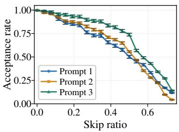  
(a) Acceptance rate.

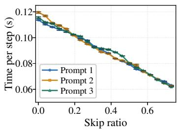  
(b) Time per step.

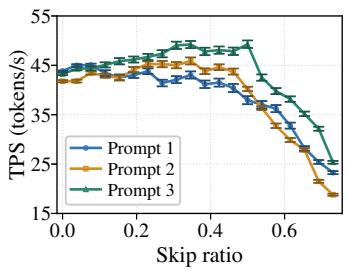  
(c) TPS.

Figure 9: Prompt-level statistics for three randomly selected AIME25 prompts with SWIFT on Qwen2.5-VL-7B-Instruct. The figures are for (a) acceptance rate, (b) time per speculative decoding step, and (c) TPS, respectively. Colors identify the same prompts across all three figures. Error bars show ±1 SE specific to each prompt and metric at each skip ratio.

## H.2.2 LLaVA-NeXT-Mistral-7B

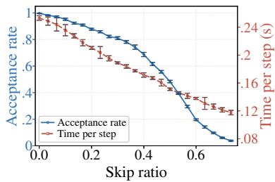  
(a) Acceptance rate and time.

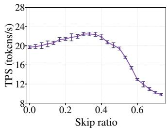  
(b) TPS.

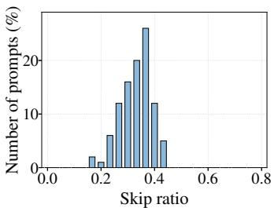  
(c) Optimal arm distribution.

Figure 10: Average statistics across Video-MME prompts with SWIFT on LLaVA-NeXT-Mistral-7B. The horizontal axis is the fraction of skipped layers. (a) average acceptance rate and time per speculative decoding step. (b) Tokens per Second (TPS). (c) Percentage of prompts for which the arm at each skip ratio is oracle best, i.e., attains the highest measured TPS. Error bars in (a) and (b) show ±1 standard error (SE) for the corresponding metric.  
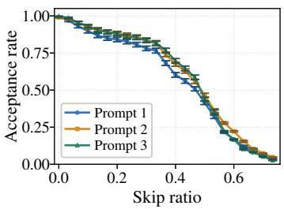  
(a) Acceptance rate.

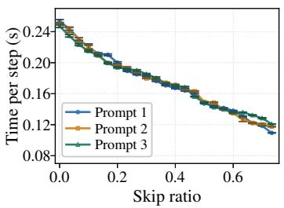  
(b) Time per step.

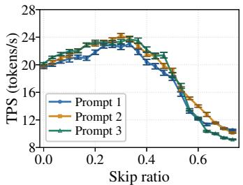  
(c) TPS.  
Figure 11: Prompt-level statistics for three randomly selected Video-MME prompts with SWIFT on LLaVA-NeXT-Mistral-7B. The figures are for (a) acceptance rate, (b) time per speculative decoding step, and (c) TPS, respectively. Colors identify the same prompts across all three figures. Error bars show ±1 SE specific to each prompt and metric at each skip ratio.

## H.3 KnapSpec

## H.3.1 Qwen2.5-VL-7B-Instruct

For KNAPSPEC, the budget skip ratio measures the normalized saved-latency budget used to construct a draft model. As described in Appendix G.2, attention and MLP layers have separate costs based on their profiled latencies, and skipping a layer contributes its discretized cost to this budget. A larger budget skip ratio therefore corresponds to a smaller retained-latency budget b and more aggressive computation reduction. Since layers have different costs, this ratio generally differs from the fraction of layers skipped.

In Figures 12 and 13, acceptance decreases particularly slowly at small budget skip ratios. This is consistent with KNAPSPEC’s effective selection of layers that preserve similarity to the target model’s hidden states under a latency budget. Step time is reasonably linear, as latency budget is designed to align with model decoding time. We remark that some small local timing deviations can arise from the differences between profiled layer costs and their execution costs as the context grows.

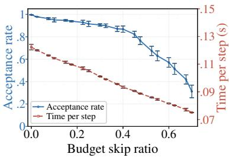  
(a) Acceptance rate and time.

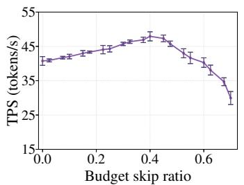  
(b) TPS.

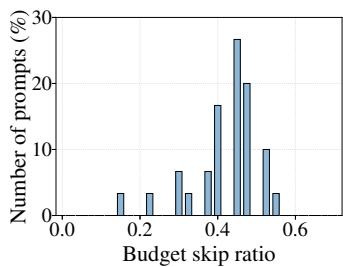  
(c) Optimal arm distribution.  
Figure 12: Average statistics across AIME25 prompts with KNAPSPEC on Qwen2.5-VL-7B-Instruct. The horizontal axis is the budget skip ratio. (a) average acceptance rate and time per speculative decoding step. (b) Tokens per Second (TPS). (c) Percentage of prompts for which the arm at each budget skip ratio is oracle best, i.e., attains the highest measured TPS. Error bars in (a) and (b) show ±1 standard error (SE) for the corresponding metric.

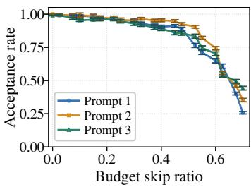  
(a) Acceptance rate.

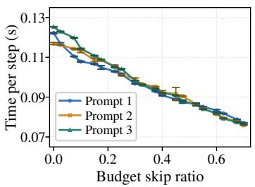  
(b) Time per step.

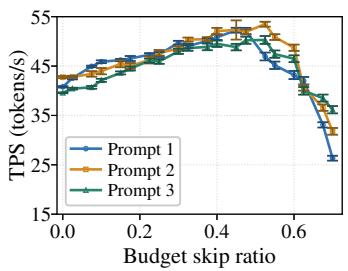  
(c) TPS.  
Figure 13: Prompt-level statistics for three randomly selected AIME25 prompts with KNAPSPEC on Qwen2.5-VL-7B-Instruct. The figures are for (a) acceptance rate, (b) time per speculative decoding step, and (c) TPS, respectively. Colors identify the same prompts across all three figures. Error bars show ±1 SE specific to each prompt and metric at each budget skip ratio.

## H.3.2 LLaVA-NeXT-Mistral-7B

Figures 14 and 15 show the same slow acceptance decline and approximately linear time reduction.

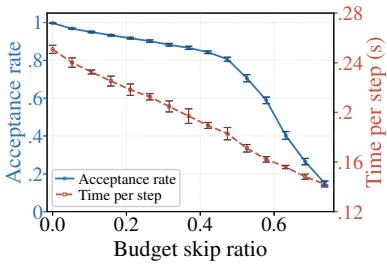  
(a) Acceptance rate and time.

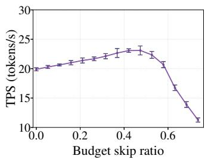  
(b) TPS.

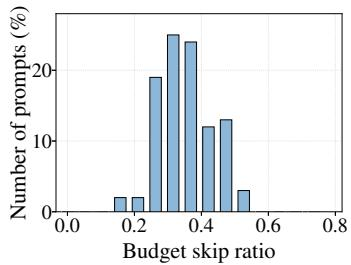  
(c) Optimal arm distribution.

Figure 14: Average statistics across Video-MME prompts with KNAPSPEC on LLaVA-NeXT-Mistral 7B. The horizontal axis is the budget skip ratio. (a) average acceptance rate and time per speculative decoding step. (b) Tokens per Second (TPS). (c) Percentage of prompts for which the arm at each budget skip ratio is oracle best, i.e., attains the highest measured TPS. Error bars in (a) and (b) show ±1 standard error (SE) for the corresponding metric.  
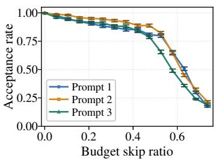  
(a) Acceptance rate.

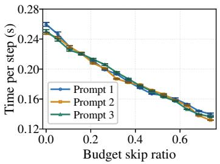  
(b) Time per step.

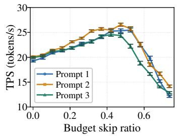  
(c) TPS.  
Figure 15: Prompt-level statistics for three randomly selected Video-MME prompts with KNAPSPEC on LLaVA-NeXT-Mistral-7B. The figures are for (a) acceptance rate, (b) time per speculative decoding step, and (c) TPS, respectively. Colors identify the same prompts across all three figures. Error bars show ±1 SE specific to each prompt and metric at each budget ratio.

## H.4 SpecVLM

## H.4.1 Qwen2.5-VL-7B-Instruct

SPECVLM varies visual-token pruning rather than layer skipping. Figures 16 and 17 show that acceptance decreases slowly over most of this range, remaining around 0.90 on average even at 80% pruning. This is consistent with retaining highly attended visual tokens and preserving spatial coverage.

Step time decreases approximately linearly at first and flattens slightly at high pruning ratios. This is because un-pruned language-prompt tokens, generated history, and full-context target verification remain, limiting the total time savings as visual attention becomes a smaller part of the workload.

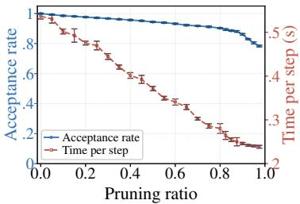  
(a) Acceptance rate and time.

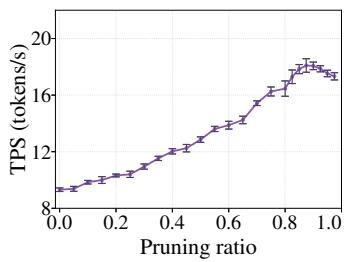  
(b) TPS.

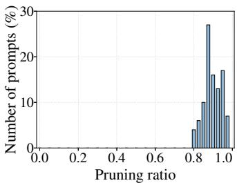  
(c) Optimal arm distribution.

Figure 16: Average statistics across Video-MME prompts with SPECVLM on Qwen2.5-VL-7B-Instruct. The horizontal axis in (c) is the pruning ratio. (a) average acceptance rate and time per speculative decoding step. (b) Tokens per Second (TPS). (c) Percentage of prompts for which the arm at each pruning ratio is oracle best, i.e., attains the highest measured TPS. Error bars in (a) and (b) show ±1 standard error (SE) for the corresponding metric.  
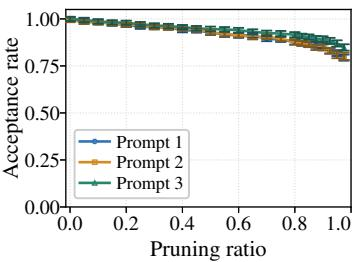  
(a) Acceptance rate.

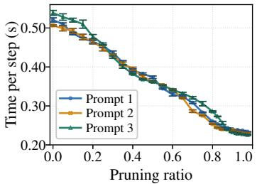  
(b) Time per step.

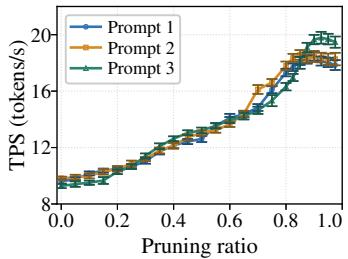  
(c) TPS.  
Figure 17: Prompt-level statistics for three randomly selected Video-MME prompts with SPECVLM on Qwen2.5-VL-7B-Instruct. The figures are for (a) acceptance rate, (b) time per speculative decoding step, and (c) TPS, respectively. Colors identify the same prompts across all three figures. Error bars show ±1 SE specific to each prompt and metric at each pruning ratio.

## H.4.2 LLaVA-NeXT-Mistral-7B

The LLaVA results in Figures 18 and 19 show the same slow acceptance decline and diminishing time savings at high pruning ratios. At 80% pruning, average acceptance remains approximately 0.88, and the average TPS also peaks near 0.88 pruning. Both models therefore attain their best average throughput while retaining only a small fraction of visual tokens.

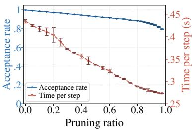  
(a) Acceptance rate and time.

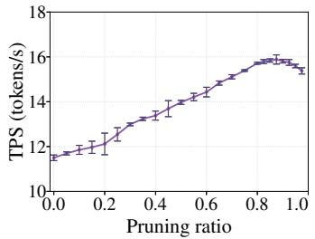  
(b) TPS.

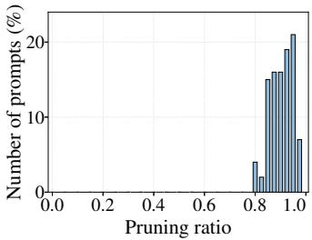  
(c) Optimal arm distribution.  
Figure 18: Average statistics across Video-MME prompts with SPECVLM on LLaVA-NeXT-Mistral 7B. The horizontal axis is the pruning ratio. (a) average acceptance rate and time per speculative decoding step. (b) Tokens per Second (TPS). (c) Percentage of prompts for which the arm at each pruning ratio is oracle best, i.e., attains the highest measured TPS. Error bars in (a) and (b) show ±1 standard error (SE) for the corresponding metric.

  
(a) Acceptance rate.

  
(b) Time per step.

  
(c) TPS.  
Figure 19: Prompt-level statistics for three randomly selected Video-MME prompts with SPECVLM on LLaVA-NeXT-Mistral-7B. The figures are for (a) acceptance rate, (b) time per speculative decoding step, and (c) TPS, respectively. Colors identify the same prompts across all three figures. Error bars show ±1 SE specific to each prompt and metric at each pruning ratio.

## I Ablation Studies

This appendix evaluates the robustness of $\mathrm { S P ^ { 2 } E C }$ to different generation settings. Subsection I.1 examines the effect of draft length on decoding speedup. Subsection I.2 studies how output length affects the amortization of construction and exploration costs. Subsection I.3 evaluates sensitivity to the number of visual input tokens. Subsection I.4 compares periodic resets of the arm-pull and reward history with resetting only between prompts.

## I.1 Draft Length

Figures 20 and 21 examine the effect of draft length L on average speedup. Increasing L has two opposing effects: a longer draft allows the verifier to accept more tokens in one speculative round, but requires more sequential draft forward passes, increases verification cost, and wastes more computation when an early draft token is rejected. Across both models, $L = 4 – 6$ provides a good practical balance: all three constructions with $\mathrm { S P ^ { 2 } }$ EC remain within 5% of their respective highest measured speedups throughout this range. The exact optimum varies across constructions and models, while the shorter and longer drafts tested generally perform worse. These results support $L = 4$ as a robust default.

  
(a) COSSIM.

  
(b) KNAPSPEC.

  
(c) SPECVLM.

Figure 20: Effect of draft length on average speedup with Qwen2.5-VL-7B-Instruct. The panels compare UCBSpec and $\mathrm { S P ^ { 2 } E C }$ applied to (a) COSSIM, (b) KNAPSPEC, and (c) SPECVLM. The original methods are also shown for KNAPSPEC and SPECVLM. Speedup is normalized to autoregressive decoding, indicated by the dashed horizontal line at 1×.  
  
(a) COSSIM.

  
(b) KNAPSPEC.

  
(c) SPECVLM.  
Figure 21: Effect of draft length on average speedup with LLaVA-NeXT-Mistral-7B. The panels compare UCBSpec and $\mathrm { S P ^ { 2 } E C }$ applied to (a) COSSIM, (b) KNAPSPEC, and (c) SPECVLM. The original methods are also shown for KNAPSPEC and SPECVLM. Speedup is normalized to autoregressive decoding, indicated by the dashed horizontal line at 1×.

## I.2 Output Length

We modify the input prompts to elicit longer responses and evaluate output lengths from 256 to 8192 tokens in Figures 22 and 23. Speedup generally improves with a longer generation horizon, as it amortizes prompt-level arm-construction, warm-up, and initial exploration costs. A longer horizon also allows more decoding steps to use well-performing arms after initial exploration. Nevertheless, all six model–construction combinations with $\mathrm { S P ^ { 2 } E C }$ can provide considerable speedups even at 256 tokens.

Forcing unnaturally long outputs can produce repetitive, simpler continuations, changing the workload and limiting how representative their speedups are of natural task responses. In the main experiments, outputs are typically around 1000–2000 tokens on the video and image datasets and below 10,000 tokens on AIME25. We therefore do not treat the longest forced outputs as the primary performance measure.

  
(a) COSSIM.

  
(b) KNAPSPEC.

  
(c) SPECVLM.

Figure 22: Effect of output length on average speedup with Qwen2.5-VL-7B-Instruct. The panels compare UCBSpec and $\mathrm { \bar { S } P ^ { 2 } E C }$ applied to (a) COSSIM, (b) KNAPSPEC, and (c) SPECVLM. The original methods are also shown for KNAPSPEC and SPECVLM. The horizontal axis shows output length in tokens on a base-2 logarithmic scale, with 1k = 1024. Speedup is normalized to autoregressive decoding, indicated by the dashed horizontal line at 1×.  
  
(a) COSSIM.

  
(b) KNAPSPEC.

  
(c) SPECVLM.  
Figure 23: Effect of output length on average speedup with LLaVA-NeXT-Mistral-7B. The panels compare UCBSpec and $\mathrm { \bar { S } P ^ { 2 } E C }$ applied to (a) COSSIM, (b) KNAPSPEC, and (c) SPECVLM. The orig inal methods are also shown for KNAPSPEC and SPECVLM. The horizontal axis shows output length in tokens on a base-2 logarithmic scale, with 1k = 1024. Speedup is normalized to autoregressive decoding, indicated by the dashed horizontal line at 1×.

## I.3 Input Size

Figures 24 and 25 vary the visual input size. The layer-skipping constructions, COSSIM and KNAP-SPEC, show relatively stable speedups over the tested ranges.

SPECVLM is substantially more sensitive to the input size because it reduces draft computation by pruning visual tokens. Larger visual inputs provide more computation to remove, whereas short visual inputs leave limited savings to offset drafting and verification costs. In our experiments, it requires 8000 visual tokens to be able to exceed baseline autoregressive speed.

  
(a) COSSIM.

  
(b) KNAPSPEC.

  
(c) SPECVLM.

Figure 24: Effect of input size on average speedup with Qwen2.5-VL-7B-Instruct. The panels compare UCBSpec and $\mathrm { \bar { s } P ^ { 2 } E C }$ applied to (a) COSSIM, (b) KNAPSPEC, and (c) SPECVLM. The original methods are also shown for KNAPSPEC and SPECVLM. The horizontal axis shows the visual token budget on a base-2 logarithmic scale, with 1k = 1024 tokens. Speedup is normalized to autoregressive decoding, indicated by the dashed horizontal line at 1×. AIME25 is excluded when running this comparison.  
  
(a) COSSIM.

  
(b) KNAPSPEC.

  
(c) SPECVLM.  
Figure 25: Effect of input size on average speedup with LLaVA-NeXT-Mistral-7B. The panels compare UCBSpec and $\mathrm { \Delta S P ^ { 2 } E C }$ applied to (a) COSSIM, (b) KNAPSPEC, and (c) SPECVLM. The original methods are also shown for KNAPSPEC and SPECVLM. The horizontal axis shows the mean number of input video tokens on a base-2 logarithmic scale, with $1 \mathrm { k } = 1 0 0 0$ tokens. Speedup is normalized to autoregressive decoding, indicated by the dashed horizontal line at 1×.

<table><tr><td>Model</td><td>Method</td><td>Average SU Reset every 512 speculative steps</td><td>Average SU No within-prompt reset</td></tr><tr><td rowspan="4">Qwen2.5-VL-7B-Instruct</td><td> $\mathrm { C O S S I M } + \mathrm { S P ^ { 2 } E C }$ </td><td>1.26</td><td>1.25</td></tr><tr><td> $\mathrm { S W I F T } + \mathrm { S P ^ { 2 } E C }$ </td><td>1.22</td><td>1.22</td></tr><tr><td> $\mathrm { K N A P S P E C } + \mathrm { S P ^ { 2 } E C }$ </td><td>1.35</td><td>1.31</td></tr><tr><td> $\mathrm { S P E C V L M } + \mathrm { S P ^ { 2 } E C }$ </td><td>1.56</td><td>1.55</td></tr><tr><td rowspan="4">LLaVA-NeXT-Mistral-7B</td><td> $\mathrm { C O S S I M } + \mathrm { S P } ^ { \mathrm { 2 } } \mathrm { E C }$ </td><td>1.29</td><td>1.27</td></tr><tr><td> $\mathrm { S W I F T } + \mathrm { S P } ^ { 2 } \mathrm { E C }$ </td><td>1.25</td><td>1.24</td></tr><tr><td> $\mathrm { K N A P S P E C } + \mathrm { S P ^ { 2 } E C }$ </td><td>1.31</td><td>1.28</td></tr><tr><td> $\mathrm { S P E C V L M } + \mathrm { S P ^ { 2 } E C }$ </td><td>1.45</td><td>1.45</td></tr></table>

Table 3: Average speedup (SU) with and without within-prompt resets. The periodic-reset variant clears the online arm-pull and reward history every 512 speculative decoding steps, whereas the no-reset variant resets only when a new prompt starts.

## I.4 Decoding Length and Resetting

As generation proceeds, the growing context can change drafting and verification latency, challenging the fixed-context approximation used in Assumption 3.3. To satisfy this assumption, by default, $\mathrm { S P ^ { 2 } E C }$ clears its online arm-pull and reward history every 512 speculative decoding steps. To examine the effect of periodic resetting, we compare this default with an ablation that resets only between prompts and retains the online history throughout each generation. Resetting allows the optimizer to adapt to new contexts and latency, but also discards useful evidence and requires renewed exploration.

Table 3 shows that periodic resetting improves average speedup marginally, by at most 0.04× across the eight model–construction combinations. These close results suggest that $\mathrm { \Delta \mathrm { \stackrel { . } { { s } } P ^ { 2 } E C } }$ is robust to the within-prompt changes in the time-cost function induced by increasing context length.

## J Extra Results

This section provides some extra experimental results, on run time breakdown (J.1), comparison with EAGLE3 (J.2) and extra experiment results for COSSIM (J.3).

## J.1 Runtime Breakdown

Figures 26 and 27 report the time spent on drafting, verification (including prefill), and optimization and miscellaneous overhead for each method. The plotted fractions describe time allocation; they should be interpreted together with the speedup results, since a larger fraction does not necessarily imply a larger absolute cost.

For COSSIM with $\mathrm { S P ^ { 2 } E C , }$ the recorded optimization and miscellaneous overhead occupies only 0.76%–0.89% of generation time, smaller than that of KNAPSPEC, showing that our COSSIM is efficient to build.

Most importantly, the results show that $\mathrm { S P ^ { 2 } E C }$ targets overall token throughput rather than minimizing drafting or verification cost individually. For COSSIM and KNAPSPEC, verification occupies a larger fraction of runtime under $\mathrm { S P ^ { 2 } E C }$ , while the drafting fraction decreases. Here, drafting-time savings outweigh additional verification costs. Whereas for SpecVLM, reduced verification and prefill costs contribute more substantially to the speedup. These different patterns reflect different sources of computational savings across draft-model construction methods.

## J.2 Comparison with EAGLE3

We compare COSSIM and KNAPSPEC with $\mathrm { S P ^ { 2 } }$ EC against EAGLE3 [Li et al., 2025c] on MVBench [Li et al., 2024a], with Qwen3-VL-4B-Instruct [Bai et al., 2025a]. For EAGLE3, we use

  
+!

( 0+ +!,,+1!(2)+  
  
-+

Figure 26: Runtime breakdown on Qwen2.5-VL-7B-Instruct with (a) COSSIM and (b) KNAPSPEC. Each dataset compares the baseline (left) with $\mathrm { S P ^ { 2 } E C }$ (right). The baseline is UCBSPEC for COSSIM and the original method for KNAPSPEC. Numbers indicate percentages of recorded generation time.  
  
Figure 27: Runtime breakdown for SPECVLM on Qwen2.5-VL-7B-Instruct. Each dataset compares original SPECVLM (left) with SPECVLM augmented by $\mathrm { S P ^ { 2 } E C }$ (right). Numbers indicate percentages of recorded generation time.

AngelSlim’s publicly released Qwen3-VL-4B-Instruct\_eagle3 draft-model checkpoint [Contributors, 2025].

Compared with EAGLE3, SP<sup>2</sup>EC is training-free: it does not require training or storing an auxiliary draft model, and it avoids dependence on the alignment between the draft model’s training distribution and the test-time prompt distribution. Empirically, results for EAGLE3 also suggest that small draft models can be weak when the prompt contains mixed visual and textual context. In vision-language tasks, prefilling and verification occupy a larger fraction of each speculative round, so the small number of valid draft tokens produced by a weak drafter cannot amortize these extra costs. In contrast, $\mathrm { S P ^ { 2 } }$ EC obtains the draft model directly by skipping layers of the target model, which keeps the drafter better aligned with the target under visual and contextual distribution shifts. As shown in Table 4, COSSIM and KNAPSPEC with $\mathrm { S P ^ { 2 } E C }$ achieve MATs of 4.5 and 4.6 and speedups of 1.31× and 1.27×, respectively, compared with a MAT of 1.9 and a speedup of 1.20× for EAGLE3.

<table><tr><td>Method</td><td>Training-free</td><td>MAT ↑</td><td>SU↑</td></tr><tr><td> $\mathrm { C O S S I M } + \mathrm { S P ^ { 2 } E C }$ </td><td>Yes</td><td>4.5</td><td>1.31×</td></tr><tr><td> $\mathrm { K N A P S P E C } + \mathrm { S P ^ { 2 } E C }$ </td><td>Yes</td><td>4.6</td><td>1.27×</td></tr><tr><td>EAGLE3</td><td>No</td><td>1.9</td><td>1.20×</td></tr></table>

Table 4: Comparison with EAGLE3 on MVBench. MAT denotes mean accepted tokens, including one verification bonus token; SU denotes speedup over vanilla autoregressive decoding. Training-free indicates that no auxiliary draft-model training is required.

Table 5: Additional results on Qwen3-VL-4B-Instruct. MAT denotes mean accepted tokens, and SU denotes speedup over vanilla autoregressive decoding. Bold marks the higher speedup.
<table><tr><td rowspan="2">Method</td><td colspan="2">Video-MME</td><td colspan="2">MMBench-Video</td><td colspan="2">ARKitScenes</td><td colspan="2">WritingBench</td><td colspan="2">Average</td></tr><tr><td>MAT ↑</td><td>SU↑</td><td>MAT ↑</td><td>SU↑</td><td>MAT↑</td><td>SU↑</td><td>MAT↑</td><td>SU↑</td><td>MAT↑</td><td>SU↑</td></tr><tr><td> $\mathrm { C O S S I M + U C B S P E C }$ </td><td>3.98</td><td>1.13×</td><td>3.64</td><td>1.10×</td><td>3.50</td><td>1.09×</td><td>3.65</td><td>1.08×</td><td>3.69</td><td>1.10×</td></tr><tr><td> $\mathrm { C O S S I M + S P ^ { 2 } E C }$ </td><td>3.88</td><td>1.22×</td><td>3.57</td><td>1.21×</td><td>3.33</td><td>1.16×</td><td>3.69</td><td>1.17×</td><td>3.62</td><td>1.19×</td></tr></table>

## J.3 Extra Experiment Results for COSSIM + SP<sup>2</sup>EC

Tables 5 and 6 report additional results with COSSIM on Qwen3-VL-4B-Instruct and LLaVA-1.5-7B. $\mathrm { S P ^ { 2 } }$ EC outperforms UCBSPEC in speedups on all four benchmarks for both models, attaining average speedups of 1.19× and 1.18×, respectively.

Table 6: Additional results on LLaVA-1.5-7B. MAT denotes mean accepted tokens, and SU denotes speedup over vanilla autoregressive decoding. Bold marks the higher speedup.
<table><tr><td rowspan="2">Method</td><td colspan="2">Video-MME</td><td colspan="2">MMBench-Video</td><td colspan="2">ARKitScenes</td><td colspan="2">WritingBench</td><td colspan="2">Average</td></tr><tr><td>MAT↑</td><td>SU↑</td><td>MAT ↑</td><td>SU↑</td><td>MAT↑</td><td>SU↑</td><td>MAT↑</td><td>SU↑</td><td>MAT↑</td><td>SU↑</td></tr><tr><td>COSSIM + UCBSPEC</td><td>4.23</td><td>1.16×</td><td>3.35</td><td>1.10×</td><td>3.40</td><td>1.16×</td><td>3.64</td><td>1.06×</td><td>3.66</td><td>1.12×</td></tr><tr><td>COSSIM + SP²EC</td><td>4.19</td><td>1.24×</td><td>3.36</td><td>1.17×</td><td>3.43</td><td>1.21×</td><td>3.65</td><td>1.10×</td><td>3.66</td><td>1.18×</td></tr></table>

## NeurIPS Paper Checklist

## 1. Claims

Question: Do the main claims made in the abstract and introduction accurately reflect the paper’s contributions and scope?

Answer: [Yes]

Justification: The claims made in the abstract and introduction are consistent with the contributions presented in the paper. They accurately reflect the theoretical and empirical findings, remain within the demonstrated scope, and acknowledge relevant assumptions and limitations.

Guidelines:

• The answer [N/A] means that the abstract and introduction do not include the claims made in the paper.

• The abstract and/or introduction should clearly state the claims made, including the contributions made in the paper and important assumptions and limitations. A [No] or [N/A] answer to this question will not be perceived well by the reviewers.

• The claims made should match theoretical and experimental results, and reflect how much the results can be expected to generalize to other settings.

• It is fine to include aspirational goals as motivation as long as it is clear that these goals are not attained by the paper.

## 2. Limitations

Question: Does the paper discuss the limitations of the work performed by the authors? Answer: [Yes]

Justification: We provide a discussion of limitations in the conclusion.

Guidelines:

• The answer [N/A] means that the paper has no limitation while the answer [No] means that the paper has limitations, but those are not discussed in the paper.

• The authors are encouraged to create a separate “Limitations” section in their paper.

• The paper should point out any strong assumptions and how robust the results are to violations of these assumptions (e.g., independence assumptions, noiseless settings, model well-specification, asymptotic approximations only holding locally). The authors should reflect on how these assumptions might be violated in practice and what the implications would be.

• The authors should reflect on the scope of the claims made, e.g., if the approach was only tested on a few datasets or with a few runs. In general, empirical results often depend on implicit assumptions, which should be articulated.

• The authors should reflect on the factors that influence the performance of the approach. For example, a facial recognition algorithm may perform poorly when image resolution is low or images are taken in low lighting. Or a speech-to-text system might not be used reliably to provide closed captions for online lectures because it fails to handle technical jargon.

• The authors should discuss the computational efficiency of the proposed algorithms and how they scale with dataset size.

• If applicable, the authors should discuss possible limitations of their approach to address problems of privacy and fairness.

• While the authors might fear that complete honesty about limitations might be used by reviewers as grounds for rejection, a worse outcome might be that reviewers discover limitations that aren’t acknowledged in the paper. The authors should use their best judgment and recognize that individual actions in favor of transparency play an important role in developing norms that preserve the integrity of the community. Reviewers will be specifically instructed to not penalize honesty concerning limitations.

## 3. Theory assumptions and proofs

Question: For each theoretical result, does the paper provide the full set of assumptions and a complete (and correct) proof?

Answer: [Yes]

Justification: Assumptions and correct proofs are provided, either in the main text or the appendix.

Guidelines:

• The answer [N/A] means that the paper does not include theoretical results.

• All the theorems, formulas, and proofs in the paper should be numbered and crossreferenced.

• All assumptions should be clearly stated or referenced in the statement of any theorems.

• The proofs can either appear in the main paper or the supplemental material, but if they appear in the supplemental material, the authors are encouraged to provide a short proof sketch to provide intuition.

• Inversely, any informal proof provided in the core of the paper should be complemented by formal proofs provided in appendix or supplemental material.

• Theorems and Lemmas that the proof relies upon should be properly referenced.

## 4. Experimental result reproducibility

Question: Does the paper fully disclose all the information needed to reproduce the main experimental results of the paper to the extent that it affects the main claims and/or conclusions of the paper (regardless of whether the code and data are provided or not)?

Answer: [Yes]

Justification: The paper provides complete details on architecture, test setup, and experimental configurations, enabling reproduction of the main results and supporting the core claims.

## Guidelines:

• The answer [N/A] means that the paper does not include experiments.

• If the paper includes experiments, a [No] answer to this question will not be perceived well by the reviewers: Making the paper reproducible is important, regardless of whether the code and data are provided or not.

• If the contribution is a dataset and/or model, the authors should describe the steps taken to make their results reproducible or verifiable.

• Depending on the contribution, reproducibility can be accomplished in various ways. For example, if the contribution is a novel architecture, describing the architecture fully might suffice, or if the contribution is a specific model and empirical evaluation, it may be necessary to either make it possible for others to replicate the model with the same dataset, or provide access to the model. In general. releasing code and data is often one good way to accomplish this, but reproducibility can also be provided via detailed instructions for how to replicate the results, access to a hosted model (e.g., in the case of a large language model), releasing of a model checkpoint, or other means that are appropriate to the research performed.

• While NeurIPS does not require releasing code, the conference does require all submissions to provide some reasonable avenue for reproducibility, which may depend on the nature of the contribution. For example

(a) If the contribution is primarily a new algorithm, the paper should make it clear how to reproduce that algorithm.

(b) If the contribution is primarily a new model architecture, the paper should describe the architecture clearly and fully.

(c) If the contribution is a new model (e.g., a large language model), then there should either be a way to access this model for reproducing the results or a way to reproduce the model (e.g., with an open-source dataset or instructions for how to construct the dataset).

(d) We recognize that reproducibility may be tricky in some cases, in which case authors are welcome to describe the particular way they provide for reproducibility. In the case of closed-source models, it may be that access to the model is limited in some way (e.g., to registered users), but it should be possible for other researchers to have some path to reproducing or verifying the results.

## 5. Open access to data and code

Question: Does the paper provide open access to the data and code, with sufficient instructions to faithfully reproduce the main experimental results, as described in supplemental material?

Answer: [Yes]

Justification: The paper provides detailed descriptions of each experiment, and a link to the code is included in the experiment section.

Guidelines:

• The answer [N/A] means that paper does not include experiments requiring code.

• Please see the NeurIPS code and data submission guidelines (https://neurips.cc/ public/guides/CodeSubmissionPolicy) for more details.

• While we encourage the release of code and data, we understand that this might not be possible, so [No] is an acceptable answer. Papers cannot be rejected simply for not including code, unless this is central to the contribution (e.g., for a new open-source benchmark).

• The instructions should contain the exact command and environment needed to run to reproduce the results. See the NeurIPS code and data submission guidelines (https: //neurips.cc/public/guides/CodeSubmissionPolicy) for more details.

• The authors should provide instructions on data access and preparation, including how to access the raw data, preprocessed data, intermediate data, and generated data, etc.

• The authors should provide scripts to reproduce all experimental results for the new proposed method and baselines. If only a subset of experiments are reproducible, they should state which ones are omitted from the script and why.

• At submission time, to preserve anonymity, the authors should release anonymized versions (if applicable).

• Providing as much information as possible in supplemental material (appended to the paper) is recommended, but including URLs to data and code is permitted.

## 6. Experimental setting/details

Question: Does the paper specify all the training and test details (e.g., data splits, hyperparameters, how they were chosen, type of optimizer) necessary to understand the results?

Answer: [Yes]

Justification: The paper provides test and evaluation details, either in the main text or appendix.

Guidelines:

• The answer [N/A] means that the paper does not include experiments.

• The experimental setting should be presented in the core of the paper to a level of detail that is necessary to appreciate the results and make sense of them.

• The full details can be provided either with the code, in appendix, or as supplemental material.

## 7. Experiment statistical significance

Question: Does the paper report error bars suitably and correctly defined or other appropriate information about the statistical significance of the experiments?

Answer: [Yes]

Justification: We reported error bars.

## Guidelines:

• The answer [N/A] means that the paper does not include experiments.

• The authors should answer [Yes] if the results are accompanied by error bars, confidence intervals, or statistical significance tests, at least for the experiments that support the main claims of the paper.

• The factors of variability that the error bars are capturing should be clearly stated (for example, train/test split, initialization, random drawing of some parameter, or overall run with given experimental conditions).

• The method for calculating the error bars should be explained (closed form formula, call to a library function, bootstrap, etc.)

• The assumptions made should be given (e.g., Normally distributed errors).

• It should be clear whether the error bar is the standard deviation or the standard error of the mean.

• It is OK to report 1-sigma error bars, but one should state it. The authors should preferably report a 2-sigma error bar than state that they have a 96% CI, if the hypothesis of Normality of errors is not verified.

• For asymmetric distributions, the authors should be careful not to show in tables or figures symmetric error bars that would yield results that are out of range (e.g., negative error rates).

• If error bars are reported in tables or plots, the authors should explain in the text how they were calculated and reference the corresponding figures or tables in the text.

## 8. Experiments compute resources

Question: For each experiment, does the paper provide sufficient information on the computer resources (type of compute workers, memory, time of execution) needed to reproduce the experiments?

Answer: [Yes]

Justification: Mentioned in appendix.

Guidelines:

• The answer [N/A] means that the paper does not include experiments.

• The paper should indicate the type of compute workers CPU or GPU, internal cluster, or cloud provider, including relevant memory and storage.

• The paper should provide the amount of compute required for each of the individual experimental runs as well as estimate the total compute.

• The paper should disclose whether the full research project required more compute than the experiments reported in the paper (e.g., preliminary or failed experiments that didn’t make it into the paper).

## 9. Code of ethics

Question: Does the research conducted in the paper conform, in every respect, with the NeurIPS Code of Ethics https://neurips.cc/public/EthicsGuidelines?

Answer: [Yes]

Justification: The research complies with the NeurIPS Code of Ethics, with no involvement of sensitive data, human subjects, or foreseeable risks. Ethical standards are upheld throughout.

Guidelines:

• The answer [N/A] means that the authors have not reviewed the NeurIPS Code of Ethics.

• If the authors answer [No], they should explain the special circumstances that require a deviation from the Code of Ethics.

• The authors should make sure to preserve anonymity (e.g., if there is a special consideration due to laws or regulations in their jurisdiction).

## 10. Broader impacts

Question: Does the paper discuss both potential positive societal impacts and negative societal impacts of the work performed?

Answer: [N/A]

Justification: The paper focuses on theoretical analysis and verification of proposed method, and the authors believe it does not pose any societal impact, either positive or negative.

Guidelines:

• The answer [N/A] means that there is no societal impact of the work performed.

• If the authors answer [N/A] or [No], they should explain why their work has no societal impact or why the paper does not address societal impact.

• Examples of negative societal impacts include potential malicious or unintended uses (e.g., disinformation, generating fake profiles, surveillance), fairness considerations (e.g., deployment of technologies that could make decisions that unfairly impact specific groups), privacy considerations, and security considerations.

• The conference expects that many papers will be foundational research and not tied to particular applications, let alone deployments. However, if there is a direct path to any negative applications, the authors should point it out. For example, it is legitimate to point out that an improvement in the quality of generative models could be used to generate Deepfakes for disinformation. On the other hand, it is not needed to point out that a generic algorithm for optimizing neural networks could enable people to train models that generate Deepfakes faster.

• The authors should consider possible harms that could arise when the technology is being used as intended and functioning correctly, harms that could arise when the technology is being used as intended but gives incorrect results, and harms following from (intentional or unintentional) misuse of the technology.

• If there are negative societal impacts, the authors could also discuss possible mitigation strategies (e.g., gated release of models, providing defenses in addition to attacks, mechanisms for monitoring misuse, mechanisms to monitor how a system learns from feedback over time, improving the efficiency and accessibility of ML).

## 11. Safeguards

Question: Does the paper describe safeguards that have been put in place for responsible release of data or models that have a high risk for misuse (e.g., pre-trained language models, image generators, or scraped datasets)?

Answer: [N/A]

Justification: No such data or models are released, and the described methods do not pose risks of malicious use.

Guidelines:

• The answer [N/A] means that the paper poses no such risks.

• Released models that have a high risk for misuse or dual-use should be released with necessary safeguards to allow for controlled use of the model, for example by requiring that users adhere to usage guidelines or restrictions to access the model or implementing safety filters.

• Datasets that have been scraped from the Internet could pose safety risks. The authors should describe how they avoided releasing unsafe images.

• We recognize that providing effective safeguards is challenging, and many papers do not require this, but we encourage authors to take this into account and make a best faith effort.

## 12. Licenses for existing assets

Question: Are the creators or original owners of assets (e.g., code, data, models), used in the paper, properly credited and are the license and terms of use explicitly mentioned and properly respected?

Answer: [Yes]

Justification: We use standard and open sourced libraries under permissive licenses.

Guidelines:

• The answer [N/A] means that the paper does not use existing assets.

• The authors should cite the original paper that produced the code package or dataset.

• The authors should state which version of the asset is used and, if possible, include a URL.

• The name of the license (e.g., CC-BY 4.0) should be included for each asset.

• For scraped data from a particular source (e.g., website), the copyright and terms of service of that source should be provided.

• If assets are released, the license, copyright information, and terms of use in the package should be provided. For popular datasets, paperswithcode.com/datasets has curated licenses for some datasets. Their licensing guide can help determine the license of a dataset.

• For existing datasets that are re-packaged, both the original license and the license of the derived asset (if it has changed) should be provided.

• If this information is not available online, the authors are encouraged to reach out to the asset’s creators.

## 13. New assets

Question: Are new assets introduced in the paper well documented and is the documentation provided alongside the assets?

Answer: [Yes]

Justification: Link to new code is provided.

Guidelines:

• The answer [N/A] means that the paper does not release new assets.

• Researchers should communicate the details of the dataset/code/model as part of their submissions via structured templates. This includes details about training, license, limitations, etc.

• The paper should discuss whether and how consent was obtained from people whose asset is used.

• At submission time, remember to anonymize your assets (if applicable). You can either create an anonymized URL or include an anonymized zip file.

## 14. Crowdsourcing and research with human subjects

Question: For crowdsourcing experiments and research with human subjects, does the paper include the full text of instructions given to participants and screenshots, if applicable, as well as details about compensation (if any)?

Answer: [N/A]

Justification: No crowdsourcing or human subjects are involved in this paper.

Guidelines:

• The answer [N/A] means that the paper does not involve crowdsourcing nor research with human subjects.

• Including this information in the supplemental material is fine, but if the main contribution of the paper involves human subjects, then as much detail as possible should be included in the main paper.

• According to the NeurIPS Code of Ethics, workers involved in data collection, curation, or other labor should be paid at least the minimum wage in the country of the data collector.

## 15. Institutional review board (IRB) approvals or equivalent for research with human subjects

Question: Does the paper describe potential risks incurred by study participants, whether such risks were disclosed to the subjects, and whether Institutional Review Board (IRB) approvals (or an equivalent approval/review based on the requirements of your country or institution) were obtained?

Answer: [N/A]

Justification: No human subjects are involved in this paper.

Guidelines:

• The answer [N/A] means that the paper does not involve crowdsourcing nor research with human subjects.

• Depending on the country in which research is conducted, IRB approval (or equivalent) may be required for any human subjects research. If you obtained IRB approval, you should clearly state this in the paper.

• We recognize that the procedures for this may vary significantly between institutions and locations, and we expect authors to adhere to the NeurIPS Code of Ethics and the guidelines for their institution.

• For initial submissions, do not include any information that would break anonymity (if applicable), such as the institution conducting the review.

## 16. Declaration of LLM usage

Question: Does the paper describe the usage of LLMs if it is an important, original, or non-standard component of the core methods in this research? Note that if the LLM is used only for writing, editing, or formatting purposes and does not impact the core methodology, scientific rigor, or originality of the research, declaration is not required.

Answer: [N/A]

Justification: The LLM is only used for grammar checking, editing and formatting purposes. Guidelines:

• The answer [N/A] means that the core method development in this research does not involve LLMs as any important, original, or non-standard components.

• Please refer to our LLM policy in the NeurIPS handbook for what should or should not be described.