# STABLE–PLASTIC SUBSPACE CONSTRUCTION FOR DIFFERENTIALLY PRIVATE CONTINUAL LORA

Jin Liu 1 Ning Xi1 Yinbin Miao1 Junkang Liu2 Ke Cheng1 Jianfeng Ma1

1 Xidian University 2 Tianjin University

## ABSTRACT

Continual learning (CL) adapts pretrained models to a sequence of tasks while retaining knowledge acquired from earlier tasks. When task data are sensitive, differential privacy (DP) provides record-level protection, but maintaining both adaptation and retention under privacy constraints remains challenging. We study this problem in continual low-rank adaptation (LoRA) and observe that: 1) private training increases forgetting primarily during subsequent adaptation rather than initial task acquisition; 2) jointly perturbing both LoRA factors introduces a nonnegligible bilinear noise interaction; and 3) DP aggravates the stability–plasticity dilemma, hindering both knowledge retention and adaptation to new tasks. Based on these observations, we propose DP-SPA, which constructs a stable subspace from previously privatized updates and a plastic subspace from pretrained weights within its orthogonal complement. The method fixes these bases and privately optimizes only the LoRA factor, eliminating the bilinear noise interaction within each step. Before merging each task update, it rescales stable-direction coefficients using historical and current update energies. We establish a privacy guarantee and show that recalibration does not increase historical overlap and tightens a conditional upper bound on old-task loss increase. Experiments across five datasets, eight settings, and multiple privacy budgets show that DP-SPA improves average accuracy and reduces forgetting compared with the evaluated baselines.

## 1 INTRODUCTION

Continual learning (CL, Rolnick et al. (2019)) enables pretrained models to acquire new task knowledge sequentially while preserving previously learned capabilities. In many practical settings, however, continual adaptation is performed on sensitive task-specific data, exposing learned models to privacy attacks that can recover information about training data (Fu et al., 2024; Zhang et al., 2025; Chen et al., 2026). Differential privacy (DP) addresses this concern by limiting how much the output distribution can change when a single record is added or removed (Dwork, 2006). Maintaining effective adaptation and knowledge retention under this constraint remains challenging.

Parameter-efficient fine-tuning (PEFT) reduces the number of trainable parameters for continual adaptation (Liu et al., 2026b; Qiao & Mahdavi, 2024). Among PEFT methods, Low-Rank Adaptation (LoRA, Hu et al. (2022)) is a promising approach for CL by parameterizing each task update with two low-rank factors while keeping the pretrained backbone frozen. Existing continual LoRA methods, however, are largely designed for non-private training and often exploit task-dependent features, gradient information, or other data-derived statistics (Lu et al., 2026; He et al., 2026; Qiu et al., 2026; Liang & Li, 2024; Wu et al., 2025b). Under DP, these data-dependent operations require appropriate privacy treatment and accounting. Meanwhile, fixed-factor LoRA has been explored in private federated learning (Sun et al., 2024), where fixing one factor avoids bilinear noise interaction. However, the magnitude of this interaction in DP continual learning remains insufficiently charac terized, and fixed-factor optimization alone does not specify how to select adaptation directions that balance retention and adaptation. This raises a critical question: how should low-rank adaptation be structured to preserve historical knowledge while learning new tasks under DP?

To answer this question, we first examine how DP affects continual LoRA and identify three key observations: 1) DP substantially exacerbates forgetting, with much of the degradation arising during subsequent private adaptation rather than initial task acquisition; 2) jointly privatizing the two LoRA factors introduces a non-negligible bilinear noise interaction; 3) DP worsens the stability–plasticity trade-off, leading to poorer knowledge retention at comparable levels of new-task adaptation.

These observations motivate DP-SPA, a Differentially Private Stable-Plastic low-rank Adaptation framework for CL. Building on fixed-factor optimization, DP-SPA addresses how to construct and update the adaptation basis across tasks under privacy constraints. It reconstructs a stable subspace from previously privatized updates and a plastic subspace from public pretrained weights within the stable subspace’s orthogonal complement. The resulting bases evolve across tasks but remain fixed within each task, while DP-SGD optimizes only the corresponding LoRA up-projection matrices. To reuse historical directions while controlling their modification, DP-SPA recalibrates stable-direction coefficients using historical and current update energies before merging. Basis construction and recalibration use only public information and privatized outputs, incurring no additional privacy cost. Theoretical analysis and extensive experiments further support the effectiveness of DP-SPA.

Overall, our contributions are threefold:

• We characterize the effects of DP training on continual LoRA by separating task acquisition from forgetting during subsequent adaptation, quantifying the bilinear noise interaction under jointfactor optimization, and comparing knowledge retention at matched levels of new-task accuracy.

• We propose DP-SPA, which constructs complementary stable and plastic subspaces from privatized history and public pretrained weights, fixes them within each task for single-factor private optimization, and recalibrates stable-direction updates using historical and current energies.

• We establish the privacy guarantee of DP-SPA, characterize its stable–plastic geometry, and prove that recalibration reduces historical overlap and tightens a conditional bound on old-task loss increase. Extensive experiments across eight continual learning settings, five datasets, and multiple privacy budgets demonstrate higher average accuracy and lower forgetting than baselines.

## 2 RELATED WORK

Low-Rank Adaptation for Continual Learning. Recent work has explored LoRA for CL by controlling low-rank updates to mitigate task interference. Representative approaches exploit gradient or parameter subspaces (Liang & Li, 2024; Liu & Chang, 2025; Wang et al., 2025), gradient-space splitting (Qiu et al., 2026), residual-gradient adaptation (Luo et al., 2026), magnitude–direction decoupling (Wu et al., 2025b), shared and task-specific adapters (He et al., 2025), and almostorthogonal parameter spaces (Zhu et al., 2025). Continual LoRA merging (Qiao & Mahdavi, 2026) further consolidates sequential adaptations into a single adapter. These methods primarily address non-private CL, while components accessing private data require appropriate privacy treatment and accounting under DP. DP-SPA constructs stable and plastic subspaces from privatized updates and public pretrained weights, respectively, without accessing current private data to select bases.

Differentially Private Parameter-Efficient Fine-Tuning. Differentially private fine-tuning enables pre-trained models to adapt to sensitive downstream data with formal privacy guarantees. Parameterefficient methods improve the privacy–utility trade-off by restricting private optimization to a small subset of parameters (Yu et al., 2021), with subsequent work exploring bias-only adaptation (Bu et al., 2024), low-rank adaptation for diffusion models (Tsai et al., 2025), and private optimization within low-dimensional gradient subspaces (Zheng et al., 2026). In federated settings, FFA-LoRA, FedASK, and LA-LoRA explore different strategies for private LoRA optimization, including fixed-factor (Sun et al., 2024), sketch-based (Wen et al., 2025), and alternating updates (Liu et al., 2026a), respectively. These studies primarily consider individual downstream tasks rather than continual adaptation. Building on fixed-factor optimization, DP-SPA balances retention and adaptation through history-aware basis construction and update recalibration under DP.

## 3 UNDERSTANDING DP LOW-RANK CONTINUAL LEARNING

## 3.1 PROBLEM FORMULATION

We consider a sequence of T tasks with private datasets $\{ \mathcal { D } ^ { t } \} _ { t = 1 } ^ { T } ,$ , where $\mathcal { D } ^ { t } = \{ ( x _ { i } ^ { t } , y _ { i } ^ { t } ) \} _ { i = 1 } ^ { N ^ { t } }$ and $y _ { i } ^ { t } \in \mathcal { C } ^ { t }$ . The class spaces are disjoint across tasks, i.e., $\mathcal { C } ^ { t } \cap \mathcal { C } ^ { t ^ { \prime } } = \emptyset$ for $t \neq t ^ { \prime }$ . In the classincremental setting, after learning task t, the model predicts over all classes seen so far, $\boldsymbol { \mathcal { C } } ^ { 1 : t } \ =$ $\textstyle \bigcup _ { \tau = 1 } ^ { t } { \mathcal { C } } ^ { \tau }$ , without access to task identity. Given a pretrained weight matrix $W ^ { 0 } \in \mathbb { R } ^ { m \times n }$ , LoRA (Hu et al., 2022) represents the task-t low-rank adaptation by $B ^ { t } A ^ { t }$ , where $A ^ { t } \in \mathbb { R } ^ { r \times n }$ and $B ^ { t } \in$ $\mathbb { R } ^ { m \times r }$ with $r \ll \operatorname* { m i n } ( m , n )$ . In continual adaptation, each task t starts from the model obtained after learning the preceding tasks and introduces an additive low-rank update: $W ^ { t } = W ^ { t - 1 }$ + $\Delta W ^ { t } , \Delta W ^ { \breve { t } } = \dot { B ^ { t } } A ^ { t }$ . During task $t ,$ the previously learned weights $W ^ { t - 1 }$ are kept frozen, while both low-rank factors $A ^ { t }$ and $\hat { \mathbf { B } } ^ { t }$ are trainable. We initialize $A ^ { t }$ from a Gaussian distribution and set $\mathbf { \delta B } ^ { t } = \mathbf { 0 }$ . We optimize the trainable LoRA parameters using DP-SGD (Abadi et al., 2016). For each sample $z _ { i } ^ { t } = \mathbf { \bar { \Gamma } } ( x _ { i } ^ { t } , y _ { i } ^ { t } ) \in B ^ { t }$ , where $B ^ { t } \subseteq { \dot { \mathcal { D } } } ^ { t }$ denotes a mini-batch, the per-sample gradient is clipped as $\pmb { g } _ { i } ^ { t } = \nabla _ { \phi ^ { t } } \tilde { \ell } ( \tilde { \phi } ^ { t } ; z _ { i } ^ { t } ) / \mathrm { m a x } ( 1 , \| \nabla _ { \phi ^ { t } } \ell ( \phi ^ { t } ; z _ { i } ^ { t } ) \| _ { 2 } / C )$ , where $\phi ^ { t }$ denotes the trainable LoRA parameters at task t and ℓ denotes the per-sample loss. The privatized mini-batch gradient is $\widetilde { \pmb { g } } ^ { t } =$ $\begin{array} { r } { \overset { \bullet } ( ( \sum _ { i \in \mathcal { B } ^ { t } } \pmb { g } _ { i } ^ { t } + \mathcal { N } ( \mathbf { 0 } , C ^ { 2 } \sigma ^ { 2 } \pmb { I } ) ) / | \mathcal { B } ^ { t } | ) } \end{array}$ , where $\dot { C }$ is the clipping norm and $\sigma$ is the Gaussian noise multiplier calibrated to the target privacy budget. Each protected record belongs to exactly one task dataset, and each task satisfies (ϵ, δ)-DP. Theorem 1 formally states the overall privacy guarantee.

Definition 1 $( ( \epsilon , \delta ) { \bf - D P } )$ Let $\epsilon > 0$ and $0 < \delta < 1$ . A random mechanism $\mathcal { M } : \mathcal { X } ^ { n }  \mathcal { O }$ satisfies (ϵ, δ)-DP if, for any two neighboring datasets D and D′ that differ by the addition or removal of one record, andfor any measurable $\mathcal { U } \subseteq \mathcal { O } , \operatorname* { P r } [ \mathcal { M } ( \mathcal { D } ) \in \mathcal { U } ] \leq e ^ { \epsilon } \cdot \operatorname* { P r } [ \mathcal { M } ( \mathcal { D ^ { \prime } } ) \in \mathcal { U } ] + \delta .$

## 3.2 CHALLENGES OF DP LOW-RANK CONTINUAL LEARNING

We consider a 20-task class-incremental sequence on ImageNet-A (Hendrycks et al., 2021b) and fine-tune a ViT-B/16 model (Dosovitskiy et al., 2021). By default, both LoRA factors A and B are jointly updated, with DP noise added to the gradients of both factors.

Observation 1. Differential privacy substantially exacerbates forgetting in low-rank continual adaptation, with the degradation arising mainly during subsequent adaptation rather than initial task acquisition. Let $\boldsymbol { a } _ { t , k }$ denote the accuracy on task k after learning task t. We measure forgetting as $\begin{array} { r } { F _ { k } ^ { t } = \operatorname* { m a x } _ { \tau \in \{ k , \ldots , t - 1 \} } a _ { \tau , k } - a _ { t , k } } \end{array}$ and $\begin{array} { r } { F ^ { t } = \frac { 1 } { t - 1 } \sum _ { k = 1 } ^ { t - 1 } F _ { k } ^ { t } . } \end{array}$ . As shown in Fig. 1(a), $\mathsf { D P } \left( \epsilon = 3 \right)$ incurs substantially larger forgetting than Non-DP throughout the task sequence. To examine how this degradation evolves, we fix the first $K = 5$ tasks and track their forgetting after u subsequent adaptations, $\begin{array} { r } { \bar { F } ^ { u } = \frac { 1 } { K } \sum _ { k = 1 } ^ { K } F _ { k } ^ { k + u } } \end{array}$ . Fig. 1(b) shows that forgetting increases under both settings, while remaining consistently higher under DP. Fig. 1(c) further compares acquisition accuracy $\boldsymbol { a } _ { k , k }$ with retention accuracy $a _ { k + 1 5 , k }$ . Although acquisition is comparable between DP and Non-DP, retention falls to 44.20% under DP versus 51.17% under Non-DP after 15 subsequent adaptations, indicating that the additional forgetting emerges mainly during later adaptation.

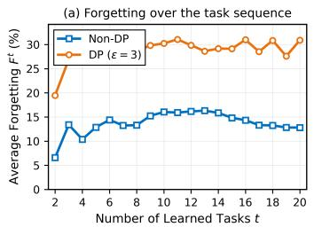

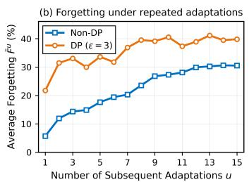

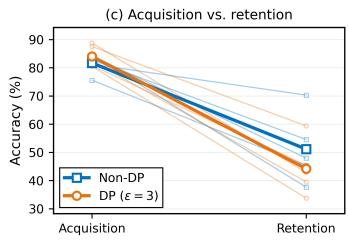  
Figure 1: DP exacerbates forgetting during continual adaptation. (a) Average forgetting across tasks. (b) Early-task forgetting over subsequent adaptations. (c) Acquisition vs. retention after 15 subsequent adaptations. Light lines denote individual tasks; bold lines denote their mean.

Observation 2. Jointly privatizing the two LoRA factors introduces a non-negligible bilinear noise interaction during sequential adaptation. Consider one DP-SGD update within a task. Let A and B denote the LoRA factors after the corresponding noise-free clipped-gradient update, and let $\pmb { \xi } _ { A }$ and $\xi _ { B }$ denote the parameter perturbations induced by the Gaussian gradient noise in this update. The resulting factors can be written as $\widetilde { A } = A + \xi _ { A } , \widetilde { B } = B + \xi _ { B } ,$ . Accordingly, the privacy-induced distortion in the effective LoRA update is

$$
\widetilde { B } \widetilde { A } - B A = B \xi _ { A } + \xi _ { B } A + \xi _ { B } \xi _ { A } .\tag{1}
$$

The first two terms describe the first-order propagation of the factor-wise perturbations, whereas $\xi _ { B } \pmb { \xi } _ { A }$ captures their second-order interaction induced by the bilinear LoRA parameterization.

We quantify the relative magnitude of the bilinear interaction over the continual sequence under $\sigma = 0 . 8$ . We aggregate the perturbation energies over DP-SGD steps and LoRA modules:

$$
R _ { t } = \frac { \sqrt { \sum _ { \ell , q } \| \pmb { \xi } _ { B , t , q } ^ { ( \ell ) } \pmb { \xi } _ { A , t , q } ^ { ( \ell ) } \| _ { F } ^ { 2 } } } { \sqrt { \sum _ { \ell , q } \| \pmb { B } _ { t , q } ^ { ( \ell ) } \pmb { \xi } _ { A , t , q } ^ { ( \ell ) } + \pmb { \xi } _ { B , t , q } ^ { ( \ell ) } \pmb { A } _ { t , q } ^ { ( \ell ) } \| _ { F } ^ { 2 } } } ,\tag{2}
$$

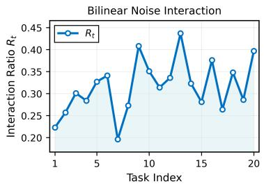

where $q$ indexes mini-batch DP-SGD updates within task t and ℓ indexes LoRA modules. The bilinear interaction remains consistently non-negligible throughout the 20-task sequence, despite substantial task-wise variation (Fig. 2).

Figure 2: Bilinear interaction ratio.

## Observation 3. Differential privacy degrades the stability–

plasticity trade-off, making it harder to retain previous knowledge while effectively adapting to new tasks. We characterize plasticity $P$ by new-task accuracy and stability by old-task accuracy. We divide the 20-task sequence into four consecutive stages of five tasks each and average the newtask and old-task accuracies within each stage to obtain the stage-wise plasticity–stability operating points. As shown in Fig. 3(a), both DP and Non-DP shift toward lower plasticity and stability as adaptation progresses, while DP consistently operates in a lower-stability region. To isolate the stability cost from differences in new-task adaptation, Fig. 3(b) compares the two settings at matched plasticity levels. The stability gap remains positive across the matched range, showing that comparable plasticity under DP is associated with systematically lower stability. Fig. 3(c) further shows that this trade-off degradation persists across privacy budgets and becomes less severe as the privacy constraint is relaxed.

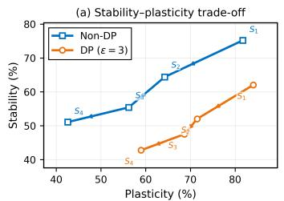

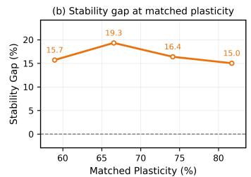

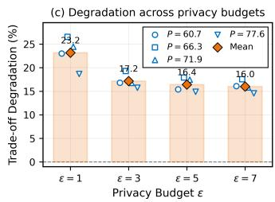  
Figure 3: Stability–plasticity trade-off under differential privacy. (a) Stage-wise stability–plasticity trajectories for Non-DP and DP $( \epsilon = 3 )$ . (b) Stability gap between Non-DP and $\mathrm { D P }$ at matched plasticity. (c) Trade-off degradation across privacy budgets, where markers denote stability gaps at individual matched plasticity levels $P$ and bars denote their mean.

## 4 PROPOSED METHOD

Overview. To address the issues in Section 3.2, we propose DP-SPA, which constructs stable and plastic LoRA bases before accessing current-task private data and restricts direct access to these data to DP-SGD. At task $t ,$ the stable subspace $S ^ { t }$ captures dominant historical adaptation directions from $H ^ { t - 1 }$ , a statistic of previously privatized model updates. The plastic subspace $\mathcal { P } ^ { t }$ is constructed from the pretrained weight $\dot { W } ^ { \dot { 0 } }$ within the orthogonal complement of $S ^ { t }$ , providing complementary directions for new-task adaptation (Fig. $4 ( \mathrm { A } ) ) .$ . The down-projection matrices $A _ { S } ^ { \tilde { t } }$ and $A _ { P } ^ { t }$ remain fixed, while only the corresponding up-projection matrices $B _ { S } ^ { t }$ and $B _ { P } ^ { t }$ are trained using DP-SGD, eliminating the bilinear noise interaction (Fig. 4(B)). After private optimization, we recalibrate the stable-branch update using historical update energy and current update energy computed from the DP-SGD outputs. The resulting LoRA update $\bar { \Delta { W } } ^ { t }$ is merged into the continual model and incorporated into $\mathbf { \dot { \mathbf { H } } } ^ { t }$ to guide stable-subspace construction for the next task (Fig. 4(C)).

## 4.1 PRIVACY-CONSTRAINED STABLE-PLASTIC SUBSPACE CONSTRUCTION

At task $t ,$ the LoRA adaptation is parameterized by $B ^ { t } A ^ { t }$ $A ^ { t } \in \mathbb { R } ^ { r \times n }$ determines the lowdimensional input-side subspace through which adaptation is expressed, while $B ^ { t } \in \mathbb { R } ^ { m \times r }$ maps this representation to the output space Zhu et al. (2024); Tian et al. (2024). We therefore use $A ^ { t }$ to determine the low-rank adaptation subspace. Under continual adaptation, the limited rank budget must preserve historically occupied directions while retaining capacity outside them for subsequent tasks. We therefore decompose the row space of $A ^ { t }$ into orthogonal stable and plastic components:

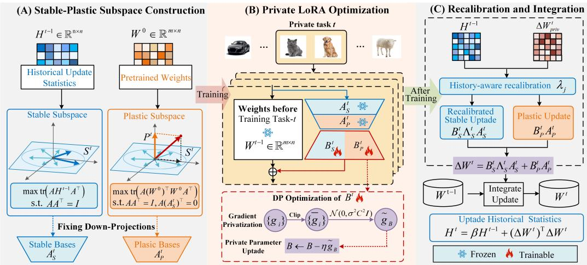  
Figure 4: Overview of DP-SPA. (A) Construct the stable subspace $S ^ { t }$ from privatized update history $\check { H ^ { t - 1 } }$ and the plastic subspace $\mathcal { P } ^ { t }$ from pretrained weights $\dot { W } ^ { 0 }$ within $( \dot { S } ^ { t } ) ^ { \perp }$ . (B) Within task $t ,$ fix $A _ { S } ^ { t } , A _ { P } ^ { t }$ and optimize only $B _ { S } ^ { t } , B _ { P } ^ { t }$ with DP-SGD. (C) Recalibrate stable-branch updates using historical and current update energies, merge $\Delta \mathbf { } W ^ { t }$ into the model, and update $H ^ { t }$ for the next task.

$$
\begin{array} { r } { \boldsymbol A ^ { t } = \left[ \boldsymbol A _ { S } ^ { t } \right] , \qquad r _ { S } + r _ { P } = r , } \end{array}\tag{3}
$$

where the rows of $A _ { S } ^ { t } \in \mathbb { R } ^ { r _ { S } \times n }$ and $A _ { P } ^ { t } \in \mathbb { R } ^ { r _ { P } \times n }$ span the stable subspace $S ^ { t }$ and plastic subspace $\mathcal { P } ^ { t }$ . The ranks $r _ { S }$ and $r _ { P }$ determine the capacity allocated to the two components. Both bases are constructed before accessing the current private dataset and satisfy $\pmb { A } _ { S } ^ { t } ( \pmb { A } _ { S } ^ { t } ) ^ { \top } = \pmb { I } , \pmb { A } _ { P } ^ { t } ( \pmb { A } _ { P } ^ { t } ) ^ { \top } = \pmb { I }$ and $A _ { P } ^ { t } ( A _ { S } ^ { t } ) ^ { \top } = { \bf 0 }$ . Accordingly, the LoRA up-projection is partitioned as $B ^ { t } = [ B _ { S } ^ { t } , B _ { P } ^ { t } ]$

Historical stable subspace. We construct the stable subspace from the updates that have already been privatized and merged into the continual model. To summarize their directional usage, we maintain the exponentially weighted second-order statistic $\begin{array} { r } { \pmb { H } ^ { t - 1 } = \sum _ { i = 1 } ^ { t - 1 } \beta ^ { t - 1 - i } ( \Delta \pmb { W } ^ { i } ) ^ { \top } \Delta \pmb { W } ^ { i } } \end{array}$ where $\beta \in \mathsf { \Gamma } ( 0 , 1 ]$ controls the decay of earlier task updates. For any unit direction $\textbf { \em a } \in \mathbb { R } ^ { n }$ $\begin{array} { r } { \pmb { a } ^ { \top } \pmb { H } ^ { t - 1 } \pmb { a } = \sum _ { i = 1 } ^ { t - 1 } \beta ^ { t - 1 - i } \left. \Delta \pmb { W } ^ { i } \pmb { a } \right. _ { 2 } ^ { 2 } } \end{array}$ . Hence, $H ^ { t - 1 }$ summarizes the accumulated update energy along different right-side directions. We define the stable subspace as the $r _ { S }$ -dimensional subspace that preserves the largest amount of this accumulated historical update energy:

$$
\pmb { A } _ { S } ^ { t } = \arg \operatorname* { m a x } _ { \pmb { A } } \operatorname { t r } \big ( \pmb { A } \pmb { H } ^ { t - 1 } \pmb { A } ^ { \top } \big ) \mathrm { s . t . } A \pmb { A } ^ { \top } = \pmb { I } .\tag{4}
$$

Here, $A \in \mathbb { R } ^ { r _ { S } \times n }$ , and arg max denotes a selected maximizer. Let $\begin{array} { r } { { \cal H } ^ { t - 1 } = V _ { H } ^ { t } \Lambda _ { H } ^ { t } ( V _ { H } ^ { t } ) ^ { \top } } \end{array}$ be its eigendecomposition, where $V _ { H } ^ { t }$ contains orthonormal eigenvectors and $\mathbf { \Delta } \mathbf { \Lambda } _ { H } ^ { t } = \operatorname { d i a g } ( \ddot { h } _ { 1 } ^ { t } , \ldots , h _ { n } ^ { t } )$ with $h _ { 1 } ^ { t } \geq \cdot \cdot \cdot \geq h _ { n } ^ { t } \geq 0$ , the solution is $A _ { S } ^ { t } = ( V _ { H , 1 : r _ { S } } ^ { t } ) ^ { \top }$ by the Rayleigh–Ritz principle. Thus, $S ^ { t }$ captures the dominant directions of historical adaptation.

Residual plastic subspace. To reserve adaptation capacity outside the historical stable subspace, we allocate the remaining $r _ { P }$ directions to its orthogonal complement. Since the basis is constructed before accessing the current private dataset, we use the pretrained weight $W ^ { 0 }$ as a structural prior. Specifically, we select the subspace with maximal pretrained response energy:

$$
A _ { P } ^ { t } = \arg \operatorname* { m a x } _ { A } \mathrm { t r } \big ( A ( W ^ { 0 } ) ^ { \top } W ^ { 0 } A ^ { \top } \big ) \quad \mathrm { s . t . } \quad A A ^ { \top } = I , A ( A _ { S } ^ { t } ) ^ { \top } = \mathbf { 0 } .\tag{5}
$$

Here, $\textbf { \textit { A } } \in \mathbb { R } ^ { r _ { P } \times n }$ . Let $\begin{array} { r l r } { U _ { \mathrm { ~ \tiny ~ l ~ } } ^ { t } } & { { } \in } & { \mathbb { R } ^ { n \times ( n - r _ { S } ) } } \end{array}$ be an orthonormal basis of $( S ^ { t } ) ^ { \perp }$ Setting $A ~ = ~ Z ^ { \top } ( U _ { \bot } ^ { t } ) ^ { \top }$ , where $Z ^ { \top } Z ~ = ~ I _ { r _ { P } }$ , reduces Eq. 5 to maximizing $\mathrm { t r } ( Z ^ { \top } C _ { P } ^ { t } Z )$ , where

$C _ { P } ^ { t } = ( U _ { \bot } ^ { t } ) ^ { \top } ( W ^ { 0 } ) ^ { \top } W ^ { 0 } U _ { \bot } ^ { t }$ . Let $\mu _ { 1 } ^ { t } \geq \cdot \cdot \cdot \geq \mu _ { n - r _ { S } } ^ { t } \geq 0$ denote the eigenvalues of $C _ { P } ^ { t }$ . For $r _ { P } \leq n - r _ { S }$ , let $Z _ { P , 1 : r _ { P } } ^ { t }$ contain orthonormal eigenvectors associated with the $r _ { P }$ largest eigenvalues $\mu _ { 1 } ^ { t } , \ldots , \mu _ { r _ { F } } ^ { t }$ of $C _ { P } ^ { t }$ . Then

$$
\begin{array} { r } { \pmb { A } _ { P } ^ { t } = ( Z _ { P , 1 : r _ { P } } ^ { t } ) ^ { \top } ( \pmb { U } _ { \bot } ^ { t } ) ^ { \top } . } \end{array}\tag{6}
$$

Thus, $A _ { P } ^ { t } ( A _ { P } ^ { t } ) ^ { \top } = I _ { r _ { P } }$ and $A _ { P } ^ { t } ( A _ { S } ^ { t } ) ^ { \top } = { \bf 0 } .$ , including when $C _ { P } ^ { t }$ is rank deficient. The resulting plastic subspace maximizes pretrained response energy within $( S ^ { t } ) ^ { \perp }$

Initialization. For task $t = 1$ , we initialize the fixed basis using the dominant right-singular directions of the pretrained weight: $\pmb { W } ^ { 0 } = \pmb { U } _ { 0 } \pmb { \Sigma } _ { 0 } \pmb { V } _ { 0 } ^ { \top } , \pmb { A } ^ { 1 } = \pmb { V } _ { 0 , 1 : r } ^ { \top }$ . After task 1, $\Delta \bar { W } ^ { 1 }$ initializes $H ^ { 1 }$ enabling the stable–plastic construction for subsequent tasks.

## 4.2 PRIVATE LORA OPTIMIZATION

Once the stable–plastic basis is constructed, we keep $A ^ { t }$ fixed throughout task t and privately optimize only $B ^ { t }$ within each LoRA module. Fixing $A ^ { \dot { t } }$ preserves the adaptation geometry constructed from historical and pretrained information and eliminates the bilinear noise interaction identified in Observation 2. We apply the $\mathrm { D P - S G D }$ mechanism defined in Section 3.1 to $B ^ { t } \colon B ^ { t } \gets B ^ { t } - \eta \widetilde { \pmb { g } } _ { B } ^ { t }$ where $\eta > 0$ is the learning rate and $\widetilde { \pmb { g } } _ { B } ^ { t }$ denotes the DP-SGD gradient with respect to $B ^ { t }$ . Following the single-step perturbation analysis in Observation $^ { 2 , }$ let $\bar { \xi } _ { B } ^ { t }$ denote the Gaussian perturbation applied to $B ^ { t }$ . Because $A ^ { t }$ is fixed, the induced distortion in the effective LoRA update reduces to $\overset { \cdot } { ( B ^ { t } + \pmb { \xi } _ { B } ^ { t } ) } \pmb { A } ^ { t } - \pmb { B } ^ { t } \pmb { A } ^ { t } = \pmb { \xi } _ { B } ^ { t } \pmb { A } ^ { t }$ . Compared with joint privatization, the perturbation terms associated with the down-projection, $B ^ { t } \xi _ { A } ^ { t }$ and $\pmb { \xi } _ { B } ^ { t } \pmb { \xi } _ { A } ^ { t }$ , are eliminated. Hence, private perturbation propagates only through the fixed adaptation basis, without basis noise or bilinear noise interaction between the two LoRA factors.

## 4.3 HISTORY-AWARE RECALIBRATION AND CONTINUAL INTEGRATION

After private optimization, the resulting LoRA update is decomposed as $\Delta W _ { \mathrm { p r i v } } ^ { t } = B _ { S } ^ { t } A _ { S } ^ { t } +$ $B _ { P } ^ { t } A _ { F } ^ { t }$ . Stable directions differ in their historical update energy and current adaptation strength. We therefore recalibrate their contributions individually before model integration. For the $j \mathrm { - t h }$ stable direction, we define its historical update energy as $\begin{array} { r } { \boldsymbol { h } _ { j } ^ { \check { t } } = \boldsymbol { a } _ { S , j } ^ { t } \boldsymbol { H } ^ { t - 1 } ( \boldsymbol { a } _ { S , j } ^ { t } ) ^ { \intercal } } \end{array}$ . Here, $\pmb { a } _ { S , j } ^ { t }$ denotes the $j \cdot$ -th row of $A _ { S } ^ { t }$ . Since $\pmb { a } _ { S , j } ^ { t }$ is an eigenvector of $\mathbfcal { H } ^ { t - 1 } , h _ { i } ^ { t }$ equals its associated eigenvalue. We measure the current adaptation strength by the energy of the corresponding rank-one update, $c _ { j } ^ { t } = \| b _ { S , j } ^ { t } \pmb { a } _ { S , j } ^ { t } \| _ { F } ^ { 2 } = \| b _ { S , j } ^ { t } \| _ { 2 } ^ { 2 }$ , where $b _ { S , j } ^ { t }$ is the $j \cdot$ -th column of $B _ { S } ^ { t }$ and $\| \bar { \mathbfcal { a } } _ { S , j } ^ { t } \| _ { 2 } = 1$

We determine a recalibration coefficient by balancing fidelity to the privately learned update against modification along historically active directions. Specifically, for each stable direction we solve $c _ { j } ^ { t } ( 1 - \lambda ) ^ { 2 } + ( { h _ { j } ^ { t } } ^ { \top } + \tau ) \lambda ^ { 2 }$ over $\lambda \in [ 0 , 1 ]$ , where $\tau > 0$ is a small regularization constant. The first term penalizes deviation from the privately learned rank-one update, whereas the second penalizes retaining a large current update along a historically active direction. The unique minimizer is

$$
\lambda _ { j } ^ { t } = c _ { j } ^ { t } / ( h _ { j } ^ { t } + c _ { j } ^ { t } + \tau ) , \qquad 0 \le \lambda _ { j } ^ { t } < 1 .\tag{7}
$$

When historical update energy dominates, the corresponding current stable-direction update is attenuated more strongly. When the current adaptation strength is comparatively larger, a greater fraction of the privately learned update is retained.

Let $\pmb { \Lambda } _ { S } ^ { t } = \mathrm { d i a g } ( \lambda _ { 1 } ^ { t } , \ldots , \lambda _ { r _ { S } } ^ { t } )$ , the final update is then

$$
\Delta W ^ { t } = B _ { S } ^ { t } \Lambda _ { S } ^ { t } { \cal A } _ { S } ^ { t } + B _ { P } ^ { t } { \cal A } _ { P } ^ { t } .\tag{8}
$$

The plastic branch is retained without recalibration.

For $t ~ = ~ 1$ , we use $\Delta { W ^ { 1 } } ~ { = } ~ B ^ { 1 } A ^ { 1 }$ without recalibration. At every task, we merge the update via $W ^ { t } = W ^ { t - 1 } + \Delta W ^ { t }$ and update the historical statistic recursively: ${ \pmb { H } } ^ { t } = \mathbf { \bar { \tau } } _ { 3 } { \pmb { H } } ^ { t - 1 } \mathbf { \bar { \tau } } +$ $( \Delta W ^ { t } ) ^ { \top } \Delta W ^ { t }$ . Hence, $H ^ { t }$ summarizes the accumulated energy of the updates merged into the continual model and guides stable-subspace construction for task $t + 1$

## 5 THEORETICAL ANALYSIS

We establish the privacy guarantee, characterize the stable–plastic geometry, and analyze recalibration and its conditional effect on old-task loss. Complete proofs are deferred to Appendix C.

Theorem 1 (Privacy Guarantee) Assume public pretrained weights and a fixed public task partition, with each protected record belonging to exactly one task. Under add/remove adjacency, suppose each task mechanism is $( \epsilon _ { t } , \delta _ { t } ) { - } D P$ conditional on any preceding private transcript, and all remaining operations use only public information and privatized outputs. Then the full transcript of released models and statistics is $( \operatorname* { m a x } _ { t } \epsilon _ { t } , \operatorname* { m a x } _ { t } \delta _ { t } ) { \boldsymbol { \cdot } } D P .$ In particular, assigning the same $( \epsilon , \delta )$ budget to every task gives an $( \epsilon , \delta )$ guarantee for the entire sequence.

Theorem 1 allows later tasks to depend adaptively on earlier private outputs. Since basis construction, recalibration, merging, and history updates use only public information and previously privatized outputs, they constitute post-processing and incur no additional privacy cost.

For any update $U \in \mathbb { R } ^ { m \times n }$ , define the historical overlap energy ${ \mathcal { T } } _ { t } ( U ) = \operatorname { t r } \left( U H ^ { t - 1 } U ^ { \top } \right) =$ $\begin{array} { r } { \sum _ { i < t } \beta ^ { t - 1 - i } \lVert \boldsymbol { U } ( \Delta W ^ { i } ) ^ { \top } \rVert _ { F } ^ { 2 } } \end{array}$ , which measures its energy along historical update directions.

Theorem 2 (Complementary Stable–Plastic Geometry) $F o r t \ge 2 , A ^ { t } ( A ^ { t } ) ^ { \top } = I _ { r } ,$ and the following statements hold. (i) Historical energy. Over all $U \in \mathbb { R } ^ { r _ { S } \times n }$ satisfying $\begin{array} { r } { U U ^ { \top } = \dot { \pmb { I } } _ { r _ { S } } } \end{array}$ the stable basis satisfies max tr $\begin{array} { r } { \left( U H ^ { t - 1 } \bar { U ^ { \dag } } \right) = \mathrm { t r } { \left( A _ { S } ^ { t } H ^ { t - 1 } ( A _ { S } ^ { t } ) ^ { \top } \right) } = \sum _ { i = 1 } ^ { r _ { S } } h _ { j } ^ { t } } \end{array}$ . Every plastic update obeys $\begin{array} { r } { \mathcal { T } _ { t } ( B _ { P } ^ { t } A _ { P } ^ { t } ) \leq h _ { r s + 1 } ^ { t } \| B _ { P } ^ { t } \| _ { F } ^ { 2 } } \end{array}$ . (ii) Pretrained response. Over all $U \in \mathbb { R } ^ { r _ { P } \times n }$ satisfying $\begin{array} { r } { U U ^ { \top } \ = \ I _ { r _ { P } } } \end{array}$ and $U ( A _ { S } ^ { t } ) ^ { \top } \ = \ \mathbf { 0 } ,$ the plastic basis satisfies maxU $\| \mathbfcal { W } ^ { 0 } \pmb { U } ^ { \top } \| _ { F } ^ { 2 } ~ = ~$ $\begin{array} { r } { \| { \bf W } ^ { 0 } ( { \bf A } _ { P } ^ { t } ) ^ { \top } \| _ { F } ^ { 2 } = \sum _ { j = 1 } ^ { r _ { P } } \mu _ { j } ^ { t } } \end{array}$ . (iii) Additional adaptation capacity. For every target update $\textit { \textbf { U } } \in$ $\mathbb { R } ^ { m \times n }$ , minX ∈Rm×rS $\| \pmb { U } - \pmb { X } _ { S } \pmb { A } _ { S } ^ { t } \| _ { F } ^ { 2 }$ − min $\mathbf { \boldsymbol { x } } \in \mathbb { R } ^ { m \times r } \lVert \boldsymbol { U } - \boldsymbol { X } \boldsymbol { A } ^ { t } \rVert _ { F } ^ { 2 } = \lVert \boldsymbol { U } ( \boldsymbol { A } _ { P } ^ { t } ) ^ { \top } \rVert _ { F } ^ { 2 }$ . Moreover, $\| X A ^ { t } \| _ { F } = \| \tilde { X } \| _ { F } f o t$ r every $\pmb { X } \in \mathbb { R } ^ { m \times r }$

Theorem 3 (Optimal Recalibration and Historical Overlap Reduction) Condition on the realized private coefficient matrix $B ^ { t }$ and history $H ^ { t - 1 }$ . For stable columns with $c _ { j } ^ { t } \ = \ 0$ , impose $\begin{array} { r } { { \bf { x } } _ { j } = { \bf { 0 } } _ { : } } \end{array}$ , where $\mathbf { \Delta } _ { \mathbf { \mathcal { X } } _ { j } }$ denotes the j-th column of $\pmb { X } _ { S } .$ Then $\widehat { \pmb { B } } ^ { t } = [ \pmb { B } _ { S } ^ { t } \pmb { \Lambda } _ { S } ^ { t } , \pmb { B } _ { P } ^ { t } ]$ is the unique minimizer ofmin $\begin{array} { r } { { \bf \nabla } \cdot { \bf x } = [ { \bf X } _ { S } , { \bf X } _ { P } ] \left\{ \frac { 1 } { 2 } \| { \bf X } - { \bf B } ^ { t } \| _ { F } ^ { 2 } + \frac { 1 } { 2 } \sum _ { j : c _ { i } ^ { t } > 0 } \frac { h _ { j } ^ { t } + \tau } { c _ { i } ^ { t } } \| { \bf x } _ { j } \| _ { 2 } ^ { 2 } \right\} } \end{array}$ . Furthermore, $\Delta W ^ { t } ( A _ { P } ^ { t } ) ^ { \top } = B _ { P } ^ { t }$ $\begin{array} { r } { \| \Delta \boldsymbol { W } _ { \mathrm { p r i v } } ^ { t } - \Delta \boldsymbol { W } ^ { t } \| _ { F } ^ { 2 } = \sum _ { j = 1 } ^ { r _ { S } } c _ { j } ^ { t } ( 1 - \lambda _ { j } ^ { t } ) ^ { 2 } , \| \Delta \boldsymbol { W } _ { \mathrm { p r i v } } ^ { t } \| _ { F } ^ { 2 } - \| \Delta \boldsymbol { W } ^ { t } \| _ { F } ^ { 2 } = \sum _ { j = 1 } ^ { r _ { S } } c _ { j } ^ { t } ( 1 - ( \lambda _ { j } ^ { t } ) ^ { 2 } ) } \end{array}$ , and $\begin{array} { r } { \mathbb { Z } _ { t } ( \Delta \bar { \boldsymbol { W } } _ { \mathrm { p r i v } } ^ { t } ) - \mathbb { Z } _ { t } ( \Delta \boldsymbol { W } ^ { t } ) \stackrel { \sim } { = } \sum _ { j = 1 } ^ { { \tilde { r } _ { S } } } h _ { j } ^ { t } c _ { j } ^ { t } ( 1 - ( \lambda _ { j } ^ { t } ) ^ { \bar { 2 } } ) \ge 0 . } \end{array}$

Recalibration balances fidelity to the private update against an energy-normalized historical penalty, preserving plastic coefficients without increasing historical overlap.

Theorem 4 (Conditional Forgetting Certificate) Let $F _ { \mathrm { o l d } }$ be an old-task population loss and let $W ^ { t - 1 }$ be the pre-merge weight. Suppose $\lVert \nabla F _ { \mathrm { o l d } } ( W ^ { t - 1 } ) \rVert _ { F } \leq \nu .$ . Assume that $F _ { \mathrm { o l d } }$ is twice continuously differentiable along the relevant segments and that,for $U \in \{ \Delta W _ { \mathrm { p r i v } } ^ { t } , \Delta W ^ { t } \} , s \in [ 0 , 1 ]$ and every perturbation $V \in \mathbb { R } ^ { m \times n } , \nabla ^ { 2 } F _ { \mathrm { o l d } } ( W ^ { t - 1 } + s U ) [ V , V ] \leq \kappa \operatorname { t r } ( \dot { V } H ^ { t - 1 } V ^ { \top } ) + \rho \| V \| _ { F } ^ { 2 } ,$ where $\nu , \kappa , \rho \geq 0 .$ $\begin{array} { r } { D e f i n e ~ \mathcal { U } ( U ) ~ = ~ \nu \| U \| _ { F } + \frac { \kappa } { 2 } \mathcal { \bar { Z } } _ { t } ( \pmb { U } ) + \frac { \rho } { 2 } \| \pmb { U } \| _ { F } ^ { 2 } } \end{array}$ Then $F _ { \mathrm { o l d } } ( \dot { W } ^ { t - 1 } ) ^ { \cdots } +$ $U ) \ - \ F _ { \mathrm { o l d } } ( W ^ { t - 1 } ) \ \leq \ \mathcal { U } ( U ) \ f o r \ U \ \in \ \{ \Delta W _ { \mathrm { p r i v } } ^ { t } , \mathsf { \bar { \Delta } W } ^ { t } \}$ , and $\mathcal { U } ( \Delta W _ { \mathrm { p r i v } } ^ { t } ) - \mathcal { U } ( \Delta W ^ { t } ) ~ =$ $\begin{array} { r } { \nu \big ( \| \Delta W _ { \mathrm { p r i v } } ^ { t } \| _ { F } - \| \Delta W ^ { t } \| _ { F } \big ) + \frac { 1 } { 2 } \sum _ { j = 1 } ^ { r _ { S } } ( \kappa h _ { j } ^ { t } + \rho ) c _ { j } ^ { t } ( 1 - ( \lambda _ { j } ^ { t } ) ^ { 2 } ) \geq 0 . } \end{array}$

Under the stated assumptions, recalibration does not increase the upper bound on old-task loss increase, but need not reduce the actual loss. The same argument extends to multiple adapted layers under a joint curvature bound accounting for cross-layer interactions.

## 6 EXPERIMENTS

## 6.1 EXPERIMENTAL SETUPS

Evaluation Benchmarks and Metrics. We evaluate DP-SPA on 5 benchmarks: ImageNet-R (Hendrycks et al., 2021a), ImageNet-A (Hendrycks et al., 2021b), CIFAR-100 (Krizhevsky et al., 2009), CUB (Wah et al., 2011) and DomainNet (Peng et al., 2019). ImageNet-R contains 30,000 images from 200 classes with diverse styles. ImageNet-A comprises 7,500 real-world adversarial images from 200 categories. CIFAR-100 contains $6 0 { , } 0 0 0 \ 3 2 \times 3 2$ images from 100 classes. DomainNet covers 345 classes across 6 visual domains. Following prior works (Gao et al., 2024; He et al., 2026), we select the top 200 most populous classes for evaluation.

We follow commonly used evaluation metrics in CL (Tan et al., 2024; Zhao et al., 2024; Wu et al., 2025a): Last Accuracy $( \mathcal { A } _ { L a s t } )$ , which measures the final performance over all classes, and Average Accuracy $( \mathcal { A } _ { A v g } )$ , which averages the performance across all incremental sessions.

Implementation Details. We use ViT-B/16 (Dosovitskiy et al., 2021) pre-trained on ImageNet-21K (Russakovsky et al., 2015) as the backbone. Each task is trained for 20 epochs with a batch size of 48 using DP-SGD with cosine learning-rate decay. The initial learning rate is 0.02 for ImageNet-R, 0.005 for CUB, and 0.01 for the other datasets. We insert DP-SPA into all attention blocks with $r = 3 2 .$ , allocating $r _ { S } = r _ { P } = 1 6 . $ , and train a cosine classifier (He et al., 2026) alongside the LoRA coefficients. We select the clipping threshold from {0.1, 0.5, 1, 2, 5} and use $C = 1$ The main experiments use $\epsilon = 3 ,$ and we additionally evaluate $\epsilon \in \{ 1 , 3 , 5 , 7 \}$ , with $\delta = 1 0 ^ { - 5 }$ throughout. We use the RDP accountant implemented in Opacus (Yousefpour et al., 2021) to calibrate the Gaussian noise multiplier σ to the target $( \epsilon , \delta ) \ / – \mathrm { D P }$ guarantee. All experiments are conducted using NVIDIA RTX 5090 GPUs, and the reported results are averaged over three random seeds.

## 6.2 MAIN RESULTS

Comparison with Baseline Methods. For a controlled comparison under DP, we consider AB-LoRA, which jointly updates both LoRA factors A and B, and a stronger baseline, FA-LoRA, which fixes A and updates only B. Tables 1, 2 summarize the results across different datasets and incremental settings. Our method substantially outperforms AB-LoRA across all settings. On ImageNet-R with T=10, DP-SPA increases $A _ { L a s t }$ from 56.86% to 71.85% and $\mathcal { A } _ { A v g }$ from 63.83% to 79.90%, corresponding to gains of 14.99 and 16.07 percentage points, respectively. The gains increase to 22.31 and 22.22 percentage points for $T { = } 2 0$ . Compared with the stronger FA-LoRA, our method consistently achieves higher accuracy across all datasets and settings. On ImageNet-R, DP-SPA improves $A _ { L a s t }$ and $\mathcal { A } _ { A v g }$ by 3.60 and 2.70 percentage points for $T { = } 2 0$ , respectively. Figure 5 shows that DP-SPA maintains higher overall and old-task accuracy while preserving comparable new-task accuracy, demonstrating a better stability–plasticity trade-off.

Table 1: Experimental results for 10 incremental tasks on ImageNet-R, ImageNet-A, CIFAR-100, and CUB. The best results are highlighted in bold.
<table><tr><td rowspan="2">Method</td><td colspan="2">ImageNet-R (T=10)</td><td colspan="2">ImageNet-A (T=10)</td><td colspan="2">CIFAR-100 (T=10)</td><td colspan="2">CUB (T=10)</td></tr><tr><td> $\mathcal { A } _ { L a s t } \uparrow$ </td><td> $\boldsymbol { \mathcal { A } _ { A v g } } \uparrow$ </td><td> $\mathcal { A } _ { L a s t } \uparrow$ </td><td> $\boldsymbol { \mathcal { A } _ { A v g } } \uparrow$ </td><td> $\mathcal { A } _ { L a s t } \uparrow$ </td><td> $\boldsymbol { \mathcal { A } _ { A v g } } \uparrow$ </td><td> $\mathcal { A } _ { L a s t } \uparrow$ </td><td> $\boldsymbol { \mathcal { A } _ { A v g } } \uparrow$ </td></tr><tr><td>AB-LoRA</td><td> $5 6 . 8 6 _ { \pm 1 . 3 7 }$ </td><td> $6 3 . 8 3 { \scriptstyle \pm 1 . 5 4 }$ </td><td> $5 1 . 6 9 { \scriptstyle \pm 1 . 2 2 }$ </td><td> $6 2 . 2 3 { \scriptstyle \pm 0 . 9 2 }$ </td><td> $8 5 . 4 2 _ { \pm 0 . 3 6 }$ </td><td> $9 0 . 4 0 { \scriptstyle \pm 0 . 4 2 }$ </td><td> $7 2 . 3 7 { \scriptstyle \pm 0 . 9 0 }$ </td><td> $7 9 . 3 3 _ { \pm 0 . 6 7 }$ </td></tr><tr><td>FA-LoRA</td><td> $6 8 . 5 5 { \scriptstyle \pm 0 . 7 7 }$ </td><td> $7 7 . 4 6 { \scriptstyle \pm 0 . 8 9 }$ </td><td> $5 4 . 0 1 { \scriptstyle \pm 0 . 7 8 }$ </td><td> $6 4 . 4 2 _ { \pm 0 . 7 1 }$ </td><td> $8 6 . 5 6 { \scriptstyle \pm 0 . 3 0 }$ </td><td> $9 0 . 6 3 _ { \pm 0 . 4 1 }$ </td><td> $7 4 . 0 2 _ { \pm 0 . 8 5 }$ </td><td> $8 0 . 2 6 _ { \pm 0 . 7 1 }$ </td></tr><tr><td>DP-SPA</td><td> $\mathbf { 7 1 . 8 5 { \scriptstyle \pm 0 . 6 2 } }$ </td><td> ${ \bf 7 9 . 9 0 _ { \pm 0 . 5 7 } }$ </td><td> ${ \bf 5 7 . 2 1 { \bf _ { \pm 0 . 5 8 } } }$ </td><td> ${ \bf 6 6 . 6 5 { \scriptstyle \pm 0 . 6 3 } }$ </td><td> ${ \bf 8 7 . 0 7 { \scriptstyle \pm 0 . 2 2 } }$ </td><td> $\mathbf { 9 1 . 1 9 { \scriptstyle \pm 0 . 3 5 } }$ </td><td> $\mathbf { 7 5 . 7 8 _ { \pm 0 . 6 4 } }$ </td><td> $\mathbf { 8 2 . 6 7 { \scriptstyle \pm 0 . 5 9 } }$ </td></tr></table>

Table 2: Experimental results for 5 and 20 incremental tasks on ImageNet-R, 20 tasks on ImageNet-$\mathbf { A } ,$ and 10 tasks on DomainNet. The best results are highlighted in bold.
<table><tr><td rowspan="2">Method</td><td colspan="2">ImageNet-R (T=5)</td><td colspan="2">ImageNet-R (T=20)</td><td colspan="2">ImageNet-A (T=20)</td><td colspan="2">DomainNet  $( T { = } 1 0 )$ </td></tr><tr><td> $\mathcal { A } _ { L a s t } \uparrow$ </td><td> $\boldsymbol { \mathcal { A } _ { A v g } } \uparrow$ </td><td> $\mathcal { A } _ { L a s t } \uparrow$ </td><td> $\boldsymbol { \mathcal { A } _ { A v g } } \uparrow$ </td><td> $\mathcal { A } _ { L a s t } \uparrow$ </td><td> $\boldsymbol { \mathcal { A } _ { A v g } } \uparrow$ </td><td> $\mathcal { A } _ { L a s t } \uparrow$ </td><td> $\boldsymbol { \mathcal { A } _ { A v g } } \uparrow$ </td></tr><tr><td>AB-LoRA</td><td> $6 2 . 4 8 { \scriptstyle \pm 0 . 8 6 }$ </td><td> $7 0 . 7 3 { \scriptstyle \pm 0 . 7 4 }$ </td><td> $4 5 . 8 3 _ { \pm 2 . 9 6 }$ </td><td> $5 6 . 1 2 _ { \pm 2 . 4 1 }$ </td><td> $4 1 . 4 4 _ { \pm 2 . 2 3 }$ </td><td> $5 4 . 1 1 { \scriptstyle \pm 1 . 8 0 }$ </td><td> $7 6 . 5 3 { \scriptstyle \pm 1 . 1 2 }$ </td><td> $8 3 . 2 2 _ { \pm 1 . 0 5 }$ </td></tr><tr><td>FA-LoRA</td><td> $7 1 . 6 6 { \scriptstyle \pm 0 . 5 9 }$ </td><td> $7 9 . 2 0 { \scriptstyle \pm 0 . 6 1 }$ </td><td> $6 4 . 5 4 { \scriptstyle \pm 0 . 9 3 }$ </td><td> $7 5 . 6 4 { \scriptstyle \pm 0 . 7 9 }$ </td><td> $4 5 . 2 5 { \scriptstyle \pm 1 . 4 2 }$ </td><td> $5 8 . 1 2 _ { \pm 1 . 0 4 }$ </td><td> $7 8 . 0 7 { \scriptstyle \pm 0 . 6 4 }$ </td><td> $8 4 . 8 3 { \scriptstyle \pm 0 . 6 5 }$ </td></tr><tr><td>DP-SPA</td><td> ${ \bf 7 5 . 4 5 { \scriptstyle \pm 0 . 5 1 } }$ </td><td> $\mathbf { 8 2 . 0 6 _ { \pm 0 . 4 2 } }$ </td><td> ${ \bf 6 8 . 1 4 { \scriptstyle \pm 0 . 7 5 } }$ </td><td> ${ \bf 7 8 . 3 4 { \scriptstyle \pm 0 . 6 7 } }$ </td><td> $\mathbf { 4 8 . 4 4 _ { \pm 0 . 8 4 } }$ </td><td> ${ \bf 6 0 . 8 9 { \scriptstyle \pm 0 . 7 8 } }$ </td><td> ${ \bf 7 9 . 4 5 { \scriptstyle \pm 0 . 5 9 } }$ </td><td> $\mathbf { 8 5 . 6 1 { \scriptstyle \pm 0 . 7 2 } }$ </td></tr></table>

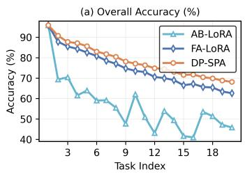

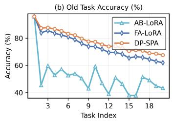

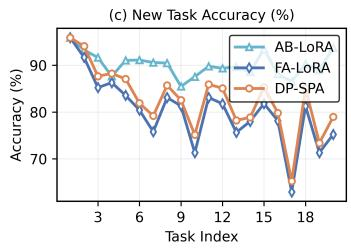  
Figure 5: Overall, old task and new task accuracy on ImageNet-R across 20 incremental tasks.

Table 3: Experimental results under different ϵ on ImageNet-A and ImageNet-R with $T = 2 0 .$
<table><tr><td rowspan="2">Dataset</td><td rowspan="2">Method</td><td colspan="2">€ =1</td><td colspan="2"> $\epsilon = 3$ </td><td colspan="2"> $\epsilon = 5$ </td><td colspan="2"> $\epsilon = 7$ </td></tr><tr><td> $\mathcal { A } _ { L a s t } \uparrow$ </td><td> $\boldsymbol { \mathcal { A } _ { A v g } } \uparrow$ </td><td> $\mathcal { A } _ { L a s t } \uparrow$ </td><td> $\boldsymbol { \mathcal { A } _ { A v g } } \uparrow$ </td><td> $\mathcal { A } _ { L a s t } \uparrow$ </td><td> $\boldsymbol { \mathcal { A } _ { A v g } } \uparrow$ </td><td> $\mathcal { A } _ { L a s t } \uparrow$ </td><td> $\boldsymbol { \mathcal { A } _ { A v g } } \uparrow$ </td></tr><tr><td rowspan="3">ImageNet-R FA-LoRA</td><td>AB-LoRA</td><td> $3 . 2 6 _ { \pm 4 . 7 7 }$ </td><td> $1 1 . 3 7 { \scriptstyle \pm 3 . 2 5 }$ </td><td> $4 5 . 8 3 { \scriptstyle \pm 2 . 9 6 }$ </td><td> $5 6 . 1 2 _ { \pm 2 . 4 1 }$ </td><td> $4 8 . 7 3 { \scriptstyle \pm 2 . 6 6 }$ </td><td> $5 7 . 4 2 _ { \pm 1 . 9 5 }$ </td><td> $5 0 . 8 2 _ { \pm 1 . 2 3 }$ </td><td> $6 0 . 2 8 { \scriptstyle \pm 0 . 9 6 }$ </td></tr><tr><td></td><td> $3 4 . 4 5 _ { \pm 2 . 5 2 }$ </td><td> $5 5 . 7 3 { \scriptstyle \pm 2 . 7 0 }$ </td><td> $6 4 . 5 4 { \scriptstyle \pm 0 . 9 3 }$ </td><td> $7 5 . 6 4 { \scriptstyle \pm 0 . 7 9 }$ </td><td> $6 7 . 2 5 { \scriptstyle \pm 0 . 8 8 }$ </td><td> $7 8 . 3 6 _ { \pm 0 . 7 3 }$ </td><td> $7 0 . 7 6 { \scriptstyle \pm 0 . 6 1 }$ </td><td> $7 8 . 6 4 { \scriptstyle \pm 0 . 8 4 }$ </td></tr><tr><td>DP-SPA</td><td> $\mathbf { 4 8 . 6 9 _ { \pm 1 . 9 8 } }$ </td><td> $\mathbf { 6 0 . 4 4 _ { \pm 1 . 9 4 } }$ </td><td> ${ \bf 6 8 . 1 4 { \scriptstyle \pm 0 . 7 5 } }$ </td><td> ${ \bf 7 8 . 3 4 _ { \pm 0 . 6 7 } }$ </td><td> ${ \bf 6 9 . 8 5 { \scriptstyle \pm 0 . 7 0 } }$ </td><td> ${ \bf 7 9 . 6 5 { _ { \pm 0 . 7 2 } } }$ </td><td> ${ \bf 7 2 . 4 6 _ { \pm 0 . 5 5 } }$ </td><td> $\mathbf { 8 0 . 2 7 _ { \pm 0 . 5 4 } }$ </td></tr><tr><td rowspan="3">ImageNet-A FA-LoRA</td><td>AB-LoRA</td><td> $3 1 . 0 3 { \scriptstyle \pm 3 . 3 5 }$ </td><td> $4 5 . 1 2 _ { \pm 2 . 8 7 }$ </td><td> $4 1 . 4 4 { \scriptstyle \pm 2 . 2 3 }$ </td><td> $5 4 . 1 1 _ { \pm 1 . 8 0 }$ </td><td> $4 3 . 3 3 { \scriptstyle \pm 0 . 6 6 }$ </td><td> $5 5 . 0 8 _ { \pm 0 . 7 3 }$ </td><td> $4 4 . 0 8 _ { \pm 0 . 6 8 }$ </td><td> $5 5 . 4 6 _ { \pm 0 . 4 9 }$ </td></tr><tr><td></td><td> $4 3 . 3 0 { \scriptstyle \pm 2 . 9 5 }$ </td><td> $5 6 . 0 7 { \scriptstyle \pm 2 . 9 6 }$ </td><td> $4 5 . 2 5 { \scriptstyle \pm 1 . 4 2 }$ </td><td> $5 8 . 1 2 _ { \pm 1 . 0 4 }$ </td><td> $4 7 . 6 1 _ { \pm 0 . 6 3 }$ </td><td> $5 9 . 7 5 { \scriptstyle \pm 0 . 7 5 }$ </td><td> $4 8 . 2 4 _ { \pm 0 . 4 9 }$ </td><td> $6 0 . 0 7 { \scriptstyle \pm 0 . 4 7 }$ </td></tr><tr><td>DP-SPA</td><td> $\mathbf { 4 5 . 2 2 _ { \pm 1 . 5 4 } }$ </td><td> $\mathbf { 5 8 . 4 6 _ { \pm 1 . 2 5 } }$ </td><td> $\mathbf { 4 8 . 4 4 _ { \pm 0 . 8 4 } }$ </td><td> ${ \bf 6 0 . 8 9 { \scriptstyle \pm 0 . 7 8 } }$ </td><td> $\mathbf { 4 9 . 7 0 _ { \pm 0 . 6 3 } }$ </td><td> ${ \bf 5 9 . 9 2 _ { \pm 0 . 5 6 } }$ </td><td> $\mathbf { 5 0 . 4 3 _ { \pm 0 . 4 1 } }$ </td><td> ${ \bf 6 1 . 3 8 _ { \pm 0 . 4 4 } }$ </td></tr></table>

Effect of Privacy Budgets. Table 3 compares different ϵ on ImageNet-R and ImageNet-A with T=20. DP-SPA achieves the highest mean accuracy across all evaluated budgets. $\mathbf { A } \mathfrak { t } \ \epsilon = 1$ on ImageNet-R, AB-LoRA achieves only 3.26% in $A _ { L a s t } ,$ , whereas FA-LoRA and DP-SPA achieve 34.45% and 48.69%, respectively. The improvement of FA-LoRA over AB-LoRA supports the benefit of fixing A under strong privacy noise. DP-SPA further outperforms FA-LoRA by 14.24 percentage points, demonstrating the additional benefit of its stable–plastic design and recalibration. As ϵ increases, this gap narrows, while DP-SPA retains its advantage on both datasets.

## 6.3 ABLATION STUDIES.

Effect of Stable and Plastic bases. We ablate the stable and plastic bases to examine their individual contributions. As shown in Table 4, both At -only $( ( r _ { S } , r _ { P } ) = ( 3 2 , 0 ) )$ and At -only ((0, 32)) consistently outperform AB-LoRA, with $A _ { S } ^ { t } \mathrm { - o n i y }$ performing better across all settings. This advantage becomes more pronounced for longer task sequences, highlighting the increasing importance of preserving historically important directions. Combining $A _ { S } ^ { t }$ and $A _ { P } ^ { t }$ consistently achieves the best performance, demonstrating their complementary roles in balancing stability and plasticity.

Table 4: Ablation studies on the stable and plastic bases on ImageNet-R and ImageNet-A.
<table><tr><td rowspan="2">Variant</td><td colspan="2">ImageNet-R (T=10)</td><td colspan="2">ImageNet-R (T=20)</td><td colspan="2">ImageNet-A (T=10)</td><td colspan="2">ImageNet-A (T=20)</td></tr><tr><td> $A _ { L a s t } \uparrow$ </td><td> $\boldsymbol { \mathcal { A } _ { A v g } } \uparrow$ </td><td> $A _ { L a s t } \uparrow$ </td><td> $\boldsymbol { \mathcal { A } _ { A v g } } \uparrow$ </td><td> $\mathcal { A } _ { L a s t } \uparrow$ </td><td> $\boldsymbol { \mathcal { A } _ { A v g } } \uparrow$ </td><td> $A _ { L a s t } \uparrow$ </td><td> $\boldsymbol { \mathcal { A } _ { A v g } } \uparrow$ </td></tr><tr><td> $_ \mathrm { A B - L o R A }$ </td><td> $5 6 . 8 6 _ { \pm 1 . 3 7 }$ </td><td> $6 3 . 8 3 { \scriptstyle \pm 1 . 5 4 }$ </td><td> $4 5 . 8 3 { \scriptstyle \pm 2 . 9 6 }$ </td><td> $5 6 . 1 2 _ { \pm 2 . 4 1 }$ </td><td> $5 1 . 6 9 { \scriptstyle \pm 1 . 2 2 }$ </td><td> $6 2 . 2 3 { \scriptstyle \pm 0 . 9 2 }$ </td><td> $4 1 . 4 4 { \scriptstyle \pm 2 . 2 3 }$ </td><td> $5 4 . 1 1 { \scriptstyle \pm 1 . 8 0 }$ </td></tr><tr><td> $A _ { S } ^ { t } \mathrm { - o n l y }$ </td><td> $7 0 . 5 3 { \scriptstyle \pm 0 . 3 6 }$ </td><td> $7 8 . 0 5 { \scriptstyle \pm 0 . 4 8 }$ </td><td> $6 7 . 7 6 { \scriptstyle \pm 0 . 6 0 }$ </td><td> $7 7 . 1 5 { \scriptstyle \pm 0 . 4 6 }$ </td><td> $5 6 . 1 7 { \scriptstyle \pm 0 . 5 4 }$ </td><td> $6 5 . 1 3 { \scriptstyle \pm 0 . 7 0 }$ </td><td> $4 7 . 0 5 { \scriptstyle \pm 0 . 6 5 }$ </td><td> $5 9 . 4 3 _ { \pm 0 . 5 2 }$ </td></tr><tr><td> $A _ { P } ^ { t } \mathrm { - o n l y }$ </td><td> $6 8 . 8 1 { \scriptstyle \pm 0 . 5 2 }$ </td><td> $7 7 . 9 4 { \scriptstyle \pm 0 . 5 7 }$ </td><td> $6 5 . 8 0 { \scriptstyle \pm 0 . 7 4 }$ </td><td> $7 6 . 3 2 _ { \pm 0 . 8 1 }$ </td><td> $5 4 . 8 2 _ { \pm 0 . 6 1 }$ </td><td> $6 4 . 9 6 { \scriptstyle \pm 0 . 5 2 }$ </td><td> $4 5 . 1 9 { \scriptstyle \pm 0 . 9 0 }$ </td><td> $5 8 . 2 4 { \scriptstyle \pm 0 . 6 8 }$ </td></tr><tr><td> $A _ { S } ^ { t } + A _ { P } ^ { t }$ </td><td> $\mathbf { 7 1 . 8 5 { \scriptstyle \pm 0 . 6 2 } }$ </td><td> ${ \bf 7 9 . 9 0 _ { \pm 0 . 5 7 } }$ </td><td> ${ \bf 6 8 . 1 4 { \scriptstyle \pm 0 . 7 5 } }$ </td><td> ${ \bf 7 8 . 3 4 { \scriptstyle \pm 0 . 6 7 } }$ </td><td> ${ \bf 5 7 . 2 1 { \bf _ { \pm 0 . 5 8 } } }$ </td><td> ${ \bf 6 6 . 6 5 { \scriptstyle \pm 0 . 6 3 } }$ </td><td> $\mathbf { 4 8 . 4 4 _ { \pm 0 . 8 4 } }$ </td><td> ${ \bf 6 0 . 8 9 { \scriptstyle \pm 0 . 7 8 } }$ </td></tr></table>

Effect of History-Aware Recalibration. Table 5 isolates recalibration while retaining the stable– plastic subspace construction. Recalibration improves $\mathcal { A } _ { L a s t }$ from 67.25% to 68.14% and $\boldsymbol { \mathcal { A } } _ { A v g }$ from $7 7 . 4 9 \%$ to 78.34%. This shows that recalibrating stable-direction updates further improves continual adaptation under privacy constraints.

Table 5: Effect of recalibration on ImageNet-R with $T = 2 0 , r = 3 2 .$ and ϵ = 3.
<table><tr><td>Variant</td><td> $\mathcal { A } _ { L a s t } \uparrow$ </td><td> $\mathcal { A } _ { A v g } \uparrow$ </td></tr><tr><td>DP-SPA w/o recal.</td><td> $6 7 . 2 5 { \scriptstyle \pm 0 . 6 9 }$ </td><td> $7 7 . 4 9 _ { \pm 0 . 7 2 }$ </td></tr><tr><td>DP-SPA</td><td> ${ \bf 6 8 . 1 4 { _ { \pm 0 . 7 5 } } }$ </td><td> ${ \bf 7 8 . 3 4 _ { \pm 0 . 6 7 } }$ </td></tr></table>

## 7 DISCUSSION AND CONCLUSION

We study differentially private continual LoRA and observe increased forgetting during subsequent adaptation and lower retention at comparable new-task accuracy in the evaluated settings. Jointfactor privatization also introduces a within-step bilinear noise interaction. DP-SPA constructs a stable basis from privatized updates and a plastic basis from pretrained weights within its orthogonal complement, fixes both bases during private up-projection optimization, and recalibrates stabledirection updates using historical and current update energies. Experiments show improved average accuracy and retention across the evaluated settings and privacy budgets, supporting the reuse of privatized history without additional privacy cost. Recalibration guarantees non-increasing historical overlap; under the stated gradient and curvature assumptions, it also yields a non-increasing upper bound on old-task loss increase, without guaranteeing lower actual loss.

## REFERENCES

Martin Abadi, Andy Chu, Ian Goodfellow, H Brendan McMahan, Ilya Mironov, Kunal Talwar, and Li Zhang. Deep learning with differential privacy. In Proceedings of the 2016 ACM SIGSAC conference on computer and communications security, pp. 308–318, 2016.

Zhiqi Bu, Yu-Xiang Wang, Sheng Zha, and George Karypis. Differentially private bias-term fine tuning of foundation models. In Forty-first International Conference on Machine Learning, 2024.

Yuetian Chen, Yuntao Du, Kaiyuan Zhang, Ashish Kundu, Charles Fleming, Bruno Ribeiro, and Ninghui Li. Window-based membership inference attacks against fine-tuned large language models. In 35th USENIX Security Symposium (USENIX Security 26), Baltimore, MD, August 2026. USENIX Association.

Alexey Dosovitskiy, Lucas Beyer, Alexander Kolesnikov, Dirk Weissenborn, Xiaohua Zhai, Thomas Unterthiner, Mostafa Dehghani, Matthias Minderer, Georg Heigold, Sylvain Gelly, Jakob Uszkoreit, and Neil Houlsby. An image is worth 16x16 words: Transformers for image recognition at scale. In International Conference on Learning Representations, 2021.

Cynthia Dwork. Differential privacy. In International colloquium on automata, languages, and programming, pp. 1–12. Springer, 2006.

Wenjie Fu, Huandong Wang, Chen Gao, Guanghua Liu, Yong Li, and Tao Jiang. Membership inference attacks against fine-tuned large language models via self-prompt calibration. Advances in Neural Information Processing Systems, 37:134981–135010, 2024.

Zhanxin Gao, Jun Cen, and Xiaobin Chang. Consistent prompting for rehearsal-free continual learning. In 2024 IEEE/CVF Conference on Computer Vision and Pattern Recognition (CVPR), pp. 28463–28473. IEEE, 2024.

Jiangpeng He, Zhihao Duan, and Fengqing Zhu. Cl-lora: Continual low-rank adaptation for rehearsal-free class-incremental learning. In 2025 IEEE/CVF Conference on Computer Vision and Pattern Recognition (CVPR), pp. 30534–30544. IEEE, 2025.

Lingfeng He, De Cheng, Huaijie Wang, Xi Yang, Nannan Wang, and Xinbo Gao. Task-driven subspace decomposition for knowledge sharing and isolation in lora-based continual learning. arXiv preprint arXiv:2603.00191, 2026.

Dan Hendrycks, Steven Basart, Norman Mu, Saurav Kadavath, Frank Wang, Evan Dorundo, Rahul Desai, Tyler Zhu, Samyak Parajuli, Mike Guo, et al. The many faces of robustness: A critical analysis of out-of-distribution generalization. In 2021 IEEE/CVF International Conference on Computer Vision (ICCV), pp. 8320–8329. IEEE, 2021a.

Dan Hendrycks, Kevin Zhao, Steven Basart, Jacob Steinhardt, and Dawn Song. Natural adversarial examples. In Proceedings of the IEEE/CVF conference on computer vision and pattern recognition, pp. 15262–15271, 2021b.

Edward J Hu, yelong shen, Phillip Wallis, Zeyuan Allen-Zhu, Yuanzhi Li, Shean Wang, Lu Wang, and Weizhu Chen. LoRA: Low-rank adaptation of large language models. In International Conference on Learning Representations, 2022.

Alex Krizhevsky, Geoffrey Hinton, et al. Learning multiple layers of features from tiny images. 2009.

Yan-Shuo Liang and Wu-Jun Li. Inflora: Interference-free low-rank adaptation for continual learning. In 2024 IEEE/CVF Conference on Computer Vision and Pattern Recognition (CVPR), pp. 23638–23647. IEEE, 2024.

Jin Liu, Yinbin Miao, Ning Xi, and Junkang Liu. Rethinking lora for privacy-preserving federated learning in large models. arXiv preprint arXiv:2602.19926, 2026a.

Jingren Liu, Zhong Ji, YunLong Yu, Jiale Cao, Yanwei Pang, Jungong Han, and Xuelong Li. Parameter-efficient fine-tuning for continual learning: A neural tangent kernel perspective. IEEE Transactions on Pattern Analysis and Machine Intelligence, 2026b.

Xuan Liu and Xiaobin Chang. Lora subtraction for drift-resistant space in exemplar-free continual learning. In 2025 IEEE/CVF Conference on Computer Vision and Pattern Recognition (CVPR), pp. 15308–15318. IEEE, 2025.

Yue Lu, Shizhou Zhang, De Cheng, Yinghui Xing, Guoqiang Liang, Nannan Wang, Peng Wang, and Yanning Zhang. Continual low-rank adaptation via cumulative unified optimization. IEEE Transactions on Pattern Analysis and Machine Intelligence, 2026.

Mao-Lin Luo, Zi-Hao Zhou, Yi-Lin Zhang, Yuanyu Wan, Min-Ling Zhang, and Tong Wei. Keeplora: Continual learning with residual gradient adaptation. In International Conference on Learning Representations, volume 2026, pp. 136017–136040, 2026.

Xingchao Peng, Qinxun Bai, Xide Xia, Zijun Huang, Kate Saenko, and Bo Wang. Moment matching for multi-source domain adaptation. In 2019 IEEE/CVF International Conference on Computer Vision (ICCV), pp. 1406–1415. IEEE, 2019.

Fuli Qiao and Mehrdad Mahdavi. Learn more, but bother less: parameter efficient continual learning. Advances in Neural Information Processing Systems, 37:97476–97498, 2024.

Fuli Qiao and Mehrdad Mahdavi. Merge before forget: A single lora continual learning via continual merging. In International Conference on Learning Representations, volume 2026, pp. 8133– 8159, 2026.

Haomiao Qiu, Miao Zhang, Ziyue Qiao, Weili Guan, Min Zhang, and Liqiang Nie. Splitlora: Balancing stability and plasticity in continual learning through gradient space splitting. In International Conference on Learning Representations, volume 2026, pp. 48458–48480, 2026.

David Rolnick, Arun Ahuja, Jonathan Schwarz, Timothy Lillicrap, and Gregory Wayne. Experience replay for continual learning. Advances in neural information processing systems, 32, 2019.

Olga Russakovsky, Jia Deng, Hao Su, Jonathan Krause, Sanjeev Satheesh, Sean Ma, Zhiheng Huang, Andrej Karpathy, Aditya Khosla, Michael Bernstein, et al. Imagenet large scale visual recognition challenge. International journal ofcomputer vision, 115(3):211–252, 2015.

Youbang Sun, Zitao Li, Yaliang Li, and Bolin Ding. Improving lora in privacy-preserving federated learning. In International conference on learning representations, volume 2024, pp. 17978– 17994, 2024.

Yuwen Tan, Qinhao Zhou, Xiang Xiang, Ke Wang, Yuchuan Wu, and Yongbin Li. Semanticallyshifted incremental adapter-tuning is a continual vitransformer. In 2024 IEEE/CVF Conference on Computer Vision and Pattern Recognition (CVPR), pp. 23252–23262. IEEE, 2024.

Chunlin Tian, Zhan Shi, Zhijiang Guo, Li Li, and Chengzhong Xu. Hydralora: An asymmetric lora architecture for efficient fine-tuning. Advances in Neural Information Processing Systems, 37: 9565–9584, 2024.

Yu-Lin Tsai, Yizhe Li, Chia-Mu Yu, Xuebin Ren, Po-Yu Chen, Zekai Chen, and Francois Buet-Golfouse. Differentially private fine-tuning of diffusion models. In 2025 IEEE/CVF International Conference on Computer Vision (ICCV), pp. 4561–4571. IEEE, 2025.

Catherine Wah, Steve Branson, Peter Welinder, Pietro Perona, and Serge Belongie. The caltech-ucsd birds-200-2011 dataset. 2011.

Xiequn Wang, Zhan Zhuang, and Yu Zhang. Plan: Proactive low-rank allocation for continual learning. In 2025 IEEE/CVF International Conference on Computer Vision (ICCV), pp. 2909– 2918. IEEE, 2025.

Ming Wen, Jiaqi Zhu, Yuedong Xu, Yipeng Zhou, and DINGDING HAN. Differentially private federated low rank adaptation beyond fixed-matrix. In The Thirty-ninth Annual Conference on Neural Information Processing Systems, 2025.

Fangwen Wu, Lechao Cheng, Shengeng Tang, Xiaofeng Zhu, Chaowei Fang, Dingwen Zhang, and Meng Wang. Navigating semantic drift in task-agnostic class-incremental learning. In Fortysecond International Conference on Machine Learning, 2025a.

Yichen Wu, Hongming Piao, Long-Kai Huang, Renzhen Wang, Wanhua Li, Hanspeter Pfister, Deyu Meng, Kede Ma, and Ying Wei. Sd-lora: Scalable decoupled low-rank adaptation for class incremental learning. In International Conference on Learning Representations, volume 2025, pp. 58337–58353, 2025b.

Ashkan Yousefpour, Igor Shilov, Alexandre Sablayrolles, Davide Testuggine, Karthik Prasad, Mani Malek, John Nguyen, Sayan Ghosh, Akash Bharadwaj, Jessica Zhao, et al. Opacus: User-friendly differential privacy library in pytorch. arXiv preprint arXiv:2109.12298, 2021.

Da Yu, Saurabh Naik, Arturs Backurs, Sivakanth Gopi, Huseyin A Inan, Gautam Kamath, Janardhan Kulkarni, Yin Tat Lee, Andre Manoel, Lukas Wutschitz, et al. Differentially private fine-tuning of language models. arXiv preprint arXiv:2110.06500, 2021.

Kaiyuan Zhang, Siyuan Cheng, Hanxi Guo, Yuetian Chen, Zian Su, Shengwei An, Yuntao Du, Charles Fleming, Ashish Kundu, Xiangyu Zhang, et al. {SOFT}: Selective data obfuscation for protecting {LLM} fine-tuning against membership inference attacks. In 34th USENIX Security Symposium (USENIX Security 25), pp. 8135–8154, 2025.

Linglan Zhao, Xuerui Zhang, Ke Yan, Shouhong Ding, and Weiran Huang. Safe: Slow and fast parameter-efficient tuning for continual learning with pre-trained models. Advances in Neural Information Processing Systems, 37:113772–113796, 2024.

Lele Zheng, Xiang Wang, Tao Zhang, Yang Cao, Ke Cheng, and Yulong Shen. Differentially private subspace fine-tuning for large language models. In Proceedings of the AAAI Conference on Artificial Intelligence, volume 40, pp. 28830–28838, 2026.

Hao Zhu, Yifei Zhang, Junhao Dong, and Piotr Koniusz. Bilora: Almost-orthogonal parameter spaces for continual learning. In 2025 IEEE/CVF Conference on Computer Vision and Pattern Recognition (CVPR), pp. 25613–25622. IEEE, 2025.

Jiacheng Zhu, Kristjan Greenewald, Kimia Nadjahi, Haitz Saez de Oc´ ariz Borde, Rickard Br´ uel¨ Gabrielsson, Leshem Choshen, Marzyeh Ghassemi, Mikhail Yurochkin, and Justin Solomon. Asymmetry in low-rank adapters of foundation models. In Forty-first International Conference on Machine Learning, 2024.

## 8 ETHICS STATEMENT

This work adheres to the ICLR Code of Ethics. In this study, no human subjects or animal experimentation was involved. All datasets used, including ImageNet-R, ImageNet-A, CIFAR-100, CUB, DomainNet, were sourced in compliance with relevant usage guidelines, ensuring no violation of privacy. We have taken care to avoid any biases or discriminatory outcomes in our research process. No personally identifiable information was used, and no experiments were conducted that could raise privacy or security concerns. We are committed to maintaining transparency and integrity throughout the research process.

## 9 REPRODUCIBILITY STATEMENT

We have made every effort to ensure the reproducibility of the results presented in this paper. Detailed experimental settings, including training procedures, model configurations, hyperparameters, and hardware specifications, are provided in Section 6.1 and Appendix E.1. The source code and scripts required to reproduce our experiments will be made publicly available upon acceptance.

## 10 AI USE STATEMENT

Large language models (LLMs) were used to assist with manuscript writing and polishing, including sentence rephrasing, grammar checking, improving readability and clarity, and checking the consistency of theoretical arguments and mathematical notation.

The LLMs were not used to originate the research ideas or design the methods or experiments. The research and analyses were conducted by the authors. The authors reviewed and revised all AIassisted content to ensure its accuracy and consistency with the underlying research. We take full responsibility for the final content of this work, including all text, claims, and artifacts produced with the assistance of generative AI.

## APPENDIX CONTENTS

A Table of Notations 15   
B DP-SPA Algorithm 15   
C Proofs of the Main Theoretical Results 15   
C.1 Privacy guarantee 16   
C.2 Stable–plastic geometry 17   
C.3 Recalibration guarantee 19   
C.4 Conditional old-task loss bound 21   
D Supplementary Analysis of the Bilinear Noise Interaction 23   
E Supplementary Experimental Information 23   
E.1 Experimental Details 23   
E.2 Additional Results 24

## A TABLE OF NOTATIONS

Table 6 summarizes the main notations used throughout the paper.

Table 6: Summary of the main notations.
<table><tr><td>Notation</td><td>Description</td></tr><tr><td> $T , t$ </td><td>Number of tasks and current task index</td></tr><tr><td> $\mathcal { D } ^ { t } , \mathcal { C } ^ { t }$ </td><td>Private dataset and class set of task t</td></tr><tr><td> $W ^ { 0 } \in \mathbb { R } ^ { m \times n }$ </td><td>Pretrained weight matrix</td></tr><tr><td> $\mathbf { \mathbf { \mathbf { \mathbf { W } } ^ { t } } }$ </td><td>Weight matrix after completing task t</td></tr><tr><td> $r _ { S } , r _ { P } , r = r _ { S } + r _ { P }$ </td><td>Stable, plastic, and total LoRA ranks</td></tr><tr><td> $S ^ { t } , \mathcal { P } ^ { t }$ </td><td>Stable and plastic input-side subspaces</td></tr><tr><td> $A _ { S } ^ { t } , ~ A _ { P } ^ { t }$ </td><td>Orthonormal row bases of  $S ^ { t }$  and  $\mathcal { P } ^ { t }$ </td></tr><tr><td> $\tilde { \pmb { A } ^ { t } } = [ \tilde { ( \pmb { A } _ { S } ^ { t } ) } ^ { \top } , ( \pmb { A } _ { P } ^ { t } ) ^ { \top } ] ^ { \top }$ </td><td>Fixed LoRA basis for task t</td></tr><tr><td> $B ^ { t } = [ B _ { S } ^ { t } , B _ { P } ^ { t } ]$ </td><td>Privately trained LoRA coefficient matrix</td></tr><tr><td> $H ^ { t - 1 }$ </td><td>Historical statistic of previously merged updates</td></tr><tr><td> $\beta$ </td><td></td></tr><tr><td> $h _ { j } ^ { t }$ </td><td>Decay factor for historical updates Eigenvalue  $h _ { j } ^ { t }$  of the history matrix</td></tr><tr><td> $c _ { i } ^ { t }$ </td><td>current stable-column energy  $c _ { j } ^ { t }$ </td></tr><tr><td> $\bar { \lambda _ { j } ^ { t } } , \Lambda _ { S } ^ { t }$ </td><td>Direction-wise recalibration coefficient and its diagonal matrix</td></tr><tr><td> $\Delta W _ { \mathrm { p r i v } } ^ { t }$ </td><td>Private task update before recalibration</td></tr><tr><td> $\Delta \dot { W } ^ { t }$ </td><td>Merged task update; recalibration is omitted at  $t = 1$ </td></tr><tr><td> $\mathcal { T } _ { t } ( U )$ </td><td>Historical overlap energy of an update  $U$ </td></tr><tr><td> $( \epsilon _ { t } , \delta _ { t } ) , ( \epsilon , \delta )$ </td><td>Task-specific and common record-level privacy budgets</td></tr><tr><td> $C , \sigma$ </td><td>Per-record clipping norm and Gaussian noise multiplier</td></tr><tr><td> $\mathcal { A } _ { L a s t } , \mathcal { A } _ { A v g }$ </td><td>Last Accuracy and Average Accuracy</td></tr><tr><td>T</td><td>Regularization constant in history-aware recalibration</td></tr><tr><td> $C _ { P } ^ { t } , \mu _ { j } ^ { t }$ </td><td>Restricted pretrained Gram matrix and its j-th eigenvalue</td></tr></table>

## B DP-SPA ALGORITHM

Algorithm 1 summarizes the complete training procedure of DP-SPA, including stable–plastic basis construction, private LoRA optimization, history-aware recalibration, and model merging.

## C PROOFS OF THE MAIN THEORETICAL RESULTS

The following four subsections prove the corresponding main-text theorems. The final subsection analyzes the fresh-noise interaction in Observation 2. Unless stated otherwise, geometric and recalibration results concern one adapted matrix at a fixed task $t \geq 2$ , with $0 \le r _ { S } , 0 \le r _ { P }$ , and $r _ { S } + r _ { P } = r \leq n$ . Define

$$
\begin{array} { r } { \pmb { P } ^ { t } = ( \pmb { A } ^ { t } ) ^ { \top } \pmb { A } ^ { t } , \qquad \pmb { Q } _ { S } ^ { t } = \pmb { I } _ { n } - ( \pmb { A } _ { S } ^ { t } ) ^ { \top } \pmb { A } _ { S } ^ { t } . } \end{array}
$$

The history matrix is positive semidefinite, with ordered eigenvalues $h _ { 1 } ^ { t } \ \geq \ \cdot \cdot \ \geq \ h _ { n } ^ { t } \ \geq \ 0$ . Its associated overlap functional is

$$
\mathcal { T } _ { t } ( U ) = \mathrm { t r } ( U H ^ { t - 1 } U ^ { \top } ) = \sum _ { i < t } \beta ^ { t - 1 - i } \| U ( \Delta W ^ { i } ) ^ { \top } \| _ { F } ^ { 2 } .\tag{9}
$$

The second identity follows by substituting the definition of $H ^ { t - 1 }$ and taking traces. This functional measures weighted overlap with historical updates; a connection to old-task loss requires the assumptions in Theorem 4.

Algorithm 1 Differentially Private Stable-Plastic Low-rank Adaptation (DP-SPA)   
1: Input: Pretrained model $\pmb { W } ^ { 0 }$ , private task sequence $\{ \mathcal { D } ^ { t } \} _ { t = 1 } ^ { T }$ , ranks $r _ { S } , r _ { P }$ with $r = r _ { S } + r _ { P }$   
DP parameters $( C , \sigma )$ , learning rate $\eta ,$ decay ${ \dot { \boldsymbol { \beta } } } ,$ regularization constant $\tau > 0$   
2: Output: Updated continual model $\dot { W } ^ { T }$ with merged LoRA updates   
3: Initialize historical statistic ${ \cal H } ^ { 0 }  0$   
4: for task $t = 1$ to $T$ do   
5: if $t = 1$ then   
6: Initialize $A ^ { 1 }$ from $\pmb { W } ^ { 0 } ; \pmb { W } ^ { 0 } = \pmb { U } _ { 0 } \pmb { \Sigma } _ { 0 } \pmb { V } _ { 0 } ^ { \top } , \pmb { A } ^ { 1 }  \pmb { V } _ { 0 , 1 : r } ^ { \top }$   
7: else   
8: Construct stable basis: $H ^ { t - 1 } = V _ { H } ^ { t } \Lambda _ { H } ^ { t } ( V _ { H } ^ { t } ) ^ { \top } , A _ { S } ^ { t }  ( V _ { H , 1 : r _ { S } } ^ { t } ) ^ { \top }$   
9: Compute $C _ { P } ^ { t } \gets ( \pmb { U } _ { \bot } ^ { t } ) ^ { \top } ( \pmb { W } ^ { 0 } ) ^ { \top } \pmb { W } ^ { 0 } \pmb { U } _ { \bot } ^ { t }$   
10: Construct plastic basis: $\bar { \mathbf { A } } _ { P } ^ { t }  ( \bar { Z } _ { P , 1 : r _ { P } } ^ { t } ) ^ { \top } ( U _ { \bot } ^ { t } ) ^ { \top }$   
11: $A ^ { t } \gets [ ( A _ { S } ^ { t } ) ^ { \top } , ( A _ { P } ^ { t } ) ^ { \top } ] ^ { \top }$   
12: end if   
13: Initialize $B ^ { t }  \mathbf { 0 } ,$ freeze $A ^ { t } .$ , and privately optimize $B ^ { t }$ on $\mathcal { D } ^ { t }$ with DP-SGD   
14: if $t = 1$ then   
15: $\Delta W ^ { 1 }  B ^ { 1 } A ^ { 1 }$   
16: else   
17: Decompose $B ^ { t } = [ B _ { S } ^ { t } , B _ { P } ^ { t } ]$   
18: Compute $h _ { j } ^ { t } = { \pmb a } _ { S , j } ^ { t } \tilde { \pmb H } ^ { t - 1 } ( \bar { \pmb a } _ { S , j } ^ { t } ) ^ { \top }$ and $c _ { j } ^ { t } = \| b _ { S , j } ^ { t } \| _ { 2 } ^ { 2 }$ for $j = 1 , \dots , r _ { S }$   
19: Compute $\lambda _ { j } ^ { \bar { t } } = c _ { j } ^ { t } / ( h _ { j } ^ { t } + c _ { j } ^ { t } + \bar { \tau } )$ for $j = 1 , \dots , r _ { S }$ and set $\pmb { \Lambda } _ { S } ^ { t }  \mathrm { d i a g } ( \lambda _ { 1 } ^ { t } , \dots , \lambda _ { r _ { S } } ^ { t } )$   
20: $\Delta W ^ { t } \gets \bar { B } _ { S } ^ { t } \boldsymbol { \Lambda } _ { S } ^ { t } \boldsymbol { A } _ { S } ^ { t } + \boldsymbol { B } _ { P } ^ { t } \boldsymbol { A } _ { P } ^ { t }$   
21: end if   
22: Integrate the LoRA update: $W ^ { t } \gets W ^ { t - 1 } + \Delta W ^ { t }$   
23: Update the historical statistic: $\pmb { H } ^ { t }  \beta \pmb { H } ^ { t - 1 } + ( \Delta \pmb { W } ^ { t } ) ^ { \top } \Delta \pmb { W } ^ { t }$   
24: end for

## C.1 PROOF OF THE PRIVACY GUARANTEE

Proof of Theorem 1. Let $\mathcal { D } = ( \mathcal { D } ^ { 1 } , . . . , \mathcal { D } ^ { T } ) , \mathcal { D } ^ { \prime } = ( \mathcal { D } ^ { \prime 1 } , . . . , \mathcal { D } ^ { \prime T } )$ be neighboring continual datasets under the stated add/remove adjacency. Since each protected record belongs to exactly one fixed task partition, there is a task s such that $\dot { \mathcal { D } } ^ { s }$ and $\mathcal { D } ^ { \prime s }$ differ by one record, while $\mathcal { D } ^ { t } = \bar { \mathcal { D } ^ { \prime t } }$ for all $t \neq s .$

Let $Z _ { t }$ denote the privatized outputs of task t, including the privatized information used to construct any state passed to subsequent tasks, and write $Z _ { < s } \stackrel { - } { = } ( \bar { Z _ { 1 } } , \ldots , Z _ { s - 1 } )$ . Under the theorem’s assumptions, all remaining carried state is public or computed from these privatized outputs. Tasks preceding s access identical datasets under $\mathcal { D }$ and $\mathcal { D } ^ { \prime }$ , so $Z _ { < s }$ has the same distribution under both sequences. Denote this common distribution by $\mu .$

For a fixed prefix $z ,$ let $M _ { s } ( \mathcal { D } ^ { s } ; z )$ denote the task-s mechanism. By assumption, this mechanism is $( \epsilon _ { s } , \delta _ { s } ) { - } \mathrm { D P }$ with respect to $\mathcal { D } ^ { s }$ for every preceding private transcript z. For any measurable event E in the joint output space of $\left( Z _ { < s } , Z _ { s } \right)$ , define $E _ { z } \stackrel { \_ } { = } \{ y : ( z , y ) \in \bar { E } \}$ . Applying the conditional DP inequality and integrating against the common prefix distribution gives

$$
\begin{array} { r l } & { \operatorname* { P r } \left[ \left( Z _ { < s } , Z _ { s } \right) \in E \right] } \\ & { \quad = \displaystyle \int \operatorname* { P r } \left[ M _ { s } ( \mathcal { D } ^ { s } ; z ) \in E _ { z } \right] \mu ( d z ) } \\ & { \quad \le \displaystyle \int \left( e ^ { \epsilon _ { s } } \operatorname* { P r } \left[ M _ { s } ( \mathcal { D } ^ { \prime s } ; z ) \in E _ { z } \right] + \delta _ { s } \right) \mu ( d z ) } \\ & { \quad = e ^ { \epsilon _ { s } } \operatorname* { P r } \left[ \left( Z _ { < s } , Z _ { s } \right) \in E \right] + \delta _ { s } . } \end{array}
$$

Thus, the joint transcript through task s satisfies the $( \epsilon _ { s } , \delta _ { s } )$ privacy inequality for this neighboring pair.

For every subsequent task $t > s , \mathcal { D } ^ { t } = \mathcal { D } ^ { \prime }$ . The remaining computation accesses only these unchanged datasets, public information, and the preceding privatized outputs. Therefore, for the fixed neighboring pair, it is the same randomized post-processing of $\left( Z _ { < s } , Z _ { s } \right)$ under both sequences, with the later datasets treated as fixed auxiliary inputs. The post-processing property preserves the $( \epsilon _ { s } , \delta _ { s } )$ inequality for the complete transcript, including all released models and derived statistics. The same argument applies with $\mathcal { D }$ and $\mathcal { D } ^ { \prime }$ interchanged.

Because the differing record may belong to any task s, the complete continual mechanism satisfies

$$
\left( \operatorname* { m a x } _ { 1 \leq t \leq T } \epsilon _ { t } , \ \operatorname* { m a x } _ { 1 \leq t \leq T } \delta _ { t } \right) \mathrm { - D P } .
$$

In particular, assigning every task the same $( \epsilon , \delta )$ budget gives an $( \epsilon , \delta )$ guarantee for the entire sequence. □

Application to DP-SPA. The stable basis is constructed from $H ^ { t - 1 }$ , which depends only on previously privatized and merged updates. The plastic basis is constructed from this stable basis and the public pretrained weights $\breve { W } ^ { 0 }$ . After private optimization, the current energies $c _ { j } ^ { t } = \| b _ { S , j } ^ { t } \| _ { 2 } ^ { 2 }$ are computed from the privatized coefficients $B ^ { t }$ , while the historical energies $h _ { j } ^ { t }$ are computed from $H ^ { t - 1 }$ . Consequently, the recalibration coefficients $\lambda _ { j } ^ { t }$ , the merged update $\Delta \dot { \mathbf { W } } ^ { t }$ , the model $\mathbf { \mathbf { \mathbf { \mathbf { W } } } ^ { t } }$ and the updated history $H ^ { t }$ are all functions of public information and privatized outputs. These operations therefore incur no additional privacy cost beyond that of the task-level private optimizer.

Scope. The result permits adaptive dependence on earlier privatized outputs; it does not require independent models or task mechanisms. Its record-level guarantee relies on each protected record belonging to only one task and on subsequent tasks accessing that record only through privatized outputs. It does not directly provide user-level privacy when one user contributes multiple records across tasks.

## C.2 PROOF OF THE STABLE–PLASTIC GEOMETRY

Proof of Theorem 2. Fix a task $t \geq 2$ , with nonnegative integer ranks $r _ { S } , r _ { P }$ satisfying $r _ { S } + r _ { P } =$ $r \leq n$ . We use the bases $A _ { S } ^ { t } \in \mathbb { R } ^ { r _ { S } \times n }$ and $A _ { P } ^ { t } \in \bar { \mathbb { R } ^ { r _ { P } \times n } }$ constructed in the main text. Define

$$
\pmb { P } _ { S } ^ { t } = ( \pmb { A } _ { S } ^ { t } ) ^ { \top } \pmb { A } _ { S } ^ { t } , \qquad \pmb { P } _ { P } ^ { t } = ( \pmb { A } _ { P } ^ { t } ) ^ { \top } \pmb { A } _ { P } ^ { t } , \qquad \pmb { Q } _ { S } ^ { t } = \pmb { I } _ { n } - \pmb { P } _ { S } ^ { t } .
$$

For an update $U \in \mathbb { R } ^ { m \times n }$ , recall that $\mathcal { T } _ { t } ( U ) = \mathrm { t r } \big ( U H ^ { t - 1 } U ^ { \top } \big )$

The stable basis consists of orthonormal eigenvectors, so $A _ { S } ^ { t } ( A _ { S } ^ { t } ) ^ { \top } = I _ { r _ { S } }$ . Let $U _ { \perp } ^ { t } \in \mathbb { R } ^ { n \times ( n - r _ { S } ) }$ have orthonormal columns spanning $( S ^ { t } ) ^ { \perp }$ . Then

$$
( \pmb { U } _ { \bot } ^ { t } ) ^ { \top } \pmb { U } _ { \bot } ^ { t } = \pmb { I } _ { n - r _ { S } } , \qquad \pmb { U } _ { \bot } ^ { t } ( \pmb { U } _ { \bot } ^ { t } ) ^ { \top } = \pmb { Q } _ { S } ^ { t } .
$$

The plastic construction uses

$$
\begin{array} { r } { C _ { P } ^ { t } = ( { \boldsymbol { U } } _ { \bot } ^ { t } ) ^ { \top } ( { \boldsymbol { W } } ^ { 0 } ) ^ { \top } { \boldsymbol { W } } ^ { 0 } { \boldsymbol { U } } _ { \bot } ^ { t } , \qquad { \boldsymbol { A } } _ { P } ^ { t } = ( { \boldsymbol { Z } } _ { P , 1 : r _ { P } } ^ { t } ) ^ { \top } ( { \boldsymbol { U } } _ { \bot } ^ { t } ) ^ { \top } , } \end{array}
$$

where $Z _ { P , 1 : r _ { P } } ^ { t } \ \in \ \mathbb { R } ^ { ( n - r _ { S } ) \times r _ { P } }$ contains orthonormal eigenvectors associated with the $r _ { P }$ largest eigenvalues of $C _ { P } ^ { t }$ . Therefore, $\begin{array} { r } { \pmb { A } _ { P } ^ { t } ( \pmb { A } _ { P } ^ { t } ) ^ { \top } = \pmb { I } _ { r _ { P } } , \qquad \pmb { A } _ { P } ^ { t } ( \pmb { A } _ { S } ^ { t } ) ^ { \top } = \pmb { 0 } } \end{array}$ . It follows that

$$
\begin{array} { r } { \pmb { A } ^ { t } ( \pmb { A } ^ { t } ) ^ { \top } = \pmb { I } _ { r } , \qquad \pmb { P } ^ { t } : = ( \pmb { A } ^ { t } ) ^ { \top } \pmb { A } ^ { t } = \pmb { P } _ { S } ^ { t } + \pmb { P } _ { P } ^ { t } . } \end{array}
$$

In particular, $P _ { S } ^ { t }$ and $P _ { P } ^ { t }$ are orthogonal projectors with $P _ { S } ^ { t } P _ { P } ^ { t } = \mathbf { 0 } .$

## (i) Historical energy capture. Write the eigendecomposition

$$
\begin{array} { r } { \pmb { H } ^ { t - 1 } = \pmb { V } _ { H } ^ { t } \mathrm { d i a g } ( h _ { 1 } ^ { t } , \dots , h _ { n } ^ { t } ) ( \pmb { V } _ { H } ^ { t } ) ^ { \top } , \qquad h _ { 1 } ^ { t } \geq \cdots \geq h _ { n } ^ { t } \geq 0 . } \end{array}
$$

Let ${ \pmb v } _ { H , j } ^ { t }$ denote the $j \mathrm { - t h }$ column of $V _ { H } ^ { t }$ . Choose this orthonormal eigenbasis consistently with the stable construction, so that $A _ { S } ^ { t } = ( V _ { H , 1 : r _ { S } } ^ { t } ) ^ { \top }$ , including when eigenvalues are repeated.

For any $U \in \mathbb { R } ^ { r _ { S } \times n }$ satisfying $U U ^ { \top } = I _ { r _ { S } }$

$$
\mathrm { t r } \big ( U H ^ { t - 1 } U ^ { \top } \big ) = \sum _ { j = 1 } ^ { n } h _ { j } ^ { t } d _ { j } , \qquad d _ { j } : = \| U v _ { H , j } ^ { t } \| _ { 2 } ^ { 2 } .
$$

Since $U ^ { \top } U$ is an orthogonal projector of rank $\begin{array} { r } { r _ { S } , 0 \leq d _ { j } \leq 1 , \sum _ { j = 1 } ^ { n } d _ { j } = \operatorname { t r } ( U ^ { \top } U ) = r _ { S } } \end{array}$ . For $1 \leq r _ { S } < n$ , these relations imply

$$
\begin{array} { r l r } {  { \sum _ { j = 1 } ^ { n } h _ { j } ^ { t } d _ { j } \le \sum _ { j = 1 } ^ { r _ { S } } h _ { j } ^ { t } d _ { j } + h _ { r _ { S } } ^ { t } \sum _ { j = r _ { S } + 1 } ^ { n } d _ { j } } } \\ & { } & { = \sum _ { j = 1 } ^ { r _ { S } } [ h _ { j } ^ { t } d _ { j } + h _ { r _ { S } } ^ { t } ( 1 - d _ { j } ) ] } \\ & { } & { \le \displaystyle \sum _ { j = 1 } ^ { r _ { S } } h _ { j } ^ { t } . } \end{array}
$$

The cases $r _ { S } = 0$ and $r _ { S } = n$ follow directly. The selected stable basis attains this upper bound, and hence, for $U \in \mathbb { R } ^ { r _ { S } \times n }$

$$
\operatorname* { m a x } _ { U } \quad \mathrm { t r } \big ( U H ^ { t - 1 } U ^ { \top } \big ) = \mathrm { t r } \big ( A _ { S } ^ { t } H ^ { t - 1 } ( A _ { S } ^ { t } ) ^ { \top } \big ) = \sum _ { j = 1 } ^ { r _ { S } } h _ { j } ^ { t } , \quad \mathrm { s . t . } \quad U U ^ { \top } = I _ { r _ { S } } .
$$

For $r _ { S } < n$ , the complementary projector satisfies

$$
Q _ { S } ^ { t } H ^ { t - 1 } \pmb { Q } _ { S } ^ { t } = \sum _ { j = r _ { S } + 1 } ^ { n } h _ { j } ^ { t } \pmb { v } _ { H , j } ^ { t } ( \pmb { v } _ { H , j } ^ { t } ) ^ { \top } \preceq h _ { r _ { S } + 1 } ^ { t } \pmb { Q } _ { S } ^ { t } .
$$

Because $A _ { P } ^ { t } Q _ { S } ^ { t } = A _ { P } ^ { t }$

$$
\begin{array} { r } { A _ { { P } } ^ { t } H ^ { t - 1 } ( A _ { { P } } ^ { t } ) ^ { \top } \preceq h _ { r _ { S } + 1 } ^ { t } I _ { r _ { P } } . } \end{array}
$$

Consequently, for every $B _ { P } ^ { t } \in \mathbb { R } ^ { m \times r _ { P } }$

$$
\begin{array} { r l } & { \mathcal { T } _ { t } ( B _ { P } ^ { t } A _ { P } ^ { t } ) = \mathrm { t r } \big ( B _ { P } ^ { t } A _ { P } ^ { t } H ^ { t - 1 } ( A _ { P } ^ { t } ) ^ { \top } ( B _ { P } ^ { t } ) ^ { \top } \big ) } \\ & { \qquad \leq h _ { r _ { S } + 1 } ^ { t } \mathrm { t r } \big ( B _ { P } ^ { t } ( B _ { P } ^ { t } ) ^ { \top } \big ) } \\ & { \qquad = h _ { r _ { S } + 1 } ^ { t } \| B _ { P } ^ { t } \| _ { F } ^ { 2 } . } \end{array}
$$

If $r _ { S } = n$ , then $r _ { P } = 0$ and the plastic update is zero; the overlap bound is interpreted as zero without introducing $h _ { n + 1 } ^ { t }$

(ii) Complementary pretrained response. Let $\mu _ { 1 } ^ { t } \geq \cdot \cdot \cdot \geq \mu _ { n - r _ { S } } ^ { t } \geq 0$ be the eigenvalues of $C _ { P } ^ { t }$ Consider any $U \in \mathbb { R } ^ { r _ { P } \times n }$ satisfying

$$
U U ^ { \top } = I _ { r _ { P } } , \qquad U ( A _ { S } ^ { t } ) ^ { \top } = \mathbf { 0 } .
$$

Set

$$
\tilde { U } : = U U _ { \mathrm { ~ | ~ } } ^ { t } \in \mathbb { R } ^ { r _ { P } \times ( n - r _ { S } ) } .
$$

The orthogonality constraint gives $U Q _ { S } ^ { t } = U$ , and therefore

$$
\pmb { U } = \widetilde { \pmb { U } } ( \pmb { U } _ { \bot } ^ { t } ) ^ { \top } , \qquad \widetilde { \pmb { U } } \widetilde { \pmb { U } } ^ { \top } = \pmb { U } \pmb { Q } _ { S } ^ { t } \pmb { U } ^ { \top } = \pmb { I } _ { r _ { P } } .
$$

Conversely, every row-orthonormal $\widetilde { U }$ of this dimension produces an admissible $U$ through this expression. Thus,

$$
\begin{array} { r l } { \| W ^ { 0 } U ^ { \top } \| _ { F } ^ { 2 } = \operatorname { t r } \bigl ( U ( W ^ { 0 } ) ^ { \top } W ^ { 0 } U ^ { \top } \bigr ) } & { } \\ & { \qquad = \operatorname { t r } \Bigl ( \widetilde { U } C _ { P } ^ { t } \widetilde { U } ^ { \top } \Bigr ) } \\ & { \qquad \le \displaystyle \sum _ { j = 1 } ^ { r _ { P } } \mu _ { j } ^ { t } , } \end{array}
$$

where the last step applies the eigenvalue argument from part (i) to $C _ { P } ^ { t }$ . Equality holds for $\widetilde { \pmb { U } } =$ $( Z _ { P , 1 : r _ { P } } ^ { t } ) ^ { \top }$ , which yields the selected plastic basis. Hence for $U \in \mathbb { R } ^ { r _ { P } \times n }$

$$
\operatorname* { m a x } _ { U } \| W ^ { 0 } U ^ { \top } \| _ { F } ^ { 2 } = \| W ^ { 0 } ( A _ { P } ^ { t } ) ^ { \top } \| _ { F } ^ { 2 } = \sum _ { j = 1 } ^ { r _ { P } } \mu _ { j } ^ { t } , \quad \mathrm { s . t . } U U ^ { \top } = I _ { r _ { P } } , U ( A _ { S } ^ { t } ) ^ { \top } = \mathbf { 0 } .
$$

Repeated or zero eigenvalues do not change this optimal value: an orthonormal selection of the corresponding eigenvectors in the restricted space still attains it.

(iii) Additional adaptation capacity. For every $\pmb { Y } \in \mathbb { R } ^ { m \times r }$ , row orthonormality gives

$$
\| Y A ^ { t } \| _ { F } ^ { 2 } = \mathrm { t r } \big ( Y A ^ { t } ( A ^ { t } ) ^ { \top } Y ^ { \top } \big ) = \| Y \| _ { F } ^ { 2 } .
$$

This proves the claimed norm identity.

For a target update $\pmb { U } \in \mathbb { R } ^ { m \times n }$ and coefficients $\pmb { X } \in \mathbb { R } ^ { m \times r }$ , decompose

$$
U - X A ^ { t } = U ( I _ { n } - P ^ { t } ) + \left( U ( A ^ { t } ) ^ { \top } - X \right) A ^ { t } .
$$

The two terms are orthogonal in the Frobenius inner product because $( I _ { n } - P ^ { t } ) ( A ^ { t } ) ^ { \top } = \mathbf { 0 }$ . Applying the norm identity gives

$$
\| \boldsymbol { U } - \boldsymbol { X } \boldsymbol { A } ^ { t } \| _ { F } ^ { 2 } = \| \boldsymbol { U } ( \boldsymbol { I } _ { n } - \boldsymbol { P } ^ { t } ) \| _ { F } ^ { 2 } + \| \boldsymbol { U } ( \boldsymbol { A } ^ { t } ) ^ { \top } - \boldsymbol { X } \| _ { F } ^ { 2 } .
$$

The unique minimizing coefficient is therefore $\pmb { X } = \pmb { U } ( \pmb { A } ^ { t } ) ^ { \top }$ , with

$$
\operatorname* { m i n } _ { \pmb { X } \in \mathbb { R } ^ { m \times r } } \| \pmb { U } - \pmb { X } \pmb { A } ^ { t } \| _ { F } ^ { 2 } = \| \pmb { U } ( \pmb { I } _ { n } - \pmb { P } ^ { t } ) \| _ { F } ^ { 2 } .
$$

The same argument applied to the stable basis yields

$$
\operatorname* { m i n } _ { \substack { \mathbf { X } _ { S } \in \mathbb { R } ^ { m \times r _ { S } } } } \| \pmb { U } - \pmb { X } _ { S } \pmb { A } _ { S } ^ { t } \| _ { F } ^ { 2 } = \| \pmb { U } ( \pmb { I } _ { n } - \pmb { P } _ { S } ^ { t } ) \| _ { F } ^ { 2 } .
$$

Since $I _ { n } - P _ { S } ^ { t } = ( I _ { n } - P ^ { t } ) + P _ { P } ^ { t }$ is a sum of mutually orthogonal projectors,

$$
\| \boldsymbol { U } ( \boldsymbol { I } _ { n } - \boldsymbol { P } _ { S } ^ { t } ) \| _ { F } ^ { 2 } = \| \boldsymbol { U } ( \boldsymbol { I } _ { n } - \boldsymbol { P } ^ { t } ) \| _ { F } ^ { 2 } + \| \boldsymbol { U } \boldsymbol { P } _ { P } ^ { t } \| _ { F } ^ { 2 } .
$$

Moreover,

$$
\| \boldsymbol { U } \boldsymbol { P } _ { P } ^ { t } \| _ { F } ^ { 2 } = \| ( \boldsymbol { U } ( \boldsymbol { A } _ { P } ^ { t } ) ^ { \top } ) \boldsymbol { A } _ { P } ^ { t } \| _ { F } ^ { 2 } = \| \boldsymbol { U } ( \boldsymbol { A } _ { P } ^ { t } ) ^ { \top } \| _ { F } ^ { 2 } ,
$$

using row orthonormality of $A _ { P } ^ { t }$ . Subtracting the optimal residuals gives

$$
\operatorname* { m i n } _ { \substack { { \mathbf { X } } _ { S } \in \mathbb { R } ^ { m \times r _ { S } } } } \| { \boldsymbol { U } } - { \mathbf { X } } _ { S } { \boldsymbol { A } } _ { S } ^ { t } \| _ { F } ^ { 2 } - \operatorname* { m i n } _ { { \mathbf { X } } \in \mathbb { R } ^ { m \times r } } \| { \boldsymbol { U } } - { \mathbf { X } } { \boldsymbol { A } } ^ { t } \| _ { F } ^ { 2 } = \| { \boldsymbol { U } } ( { \boldsymbol { A } } _ { P } ^ { t } ) ^ { \top } \| _ { F } ^ { 2 } .
$$

This establishes all claims of the theorem. Empty branches are interpreted using empty matrices and zero sums. □

Interpretation. The approximation identity compares the same stable basis with and without the selected plastic branch. It quantifies the additional representational capacity provided by that branch, rather than superiority over all alternative bases of total rank r.

## C.3 PROOF OF THE RECALIBRATION GUARANTEE

Proof of Theorem 3. Fix a task $t \geq 2$ and condition on the realized private coefficient matrix $B ^ { t } = [ B _ { S } ^ { t } , B _ { P } ^ { t } ]$ and history $H ^ { t - 1 }$ . For each stable direction $j ,$ let $b _ { S , j } ^ { t } \in \mathbb { R } ^ { m }$ denote the j-th column of $B _ { S } ^ { t }$ , and recall $\begin{array} { r } { c _ { j } ^ { t } = \| b _ { S , j } ^ { t } \| _ { 2 } ^ { 2 } , \lambda _ { j } ^ { t } = \frac { c _ { j } ^ { t } } { h _ { i } ^ { t } + c _ { i } ^ { t } + \tau } , \Lambda _ { S } ^ { t } = \mathrm { d i a g } ( \lambda _ { 1 } ^ { t } , \dots , \lambda _ { r _ { S } } ^ { t } ) } \end{array}$ . Here $h _ { j } ^ { t } \geq 0$ is the historical eigenvalue associated with the j-th stable basis vector, and $\tau > 0$ . Thus $0 \leq \lambda _ { j } ^ { t } < 1$ Define the recalibrated coefficient matrix $\widehat { \pmb { B } } ^ { t } = [ \pmb { B } _ { S } ^ { t } \pmb { \Lambda } _ { S } ^ { t } , \pmb { B } _ { P } ^ { t } ]$ ]. The updates before and after recalibration are $\Delta W _ { \mathrm { p r i v } } ^ { t } = B ^ { t } A ^ { t }$ and $\Delta W ^ { t } = \widehat { B } ^ { t } A ^ { t }$ , respectively.

(i) Unique minimizer of the recalibration objective. Write $X ~ = ~ [ X _ { S } , X _ { P } ]$ , where $\boldsymbol { { X } } _ { S } \in$ $\mathbb { R } ^ { m \times r _ { S } }$ and $\pmb { X } _ { P } \in \mathbb { R } ^ { m \times r _ { P } }$ , and let $\mathbf { \Delta } _ { \mathbf { \mathcal { X } } _ { \mathcal { j } } }$ denote the j-th column of $X _ { S }$ . The objective in the theorem is

$$
J _ { t } ( \boldsymbol { X } ) = \frac { 1 } { 2 } \| \boldsymbol { X } - \boldsymbol { B } ^ { t } \| _ { F } ^ { 2 } + \frac { 1 } { 2 } \sum _ { j : c _ { j } ^ { t } > 0 } \frac { h _ { j } ^ { t } + \tau } { c _ { j } ^ { t } } \| \boldsymbol { x } _ { j } \| _ { 2 } ^ { 2 } ,
$$

subject to $\mathbf { \Delta } _ { \mathbf { x } _ { j } } = \mathbf { 0 }$ whenever $c _ { j } ^ { t } = 0$ . Because the Frobenius norm separates over columns, each free stable column minimizes

$$
J _ { t , j } ( \pmb { x } _ { j } ) = \frac { 1 } { 2 } \| \pmb { x } _ { j } - \pmb { b } _ { S , j } ^ { t } \| _ { 2 } ^ { 2 } + \frac { h _ { j } ^ { t } + \tau } { 2 c _ { j } ^ { t } } \| \pmb { x } _ { j } \| _ { 2 } ^ { 2 } .
$$

For $c _ { j } ^ { t } > 0$ , its gradient and Hessian are

$$
\nabla J _ { t , j } ( \pmb { x } _ { j } ) = \left( 1 + \frac { h _ { j } ^ { t } + \tau } { c _ { j } ^ { t } } \right) \pmb { x } _ { j } - b _ { S , j } ^ { t } , \qquad \nabla ^ { 2 } J _ { t , j } = \left( 1 + \frac { h _ { j } ^ { t } + \tau } { c _ { j } ^ { t } } \right) \pmb { I } _ { m } \succ 0 .
$$

Setting the gradient to zero therefore gives the unique minimizer

$$
{ \pmb x } _ { j } = \frac { c _ { j } ^ { t } } { c _ { j } ^ { t } + h _ { j } ^ { t } + \tau } { \pmb b } _ { S , j } ^ { t } = \lambda _ { j } ^ { t } { \pmb b } _ { S , j } ^ { t } .
$$

If $c _ { j } ^ { t } = 0$ , then $b _ { S , j } ^ { t } = \mathbf { 0 }$ and $\lambda _ { j } ^ { t } = 0$ , so the imposed constraint $\mathbf { \Delta } _ { \mathbf { \mathcal { X } } _ { j } } = \mathbf { 0 }$ agrees with the same rule.

The plastic block contributes only $\frac { 1 } { 2 } \| X _ { P } - B _ { P } ^ { t } \| _ { F } ^ { 2 }$ , whose unique minimizer is $X _ { P } = B _ { P } ^ { t }$ . Combining these columnwise solutions proves that $\widehat { B } ^ { t }$ is the unique minimizer of the full constrained objective.

(ii) Plastic coefficients and update norms. The orthogonality relations established in Theorem 2 give $\begin{array} { r } { \pmb { A } _ { S } ^ { t } ( \pmb { A } _ { P } ^ { t } ) ^ { \top } = \pmb { 0 } , \qquad \pmb { A } _ { P } ^ { t } ( \pmb { A } _ { P } ^ { t } ) ^ { \top } = \pmb { I } _ { r _ { P } } } \end{array}$ . Consequently,

$$
\begin{array} { r l } & { \Delta \boldsymbol { W } ^ { t } ( \boldsymbol { A } _ { P } ^ { t } ) ^ { \top } = \boldsymbol { B } _ { S } ^ { t } \boldsymbol { \Lambda } _ { S } ^ { t } \boldsymbol { A } _ { S } ^ { t } ( \boldsymbol { A } _ { P } ^ { t } ) ^ { \top } + \boldsymbol { B } _ { P } ^ { t } \boldsymbol { A } _ { P } ^ { t } ( \boldsymbol { A } _ { P } ^ { t } ) ^ { \top } } \\ & { \qquad = \boldsymbol { B } _ { P } ^ { t } . } \end{array}
$$

Thus recalibration preserves the plastic coefficients exactly.

Since $A ^ { t } ( A ^ { t } ) ^ { \top } = I _ { r }$ , multiplication by $A ^ { t }$ preserves the Frobenius norm of coefficient matrices. Therefore,

$$
\begin{array} { r l } { \| \Delta W _ { \mathrm { p r i v } } ^ { t } - \Delta W ^ { t } \| _ { F } ^ { 2 } = \| \pmb { B } ^ { t } - \widehat { \pmb { B } } ^ { t } \| _ { F } ^ { 2 } } & { } \\ { \displaystyle = \sum _ { j = 1 } ^ { r _ { S } } c _ { j } ^ { t } ( 1 - \lambda _ { j } ^ { t } ) ^ { 2 } . } & { } \end{array}\tag{10}
$$

Likewise,

$$
\| \Delta W _ { \mathrm { p r i v } } ^ { t } \| _ { F } ^ { 2 } = \sum _ { j = 1 } ^ { r _ { S } } c _ { j } ^ { t } + \| B _ { P } ^ { t } \| _ { F } ^ { 2 } , \qquad \| \Delta W ^ { t } \| _ { F } ^ { 2 } = \sum _ { j = 1 } ^ { r _ { S } } c _ { j } ^ { t } ( \lambda _ { j } ^ { t } ) ^ { 2 } + \| B _ { P } ^ { t } \| _ { F } ^ { 2 } .
$$

Subtracting yields

$$
\lVert \Delta W _ { \mathrm { p r i v } } ^ { t } \rVert _ { F } ^ { 2 } - \lVert \Delta W ^ { t } \rVert _ { F } ^ { 2 } = \sum _ { j = 1 } ^ { r _ { S } } c _ { j } ^ { t } \big ( 1 - ( \lambda _ { j } ^ { t } ) ^ { 2 } \big ) \geq 0 .\tag{11}
$$

Hence the update norm cannot increase.

(iii) Historical overlap reduction. Define ${ \cal D } _ { H } ^ { t } = \mathrm { d i a g } ( h _ { 1 } ^ { t } , . ~ . ~ . , h _ { r _ { S } } ^ { t } )$ . Because the stable rows are eigenvectors of $H ^ { t - 1 }$

$$
{ \cal A } _ { S } ^ { t } { \cal H } ^ { t - 1 } = D _ { H } ^ { t } { \cal A } _ { S } ^ { t } .
$$

Combining this identity with row orthonormality and stable–plastic orthogonality gives

$$
\boldsymbol { A } _ { S } ^ { t } \boldsymbol { H } ^ { t - 1 } ( \boldsymbol { A } _ { S } ^ { t } ) ^ { \top } = \boldsymbol { D } _ { \boldsymbol { H } } ^ { t } , \qquad \boldsymbol { A } _ { S } ^ { t } \boldsymbol { H } ^ { t - 1 } ( \boldsymbol { A } _ { P } ^ { t } ) ^ { \top } = \mathbf { 0 } .
$$

The transposed cross term also vanishes because $H ^ { t - 1 }$ is symmetric.

Recall ${ \mathcal { T } } _ { t } ( U ) = \operatorname { t r } ( U H ^ { t - 1 } U ^ { \top } )$ . Expanding this expression for the two updates, the vanishing cross terms imply

$$
\begin{array} { r l } & { \mathcal { T } _ { t } ( \Delta W _ { \mathrm { p r i v } } ^ { t } ) = \mathrm { t r } \big ( B _ { S } ^ { t } { D } _ { H } ^ { t } ( B _ { S } ^ { t } ) ^ { \top } \big ) + \mathcal { T } _ { t } ( B _ { P } ^ { t } A _ { P } ^ { t } ) } \\ & { \qquad = \displaystyle \sum _ { j = 1 } ^ { r _ { S } } h _ { j } ^ { t } c _ { j } ^ { t } + \mathcal { T } _ { t } ( B _ { P } ^ { t } A _ { P } ^ { t } ) , } \end{array}
$$

$$
\begin{array} { r l } & { \mathcal { T } _ { t } ( \Delta \boldsymbol { W } ^ { t } ) = \mathrm { t r } \big ( \boldsymbol { B } _ { S } ^ { t } \boldsymbol { \Lambda } _ { S } ^ { t } \boldsymbol { D } _ { H } ^ { t } \boldsymbol { \Lambda } _ { S } ^ { t } ( \boldsymbol { B } _ { S } ^ { t } ) ^ { \top } \big ) + \mathcal { T } _ { t } ( \boldsymbol { B } _ { P } ^ { t } \boldsymbol { A } _ { P } ^ { t } ) } \\ & { \qquad = \displaystyle \sum _ { j = 1 } ^ { r _ { S } } h _ { j } ^ { t } c _ { j } ^ { t } ( \boldsymbol { \lambda } _ { j } ^ { t } ) ^ { 2 } + \mathcal { T } _ { t } ( \boldsymbol { B } _ { P } ^ { t } \boldsymbol { A } _ { P } ^ { t } ) . } \end{array}
$$

The plastic contribution is identical in both expressions and cancels upon subtraction:

$$
\mathcal { T } _ { t } ( \Delta W _ { \mathrm { p r i v } } ^ { t } ) - \mathcal { T } _ { t } ( \Delta W ^ { t } ) = \sum _ { j = 1 } ^ { r _ { S } } h _ { j } ^ { t } c _ { j } ^ { t } \big ( 1 - ( \lambda _ { j } ^ { t } ) ^ { 2 } \big ) \geq 0 .\tag{12}
$$

Every summand is nonnegative since $h _ { j } ^ { t } , c _ { j } ^ { t } \geq 0$ and $0 \leq \lambda _ { j } ^ { t } < 1$ . The decrease is strict whenever $h _ { j } ^ { t } c _ { j } ^ { t } > 0$ for at least one stable direction. This proves all claims of the theorem. Empty branches are interpreted using empty matrices and zero sums. □

Interpretation. These identities hold for each realized private update, without assuming that $c _ { j } ^ { t }$ is a noise-free measure of task relevance. They establish exact preservation of plastic coefficients and non-increasing historical overlap; their implications for old-task loss are addressed separately in Theorem 4.

## C.4 PROOF OF THE CONDITIONAL OLD-TASK LOSS BOUND

Proof of Theorem 4. Fix a task $t \geq 2$ , the pre-merge weight $W ^ { t - 1 }$ , and the realized history and private coefficients. Consider the two updates $\Delta W _ { \mathrm { p r i v } } ^ { \overline { { t } } }$ and $\Delta \mathbf { W } ^ { t }$ before and after recalibration. Throughout the proof, both updates are evaluated from the same pre-merge weight.

For matrices of the same dimension, write $\langle X , Y \rangle _ { F } = \mathrm { t r } ( X ^ { \top } Y )$ for the Frobenius inner product. The notation $\nabla ^ { 2 } F _ { \mathrm { o l d } } ( { \pmb W } ) [ { \pmb V } , { \pmb V } ]$ denotes the Hessian quadratic form in direction V. Recall

$$
\begin{array} { r } { \mathcal { T } _ { t } ( V ) = \mathrm { t r } \big ( V H ^ { t - 1 } V ^ { \top } \big ) . } \end{array}
$$

By the theorem’s assumptions,

$$
\| \nabla F _ { \mathrm { o l d } } ( W ^ { t - 1 } ) \| _ { F } \leq \nu .
$$

Moreover, the same constants κ, $\rho \geq 0$ satisfy

$$
\nabla ^ { 2 } F _ { \mathrm { o l d } } ( \boldsymbol { W } ^ { t - 1 } + s \boldsymbol { U } ) [ \boldsymbol { V } , \boldsymbol { V } ] \leq \kappa \mathcal { T } _ { t } ( \boldsymbol { V } ) + \rho \| \boldsymbol { V } \| _ { F } ^ { 2 }
$$

for both $U \in \{ \Delta W _ { \mathrm { o r i v } } ^ { t } , \Delta W ^ { t } \}$ , every $s \in [ 0 , 1 ]$ , and every $V \in \mathbb { R } ^ { m \times n }$ . The common constants and history define the same upper-bound function for both updates.

(i) Upper bound on the old-task loss increase. For either admissible update U, define the scalar function

$$
f _ { U } ( s ) = { \cal F } _ { \mathrm { o l d } } ( W ^ { t - 1 } + s U ) , \qquad s \in [ 0 , 1 ] .
$$

The differentiability assumption gives

$$
f _ { U } ^ { \prime } ( 0 ) = \langle \nabla F _ { \mathrm { o l d } } ( { \boldsymbol W } ^ { t - 1 } ) , { \boldsymbol U } \rangle _ { F } , \qquad f _ { U } ^ { \prime \prime } ( \boldsymbol s ) = \nabla ^ { 2 } F _ { \mathrm { o l d } } ( { \boldsymbol W } ^ { t - 1 } + \boldsymbol s { \boldsymbol U } ) [ { \boldsymbol U } , { \boldsymbol U } ] .
$$

Taylor’s formula with integral remainder yields

$$
\begin{array} { r l } & { F _ { \mathrm { o l d } } ( { \mathbf { } \mathbf { } \mathbf { } W } ^ { t - 1 } + { \mathbf { } U } ) - F _ { \mathrm { o l d } } ( { \mathbf { } W } ^ { t - 1 } ) } \\ & { \quad = \langle \nabla F _ { \mathrm { o l d } } ( { \mathbf { } W } ^ { t - 1 } ) , { \mathbf { } U } \rangle _ { F } } \\ & { \qquad + \displaystyle \int _ { 0 } ^ { 1 } ( 1 - s ) \nabla ^ { 2 } F _ { \mathrm { o l d } } ( { \mathbf { } W } ^ { t - 1 } + s { \mathbf { } U } ) [ { U } , { U } ] d s . } \end{array}
$$

By Cauchy–Schwarz and the gradient bound,

$$
\langle \nabla F _ { \mathrm { o l d } } ( { \mathbf { \boldsymbol { W } } } ^ { t - 1 } ) , { \boldsymbol { U } } \rangle _ { F } \leq \| \nabla F _ { \mathrm { o l d } } ( { \mathbf { \boldsymbol { W } } } ^ { t - 1 } ) \| _ { F } \| { \boldsymbol { U } } \| _ { F } \leq \nu \| { \boldsymbol { U } } \| _ { F } .
$$

Applying the curvature bound with $V = U$ and using $\begin{array} { r } { \int _ { 0 } ^ { 1 } ( 1 - s ) d s = 1 / 2 } \end{array}$ , we obtain

$$
\begin{array} { r l } & { \displaystyle \int _ { 0 } ^ { 1 } ( 1 - s ) \nabla ^ { 2 } F _ { \mathrm { o l d } } ( { \pmb W } ^ { t - 1 } + s { \pmb U } ) [ { \pmb U } , { \pmb U } ] d s } \\ & { \quad \le \displaystyle \frac { \kappa } { 2 } \mathbb { Z } _ { t } ( { \pmb U } ) + \frac { \rho } { 2 } \| { \pmb U } \| _ { F } ^ { 2 } . } \end{array}
$$

Combining these inequalities proves

$$
F _ { \mathrm { o l d } } ( \boldsymbol { W } ^ { t - 1 } + \boldsymbol { U } ) - F _ { \mathrm { o l d } } ( \boldsymbol { W } ^ { t - 1 } ) \le \mathcal { U } _ { t } ( \boldsymbol { U } ) ,
$$

where

$$
\mathcal { U } _ { t } ( \pmb { U } ) = \nu \| \pmb { U } \| _ { F } + \frac { \kappa } { 2 } \mathcal { T } _ { t } ( \pmb { U } ) + \frac { \rho } { 2 } \| \pmb { U } \| _ { F } ^ { 2 } .
$$

This inequality holds for both updates.

(ii) Comparison before and after recalibration. Equations 11 and 12 give

$$
\begin{array} { r l } & { \displaystyle \| \Delta W _ { \mathrm { p r i v } } ^ { t } \| _ { F } ^ { 2 } - \| \Delta W ^ { t } \| _ { F } ^ { 2 } = \displaystyle \sum _ { j = 1 } ^ { r _ { S } } c _ { j } ^ { t } \big ( 1 - ( \lambda _ { j } ^ { t } ) ^ { 2 } \big ) \geq 0 , } \\ & { \displaystyle \mathcal { T } _ { t } ( \Delta W _ { \mathrm { p r i v } } ^ { t } ) - \mathcal { T } _ { t } ( \Delta W ^ { t } ) = \displaystyle \sum _ { j = 1 } ^ { r _ { S } } h _ { j } ^ { t } c _ { j } ^ { t } \big ( 1 - ( \lambda _ { j } ^ { t } ) ^ { 2 } \big ) \geq 0 . } \end{array}
$$

Since norms are nonnegative, the first inequality also implies

$$
\| \Delta W ^ { t } \| _ { F } \leq \| \Delta W _ { \mathrm { p r i v } } ^ { t } \| _ { F } .
$$

Subtracting the two upper bounds and substituting the identities above yields

$$
\begin{array} { r l } & { \mathcal { U } _ { t } ( \Delta W _ { \mathrm { p r i v } } ^ { t } ) - \mathcal { U } _ { t } ( \Delta W ^ { t } ) } \\ & { \quad = \nu \left( \| \Delta W _ { \mathrm { p r i v } } ^ { t } \| _ { F } - \| \Delta W ^ { t } \| _ { F } \right) } \\ & { \qquad + \displaystyle \frac { 1 } { 2 } \sum _ { j = 1 } ^ { r _ { S } } ( \kappa h _ { j } ^ { t } + \rho ) c _ { j } ^ { t } \big ( 1 - ( \lambda _ { j } ^ { t } ) ^ { 2 } \big ) \geq 0 . } \end{array}\tag{13}
$$

Every term is nonnegative because $\nu , \kappa , \rho , h _ { j } ^ { t } , c _ { j } ^ { t } \geq 0$ and $0 \leq \lambda _ { j } ^ { t } < 1$ . Therefore,

$$
\mathcal { U } _ { t } ( \Delta \mathbf { W } ^ { t } ) \leq \mathcal { U } _ { t } ( \Delta \mathbf { W } _ { \mathrm { p r i v } } ^ { t } ) ,
$$

which proves the theorem.

Interpretation. The theorem compares a common upper bound for two updates at the same premerge model. It does not imply an ordering of their actual old-task losses or of complete training trajectories with different histories. The connection between historical overlap and old-task loss enters through the stated curvature assumption.

Extension to multiple adapted layers. Let $\ell = 1 , \ldots , L _ { \mathrm { a d } }$ index the adapted weight matrices, and collect their increments as $U = ( U _ { \ell } ) _ { \ell = 1 } ^ { L _ { \mathrm { a d } } }$ . On this product space, define

$$
\lVert U \rVert _ { \mathrm { j o i n t } } ^ { 2 } = \sum _ { \ell = 1 } ^ { L _ { \mathrm { a d } } } \lVert U _ { \ell } \rVert _ { F } ^ { 2 } , \qquad \mathcal { Z } _ { t } ^ { \mathrm { j o i n t } } ( U ) = \sum _ { \ell = 1 } ^ { L _ { \mathrm { a d } } } \mathrm { t r } \big ( U _ { \ell } H _ { \ell } ^ { t - 1 } U _ { \ell } ^ { \top } \big ) .
$$

Here $H _ { \rho } ^ { t - 1 }$ is the history matrix for layer ℓ. Let $W ^ { t - 1 }$ now denote the collection of pre-merge matrices, with all other model parameters held fixed in the comparison.

Suppose the old-task loss is twice continuously differentiable along both joint update segments, its joint gradient satisfies

$$
\| \nabla F _ { \mathrm { o l d } } ( \mathbf { \boldsymbol { W } } ^ { t - 1 } ) \| _ { \mathrm { j o i n t } } \leq \nu ,
$$

and its full Hessian satisfies

$$
\nabla ^ { 2 } F _ { \mathrm { o l d } } ( { W } ^ { t - 1 } + s U ) [ V , V ] \le \kappa \mathcal { T } _ { t } ^ { \mathrm { j o i n t } } ( V ) + \rho \| V \| _ { \mathrm { j o i n t } } ^ { 2 }
$$

for both joint updates, all $s \in [ 0 , 1 ]$ , and every joint perturbation V. This is a bound on the full Hessian, including cross-layer terms, rather than separate bounds on individual layers.

The same Taylor argument gives the joint upper bound

$$
\mathcal { U } _ { t } ^ { \mathrm { j o i n t } } ( \pmb { U } ) = \nu \| \pmb { U } \| _ { \mathrm { j o i n t } } + \frac { \kappa } { 2 } \mathcal { Z } _ { t } ^ { \mathrm { j o i n t } } ( \pmb { U } ) + \frac { \rho } { 2 } \| \pmb { U } \| _ { \mathrm { j o i n t } } ^ { 2 } .
$$

Applying the recalibration identities to each layer and summing shows that neither the joint squared norm nor the joint historical overlap increases. Hence

$$
\mathcal { U } _ { t } ^ { \mathrm { j o i n t } } ( \Delta W ^ { t } ) \leq \mathcal { U } _ { t } ^ { \mathrm { j o i n t } } ( \Delta W _ { \mathrm { p r i v } } ^ { t } ) .
$$

Thus the single-matrix argument extends to multiple adapted layers under the stated joint assumptions.

## D SUPPLEMENTARY ANALYSIS OF THE BILINEAR NOISE INTERACTION

This section supplements Observation 2 and Section 4.2 by quantifying the fresh-noise energy in one DP-SGD step.

Setup. Condition on the optimization state and current minibatch before drawing fresh noise. Let $\bar { B } \in \mathbb { R } ^ { m \times r }$ and $\bar { \pmb { A } } \in \mathbb { R } ^ { r \times n }$ be the factors after the clipped-gradient update without this step’s noise. Let $\pmb { N } _ { B } \in \mathbb { R } ^ { m \times r }$ and $\pmb { N } _ { A } \in \mathbb { R } ^ { r \times n }$ have mutually independent centered Gaussian entries with conditional variances $v _ { B } ^ { 2 }$ and $v _ { A } ^ { 2 }$ , respectively. All expectations below are over these fresh perturbations, conditional on the fixed state and minibatch.

Proposition 1 (Single-step noise energy) Under the preceding assumptions,

$$
\begin{array} { r l } & { \mathbb { E } \left\| ( \bar { \pmb { B } } + \pmb { N } _ { B } ) ( \bar { \pmb { A } } + \pmb { N } _ { A } ) - \bar { \pmb { B } } \bar { \pmb { A } } \right\| _ { F } ^ { 2 } } \\ & { \quad \quad \quad = n v _ { A } ^ { 2 } \| \bar { \pmb { B } } \| _ { F } ^ { 2 } + m v _ { B } ^ { 2 } \| \bar { \pmb { A } } \| _ { F } ^ { 2 } + m n r v _ { A } ^ { 2 } v _ { B } ^ { 2 } . } \end{array}\tag{14}
$$

For a fixed basis $A ^ { t }$ satisfying $A ^ { t } ( A ^ { t } ) ^ { \top } = I _ { r }$

$$
\| N _ { B } A ^ { t } \| _ { F } ^ { 2 } = \| N _ { B } \| _ { F } ^ { 2 } , \qquad \mathbb { E } \| N _ { B } A ^ { t } \| _ { F } ^ { 2 } = m r v _ { B } ^ { 2 } .\tag{15}
$$

Proof of Proposition 1. The joint perturbation expands as $\bar { B } { N _ { A } } + { N _ { B } } \bar { A } + { N _ { B } } { N _ { A } }$ . All pairwise Frobenius inner products have zero expectation: the first two terms are independently centered; for the first and third, condition additionally on $N _ { A }$ and average over $N _ { B } ;$ for the second and third, reverse this conditioning. Thus the expected squared norm is the sum of the three expected squared norms.

Using $\mathbb { E } [ N _ { A } N _ { A } ^ { \top } ] = n v _ { A } ^ { 2 } I _ { \ i }$ r and $\mathbb { E } [ N _ { B } ^ { \top } N _ { B } ] = m v _ { B } ^ { 2 } I _ { \tau }$ gives

$$
\begin{array} { r l } & { \mathbb { E } \| \bar { \boldsymbol { B } } \boldsymbol { N } _ { A } \| _ { F } ^ { 2 } = n v _ { A } ^ { 2 } \| \bar { \boldsymbol { B } } \| _ { F } ^ { 2 } , } \\ & { \mathbb { E } \| \boldsymbol { N } _ { B } \bar { \boldsymbol { A } } \| _ { F } ^ { 2 } = m v _ { B } ^ { 2 } \| \bar { \boldsymbol { A } } \| _ { F } ^ { 2 } , } \\ & { \mathbb { E } \| \boldsymbol { N } _ { B } \boldsymbol { N } _ { A } \| _ { F } ^ { 2 } = n v _ { A } ^ { 2 } \mathbb { E } \| \boldsymbol { N } _ { B } \| _ { F } ^ { 2 } = m n r v _ { A } ^ { 2 } v _ { B } ^ { 2 } . } \end{array}
$$

The last equality follows by first conditioning on $N _ { B }$ . Summing proves Eq. 14. For the fixed-basis case, $\| \boldsymbol { N } _ { B } \mathbf { \dot { A } } ^ { t } \| _ { F } ^ { 2 } = \mathrm { t r } ( \boldsymbol { N } _ { B } \mathbf { \dot { A } } ^ { t } ( \boldsymbol { A } ^ { t } ) ^ { \top } \boldsymbol { N } _ { B } ^ { \top } ) = \| \boldsymbol { N } _ { B } \| _ { F } ^ { 2 }$ . Taking expectations proves Eq. 15. □

Interpretation and scope. The term mnr $v _ { A } ^ { 2 } v _ { B } ^ { 2 }$ is the expected energy of the bilinear interaction in Observation 2. Fixing $A ^ { t }$ removes both perturbation terms involving $N _ { A }$ , while its row orthonormality preserves the remaining coefficient-noise energy. At $\bar { \mathbf { A } } = \bar { \mathbf { A } } ^ { t }$ and the same $v _ { B } ,$ the joint-factor expected energy exceeds the single-factor value by the nonnegative quantity n $) _ { A } ^ { 2 } \| \bar { B } \| _ { F } ^ { 2 } + m n r v _ { A } ^ { 2 } \dot { v } _ { B } ^ { 2 }$ . The empirical measurements in Observation 2 assess the interaction’s relative magnitude during training.

For SGD with learning rate $\eta ,$ clipping norm $C ,$ , noise multiplier $\sigma ,$ and normalization $b > 0$ fixed under the above conditioning, the parameter-noise standard deviation is $v = \eta \sigma C / b$ . Adaptive optimizers require a separate analysis of how gradient noise is transformed. These results concern conditional single-step perturbations, not final model errors or accuracies: clipped gradients and subsequent trajectories may differ between joint-factor and single-factor training. They also do not characterize noise after nonlinear, data-dependent recalibration.

## E SUPPLEMENTARY EXPERIMENTAL INFORMATION

## E.1 EXPERIMENTAL DETAILS

Data splits and task construction. We follow the training/test splits and class-incremental task construction of He et al. (2026) for the five benchmarks used in our experiments. We evaluate ImageNet-R with $T \in \{ 5 , 1 0 , 2 0 \}$ , ImageNet-A with $T \in \{ 1 0 , 2 0 \}$ , and CIFAR-100, CUB, and DomainNet with $T = 1 0$ . Task class sets are disjoint. After each task, we evaluate the model over all classes observed so far, without access to task identity.

Privacy budget. Each disjoint task partition is assigned the same privacy budget $( \epsilon , \delta )$ . Provided that all private-data-dependent operations within each task are covered by this budget and subsequent tasks access earlier partitions only through DP outputs, parallel composition yields the same $( \epsilon , \delta )$ guarantee for the entire continual learning process.

Baseline selection. We use AB-LoRA and FA-LoRA as controlled baselines, both with rank $r =$ 32, matching the total rank of DP-SPA. AB-LoRA trains both low-rank factors, whereas FA-LoRA fixes the input-side factor and trains only the output-side factor. This comparison examines whether the benefits of DP-SPA extend beyond fixing one factor under differential privacy.

Our comparison focuses on LoRA-based adaptation under DP rather than a comprehensive evaluation of continual learning methods. Non-private continual learning results are not directly comparable at a fixed privacy budget. Adapting methods with additional private-data-dependent operations requires accounting for those operations as well as gradient updates, and may require algorithmic changes. We therefore restrict our controlled comparison to these two baselines.

## E.2 ADDITIONAL RESULTS

Comparison of recalibration strategies. To assess whether direction-wise recalibration provides benefits beyond uniform shrinkage, we compare four strategies: (i) no recalibration; (ii) constant scaling of the stable branch by $\gamma = 0 . 5 ;$ (iii) norm-matched uniform scaling; and (iv) the proposed history-aware recalibration. All variants use the same stable–plastic basis construction and private optimization protocol, with the plastic branch retained without rescaling.

For norm-matched scaling, each LoRA module computes $\lambda _ { j } ^ { t }$ from its own history and private update, but applies a uniform coefficient

$$
\gamma ^ { t } = \sqrt { \frac { \sum _ { j = 1 } ^ { r _ { S } } c _ { j } ^ { t } ( \lambda _ { j } ^ { t } ) ^ { 2 } } { \sum _ { j = 1 } ^ { r _ { S } } c _ { j } ^ { t } } } ,\tag{16}
$$

with $\gamma ^ { t } = 0$ when the denominator is zero. The row orthonormality of $A _ { S } ^ { t }$ ensures $\| \gamma ^ { t } B _ { S } ^ { t } \pmb { A } _ { S } ^ { t } \| _ { F } =$ $\| \boldsymbol { B } _ { S } ^ { t } \pmb { \Lambda } _ { S } ^ { t } \pmb { A } _ { S } ^ { t } \| _ { F }$ . This matches the stable-branch update norm at the same pre-merge state while removing direction-wise scaling. Each variant runs the full continual sequence, maintains its own history using its merged updates, and omits recalibration on the first task.

Table 7 reports the results on ImageNet-R and ImageNet-A with $T = 2 0$ . DP-SPA achieves the highest mean last and average accuracies on both datasets. Compared with no recalibration, it improves $A _ { L a s t }$ by 0.89 and 0.88 percentage points, respectively. Constant scaling underperforms no recalibration on both datasets, indicating that a fixed shrinkage factor does not reliably improve performance. Norm-matched scaling yields modest gains in $\mathcal { A } _ { L a s t }$ but does not consistently improve $\mathcal { A } _ { A v g }$ . DP-SPA further exceeds norm-matched scaling by $0 . 5 7$ and 0.64 percentage points in $A _ { L a s t }$ and by 0.69 and 1.57 points in $\boldsymbol { \mathcal { A } } _ { A v g } ,$ , respectively.

Table 7: Comparison of recalibration strategies on ImageNet-R and ImageNet-A with $T = 2 0$ Constant scaling uses $\gamma = 0 . 5$ , while norm-matched scaling matches the stable-branch update norm of direction-wise recalibration at the same pre-merge state.
<table><tr><td rowspan="2">Strategy</td><td colspan="2">ImageNet-R  $( T { = } 2 0 )$ </td><td colspan="2">ImageNet-A (T=20)</td></tr><tr><td> $\mathcal { A } _ { L a s t }$  ↑</td><td> $\mathcal { A } _ { A v g } \uparrow$ </td><td> $\mathcal { A } _ { L a s t } \uparrow$ </td><td> $\mathcal { A } _ { A v g } \uparrow$ </td></tr><tr><td>No recalibration</td><td> $6 7 . 2 5 { \scriptstyle \pm 0 . 6 9 }$ </td><td> $7 7 . 4 9 { \scriptstyle \pm 0 . 7 2 }$ </td><td> $4 7 . 5 6 { \scriptstyle \pm 0 . 6 3 }$ </td><td> $5 9 . 6 8 { \scriptstyle \pm 0 . 5 5 }$ </td></tr><tr><td>Constant scaling</td><td> $6 5 . 3 0 { \scriptstyle \pm 0 . 5 4 }$ </td><td> $7 6 . 8 3 { \scriptstyle \pm 0 . 6 1 }$ </td><td> $4 4 . 9 7 _ { \pm 0 . 6 7 }$ </td><td> $5 8 . 1 8 { \scriptstyle \pm 0 . 5 2 }$ </td></tr><tr><td>Norm-matched scaling</td><td> $6 7 . 5 7 { \scriptstyle \pm 0 . 5 9 }$ </td><td> $7 7 . 6 5 { \scriptstyle \pm 0 . 4 2 }$ </td><td> $4 7 . 8 0 _ { \pm 0 . 4 9 }$ </td><td> $5 9 . 3 2 _ { \pm 0 . 6 0 }$ </td></tr><tr><td>DP-SPA</td><td> $6 8 . 1 4 { \scriptstyle \pm 0 . 7 5 }$ </td><td> $7 8 . 3 4 { \scriptstyle \pm 0 . 6 7 }$ </td><td> $4 8 . 4 4 _ { \pm 0 . 8 4 }$ </td><td> $6 0 . 8 9 { \scriptstyle \pm 0 . 7 8 }$ </td></tr></table>

Sensitivity to stable–plastic rank allocation. Table 8 compares different allocations with fixed total rank $r = 3 2 , T = 2 0$ , and $\epsilon = 3$ . The best mean accuracies are obtained with $( r _ { S } , r _ { P } ) =$ (16, 16) on ImageNet-R and (8, 24) on ImageNet-A, indicating dataset-dependent allocation preferences. All evaluated mixed allocations outperform both single-branch configurations on both metrics, supporting the complementary roles of stable and plastic directions. We use (16, 16) as a common default across datasets.

Table 8: Sensitivity to stable–plastic rank allocation on ImageNet-R and ImageNet-A with $T = 2 0 ,$ ϵ = 3, and fixed total rank $r _ { S } + r _ { P } = 3 2 $
<table><tr><td rowspan="2"> $( r _ { S } , r _ { P } )$ </td><td colspan="2">ImageNet-R (T=20)</td><td colspan="2">ImageNet-A (T=20)</td></tr><tr><td> $\mathcal { A } _ { L a s t } \uparrow$ </td><td> $\mathcal { A } _ { A v g } \uparrow$ </td><td> $\mathcal { A } _ { L a s t } \uparrow$ </td><td> $\mathcal { A } _ { A v g } \uparrow$ </td></tr><tr><td>(0,32)</td><td> $6 5 . 8 0 { \scriptstyle \pm 0 . 7 4 }$ </td><td> $7 6 . 3 2 { \scriptstyle \pm 0 . 8 1 }$ </td><td> $4 5 . 1 9 _ { \pm 0 . 9 0 }$ </td><td> $5 8 . 2 4 { \scriptstyle \pm 0 . 6 8 }$ </td></tr><tr><td>(8,24)</td><td> $6 7 . 9 1 _ { \pm 0 . 8 2 }$ </td><td> $7 7 . 6 3 { \scriptstyle \pm 0 . 7 8 }$ </td><td> $4 9 . 1 2 _ { \pm 0 . 9 5 }$ </td><td> $6 1 . 0 6 { \scriptstyle \pm 0 . 7 7 }$ </td></tr><tr><td>(16, 16)</td><td> $6 8 . 1 4 { \scriptstyle \pm 0 . 7 5 }$ </td><td> $7 8 . 3 4 { \scriptstyle \pm 0 . 6 7 }$ </td><td> $4 8 . 4 4 _ { \pm 0 . 8 4 }$ </td><td> $6 0 . 8 9 { \scriptstyle \pm 0 . 7 8 }$ </td></tr><tr><td>(24, 8)</td><td> $6 7 . 9 3 { \scriptstyle \pm 0 . 3 0 }$ </td><td> $7 7 . 8 3 { \scriptstyle \pm 0 . 2 8 }$ </td><td> $4 7 . 5 6 _ { \pm 0 . 4 6 }$ </td><td> $5 9 . 9 7 _ { \pm 0 . 3 4 }$ </td></tr><tr><td>(32,0)</td><td> $6 7 . 7 6 { \scriptstyle \pm 0 . 6 0 }$ </td><td> $7 7 . 1 5 { \scriptstyle \pm 0 . 4 6 }$ </td><td> $4 7 . 0 5 { \scriptstyle \pm 0 . 6 5 }$ </td><td> $5 9 . 4 3 { \scriptstyle \pm 0 . 5 2 }$ </td></tr></table>

Performance on ImageNet-A. Figure 6 compares overall, old-task, and new-task accuracy across 20 incremental tasks on ImageNet-A. DP-SPA achieves higher overall and old-task accuracy through most stages while maintaining new-task accuracy comparable to FA-LoRA, suggesting that improved retention is the main contributor to its overall advantage.

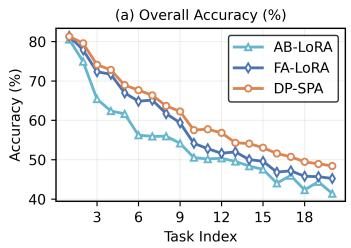

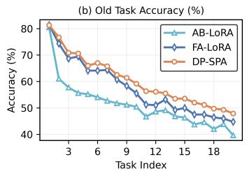

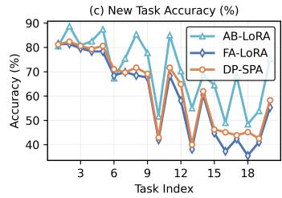  
Figure 6: Overall, old-task, and new-task accuracy across 20 incremental tasks on ImageNet-A.