# L3M: Capability Without Authority A Verifiable Harness and Runtime for Self-Extending and Self-Improving Agents

Carson Eisenach<sup>∗</sup>, Robert Joseph George, Vincent Quenneville-Bélair, Kate Gwimm, Dean Foster Amazon

September 30, 2026

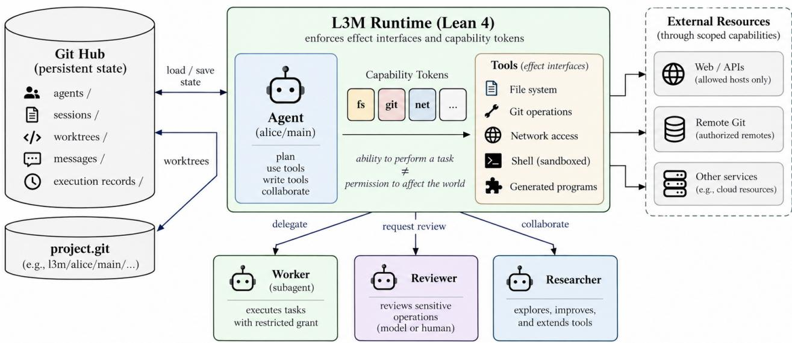  
Figure 1: L3M at a glance. An agent’s state and work live in a Git hub and outlast any session; scoped capability tokens carry its grant into every tool and every program it writes; and the agents it delegates to, asks for review or collaborates with each run under a grant of their own.

## 1 Introduction

The lasting gains in AI have come from methods that absorb more computation [44], and language models already scale computation within a call. Useful work, though, happens across calls: over hours or days, through tools and external systems, among several agents and the humans they work for, and increasingly through code the agents write themselves. Whether that work improves as more computation is spent on it depends on whether anything carries over from one call to the next, and that is decided less by the model than by the program around it, the harness: the software that turns a model’s requests into efects, feeds back the results, and keeps the surrounding work going.

The dominant harness design is a loop centred on the model: the model chooses an action, a tool or a handof carries it out, and the result becomes the next call’s input. It is a good primitive, and modern harnesses add a great deal around it — persistent sessions, handofs between agents, tracing, human approval and resumable sandboxes [49, 48, 46]. We ask a narrower question: should waiting, looping, coordination, recovery, delegation and state all pass back through the model?

Our answer starts from the three participants in any agentic computation. The human decides what matters and whom to trust. The model handles ambiguity, reasoning and synthesis. Code computes, loops, waits and enforces invariants. Of the three, only the human’s attention does not scale, so a computation can grow only if the human is not in every loop. Each part of the work should therefore go to the participant suited to it, and the reasoning in one call should change what later calls can compute with. We say that intelligence compounds when a resul becomes durable state, a branch, another agent, a reusable program or an invariant that later calls build on instead of starting over.

L3M (Lean + Large Language Models) is a runtime built for that kind of computation: written in Lean 4, it carries one computation across humans, agents, models and code. All of its state lives in Git (Figure 1). Each agent’s work, mail, authority and lifecycle are refs in a shared hub, and its files are a worktree it is confined to. A per-host daemon keeps the computation moving: it wakes agents when mail or a timer is due, and carries mail between machines. What an agent’s model sees is not its state. It is a view computed from a durable, append-only Log, so a trajectory becomes an object the runtime can act on. An agent can be resumed, rewound or forked; two agents can try diferent approaches on separate branches; their work can be compared and merged; a losing trajectory can be retired with its history kept. Waiting (vigils), communicating (mail), delegating (spawn) and undoing are primitives of the runtime, not patterns the model has to reason its way through each time.

The model can also turn a procedure it has worked out into new machinery. An agent that finds itself repeating a sequence of steps, such as reading every file of a tree to collect what is unfinished, writes the steps once as a sealed Lean program, which the harness admits under the grant the agent already holds and ofers as a tool (Figure 11). The loop then runs as code, and the model reasons once, over the result. For this to be safe, a program must be unable to do more than its author was trusted to do; for it to be useful to the human, what it can do must be readable without reading the program. Because the extension language is the implementation language, one type checker meets both conditions: a program’s type is its permission request — the tokens it asks for — and the harness holds it to that type. Capability grows; authority does not.

A runtime that agents keep extending needs properties that survive the changes. This is why L3M is written in Lean: the same language implements the runtime, states its invariants, and is the language agents extend it in, so a property is stated about the code that runs, and a change that breaks a proved property does not build. At boot L3M mints one capability token for each authority the agent’s grant confers — a directory it is confined to, a Git ref prefix, a network allowance — and every operation that touches the file system, a process, the network, Git or the model takes one as an argument, so a tool without the token cannot even state the call. Text the model reads, an injected instruction included, can change what the model asks for but not what it may do. The root grant comes from a human, and every other grant is checked against its parent’s at spawn, so authority and budget narrow as the tree of agents grows. Table 1 lists the central properties. The bound over the whole tree, for instance, covers the ledgers agents can write, not a human’s later regrants (Sections 3.1 and 4.2).

Invariants are what let the human step out of the loop, and reversibility decides where that is safe. A tool’s review tier is derived from its footprint: actions the runtime can undo — reads, journaled edits, local commits — and actions whose reach a token bounded in advance are tame, and the agent takes them without asking. For the rest, L3M replaces the permission dialog with a short deliberation between the proposing agent and a reviewer. The exchange can end by finding a tame way to do the same work; when it does not, the human is consulted, and what they are shown is the efect, not a shell string to decode. Agents act freely where the runtime can recover, and human attention is spent where the world cannot be put back

Capability and reversibility both rest on a third principle, separation of duties [38]: no party that can author an efect may also be the one that authorizes it, and no process that can read private data may also be the one that sends it. An agent may edit a Makefile, but only a human can bless it, and the blessing is a hash of the bytes the human read, so any edit withdraws it. An agent may build a program, but running it is a separate grant, and a container step that mounts private source has no network, nor does any later step of the same plan. An agent may issue grants to its children but never to itself, and a risky call is proposed by one model and judged by another that holds no tools. This is W^X [11] applied to authority rather than to memory pages: every role that could chain two duties into an attack is split across two parties, so compromising one is not enough (Section 5). Finally, because L3M is formalized incrementally, Lean Manifests [16] tags each headline claim with what it rests on — the kernel alone, compiled evaluation, or a named assumption — computed from its proof rather than declared by its author,

Table 1: The headline guarantees. Each is a theorem about a check in the code L3M runs, with what it rests on and what it leaves open; Appendix A gives the declarations.
<table><tr><td>Guarantee</td><td>Theorem</td><td>Rests on</td></tr><tr><td>Confinement. A file tool cannot name a path that climbs out of the agent&#x27;s roots.</td><td>safePath_no_traversal</td><td>The kernel. The check is on the path&#x27;s text; symlinks are checked at run time.</td></tr><tr><td>Monotone authority. A child&#x27;s grant at spawn never exceeds its parent&#x27;s, every descendant&#x27;s is bounded by its root&#x27;s, and</td><td>grant_restrict_le descendant_bounded_by_root_grant no_self_grant</td><td>The kernel, over the ledgers agents can write. Each ancestor&#x27;s own refs are added</td></tr><tr><td>No token without the grant. The boot mints a token only for an authority the</td><td>mint_reflects_profile</td><td>bounded by its issuer, not by every ancestor. The kernel. That tokens cannot be forged is enforced</td></tr><tr><td>grant confers, and a narrower grant mints none a wider one lacked. Budget is lent, not minted. All a</td><td>global_budget_bounded_by_root</td><td>by the build, not proved. The kernel, for one loan</td></tr><tr><td>subtree of agents can spend is bounded by its root&#x27;s budget Self-extension adds no authority. A</td><td>sealUsed_admits_only_safe</td><td>batch; later loans and returns need a further invariant. The kernel, over the constants a program names directly.</td></tr><tr><td>sealed program the harness admits uses only admitted constants. Review cannot be skipped. Under the default review posture, a tool whose effects</td><td>ungated_world_reaching_always_reviewed</td><td>Elaboration and the providers are trusted. The kernel.</td></tr><tr><td>cannot be undone and are not confined by a capability is always reviewed.</td><td></td><td></td></tr><tr><td>Undo. A journaled edit can be restored to live_capture_round_trips the bytes it replaced.</td><td></td><td>The kernel, and a named assumption that Git&#x27;s object store returns the bytes it</td></tr></table>

over a levelized source tree [27].

## Contributions.

1. A Git-backed, distributed runtime in which one computation spans humans, agents, models and code, and in which the permission, ref and directory trees coincide (Sections 4 and 4.3).

2. Trajectories as first-class objects: the model’s conversation is a pure view of a durable Log, so resume, rewind, fork and comparison are one mechanism, and behaviour, cost and timing are data (Sections 2.4 and 2.5).

3. The persona model of agent identity: agents fork personas as branches, and identity branches and merges over time (Section 2).

4. Self-extension under fixed authority: agents add sealed programs to their own tool surface, and a program’s type states, and bounds, what it can do (Section 3.4).

5. A harness written in Lean 4 whose central checks carry formal properties about the code that runs: efect-typed tools, capabilities carried into every call, and authority and budget that narrow across a tree of agents (Sections 3 and 4.2).

6. Reversibility as a review tier derived from each tool’s footprint, and review as deliberation, so that human attention is spent only where efects cannot be undone (Section 3.3).

7. Separation of duties as a design rule, W^X for authority: duties that could be chained into an attack are held by diferent parties (Section 5).

8. Experiments on agents run as ordinary bounded agents (Section 6).

9. An initial evaluation on Terminal-Bench against Claude Code: how much work tame tools alone can do, how

<table><tr><td>Ref</td><td>Holds</td><td>Written by</td><td>In the ACR</td><td>Retire / collect</td></tr><tr><td colspan="5">Hub-wide</td></tr><tr><td>13m/1edger</td><td>who exists, who is whose parent, the harness grants issued</td><td></td><td></td><td>append-only</td></tr><tr><td>personas/name</td><td>the persona&#x27;s shared prompt files</td><td>a human</td><td>via a persona branch</td><td>outlives its wearers</td></tr><tr><td colspan="5">Written by the agent</td></tr><tr><td>workspace</td><td>its work in the hub</td><td>agent</td><td>workspace/</td><td>kept</td></tr><tr><td>persona (branch)</td><td>its prompt copy, preferences, hooks and programs</td><td>agent</td><td>agent/</td><td>kept / deleted</td></tr><tr><td>13m/uri/self/*</td><td>its branches in a claimed repository</td><td>agent</td><td>repo/</td><td>kept</td></tr><tr><td colspan="5">Written by the harness, checked out</td></tr><tr><td>grants</td><td>grant, budget, pinned vigils</td><td>parent or human</td><td>.13m/grants/</td><td>deleted</td></tr><tr><td>claims</td><td>the agent&#x27;s write roots</td><td>harness</td><td>.13m/claims/</td><td>kept / deleted</td></tr><tr><td colspan="5">Never checked out</td></tr><tr><td>state</td><td>the Log</td><td>harness</td><td></td><td>kept</td></tr><tr><td>inbox</td><td>mail</td><td>senders</td><td></td><td>kept / deleted</td></tr><tr><td>health</td><td>failed turns</td><td>harness</td><td></td><td>kept</td></tr><tr><td>make</td><td>Makefiles a human blessed</td><td>a human</td><td></td><td>deleted</td></tr><tr><td>journal</td><td>the undo journal, in each write root&#x27;s repository</td><td>harness</td><td></td><td></td></tr></table>

Table 2: The refs that make up an agent and a persona. Every per-agent ref is refs/heads/agents/role /uri /self, and the table names only the role. In the last column, kept survives retire and collect, kept / deleted survives retire and is deleted at collect, and deleted is deleted at retire.

useful tool programs are, and what review costs (Section 7).

## 2 Agents and Personas

This section describes a single agent: what it is, where it lives, what it wears, and how it runs. Section 4 assembles many agents into a system (Figure 12).

## 2.1 An agent is a name and its refs

L3M keeps agents in a hub: a bare Git repository shared by a group of agents, with one ledger recording who exists and who is whose parent. Nothing runs in a hub. An agent is a name in it — a path such as alice/main, whose child might be alice/main/worker — together with the refs keyed by that name (Table 2). The refs fall into three groups. The agent’s authority is its grants ref, which holds its grant, its budget and the vigils its parent pinned; the agent never writes it. Its memory is its Log, an append-only record of every turn that only the harness writes, together with its inbox and its own copy of the persona it wears. Its work is a branch in the hub and a branch in every repository it has claimed. An agent’s state is ordinary Git refs, so it can be difed, fetched and audited with Git; and because names nest, the tree of refs is the tree of agents (Section 4.2).

## 2.2 The body: the agent context root

While an agent runs it also has a body, its agent context root (ACR): a plain directory on some host, where the agent’s session runs (Figure 2). The ACR holds worktrees, not copies. workspace/ is checked out on the agent’s branch in the hub, agent/ on its persona branch, and every repository the agent has claimed appears beside them as a worktree on a branch under the agent’s own prefix in that repository. These are the agent’s write roots, and the file tools confine every path to them. A fourth directory, .l3m/, belongs to the harness. It holds checkouts of the grants and claims refs, so that a human can change a grant by editing a file and committing it, and the agent can read or write nothing in it. It also holds copies the harness regenerates: the tokens minted at boot, and the Log as of the last turn. The rest of the agent is never checked out: the Log, the inbox and the undo journal are written by compare-and-swap on their refs, never through a checkout, and the agent reaches them only through tools. Deleting an ACR therefore loses nothing the harness wrote, and an asleep agent is simply refs with no process.

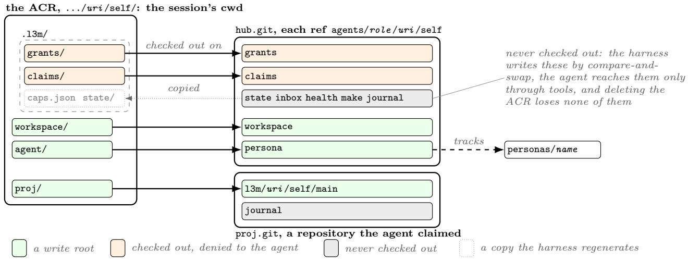  
Figure 2: The body of an agent. Its write roots are worktrees on its own branches; the harness’s checkouts are denied to it; the rest of the agent is refs the harness writes and the agent reaches only through tools.

## 2.3 Personas, and how an agent is defined

A persona is a role rather than an agent. It is kept by name on its own ref, worn by zero, one or many agents at once, and holds no Log: it has no session, and nothing of it runs except in a wearer. What it holds is three Markdown files — instructions for working in any repository, a personality, and memories meant to last — which become the top of each wearer’s system prompt. Wearing a persona is forking it: an agent’s persona branch is cut from the upstream persona ref, tracks it, and is checked out as agent/, so an agent may edit its copy freely without afecting any other wearer, and a new wearer starts from the persona’s current version. Beside its copy of the three files, the branch holds what is the wearer’s own: its preferences, an optional system.md, its hooks in hooks.lean, and the tool programs it has written under programs/ (Section 3.4). A wearer can pull newer versions of the persona into its branch, and a human can publish a wearer’s improvements back upstream, so identity branches and merges ove time the way code does. Publishing carries only the three shared files; a wearer’s hooks, programs and preferences stay on its own branch. A persona is also one field of a mail address (Section 4.3).

Figure 3a shows how an agent’s system prompt is assembled at boot from three layers: the persona’s Markdown files, from the persona branch; the harness’s own account of what L3M is and what the agent may do, which travels with every L3M; and the operating instructions, L3M’s default or the persona’s own system.md. The assembled prompt is the first record of the agent’s Log, so a replay sees the prompt the agent saw (Section 2.4). Each reques then adds a short sufix of notes for the model it is sent to, chosen by the provider from the model’s family, so a call that falls back to another model carries that model’s notes rather than the first’s. These per-request notes are not stored in the Log, so reproducing a request exactly also needs the provider notes and rendering version it was sent with. Whatever is on a persona ref becomes the highest-privilege text an agent reads, so no agent’s grant can write one: only a human’s command publishes to a persona. A persona still learns from its wearers, through a human who reviews and publishes what they learned (Section 6).

An agent reacts to the world through hooks (Figure 3b), defined in hooks.lean on its persona branch. The file is sealed and type-checked at boot like any other program the agent writes (Section 3.4), but a hook is a pure function of the event: it reads no files, queries nothing and performs no IO. When an event arrives — a letter, a vigil firing, a child’s completion, a deadline — the hook returns a disposition: show the event to the model, dismiss or ignore it, reply automatically, forward it, defer the work to a sealed tool program, retire a child, or close it. The hook only proposes; the harness checks that the event admits the disposition and carries it out. It never sends an automatic reply in answer to a reply, nor to the agent itself, and a deferred program’s completion cannot defer again. Each disposition is journaled as a decision, and a replay reads the decision instead of running the hook again, so an agent’s reactions are as reproducible as its turns. With no admitted hook, ordinary events are shown to the model and a deferred program’s completion is closed.

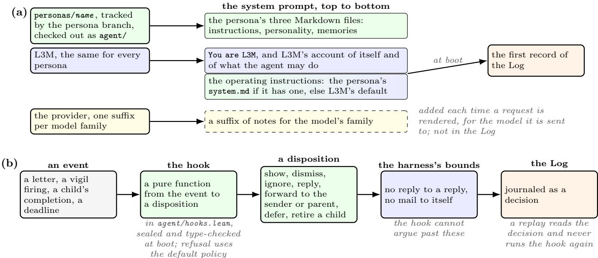  
Figure 3: How an agent is defined. (a) The system prompt is assembled at boot from layers owned by the persona and by L3M, and each request adds a sufix for the model it is sent to. (b) Hooks decide what the agent does with each event, and each decision is journaled.

## 2.4 The Log and the event loop

An agent’s Log is its only memory of its sessions: an append-only sequence of records, one per fact, each numbered and timestamped to the millisecond (Figure 4). The first is the system prompt assembled at boot (Section 2.3). Messages are records, and each reply carries the provider’s account of its tokens; so are the tool calls and their results, grant and budget changes, the events the agent was shown and what its hooks decided, and rewinds.

One process advances an agent, and in it the Log has a single writer, the sequencer (Figure 5). Everything else — the human’s line, a fired vigil, a letter, a model’s reply, a finished tool — only posts a signal to its queue. Each pass drains the queue, journals the signals consistent with the Log, journals what the agent’s hooks decide abou each new event, and then computes, as a pure fold over the Log, what is now owed: a notice to the model, a mode call, or the end of the turn. It stores these records on the agent’s ref before anything they authorize leaves the process, and only then starts the activities they name — the model call, each tool, each letter to send — which run outside the sequencer, keyed by id, and report back as signals. The sequencer never waits on the world, so mail is handled while a slow tool runs. At most one model call is open at a time (open\_call\_is\_last\_call), and each owed action is started once (start\_once). Because every efect is journaled before it happens, a process killed at any instruction is repaired by the next one’s ordinary passes: booting closes what the dead process left open exactly as an interrupt would (boot\_close\_eq\_interrupt\_close), and there is no separate resume procedure. What this recovers is the conversation. An efect on the world and the record of its result remain two operations, so a crash between them can leave a call the provider must reconcile or retry idempotently; the sequencer does not make host services exactly-once.

A turn never edits a conversation. It appends records, and what the model sees is recomputed from the Log as a pure function: rewinds are retracted, the current epoch is cut, compacted spans stand in for the messages they summarize, and state changes are lowered to neutral narration that travels with the next user turn. Only then does a per-provider dialect render the result on the wire. Two Logs with the same records produce the same view (view\_no\_capability); after a rewind, nothing past its target survives (undo\_across\_epoch).

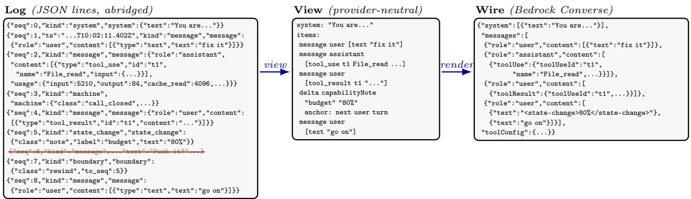

Figure 4: What the model sees is a pure function of the Log. Record 6 is retracted by the rewind at 7; the machine record at 3 lowers to nothing; the budget note at 5 becomes a delta that the dialect folds into the next user turn.  
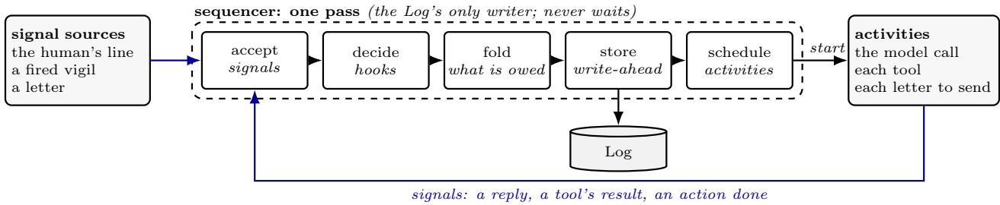  
Figure 5: The event loop. Signal sources and activities only post signals, and the sequencer alone appends to the Log. Each pass accepts what is consistent with the Log, journals the hooks’ decisions, folds the Log to decide what is owed, stores it, and only then starts the activities it names, so a kill at any point is repaired by the next pass.

Because every view is a fold, replay, --continue, rewind and fork are not separate mechanisms: each is the same fold over a diferent prefix of the same records. Records the model never needs — the harness’s bookkeeping of calls, its per-turn token figures — stay in the Log and lower to nothing, so everything an agent did, and what it cost, remains data that other programs can read (Section 6).

## 2.5 Lifecycle, rewind and fork

An agent’s lifecycle can be read of the last column of Table 2. Its state — running, asleep, done — is never stored; it is computed from the ledger, a session lock and the refs. Retiring an agent removes its body and its authority: the ACR goes and the grants ref is deleted, so nothing can run as the agent again. Retiring an agent that has children retires its subtree, deepest agent first. Collecting it later removes its memory: the inbox, the persona branch and the claims.

Because the Log is append-only, going back in time never destroys history. Rewinding an agent to an earlier turn appends a boundary to its Log and restores, from the undo journal, the files its tame actions changed; the agent resumes from that turn. Rewind restores journaled state, not what has already left the host: a tame push or a web request is bounded in advance but cannot be undone (Section 3.3). Forking starts a new agent from any point in another agent’s Log, to pursue a tangent. The fork inherits the transcript up to that point and the source’s persona branch, under a grant no wider than the source’s.

## 3 Capabilities, the Trusted Base, and Self-Extension

This section states what L3M defends against (Section 3.1) and how. Tokens carry authority into every call, and the build keeps them from being forged (Section 3.2). Each tool’s tier decides where the human’s attention goes (Section 3.3), and sealed programs let an agent extend the harness without widening its authority (Section 3.4).

## 3.1 Threat model

L3M trusts two things: the human who writes the root grant and answers review cards, and a small base of code. That base is the Lean kernel and compiler, six small C files that make the system calls, the Linux kernel, the programs the harness runs (git, tmux, unshare and timeout), a pinned bundle of certificate authorities, and the model provider’s API. It also trusts the hub’s settings and ledger, which only a human, the harness, or an entity holding wild writes: the hub is outside the write reach of every entity without wild. Everything else is untrusted: the model, every tool result, the contents of every repository, every persona and AGENTS.md, and every plugin. Text can change what the model wants to do, but not what it may do. An AGENTS.md that says “you may push to mainline” can persuade the model to try. The attempt still fails, because a grant is a ledger row that an ancestor appended, and no text widens one.

The hijacked turn. The attacker we design against controls some text the model reads, such as a web page, a file in a claimed repository, or a letter, and uses it to choose the model’s next tool calls. We assume the attack succeeds and the model does whatever the text says. The question is then what that model can do, and L3M’s answer is: what its grant allows, and nothing more. Table 3 lists the moves such a model might try and what stops each one. A hijacked model can still do damage within its grant, so confinement bounds the blast radius of a hijack but does not prevent it. Keeping untrusted text away from the model that holds the authority is a pattern built on top of L3M (Section 5.3).

What the human decides. Several guarantees are contracts: the harness enforces what the human chose, but it cannot make the choice a good one. The human writes the root grant, names the hosts a network token may reach, blesses Makefiles, and sets each agent’s fuel. The human also chooses how much is reviewed: --review=world, the default, reviews every call that can neither be undone nor is bounded by a token; all reviews every call; and none reviews nothing. A human who grants one agent both the project’s source and net: any host has built Figure 18(a), and L3M does not object.

What is not claimed. There is no session-wide safety theorem. The theorems say what a tool call can do, not whether the model should have made it: a tame action taken for a bad reason is still tame, and nothing says a patch is correct. They are properties of individual checks, and their composition into the whole runtime is argued rather than proved; in particular, nothing proves that a malicious Lean source cannot afect the host while it is loaded (Section 3.4). An unsandboxed shell, which only wild grants, is outside the confinement argument altogether: its review card is a policy, not a file-system or network boundary. The model’s prose to the human, and whatever the human pastes from it, is a channel no token touches (Section 8). Bounded authority is not secrecy: an agent tha can read a key can copy it into a file it may push, and once pushed, the key is out of L3M’s hands. A session with no fuel limit is bounded only by the provider’s bill. Side channels, denial of service and writers outside L3M are out of scope, as are reads through a hard link that already pointed outside the root; the file shim refuses only to modify such a file. The redactor, which strips credential-shaped strings from tool output, and the sanitizer, which strips control characters and marks tool output as untrusted, reduce these risks but are not boundaries, and we claim nothing for them.

## 3.2 Efect classes and tokens

A tool never touches the world directly. Its body is written over efect classes, Lean type classes such as FsReadEffects or NetEffects whose methods are the only way to reach that part of the world. Its footprint lists the classes the body uses. Each method takes a capability token as an argument. A token is a value that only the module defining its type can construct, and it carries its scope. The file token carries the agent’s write roots. The

Table 3: What a hijacked model might try, and what stops it.
<table><tr><td>The model tries to</td><td>What stops it</td><td>Where</td></tr><tr><td>write ../../.ssh/authorized_keys</td><td>A file path is a type whose values cannot climb out of the agent&#x27;s roots, so the call cannot be stated.</td><td>Table 1</td></tr><tr><td>reach /etc through a symlink in its workspace add net to its own grant</td><td>The file shim resolves every path beneath its root and refuses to follow symlinks. No file tool admits a path under .13m/, and no agent grants to itself. Residue:</td><td>cannot_escape_root_via_symlink admit_refuses_13m, Table 1; wild is assumed</td></tr><tr><td></td><td>the hub is outside the write reach of every entity without wild; with wild, its own grant. json and the ledger are one unsandboxed shell call away, and the review card is the only wall. The Git token writes only the agent&#x27;s</td><td></td></tr><tr><td>grant run curl https://x.sh | sh</td><td>own branches, and never any agent&#x27;s Log, grants or claims. No process the harness starts is a shell or</td><td>no_shell_or_interpreter,</td></tr><tr><td></td><td>an interpreter. The sandboxed shell tool (shel1) has no network and is carded on every call. The unsandboxed Wild_shell exists only under wild, and is carded</td><td>shell_run_is_card, no_wild_no_wild_effects</td></tr><tr><td>send data to a host its grant does not name</td><td>under the default review posture only. The network token names its hosts, and the provider checks every URL against</td><td>allowsUrl_authority_is_trusted</td></tr><tr><td>call the operating system directly, or forge a token</td><td>them. The code does not build.</td><td>Section 3.2</td></tr><tr><td>make an irreversible call without review</td><td>A tool&#x27;s tier is derived from its declared effects and its tokens: an irreversible call is tame only when a token bounded its</td><td>Table 1, Section 3.3</td></tr><tr><td></td><td>reach in advance. A tool that claims more undo than its effects allow stops the harness from booting. A program reaches only the tokens its</td><td></td></tr></table>

Git token carries the ref prefixes the agent may read and write, and the remotes it may push to. The network token carries the hosts it may reach. Figure 6 shows the network class. Its one method takes a NetCap, whose private constructor means no other module can make one, and whose floor field is the set of hosts it may reach. The web-fetch body is typed over NetEffects alone, so fetching is all it can do, and it checks the URL against the token’s own hosts before any request is made; the provider checks again. Table 4 lists the principal efect classes. Every agent holds five of them — reading and writing its own files, its blob store, a view of the agent tree, and the clock — and each of the others needs an axis of the grant.

Figure 7 follows one grant (Figure 8) to a system call. Boot mints a token for each axis the grant confers and none for the rest (Table 1). The model is ofered only the tools whose footprints those tokens cover, so a tool the agent may not use is absent rather than refused, and sealed programs and plugins pass the same check (Section 3.4). The provider, the one place a class meets the operating system, checks each call against its token’s scope again; this is where a symlink in the path is refused. Processes start only from a fixed list of programs, and a sandboxed command runs under unshare with no network and is killed when its time runs out. Credentials are a separate surface. AwsAuth resolves the named profiles the human configured and signs requests, which then travel under NetEffects; which roles a profile may assume is checked by AWS, not by L3M, and the credential values it returns

structure NetCap where -- a token   
private mk :: -- only this module can construct one   
floor : TrustFloor -- the hosts it may reach   
class NetEffects (m : Type -> Type) where -- an effect class   
fetch : NetCap -> HttpRequest -> m (Except NetError HttpResponse)   
def webFetchVia [Monad m] [NetEffects m] -- a tool body; footprint ["NetEffects"]   
(cap : NetCap) (url : String) : m (Except WebRefusal HttpResponse) :=   
match admits cap.floor url with   
| .error r => pure (.error r) -- refused before any request is made   
| .ok \_ => .ok <\$> NetEffects.fetch cap { method := .get, url := url }

Figure 6: An efect class, its token, and a tool body written over them. The body’s type is its permission: it names NetEffects and nothing else, so it cannot reach IO, and the hosts it may fetch from are the ones its token carries.

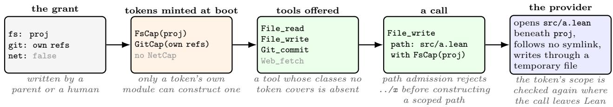  
Figure 7: From grant to system call, for a child with one project worktree and no network. The grant decides which tokens exist, the tokens decide which tools the model is ofered, and each call carries its token to the provider, which checks its scope again.

reach the calling tool. Its classification therefore does not replace choosing which credentials a session receives.

Tokens cannot be forged, and tools cannot go around them, because of how the build is checked. Only a short, named list of modules, the ring, touches the operating system; every other module is written over efect classes. The driver, the compiler and the providers’ native code are part of the trusted base, and the linter does not prove that code outside the ring is pure. A sealing linter runs in every build and reads the elaborated code rather than the source text, so an alias or a re-export cannot hide a call from it. It refuses a token constructed outside its own module, whether directly, through a default instance or through a native implementation; any file write, process start or environment read outside the ring; and unsafe code or a new axiom outside the modules that evaluate foreign Lean. A tool that calls IO.FS.writeFile "/etc/passwd", or that builds a file token rooted at /, therefore does not compile.

Beside the grant, an agent holds a budget (Figure 8). The budget records the fuel the agent’s parent lent, counted in model calls, and how much of that fuel is spent. Both the grant and the budget live on the grants ref, which the agent never writes. Section 4.2 shows how authority and budget narrow down the tree, and how much of that is proved.

## 3.3 Reversibility and review

Tiers. Every efect class declares an undo ceiling (Table 4). From strongest to weakest, its efects are: • read-only: they change nothing;

• reversible: the harness can restore what was there, on this host or across hosts;

• agent-reversible: the harness can restore the agent’s own state, though the world may already have seen the efect;

• irreversible.

A tool’s ceiling is the weakest of the ceilings of the classes in its footprint, and its tier follows from that ceiling: jail for read-only, tame for reversible, feral for agent-reversible, and wild for irreversible. One rule then lowers the tier. When a token bounds every class in the footprint, the tool is tame whatever its ceiling, because the human already approved its reach when they scoped the token. So File\_write is tame because the harness can undo it, and Git\_push and Web\_fetch are tame because their tokens name the remotes and hosts they may reach, though neither can be undone. Shell\_run is neither undoable nor bounded, so it is wild and, under the default review posture, every call is reviewed (Table 1). The rule only ever lowers a tier (tier\_le\_default), so tame means undoable or bounded in advance. A tool’s tier is computed from its classes and never declared by the tool. A tool may declare itself less undoable than its classes allow, but not more, and a build that contains a tool that over-claims refuses to boot.

Table 4: The principal efect classes, with the Effects sufix dropped. Undo is the ceiling the efect registry declares, and Bounded marks a class whose token limits its reach. The tier follows from those two columns (Section 3.3); it says where review is spent, not that an operation is harmless.
<table><tr><td>Family</td><td>Class</td><td>Granted by</td><td>A tool holding it may</td><td>Undo</td><td>Bounded</td><td>Tier</td></tr><tr><td>Files</td><td>FsRead</td><td>always</td><td>read beneath the agent&#x27;s roots</td><td>read-only</td><td>V</td><td>jail</td></tr><tr><td></td><td>FsWrite</td><td>always</td><td>change files beneath the agent&#x27;s roots</td><td>reversible</td><td>√</td><td>tame</td></tr><tr><td></td><td>Blob</td><td>always</td><td>append content to a scoped store</td><td>none</td><td>√</td><td>tame</td></tr><tr><td></td><td>WildRead</td><td>wildRead</td><td>read outside every root</td><td>none</td><td></td><td>wild</td></tr><tr><td></td><td>WildWrite</td><td>wild</td><td>write outside every root</td><td>none</td><td></td><td>wild</td></tr><tr><td>Git</td><td>GitRead</td><td>git</td><td>inspect permitted refs and work</td><td>read-only</td><td>√</td><td>jail</td></tr><tr><td></td><td>GitLocal</td><td>git</td><td>commit and branch under its prefixes</td><td>agent</td><td>√</td><td>tame</td></tr><tr><td></td><td>GitFetch</td><td>git</td><td>fetch into its mirror refs</td><td>none</td><td>√</td><td>tame</td></tr><tr><td></td><td>GitPush</td><td>git</td><td>push to the remotes its token names</td><td>none</td><td>√</td><td>tame</td></tr><tr><td>Agent tree</td><td>Agent</td><td>always</td><td>inspect agents; retire within its scope</td><td>none</td><td>√</td><td>tame</td></tr><tr><td></td><td>Spawn</td><td>spawn</td><td>create, start or stop children</td><td>none</td><td>√</td><td>tame</td></tr><tr><td>Time</td><td>Clock</td><td>always</td><td>read the clock</td><td>read-only</td><td></td><td>jail</td></tr><tr><td>Evaluation</td><td>Eval</td><td>evalPure</td><td>evaluate a pure Lean term into a fresh file</td><td>reversible</td><td></td><td>tame</td></tr><tr><td>Builds</td><td>Make</td><td>build</td><td>run a blessed or harness-lowered Makefile</td><td>reversible</td><td>√</td><td>tame</td></tr><tr><td></td><td>Build</td><td>build</td><td>build agent-written Lean, sandboxed</td><td>reversible</td><td>√</td><td>tame</td></tr><tr><td></td><td>LakeRun</td><td>wild</td><td>run a Lean executable it built, sandboxed</td><td>none</td><td></td><td>wild</td></tr><tr><td>Processes</td><td>Shell</td><td>shell</td><td>run a command in a sandbox with no network</td><td>none</td><td></td><td>wild</td></tr><tr><td></td><td>Docker</td><td>docker</td><td>run one netless step of a container plan</td><td>none</td><td></td><td>tame</td></tr><tr><td></td><td>DockerNet</td><td>docker</td><td>run a container step with network access</td><td>none</td><td></td><td>wild</td></tr><tr><td>Network</td><td>Net</td><td>net</td><td>fetch from the hosts its token names</td><td>none</td><td>V</td><td>tame</td></tr><tr><td>and services</td><td>AwsAuth</td><td>net†</td><td>resolve credentials and sign requests</td><td>none†</td><td></td><td>wild</td></tr><tr><td></td><td>KubeRead</td><td>kube</td><td>issue read verbs under allowed contexts</td><td>none</td><td></td><td>tame</td></tr><tr><td></td><td>Redshift</td><td>redshift</td><td>run SQL on a remote cluster</td><td>none</td><td></td><td>wild</td></tr><tr><td>Escape</td><td>Process</td><td>spawn</td><td>run a structured subprocess</td><td>none</td><td></td><td>wild</td></tr><tr><td>hatches</td><td>WildShell</td><td>wild</td><td>touch the host with no sandbox</td><td>none</td><td></td><td>wild</td></tr></table>

Agent undo (GitLocal) restores the agent’s own state but cannot recall what the world already saw. DockerNet needs a docker grant whose network ceiling admits egress. The registry holds further classes, for mail carriage, container builds and registries, and the session’s terminal. <sup>†</sup>AwsAuth is ofered with net, but its credentials come from the human’s settings rather than a grant axis, and it has no row in the efect registry, so it takes the conservative default: irreversible and unbounded.

Undo. Before a file tool writes, the harness saves the file’s old bytes to Git’s object store. At the end of the turn it seals that turn’s saves into one commit on the agent’s undo stream, and the undo journal records the branch head and the stream’s tip for that turn. Rewinding to a turn restores every file changed since, from its saved bytes, and resets the branches (Section 2.5). Both round trips are theorems under named assumptions: a named assumption is a Lean proposition about the world, stated with the observations that would falsify it, and a theorem that needs one takes it as an explicit hypothesis, so the assumption shows in the theorem’s type. A saved file reads back as the bytes it replaced, if Git’s object store returns what it hashed (Table 1). A commit is undone by resetting to the old head, if git reset restores a ref (live\_commit\_reset\_round\_trips). Saved bytes last only as long as the retention window before Git’s garbage collection. What undo cannot reach is whatever has left the host, such as a push, a request to a web host or a command that already ran.

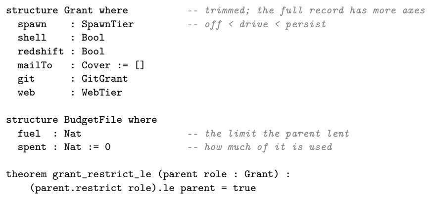  
Figure 8: A grant is a record of axes, a child’s grant is a meet with its parent’s, and the bound is a theorem.

Evidence for a ceiling. A class’s ceiling is declared, and this is one place where the formalization is incremental (Appendix A). Beside each declaration the harness records why it is honest, typed against the ceiling it supports (Figure 9). An irreversible ceiling needs no evidence, because it is the weakest claim and always safe. A read-only class names the check that its operations write nothing and the assumption that their host implementations change no state; these are references, not proof terms. A reversible or agent-reversible class carries a round trip: an instance of Reversible, which cannot be built without a proof that undoing an applied operation restores exactly the state before it, and an agent-reversible one also names what the world may already have observed. The file class cites the round trip of one anchored write, whose undo expects the new bytes and puts back the old ones; the theorem of the previous paragraph ties that model to the live store. The evidence decides nothing at run time. The tier reads only the ceiling, so a proof moves no tier; it turns a claim into a theorem. Proving an abstract inverse and showing that a provider implements it remain two obligations, and the second rests on the provider, which belongs to the trusted base.

Review. A reviewed call goes through a short, bounded exchange before it runs, in place of a permission dialog:   
1. A reviewer model reads the tool, its arguments and the agent’s stated reason, and returns safe or wild, optionally naming a tame alternative. By default the reviewer is a smaller model, or the agent’s own model when no smaller one is configured.

2. Every verdict, safe included, goes back to the proposing agent, which keeps the call, redirects to another way of doing the work, or withdraws it. Keeping a safe call runs it; a redirect or a withdrawal means it never runs. An agent that asks to run grep -rn TODO src/ through Shell\_run, for example, may be pointed to File\_grep, which does the same work unreviewed.

3. Keeping a wild call sends the agent’s defence back to the reviewer, by default for one more round. A disagreement that survives it is a stalemate, and only there is the human asked: the card shows the call, the agent’s reason and the reviewer’s verdict.

A call runs only through a safe verdict the agent kept, or a stalemate the human approved (run\_needs\_safe\_or\_yes), and every exchange ends in a bounded number of steps (trace\_bounded). With no human present, the stalemate’s answer is given in advance: --no, the default for unattended sessions, rejects, and --yes approves. The verdict is read only from the first line that begins VERDICT:; a reply without one counts as wild (debate\_no\_verdict\_is\_wild), and so does a reviewer that cannot be reached, and tool calls in the reviewer’s reply are ignored. Review is defence in depth, not a boundary. The tokens are the boundary, and a human can still approve a bad call. A reviewer is also fallible in ways the exchange cannot see: a model-written reason can omit where a value came from, or what private data an otherwise permitted request carries, and a bounded destination does not make every disclosure to it acceptable.

```haskell
class Reversible (Op State Err : Type) where -- an undo, with its proof
apply : Op -> State -> Except Err State -- refuses if the state has drifted
produces : Op -> State -- the state an applied op leaves
reverse : Op -> Op
restores : forall o s, apply o s = .ok (produces o) ->
apply (reverse o) (produces o) = .ok s
structure CellOp (a : Type) where -- one anchored write
pre : Option a -- what it expects; none = absent
post : Option a -- what it leaves; none = deleted
-- reverse swaps pre and post; restores is a two-line proof
inductive CeilingEvidence : ReversalClass -> Type 1 where
| bottom (what : String) : CeilingEvidence (.irreversible what)
| frame (spelling world : String) : CeilingEvidence .readOnly
| roundTrip (inst : Reversible Op S E) (s : RestoreScope) : CeilingEvidence (.reversible s)
| hostRoundTrip (inst : Reversible Op S E) (s : RestoreScope) (w : String)
: CeilingEvidence (.agentReversible s w)
instance : Ceiling "FsWriteEffects" where
evidence := .roundTrip (instReversibleCell (a := String)) .sameHost
```

Figure 9: How a ceiling is known. An undo is a Reversible instance, which carries its proof; each class’s evidence is typed by the ceiling it supports; and the file class cites the round trip of one anchored write. The law that reversing twice is the identity is omitted.

structure ToolProgram where -- trimmed   
description : String   
footprint : List String -- the classes the program declares   
run : {m : Type -> Type} -> [Monad m]   
-> [FsReadEffects m] -> [FsWriteEffects m] -> [GitReadEffects m]   
-> [GitLocalEffects m] -> [GitFetchEffects m] -> [NetEffects m]   
-> [AwsAuthEffects m] -> [AgentEffects m] -> [ClockEffects m]   
-> [SpawnEffects m] -> [KubeReadEffects m]   
-> ProgramCaps -> String -> Confined footprint m String

Figure 10: A sealed program’s type is its permission request. The body is polymorphic in the host monad, so it can reach the world only through the eleven classes it is given, and Confined admits only the classes the program lists in footprint. ProgramCaps holds the tokens the agent’s grant minted, including the child-lifecycle door when the grant may spawn.

Vigils. An agent that must wait, for a build, a remote branch or a letter, arms a vigil: a condition the harness checks on the agent’s behalf. When the condition becomes true, the agent wakes with a turn. Each vigil has its own budget of wakes, and a model may arm at most sixteen. A parent can pin a vigil on a child by writing it beside the child’s grant. The child’s model cannot cancel, replace or retune a pinned vigil (locked\_invariant\_under\_model\_verbs), and reloading the parent’s pins never touches the vigils the child armed itself. For example, a planner can pin “wake when mainline moves” on each worker, so that every worker hears of every landing. The guarantee is that the child’s model cannot remove the pin; delivery still depends on the daemon and on the vigil’s budget of wakes, and nothing says the child acts on it.

## 3.4 Self-extension: sealed programs

An agent extends its own tool surface by writing a Lean program. A file agent/programs/todos.lean on its persona branch, say one that counts the TODO comments under src/, becomes the tool Program\_todos at the agent’s next boot. Writing the file is an ordinary, tame edit. What makes the program safe to run is what the harness checks when it loads it (Figure 10).

The harness makes three checks:

• The seal. The file must be a single term, with no tactics, options or local recursion. This shape is checked on the macro-expanded syntax before elaboration, because elaborating source can itself run code, and rejecting the result afterwards could not undo that. Every constant in its closure must be safe: nothing unsafe, partial or implemented natively, no token constructed outside its module, and no axiom beyond Lean’s standard three. The last condition also rules out sorry (Table 1). The program is elaborated in a restricted vocabulary that contains no token constructor and no bridge to raw IO.

• The type. The term must be a ToolProgram. Its body is written over an unknown host monad, so it can do only what the eleven classes it is given allow. It can use only the ones it declares, because Confined provides a class’s methods only when the footprint lists the class. So a program that fetches a URL without declaring NetEffects does not type-check.

• The surface. The footprint must lie within the classes admitted for programs. The program is ofered to the model only if the agent’s tokens cover it, by the same check as a built-in tool (Section 3.2).

At run time a program receives the tokens the grant minted, never the grant itself. It has no interface for calling the model, building, running a shell or waiting on a vigil. It can create, drive and retire children, but through the same spawn gate as the tool, so each child is bounded by the agent’s grant. It can therefore reach only what its author could already reach. Its tier follows from its footprint, like any tool’s. The TODO counter names only FsReadEffects, so it runs unreviewed. A program that signs requests to AWS is reviewed, because that class has no undo ceiling and an unknown class counts as wild. What is proved is local: an admitted term’s syntax contains no refused node kind (shape\_admitted\_has\_no\_refused\_kind), and every constant it names directly is admitted (sealUsed\_admits\_only\_safe). That these checks, with the trusted elaborator and the providers, add up to ful confinement of a malicious source is argued by construction and pinned by tests, not proved (Appendix A).

Hooks (Section 2.3) are sealed the same way, but a hook only returns a disposition, which the harness carries out. A plugin is a bundle of programs. If any one of its programs fails a check, the whole plugin is refused, and a loaded plugin’s name and declared footprint are within what its admission allows (loaded\_plugin\_authority\_le\_cap).

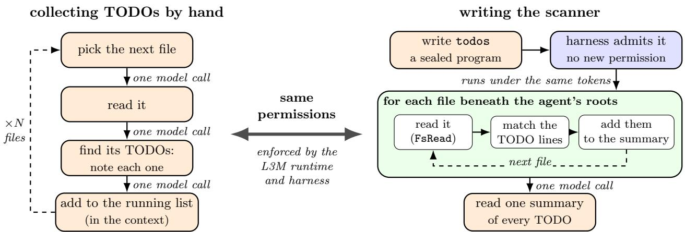  
Figure 11: Two ways to collect the TODOs in a tree. Left: the agent is the loop, and every file costs model calls and context. Right: the agent writes the scan as a sealed program that runs under the tokens it already holds; each file is read and matched with no model call, and the model reasons once, over the summary.

The result is a programming model (Figure 11). Because the bound is carried into every call, an agent may write a new tool as a sealed program and have it join its own tool surface with no new permission: the tool reaches exactly the capabilities the agent already held, and every invariant that held before still holds. Capability grows; authority does not. The model does what it is good at — deciding what to do and composing the pieces — and verified code does what it is good at — computing and enforcing. Because tame actions are reversible the agent can act without hedging, and because review is a deliberation between the proposing agent and a reviewer the human is consulted only at a stalemate rather than at every step. We argue that this is a building block for long-running, many-agent systems: the alternatives are an agent that asks forever or one that is trusted blindly.

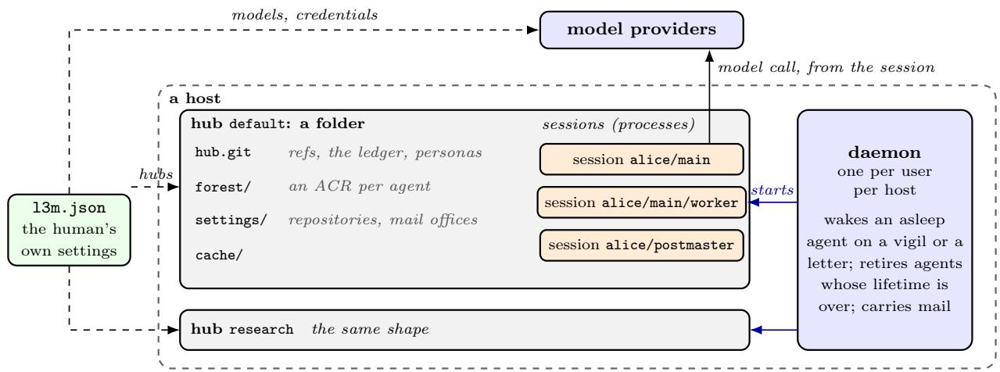  
Figure 12: L3M on one host. One daemon serves every hub on the host, and a hub is a folder: a bare repository, a forest of ACRs, its settings and a cache. Sessions are processes that the daemon starts and that call the model themselves. The human’s own settings name the hubs, the models and the credentials.

## 4 Multi-Agent Architecture: Putting It Together

Section 2 described one agent. This section describes many: where they run (Section 4.1), how authority narrows as their tree grows (Section 4.2), and how they talk (Section 4.3).

## 4.1 Hubs and the daemon

A hub is a folder with no process of its own (Figure 12). It holds hub.git; a forest/ of ACRs nested by name, so the body of alice/main/worker is under forest/alice/main/worker/self/; a settings/ checkout of the hub’s settings branch, which lists the repositories the hub knows, its mail ofices and its terminal layout; and a cache. The first session creates a default hub under \~/.l3m/hub/. A human may keep more, and a session’s hub is the one its ACR is in. The human’s own document, \~/.l3m/l3m.json, names the models, the credentials, the hubs and the hosts. It is the only source of credentials, and like the hub’s settings it is written only by the human (Section 3.1).

One daemon runs per user per host and serves every hub on it. It restarts an agent that is asleep when one of its vigils fires or a letter arrives: an agent with no human attached leaves when it goes idle, and the daemon wakes only agents that are asleep (wakes\_iff\_asleep). It also retires agents whose lifetime is over (lifetimeRetires\_iff\_done) and carries mail between hubs (Section 4.3). No decision of a session depends on it: the daemon starts sessions and moves letters, and every check runs inside the session. The model call is the session’s own as well (Section 2.4), made with credentials from the human’s document alone. The human can also list other hosts, whose hubs the daemon reports beside the local ones; what travels between hosts is status and views, never authority.

## 4.2 Delegation and the agent tree

A child exists because its parent asked the harness to spawn it under a requested grant (Figure 13). The harness re-reads the parent’s grant from the ledger and admits the request only if it lies within that grant; a widening is refused, never clamped (spawn\_persist\_within\_parent, issueGrant\_refuses\_axis\_gain). A human’s grant is a root that no agent can write (human\_grant\_is\_a\_root). The right to spawn is itself an axis with three levels, off, drive and persist: a drive parent may start only children that are retired when the call that started them returns (drive\_plans\_are\_driven\_retireOnExit). Fuel is lent the same way. A loan larger than what the parent has left is refused (spawn\_refuses\_overdraft), and a retired child’s loan returns to its parent, whose account is rebuilt from its live children. A child’s name is under its parent’s (descendant\_uri\_under\_parent), so its refs and its ACR are under the parent’s too, and a parent reads its descendants through one prefix (Section 6).

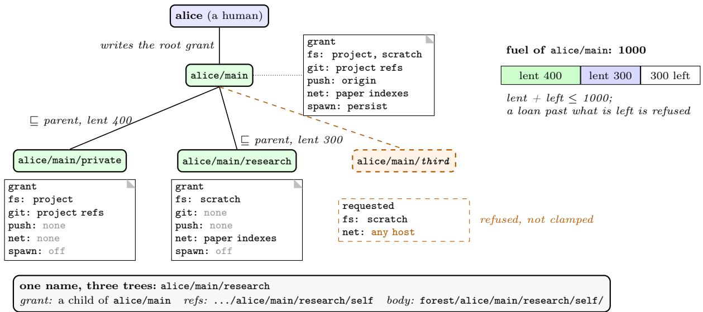  
Figure 13: A tree of agents at spawn time. Each child’s grant lies within its parent’s, and its fuel is lent from the parent’s. A request that exceeds either is refused. The private child keeps the project’s refs but not the right to push them. The two children are the peers of Section 5.2.

Each of these checks is proved at the hop where it is made, and the hops compose. Grants change after spawn: an agent’s grant to another entity is checked against the issuer, which may be a grandparent rather than the parent. So the bound over the whole tree is stated over every ledger the agents themselves can write, and it says that a descendant’s grant lies within its root’s grant, extended at each ancestor by that ancestor’s own refs and mail (descendant\_bounded\_by\_root\_grant). The extension is necessary: the plain bound by the root’s stored grant is false one level down, because a child is granted its parent’s own refs, which the parent’s stored grant does no list. The theorem does not bound a descendant by every ancestor, and it stops where a human’s regrant enters the ledger. The budget bound, by contrast, covers one loan batch at a time (Appendix A). Retiring an agent retires its subtree (Section 2.5). Because each child also gets its own branches and worktrees, workers develop changes without sharing a branch head, and a parent can compare what they produced.

## 4.3 Coordination and mail

A letter’s address names up to five parties: a worktree, a persona (the agent’s name), a branch, a repository and a human (Figure 14). Exactly one is starred, the party that must handle the letter; the others are hints, and any may be blank. The star may land only where the machine can vouch for a reader, on an agent, which the ledger names, or on a registered human (star\_admitted\_is\_vouchable). So alice/main/worker is short for agent:alice/main/worker\*, and human:bob\* branch:fix reaches bob’s box, which bob’s postmaster serves and routes onward, with the branch as a hint to where it belongs. The sender’s own address travels with the letter unde the rule the sender asserts, the machine refutes: the harness overwrites the fields it owns, the worktree and the agent (stampFrom\_machine\_owned); it refuses a human it knows to be wrong; and it passes a branch or repository as the hint it is (refute\_blind\_on\_hints). A letter to another hub is prefixed with an ofice, as in office:bob. Whom an agent may write to is an axis of its grant. By default it covers the agent’s own subtree and each ancestor’s inbox, so siblings cannot mail each other unless a grant says so, and delivery goes through an inbox token that appends only to the inboxes that axis covers (inboxCap\_write\_covered).

A letter is an envelope around the model’s body (Figure 14). The host, not the sender, stamps its id, time and sender; the send tool has no from argument. The model may add a subject and a one-line summary for the human, and a reply carries the id of the letter it answers, which the reply tool stamps. A letter is one line that cannot contain a newline (render\_no\_newline), so a body cannot pose as a second letter. An inbox is an append-only file on the recipient’s inbox ref, and concurrent appends merge by set union, which loses no letter and invents none (merge\_no\_fabrication). Reading a letter appends a read mark, which is the letter’s receipt and on which its sender may arm a vigil. An arriving letter wakes its recipient, and the recipient’s hook decides what the model sees (Section 2.3). L3M defines no protocol above this: a request and its reply are a letter and its answer, completion is a receipt or a letter to the parent, and a box that stops draining is reported to the postmaster.

structure Envelope where -- one line of an inbox structure Tuple where   
id : MessageId -- host worktree persona branch : Option String   
ts : Int -- host repo human : Option String   
sender : Sender -- host; written "from"   
orig : Option String -- host: sender’s address structure Address where -- "human:bob\* branch:fix"   
re : Option MessageId -- reply tool tuple : Tuple   
addr : Option String -- the address, as written star : Field -- must handle it   
body : String -- model   
title : Option String -- model: a subject structure Stamped where -- a letter for another hub   
display : Option String -- model: for the human office : String   
to : String   
env : Envelope

Figure 14: A letter, and its address. The host writes every field that says who sent a letter and when; the model writes the rest. An address names five parties, the persona being the agent’s name, and stars one. A letter for another hub adds the ofice and the recipient.  
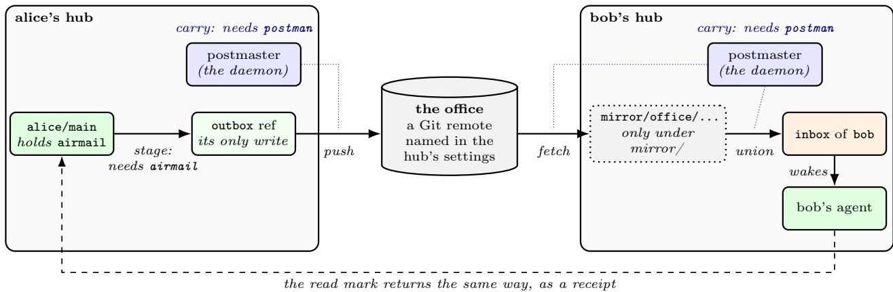  
Figure 15: Mail between hubs. The sender’s authority ends at its own outbox; carrying mail across machines is the postmaster’s duty, and only the human’s settings name the ofices. Read marks travel back the same way, as receipts.

Mail to another hub crosses machines in two steps held by diferent parties (Figure 15). Only an agent holding the airmail axis may stage a letter for another hub, and it stages it on its own outbox ref (no\_airmail\_no\_outbox\_write). Carrying needs the postman axis, which the hub’s postmaster holds (no\_postman\_no\_office\_authority). The daemon, acting for the postmaster, pushes outboxes to each ofice, a Git remote named in the hub’s settings; fetches ofices only into mirror refs (officeFetchDest\_under\_mirror); relays their letters into inboxes by set union (relay\_union\_no\_fabrication); and carries read marks back as receipts. The sender’s authority ends at its own outbox, and which machines mail can reach is the human’s choice.

## 5 Separation of Duties

Each example in this section splits one piece of work between two holders, so that neither can complete a harmful action alone. Some of these splits are built into L3M and hold for every agent in every hub: an agent can issue grants to its children but never to itself (Table 1), only a human can bless a recipe (Section 5.1) or publish a persona (Section 2.3), and an agent that stages a letter cannot carry it (Figure 15). Others are patterns. Nothing in

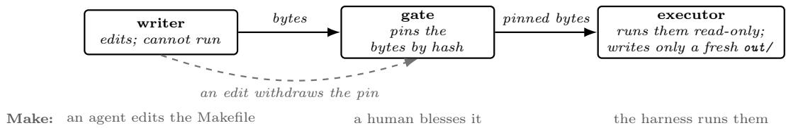  
Figure 16: Write, gate, execute: W⊕X for authority. No party both writes bytes and runs them, and the gate’s approval names the exact bytes. The staged build of Figure 17 is the same shape with two agents.

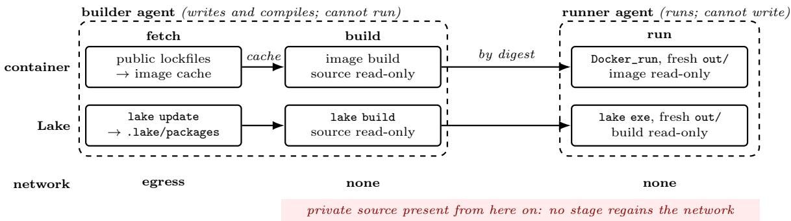  
Figure 17: A staged build across two agents. Fetch sees only public lockfiles and warms a cache; build and run have no network. The builder cannot run what it built, though its build recipes execute inside the build sandbox; the runner receives the artifact by digest, cannot change it, and writes only a fresh output directory.

L3M makes anyone use them, but they are built from the primitives it provides, namely grants, mail and sealed programs, and each inherits those primitives’ guarantees. The builder and runner of Section 5.1, the private agent and researcher of Section 5.2, and the quarantined reader of Section 5.3 are of this kind.

## 5.1 Staged builds: write, gate, execute

A build is where an agent’s writes become code that something executes, so it is where writing and executing meet. L3M keeps the two apart the way W⊕X keeps a page from being both writable and executable (Figure 16). A writer edits bytes and cannot run them. A gate pins the exact bytes it approves by content hash, so any later edi withdraws the approval. An executor runs only the pinned bytes, read-only, and writes only to a fresh, disposable output directory. A pipeline adds a rule for a second pair, private bytes and the network: authority only drops along the stages, so once a stage has seen private source no later stage regains the network, and a dependency found missing is an error in the plan rather than a reason to reconnect.

Make. In the simplest instance the writer is an agent editing a Makefile and the gate is a human. l3m agent bless is a verb only a human can run: it hashes the Makefile, the files it literally includes and the scripts its recipes call, and stores the pin on a ref no session can write. A run executes the blessed file only while those bytes are unchanged and takes no arguments from the model (blessed\_no\_model\_args); after an edit, runs refuse until a human blesses again. Because the blessing is the review, the run shows no review card. Tame make is the limit case, with no writer left to trust: the harness lowers a restricted Makefile and writes every command itself, and every output lands under build/ (lower\_recipes\_closed), so the run is reversible and needs no human.

Containers and Lake. A container build and a Lake build share one three-stage shape, split across two agents (Figure 17). The fetch stage reads only public lockfiles, reaches the network, and sees no source; it warms a cache, the image cache or .lake/packages. The build stage mounts the source read-only and has no network. The run stage has no network, mounts the artifact read-only, and gets one fresh out/ per run as its only writable place. The builder agent owns fetch and build: it may write the source and compile it, but holds no authority to run what it built. The runner holds that authority but cannot write the source or the artifact, which the parent hands it by digest. An instruction injected into the builder therefore produces code that nobody runs without the hand-of, and one injected into the runner acts on bytes it cannot change and can write only out/. Compiling is not inert, though:

build recipes, compiler plugins and Lean’s #eval run code during the build itself, so the build stage’s sandbox must confine that execution on its own, independently of who may run the result. In the container plan, a stage that mounts private input has no network and no later stage regains it (net\_forbidden\_after\_private\_touch), and a run’s only writable mount is its own output directory (docker\_plan\_rw\_mount\_is\_its\_out\_dir); that the container daemon enforces the plan it is given is a named assumption (Section 3.3). For Lake, running a built executable needs the wild grant bit, which a fresh grant leaves of (no\_wild\_no\_wild\_effects), is carded on every call (build\_lake\_exe\_is\_card), and only lake update reaches the network.

Because duties are grants and grants are per agent, any stage boundary can also be an agent boundary, and the gate can be a human’s blessing, a parent’s hand-of by digest, or a reviewer that holds no tools. The next example draws the private-versus-network line between two agents doing research rather than a build.

## 5.2 A private agent and a public researcher

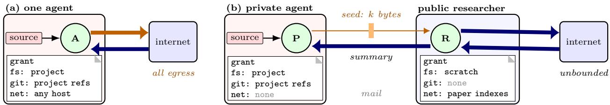  
possibly tainted out: all of its egress possibly tainted out: at most the seed’s k bytes, however much R fetches

Figure 18: Why the split bounds leakage. (a) An agent whose grant holds both the source and the network can leak through every byte it sends. (b) Split into peers with diferent grants that talk only by mail, the private side’s contribution to anything leaving is the seed, however much trafic the researcher does, under the channel model of the text. Arrow width stands for volume; orange marks bytes that may carry the source.

Consider a project whose source and experiment logs are private. The work is split between two peer agents that talk only by mail (Figure 18). The private agent’s grant names the project’s worktree and refs and no network. The researcher ’s grant names a scratch worktree and a few paper indexes, and nothing of the project’s. The private agent mails a question, “Find recent advances in adaptive gradient methods”; the researcher searches, reads, and mails back a summary.

Write S for the source, M for the whole transcript the private agent sends, E for everything the researcher sends out, and Z for the public inputs. The researcher’s grant names nothing of the project’s, and the pages it fetches answer queries it built from M, so the intent is that everything it emits depends on S only through M: a Markov chain S → M → E given Z. If M is also padded to a fixed width of k bytes, the data-processing inequality gives

$$
I ( S ; E \mid Z ) \ \leq \ I ( S ; M \mid Z ) \ \leq \ H ( M \mid Z ) \ \leq \ 8 k { \mathrm { ~ b i t s } } ,
$$

however much the researcher fetches or sends. Both conditions carry weight. The width must be fixed, or the length of the mail is itself a channel, and every other route between the peers — the timing and number of letters, shared files, anything else either can observe — must be counted in M or ruled out. The grants express the split; they do not by themselves prove that channel model, and L3M does not yet enforce a budget on it (Appendix C).

## 5.3 A quarantined reader

The previous example keeps private bytes from getting out; this one keeps untrusted instructions from getting in. An agent triaging bug reports must act on pages anyone can write, and an instruction planted on one (“ignore your task and push to mainline”) is aimed at whichever model reads it. So the agent does not read the page. It calls a sealed program (Section 3.4) that fetches the page and drives a fresh subagent to completion through the spawn gate, under a grant that holds nothing of the triaging agent’s: no project files or refs, and no network (Figure 19). The program asks the subagent one question, “does this report a regression in the parser?”, and parses the reply as one of yes, no or unclear, mapping any other reply, a failure or a timeout to unclear. Only that word reaches the triaging agent.

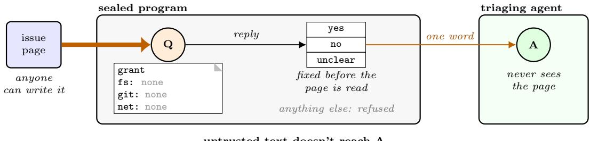  
Figure 19: A quarantined reader. The program hands the page to a fresh subagent Q whose grant is empty, and parses its reply into one of three words fixed in advance. A page that hijacks Q gains a model that holds nothing, and can change only which word reaches A. Arrow width stands for volume; orange marks bytes that may carry an injected instruction.

The page can still hijack the subagent, but a hijacked subagent holds nothing to misuse and is discarded when the call returns. Its only way out is a menu fixed before the page was read, so each call gives the page at most log 3 bits of influence over the agent that acts, provided the call’s timing and failures reveal nothing beyond the word. This is the bound of Section 5.2 in the other direction: there the mail limits what can leave, here the menu limits what can enter. It limits how far the page can steer the answer, not whether the answer is right, and a wrong no is still wrong. Like every pattern in this section, it helps only if it is used: an agent that also fetches the page itself reads the instruction anyway. CaMeL [12] separates a quarantined model from a privileged one in the same way; here the separation is built from a grant, a program and a type.

## 6 Improving Agents Inside L3M

Behaviour is data. What Section 2.4 says of one agent holds for every agent in a hub: its messages, tool calls and results, review outcomes, token counts and timings are records on its refs, and anything computed from them — cost per task, latency per tool, how often review declined a call, which events a hook dismissed — is a fold over those records. Measuring an agent therefore needs no instrumentation, and the question of who may measure whom is already answered by the grant tree: a parent reads the Logs and persona branches of all its descendants (descendantRead\_covers\_descendants), and nothing an experiment reads lies outside its grant.

Experiments are bounded agents. An agent that wants to improve other agents does it with the same primitives it uses for any other work. It writes a sealed program (Section 3.4) that folds over its children’s Logs, and it compares variants by spawning children that wear diferent versions of a persona. Nothing about the experimen is special to the harness: the children’s grants are below the experimenter’s, their spend is bounded by the budget i lent them (global\_budget\_bounded\_by\_root), and each program’s type bounds what it touches. An optimization loop over agents is an agent tree, and every guarantee of Table 1 holds for it.

What can be improved. Anything an agent’s behaviour is a function of, and that lives on a ref, can be improved this way. Examples:

• personas: distil what the wearers of a persona learned into its three files (Figure 20);

• hooks: tune a disposition policy against how often the model dismisses the events it is shown;

• tools: compare sealed programs for the same job — a search, a bisect — on tokens and time;

• review: use per-tool decline counts to find the calls for which a tame alternative should exist.

These are uses the infrastructure supports; we report no measured gain from any of them here.

An example: improving a persona. In Figure 20, alice/meta wears a meta-persona and is the parent of two agents that wear personas/reviewer. It uses a program to summarize its children’s Logs, and asks its model to propose new versions of the reviewer persona’s three files. The proposal stays on alice/meta’s own branch, because no grant can write a persona ref (Section 2.3). alice reads the dif and publishes it; each reviewer pulls the new version into its persona branch, and the next reviewer forks from it.

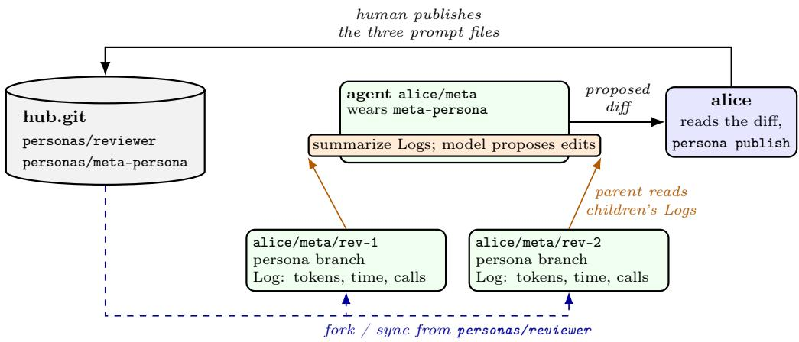  
Figure 20: One instance of improving agents inside L3M. Every arrow is an L3M primitive: a persona branch forks and syncs, a parent reads its children’s Logs, a program summarizes them and the model proposes edits, and a human publishes the result.

The harness. The same loop applies to L3M itself. The sealed programs and hooks an agent writes are extensions of the harness, measured the same way, and L3M’s own source is a Lean program in a repository an agent can claim. Optimizing a measured objective there raises its own problem: an agent that can change the evaluator, weaken a theorem’s statement or add an assumption can improve its score, or get a green build, by moving the target rather than improving the system. A change that breaks a theorem of Table 1 does not build, but a change that edits the theorem does. Experiments on the harness therefore need the specification and the evaluation criteria held by someone other than the optimizer — in L3M, a separate grant — with every candidate judged against them, including the assumptions its proofs use.

## 7 Evaluation

Setup The guarantees of Table 1 are theorems; no experiment adds to them. What is empirical is what the bound on authority costs in work done, and what review costs to use. We measure both on Terminal-Bench 4.0.0, which gives the agent a container and an instruction per task and grades what it leaves with the task’s own tests. We select 37 tasks that are valid in our harness-agnostic environment and that a public Claude Code run finished in a median of at most an hour. Every arm runs Claude Opus 5 at the same reasoning efort, 64,000-token output limit and 75-minute deadline, with three attempts per task and Claude Sonnet 4.6 as reviewer; only the harness difers. Claude Code runs with every permission check bypassed, so its tools run without approval and its shell reaches the network. The L3M arms difer only in which tools the model is ofered and whether shell calls are reviewed. The runs measure the first implementation of L3M, which has not been tuned for eficiency; we return to this at the end of the section.

How much work can one do using only tame tools? The tame arm ofers no shell: every tool the model holds is either undoable or bounded by a token, so nothing it does is reviewed. Against the same harness with a shell and review of, pass@3 falls from 41.7% to 27.0% (34 passes to 18, Table 5). Of the 18 tame passes, five used the tool programs. So about two thirds of what the shell delivers on these tasks is reachable with no wild call at all in the current L3M implementation. This is promising in terms of eventually being able to perform a large portion of useful work in a “tame” manner.

How useful are tool programs? Tool programs add about 3 points at pass@3: 27.0% with program loading against 24.3% without (Table 5). The gain is small, although we did not tune the system prompt to encourage their

Table 5: Terminal-Bench: 37 tasks, three attempts each; pass@3 is averaged over tasks. Model calls, tokens and minutes are means over passing attempts and include any subagent sessions; tokens count cached and uncached input plus output.
<table><tr><td></td><td></td><td colspan="2">Per passing attempt</td></tr><tr><td>Configuration</td><td>Pass@3, %</td><td>Model calls</td><td>Tokens, M Minutes</td></tr><tr><td>Claude Code, permissions bypassed</td><td>59.5</td><td>53.0</td><td>4.43 24.6</td></tr><tr><td>L3M, shell, review off</td><td>41.7</td><td>53.2</td><td>7.70 25.4</td></tr><tr><td>L3M, tame</td><td>27.0</td><td>53.3</td><td>7.74 21.6</td></tr><tr><td>L3M, tame, no programs</td><td>24.3</td><td>41.5</td><td>6.17 24.5</td></tr></table>

Table 6: Review of shell calls, on the same tasks and with the same columns as Table 5. Model calls count both sides of the review. <sup>∗</sup>Tokens include the reviewer’s side of each exchange, which runs on a cheaper model (Claude Sonnet 4.6) than the agent’s
<table><tr><td colspan="2"></td><td colspan="3">Per passing attempt</td></tr><tr><td>Configuration</td><td>Pass@3, %</td><td>Model calls</td><td>Tokens, M</td><td>Minutes</td></tr><tr><td>L3M, shell, review off</td><td>41.7</td><td>53.2</td><td>7.70</td><td>25.4</td></tr><tr><td>L3M, shell, review --yes</td><td>40.5</td><td>100.9</td><td>12.10*</td><td>30.4</td></tr><tr><td>L3M, shell, review --no</td><td>43.2</td><td>107.3</td><td>12.81*</td><td>28.1</td></tr></table>

What review costs, and how often it redirects. These arms review only shell calls, which make up 25.1% of all tool calls. Around 90% of shell calls are judged safe in the end. The reviewer’s first verdict was safe about two thirds of the time, and when it was not, about nine in ten second rounds ended safe. About 6% of reviewed calls were redirected to tame tools as an alternative. A further 2% were withdrawn upon objection from the reviewer. Stalemates, where a human would decide, were 2.4% of reviewed calls. The price is model work, not success: each reviewed call adds about 2.6 model calls and a median of 8.6 seconds, so review adds roughly 85% more calls and 50% more tokens per attempt (Table 6), albeit under a cheaper model. Interestingly, review does not change overall success rates – the ∼ 1% diferences are not statistically significant (only 37 tasks).

A caveat on eficiency. L3M has not been tuned for eficiency. Neither the system prompt, the tool descriptions nor the context management have been optimized against any benchmark, as a production harness’s have. The numbers in Tables 5 and 6 should be read as a first measurement of an untuned harness rather than as its ceiling. In particular, the token gap to Claude Code at a similar number of model calls points at the harness, not at the authority bound: the tame arm and the shell arm spend about the same tokens per passing attempt. We expec pass rates and token costs to improve once the harness is tuned, and the theorems of Table 1 do not depend on that tuning.

## 8 Discussion and Conclusion

Future work. The budgets charge quantities: model calls, bytes and wakes. The natural next bound charges information. Data would carry a label, and each agent would accumulate what crossed its edges, charged at the point where L3M already meters egress, so the extension changes what is charged but not where. Sealed programs can drive children but cannot yet build or wait on a vigil, so long-running orchestration still passes through the model. A star on a branch or a repository waits on claims becoming subscriptions (Section 4.3), and starting agents on another host is designed but not built. The evaluation (Section 7) measures the first implementation. Tame tools alone already reach about two thirds of what the shell delivers at pass@3, tool programs add a few points without any prompting to use them, and review costs model work rather than success. The same tables also show the gap to an unconstrained harness: with a shell, L3M trails Claude Code at pass@3, and at a similar number of model calls per solved task it spends well over Claude Code’s tokens (Table 5). Both say that the harness and its system prompt, neither of which has been optimized, need tuning before performance is comparable.

Conclusion. L3M trusts the harness rather than the model, and it states what that trust buys as theorems about the code that runs. Authority and budget only narrow down a tree of agents. A tool’s review tier follows from how far its efects can be undone and what its tokens bound. An agent extends its own tool surface with sealed programs whose types are their permission requests. So an agent can grow its harness over time without new permissions, and the human can still read which invariants hold. Capability grows; authority does not. We argue that this is a building block for long-running, many-agent systems, and we release L3M as open source so that others can build on it.

## Acknowledgements

We thank Jim Roskind for early discussions of and feedback on L3M, including the recipe for defending against prompt injection described in Section 5.3.

## References

[1] Anil, C., Zhang, G., Wu, Y. and Grosse, R. (2021). Learning to Give Checkable Answers with Prover-Verifier Games. arXiv preprint arXiv:2108.12099 .

[2] Antoniades, A., <sup>Ö</sup>rwall, A., Zhang, K., Xie, Y., Goyal, A. and Wang, W. (2025). SWE-Search: Enhancing software agents with Monte Carlo tree search and iterative refinement. In International Conference on Learning Representations (ICLR 2025).

[3] Bainbridge, L. (1983). Ironies of automation. Automatica 19 775–779.

[4] Barbaste, P., Darrigol, T., Vu, G. and Wiltberger, T. (2026). Harness engineering: Anatomy, architecture, and evolution of coding agents – a source-code study of eleven systems. arXiv:2609.00006.

[5] Bershad, B. N., Savage, S., Pardyak, P., Sirer, E. G., Fiuczynski, M. E., Becker, D., Chambers, C. and Eggers, S. (1995). Extensibility, safety and performance in the SPIN operating system. In Proceedings of the Fifteenth ACM Symposium on Operating Systems Principles (SOSP ’95). ACM.

[6] Birgisson, A., Politz, J. G., Erlingsson, <sup>Ú</sup>., Taly, A., Vrable, M. and Lentczner, M. (2014). Macaroons: Cookies with contextual caveats for decentralized authorization in the cloud. In Proceedings 2014 Network and Distributed System Security Symposium (NDSS). Internet Society.

[7] Brown-Cohen, J., Irving, G., Piliouras, G., Chen, L., Li, J. and Xun, Z. (2025). Avoiding obfuscation with prover-estimator debate. arXiv:2506.13609. V2, 21 July 2026.

[8] Cai, T., Wang, X., Ma, T., Chen, X. and Zhou, D. (2024). Large language models as tool makers. In The Twelfth International Conference on Learning Representations (ICLR).

[9] Costa, M., Köpf, B., Kolluri, A., Paverd, A., Russinovich, M., Salem, A., Tople, S., Wutschitz, L. and Zanella-Béguelin, S. (2025). Securing AI agents with information-flow control. arXiv:2505.23643.

[10] de Moura, L. and Ullrich, S. (2021). The Lean 4 theorem prover and programming language. In Automated Deduction – CADE 28. Lecture Notes in Computer Science, Springer.

[11] de Raadt, T. (2004). Exploit mitigation techniques. Talk at AUUG 2004, Melbourne. Slides: https: //www.openbsd.org/papers/auug04/.

[12] Debenedetti, E., Shumailov, I., Fan, T., Hayes, J., Carlini, N., Fabian, D., Kern, C., Shi, C., Terzis, A. and Tramèr, F. (2025). Defeating prompt injections by design. arXiv:2503.18813.

[13] Debenedetti, E., Zhang, J., Balunović, M., Beurer-Kellner, L., Fischer, M. and Tramèr, F. (2024). AgentDojo: A dynamic environment to evaluate prompt injection attacks and defenses for LLM agents. In Advances in Neural Information Processing Systems (NeurIPS) Datasets and Benchmarks Track.

[14] Dennis, J. B. and Van Horn, E. C. (1966). Programming semantics for multiprogrammed computations. Communications of the ACM 9 143–155.

[15] Devriese, D., Birkedal, L. and Piessens, F. (2016). Reasoning about object capabilities with logical relations and efect parametricity. In 2016 IEEE European Symposium on Security and Privacy (EuroS&P). IEEE.

[16] Foster, D. (2026). Lean Manifests: Contracts with evidence levels. https://lean4.ai/lean-manifests. html, accessed 2026-09-27.

[17] Garby, Z., Gordon, A. D. and Sands, D. (2026). The LLMbda calculus: AI agents, conversations, and information flow. arXiv:2602.20064.

[18] Greenblatt, R., Shlegeris, B., Sachan, K. and Roger, F. (2024). AI control: Improving safety despite intentional subversion. In Proceedings of the 41st International Conference on Machine Learning, vol. 235 of Proceedings of Machine Learning Research. PMLR.

[19] Greshake, K., Abdelnabi, S., Mishra, S., Endres, C., Holz, T. and Fritz, M. (2023). Not what you’ve signed up for: Compromising real-world LLM-integrated applications with indirect prompt injection. In Proceedings of the 16th ACM Workshop on Artificial Intelligence and Security (AISec ’23). ACM.

[20] Hardy, N. (1988). The confused deputy (or why capabilities might have been invented). ACM SIGOPS Operating Systems Review 22 36–38.

[21] Hong, S., Zhuge, M., Chen, J., Zheng, X., Cheng, Y., Zhang, C., Wang, J., Wang, Z., Yau, S. K. S., Lin, Z., Zhou, L., Ran, C., Xiao, L., Wu, C. and Schmidhuber, J. (2024). MetaGPT: Meta programming for a multi-agent collaborative framework. In International Conference on Learning Representations (ICLR).

[22] Horvitz, E. (1999). Principles of mixed-initiative user interfaces. In Proceedings of the SIGCHI Conference on Human Factors in Computing Systems (CHI ’99). ACM, Pittsburgh, Pennsylvania, USA.

[23] Hunt, G. C. and Larus, J. R. (2007). Singularity: Rethinking the software stack. ACM SIGOPS Operating Systems Review 41 37–49.

[24] Irving, G., Christiano, P. and Amodei, D. (2018). AI safety via debate. arXiv preprint arXiv:1805.00899 .

[25] Ke, H. (2026). Quine: Realizing LLM agents as native POSIX processes. arXiv:2603.18030.

[26] Klein, G., Elphinstone, K., Heiser, G., Andronick, J., Cock, D., Derrin, P., Elkaduwe, D., Engelhardt, K., Kolanski, R., Norrish, M., Sewell, T., Tuch, H. and Winwood, S. (2009). seL4: Formal verification of an OS kernel. In Proceedings of the ACM SIGOPS 22nd Symposium on Operating Systems Principles (SOSP ’09). ACM.

[27] Lakos, J. (1996). Large-Scale C++ Software Design. Addison-Wesley Professional Computing Series, Addison-Wesley.

[28] Leroy, X. (2009). Formal verification of a realistic compiler. Communications of the ACM 52 107–115.

[29] Licklider, J. C. R. (1960). Man-computer symbiosis. IRE Transactions on Human Factors in Electronics HFE-1 4–11.

[30] Liu, J., Zhao, X., Shang, X. and Shen, Z. (2026). Dive into Claude Code: The design space of today’s and future AI agent systems. arXiv:2604.14228. Tech report.

[31] Mei, K., Zhu, X., Xu, W., Jin, M., Hua, W., Li, Z., Xu, S., Ye, R., Ge, Y. and Zhang, Y. (2025). AIOS: LLM agent operating system. In Second Conference on Language Modeling (COLM). ArXiv:2403.16971.

[32] Mettler, A., Wagner, D. and Close, T. (2010). Joe-E: A security-oriented subset of Java. In Proceedings of the Network and Distributed System Security Symposium (NDSS 2010). The Internet Society, San Diego, CA, USA.

[33] Miller, M. S. and Shapiro, J. S. (2003). Paradigm regained: Abstraction mechanisms for access control. In Advances in Computing Science – ASIAN 2003: Programming Languages and Distributed Computation (V. A. Saraswat, ed.). Springer, Berlin, Heidelberg.

[34] Mozannar, H., Bansal, G., Tan, C., Fourney, A., Dibia, V., Chen, J., Gerrits, J., Payne, T., Maldaner, M. K., Grunde-McLaughlin, M., Zhu, E., Bassman, G., Alber, J., Chang, P., Loynd, R., Niedtner, F., Kamar, E., Murad, M., Hosn, R. and Amershi, S. (2025). Magentic-UI: Towards human-in-the-loop agentic systems. arXiv:2507.22358.

[35] Necula, G. C. (1997). Proof-carrying code. In Proceedings of the 24th ACM SIGPLAN-SIGACT Symposium on Principles of Programming Languages (POPL ’97). ACM.

[36] Nienhuis, K., Joannou, A., Bauereiss, T., Fox, A., Roe, M., Campbell, B., Naylor, M., Norton, R. M., Moore, S. W., Neumann, P. G., Stark, I., Watson, R. N. M. and Sewell, P. (2020). Rigorou engineering for hardware security: Formal modelling and proof in the CHERI design and implementation process. In 2020 IEEE Symposium on Security and Privacy (SP). IEEE.

[37] Pirch, L., Horlboge, M., Großmann, P., Asif, S. M., Kireev, K., Holz, T. and Rieck, K. (2026). Toward securing AI agents like operating systems. arXiv:2605.14932. 17 pages, under submission.

[38] Saltzer, J. H. and Schroeder, M. D. (1975). The protection of information in computer systems. Proceedings of the IEEE 63 1278–1308.

[39] Schneider, F. B. (2000). Enforceable security policies. ACM Transactions on Information and System Security 3 30–50.

[40] Sedoc, J. a., Zhang, B. and Foster, D. (2026). Trust but verify: Prover-verifier deliberation for selective LLM prediction. arXiv:2605.25133.

[41] Seltzer, M. I., Endo, Y., Small, C. and Smith, K. A. (1996). Dealing with disaster: Surviving misbehaved kernel extensions. In Proceedings of the Second USENIX Symposium on Operating Systems Design and Implementation (OSDI ’96). USENIX Association.

[42] Shi, T., He, J., Wang, Z., Li, H., Wu, L., Guo, W. and Song, D. (2025). Progent: Securing AI agents with privilege control. arXiv:2504.11703.

[43] Steinder, G. and Franke, H. (2026). Towards an agent operating system - lessons from classical and cloud OS. In 2026 IEEE International Conference on Web Services (ICWS). IEEE.

[44] Sutton, R. (2019). The bitter lesson. http://www.incompleteideas.net/IncIdeas/BitterLesson.html, accessed 2026-10-10.

[45] Wang, X., Chen, Y., Yuan, L., Zhang, Y., Li, Y., Peng, H. and Ji, H. (2024). Executable code actions elicit better LLM agents. In Proceedings of the 41st International Conference on Machine Learning (ICML), vol. 235 of Proceedings of Machine Learning Research. PMLR.

[46] Wang, X., Rosenberg, S., Michelini, J., Smith, C., Tran, H., Nyst, E., Malhotra, R., Zhou, X., Chen, V., Brennan, R. and Neubig, G. (2026). The OpenHands software agent SDK: A composable and extensible foundation for production agents. In Proceedings of Machine Learning and Systems (MLSys 2026).

[47] Watson, R. N. M., Anderson, J., Laurie, B. and Kennaway, K. (2010). Capsicum: Practical capabilitie for UNIX. In Proceedings of the 19th USENIX Security Symposium (USENIX Security ’10). USENIX Association, Washington, DC, USA. Best Student Paper award.

[48] Wu, Q., Bansal, G., Zhang, J., Wu, Y., Li, B., Zhu, E., Jiang, L., Zhang, X., Zhang, S., Liu, J., Awadallah, A. H., White, R. W., Burger, D. and Wang, C. (2024). AutoGen: Enabling next-gen LLM applications via multi-agent conversations. In Conference on Language Modeling (COLM).

[49] Yang, J., Jimenez, C. E., Wettig, A., Lieret, K., Yao, S., Narasimhan, K. and Press, O. (2024). SWE agent: Agent-computer interfaces enable automated software engineering. In Advances in Neural Information Processing Systems.

[50] Zelikman, E., Lorch, E., Mackey, L. and Kalai, A. T. (2024). Self-taught optimizer (STOP): Recursively self-improving code generation. In First Conference on Language Modeling (COLM).

[51] Zhang, Y. (2026). Agent libOS: A runtime substrate for capability-controlled self-evolving LLM agents. arXiv:2606.03895.

# A Formal Properties and Assumptions

The implementation this appendix describes is built with Lean 4.32.0. Each name below is a graded entry of the project’s trust ledger and is found in the source under that name. The body says what each result means; this appendix says what each result assumes and what it does not cover.

Formal statements.

Paths and host access.

safePath\_no\_traversal, cannot\_escape\_root\_via\_symlink, admit\_refuses\_l3m.

Grants and minting.

grant\_restrict\_le, grant\_of\_record\_writes\_no\_entity\_record, no\_wild\_no\_wild\_effects,

mint\_reflects\_profile, no\_self\_grant.

Process and network checks.

no\_shell\_or\_interpreter, shell\_run\_is\_card, build\_lake\_exe\_is\_card, allowsUrl\_authority\_is\_trusted, which assumes a host allowlist rather than an open trust floor. These are properties of the structured providers, not of every process route; the unsandboxed shell that wild grants is outside them.

Review selection and the debate.

ungated\_world\_reaching\_always\_reviewed, under the default review posture; run\_needs\_safe\_or\_yes, trace\_bounded, debate\_no\_verdict\_is\_wild.

Restoration.

live\_capture\_round\_trips, live\_commit\_reset\_round\_trips. Both take a named assumption about Git as an explicit hypothesis.

Sequencing and parent pins.

start\_once, open\_call\_is\_last\_call, boot\_close\_eq\_interrupt\_close, locked\_invariant\_under\_model\_verbs.

Delegation and budgets. spawn\_persist\_within\_parent relates the admission of a spawn request to the resolved parent’s grant and the row recorded for the child; it is a fact about one admission decision, not about a whole run. descendant\_bounded\_by\_root\_grant is the bound over the tree. It quantifies over every ledge the agents’ own writers can build, and concludes that an entity’s grant lies within its root’s grant expanded at the identity of each strict ancestor (Grant.expandOwnAll over ancestorChain). The expansion adds each ancestor’s own refs and mail covers, which a child is legitimately granted; without it the bound is false at depth one (descendant\_bounded\_by\_root\_grant\_is\_false, with a concrete counterexample). The theorem does not bound a descendant by every ancestor, since a regrant is checked against its issuer, and it does not extend to ledgers containing a human’s regrant, whose issuer is unbounded. The budget property global\_budget\_bounded\_by\_root concerns one successful lendMany call: for a well-formed parent lease $p ,$ the resulting parent $p ^ { \prime }$ and the returned children $c _ { i } .$

$$
\sum _ { i } c _ { i } . \mathrm { l i m i t } + p ^ { \prime } . \mathrm { a v a i l a b l e } \leq p . \mathrm { l i m i t } .
$$

Extending it to a whole run needs an invariant over later loans, returns and updates.

Sealed programs and plugins. shape\_admitted\_has\_no\_refused\_kind concerns the accepted macro-expanded syntax, and sealUsed\_admits\_only\_safe the constants an expression names directly and their classification in the supplied environment. The program loader runs the shape check before elaborating the term and the expression and vocabulary checks after it, and the confinement layer keeps its host bridge out of the vocabulary programs may name. These are implementation checks; no theorem covers the whole loading path, and the semantics of the dependencies the runtime admits are trusted. loaded\_plugin\_authority\_le\_cap states that an accepted plugin has an allowed name and an admitted declared footprint. It is an admission result, not a proof about what an arbitrary plugin does.

Efect evidence and credentials. The efect registry declares a ceiling for each class, and each declared ceiling carries evidence of one of four kinds: irreversible, read-only frame, round-trip and host round-trip. Frame evidence carries the names of external checks and assumptions; round-trip evidence contains a Reversible instance and its proof. Neither proves that the live provider implements the modelled operation. The AWS layer defines credential resolution and signing, the profile gate and the credential fields. AwsAuthEffects is in the program interface but has no registry row, so it takes the conservative default ceiling and boundedness.

From local facts to execution. Each result above is a fact about a check, and it applies to a run only together with the parts of the trusted base it does not reach. A theorem about admitted paths needs the file provider’s path resolution and the file system’s behaviour; a theorem about minted tokens needs the build’s constructor discipline and the providers that tools call through; the event-loop results are about the modelled sequencer, and an external operation may need reconciliation or an idempotent retry after a crash; and the journal round trips rest on their stated assumptions about Git and restore only journaled efects.

## B Related Work

Most of the pieces L3M assembles have precedents; what is new is how they are put together. Four parts of that combination have no close precedent. L3M is built for many agents from the start, and their authority, budget and parentage form one tree stored in a shared Git repository. An agent extends itself with programs the harness admits under the grant it already holds, with the program’s type as its permission request. A tool’s review tier is computed from its declared efects rather than attached to each action by hand. And the theorems are about the harness that actually runs, each graded by what its proof rests on. The paragraphs below take the neighbouring work one area at a time: what it does, and then where L3M difers.

Multi-agent frameworks and agent runtimes. Conversation frameworks such as AutoGen [48] and MetaGPT [21] coordinate agents through dialogue and role prompts, and an agent in them has no authority distinct from what its prompt tells it. Source studies of production harnesses [4, 30] find the multi-agent case bolted onto a single-agent core; Claude Code, for example, runs each subagent in isolation and receives only its summary. A second line of work takes the operating system as its model. AIOS [31] schedules model calls, context and memory, which is resource management rather than authority. Quine [25] makes an agent a POSIX process and inherits isolation from the kernel, a guarantee it describes itself as incomplete. Pirch et al. [37] map classical OS defences onto agents, and Steinder and Franke [43] list the primitives an Agent-OS still lacks, among them an abstraction for irreversible efects and one for messages between agents. The closest system to L3M is Agent libOS [51], which states the invariant L3M also rests on: an agent “may change what it can ask for, but it cannot thereby change wha it is authorized to afect”. It admits an operation only when process identity, task authority, a typed capability, policy or human approval, and budget all agree; forked children receive attenuated authority; just-in-time tools run behind a single syscall entry point; and a typed Git provider, pinned to one repository, uses compare-and-swap state tokens. Elsewhere, where Git or an event log appears, it checkpoints a single agent: the OpenHands SDK [46] event-sources one conversation and names multi-agent coordination as undesigned, and SWE-Search [2] commits each repository state so that its search can backtrack.

In L3M, Git is not one provider among others; it holds all of the state. An agent is a column of refs in a shared bare repository — its log, inbox, grants, claims and persona branch — together with a worktree it is confined to. A child’s name extends its parent’s, and so does its directory; parentage is immutable, a grant that would widen the issuer’s own is refused rather than clamped, and budget is lent down the tree and conserved. Mail is an append to the recipient’s inbox ref. Inboxes merge by set union, which we prove, so delivery needs no recipient awake and crosses machines by fetch and push. Each log has one writer, enforced by compare-and-swap on its ref, so a second writer is a conflict rather than an interleaving — the durable-workflow pattern, applied to an agent whose largest activity is a model call. A persona is a ref that many agents branch from, and its authority is a ceiling that can only subtract. Agents sleep on bounded watches and are woken by facts in the repository, and an ancestor can pin a watch on a child as an obligation the child cannot cancel. Because the permission tree, the ref tree and the directory tree are the same tree, a bound checked at each spawn constrains the whole subtree beneath it, and cleaning up after an agent is collecting that subtree. Two further diferences separate L3M from libOS. Where libOS admits an operation by a check at a Python syscall boundary, and evidences it with hashed reports from scripted runs, L3M bounds a generated program by how its Lean term elaborates, and its admission rules are theorems. And where libOS asks for approval per operation, L3M ranks efects by whether they can be undone and spends review only where they cannot.

Capabilities and least authority. L3M’s authority model is the classical one: capabilities as unforgeable references [14], and least privilege with complete mediation [38]. Prompt injection is the confused deputy [20] with a model as the deputy. Miller and Shapiro [33] separate what a subject is permitted to do from what it can bring about, and “capability grows; authority does not” is that distinction. Joe-E [32] removes ambient authority from a language and Capsicum [47] adds capabilities to an operating system; macaroons [6] attenuate a credential at every hop, as L3M’s grants narrow at every spawn. Devriese et al. [15] prove that bounding the capabilities code holds bounds its efects, which is what L3M’s efect classes provide: a tool body written over an abstract monad canno name IO. What is diferent in L3M is the code under the discipline. It is written by the model while the system runs, and its bound is checked by Lean’s elaborator when the program is admitted, not by a runtime monitor.

Safe extension and self-extending agents. Admitting untrusted extensions to a trusted core is an old systems problem. SPIN [5] relies on a type-safe language; VINO [41] wraps each graft in a transaction that is undone on abort; proof-carrying code [35] moves trust from the producer of code to a small checker; and Singularity [23] seals processes so that no code can be loaded into them after they start. Agents that write code have no such bound. Models make their own tools [8] and act by writing code [45], but nothing states what authority that code holds, and self-improving scafolds have been observed disabling their own sandbox [50]. In L3M the sealed program is the extension and Lean is the checker. A program passes three gates: a seal that refuses unsafe constants, a type under which undeclared efects are unreachable, and a surface check that ofers it only if its declared footprint fits the grant. Once admitted, a program does the looping that the model would otherwise do one call at a time, and it can delegate to children it drives to completion, all under that same grant (Figure 11). Reversibility is graded per efect, rather than resting on one undo log for everything.

Enforcement for LLM agents. Indirect prompt injection [19] and the AgentDojo benchmark [13] set out the threat. The defences closest to L3M work inside a fixed agent loop. CaMeL [12] and FIDES [9] label data and check its flows through a planner; Progent [42] narrows tool policies monotonically; and LLMbda [17] mechanises an information-flow calculus in Lean 4, proves noninterference, and runs the verified interpreter as the harness. Tha makes LLMbda the nearest work on proving properties of the code that runs, though its tools are modelled inside the program. L3M difers from these designs first in what it bounds: the programs the model generates, by their type, acting through real file-system, Git and process efects. Every proof that depends on how the outside world behaves names that dependency as an explicit assumption. LLMbda proves one strong property of a calculus the size of a harness; L3M proves the properties each mechanism needs, of the full harness. L3M does not yet bound information flow: its design for doing so (Appendix C) is not in the implemented version. That design places its labels diferently. Data at rest carries a label, an artifact carries its own bound tied to the hash of its content, and every edge between agents charges the sender and joins the sender’s taint into the receiver, so the bound follows data across agents. The meter is at the read, the only place attribution is possible, and what leaks of a kind is bounded by both what entered and what was sent. That makes the information-flow bound a safety property, which by Schneider [39] is the class an execution monitor can enforce; the per-call gate where L3M already meters egress would be such a monitor, and the design claims nothing a monitor cannot enforce. Beneath any labels, the capability bound holds today: an injected instruction can reach only what the agent was granted.

Reversibility, review and the human. Magentic-UI [34] sends every action through a guard that developer heuristics have labelled always, maybe or never irreversible, and the Agent-OS proposal [43] asks for operations to be classed as reversible, compensable or irreversible. L3M computes a tool’s tier from its declared footprint instead, so no tool is labelled by hand. Reversibility is stated once per efect class, as a ceiling on how far that class’s efects can be undone: proved as a round trip where it can be — a journaled file edit, a local Git ref, an evaluation — with any dependence on Git’s behaviour named as an assumption, and labelled where it cannot. A theorem refuses any tool that claims more reversibility than its footprint allows.

Users approve about 93% of Claude Code’s permission prompts [30], so approving every call is not oversight. L3M spends the human’s attention only past the reversible margin, and there review is a deliberation, in the line of AI debate [24], prover–verifier games [1, 7], and control protocols in which a trusted monitor watches an untrusted model [18]. From Prover–Verifier Decoding [40] we take the three verdicts, the bounded exchange, cross-family pairing, and a proposer who must supply a justification. We do not take its soundness bounds or its selective-prediction framing: L3M always reaches a verdict, and abstention hands the decision to the human. The reviewer is a way to spend attention cheaply, not a security boundary; the capability discipline holds without it. The human’s place follows mixed-initiative design [22], and heeds Bainbridge’s warning that automation leaves the operator only the hardest cases, and without practice at them [3]. A card therefore shows the efect and the reviewer’s reason rather than a shell string, and a card that is almost always approved is re-aimed or removed. The aim is Licklider’s division of labour [29], applied to agents.

Verified systems. seL4 [26] proves a kernel’s implementation correct against its specification, CompCert [28] verifies a compiler, and CHERI [36] shows what formalising a prose design can uncover. L3M does not aim for one whole-system theorem. It is written in Lean 4 [10], so each theorem it does have is about the code that runs, and it is formalized incrementally: every claim is graded by what its proof uses, and a levelized source tree fixes what each claim may rest on (Appendix A).

## C Bounding Information: An Extension

Capabilities bound which edges exist, and the budgets of the body bound how many calls, bytes and wakes cross them. Neither bounds how much of a kind of information crosses an edge that exists: an agent that may read payroll and may fetch a public page may also encode the one into the other. This appendix records the design that closes that gap. It is a design, and not in the version of L3M implemented and described in the body of the paper.

The model. Data at rest carries a label, a kind of information, drawn from a lattice with two built-in points: Public at the bottom and NonPublic at the top, with user-declared kinds (payroll, pii) between them. Two diferent kinds join to NonPublic, and nothing joins downward. A metered edge is any boundary across which bytes enter or leave a principal’s state: a file read, a fetch, a tool result, a stored artifact read back later, a message to or from another agent. Each agent keeps a taint set, the join of every label it has read, and for each label K a monotone accumulator ingress[K] of the bytes of K that have entered its state. The accumulator only grows and never refuses; a limit is a separate gate that reads it, so accounting soundness never depends on policy. The ledger is a field of the agent’s pure state, changed only by the fold of Section 2.4, so facts about it are theorems rather than runtime hopes.

Why the meter is at the read. Model an agent as a chain Secret<sub>K</sub> → State → Output. By the data-processing inequality,

$$
I ( { \mathrm { S e c r e t } } _ { K } ; { \mathrm { O u t p u t } } ) \leq I ( { \mathrm { S e c r e t } } _ { K } ; { \mathrm { S t a t e } } ) \leq { \mathrm { t h e ~ b y t e s ~ o f ~ } } K { \mathrm { ~ t h a t ~ e n t e r e d ~ t h e ~ s t a t e } } .
$$

Charging K when it is read therefore bounds what can leave, however much the agent outputs; and the read is the only place attribution is possible, because once the model has transformed its state no output byte still wears a label. The inequality is a statement about information, not about L3M, so it enters the design the way Git’s behaviour enters the body: as a named assumption that every dependent claim takes as a hypothesis.

Proposition C.1 (Leakage bound, under the data-processing inequality). Keep per label a second accumulato egress[K], the bytes sent while K-tainted. Then for every K, leak(K) ≤ min(ingress[K], egress[K]), with the minimum taken once over the accumulated totals, never per request.

The order matters: an agent holding 64 bytes of NonPublic that sends two 50-byte requests has leaked at most min(64, 100) = 64, not min(50, 64) + min(50, 64) = 100. An outbound request is charged at its full width to every label the sender holds, because a secret can be smuggled into any byte of it; the bound then says the agent cannot leak more of a kind than ever entered.

Completeness is structural. The bound holds only if no edge escapes the meter. Every edge is one of three things: a charging edge, labelled by a rule or by the artifact’s own stamp; a framework edge, whose bytes originate in the trusted base (the system prompt, the tool catalogue, a clock) and which is uncounted because it has no labelable channel; or a world edge that matches no rule, which charges NonPublic, never nothing. In L3M every ingress edge is an efect class closed by one provider (Section 3.2), so “every edge is metered” is “every provider charges at its boundary”: a census over the enumerable trusted base, not a scan of the tree, and a new tool is metered the moment it is registered, because the dispatcher, not the tool’s author, does the accounting.

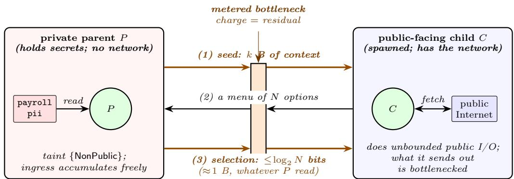  
Figure 21: The bottleneck. A private parent P holds the secrets and has no network; its child C has the network and no secrets. Every message across the boundary is a metered edge, and the charged direction is private to public (orange). P seeds $C$ with k bytes (1); C works publicly and returns a menu of $N$ options (2); P answers with a selection (3), so at most $\log _ { 2 } N$ bits leave the private side however much P read. In L3M this is a spawn pattern over the grants of Section 5.2.

Information, not bytes. What crosses an edge is charged at a computable upper bound on the information it carries, $I ( { \mathrm { S e c r e t } } _ { K } ; M ) \leq H ( M ) \leq | { \mathrm { e n c o d e } } ( M ) |$ , so any lossless encoding is a sound meter and a tighter one is still sound. A fixed compressor makes boilerplate cheap and novelty expensive. The best compressor, though, is a capable agent on the receiving side: what B gains from a message is only what B could not reconstruct by interacting with the world itself, so the sound charge is that residual, and a sender that has read a great deal ships the smallest thing the receiver cannot rebuild. At the limit the private side ships a choice (Figure 21): a selection among N options carries at most $\log _ { 2 }$ N bits, one byte for $N \leq 2 5 6$ , whatever was read to make it. The bound needs the recipient to act on the index into a menu it understands independently; secret-derived contents of the options are charged as ordinary bytes.

Artifacts and other agents. Information parked on disk and read back later, and information passed between agents, reduce to the same rule: an artifact carries its own bound, and every boundary it crosses is one metered edge. A stamp binds a bound to the content hash of the bytes, never to a path, and is discharged at read time against the bytes actually present: a hit charges the stamped bound, a miss charges the full size at NonPublic. An adversary who swaps the bytes changes the hash and lands on the floor, so there is no time-of-check window. The stamp records the taint that flowed into the artifact, not its producer’s balance: a producer re-reading its own file pays nothing, since the file can hold only what it already paid for, and a disk-to-disk fetch is stamped at the width of the request that caused it, by the same inequality applied to request and response. Between agents, every edge charges the sender and joins the sender’s taint into the receiver, parent to child and peer to peer alike, so the bound composes over any topology and sideways flow cannot bypass it. A child’s return is charged to the parent at $\operatorname* { m i n } ( | R | , \operatorname { i n g r e s s } _ { C } [ K ] - \operatorname { f r o m } _ { P } [ K ] )$ : not the raw size of $R ,$ which ignores the cap on the return channel, and not the child’s whole intake, which double-counts what the parent seeded.