# LEARNING TO COMPUTE IS NOT LEARNING TO RETAIN OR REUSE IN LOOPED TRANSFORMERS

Peilong Zhou1,2,3,∗ Hongtao Zhang2,∗ Yulong Huang4 Cangyuan Li1,2 Mingyu Chen2 Ying Wang1,2,†

1SKLP, Institute of Computing Technology, Chinese Academy of Sciences

2University of Chinese Academy of Sciences

3School of Advanced Interdisciplinary Sciences

4The Hong Kong University of Science and Technology (Guangzhou)

∗Equal contribution. †Corresponding author. wangying2009@ict.ac.cn

## ABSTRACT

Looped transformers compute by applying one block repeatedly, so they can run for more loops than they were trained with. Recurrent reasoners are known to overthink: iterating past the trained depth can turn a correct answer into a wrong one. Such a late error can reflect failed computation, loss of retention, or a state that later computation cannot reuse. We separate these cases in in-context Mealymachine execution, where a simulator supplies intermediate targets and exact counterfactuals for hidden-state interventions. Models trained to answer at loop 32 are fully correct there but keep only 22% of these answers at loop 64. Retention depends on what training asks for: supervising one randomly chosen position per example, instead of always the last, keeps 99.8%, and randomizing the number of training loops also helps; truncating gradients, as in progressive training against overthinking, does not. The computation itself is exact: position k is computed at loop k, and swapping its loop-k hidden vector for the one from another input redirects every later position to that input’s exact continuation (237/237 pairs in each of ten models). Retention, however, is not reuse. Even in models that keep nearly all answers, holding each position k fixed from loop k drops accuracy to 4–6%, whereas holding it from loop k + 4 is harmless. A released recurrent maze network trained to avoid overthinking behaves the same way. Learning to compute is thus not learning to retain, and avoiding overthinking does not make a state reusable when its answer first appears.

## 1 INTRODUCTION

Looped transformers turn recurrent depth into a computation budget: one block is applied repeatedly, so a model can run for more loops than it was trained with (Dehghani et al., 2019; Giannou et al., 2023; Geiping et al., 2025). Whether those extra loops help depends on what happens to an answer after it has been computed.

Empirically, running past the trained depth can hurt. Recurrent networks trained on small instances can solve larger ones by iterating longer (Schwarzschild et al., 2021), but further iteration can also turn a correct answer into a wrong one. Bansal et al. (2022) call this failure overthinking and prevent it with input recall and progressive training, which applies the loss at a random depth and blocks gradients to the loops before a random starting point. Later work relates extra computation to path independence and shows that training and stopping objectives change the learned trajectory (Anil et al., 2022; Zhang et al., 2026; Kuo et al., 2026; Popescu et al., 2026); analysis of recurrent language models separates whether content is readable from whether it is transported and can be steered (Wang & Reid, 2026). Much of this evidence tracks accuracy or readouts across loops. An overthinking curve, however, can mean three different things: the answer was never computed, it was computed but not retained, or the state that carries it cannot be reused by later computation. Telling these apart requires knowing what a correct alternative execution would be. We therefore ask: when a looped model learns to compute an answer, what does it learn about retaining that answer and reusing its internal state?

In-context execution of Mealy machines makes these distinctions measurable (Figure 1). Each example gives a transition table and an input sequence of length H. A simulator supplies the correct state and output at every position, including after any counterfactual change, so an intervention can be scored against a unique correct continuation rather than by whether the output changed. We apply one shared transformer block for $R$ loops and train only on the readout after the last loop, the exit; the main models use $R = H$ , one loop per input symbol, and compare objectives that differ only in which answers must be correct at that exit: the last position (FINAL-ONLY), every position (ALL-PREFIX), or one uniformly sampled position per example (SAMPLED-PREFIX). Endpoint accuracy requires both the state and the output at the last position to be correct. In the models we analyze, position k first becomes correct at or near loop $k ;$ we call the diagonal $r = k$ thefrontier. Because the loop at which each answer first appears is known, a state can be tested at exactly that moment. We intervene on the recurrent trajectory in three ways: replacing a hidden vector in a base run with the corresponding vector of a source run on a different input prefix (Geiger et al., 2024), resetting a position to its own earlier vector, and freezing each position at a chosen loop. At the frontier, one position’s hidden vector suffices to drive the rest of the execution, so the same unit lets us compare what a state makes readable with what it lets later computation do.

The three properties come apart. In the order of the paper, we find:

• Retention is set by what training requires (Section 3). On shared length-32 test inputs, FINAL-ONLY models are 100% correct at the trained exit but 22.3% at loop 64 (Figure 2). ALL-PREFIX gives 94.3%, and SAMPLED-PREFIX gives 99.8% with the same single supervised position per example as FINAL-ONLY. At a matched expected budget, drawing the exit as $R = H + U$ with U uniform on $\{ 0 , \ldots , 8 \}$ , instead of fixing $R = H + 4$ , raises loop-64 accuracy from 30.0% to 85.6%. Truncated gradients do not help: our adaptation of progressive training learns length 32 in one of three seeds, whereas a MATCHED RANDOM EXIT control with identical exits and full gradients learns it in all three and keeps 97.9% at loop 64.

• Computation is exact, but its answers are transient (Section 4). Replacing one hidden vector at the frontier redirects every later frontier readout to the exact counterfactual execution in all 237 pairs whose counterfactual differs, in each of ten FINAL-ONLY models (Figure 3). These answers fade soon after they are computed, in swapped and unmodified runs alike.

• Answers become readable before their states become reusable (Section 5). Freezing each position k from the loop at which its answer first becomes readable, as per-position halting would and with no other run or label involved, reduces endpoint accuracy from 100% to 4.1% under SAMPLED-PREFIX and to 6.3% under MATCHED RANDOM EXIT, two objectives that retain answers well (Figure 4). Freezing two to four loops later restores it. A released recurrent maze network that never loses a solved maze solves none of 32 mazes when each pixel is frozen at its answer’s arrival, and all of them when frozen four iterations later.

These interventions separate the three properties; they do not identify a microscopic cause of ordinary decline or give a general repair. The main evidence comes from one synthetic task family and one architecture, with a limited external check (Section 7).

## 2 A CONTROLLED SETTING FOR COMPUTATION AND RETENTION

Task and model. A deterministic Mealy machine has a finite state set $Q ,$ input alphabet $\Sigma ,$ output alphabet Γ, initial state $q _ { 0 } .$ , transition function $\delta : Q \times \Sigma  Q .$ , and output function $\lambda : Q \times \Sigma \stackrel { - } { \to } \Gamma$ Reading a sequence of input symbols, which we call actions, $a _ { 1 } , \dotsc , a _ { H } \in \Sigma ( H$ is the horizon), it computes

$$
q _ { k } = \delta ( q _ { k - 1 } , a _ { k } ) , \qquad y _ { k } = \lambda ( q _ { k - 1 } , a _ { k } ) , \qquad k = 1 , \ldots , H ,\tag{1}
$$

so $q _ { k }$ is the state after action k and $y _ { k }$ the output emitted on that transition. In Figure 1a, from $q _ { 0 } = A$ the action $a _ { 1 } = 0$ follows the edge $0 / \bar { 1 }$ , giving $q _ { 1 } = B$ and $y _ { 1 } = 1$ . An example x lists $q _ { 0 }$ , one token per table entry $( q , a ) \mapsto ( \delta ( q , a ) , \lambda ( q , a ) )$ , and the H actions. At the token of action k the model predicts $q _ { k }$ and $y _ { k } ;$ these are targets, never inputs. The generator samples reachable, behaviorally minimal machines with 4, 6, or 8 states, 2 or 4 input symbols, and 2 output symbols; randomized symbol names and row order discourage fixed-label shortcuts but do not establish structural disjointness of sampled machines (Appendix A).

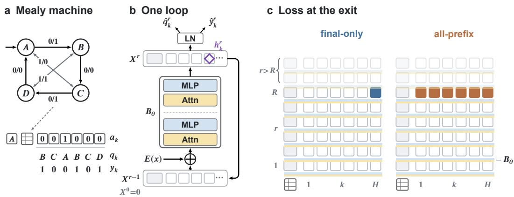  
Figure 1: Task, recurrence, and where the loss is applied. (a) A Mealy machine (edge label: input/output), its in-context encoding, and the simulator targets $q _ { k } , y _ { k }$ . (b) One loop of the shared block $B _ { \theta } ; \varsigma$ marks where interventions replace $h _ { k } ^ { r }$ . (c) Each cell is one vector $h _ { k } ^ { r }$ (position k, loop r). Colored cells receive the loss at the exit $\begin{array} { r } { \bar { R } ; } \end{array}$ rows above R are never trained and are where retention is measured.

The model repeats a two-layer transformer block with width 128, four attention heads, and feedforward width 512. With input embeddings $E ( x )$ , it computes

$$
X ^ { 0 } = 0 , \qquad X ^ { r } = B _ { \theta } \big ( X ^ { r - 1 } + E ( x ) \big ) .\tag{2}
$$

Here r indexes loops and $X ^ { r }$ collects the hidden vectors of all tokens after loop r; training reads out after loop R, the exit. The block’s two layers have different parameters; the entire block is shared across loops (Figure 1b; details in Figure A1). There are no positional or loop-depth embeddings; the causal attention mask provides the architectural signal of action order.

The prefix (initial-state token and transition table) attends within itself, and action position k attends to this prefix and actions 1:k. Let $h _ { k } ^ { r }$ denote its post-block hidden vector. Shared state and output heads are trained jointly with the model and read $\mathrm { \bar { L } N } ( h _ { k } ^ { r } )$ after each loop. Hidden-vector interventions replace $h _ { k } ^ { r }$ before this final normalization and affect subsequent loops.

Training objectives. Our main comparison fixes the training exit $R = H$ , architecture, curriculum, optimizer, and training duration, and changes the supervised positions at the exit. Each batch shares one horizon H. With $\ell _ { i , k } ^ { R }$ the sum of state and output cross-entropies for example i, the batch objective is

$$
\mathcal { L } _ { S } = \frac { 1 } { \sum _ { i } | S _ { i } | } \sum _ { i } \sum _ { k \in S _ { i } } \ell _ { i , k } ^ { R } , \qquad S _ { i } = \left\{ \begin{array} { l l } { \{ H \} , } & { \mathrm { F I N A L - O N L Y } , } \\ { \{ 1 , \dots , H \} , } & { \mathrm { A L L - P R E F I X } , } \\ { \{ K _ { i } \} , ~ K _ { i } \sim U \{ 1 , \dots , H \} , } & { \mathrm { S A M P L E D - P R E F I X } . } \end{array} \right.\tag{3}
$$

Relative to FINAL-ONLY, ALL-PREFIX broadens position coverage and increases the number of supervised state–output pairs per example from one to H. SAMPLED-PREFIX separates coverage from dense per-example supervision by selecting one position independently and uniformly per example. At fixed parameters and batch, its expected loss equals the mean ALL-PREFIX loss. All three objectives apply these losses only at the exit, not at every loop (Figure 1c), and average over selected positions rather than multiplying the loss by H.

The main training comparisons use 132,000 AdamW steps, batch size 256, and the same 35-stage curriculum reaching $\bar { H = 3 2 }$ . After the initial $H = 1 { \mathrm { s t a g e } }$ , each stage draws its maximum horizon with probability .5 and otherwise a shorter horizon uniformly from 1 to one below that maximum.

Under FINAL-ONLY, every horizon $H \leq 3 2$ therefore receives endpoint supervision at loop H as the curriculum progresses. Because future actions cannot affect earlier positions, a length-k input and any extension of it have identical computations at positions 1:k when the machine presentation is unchanged. Shorter-horizon training thus directly constrains position k at loop k even when that prefix appears in a longer input. ALL-PREFIX and SAMPLED-PREFIX additionally supervise that position at exits $H > k ,$ requiring its answer to be readable $H - k$ loops beyond the diagonal $r = k$ The relation of this diagonal to the measured first-correct frontier is evaluated in Section 3.

Section 3 also varies the exit distribution (Slack-4 versus Jitter-8) and tests gradient truncation by comparing progressive training with MATCHED RANDOM EXIT at matched supervised exits.

Evaluation cohorts. The common cohort compares FINAL-ONLY, ALL-PREFIX, SAMPLED-PREFIX, PROGRESSIVE, and MATCHED RANDOM EXIT on model seeds 9–11 and one shared evaluation stream; the existing FINAL-ONLY/ALL-PREFIX checkpoints are re-evaluated. The original cohort uses seeds 9–14 for the historical training comparisons, including Slack-4/Jitter-8, and supplies six pairs of FINAL-ONLY/ALL-PREFIX models for the position-16 interventions (Section 5; Appendices B.6 and C). Its behavioral evaluations use a separate stream. The position-8 transport audit in Section 4 uses ten FINAL-ONLY models, seeds 9–18. Overlapping checkpoints are not independent model replications. Additional freezing, larger-model, and maze cohorts are specified with their experiments in Section 5 and the appendices. No seed is selected for intervention success; Appendices A and B.1 give the seeds, streams, and pairing protocols.

Readouts and scoring. For one model and N evaluation examples of length H, endpoint accuracy at readout loop r is the fraction for which both predictions at the last action are correct:

$$
A ( H , r ) = \frac { 1 } { N } \sum _ { i = 1 } ^ { N } \mathbf { 1 } \left[ \hat { q } _ { i , H } ^ { r } = q _ { i , H } \wedge \hat { y } _ { i , H } ^ { r } = y _ { i , H } \right] .\tag{4}
$$

Whole-trajectory exactness requires both predictions at all H positions of an example to be correct at the same loop r, and reports the fraction of examples satisfying this conjunction. The main endpoint and trajectory evaluations use 512 traces per model and length: 16 machines with 32 traces each. Scores are computed within each model and then averaged across models with equal weight (Appendix A).

On a clean loop–position grid, $\tau ( k )$ is the first evaluated loop at which both marginal state and output accuracies at position k reach .99, for the specified model, horizon, and evaluation set. This population criterion differs from the example-level conjunctions above. We reserve $\tau ( k )$ for this measured quantity and write $s ( k )$ for a specified readout or capture schedule. The matched-frontier audit in Section 4 uses the diagonal schedule $s ( k ) = k ;$ a common-exit readout uses $s ( k ) = r$ for all positions. Fixed freezing schedules and their agreement with the clean frontier are assessed separately in Section 5. Section 4 introduces source–base pairs, their counterfactual targets, and the corresponding suffix-exactness scores.

## 3 TRAINING TO RETAIN CHANGES INFERENCE-BUDGET ROBUSTNESS

A correct endpoint need not survive more loops. Figure 2a,b evaluates the common cohort, holding each input and checkpoint fixed across loops. FINAL-ONLY endpoint joint accuracy falls from 100% at loop 32 to 60.81% at loop 33 and 22.33% at loop 64. Whole-trajectory exactness is 0% at both loops 32 and 64. These are losses on solved inputs of unchanged length. Original-cohort results remain separate (Appendix B.2).

One supervised position per example is enough for strong retention. At the same training exit $R = H$ , ALL-PREFIX raises loop-64 endpoint accuracy to 94.27% on the common stream, but supplies more supervised positions. SAMPLED-PREFIX controls this difference: each example contributes one uniformly chosen position’s state and output losses. All three models attain 100% endpoint and whole-trajectory accuracy at loop 32. At loops 64 and 96, endpoint means are 99.80% and 96.61%, and whole-trajectory means are 96.03% and 74.09%. The corresponding ALL-PREFIX trajectory means are 74.28% and 67.45%. Dense per-example supervision is therefore not necessary for the observed retention gain. This three-seed result does not establish that sampling is generally superior to ALL-PREFIX, nor remove the need for intermediate labels.

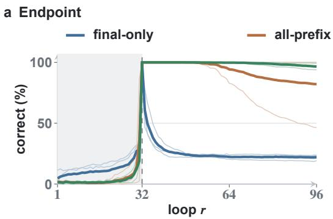

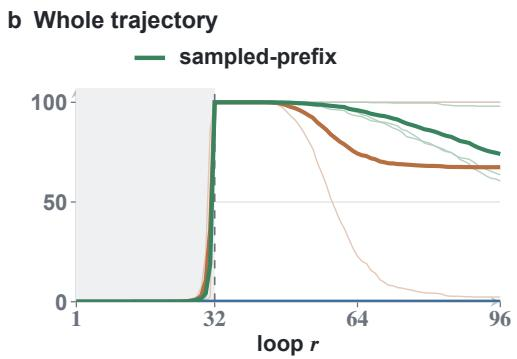

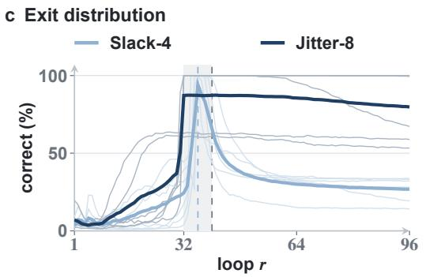

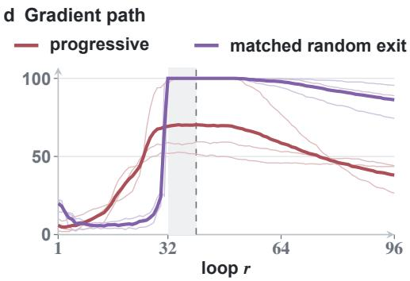  
Figure 2: Position coverage, exit distribution, and gradient propagation. Endpoint joint accuracy (a,c,d) and whole-trajectory exactness (b: all 32 state–output pairs correct) on 512 length-32 examples per model; thin curves are models, including incomplete learners, and thick curves their means. (a,b) Common cohort: one uniformly sampled supervised position per example preserves late accuracy without adding supervised positions. (c) Original cohort: Slack-4 and Jitter-8 match expected loop budgets. (d) Common cohort: progressive and matched random exit share supervised exits and forward work but differ in gradient truncation and backward work. Shading marks training exit support; the dashed line in (c) is Slack-4’s exit. Neither comparison matches measured training FLOPs.

For both baselines trained at $R = H$ , the original readability grids give a first-correct frontier $\tau ( k ) = k$ (Appendix B.4); Section 4 tests its causal role.

Varying the exit helps at matched expected loop budgets. The original-cohort comparison in Figure 2c retains FINAL-ONLY supervision and compares Slack-4, $R = H + 4 $ , with Jitter-8, $R = { \bf \bar { \boldsymbol { H } } } + U \{ 0 , \dots , 8 \}$ . Both have conditional mean $H + 4 ;$ cumulative batched block applications differ by only 0.062%. At H32/loop64, endpoint means are 30.01% and 85.55%, with Jitter-8 higher in every pair; at loop96 they are 26.79% and 79.79%. Both readouts exceed Jitter-8’s H32 training support of 32–40. The effect has tradeoffs: at the common loop36, Slack-4 gives 93.98% versus 87.27%, and some seeds do not fully learn the training length range. Appendix B.3 reports all seeds and work accounting.

Truncated gradients do not help retention. Bansal et al. (2022) prevent overthinking with progressive training, which changes two things at once: the loss is applied at a random depth, and gradients do not reach the loops before a random starting point. We adapt it to this architecture and separate the two with a matched control. At each update, both PROGRESSIVE and MATCHED RANDOM EXIT add to a full branch ending at $m = H + 8$ a second branch with a random exit $n + k \ge H$ . PROGRESSIVE detaches this branch after its first n loops; MATCHED RANDOM EXIT back-propagates through all $n + k$ . Examples, exits, loss weights, and updates are identical, so only the gradient path, and with it the backward work, differs (Appendix B.1).

In this recipe truncation impedes learning. Two of three PROGRESSIVE models never exceed 60% H32 endpoint accuracy, so their low late scores are not forgetting; the third reaches 100% at loops 40–48 and falls to 26.6% by loop 96. All three MATCHED RANDOM EXIT models reach 100% at loop 32 and keep 97.9% at loop 64 (Figure 2d). Like Jitter-8, this random-exit objective keeps endpoint answers well past its training exits. Its losses, like those of FINAL-ONLY, use only the last position, and it keeps far fewer complete trajectories: 29.6% are exact at loop 64, against 96.0% under SAMPLED-PREFIX. This is an FSM adaptation, not a reproduction of the original architecture or a ranking of progressive methods.

Retention is a distinct, finite-window property. Supervision support does not fully explain learning or retention, and H32 retention does not guarantee improved length extrapolation. On the common H64/loop96 evaluation, SAMPLED-PREFIX has 82.68% endpoint accuracy versus 93.03% for MATCHED RANDOM EXIT. The original length comparison also has mixed outcomes (Appendix B.5).

## 4 COMPUTATION IS EXACT, BUT ITS ANSWERS ARE TRANSIENT

Section 3 found that each position’s answer first becomes readable at loop k, even in FINAL-ONLY models that get almost no complete trajectory right at the trained exit. Readable does not mean used: a readout can decode information that the computation ignores. We therefore test whether the frontier state is what the rest of the execution runs on. If it is, replacing it with another input’s state should make the run follow that input’s execution exactly, and a simulator tells us what that execution is.

Swapping one state between two inputs. We pair two inputs that share the machine, symbol assignment, and transition-table presentation, and differ only in their actions up to position c; their states $q _ { c } ^ { S }$ and $q _ { c } ^ { B }$ at c differ (Figure 3a). Following interchange interventions (Geiger et al., 2024), we copy the full 128-dimensional hidden vector of the source run at position c and loop r into the base run,

$$
h _ { c } ^ { r } \gets h _ { c , S } ^ { r } ,\tag{5}
$$

leave every other base position unchanged, and let the trained model continue. No symbolic state or answer enters the network. Because the remaining actions are shared, a base run that now carries the source’s state should continue exactly as the source run does. Running Equation 1 from $q _ { c } ^ { S }$ on these actions gives this counterfactual target $\tilde { q } _ { k }$ for every $k > c$ (Geiger et al., 2021). A pair is suffix-exact under a readout schedule $s ( k )$ when every state and output after c matches the target. We score only eligible pairs, whose counterfactual and factual suffixes differ, so that a run ignoring the swap cannot succeed (Appendix A).

One swapped state drives the rest of the execution. In ten FINAL-ONLY models with $H = 3 2$ we swap at position 8 and loop 8, the loop at which position 8’s answer first becomes correct in every model $( \tau ( 8 ) = 8 ;$ Appendix A). Of 256 pairs, 237 are eligible. In every model, all 237 follow the source exactly: every state and output at positions 9 to 32, each read at loop k (Figure 3c). One vector thus steers 24 further steps of exact symbolic execution. Copying a vector back into its own run changes no prediction, and patch scans place the damaging site on the same frontier (Appendix A). The swap shows that this state suffices to drive the computation; it does not show that the state is a unique symbolic code.

The answers do not stay. In both the swapped and the clean run, agreement is highest on the diagonal and fades above it (Figure 3b,c): an answer is readable at the loop that computes it, and answers computed early have faded by loop 32. The near-zero whole-trajectory exactness of FINAL-ONLY models at the trained exit (Section 3) is therefore not a failure to compute: the intermediate answers are computed exactly and then not kept.

## 5 ANSWERS BECOME READABLE BEFORE THEIR STATES BECOME REUSABLE

Halting treats a solved position as finished. Section 3 showed that training can keep an answer readable long after it is computed, and Section 4 that a single frontier state drives the computation that follows. A position whose answer has appeared and stays readable therefore looks finished, and adaptive computation treats it that way. The Universal Transformer halts positions individually and copies a halted position’s state unchanged to every later step (Dehghani et al., 2019). Huginn stops iterating on a token once successive steps give nearly the same output distribution, and later tokens attend to its last computed key–value state (Geiping et al., 2025). Bansal et al. (2022) describe their networks, trained to avoid overthinking, as holding on to the representation of a solution once it is reached. These methods differ in when a position counts as finished. We test the earliest point, the loop at which its answer first becomes readable. Our setting makes that loop known: position k first becomes correct at loop k, and every position has an exact target.

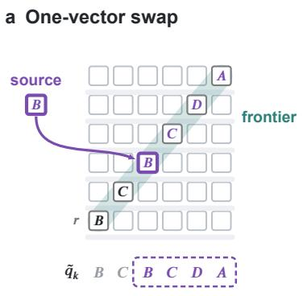

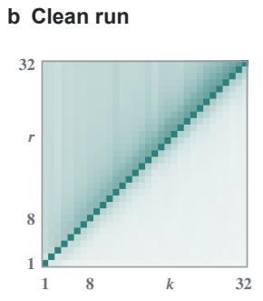

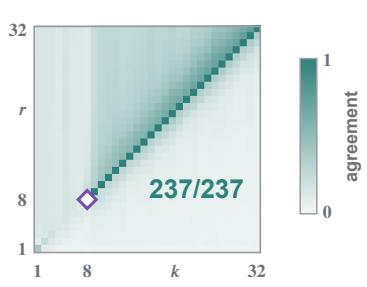

Figure 3: One swapped state drives the exact remaining execution. (a) Schematic, $H = R = 6$ $c = 3 .$ . The source’s vector at position 3 and loop 3, whose state is $B ,$ , replaces the base run’s; read at loop k (the frontier), positions 4–6 then give C, D, A, the source’s continuation $\tilde { q } _ { k }$ . (b,c) Ten FINAL-ONLY models, $H = 3 2$ , swap at position 8 and loop 8 (⋄ in c). Shading is the fraction of pairs whose state and output at $( k , r )$ both match the target: the base run’s own trajectory (b) or the source’s continuation after the swap (c); means over 256 pairs and ten models. The bright diagonal is the frontier; the fading above it shows answers decaying after they are computed, and some agreement away from it is chance. 237/237: eligible pairs whose whole suffix $( k = 9 , \ldots , 3 2 )$ matches along the frontier.  
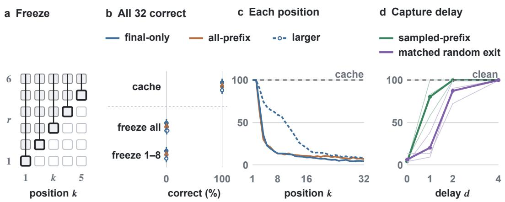  
Figure 4: Answers can be cached when they appear; their states can be frozen only a few loops later. (a) Freezing captures each position’s own hidden vector at loop k and writes it back after every later block; other positions update normally, and no other run or label is involved. $^ { ( \mathrm { b , c } ) }$ Six FINAL-ONLY, three $_ { \mathrm { A L L - P R E F I X . } }$ , and three larger FINAL-ONLY models, 512 H32 examples each. (b) Fraction of examples with all 32 state–output pairs correct at loop 32. Cache keeps each position’s loop-k prediction outside the model; $f r e e z e$ holds the hidden vectors instead, for all positions or only positions 1–8. Dots are models; short marks are group means. (c) Accuracy of each position at loop 32 after freezing all positions (group means); the dashed line is the cache. (d) SAMPLED-PREFIX and MATCHED RANDOM EXIT, three seeds each (thin lines) and their means (thick), with capture delayed by d loops: endpoint accuracy at the actual capture loop $3 2 + d ,$ , unchanged through loop $6 4 ;$ the dashed line is clean. Clean readouts at $s ( k ) = k$ are not perfectly correct for two MATCHED RANDOM EXIT seeds (Appendix D.3).

Freezing applies this halting at the first readable loop. For each position k, we capture its hidden vector at loop k and write it back after every later block, as copying a halted state would. All other positions update normally, frozen positions stay visible to attention, and no other run or label is involved (Figure 4a). As a control, readout caching stores each position’s loop-k prediction outside the model and leaves every hidden state untouched; the two differ only in whether the answer or its state is kept. We call a state reusable if freezing it in this way leaves the later positions correct. We freeze six FINAL-ONLY, three ALL-PREFIX, and three larger FINAL-ONLY models (d = 512 and four layers per block, about 32 times the block parameters), and the three SAMPLED-PREFIX and three MATCHED RANDOM EXIT models of Section 3.

The answers are correct, but their states cannot yet be frozen. In the twelve models of Figure 4b, caching keeps all 32 answers correct, so every answer is correct when it is captured. Freezing the states instead leaves at most 2% of examples fully correct. Good retention does not prevent this. SAMPLED-PREFIX keeps 99.8% of its endpoint answers at loop 64 (Section 3) and its cached answers are all correct, yet freezing drops its endpoint accuracy from 100% to 4.1%. ALL-PREFIX models, which keep every position readable at the exit, and MATCHED RANDOM EXIT models collapse in the same way (Appendix D). The answers stay readable; their states cannot yet stop changing.

Frozen states fail as inputs to later computation. The errors start just downstream of the frozen states (Figure 4c). Positions 1 and 2 stay correct in every model, and position 3 is the first to fail. At loop 3 it reads the loop-2 vectors of positions 1 to 3, which differ from the clean run in one place only: position 1 has missed its loop-2 update, which came after its answer was already readable. That one missing update lowers the accuracy of position 3 to 68% in the FINAL-ONLY models, and errors then compound along the sequence. Freezing only positions 1–8 leaves positions 9–32 free to update, yet in the FINAL-ONLY models the endpoint is still correct on at most 11.9% of examples (Appendix D). A frozen state still yields its own answer, as positions 1 and 2 show, but it no longer works as input: later positions need the updates that upstream states receive after their answers appear.

A state becomes reusable two to four loops after its answer. Delaying the capture by d loops shows when a state can be frozen (Figure 4d). With a two-loop delay, SAMPLED-PREFIX recovers to 99.8% endpoint accuracy; MATCHED RANDOM EXIT needs four loops to reach the same level (Appendix D.3). An answer is readable at loop k, but the state that carries it becomes reusable only a few loops later, and how many loops depends on the model.

The maze network trained against overthinking behaves the same way. We apply the same test to the released maze network of Bansal et al. (2022), the model described above as holding on to its solution. Trained with 30 iterations, it solves all 32 test mazes of size 9 × 9 at every iteration from 25 to 120. Since mazes have no per-position frontier, we freeze each pixel at its answer’s arrival, the last iteration at which its clean prediction changes. No maze is then solved; freezing two or four iterations later solves 28 and 32, and caching the answers solves all 32 (Appendix D; one checkpoint, 32 mazes per size). The network does hold on to its solution, but only a few iterations after each answer arrives.

What freezing shows. An answer readable at loop k is thus not yet carried by a reusable state, even in models that retain answers almost perfectly; the state becomes reusable two to four loops later. Retention and reuse are different properties. For per-position halting in such models, stopping a position when its answer first becomes readable is too early: its state must keep updating for a few loops, or only its answer should be kept. The experiments do not show that information is lost, since cached answers stay correct, and they do not identify a mechanism. The model has no positional or loop embeddings, so the evolving state may also carry timing or order information that later positions use to find their predecessors, and freezing would hold that information as well. Our tests do not separate these possibilities; under either, a state cannot be frozen when its answer first appears. A source vector transplanted from another run shows the same dependence on timing (Appendix C).

## 6 RELATED WORK

Extra iterations in recurrent reasoners. Recurrent networks trained on small instances can solve larger ones by iterating longer (Schwarzschild et al., 2021). Bansal et al. (2022) show that excessive iteration can degrade answers (“overthinking”), and prevent this with input recall and progressive training from detached intermediate states. They also test recovery after feature-map interventions and track feature convergence. We adapt their progressive loss in Section 3 and freeze their released maze network in Section 5. Anil et al. (2022) relate additional computation to path independence: convergence to the same steady state regardless of initialization. We do not claim novelty for overthinking, variable exits, or mid-computation substitution. What is new is the measurement: exact symbolic targets for every position, loop, and counterfactual, which let us test a state at the loop where its answer first appears.

These works assess stability through outputs, feature maps, or final convergence; we ask whether a state can be held from the moment its clean readout becomes correct. This is a position-level counterpart to path independence, not a test of it: we do not vary initialization.

Recurrent computation and training requirements. Universal and looped transformers connect shared parameters to adaptive computation, programmable execution, and length generalization (Dehghani et al., 2019; Giannou et al., 2023; Fan et al., 2025); recurrent-depth language models extend this motivation to latent test-time compute (Geiping et al., 2025). Zhang et al. (2026) study budget-dependent frontiers, causal damage cones, and frontier-state transplants. We build on these observations rather than claiming novelty for frontiers or transport. A first-correct frontier differs from a convergence time that requires an answer to remain correct.

Stochastic stopping can stabilize budget-dependent behavior without better extrapolation (Kuo et al., 2026); adaptive-depth studies distinguish trajectory formation from readout selection (Popescu et al., 2026). Our comparisons instead change supervised positions at a fixed exit, or exit variability at matched expected loops; sampling one position estimates the all-position loss rather than introducing a new loss principle.

Readable and causally usable representations. Wang & Reid (2026) distinguish readout, transport, and steering across recurrent depth in Ouro and Huginn, and associate verbalizing injected content with per-iteration supervision. Our ALL-PREFIX loss applies only at the exit; we add paired training comparisons, exact symbolic targets, and local downstream restoration that separates downstream state from execution phase.

State-tracking studies identify alternative transformer algorithms and effects of intermediate objectives (Liu et al., 2023; Zhang et al., 2025; Li et al., 2025), and interchange interventions test such algorithmic hypotheses (Geiger et al., 2021; 2024). Our full-vector intervention establishes sufficiency in a specified machine context, not a unique minimal encoding or complete algorithm identification.

## 7 DISCUSSION AND LIMITATIONS

Computing an answer, retaining its readout, and reusing its representation are different properties, and each needs its own test: correctness at one exit does not test retention, and retained predictions do not test whether a hidden state can be held or reused for continuation. Supervised positions, exit distributions, and gradient propagation all change retention, and poor late accuracy can conceal a coherent earlier counterfactual computation. Retained answers need not reside in reusable states: freezing a position when its answer first becomes readable disrupts later computation, including under sampled-position training, and the state becomes reusable only a few loops later; a transplanted source likewise needs the downstream position reset before it takes effect. We have not tested downstream resets on the new training controls or stochastic-budget models, so their retention gains do not establish the same downstream mechanism.

These full-vector, post-block interventions do not identify a unique encoding, microscopic cause of forgetting, or general repair; they can change nonsymbolic features or restart computation, and downstream recovery concerns one step at one site and age. The scope is one synthetic execution family and one principal architecture, plus a limited external maze check. Original training comparisons use six paired seeds; new controls use three. Re-evaluating overlapping checkpoints is not independent model replication. Sampled supervision still needs intermediate labels. Budget controls match expected loops, and progressive controls match forward work but differ in backward work; neither matches measured total FLOPs. Finite-window retention does not establish hidden-state convergence or uniform length extrapolation.

## AI USE STATEMENT

The core idea of this work is the authors’ own. Generative AI tools assisted with code implementation, experiment and control iteration, literature search, translation, manuscript editing, and figure code. The authors verified the analyses, citations, and final artifacts and take full responsibility for the work.

## ETHICS STATEMENT

Machines and traces are procedurally generated; the work uses no personal or human-subject data.   
The objectives studied here do not ensure the reliability of deployed systems.

## REPRODUCIBILITY STATEMENT

Appendix A specifies machine generation, the network, optimization, curriculum, and scoring. Appendices B–E give every training and intervention protocol with per-seed results, and Appendix B.8 records the checkpoints, evaluation streams, pair identities, and hashes behind the principal quantities.

## REFERENCES

Cem Anil, Ashwini Pokle, Kaiqu Liang, Johannes Treutlein, Yuhuai Wu, Shaojie Bai, J. Zico Kolter, and Roger B. Grosse. Path independent equilibrium models can better exploit test-time computation. In Advances in Neural Information Processing Systems, volume 35, pp. 7796–7809, 2022.

Arpit Bansal, Avi Schwarzschild, Eitan Borgnia, Zeyad Emam, Furong Huang, Micah Goldblum, and Tom Goldstein. End-to-end algorithm synthesis with recurrent networks: Extrapolation without overthinking. In Advances in Neural Information Processing Systems, volume 35, pp. 20232–20242, 2022.

Mostafa Dehghani, Stephan Gouws, Oriol Vinyals, Jakob Uszkoreit, and Łukasz Kaiser. Universal transformers. In International Conference on Learning Representations (ICLR), 2019.

Ying Fan, Yilun Du, Kannan Ramchandran, and Kangwook Lee. Looped transformers for length generalization. In International Conference on Learning Representations (ICLR), 2025.

Atticus Geiger, Hanson Lu, Thomas Icard, and Christopher Potts. Causal abstractions of neural networks. In Advances in Neural Information Processing Systems (NeurIPS), 2021.

Atticus Geiger, Zhengxuan Wu, Christopher Potts, Thomas Icard, and Noah D. Goodman. Finding alignments between interpretable causal variables and distributed neural representations. In Causal Learning and Reasoning (CLeaR), pp. 160–187, 2024.

Jonas Geiping, Sean McLeish, Neel Jain, John Kirchenbauer, Siddharth Singh, Brian R. Bartoldson, Bhavya Kailkhura, Abhinav Bhatele, and Tom Goldstein. Scaling up test-time compute with latent reasoning: A recurrent depth approach. In Advances in Neural Information Processing Systems (NeurIPS), 2025.

Angeliki Giannou, Shashank Rajput, Jy-yong Sohn, Kangwook Lee, Jason D. Lee, and Dimitris Papailiopoulos. Looped transformers as programmable computers. In International Conference on Machine Learning (ICML), pp. 11398–11442, 2023.

Hsun-Yu Kuo, El Mahdi Chayti, Patrik Reizinger, Wieland Brendel, and Martin Jaggi. Stabilizing extrapolation in looped transformers via learned stochastic stopping. arXiv preprint arXiv:2606.29983, 2026.

Belinda Z. Li, Zifan Carl Guo, and Jacob Andreas. (How) do language models track state? In International Conference on Machine Learning (ICML), 2025.

Bingbin Liu, Jordan T. Ash, Surbhi Goel, Akshay Krishnamurthy, and Cyril Zhang. Transformers learn shortcuts to automata. In International Conference on Learning Representations (ICLR), 2023.

Andrei Cristian Popescu, Haitz Saez de Oc´ ariz Borde, and Pietro Li´ o. Adaptive depth in\` looped transformers: Diagnosing learned halting gates and trajectory readouts. arXiv preprint arXiv:2607.20519, 2026.

Avi Schwarzschild, Eitan Borgnia, Arjun Gupta, Furong Huang, Uzi Vishkin, Micah Goldblum, and Tom Goldstein. Can you learn an algorithm? Generalizing from easy to hard problems with recurrent networks. In Advances in Neural Information Processing Systems, volume 34, pp. 6695–6706, 2021.

Wenlong Wang and Fergal Reid. Looped transformers under the Jacobian lens: Does the global workspace survive recurrence? arXiv preprint arXiv:2609.01924, 2026. URL https://arxiv. org/abs/2609.01924.

Tong Zhang, Junhao Hu, Yun Peng, and Tao Xie. When does recurrence become an algorithm? convergence selection in weight-tied looped transformers. arXiv preprint arXiv:2607.20594, 2026.

Yifan Zhang, Wenyu Du, Dongming Jin, Jie Fu, and Zhi Jin. Finite state automata inside transformers with chain-of-thought: A mechanistic study on state tracking. In Annual Meeting of the Association for Computational Linguistics (ACL, Long Papers), pp. 13603–13621, 2025.

## A EXPERIMENTAL METHODS AND SCORING

## A.1 MACHINE GENERATION AND INPUT ENCODING

At each stage, the data generator samples the state count and input-alphabet size independently and uniformly from the active lists in Table A1; the output alphabet has two symbols. Generation fixes an internal initial state $S _ { 0 }$ and first makes every state reachable. In a random order of the other states, each is attached through a uniformly sampled unused state–input cell of an already reachable state. Remaining transition destinations are sampled uniformly from $Q ,$ and each cell’s output is sampled uniformly from Γ. Candidates are resampled until behaviorally minimal and covering both output symbols. These construction and acceptance rules make the accepted transition-table entries dependent.

Each sampled machine contributes up to 32 action traces, all starting at $S _ { 0 }$ , with actions drawn independently and uniformly from its input alphabet. A training batch contains 256 examples of the same sampled horizon. The online stream, including machine generation, action traces, and presentation randomization, is reproducible from its generator state.

The initial state is one token. Every transition is represented by one factorized token containing its source state, input symbol, destination state, and output symbol. Action tokens follow the table and contain only their input symbol. Token embeddings sum a kind embedding and the embeddings of the present symbolic fields. The global namespaces contain 16 state IDs, 8 input IDs, and 4 output IDs, although an individual machine uses only 4/6/8 states, 2/4 inputs, and 2 outputs. Each presentation assigns local symbols to randomly selected namespace IDs and shuffles the transition rows. Training does not force traces from one machine to share the same presentation; source–base pairs explicitly share a presentation to control that variable.

The attention mask lets initial-state and table tokens attend within the prefix, and action k attend to the prefix and actions up to and including k. It blocks all access to future actions. Padded positions are masked and zeroed through the computation. A causal action prefix therefore has the same unmodified computation when followed by additional actions of the same presented machine. This structural property helps explain why endpoint training at shorter lengths constrains earlier positions in longer examples; it does not prove a particular internal algorithm.

Training uses data seed 20260901. The original six-seed budget comparisons use evaluation seed 20260909; the five-condition, three-seed comparison uses 20260923, with the old baselines reevaluated on that same stream. Both use four batches of 128 examples per model and length: 16 sampled machines with 32 traces each, not 512 independent machines. The new six-model freeze follow-up uses stream 20260924. Actual generator seeds add 1009H to the specified stream. The original training logs use evaluation seed 20260902. These are separate evaluation streams. We do not combine their metrics as if they came from one paired sample set. Randomized presentations and independently drawn evaluation streams do not guarantee that every machine graph is structurally absent from training.

## A.2 NETWORK, OPTIMIZATION, AND CURRICULUM

The shared block contains two pre-normalized transformer layers, each with four attention heads, width 128, a width-512 feed-forward network, and residual connections. Dropout is zero. The recurrence begins with a zero hidden matrix and adds the same input embedding before every block application. There is no learned recurrent gate, loop embedding, positional embedding, or enabled layer scaling. State and output linear heads follow a shared final layer normalization. The heads have 16 and 4 classes, respectively. All reported hidden-vector replacements occur after the shared block and before this final normalization, exactly as in Equation 5.

Figure A1 summarizes the input sequence, one layer, the attention mask, and the two per-loop scores.

AdamW uses initial learning rate $3 \times 1 0 ^ { - 4 }$ with cosine decay to zero, weight decay .01, gradient norm clipping at 1, and batch size 256. Both task losses have weight 1 and use mean cross-entropy over the selected valid positions. Training runs for the fixed 132,000-step curriculum in Table $\mathbf { A } 1 ;$ stage checks are audits, not a rule for selecting a checkpoint or stopping a failing seed. Checkpoints are saved at fixed steps, and all main comparisons use step 132,000.

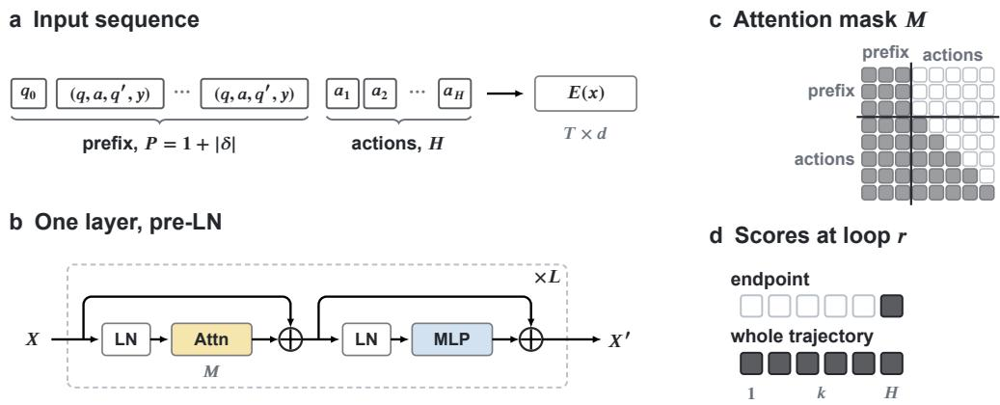  
Figure A1: Network details. (a) An example is one sequence: the initial state $q _ { 0 } ,$ , one factorized token $( q , a , q ^ { \prime } , y )$ per transition, and the H action symbols. It is embedded once as $E ( x )$ , with $T = P + H$ rows of width $d ,$ and added before every application of $B _ { \theta }$ . (b) $B _ { \theta }$ stacks $L$ pre-normalized layers with distinct weights: $L = 2 , d = 1 2 8$ , four heads, and MLP width 512 in the main models; $L = 4$ and $d = 5 1 2$ in the larger models. There is no dropout, recurrent gate, layer scaling, or positional or loop embedding. (c) Rows are queries and columns keys; filled cells are visible. Prefix tokens attend within the prefix, and action position k attends to the prefix and positions 1:k. Schematic with three prefix tokens and five actions; padding is masked. (d) At loop r, endpoint accuracy scores position $H ;$ whole-trajectory exactness requires all H positions of an example to be correct at that same loop. A position is correct when its state and output are both correct.

Table A1: The 35-stage curriculum. A maximum horizon is sampled with probability .5 after the first stage; the remaining draws come from shorter horizons. All stages include the shorter-length range from 1. Rows grouping several stages retain their individual training allocations below.
<table><tr><td>Maximum horizon</td><td>Stages</td><td>Steps</td><td>Machine distribution</td></tr><tr><td>1</td><td>1</td><td>2,000</td><td>4 states, 2 inputs, 2 outputs</td></tr><tr><td>2</td><td>4</td><td>7,000</td><td>2,000 steps each with 4, then 4/6, then 4/6/8</td></tr><tr><td>3</td><td>1</td><td>3,000</td><td>states; 1,000 steps adding the 4-input cases 4/6/8 states, 2/4 inputs, 2 outputs</td></tr><tr><td>4</td><td>1</td><td>8,000</td><td>Same full distribution</td></tr><tr><td>5-32</td><td>28</td><td>112,000</td><td>4,000 steps per successive maximum horizon</td></tr></table>

## A.3 READOUTS, THRESHOLDS, AND EXACTNESS

Let $Q _ { i , k } ^ { r }$ and $Y _ { i , k } ^ { r }$ be indicators of correct state and output for sample i, position $k ,$ and loop $r .$ The endpoint curve reports $N ^ { - 1 } \sum _ { i } Q _ { i , H } ^ { r } Y _ { i , H } ^ { r }$ . The grid criterion instead requires both $N ^ { - 1 } \sum _ { i } Q _ { i , k } ^ { r } \geq$ .99 and $\begin{array} { r } { N ^ { - 1 } \sum _ { i } Y _ { i , k } ^ { r } \ge . 9 9 } \end{array}$ . Passing this criterion is not the same as a per-sample guarantee that every state and output is correct. The first loop passing it on the clean grid defines $\tau ( k )$ for that model, horizon, and evaluation set. This measured quantity is distinct from a prescribed readout or capture schedule $s ( k )$ . Hold includes consecutive passing loops from $\tau ( k )$ , including the first. If the measured window ends while the criterion still holds, the observed hold is a right-censored lower bound.

For the whole-trajectory metric in Figure 2, an example is trajectory-exact at readout loop r when every one of its H state–output pairs is correct at that same readout:

$$
E _ { i } ^ { r } = \prod _ { k = 1 } ^ { H } Q _ { i , k } ^ { r } Y _ { i , k } ^ { r } , \qquad \mathrm { T r a j E x a c t } ( r ) = N ^ { - 1 } \sum _ { i } E _ { i } ^ { r } .
$$

This example-level conjunction is stricter than either the endpoint event or the grid’s two marginal population thresholds.

For a target sequence $\left( \bar { q } _ { i , k } , \bar { y } _ { i , k } \right)$ and readout schedule $s ( k )$ , suffix exactness on an eligible set E is

$$
\operatorname { E x a c t } _ { { \boldsymbol { \varepsilon } } } ( s ) = \frac { 1 } { | \mathcal { E } | } \sum _ { i \in \mathcal { E } } \prod _ { k = c + 1 } ^ { H } \mathbf { 1 } [ \hat { q } _ { i , k } ^ { s ( k ) } = \bar { q } _ { i , k } ] \mathbf { 1 } [ \hat { y } _ { i , k } ^ { s ( k ) } = \bar { y } _ { i , k } ] .\tag{6}
$$

The ordinary target is the base run’s factual trajectory. The source target is the simulated counterfactual. Changing this target changes the estimand; changing s(k) changes when it is observed. A wrong prediction that differs from both trajectories is not successful transport.

## A.4 POSITION-8 TRANSPORT AUDIT

The position-8 audit uses ten serial FINAL-ONLY models, seeds 9–18, with $H = 3 2$ and a single replacement at loop 8. On a separate clean grid (evaluation stream 20260903, 512 examples per model), all ten models have $\tau ( k ) = k$ at every position $k = 1 , \ldots , 3 2$ , with state and output accuracy 1.000 on the diagonal. The same 256 different-state pairs are reused across seeds. A pair is eligible for suffix scoring if at least one state or output in positions 9–32 differs between its factual and source targets; there are 237 such pairs. Conditional exactness uses that denominator, not 256 or ten times 237 independent task samples. The matched-frontier schedule is $s ( k ) = k$ and the common-exit schedule is $s ( k ) = 3 2$ . Eligibility requires a difference somewhere in the suffix, not at every suffix position. Factual and counterfactual states may later merge. Complete suffix agreement consequently does not establish that their distinction remains causally active at every later position.

At the common exit $s ( k ) = 3 2$ , no eligible suffix is exact in seven models and one is exact in three. The clean base run is not jointly readable there either (mean per-position agreement 38.1% over positions 9–32), so this contrast concerns readout time; it shows neither erased information nor a unique state code.

Localization and intervention controls. Independent patch scans replace a width-one window of positions at loop l. The maximal damage falls on position l, the observed loop–position frontier, in 320/320 tested loop–seed cells. Prefix replacements that overwrite positions before an anchor are predominantly safe until the anchor passes this boundary: the first damaging anchor is $l + 1$ in 309/310 testable cases; the exception (seed 15, loop 31) is retained. Identical self-replacements do not change any predictions. Sources with the same symbolic state but a different history can still cause damage; they are not equivalent to self-replacement controls. Together, these results support a localized, causally sufficient computation under the specified intervention. They do not establish a pure or unique symbolic state code, nor use independent of machine context or execution phase.

The saved clean readouts in this position-8 audit include per-position accuracy, not clean whole-suffix exactness. In particular, a saved field for the base-target exactness of a patched run is not a clean baseline. We use explicit unpatched suffix metrics from the separate position-16 experiment when making clean-suffix comparisons.

## A.5 PAIRED DELAYED AND PHASE-CROSSING COHORTS

The paired retention experiment freezes six models per supervision condition, seeds 9–14. It samples 256 different-state pairs and 256 same-state pairs per checkpoint, in sixteen batches of sixteen per pair kind. Pair identities are matched across conditions and seeds. The site stays at position $c = 1 6 ;$ patch age $a \in \{ 0 , 1 , 2 , 4 , 8 , 1 6 \}$ means taking and inserting the source at loop $1 6 + a$ , rather than holding a loop-16 vector and inserting it later.

Shifted-frontier scoring uses $s ( k ) = k + a .$ . Fixed-exit scoring uses $s ( k ) = 3 2$ or 48. At fixed exit 32, increasing age reduces the remaining update count, and age 16 leaves no post-patch update. Shiftedfrontier scoring fixes the update count to each target but still changes both source representation and base-run context. Neither age curve by itself identifies information decay.

The 242 different-state pairs with distinct complete suffix targets are the fixed denominator for source suffix exactness across all these schedules. Ordinary clean suffix exactness uses all 256 pairs. For a single target at distance $d = 1 , 2 , 4 , 8 , 1 6$ , factual and source trajectories can have merged; single-target eligible counts are respectively 242, 207, 143, 90, and 35. Rates for an empty eligible set are undefined and stored as null, not zero.

The subsequent compatibility experiment reuses the pair identities and checkpoint configurations. It crosses source collection at c or $c + a$ with base insertion at those same two loops, reading position $c + d$ after exactly d further updates. The main descriptive slice is $a = 4 , d = 1$ , with 242 eligible pairs. Its extent comparison instead inserts at loop $p = c + a$ and reads the unpatched position $p + d$ at loop $p + d .$ . This latter slice has 121 eligible pairs, and the old site is five positions from the target while the current frontier is one position away. The two experiments are not interchangeable scoring slices. All 384 batches across twelve checkpoint conditions were validated for the compatibility cohort; the separate pilot is excluded.

## A.6 CONTROLS AND STATISTICAL INTERPRETATION

True self-replacement copies the base run’s own vector at the same site and time, and must preserve predictions exactly. Same-symbolic-state sources come from another history and are a substantive intervention, not an identity control. A positive source score is interpreted alongside the clean base run’s agreement with its own target and with the source target. Chance coincidence with a source target is not causal transfer. A clean factual score is a reference level, not a formal upper bound on intervention performance.

Means first aggregate the specified pair/sample population within each model, then average models with equal weight. Model seeds are independent parameter initializations, whereas reused machine/pair samples are paired observations. We preserve per-seed outcomes rather than converting task pairs into a larger number of independent training runs. All intervals and differences in the main text are descriptive; no null-hypothesis significance claim is based on treating those repeated pairs as independent models.

## B ADDITIONAL RESULTS AND THEIR SCOPE

## B.1 COMMON-STREAM TRAINING CONTROLS

We compare five training conditions on the same three model seeds 9–11, checkpoint step 132,000, and held-out stream 20260923. The existing FINAL-ONLY and ALL-PREFIX checkpoints are reevaluated; no baseline is retrained or selected by its score. Each model receives four batches of 128 examples at each horizon. The generator seed is 20260923 + 1009H, with identical generator configuration and batch layout across conditions. The H32 sweep covers $r = 1 , \ldots , 9 6$ and the H64 sweep $r = 1 , \ldots , 1 9 2$ . Pairing rests on this deterministic generator specification; the original training-control evaluations did not save raw input hashes. Model seeds, rather than examples or loop counts, are the replication unit. The historical six-seed stream-20260909 results below remain a separate cohort and are not pooled into these comparisons.

One supervised position per example. The new runs retain the original width 128, four attention heads, two shared layers, additive input injection, batch size 256, AdamW optimizer, and 35-stage, 132,000-update curriculum. Stage progression and the cosine learning-rate schedule are fixed, with no accuracy gate. Under SAMPLED-PREFIX, the training budget is ${ \bar { R } } = H ,$ , as for the two serial baselines. Each example independently selects one position uniformly from $1 , \ldots , H$ and applies the original state and output cross-entropies there. If $\ell _ { b , k }$ denotes their weighted sum, the mean loss satisfies

$$
\mathbb { E } \left[ \frac { 1 } { B } \sum _ { b = 1 } ^ { B } \ell _ { b , { J } _ { b } } \right] = \frac { 1 } { B H } \sum _ { b = 1 } ^ { B } \sum _ { k = 1 } ^ { H } \ell _ { b , k } , \qquad J _ { b } \sim U \{ 1 , \dots , H \} .
$$

Thus it is an unbiased estimator of the mean ALL-PREFIX loss. It changes position coverage while retaining one supervised position per example; it still requires intermediate trajectory labels and is not label-free. The saved control protocol, rather than the legacy configuration field supervi $s { \mathrm { i } } { \mathrm { o n } } { = } { \mathrm { f } } { \mathrm { i } }$ nal only, identifies this objective.

Progressive and matched random exits. We adapt the progressive loss of Bansal et al. (2022) to the same FSM Transformer. At horizon $H ,$ set $m = H + 8$ . Propose $n \sim U \{ 0 , \dots , m - 1 \}$ and $k \mid n \sim U \{ 1 , \dots , m - n \} ;$ ; reject and redraw the complete pair when $n + k < H$ . The accepted joint law is proportional to $[ m \bar { ( \boldsymbol { m } - \boldsymbol { n } ) } ] ^ { - 1 }$ on $H \leq n + k \leq m$ , so neither accepted n nor the exit is uniform. Both conditions optimize $\begin{array} { r } { \frac { 1 } { 2 } L _ { m } + \frac { 1 } { 2 } L _ { n + k } } \end{array}$ using endpoint labels. The m-loop branch has full gradients. For the random-exit branch, PROGRESSIVE runs n loops without a gradient graph, detaches the hidden state, and differentiates through the remaining k loops. Input embeddings are recomputed with gradients for injection into this continuation and absolute loop indices are preserved. The $n = 0$ case starts normally with gradients. MATCHED RANDOM EXIT uses the same examples, draws, exits, and loss weights, but differentiates through all n + k loops. At fixed weights and zero dropout, the two losses have equal values but different gradients. This is an FSM adaptation, not a reproduction of the original convolutional architecture, concatenated recall, or exit support; it is also distinct from the uniform Jitter-8 contract below.

Table A2: Common-stream H32 training comparison. Three-seed means in percent, all seeds 9–11, 512 examples per model, stream 20260923. Ar is endpoint joint accuracy and $T _ { r }$ is whole-trajectory exactness at loop r. The serial conditions train at $R \stackrel { } { = } 3 2 \stackrel { . } { = }$ ; the two exit controls supervise exits in 32–40. All rows use the same evaluated inputs.
<table><tr><td>Condition</td><td> $A _ { 3 2 }$ </td><td> $A _ { 4 0 }$ </td><td> ${ \cal A } _ { 6 4 }$ </td><td> $A _ { 9 6 }$ </td><td> $T _ { 3 2 }$ </td><td> $T _ { 6 4 }$ </td><td> $T _ { 9 6 }$ </td></tr><tr><td>FINAL-ONLY</td><td>100.00</td><td>28.39</td><td>22.33</td><td>22.07</td><td>0.00</td><td>0.00</td><td>0.00</td></tr><tr><td>ALL-PREFIX</td><td>100.00</td><td>100.00</td><td>94.27</td><td>82.16</td><td>100.00</td><td>74.28</td><td>67.45</td></tr><tr><td>SAMPLED-PREFIX</td><td>100.00</td><td>100.00</td><td>99.80</td><td>96.61</td><td>100.00</td><td>96.03</td><td>74.09</td></tr><tr><td>MATCHED RANDOM EXIT</td><td>100.00</td><td>100.00</td><td>97.85</td><td>86.26</td><td>74.09</td><td>29.56</td><td>11.52</td></tr><tr><td>PROGRESSIVE</td><td>69.27</td><td>70.31</td><td>58.53</td><td>38.09</td><td>12.37</td><td>0.00</td><td>0.00</td></tr></table>

Table A3: Every model in the H32 training comparison. Same metric, stream, and population as Table A2; no seed is excluded. Peak A is the maximum endpoint accuracy over the complete $r = 1 { - } 9 6$ sweep and is reported to distinguish failure to learn from later loss.
<table><tr><td>Condition</td><td>Seed</td><td>Peak A</td><td> $A _ { 3 2 }$ </td><td> $A _ { 4 0 }$ </td><td> $A _ { 6 4 }$ </td><td> $A _ { 9 6 }$ </td><td> $T _ { 3 2 }$ </td><td> $T _ { 6 4 }$ </td><td> $T _ { 9 6 }$ </td></tr><tr><td>FINAL-ONLY</td><td>9</td><td>100.00</td><td>100.00</td><td>27.15</td><td>24.02</td><td>23.24</td><td>0.00</td><td>0.00</td><td>0.00</td></tr><tr><td>FINAL-ONLY</td><td>10</td><td>100.00</td><td>100.00</td><td>33.59</td><td>20.51</td><td>19.14</td><td>0.00</td><td>0.00</td><td>0.00</td></tr><tr><td>FINAL-ONLY</td><td>11</td><td>100.00</td><td>100.00</td><td>24.41</td><td>22.46</td><td>23.83</td><td>0.00</td><td>0.00</td><td>0.00</td></tr><tr><td>ALL-PREFIX</td><td>9</td><td>100.00</td><td>100.00</td><td>100.00</td><td>100.00</td><td>100.00</td><td>100.00</td><td>100.00</td><td>100.00</td></tr><tr><td>ALL-PREFIX</td><td>10</td><td>100.00</td><td>100.00</td><td>100.00</td><td>100.00</td><td>100.00</td><td>100.00</td><td>100.00</td><td>100.00</td></tr><tr><td>ALL-PREFIX</td><td>11</td><td>100.00</td><td>100.00</td><td>100.00</td><td>82.81</td><td>46.48</td><td>100.00</td><td>22.85</td><td>2.34</td></tr><tr><td>SAMPLED-PREFIX</td><td>9</td><td>100.00</td><td>100.00</td><td>100.00</td><td>100.00</td><td>99.22</td><td>100.00</td><td>100.00</td><td>98.05</td></tr><tr><td>SAMPLED-PREFIX</td><td>10</td><td>100.00</td><td>100.00</td><td>100.00</td><td>100.00</td><td>96.68</td><td>100.00</td><td>94.92</td><td>60.55</td></tr><tr><td>SAMPLED-PREFIX</td><td>11</td><td>100.00</td><td>100.00</td><td>100.00</td><td>99.41</td><td>93.95</td><td>100.00</td><td>93.16</td><td>63.67</td></tr><tr><td>MATCHED RANDOM EXIT</td><td>9</td><td>100.00</td><td>100.00</td><td>100.00</td><td>100.00</td><td>95.51</td><td>99.41</td><td>75.39</td><td>32.23</td></tr><tr><td>MATCHED RANDOM EXIT</td><td>10</td><td>100.00</td><td>100.00</td><td>100.00</td><td>94.14</td><td>74.41</td><td>38.48</td><td>1.17</td><td>0.20</td></tr><tr><td>MATCHED RANDOM EXIT</td><td>11</td><td>100.00</td><td>100.00</td><td>100.00</td><td>99.41</td><td>88.87</td><td>84.38</td><td>12.11</td><td>2.15</td></tr><tr><td>PROGRESSIVE</td><td>9</td><td>59.38</td><td>58.98</td><td>59.38</td><td>52.93</td><td>44.14</td><td>0.78</td><td>0.00</td><td>0.00</td></tr><tr><td>PROGRESSIVE</td><td>10</td><td>100.00</td><td>96.88</td><td>100.00</td><td>76.95</td><td>26.56</td><td>36.33</td><td>0.00</td><td>0.00</td></tr><tr><td>PROGRESSIVE</td><td>11</td><td>52.73</td><td>51.95</td><td>51.56</td><td>45.70</td><td>43.55</td><td>0.00</td><td>0.00</td><td>0.00</td></tr></table>

Compute accounting. Per update, both exit conditions execute $F = m + n + k$ forward blocks. The numbers of differentiable blocks are $B _ { \mathrm { p r o g } } = m + k$ and $B _ { \mathrm { m a t c h e d } } = m + n + k .$ Using a shape-aware matrix-multiply proxy with forward block cost $b N L ( 1 2 d ^ { 2 } + 2 N d )$ and backward cost twice that amount (b batch size, N padded sequence length, L shared layers), total work is $5 . 9 1 9 \times 1 0 ^ { 1 6 } ~ \mathrm { M A C s }$ for PROGRESSIVE and $7 . 4 3 8 \times 1 0 ^ { 1 6 }$ for MATCHED RANDOM EXIT per run. These exclude heads, embeddings, normalization, optimizer, and evaluation; they are proxies, not measured total FLOPs. Examples, updates, supervised exits, and forward work are matched, but backward work is not. The removed gradient path is the experimental intervention.

Attainment and retention. The first four conditions reach 100% endpoint accuracy at $r = 3 2$ for all three seeds. SAMPLED-PREFIX retains 99.80% endpoint accuracy and 96.03% whole-trajectory exactness at $r = 6 4$ . The comparison supports an effect of supervision coverage without increasing the number of supervised positions per example. The small seed cohort and point estimates do not establish uniform or statistically demonstrated superiority over ALL-PREFIX. In contrast, PROGRESSIVE seeds 9 and 11 peak at only 59.38% and 52.73% endpoint accuracy: their low scores cannot be treated solely as forgetting. Seed 10 reaches 100% at $r = 4 0$ and 48, then falls to 76.95% at $r = 6 4$ and

Table A4: H64 extrapolation of all five training conditions. Every seed and its condition mean, 512 examples per model, stream 20260923. $A _ { r }$ and $T _ { r }$ are endpoint and whole-trajectory accuracy in percent. H64 exceeds the trained horizon range for every condition. These scores are length extrapolation, not H32 over-budget retention.
<table><tr><td>Condition</td><td>Seed</td><td> ${ \cal A } _ { 6 4 }$ </td><td> $A _ { 7 2 }$ </td><td> $\boldsymbol { A } _ { 1 2 8 }$ </td><td> $A _ { 1 9 2 }$ </td><td> $T _ { 6 4 }$ </td><td> $T _ { 1 2 8 }$ </td></tr><tr><td>FINAL-ONLY</td><td>9</td><td>100.00</td><td>21.68</td><td>18.16</td><td>17.97</td><td>0.00</td><td>0.00</td></tr><tr><td>FINAL-ONLY</td><td>10</td><td>93.36</td><td>33.59</td><td>13.67</td><td>13.48</td><td>0.00</td><td>0.00</td></tr><tr><td>FINAL-ONLY</td><td>11</td><td>100.00</td><td>27.34</td><td>20.31</td><td>19.92</td><td>0.00</td><td>0.00</td></tr><tr><td>FINAL-ONLY</td><td>Mean</td><td>97.79</td><td>27.54</td><td>17.38</td><td>17.12</td><td>0.00</td><td>0.00</td></tr><tr><td>ALL-PREFIX</td><td>9</td><td>100.00</td><td>100.00</td><td>99.61</td><td>96.29</td><td>100.00</td><td>97.85</td></tr><tr><td>ALL-PREFIX</td><td>10</td><td>100.00</td><td>100.00</td><td>100.00</td><td>99.22</td><td>100.00</td><td>100.00</td></tr><tr><td>ALL-PREFIX</td><td>11</td><td>30.08</td><td>27.73</td><td>24.80</td><td>22.66</td><td>0.20</td><td>0.00</td></tr><tr><td>ALL-PREFIX</td><td>Mean</td><td>76.69</td><td>75.91</td><td>74.80</td><td>72.72</td><td>66.73</td><td>65.95</td></tr><tr><td>SAMPLED-PREFIX</td><td>9</td><td>100.00</td><td>99.80</td><td>89.45</td><td>73.83</td><td>98.83</td><td>60.55</td></tr><tr><td>SAMPLED-PREFIX</td><td>10</td><td>82.03</td><td>81.45</td><td>76.95</td><td>66.41</td><td>73.44</td><td>17.77</td></tr><tr><td>SAMPLED-PREFIX</td><td>11</td><td>75.59</td><td>75.00</td><td>57.62</td><td>41.60</td><td>65.43</td><td>14.26</td></tr><tr><td>SAMPLED-PREFIX</td><td>Mean</td><td>85.87</td><td>85.42</td><td>74.67</td><td>60.61</td><td>79.23</td><td>30.86</td></tr><tr><td>MATCHED RANDOM EXIT</td><td>9</td><td>61.13</td><td>89.26</td><td>68.75</td><td>46.68</td><td>45.70</td><td>3.71</td></tr><tr><td>MATCHED RANDOM EXIT</td><td>10</td><td>99.61</td><td>100.00</td><td>72.66</td><td>48.83</td><td>1.37</td><td>0.00</td></tr><tr><td>MATCHED RANDOM EXIT</td><td>11</td><td>97.46</td><td>99.61</td><td>89.84</td><td>65.62</td><td>11.33</td><td>0.20</td></tr><tr><td>MATCHED RANDOM EXIT</td><td>Mean</td><td>86.07</td><td>96.29</td><td>77.08</td><td>53.71</td><td>19.47</td><td>1.30</td></tr><tr><td>PROGRESSIVE</td><td>9</td><td>44.92</td><td>43.55</td><td>39.26</td><td>31.84</td><td>0.00</td><td>0.00</td></tr><tr><td>PROGRESSIVE</td><td>10</td><td>27.54</td><td>24.41</td><td>5.47</td><td>3.32</td><td>0.00</td><td>0.00</td></tr><tr><td>PROGRESSIVE</td><td>11</td><td>29.30</td><td>29.69</td><td>19.53</td><td>16.41</td><td>0.00</td><td>0.00</td></tr><tr><td>PROGRESSIVE</td><td>Mean</td><td>33.92</td><td>32.55</td><td>21.42</td><td>17.19</td><td>0.00</td><td>0.00</td></tr></table>

Table A5: Paired endpoint accuracy beyond the training exit. $A ( 3 2 , r )$ in percent, averaged over six model seeds 9–14, 512 examples per seed, evaluation stream 20260909. The input length, sample stream, and metric are fixed across columns.
<table><tr><td>Inference loops r</td><td>32</td><td>33</td><td>36</td><td>40</td><td>48</td><td>64</td></tr><tr><td>FINAL-ONLY</td><td>100.00</td><td>74.90</td><td>52.41</td><td>39.78</td><td>33.01</td><td>30.50</td></tr><tr><td>ALL-PREFIX</td><td>100.00</td><td>100.00</td><td>100.00</td><td>100.00</td><td>100.00</td><td>97.85</td></tr></table>

26.56% at $r = 9 6$ . This fixed recipe provides no evidence of an additional progressive advantage, but does not establish a general ranking of progressive methods. The different outcomes under matched exits also show that supervision support alone does not determine retention; the gradient path matters in this comparison.

Length boundary. No condition improves all H64 readouts. $\mathrm { A t } r = 6 4$ , mean endpoint accuracy is 97.79%, 76.69%, 85.87%, 86.07%, and 33.92% for FINAL-ONLY, ALL-PREFIX, SAMPLED-PREFIX, MATCHED RANDOM EXIT, and PROGRESSIVE, respectively. $\mathbf { A } \mathbf { t } r = 1 9 2 .$ , the corresponding means are 17.12%, 72.72%, 60.61%, 53.71%, and 17.19%. These readout-dependent differences and the seed variation in Table A4 limit any inference from H32 retention to length generalization. This follow-up evaluates H64 only; it does not establish a new sampled length boundary over a range of longer horizons.

## B.2 HISTORICAL SIX-SEED ENDPOINT ACCURACY

This subsection preserves the original seeds 9–14 on stream 20260909. Its results describe a different evaluation cohort from Tables A2–A4, even where model seeds overlap. Table A6 gives the two over-budget slices that bracket the main comparison. All twelve models have endpoint joint accuracy 1.000 at the trained exit 32. The table makes clear that the six-seed mean at loop 64 does not imply identical behavior in every retained model.

Table A6: Endpoint joint accuracy by model seed. Entries are percentages on 512 length-32 examples per model, evaluation seed 20260909. The model is frozen while the inference budget changes.
<table><tr><td>Model seed</td><td>9</td><td>10</td><td>11</td><td>12</td><td>13</td><td>14</td></tr><tr><td> $\mathrm { F I N A L - O N L Y } , r = 3 3$ </td><td>56.25</td><td>73.44</td><td>51.56</td><td>94.14</td><td>88.48</td><td>85.55</td></tr><tr><td> $\mathrm { A L L - P R E F I X } , r = 3 3$ </td><td>100.00</td><td>100.00</td><td>100.00</td><td>100.00</td><td>100.00</td><td>100.00</td></tr><tr><td> $\mathrm { F I N A L - O N L Y } , r = 6 4$ </td><td>33.40</td><td>23.83</td><td>26.37</td><td>31.05</td><td>36.52</td><td>31.84</td></tr><tr><td> $\mathrm { A L L - P R E F I X } , r = 6 4$ </td><td>100.00</td><td>100.00</td><td>87.30</td><td>99.80</td><td>100.00</td><td>100.00</td></tr></table>

Seeds 9–14; stream 20260909; H32; 512 samples/model  
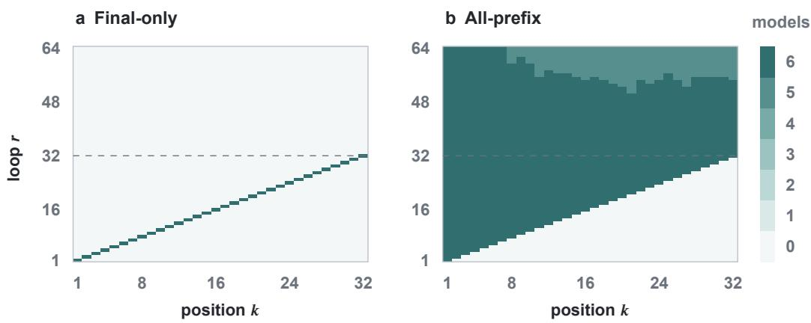  
Figure A2: Original readability grids for the serial baselines. This historical view uses seeds 9–14 and evaluation stream 20260909; each cell counts models whose state and output marginal accuracies at that position and loop are both at least 99%. This criterion differs from sample-level whole-trajectory exactness in Figure 2. It is retained separately from the common-stream training comparison.

## B.3 BUDGET CONTRACTS AND TRAINING SUPPORT

A training contract assigns the number of repeated blocks to a sampled trace length. All examples in a training batch share that sampled horizon and loop count. Table A7 specifies the relevant contracts. Stochastic counts are drawn during training; their midpoint is used for a single-budget evaluation when no count is explicitly requested. Budget sweeps instead specify every evaluated loop count.

Table A7: Training budget functions. U is discrete uniform. Slack-4 and Jitter-8 have the same conditional expected budget; the other rows do not form an equal-compute comparison.
<table><tr><td>Contract</td><td>Training budget</td><td>Interpretation at  $H = 3 2$ </td></tr><tr><td>Serial</td><td> $R = H$ </td><td>Trained exit 32</td></tr><tr><td>Double</td><td> $R = 2 H$ </td><td>Trained exit 64</td></tr><tr><td>Slack-4</td><td> $R = H + 4$ </td><td>Trained exit 36</td></tr><tr><td>Slack-8</td><td> $R = H + 8$ </td><td>Trained exit 40</td></tr><tr><td>Jitter-8</td><td> $R = H + U \{ 0 , \dots , 8 \}$ </td><td>Trained support 32–40</td></tr><tr><td>Random-2x</td><td> $R = H + U \{ 0 , \dots , H \}$ </td><td>Trained support 32–64</td></tr></table>

Matching recurrent work. The Slack-4/Jitter-8 comparison fixes the architecture, final-only supervision, optimizer, curriculum, data seed, batch size 256, and 132,000 training steps. Each condition contains all six model seeds 9–14. Both have $\mathbb { E } [ R \mid H ] = H + 4$ . Replaying the training functions with their recorded random seeds gives the same sampled horizon sequence for both conditions. Define $\begin{array} { r } { C _ { \mathrm { b a t c h } } = \sum _ { t = 1 } ^ { 1 3 2 0 0 0 } R _ { t } \colon } \end{array}$ this counts applications of the shared block to a complete batch, accumulated over the entire training run. It is not the loop count of one batch. The realized totals are 2,123,041 for Slack-4 and 2,121,730 for Jitter-8, a 0.06175% reduction for Jitter-8. The budget schedule is shared across model seeds. These counts measure recurrent block work, not complete training FLOPs: they are not weighted by actual padded sequence lengths and do not include embedding, readout, or optimizer costs. For comparison, Serial and Double accumulate 1,595,041 and 3,190,082 batch block applications under this curriculum; matching their optimizer steps does not match their recurrent work.

Endpoint retention and its tradeoffs. Table A8 evaluates the frozen Slack-4/Jitter-8 models on the same length-32 stream, evaluation seed 20260909, with 512 examples per model. Every trained seed is included, including those that did not master the training length range. Jitter-8 has lower mean accuracy at the common exit 36 but retains much higher accuracy with further updates. Loops 48, 64, and 96 are outside both conditions’ H32 training support. The per-seed loop-64 slice in Table A9 shows that the retention advantage occurs in all six pairs, rather than arising from selection of successful Jitter-8 runs.

Table A8: Endpoint retention at nearly matched recurrent work. H32 endpoint joint accuracy in percent, averaged over all six paired seeds; 512 examples per model, evaluation seed 20260909.
<table><tr><td>Inference loops r</td><td>36</td><td>48</td><td>64</td><td>96</td></tr><tr><td>Slack-4</td><td>93.98</td><td>38.15</td><td>30.01</td><td>26.79</td></tr><tr><td>Jitter-8</td><td>87.27</td><td>87.17</td><td>85.55</td><td>79.79</td></tr></table>

Table A9: The loop-64 retention comparison by seed. H32 endpoint joint accuracy in percent, using the same evaluation stream and population size as Table A8.
<table><tr><td>Model seed</td><td>9</td><td>10</td><td>11</td><td>12</td><td>13</td><td>14</td></tr><tr><td>Slack-4</td><td>32.23</td><td>31.25</td><td>33.79</td><td>34.96</td><td>15.04</td><td>32.81</td></tr><tr><td>Jitter-8</td><td>95.51</td><td>100.00</td><td>100.00</td><td>57.23</td><td>60.55</td><td>100.00</td></tr></table>

The wider valid-readout window does not imply uniformly better learning or length generalization. On the separate training-log evaluation stream (seed 20260902), five of six Slack-4 models and four of six Jitter-8 models reach .99 endpoint joint accuracy at every evaluated horizon 1–32. On the budget-sweep stream (seed 20260909), mean H64 endpoint joint accuracy at the common readout $r = 6 8$ is 74.32% for Slack-4 and 64.36% for Jitter-8. These length-OOD scores and the ID success counts use distinct evaluation streams; they are not pooled with the H32 retention measurements as one sample set.

The additional contracts provide different controls. The six audited Double models have $\tau ( k ) = 2 k - 1$ and observed holds of two to five loops, but this comparison includes twice the recurrent work of Serial. Slack-8 does not match Jitter-8’s expected budget. Random-2x successes at H32 exits 32–64 are inside its training support and do not establish generalization to unseen loop counts; a deterministic mean-budget control for Random-2x is absent. These observations delimit what the budget experiments can attribute to the training exit distribution.

## B.4 WHOLE-TRAJECTORY EXACTNESS AND COMPLEMENTARY CONTRACTS

Endpoint joint accuracy asks whether the final readout is correct. A stricter sample-level quantity asks whether every one of the $H = 3 2$ action positions has both its state and output correct. We call a sample satisfying this condition trajectory exact. This is not the same as the per-position marginal threshold used by the readability grids in Figure A2: one incorrect position makes a sample trajectory-inexact.

The same separation already appears at the trained exit: both Serial conditions have 100% endpoint accuracy at $r = R = 3 2$ , whereas trajectory exactness is 0.10% for FINAL-ONLY and 100% for ALL-PREFIX. Thus the all-prefix result is not only a more reliable final readout; it preserves a substantially larger fraction of complete recurrent trajectories. For the matched-budget contracts, Jitter-8 similarly retains complete trajectories after the nominal support, while Slack-4 does not. These figures are descriptive paired-cohort means and do not establish that randomization is uniformly better inside the training support.

Table A10: Whole-trajectory exactness after the H32 exit. Percent of 512 length-32 examples, averaged over six model seeds 9–14; evaluation stream 20260909. Every action position must have correct state and output. The endpoint means at $r = 6 4$ are shown in Tables A5 and A8; the two metrics measure different failure modes.
<table><tr><td>Condition</td><td> $r = 6 4$ </td><td> $r = 9 6$ </td></tr><tr><td>FINAL-ONLY</td><td>0.07</td><td>0.07</td></tr><tr><td>ALL-PREFIX</td><td>86.39</td><td>72.46</td></tr><tr><td>Slack-4</td><td>0.00</td><td>0.00</td></tr><tr><td>Jitter-8</td><td>54.46</td><td>47.40</td></tr></table>

For context, two additional contracts delimit the interpretation of the retention comparison. Slack-8 is a deterministic extra-slack dose control: its H32 endpoint means are 100.00% at its trained exit $R = 4 0$ , then 92.74%, 57.94%, and 44.21% at $r = 4 8 .$ , 64, 96, respectively (six seeds, same stream and model recipe). It does not match Jitter- $- 8 \ ' s$ expected budget. The audited Double cohort instead trains at $R = 2 { \bar { H } } !$ : on H32 it reaches 100% at its trained exit $\bar { R } = 6 4$ , but only 2.93% when forced to read at $r = 3 2$ (ten seeds). This positive control shows that long loops can be learned when they are the training contract; it is not a matched-compute estimate of the retention effect.

## B.5 LENGTH EXTRAPOLATION

The sampled length boundary $B _ { \mathrm { f i n a l } }$ is the largest evaluated horizon whose last-position joint accuracy is at least .99, under the model’s own serial contract $R = H$ . It is a maximum over sampled horizons, not a proof of correctness at every intermediate or greater length. Table A11 reports the six paired values. The retention objective improves this metric in three seeds and reduces it in three, despite improving H32 answer retention. This does not establish that retention and length generalization are unrelated; it establishes that the observed retention gain does not provide a seed-wise guarantee of an improved sampled boundary.

Table A11: The paired sampled length boundary has mixed changes. $B _ { \mathrm { f i n a l } }$ is defined by finalposition joint accuracy, not by all-position trajectory exactness.
<table><tr><td>Seed</td><td>9</td><td>10</td><td>11</td><td>12</td><td>13</td><td>14</td></tr><tr><td>FINAL-ONLY</td><td>88</td><td>56</td><td>72</td><td>56</td><td>48</td><td>56</td></tr><tr><td>ALL-PREFIX</td><td>72</td><td>88</td><td>48</td><td>48</td><td>64</td><td>80</td></tr></table>

## B.6 DELAYED SWAPS WITH THEIR CLEAN CONTROLS

The six paired FINAL-ONLY and ALL-PREFIX models of the original cohort receive interventions at position 16 of H32 inputs. The 256 different-state pairs are shared across models; 242 have distinguishable counterfactual targets. This population is fixed throughout, without selection on neural success.

At position 16 and loop 16, clean suffix exactness is 1.000 along the frontier in both conditions; source suffix exactness is 1.000 versus .939 (FINAL-ONLY versus ALL-PREFIX). At exit 32, clean exactness is .007 versus 1.000 and source exactness is .002 versus .722. Thus ALL-PREFIX supervision improves the common-exit readout of an early intervention, without improving frontier transport. Delaying both source collection and insertion by a loops, and reading position k at $k + a$ , holds the number of post-intervention updates fixed. Under ALL-PREFIX, clean suffix exactness stays at 1.000, but source exactness falls from .939 to .177, .102, and .000 at ages 1, 2, and 4. Even inserting the original loop-16 source at loop 20 fails: joint agreement with the position-17 counterfactual at loop 21 is 0%, compared with 94.63% when inserted at loop 16 and read at loop 17, while the late clean base run remains correct (Appendix B.7).

a Clean run  
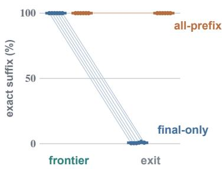

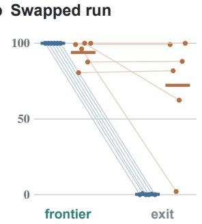

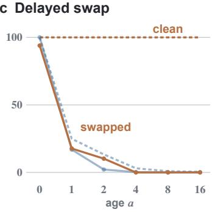  
Figure A3: Retention training changes the two readouts of an early swap differently, but does not protect a delayed swap. Swap at position 16; six paired models per condition. Exact suffix requires every state and output at positions 17–32 to match the target. (a) Unswapped runs scored against their own trajectory, all 256 pairs. (b) Swapped runs scored against the source continuation, 242 eligible pairs. Frontier reads position k at loop k; exit reads every position at loop 32. Lines join the two readouts of one model; bars are means. (c) The source vector is taken and inserted a loops after the frontier, and position k is read at loop $k + a$ (solid), next to the matching unswapped run (dashed); means over six models. FINAL-ONLY is faded because its unswapped runs are no longer readable at $k + a .$ . Clean and source scores use different targets and denominators and are not subtracted.

Table A12 places clean and source suffix exactness next to each other for the main delayed ages. Clean results score the unmodified base run’s own suffix over all 256 pairs; swap results score the source counterfactual on the fixed 242 eligible pairs. The two columns should not be subtracted as an effect estimate for a common target and denominator. Exit-48 values differ from exit-32 values by less than .036 across the reported condition/age entries. Unlike the shifted-frontier and exit-32 schedules, ALL-PREFIX clean suffix exactness at exit 48 is slightly below 1.000 (six-seed mean .9961; seed 11, .9766). This additional fixed exit does not remove the source-phase and base-phase changes inherent in delayed insertion.

Table A12: Ordinary retention is essential to interpreting a delayed swap. Exactness of positions 17–32, averaged over six paired models. The shifted-frontier schedule reads position k at $k + a ;$ the exit schedule reads every position at loop 32.
<table><tr><td colspan="2"></td><td colspan="2">FINAL-ONLY</td><td colspan="2">ALL-PREFIX</td></tr><tr><td>Readout</td><td>a</td><td>No swap</td><td>Swap</td><td>No swap</td><td>Swap</td></tr><tr><td>Frontier</td><td>0</td><td>1.000</td><td>1.000</td><td>1.000</td><td>.939</td></tr><tr><td rowspan="7">Exit</td><td>1</td><td>.249</td><td>.169</td><td>1.000</td><td>.177</td></tr><tr><td>2</td><td>.133</td><td>.021</td><td>1.000</td><td>.102</td></tr><tr><td>4</td><td>.031</td><td>.002</td><td>1.000</td><td>.000</td></tr><tr><td>0</td><td>.007</td><td>.002</td><td>1.000</td><td>.722</td></tr><tr><td>1</td><td>.007</td><td>.001</td><td>1.000</td><td>.074</td></tr><tr><td>2</td><td>.007</td><td>.001</td><td>1.000</td><td>.105</td></tr><tr><td>4</td><td>.007</td><td>.001</td><td>1.000</td><td>.000</td></tr></table>

## B.7 CROSSED TIMES AND REPLACEMENT EXTENT

Table A13 records the primary time-crossing slice from Appendix B.6. Each entry scores one target position and should not be compared as if it were complete-suffix exactness. At the early readout, clean factual correctness is 1.000 under both conditions; at the late readout it is .385 for FINAL-ONLY and 1.000 for ALL-PREFIX. The late FINAL-ONLY base run’s unmodified agreement with the source target is .167. These baselines prevent a raw late score from being mistaken for transferred information.

Table A13: Source collection and base insertion at crossed times. All vectors are at position 16. Position 17 is read one update after insertion, using the same 242 eligible pairs and six model seeds. Entries are joint state–output agreement with the source target.
<table><tr><td>Source loop</td><td>Base loop</td><td>FINAL-ONLY</td><td>ALL-PREFIX</td></tr><tr><td>16</td><td>16</td><td>1.000</td><td>.946</td></tr><tr><td>20</td><td>16</td><td>.196</td><td>.260</td></tr><tr><td>16</td><td>20</td><td>.267</td><td>.000</td></tr><tr><td>20</td><td>20</td><td>.169</td><td>.000</td></tr></table>

The extent comparison in Table A14 asks where an effective replacement can be made at the common loop 20. Its scored target, position 21, is never directly replaced. The downstream-only block includes position 20, which is the current frontier. Therefore its success supplies a localized positive reference, but neither it nor the larger block demonstrates that position 16’s old vector alone is sufficient. The old site’s extra distance to the target also prevents an equal-distance inference of state erasure.

Table A14: Replacement extent at loop 20. Position 21 is read at loop 21, on 121 eligible pairs. Both clean base runs are correct on every pair. Unless specified, all source vectors are collected at loop 20.
<table><tr><td>Recipient vectors replaced at loop 20</td><td>FINAL-ONLY</td><td>ALL-PREFIX</td></tr><tr><td>Cycle 16, donor vector from loop 16</td><td>.163</td><td>.161</td></tr><tr><td>Cycle 16</td><td>.000</td><td>.000</td></tr><tr><td>Cycle 20 (current frontier)</td><td>1.000</td><td>.935</td></tr><tr><td>Cycles 16–20</td><td>1.000</td><td>.934</td></tr><tr><td>Cycles 17–20</td><td>1.000</td><td>.934</td></tr></table>

## B.8 PROVENANCE OF THE PRINCIPAL QUANTITIES

The supplementary provenance index records each paired budget curve and original swap summary with its model seed, evaluation seed, checkpoint step, exact source path, SHA256 hash, and per-seed output. Twelve paired budget-sweep files and ten original swap files matched byte-for-byte between the local and remote evidence stores. The paired retention tables derive from the completed P1 result set, and the phase/extent tables from the validated compatibility follow-up. These later experiments use distinct pair populations and scoring slices from the original position-8 audit. They are not pooled into its numerator or denominator.

Low-dimensional alignment and bounded automaton extraction were explored in the wider project, but do not enter the present paper’s claims. The reported conclusions depend on the fixed-checkpoint behavioral evaluations, full-vector interventions, and paired training comparison described above.

## C LOCAL DOWNSTREAM RECOVERY AND SOURCE-PHASE CONTROLS

The phase-crossing experiment changes the base run’s entire execution phase. Here we keep the late background fixed and test whether changing one local downstream vector can restore the response to a fresh source. The protocol was fixed before inspecting this follow-up’s outputs; it did not retrospectively preregister the preceding experiments.

## C.1 POPULATION, INTERVENTIONS, AND SCORING

We evaluated all twelve frozen step-132,000 checkpoints: six FINAL-ONLY and six ALL-PREFIX models, with paired seeds 9–14. The experiment used H = 32 and the position-16 pair population, with 256 different-state pairs and 256 same-state/different-history controls per model. Source and base runs shared the machine, presentation, and future actions. The primary population was the fixed set of 242 different-state pairs whose symbolic state–output targets at position 17 differ. This selection used no neural predictions and was identical across arms and models. Same-state pairs had no distinguishable counterfactual target and were scored separately against their factual target.

a Two-site intervention  
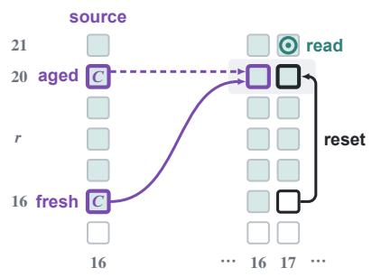

b Counterfactual match (%)  
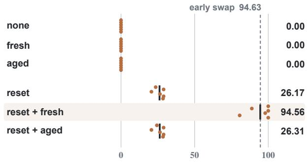  
Figure A4: Resetting the downstream position restores the use of a fresh source, but not of an equally readable aged source. (a) The base run is held at loop 20 (gray band). Position 16 may receive the source’s position-16 vector from loop 16 (fresh, solid) or loop 20 (aged, dashed), and position 17 may be reset to the base run’s own loop-16 vector; other positions keep their loop-20 vectors. After one update, position 17 is scored at loop 21 (⊙). Shaded cells are readable under ALL-PREFIX; both source vectors decode the correct state and output on every pair. (b) Rows name the replacements at loop 20 (none: unmodified run). Percentage of the 242 eligible pairs whose position-17 state and output both match the counterfactual target, not factual accuracy or suffix exactness; dots are six ALL-PREFIX models, bars their means, and the dashed line the early swap. FINAL-ONLY results are in Table A15 and controls in Table A17.

Let $h _ { k , S } ^ { r }$ and $h _ { k , B } ^ { r }$ denote source and base vectors from unmodified runs. After loop 20, a single post-block, pre-final-normalization hook performed $\mathrm { ~ a ~ 2 ~ } \times \mathrm { ~ 2 ~ }$ intervention:

$$
\begin{array} { r l } { i = 1 : } & { { } \ h _ { 1 6 } ^ { 2 0 }  h _ { 1 6 , S } ^ { 1 6 } , } \\ { j = 1 : } & { { } \ h _ { 1 7 } ^ { 2 0 }  h _ { 1 7 , B } ^ { 1 6 } . } \end{array}\tag{7}
$$

An index of zero left the corresponding late base vector unchanged. Thus $( i , j ) = ( 0 , 0 )$ was clean, (1, 0) inserted a fresh source, (0, 1) reset only the downstream position, and (1, 1) combined both changes. Both replacements in the combined arm were simultaneous. All other positions, including the table and remaining action positions, retained their loop-20 vectors. The reset therefore changed the scored position’s pre-update hidden state, using the base run’s own earlier vector; it did not insert a source position-17 vector or a symbolic answer. We ran one further shared-block update and read position 17 at loop 21.

The primary outcome was joint counterfactual accuracy: both predicted state and output at that position had to match the symbolic source continuation. It was neither factual accuracy nor suffix exactness. A fresh positive reference inserted $h _ { 1 6 , S } ^ { 1 6 }$ at position 16 and loop 16 of the base run and read position 17 at loop 17. Secondary arms substituted the aged source $h _ { 1 6 , S } ^ { 2 0 }$ at loop 20, with and without the same downstream reset.

## C.2 JOINT RESTORATION RECOVERS THE FRESH RESPONSE

Table A15 and Figure A4 show that the combined intervention closely recovers the fresh reference under both supervision conditions. The ALL-PREFIX late clean arm has zero counterfactual accuracy because it correctly retains the distinct factual answer; its factual joint accuracy on these pairs is 100%. Neither a fresh source alone nor a downstream reset alone explains the combined result. For each model, we computed the paired interaction on the same eligible population,

$$
I = A _ { 1 1 } - A _ { 1 0 } - A _ { 0 1 } + A _ { 0 0 } .\tag{8}
$$

The mean I was $+ 7 0 . 3 2 \pm 2 2 . 3 9$ percentage points under FINAL-ONLY and $+ 6 8 . 3 9 \pm 1 0 . 5 4$ under ALL-PREFIX, and was positive in all six models of each condition. These are descriptive within-model contrasts, with model seeds as the replication unit, rather than significance tests that pool reused task pairs as independent replications. Table A16 also exposes the substantial seed variation in FINAL-ONLY source-only performance.

Table A15: Single-step counterfactual accuracy after downstream recovery. All values are percentages, reported as mean ± sample standard deviation over six model seeds. Each model uses the same 242 eligible pairs. Late arms intervene at loop 20 and read position 17 at loop 21; the fresh reference intervenes at loop 16 and reads at loop 17.
<table><tr><td>Intervention</td><td> $\mathrm { F I N A L \mathrm { - O N L Y } }$ </td><td> $_ { \mathrm { A L L - P R E F I X } }$ </td></tr><tr><td>Fresh source reference</td><td> $1 0 0 . 0 0 \pm 0 . 0 0$ </td><td> $9 4 . 6 3 \pm 8 . 1 4$ </td></tr><tr><td>Late clean (A0o)</td><td> $1 6 . 6 7 \pm 3 . 6 4$ </td><td> $0 . 0 0 \pm 0 . 0 0$ </td></tr><tr><td>Late fresh source only (A10)</td><td> $2 6 . 7 2 \pm 2 6 . 1 7$ </td><td> $0 . 0 0 \pm 0 . 0 0$ </td></tr><tr><td>Late downstream reset only (A01)</td><td> $1 9 . 6 3 \pm 2 . 9 7$ </td><td> $2 6 . 1 7 \pm 3 . 4 0$ </td></tr><tr><td>Late fresh source + reset (A₁1)</td><td> $1 0 0 . 0 0 \pm 0 . 0 0$ </td><td> $9 4 . 5 6 \pm 8 . 1 0$ </td></tr><tr><td>Late aged source only</td><td> $1 6 . 8 7 \pm 3 . 7 7$ </td><td> $0 . 0 0 \pm 0 . 0 0$ </td></tr><tr><td>Late aged source + reset</td><td> $1 9 . 7 0 \pm 3 . 0 2$ </td><td> $2 6 . 3 1 \pm 3 . 2 9$ </td></tr></table>

Table A16: Per-seed primary outcomes. Entries are successful joint counterfactual predictions out of 242 eligible pairs for every cell. “Source” means the fresh loop-16 source inserted at loop 20.
<table><tr><td>Condition</td><td>Late intervention</td><td>9</td><td>10</td><td>11</td><td>12</td><td>13</td><td>14</td></tr><tr><td rowspan="4">FINAL-ONLY</td><td>Clean</td><td>53</td><td>37</td><td>35</td><td>34</td><td>33</td><td>50</td></tr><tr><td>Source only</td><td>193</td><td>35</td><td>45</td><td>33</td><td>31</td><td>51</td></tr><tr><td>Reset only</td><td>41</td><td>57</td><td>52</td><td>51</td><td>38</td><td>46</td></tr><tr><td>Source + reset</td><td>242</td><td>242</td><td>242</td><td>242</td><td>242</td><td>242</td></tr><tr><td rowspan="4">ALL-PREFIX</td><td>Clean</td><td>0</td><td>0</td><td>0</td><td>0</td><td>0</td><td>0</td></tr><tr><td>Source only</td><td>0</td><td>0</td><td>0</td><td>0</td><td>0</td><td>0</td></tr><tr><td>Reset only</td><td>69</td><td>70</td><td>64</td><td>50</td><td>70</td><td>57</td></tr><tr><td>Source + reset</td><td>242</td><td>195</td><td>237</td><td>242</td><td>215</td><td>242</td></tr></table>

Recovery extends beyond matching aggregate rates. Comparing the predicted state–output pair under the fresh reference and late combined intervention gives identical predictions for all 3,072 FINAL-ONLY model–pair evaluations (6 seeds, 2 pair kinds, 256 pairs), and all but one of the 3,072 ALL-PREFIX evaluations. The exception is a different-state pair in seed 11 that succeeds under the fresh reference and fails after late restoration. This establishes agreement of discrete single-step behavior; it does not establish equality of the hidden states.

## C.3 A READABLE AGED SOURCE DOES NOT PROVIDE THE SAME RECOVERY

Source readability was measured at the actual source position used in the intervention, with the original state and output heads. Fresh sources were jointly correct on all different-state pairs in both conditions. Under ALL-PREFIX, aged sources were also 100% correct for both heads in every seed, over both the full 256-pair population and the 242 eligible pairs. Nevertheless, aged source plus reset reached only 26.31%, almost identical to reset alone at 26.17%. Its net gain was two successful model–pair evaluations across six sets of 242; the corresponding aged-source interaction was $+ 0 . 1 4 \pm 0 . 3 4$ percentage points. The 26.31% level is therefore largely the reset baseline, not evidence of effective aged-source transport. Under FINAL-ONLY, the aged-source interaction was $- 0 . 1 4 \pm 0 . 3 4$ points, but aged source joint readability was only 39.88% on the eligible pairs. The cleaner evidence for readable yet non-interchangeable sources comes from ALL-PREFIX.

## C.4 CONTROLS, REPRODUCIBILITY, AND INTERPRETATION

Same-state controls show that the downstream reset is a strong intervention: ALL-PREFIX factual accuracy falls from 100% to 25.13% with reset alone (Table A17). Fresh source plus reset restores 95.18%, matching the fresh reference and its roughly 4.8% substitution damage. For different-state eligible pairs, reset alone yields 26.17% source-correct, 20.94% factual-correct, and 52.89% matching neither target. Thus resetting does not itself provide a general accuracy repair, and complete-vector substitution cannot be interpreted as exchanging only a pure symbolic state.

Table A17: Same-state/different-history controls. Factual joint accuracy in percent, mean ± sample standard deviation over six seeds, using 256 pairs per model. Source and factual symbolic continuations coincide, so distinguishable counterfactual accuracy is undefined for this population.
<table><tr><td>Intervention</td><td> $\mathrm { F I N A L \mathrm { - } O N L Y }$ </td><td>ALL-PREFIX</td></tr><tr><td>Fresh clean</td><td> $1 0 0 . 0 0 \pm 0 . 0 0$ </td><td> $1 0 0 . 0 0 \pm 0 . 0 0$ </td></tr><tr><td>Fresh source reference</td><td> $1 0 0 . 0 0 \pm 0 . 0 0$ </td><td> $9 5 . 1 8 \pm 6 . 4 9$ </td></tr><tr><td>Late clean</td><td> $4 7 . 2 7 \pm 1 5 . 7 8$ </td><td> $1 0 0 . 0 0 \pm 0 . 0 0$ </td></tr><tr><td>Late fresh source only</td><td> $5 7 . 2 3 \pm 1 8 . 0 5$ </td><td> $1 0 0 . 0 0 \pm 0 . 0 0$ </td></tr><tr><td>Late downstream reset only</td><td> $3 3 . 4 6 \pm 8 . 6 6$ </td><td> $2 5 . 1 3 \pm 1 . 1 8$ </td></tr><tr><td>Late fresh source + reset</td><td> $1 0 0 . 0 0 \pm 0 . 0 0$ </td><td> $9 5 . 1 8 \pm 6 . 4 9$ </td></tr><tr><td>Late aged source only</td><td> $4 7 . 2 0 \pm 1 5 . 7 9$ </td><td> $1 0 0 . 0 0 \pm 0 . 0 0$ </td></tr><tr><td>Late aged source + reset</td><td> $3 3 . 5 3 \pm 8 . 6 6$ </td><td> $2 5 . 2 0 \pm 1 . 1 8$ </td></tr></table>

True same-phase self-replacements were separately tested at position 16 with the fresh source, position 16 with the late source, late position 17, and both late positions. All preserved the corresponding clean predictions; saved pre-intervention invariants also passed. The evaluation reused stream 2026091001 in batches of 16, with batch streams formed by adding 10000019·kind index+1000003·batch index. The separate 16-pair-per-kind execution pilot was excluded from all reported statistics. The experiment records contain the frozen protocol, checkpoint identities, pair identities, raw predicted and symbolic labels, and aggregate results. An independent scoring audit recomputed source rates and denominators from the recorded labels, without importing the aggregation implementation, and reproduced the reported results.

The positive result localizes a causal contribution of the downstream state: while the remaining network stays at its late phase, restoring one downstream vector together with a fresh source nearly reproduces the earlier single-step response. The aged-source comparison shows that downstream restoration alone does not make every readable source interchangeable. These conclusions are restricted to $H = 3 2$ , insertion at position 16, reset of position 17, insertion at loop 20, and one subsequent update. Full-vector replacements can restore readiness, representation format, or other aspects of local compatibility; they do not identify a particular attention head, gate, or minimal state code. The experiment establishes neither information erasure nor necessity in unmodified execution, and does not demonstrate recovery of a whole suffix, length extrapolation, or the cause of natural endpoint deterioration from loop 32 to 33. That failure is localized by a separate experiment (Appendix E).

## D FRONTIER FREEZING

## D.1 ORIGINAL COHORT AND PROTOCOL

The original freezing cohort uses the frozen checkpoints of Section 5 on a new evaluation stream (20260923), 512 inputs per model and horizon, with the same inputs for every arm of a given model. The schedule is fixed before scoring: models trained at $R = H$ use $s ( k ) = k .$ . Frontier freezing captures position k’s post-block hidden vector at loop $s ( k )$ on the arm’s own ongoing trajectory and restores it after every later block. One loop later captures at $s ( k ) + 1$ . Positions 1–8 freezes only those positions, so every later position must still compute. Readout cache runs the clean forward pas and delivers each position’s prediction saved at $s ( k )$ , without modifying any hidden state. No vector comes from a separate run, no label enters an intervention, and table and presentation tokens are never frozen. Frozen positions remain available to attention. All layers of a block still execute; freezing acts at recurrent block boundaries, not on individual layers or key–value caches. The protocol was written before the results were inspected but is exploratory, not an independent confirmation.

## D.2 ADDITIONAL OBSERVATIONS AND LIMITS

Table A18 reports every evaluated model. Under frontier freezing, positions 1 and 2 remain correct and accuracy at each position’s scheduled capture loop falls from position 3 onward in all three groups. Capturing one loop later is not uniformly harmless. It lowers the endpoint to 74–77% in three of the twelve models at $\bar { H ^ { = } } 3 2$ . On the separate $H = 6 4$ length evaluation at readout $r = H = 6 4$ it lowers the endpoint relative to clean in several FINAL-ONLY models (seed 12: 44.1% versus 99.2%; seed 14: 46.3% versus 95.7%). One-loop-later freezing is therefore a timing contrast, not a safe schedule. DOUBLE models, whose observed clean frontier is $\tau ( k ) = 2 k - 1$ , collapse under both schedules; their clean endpoint at $r = H$ is already low because they need about 2H loops, so they are not interpreted. The readout cache preserves the captured predictions by construction and is correct on every original H32 example. It is the baseline any freezing schedule would have to beat; we propose no such schedule.

Table A18: Endpoint joint accuracy (%) at loop 32 for H = 32, 512 inputs per model. The larger models use d = 512 and four layers per block and a batch size of 32, so they are not paired input by input with the other rows.
<table><tr><td>Condition</td><td>Seed</td><td>Clean</td><td>Readout cache</td><td>Frontier freeze</td><td>Positions 1–8</td><td>One loop later</td></tr><tr><td>FINAL-ONLY</td><td>9</td><td>100.0</td><td>100.0</td><td>11.5</td><td>11.9</td><td>100.0</td></tr><tr><td>FINAL-ONLY</td><td>10</td><td>100.0</td><td>100.0</td><td>6.2</td><td>8.0</td><td>100.0</td></tr><tr><td>FINAL-ONLY</td><td>11</td><td>100.0</td><td>100.0</td><td>1.6</td><td>5.1</td><td>100.0</td></tr><tr><td>FINAL-ONLY</td><td>12</td><td>100.0</td><td>100.0</td><td>1.6</td><td>1.8</td><td>100.0</td></tr><tr><td>FINAL-ONLY</td><td>13</td><td>100.0</td><td>100.0</td><td>2.7</td><td>5.5</td><td>77.1</td></tr><tr><td>FINAL-ONLY</td><td>14</td><td>100.0</td><td>100.0</td><td>1.6</td><td>1.6</td><td>100.0</td></tr><tr><td>ALL-PREFIX</td><td>9</td><td>100.0</td><td>100.0</td><td>3.7</td><td>3.7</td><td>100.0</td></tr><tr><td>ALL-PREFIX</td><td>10</td><td>100.0</td><td>100.0</td><td>0.8</td><td>0.6</td><td>94.1</td></tr><tr><td>ALL-PREFIX</td><td>11</td><td>100.0</td><td>100.0</td><td>16.0</td><td>29.9</td><td>75.0</td></tr><tr><td>FINAL-ONLY, d=512</td><td>9</td><td>100.0</td><td>100.0</td><td>8.2</td><td>7.8</td><td>100.0</td></tr><tr><td>FINAL-ONLY, d=512</td><td>10</td><td>100.0</td><td>100.0</td><td>3.1</td><td>3.3</td><td>99.0</td></tr><tr><td>FINAL-ONLY, d=512</td><td>11</td><td>100.0</td><td>100.0</td><td>12.9</td><td>18.0</td><td>74.4</td></tr></table>

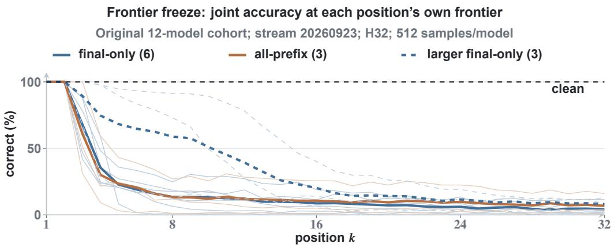  
Figure A5: Where continuing computation fails in the original freezing cohort. Joint state–output accuracy at each position’s scheduled readout on H32, stream 20260923. Thick curves are means within the three original model groups and thin curves show individual seeds. Positions that remain readable early in the sequence do not prevent failure at later positions under immediate freezing.

## D.3 FREEZING THE NEW TRAINING CONTROLS

This follow-up evaluates all three SAMPLED-PREFIX and all three MATCHED RANDOM EXIT checkpoints from Appendix B.1, at step 132,000, without retraining. It was specified after inspecting their clean retention results and before inspecting their freeze results; it is exploratory. The fresh stream is 20260924, distinct from the 20260923 training-control evaluation. Each model uses 512 H32 examples in four batches of 128, evaluated for 64 loops. Saved input hashes match across all six models. Every model and all 512 examples are retained, without filtering on clean correctness. The two runtime pilots use a different stream and are excluded. PROGRESSIVE is outside this bounded follow-up: two models had not learned H32 and the successful model had a shifted clean frontier, requiring a separately specified schedule analysis.

Table A19: Clean diagnostics for every new freeze model. H32, stream 20260924, 512 inputs per model; percentages. $A _ { 3 2 }$ and $T _ { 3 2 }$ denote endpoint and whole-trajectory accuracy at loop 32. “Min. diagonal” is the minimum over positions of clean joint accuracy at $r = k .$ . Cache $T _ { 3 2 }$ requires every saved prediction to be correct.
<table><tr><td>Condition</td><td>Seed</td><td>Clean  $A _ { 3 2 }$ </td><td>Clean  $T _ { 3 2 }$ </td><td>Min. diagonal</td><td> $\mathrm { C a c h e } T _ { 3 2 }$ </td></tr><tr><td>SAMPLED-PREFIX</td><td>9</td><td>100.00</td><td>100.00</td><td>100.00</td><td>100.00</td></tr><tr><td>SAMPLED-PREFIX</td><td>10</td><td>100.00</td><td>100.00</td><td>100.00</td><td>100.00</td></tr><tr><td>SAMPLED-PREFIX</td><td>11</td><td>100.00</td><td>100.00</td><td>100.00</td><td>100.00</td></tr><tr><td>MATCHED RANDOM EXIT</td><td>9</td><td>99.80</td><td>99.02</td><td>96.48</td><td>94.92</td></tr><tr><td>MATCHED RANDOM EXIT</td><td>10</td><td>100.00</td><td>32.03</td><td>99.80</td><td>99.80</td></tr><tr><td>MATCHED RANDOM EXIT</td><td>11</td><td>100.00</td><td>73.83</td><td>100.00</td><td>100.00</td></tr></table>

Table A20: Endpoint accuracy at the scheduled capture readout. Three-seed means in percent on all 512 H32 examples per model, stream 20260924. The +d columns read the endpoint at $r = 3 2 + d ;$ clean, cache, P8, and P16 use $r = 3 2 \AA$ . P8/P16 freeze only the indicated prefix. Clean endpoint accuracy at $r = 3 3 , 3 4 , 3 6$ is 100% for every model; the clean $r = 3 2$ exception is reported in Table A19.
<table><tr><td>Condition</td><td>Clean</td><td>Cache</td><td>+0</td><td>+1</td><td>+2</td><td>+4</td><td>P8</td><td>P16</td></tr><tr><td>SAMPLED-PREFIX</td><td>100.00</td><td>100.00</td><td>4.10</td><td>80.21</td><td>99.80</td><td>100.00</td><td>7.49</td><td>4.36</td></tr><tr><td>MATCHED RANDOM EXIT</td><td>99.93</td><td>99.93</td><td>6.25</td><td>20.18</td><td>87.24</td><td>99.80</td><td>7.42</td><td>6.25</td></tr></table>

Fixed schedules and eight arms. The reference schedule $s ( k ) = k$ is fixed before evaluation and is not estimated from the new labels. The evaluator and its interventions are unchanged. Besides clean computation and readout caching, all-position freezing captures at $s _ { d } ( k ) = k + d$ for each $d \in \{ 0 , 1 , 2 , 4 \}$ ; two prefix arms capture only positions 1–8 or 1–16 at k. Each capture uses the arm’s own current vector after a whole block and restoration first affects the next loop. All remaining positions and presentation tokens stay live; attention can still use the held vectors. These interventions do not save FLOPs, use hidden states from another run, or establish layerwise or key–value cache freezing.

Clean eligibility. All three SAMPLED-PREFIX models have exact clean and cached H32 trajectories on this stream, including every diagonal readout at $r = k$ . For MATCHED RANDOM EXIT, seed 11 also has exact diagonal reads; seed 10 has 99.80% minimum diagonal accuracy and 99.80% cached trajectory exactness. Seed 9 has 96.48% minimum diagonal accuracy, 94.92% cached trajectory exactness, and 99.80% clean endpoint accuracy. Thus the reference schedule $s ( k ) = k$ does not give perfectly correct clean readouts across this entire cohort; it is prescribed independently of the measured threshold-crossing loop $\tau ( k )$ . The observed clean errors are reported as such; they are not evidence of a correct state failing under freezing. Even when the clean diagonal is exact, later vectors on an online-freeze trajectory may already be incorrect because earlier positions have been held. Clean readability at the reference schedule therefore does not imply that every vector actually captured under intervention is correct.

Capture-aligned and common readouts. For a delayed arm, the endpoint has not yet been captured at $r = 3 2$ . We therefore use $r = 3 2 + d$ for the endpoint comparison in the main figure and Table A20, with clean evaluated at the same loop. Common-loop scores at $r = 3 2 , 3 3$ , 64 are retained in full below. For example, SAMPLED-PREFIX seed 10 scores 100% at $r = 3 2$ under delay 1 but only 82.81% when its endpoint is captured at $r = 3 3 ;$ clean is 100% at both loops. Scoring only $r = 3 2$ would overstate the recovery. Scheduled whole-trajectory exactness reads each position at its own $k + d$ on the intervened trajectory. It differs from scoring every position simultaneously at a common loop. For prefix arms, the scheduled readout remains $r = k ,$ , including positions that are never frozen.

Results and limits. Immediate freezing reduces mean endpoint accuracy to 4.10% for SAMPLED-PREFIX and 6.25% for MATCHED RANDOM EXIT, with zero whole-trajectory exactness in every model. Thus the failure to hold position states extends across these training objectives, including three models with fully correct clean scheduled reads. Delaying capture helps, but the required delay depends on the model and training condition. At delay 2, SAMPLED-PREFIX reaches 99.80% mean endpoint accuracy and 99.54% scheduled trajectory exactness. MATCHED RANDOM EXIT reaches only 87.24% endpoint accuracy at delay 2, and needs delay 4 to reach 99.80% endpoint accuracy and 99.74% scheduled trajectory exactness. All fixed delays and all seeds are reported; one loop is not a generally safe schedule. Prefix-only freezing also damages the never-frozen endpoint and suffix, so the collapse is not limited to scoring held positions. The two objectives differ in losses and training work, precluding a unique attribution of their delay difference to one training factor. These results concern holding a state on its own evolving trajectory; they do not demonstrate arbitrary vector interchangeability, convergence, or a particular microscopic circuit.

## D.4 EXTERNAL MAZE NETWORK

We evaluated the released dt net recall 2d checkpoint (width 128, trained on 9 × 9 mazes for 30 iterations with the progressive loss of Bansal et al., 2022) without modification, on 32 pre-selected mazes per size for iterations 1–120. The recurrence was replayed by an external loop that reproduces the released forward pass exactly; a never-triggering hook reproduced the clean arm, and every arm matched clean before its first capture. Because there is no per-position frontier, a pixel’s capture time is its answer arrival: the last iteration at which its clean prediction changes (mean 6.2 at 9 × 9, 19.7 at 33 × 33). Table A26 gives whole-maze solved counts.

The clean network solves every 9×9 maze from iteration 25 through 120, so it does not forget answers, yet freezing at answer arrival solves none. The limits are substantial. There is one checkpoint, no training seeds, and 32 mazes per size. Architecture, task, and objective differ from our models at once, so the check does not isolate any of them. The network’s output head is a $\phantom { - } 1 3 \times 3$ convolution stack, so holding a pixel’s state does not pin its prediction (2.9% of frozen pixels drift at capture +0, 0.3% at +4, 9 × 9); its frozen-readout quantities are not comparable with those of our per-position readout. The 33 × 33 size lies outside the training distribution and its clean accuracy is still rising at iteration 120, so those comparisons are descriptive.

Table A21: Every SAMPLED-PREFIX endpoint score under freezing. Percent of 512 H32 examples, stream 20260924. Numerical readouts are common loops. “Sched.” reads the endpoint at 32 + d for +d and at 32 for clean/cache/P8/P16. Cache leaves the hidden computation live; P8/P16 freeze only positions 1–8/1–16. All eight arms and all seeds are included.
<table><tr><td>Seed</td><td>Readout</td><td>Clean</td><td>Cache</td><td>+0</td><td>+1</td><td>+2</td><td>+4</td><td>P8</td><td>P16</td></tr><tr><td>9</td><td>32</td><td>100.00</td><td>100.00</td><td>3.91</td><td>100.00</td><td>100.00</td><td>100.00</td><td>3.91</td><td>3.71</td></tr><tr><td>9</td><td>33</td><td>100.00</td><td>100.00</td><td>3.91</td><td>100.00</td><td>100.00</td><td>100.00</td><td>3.91</td><td>3.91</td></tr><tr><td>9</td><td>64</td><td>100.00</td><td>100.00</td><td>3.91</td><td>100.00</td><td>100.00</td><td>100.00</td><td>4.10</td><td>4.10</td></tr><tr><td>9</td><td>Sched.</td><td>100.00</td><td>100.00</td><td>3.91</td><td>100.00</td><td>100.00</td><td>100.00</td><td>3.91</td><td>3.71</td></tr><tr><td>10</td><td>32</td><td>100.00</td><td>100.00</td><td>2.54</td><td>100.00</td><td>100.00</td><td>100.00</td><td>5.66</td><td>2.54</td></tr><tr><td>10</td><td>33</td><td>100.00</td><td>100.00</td><td>2.54</td><td>82.81</td><td>100.00</td><td>100.00</td><td>6.45</td><td>2.54</td></tr><tr><td>10</td><td>64</td><td>99.61</td><td>100.00</td><td>2.54</td><td>82.81</td><td>100.00</td><td>100.00</td><td>11.91</td><td>4.88</td></tr><tr><td>10</td><td>Sched.</td><td>100.00</td><td>100.00</td><td>2.54</td><td>82.81</td><td>100.00</td><td>100.00</td><td>5.66</td><td>2.54</td></tr><tr><td>11</td><td>32</td><td>100.00</td><td>100.00</td><td>5.86</td><td>98.83</td><td>100.00</td><td>100.00</td><td>12.89</td><td>6.84</td></tr><tr><td>11</td><td>33</td><td>100.00</td><td>100.00</td><td>5.86</td><td>57.81</td><td>99.61</td><td>100.00</td><td>12.50</td><td>6.84</td></tr><tr><td>11</td><td>64</td><td>99.41</td><td>100.00</td><td>5.86</td><td>57.81</td><td>99.41</td><td>100.00</td><td>16.41</td><td>7.23</td></tr><tr><td>11</td><td>Sched.</td><td>100.00</td><td>100.00</td><td>5.86</td><td>57.81</td><td>99.41</td><td>100.00</td><td>12.89</td><td>6.84</td></tr></table>

Table A22: Every MATCHED RANDOM EXIT endpoint score under freezing. Same complete reporting and readout definitions as Table A21; 512 H32 examples per model, stream 20260924.
<table><tr><td>Seed</td><td>Readout</td><td>Clean</td><td>Cache</td><td>+0</td><td>+1</td><td>+2</td><td>+4</td><td>P8</td><td>P16</td></tr><tr><td>9</td><td>32</td><td>99.80</td><td>99.80</td><td>3.91</td><td>12.30</td><td>96.09</td><td>99.80</td><td>7.42</td><td>4.30</td></tr><tr><td>9</td><td>33</td><td>100.00</td><td>99.80</td><td>3.91</td><td>9.18</td><td>93.75</td><td>100.00</td><td>9.38</td><td>4.30</td></tr><tr><td>9</td><td>64</td><td>100.00</td><td>99.80</td><td>3.91</td><td>9.18</td><td>90.23</td><td>100.00</td><td>7.81</td><td>5.08</td></tr><tr><td>9</td><td>Sched.</td><td>99.80</td><td>99.80</td><td>3.91</td><td>9.18</td><td>90.23</td><td>100.00</td><td>7.42</td><td>4.30</td></tr><tr><td>10</td><td>32</td><td>100.00</td><td>100.00</td><td>13.28</td><td>12.89</td><td>97.66</td><td>92.77</td><td>13.09</td><td>12.70</td></tr><tr><td>10</td><td>33</td><td>100.00</td><td>100.00</td><td>13.28</td><td>13.28</td><td>73.44</td><td>97.85</td><td>14.26</td><td>12.89</td></tr><tr><td>10</td><td>64</td><td>93.95</td><td>100.00</td><td>13.28</td><td>13.28</td><td>72.27</td><td>99.41</td><td>24.22</td><td>23.05</td></tr><tr><td>10</td><td>Sched.</td><td>100.00</td><td>100.00</td><td>13.28</td><td>13.28</td><td>72.27</td><td>99.41</td><td>13.09</td><td>12.70</td></tr><tr><td>11</td><td>32</td><td>100.00</td><td>100.00</td><td>1.56</td><td>53.12</td><td>100.00</td><td>100.00</td><td>1.76</td><td>1.76</td></tr><tr><td>11</td><td>33</td><td>100.00</td><td>100.00</td><td>1.56</td><td>38.09</td><td>100.00</td><td>100.00</td><td>1.76</td><td>1.56</td></tr><tr><td>11</td><td>64</td><td>99.22</td><td>100.00</td><td>1.56</td><td>38.09</td><td>99.22</td><td>100.00</td><td>5.66</td><td>1.56</td></tr><tr><td>11</td><td>Sched.</td><td>100.00</td><td>100.00</td><td>1.56</td><td>38.09</td><td>99.22</td><td>100.00</td><td>1.76</td><td>1.76</td></tr></table>

Table A23: Every SAMPLED-PREFIX whole-trajectory score under freezing. Percent of 512 H32 examples, stream 20260924. Numerical readouts require all positions to be correct simultaneously. “Sched.” instead reads each position at its own k + d for +d, or at k for clean/cache/P8/P16, on that arm’s trajectory.
<table><tr><td>Seed</td><td>Readout</td><td>Clean</td><td>Cache</td><td>+0</td><td>+1</td><td>+2</td><td>+4</td><td>P8</td><td>P16</td></tr><tr><td>9</td><td>32</td><td>100.00</td><td>100.00</td><td>0.00</td><td>100.00</td><td>100.00</td><td>100.00</td><td>0.00</td><td>0.00</td></tr><tr><td>9</td><td>33</td><td>100.00</td><td>100.00</td><td>0.00</td><td>100.00</td><td>100.00</td><td>100.00</td><td>0.00</td><td>0.00</td></tr><tr><td>9</td><td>64</td><td>100.00</td><td>100.00</td><td>0.00</td><td>100.00</td><td>100.00</td><td>100.00</td><td>0.00</td><td>0.00</td></tr><tr><td>9</td><td>Sched.</td><td>100.00</td><td>100.00</td><td>0.00</td><td>100.00</td><td>100.00</td><td>100.00</td><td>0.00</td><td>0.00</td></tr><tr><td>10</td><td>32</td><td>100.00</td><td>100.00</td><td>0.00</td><td>1.56</td><td>100.00</td><td>100.00</td><td>0.00</td><td>0.00</td></tr><tr><td>10</td><td>33</td><td>100.00</td><td>100.00</td><td>0.00</td><td>1.56</td><td>100.00</td><td>100.00</td><td>0.00</td><td>0.00</td></tr><tr><td>10</td><td>64</td><td>95.70</td><td>100.00</td><td>0.00</td><td>1.56</td><td>100.00</td><td>100.00</td><td>0.00</td><td>0.00</td></tr><tr><td>10</td><td>Sched.</td><td>100.00</td><td>100.00</td><td>0.00</td><td>1.56</td><td>100.00</td><td>100.00</td><td>0.00</td><td>0.00</td></tr><tr><td>11</td><td>32</td><td>100.00</td><td>100.00</td><td>0.00</td><td>0.39</td><td>99.22</td><td>100.00</td><td>0.00</td><td>0.00</td></tr><tr><td>11</td><td>33</td><td>100.00</td><td>100.00</td><td>0.00</td><td>0.39</td><td>98.83</td><td>100.00</td><td>0.00</td><td>0.00</td></tr><tr><td>11</td><td>64</td><td>94.14</td><td>100.00</td><td>0.00</td><td>0.39</td><td>98.63</td><td>100.00</td><td>0.00</td><td>0.00</td></tr><tr><td>11</td><td>Sched.</td><td>100.00</td><td>100.00</td><td>0.00</td><td>0.39</td><td>98.63</td><td>100.00</td><td>0.00</td><td>0.00</td></tr></table>

Table A24: Every MATCHED RANDOM EXIT whole-trajectory score under freezing. Same readout definitions as Table A23; 512 H32 examples per model, stream 20260924. Clean scheduled exactness and common-loop exactness differ because clean position states continue to evolve.
<table><tr><td>Seed</td><td>Readout</td><td>Clean</td><td>Cache</td><td> $+ 0$ </td><td>+1</td><td>+2</td><td>+4</td><td>P8</td><td>P16</td></tr><tr><td>9</td><td>32</td><td>99.02</td><td>94.92</td><td>0.00</td><td>0.00</td><td>85.74</td><td>99.80</td><td>0.00</td><td>0.00</td></tr><tr><td>9</td><td>33</td><td>99.22</td><td>94.92</td><td>0.00</td><td>0.00</td><td>83.40</td><td>100.00</td><td>0.00</td><td>0.00</td></tr><tr><td>9</td><td>64</td><td>71.88</td><td>94.92</td><td>0.00</td><td>0.00</td><td>82.62</td><td>100.00</td><td>0.00</td><td>0.00</td></tr><tr><td>9</td><td>Sched.</td><td>94.92</td><td>94.92</td><td>0.00</td><td>0.00</td><td>82.62</td><td>100.00</td><td>0.00</td><td>0.00</td></tr><tr><td>10</td><td>32</td><td>32.03</td><td>99.80</td><td>0.00</td><td>0.00</td><td>14.06</td><td>91.99</td><td>0.00</td><td>0.00</td></tr><tr><td>10</td><td>33</td><td>27.54</td><td>99.80</td><td>0.00</td><td>0.00</td><td>13.28</td><td>97.66</td><td>0.00</td><td>0.00</td></tr><tr><td>10</td><td>64</td><td>0.20</td><td>99.80</td><td>0.00</td><td>0.00</td><td>12.30</td><td>99.22</td><td>0.00</td><td>0.00</td></tr><tr><td>10</td><td>Sched.</td><td>99.80</td><td>99.80</td><td>0.00</td><td>0.00</td><td>12.30</td><td>99.22</td><td>0.00</td><td>0.00</td></tr><tr><td>11</td><td>32</td><td>73.83</td><td>100.00</td><td>0.00</td><td>0.00</td><td>25.00</td><td>100.00</td><td>0.00</td><td>0.00</td></tr><tr><td>11</td><td>33</td><td>72.07</td><td>100.00</td><td>0.00</td><td>0.00</td><td>24.61</td><td>100.00</td><td>0.00</td><td>0.00</td></tr><tr><td>11</td><td>64</td><td>8.79</td><td>100.00</td><td>0.00</td><td>0.00</td><td>24.61</td><td>100.00</td><td>0.00</td><td>0.00</td></tr><tr><td>11</td><td>Sched.</td><td>100.00</td><td>100.00</td><td>0.00</td><td>0.00</td><td>24.61</td><td>100.00</td><td>0.00</td><td>0.00</td></tr></table>

Table A25: Exactness of the never-frozen suffix. Percent of all 512 H32 examples per model, stream 20260924. Freezing prefix 1–8 leaves suffix 9–32 live; freezing 1–16 leaves 17–32 live. Every position in that suffix must have both labels correct. The endpoint scores for these same arms appear in Tables A21 and A22.
<table><tr><td>Condition</td><td>Seed</td><td>Frozen prefix</td><td> $r = 3 2$ </td><td> $r = 3 3$ </td><td> $r = 6 4$ </td></tr><tr><td>SAMPLED-PREFIX</td><td>9</td><td>8</td><td>0.00</td><td>0.00</td><td>0.00</td></tr><tr><td>SAMPLED-PREFIX</td><td>9</td><td>16</td><td>0.00</td><td>0.00</td><td>0.00</td></tr><tr><td>SAMPLED-PREFIX</td><td>10</td><td>8</td><td>0.00</td><td>0.00</td><td>0.00</td></tr><tr><td>SAMPLED-PREFIX</td><td>10</td><td>16</td><td>0.00</td><td>0.00</td><td>0.00</td></tr><tr><td>SAMPLED-PREFIX</td><td>11</td><td>8</td><td>0.00</td><td>0.00</td><td>0.00</td></tr><tr><td>SAMPLED-PREFIX</td><td>11</td><td>16</td><td>0.00</td><td>0.00</td><td>0.00</td></tr><tr><td>MATCHED RANDOM EXIT</td><td>9</td><td>8</td><td>0.00</td><td>0.20</td><td>0.00</td></tr><tr><td>MATCHED RANDOM EXIT</td><td>9</td><td>16</td><td>0.00</td><td>0.00</td><td>0.00</td></tr><tr><td>MATCHED RANDOM EXIT</td><td>10</td><td>8</td><td>0.00</td><td>0.00</td><td>0.00</td></tr><tr><td>MATCHED RANDOM EXIT</td><td>10</td><td>16</td><td>0.00</td><td>0.00</td><td>0.00</td></tr><tr><td>MATCHED RANDOM EXIT</td><td>11</td><td>8</td><td>0.00</td><td>0.00</td><td>0.00</td></tr><tr><td>MATCHED RANDOM EXIT</td><td>11</td><td>16</td><td>0.00</td><td>0.00</td><td>0.00</td></tr></table>

Table A26: Solved mazes out of 32 for the released recall network. “Capture $+ d ^ { \mathbf { v } }$ freezes each pixel d iterations after its answer arrival. Freezing every pixel at iteration 30 is harmless where the maze is already solved and fatal where computation is still running.
<table><tr><td>Arm</td><td> $9 \times 9$  @30</td><td> $9 \times 9 ~ @ 1 2 0$ </td><td> $3 3 \times 3 3 @ 1 2 0$ </td></tr><tr><td>Clean</td><td>32</td><td>32</td><td>19</td></tr><tr><td>Answer cache (state untouched)</td><td>32</td><td>32</td><td>19</td></tr><tr><td>Capture +0</td><td>0</td><td>0</td><td>0</td></tr><tr><td>Capture +1</td><td>3</td><td>3</td><td>0</td></tr><tr><td>Capture +2</td><td>28</td><td>28</td><td>2</td></tr><tr><td>Capture +4</td><td>32</td><td>32</td><td>18</td></tr><tr><td>All pixels at iteration 30</td><td>32</td><td>32</td><td>0</td></tr></table>

## E LOCAL RECOVERY OF THE FIRST NATURAL FAILURE

Protocol. The evaluation uses the step-132000 FINAL-ONLY checkpoints (seeds 9–14, d = 128; stream 20260909) and three FINAL-ONLY models with d = 512 and four layers per block (seeds 9–11; stream 20260923), with H = 32 and 512 inputs per model. The primary cohort E is fixed before any intervention: inputs whose endpoint is jointly correct at loop 32 and jointly wrong at loop 33. After loop 32, the listed positions are replaced by the model’s own vectors from an earlier loop of the same input, and loop 33 runs without further intervention. Every batch passed a whole-state replay check, a pre-patch invariance check, and a same-phase sham. The six ALL-PREFIX models have no member of ${ \bar { \boldsymbol { E } } } ,$ because their loop-33 endpoint accuracy is 100%; they have an empty rescue denominator, not a zero rescue rate.

Table A27: Recovered members of E at loop 33. Columns: position 31 reset to its loop-31 vector (31), position 32 reset to its loop-31 vector (32), both, position 30 reset to its loop-31 vector (adjacent), position 32 reset to its loop-30 vector (earlier), and a same-phase self-replacement of both positions (sham). The last column counts inputs correct at both loops that each arm breaks at loop 33, for 31 / 32 / both.
<table><tr><td>d</td><td>Seed</td><td>|E|</td><td>31</td><td>32</td><td>Both</td><td>Adjacent</td><td>Earlier</td><td>Sham</td><td>Broken</td></tr><tr><td>128</td><td>9</td><td>224</td><td>165</td><td>61</td><td>224</td><td>0</td><td>52</td><td>0</td><td>1 / 148 / 0</td></tr><tr><td>128</td><td>10</td><td>136</td><td>95</td><td>4</td><td>136</td><td>18</td><td>12</td><td>0</td><td>2 /201 / 0</td></tr><tr><td>128</td><td>11</td><td>248</td><td>195</td><td>53</td><td>248</td><td>15</td><td>46</td><td>0</td><td>10 / 130 / 0</td></tr><tr><td>128</td><td>12</td><td>30</td><td>18</td><td>3</td><td>30</td><td>5</td><td>2</td><td>0</td><td>90 / 350 / 0</td></tr><tr><td>128</td><td>13</td><td>59</td><td>54</td><td>13</td><td>59</td><td>13</td><td>11</td><td>0</td><td>32 / 291 / 0</td></tr><tr><td>128</td><td>14</td><td>74</td><td>58</td><td>9</td><td>74</td><td>2</td><td>10</td><td>0</td><td>2 /242 / 0</td></tr><tr><td>512</td><td>9</td><td>22</td><td>21</td><td>2</td><td>22</td><td>0</td><td>4</td><td>0</td><td>0 /301 / 0</td></tr><tr><td>512</td><td>10</td><td>20</td><td>16</td><td>20</td><td>20</td><td>4</td><td>9</td><td>0</td><td>0/0/0</td></tr><tr><td>512</td><td>11</td><td>37</td><td></td><td>4 37</td><td>37</td><td>2</td><td>0</td><td>0</td><td>34 / 0 / 0</td></tr></table>

Results and limits. Pooled over the d = 128 models, the position-31, position-32, and combined resets recover 585, 143, and 771 of 771 members of E. Loop-33 accuracy on all inputs is 89.5%, 35.2%, and 100%, against 74.9% clean. For d = 512 the counts are 41, 59, and 79 of 79, with all-input accuracy of 95.3%, 79.1%, and 100% against 94.9% clean. Single resets are not ranked: the position-31 reset leads in d = 512 seed 9, the position-32 reset in seeds 10 and 11, and a position-32 reset alone breaks between 130 and 350 correct inputs in every d = 128 model. The factorial interaction varies in sign across seeds, so we do not claim superadditivity.

The combined reset leaves positions 1–30 one loop ahead but otherwise approximately replays loop 32 at the endpoint, which was correct. Its success therefore localizes the first failure to the last two positions; it does not show that a restored state persists. Without a second intervention, d = 128 all-input accuracy at loop 34 is 63.7% after the combined reset versus 65.5% clean, whereas for d = 512 it is 93.4% versus 76.8%. We report the relapse as a d = 128 observation only. The experiment identifies joint sufficiency at one horizon and loop; it does not identify a circuit, show that either reset is necessary, or establish a repair method.