# LatentLoop: Scaling Looped MoE Models with Asymmetric Compute Allocation

Zefeng He1,2,\*, Yunkai Chai1,2,\*, Xiaoyang Chen2,3,\*, Tong Zhu2,\*, Zongliang Wu2, Yun Luo2, Yafu Li2,4,† and Yu Cheng5

1SJTU, 2Shanghai AI Lab, 3USTC, 4CUHK, 5NTU

∗Core contributors, †Corresponding author

Project Page Code

Abstract | Looped Mixture-of-Experts (MoE) models combine parameter reuse with sparse computation to improve performance under matched budgets. Prior work demonstrates that diferent loop visits can play diferent roles even when they share parameters. To probe the contributions of diferent loop visits, we learn separate residual coeficients in a model that applies a shared block twice, observing a smaller scale in the first visit. Fixed coeficient experiments show that reducing the first visit’s scale preserves or improves performance, whereas the same reductions to the second hurt it. This asymmetry motivates us to explore asymmetric compute allocation. We propose LatentLoop, which compresses the first visit’s sequence, retains full resolution in the second, and reallocates saved computation to increase the hidden size. We further learn how strongly the first visit updates the full sequence, and share MoE weights across visits while using separate attention parameters to accommodate their diferent sequence resolutions. Across 15 configurations spanning 1.3B–7B parameters, with the largest budget exceeding 1021 FLOPs, LatentLoop consistently lowers validation NLL. At a fitted NLL of 1.988, predicted compute savings are 19.0% and 7.9% relative to vanilla MoE and the looped baseline. It also improves average scores on nine benchmarks at all sizes in 0-shot and 5-shot settings. These results suggest asymmetric compute allocation is a promising direction for looped MoE models.

## 1. Introduction

Looped Transformers (Bai et al., 2019; Dehghani et al., 2018; Geiping et al., 2026; Prairie et al., 2026; Zhu et al., 2025) increase efective depth by repeatedly applying shared layers, ofering a way to improve language modeling and reasoning without storing a separate set of weights for each visit. However, each visit still requires computation, so gains at a fixed parameter count do not establish an advantage under equal resource budgets. Recent work (Chen et al., 2026a,b; Lee et al., 2026; Wang et al., 2026b) combines looping with Mixture-of-Experts (MoE) (Fedus et al., 2022) architectures, allowing stored parameter capacity to be adjusted separately from active computation. In particular, SMELT (Wang et al., 2026b) shows that looping can improve performance under matched resource budgets. We study how to further improve looped MoE performance while matching parameter count, KV cache, FLOPs per step, and total training FLOPs within 1%.

We start from SMELT’s looped MoE recipe, which applies the middle half of the layers twice using shared parameters. We first examine how the two visits update the model’s representations. Prior work suggests that diferent visits can play diferent roles even when they share parameters (Blayney et al., 2026; Geiping et al., 2026; Wang et al., 2026b; Zhu et al., 2025). To probe this diference, we introduce a learnable residual coeficient for each visit and optimize both jointly with the model weights. At both model sizes we study, the first visit learns a substantially smaller coeficient, while the second remains close to one. Experiments with fixed coeficients reinforce this asymmetry: reducing the first visit’s residual scale preserves or improves validation NLL, whereas the same reductions to the second visit increase it. This asymmetry in the two visits’ preferred residual update scales motivates a further question: should we allocate diferent amounts of computation to the two visits?

Motivated by these findings, we explore asymmetric compute allocation: reducing computation in the first visit and reallocating the saved budget elsewhere. Among several initial approaches, sequence compression gives the lowest validation NLL. We therefore introduce LatentLoop, whose first visit processes a compressed latent sequence while its second operates at full resolution, and reallocate the saved computation to model width. This asymmetry raises two design questions: how to calibrate latent updates written back to full resolution states, and whether the diferent resolutions afect parameter sharing. Guided by the residual scaling observations, we pair mean aggregation with learnable writeback coeficients to calibrate latent increments with causal alignment. Diferent sequence resolutions may favor diferent attention and MoE computations. However, untying MoE blocks would forgo most parameter reuse because they contain most of the model’s parameters. We therefore untie only attention blocks and ofset the added parameters by slightly reducing the stored expert count, keeping the active count unchanged.

We evaluate LatentLoop across 15 matched budget configurations spanning 1.3B–7B parameters, with training compute exceeding 1021 FLOPs. LatentLoop consistently achieves lower validation NLL than both MoE Base and MoE Loop at all 15 configurations. At a fitted NLL of approximately 1.988, the scaling curves predict that LatentLoop requires 19.0% less training computation than MoE Base and 7.9% less than MoE Loop, with all compared allocations lying within the observed ranges. We further evaluate nine downstream benchmarks at the largest token budget for each size, using both 0-shot and 5-shot settings. LatentLoop achieves the highest average score in all six size and shot settings, showing that its validation loss gains also carry over to downstream performance. Ablations at the 3B/40B reference budget show the benefits of writeback scale calibration and selective parameter sharing, while analyses of the learned writeback coeficients reveal update scales well below one, echoing the earlier residual scaling observations.

## Our main contributions are:

• We identify an asymmetry in the two visits’ preferred residual scales through learnable coeficients and fixed coeficient experiments. Reducing the first visit’s scale can preserve or improve performance, whereas the same reductions to the second hurt performance.

• We propose LatentLoop, which compresses the first visit’s sequence and reallocates saved computation to model width under matched resource budgets. We introduce learnable writeback coeficients to calibrate latent updates and selectively share MoE routers and experts while keeping attention blocks independent.

• We demonstrate lower validation NLL than MoE Base and MoE Loop across all 15 budget configurations, along with higher average downstream scores at all three model sizes in both 0-shot and 5-shot settings. Our experiments suggest that asymmetric compute allocation is a promising direction for improving looped MoE models.

## 2. Preliminaries

We follow the looped MoE architecture and budget matching framework of SMELT (Wang et al., 2026b). Our comparisons control stored parameters, KV cache, FLOPs per step, and total training FLOPs, as detailed below.

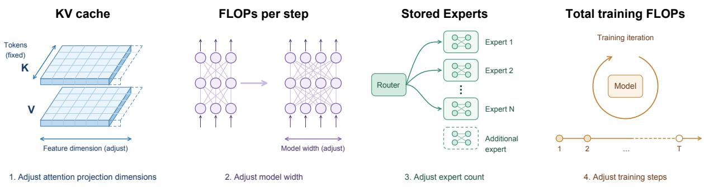  
Figure 1 | The four steps of budget matching. We adjust attention projection dimensions, model width, the number of stored experts, and training steps in this order.

## 2.1. Looped MoE Architecture

We adopt SMELT’s basic looped architecture as our starting point. A Transformer with � stored layers is divided into an entry block, a middle block, and an exit block, containing $L / 4 , L / 2$ , and �/4 layers, respectively. The entry and exit blocks are each executed once, while the middle block is visited twice, giving 3�/2 layer executions. Both visits share all parameters in the middle block, including attention blocks, routers, and experts. We set both residual coeficients to one as a reference for studying residual scaling across visits.

## 2.2. Budget Matching

For a matched comparison, we first adjust the attention projection dimensions to match KV cache, then the model width to match computation per step, and next the number of stored experts to match the parameter budget. Finally, we choose an integer number of optimizer steps to match total training FLOPs. Figure 1 summarizes these four steps. The number of query heads, KV groups,

<table><tr><td>Budget</td><td>SMELT</td><td>This work</td></tr><tr><td>Backbone parameters</td><td>1.0 %</td><td>0.6 %</td></tr><tr><td>KV cache</td><td>3.6 %</td><td>0.8 %</td></tr><tr><td>FLOPs per token</td><td>3.9 %</td><td>0.9 %</td></tr></table>

Table 1 | Maximum absolute budget deviations.

and active experts is held fixed within each matched comparison. Parameter matching uses the backbone excluding token embeddings and the vocabulary output projection; we also report the total parameter count including both. Adjusting the expert count changes the router dimension, with a small efect on total computation that we include in the FLOPs accounting. Table 1 reports the maximum absolute budget deviations in percent. Actual configurations and deviations are given in Appendix A.

## 3. LatentLoop

## 3.1. Asymmetry in Loop Updates

Although looped models can improve performance, the contribution of each visit remains incompletely understood. Prior work (Blayney et al., 2026; Geiping et al., 2026; Wang et al., 2026b; Zhu et al., 2025) suggests that diferent loop visits can play diferent roles in processing and refining representations. We begin by asking whether the two visits contribute equally to the model’s predictions. As an initial probe, we let each visit learn its own residual update scale and compare the resulting coeficients.

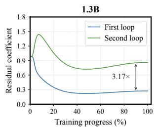

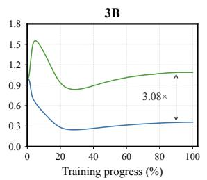  
(a) Learned residual coeficients

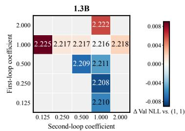

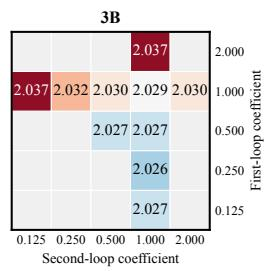  
(b) Fixed residual coeficients  
Figure 2 | Residual scale asymmetry at 1.3B and 3B. (a) Learned coeficients for the two visits. (b) Validation NLL with fixed coeficients; rows and columns correspond to the first and second visits. Colors show diferences from the same size (1, 1) baseline using scores rounded to three decimals.

Specifically, we introduce two learnable scalar coeficients, $\alpha _ { 1 }$ and $\alpha _ { 2 } ,$ , for the first and second visits. Within the repeated middle block, each residual branch is updated as

$$
h ^ { \prime } = h + \alpha _ { \nu } f _ { \ell } ( h ) , \qquad \nu \in \{ 1 , 2 \} ,\tag{1}
$$

where $f _ { \ell }$ denotes an attention or MoE residual branch. The same $\alpha _ { \nu }$ is used for both branch types and all layers within visit �; entry and exit layers are unchanged. Both coeficients start at one and are optimized jointly with the model weights. We run this experiment on the 1.3B and 3B looped baselines at the 20B and 40B reference token budgets, respectively, using the same data and training settings as their fixed coeficient controls.

Figure 2(a) shows a consistent asymmetry. During training, the first coeficient falls well below the second, while the second remains near one by the end. The final checkpoint coeficients are approximately (0.27, 0.87) for 1.3B and (0.36, 1.09) for 3B. Thus, joint optimization favors diferent update scales for the two visits at both model sizes. We also observe unequal residual scales with three and four visits at both model sizes, as shown in Section 4.5.

Motivated by the learned asymmetry, we next ask how unequal residual scales afect performance. Since the larger learned coeficient remains close to one, we use one as a reference scale and vary which visit receives a diferent coeficient. Specifically, we fix the first or second coeficient at one and vary the other over {0.125, 0.25, 0.5, 2}, training each setting from scratch. This compares the same scale change applied to diferent visits. Figure 2(b) shows that reducing the first coeficient does not hurt performance and even lowers validation NLL, whereas the corresponding reductions to the second coeficient increase it. Among the tested settings, (0.25, 1) gives the lowest NLL at both sizes, improving over (1, 1) by about 0.008 and 0.003 for 1.3B and 3B, respectively. Such a simple change to a single residual coeficient improves performance at both model sizes, without adding trainable parameters or changing the computational budget.

Wang et al. (2026a) propose symmetric residual scaling of 1/� across � visits. In our two-visit experiments, the asymmetric setting (0.25, 1) achieves lower validation NLL than their corresponding (0.5, 0.5) setting at both model sizes (Figure 2(b)).

Together, the learned coeficients and fixed coeficient comparisons indicate a preference for asymmetric update scales in our looped MoE setting, motivating us to explore asymmetric compute allocation across visits.

## 3.2. Asymmetric Compute Allocation

Reducing the first visit’s residual coeficient can preserve or even improve performance. This observation motivates us to explore reducing computation during the first visit and reallocating the saved

budget to other parts of the model.

We explore four ways to reduce first visit computation. First, inspired by projection into lower dimensional latent spaces (Elango et al., 2026; Liu et al., 2024), we project the residual stream to half its width, execute the first visit using nested submatrices of the shared weights, and project its increment back to the original width. Second, inspired by nested feed-forward networks (Devvrit et al., 2024), we halve only the expert intermediate width using the corresponding submatrices, while keeping the residual stream and attention at full width. Third, we reduce the number of experts activated for each token from eight to four during the first visit. Fourth, inspired by sequence compression (Hwang et al., 2026; Yu et al., 2026, 2023), we compress the sequence into fewer latent positions. These initial variants retain full parameter sharing and unit residual coeficients, with mean aggregation and direct writeback for sequence compression.

We find that sequence compression gives the lowest validation NLL among the four initial strategies and select it for further refinement. A possible explanation concerns how the strategies use the available parameter capacity. Looping saves stored parameters by reusing weights across visits. Under budget matching, MoE allows this saving to be allocated to a larger expert pool, preserving parameter capacity while matching computation. However, the other three reductions restrict the capacity available to each token during the first visit: activating fewer experts limits its expert capacity, while reducing widths uses only part of the shared weight matrices. Sequence compres-

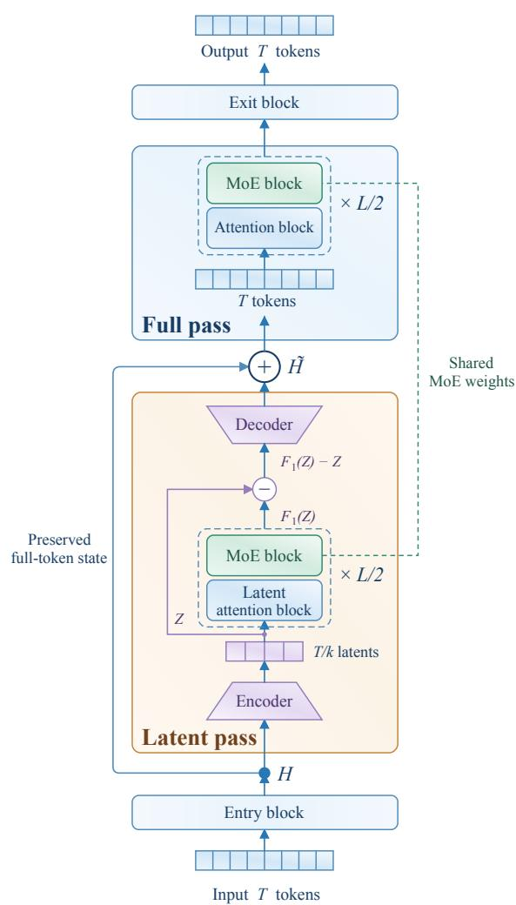  
Figure 3 | LatentLoop Architecture. LatentLoop compresses the first visit’s sequence and retains full resolution in the second, sharing MoE weights with independent attention blocks.

sion instead retains the full model width and expert activation count at each latent position. Its saved computation is reallocated to model width, combining fewer computed positions with wider computation across the backbone. Results are reported in Section 4.4.

Based on this comparison, we propose LatentLoop (Figure 3). The first visit operates in a latent sequence space with fewer positions, while the second operates at the original sequence resolution. We reallocate the computation saved by the first visit to model width under the budget matching constraints in Section 2.2, creating an asymmetric allocation across visits.

Let $H \in \mathbb { R } ^ { T \times d }$ denote the states after the entry block, with sequence length � and model width �. For an integer compression factor � dividing �, the encoder Enc maps these states to a latent sequence of length $l = T / k$ , while the decoder Dec maps a latent update back to � positions. Both preserve the

channel width �. The two visits follow

$$
\begin{array} { r l r l } & { Z = \operatorname { E n c } ( H ) , } & & { Z \in \mathbb { R } ^ { l \times d } , } \\ & { \Delta = F _ { 1 } ( Z ) - Z , } \\ & { \widetilde { H } = H + \operatorname { D e c } ( \Delta ) , } \\ & { Y = F _ { 2 } ( \widetilde { H } ) , } \end{array}\tag{2}
$$

where $F _ { 1 }$ and $F _ { 2 }$ denote the first and second visits to the middle block. The original states � are retained while the first visit processes $Z ;$ its increment $\Delta$ is then written back with causal alignment. The second visit processes the resulting full sequence ${ \widetilde { H } } ,$ , and its output � is passed to the exit block.

This asymmetric allocation also raises questions about update strength and parameter reuse. The first visit produces an increment in latent space that must be added to full resolution states. Together with the residual scale asymmetry in Section 3.1, this motivates learning how strongly the latent increment should be written back, as described in Section 3.3. Also, the two visits process diferent sequence resolutions, raising the question of whether direct reuse of the same block parameters remains appropriate for both. We investigate this choice in Section 3.4.

## 3.3. Calibrated Writeback

We begin with a compression factor $k = 2$ and use a simple mean encoder with direct writeback. Indexing the original and latent sequences from one, we aggregate each pair of adjacent states as

$$
Z _ { j } = \operatorname { E n c } ( H ) _ { j } = { \frac { H _ { 2 j - 1 } + H _ { 2 j } } { 2 } } , \qquad 1 \leq j \leq l .\tag{3}
$$

After the first visit, direct writeback adds the latent increment $\Delta _ { j }$ unchanged to positions $2 j$ and $2 j + 1$ whenever these positions exist. The first receiver is the last token of the source pair; the second is the next token. This alignment ensures that a latent update only reaches positions where all tokens in its source pair are already available. The first token of the entire sequence, at position one, receives no latent update.

Mean aggregation and direct writeback fix the scales of both operators. The residual scaling observations in Section 3.1 motivate us to let the model adjust these scales. We also explore a causal channel convolution encoder that learns the aggregation scale (Appendix B). On the decoder side, we introduce a learnable writeback coeficient for each channel and receiver position, which rescales the latent increment before it is added to the original states:

$$
\mathrm { D e c } ( \Delta ) _ { k j + s } = w _ { s } \odot \Delta _ { j } , \qquad 0 \le s < k .\tag{4}
$$

Here $j = 1 , \ldots , l , k j + s \leq T$ , and ⊙ denotes elementwise multiplication. Positions before � receive zero updates. Each vector $\boldsymbol { w _ { s } } \in \mathbb { R } ^ { d }$ starts at one and is shared across all token groups, so the decoder initially recovers direct writeback.

We compare learning the encoder, the decoder, or both. Learning either alone improves validation NLL over the initial design, while learning both provides no further improvement over the decoder alone in our comparison. Implementation details are provided in Appendix B, and ablation results in Section 4.4.

We seek a simple and efective design with minimal added complexity. We therefore retain the parameter-free mean encoder and learn the writeback coeficients directly. With $k = 2 .$ , our scaled decoder (SD) uses two vectors $w _ { 0 } , w _ { 1 } \in \mathbb { R } ^ { d }$ and adds only 2� parameters. It is applied once after the entire first visit and learns the update scale separately for each channel and receiver position.

## 3.4. Selective Parameter Sharing

The first visit processes a compressed latent sequence, while the second processes the full sequence. Compression changes the sequence processed by attention and the hidden states passed to the MoE layers. The two resolutions may therefore favor diferent attention and MoE computations, motivating us to reconsider full parameter sharing across visits.

We approach this choice from the perspective of parameter allocation. MoE expert weights account for most of the stored backbone parameters, while attention occupies only a small fraction. We therefore give the two visits independent attention blocks within the repeated middle block, while retaining shared MoE routers and expert weights. In our matched 3B configuration, reducing the number of stored experts by just one per MoE layer, from 76 to 75, is suficient to accommodate the additional attention block parameters within the parameter budget. Attention FLOPs remain unchanged, and the two visits already use separate KV caches, so independent attention blocks do not increase KV storage. Keeping the active expert count fixed also preserves expert FLOPs, with only a small change in routing cost. Untying the MoE instead would leave most parameters unshared across visits, making the model close to a non-looped Transformer in terms of parameter reuse. This allocation improves validation NLL over full parameter sharing under the budget constraints in Section 2.2. Detailed comparisons are reported in Section 4.4.

## 4. Experiments

## 4.1. Experimental Setup

Implementation details. We use sparse MoE Transformers in the style of Qwen3 (Yang et al., 2025), with eight active experts per token. All methods share the same fixed FineWeb-Edu (Penedo et al., 2024) training stream, TinyLlama tokenizer (Zhang et al., 2024), and 0.1B token validation set. LatentLoop uses � = 2, mean aggregation, and the scaled decoder, with shared MoE weights and independent attention blocks. Further implementation details are given in Appendix B.

Baselines. We compare with two baselines. MoE Base is a standard MoE Transformer with 64 stored experts per layer, executing each layer once. MoE Loop uses the looped architecture of SMELT (Wang et al., 2026b) described in Section 2.1, visiting the middle half of the layers twice while executing the entry and exit blocks once. Both visits share all middle block parameters and use residual coeficients of one. Detailed configurations and matched budgets are given in Appendix A.

Benchmarks. We evaluate nine downstream benchmarks: LAMBADA OpenAI and LAMBADA Standard (Paperno et al., 2016), HellaSwag (Zellers et al., 2019), PIQA (Bisk et al., 2020), Wino-Grande (Sakaguchi et al., 2021), ARC-Easy and ARC-Challenge (Clark et al., 2018), SciQ (Welbl et al., 2017), and MMLU (Hendrycks et al., 2020) in its continuation formulation. We use lm-evaluationharness (Gao et al., 2024) with both 0-shot and 5-shot settings for every benchmark. Additional details are given in Appendix B.

## 4.2. Scaling Analysis

Setup. We evaluate 15 matched budget configurations spanning 1.3B–7B parameters, with the largest training budget exceeding 1021 FLOPs. Budgets within each architecture and model size share a training mainline with separate annealing branches (Appendix B). Similar to SMELT (Wang et al.,

<table><tr><td>Shot</td><td>Params</td><td>Token</td><td>Model</td><td>LD-0</td><td>LD-S</td><td>HS</td><td>PIQA</td><td>WG</td><td>ARC-E</td><td>ARC-C</td><td>SciQ</td><td>MMLU</td><td>Avg</td></tr><tr><td rowspan="8">5-shot</td><td rowspan="3">1.3B/0.2B</td><td rowspan="3">40B</td><td>MoE Base</td><td>31.44</td><td>29.30</td><td>48.73</td><td>70.46</td><td>53.91</td><td>69.40</td><td>35.41</td><td>90.40</td><td>32.16</td><td>51.24</td></tr><tr><td>MoE Loop</td><td>31.15</td><td>28.72</td><td>49.61</td><td>69.91</td><td>56.04</td><td>67.42</td><td>36.26</td><td>89.60</td><td>31.86</td><td>51.18</td></tr><tr><td>LatentLoop</td><td>32.99</td><td>30.20</td><td>50.36</td><td>69.80</td><td>56.35</td><td>67.38</td><td>37.12</td><td>91.10</td><td>31.93</td><td>51.91</td></tr><tr><td rowspan="2">3B/0.5B</td><td rowspan="2">70B</td><td>MoE Base</td><td>40.89</td><td>36.17</td><td>57.89</td><td>73.18</td><td>57.93</td><td>73.40</td><td>42.49</td><td>93.10</td><td>35.12</td><td>56.69</td></tr><tr><td>MoE Loop</td><td>39.72</td><td>37.26</td><td>59.48</td><td>74.70</td><td>59.19</td><td>72.90</td><td>43.69</td><td>92.90</td><td>36.09</td><td>57.33</td></tr><tr><td rowspan="2"></td><td rowspan="2"></td><td>LatentLoop</td><td>43.86</td><td>41.74</td><td>60.57</td><td>74.65</td><td>57.62</td><td>74.41</td><td>45.14</td><td>92.80</td><td>35.83</td><td>58.51</td></tr><tr><td>MoE Base</td><td>48.88</td><td>45.78</td><td>66.68</td><td>76.22</td><td>62.43</td><td>76.64</td><td>48.72</td><td>96.00</td><td>38.33</td><td>62.19</td></tr><tr><td rowspan="2">7B/1B</td><td rowspan="2">140B</td><td>MoE Loop</td><td>50.07</td><td>43.66</td><td>68.69</td><td>75.95</td><td>64.09</td><td>76.18</td><td>49.32</td><td>95.80</td><td>39.22</td><td>62.55</td></tr><tr><td>LatentLoop</td><td>49.21</td><td>45.92</td><td>68.44</td><td>76.33</td><td>63.93</td><td>79.55</td><td>51.71</td><td>96.20</td><td>39.35</td><td>63.40</td></tr><tr><td rowspan="6">0-shot</td><td rowspan="3">1.3B/0.2B</td><td rowspan="3">40B</td><td>MoE Base</td><td>39.78</td><td>31.92</td><td>48.99</td><td>69.75</td><td>53.51</td><td>61.15</td><td>32.17</td><td>79.10</td><td>30.74</td><td>49.68</td></tr><tr><td>MoE Loop</td><td>40.44</td><td>29.71</td><td>49.76</td><td>70.24</td><td>54.30</td><td>59.85</td><td>33.87</td><td>81.20</td><td>31.14</td><td>50.06</td></tr><tr><td>LatentLoop</td><td>40.38</td><td>31.98</td><td>49.99</td><td>69.86</td><td>57.14</td><td>60.44</td><td>32.17</td><td>81.20</td><td>31.14</td><td>50.48</td></tr><tr><td rowspan="3">3B/0.5B</td><td rowspan="3">70B</td><td>MoE Base</td><td>47.93</td><td>38.60</td><td>57.81</td><td>72.31</td><td>55.72</td><td>67.51</td><td>39.85</td><td>86.60</td><td>34.18</td><td>55.61</td></tr><tr><td>MoE Loop</td><td>47.70</td><td>39.65</td><td>59.38</td><td>73.83</td><td>57.62</td><td>67.21</td><td>38.57</td><td>85.60</td><td>34.62</td><td>56.02</td></tr><tr><td>LatentLoop</td><td>49.23</td><td>39.98</td><td>60.26</td><td>74.05</td><td>56.51</td><td>70.03</td><td>39.93</td><td>86.10</td><td>34.15</td><td>56.69</td></tr><tr><td rowspan="3">7B/1B</td><td rowspan="3"></td><td rowspan="3">140B</td><td>MoE Base</td><td>54.12</td><td>45.80</td><td>65.83</td><td>76.17</td><td>59.83</td><td>69.82</td><td>44.54</td><td>89.10</td><td>36.45</td><td>60.18</td></tr><tr><td>MoE Loop</td><td>53.64</td><td>44.69</td><td>67.30</td><td>75.95</td><td>61.96</td><td>73.95</td><td>46.42</td><td>91.40</td><td>37.34</td><td>61.40</td></tr><tr><td>LatentLoop</td><td>54.92</td><td>45.22</td><td>66.91</td><td>75.68</td><td>62.59</td><td>74.20</td><td>46.50</td><td>90.40</td><td>37.69</td><td>61.57</td></tr></table>

Table 2 | Downstream benchmark scores (%). Params denote approximate total/active sizes; token budgets are FLOPs matching reference labels. LD-O/LD-S denote LAMBADA OpenAI/Standard, HS is HellaSwag, WG is WinoGrande, and MMLU uses continuation scoring.

2026b), we fit a separate additive power-law loss surface for each architecture:

$$
\widehat { L } ( F , D ) = E + A \left( \frac { F } { 1 0 ^ { 9 } } \right) ^ { - \alpha } + K \left( \frac { D } { 1 0 ^ { 1 0 } } \right) ^ { - \beta } ,\tag{5}
$$

where � is theoretical training FLOPs per prediction token and � is the cumulative number of training prediction tokens. We use the actual computation and token count of each run, including its shared training prefix and final annealing phase. We fit the five parameters with equal weight for each endpoint, minimizing Huber loss on the diference between predicted and observed log NLL, with $\delta = 1 0 ^ { - 3 }$ and 48 initializations of L-BFGS-B. For a total compute budget $C = F D _ { \mathrm { { i } } }$ , we minimize the fitted loss over � and � to obtain the predicted compute-optimal frontier.

Results. At all 15 matched budget endpoints, LatentLoop consistently achieves lower validation NLL than MoE Base and MoE Loop (Appendix E). Figure 4 summarizes this improvement through

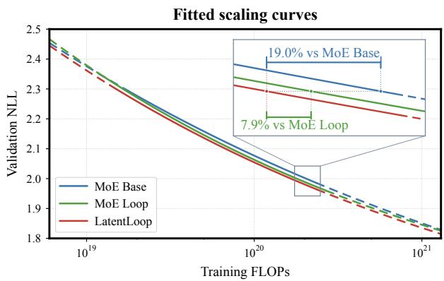  
Figure 4 | Fitted compute-optimal NLL. Solid segments lie within the convex hull of observed (log �, log �) points; dashed segments involve extrapolation.

the fitted frontiers. Within the observed model and data allocation range, the fitted frontiers show that LatentLoop reaches an NLL of 1.988 with $1 . 8 5 \times 1 0 ^ { 2 0 }$ FLOPs, saving 19.0% of computation relative to MoE Base and 7.9% relative to MoE Loop at the same loss. Together, the matched endpoint comparisons and fitted frontiers show that asymmetric compute allocation is an efective way to improve the compute eficiency of looped MoE models.

## 4.3. Downstream Evaluation

Table 2 reports downstream scores at the largest reference token budget for each size: 40B, 70B, and 140B for the 1.3B, 3B, and 7B tiers, respectively. LatentLoop achieves the highest average score in all six size and shot settings. Relative to MoE Loop, the average gains range from 0.73 to 1.18 percentage points in 5-shot and from 0.17 to 0.67 in 0-shot. Relative to MoE Base, the average gains range from 0.67 to 1.82 percentage points in 5-shot and from 0.80 to 1.39 in 0-shot. These results show that the validation NLL improvements also carry over to average downstream performance, with larger gains in 5-shot.

## 4.4. Ablation Studies

Unless otherwise stated, the following ablation and analysis experiments use the 3B/40B reference setting. We study compute allocation, the encoder, the decoder, and parameter sharing. Each ablation is trained from scratch with the training settings in Section 4.1, following the budget matching procedure in Section 2.2.

Comparing compute reduction strategies. Table 3 compares the four initial strategies described in Section 3.2, with fully shared block parameters and unit residual coeficients. Sequence aggregation with direct writeback gives the lowest NLL among these strategies. Sequence compression preserves full width and expert activation at each latent position, which may explain its advantage over reducing widths or active expert counts.

<table><tr><td>Strategy NLL ↓</td></tr><tr><td>Baselines</td></tr><tr><td>MoE Base 2.0426</td></tr><tr><td>MoE Loop 2.0293</td></tr><tr><td>Initial first visit reductions Residual width 2.0361</td></tr><tr><td>Expert intermediate width 2.0364</td></tr><tr><td>Active experts 2.0349</td></tr><tr><td>Sequence length 2.0303</td></tr><tr><td>Final design</td></tr><tr><td>LatentLoop (ours) 2.0199</td></tr></table>

Table 3 | Compute reduction strategies.

Based on these initial results, we select sequence aggregation for further refinement. The encoder, decoder, and parameter sharing comparisons below yield the final LatentLoop design, reported separately at 2.0199.

Encoder and decoder. Table 4 compares the encoding and writeback operators with independent attention blocks across visits. Direct denotes direct writeback, and Conv denotes channel convolution. We include softmax aggregation and allocation inspired by SpiralFormer (Yu et al., 2026). These operators give an NLL of 2.0264, slightly below mean aggregation and direct writeback.

Relative to mean aggregation and direct writeback at 2.0268, learning channel convolution coeficients on the encoder side lowers NLL to 2.0219, while learning the writeback coeficients of the scaled decoder (SD) with the mean encoder lowers it to 2.0199. Learning both together gives 2.0209, providing no further reduction over the scaled decoder alone in this comparison. We therefore retain the mean encoder and scaled decoder for a simple design with only 2� added parameters.

To separate overall writeback scale from relative channel and receiver position adjustments, we add two controls based on mean aggregation and the scaled decoder. In the normalized variant, we jointly divide the 2� writeback coeficients by their RMS and use no additional learned gain. This retains relative coeficients but fixes their global RMS to one. In the scale only variant, a single learned scalar replaces all channel and position coeficients. The two variants give NLLs of 2.0228 and 2.0210, respectively, compared with 2.0268 for direct writeback and 2.0199 for the scaled decoder. A single scalar therefore recovers most of the observed improvement, while channel and position adjustments provide a smaller additional reduction. The higher NLL under coeficient normalization also suggests that allowing the overall scale to adapt matters in this setting.

<table><tr><td>Encoder Decoder</td><td>NLL ↓</td></tr><tr><td>Baselines MoE Base</td><td>2.0426 2.0293</td></tr><tr><td>MoE Loop</td><td></td></tr><tr><td>SpiralFormer style operators Mean Direct</td><td>2.0268</td></tr><tr><td>Softmax Softmax</td><td>2.0264</td></tr><tr><td>Our enc/dec variants</td><td></td></tr><tr><td>Mean Direct</td><td>2.0268</td></tr><tr><td>Conv Direct</td><td>2.0219</td></tr><tr><td>Mean SD (ours)</td><td>2.0199</td></tr><tr><td>Conv SD</td><td>2.0209</td></tr><tr><td></td><td></td></tr><tr><td>Writeback scale controls</td><td></td></tr><tr><td>Mean SD (RMS)</td><td>2.0228</td></tr><tr><td>Mean Scalar gain</td><td>2.0210</td></tr></table>

Table 4 | Encoder and decoder comparisons. SD denotes the scaled decoder. All operator variants use independent attention blocks across visits.

<table><tr><td>Model / operators</td><td>Attn block</td><td>NLL ↓</td></tr><tr><td>Baselines MoE Base</td><td></td><td>2.0426</td></tr><tr><td>MoE Loop</td><td>Shared</td><td>2.0293</td></tr><tr><td>MoE Loop variants MoE Loop</td><td>Shared</td><td>2.0293</td></tr><tr><td>MoE Loop</td><td>Untied</td><td>2.0319</td></tr><tr><td>Our variants: Mean + Direct Mean + Direct</td><td>Shared</td><td>2.0303</td></tr><tr><td>Mean + Direct</td><td>Untied</td><td>2.0268</td></tr><tr><td></td><td></td><td></td></tr><tr><td>Our variants: Mean + SD</td><td></td><td></td></tr><tr><td>Mean + SD</td><td>Shared</td><td>2.0237</td></tr><tr><td>Mean + SD (ours)</td><td>Untied</td><td>2.0199</td></tr></table>

Table 5 | Parameter sharing comparisons.

Parameter sharing. Table 5 compares parameter sharing with the stored expert count adjusted to match the parameter budget. For ordinary MoE Loop, with two full resolution visits, reducing the expert count from 92 to 91 while untying attention blocks increases NLL from 2.0293 to 2.0319. In contrast, the corresponding change from 76 to 75 experts improves both compressed first visit variants. NLL falls from 2.0303 to 2.0268 with mean aggregation and direct writeback, and from 2.0237 to 2.0199 with mean aggregation and the scaled decoder. Thus, in our matched experiments, independent attention blocks benefit the two latent sequence configurations, but not ordinary MoE Loop. These results support our choice to share MoE routers and experts while allowing separate attention blocks across the two resolutions.

Concurrent with our work, Wang et al. (2026c) report improvements from untying attention in looped MoE models. However, their tied versus untied comparisons do not reduce the expert count to compensate for the additional attention parameters, so the untied models have more total parameters. Our comparison instead accounts for these additional parameters by reducing the expert count. This diference may contribute to the contrasting observation for ordinary MoE Loop.

Additional ablations are reported in Appendix C.

## 4.5. Analysis

Residual scales with more loop visits. The two visits in Section 3.1 learn diferent residual scales, with a smaller coeficient for the first visit. We next ask whether this asymmetry persists when the model makes more visits. We extend the experiment to three and four visits of the shared middle half at both 1.3B and 3B. Each visit has its own learnable residual coeficient, initialized at one and shared across its attention and MoE branches. We retain the 20B and 40B reference token budgets for 1.3B and 3B, respectively, and apply the budget matching procedure in Section 2.2.

Figure 5 shows a consistent separation of the coeficients. Near the end of training, the coeficients increase with visit index in all four experiments: the first visit has the smallest scale, and the last has the largest. Thus, the preference for unequal update scales also appears beyond two visits. With more visits, we additionally observe similar ratios between consecutive coeficients within each run. At 90% training progress, the ratios marked in the figure are approximately 2.4× for three visits and 2.0× for four visits. We leave explaining this pattern to future work.

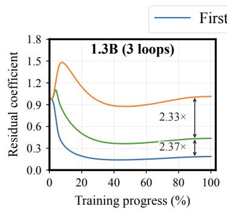

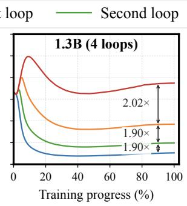  
Figure 5 | Learned residual coeficients with three and four visits, for 1.3B and 3B.

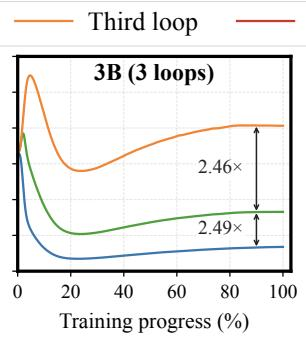

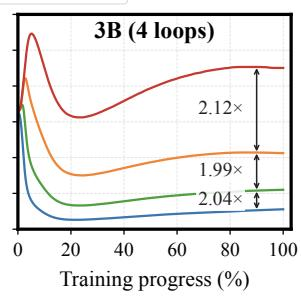

Learned writeback coeficients. Figure 6 shows that both receiver positions learn scales well below their unit initialization, with final channel means of approximately 0.199 and 0.160. This echoes the preference for a smaller first visit residual scale in Section 3.1. After warmup, the nearer receiver, 2�, consistently learns a higher mean coeficient than the farther receiver, 2� + 1. This pattern is consistent with the latent update providing more reliable information for the nearer position: the source pair includes the state at 2�, whereas the update received at 2� + 1 comes from the preceding pair and does not include its current state. The scaled decoder thus learns to give greater weight to the update at the nearer receiver.

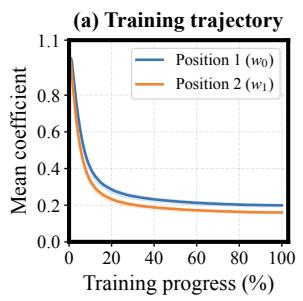

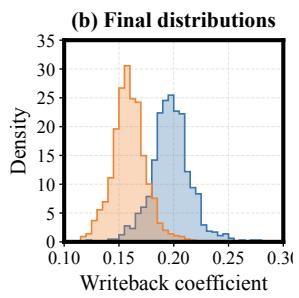  
Figure 6 | Learned scaled decoder coeficients at 3B/40B. (a) Channel means during training, with 25th–75th percentile bands. (b) Final channel distributions.

## 5. Related Work

Mixture-of-experts Transformers. Mixture-of-experts (MoE) models distribute computation among multiple expert networks through a learned gating mechanism (Shazeer et al., 2017). We use sparse MoE Transformers (Fedus et al., 2022; Liu et al., 2024) in the style of Qwen3 (Yang et al., 2025), which activate only a small subset of experts for each token, allowing parameter capacity to grow without a proportional increase in computation per token. Recent work (Chen et al., 2026c; Huang et al., 2026; Jaggi, 2026; Qiu et al., 2026; Tan et al., 2025) in this area explores reusing experts across depth through sharing within neighboring layers, access to experts from other layers, or a common expert pool. Sharing expert weights while keeping attention independent is a design choice that we also adopt. For example, MoRE (Qiu et al., 2026) lets two adjacent layers draw from a larger shared expert pool while retaining separate attention and routers. Unlike MoRE, LatentLoop revisits an ordered stack of middle layers: each visit traverses the same sequence of expert pools, with shared routers and experts but independent attention blocks.

Looped Transformers. Recurrent models separate computational depth from the number of stored parameters. Universal Transformers (Dehghani et al., 2018) apply a shared block repeatedly with adaptive halting, while deep equilibrium models (Bai et al., 2019) represent repeated computation through an implicit fixed point. More recently, Huginn (Geiping et al., 2026) and Ouro (Zhu et al., 2025) scale recurrent computation and demonstrate reasoning gains from additional loop visits. These approaches and related studies (Blayney et al., 2026; Prairie et al., 2026; Wang et al., 2026a) focus mainly on dense models. However, comparisons at fixed parameter counts can give looped models more computation, while matching computation alone can leave them with fewer stored parameters. This motivates looped MoE models (Chen et al., 2026a; Wang et al., 2026b) that jointly match parameter and compute budgets.

Looped MoE Transformers. MoE ofers a way to balance these budgets because the number of stored experts can be adjusted separately from the number activated per token. Lee et al. (2026) find that sparse layers improve the scaling of looped models and associate this gain with routing divergence across visits. LoopMoE (Chen et al., 2026a) combines iteration conditioned normalization with capacity balancing to compare against a non-looped MoE at matched total parameters and per-token FLOPs. Chen et al. (2026b) jointly model recurrence and sparsity, finding diminishing gains from additional loops that depend on the degree of sparsity. SMELT (Wang et al., 2026b) matches per-token FLOPs, stored backbone parameters, and KV cache, and finds that looping the middle half of layers twice improves validation loss and downstream performance. Its analysis shows that the second visit reinforces earlier residual updates and reduces attention sinks. Building on SMELT’s budget matching setting, we study how to improve the allocation within a two-visit loop. Our residual coeficient observations motivate diferent compute allocations across visits, leading to compressed first-visit computation, calibrated writeback, and selective parameter sharing.

Compressed computation. Prior work (Barrault et al., 2024; Hwang et al., 2026; Yu et al., 2023) explores computation over compressed or multiscale representations, using byte patches, learned chunks, or sentence embeddings. Most closely related to ours, SpiralFormer (Yu et al., 2026) also applies sequence compression within looped Transformers. Its main focus is learning hierarchical dependencies through a schedule of multiple sequence resolutions. In contrast, our work builds on the MoE architecture and focuses on fair comparisons under matched budgets. We use compression to allocate computation asymmetrically across visits and reallocate the saved computation to model width. We further study learned writeback calibration and selective parameter sharing across visits.

In our experiments, we directly compare SpiralFormer-style mean and softmax aggregation and writeback operators (Table 4) and show that our design achieves lower validation NLL. We also compare our largest LatentLoop model against the largest SpiralFormer-L, with details in Appendix D.

## 6. Conclusion

We studied how to improve looped MoE models through compute allocation under matched resource budgets. Learned and fixed residual coeficient experiments reveal an asymmetry in the preferred update scales of the two visits, motivating us to explore diferent amounts of computation across visits. LatentLoop processes a compressed sequence during the first visit and the full sequence during the second, reallocating the saved computation to model width. Learned writeback coeficients calibrate the latent increment, while shared MoE routers and experts preserve parameter reuse alongside independent attention blocks. Across 15 budget configurations at the 1.3B, 3B, and 7B tiers, with the largest training budget exceeding $1 0 ^ { 2 1 }$ FLOPs, LatentLoop consistently achieves lower validation NLL than MoE Base and MoE Loop. It also obtains higher average scores across nine downstream benchmarks at all three sizes in both 0-shot and 5-shot settings. Our experiments suggest that asymmetric compute allocation is a promising direction for improving looped MoE models.

## Limitations

LatentLoop’s asymmetric compute allocation is motivated by the observed asymmetry in residual coeficients. However, the mechanisms underlying this learned asymmetry remain incompletely understood, particularly the residual coeficient patterns observed with three and four loop visits in Section 4.5. We leave a more detailed investigation of these patterns to future work. Further study of the specific mechanisms and roles of diferent loop visits may guide more efective compute allocation for looped MoE models.

## References

Joshua Ainslie, James Lee-Thorp, Michiel De Jong, Yury Zemlyanskiy, Federico Lebrón, and Sumit Sanghai. Gqa: Training generalized multi-query transformer models from multi-head checkpoints. In Proceedings of the 2023 conference on empirical methods in natural language processing, pages 4895–4901, 2023.

Shaojie Bai, J Zico Kolter, and Vladlen Koltun. Deep equilibrium models. Advances in neural information processing systems, 32, 2019.

Loïc Barrault, Paul-Ambroise Duquenne, Maha Elbayad, Artyom Kozhevnikov, Belen Alastruey, Pierre Andrews, Mariano Coria, Guillaume Couairon, Marta R Costa-jussà, David Dale, et al. Large concept models: Language modeling in a sentence representation space. arXiv preprint arXiv:2412.08821, 2024.

Yonatan Bisk, Rowan Zellers, Jianfeng Gao, Yejin Choi, et al. Piqa: Reasoning about physical commonsense in natural language. In Proceedings of the AAAI conference on artificial intelligence, volume 34, pages 7432–7439, 2020.

Hugh Blayney, Álvaro Arroyo, Johan Obando-Ceron, Pablo Samuel Castro, Aaron Courville, Michael M Bronstein, and Xiaowen Dong. A mechanistic analysis of looped reasoning language models. arXiv preprint arXiv:2604.11791, 2026.

Wenkai Chen, Tianshu Li, Wenyong Huang, Yichun Yin, Lifeng Shang, and Chengwei Qin. Loopmoe: Unifying iterative computation with mixture-of-experts for language modeling. arXiv preprint arXiv:2606.04438, 2026a.

Yanbei Chen, Anirudh Goyal, and Raghuraman Krishnamoorthi. Scaling laws for looped mixture of experts. arXiv preprint arXiv:2609.40316, 2026b.

Yilong Chen, Naibin Gu, Junyuan Shang, Zhenyu Zhang, Yuchen Feng, Jiawei Sheng, Tingwen Liu,

Shuohuan Wang, Yu Sun, Hua Wu, et al. Mixture of universal experts: Scaling virtual width via depth-width transformation. arXiv preprint arXiv:2603.04971, 2026c.

Peter Clark, Isaac Cowhey, Oren Etzioni, Tushar Khot, Ashish Sabharwal, Carissa Schoenick, and Oyvind Tafjord. Think you have solved question answering? try arc, the ai2 reasoning challenge. arXiv preprint arXiv:1803.05457, 2018.

Mostafa Dehghani, Stephan Gouws, Oriol Vinyals, Jakob Uszkoreit, and Łukasz Kaiser. Universal transformers. arXiv preprint arXiv:1807.03819, 2018.

Fnu Devvrit, Sneha Kudugunta, Aditya Kusupati, Tim Dettmers, Kaifeng Chen, Inderjit S Dhillon, Yulia Tsvetkov, Hannaneh Hajishirzi, Sham M Kakade, Ali Farhadi, et al. Matformer: Nested transformer for elastic inference. In The Thirty-eighth Annual Conference on Neural Information Processing Systems, 2024.

Venmugil Elango, Nidhi Bhatia, Roger Walefe, Rasoul Shafipour, Tomer Asida, Abhinav Khattar, Nave Assaf, Maximilian Golub, Joey Guman, Tiyasa Mitra, et al. Latentmoe: Toward optimal accuracy per flop and parameter in mixture of experts. arXiv preprint arXiv:2601.18089, 2026.

William Fedus, Barret Zoph, and Noam Shazeer. Switch transformers: Scaling to trillion parameter models with simple and eficient sparsity. Journal of Machine Learning Research, 23(120):1–39, 2022.

Leo Gao, Jonathan Tow, Baber Abbasi, Stella Biderman, Sid Black, Anthony DiPofi, Charles Foster, Laurence Golding, Jefrey Hsu, Alain Le Noac’h, Haonan Li, Kyle McDonell, Niklas Muennighof, Chris Ociepa, Jason Phang, Laria Reynolds, Hailey Schoelkopf, Aviya Skowron, Lintang Sutawika, Eric Tang, Anish Thite, Ben Wang, Kevin Wang, and Andy Zou. The language model evaluation harness, 07 2024. URL https://zenodo.org/records/12608602.

Jonas Geiping, Sean McLeish, Neel Jain, John Kirchenbauer, Siddharth Singh, Brian Bartoldson, Bhavya Kailkhura, Abhinav Bhatele, and Tom Goldstein. Scaling up test-time compute with latent reasoning: A recurrent depth approach. Advances in Neural Information Processing Systems, 38: 41340–41391, 2026.

Alexander Hägele, Elie Bakouch, Atli Kosson, Loubna B Allal, Leandro Von Werra, and Martin Jaggi. Scaling laws and compute-optimal training beyond fixed training durations. Advances in Neural Information Processing Systems, 37:76232–76264, 2024.

Dan Hendrycks, Collin Burns, Steven Basart, Andy Zou, Mantas Mazeika, Dawn Song, and Jacob Steinhardt. Measuring massive multitask language understanding. arXiv preprint arXiv:2009.03300, 2020.

Shengding Hu, Yuge Tu, Xu Han, Chaoqun He, Ganqu Cui, Xiang Long, Zhi Zheng, Yewei Fang, Yuxiang Huang, Weilin Zhao, et al. Minicpm: Unveiling the potential of small language models with scalable training strategies. arXiv preprint arXiv:2404.06395, 2024.

Minbin Huang, Han Shi, Chuanyang Zheng, Yimeng Wu, Guoxuan Chen, Xintong Yu, Yichun Yin, and Hong Cheng. Unipool: A globally shared expert pool for mixture-of-experts. arXiv preprint arXiv:2605.06665, 2026.

Sukjun Hwang, Brandon Wang, and Albert Gu. Dynamic chunking for end-to-end hierarchical sequence modeling. In International Conference on Learning Representations, volume 2026, pages 149273–149313, 2026.

Martin Jaggi. Tying the loop–tied expert layers in mixture-of-experts language models. arXiv preprint arXiv:2606.16825, 2026.

Ryan Lee, Jacob Biloki, Edward J Hu, and Jonathan May. Sparse layers are critical to scaling looped language models. arXiv preprint arXiv:2605.09165, 2026.

Aixin Liu, Bei Feng, Bin Wang, Bingxuan Wang, Bo Liu, Chenggang Zhao, Chengqi Dengr, Chong Ruan,

Damai Dai, Daya Guo, et al. Deepseek-v2: A strong, economical, and eficient mixture-of-experts language model. arXiv preprint arXiv:2405.04434, 2024.

Ilya Loshchilov and Frank Hutter. Decoupled weight decay regularization. arXiv preprint arXiv:1711.05101, 2017.

Denis Paperno, Germán Kruszewski, Angeliki Lazaridou, Ngoc-Quan Pham, Rafaella Bernardi, Sandro Pezzelle, Marco Baroni, Gemma Boleda, and Raquel Fernández. The lambada dataset: Word prediction requiring a broad discourse context. In Proceedings of the 54th annual meeting of the association for computational linguistics (volume 1: Long papers), pages 1525–1534, 2016.

Guilherme Penedo, Hynek Kydlíček, Anton Lozhkov, Margaret Mitchell, Colin Rafel, Leandro Von Werra, Thomas Wolf, et al. The fineweb datasets: Decanting the web for the finest text data at scale. Advances in Neural Information Processing Systems, 37:30811–30849, 2024.

Hayden Prairie, Zachary Novack, Taylor Berg-Kirkpatrick, and Daniel Y Fu. Parcae: Scaling laws for stable looped language models. arXiv preprint arXiv:2604.12946, 2026.

Eric S Qiu, Utku Umur Acikalin, Justin Lovelace, Christian Belardi, Arjun B Mulchandani, Carla P Gomes, and Kilian Q Weinberger. More: Mixture of reused experts. arXiv preprint arXiv:2609.18176, 2026.

Keisuke Sakaguchi, Ronan Le Bras, Chandra Bhagavatula, and Yejin Choi. Winogrande: An adversarial winograd schema challenge at scale. Communications of the ACM, 64(9):99–106, 2021.

Noam Shazeer. Glu variants improve transformer. arXiv preprint arXiv:2002.05202, 2020.

Noam Shazeer, Azalia Mirhoseini, Krzysztof Maziarz, Andy Davis, Quoc Le, Geofrey Hinton, and Jef Dean. Outrageously large neural networks: The sparsely-gated mixture-of-experts layer. arXiv preprint arXiv:1701.06538, 2017.

Jianlin Su, Murtadha Ahmed, Yu Lu, Shengfeng Pan, Wen Bo, and Yunfeng Liu. Roformer: Enhanced transformer with rotary position embedding. Neurocomputing, 568:127063, 2024.

Zheyue Tan, Zhiyuan Li, Tao Yuan, Dong Zhou, Weilin Liu, Yueqing Zhuang, Yadong Li, Guowei Niu, Cheng Qin, Zhuyu Yao, et al. Rexmoe: Reusing experts with minimal overhead in mixture-of-experts. arXiv preprint arXiv:2510.17483, 2025.

Shaowen Wang, Bingrui Li, Ge Zhang, Wenhao Huang, Shen Yan, and Jian Li. On the residual scaling of looped transformers: Stability and transferability. arXiv preprint arXiv:2606.18524, 2026a.

Shaowen Wang, Ge Zhang, Kairong Luo, Yuhao Wu, Shaofan Liu, Jiaheng Liu, Wenhao Huang, Shen Yan, and Jian Li. Smelt: Scaling laws for compute-matched moe looped transformers. arXiv preprint arXiv:2609.01343, 2026b.

Shouren Wang, Chuang Ma, Mohsen Hariri, Debargha Ganguly, Wang Yang, Xiaoqing Tong, Qianying Liu, Xiaotian Han, and Vipin Chaudhary. How to loop moe: Flatten the experts, untie the attention. arXiv preprint arXiv:2609.35751, 2026c.

Johannes Welbl, Nelson F Liu, and Matt Gardner. Crowdsourcing multiple choice science questions. In Proceedings of the 3rd Workshop on Noisy User-generated Text, pages 94–106, 2017.

An Yang, Anfeng Li, Baosong Yang, Beichen Zhang, Binyuan Hui, Bo Zheng, Bowen Yu, Chang Gao, Chengen Huang, Chenxu Lv, et al. Qwen3 technical report. arXiv preprint arXiv:2505.09388, 2025.

Chengting Yu, Xiaobo Shu, Yadao Wang, Yizhen Zhang, Haoyi Wu, You Wu, Rujiao Long, Ziheng Chen, Yuchi Xu, Wenbo Su, et al. Spiralformer: Looped transformers can learn hierarchical dependencies via multi-resolution recursion. arXiv preprint arXiv:2602.11698, 2026.

Lili Yu, Dániel Simig, Colin Flaherty, Armen Aghajanyan, Luke Zettlemoyer, and Mike Lewis. Megabyte: Predicting million-byte sequences with multiscale transformers. Advances in Neural Information Processing Systems, 36:78808–78823, 2023.

Rowan Zellers, Ari Holtzman, Yonatan Bisk, Ali Farhadi, and Yejin Choi. Hellaswag: Can a machine really finish your sentence? In Proceedings of the 57th annual meeting of the association for computational linguistics, pages 4791–4800, 2019.

Biao Zhang and Rico Sennrich. Root mean square layer normalization. Advances in neural information processing systems, 32, 2019.

Peiyuan Zhang, Guangtao Zeng, Tianduo Wang, and Wei Lu. Tinyllama: An open-source small language model. arXiv preprint arXiv:2401.02385, 2024.

Rui-Jie Zhu, Zixuan Wang, Kai Hua, Tianyu Zhang, Ziniu Li, Haoran Que, Boyi Wei, Zixin Wen, Fan Yin, He Xing, et al. Scaling latent reasoning via looped language models. arXiv preprint arXiv:2510.25741, 2025.

## A. Model Configurations and Matched Budgets

Table 6 lists the nine architectures used for the three methods at the three parameter tiers. Each architecture is unchanged across its token budgets. All configurations use eight query heads, two KV heads, eight active experts per token, context length 4096, and global batch size 256. The resulting widths, head dimensions, and expert counts may be less favorable for hardware execution; these values are chosen to match the resource budgets for fair comparisons. $P _ { b }$ counts the backbone, including attention, experts, routers, normalization, and any learned decoder. It excludes the token embedding and vocabulary output projection; $P _ { \mathrm { a l l } }$ includes both. Shared parameters are counted once, and the independent attention block parameters in LatentLoop are included.

<table><tr><td>Model</td><td>Layers</td><td>d</td><td> $d _ { e }$ </td><td> $d _ { h }$  E</td><td> $P _ { b }$ </td><td> $P _ { \mathrm { a l l } }$ </td></tr><tr><td colspan="7">1.3B</td></tr><tr><td>MoE Base</td><td></td><td></td><td></td><td></td><td></td><td>12/12 1024 512 128 64 1.240232 1.305768</td></tr><tr><td>MoE Loop</td><td>12/18</td><td></td><td>864 432</td><td></td><td></td><td>86 91 1.241561 1.296857</td></tr><tr><td>LatentLoop</td><td>12/18</td><td></td><td></td><td></td><td></td><td>944 472 102 75 1.238587 1.299003</td></tr><tr><td colspan="7">3B</td></tr><tr><td>MoE Base</td><td></td><td></td><td></td><td></td><td></td><td>16/161408 704 17664 3.125857 3.215969</td></tr><tr><td>MoE Loop</td><td></td><td></td><td></td><td></td><td></td><td>16/241184 592 118 92 3.141792 3.217568</td></tr><tr><td>LatentLoop</td><td></td><td></td><td></td><td></td><td></td><td>16/24 1296 648 140 75 3.112028 3.194972</td></tr><tr><td colspan="7"></td></tr><tr><td>MoE Base</td><td>7B 20/201856 928 232 64 6.788591 6.907375</td><td></td><td></td><td></td><td></td><td></td></tr><tr><td>MoE Loop</td><td>20/301552 776154 936.818844 6.918172</td><td></td><td></td><td></td><td></td><td></td></tr><tr><td>LatentLoop</td><td></td><td></td><td></td><td></td><td></td><td>20/30 1696 848 186 76 6.750198 6.858742</td></tr></table>

Table 6 | Actual architecture configurations. The Layers column gives stored/executed depth; $d ,$ $d _ { e } ,$ and $d _ { h }$ are model width, expert intermediate width, and attention head dimension. � is the stored expert count per layer. Parameter counts are in billions.
<table><tr><td>Model</td><td>KV (MiB)</td><td> $F _ { \mathrm { s t e p } }$   $\Delta P _ { b }$ </td><td></td><td> $\Delta P _ { \mathrm { a l l } }$ </td><td>ΔKV</td><td> $\Delta F _ { \mathrm { s t e p } }$ </td></tr><tr><td colspan="7">1.3B</td></tr><tr><td>MoE Base</td><td></td><td> $4 8 . 0 0 1 . 6 7 6 + 0 . 0 0 + 0 . 0 0 + 0 . 0 0 + 0 . 0 0$ </td><td></td><td></td><td></td><td></td></tr><tr><td>MoE Loop</td><td></td><td> $4 8 . 3 8 ~ 1 . 6 8 5 ~ + 0 . 1 1 ~ - 0 . 6 8 ~ + 0 . 7 8 ~ + 0 . 5 4$ </td><td></td><td></td><td></td><td></td></tr><tr><td>LatentLoop</td><td></td><td> $4 7 . 8 1 ~ 1 . 6 7 2 ~ - 0 . 1 3 ~ - 0 . 5 2 ~ - 0 . 3 9 ~ - 0 . 2 5$ </td><td></td><td></td><td></td><td></td></tr><tr><td colspan="7"></td></tr><tr><td>MoE Base</td><td>3B</td><td> $8 8 . 0 0 3 . 7 6 7 + 0 . 0 0 + 0 . 0 0 + 0 . 0 0 + 0 . 0 0$ </td><td></td><td></td><td></td><td></td></tr><tr><td>MoE Loop</td><td></td><td> $8 8 . 5 0 \ 3 . 8 0 1 + 0 . 5 1 \ + 0 . 0 5 \ + 0 . 5 7 \ + 0 . 9 0$ </td><td></td><td></td><td></td><td></td></tr><tr><td>LatentLoop</td><td></td><td> $8 7 . 5 0 ~ 3 . 7 8 6 ~ - 0 . 4 4 ~ - 0 . 6 5 ~ - 0 . 5 7 ~ + 0 . 5 0$ </td><td></td><td></td><td></td><td></td></tr><tr><td colspan="7"></td></tr><tr><td>MoE Base</td><td>7B</td><td> $1 4 5 . 0 0 7 . 6 3 0 + 0 . 0 0 + 0 . 0 0 + 0 . 0 0 + 0 . 0 0$ </td><td></td><td></td><td></td><td></td></tr><tr><td>MoE Loop</td><td></td><td> $1 4 4 . 3 8 7 . 6 5 0 + 0 . 4 5 + 0 . 1 6 - 0 . 4 3 + 0 . 2 6$ </td><td></td><td></td><td></td><td></td></tr><tr><td>LatentLoop</td><td></td><td>145.31</td><td></td><td></td><td></td><td> $7 . 6 4 6 \_ 0 . 5 7 \_ 0 . 7 0 + 0 . 2 2 + 0 . 2 1$ </td></tr></table>

Table 7 | Single-step resources and deviations from MoE Base at the same tier. KV is BF16 K/V tensor storage per 4096-token sequence; $F _ { \mathrm { s t e p } }$ is in PFLOPs. All Δ columns are signed percentage diferences computed before rounding.

We recompute the budgets from each run’s frozen configuration and execution schedule. Independent formulas agree with the frozen budget utilities, and parameter counts obtained from the native model architectures agree with the saved checkpoint tensor inventories. We also check that actual training configurations, optimizer steps, and consumed tokens agree with the completed run records for all 45 scaling endpoints.

<table><tr><td>Model</td><td>Updates</td><td>Token</td><td>ΔD</td><td>C</td><td>ΔC</td></tr><tr><td colspan="6">1.3B</td></tr><tr><td>MoE Base</td><td>38,146</td><td></td><td>39.999B +0.00</td><td>0.6392</td><td>+0.00</td></tr><tr><td>MoE Loop</td><td>37,941</td><td>39.784B</td><td>-0.54</td><td>0.6392</td><td>+12.47</td></tr><tr><td>LatentLoop</td><td>38,240</td><td>40.098B</td><td>+0.25</td><td>0.6392</td><td>-0.98</td></tr><tr><td colspan="6">3B</td></tr><tr><td>MoE Base</td><td>66,757</td><td>70.000B</td><td>+0.00</td><td>2.5146</td><td>+0.00</td></tr><tr><td>MoE Loop</td><td>66,161</td><td>69.375B</td><td>-0.89</td><td>2.5146</td><td>+0.02</td></tr><tr><td>LatentLoop</td><td>66,427</td><td>69.654B</td><td>-0.49</td><td>2.5146</td><td>-3.57</td></tr><tr><td colspan="6">7B</td></tr><tr><td>MoE Base</td><td></td><td>133,514 140.000B+0.00 10.1877</td><td></td><td></td><td>+0.00</td></tr><tr><td>MoE Loop</td><td></td><td>133,170139.639B</td><td></td><td>-0.26 10.1877</td><td>+2.27</td></tr><tr><td>LatentLoop</td><td></td><td>133,240 139.712B</td><td></td><td>-0.21 10.1877</td><td>+3.56</td></tr></table>

Table 8 | Actual training budgets at the largest endpoint of each tier. Token counts are in billions and � is in units of $1 0 ^ { 2 \breve { 0 } }$ FLOPs. Signed deviations from the same tier’s MoE Base are computed before rounding: Δ� is in percent and Δ� in $1 0 ^ { - 4 } \%$

Table 7 reports the resource values and their deviations from MoE Base. For any quantity �, we define the signed percentage diference as

$$
\Delta X = 1 0 0 \left( { \frac { X } { X _ { \mathrm { M o E ~ B a s e } } } } - 1 \right) ,\tag{6}
$$

using the baseline at the same tier and reference token budget. Diferences are calculated before rounding the displayed values. Across all 45 endpoints, the maximum absolute deviations are 0.566% for backbone parameters, 0.704% for total parameters, 0.781% for KV storage, and 0.901% for FLOPs per step. Integer training step adjustments reduce the maximum total training FLOPs deviation to 0.00943%. Table 8 gives the actual training budgets at the largest endpoint of each tier. Total computation includes the shared training prefix and the annealing branch, counting each prefix once for that endpoint.

For FLOPs, a multiply-add counts as two operations. We count attention projections, valid causal query–key and attention–value pairs, activated expert matrices, routers, the vocabulary projection, and the learned decoder operations. Sequence compression changes both projection costs and the number of attention pairs. Training FLOPs are estimated as three times the forward count. Other elementwise operations, optimizer updates, communication, padding overhead, and recomputation are excluded. KV storage counts BF16 keys and values across actual layer executions, including separate caches for repeated visits. It excludes the small fixed-size bufers used for incremental aggregation and writeback.

## B. Additional Implementation Details

Architecture and data. We use a decoder-only Transformer with sparse MoE layers in the style of Qwen3 (Yang et al., 2025). We fix the active expert count at eight per token, with normalized routing weights. The backbone uses RMSNorm (Zhang and Sennrich, 2019), rotary position embeddings (Su et al., 2024), grouped query attention (Ainslie et al., 2023) with query and key normalization, and SwiGLU experts (Shazeer, 2020). Attention uses eight query heads and two KV groups. The 1.3B, 3B, and 7B parameter tiers have 12, 16, and 20 backbone layers, respectively. All models use the same fixed training stream from FineWeb-Edu (Penedo et al., 2024) sample350BT, with exact tokenized document deduplication and a separate 0.1B token validation set, tokenized with the 32K TinyLlama tokenizer (Zhang et al., 2024). Training follows a warmup-stable-decay (WSD) learning rate schedule (Hu et al., 2024).

Training and validation. Table 9 lists the common training hyperparameters. The schedule describes the complete training trajectory: warmup is applied once when training starts from scratch, and annealing occupies the final 20% of each endpoint’s trajectory, rounded to complete optimizer updates. Gradient accumulation maintains the same global batch size across GPU allocations. Annealing branches inherit the model, optimizer, data cursor, and random states from their source checkpoint without restarting warmup. Every method consumes the same ordered training stream without wrapping; shorter budgets use shorter prefixes of this stream. Training and validation documents are separated before tokenization output is assembled into prediction windows. Each final validation evaluates all 24,415 fixed windows of length 4096, totaling 100,003,840 prediction tokens. We report token weighted cross-entropy without the router auxiliary loss. Any padding used to balance distributed validation batches is excluded from the loss numerator and token count.

Scaling budgets and branches. Table 10 lists the four, five, and six reference token budgets for the 1.3B, 3B, and 7B tiers, giving 15 validation NLL endpoints per architecture. These budgets are labeled by the MoE Base token count; the actual token counts of other architectures are adjusted to match total FLOPs. For each architecture and model tier, we share one mainline across token budgets. We precompute the stable phase endpoint at 80% of each target token budget, rounded down to a complete optimizer update. At each such point, the mainline saves a full checkpoint containing the model, optimizer, data cursor, and random states. A branch resumes from this checkpoint and anneals over the remaining budget, while the mainline continues at constant learning rate for larger endpoints. Branches inherit training progress and do not repeat warmup. The computation reported for each endpoint includes its shared training prefix and its own annealing branch.

Convolution encoder. In the convolution encoder variant, we replace the fixed mean with a causal convolution applied independently to each channel, using stride �:

$$
\begin{array} { l } { \displaystyle \mathrm { E n c } ( H ) _ { j } = \sum _ { r \in \mathcal { R } } a _ { r } \odot H _ { k j - r } , } \\ { \displaystyle 1 \le j \le l . } \end{array}\tag{7}
$$

Here R is the set of nonnegative ofsets in the causal kernel, $a _ { r } \in \mathbb { R } ^ { d }$ contains the learnable coeficients for each channel, and ⊙ denotes elementwise multiplication. States before the sequence start are set to zero. We initialize the coeficients to reproduce mean aggregation. Learning these coeficients allows the model to adjust both the local aggregation weights and the scale of the latent states.

Decoder parameterization. The efective coeficients of the scaled decoder are implemented as $w _ { s } = 1 + \delta _ { s }$ , where each $\boldsymbol { \delta } _ { s } \in \mathbb { R } ^ { d }$ starts at zero. Thus, initialization exactly recovers direct writeback. AdamW optimizes the correction parameters $\delta _ { s } ,$ including weight decay on these parameters. The coeficients are unconstrained and shared across token groups. We report the efective coeficients $\boldsymbol { w _ { s } }$

LatentLoop: Scaling Looped MoE Models with Asymmetric Compute Allocation
<table><tr><td>Hyperparameter</td><td>Value</td></tr><tr><td>Training precision</td><td>BF16 mixed precision</td></tr><tr><td>Context length</td><td>4096</td></tr><tr><td>Global batch size</td><td>256 sequences</td></tr><tr><td>Prediction tokens per update</td><td>1,048,576</td></tr><tr><td>Optimizer</td><td>AdamW (Loshchilov and Hutter, 2017)</td></tr><tr><td> $( \beta _ { 1 } , \beta _ { 2 } )$ </td><td>(0.9,0.95)</td></tr><tr><td>Weight decay</td><td>0.1</td></tr><tr><td>Gradient clipping norm</td><td>1.0</td></tr><tr><td>Learning rate schedule</td><td>WSD</td></tr><tr><td>Warmup</td><td>500 optimizer updates</td></tr><tr><td>Peak learning rate  $\eta _ { \mathrm { m a x } }$ </td><td>10⁻3</td></tr><tr><td>Minimum learning rate ηmin</td><td>10⁻4</td></tr><tr><td>Final annealing fraction</td><td>20%</td></tr><tr><td>Annealing rule</td><td> $\eta _ { \mathrm { m i n } } + \bigl ( \eta _ { \mathrm { m a x } } - \eta _ { \mathrm { m i n } } \bigr ) \bigl ( 1 - \sqrt { p } \bigr )$  (Hägele et al., 2024)</td></tr><tr><td>Training seed</td><td>3407</td></tr><tr><td>Router auxiliary loss coefficient</td><td>10-3</td></tr><tr><td>Linear/embedding initialization std</td><td>0.02</td></tr><tr><td>RMSNorm €</td><td>10⁻6</td></tr></table>

Table 9 | Common training hyperparameters. Warmup is applied once per trajectory started from scratch. The variable $p \in [ 0 , 1 ]$ denotes progress through the annealing phase.

<table><tr><td>Size</td><td>Token budgets (B)</td><td>Points</td></tr><tr><td>1.3B</td><td>5,10,20,40</td><td>4</td></tr><tr><td>3B</td><td>5, 10, 20, 40, 70</td><td>5</td></tr><tr><td>7B</td><td>5, 10, 20, 40, 70, 140</td><td>6</td></tr></table>

Table 10 | Reference token budgets.

Causal incremental decoding. The latent cache is indexed by completed token groups, while RoPE uses the zero-based position ID $2 j - 1$ of each group’s final token, whose one-based index is 2�. During cached decoding, an unfinished pair is retained until its second token arrives. The completed pair is encoded and processed by the first visit, producing the increment written to positions 2� and $2 j + 1$ The second receiver uses the stored decoded increment when the next token arrives. The second visit uses the full sequence cache. Caches are indexed by layer execution, so visits never overwrite each other’s keys or values even when weights are shared. Receivers outside the sequence are omitted, and incomplete groups generate no latent update until completed. All caches and aggregation/writeback bufers are reset for a new sequence.

Downstream evaluation. We use lm-evaluation-harness (Gao et al., 2024) version 0.4.13, with upstream commit ddd6722, through an adapter that loads each checkpoint’s native model implementation. Table 11 lists the task identifiers and reported metrics. We evaluate every task at both 0-shot and 5-shot, using few-shot seed 1234 and one evaluation per setting. No chat template or special prefix token is added to normal prompts. Task data, templates, few-shot sampling, and scoring configurations are identical across methods. For LAMBADA OpenAI at 5-shot, we explicitly select the original test example pool and exclude the current question. Other tasks retain their default example pools. When an input exceeds the context limit, we truncate the context from the left while retaining the complete scored continuation. Model weights are loaded in FP32, forward computation uses BF16 autocast, cross-entropy uses FP32 logits, and continuation log probabilities are summed in FP64. The reported average gives equal weight to the nine benchmark scores; MMLU continuation uses the harness aggregate accuracy.

<table><tr><td>Benchmark</td><td>Harness task</td><td>Metric</td></tr><tr><td>LAMBADA OpenAI</td><td>lambada_openai</td><td>acc</td></tr><tr><td>LAMBADA Standard</td><td>lambada_standard</td><td>acc</td></tr><tr><td>HellaSwag</td><td>hellaswag</td><td>acc_norm</td></tr><tr><td>PIQA</td><td>piqa</td><td>acc_norm</td></tr><tr><td>WinoGrande</td><td>winogrande</td><td>acc</td></tr><tr><td>ARC-Easy</td><td>arc_easy</td><td>acc_norm</td></tr><tr><td>ARC-Challenge</td><td>arc_challenge</td><td>acc_norm</td></tr><tr><td>SciQ</td><td>sciq</td><td>acc_norm</td></tr><tr><td>MMLU continuation</td><td>mmlu_continuation</td><td>acc</td></tr></table>

Table 11 | Downstream task identifiers and scoring metrics. Both shot settings use the same metric. acc\_norm is the harness length-normalized accuracy.

Training time. Despite matched theoretical FLOPs, LatentLoop uses approximately 9% and 13% less GPU time than MoE Loop at 3B and 7B, respectively, with similar GPU time at 1.3B (Figure 7). By reallocating the saved first visit computation to model width, LatentLoop is wider than MoE Loop throughout the backbone. The larger matrix operations can improve hardware utilization, providing a possible explanation for the lower training cost. Actual training speed depends on how eficiently the implementation uses the available hardware.

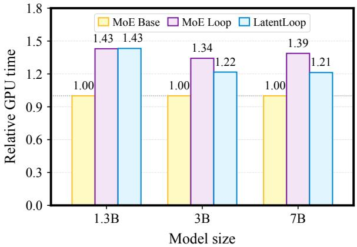  
Figure 7 | GPU time normalized to MoE Base at each model size. GPU time is elapsed training time multiplied by GPU count.

Training time measurement. Figure 7 uses the longest stable mainline for each method and tier. We multiply elapsed time by GPU count and normalize by MoE Base at the same tier. The timer starts immediately before the optimizer loop and includes validation and checkpoint writes through completion. It excludes initialization, qualification, queue waits, and post-run checkpoint auditing. Resumed mainlines combine the original prefix up to the resume point with the continuation, excluding discarded steps; a resume boundary between log samples uses interpolation of cumulative elapsed time. The 1.3B baselines use eight GPUs while LatentLoop uses 64; all 3B and 7B runs use 64 GPUs. The figure therefore measures GPU resource use, with execution dates and pools also varying across runs. Completing the full 7B scaling ladder for LatentLoop required about 35 hours on 64 NVIDIA H200 GPUs. This duration sums the active runs of its shared mainline and six annealing branches, including their qualification runs.

## C. Additional Ablations

These ablations use the 3B/40B reference setting and follow the training and budget matching protocols of the main ablations in Section 4.4.

<table><tr><td></td><td colspan="2">MoE</td></tr><tr><td>Attention</td><td>Shared</td><td>Untied</td></tr><tr><td>Shared</td><td>2.0237</td><td>2.0348</td></tr><tr><td>Untied</td><td>2.0199</td><td>2.0340</td></tr><tr><td>References</td><td></td><td></td></tr><tr><td>MoE Base</td><td></td><td>2.0426</td></tr><tr><td>MoE Loop</td><td></td><td>2.0293</td></tr></table>

Table 12 | Attention and MoE sharing (validation NLL).

<table><tr><td></td><td colspan="2">Second visit</td></tr><tr><td>First visit</td><td>Full</td><td>Latent</td></tr><tr><td>Full</td><td>2.0293</td><td>2.0386</td></tr><tr><td>Latent</td><td>2.0199</td><td>2.0467</td></tr></table>

Table 13 | Validation NLL by latent position. Full/full is MoE Loop; the three latent variants use independent attention blocks.

Attention and MoE sharing. Table 12 compares the four attention and MoE sharing choices, using the final LatentLoop configuration for shared MoE and independent attention. All use the same mean encoder and learned writeback, with model width and attention dimensions fixed; expert counts and training steps are adjusted to match the budgets. LatentLoop gives the lowest NLL, at 2.0199, compared with 2.0237 for full sharing. Untying MoE gives higher NLL whether attention is shared (2.0348) or independent (2.0340). Separate MoE routers and expert weights consume much more of the parameter budget: matching it reduces the expert count per pool from 76 to 51 with shared attention, and from 75 to 50 with independent attention. These results favor allocating the parameter budget to larger expert pools reused across visits, while giving attention independent projections at a small additional parameter cost.

Latent position. Table 13 compares the four choices of full or latent resolution across the two visits, using MoE Loop as the full/full reference. The three configurations with compression share MoE routers and experts while retaining independent attention blocks. Each compressed visit uses � = 2, mean aggregation, and the scaled decoder. When both visits are compressed, each independently encodes the current full sequence and writes its increment back before the next visit; the two writebacks share the same writeback coeficients.

Compressing only the first visit gives the lowest NLL, at 2.0199. Moving compression to the second visit increases NLL to 2.0386, despite identical parameter counts, KV storage, FLOPs per step, and training updates. Compressing both visits gives 2.0467, even though budget matching increases model width from 1296 to 1440. Thus, the additional width does not compensate for compressing the second visit in this setting. The full/full control with independent attention blocks also outperforms both variants that compress the second visit, at 2.0319 (Table 5). These comparisons support our asymmetric allocation: reducing computation in the first visit while retaining full resolution in the second.

<table><tr><td>Configuration</td><td>NLL↓</td></tr><tr><td>Baselines</td><td></td></tr><tr><td>MoE Base</td><td>2.0426</td></tr><tr><td>MoE Loop</td><td>2.0293</td></tr><tr><td>LatentLoop variants</td><td></td></tr><tr><td>k = 2 (ours)</td><td>2.0199</td></tr><tr><td> $k = 3$ </td><td>2.0257</td></tr><tr><td> $k = 4$ </td><td>2.0297</td></tr><tr><td> $k = 2 ,$  one token delayed writeback</td><td>2.0269</td></tr></table>

Table 14 | Compression factor and writeback delay.

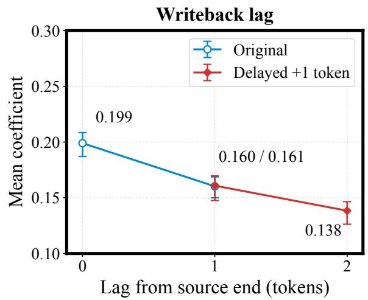  
Figure 8 | Final writeback coeficient means in the original and delayed models, aligned by distance from the source group’s last token. Whiskers show channel 25th–75th percentiles.

Compression factor and writeback delay. We next test $k = 3$ and $k = 4$ with the same two loop visits and independently matched budgets. When � does not divide the sequence length, only complete groups produce latent states; the remaining tokens are retained in the full sequence and can receive updates from the preceding group. Table 14 shows higher NLLs of 2.0257 and 2.0297, compared with 2.0199 for $k = 2$ . We believe increased writeback delay is a major reason: a latent update can only be used after its source group is complete, and larger groups increase the gap between later receiver positions and the most recent token included in their update. To test this explanation, we retain $k = 2$ and delay both receiver positions by one token, from $( 2 j , 2 j + 1 )$ to $( 2 j + 1 , 2 j + 2 )$ , with no change to the encoder, decoder design, or compute budget. NLL rises to 2.0269, supporting the importance of timely writeback even without stronger compression. This observation is consistent with SpiralFormer, which reports worse performance when an additional one token shift removes the overlap between source and receiver groups (Yu et al., 2026). Its Appendix E also discusses the resulting lag behind the full resolution stream.

Figure 8 compares the final coeficients of the original and delayed models. Delaying both receivers by one token lowers their channel means to 0.161 and 0.138, approximately 19% and 14% below the original values. In particular, the delayed model’s $w _ { 0 }$ mean of 0.161 is close to the original model’s $w _ { 1 }$ mean of 0.160. Both receivers lie one token after the source pair’s final token, despite occupying diferent decoder slots. This agreement links the learned writeback strength to how recent the information in the latent update is: updates from more distant context receive smaller weights. It provides further support for our interpretation that delayed updates are less well aligned with the receiver’s current context.

## D. Comparison with SpiralFormer

We compare our largest LatentLoop model against the largest dense SpiralFormer-L model. Both studies use lm-evaluation-harness (Gao et al., 2024) to evaluate the same nine benchmarks under 0-shot and 5-shot settings. Because SpiralFormer’s implementation was not publicly available, we quote the task scores reported in Appendix H, Table 3 of Yu et al. (2026). Table 15 presents the system comparison. The systems use diferent training data, tokenizers, training budgets, and other

<table><tr><td>Shot</td><td>Params</td><td>Token</td><td>Model</td><td>LD-0</td><td>LD-S</td><td>HS</td><td>PIQA</td><td>WG</td><td>ARC-E</td><td>ARC-C</td><td>SciQ</td><td>MMLU</td><td>Avg</td></tr><tr><td>5-shot</td><td>1.4B /1.4B</td><td>250B</td><td>SpiralFormer-L</td><td>46.32</td><td>45.29</td><td>51.66</td><td>70.51</td><td>59.51</td><td>60.61</td><td>31.91</td><td>93.20</td><td>30.35</td><td>54.37</td></tr><tr><td></td><td>7B/1B</td><td>140B</td><td>LatentLoop</td><td>49.21</td><td>45.92</td><td>68.44</td><td>76.33</td><td>63.93</td><td>79.55</td><td>51.71</td><td>96.20</td><td>39.35</td><td>63.40</td></tr><tr><td>0-shot</td><td>1.4B /1.4B</td><td>250B</td><td>SpiralFormer-L</td><td>52.86</td><td>46.69</td><td>50.88</td><td>69.64</td><td>56.43</td><td>50.59</td><td>28.75</td><td>80.70</td><td>29.24</td><td>51.75</td></tr><tr><td></td><td>7B/1B</td><td>140B</td><td>LatentLoop</td><td>54.92</td><td>45.22</td><td>66.91</td><td>75.68</td><td>62.59</td><td>74.20</td><td>46.50</td><td>90.40</td><td>37.69</td><td>61.57</td></tr></table>

Table 15 | System comparison on downstream benchmarks (%). Params denote approximate total/active parameter counts. Benchmark abbreviations follow Table 2; Avg is the unweighted mean of the nine scores.  
implementation details, which can also contribute to the observed diferences.

## E. Full Scaling Results

Table 16 reports validation NLL across the 45 model and budget configurations considered in Section 4.2. Each value is measured on the same fixed 0.1B token validation set. Token budgets are reference budgets; actual token counts are adjusted to match total training FLOPs across methods. LatentLoop achieves the lowest NLL at all 15 matched budgets.

<table><tr><td>Params</td><td></td><td>Tokens MoE Base MoE Loop</td><td></td><td>LatentLoop</td></tr><tr><td rowspan="4">1.3B</td><td>5B</td><td>2.4093</td><td>2.4105</td><td>2.3979</td></tr><tr><td>10B</td><td>2.3026</td><td>2.3004</td><td>2.2863</td></tr><tr><td>20B</td><td>2.2201</td><td>2.2161</td><td>2.2022</td></tr><tr><td>40B</td><td>2.1572</td><td>2.1519</td><td>2.1393</td></tr><tr><td rowspan="6">3B</td><td>5B</td><td>2.3157</td><td>2.3077</td><td>2.2971</td></tr><tr><td>10B</td><td>2.2010</td><td>2.1910</td><td>2.1805</td></tr><tr><td>20B</td><td>2.1107</td><td>2.0988</td><td>2.0894</td></tr><tr><td>40B</td><td>2.0426</td><td>2.0293</td><td>2.0199</td></tr><tr><td>70B</td><td>1.9977</td><td>1.9837</td><td>1.9771</td></tr><tr><td>5B</td><td>2.2561</td><td>2.2425</td><td>2.2336</td></tr><tr><td rowspan="4">7B</td><td></td><td></td><td></td><td></td></tr><tr><td>10B</td><td>2.1351</td><td>2.1217</td><td>2.1117</td></tr><tr><td>20B</td><td>2.0377</td><td>2.0250</td><td>2.0156</td></tr><tr><td>40B</td><td>1.9634</td><td>1.9510</td><td>1.9429</td></tr><tr><td></td><td>70B 140B</td><td>1.9135 1.8640</td><td>1.9016 1.8546</td><td>1.8950 1.8482</td></tr></table>

Table 16 | Validation NLL (↓) at all scaling endpoints. Parameter tiers denote approximate total parameter counts. The lowest NLL at each matched budget is bold.