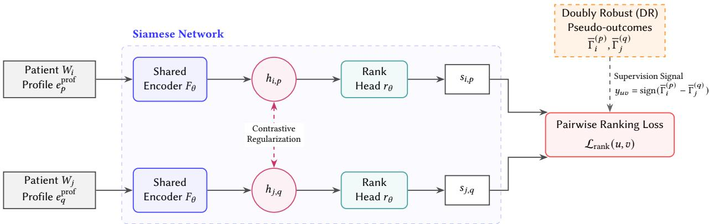

# Learning Who Benefits Most: Multi-Treatment Causal Ranking for Population Health Stratification

Rocco Zaccagnino Martina Girolamo Delfina Malandrino

Alessia Ture   
rzaccagnino@unisa.it   
m.girolamo1@studenti.unisa.it   
dmalandrino@unisa.it   
ature@unisa.it   
University of Salerno   
Salerno, Italy Alberto Lombardi   
Alberto.Lombardi@aslbenevento.it   
Local Health Authority of Benevento Benevento, Italy

Donatello Telesca dtelesca@g.ucla.edu University of California, Los Angeles Los Angeles, USA

## Abstract

Population health stratification frameworks, such as those defined by the Italian DM77, organize patients according to their level of clinical need and associated care pathways. However, they remain largely descriptive and provide limited practical guidance: although they distinguish among diferent levels of complexity, they do not indicate which changes in care should be prioritized when health care resources are constrained.

We present PROMETHEUS (Proactive Resource Optimization through Multi-treatment Efect-based Targeting in Healthcare Environments Using Stratification), a framework that reformulates population health stratification as a multi-treatment causal ranking problem. Under capacity constraints, the main objective is not to obtain a perfectly calibrated treatment-efect estimate for every patient, but to preserve the relative ordering of care opportunities according to their expected outcome. PROMETHEUS therefore focuses on identifying which patient-care treatments should be prioritized over others.

In a single-treatment setting, each treatment, i.e., a specific level of care, would be studied as an independent binary decision: whether or not to intensify care for patients eligible for that specific treatment. In PROMETHEUS, instead, each clinically admissible treatment is treated separately, and all treatments across the stratification pathway are learned jointly. This multi-treatment formulation allows eligible patient-treatment opportunities to be compared on a common scale of expected clinical benefit rather than ranked only within a single treatment. For each treatment, the framework estimates the expected benefit, i.e., the outcome, of moving a patient to a more intensive care profile rather than maintaining the current pathway. This benefit can be measured as avoidable hospital admissions, emergency-department use, disease progression, or a composite clinical measure.

The proposed model ranks patients according to their relative causal outcomes using a Siamese contrastive neural network. The network learns similar representations for treatments associated with comparable causal efects, while separating those that yield substantially diferent benefits. This formulation facilitates information sharing across related care transitions and produces a consistent priority ranking across patients and levels of care.

Our results show that the resulting population stratification preserves alignment with the levels and care pathways defined by DM77, while extending beyond conventional descriptive baselines, such as standard comorbidity indices and predictive risk models. Rather than merely describing clinical complexity or forecasting future utilization, PROMETHEUS makes stratification actionable by identifying which patients should receive a more intensive level of care first, with the goal of maximizing population-level benefit under limited capacity.

## CCS Concepts

• Computing methodologies → Learning to rank; Neural networks; • Applied computing → Health informatics; Decision analysis.

## Keywords

Causal Ranking, Multi-Treatment Causal Inference, Heterogeneous Treatment Efects, Population Health Stratification, Healthcare Resource Allocation, Contrastive Learning

## 1 Introduction

Population aging, multimorbidity, and workforce shortages are increasing pressure on health and long-term care systems [6, 10, 26]. Patients with multiple chronic conditions often require coordinated and resource-intensive services, such as case management, home monitoring, specialist coordination, and transitional care [23]. Because these services cannot be delivered to the entire population with the same intensity [30], healthcare systems must determine not only which needs exist, but also how limited care capacity should be distributed across eligible patients.

Population health stratification supports this task by grouping individuals according to morbidity, vulnerability, clinical complexity, and expected healthcare utilization, linking these profiles to diferentiated, tiered care pathways [7, 9]. This shift toward proactive, community-based care is a global priority, operationalized through frameworks such as Accountable Care Organizations and Patient-Centered Medical Homes in the United States, or Integrated Care Systems within the UK National Health Service. In Italy, this international paradigm is formally codified by Ministerial Decree No.77/2022 (DM77), which establishes the regulatory framework for territorial healthcare. DM77 establishes population stratification as a core organizational principle for identifying heterogeneous clinical needs and structuring progressively diferentiated levels of care [22], making it the primary operational testbed for our framework.

Structural frameworks are routinely complemented by descriptive case-mix and predictive population-stratification systems. An example is the Johns Hopkins Adjusted Clinical Groups (ACG) system, which characterizes individuals according to their longitudinal morbidity patterns and expected healthcare needs and resource utilization. Other widely used approaches include standard clinical metrics, such as the Charlson and Elixhauser comorbidity indices, the CMS Hierarchical Condition Categories, and machine-learning risk scores, which use demographic, diagnostic, pharmacy, and utilization data to estimate morbidity burden, future expenditure, or adverse-outcome risk [3, 8, 12, 32]. These descriptive systems are valuable for identifying clinically complex or high-risk patients, but capacity-constrained allocation requires answering a fundamentally diferent question: which eligible patients are expected to benefit the mostfrom a more intensive care profile?

Predicted risk and expected treatment benefit are distinct. A patient at high risk of hospitalization may have a largely nonmodifiable trajectory and derive limited additional benefit from intensive case management, whereas a patient at moderate risk may respond more favorably to early treatment, remote monitoring, or transitional care [16, 21]. Risk-based allocation may therefore conflate clinical need, reflecting disease burden and essential care requirements, with clinical actionability, reflecting the expected benefit of a specific treatment [19, 27].

We adopt a causal perspective in which each clinically admissible care profile represents a distinct treatment option. For an eligible patient, treatment consists of assignment to a specific profile that is more intensive than the current care pathway, while maintenance of the current pathway serves as the comparison condition. Because a patient may be eligible for multiple profiles, the same patient can generate several candidate treatment opportunities, each corresponding to a diferent potential transition in care.

The outcome is defined as a health event measured over a fixed follow-up horizon, such as 6 or 12 months. Relevant outcomes may include hospitalization, emergency department use, mortality, dis ease progression, or healthcare utilization. The outcome is oriented so that larger values consistently represent greater benefit, for example through a reduction in hospitalizations, and is defined on a common clinical scale across all candidate treatments. This common definition is necessary for comparing the expected benefits of diferent care-profile assignments.

Rather than seeking precisely calibrated treatment-efect estimates for every patient and every profile, our objective is to determine which patient–treatment opportunities are expected to produce relatively larger improvements compared with maintenance of the current pathway.

Under strict capacity constraints, the key operational requirement is often the relative ordering of these opportunities: patient– treatment pairs associated with larger expected benefits should receive priority over those associated with smaller benefits. This motivates causal ranking, which aims to preserve the ordering induced by heterogeneous treatment efects without requiring perfectly calibrated individual efect estimates [2].

Most existing causal ranking formulations consider a single binary treatment and therefore rank patients according to their expected benefit from one intervention. Population health stratification presents a more general setting: several clinically admissible care profiles may be available, and both patients and treatment options must be prioritized. Training an independent ranking model for each profile would produce treatment-specific orderings whose scores are not necessarily comparable, even when the corresponding services compete for the same financial, technological, or workforce resources. We therefore formulate population health stratification as a multi-treatment causal ranking problem, in which eligible patient–profile assignments are jointly ordered according to their expected incremental benefit.

The unit of prioritization is consequently a patient–treatment opportunity: the possibility of assigning an eligible patient to a specific care profile. Because all opportunities are evaluated with respect to a common outcome, follow-up horizon, direction of benefit, and measurement scale, their treatment-specific efects can be represented within a shared global ordering. This enables prioritization both among patients competing for the same profile and among diferent profiles competing for shared resources.

To this aim, we introduce PROMETHEUS, a framework for learning a globally comparable ordering of patient–profile opportunities. Its causal supervision is constructed separately for each candidate care profile through cross-fitted doubly robust pseudo-outcomes. For an eligible patient (i) and profile (p), this pseudo-outcome provides a noisy estimate of the incremental benefit of assigning the patient to (p), relative to maintaining the current care pathway. These quantities are not interpreted as final individualized treatment-efect estimates. Instead, they define the causal signal on which the ranking problem is based: when the estimated benefit associated with one opportunity is suficiently larger and more reliable than that associated with another, the corresponding pair provides evidence about their relative priority.

PROMETHEUS learns this ordering through a Siamese ranking network. Two patient-profile opportunities are processed by identical branches with shared parameters, producing scores on a common scale. Their score diference is trained to agree with the ordering induced by the doubly robust causal signals.

The shared representation can be initialized through contrastive pretraining. During this stage, opportunities associated with similar and suficiently stable causal signals are encouraged to have nearby latent representations, whereas opportunities with clearly diferent expected benefits are separated. This initialization gives the Siamese ranker a representation organized around causal-response similarity before the direct pairwise-ranking objective is optimized.

We evaluate PROMETHEUS through a controlled synthetic benchmark and a semi-synthetic study built on pseudonymized administrative data from ASL Benevento. The synthetic benchmark provides complete causal and operational ground truth. The ASL study preserves real population, diagnosis, and utilization structure while simulating assignments and outcomes. Both settings are preclinical: they test the method and its failure modes, not the real clinical efectiveness of DM77-aligned services.

To promote transparency and reproducibility, we provide the source code for PROMETHEUS, including the data-processing pipeline, causal-estimation workflow, model implementation, and evaluation scripts.1

## 2 Related Work

PROMETHEUS connects population-health stratification, heterogeneous treatment-efect estimation, learning to rank, and constrained allocation. DM77-aligned levels, case-mix systems, comorbidity in dices, and risk models describe need or prognosis, but they do not estimate which candidate service is most beneficial for the same patient [3, 12, 22]. Recent work has also explored causal-temporal representation learning for modeling comorbidity progression risk from longitudinal primary-care data [34]. Such approaches improve the representation of patient trajectories and disease progression, but address a prognostic objective rather than the comparative prioritization of clinically admissible patient–profile opportunities. Historical risk-based allocation can also reproduce unequal access when past utilization reflects barriers rather than need [25].

Causal forests, meta-learners, orthogonal estimators, and neural causal models estimate heterogeneous responses to interventions [4, 13, 17, 18, 24, 28, 29]. Multi-task models share information across related interventions [1, 20]. In contrast to methods centered on numerical efect estimation, our target is an ordinal priority score over patient–profile opportunities.

Uplift modeling and causal ranking methods directly optimize the ordering of intervention benefit [2, 11, 15, 31, 33]. Most consider one intervention contrast at a time. Policy-learning methods can optimize multi-action assignments under a fixed objective and resource configuration [5, 14, 36]. PROMETHEUS instead learns one reusable ordering across comparable profile-specific contrasts and applies the operational constraints afterward.

Contrastive causal methods have mainly been used to improve balance, outcome prediction, or treatment-efect representations [35, 37]. Here, contrastive learning serves a diferent role: it provides an initial representation before direct ranking.

## 3 Problem Formulation

We formalize population-health stratification as a multi-treatment causal ranking problem. The framework separates three questions that are often combined in conventional stratification systems: how much clinical and care support a patient needs, which admissible care profile is expected to provide the largest incremental benefit, and which recommended services can be activated with the available resources. The formulation proceeds in two steps. We first define the patient information, care profiles, eligibility rules, and profile-specific causal targets. We then define the global rank ing objective and show how the learned ordering is converted into patient-level recommendations and capacity-constrained al locations. Throughout the formulation, clinical eligibility remains governed by external rules, while the learned model is used only to prioritize opportunities that are already considered clinically admissible

## 3.1 Decision Space and Causal Targets

We consider a population-health planning cycle at a predefined index date where the dataset can be written as $\mathcal { D } = \{ X _ { i } , C _ { i } , A _ { i } , Y _ { i } \} _ { i = 1 } ^ { n } .$ For patient �, let $X _ { i }$ denote the demographic, clinical, functional, pharmaceutical, social, and prior-utilization covariates, and let $C _ { i }$ denote the care pathway currently received. The observed treatment is $A _ { i } \in { 0 \cup \mathcal { S } }$ , where 0 denotes maintenance of the current pathway and $\mathcal { P } = 1 , \ldots ,$ � is the set ofcandidate care treatments. These treatments may include, for example, remote monitoring, transitional care, home-based support, or multidisciplinary case management. The outcome �� is measured over a prespecified follow-up horizon and is defined so that larger values represent a more favorable clinical result.

Diferent treatments can be included in the same global ranking only when their expected benefits have the same clinical interpretation. In particular, they must be evaluated against the same reference treatment and use the same outcome definition, follow-up horizon, measurement unit, and direction of benefit. Treatments that pursue substantially diferent clinical objectives belong to separate comparability domains and are not ranked against one another. The formal comparability conditions are reported in Appendix A.

A separate descriptive module produces a baseline need level, $\widehat { L } _ { i } ^ { \mathrm { n e e d } } = \widehat { f } _ { \phi } ( X _ { i } ^ { \mathrm { n e e d } } )$ , where $f _ { \phi }$ may be a rule-based system, an ordinal model, an existing stratification tool, or a hybrid procedure. The resulting level summarizes the patient’s clinical and care complexity and is retained as a distinct output for population stratification and reporting. It may also be used as contextual information by the downstream causal model, but it neither estimates treatment benefit nor determines which profile should be prioritized. Current care is excluded as a direct predictor to avoid inferring need merely from the service already received.

Before a treatment can be ranked, the framework determines whether it is clinically admissible for the patient. For each candidate treatment ${ \boldsymbol { p } } ,$ let $g _ { p }$ denote the set of externally defined clinical and organizational rules associated with that treatment. These rules consider the patient’s pre-decision characteristics $X _ { i } ,$ the current care pathway $C _ { i }$ , and the estimated baseline need level $\widehat { L } _ { i } ^ { \mathrm { n e e d } }$

The admissibility indicator is $E _ { i } ^ { ( p ) } = g _ { p } \left( X _ { i } , C _ { i } , \widehat { L } _ { i } ^ { \mathrm { n e e d } } \right)$ , where

$E _ { i } ^ { ( p ) } = \left\{ { 1 , } \atop { 0 , } \right.$ if treatment � may be considered for patient �, otherwise.

The set $\mathcal { P } _ { i } ^ { \mathrm { a d m } } = \left\{ { p \in \mathcal { P } : E _ { i } ^ { ( \mathcal { P } ) } = 1 } \right\}$ therefore contains all candidate treatments that satisfy the required eligibility criteria for patient �.

For example, remote monitoring may require a chronic condition suitable for home monitoring, while transitional care may require a recent hospitalization or discharge. A treatment may also be excluded because of a contraindication, an unmet prerequisite, or incompatibility with the current care pathway.

The rules represented by $g _ { P }$ are specified outside the ranking model by clinical and organizational governance. The model does not learn whether a patient is eligible and does not compare treatments that have already been excluded by these rules. It only assigns priority scores to the admissible patient–treatment opportunities. Consequently, a high ranking score cannot create eligibility, remove a contraindication, or replace professional judgment.

The decision unit is a patient–profile opportunity $u = ( i , p )$ with $p \in \mathcal { P } _ { i } ^ { \mathrm { a d m } }$ . One patient may generate several opportunities because several services may be clinically admissible. These opportunities can difer in expected benefit, cost, and resource use. For this reason, one generic patient-level risk score cannot fully describe the decision. Let $D _ { i } ^ { ( p ) } = \mathbb { I } ( A _ { i } = p )$ in the eligible population receiving either profile $\mathcal { P }$ or maintenance, and let $W _ { i } = ( X _ { i } , C _ { i } , \widehat { L } _ { i } ^ { \mathrm { n e e d } } )$ . The profile-specific target is

$$
\tau _ { \mathcal { P } } ( w ) = \mathbb { E } \left[ Y _ { i } ^ { ( p ) } - Y _ { i } ^ { ( 0 ) } \mid W _ { i } = w , E _ { i } ^ { ( p ) } = 1 \right] .\tag{1}
$$

It is the expected improvement from activating profile � rather than maintaining the current pathway for eligible patients with state �. Identification requires profile-specific consistency, conditional exchangeability, positivity, and an appropriate interference assump tion. Clinical eligibility alone does not guarantee that the contrast is supported by the observed data. Appendix A gives the complete identification conditions.

## 3.2 Global Ranking, Recommendation, and Allocation

The learning target is a shared score $s _ { i , p }$ over admissible and supported opportunities. For comparable opportunities $u = ( i , p )$ and $v = ( j , q )$ , the desired ordering is

$$
\tau _ { \rlap / p } ( W _ { i } ) > \tau _ { q } ( W _ { j } ) \quad \Longrightarrow \quad s _ { i , p } > s _ { j , q } .\tag{2}
$$

The term global refers to three comparison domains. Withinprofile comparisons rank patients competing for the same service; within-patient comparisons rank alternative admissible services for the same patient; and cross-profile comparisons rank opportunities involving diferent patients and diferent services. Cross-profile comparisons connect the profile-specific orderings into a single population-level priority axis.

Cross-profile supervision is used only when the profiles belong to the same comparability domain and both opportunities have adequate empirical support. Without this condition, separate profilespecific rankings would not provide a valid basis for allocating shared resources.

The ranker assigns a priority score $s _ { i , p }$ to each admissible patient– treatment opportunity. This score is initially used only to order the opportunities: a higher value indicates that treatment � is expected to provide a larger benefit for patient � than an opportunity receiving a lower score. However, the numerical value of the score has no direct clinical interpretation.

A separate calibration step is therefore applied on an independent calibration set: $\widehat { b } _ { i , p } = h ( s _ { i , p } )$ , where $h _ { p }$ is a monotone function fitted for treatment $\mathcal { P } \cdot$ Monotonicity ensures that the ordering learned by the ranker is preserved: if one opportunity has a higher score than another, calibration cannot reverse their priority. The calibrated quantity $\widehat { b } _ { i , p }$ provides an approximate benefit scale that can be compared with the minimum-benefit threshold and used by the allocation optimizer. It remains a model-based estimate under the causal assumptions and is not presented as an observed or precisely identified individual treatment efect.

For each patient, the recommendation layer selects the supported admissible profile with the largest calibrated benefit above a minimum threshold. When no profile exceeds the threshold, the current pathway is maintained. When no profile has adequate empirical support, the model abstains and sends the case to professional review.

The allocation layer then chooses among positive recommendations under the available capacities. Let $Z _ { i , p } = 1$ indicate that recommended profile � is activated for patient �. The objective is

$$
\operatorname* { m a x } _ { Z } \sum _ { i } \sum _ { p \in \mathcal { P } _ { i } ^ { \mathrm { s u p } } } Z _ { i , p } \widehat { b } _ { i , p } ,\tag{3}
$$

subject to recommendation consistency, mutual exclusivity, profile capacity, shared resources, budget, geography, and organizational rules. A recommended profile may therefore remain unallocated when capacity is unavailable. The patient is recorded as operationally deferred; the need level, eligibility, and recommendation do not change. Appendix A gives the compact formal rules.

## 4 PROMETHEUS Framework

PROMETHEUS uses profile-specific causal signals to learn a priority ordering over clinically admissible patient–profile opportunities.

PROMETHEUS first constructs profile-specific doubly robust causal signals through cross-fitted nuisance models. These signals supervise a Siamese ranking network, which assigns comparable priority scores to patient–profile opportunities by learning from pairwise diferences in expected benefit. Reliability checks filter or downweight comparisons that are weakly supported or dominated by estimation noise. The resulting scores are then converted into patientlevel recommendations and integrated with resource constraints to obtain a feasible allocation. A contrastive pretraining step initializes the shared encoder by organizing opportunities according to the similarity of their causal signals. Figure 1 summarizes this pipeline.

## 4.1 Cross-Fitted Causal Supervision

For profile ${ \boldsymbol { p } } ,$ let $e _ { \phi } ( w ) = \mathrm { P r } ( D _ { i } ^ { ( p ) } = 1 \mid W _ { i } = w , E _ { i } ^ { ( p ) } = 1 )$ be the propensity score and $\mu _ { \mathcal { P } , d } ( w ) = \mathbb { E } [ Y _ { i } \mid D _ { i } ^ { ( \mathcal { P } ) } = d , W _ { i } = w , E _ { i } ^ { ( \mathcal { P } ) } = 1 ]$ be the outcome regressions. The doubly robust pseudo-outcome is defined as:

$$
\begin{array} { r l } & { \Gamma _ { i } ^ { ( p ) } = \widehat { \mu } _ { p , 1 } ( W _ { i } ) - \widehat { \mu } _ { p , 0 } ( W _ { i } ) } \\ & { \quad \quad + \frac { D _ { i } ^ { ( p ) } [ Y _ { i } - \widehat { \mu } _ { p , 1 } ( W _ { i } ) ] } { \widehat { e } _ { p } ( W _ { i } ) } - \frac { \left( 1 - D _ { i } ^ { ( p ) } \right) [ Y _ { i } - \widehat { \mu } _ { p , 0 } ( W _ { i } ) ] } { 1 - \widehat { e } _ { p } ( W _ { i } ) } . } \end{array}\tag{4}
$$

Nuisance predictions are generated out-of-fold at the patient level to prevent data leakage across profiles. Cross-fitting is repeated over multiple split/initialization runs: the mean $\overline { { \Gamma } } _ { i } ^ { \left( p \right) }$ acts as the causal supervision signal. Under the assumptions in Appendix A, $\mathbb { E } [ \Gamma _ { i } ^ { ( \boldsymbol { p } ) } ]$ ] equals the target in Eq. (1). Individual pseudo-outcomes remain noisy and are not treated as deterministic individual efects.

Additionally, this stage records propensity support, treatment prevalence, efective sample size, residual magnitude, and crossfitting instability to identify reliable comparisons and candidate recommendations.

  
Figure 1: The PROMETHEUS multi-treatment causal ranking architecture. Admissible patient-profile opportunities $( u , v )$ are processed by a shared Siamese encoder $F _ { \theta } .$ . The latent representations ℎ are organized via uncertainty-aware contrastive pretraining based on their estimated causal responses. A ranking head $r _ { \theta }$ outputs priority scores �, optimized through a pairwise ranking loss $\mathcal { L } _ { \mathrm { r a n k } }$ supervised by cross-fitted doubly robust pseudo-outcomes.

## 4.2 Reliability-Aware Pair Construction

The ranking model is trained on pairs of patient–intervention opportunities. To filter out comparisons dominated by nuisance estimation noise, we evaluate the signal diference $d _ { u v } = \left| \overline { { \Gamma } } _ { u } - \overline { { \Gamma } } _ { v } \right|$ against the combined instability $r _ { u v } = \sqrt { \sigma _ { u } ^ { 2 } + \sigma _ { v } ^ { 2 } + \epsilon }$ . The ratio $z _ { u v } = d _ { u v } / r _ { u v }$ measures signal separation relative to estimation noise.

A pair of opportunities $u = ( i , p )$ and $\upsilon = ( j , q )$ is retained for ranking $( M _ { u v } ^ { \mathrm { p a i r } } = 1 )$ only when three binary conditions are satisfied:

$$
M _ { u v } ^ { \mathrm { p a i r } } = M _ { u v } ^ { \mathrm { c o m p } } M _ { u v } ^ { \mathrm { s u p } } \mathbb { I } \{ z _ { u v } \geq \kappa \} .
$$

Here, $M _ { u v } ^ { \mathrm { c o m p } } = 1$ indicates that both opportunities belong to the same comparability domain, $M _ { u v } ^ { \mathrm { s u p } } = 1$ ensures suficient overlap, treatment prevalence, and efective sample size, and $\mathbb { I } \{ z _ { u v } \ge \kappa \} = 1$ enforces a standardized separation above threshold �.

Pairs with $M _ { u v } ^ { \mathrm { p a i r } } = 0$ are excluded from training. For retained pairs, the ordering target is $y _ { u v } = \mathrm { s i g n } \left( \overline { { \Gamma } } _ { u } - \overline { { \Gamma } } _ { v } \right)$ , indicating which opportunity yields higher estimated benefit. Retained pairs are also assigned a reliability weight $\omega _ { u v }$ based on causal separation and overlap metrics, controlling their relative influence in the loss function.

Pair construction relies strictly on the ranker-training partition; pseudo-outcomes from validation, calibration, or test sets are never used. Detailed support criteria and weighting definitions are provided in Appendix B.

## 4.3 Network Architecture and Two-Stage Training

Each opportunity $u \ = \ ( i , p )$ is input as $x _ { i , p } ~ = ~ \left[ W _ { i } \parallel e _ { p } ^ { \mathrm { i n t } } \right]$ , concatenating pre-decision patient features $W _ { i } = ( X _ { i } , C _ { i } , \widehat { L } _ { i } ^ { \mathrm { n e e d } } )$ with a learned intervention embedding $e _ { \boldsymbol { p } } ^ { \mathrm { i n t } }$

A shared encoder maps this input to a latent vector $h _ { i , p } ~ =$ $F _ { \theta } ( x _ { i , p } )$ , which a ranking head converts into a scalar priority score $s _ { i , p } = r _ { \psi } ( h _ { i , p } )$ . Architectural details are reported in Appendix F.

Stage 1: Contrastive representation pretraining. To initialize the encoder, let $C ^ { + }$ contain reliable pairs with similar causal signals, and $C ^ { - }$ contain reliable pairs with clearly distinct signals (unstable pairs are omitted). With latent distance $d _ { u v } ^ { h } = \| h _ { u } - h _ { v } \| _ { 2 }$ , the pretraining objective is:

$$
\begin{array} { l } { \displaystyle \mathcal { L } _ { \mathrm { p r e } } = \frac { 1 } { | C ^ { + } | } \sum _ { ( u , v ) \in C ^ { + } } \eta _ { u v } \left( d _ { u v } ^ { h } \right) ^ { 2 } } \\ { \displaystyle \qquad + \frac { 1 } { | C ^ { - } | } \sum _ { ( u , v ) \in C ^ { - } } \eta _ { u v } \left[ m - d _ { u v } ^ { h } \right] _ { + } ^ { 2 } + \lambda _ { \mathrm { p r e } } \mathcal { R } _ { \mathrm { p r e } } ( \theta ) , } \end{array}\tag{5}
$$

where � $> 0$ is the separation margin, $[ a ] _ { + } = \operatorname* { m a x } ( 0 , a )$ , and $\eta _ { u v }$ is a reliability weight pulling similar representations together and pushing distinct ones apart up to margin �.

Stage 2: Global ranking fine-tuning. Using the retained pairs and ordering labels $y _ { u v } ,$ the pairwise loss for a pair (�, �) is:

$$
\ell _ { \mathrm { r a n k } } ( u , v ) = \omega _ { u v } \log \left[ 1 + \exp \left\{ - y _ { u v } ( s _ { u } - s _ { v } ) \right\} \right] .
$$

Let $\mathcal { K } =$ {within-intervention, within-patient, cross-intervention} denote the pair types. The normalized loss for category � is:

$$
\mathcal { L } _ { \mathrm { r a n k } } ^ { ( k ) } = \frac { \sum _ { ( u , v ) \in \mathcal { B } _ { k } } M _ { u v } ^ { \mathrm { p a i r } } \ell _ { \mathrm { r a n k } } ( u , v ) } { \sum _ { ( u , v ) \in \mathcal { B } _ { k } } M _ { u v } ^ { \mathrm { p a i r } } + \epsilon } ,
$$

where $\mathcal { B } _ { k }$ is the set of sampled pairs of type �. The complete finetuning objective balances all pair types:

$$
\mathcal { L } _ { \mathrm { f i n a l } } = \sum _ { k \in \mathcal { K } } \alpha _ { k } \mathcal { L } _ { \mathrm { r a n k } } ^ { ( k ) } + \lambda _ { \mathrm { r e g } } \mathcal { R } _ { \mathrm { r a n k } } ( \theta , \psi ) .\tag{6}
$$

Normalizing each category separately ensures that the larger volume of cross-patient pairs does not dominate training.

The overall model optimization follows the sequential scheme: $\mathcal { L } _ { \mathrm { p r e } }  \mathcal { L } _ { \mathrm { f i n a l } }$ . After pretraining, $F _ { \theta }$ and $r _ { \psi }$ are fine-tuned using Eq. (6) alone, as joint optimization yielded no additional benefit in ablation experiments.

## 5 Experimental Setup

We evaluate the complete PROMETHEUS pipeline across synthetic and ASL semi-synthetic settings. The synthetic benchmark provides full causal and operational ground truth, whereas the ASL study preserves the heterogeneity of a real healthcare population under locked simulated mechanisms. Oracle quantities are used only for final evaluation after freezing the non-oracle pipeline.

## 5.1 Evaluation Settings

Synthetic Benchmark. The synthetic benchmark generates the complete population-health decision problem. For each patient, it includes pre-decision covariates, the current care pathway, a DM77- aligned baseline-need level, intervention-specific eligibility, nonrandom treatment assignment, heterogeneous potential outcomes, resource costs, service capacities, and oracle recommendations and allocations.

Six discretionary care interventions are considered. Each inter vention is evaluated against maintenance of the current pathway using the same outcome: hospital-free days over a 365-day followup period. A protected palliative pathway is generated separately but excluded from the global ranking because it pursues a diferent clinical objective and therefore belongs to a separate comparability domain. The benchmark contains 14 prespecified scenarios. The identifiable baseline is the main setting and satisfies the required causal assumptions by construction. The remaining scenarios modify specific aspects of the problem, including need–care alignment and mismatch, unmet need, over-intensive care, risk–benefit alignment and misalignment, absence ofshared response patterns, strong observed confounding, hidden confounding, poor overlap, null and placebo outcomes, capacity scarcity, and heterogeneous intervention costs.

The scenarios are analyzed separately rather than averaged into a single score because they test diferent properties of the framework. Poor-overlap and hidden-confounding settings examine failures of causal identification. Null and placebo settings test whether the system abstains when no beneficial response exists. Capacity-scarcity and heterogeneous-cost settings preserve the causal response structure while modifying the operational allocation problem.

ASL Benevento Semi-Synthetic Study. The ASL study is constructed from pseudonymized administrative data describing 270,533 unique assisted individuals. The available sources include the assisted population registry, hospitalization records, diagnosis records, and exemption records. These sources are linked to construct one patientlevel record containing demographic characteristics, exemption status, prior hospital use, morbidity proxies, frailty proxies, and indicators of administrative care complexity.

The application index date is December 31, 2025. Only information recorded before this date is included among the learner-facing covariates. After data cleaning and application of the age, activity, and temporal requirements, 230,525 adults were available for sampling. Each experimental run samples 30,000 individuals from this population.

The real covariate matrix is combined with three prespecified semi-synthetic response scenarios. In the partially aligned scenario, prognostic risk and incremental benefit share part of their structure, while additional profile-specific heterogeneity prevents them from inducing the same ordering. In the risk–benefit misaligned scenario, patients with greater prognostic risk are not necessarily those expected to obtain the largest incremental benefit, testing whether the framework can distinguish prediction of adverse outcomes from causal prioritization. Finally, the mixed-response scenario introduces more heterogeneous profile-specific responses, including a larger proportion of neutral and harmful efects.

All three scenarios preserve the same real covariate structure but generate diferent treatment assignments, potential outcomes, and profile-specific incremental benefits. They are evaluated separately because they represent increasingly dificult relationships between prognostic risk and causal response.

The partially aligned scenario is used as the main ASL reference setting. In this scenario, an average of 22,176 patients per run were eligible for at least one candidate intervention. Because one patient may be eligible for multiple interventions, these patients generated an average of 50,080 admissible patient–intervention opportunities. Table 1 summarizes the source data, the resulting analytic population, and the average cohort flow across the ten partially aligned runs.

Table 1: ASL source and analytic cohort summary. Analytic counts are averages over ten partially aligned runs.
<table><tr><td>Element</td><td>Count</td></tr><tr><td>Unique assisted individuals</td><td>270,533</td></tr><tr><td>Hospitalization records</td><td>20,825</td></tr><tr><td>Diagnosis records</td><td>49,057</td></tr><tr><td>Curated exemption records</td><td>283,297</td></tr><tr><td>Adults available before sampling</td><td>230,525</td></tr><tr><td>Patients sampled per run</td><td>30,000</td></tr><tr><td>Patients with at least one admissible intervention</td><td>22,176</td></tr><tr><td>Admissible patient-intervention opportunities</td><td>50,080</td></tr></table>

The ASL semi-synthetic design preserves the observed covariate distribution and administrative heterogeneity, while treatment assignments, potential outcomes, incremental benefits, and oracle decisions are generated after the covariate matrix is fixed. The three response mechanisms represent partial risk–benefit alignment, explicit risk–benefit misalignment, and a mixed-response setting with more neutral and harmful profile-specific efects. Oracle results refer exclusively to the semi-synthetic data-generating process and must not be interpreted as estimates ofthe actual efects ofASL Benevento services. Additional data-quality and response diagnostics are reported in Appendix E.

## 5.2 Evaluation Metrics

Metrics follow the four decision layers of the framework. Baselineneed recovery is evaluated through weighted Cohen’s �, ordinal mean absolute error, and within-one-level accuracy. These quantities respectively measure ordinal agreement, the average distance from the reference level, and the proportion of predictions difering from the reference by at most one level.

Ranking quality is measured through concordance. Held-out doubly robust concordance compares the learned score ordering with pseudo-outcomes computed on held-out patients and is the primary non-oracle metric. Oracle concordance, available only in the synthetic and semi-synthetic settings after model freezing, compares the ranking with the known generated benefits. Within-intervention concordance, cross-intervention concordance, and global concordance evaluate diferent portions of the common priority ordering.

Recommendation metrics include the positive recommendation rate, oracle recommendation agreement, recommendation regret, abstention rate, and selected harm rate. Within-patient accuracy is additionally reported in the ASL study.

Allocation performance is summarized by the number of patients served, conditional deferral, allocation regret, and normalized allocated value, which compares the benefit obtained by the model with the oracle value under the same constraints. AUTOC and Value@�% are used for the restricted-capacity baseline comparison. Stability across repeated fits is evaluated through rank-score Spearman correlation and Jaccard overlap of recommended or top-ranked opportunity sets. Complete definitions are reported in Appendix C.

## 6 Results

We first evaluate the complete pipeline in the synthetic setting, then examine selected stress scenarios, the ASL semi-synthetic study, contrastive pretraining, and stability. Held-out doubly robust metrics use only observationally available signals, whereas oracle quantities are accessed only after the non-oracle pipeline has been frozen.

Table 2: Synthetic results over ten seeds. Values are means with 95% run-level bootstrap confidence intervals.
<table><tr><td>Decision layer</td><td>Metric</td><td>Estimate [95% CI]</td></tr><tr><td>Need</td><td>Weighted Cohen&#x27;s K</td><td>0.705 [0.699–0.710]</td></tr><tr><td>Need</td><td>Ordinal MAE</td><td>0.696 [0.691–0.702]</td></tr><tr><td>Need</td><td>Within-one-level accuracy</td><td>0.899 [0.896-0.902]</td></tr><tr><td>Ranking</td><td>Held-out DR within-intervention concordance</td><td>0.502 [0.494–0.509]</td></tr><tr><td>Ranking</td><td>Held-out DR cross-intervention concordance</td><td>0.546 [0.534–0.561]</td></tr><tr><td>Ranking</td><td>Held-out DR global concordance</td><td>0.538 [0.527–0.550]</td></tr><tr><td>Ranking</td><td>Oracle cross-intervention concordance</td><td>0.832 [0.816–0.849]</td></tr><tr><td>Ranking</td><td>Oracle global concordance</td><td>0.799 [0.781–0.817]</td></tr><tr><td>Recommendation</td><td>Recommendation rate</td><td>0.524 [0.497–0.549]</td></tr><tr><td>Recommendation</td><td>Oracle-intervention agreement</td><td>0.815 [0.791–0.842]</td></tr><tr><td>Recommendation</td><td>Mean recommendation regret</td><td>0.168 [0.107–0.228] days</td></tr><tr><td>Allocation</td><td>Conditional deferral rate</td><td>0.361 [0.325-0.397]</td></tr><tr><td>Allocation</td><td>Normalized allocated value</td><td>0.936 [0.915-0.953]</td></tr><tr><td>Allocation</td><td>Allocation regret</td><td>549.2 [404.7–723.3] days</td></tr></table>

Synthetic Performance. Table 2 reports the results in the synthetic setting. The need module achieved a weighted Cohen’s � of 0.705, with 89.9% of predictions within one level of the generated reference. Oracle cross-intervention and global concordance reached 0.832 and 0.799, respectively, showing that the model recovered a common ordering across interventions. The lower held-out DR concordance reflects the observation-level noise of doubly robust pseudo-outcomes. A positive intervention was recommended for 52.4% of patients, with 81.5% agreement with the oracle-best intervention. Under capacity constraints, the allocation retained 93.6% of oracle value, although 36.1% of positively recommended patients were deferred because the required capacity was unavailable.

Scenario-Level Robustness Analysis. Table 3 summarizes the main stress scenarios, while complete results are reported in Appendix D.1. Poor overlap reduced empirical support and increased abstention, whereas hidden confounding produced the largest causal degradation. Under risk–benefit misalignment, the model retained most of the oracle allocation value despite weaker correspondence between prognostic risk and incremental benefit. Capacity scarcity instead reduced allocation value while leaving ranking quality largely unchanged, separating operational constraints from ranking failure. Sharp-null and placebo scenarios produced complete abstention because no meaningful positive treatment ordering was present. Overall, the scenarios distinguish failures caused by limited support, invalid causal identification, and restricted service capacity.

Table 3: Selected synthetic stress scenarios. Support and abstention are proportions; normalized value compares the model allocation with the oracle allocation under the same constraints.
<table><tr><td>Scenario</td><td>Support</td><td>Abstention</td><td>Oracle global concordance</td><td>Normalized value</td></tr><tr><td>Poor overlap</td><td>0.798</td><td>0.630</td><td>0.734</td><td>0.949</td></tr><tr><td>Hidden confounding</td><td>1.000</td><td>0.462</td><td>0.567</td><td>0.893</td></tr><tr><td>Risk-benefit misaligned</td><td>1.000</td><td>0.490</td><td>0.681</td><td>0.975</td></tr><tr><td>Capacity scarcity</td><td>1.000</td><td>0.462</td><td>0.809</td><td>0.885</td></tr><tr><td>Sharp null</td><td>1.000</td><td>1.000</td><td>I</td><td>1.000</td></tr><tr><td>Placebo outcome</td><td>1.000</td><td>1.000</td><td></td><td>1.000</td></tr></table>

## ASL Semi-Synthetic Results.

ASL Semi-Synthetic Results. Table 4 reports the three ASL response mechanisms. In the partially aligned and risk–benefit-misaligned scenarios, oracle global concordance remained above 0.76, normalized allocation value was approximately 0.84, and selected harm remained below 1%. The mixed-response scenario was substantially harder: oracle global concordance decreased to 0.648, within-patient accuracy to 0.646, and normalized allocation value to 0.660, while selected harm increased to 11.9%. Since approximately 900 patients were served in every scenario, this reduction reflects poorer prioritization rather than fewer available service slots. Held-out DR concordance remained lower than oracle concordance because of pseudo-outcome noise. Oracle results refer only to the generated semi-synthetic mechanism and not to the actual efects of ASL Benevento services.

Contrastive Pretraining and Stability. As shown in Table 5, contrastive pretraining improved normalized allocation value in all ASL scenarios, with the largest gain in the mixed-response setting. Across repeated fits on fixed synthetic data, rank-score Spearman correlation was 0.738. Recommendation sets were highly stable, with a Jaccard similarity of 0.923, whereas top-10% opportunity overlap was lower at 0.608, indicating greater sensitivity near sharp ranking cutofs. Complete ablation and stability results are reported in Appendix D.

## 7 Discussion, Limitations, and Governance

The results support three main design choices. First, baseline need, recommendation, and allocation must remain separate. Need describes clinical and care complexity, recommendation identifies the supported intervention with the largest expected incremental benefit, and allocation determines whether it can be activated under current resources. Operational deferral must therefore not be interpreted as low need, ineligibility, or absence of expected benefit.

Table 4: ASL semi-synthetic results over ten runs per scenario. Values are means with 95% run-level bootstrap confidence intervals. Oracle quantities refer only to the generated response mechanism.
<table><tr><td>Scenario</td><td>Held-out DR global</td><td>Oracle global</td><td>Oracle cross-profile</td><td>Within-patient accuracy</td><td>Normalized value</td><td>Selected harm</td></tr><tr><td>Partially aligned</td><td>0.625 [0.616–0.633]</td><td>0.766 [0.759–0.773]</td><td>0.801 [0.793–0.809]</td><td>0.800 [0.783–0.816]</td><td>0.838 [0.828–0.847]</td><td>0.001 [0.000–0.002]</td></tr><tr><td>Risk-benefit misaligned</td><td>0.616 [0.606-0.627]</td><td>0.776 [0.770-0.781]</td><td>0.812 [0.805-0.818]</td><td>0.788 [0.778–0.799]</td><td>0.846 [0.827-0.865]</td><td>0.006 [0.004-0.009]</td></tr><tr><td>Mixed response</td><td>0.578 [0.570–0.586]</td><td>0.648 [0.642–0.653]</td><td>0.673 [0.665–0.681]</td><td>0.646 [0.636–0.656]</td><td>0.660 [0.645-0.677]</td><td>0.119 [0.112-0.126]</td></tr></table>

Table 5: Change in normalized allocation value from con trastive pretraining relative to random initialization.
<table><tr><td>ASL scenario</td><td>Difference [95% CI]</td></tr><tr><td>Partially aligned</td><td>+0.0132 [0.0016, 0.0243]</td></tr><tr><td>Risk-benefit misaligned</td><td>+0.0155 [0.0046, 0.0283]</td></tr><tr><td>Mixed response</td><td>+0.0210 [0.0099, 0.0326]</td></tr></table>

Second, the relevant prioritization unit is the patient–intervention opportunity rather than the patient alone, since one patient may be eligible for interventions with diferent benefits, costs, and resource requirements. Third, global ranking is meaningful only across interventions sharing the same reference condition, outcome, follow-up horizon, measurement unit, and direction of benefit. Interventions pursuing diferent objectives must remain in separate decision domains.

The evidence remains preclinical. Synthetic findings depend on the selected data-generating mechanisms, while the ASL study combines real administrative covariates with simulated assignments and outcomes. It therefore neither estimates the actual efects of DM77-aligned services nor establishes improved clinical outcomes.

Observational application would require credible temporal align ment, consistency, conditional exchangeability, positivity, and an appropriate interference assumption. These conditions cannot be fully verified, and unmeasured severity, professional judgment, social support, geography, and service availability may afect both assignment and outcome, as illustrated by the hidden-confounding scenario.

The current formulation represents a single planning cycle and does not model repeated interventions, time-varying confounding, adherence, delayed efects, service congestion, or dynamic capacity. Calibration, support thresholds, costs, and population shift may also alter recommendations and allocation value. The contribution is therefore the formulation and evaluation of a governed global causal ranking problem.

Clinical eligibility must remain external to the learned ranking. PROMETHEUS must not govern access to urgent, essential, manda tory, palliative, or legally protected care. A score cannot create eligibility, remove a contraindication, or override professional judg ment. Since historical data may reflect unequal access, incomplete documentation, geography, and socioeconomic disadvantage, de ployment would require subgroup audits of eligibility, empirical support, abstention, recommendation, harm, deferral, and allocation.

Decision records should distinguish baseline need, admissible interventions, the recommended and allocated interventions, empiricalsupport diagnostics, and the reason for abstention or operational deferral. Clinicians must retain authority to accept, modify, postpone, or reject every recommendation.

## 8 Deployment Status and Operational Pathway

PROMETHEUS is currently implemented as a preclinical decisionsupport prototype rather than as a live clinical system. The workflow supports patient-level data preparation, eligibility evaluation, causal supervision, global ranking, recommendation, and capacityconstrained allocation. Its outputs explicitly distinguish baseline need, recommended intervention, allocated intervention, abstention, and operational deferral.

The ASL Benevento study evaluates the technical feasibility ofapplying this workflow to heterogeneous administrative data, but no generated recommendation has been used to modify patient care. A controlled deployment would first operate in silent mode, allowing healthcare professionals to inspect recommendations without affecting clinical decisions. Evaluation would include data-processing reliability, empirical-support coverage, recommendation stability, clinician agreement, override reasons, subgroup disparities, allocation feasibility, and system latency. Progression beyond this stage would require institutional authorization, prospective validation, continuous monitoring, and explicit clinician responsibility for every final decision.

## 9 Conclusion

PROMETHEUS formulates population-health planning as a global causal ranking of comparable patient–intervention opportunities, followed by patient-level recommendation and capacity-constrained allocation. Controlled experiments show promising recovery of generated priorities and allocation value, while also exposing sensitivity to poor overlap, hidden confounding, and heterogeneous harmful responses. Prospective use requires observational validation, explicit governance, subgroup auditing, and clinician oversight.

## Ethics and Privacy Statement

The ASL study uses pseudonymized administrative covariates and simulated assignments and outcomes. PROMETHEUS is intended as decision support, not as an autonomous gatekeeper for care. Any application requires privacy-preserving data governance, transparent abstention and deferral reasons, fairness auditing, and professional authority over final decisions.

## Acknowledgments

This work was conducted within the institutional collaboration between the Department of Computer Science, University of Salerno, and ASL Benevento.

## References

[1] Ahmed M Alaa and Mihaela Van Der Schaar. 2017. Bayesian inference of indi vidualized treatment efects using multi-task gaussian processes. Advances in neural information processing systems 30 (2017).

[2] Henri Arno, Dennis Frauen, Emil Javurek, Thomas Demeester, and Stefan Feuerriegel. 2026. Rank-Learner: Orthogonal Ranking of Treatment Efects. arXiv preprint arXiv:2602.03517 (2026).

[3] Arlene S Ash, Randall P Ellis, Gregory C Pope, John Z Ayanian, David W Bates, Helen Burstin, Lisa I Iezzoni, Eliza MacKay, and Wei Weil. 2000. Using diagnoses to describe populations and predict costs. Health care financing review 21, 3 (2000), 7–28.

[4] Susan Athey, Julie Tibshirani, and Stefan Wager. 2019. Generalized Random Forests. The Annals ofStatistics 47, 2 (2019), 1148–1178. doi:10.1214/18-AOS1709

[5] Susan Athey and Stefan Wager. 2021. Policy learning with observational data. Econometrica 89, 1 (2021), 133–161.

[6] Karen Barnett, Stewart W. Mercer, Michael Norbury, Graham Watt, Sally Wyke, and Bruce Guthrie. 2012. Epidemiology of Multimorbidity and Implications for Health Care, Research, and Medical Education: A Cross-Sectional Study. The Lancet 380, 9836 (2012), 37–43. doi:10.1016/S0140-6736(12)60240-2

[7] José Cerezo-Cerezo, Esteban de Manuel-Keenoy, Daniel Alton, Marc Bruijnzeels, Arnoldas Jurgutis, and Melitta Jakab. 2025. Unlocking the Power of Population Health Management to Strengthen Primary Health Care. Atención Primaria 57, 7 (2025), 103211. doi:10.1016/j.aprim.2024.103211

[8] Mary E Charlson, Peter Pompei, Kathy L Ales, and C Ronald MacKenzie. 1987. A new method of classifying prognostic comorbidity in longitudinal studies: development and validation. Journal of chronic diseases 40, 5 (1987), 373–383.

[9] Jia Loon Chong, Ka Keat Lim, and David Bruce Matchar. 2019. Population Segmentation Based on Healthcare Needs: A Systematic Review. Systematic Reviews 8, 1 (2019), 202. doi:10.1186/s13643-019-1105-6

[10] Saifur Rahman Chowdhury, Dipak Chandra Das, Tachlima Chowdhury Sunna, Joseph Beyene, and Ahmed Hossain. 2023. Global and Regional Prevalence of Multimorbidity in the Adult Population in Community Settings: A Systematic Review and Meta-Analysis. eClinicalMedicine 57 (2023), 101860. doi:10.1016/j. eclinm.2023.101860

[11] Floris Devriendt, Jente Van Belle, Tias Guns, and Wouter Verbeke. 2020. Learning to rank for uplift modeling. IEEE Transactions on Knowledge and Data Engineering 34, 10 (2020), 4888–4904.

[12] Anne Elixhauser, Claudia Steiner, D Robert Harris, and Rosanna M Cofey. 1998. Comorbidity measures for use with administrative data. Medical care 36, 1 (1998), 8–27.

[13] Fredrik Johansson, Uri Shalit, and David Sontag. 2016. Learning representations for counterfactual inference. In International conference on machine learning. PMLR, 3020–3029.

[14] Nathan Kallus and Angela Zhou. 2018. Confounding-robust policy improvement. Advances in neural information processing systems 31 (2018).

[15] Fahad Kamran, Maggie Makar, and Jenna Wiens. 2024. Learning to rank for opti mal treatment allocation under resource constraints. In International Conference on Artificial Intelligence and Statistics. PMLR, 3727–3735.

[16] Devan Kansagara, Honora Englander, Amanda Salanitro, David Kagen, Cecelia Theobald, Michele Freeman, and Sunil Kripalani. 2011. Risk prediction models for hospital readmission: a systematic review. Jama 306, 15 (2011), 1688–1698.

[17] Edward H. Kennedy. 2023. Towards Optimal Doubly Robust Estimation of Heterogeneous Causal Efects. Electronic Journal ofStatistics 17, 2 (2023), 3008– 3049. doi:10.1214/23-EJS2157

[18] Sören R. Künzel, Jasjeet S. Sekhon, Peter J. Bickel, and Bin Yu. 2019. Metalearners for Estimating Heterogeneous Treatment Efects Using Machine Learning. Proceedings of the National Academy of Sciences 116, 10 (2019), 4156–4165. doi:10.1073/pnas.1804597116

[19] Geraint H Lewis. 2010. “Impactibility models”: identifying the subgroup of high-risk patients most amenable to hospital-avoidance programs. The Milbank quarterly 88, 2 (2010), 240–255.

[20] Christos Louizos, Uri Shalit, Joris M Mooij, David Sontag, Richard Zemel, and Max Welling. 2017. Causal efect inference with deep latent-variable models. Advances in neural information processing systems 30 (2017).

[21] Ben J. Marafino, Alejandro Schuler, Vincent X. Liu, Gabriel J. Escobar, and Mike Baiocchi. 2020. Predicting Preventable Hospital Readmissions with Causal Machine Learning. Health Services Research 55, 6 (2020), 993–1002. doi:10.1111/1475-6773.13586

[22] Ministero della Salute. 2022. Decreto 23 maggio 2022, n. 77: Regolamento recante la definizione di modelli e standard per lo sviluppo dell’assistenza territoriale nel Servizio sanitario nazionale. Gazzetta Uficiale della Repubblica Italiana, Serie Generale, n. 144, 22 giugno 2022. https://www.gazzettauficiale.it/eli/id/2022/06/ 22/22G00085/sg Allegato 1: Modelli e standard per lo sviluppo dell’assistenza territoriale nel Servizio Sanitario Nazionale.

[23] Keith Mofat and Stewart W. Mercer. 2015. Challenges of Managing People with Multimorbidity in Today’s Healthcare Systems. BMC Family Practice 16 (2015), 129. doi:10.1186/s12875-015-0344-4

[24] Xinkun Nie and Stefan Wager. 2021. Quasi-Oracle Estimation of Heterogeneous Treatment Efects. Biometrika 108, 2 (2021), 299–319. doi:10.1093/biomet/asaa076

[25] Ziad Obermeyer, Brian Powers, Christine Vogeli, and Sendhil Mullainathan. 2019. Dissecting racial bias in an algorithm used to manage the health of populations. Science 366, 6464 (2019), 447–453.

[26] OECD and European Commission. 2024. Health at a Glance: Europe 2024: State of Health in the EU Cycle. OECD Publishing, Paris. 233 pages. doi:10.1787/b3704e14- en

[27] Andi Orlowski, Sally Snow, Heather Humphreys, Wayne Smith, Rebecca Siân Jones, Rachel Ashton, Jackie Buck, and Alex Bottle. 2021. Bridging the Impactibility Gap in Population Health Management: A Systematic Review. BMJ Open 11, 12 (2021), e052455. doi:10.1136/bmjopen-2021-052455

[28] Uri Shalit, Fredrik D Johansson, and David Sontag. 2017. Estimating individual treatment efect: generalization bounds and algorithms. In International Conference on Machine Learning. PMLR, 3076–3085.

[29] Claudia Shi, David Blei, and Victor Veitch. 2019. Adapting neural networks for the estimation of treatment efects. Advances in neural information processing systems 32 (2019).

[30] Jonathan Stokes, Maria Panagioti, Rahul Alam, Kath Checkland, Sudeh Cheraghi-Sohi, and Peter Bower. 2015. Efectiveness of Case Management for ‘At Risk’ Patients in Primary Care: A Systematic Review and Meta-Analysis. PLOS ONE 10, 7 (2015), e0132340. doi:10.1371/journal.pone.0132340

[31] Toon Vanderschueren, Wouter Verbeke, Felipe Moraes, and Hugo Manuel Proença. 2024. Metalearners for Ranking Treatment Efects. arXiv:2405.02183 [cs.LG] https://arxiv.org/abs/2405.02183

[32] Jonathan P Weiner, Barbara H Starfield, Donald M Steinwachs, and Laura M Mumford. 1991. Development and application of a population-oriented measure of ambulatory care case-mix. Medical care 29, 5 (1991), 452–472

[33] Steve Yadlowsky, Scott Fleming, Nigam Shah, Emma Brunskill, and Stefan Wager. 2025. Evaluating treatment prioritization rules via rank-weighted average treatment efects. J. Amer. Statist. Assoc. 120, 549 (2025), 38–51

[34] Rocco Zaccagnino, Gerardo Benevento, Pierpaolo Cavallo, Delfina Malandrino, Donatello Telesca, Jacopo Troisi, and Alessia Ture. 2026. Causal-Temporal Representation Learning for Comorbidity Progression Risk in Longitudinal Primary-Care Data. In Machine Learning and Knowledge Discovery in Databases: Applied Data Science Track, Mitra Baratchi, Francesco Bonchi, Riccardo Guidotti, Francesco Gullo, Peter Flach, Giuseppe Manco, Myra Spiliopoulou, and Elio Masciari (Eds.). Springer. In press. To appear in the proceedings of ECML PKDD 2026, Naples, Italy, September 7–11, 2026.

[35] Rocco Zaccagnino, Gerardo Benevento, Delfina Malandrino, Donatello Telesca, and Alessia Ture. 2026. HERMES: Heterogeneous Efects Representation with Matched Embeddings Using Siamese Networks. Transactions on Machine Learning Research (May 2026). https://openreview.net/forum?id=G6F0fkBQEG

[36] Zhengyuan Zhou, Susan Athey, and Stefan Wager. 2023. Ofline Multi-Action Policy Learning: Generalization and Optimization. Operations Research 71, 1 (2023), 148–183. doi:10.1287/opre.2022.2271

[37] Minqin Zhu, Anpeng Wu, Haoxuan Li, Ruoxuan Xiong, Bo Li, Xiaoqing Yang, Xuan Qin, Peng Zhen, Jiecheng Guo, Fei Wu, and Kun Kuang. 2024. Contrastive Balancing Representation Learning for Heterogeneous Dose-Response Curves Estimation. arXiv:2403.14232 [cs.LG] https://arxiv.org/abs/2403.14232

## A Technical Formalization

This appendix provides the formal definitions underlying Section 3. It focuses on comparability, identification, recommendation, and allocation; conceptual motivation is kept in the main text.

## A.1 Comparability and Identification

For two patient–profile opportunities $u \ = \ ( i , p )$ and $\upsilon \ : = \ : ( j , q )$ define

$M _ { u v } ^ { \mathrm { c o m p } } = \left\{ 1 , \atop 0 , \right.$ if � and � belong to the same comparability domain, otherwise.

Same-profile comparisons are automatically comparable. Withinpatient and cross-profile comparisons are used only when $M _ { u v } ^ { \mathrm { c o m p } } =$ 1; profiles pursuing diferent clinical objectives remain in separate ranking domains.

For profile ${ \boldsymbol { \mathit { p } } } ,$ the causal contrast is defined in

$$
{ \cal J } _ { p } = \Big \{ i : { \cal E } _ { i } ^ { ( p ) } = 1 , A _ { i } \in \{ 0 , p \} \Big \} , \qquad { \cal D } _ { i } ^ { ( p ) } = \mathbb { I } ( A _ { i } = p ) ,
$$

with pre-decision adjustment variables

$$
W _ { i } = \left( X _ { i } , C _ { i } , \widehat { L } _ { i } ^ { \mathrm { n e e d } } \right) .
$$

Identification of $\tau _ { p } ( w )$ requires consistency, conditional exchangeability,

$$
\left\{ Y _ { i } ^ { \left( p \right) } , Y _ { i } ^ { \left( 0 \right) } \right\} \perp D _ { i } ^ { \left( p \right) } \mid W _ { i } , E _ { i } ^ { \left( p \right) } = 1 ,
$$

positivity,

$$
0 < e _ { \hat { p } } ( w ) = \mathrm { P r } \left( D _ { i } ^ { ( p ) } = 1 \mid W _ { i } = w , E _ { i } ^ { ( p ) } = 1 \right) < 1 ,
$$

and an application-appropriate interference assumption. These conditions are profile-specific. Clinical admissibility does not itself guarantee empirical support: an admissible opportunity may still be excluded from training or automatic recommendation when overlap, treatment prevalence, efective sample size, or repeatedestimation stability is inadequate.

## A.2 Recommendation and Allocation

Let $Q _ { i } ^ { ( p ) }$ indicate empirical support and define $\mathcal { P } _ { i } ^ { \mathrm { s u p } } = \{ p \in \mathcal { P } _ { i } ^ { \mathrm { a d m } }$ $Q _ { i } ^ { ( p ) } = 1 \}$ . For a nonempty supported set, $\begin{array} { r } { \boldsymbol { p } _ { i } ^ { \star } = \arg \operatorname* { m a x } _ { \boldsymbol { p } \in \mathcal { P } _ { i } ^ { \operatorname* { s u p } } } \stackrel { \widehat { b } } { b } _ { i , \boldsymbol { p } } } \end{array}$ Given a minimum-benefit threshold �,

$$
\begin{array} { r } { \widehat { A } _ { i } ^ { \mathrm { r e c } } = \left\{ \begin{array} { l l } { \boldsymbol { \hat { p } } _ { i } ^ { \star } , } & { \widehat { b } _ { i , p _ { i } ^ { \star } } > \delta , } \\ { 0 , } & { \widehat { b } _ { i , p _ { i } ^ { \star } } \leq \delta , } \\ { \perp , } & { \mathcal { P } _ { i } ^ { \operatorname* { s u p } } = \emptyset , } \end{array} \right. } \end{array}
$$

where 0 denotes maintenance and ⊥ denotes abstention.

The binary allocation variables $Z _ { i , p }$ maximize

$$
\sum _ { i } \sum _ { p \in \mathscr { P } _ { i } ^ { \mathrm { s u p } } } Z _ { i , p } \widehat { b } _ { i , p }
$$

subject to

$$
\begin{array} { r l } { Z _ { i , p } \le E _ { i } ^ { ( p ) } Q _ { i } ^ { ( p ) } \mathbb { I } \{ \widehat { b } _ { i , p } > \delta \} , } & { } \\ { \displaystyle \sum _ { \mathfrak { p } } Z _ { i , p } \le 1 , } & { } \\ { \displaystyle \sum _ { i , \mathfrak { p } } c _ { i , \mathfrak { p } , r } Z _ { i , \mathfrak { p } } \le K _ { r } , } & { \quad r \in \mathcal { R } . } \end{array}
$$

The resource index � can represent profile capacity, shared workforce, budget, geography, prerequisites, or workload limits. A pos itive recommendation that cannot be activated is recorded as an operational deferral.

## B Training, Reliability, and Support Details

Profile-specific cross-fitting is repeated � times. The repeated supervision signal and nuisance-instability estimate are

$$
\overline { { \Gamma } } _ { i } ^ { ( \rho ) } = R ^ { - 1 } \sum _ { r = 1 } ^ { R } \Gamma _ { i , r } ^ { ( \rho ) } , \qquad \sigma _ { i } ^ { ( \rho ) } = \mathrm { s d } _ { r } \bigl ( \Gamma _ { i , r } ^ { ( \rho ) } \bigr ) .
$$

Under the assumptions in Appendix $\mathbb { A } , \mathbb { E } [ \Gamma _ { i } ^ { ( p ) } \mid W _ { i } = w , E _ { i } ^ { ( p ) } =$ $1 ] \ = \ \tau _ { p } ( w )$ . This equality holds in conditional expectation; an individual pseudo-outcome is not an observed individual efect.

For a retained pair $u = ( i , p )$ and $\upsilon = ( j , q )$ , the reliability weight is

$$
\begin{array} { r } { \omega _ { u v } = \omega _ { u v } ^ { \mathrm { s e p } } \omega _ { u v } ^ { \mathrm { s t a b } } } \\ { \times \omega _ { u v } ^ { \mathrm { o v e r l a p } } \omega _ { u v } ^ { \mathrm { E S S } } . } \end{array}
$$

The four terms account for causal-signal separation, repeated-estimation stability, propensity overlap, and profile-level efective sample size. Weights are normalized within comparison type so that withinprofile, within-patient, and cross-profile pairs contribute on controlled scales.

Support filtering remains distinct from clinical eligibility:

$$
\begin{array} { r } { Q _ { i } ^ { ( p ) } = Q _ { i , p } ^ { \mathrm { o v e r l a p } } Q _ { i , p } ^ { \mathrm { s t a b i l i t y } } } \\ { \times Q _ { p } ^ { \mathrm { E S S } } Q _ { p } ^ { \mathrm { p r e v a l e n c e } } . } \end{array}
$$

All thresholds, pair proportions, calibration choices, and the minimumbenefit threshold are selected using non-oracle validation data and frozen before confirmation. Training pairs contain ranker-training patients only; validation, calibration, and test pseudo-outcomes never enter pair construction.

## C Experimental Protocol Details

The synthetic benchmark contains 14 prespecified scenarios with 5,000 patients each. Patients are partitioned without overlap into nuisance training (30%), ranker training (32.5%), validation/calibration (25%), and testing (12.5%). Profile-specific nuisance models use threefold cross-fitting repeated five times. Potential outcomes, true effects, true propensities, latent variables, and oracle decisions are stored in separate evaluation artifacts.

Six discretionary profiles share the outcome “days alive outside acute hospital care over 365 days.” The protected palliative pathway uses a diferent objective and is excluded from the discretionary global ranking. Five discovery seeds are used for non-oracle component selection, followed by ten untouched confirmation seeds and five fresh populations for the final baseline benchmark. Confidence intervals are computed by run-level bootstrap, and model comparisons use matched seeds and populations.

The primary non-oracle ranking metric is held-out DR global concordance. Oracle quantities are opened only after model freezing. Recommendation, allocation, harm, restricted-capacity, and stability metrics are defined in Section 5.2; this appendix reports the protocol details needed to reproduce them.

## D Supplementary Results

This appendix reports complete scenario-level diagnostics and secondary analyses omitted from the main text for space. It includes robustness across all prespecified synthetic settings, restrictedcapacity performance, contrastive ablations, stability, and implementation checks.

## D.1 Synthetic Scenario Diagnostics

Table 6 extends the selected stress tests in Table 3 to all 14 frozen synthetic scenarios.

The complete results separate causal, statistical, and operational failure modes. Hidden confounding yields the largest ranking degradation, while poor overlap reduces support and increases abstention. The scenarios not emphasized in the main text show that unmet need remains highly rankable but is harder to serve under the available resources, whereas over-intensive care produces high abstention and weak ranking recovery. Its normalized value of one should therefore be read conditionally on the small set of retained opportunities. No-shared-response and strong-observed-confounding settings remain substantially more recoverable than hidden confounding, and heterogeneous costs primarily alter allocation rather than the learned causal ordering.

Table 6: Synthetic scenario diagnostics for the 14 prespecified scenarios. Each row is one frozen 5,000-patient realization. Oracle concordance is undefined under tied null efects.
<table><tr><td>Scenario</td><td>Support</td><td>Abstention</td><td>Oracle cross-profile</td><td>Oracle global</td><td>Norm. value</td></tr><tr><td>Baseline identifiable</td><td>1.000</td><td>0.566</td><td>0.841</td><td>0.808</td><td>0.964</td></tr><tr><td>Need-care alignment</td><td>0.993</td><td>0.402</td><td>0.840</td><td>0.794</td><td>0.945</td></tr><tr><td>Unmet need</td><td>1.000</td><td>0.099</td><td>0.905</td><td>0.871</td><td>0.887</td></tr><tr><td>Over-intensive care</td><td>0.864</td><td>0.907</td><td>0.363</td><td>0.538</td><td>1.000</td></tr><tr><td>Risk-benefit aligned</td><td>1.000</td><td>0.558</td><td>0.816</td><td>0.783</td><td>0.918</td></tr><tr><td>Risk-benefit misaligned</td><td>1.000</td><td>0.490</td><td>0.680</td><td>0.681</td><td>0.975</td></tr><tr><td>No shared response</td><td>1.000</td><td>0.549</td><td>0.811</td><td>0.772</td><td>0.972</td></tr><tr><td>Strong observed confounding</td><td>1.000</td><td>0.667</td><td>0.811</td><td>0.779</td><td>0.960</td></tr><tr><td>Poor overlap</td><td>0.798</td><td>0.630</td><td>0.788</td><td>0.734</td><td>0.949</td></tr><tr><td>Sharp null</td><td>1.000</td><td>1.000</td><td>一</td><td>一</td><td>1.000</td></tr><tr><td>Placebo outcome</td><td>1.000</td><td>1.000</td><td>一</td><td>一</td><td>1.000</td></tr><tr><td>Hidden confounding</td><td>1.000</td><td>0.462</td><td>0.557</td><td>0.567</td><td>0.893</td></tr><tr><td>Capacity scarcity</td><td>1.000</td><td>0.462</td><td>0.845</td><td>0.809</td><td>0.885</td></tr><tr><td>Heterogeneous costs</td><td>1.000</td><td>0.457</td><td>0.847</td><td>0.821</td><td>0.946</td></tr></table>

## D.2 Restricted-Capacity, Ablation, and Stability Results

Table 7 collects secondary quantities not shown in the main result tables.

The restricted-capacity metrics confirm that the learned ordering retains useful value when only a limited fraction of opportunities can be selected. Both joint-contrastive confidence intervals include zero, supporting the sequential use of contrastive learning for initialization rather than as a continuing auxiliary objective. Recommendation sets are more stable than membership near the sharp top-10% cutof, as shown by the larger recommended-patient Jaccard value. All eight prespecified gates were passed, and no feasibility violation occurred across the 14 canonical allocations.

## E ASL Data Quality and Supplementary Diagnostics

This appendix documents cohort construction, source quality, profile prevalence, and supplementary ASL results. As stated in Section 5.1, the administrative covariates are observed, whereas assignments, potential outcomes, incremental benefits, and oracle decisions are generated by the locked semi-synthetic mechanism. Oracle quantities therefore evaluate generated targets and are not estimates of the efects of services delivered by ASL Benevento.

## E.1 Source Tables and Record Linkage

Table 8 expands the source counts summarized in the main paper and records the registry deduplication performed before patient level feature construction.

The registry contained 4,864 repeated pseudonymous identifiers, corresponding to 9,728 rows. Deterministic preprocessing resolved these duplicates without detecting age disagreements greater than one year. Two exact duplicate exemption rows were removed before constructing the curated table.

Table 9 reports cross-source linkage and integrity checks.

Hospitalization linkage was materially lower than exemption linkage, reflecting diferent temporal and organizational coverage across the supplied sources. The hospitalization-to-registry rate must therefore not be interpreted as the population prevalence of hospitalization. Post-index events were excluded from learnerfacing features. No hospitalization had a negative calendar-derived length of stay; 3,008 records with a discrepancy greater than one day were retained with an audit flag. Exemption codes potentially afected by scientific-notation conversion were processed as strings and preserved with their quality indicators.

## E.2 Feature Missingness

Table 10 summarizes the principal patient-level missingness patterns after preprocessing.

Missingness is concentrated in provider descriptors rather than in the main demographic, exemption, and derived morbidity variables. The absence of a recorded pre-index death year is structural for patients without a recorded death and is represented through a separate indicator. In the hospitalization extract, procedure description, type-of-bill code, and the original principal diagnosis field were not treated as universally available features; fields entirely unavailable in the supplied source were excluded. No post-index information was used to impute pre-decision covariates.

## E.3 Baseline Covariate Distribution

As reported in Section 5.1, each run sampled 30,000 patients from 230,525 eligible active adults. Table 11 provides the corresponding baseline distributions for the partially aligned reference scenario.

Baseline distributions were stable across the ten runs and the three response mechanisms because the same sampling protocol was used throughout. The low mean hospitalization count reflects both the rarity of linked inpatient events in the supplied extract and incomplete registry overlap; it is not a complete regional or lifetime hospitalization rate. All learner-facing variables were constructed from information available before the index date.

Table 7: Compact supplementary results not shown in the main tables.
<table><tr><td>Analysis</td><td>Metric or comparison</td><td>Estimate [95% CI]</td></tr><tr><td>Restricted capacity</td><td>PROMETHEUS AUTOC</td><td>1.7487</td></tr><tr><td>Restricted capacity</td><td>PROMETHEUS Value@10% / Value@20%</td><td>0.8361 /  1.4981</td></tr><tr><td>Joint contrastive ablation</td><td>Rank-only minus rank+contrastive, held-out DR +0.000241 [-0.000455, +0.000985]</td><td></td></tr><tr><td>Joint contrastive ablation</td><td>Rank-only minus rank+contrastive, oracle</td><td>-0.001284[-0.003551,+0.000727]</td></tr><tr><td>Stability</td><td>Rank-score Spearman</td><td>0.738 [0.666-0.797]</td></tr><tr><td>Stability</td><td>Recommended-patient Jaccard</td><td>0.923 [0.905–0.941]</td></tr><tr><td>Stability</td><td>Top-10% Jaccard</td><td>0.608 [0.529–0.689]</td></tr><tr><td>Diagnostics</td><td>Prespecified gates passed</td><td>8/8</td></tr></table>

Table 8: Dimensions of the ASL administrative sources before application-specific sampling and semi-synthetic generation.
<table><tr><td>Source element</td><td>Count</td></tr><tr><td>Raw assisted-population registry rows</td><td>275,397</td></tr><tr><td>Unique assisted individuals</td><td>270,533</td></tr><tr><td>Registry identifiers appearing more than once</td><td>4,864</td></tr><tr><td>Curated exemption records</td><td>283,297</td></tr><tr><td>Hospitalization records</td><td>20,825</td></tr><tr><td>Diagnosis records in long format</td><td>49,057</td></tr><tr><td>Patient-feature records</td><td>270,533</td></tr></table>

Table 9: Record-linkage and integrity diagnostics for the ASL source tables.
<table><tr><td>Diagnostic</td><td>Value</td></tr><tr><td>Linkable hospitalization rows</td><td>20,819</td></tr><tr><td>Unlinkable hospitalization rows</td><td>6</td></tr><tr><td>Unique patients in hospitalization data</td><td>17,949</td></tr><tr><td>Hospitalized patients found in registry</td><td>9,339</td></tr><tr><td>Hospitalization-to-registry linkage rate</td><td>52.0%</td></tr><tr><td>Unique patients in exemption data</td><td>190,491</td></tr><tr><td>Exemption patients found in registry</td><td>187,277</td></tr><tr><td>Exemption-to-registry linkage rate</td><td>98.3%</td></tr><tr><td>Post-index death patients</td><td>1,465</td></tr></table>

## E.4 Profile Eligibility and Assignment Prevalence

The main paper reports the aggregate number of eligible patients and admissible opportunities. Table 12 provides the corresponding profile-level eligibility, simulated assignment, and generated response diagnostics.

Eligibility and simulated assignment are strongly imbalanced across profiles, supporting evaluation in a realistic multi-treatment setting rather than a balanced experimental matrix. The mixedresponse mechanism increases the fraction of negative efects to approximately 17–20%, which explains the larger harm and lower allocation value observed in that scenario.

In the current ASL implementation, eligibility defines the complete patient–profile opportunity set. Positivity is monitored through stabilized propensities, minimum arm sizes, and profile-level efectivesample-size diagnostics, but no additional opportunity-level exclusion is applied after eligibility. Consequently, supported and admissible opportunity counts are identical in this application. This implementation-specific choice does not alter the general distinction between eligibility and empirical support.

Table 10: Selected missingness diagnostics for the patientlevel registry. Variables with structurally meaningful absence are marked separately.
<table><tr><td>Variable Missing proportion</td></tr><tr><td>Patient identifier 0.0%</td></tr><tr><td>Sex 0.0%</td></tr><tr><td>Age at index date 0.0%</td></tr><tr><td>Residence municipality &lt; 0.01%</td></tr><tr><td>Enrollment district 0.0%</td></tr><tr><td>Provider district 0.0%</td></tr><tr><td>Provider code 25.8%</td></tr><tr><td>AFT code 12.6%</td></tr><tr><td>AFT name 12.6%</td></tr><tr><td>Provider type 0.0%</td></tr><tr><td>Income-exemption indicator 0.0%</td></tr><tr><td>Invalidity-exemption indicator 0.0%</td></tr><tr><td>Pathology-exemption indicator 0.0%</td></tr><tr><td>Recorded pre-index death year† 98.8%</td></tr></table>

†Structurally absent for patients without a recorded pre-index death.

Table 11: Selected baseline characteristics of the sampled ASL population in the partially aligned reference scenario. Values are averages across ten runs.
<table><tr><td>Characteristic</td><td>Estimate</td></tr><tr><td>Patients sampled per run</td><td>30,000</td></tr><tr><td>Mean age, years Female patients</td><td>52.14</td></tr><tr><td>Income-exemption indicator</td><td>50.96% 66.21%</td></tr><tr><td>Invalidity-exemption indicator</td><td>9.89%</td></tr><tr><td>Pathology-exemption indicator</td><td>22.11%</td></tr><tr><td>Mean previous hospitalization count</td><td></td></tr><tr><td></td><td>0.040</td></tr><tr><td>Mean morbidity proxy</td><td>1.033</td></tr><tr><td>Mean frailty proxy</td><td>0.189</td></tr></table>

Table 12: Profile-level eligibility, simulated assignment, and oracle-only response diagnostics. Values are averages across ten runs. True-efect quantities are generated evaluation targets, not observed ASL treatment efects.
<table><tr><td>Scenario</td><td>Profile</td><td>Eligibility</td><td>Assignment</td><td>Mean true benefit</td><td>Negative effects</td></tr><tr><td rowspan="3">Partially aligned</td><td>Profile 1</td><td>72.18%</td><td>16.38%</td><td>1.62</td><td>7.05%</td></tr><tr><td>Profile 2</td><td>22.76%</td><td>5.88%</td><td>1.72</td><td>6.62%</td></tr><tr><td>Profile 3</td><td>72.00%</td><td>20.37%</td><td>2.90</td><td>6.20%</td></tr><tr><td rowspan="3">Mixed response</td><td>Profile 1</td><td>一</td><td>一</td><td>一</td><td>20.39%</td></tr><tr><td>Profile 2</td><td>一</td><td></td><td>一</td><td>16.94%</td></tr><tr><td>Profile 3</td><td></td><td></td><td></td><td>18.92%</td></tr></table>

## E.5 Supplementary ASL Evaluation and Ablation Results

Primary ranking, within-patient, selected-harm, and normalizedallocation results are reported in Table 4. Table 13 reports only the additional quantities omitted from the main text.

The similar number of patients served across scenarios confirms that the lower mixed-response allocation value is driven by prioritization quality rather than by a materially diferent number of service slots. NDCG@25% and Harm@25% provide additional top-region diagnostics for the partially aligned reference setting.

E.5.1 Contrastive-Pretraining Ablation. Table 14 reports paired differences between the selected contrastively pretrained configuration and all principal ablations. Positive values favor the selected model.

The full table adds two conclusions beyond the compact main text comparison. First, the gain over joint UACT is similar to the gain over random initialization, indicating that merely retaining a contrastive term during ranking does not reproduce the benefit of pretraining. Second, the selected model generally improves over the legacy triplet construction, although the risk–benefit-misaligned oracle interval includes zero. The comparison with the pretrainedand-fine-tuned variant is efectively zero, supporting removal of the unnecessary contrastive retention loss from the final configuration.

E.5.2 Interpretive Limits. The locked aggregate artifacts contain ranking, harm, patients-served, and allocation-value metrics. Exact recommendation counts, profile-specific recommendation distributions, and explicit oracle-profile agreement require opportunitylevel score artifacts that were not produced by the original runs. These quantities are therefore not reconstructed retrospectively. Within-patient accuracy retains its original metric name, and patients served is not used as a substitute for the number of positive pre-allocation recommendations.

## F Implementation Details and Hyperparameter Configuration

This section reports the frozen ASL implementation. Learner hyperparameters afect estimation, protocol parameters define the

experimental design, and operational parameters define the allocation environment. Model selection used only non-oracle validation signals.

## F.1 Semi-Synthetic Protocol and Data Splits

Table 15 reports the sampling, partitioning, seed, and run configuration used for reproducibility.

All opportunities belonging to the same patient inherit the patientlevel partition, preventing leakage across nuisance estimation, ranking, validation, calibration, and testing. Numeric variables are standardized using training-partition statistics, and categorical variables are one-hot encoded with unseen categories ignored at scoring time.

## F.2 Nuisance Estimation and Doubly Robust Supervision

Table 16 reports the active nuisance-model and repeated-DR settings.

Each eligible opportunity receives three repeated DR signals generated from treatment-stratified bootstrap nuisance fits. Their mean provides supervision, while their dispersion and directional agreement support pair and triplet reliability checks:

$$
\overline { { \Gamma } } _ { i } ^ { \left( p \right) } = \frac { 1 } { 3 } \sum _ { r = 1 } ^ { 3 } \Gamma _ { i , r } ^ { \left( p \right) } .
$$

## F.3 Ranker Architecture and Optimization

The model is a shared profile-conditioned Siamese network. Table 17 reports its architecture and optimization settings.

The clinical encoder has two layers of width 96, a 16-dimensional profile embedding, FiLM conditioning, a scalar score head, and a normalized 24-dimensional contrastive projection. The score remains an ordinal priority quantity rather than a calibrated individual treatment-efect estimate.

## F.4 Construction of Ranking Pairs

Ranking pairs comprise within-patient, within-profile, and global cross-profile comparisons. Table 18 reports their sampling, filtering, and weighting settings.

A pair is retained only when the repeated DR signals provide a suficiently large and stable ordering. Gap clipping, repeat agreement, top-region weighting, and family-specific multipliers control the influence of each pair. Weights are renormalized to mean one after applying these adjustments.

Table 13: Additional ASL semi-synthetic metrics omitted from the main result table. Values are means with 95% run-level bootstrap confidence intervals.
<table><tr><td>Metric</td><td>Partially aligned</td><td>Risk-benefit misaligned</td><td>Mixed response</td></tr><tr><td>NDCG@25%</td><td>0.917 [0.912–0.921]</td><td>一</td><td>一</td></tr><tr><td>Harm@25%</td><td>0.0008 [0.0004-0.0014]</td><td></td><td></td></tr><tr><td>Patients served</td><td>911.3 [886.9–935.5]</td><td>901.1 [870.0–930.9]</td><td>910.7 [883.1–934.8]</td></tr><tr><td>Allocation regret</td><td>936.7 [884.4-995.1]</td><td></td><td></td></tr></table>

Table 14: Paired normalized-allocation-value diferences over ten ASL runs per scenario. Positive diferences favor the contrastively pretrained configuration.
<table><tr><td>Scenario</td><td>Comparator</td><td>Oracle difference [95% CI]</td><td>Non-oracle validation difference [95% CI]</td></tr><tr><td rowspan="4">Partially aligned</td><td>Random initialization</td><td>+0.0132 [+0.0016, +0.0243]</td><td>+0.0032[+0.0014, +0.0051]</td></tr><tr><td>Joint UACT</td><td>+0.0133 [+0.0017, +0.0246]</td><td>+0.0032 [+0.0014, +0.0052]</td></tr><tr><td>Legacy triplet</td><td>+0.0106 [+0.0010, +0.0197]</td><td>+0.0033 [+0.0013, +0.0056]</td></tr><tr><td>Pretrained and fine-tuned</td><td>0.0000 [0.0000, 0.0000]</td><td>0.0000 [-0.0000, 0.0000]</td></tr><tr><td rowspan="4">Risk-benefit misaligned</td><td>Random initialization</td><td>+0.0155 [+0.0046, +0.0283]</td><td>+0.0013 [-0.0021, +0.0042]</td></tr><tr><td>Joint UACT</td><td>+0.0156 [+0.0048, +0.0286]</td><td>+0.0013[-0.0021, +0.0042]</td></tr><tr><td>Legacy triplet</td><td>+0.0102[-0.0028, +0.0207]</td><td>+0.0024[-0.0005, +0.0058]</td></tr><tr><td>Pretrained and fine-tuned</td><td>-0.0000 [-0.0000, 0.0000]</td><td>-0.0000 [-0.0000, 0.0000]</td></tr><tr><td rowspan="4">Mixed response</td><td>Random initialization</td><td>+0.0210 [+0.0099, +0.0326]</td><td>+0.0083 [+0.0032, +0.0135]</td></tr><tr><td>Joint UACT</td><td>+0.0207 [+0.0089, +0.0334]</td><td>+0.0084 [+0.0033, +0.0133]</td></tr><tr><td>Legacy triplet</td><td>+0.0215[+0.0064, +0.0374]</td><td>+0.0074 [+0.0024, +0.0123]</td></tr><tr><td>Pretrained and fine-tuned</td><td>+0.0001 [0.0000, +0.0003]</td><td>0.0000 [-0.0000, 0.0000]</td></tr></table>

Table 15: Semi-synthetic study and reproducibility settings. The smoke-test configuration was used only for engineering diagnostics and not for the reported confirmation results.
<table><tr><td>Setting</td><td>Value</td><td>Interpretation</td></tr><tr><td>Main sample size</td><td>30,000</td><td>Number of adult ASL patients used in a complete experimental run.</td></tr><tr><td>Smoke-test sample size</td><td>6,000</td><td>Reduced sample used only to verify execution and diagnostic outputs.</td></tr><tr><td>Minimum age</td><td>18 years</td><td>Patients younger than 18 years were excluded before sampling.</td></tr><tr><td>Default response scenario</td><td>partially_aligned</td><td>Default semi-synthetic relationship between baseline risk and profile-specific benefit. Campaign experiments additionally considered risk_benefit_misaligned and mixed_ response.</td></tr><tr><td>Patient-level split proportions</td><td>30/30/15/10/15%</td><td>Proportions assigned respectively to nuisance training, ranking training, validation, calibration, and testing.</td></tr><tr><td>Data-generation seed</td><td>8101</td><td>Controls patient sampling, simulated treatment assignment, potential outcomes, and</td></tr><tr><td>Nuisance seed</td><td>8102</td><td>patient-level partitioning. Controls repeated nuisance-model fitting and stratified bootstrap samples.</td></tr><tr><td>Ranker seed</td><td>8103</td><td>Controls neural-network initialization, pair ordering, dropout streams, and contrastive</td></tr><tr><td>Training-pair seed</td><td>8104</td><td>sampling. Controls construction of the ranking pairs in the ranking-training partition.</td></tr><tr><td>Validation-pair seed</td><td>8105</td><td>Controls construction of the held-out validation pairs.</td></tr><tr><td>Discovery runs Ablation runs</td><td>5 per scenario</td><td>Paired runs used for non-oracle model development and configuration decisions.</td></tr><tr><td></td><td>5 per scenario</td><td>Paired runs comparing the contribution of pretraining, uncertainty handling, calibration, and within-patient supervision.</td></tr><tr><td>Confirmation runs</td><td>10 per scenario</td><td>Untouched runs performed after freezing the selected configuration.</td></tr></table>

## F.5 Uncertainty-Aware Contrastive Pretraining

The final pretraining implementation uses ordinal triplets rather than a continuing contrastive loss during ranking. Let

$$
\widetilde { \Gamma } _ { i , p } = \frac { \overline { { { \Gamma } } } _ { i } ^ { \left( p \right) } } { \mathord { \operatorname { s d } } ( \overline { { \Gamma } } ) } ,
$$

Table 16: Hyperparameters used to estimate the repeated doubly robust supervision signals.
<table><tr><td>Hyperparameter</td><td>Value</td><td>Role</td></tr><tr><td>Nuisance fitting mode</td><td>full_bootstrap</td><td>Fits every nuisance repetition on a treatment-stratified bootstrap sample of the nuisance- training partition.</td></tr><tr><td>Number of nuisance repetitions</td><td>3</td><td>Number of independently fitted propensity and outcome-model sets. The resulting re- peated DR contrasts are used to measure sign agreement and uncertainty.</td></tr><tr><td>Minimum observations per arm</td><td>20</td><td>Minimum number of nuisance-training observations required for each treatment arm. The run is rejected when this support condition is not satisfied.</td></tr><tr><td>Minimum stabilized propensity</td><td>0.04</td><td>Lower bound imposed on every multinomial treatment probability. Probabilities are shrunk toward the uniform distribution while preserving a unit row sum.</td></tr><tr><td>Propensity boosting iterations</td><td>65</td><td>Maximum number of iterations for the multinomial histogram gradient-boosting classi- fier.</td></tr><tr><td>Outcome boosting iterations</td><td>70</td><td>Maximum number of iterations for each treatment-specific histogram gradient-boosting</td></tr><tr><td>Maximum leaf nodes</td><td>15</td><td>outcome model. Maximum number of leaves in each propensity and outcome boosting tree. This is a fixed implementation value.</td></tr><tr><td>Nuisance boosting learning rate</td><td>0.06</td><td>Shrinkage parameter used by both the propensity and outcome boosting models. This is a fixed implementation value.</td></tr></table>

Table 17: Architecture and ranking-optimization hyperparameters.
<table><tr><td>Hyperparameter</td><td>Value</td><td>Role</td></tr><tr><td>Shared hidden width</td><td>96</td><td>Width of the clinical encoder, FiLM-conditioned representation, and post-conditioning layer.</td></tr><tr><td>Profile-embedding dimension</td><td>16</td><td>Dimension of the learned embedding associated with each candidate care profile.</td></tr><tr><td>Projection dimension</td><td>24</td><td>Dimension of the normalized representation used by the contrastive losses.</td></tr><tr><td>Dropout probability</td><td>0.12</td><td>Dropout applied in the clinical encoder and after FiLM conditioning.</td></tr><tr><td>Optimizer</td><td>AdamW</td><td>Optimizer used for both contrastive pretraining and ranking fine-tuning.</td></tr><tr><td>Global weight decay</td><td> $5 \times 1 0 ^ { - 4 }$ </td><td>Weight decay used during ranking fine-tuning.</td></tr><tr><td>Encoder fine-tuning learning rate</td><td> $1 \times 1 0 ^ { - 4 }$ </td><td>Learning rate applied to the pretrained encoder, treatment embedding, FiLM module,</td></tr><tr><td>Ranking-head learning rate</td><td> $5 \times 1 0 ^ { - 4 }$ </td><td>post-FiLM layer, and projection head. Learning rate applied to the scalar score head.</td></tr><tr><td>Fallback learning rate</td><td> $3 \times 1 0 ^ { - 4 }$ </td><td>Default learning rate used only when separate encoder and head rates are not provided.</td></tr><tr><td>Maximum fine-tuning epochs</td><td>60</td><td>It is therefore not active in the frozen configuration. Maximum number of ranking-training epochs</td></tr><tr><td>Minimum fine-tuning epochs</td><td>20</td><td>Earliest point at which a fine-tuning checkpoint may be selected.</td></tr><tr><td>Early-stopping patience</td><td>12</td><td>Number of validation checks without improvement allowed after the earliest admissible</td></tr><tr><td>Ranking batch size</td><td>256</td><td>checkpoint. Number of ranking pairs processed in each primary optimization step.</td></tr><tr><td>Initial encoder freeze</td><td>3 epochs</td><td>Only the score head is updated during the first three fine-tuning epochs, protecting the pretrained representation from abrupt changes.</td></tr><tr><td>Freeze encoder for entire fine-tuning</td><td>False</td><td>The encoder is unfrozen after the initial three epochs.</td></tr><tr><td>Gradient-norm clipping</td><td>5.0</td><td>Maximum Euclidean gradient norm used in both pretraining and fine-tuning. This is a fixed implementation value.</td></tr></table>

where scaling without mean-centering preserves the interpretation of zero incremental benefit. Reliable opportunities are grouped into negative, neutral, and positive response regions. The encoder minimizes

$$
{ \mathcal { L } } _ { \mathrm { p r e } } = { \frac { \sum _ { ( u , v , w ) } \rho _ { u v w } \left[ m _ { \mathrm { p r e } } - \sin ( z _ { u } , z _ { v } ) + \sin ( z _ { u } , z _ { w } ) \right] _ { + } } { \sum _ { ( u , v , w ) } \rho _ { u v w } } } .
$$

Table 19 reports all active pretraining settings.

Checkpoint selection uses

$$
M _ { \mathrm { p r e } } = 0 . 4 0 \mathrm { T r i p l e t A c c } + 0 . 3 0 \mathrm { S e p a r a t i o n } + 0 . 3 0 \mathrm { E f f e c t D i s t C o r r } .
$$

The criterion balances margin satisfaction, representation separation, and agreement between latent and learner-safe causal-signal distances.

## F.6 Ranking Fine-Tuning Objectives

After pretraining, the encoder and score head are optimized using

$$
\mathcal { L } _ { \mathrm { t o t a l } } = \mathcal { L } _ { \mathrm { r a n k } } + 0 . 1 5 \mathcal { L } _ { \mathrm { w i t h i n } } + 0 . 1 0 \mathcal { L } _ { \mathrm { c a l } } .
$$

The primary ranking loss remains dominant. The within-patient term reinforces profile choice for the same patient, while the calibration regularizer encourages a monotone relationship between scores and standardized learner-safe DR signals. The selected final model does not retain a contrastive loss during fine-tuning. Table 20 lists the active auxiliary settings.

Table 18: Hyperparameters controlling ranking-pair construction and weighting.
<table><tr><td>Hyperparameter</td><td>Value</td><td>Role</td></tr><tr><td>Maximum training pairs</td><td>30,000</td><td>Maximum number of stable pairs sampled from the ranking-training partition</td></tr><tr><td>Maximum validation pairs</td><td>9,000</td><td>Maximum number of independently sampled stable pairs used for held-out model selec- tion.</td></tr><tr><td>Minimum DR-signal gap</td><td>0.15</td><td>Minimum absolute difference between the average repeated DR signals of the two oppor- tunities.</td></tr><tr><td>Minimum repeat agreement</td><td>0.70</td><td>At least 70% of nuisance repetitions must support the direction indicated by the average DR difference.</td></tr><tr><td>Within-patient pair fraction</td><td>0.50</td><td>Target proportion of comparisons involving different profiles for the same patient.</td></tr><tr><td>Within-profile pair fraction</td><td>0.20</td><td>Target proportion comparing different patients for the same profile.</td></tr><tr><td>Global cross-profile fraction</td><td>0.30</td><td>Target proportion comparing different patients and different profiles.</td></tr><tr><td>Top-region fraction</td><td>0.25</td><td>Defines the upper 25% of opportunities according to the average DR signal.</td></tr><tr><td>Top-region pair multiplier</td><td>2.0</td><td>Multiplies the weight of any pair containing an opportunity in the upper benefit region.</td></tr><tr><td>Gap-clipping quantile Within-patient loss multiplier</td><td>0.95 1.75</td><td>Clips the DR-gap component of the pair weight at its 95th percentile. Increases the relative contribution of same-patient profile comparisons in the primary</td></tr><tr><td></td><td></td><td>ranking loss.</td></tr><tr><td>Within-profile loss multiplier</td><td>1.0</td><td>Leaves the contribution of within-profile population comparisons unchanged</td></tr><tr><td>Global cross-profile multiplier</td><td>1.0</td><td>Leaves the contribution of cross-profile population comparisons unchanged.</td></tr></table>

Table 19: Hyperparameters of uncertainty-aware contrastive pretraining.
<table><tr><td>Hyperparameter</td><td>Value</td><td>Role</td></tr><tr><td>Pretraining enabled</td><td>True</td><td>Initializes the shared representation before fitting the ranking score.</td></tr><tr><td>Contrastive mode</td><td>uncertainty_aware_ ordinal_triplet</td><td>Uses reliable positive, neutral, and negative ordinal response neighborhoods.</td></tr><tr><td>Maximum pretraining epochs</td><td>30</td><td>Maximum number of encoder-only contrastive epochs.</td></tr><tr><td>Pretraining patience</td><td>8</td><td>Number of validation epochs without improvement before stopping pretraining.</td></tr><tr><td>Pretraining learning rate</td><td> $1 \times 1 0 ^ { - 3 }$ </td><td>AdamW learning rate for the representation parameters during pretraining.</td></tr><tr><td>Pretraining weight decay</td><td> $5 \times 1 0 ^ { - 4 }$ </td><td>Weight decay applied during contrastive pretraining.</td></tr><tr><td>Cosine triplet margin</td><td>0.15</td><td>Required separation between anchor-positive and anchor-negative cosine similarities.</td></tr><tr><td>Neutral-effect quantile</td><td>0.20</td><td>The data-dependent neutral threshold is initially defined by the 20th percentile of the absolute standardized DR signal.</td></tr><tr><td>Minimum neutral threshold</td><td>0.05</td><td>Lower bound on the standardized magnitude defining non-neutral response.</td></tr><tr><td>Positive-radius quantile</td><td>0.20</td><td>Defines the candidate positive radius from the lower 20% of within-class effect distances.</td></tr><tr><td>Minimum positive radius</td><td>0.05</td><td>Lower bound on the standardized effect distance used for positive neighborhoods.</td></tr><tr><td>Negative-radius quantile</td><td>0.70</td><td>Defines clear negatives using the 70th percentile of distances among reliable opportuni- ties.</td></tr><tr><td>Minimum negative radius</td><td>0.25</td><td>Lower bound on the standardized effect distance required for a clear negative.</td></tr><tr><td>Uncertainty filtering</td><td>True</td><td>Excludes opportunities whose dispersion across repeated DR signals exceeds the selected uncertainty cutoff.</td></tr><tr><td>Maximum uncertainty quantile</td><td>0.60</td><td>Retains opportunities at or below the 60th percentile of repeated-signal uncertainty.</td></tr><tr><td>Uncertainty weighting</td><td>True</td><td>Weights triplets according to the reliability of their constituent opportunities.</td></tr><tr><td>Reliability floor Maximum anchors per epoch</td><td>0.10</td><td>Lower bound placed on the reliability score before triplet weights are constructed.</td></tr><tr><td></td><td>12,000</td><td>Maximum number of eligible anchors sampled in each pretraining epoch. Anchors are balanced across the three response classes when possible.</td></tr><tr><td>Anchor batch size</td><td>128</td><td>Number of candidate anchors processed in each pretraining optimization step.</td></tr><tr><td>Maximum validation anchors</td><td>4,000</td><td>Maximum number of held-out anchors used to assess the pretrained representation.</td></tr><tr><td>Maximum validation triplets</td><td>6,000</td><td>Maximum number of held-out triplets used to compute the pretraining selection criterion.</td></tr><tr><td>Same-patient hard negatives</td><td>False</td><td>Pretraining uses global clear negatives rather than forcing alternative profiles for the same patient to be negatives.</td></tr><tr><td>Same-patient negative probability</td><td>0.0</td><td>Probability of sampling a same-patient hard negative; inactive because same-patient negatives are disabled.</td></tr><tr><td>Strict diagnostics</td><td>True</td><td>Stops the run when no valid anchors, triplets, checkpoint, or non-zero encoder gradient is produced.</td></tr></table>

## F.7 Held-Out Checkpoint Selection

Fine-tuning checkpoints are selected with the non-oracle criterion

$$
\begin{array} { r l } & { M _ { \mathrm { { r a n k } } } = 0 . 2 0 C _ { \mathrm { { g l o b a l } } } + 0 . 2 5 C _ { \mathrm { { c r o s s } } } + 0 . 3 0 C _ { \mathrm { { w i t h i n } } } } \\ & { ~ + 0 . 1 5 { \mathrm { N D C G } } _ { 2 5 \% } + 0 . 1 0 V _ { \mathrm { { t o p } } - k } . } \end{array}
$$

Table 21 reports the component weights and evaluation fractions.

The earliest eligible checkpoint is epoch 20, which is more restrictive than the initial encoder freeze and ensures that model selection is not driven by the early transient phase of fine-tuning.

## F.8 Operational Allocation Parameters

Table 22 reports the external capacity and budget settings used after model training.

These values define the degree of service scarcity; they do not afect representation learning, pair construction, or checkpoint selection. The mixed integer program assigns at most one profile per patient while respecting all profile capacities and the total budget.

## F.9 Baseline Hyperparameters

Table 23 reports the principal supervised baseline settings used in the ASL experiments.

The baseline specifications are reported for reproducibility and use the same patient partitions and learner-facing covariates as

PROMETHEUS. Oracle quantities are not used for fitting or tuning any baseline.

## G Inactive and Ablation-Only Configuration Entries

The configuration retains backward-compatible entries that are inactive in the selected model. The legacy response-binned triplet module is disabled and is activated only by the legacy\_triplet ablation. Its stored parameters include 6,000 maximum triplets, 10 quantile bins, positive and negative band distances of 1 and $^ { 4 , }$ minimum repeat agreement 0.75, margin 0.50, and batch size 256.

The top-level entries maximum\_contrastive\_pairs=5000, contrastive\_ weight=0.05, contrastive\_margin=1.0, contrastive\_warmup\_epochs= $^ { 1 , }$ and minimum\_contrastive\_epochs=2 belong to the legacy implementation and do not afect the selected uncertainty-aware ordinaltriplet pretraining procedure. The unused entries contrastive\_positive\_ quantile, contrastive\_negative\_quantile, and the legacy contrastive batch size can be removed without changing the frozen output.

Supervised InfoNCE settings, including temperature 0.10 and hard-negative weight 0.25, are used only in the corresponding ablation. Likewise, UACT retention settings are preserved for the joint-contrastive ablation but are disabled in the selected final configuration. Their presence in the configuration file must therefore not be interpreted as evidence that a contrastive auxiliary loss contributed to the reported final ranking model.

Table 20: Active auxiliary objectives used during ranking fine-tuning. The contrastive retention loss was excluded from the selected final configuration.
<table><tr><td>Hyperparameter</td><td>Value</td><td>Role</td></tr><tr><td>Calibration objective</td><td>Enabled</td><td>Adds a reliability-weighted pointwise loss between ranking scores and standardized learner-safe DR signals.</td></tr><tr><td>Calibration weight</td><td>0.10</td><td>Coefficient multiplying the calibration regularizer.</td></tr><tr><td>Calibration batch size</td><td>256</td><td>Number of opportunities used in each calibration update.</td></tr><tr><td>Huber transition parameter</td><td>1.0</td><td>Parameter β of the smooth L1 calibration loss.</td></tr><tr><td>Minimum calibration reliability</td><td>0.25</td><td>Lower bound on the reliability weight assigned to a calibration target.</td></tr><tr><td>Within-patient auxiliary</td><td>Enabled</td><td>Adds an additional pairwise objective over alternative profiles available to the same patient.</td></tr><tr><td>Within-patient weight</td><td>0.15</td><td>Coefficient multiplying the within-patient auxiliary loss.</td></tr><tr><td>Maximum within-patient pairs</td><td>12,000</td><td>Maximum number of additional same-patient comparisons.</td></tr><tr><td>Minimum within-patient signal gap</td><td>0.05</td><td>Minimum absolute difference between two profile-specific mean DR signals for the same patient.</td></tr><tr><td>Minimum within-patient agreement</td><td>0.60</td><td>Minimum fraction of nuisance repetitions agreeing on the comparison direction.</td></tr><tr><td>Within-patient batch size</td><td>256</td><td>Number of auxiliary same-patient pairs processed per update.</td></tr><tr><td>Contrastive retention during fine-tuning</td><td>Disabled</td><td>The final configuration uses contrastive learning for encoder initialization only.</td></tr></table>

Table 21: Hyperparameters of non-oracle checkpoint selection.
<table><tr><td>Validation component</td><td>Weight or value</td><td>Interpretation</td></tr><tr><td>Global pair concordance</td><td>0.20</td><td>Agreement over all held-out ranking comparisons.</td></tr><tr><td>Cross-profile concordance</td><td>0.25</td><td>Agreement over pairs involving different patients and different profiles.</td></tr><tr><td>Within-patient concordance</td><td>0.30</td><td>Agreement when ranking alternative profiles for the same patient.</td></tr><tr><td>NDCG fraction</td><td>0.25</td><td>Computes NDCG over the upper 25% of validation opportunities.</td></tr><tr><td>NDCG weight</td><td>0.15</td><td>Contribution of top-region ranking quality to checkpoint selection.</td></tr><tr><td>Top-k DR-value fractions</td><td>0.10, 0.25, 0.50</td><td>Fractions used to evaluate the benefit captured by the highest-ranked opportuni- ties.</td></tr><tr><td>Top-k DR-value weight</td><td>0.10</td><td>Contribution of the average top-k DR-value ratio.</td></tr><tr><td>Early-stopping tolerance</td><td>10⁻7</td><td>Minimum numerical increase required to reset patience. This is a fixed imple- mentation value.</td></tr></table>

Table 22: Operational capacity and budget parameters.
<table><tr><td>Parameter</td><td>Value</td><td>Interpretation</td></tr><tr><td>Monitoring capacity fraction</td><td>0.18</td><td>Monitoring capacity is set to 18% of the number of test patients.</td></tr><tr><td>Home-care capacity fraction</td><td>0.10</td><td>Home-care capacity is set to 10% of the number of test patients.</td></tr><tr><td>Case-management capacity fraction</td><td>0.06</td><td>Case-management capacity is set to 6% of the number of test patients.</td></tr><tr><td>Budget multiplier</td><td>0.85</td><td>The available budget equals 85% of the cost required to fill all profile-specific capacity pools.</td></tr></table>

Table 23: Main baseline-model hyperparameters used in the full ASL experiments.
<table><tr><td>Baseline</td><td>Hyperparameters</td><td>Description</td></tr><tr><td>Prospective-utilization Ridge</td><td>α = 1.0</td><td>Ridge regression fitted to the simulated prospective-utilization outcome.</td></tr><tr><td>Prospective-utilization GBDT T-learner GBDT</td><td>80 iterations; 15 leaf nodes</td><td>Histogram gradient-boosting risk model. 70 iterations per outcome Separate outcome regressions for the reference and candidate treatment arms.</td></tr><tr><td></td><td>model; 15 leaf nodes</td><td>60 outcome iterations; 50 Profile-specific X-learners. Binary propensities are clipped to [0.05, 0.95].</td></tr><tr><td></td><td>pseudo-effect iterations; 50 propensity iterations; 15 leaf nodes</td><td></td></tr><tr><td>DR-learner GBDT DR Random Forest</td><td>70 iterations; 15 leaf nodes</td><td>Profile-specific regressors fitted to the mean repeated DR signal. 120 trees; minimum leaf size 12 Profile-specific random-forest regressors fitted to the mean repeated DR signal.</td></tr><tr><td>PROMETHEUS post-hoc calibration</td><td>trapolation</td><td>Isotonic regression; clipped ex- A monotone calibrator is fitted on the separate calibration partition for policy- value comparisons.</td></tr></table>