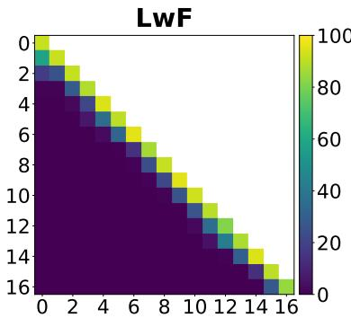
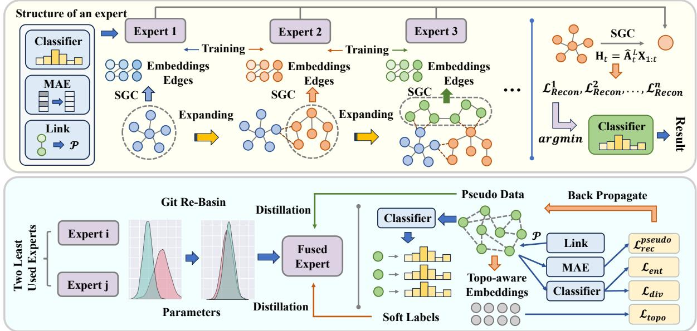
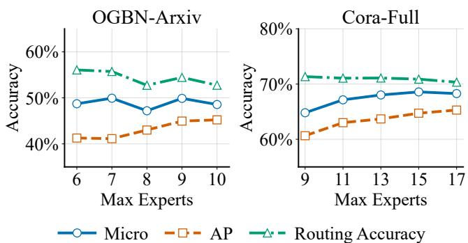
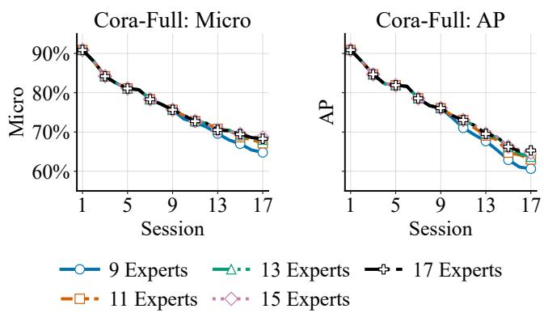
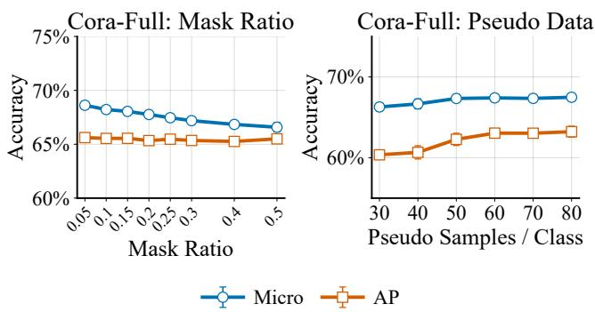

# MAEM: Mitigating Recency Bias via a Replay-Free, Capacity-Controlled Dynamic Mixture of Experts for Class-Incremental Graph Learning

Junlin Chen1, Wenhao Wang1, Junchao Xu1, Qingsong Yao2, Fei Xue3,

Li Sun4, Xiao Wang1, Ruijie Wang1

1Beihang University, Beijing, China

2Renmin University of China, Beijing, China

3Trine University, Indiana, USA

4Beijing University of Posts and Telecommunications, Beijing, China

## Abstract

Graph Neural Networks (GNNs) excel on graph-structured data but sufer catastrophic forgetting when classes arrive se- quentially. In class-incremental graph learning, predictions are often dominated by recently learned classes, causing severe re- cency bias. Dynamic expansion can isolate knowledge across sessions, but many methods assume task-incremental settings and require task identities at test time to select branches or heads—information unavailable in class-incremental learn- ing. Learnable routers ofer an alternative, yet continual fine- tuning the router on new data can bias routing toward recent components. We propose MAEM, a replay-free, capacity- controlled dynamic mixture-of-experts framework for class- incremental graph learning. MAEM builds representations with Simplified Graph Convolution (SGC) and trains a dedicated expert for each new session, then freezes it to pro- tect prior knowledge. For routing without task IDs or a shared trainable router, each expert uses a masked autoencoder (MAE); test nodes are assigned to the expert with the lowest re-construction error, reducing routing-level recency bias. When the expert pool reaches a fixed capacity, MAEM merges the least-used experts via Git Re-Basin alignment and further dis- tills them into a fused expert using topology-aware pseudo data synthesized from MAE distributions (DeepInversion-style), without storing or revisiting historical graph data. On four class-incremental graph benchmarks, MAEM mitigates re- cency bias, outperforms strong continual graph learning base- lines, and keeps model capacity bounded under strict replay- free learning.

## 1 Introduction

Graph Neural Networks (GNNs) have achieved strong performance in learning from graph-structured data (Kipf and Welling 2017; Hamilton, Ying, and Leskovec 2017; Veličković et al. 2018). However, real-world graphs often evolve continuously, with new nodes and classes arriving over time (Zhang, Song, and Tao 2022). Class-incremental graph learning requires a model to learn newly emerging classes while retaining its ability to recognize all previ- ously observed ones (van de Ven and Tolias 2019; Zhang, Song, and Tao 2022). In this setting, catastrophic forgetting is primarily manifested as recency bias: because only the newly introduced classes are supervised during the cur- rent session, the continually updated model becomes dispro- portionately biased toward these classes (Hou et al. 2019;

  
Figure 1: Session-wise accuracy matrix of LwF on cora-full. The entry in row i and column j denotes the accuracy on session j after training through session i.

Wu et al. 2019b). Consequently, nodes from earlier sessions are increasingly misclassified as belonging to the most re- cent classes. Figure 1 illustrates this problem using LwF on cora-full (Bojchevski and Günnemann 2018). Although LwF preserves previous predictions through knowledge dis- tillation, its accuracy on earlier sessions rapidly decreases as new classes are learned (Li and Hoiem 2018). Existing continual learning methods mainly rely on regulariza- tion, replay, or architecture expansion (Parisi et al. 2019; De Lange et al. 2022). Regularization-based methods con-strain model updates but still repeatedly optimize a shared model on newly arriving classes, which cannot efectively suppress recency bias since such constraints preserve previously learned knowledge only approximately (Kirkpatrick et al. 2017; Aljundi et al. 2018; Liu, Yang, and Wang 2021). Replay-based methods recover historical knowledge by stor- ing previous samples, which introduces additional memory costs and may violate data-retention constraints (Rebufi et al. 2017; Lopez-Paz and Ranzato 2017; Zhou and Cao 2021). In contrast, architecture-expansion methods allocate sepa- rate components to diferent sessions, naturally reducing interference between old and new knowledge (Rusu et al. 2016; Yoon et al. 2018; Aljundi, Chakravarty, and Tuytelaars 2017). Nevertheless, existing expansion-based methods face two important limitations. First, many of them are designed for task-incremental learning and require the task identity of each test instance to select the corresponding branch or rediction head (van de Ven and Tolias 2019; Rusu et al. 2016). Pro ressive Neural Networks (PNNs), for exam le, assign a separate column to each task and normally rely on task identity during inference (Rusu et al. 2016). This infor-mation is unavailable in class-incremental learning, where a test node must be classified amon all classes observed so far (van de Ven and Tolias 2019). Second, replacing task identities with a learnable router does not fully solve the prob lem. Because the router is continually fine-tuned on newly arriving data, it can itself develop recency bias and prefer- entially assign nodes to recently added experts. Moreover continuously creating new components leads to unbounded model growth (Rusu et al. 2016; Yoon et al. 2018). To address these limitations, we propose MAEM, a replay-free and capacity-controlled dynamic Mixture-of-Experts framework for class-incremental graph learning. MAEM first employs Simplified Graph Convolution (SGC) to obtain graph representations (Wu et al. 2019a). At each incremental session, it creates a dedicated ex ert for the newl introduced classes and freezes the expert after training. In this way, subsequent learnin does not directl overwrite the decision functions acquired in previous sessions. To perform expert selection without task identities, MAEM equips each expert with an inde endent Masked Autoencoder (MAE) (He et al. 2022 Hou et al. 2022). During inference, all experts reconstruct the re resentation of each test node, and the node is assi ned to the expert with the lowest reconstruction error. The MAE reconstruction error therefore serves as an unbiased rout- in si nal. Unlike a shared learnable router, this mechanism requires neither the session identity of the test node nor con- tinual router fine-tuning, thereby mitigating recency bias at the routing level. MAEM further controls model growth by maintaining a predefined expert capacity. Once this capacity is reached, selected experts are consolidated into a single expert. Git Re-Basin first aligns their hidden neurons and performs an initial weight-space fusion (Ainsworth, Hayase and Srinivasa 2023). A DeepInversion-based procedure then levera es the distributional knowled e retained in the MAEs to generate topology-aware pseudo data for further distilling the ori inal ex erts into the fused ex ert (Yin et al. 2020). This process preserves graph-related knowledge without stor- ing or revisiting historical nodes and keeps the number of experts bounded throughout continual learning. Our main contributions are summarized as follows:

• We propose MAEM, a replay-free dynamic MoE frame-work that mitigates recency bias through isolated and frozen session-specific experts.

• We introduce an MAE-based routing mechanism that uses reconstruction error as an unbiased routing signal, requir- ing neither task identities nor a continually fine-tuned shared router.

• We develop a capacity-controlled expert fusion strategy that combines Git Re-Basin with topology-aware pseudo data generated by DeepInversion-based synthesis, en- abling knowledge consolidation without historical graph data.

• Experiments on four graph class-incremental benchmarks demonstrate that MAEM outperforms competitive base- lines while maintaining bounded model capacity.

## 2 Preliminaries

## 2.1 Class-Incremental Graph Learning

Let $\mathcal { G } = ( \nu , \mathcal { E } , \mathbf { X } )$ denote a graph, where V and E are the node and edge sets, and X contains the node features. Each node $v \in \mathcal V$ is associated with a class label $y _ { v } .$ The learn- ing process consists of a sequence of sessions $\{ \mathcal { T } _ { 1 } , \ldots , \mathcal { T } _ { K } \}$ under the class-incremental graph learning setting (Zhang, Song, and Tao 2022). Session t introduces a set of previously unseen classes $\mathcal { C } _ { t } .$ , where $\mathcal { C } _ { i } \cap \mathcal { C } _ { j } = \mathcal { O }$ for $i \neq j .$ . The classes observed through session t are denoted by $\textstyle { \mathcal { C } } _ { 1 : t } = \bigcup _ { i = 1 } ^ { t } { \mathcal { C } } _ { i }$ Correspondingly, $\mathcal { V } _ { t } = \{ v \in \mathcal { V } \mid y _ { v } \in \mathcal { C } _ { t } \}$ denotes the nodes introduced in session t. At session t, the learner observes the cumulative graph

$$
\begin{array} { r l } & { \mathcal { G } _ { 1 : t } = ( \mathcal { V } _ { 1 : t } , \mathcal { E } _ { 1 : t } , \mathbf { X } _ { 1 : t } ) , } \\ & { \mathcal { V } _ { 1 : t } = \bigcup _ { i = 1 } ^ { t } \mathcal { V } _ { i } , \quad \mathcal { E } _ { 1 : t } = \{ ( u , v ) \in \mathcal { E } \mid u , v \in \mathcal { V } _ { 1 : t } \} . } \end{array}
$$

Therefore, the graph retains edges both within and across incremental sessions, rather than treating each session as an isolated subgraph (Zhang, Song, and Tao 2022). Under the replay-free setting, only the training nodes of the current ses- sion, denoted by $\bar { \mathcal { V } } _ { t } ^ { \mathrm { t r } }$ , provide supervision. Historical labels are not reused in later sessions, although previously observed nodes may remain in the cumulative graph to provide struc- tural context. After session t, the model must be able to classify test nodes among all observed classes in $\mathcal { C } _ { 1 : t }$ . The session identity of each test node is unavailable (van de Ven and Tolias 2019; Zhang, Song, and Tao 2022).

## 2.2 Simplified Graph Convolution

MAEM employs Simplified Graph Convolution (SGC) to obtain graph-aware node representations (Wu et al. 2019a). Let ${ \bf A } _ { t }$ be the adjacency matrix of $\mathcal { G } _ { 1 : t } , \widetilde { \mathbf { A } } _ { t } = \mathbf { A } _ { t } + \mathbf { I }$ be its self-loop augmented form, and $\widetilde { \mathbf { D } } _ { t }$ be the correspond- ing degree matrix. The normalized propagation matrix is $\widehat { \mathbf { A } } _ { t } = \overline { { \widetilde { \mathbf { D } } } } _ { t } ^ { - 1 / 2 } \widetilde { \mathbf { A } } _ { t } \widetilde { \mathbf { D } } _ { t } ^ { - 1 / 2 }$ . SGC removes intermediate nonlin- ear transformations and propagates node features for L steps:

$$
\mathbf { H } _ { t } = \widehat { \mathbf { A } } _ { t } ^ { L } \mathbf { X } _ { 1 : t } .
$$

The resulting representation $\mathbf { H } _ { t }$ captures neighborhood information and serves as the common input to all experts. This separates graph propagation from session-specific ex- pert optimization.

## 3 Methodology

## 3.1 Design Principles and Overall Framework

MAEM is designed to mitigate recency bias in replay-free class-incremental graph learning while maintaining a con- trollable model size. It follows three principles.

The overall framework of MAEM is illustrated in Figure 2.

First, MAEM employs SGC (Wu et al. 2019a) to separate graph propagation from expert optimization. Unlike a shared graph encoder that is repeatedly updated on new classes, SGC does not introduce session-dependent trainable trans- formations, thereby alleviating optimization-induced feature drift.

  
Figure 2: Overall framework of MAEM.

Second, MAEM creates and freezes a dedicated expert for each incremental session. Each expert contains a classifier, a masked autoencoder (MAE) (He et al. 2022; Hou et al. 2022), and a neighbor predictor. At inference, MAE recon-struction errors are used to select an expert without requiring the session identity of the test node or continually fine-tuning a shared router. This prevents the routing mechanism from developing an explicit preference toward recently added ex- perts.

Third, MAEM maintains a predefined expert capacity. Once this capacity is reached, selected experts are first aligned and merged through Git Re-Basin (Ainsworth, Hayase, and Srinivasa 2023). Topology-aware pseudo rep- resentations are then generated through a DeepInversion- inspired procedure and used to further distill the original knowledge into the fused expert. This enables MAEM to con- trol model growth without replaying historical graph data.

## 3.2 Dynamic Expert Learning and MAE-Based Routing

At session t, MAEM creates an expert $\mathcal { E } _ { t } ~ = ~ \{ c _ { t } , f _ { t } , q _ { t } \}$ where $c _ { t }$ is the classifier for the classes in $\mathcal { C } _ { t } , f _ { t }$ is the masked autoencoder used for routing, and $q _ { t }$ is the neighbor predictor used during expert fusion. The expert is trained using the current-session nodes and is subsequently frozen.

Feature-level masked autoencoder. For a node representation h $\in \mathbb { R } ^ { d }$ produced by SGC, we sample a bi- nary mask $\textbf { M } \in \{ \mathrm { \bar { 0 } } , 1 \} ^ { d }$ . Let $\mathbf { m } _ { t }$ denote the learnable mask token of expert t. The corrupted representation is $\widehat { \mathbf { h } } = \mathbf { M } \odot \mathbf { h } + ( \mathbf { 1 } - \mathbf { M } ) \odot \mathbf { m } _ { t } .$ . The MAE reconstructs the complete representation through

$$
f _ { t } ( \widehat { \mathbf { h } } ) = \mathbf { W } _ { t , 2 } \sigma \Big ( \mathbf { W } _ { t , 1 } \widehat { \mathbf { h } } + \mathbf { b } _ { t , 1 } \Big ) + \mathbf { b } _ { t , 2 } ,
$$

where σ denotes ReLU. For theoretical clarity, we formulate MAE training using mean squared reconstruction error:

$$
\mathcal { L } _ { \mathrm { r e c } } ^ { ( t ) } = \frac { 1 } { \vert \mathcal { V } _ { t } ^ { \mathrm { t r } } \vert } \sum _ { v \in \mathcal { V } _ { t } ^ { \mathrm { t r } } } \left. \mathbf { h } _ { v } - f _ { t } ( \widehat { \mathbf { h } } _ { v } ) \right. _ { 2 } ^ { 2 } .
$$

In practice, we use a direction-sensitive reconstruction loss that reduces the dominance of feature magnitude while re- taining exact reconstruction as its pointwise optimum. The practical loss is used consistently for MAE training, inference routing, and pseudo-data generation, and its formulation is provided in Appendix F.

MAEM performs masking and reconstruction in the SGC representation space rather than reconstructing raw node at- tributes through a graph encoder as in GraphMAE (Hou et al. 2022). This choice directly supports replay-free expert fusion. Synthesizing historical raw graphs would require jointly generating node attributes and discrete graph structures. In contrast, MAEM treats each SGC representation as a basic generation unit and optimizes pseudo representations directly in a continuous space. Their structural characteristics are sub- sequently preserved by topology-aware constraints supplied by the neighbor predictor.

Reconstruction-based expert routing. For a test representation h, the same mask realization is applied to all experts. The reconstruction score of expert e is

$$
R _ { e } ( { \bf h } ) = \left\| { \bf h } - f _ { e } ( \widehat { \bf h } ) \right\| _ { 2 } ^ { 2 } .
$$

The selected expert is

$$
e ^ { * } ( { \bf h } ) = \arg \operatorname* { m i n } _ { e \in \{ 1 , . . . , E \} } R _ { e } ( { \bf h } ) ,
$$

where $E$ is the current number of experts. The selected expert then classifies h using its expert-specific classifier.

This routing mechanism requires neither a known ses- sion identifier nor a shared router that is continually updated on new sessions. All experts are evaluated using the same reconstruction criterion. Therefore, the routing criterion is recency-unbiased in the sense that it contains no shared routing parameter optimized preferentially on recent-session data.

The independent learning and routing of frozen experts further provide an order-invariance property when cross- session representation changes and expert fusion are ex- cluded.

## Theorem 1 (Order Invariance without Expert Fusion)

Consider a fixed collection of class-incremental sessions $\{ \mathcal { T } _ { 1 } , \ldots , \mathcal { T } _ { K } \}$ and any two permutations π and $\rho$ of their arrival order. Assume that the influence of cross-session edges is ignored, such that the SGC representation $\mathbf { H } _ { k }$ of session $\mathcal { T } _ { k }$ depends only on its session-specific graph and is independent of the preceding sessions. If expert fusion is disabled and every session-specific objective is optimized to its functionally unique task-wise solution, then the final expert collections obtained under π and $\rho$ are identical up to a permutation of expert indices. Furthermore, for every input with a unique minimum-reconstruction-error expert, the routing decision andfinal global prediction are invariant to the session order.

The proof is provided in Appendix A.1. Theorem 1 shows that frozen independent experts do not intrinsically depend on the order in which sessions are presented. In the complete setting, order dependence may still arise from representation changes induced by cross-session edges and from capacity- triggered expert fusion.

We next analyze the reliability of reconstruction-error- based routing.

Theorem 2 (Routing Reliability) Let $\mathcal { D } _ { i }$ denote the representation distribution associated with expert $i ,$ and let hb be a masked observation ofh $\sim \mathcal { D } _ { i }$ . Ifevery MAE is optimized under expected MSE, then $f _ { i } ^ { * } ( \widehat { \mathbf { h } } ) = \mathbb { E } _ { \mathcal { D } _ { i } } [ { \mathbf { h } } \ | \ \widehat { \mathbf { h } } ]$ . For every competing expert $j \neq i ,$ , define $\Delta _ { i j } = f _ { i } ^ { * } ( \widehat { \mathbf { h } } ) - f _ { j } ^ { * } ( \widehat { \mathbf { h } } ) , \Sigma _ { i } =$ $\mathrm { C o v } [ { \bf h } \mid \widehat { \bf h } , { \cal D } _ { i } ] , m _ { i j } = \| { \bf \Delta } \Delta _ { i j } \| _ { 2 } ^ { 2 } ,$ , and $v _ { i j } = 4 \pmb { \Delta } _ { i j } ^ { \top } \pmb { \Sigma } _ { i } \pmb { \Delta } _ { i j } . \ : I f$ $m _ { i j } > 0 ;$ , the pairwise routing probability satisfies

$$
\mathrm { P r } ( R _ { i } < R _ { j } \mid \widehat { \mathbf { h } } , \mathcal { D } _ { i } ) \geq \frac { m _ { i j } ^ { 2 } } { m _ { i j } ^ { 2 } + v _ { i j } } .
$$

Moreover, $i f m _ { i j } > 0$ for every $j \in \mathcal { S } \setminus \{ i \}$ , then

$$
\operatorname* { P r } \left( R _ { i } < \operatorname* { m i n } _ { j \in \mathcal { S } \setminus \{ i \} } R _ { j } \mid \widehat { \mathbf { h } } , \mathcal { D } _ { i } \right)
$$

$$
\ge \left[ 1 - \sum _ { j \in { \cal S } \backslash \{ i \} } \frac { v _ { i j } } { m _ { i j } ^ { 2 } + v _ { i j } } \right] _ { + } ,
$$

where $[ z ] _ { + } = \operatorname* { m a x } ( z , 0 )$

The proof is provided in Appendix A.2. Theorem 2 shows that routing becomes more reliable when the conditional reconstructions of diferent experts are well separated and the irreducible reconstruction variance is small. In particu- lar, when the masked dimensions can be accurately inferred from the observed dimensions and the expert-specific recon- struction gap is nonzero, the routing probability approaches one.

## 3.3 Capacity-Controlled Expert Fusion

When the number of experts reaches the capacity B, MAEM consolidates two least-activated experts, denoted by ${ \mathcal { E } } _ { a }$ and $\mathcal { E } _ { b } ,$ , according to the accumulated routing statistics. The fusion contains two stages: permutation-aligned parameter merging and topology-aware data-free distillation.

Neighbor predictor. Each expert contains a neighbor predictor $q _ { e }$ to preserve structural information during pseudo-data generation. For two representations $\mathbf { h } _ { u }$ and $\mathbf { h } _ { v } ,$ we construct the symmetric pair representation $\mathbf { z } _ { u v } =$ Concat $\left( \mathbf { h } _ { u } + \mathbf { h } _ { v } , \mathbf { h } _ { u } \odot \mathbf { h } _ { v } \right)$ . The probability that the corre- sponding nodes are connected is $p _ { u v } ^ { ( e ) } = \mathrm { s i g m o i d } \left( q _ { e } ( \mathbf { z } _ { u v } ) \right)$ The neighbor predictor is trained using binary cross-entropy, with real edges between current-session training nodes as positive pairs and randomly sampled non-edges as negative pairs.

After training expert $e ,$ the neighbor predictor identifies the k most probable neighbors of each representation. The resulting topology-enriched representation is

$$
\widetilde { \mathbf { h } } _ { u } ^ { \left( e \right) } = \mathbf { h } _ { u } + \frac { 1 } { k } \sum _ { v \in \mathrm { T o p K } _ { e } \left( u \right) } p _ { u v } ^ { \left( e \right) } \mathbf { h } _ { v } .
$$

MAEM retains only the mean and variance of these enriched representations: $\pmb { \mu } _ { e } = \mathbb { E } [ \widetilde { \mathbf { h } } ^ { ( e ) } ]$ and $\pmb { \nu } _ { e } = \mathrm { V a r } [ \widetilde { \mathbf { h } } ^ { ( e ) } ]$ . These statistics provide topology-aware constraints for later pseudo- data generation without retaining historical nodes or edges.

Permutation-aligned parameter fusion. Directly averaging independently trained networks may combine hidden neurons with inconsistent permutations. MAEM therefore first aligns functionally corresponding neurons using Git Re- Basin (Ainsworth, Hayase, and Srinivasa 2023).

For compatible parameters of experts a and $b ,$ the align- ment seeks a permutation

$$
P ^ { * } = \arg \operatorname* { m i n } _ { P \in \mathcal { P } } \big \| \pmb { \theta } _ { a } - P ( \pmb { \theta } _ { b } ) \big \| _ { 2 } ^ { 2 } ,
$$

where $\mathcal { P }$ denotes the set of valid hidden-unit permutations. In practice, the permutation is obtained through layer-wise Hungarian matching.

Let $n _ { a }$ and $n _ { b }$ denote the numbers of training samples represented by the two experts, and define $\begin{array} { r } { \lambda = \frac { \bar { n } _ { a } } { n _ { a } + n _ { b } } } \end{array}$ . The initial fused parameters are $\pmb { \theta } _ { m } = \lambda \pmb { \theta } _ { a } + ( 1 - \lambda ) P ^ { * } ( \pmb { \theta } _ { b } )$ . For classifiers managing disjoint class sets, their hidden neurons are aligned while their output rows are mapped into the union of the two global class sets.

The following theorem explains why permutation align- ment provides a favorable initialization for subsequent dis- tillation.

Theorem 3 (Output Discrepancy of Aligned Fusion) Let P be a function-preserving neuron permutation and define $\pmb { \theta } _ { m } = \lambda \pmb { \theta } _ { a } + ( \hat { 1 } - \lambda ) P ( \pmb { \theta } _ { b } )$ . The corresponding weighted ensemble output is $f _ { \mathrm { e n s } } ( \dot { \mathbf { x } } ) = \lambda f _ { \pmb { \theta } _ { a } } ( \mathbf { x } ) + \bar { ( } 1 - \lambda ) \bar { f } _ { P ( \pmb { \theta } _ { b } ) } ( \mathbf { x } )$ $I f \theta \mapsto f _ { \theta } ( \mathbf { x } )$ is locally Lx-Lipschitz on the fusion segment, then

$$
\begin{array} { r l } & { \left\| f _ { \mathrm { e n s } } ( \mathbf { x } ) - f _ { \pmb { \theta } _ { m } } ( \mathbf { x } ) \right\| _ { 2 } } \\ & { \qquad \leq 2 L _ { \mathbf { x } } \lambda ( 1 - \lambda ) \left\| \pmb { \theta } _ { a } - P ( \pmb { \theta } _ { b } ) \right\| _ { 2 } . } \end{array}
$$

Ifits Jacobian is additionally locally $\beta _ { \mathbf { x } } .$ -Lipschitz, then

$$
\begin{array} { r l } & {  { \big \| f _ { \mathrm { e n s } } ( \mathbf { x } ) - f _ { \pmb { \theta } _ { m } } ( \mathbf { x } ) \big \| _ { 2 } } } \\ & { \qquad \le \frac { \beta _ { \mathbf { x } } } { 2 } \lambda ( 1 - \lambda ) \| \pmb { \theta } _ { a } - P ( \pmb { \theta } _ { b } ) \| _ { 2 } ^ { 2 } . } \end{array}
$$

The proof is provided in Appendix A.3. Theorem 3 does not imply that parameter averaging alone preserves all expert knowledge. Instead, it shows that neuron alignment reduces an upper bound on the discrepancy between the fused model and the corresponding weighted ensemble, providing a suit- able initialization for subsequent distillation.

Topology-aware pseudo-data generation. Parameter fu-sion alone may still lose task-specific knowledge, particu- larly because the original classifiers manage diferent class sets. MAEM therefore generates pseudo representations sep- arately from the two frozen experts.

For expert e, a pseudo batch ${ \bf Z } _ { e } = \{ { \bf z } _ { n } \} _ { n = 1 } ^ { N _ { e } }$ is initial- ized from Gaussian noise and optimized while the expert parameters remain frozen. Let $\mathbf { p } _ { n } ^ { ( e ) } = \mathrm { s o f t m a x } ( c _ { e } ( \mathbf { z } _ { n } ) )$ be the classifier prediction for pseudo representation $\mathbf { z } _ { n }$ . The generation objective consists of four terms.

The reconstruction loss encourages pseudo representa- tions to lie in regions modeled by the expert: $\begin{array} { r l } {  { \mathcal { L } _ { \mathrm { r e c } } ^ { \mathrm { p s e u d o } } = } } \end{array}$ $\begin{array} { r } { \frac { 1 } { N _ { e } } \sum _ { n = 1 } ^ { N _ { e } } \| \mathbf { z } _ { n } - f _ { e } ( \widehat { \mathbf { z } } _ { n } ) \| _ { 2 } ^ { 2 } . } \end{array}$

The prediction entropy is minimized to pro- duce class-confident representations: ${ \mathcal { L } } _ { \mathrm { e n t } }$ = $\begin{array} { r } { - \frac { 1 } { N _ { e } } \sum _ { n = 1 } ^ { N _ { e } } \sum _ { c } p _ { n , c } ^ { ( e ) } \log p _ { n , c } ^ { ( e ) } } \end{array}$

To prevent the pseudo batch from collapsing into a small subset of classes, we define $\begin{array} { r } { \overline { { \mathbf { p } } } ^ { ( e ) } = \frac { 1 } { N _ { e } } \sum _ { n = 1 } ^ { \mathbf { \bar { N } } _ { e } } \mathbf { \bar { p } } _ { n } ^ { ( e ) } } \end{array}$ and min- imize $\begin{array} { r } { \mathcal { L } _ { \mathrm { d i v } } = \sum _ { c } \overline { { p } } _ { c } ^ { ( e ) } \log \overline { { p } } _ { c } ^ { ( e ) } } \end{array}$

The frozen neighbor predictor then constructs topology- enriched pseudo representations. Let their mean and variance be $\mu _ { \mathrm { p s e u d o } } ^ { ( e ) }$ and $\nu _ { \mathrm { p s e u d o } } ^ { ( e ) } .$ The topology-aware loss is

$$
\begin{array} { r } { \mathcal { L } _ { \mathrm { t o p o } } = \Big \| \pmb { \mu } _ { \mathrm { p s e u d o } } ^ { ( e ) } - \pmb { \mu } _ { e } \Big \| _ { 2 } ^ { 2 } } \\ { + \Big \| \pmb { \nu } _ { \mathrm { p s e u d o } } ^ { ( e ) } - \pmb { \nu } _ { e } \Big \| _ { 2 } ^ { 2 } . } \end{array}
$$

The complete pseudo-data generation objective is ${ \mathcal { L } } _ { \mathrm { g e n } } =$ $\mathcal { L } _ { \mathrm { r e c } } ^ { \mathrm { p s e u d o } } + \omega _ { \mathrm { e n t } } \mathcal { L } _ { \mathrm { e n t } } + \omega _ { \mathrm { d i v } } \mathcal { L } _ { \mathrm { d i v } } + \omega _ { \mathrm { t o p o } } \mathcal { L } _ { \mathrm { t o p o } } .$

This procedure follows the input-optimization principle of DeepInversion (Yin et al. 2020) but generates continu-ous SGC representations rather than raw nodes or complete graphs. The topology-aware term preserves graph-related characteristics without explicitly synthesizing a discrete ad- jacency matrix.

Knowledge distillation. After pseudo-data generation, the pseudo batches of experts a and b are combined. The original classifiers produce temperature-softened targets (Hinton, Vinyals, and Dean 2015) : $\begin{array} { r } { { \bf s } _ { e } ( { \bf z } ) = \mathrm { s o f t m a x } \left( \frac { c _ { e } ( { \bf z } ) } { T } \right) } \end{array}$ Since the two experts may manage diferent classes, their outputs are mapped into the unified class space of the fused expert. The fused classifier is trained using $\mathcal { L } _ { \mathrm { K D } } ^ { \mathrm { c l s } } =$ $- T ^ { 2 } \sum _ { \mathbf { z } } \mathbf { s } _ { e } ( \mathbf { z } ) ^ { \top }$ log softmax $\left( \frac { c _ { m } ( \mathbf { z } ) } { T } \right)$

The fused MAE is further trained to reconstruct the com- bined pseudo representations. The fused neighbor predictor is distilled using the soft edge probabilities produced by the original neighbor predictors on pseudo-representation pairs.

After distillation, experts ${ \mathcal { E } } _ { a }$ and $\mathcal { E } _ { b }$ are replaced by the fused expert ${ \mathcal { E } } _ { m }$ . The expert pool is thereby reduced by one before the newly arriving expert is added, ensuring that the number of active experts never exceeds the predefined ca- pacity B.

## 4 Experiments

## 4.1 Experimental Settings

Datasets. We evaluate MAEM on four node-classification benchmarks: ogbn-arxiv (Hu et al. 2020), Cora-Full (Bojchevski and Günnemann 2018), Coauthor-CS (Shchur et al. 2018), and WikiCS (Mernyei and Cangea 2020). These datasets cover citation, co-authorship, and hyper- link networks with diferent scales and class distributions. All datasets follow the class-incremental setting with inter- session edges preserved (Zhang, Song, and Tao 2022). Detailed statistics and data protocols are provided in Ap- pendix B.

Baselines. We compare with sequential fine-tuning (Bare); EWC, MAS, LwF, and TWP (Kirkpatrick et al. 2017; Aljundi et al. 2018; Li and Hoiem 2018; Liu, Yang, and Wang 2021); replay-based ER-GNN, CaT, DeLoMe, PDGNNs, and GSIP (Zhou and Cao 2021; Liu, Qiu, and Huang 2023; Niu, Pang, and Chen 2024; Zhang et al. 2024; Li et al. 2024); and the parameter-isolation method TAAM (Liu and Zhang 2026). Further descriptions are provided in Appendix C.

Evaluation Metrics. We report final cumulative Micro accuracy, Average Performance (AP), and Average Forgetting (AF) following CGLB (Zhang, Song, and Tao 2022). Higher Micro and AP are better, while AF closer to zero indicates less forgetting. Formal definitions are provided in Appendix B.

## 4.2 Main Results

Overall performance. Table 1 shows that MAEMN achieves the best Micro accuracy on all four datasets. It outperforms the strongest baselines by 6.86, 10.26, 1.75, and 0.56 percentage points on OGBN-Arxiv, Cora-Full, Coauthor-CS, and WikiCS, respectively. MAEM also ob- tains the best AP on the latter three datasets, with gains of 4.13, 1.78, and 2.48 points, while ranking second on OGBN- Arxiv. These results are achieved without retaining or re- playing historical graph data, showing that frozen experts efectively protect session-specific decision functions from subsequent optimization.

<table><tr><td></td><td></td><td colspan="3">OGBN-Arxiv</td><td colspan="3">Cora-Full</td></tr><tr><td>Method</td><td>Replay</td><td>Micro</td><td>AP</td><td>AF</td><td>Micro</td><td>AP</td><td>AF</td></tr><tr><td>Bare</td><td>X</td><td> $0 . 5 2 \pm 0 . 2 4$ </td><td> $6 . 9 9 \pm 0 . 4 6$ </td><td> $- 8 3 . 7 1 \pm 0 . 8 7$ </td><td> $1 . 6 0 \pm 0 . 1 6$ </td><td> $6 . 8 6 \pm 0 . 4 8$ </td><td> $- 9 0 . 9 9 \pm 0 . 6 9$ </td></tr><tr><td>EWC</td><td>X</td><td> $0 . 3 9 \pm 0 . 0 1$ </td><td> $6 . 9 0 \pm 0 . 1 7$ </td><td> $- 7 5 . 8 6 \pm 1 . 5 9$ </td><td> $2 . 0 2 \pm 0 . 3 1$ </td><td> $7 . 3 8 \pm 0 . 6 2$ </td><td> $- 9 0 . 5 9 \pm 0 . 6 4$ </td></tr><tr><td>MAS</td><td>X</td><td>0.37 ± 0.01</td><td> $6 . 6 1 \pm 0 . 2 0$ </td><td> $- 7 5 . 5 8 \pm 1 . 1 6$ </td><td> $1 . 1 8 \pm 0 . 0 3$ </td><td> $5 . 5 3 \pm 0 . 1 3$ </td><td> $- 9 1 . 2 6 \pm 0 . 3 0$ </td></tr><tr><td>LwF</td><td>X</td><td> $0 . 7 2 \pm 0 . 2 2$ </td><td> $6 . 7 8 \pm 0 . 3 5$ </td><td> $- 8 1 . 9 7 \pm 1 . 8 4$ </td><td> $2 . 0 3 \pm 0 . 1 7$ </td><td> $7 . 9 9 \pm 0 . 5 5$ </td><td> $- 8 7 . 9 2 \pm 0 . 9 6$ </td></tr><tr><td>TWP</td><td>X</td><td> $0 . 3 7 \pm 0 . 0 2$ </td><td> $6 . 5 4 \pm 0 . 3 0$ </td><td> $- 7 6 . 6 8 \pm 1 . 4 1$ </td><td> $1 . 1 0 \pm 0 . 0 3$ </td><td> $4 . 8 9 \pm 0 . 1 1$ </td><td> $- 8 7 . 4 4 \pm 0 . 5 6$ </td></tr><tr><td>ER-GNN</td><td>√</td><td> $0 . 4 2 \pm 0 . 0 1$ </td><td> $7 . 3 2 \pm 0 . 1 9$ </td><td> $- 8 3 . 1 6 \pm 0 . 9 5$ </td><td> $1 . 8 2 \pm 0 . 3 0$ </td><td> $6 . 7 0 \pm 0 . 4 7$ </td><td> $- 8 9 . 0 8 \pm 0 . 3 0$ </td></tr><tr><td>CaT</td><td>√</td><td> $3 0 . 0 9 \pm 0 . 3 5$ </td><td> $3 9 . 5 1 \pm 0 . 3 1$ </td><td> $- 1 7 . 8 2 \pm 0 . 3 8$ </td><td> $5 5 . 5 6 \pm 1 . 3 7$ </td><td> $5 2 . 3 6 \pm 0 . 2 7$ </td><td> $- 1 1 . 4 5 \pm 1 . 0 5$ </td></tr><tr><td>DeLoMe</td><td>√</td><td> $1 1 . 6 4 \pm 0 . 2 5$ </td><td> $3 4 . 3 9 \pm 0 . 6 8$ </td><td> $- 5 3 . 7 0 \pm 0 . 8 5$ </td><td> $5 7 . 9 6 \pm 0 . 1 1$ </td><td> $6 1 . 4 1 \pm 0 . 1 9$ </td><td> $- 2 4 . 0 2 \pm 0 . 3 6$ </td></tr><tr><td>PDGNNs</td><td>√</td><td> $4 3 . 4 8 \pm 0 . 8 9$ </td><td> ${ \bf 4 8 . 9 4 \pm 0 . 4 8 }$ </td><td> $- 3 1 . 8 8 \pm 0 . 9 7$ </td><td> $5 1 . 7 2 \pm 0 . 5 4$ </td><td> $5 4 . 5 9 \pm 0 . 5 1$ </td><td> $- 3 6 . 3 5 \pm 0 . 2 7$ </td></tr><tr><td>GSIP</td><td>√</td><td> $3 . 4 5 \pm 0 . 9 7$ </td><td> $1 0 . 0 3 \pm 0 . 7 1$ </td><td> $- 7 6 . 1 4 \pm 1 . 4 4$ </td><td> $2 3 . 5 9 \pm 1 . 0 0$ </td><td> $2 4 . 3 5 \pm 0 . 6 5$ </td><td> $- 7 1 . 7 6 \pm 0 . 7 0$ </td></tr><tr><td>TAAM</td><td>X</td><td> $3 1 . 2 9 \pm 0 . 0 1$ </td><td> $2 9 . 5 4 \pm 0 . 0 4$ </td><td> $- 2 5 . 4 5 \pm 0 . 0 3$ </td><td> $4 1 . 0 8 \pm 0 . 1 2$ </td><td></td><td> $3 8 . 0 4 \pm 0 . 1 1 - 1 5 . 9 1 \pm 0 . 1 9$ </td></tr><tr><td> $\mathbf { M A E M } ^ { \mathsf { N } }$ </td><td>X</td><td> ${ \bf 5 0 . 3 4 \pm 1 . 4 1 }$ </td><td></td><td>46.35 ± 0.27 −15.04 ± 0.68 68.22 ± 0.08 65.54 ± 0.25 −7.85 ± 0.36</td><td></td><td></td><td></td></tr><tr><td> $\mathbf { M A E M } ^ { \mathsf { M } }$ </td><td>X</td><td> $\underline { { 4 8 . 5 1 \pm 1 . 8 5 } }$ </td><td> $4 1 . 9 7 \pm 0 . 8 6$ </td><td> $- 1 9 . 5 3 \pm 2 . 6 0$ </td><td> $6 7 . 4 0 \pm 0 . 2 8$ </td><td></td><td> $6 3 . 0 4 \pm 0 . 2 5 - 1 0 . 8 4 \pm 0 . 3 6$ </td></tr><tr><td></td><td></td><td colspan="3">Coauthor-CS</td><td colspan="3">WikiCS</td></tr><tr><td>Method</td><td>Replay</td><td>Micro</td><td>AP</td><td>AF</td><td>Micro</td><td>AP</td><td>AF</td></tr><tr><td>Bare</td><td>X</td><td> $4 . 7 1 \pm 0 . 3 2$ </td><td> $1 4 . 8 0 \pm 0 . 5 3$ </td><td> $- 9 6 . 9 6 \pm 0 . 5 7$ </td><td> $6 . 5 3 \pm 0 . 2 1$ </td><td></td><td> $2 0 . 2 0 \pm 0 . 2 0 - 9 0 . 3 8 \pm 0 . 9 1$ </td></tr><tr><td>EWC</td><td>X</td><td> $5 . 9 1 \pm 0 . 7 5$ </td><td> $1 7 . 0 7 \pm 1 . 4 5$ </td><td> $- 9 4 . 3 9 \pm 1 . 7 6$ </td><td> $6 . 0 2 \pm 0 . 0 2$ </td><td></td><td> $1 9 . 7 4 \pm 0 . 0 6 - 8 7 . 6 9 \pm 3 . 9 1$ </td></tr><tr><td>MAS</td><td>X</td><td> $4 . 3 3 \pm 0 . 0 0$ </td><td> $1 4 . 2 0 \pm 0 . 0 0$ </td><td> $- 9 6 . 8 3 \pm 0 . 1 2$ </td><td> $6 . 0 0 \pm 0 . 0 8$ </td><td> $1 9 . 6 5 \pm 0 . 2 7$ </td><td> $- 8 8 . 7 4 \pm 2 . 3 4$ </td></tr><tr><td>LwF</td><td>X</td><td> $6 . 1 4 \pm 0 . 9 9$ </td><td> $1 9 . 3 8 \pm 2 . 8 6$ </td><td> $- 9 1 . 8 2 \pm 3 . 3 3$ </td><td> $6 . 9 3 \pm 1 . 7 2$ </td><td> $1 9 . 7 3 \pm 0 . 9 0$ </td><td> $- 8 8 . 2 2 \pm 1 . 0 3$ </td></tr><tr><td>TWP</td><td>X</td><td> $4 . 2 0 \pm 0 . 0 7$ </td><td> $1 3 . 7 6 \pm 0 . 2 2$ </td><td> $- 9 6 . 5 0 \pm 0 . 2 8$ </td><td> $6 . 0 3 \pm 0 . 0 2$ </td><td> $1 9 . 7 7 \pm 0 . 0 7$ </td><td> $- 8 9 . 1 2 \pm 1 . 2 4$ </td></tr><tr><td>ER-GNN</td><td>√</td><td> $4 4 . 1 4 \pm 9 . 9 2$ </td><td> $4 7 . 5 9 \pm 1 1 . 5 1$ </td><td> $- 5 6 . 7 6 \pm 1 3 . 3 5$ </td><td> $1 1 . 4 1 \pm 0 . 6 9$ </td><td> $2 3 . 5 7 \pm 0 . 5 4$ </td><td> $- 8 5 . 6 5 \pm 0 . 8 3$ </td></tr><tr><td>CaT</td><td>√</td><td> $9 0 . 2 4 \pm 1 . 5 6$ </td><td> $8 8 . 3 7 \pm 0 . 9 3 $ </td><td> $- 4 . 5 0 \pm 1 . 3 2$ </td><td> $7 4 . 8 6 \pm 0 . 7 6$ </td><td> $7 4 . 3 6 \pm 0 . 5 9$ </td><td> $\mathbf { - 6 . 5 4 \pm 0 . 8 3 }$ </td></tr><tr><td>DeLoMe</td><td>√</td><td> $8 2 . 5 2 \pm 0 . 7 8$ </td><td> $8 4 . 0 4 \pm 0 . 7 7$ </td><td> $- 1 6 . 0 9 \pm 0 . 8 6$ </td><td> $\overline { { 5 9 . 8 3 \pm 0 . 8 0 } }$ </td><td> $\overline { { 6 8 . 4 9 \pm 0 . 5 2 } }$ </td><td> $- 3 2 . 2 0 \pm 0 . 7 8$ </td></tr><tr><td>PDGNNs</td><td>√</td><td> $8 8 . 0 2 \pm 0 . 9 3$ </td><td> $\underline { { 8 9 . 0 5 \pm 0 . 4 7 } }$ </td><td> $- 1 0 . 6 4 \pm 0 . 6 3$ </td><td> $6 3 . 4 7 \pm 3 . 2 0$ </td><td></td><td> $7 0 . 8 7 \pm 2 . 2 8 - 2 9 . 5 0 \pm 3 . 0 1$ </td></tr><tr><td>GSIP</td><td>V</td><td> $3 6 . 2 6 \pm 4 . 2 9$ </td><td> $\overline { { 4 3 . 6 9 \pm 4 . 9 4 } }$ </td><td> $- 6 2 . 3 0 \pm 5 . 9 3$ </td><td> $1 7 . 3 2 \pm 2 . 4 3$ </td><td> $3 0 . 7 5 \pm 1 . 9 1$ </td><td> $- 7 6 . 0 3 \pm 1 . 6 2$ </td></tr><tr><td>TAAM</td><td>X</td><td> $8 6 . 8 6 \pm 0 . 0 4$ </td><td> $8 5 . 0 4 \pm 0 . 0 7$ </td><td> $- 7 . 3 2 \pm 0 . 0 4$ </td><td> $6 0 . 0 4 \pm 0 . 0 9$ </td><td></td><td> $6 4 . 0 9 \pm 0 . 1 0 - 2 1 . 1 7 \pm 0 . 2 4$ </td></tr><tr><td> $\mathbf { M A E M ^ { N } }$ </td><td>X</td><td> $\mathbf { 9 1 . 9 9 \pm 0 . 1 6 9 0 . 8 3 \pm 0 . 2 5 }$ </td><td></td><td> ${ \bf - 4 . 2 4 \pm 0 . 2 1 }$ </td><td> ${ \bf 7 5 . 4 2 \pm 1 . 6 4 }$ </td><td> ${ \bf 7 6 . 8 4 \pm 0 . 7 3 }$ </td><td> $- 1 0 . 1 4 \pm 0 . 9 4$ </td></tr><tr><td> $\mathbf { M A E M } ^ { \mathsf { M } }$ </td><td>X</td><td> $9 1 . 8 7 \pm 0 . 1 9$ </td><td> $8 9 . 7 1 \pm 0 . 4 1$ </td><td> $- 5 . 4 9 \pm 0 . 4 6$ </td><td> $6 9 . 1 9 \pm 2 . 4 3$ </td><td> $6 9 . 2 9 \pm 1 . 9 4$ </td><td> $- 2 0 . 0 8 \pm 2 . 2 8$ </td></tr></table>

Table 1: Main results on four class-incremental graph benchmarks. Results are percentages reported as mean ± standard deviation over five runs. ✓ and × indicate whether historical information is replayed. MAEMN and MAEMM denote MAEM without and with expert merging, respectively. Bold and underlined values indicate the best and second-best results.

Forgetting resistance. $\mathbf { M A E M ^ { N } }$ achieves the best AF on OGBN-Arxiv, Cora-Full, and Coauthor-CS. Although CaT obtains a better AF on WikiCS, MAEM provides higher Micro and AP, indicating a better balance between knowledge retention and cumulative predictive performance. This also shows that low forgetting alone does not necessarily imply strong classification across all observed classes.

Final performance. Figure 3 shows that larger capacities generally improve Micro and AP because fewer ex- perts require consolidation. On Cora-Full, AP increases from 60.65% with 9 experts to 65.29% with 17 experts, while rout- ing accuracy remains stable at approximately 70–71%. On OGBN-Arxiv, AP also generally improves as more experts are retained, despite moderate fluctuations in Micro and rout- ing accuracy. Thus, capacity primarily controls the frequency of knowledge consolidation rather than the reliability of ex- pert routing.

Efect of expert merging. MAEMM bounds model ca-pacity while retaining the second-best Micro accuracy on OGBN-Arxiv, Cora-Full, and Coauthor-CS. Compared with MAEMN, its Micro decreases by only 1.83, 0.82, and 0.12 points on these datasets. The larger decrease on WikiCS sug- gests that frequent consolidation is more challenging when expert-specific distributions overlap substantially.

## 4.3 Impact of Expert Capacity

We vary the maximum number of experts M from 6 to 10 on OGBN-Arxiv and from 9 to 17 on Cora-Full while keeping all other settings fixed.

Learning dynamics. As shown in Figure 4, diferent ca-pacity settings behave similarly before fusion is triggered. Smaller capacities subsequently lead to more frequent fusion and moderately lower performance. Nevertheless, the curves decrease smoothly rather than collapsing, demonstrating that MAEM can control model growth while preserving substan- tial historical knowledge.

Figure 3: Final Micro accuracy, AP, and routing accuracy under diferent maximum numbers of experts on OGBN- Arxiv and Cora-Full.  
  
Figure 4: Session-wise Micro accuracy and AP on Cora-Full under diferent expert-capacity limits.

## 4.4 Ablation Study

Table 2 shows that replacing aligned initialization with ran- dom initialization and removing either distillation or the topology-aware loss consistently reduce Micro and AP. In particular, removing distillation causes the largest Micro reduction, while all three variants exhibit substantial AP degradation. These results confirm that aligned initializa- tion, pseudo-data distillation, and topology-aware synthesis all contribute to efective expert consolidation.

## 4.5 Further Experiments

Further analyses of hyperparameters, backbone architec- tures, and pseudo-data generation quality are provided in Appendix D.

## 5 Related Work

Continual learning methods. Continual learning methods mainly use regularization, distillation, replay, or parameter isolation (Parisi et al. 2019; De Lange et al. 2022). Representative approaches include EWC and MAS (Kirkpatrick et al. 2017; Aljundi et al. 2018), LwF (Li and Hoiem 2018), episodic replay (Rebufi et al. 2017; Lopez-Paz and Ranzato 2017), and task-specific modules (Rusu et al. 2016; Yoon et al. 2018). In continual graph learning, these strategies preserve topology-related parameters or replay nodes, con- densed graphs, prototypes, and topology-aware embeddings (Zhang, Song, and Tao 2022; Liu, Yang, and Wang 2021; Zhou and Cao 2021; Liu, Qiu, and Huang 2023; Niu, Pang, and Chen 2024; Zhang et al. 2024; Li et al. 2024). However, shared backbones remain susceptible to interference, replay retains historical information, and isolation may require task identities or unbounded growth. MAEM instead combines fixed graph propagation, independently frozen experts, and replay-free consolidation to reduce interference while con- trolling capacity.

<table><tr><td>Variant</td><td>Micro</td><td>AP</td></tr><tr><td>Full model</td><td> ${ \bf 6 7 . 4 0 \pm 0 . 2 8 }$ </td><td> ${ \bf 6 3 . 0 4 \pm 0 . 2 5 }$ </td></tr><tr><td>Random initialization</td><td> $6 1 . 1 3 \pm 0 . 3 0$ </td><td> $4 5 . 8 7 \pm 0 . 2 1$ </td></tr><tr><td>w/o distillation</td><td> $6 0 . 2 1 \pm 0 . 3 9$ </td><td> $4 5 . 2 0 \pm 0 . 1 9$ </td></tr><tr><td>w/o topology-aware loss</td><td> $6 0 . 7 7 \pm 0 . 3 0$ </td><td> $4 5 . 7 1 \pm 0 . 2 1$ </td></tr></table>

Table 2: Ablation results (%) on Cora-Full.

Mixture-of-experts models. MoE models route inputs to specialized experts, enabling diferent components to cap- ture distinct data patterns (Shazeer et al. 2017). In continual learning, expert isolation reduces interference, while recon- struction errors can infer task identity without explicit labels (Aljundi, Chakravarty, and Tuytelaars 2017). Graph MoE methods capture structural heterogeneity using receptive- field-specific experts or sparse routing over evolving graph blocks (Wang et al. 2023; Kong et al. 2025). Nevertheless, learned routers may drift during sequential optimization, and continually expanding expert pools increase memory and in- ference costs. MAEM instead uses independent MAE re- construction errors for task-identity-free routing and bounds long-term growth through expert fusion.

Data-free distillation and model fusion. Data-free distillation synthesizes surrogate inputs from frozen teachers when original data are unavailable, supporting knowledge transfer under storage or privacy constraints (Nayak et al. 2019; Chen et al. 2019; Yin et al. 2020). Model fusion combines independently trained networks in weight space, but permutation symmetries make naive averaging unreli- able (Wortsman et al. 2022; Ainsworth, Hayase, and Srinivasa 2023). MAEM combines Git Re-Basin alignment with topology-aware pseudo-feature distillation to merge experts with disjoint class spaces without retaining or revisiting historical graphs.

## 6 Conclusion

We proposed MAEM, a replay-free, capacity-controlled MoE framework for class-incremental graph learning. Frozen session experts and MAE-based routing mitigate re- cency bias without requiring task identities, while topology- aware data-free fusion bounds model growth without re- taining historical graphs. Experiments on four benchmarks demonstrate strong performance and show that MAEM main- tains bounded capacity with limited degradation.

## References

Ainsworth, S. K.; Ha ase, J.; and Srinivasa, S. 2023. Git Re- Basin: Merging Models modulo Permutation Symmetries. In International Conference on Learning Representations (ICLR).

Aljundi, R.; Babiloni, F.; Elhoseiny, M.; Rohrbach, M.; and Tuytelaars, T. 2018. Memory Aware Synapses: Learning What (Not) to Forget. In Proceedings of the European Conference on Computer Vision (ECCV), 139–154.

Aljundi, R.; Chakravarty, P.; and Tuytelaars, T. 2017. Expert Gate: Lifelong Learning with a Network of Experts. In Proceedings of the IEEE Conference on Computer Vision and Pattern Recognition (CVPR), 3366–3375.

Bojchevski, A.; and Günnemann, S. 2018. Deep Gaussian Embedding of Graphs: Unsupervised Inductive Learning via Ranking. In International Conference on Learning Representations (ICLR). Commonly cited source for the CoraFull dataset.

Chen, H.; Wang, Y.; Xu, C.; Yang, Z.; Liu, C.; Shi, B.; Xu, C.; Xu, C.; and Tian, Q. 2019. Data-Free Learning of Student Networks. In Proceedings of the IEEE/CVF International Conference on Computer Vision (ICCV), 3514–3522.

De Lange, M.; Aljundi, R.; Masana, M.; Parisot, S.; Jia, X.; Leonardis, A.; Slabaugh, G.; and Tuytelaars, T. 2022. A Con- tinual Learning Survey: Defying Forgetting in Classification Tasks. IEEE Transactions on Pattern Analysis and Machine Intelligence, 44(7): 3366–3385.

Hamilton, W. L.; Ying, R.; and Leskovec, J. 2017. Inductive Representation Learning on Large Graphs. In Advances in Neural Information Processing Systems, volume 30, 1024– 1034.

He, K.; Chen, X.; Xie, S.; Li, Y.; Dollár, P.; and Girshick, R. 2022. Masked Autoencoders Are Scalable Vision Learners. In Proceedings of the IEEE/CVF Conference on Computer Vision and Pattern Recognition (CVPR), 16000–16009.

Hinton, G.; Vinyals, O.; and Dean, J. 2015. Distilling the Knowledge in a Neural Network. NIPS Deep Learning and Representation Learning Workshop. ArXiv:1503.02531.

Hou, S.; Pan, X.; Loy, C. C.; Wang, Z.; and Lin, D. 2019. Learning a Unified Classifier Incrementally via Rebalancing. In Proceedings of the IEEE/CVF Conference on Computer Vision and Pattern Recognition (CVPR), 831–839.

Hou, Z.; Liu, X.; Cen, Y.; Dong, Y.; Yang, H.; Wang, C.; and Tang, J. 2022. GraphMAE: Self-Supervised Masked Graph Autoencoders. In Proceedings of the 28th ACM SIGKDD Conference on Knowledge Discovery and Data Mining, 594– 604. ACM.

Hu, W.; Fey, M.; Zitnik, M.; Dong, Y.; Ren, H.; Liu, B.; Catasta, M.; and Leskovec, J. 2020. Open Graph Benchmark: Datasets for Machine Learning on Graphs. In Advances in Neural Information Processing Systems, volume 33, 22118– 22133. Includes ogbn-arxiv.

Kipf, T. N.; and Welling, M. 2017. Semi-Supervised Classifi- cation with Graph Convolutional Networks. In International Conference on Learning Representations (ICLR).

Kirkpatrick, J.; Pascanu, R.; Rabinowitz, N.; Veness, J.; Des- jardins, G.; Rusu, A. A.; Milan, K.; Quan, J.; Ramalho, T.; Grabska-Barwinska, A.; Hassabis, D.; Clopath, C.; Ku- maran, D.; and Hadsell, R. 2017. Overcoming Catastrophic Forgetting in Neural Networks. Proceedings ofthe National Academy ofSciences, 114(13): 3521–3526.

Kong, L.; Vasiloudis, T.; Yun, S.; Xie, H.; and Song, X. 2025. Dynamic Mixture-of-Experts for Incremental Graph Learning. arXiv:2508.09974. Preprint.

Li, J.; Wang, Y.; Zhu, P.; Lin, W.; and Hu, Q. 2024. What Matters in Graph Class Incremental Learning? An Information Preservation Perspective. In Advances in Neural Information Processing Systems, volume 37. GSIP (Graph Spatial Information Preservation).

Li, Z.; and Hoiem, D. 2018. Learning without Forgetting. IEEE Transactions on Pattern Analysis and Machine Intelligence, 40(12): 2935–2947.

Liu, H.; Yang, Y.; and Wang, X. 2021. Overcoming Catas- trophic Forgetting in Graph Neural Networks. In Proceedings ofthe AAAI Conference on Artificial Intelligence, volume 35, 8653–8661. Topology-aware Weight Preserving (TWP).

Liu, J.; and Zhang, X. 2026. TAAM: Inductive Graph-Class Incremental Learning with Task-Aware Adaptive Modula- tion. In Proceedings of the International Conference on Autonomous Agents and Multiagent Systems (AAMAS).

Liu, Y.; Qiu, R.; and Huang, Z. 2023. CaT: Balanced Continual Graph Learning with Graph Condensation. In Proceedings of the IEEE International Conference on Data Mining (ICDM), 1157–1162. IEEE.

Lopez-Paz, D.; and Ranzato, M. 2017. Gradient Episodic Memory for Continual Learning. In Advances in Neural Information Processing Systems, volume 30, 6467–6476.

Mernyei, P.; and Cangea, C. 2020. Wiki-CS: A Wikipedia- Based Benchmark for Graph Neural Networks. In Graph Representation Learning and Beyond (GRL+) Workshop at ICML. Also available as arXiv:2007.02901.

Nayak, G. K.; Mopuri, K. R.; Shaj, V.; Babu, R. V.; and Chakraborty, A. 2019. Zero-Shot Knowledge Distillation in Deep Networks. In Proceedings of the 36th International Conference on Machine Learning, volume 97, 4743–4751. PMLR.

Niu, C.; Pang, G.; and Chen, L. 2024. Graph Continual Learning with Debiased Lossless Memory Replay. In Proceedings of the 27th European Conference on Artificial Intelligence (ECAI 2024), volume 392 of Frontiers in Artificial Intelligence and Applications, 1808–1815. IOS Press. De-LoMe.

Parisi, G. I.; Kemker, R.; Part, J. L.; Kanan, C.; and Wermter, S. 2019. Continual Lifelong Learning with Neural Networks: A Review. Neural Networks, 113: 54–71.

Rebufi, S.-A.; Kolesnikov, A.; Sperl, G.; and Lampert, C. H. 2017. iCaRL: Incremental Classifier and Representation Learning. In Proceedings of the IEEE Conference on Computer Vision and Pattern Recognition (CVPR), 2001–2010.

Rusu, A. A.; Rabinowitz, N. C.; Desjardins, G.; Soyer, H.; Kirkpatrick, J.; Kavukcuoglu, K.; Pascanu, R.; and Hadsell,

R. 2016. Progressive Neural Networks. arXiv:1606.04671. Preprint.

Shazeer, N.; Mirhoseini, A.; Maziarz, K.; Davis, A.; Le, Q.; Hinton, G.; and Dean, J. 2017. Outrageously Large Neural Networks: The Sparsely-Gated Mixture-of-Experts Layer. In International Conference on Learning Representations (ICLR).

Shchur, O.; Mumme, M.; Bojchevski, A.; and Günnemann, S. 2018. Pitfalls of Graph Neural Network Evaluation. arXiv:1811.05868. Introduces Coauthor-CS / Coauthor- Physics splits commonly used in GNN evaluation.

van de Ven, G. M.; and Tolias, A. S. 2019. Three Scenarios for Continual Learning. arXiv:1904.07734. Preprint.

Veličković, P.; Cucurull, G.; Casanova, A.; Romero, A.; Liò, P.; and Bengio, Y. 2018. Graph Attention Networks. In International Conference on Learning Representations (ICLR).

Wang, H.; Jiang, Z.; You, Y.; Han, Y.; Liu, G.; Srinivasa, J.; Kompella, R. R.; and Wang, Z. 2023. Graph Mixture of Experts: Learning on Large-Scale Graphs with Explicit Di- versity Modeling. In Advances in Neural Information Processing Systems, volume 36.

Wortsman, M.; Ilharco, G.; Gadre, S. Y.; Li, R.; Dave, A.; Koh, L. S.; Namkoong, H.; Farhadi, A.; Kornblith, S.; Miller, B.; et al. 2022. Model Soups: Averaging Weights of Multiple Fine-Tuned Models Improves Accuracy without Increasing Inference Time. In Proceedings of the 39th International Conference on Machine Learning, 23965–23998. PMLR.

Wu, F.; Souza, A.; Zhang, T.; Fifty, C.; Yu, T.; and Wein- berger, K. 2019a. Simplifying Graph Convolutional Net- works. In Proceedings of the 36th International Conference on Machine Learning, 6861–6871. PMLR.

Wu, Y.; Chen, Y.; Wang, L.; Ye, Y.; Liu, Z.; Guo, Y.; and Fu, Y. 2019b. Large Scale Incremental Learning. In Proceedings of the IEEE/CVF Conference on Computer Vision and Pattern Recognition (CVPR), 374–382.

Yin, H.; Molchanov, P.; Alvarez, J. M.; Li, Z.; Mallya, A.; Hoiem, D.; Jha, N. K.; and Kautz, J. 2020. Dreaming to Distill: Data-Free Knowledge Transfer via DeepInversion. In Proceedings of the IEEE/CVF Conference on Computer Vision and Pattern Recognition (CVPR), 8715–8724.

Yoon, J.; Yang, E.; Lee, J.; and Hwang, S. J. 2018. Lifelong Learning with Dynamically Expandable Networks. In International Conference on Learning Representations (ICLR).

Zhang, X.; Song, D.; Chen, Y.; and Tao, D. 2024. Topology- aware Embedding Memory for Continual Learning on Ex- panding Networks. In Proceedings ofthe 30thACMSIGKDD Conference on Knowledge Discovery and Data Mining (KDD), 4499–4509. ACM. PDGNNs with Topology-aware Embedding Memory (TEM).

Zhang, X.; Song, D.; and Tao, D. 2022. CGLB: Benchmark Tasks for Continual Graph Learning. In Advances in Neural Information Processing Systems, volume 35, 13006–13021.

Zhou, F.; and Cao, C. 2021. Overcoming Catastrophic For- getting in Graph Neural Networks with Experience Replay. In Proceedings of the AAAI Conference on Artificial Intelligence, volume 35, 4714–4722. ER-GNN.

## A Proofs of Theoretical Results

## A.1 Proof of Theorem 1

Proof. For every session $\mathcal { T } _ { k }$ , let $\mathcal { T } _ { k } ( \phi _ { k } ; { \mathbf { H } } _ { k } )$ denote its complete session-specific objective, where $\phi _ { k }$ contains the parameters of its classifier, masked autoencoder, and neigh- bor predictor.

By assumption, cross-session edges are ignored. There- fore, the SGC representation $\mathbf { H } _ { k }$ depends only on the session- specific graph associated with $\mathcal { T } _ { k }$ and is independent ofwhich sessions were presented before $\mathcal { T } _ { k }$ . Consequently, for any two arrival orders π and $\rho ,$ session $\mathcal { T } _ { k }$ induces the same optimiza- tion problem:

$$
\boldsymbol { \phi } _ { k } ^ { * } \in \arg \operatorname* { m i n } _ { \boldsymbol { \phi } _ { k } } \mathcal { T } _ { k } \big ( \boldsymbol { \phi } _ { k } ; { \mathbf { H } } _ { k } \big ) .
$$

Expert fusion is disabled, and every expert is frozen after its session is learned. Thus, optimizing the expert associated with $\mathcal { T } _ { k }$ neither reads nor modifies the parameters ofany other expert. The optimization problems of diferent sessions are therefore independent.

Under arrival order $\pi ,$ the final ordered expert collection is

$$
{ \mathfrak { E } } _ { \pi } = \left( { \mathcal { E } } _ { \pi ( 1 ) } ^ { * } , \ldots , { \mathcal { E } } _ { \pi ( K ) } ^ { * } \right) .
$$

Under arrival order $\rho ,$ it is

$$
\mathfrak { E } _ { \rho } = \left( \mathcal { E } _ { \rho ( 1 ) } ^ { \ast } , \dots , \mathcal { E } _ { \rho ( K ) } ^ { \ast } \right) .
$$

Because every session-specific objective is assumed to have a functionally unique task-wise solution, the expert learned for $\mathcal { T } _ { k }$ implements the same classifier, reconstruction function, and neighbor predictor under both orders. Therefore, $\mathfrak { E } _ { \pi }$ and $\mathfrak { E } _ { \rho }$ contain the same experts and difer only in their numerical expert indices.

For a fixed input representation h, let

$$
R _ { k } ( { \bf h } ) = \left\| { \bf h } - f _ { k } ( \widehat { \bf h } ) \right\| _ { 2 } ^ { 2 }
$$

be the reconstruction score of the expert associated with $\mathcal { T } _ { k }$ Since the set of reconstruction functions is identical under π and $\rho ,$ the set of reconstruction scores is also identical up to the same index permutation.

Ifthe minimum reconstruction score is unique, both arrival orders select the expert associated with the same session, al- though that expert may occupy a diferent index in the expert pool. The selected expert implements the same classifier and local-to-global class mapping under both orders. Hence, its final global prediction is also unchanged.

Therefore, the final expert collection is invariant up to an expert-index permutation, and both the routing decision and global prediction are invariant to session order. □

## A.2 Proof of Theorem 2

Proof. Condition on a fixed masked observation $\widehat { \mathbf { h } }$ and the event h $\sim { \mathcal { D } } _ { i }$ . Define

$$
\mu _ { i } = \mathbb { E } _ { \mathcal { D } _ { i } } [ { \bf h } \mid \widehat { \bf h } ]
$$

and

$$
\Sigma _ { i } = \mathrm { C o v } [ { \bf h } \mid \widehat { \bf h } , { \cal D } _ { i } ] .
$$

For any reconstruction function $g ( \widehat { \mathbf { h } } )$ , the conditional MSE can be decomposed as

$$
\begin{array} { r l } & { \mathbb { E } \left[ \left\| \mathbf { h } - g ( \widehat { \mathbf { h } } ) \right\| _ { 2 } ^ { 2 } \vert \widehat { \mathbf { h } } , \mathcal { D } _ { i } \right] } \\ & { } \\ & { = \mathrm { t r } ( \Sigma _ { i } ) + \left\| \pmb { \mu } _ { i } - g ( \widehat { \mathbf { h } } ) \right\| _ { 2 } ^ { 2 } . } \end{array}
$$

The first term is independent of $^ { g , }$ and the second is mini- mized when

$$
g ( \widehat { \mathbf { h } } ) = \mu _ { i } .
$$

Therefore, an expected-MSE-optimal MAE satisfies

$$
f _ { i } ^ { * } ( \widehat { \mathbf { h } } ) = \mathbb { E } _ { \mathcal { D } _ { i } } [ \mathbf { h } \mid \widehat { \mathbf { h } } ] .
$$

Define the residual

$$
\epsilon = \mathbf { h } - f _ { i } ^ { * } ( \widehat { \mathbf { h } } ) .
$$

Conditioned on $\widehat { \mathbf { h } }$ and $\mathcal { D } _ { i }$ ,

$$
\mathbb { E } [ \epsilon ] = \mathbf { 0 } , \qquad \mathrm { C o v } ( \epsilon ) = \Sigma _ { i } .
$$

For a competing expert j, recall that

$$
\Delta _ { i j } = f _ { i } ^ { * } ( \widehat { \mathbf { h } } ) - f _ { j } ^ { * } ( \widehat { \mathbf { h } } ) .
$$

The reconstruction error of the correct expert is

$$
R _ { i } = \| \epsilon \| _ { 2 } ^ { 2 } ,
$$

whereas

$$
\begin{array} { r l } & { { { R } _ { j } } = \left\| \mathbf { h } - { { f } _ { j } ^ { * } } ( \widehat { \mathbf { h } } ) \right\| _ { 2 } ^ { 2 } } \\ & { \quad \quad = \| \epsilon + { { \boldsymbol { \Delta } } _ { i j } } \| _ { 2 } ^ { 2 } } \\ & { \quad \quad = \| \epsilon \| _ { 2 } ^ { 2 } + 2 \epsilon ^ { \top } \mathbf { \Delta } _ { i j } + \| \Delta _ { i j } \| _ { 2 } ^ { 2 } . } \end{array}
$$

Hence,

$$
R _ { j } - R _ { i } = 2 \epsilon ^ { \top } \Delta _ { i j } + m _ { i j } .
$$

Let

$$
Z _ { i j } = 2 \epsilon ^ { \top } \Delta _ { i j } .
$$

Its conditional mean is

$$
\begin{array} { r } { \mathbb { E } [ Z _ { i j } ] = 2 \mathbb { E } [ \boldsymbol { \epsilon } ] ^ { \top } \Delta _ { i j } = 0 , } \end{array}
$$

and its conditional variance is

$$
\begin{array} { r l } & { \mathrm { V a r } ( Z _ { i j } ) = 4 \mathrm { V a r } \left( \epsilon ^ { \top } \Delta _ { i j } \right) } \\ & { \quad \quad \quad = 4 \Delta _ { i j } ^ { \top } \Sigma _ { i } \Delta _ { i j } } \\ & { \quad \quad \quad = v _ { i j } . } \end{array}
$$

The correct expert has a lower reconstruction error pre- cisely when

$$
R _ { i } < R _ { j } \quad \Longleftrightarrow \quad Z _ { i j } > - m _ { i j } .
$$

By the one-sided Chebyshev–Cantelli inequality,

$$
\operatorname* { P r } ( Z _ { i j } \leq - m _ { i j } ) \leq \frac { v _ { i j } } { v _ { i j } + m _ { i j } ^ { 2 } } .
$$

Taking complements gives

$$
\mathrm { P r } ( R _ { i } < R _ { j } \mid \widehat { \mathbf { h } } , \mathcal { D } _ { i } ) \geq \frac { m _ { i j } ^ { 2 } } { m _ { i j } ^ { 2 } + v _ { i j } } .
$$

For multiple experts, define the pairwise routing-failure event

$$
{ \mathcal { F } } _ { i j } = \{ R _ { j } \leq R _ { i } \} .
$$

Correct routing requires that none of these events occurs:

$$
\left\{ R _ { i } < \operatorname* { m i n } _ { j \in { \cal S } \backslash \{ i \} } R _ { j } \right\} = \bigcap _ { j \in { \cal S } \backslash \{ i \} } \mathcal { F } _ { i j } ^ { c } .
$$

Using the union bound,

$$
\begin{array} { r l } & { \operatorname* { P r } \left( \bigcup _ { j \in S \backslash \{ i \} } \mathcal { F } _ { i j } \mid \widehat { \mathbf { h } } , \mathcal { D } _ { i } \right) } \\ & { \leq \displaystyle \sum _ { j \in S \backslash \{ i \} } \frac { v _ { i j } } { m _ { i j } ^ { 2 } + v _ { i j } } . } \end{array}
$$

Therefore,

$$
\begin{array} { l } { \displaystyle \operatorname* { P r } \left( R _ { i } < \operatorname* { m i n } _ { j \in \mathcal { S } \backslash \{ i \} } R _ { j } \mid \widehat { \mathbf { h } } , \mathcal { D } _ { i } \right) } \\ { \displaystyle \geq \left[ 1 - \sum _ { j \in \mathcal { S } \backslash \{ i \} } \frac { v _ { i j } } { m _ { i j } ^ { 2 } + v _ { i j } } \right] _ { + } . } \end{array}
$$

This proves the pairwise and multi-expert bounds. □

## A.3 Proof of Theorem 3

Proof. Let

$$
\pmb { \theta } _ { b } ^ { \prime } = P ( \pmb { \theta } _ { b } )
$$

and define

$$
\mathbf { d } = \pmb { \theta } _ { a } - \pmb { \theta } _ { b } ^ { \prime } .
$$

The fused parameters satisfy

$$
\pmb { \theta } _ { m } = \lambda \pmb { \theta } _ { a } + ( 1 - \lambda ) \pmb { \theta } _ { b } ^ { \prime } .
$$

Therefore,

$$
\pmb { \theta } _ { a } - \pmb { \theta } _ { m } = ( 1 - \lambda ) \mathbf { d }
$$

and

$$
\pmb { \theta } _ { b } ^ { \prime } - \pmb { \theta } _ { m } = - \lambda \mathbf { d } .
$$

Assume first that the parameter-to-output mapping is lo- cally $L _ { \mathbf { x } ^ { - } }$ Lipschitz on the complete fusion segment. By the triangle inequality,

$$
\begin{array} { r l } & { \left\| f _ { \mathrm { e n s } } ( \mathbf { x } ) - f _ { \pmb { \theta } _ { m } } ( \mathbf { x } ) \right\| _ { 2 } } \\ & { \leq \lambda \left\| f _ { \pmb { \theta } _ { a } } ( \mathbf { x } ) - f _ { \pmb { \theta } _ { m } } ( \mathbf { x } ) \right\| _ { 2 } } \\ & { ~ + \left( 1 - \lambda \right) \left\| f _ { \pmb { \theta } _ { b } ^ { \prime } } ( \mathbf { x } ) - f _ { \pmb { \theta } _ { m } } ( \mathbf { x } ) \right\| _ { 2 } . } \end{array}
$$

Applying the Lipschitz condition gives

$$
\begin{array} { r l } & { \| f _ { \mathrm { e n s } } ( \mathbf { x } ) - f _ { \pmb { \theta } _ { m } } ( \mathbf { x } ) \| _ { 2 } } \\ & { \leq \lambda L _ { \mathbf { x } } \| \pmb { \theta } _ { a } - \pmb { \theta } _ { m } \| _ { 2 } + ( 1 - \lambda ) L _ { \mathbf { x } } \left\| \pmb { \theta } _ { b } ^ { \prime } - \pmb { \theta } _ { m } \right\| _ { 2 } } \\ & { = \lambda L _ { \mathbf { x } } ( 1 - \lambda ) \| \pmb { \mathrm { d } } \| _ { 2 } + ( 1 - \lambda ) L _ { \mathbf { x } } \lambda \| \pmb { \mathrm { d } } \| _ { 2 } } \\ & { = 2 L _ { \mathbf { x } } \lambda ( 1 - \lambda ) \| \pmb { \mathrm { d } } \| _ { 2 } . } \end{array}
$$

Substituting $\mathbf { d } = \pmb { \theta } _ { a } - P ( \pmb { \theta } _ { b } )$ proves the first inequality.

Now assume that the Jacobian with respect to parameters is locally $\beta _ { \mathbf { x } ^ { \mathbf { - L } } }$ ipschitz in operator norm. A first-order Taylor expansion around $\pmb { \theta } _ { m }$ gives

$$
f _ { \pmb \theta } ( \mathbf x ) = f _ { \pmb \theta _ { m } } ( \mathbf x ) + J _ { m } ( \pmb \theta - \pmb \theta _ { m } ) + \mathbf r ( \pmb \theta ) ,
$$

where

$$
\| \mathbf { r } ( \pmb { \theta } ) \| _ { 2 } \leq \frac { \beta _ { \mathbf { x } } } { 2 } \| \pmb { \theta } - \pmb { \theta } _ { m } \| _ { 2 } ^ { 2 } .
$$

In the weighted ensemble, the first-order terms are propor- tional to

$$
\lambda ( \pmb \theta _ { a } - \pmb \theta _ { m } ) + ( 1 - \lambda ) ( \pmb \theta _ { b } ^ { \prime } - \pmb \theta _ { m } ) .
$$

By the definition of $\theta _ { m }$ , this expression equals zero. Hence, the linear Taylor terms cancel exactly, and only the second- order remainder terms remain. It follows that

$$
\begin{array} { l } { { \displaystyle { \| f _ { \mathrm { e n s } } ( { \bf x } ) - f _ { \pmb { \theta } _ { m } } ( { \bf x } ) \| _ { 2 } } } } \\ { { \displaystyle \leq \lambda \frac { \beta _ { \bf x } } { 2 } ( 1 - \lambda ) ^ { 2 } \| { \bf d } \| _ { 2 } ^ { 2 } } } \\ { { \displaystyle ~ + ( 1 - \lambda ) \frac { \beta _ { \bf x } } { 2 } \lambda ^ { 2 } \| { \bf d } \| _ { 2 } ^ { 2 } } } \\ { { \displaystyle = \frac { \beta _ { \bf x } } { 2 } \lambda ( 1 - \lambda ) \| { \bf d } \| _ { 2 } ^ { 2 } } . } \end{array}
$$

Substituting the definition of d proves the second inequality. Since P is function-preserving, it changes only the parameterization of expert $b ,$ not its represented function. □

## B Datasets and Evaluation Metrics

## B.1 Dataset Statistics

We evaluate on four node-classification benchmarks span- ning citation, co-authorship, and hyperlink graphs: ogbn- arxiv (Hu et al. 2020), Cora-Full (Bojchevski and Günnemann 2018), Coauthor-CS (Shchur et al. 2018), and WikiCS (Mernyei and Cangea 2020). Table 3 summarizes the statistics used in our experiments. High-dimensional features on Cora-Full and Coauthor-CS are reduced by Truncated SVD before training; the remaining datasets keep their orig- inal feature dimensions.

## B.2 Class-Incremental Data Protocol

All methods share the same class-incremental expanding- graph protocol, following CGLB with inter-session edges preserved (Zhang, Song, and Tao 2022).

Preprocessing. Each graph is converted to an undirected graph, and isolated nodes are removed. Classes are reordered by decreasing node count and then renumbered consecu- tively. When Truncated SVD is applied, the projection is fit once on the full feature matrix with a fixed random seed and is shared by all methods and trials.

Class splits and sessions. Classes are partitioned into contiguous blocks of size C (classes $\mathtt { - p e r \_ t a s k } )$ , yielding sessions $\{ \mathcal { T } _ { 1 } , \ldots , \mathcal { T } _ { K } \}$ . A trailing block that cannot fill $\bar { C }$ classes is discarded, matching the CGLB convention. Session t introduces previously unseen classes $\mathcal { C } _ { t } ,$ and the observed class set after session t is $\textstyle { \mathcal { C } } _ { 1 : t } = \bigcup _ { i = 1 } ^ { t } { \mathcal { C } } _ { i }$

<table><tr><td>Dataset</td><td>Nodes</td><td>Edges</td><td>Feature Dimension</td><td>Classes</td><td>Class per Session</td><td>Sessions</td></tr><tr><td>OGBN-ARXIV</td><td>169,343</td><td>1,166,243</td><td>128</td><td>40</td><td>4</td><td>10</td></tr><tr><td>CORA-FULL</td><td>19,793</td><td>65,311</td><td>512†</td><td>70</td><td>4</td><td>17</td></tr><tr><td>COAUTHOR-CS</td><td>18,333</td><td>81,894</td><td>256†</td><td>15</td><td>2</td><td>7</td></tr><tr><td>WIKICS</td><td>11,701</td><td>216,123</td><td>300</td><td>10</td><td>2</td><td>5</td></tr></table>

Table 3: Dataset statistics. “Feat.” is the feature dimension after preprocessing; † denotes Truncated-SVD reduction (original dimensions: 8,710 for Cora-Full and 6,805 for Coauthor-CS). “C/Sess.” is the number of classes per session. For Coauthor-CS, the final incomplete session is discarded, so 14 of 15 classes are used.

Train/validation/test splits. Within each class, nodes are randomly split into train/validation/test with ratios 0.6/0.2/0.2. The split is generated once with a fixed seed and reused across all random trials, methods, and sessions.

Cumulative graphs and supervision. At session t, mes-sage passing is performed on the cumulative subgraph in- duced by all nodes whose labels belong to $\mathcal { C } _ { 1 : t } ,$ including edges that connect nodes from diferent sessions. Supervi- sion uses only the current-session training nodes $\mathcal { V } _ { t } ^ { \mathrm { t r } } ;$ his- torical labels are not reused. At test time, the model must classify among all classes in $\mathcal { C } _ { 1 : t } .$ , and the session identity of each test node is unavailable.

## B.3 Evaluation Metrics

Let $a _ { k , j }$ denote the micro accuracy on the test nodes of session j after training through session ${ \mathfrak { i } } \left( 0 \leq j \leq k \leq K - \right.$ 1). These values form a lower-triangular accuracy matrix.

Per-task Micro and cumulative Micro. The per-task Mi-cro entry $a _ { k , j }$ is the fraction of correctly classified test nodes of session j after session k. The cumulative (joint) Micro after session k is the micro accuracy on the union of test nodes from sessions $0 , \ldots , k ,$ , evaluated on the same cumulative graph. The main tables report the final cumulative Micro after the last session.

Average Performance (AP). Following CGLB (Zhang, Song, and Tao 2022), the Average Performance after session k is

$$
\mathrm { A P } _ { k } = \frac { 1 } { k + 1 } \sum _ { j = 0 } ^ { k } a _ { k , j } .
$$

We report the final AP, $\mathrm { A P } _ { K - 1 }$

Average Forgetting (AF). Average Forgetting measures the change from a session’s immediate accuracy to its accu- racy after the final session:

$$
\mathrm { A F } = \frac { 1 } { K - 1 } \sum _ { j = 0 } ^ { K - 2 } \bigl ( a _ { K - 1 , j } - a _ { j , j } \bigr ) .
$$

Negative AF indicates forgetting; values closer to zero indi- cate less forgetting (positive values indicate backward transfer).

Routing accuracy. For methods that select an expert or session-specific module without session IDs (MAEM and TAAM), routing accuracy is the fraction of evaluated test nodes assigned to the module that owns their true class. After expert fusion in MAEM, ownership is defined by the fused expert’s class set.

Reporting protocol. All main results are averaged over five random seeds {0, 1, 2, 3, 4}. We report mean ± standard deviation as percentages. Higher Micro and AP are better; AF closer to zero is better.

## C Detailed Baseline Descriptions

Unless otherwise stated, all baselines are evaluated under the same class-incremental expanding-graph protocol as MAEM (Appendix B): training supervises only the current-session training nodes, while message passing uses the cumulative graph that retains inter-session edges. Classic regulariza- tion and replay methods follow the CGLB class-IL imple- mentations (Zhang, Song, and Tao 2022); CaT, DeLoMe, PDGNNs, GSIP, and TAAM follow their oficial algorithms with protocol-level adaptations described below.

## C.1 Bare

Bare is sequential fine-tuning without continual-learning protection. A shared GCN is trained on the current session only and then updated on subsequent sessions, providing a lower bound on catastrophic forgetting.

## C.2 EWC

Elastic Weight Consolidation (EWC) (Kirkpatrick et al. 2017) regularizes parameter drift with a quadratic penalty weighted by a diagonal Fisher importance estimate computed at the end of each session. Parameters important for previous sessions are discouraged from changing while learning new classes.

## C.3 MAS

Memory Aware Synapses (MAS) (Aljundi et al. 2018) like-wise penalizes changes to important parameters, but esti- mates importance online from the sensitivity of network outputs to parameter perturbations, rather than from the Fisher information of the classification loss. The importance weights are accumulated across sessions.

## C.4 LwF

Learning without Forgetting (LwF) (Li and Hoiem 2018) pre-serves previous knowledge by knowledge distillation. After each session, soft targets from the previous model are stored; subsequent training combines the current classification loss with a temperature-scaled distillation loss that encourages the student to match prior predictions on the current graph.

## C.5 TWP

Topology-aware Weight Preserving (TWP) (Liu, Yang, and Wang 2021) extends parameter regularization to graph structure. In addition to a loss-based importance estimate, TWP measures the sensitivity of topology-related edge scores and applies a stronger penalty to parameters that are critical for preserving structural information from earlier sessions.

## C.6 ER-GNN

Experience Replay GNN (ER-GNN) (Zhou and Cao 2021) maintains a fixed-budget bufer of representative nodes se- lected per class (e.g., coverage maximization or mean-offeature sampling). When a new session arrives, the model is trained jointly on current nodes and bufered nodes. Following CGLB, replay graphs drop induced edges and retain self-loops by default.

## C.7 CaT

Condensed Graph Memory (CaT) (Liu, Qiu, and Huang 2023) replaces raw node storage with condensed synthetic features obtained by matching distributions under multiple random GNN encoders. Each session condenses only the iso- lated current-task subgraph under a class-wise budget; later sessions replay the accumulated condensed memory together with the current data (optionally with TIM).

## C.8 DeLoMe

DeLoMe (Niu, Pang, and Chen 2024) performs gradient-matching condensation with an SGC backbone. For each session it synthesizes a small set of class-conditional features that reproduce gradients of a fresh SGC on the current task, then trains with logit adjustment to mitigate imbalance when replaying condensed memory.

## C.9 PDGNNs

PDGNNs (Zhang et al. 2024) use Topology-aware Embedding Memory (TEM): selected nodes are stored as APPNP-propagated embeddings rather than raw features, and a de- coupled APPNP+MLP classifier is trained with replay of these topology-aware embeddings. Samplers include random selection and coverage-based selection over APPNP recep- tive fields.

## C.10 GSIP

Graph Structure Information Preservation (GSIP) (Li et al. 2024) builds on ER-GNN-style node replay and adds auxiliary losses that preserve local/global structure and hidden representations of bufered nodes. Memory selection follows coverage- or mean-feature-based samplers; classification and structure-preservation losses are jointly optimized on the cu-mulative graph.

## C.11 TAAM

Task-Aware Adaptive Modulation (TAAM) (Liu and Zhang 2026) is a parameter-isolation method. It freezes a shared SGC backbone and, for each session, trains a Neural Synapse Modulator (a low-rank, node-attentive FiLM generator) to-gether with a session-specific classifier head; after training, both modules are frozen. Task identity at inference is inferred from Adaptive Multi-scale Propagation (AMP) prototypes: APPNP-style difusion features at selected hops are averaged over supervised nodes and stored as a session prototype.

The original TAAM evaluation routes an entire test sub- graph to a single session by comparing one subgraph-level AMP prototype against stored prototypes. This assumption does not hold under our expanding class-incremental pro- tocol, where the cumulative graph simultaneously contains nodes from many sessions and test evaluation provides no session IDs. Assigning one route to the whole mixed graph would force heterogeneous nodes through the same modula- tor and head.

We therefore adapt TAAM toper-node AMP routing while keeping the original backbone, modulator, and prototype construction. Concretely, at session t the method (i) propa-gates on the full cumulative graph, (ii) builds the AMP prototype from only the current session’s training nodes, (iii) trains and then freezes a new modulator and head on those nodes, and (iv) at inference computes an AMP profile for every test node and assigns that node to the nearest stored session proto- type by cosine similarity before applying the corresponding frozen modulator and head. Message passing still uses the cumulative topology; supervision and prototype construc- tion never revisit previous labels. This node-level routing is necessary for fair comparison on multi-session cumulative graphs, and is the only protocol-level change relative to the oficial TAAM design.

## D Further Experimental Results

## D.1 Hyperparameter Analysis

We study two hyperparameters that directly afect MAE rout- ing and expert fusion on Cora-Full: the MAE mask ratio and the number of topology-aware pseudo samples generated per class during expert merging. All other settings follow the main experimental configuration. Results are averaged over five seeds and are shown in Figure 5.

Mask ratio. The mask ratio controls how much of each node representation is hidden when train- ing and querying the session MAE. We vary it over {0.05, 0.1, 0.15, 0.2, 0.25, 0.3, 0.4, 0.5}. As the mask ratio increases, Micro decreases gradually from 68.62% to 66.58%, while AP remains nearly stable around 65.3%– 65.6%. A small mask ratio preserves more observed features and yields slightly stronger final Micro; overly aggres- sive masking makes reconstruction harder and weakens the routing signal. The default value 0.1 used in the main ex-periments provides a good balance between reconstruction dificulty and accuracy, and is close to the best Micro in this sweep.

  
Figure 5: Hyperparameter sensitivity on Cora-Full. Left: MAE mask ratio. Right: number of pseudo samples per class used in expert fusion. Curves report Micro and AP (mean ± std over five seeds).

Pseudo-data sample count. During capacity-triggered fu-sion, MAEM synthesizes a fixed number of pseudo represen- tations per class for data-free distillation. We vary this count over {30, 40, 50, 60, 70, 80}. Both Micro and AP improve as more pseudo samples are provided, with the largest gains between 30 and 60 samples per class (Micro from 66.28% to 67.40%, AP from 60.36% to 63.04%). Beyond 60, the curves largely plateau: increasing to 80 yields only marginal further improvement. This indicates that a moderate pseudo- data budget is suficient to transfer knowledge into the fused expert, while a too-small budget under-covers the teacher distributions. We therefore use 60 pseudo samples per class by default.

## D.2 Backbone Analysis

MAEM separates graph propagation from expert learning: a fixed, parameter-free operator first maps node features into a shared representation H, which is then consumed by session experts. We compare five such operators on ogbn-arxiv and Cora-Full, keeping all MAEM components unchanged. The hop count is k=2 when applicable, and the PPR restart probability is α=0.1.

• Identity (Raw): No propagation; $\mathbf { H } = \mathbf { X } .$ . This serves as a feature-only baseline.

• SGC: Symmetric normalized propagation ${ \textbf { H } } =$ $( \tilde { D } ^ { - 1 / 2 } \tilde { A } \tilde { D } ^ { - 1 / 2 } ) ^ { k } \mathbf { X }$ , i.e., the parameter-free GCN filter used by Simplified Graph Convolution. This is the default backbone in the main experiments.

• GraphSAGE: Mean aggregation with equal self and neighbor weights, $h _ { v } \gets 0 . 5 h _ { v } + 0 . 5 \cdot \mathrm { m e a n } _ { u \in \mathcal { N } ( v ) } h _ { u } .$ where the neighborhood mean excludes self-loops.

• Random Walk: Row-normalized propagation ${ \textbf { H } } =$ $( D ^ { - 1 } A ) ^ { k } \mathbf { X }$ , corresponding to a random-walk transition matrix.

• PPR: Personalized PageRank propagation with restart, H $\mathbf { \Lambda } [ \mathbf { \Lambda } ^ { ( t + 1 ) } = ( 1 - \alpha ) \hat { A } \mathbf { H } ^ { ( t ) } + \alpha \mathbf { X }$ , where Aˆ is the symmetri- cally normalized adjacency with self-loops and $\alpha = 0 . 1$

Table 4 shows that neighborhood aggregation is consis- tently beneficial. On both datasets, Identity is clearly worse than all graph-based operators, indicating that structural con- text is important for MAEM’s expert routing and classifica- tion. On ogbn-arxiv, the default SGC backbone achieves the best Micro (50.34%) and the least forgetting among strong variants, while Random Walk attains the highest AP (47.04%). On Cora-Full, GraphSAGE and PPR obtain the highest Micro (69.72% and 69.69%), with AP values close to SGC; Random Walk yields the best AP (65.86%), whereas Identity has the weakest AP despite a relatively mild AF. Overall, diferent parameter-free propagators remain com- petitive once neighborhood information is included, and the default SGC backbone provides a strong and stable trade-of across Micro, AP, and AF.

## D.3 Pseudo-Data Generation Quality

Expert fusion in MAEM relies on topology-aware pseudo embeddings synthesized from frozen MAE experts, without revisiting historical nodes. To assess whether these pseudo embeddings remain faithful to the corresponding real repre- sentations, we evaluate each expert on ogbn-arxiv under a no-fusion setting with $K { = } 1 0$ experts (four classes per ex-pert). For every expert, we compare the pseudo-embedding set with the real SGC embeddings of its classes.

We report three complementary quantities. $\mathrm { M M D ^ { 2 } }$ is the squared maximum mean discrepancy between pseudo and real embeddings, computed with a Gaussian kernel, a median-heuristic bandwidth, and the unbiased estima- tor; smaller values indicate closer distribution matching. ${ \mathrm { A c c } } _ { \mathrm { p s e u d o } }$ and $\mathrm { { A c c } _ { \mathrm { { r e a l } } } }$ are classification accuracies of the same frozen expert classifier on pseudo and real embeddings, respectively. Their ratio, Ratio $= \mathrm { A c c } _ { \mathrm { p s e u d o } } / \mathrm { A c c } _ { \mathrm { r e a l } }$ , mea-sures how much of the real decision quality is retained on pseudo data. Table 5 summarizes the results over five seeds.

Across experts, the average $\mathrm { M M D ^ { 2 } }$ is 0.219, showing that pseudo embeddings approximate but do not perfectly re- produce the real feature distribution. Nevertheless, the aver- age Ratio reaches 0.890: pseudo embeddings recover about 89% of the real-embedding accuracy (0.815 vs. 0.915). Several experts are especially strong (e.g., Experts 6 and 7 with Ratio near 0.95), while Expert 8 is the weakest $( \mathrm { A c c } _ { \mathrm { p s e u d o } } = 0 . 6 2 1$ , $\mathtt { \small B a t i o } = 0 . 7 3 6 )$ , indicating that gener- ation quality can vary with class structure. Overall, the syn- thesized embeddings remain suficiently class-discriminative to support data-free distillation during expert fusion, which is consistent with the competitive performance of capacity- controlled MAEM in the main experiments.

## E Limitations

Limited expressiveness of the SGC backbone. MAEM uses parameter-free Simplified Graph Convolution to sep- arate graph propagation from expert learning. This design reduces session-dependent feature drift and keeps the shared representation stable across incremental sessions. However, SGC applies a fixed linear filter without learned nonlinear message passing. On graphs that require highly non-linear decision boundaries, long-range relational reasoning, or het- erophilic neighborhood aggregation, the resulting represen- tations may be insuficiently discriminative. In such cases, expert routing and classification operate on a constrained feature space, which can limit the attainable accuracy even when the MoE components themselves are well trained. Richer parameter-free or lightly parameterized backbones may alleviate this issue, but they also reintroduce the risk of representation drift under continual updates.

<table><tr><td rowspan="2">Backbone</td><td colspan="3">OGBN-Arxiv</td><td colspan="3">Cora-Full</td></tr><tr><td>Micro</td><td>AP</td><td>AF</td><td>Micro</td><td>AP</td><td>AF</td></tr><tr><td>Identity</td><td> $3 3 . 1 8 \pm 1 . 6 5$ </td><td> $3 5 . 1 2 \pm 0 . 2 0$ </td><td> $- 1 9 . 0 6 \pm 1 . 3 9$ </td><td> $4 3 . 2 6 \pm 0 . 2 5$ </td><td> $2 6 . 8 9 \pm 0 . 3 0$ </td><td> $- 1 . 6 3 \pm 0 . 2 7$ </td></tr><tr><td>SGC / GCN</td><td> ${ \bf 5 0 . 3 4 \pm 1 . 4 1 }$ </td><td> $4 6 . 3 5 \pm 0 . 2 7$ </td><td> $\mathbf { - 1 5 . 0 4 \pm 0 . 6 8 }$ </td><td> $6 8 . 2 2 \pm 0 . 0 8$ </td><td> $6 5 . 5 4 \pm 0 . 2 5$ </td><td> $- 7 . 8 5 \pm 0 . 3 6$ </td></tr><tr><td>GraphSAGE</td><td> $4 3 . 2 4 \pm 2 . 0 3$ </td><td> $4 5 . 6 4 \pm 0 . 3 6$ </td><td> $- 1 8 . 4 3 \pm 1 . 1 4$ </td><td> ${ \bf 6 9 . 7 2 \pm 0 . 1 1 }$ </td><td> $6 5 . 2 5 \pm 0 . 2 5$ </td><td> $- 7 . 0 4 \pm 0 . 3 4$  一</td></tr><tr><td>Random Walk</td><td> $4 8 . 4 5 \pm 1 . 6 0$ </td><td> ${ \bf 4 7 . 0 4 \pm 0 . 4 3 }$ </td><td> $- 1 5 . 7 5 \pm 1 . 1 5$ </td><td> $6 7 . 4 2 \pm 0 . 2 0$ </td><td> ${ \bf 6 5 . 8 6 \pm 0 . 1 7 }$ </td><td> $- 9 . 3 3 \pm 0 . 4 4$ </td></tr><tr><td>PPR</td><td> $\underline { { 4 9 . 5 2 \pm 1 . 5 6 } }$ </td><td> $\underline { { 4 6 . 7 7 \pm 0 . 2 4 } }$ </td><td> $- 1 5 . 6 3 \pm 0 . 5 0$ </td><td> $6 9 . 6 9 \pm 0 . 1 7$ </td><td> $6 5 . 1 6 \pm 0 . 1 6$ </td><td> $\mathbf { - 6 . 0 2 \pm 0 . 2 1 }$ </td></tr></table>

Table 4: Backbone ablation of MAEM (%). All operators are parameter-free; only the propagation rule changes. Mean ± std over five seeds. Best results are in bold and second-best are underlined.

<table><tr><td>Expert</td><td>Classes</td><td> $\mathrm { M M D ^ { 2 } }$ </td><td> $\operatorname { A c c } _ { \mathrm { p s e u d o } }$ </td><td> $\mathrm { { A c c } _ { \mathrm { { r e a l } } } }$ </td><td>Ratio</td></tr><tr><td>0</td><td>0-3</td><td> $0 . 2 3 9 \pm 0 . 0 1 9$ </td><td> $0 . 7 3 4 \pm 0 . 0 8 7$ </td><td> $0 . 9 0 3 \pm 0 . 0 0 1$ </td><td> $0 . 8 1 3 \pm 0 . 0 9 7$ </td></tr><tr><td>1</td><td>4-7</td><td> $0 . 1 7 0 \pm 0 . 0 3 4$ </td><td> $0 . 8 3 5 \pm 0 . 0 1 7$ </td><td> $0 . 9 0 9 \pm 0 . 0 0 2$ </td><td> $0 . 9 1 8 \pm 0 . 0 1 8$ </td></tr><tr><td>2</td><td>8-11</td><td> $0 . 1 4 7 \pm 0 . 0 2 9$ </td><td> $0 . 8 5 0 \pm 0 . 0 2 7$ </td><td> $0 . 9 5 5 \pm 0 . 0 0 2$ </td><td> $0 . 8 9 1 \pm 0 . 0 2 9$ </td></tr><tr><td>3</td><td>12-15</td><td> $0 . 1 8 7 \pm 0 . 0 3 2$ </td><td> $0 . 8 3 7 \pm 0 . 0 1 7$ </td><td> $0 . 9 4 1 \pm 0 . 0 0 3$ </td><td> $0 . 8 9 0 \pm 0 . 0 1 9$ </td></tr><tr><td>4</td><td>16-19</td><td> $0 . 2 6 2 \pm 0 . 0 6 0$ </td><td> $0 . 8 5 8 \pm 0 . 0 7 7$ </td><td> $0 . 9 3 2 \pm 0 . 0 0 8$ </td><td> $0 . 9 2 1 \pm 0 . 0 8 3$ </td></tr><tr><td>5</td><td>20-23</td><td> $0 . 1 6 2 \pm 0 . 0 2 3$ </td><td> $0 . 8 0 3 \pm 0 . 0 2 2$ </td><td> $0 . 9 0 4 \pm 0 . 0 1 1$ </td><td> $0 . 8 8 8 \pm 0 . 0 2 2$ </td></tr><tr><td>6</td><td>24-27</td><td> $0 . 2 2 6 \pm 0 . 0 2 1$ </td><td> $0 . 9 2 5 \pm 0 . 0 2 2$ </td><td> $0 . 9 7 6 \pm 0 . 0 0 4$ </td><td> $0 . 9 4 8 \pm 0 . 0 2 1$ </td></tr><tr><td>7</td><td>28-31</td><td> $0 . 2 7 0 \pm 0 . 0 5 9$ </td><td> $0 . 9 0 0 \pm 0 . 0 2 2$ </td><td> $0 . 9 4 9 \pm 0 . 0 0 7$ </td><td> $0 . 9 4 9 \pm 0 . 0 2 6$ </td></tr><tr><td>8</td><td>32-35</td><td> $0 . 2 0 1 \pm 0 . 0 2 1$ </td><td> $0 . 6 2 1 \pm 0 . 0 9 3$ </td><td> $0 . 8 4 5 \pm 0 . 0 1 0$ </td><td> $0 . 7 3 6 \pm 0 . 1 1 4$ </td></tr><tr><td>9</td><td>36-39</td><td> $0 . 3 2 8 \pm 0 . 0 8 1$ </td><td> $0 . 7 8 6 \pm 0 . 0 2 4$ </td><td> $0 . 8 3 5 \pm 0 . 0 2 4$ </td><td> $0 . 9 4 2 \pm 0 . 0 4 3$ </td></tr><tr><td>Average</td><td></td><td>0.219</td><td>0.815</td><td>0.915</td><td>0.890</td></tr></table>

Table 5: Per-expert pseudo-embedding quality on ogbn-arxiv (no-fusion, $K { = } 1 0 )$ $\mathrm { M M D ^ { 2 } }$ uses a Gaussian kernel with median heuristic bandwidth and an unbiased estimator. $\mathrm { R a t i o } = \mathrm { A c c } _ { \mathrm { p s e u d o } } / \mathrm { A c c } _ { \mathrm { r e a l } }$ under an identical classifier. Mean ± std over five seeds.

Sensitivity of pseudo-data synthesis to noisy SGC features. Expert fusion depends on topology-aware pseudo embeddings synthesized from frozen MAE experts in the SGC feature space. When the backbone representations are noisy—for example, under weak homophily, severe class overlap, sparse connectivity, or poorly separated session distributions—the MAE captures a blurred target distribu- tion. Consequently, DeepInversion-style optimization may generate pseudo samples that concentrate on ambiguous modes or under-cover dificult classes, as also suggested by the expert-wise variation in pseudo-embedding quality (Appendix D.3). Noisy features therefore propagate into the fused expert through data-free distillation, potentially ampli- fying fusion errors when capacity constraints force frequent merging. Improving the reliability of pseudo-data genera- tion under noisy graph representations remains an important direction for future work.

In the main text, MAE training is written with mean squared error (MSE) for theoretical clarity. In the experiments, how-ever, we replace MSE by a direction-sensitive reconstruc-

## F Practical MAE Reconstruction Loss

tion loss. The same practical loss is used for MAE training, reconstruction-based routing, and pseudo-data generation.

Node representations h $\in \mathbb { R } ^ { d }$ are produced by SGC. On citation and related graphs, features are often derived from bag-of-words style attributes, so semantic information re- sides mainly in the direction of h, whereas its magnitude can be noisy. Plain MSE is highly sensitive to magnitude mis- match and can destabilize training. Writing $\tilde { \mathbf { h } } = f _ { t } ( \widehat { \mathbf { h } } )$ for the MAE reconstruction, MSE admits the decomposition

$$
\| \mathbf { h } - \tilde { \mathbf { h } } \| _ { 2 } ^ { 2 } = \big ( \| \mathbf { h } \| _ { 2 } - \| \tilde { \mathbf { h } } \| _ { 2 } \big ) ^ { 2 } + 2 \| \mathbf { h } \| _ { 2 } \| \tilde { \mathbf { h } } \| _ { 2 } \big ( 1 - \cos \theta \big ) ,
$$

where cos $\theta = ( \mathbf { h } ^ { \top } \tilde { \mathbf { h } } ) / ( \| \mathbf { h } \| _ { 2 } \| \tilde { \mathbf { h } } \| _ { 2 } )$ . The first term penalizes magnitude discrepancy, and the second depends on angular disagreement. Softening the magnitude contribution there- fore reduces the influence of magnitude noise while still encouraging directional alignment.

Direction and magnitude constraints alone, however, pro- vide limited discriminability for routing among multiple ex- perts. MSE can equivalently be expanded in terms of per- dimension statistics:

$$
\| \mathbf { h } - \tilde { \mathbf { h } } \| _ { 2 } ^ { 2 } = d \Bigl [ ( \mu _ { \mathbf { h } } - \mu _ { \tilde { \mathbf { h } } } ) ^ { 2 } + ( \sigma _ { \mathbf { h } } - \sigma _ { \tilde { \mathbf { h } } } ) ^ { 2 } + 2 \sigma _ { \mathbf { h } } \sigma _ { \tilde { \mathbf { h } } } ( 1 - \rho ) \Bigr ] ,
$$

where µ and σ denote the mean and standard deviation across feature dimensions, d is the feature dimensionality, and $\rho$ is the Pearson correlation between h and h˜. This motivates an explicit Pearson term that strengthens dimension-wise structural agreement beyond cosine similarity.

Accordingly, the practical reconstruction loss used in our experiments is

$$
\mathcal { L } _ { \mathrm { r e c } } = \mathcal { L } _ { \mathrm { c o s } } ^ { \gamma } + \alpha \mathcal { L } _ { \mathrm { P e a r s o n } } + \beta \mathcal { L } _ { \mathrm { N o r m } } ,
$$

where

$$
\begin{array} { r } { \mathcal { L } _ { \mathrm { c o s } } = 1 - \frac { \mathbf { h } ^ { \top } \tilde { \mathbf { h } } } { \| \mathbf { h } \| _ { 2 } \| \tilde { \mathbf { h } } \| _ { 2 } } , \qquad } \\ { \mathcal { L } _ { \mathrm { P e a r s o n } } = 1 - \frac { ( \mathbf { h } - \bar { \mathbf { h } } ) ^ { \top } ( \tilde { \mathbf { h } } - \bar { \tilde { \mathbf { h } } } ) } { \| \mathbf { h } - \bar { \mathbf { h } } \| _ { 2 } \| \tilde { \mathbf { h } } - \bar { \tilde { \mathbf { h } } } \| _ { 2 } } , \qquad } \\ { \mathcal { L } _ { \mathrm { N o r m } } = \Big ( \log ( \| \mathbf { h } \| _ { 2 } + \epsilon ) - \log ( \| \tilde { \mathbf { h } } \| _ { 2 } + \epsilon ) \Big ) ^ { 2 } . } \end{array}
$$

Here $\bar { \mathbf { h } }$ and $\bar { \tilde { \mathbf { h } } }$ are the coordinate-wise means of h and $\tilde { \mathbf { h } } , \gamma >$ 0 sharpens the cosine term, $\alpha , \beta \ge 0$ balance the Pearson and magnitude regularizers, and $\epsilon > 0$ ensures numerical stability. Unless otherwise stated, we use $\gamma = 2 , \alpha = 0 . 6$ and $\beta = 0 . 3$

Exact reconstruction $\tilde { \mathbf { h } } = \mathbf { h }$ remains a pointwise optimum of this practical loss. Relative to MSE, it down-weights brit- tle magnitude noise, preserves directional and correlation structure that is useful for expert separation, and yields more stable training and routing in the SGC feature space.