# Mixed Poisson difusion models and application to posterior sampling

Thibaut Pellerin<sup>1,2∗</sup>, Alain Durmus<sup>1</sup>, Elinor Berger<sup>2</sup> & Eric Barat<sup>2</sup>

<sup>1</sup> CMAP, CNRS, Ecole polytechnique, Institut Polytechnique de Paris, Palaiseau, France <sup>´</sup> <sup>2</sup> Universite Paris-Saclay, CEA, List, F-91120 Palaiseau, France ´

## Abstract

Difusion models are a powerful framework for learning complex probability distributions. While widely used difusion models for continuous data rely on Gaussian noising processes, we instead develop difusion models based on Poisson noise. More precisely, we introduce and study a new mathematical framework, called Mixed Poisson Difusion Models (MPDM), with noising dynamics driven by multivariate counting processes.

Our methodology is motivated by Poisson inverse problems. The success of Gaussian difusion models has led to their use as prior models in a growing number of posterior sampling methods for inverse problems. However, most of these approaches focus on Gaussian inverse problems, in which observations are generated through a deterministic forward operator corrupted by additive Gaussian noise. By contrast, Poisson inverse problems, where observations are discrete and Poisson distributed, remain comparatively underexplored in this literature. Building on our Poisson generative dynamics, we develop a natural framework for posterior sampling in Poisson inverse problems and derive several posterior sampling algorithms based on the proposed model. We evaluate our approach on realistic Poisson inverse problems and show that the resulting framework is well suited to this class of problems.

## 1 Introduction

Difusion models have emerged as a powerful and versatile framework for learning complex probability distributions, with striking empirical success in high-dimensional generative modeling (Sohl-Dickstein et al., 2015; Ho et al., 2020; Song et al., 2021). Their central principle is to define a tractable forward noising process that progressively transforms the data distribution into a simple reference distribution, and then to learn the corresponding reverse-time dynamics in order to generate new samples. In their most widely used form, difusion models rely on Gaussian perturbations, either through discrete-time Gaussian transitions or continuous-time stochastic diferential equations (SDEs). This Gaussian structure is particularly appealing from both theoretical and computational perspectives, as it leads to explicit transition kernels and eficient simulation schemes.

At the same time, recent works have demonstrated that the difusion paradigm is not intrinsically tied to Gaussian noise. In particular, difusion-type generative models have been extended to discrete state spaces through appropriately designed Markov chains and continuous-time jump processes (Austin et al., 2021; Campbell et al., 2022). These developments suggest a broader perspective in which the choice of the forward corruption mechanism can be adapted to the geometry or the observation model underlying the problem of interest. Yet, despite this flexibility, comparatively little attention has been devoted to difusion models whose noising mechanism is driven by counting processes.

In this work, we introduce and study a new mathematical framework, which we call Mixed Poisson Difusion Models (MPDMs), in which the forward noising dynamics are given by multivariate counting processes, and in particular mixed Poisson processes (Grandell, 1997). Rather than progressively corrupting the data by additive Gaussian perturbations, MPDMs encode the data through the random accumulation of discrete events, leading to a fundamentally diferent family ofintermediate distributions driven by Poisson noising dynamics. The resulting framework preserves the main conceptual structure of difusion modeling: a simulation-free noising mechanism that defines a path of probability distributions, together with a Markov process sharing the same marginals and characterized by learnable dynamics, ultimately yielding a tractable generative model.

This construction is motivated in particular by inverse problems with Poisson observations. In a Bayesian inverse problem, the goal is to recover an unknown signal of interest x from a corrupted observation y. The central object is the posterior distribution $\pi ^ { y }$ of the signal, defined through Bayes’ rule, up to a normalizing constant, by $\pi ^ { y } ( \mathrm { d } x ) \propto g ( y | x ) \pi ( \mathrm { d } x )$ ), where π denotes the prior distribution on the unknown signal and $( y , x ) \mapsto g ( y | x )$ is the likelihood relating the observation to the underlying signal. Difusion models have recently been used as expressive data-driven priors in Bayesian inverse problems and have enabled high-quality reconstructions in a broad range of imaging applications. However, sampling from $\pi ^ { y }$ remains challenging because the difusion prior is typically available only implicitly through a learned score or denoiser function. To address this dificulty, a large body of work has proposed modifying the reverse difusion dynamics through an additional guidance term so as to generate approximate samples from the posterior distribution. Prominent examples include Difusion Posterior Sampling (DPS) (Chung et al., 2023), Plug-and-Play Difusion Models (PnP-DM) (Wu et al., 2024), and Decoupled Annealing Posterior Sampling (DAPS) (Zhang et al., 2025), among many others (Song et al., 2023; Kawar et al., 2022; Janati et al., 2025a); see, for instance, the review ofJanati et al. (2025b).

Most existing methodologies, however, are developed or theoretically justified primarily for linear inverse problems with Gaussian observation noise. In this setting, the Gaussian structure of the likelihood is naturally compatible with the Gaussian noising process underlying standard difusion models. In particular, for an important class of such problems, this compatibility makes it possible to exploit explicit Gaussian identities and, in some cases, to construct exact posterior transitions; see (25) and Appendix C. This favorable structure generally disappears even for simple Poisson inverse problems, where observations are discrete and the likelihood is Poisson rather than Gaussian. Developing a difusion framework that is intrinsically compatible with Poisson observations is therefore the main applicative motivation for the methodology introduced in this work. This class of problem is common in fields such as medical imaging, $\mathrm { e . g . }$ , Positron Emission Tomography (PET) (Bailey et al., 2005), or astronomical observation (Donath et al., 2024). These Poisson inverse problems often arise from photon-counting measurements, where observed counts can be close to or equal to zero, and one cannot reasonably default to a Gaussian noise model. Indeed, in such settings, the observation noise is inherently discrete and signal dependent, making Gaussian-based generative dynamics less naturally matched to the underlying sta tistical model. By building the generative process itself from Poissonian dynamics, MPDMs provide a framework that is naturally aligned with this class of observation models and, as we show, leads to new posterior-sampling methodologies for Poisson inverse problems.

## Our contribution is threefold:

• In Section 2, we introduce Mixed Poisson Difusion Models (MPDMs). We construct a stochastic noising dynamics based on the theory of multivariate counting processes (Protter, 2005; Daley and Vere-Jones, 2008), and notably mixed Poisson processes (Grandell, 1997; Zocher, 2005). This yields a rigorous mathematical framework for Poissonian generative modeling (Chen and Zhou, 2023; Bhattacharya et al., 2025), closely paralleling the Gaussian difusion framework described in Section 2.2. We further establish quantitative sampling-error bounds that explicitly account for early stopping, denoiser estimation, and time-discretization errors, thereby providing a Poissonian counterpart to the error analyses commonly developed for other types of difusion samplers.

• In Section 3, we develop a framework for MPDM-based posterior sampling. To the best of our knowledge, this is the first posterior sampling methodology built upon Poissonian generative dynamics. We motivate this construction through Poisson inverse problems. For simple forward operators, Theorem 3 establishes a structural connection between MPDMs and Poisson inverse problems: in contrast to Gaussian difusion-based approaches, posterior sampling with MPDMs can be carried out without introducing substantial approximations. For more general forward operators, we adapt several established difusion-based posterior sampling methods to the MPDM setting.

• Finally, we evaluate the proposed algorithms in Section 4. In particular we consider both synthetic and realistic Poisson inverse problems. Our experiments demonstrate the practical relevance of the framework and highlight the advantages of matching the generative noising dynamics to the Poisson structure of the observation model.

Notation. All random variable are supposed to be defined on a probability space $( \Omega , \mathcal { F } , \mathbb { P } )$ . Given a topological space X equipped with its Borel σ-algebra $B ( { \sf X } ) ,$ a (continuous-time) stochastic process $\mathbf { X } = ( X _ { t } ) _ { t \geq 0 }$ is a collection of random variables $X _ { t }$ valued in X, indexed by $t \in \mathbb { R } _ { + }$ $\operatorname { I f } \times = \mathbb { R } ^ { d }$ , we write $\mathbf { X } = ( \mathbf { X } ^ { 1 } , \ldots , \mathbf { X } ^ { d } )$ , where for $i \in \{ 1 , \ldots , d \}$ and $t \in \mathbb { R } _ { + } , X _ { t } ^ { i }$ is the i-th component of $X _ { t } .$ . The canonical filtration associated to X is the filtration $\mathbf { F } ^ { \mathbf { X } } = \mathsf { \bar { \Gamma } } ( \mathcal { F } _ { t } ^ { \mathbf { X } } ) _ { t \geq 0 } ,$ where for any $t \ \geqslant \ 0 , \mathcal { F } _ { t } ^ { \mathbf { X } } \ = \ \sigma ( \mathbf { X } _ { s } ^ { i } , 0 \ \leqslant \ s \ \leqslant \ t , i \ = \ 1 , \ldots , d )$ . X is said cadl\` ag\` if its trajectories are almost surely right-continuous and admit left limits, i.e., for almost all $\omega \in \Omega$ and any $t > 0 , X _ { t + } ( \omega ) : = \operatorname* { l i m } _ { s \downarrow t } X _ { s } ( \omega ) = X _ { t } ( \omega )$ and $\begin{array} { r } { \bar { X _ { t - } } ( \omega ) : = \operatorname* { l i m } _ { s \uparrow t } X _ { s } ( \omega ) \in \mathbb { R } ^ { d } , } \end{array}$

## 2 Mixed Poisson difusion models

In this section, we propose our framework for Poissonian generative modeling, leveraging the theory ofcounting processes and specifically mixed Poisson processes (Grandell, 1997). This construction provides a continuous-time mathematical framework for Poissonian generative models. A parallel with Gaussian difusion models is provided in Section 2.2.

## 2.1 Mixed Poisson processes for generative modelling

Counting processes. Unlike SDE-based difusion models, whose trajectories are continuous, counting processes are cadl\` ag\` , integer-valued stochastic processes. We refer to Appendix B and (Laub et al., 2015; Protter, 2005; Zocher, 2005) for a more detailed introduction.

Definition 1. A univariate counting process is a stochastic process $\mathbf { Z } = ( Z _ { t } ) _ { t \geq 0 }$ whose trajectories $Z ( \omega ) : t \in \mathbb { R } _ { + } \mapsto $ $Z _ { t } ( \omega ) \in \mathbb { N } ,$ for almost all $\omega \in \Omega$ , are cadl\` ag, non-decreasing and piecewise constant, with\` $Z _ { t } ( \omega ) - Z _ { t - } ( \omega ) \in \{ 0 , 1 \}$ for any $t > 0$ and $Z _ { 0 } ( \omega ) = 0 . A $ multivariate counting process is a $\mathbb { N } ^ { d } .$ -valued process whose coordinates $\mathbf { Z } ^ { i } , 1 \leqslant i \leqslant d ,$ and norm $\| \mathbf Z \| _ { 1 }$ are univariate counting processes.

Alternatively, a univariate counting process can be defined through its sequence of jump times, $\begin{array} { r } { i . e . , Z _ { t } = \sum _ { n \geq 1 } \mathbb { 1 } _ { T _ { n } \leqslant t } } \end{array}$ where $( T _ { n } ) _ { n \geqslant 1 }$ satisfies, almost surely, $0 < T _ { 1 } < T _ { 2 } < \cdot \cdot \cdot \leqslant \infty .$ . In the multivariate case, the condition on $\| \mathbf Z \| _ { 1 }$ prevents simultaneous jumps: we unambiguously define the jump times $( T _ { n } ) _ { n \geqslant 1 }$ of Z as those of $\| \mathbf Z \| _ { 1 }$ . For any $n \geqslant 1$ , almost surely, there is a unique pair $1 \leqslant i \leqslant d , k \geqslant 1$ such that $T _ { n } = T _ { k } ^ { i }$ , where $( T _ { l } ^ { i } ) _ { l \geqslant 1 }$ are the jump times of $\mathbf { Z } ^ { i }$

In the rest of this section, Z is a multivariate counting process adapted to a complete, right-continuous filtration ${ \bf F } =$ $( \mathcal { F } _ { t } ) _ { t \geqslant 0 } , i . e . ,$ for any $t \geqslant 0 , \mathcal { F } _ { t } ^ { \mathbf { Z } } \subseteq \mathcal { F } _ { t }$ where $\mathcal { F } _ { t } ^ { \mathbf { Z } } = \sigma ( Z _ { s } ^ { i } , 1 \leqslant i \leqslant d , \bar { 0 } \leqslant s \leqslant t ) . \mathbf { F } ^ { \bar { \mathbf { Z } } } = ( \mathcal { F } _ { t } ^ { \bar { \mathbf { Z } } } ) _ { t \geqslant 0 }$ is the canonical filtration associated to Z. We furthermore assume that for any $t \geqslant 0 , \mathbb { E } [ \| Z _ { t } \| _ { 1 } ] < \infty$ . Being non-decreasing, each coordinate process $\mathbf { Z } ^ { i } , 1 \leqslant i \leqslant d$ is a F-submartingale. As a consequence of the Doob-Meyer decomposition, we have the following result, that is a simple extension of the univariate case; see (Protter, 2005, Chapter III).

Proposition 1. There exists a unique F-predictable process Λ whose coordinates $\mathbf { A } ^ { i } , 1 \ \leqslant \ i \ \leqslant$ d are non-decreasing finite-variation processes, with $\Lambda _ { 0 } ^ { i } = 0 \ a . s .$ , such that $\mathbf { Z } - \boldsymbol { \Lambda }$ is a F-local martingale (coordinate-wise). Λ is called the F-compensator ofZ.

If there exists a non-negative, F-predictable, locally integrable process λ satisfying, almost surely, $\begin{array} { r } { \Lambda _ { t } = \int _ { 0 } ^ { t } \lambda . } \end{array}$ <sub>s</sub>ds for every $t \geqslant 0$ , we call λ the F-stochastic intensity ofZ.

A well-known counting process is the Poisson process with rate α $> 0$ (Protter, 2005, Chapter 3). Such a proces $\mathbf { N } ^ { \alpha } =$ $( N _ { t } ^ { \alpha } ) _ { t \geq 0 }$ has independent increments $N _ { t } ^ { \alpha } - N _ { s } ^ { \alpha } \sim \mathrm { P o i s } ( \alpha ( t - s ) ) , t > s \geqslant 0$ , with $N _ { 0 } ^ { \alpha } = 0 { \mathrm { a } } . s . { \mathrm { A } }$ multivariate Poisson process $\mathbf { N } ^ { \alpha }$ with rate $\alpha = ( \alpha _ { 1 } , \ldots , \alpha _ { d } ) \in ( 0 , + \infty ) ^ { d }$ has coordinate processes $\mathbf { N } ^ { \alpha _ { i } } , 1 \leqslant i \leqslant$ d that are independent univariate Poisson processes with respective rate $\alpha _ { i } .$ Its $\mathbf { F } ^ { \mathbf { N } ^ { \alpha } }$ -stochastic intensity is the deterministic function $t \mapsto \alpha$

Poisson processes have the Markov property: this result can be extended to any counting process Z whose $\mathbf { F } ^ { \mathbf { Z } }$ -intensity has the form $t \mapsto \lambda _ { t } = u _ { t } ( Z _ { t - } ) \in \mathbb { R } _ { + } ^ { d }$ , with u a locally integrable function; see Proposition 5. Simulation of $\mathbf { z }$ is possible when its stochastic intensity has this form; see below.

Mixed Poisson processes. A natural extension ofPoisson processes consists in replacing the constant rate by a random one. The resulting objects, called mixed Poisson processes, are extensively covered by Grandell (1997), as well as Zocher (2005) in the multivariate case. The statements below are proved in Appendix B.2. In the rest of this section, the target distribution π is a probability distribution supported on $\mathbb { R } _ { + } ^ { d }$ , with finite first moment.

Definition 2. Let X be a $\mathbb { R } _ { + } ^ { d }$ -valued random variable with distribution π. If, conditionally on X, Z is a Poisson process with rate $X _ { i }$ , we call Z the mixed Poisson process (MPP) with random rate X, and write $\mathbf { Z } \sim \mathrm { M P P } ( \pi )$ . In particular, conditionally on $X , Z _ { t } \sim \operatorname { P o i s } ( t X )$ for any $t \geqslant 0$

A mixed Poisson process $\mathbf { Z } \sim \mathrm { M P P } ( \pi )$ with random rate X defines a stochastic localization process (Montanari, 2023): indeed, Theorem 1 shows that X is $\mathcal { F } _ { \infty } ^ { \mathbf { Z } }$ -measurable, while the Markov property of Z follows from Theorem 2.

Theorem 1. Let $\mathbf { Z } \sim \operatorname { M P P } ( \pi )$ , with random rate X. Almost surely, lim $Z _ { t } / t = X$

This result shows that if we were able to sample $Z _ { t }$ for a large $t , Z _ { t } / t$ would yield an approximate sample from π. Given our first definition of ${ \mathrm { M P P } } s ,$ sampling from $\mathbf { Z }$ requires sampling from π. Fortunately, similar to difusion models (see

Section 2.2), sample-free simulation of Z is possible if we have access to the corresponding Poisson denoiser. Indeed, Theorem 2, which generalizes the univariate case (Grandell, 1997, Proposition 4.1), shows that the $\mathbf { F } ^ { \mathbf { Z } }$ -stochastic intensity of the mixed Poisson process coincides with its Poisson denoiser, defined as

$$
( t , z ) \in \mathbb { R } _ { + } \times \mathbb { N } ^ { d } \mapsto K _ { t } ^ { \pi } ( z ) : = \mathbb { E } [ X | Z _ { t } = z ] = \int _ { \mathbb { R } _ { + } ^ { d } } x \pi _ { t } ( \mathrm { d } x | z ) \ ,\tag{1}
$$

where $\pi _ { t }$ is the conditional distribution of X given $Z _ { t } \colon$ for any $\boldsymbol { z } \in \mathbb { N } ^ { d }$

$$
\pi _ { t } ( \mathrm { d } x | z ) \propto \prod _ { i = 1 } ^ { d } \mathrm { e } ^ { - t x _ { i } } \frac { ( t x _ { i } ) ^ { z _ { i } } } { z _ { i } ! } \pi ( \mathrm { d } x ) \propto \prod _ { i = 1 } ^ { d } \mathrm { e } ^ { - t x _ { i } } x _ { i } ^ { z _ { i } } \pi ( \mathrm { d } x ) .\tag{2}
$$

This denoiser depends solely on π and not on any particular $\mathbf { Z } \sim \mathrm { M P P } ( \pi ) $ : in the univariate case, it can be expressed through the Laplace transform of π; see (Grandell, 1997, Chapter 4). More generally, we have the following result (Zocher, 2005, Chapter 3).

Proposition 2. Given any $\mathbf { Z } \sim \mathrm { M P P } ( \pi )$ , the Poisson denoiser $K ^ { \pi }$ defined by (1) can be expressed as follows. For every $t > 0 \ a n d z \in \mathbb { N } ^ { d }$

$$
K _ { t } ^ { \pi } ( z ) = \int _ { \mathbb R _ { + } ^ { d } } x \prod _ { i = 1 } ^ { d } \mathrm e ^ { - t x _ { i } } x _ { i } ^ { z _ { i } } \pi ( \mathrm { d } x ) \Bigg / \int _ { \mathbb R _ { + } ^ { d } } \prod _ { i = 1 } ^ { d } \mathrm e ^ { - t x _ { i } } x _ { i } ^ { z _ { i } } \pi ( \mathrm { d } x )\tag{3}
$$

holds $i f \mathbb { P } ( Z _ { t } = z ) > 0 ;$ ; otherwise, by convention, $K _ { t } ^ { \pi } ( z ) = 0$ . Furthermore, for an $\prime z \in \mathbb { N } ^ { d } , t > 0 \mapsto K _ { t } ^ { \pi } ( z )$ is smooth and $t > 0 \mapsto \| K _ { t } ^ { \pi } ( z ) \| _ { 1 }$ is non-increasing.

Note that (3) allows us to extend the denoiser domain of definition to $\mathbb { R } _ { + } \times \mathbb { R } _ { + } ^ { d }$

Theorem 2. The $\mathbf { F } ^ { \mathbf { Z } }$ -compensator ofa mixed Poisson process $\mathbf { Z } \sim \operatorname { M P P } ( \pi )$ is the process defined for every $t \geqslant 0$ by

$$
\Lambda _ { t } = \int _ { 0 } ^ { t } K _ { s } ^ { \pi } ( Z _ { s } ) \mathrm { d } s .
$$

In other words, Z is a Markov counting process with $\mathbf { F } ^ { \mathbf { Z } }$ -stochastic intensity $t \in \mathbb { R } _ { + } \mapsto K _ { t } ^ { \pi } ( Z _ { t - } )$

The native Markov property of mixed Poisson processes is a notable diference from several Gaussian difusion models. In these frameworks, one often considers a non-Markov process, and then constructs a Markov process with identical time-marginal distributions, the Markovian projection.

Learning the denoiser. Based on Theorem 2, we will see that $\mathbf { Z } \sim \mathrm { M P P } ( \pi )$ can be simulated if the denoiser $K ^ { \pi }$ is known, or realistically approximated by an intensity function $( t , z ) \mapsto k _ { t } ^ { \theta } ( z )$ , yielding approximate samples from π. While $K ^ { \pi }$ is generally intractable, it can be learnt since, by definition, we have $K _ { t } ^ { \pi } ( \breve { Z _ { t } } ) \stackrel {  } { = } \mathbb { E } [ X | Z _ { t } ]$ for any $t \geqslant 0$ This conditional expectation is the unique minimizer of any functional of the form $f \mapsto \mathbb { E } [ \mathcal { D } _ { \phi } ( X , f ( t , Z _ { t } ) ) ]$ , with $\phi :$ $\mathbb { R } _ { + } ^ { d } \to$ R a strictly convex, diferentiable function and $( x , y ) \in \mathbb { R } _ { + } ^ { 2 } \mapsto \mathscr { D } _ { \phi } ( x , y ) : = \phi ( x ) - \phi ( y ) - ( x - y ) ^ { T } \nabla \phi ( y )$ is the Bregman divergence associated with ϕ. A common choice is $x \mapsto \phi ( x ) = \| x \| _ { 2 } ^ { 2 }$ , which results in the squared Euclidean distance. To learn a Poisson denoiser, Bhattacharya et al. (2025); Chen and Zhou (2023) suggest using $x \mapsto \phi ( x ) = \mathrm { e } ( x ) =$ $\textstyle \sum _ { i = 1 } ^ { d } x _ { i }$ log $x _ { i }$ instead, yielding the divergence

$$
( x , y ) \in ( 0 , + \infty ) ^ { d } \times ( 0 , + \infty ) ^ { d } \mapsto { \mathcal { D } } _ { \mathrm { e } } ( x , y ) = \sum _ { i = 1 } ^ { d } x _ { i } \log ( x _ { i } / y _ { i } ) - x _ { i } + y _ { i } .\tag{4}
$$

Given a choice of divergence ${ \mathcal { D } } _ { \phi }$ and a neural networks $( t , z ) \mapsto k _ { t } ^ { \theta } ( z )$ parameterized by θ, we consider then the loss function $\begin{array} { r } { \theta \mapsto \mathcal { L } ( \theta ) = \int _ { 0 } ^ { T } \mathbb { E } [ \mathcal { D } _ { \phi } ( X , k _ { t } ^ { \theta } ( Z _ { t } ) ) ] \mathrm { d } t } \end{array}$ , with $T > 0$ . The pseudo code associated with the minimization of this loss function is provided in Appendix D, Algorithm 3.

Simulation algorithms. We explain here how to simulate a counting process Z associated with an intensity of the form $t \mapsto u _ { t } ( Z _ { t - } )$ . Proofs and additional details can be found in Appendix B.3.

Exact simulation of the process with such intensity is possible by adapting Ogata’s thinning algorithm (Daley and Vere-Jones, 2008, Algorithms 7.5.IV, 7.5.V). It requires the intensity function’s $l ^ { \bar { 1 } }$ norm to be non-increasing in t, for any fixed z, which, by Proposition 2, holds notably for MPPs. This procedure and its validity are postponed to Appendix B.3, Proposition 6, Algorithm 2. This exact simulation method is a notable diference from Gaussian difusion models, which necessarily induce a discretization error. However, the execution time of thinning is uncertain, as t increases according to exponentially distributed random variables. Furthermore, the execution time is expected to scale roughly linearly with the dimension, as each step increments only one coordinate.

Alternatively, we may use an algorithm with fixed execution time, at the cost of a discretization error. Figure 2 provides a visual representation of both simulation methods. For any $t > 0 _ { i }$ consider a time-grid $0 = t _ { 0 } < t _ { 1 } < \cdot \cdot \cdot < t _ { N } = t ,$ with $\Delta _ { k } : = t _ { k + 1 } - t _ { k }$ . Define the Euler discretization Z<sup>˜</sup> of Z as the counting process with the following recursion: $\tilde { Z } _ { 0 } = 0$ and for every $k \geqslant 0 , s \in [ t _ { k } , t _ { k + 1 } ]$

conditionally on $\dot { Z } _ { t _ { k } }$ , set

$$
\tilde { Z } _ { s } = \tilde { Z } _ { t _ { k } } + { } ^ { k } N _ { s - t _ { k } } ^ { u _ { t _ { k } } ( \tilde { Z } _ { t _ { k } } ) } \mathrm { ~ , ~ }
$$

where the ${ } ^ { k } \mathbf { N } ^ { u _ { t _ { k } } ( \tilde { Z } _ { t _ { k } } ) }$ is a standard Poisson process with constant intensity $u _ { t _ { k } } ( \tilde { Z } _ { t _ { k } } )$ and independent of the past. Said diferently, $\tilde { \mathbf { Z } }$ has $\mathbf { F } ^ { \tilde { \mathbf { Z } } }$ -stochastic intensity $s \mapsto \quad \mapsto \quad \lambda _ { s } \quad : = $ $\begin{array} { r } { \sum _ { k = 0 } ^ { N - 1 } \mathbb { 1 } _ { [ t _ { k } , t _ { k + 1 } ) } ( s ) u _ { t _ { k } } ( \tilde { Z } _ { t _ { k } } ) } \end{array}$ In particular, $\begin{array} { r l } { \tilde { Z } _ { t _ { k + 1 } } ~ - ~ \tilde { Z } _ { t _ { k } } } & { { } \sim } \end{array}$ $\mathrm { P o i s } ( \Delta _ { k } u _ { t _ { k } } ( \tilde { Z } _ { t _ { k } } ) )$ . We show in Proposition 7, Appendix B.2 that under mild regularity assumptions on $u , \mathbb { E } [ \| \tilde { Z } _ { t } - Z _ { t } \| _ { 1 } ] =$ $\mathcal { O } ( \operatorname* { m a x } _ { k } \Delta _ { k } )$ as max<sub>k</sub> $\Delta _ { k } \  \ 0$ . We also estimate the empirical discretization error on a simple example; see Figure 3.

Algorithm 1 Time-dicretization   
Require: $( t , z ) \ \mapsto \ u _ { t } ( z ) \ \in \ \mathbb { R } _ { + } ^ { d }$ ; time-grid $0 \ : =$   
$t _ { 0 } < t _ { 1 } < . . . < t _ { N }$   
1: Set $\tilde { Z } _ { 0 } = 0$   
2: for $k = 0 , \ldots , N - 1$ do   
3: Compute $u _ { t _ { k } } ( \tilde { Z } _ { t _ { k } } )$   
4: Draw $n _ { k } \sim \mathrm { P o i s } ( \Delta _ { k } u _ { t _ { k } } ( \tilde { Z } _ { t _ { k } } ) )$   
5: Set $\tilde { Z } _ { t _ { k + 1 } } = \tilde { Z } _ { t _ { k } } + n _ { k }$   
6: end for   
7: return $\tilde { Z } _ { t _ { 0 } } , \tilde { Z } _ { t _ { 1 } } , \cdots , \tilde { Z } _ { t _ { N } }$

Error bounds. In order to evaluate the quality of approximate π samples upon simulation of Z, we first derive an early stopping error, due to the restriction of Z to a finite time-window.

Proposition 3. Let $\mathbf { Z } \sim \operatorname { M P P } ( \pi )$ with random rate X. Assume $\mathbb { E } [ \| X \| _ { 2 } ^ { 2 } ] < \infty ;$ then for every $t > 0$

$$
\mathcal { W } _ { 2 } ( \mathrm { L a w } ( Z _ { t } / t ) , \pi ) ^ { 2 } \leqslant \mathbb { E } [ \| Z _ { t } / t - X \| _ { 2 } ^ { 2 } ] = \mathbb { E } [ \| X \| _ { 1 } ] / t ,
$$

where $\mathcal { W } _ { 2 }$ is the 2-Wasserstein distance defined in Appendix $A , ( 8 )$

Compared to the analogous bound for Gaussian difusion (Section 2.2), there is an additional dependence on $\mathbb { E } [ \left. X \right. _ { 1 } ]$ due to the equidispersion of the Poisson distribution. This result is reminiscent of (Saremi et al., 2024, Proposition 2), where X is estimated from a discrete set of measurements.

Remark 1. Instead of approximating X by $Z _ { t } / t$ for large t, using the denoiser $\mathbb { E } [ X | Z _ { t } ]$ instead is preferable; see also Figure 4. Indeed, a short computation shows that

$$
\begin{array} { r } { \mathbb { E } [ \| X - \mathbb { E } [ X | Z _ { t } ] \| _ { 2 } ^ { 2 } ] = \mathbb { E } [ \| X - Z _ { t } / t \| _ { 2 } ^ { 2 } ] - \mathbb { E } [ \| \mathbb { E } [ X | Z _ { t } ] - Z _ { t } / t \| _ { 2 } ^ { 2 } ] . } \end{array}
$$

Thus $\mathbb { E } [ X | Z _ { t } ]  X$ in $L ^ { 2 }$ , with an early stopping error no larger than the one obtained using $Z _ { t } / t .$

In our next result, we show that the distributions oftwo counting processes can be quantitatively controlled in terms ofthe integrated discrepancy between their respective intensity functions, provided one is Lipschitz. As a direct consequence, we obtain a bound on the distance between the law of an MPP targeting π and that of an approximate MPP driven by an intensity $k ^ { \theta } \approx K ^ { \pi }$

Lemma 1. Let Z, Y be counting processes with respective intensities $t \mapsto u _ { t } ( Z _ { t - } ) , t \mapsto v _ { t } ( Y _ { t - } )$ , where u, v are measurable, locally integrable functions. Assume that $f o r t > 0$ , the integrated discrepancy $\begin{array} { r } { \delta ( t ) : = \int _ { 0 } ^ { t } \mathbb { E } [ \| u _ { s } ( Y _ { s } ) - v _ { s } ( Y _ { s } ) \| _ { 1 } } \end{array}$ ]ds is finite, andfinally that $\begin{array} { r } { t \mapsto \mathrm { L i p } ( u _ { t } ) = \operatorname* { s u p } _ { y \neq z } \| u _ { t } ( z ) - u _ { t } ( y ) \| _ { 1 } / \| z - y \| _ { 1 } } \end{array}$ is locally integrable. Then, $f o r t > 0$

$$
\begin{array} { r } { \mathcal { W } _ { 1 , 1 } \left( \operatorname { L a w } \left( Z _ { t } \right) , \operatorname { L a w } \left( Y _ { t } \right) \right) \leqslant \delta ( t ) \exp \left( \int _ { 0 } ^ { t } \operatorname { L i p } ( u _ { s } ) \mathrm { d } s \right) , } \end{array}
$$

where $\mathcal { W } _ { 1 , 1 }$ denotes the 1-Wasserstein distance associated to the l<sup>1</sup> distance: see Appendix A, (9).

The bound derived in Lemma 1 is relatively sharp: in Example 3, we consider a tractable case where π is Gamma distributed on $\mathbb { R } _ { + }$ , and show that the upper bound difers from the actual Wasserstein distance by only a logarithmic factor in t. Finally, combining the results above, we can establish, under appropriate conditions, theoretical guarantees on the sampling performance of MPDM; see Appendix B.3, Corollary 1.

## 2.2 Related work and comparison with difusion models

Comparison with classical Gaussian difusion models. We choose here the same difusion noising process as, $\mathrm { e . g . }$ Grenioux et al. (2024). While many difusion models are parametrized through their score, Tweedie’s formula shows that one can equivalently work with the denoiser; with this construction, the denoiser appears naturally, which is reminiscent of the MPDM construction of the previous section. Consider a target distribution π on $\mathbb { R } ^ { d } , X \sim \pi _ { : }$ , and the process ${ \bf X } ^ { \mathrm { n } } =$ $( X _ { t } ^ { \mathrm { n } } ) _ { t \geqslant 0 }$ defined as $X _ { t } ^ { \mathrm { n } } = t X + W _ { t }$ , where W is a d-dimensional Brownian motion independent of X. Similar to mixed Poisson processes, we have $X _ { t } ^ { \mathrm { n } } / t \to X$ when t → ∞ almost surely. Given $t > 0$ , we denote the conditional distribution of X given $X _ { t } ^ { \mathrm { n } } \mathrm { a s } \pi _ { t } ( \mathrm { d } x | x _ { t } ) \propto \mathrm { e } ^ { - \| x _ { t } - t x \| ^ { 2 } / ( 2 t ) } \pi ( \mathrm { d } x )$ , and define the Gaussian denoiser as the function $( t , x _ { t } ) \in \mathbb { R } _ { + } \times \mathbb { R } ^ { d } \mapsto$ $\begin{array} { r } { D _ { t } ^ { \pi } ( x _ { t } ) = \int \boldsymbol { x } \times \pi _ { t } ( \mathrm { d } \boldsymbol { x } | \boldsymbol { x } _ { t } ) } \end{array}$

A priori, it is not possible to simulate this process without first sampling from π. However, assuming π has a finite first moment, the solution of the stochastic diferential equation

$$
\mathrm { d } X _ { t } ^ { \mathrm { d } } = D _ { t } ^ { \pi } ( X _ { t } ^ { \mathrm { d } } ) \mathrm { d } t + \mathrm { d } B _ { t } \ ,\tag{5}
$$

where B is another Brownian motion, is a Markov process with the same time-marginal distributions as $\mathbf { X } ^ { \mathrm { n } }$ . The Gaussian denoiser can be learned by minimization of a functional, like the Poisson denoiser. Samples from the joint distribution $( X , X _ { t } ^ { \mathrm { n } } )$ are obtained by 1) drawing $x \sim \pi$ from a dataset and 2) computing the noisy observation $x _ { t } \sim X _ { t } ^ { \mathrm { n } }$ as $t x + { \sqrt { t } } G$ with $G \sim \mathrm { N } ( 0 , \mathrm { I } _ { d } )$ . Once the denoiser is learned, we obtain approximate samples from π by simulating (5) on a discretized time grid. However, difusion models are not limited to generative modeling tasks: a pre-trained model may also be used to solve inverse problems, which is the object of Section 3.

Related works. Poissonian generative models were previously considered by Chen and Zhou (2023); Bhattacharya et al.   
(2025), but their constructions difer substantially from ours.

Chen and Zhou (2023) introduced JUMP, which encodes X into a Poisson-distributed latent variable $Z _ { t _ { 0 } } \sim \mathrm { P o i s } ( \lambda X )$ constructs a discrete-time Markov chain $0 \approx Z _ { t _ { N } } , Z _ { t _ { N - 1 } } , . . . , Z _ { t _ { 1 } } , Z _ { t _ { 0 } }$ through a binomial thinning argument, and derives the corresponding training objective from a variational lower bound. Their resulting training and sampling procedures (i.e., inference algorithm) are closely related to our Algorithms 1 and 3 when the Bregman divergence (4) is used to train the denoiser; see Appendix D.1 for further details. The main algorithmic diferences between JUMP and MPDM are analogous to those between DDPMs (Ho et al., 2020) and SDE-based difusion models (Song et al., 2021). Beyond these algorithmic similarities, the continuous-time framework developed here also enables us to derive theoretical guarantees for MPDMs. Bhattacharya et al. (2025) adopt an information-theoretic perspective, in the spirit of the difusion framework developed by Kong et al. (2023). Conditionally on X, they consider, for any fixed $t \geqslant 0$ , an observation channel of the form $Z _ { t } \sim$ Pois(tX). They then propose learning the Poisson denoiser $\mathbb { E } [ X | Z _ { t } ]$ through a reconstruction loss related to the ELBO derived in (Chen and Zhou, 2023). They also introduce a sampling procedure that difers substantially from both JUMP and our method. Through a controlled synthetic experiment, we show in Appendix B.3, Remark 2 that this inference procedure appears less efective than the one considered in Algorithm 1.

## 3 Poisson Bayesian inverse problems

We next apply the MPDM framework to inverse problems. We review recent difusion-based methods that leverage a pretrained difusion model in Appendix C. These approaches have been successfully applied to diverse inverse problems, but mostly ones driven by Gaussian noise. In this section, we consider Poisson inverse problems ofthe form $Y \sim \operatorname { P o i s } ( { \mathcal { A } } ( X ) )$ , with forward operator $\mathcal { A } : \mathbb { R } _ { + } ^ { d }  \mathbb { R } _ { + } ^ { d _ { y } }$ . The objective is to sample from $\pi ^ { y } \propto g ( y | x ) \pi ( \mathrm { d } x )$ , the posterior distribution of X given $Y = y ,$ with prior distribution π supported on $\mathbb { R } _ { + } ^ { d }$ and likelihood function g defined in (26).

We show how a pretrained denoiser $k ^ { \theta } \approx K ^ { \pi }$ associated with $\operatorname { M P P } ( \pi )$ can be used to approximately sample from $\operatorname { M P P } ( \pi ^ { y } )$ , hence from the posterior distribution $\pi ^ { y } { } _ { ; }$ , in close analogy with difusion-based posterior sampling methods. In particular, we adapt DPS (Chung et al., 2023), PnP-DM (Wu et al., 2024) and DAPS (Zhang et al., 2025) to the MPDM framework.

Base case: Poisson denoising. We first consider the Poisson inverse problem $Y \sim \mathrm { P o i s } ( a X ) , a > 0 , i . e . , \mathcal { A } = a \mathrm { I } _ { d }$ Given an observation $Y = y ;$ , Theorem 3 shows that the conditional denoiser $K ^ { \pi ^ { y } }$ of $\mathbf Z ^ { y } \sim \mathrm { M P P } ( \pi ^ { y } )$ can be obtained through a shift of $K ^ { \pi }$ inputs. Thus, simulating $\mathbf { Z } ^ { y }$ requires neither additional approximation nor retraining. We refer to the associated posterior sampling method as Poisson Denoising Posterior Sampling (PDPS); see Algorithm 4. This result is the Poisson analogue of the “Gaussian likelihood, Gaussian difusion” case; see Appendix C, (25).

Theorem 3. Let $\pi ^ { y }$ denote the posterior distribution of X given $Y = y ,$ , where $Y \sim \mathrm { P o i s } ( a X )$ and $X \sim \pi$ . The denoiser $K ^ { \pi ^ { y } }$ associated with $\operatorname { M P P } ( \pi ^ { y } )$ is given by $( t , z ) \mapsto K _ { t } ^ { \pi ^ { y } } ( z ) = K _ { t + a } ^ { \pi } ( z + y )$

We next turn to general forward operators and show how several difusion-based posterior sampling algorithms can be adapted to the MPDM framework. In this section, we state only the main results underlying these adaptations; implementation details and proofs are deferred to Appendix D. Although our main motivation is Poisson inverse problems, the remainder of this section does not require any specific assumption on the likelihood $g$ and therefore extends beyond Poisson inverse problems; we only require that the prior π be supported on $\mathbb { R } _ { + } ^ { d }$

A DPS-like algorithm. Consider a general forward operator A and the associated likelihood $g .$ Recall that $\pi _ { t } ( \mathrm { d } x | z _ { t } )$ denotes the conditional distribution of X given $Z _ { t } ~ = ~ z _ { t }$ , for $\mathbf { Z } \ \sim \ \mathrm { M P P } ( \pi )$ , as defined in (2). Define $g _ { t } ( y | z _ { t } ) : =$ $\begin{array} { r } { \int _ { \mathbb { R } ^ { d } } g ( y | x ) \pi _ { t } ( \mathrm { d } x | z _ { t } ) } \end{array}$ . The following result gives an exact expression for the posterior denoiser in terms of a discrete likelihood-ratio correction.

Theorem 4. Consider the posterior distribution $\pi ^ { y }$ of a general Poisson inverse problem with likelihood function $g$ defined in (26). For any $\boldsymbol { z } _ { t } \in \mathbb { N } ^ { d }$ and $t > 0 _ { i }$ , writing $e _ { i } = ( \delta _ { i , j } ) _ { 1 \leqslant j \leqslant d } ,$ , we have

$$
[ K _ { t } ^ { \pi ^ { \nu } } ( z _ { t } ) ] _ { i } = [ K _ { t } ^ { \pi } ( z _ { t } ) ] _ { i } \frac { g _ { t } ( y | z _ { t } + e _ { i } ) } { g _ { t } ( y | z _ { t } ) } = [ K _ { t } ^ { \pi } ( z _ { t } ) ] _ { i } \left( 1 + \frac { g _ { t } ( y | z _ { t } + e _ { i } ) - g _ { t } ( y | z _ { t } ) } { g _ { t } ( y | z _ { t } ) } \right) , 1 \leqslant i \leqslant d .
$$

This expression is reminiscent of its difusion counterpart (see Appendix $C , ( 2 2 ) )$ , with a discrete derivative replacing the usual continuous gradient. Leveraging the usual DPS Dirac approximation $\pi _ { t } ( \mathrm { d } x | z _ { t } ) \approx \delta _ { K _ { t } ^ { \pi } ( z _ { t } ) } ( \mathrm { d } x )$ , then approximating the discrete derivative by a continuous one, we get

$$
\begin{array} { c } { { [ { \cal K } _ { t } ^ { \pi ^ { y } } ( z _ { t } ) ] _ { i } \approx [ { \cal K } _ { t } ^ { \pi } ( z _ { t } ) ] _ { i } \left( 1 + \frac { g ( y | { \cal K } _ { t } ^ { \pi } ( z _ { t } + e _ { i } ) ) - g ( y | { \cal K } _ { t } ^ { \pi } ( z _ { t } ) ) } { g ( y | { \cal K } _ { t } ^ { \pi } ( z _ { t } ) ) } \right) } } \\ { { \approx [ { \cal K } _ { t } ^ { \pi } ( z _ { t } ) ] _ { i } \left( 1 + \partial _ { i } \log g ( y | { \cal K } _ { t } ^ { \pi } ( z _ { t } ) ) \right) , } } \end{array}\tag{6}
$$

where the domain of $K _ { t } ^ { \pi } ( \cdot )$ is extended to $\mathbb { R } _ { + } ^ { d }$ using the expression of Proposition $^ { 2 , }$ and also implicitly assuming its diferentiability. Note that non-negativity of the denoiser is not necessarily guaranteed with this approximation: in practice, we project it to the positive orthant. Alternatively, one may retain the discrete derivative and approximate (6) by evaluating $K _ { t } ^ { \pi } ( z _ { t } + 1 ) - K _ { t } ^ { \pi } ( z _ { t } )$ , thereby implicitly assuming that $[ K _ { t } ^ { \pi } ( z _ { t } ) ] _ { i }$ depends only on $z _ { t } ^ { i } .$ . Our empirical results suggest that the continuous-derivative approximation performs better at large $t ,$ whereas the “independent coordinates” approximation can be slightly more accurate at small $t ;$ see Appendix D.3 for additional details. Combining either approximation of $K ^ { \pi ^ { y } }$ with the simulation scheme of Algorithm 1 yields our MPDM analogue of DPS. Pseudocode is provided in Algorithm 5.

Example 1. From Appendix B.4, when $\boldsymbol { \pi } = \boldsymbol { \gamma } = \mathbf { \Gamma } \boldsymbol { \Gamma } ( \boldsymbol { \alpha } , \beta ) , \boldsymbol { \alpha } , \beta \in ( 0 , + \infty ) ^ { d }$ , we have $[ K _ { t } ^ { \gamma } ( z _ { t } ) ] _ { i } = ( z _ { t } ^ { i } + \alpha _ { i } ) / ( \beta _ { i } + t ) , 1 \leqslant$ $i \leqslant d .$ In this case, both derivative approximations are exact.

The ΠGDM algorithm (Song et al., 2023) relies on an approximation diferent from that used in DPS. The denoising distribution is approximated by a Gaussian distribution. For Gaussian inverse problems with linear A, this approximation makes the conditional score, or equivalently the conditional denoiser, tractable. However, ΠGDM does not directly apply to Poisson inverse problems.

Split Gibbs sampling methods. We adapt PnP-DM by introducing the augmented distributions

$$
\pi _ { k } ^ { y } ( \mathrm { d } x , \mathrm { d } \tilde { x } ) \propto g ( y | \tilde { x } ) \exp \left( - \mathcal { D } _ { \mathrm { e } } ( \tilde { x } , x ) / \rho _ { k } ^ { 2 } \right) \pi ( \mathrm { d } x ) \ : ,\tag{7}
$$

which mirror the structure of $( 2 3 )$ , where $\mathcal { D } _ { \mathrm { e } }$ denotes the Bregman divergence defined in (4). The prior step, namely sampling from $\pi _ { k } ^ { y } ( \mathrm { d } x | \tilde { x } )$ , can be performed using $\mathrm { M P P } ( \pi )$ . More precisely, $\pi _ { k } ^ { y } ( \mathrm { d } x | \tilde { x } ) \propto \pi _ { t _ { k } } \left( \mathrm { d } x | t _ { k } \tilde { x } \right)$ with $t _ { k } : = 1 / \rho _ { k } ^ { 2 }$ ; see Proposition 4. The likelihood step, i.e., sampling from $\pi _ { k } ^ { y } ( \mathrm { d } \tilde { x } | x )$ , requires an MCMC procedure. To handle the positivity constraint, we use a Riemannian Langevin method; see Algorithm 7, Appendix D.4, and (Girolami and Calderhead, 2011).

Proposition 4. For every $t > 0$ and $z _ { t } \in \mathbb { N } ^ { d } , \pi _ { t } ( \mathrm { d } x | z _ { t } ) \propto \exp \left( - t \mathcal { D } _ { \mathrm { e } } ( z _ { t } / t , x ) \right) \pi ( \mathrm { d } x )$

To adapt DAPS to our setting, we approximate the denoising distribution as $\pi _ { t } ( \mathrm { d } x | z _ { t } ) \approx \Gamma ( r _ { t } ^ { - 2 } \hat { x } ( z _ { t } ) , r _ { t } ^ { - 2 } 1 )$ , where typically $\hat { x } ( z _ { t } ) ~ = ~ K _ { t } ^ { \pi } ( z _ { t } )$ . When π is Gamma distributed, the denoising distribution is itself Gamma distributed and is exactly of this form, providing a natural justification for the approximation; see Appendix D.5. As in the original DAPS method, $\hat { x } ( z _ { t } )$ may alternatively be estimated by simulating the MPP forward from $z _ { t }$ . The remaining steps of the algorithm can then be adapted directly to the MPDM setting; see Appendix D.5, Algorithm 8.

## 4 Poisson inverse problems: numerical experiments

Despite our focus on inverse problems, we emphasise that MPDMs are generative models, and that prior works on Poissonian generative modelling suggest potential advantages over classical difusion models for certain data distributions; see (Chen and Zhou, 2023; Bhattacharya et al., 2025). For the experiments below, we trained MPDMs on the BrainWeb dataset (Aubert-Broche et al., 2006; Schramm, 2021), and mock galaxy images from the EAGLE simulations (McAlpine et al., 2016); see Appendix E.5 for a gallery of MPDM-generated images, and Appendix E.1 for datasets details.

Benchmark. Several difusion-based posterior sampling algorithms are formulated for additive, homogeneous Gaussian noise, and do not directly apply to Poisson inverse problems, even with Gaussian approximation $\mathrm { P o i s } ( \mathcal { A } ( X ) ) \approx$ $\mathrm { N } ( \mathcal { A } ( X ) , \mathrm { d i a g } ( \mathcal { A } ( X ) ) )$ ). DPS can accommodate both the true Poisson likelihood and its Gaussian approximation; the latter is the canonical version described by Chung et al. (2023). PnP-DM and DAPS likelihood steps can theoretically handle a Poisson likelihood. Our benchmark can be separated into three blocks. 1) Our MPDM-based algorithms adapting DPS (Algorithm 5), PnP-DM (Algorithm 6) and DAPS (Algorithm 8) for general inverse problems; or PDPS (Algorithm 4) for the Poisson denoising problems. 2) Difusion-based models with the exact Poisson likelihood: DPS, PnP-DM and DAPS; or 3) with Gaussian-approximated likelihood. Each method uses the same number of NFEs (i.e., pre-trained denoiser calls). Computational costs nevertheless difer, notably because PnP-DM and DAPS require MCMC steps; see Appendix E for details. We train MPDMs and Gaussian difusion-based models from scratch for each dataset, with identical architectures and training budgets; see Appendix E.3.

The performance on realistic Poisson inverse problems is evaluated through several metrics: Peak Signal-to-Noise Ratio (PSNR), Structural Similarity Index Measure (SSIM), as well as Learned Perceptual Image Patch Similarity (LPIPS). These metrics evaluate the quality of a single reconstructed image, and Table 2 shows averages over the validation datasets. We provide a complementary evaluation of posterior sampling quality in Appendix E.4.

Toy example. To demonstrate the capacity of PDPS to accurately sample from the Bayesian posterior $\pi ^ { y }$ associated with the Poisson denoising problem $( \mathcal { A } = a \mathrm { I } _ { d } )$ , we consider a fully tractable example, where $\pi$ is a mixture of Gamma distributions; see Appendix B.4 for details. We train a Poisson and a Gaussian generative model; although the Poisson model is tractable in this setting, we learn it to ensure fairness. We draw 10 observations $y$ in both a low-count (LC) and a high-count (HC) regime $( a = 0 . 6$ and $a = 3 ,$ , respectively), consider the associated $\pi ^ { y }$ , and evaluate the sampling performance of diferent algorithms. We report on Tables 1 and 4 the $2 \AA ^ { - }$ Wasserstein distance between exact $\pi ^ { y }$ samples and approximate ones, averaged over the observations y. PDPS significantly outperforms its competitors: indeed, except for the “intrinsic” errors described in Section 2.1, this method introduces no additional sampling bias.

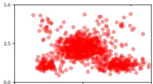

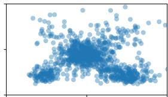

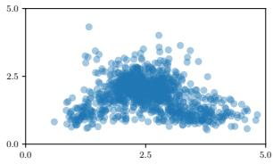

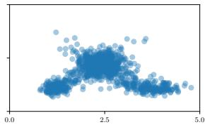

Figure 1: True and approximate $\pi ^ { y }$ samples, obtained with PDPS (topright), difusion DPS (bottom-left) and PnP-DM (bottom-right).
<table><tr><td>Methods</td><td>Toy (LC)</td><td>Toy (HC)</td></tr><tr><td>PDPS (MPDM)</td><td>0.0945 ± 0.0053</td><td>0.0732±0.0023</td></tr><tr><td>DPS-p (diffusion)</td><td>0.2134 ± 0.0046</td><td>0.2999 ± 0.0038</td></tr></table>

Table 1: Average 2-Wasserstein distance between $\pi ^ { y }$ exact samples and approximate ones.

<table><tr><td rowspan="2">Methods</td><td colspan="3">EAGLE denoising (LC)</td><td colspan="3">EAGLE denoising (HC)</td><td colspan="3">BrainWeb denoising (LC)</td><td colspan="3">BrainWeb denoising (HC)</td></tr><tr><td>|PSNR ↑</td><td>SSIM ↑</td><td>LPIPS↓</td><td>PSNR ↑</td><td>SSIM ↑</td><td>LPIPS ↓</td><td>|PSNR ↑</td><td>SSIM ↑</td><td>LPIPS↓</td><td>|PSNR ↑</td><td>SSIM ↑</td><td>LPIPS↓</td></tr><tr><td>PDPS (MPDM)</td><td>32.34</td><td>0.7916</td><td>0.1543</td><td>34.94</td><td>0.8435</td><td>0.0863</td><td>16.90</td><td>0.7812</td><td>0.1124</td><td>21.31</td><td>0.9019</td><td>0.0585</td></tr><tr><td>DPS (MPDM)</td><td>31.55</td><td>0.74729</td><td>0.1783</td><td>33.16</td><td>0.7748</td><td>0.1369</td><td>16.91</td><td>0.7574</td><td>0.1429</td><td>20.49</td><td>0.8477</td><td>0.1207</td></tr><tr><td>PnP-DM (MPDM)</td><td>26.25</td><td>0.5933</td><td>0.4149</td><td>34.80</td><td>0.8401</td><td>0.0991</td><td>16.65</td><td>0.6278</td><td>0.2258</td><td>21.72</td><td>0.8171</td><td>0.1408</td></tr><tr><td>DPS-p (diffusion)</td><td>32.46</td><td>0.8060</td><td>0.2213</td><td>34.69</td><td>0.8409</td><td>0.1612</td><td>17.22</td><td>0.7915</td><td>0.0890</td><td>20.62</td><td>0.8814</td><td>0.0591</td></tr><tr><td>DAPS-p (diffusion)</td><td>29.92</td><td>0.7268</td><td>0.2547</td><td>34.60</td><td>0.8388</td><td>0.1546</td><td>17.12</td><td>0.7794</td><td>0.1141</td><td>21.41</td><td>0.8796</td><td>0.0668</td></tr><tr><td rowspan="2">Methods</td><td colspan="3">EAGLE blur (LC)</td><td colspan="3">EAGLE blur (HC)</td><td colspan="3">BrainWeb PET (LC)</td><td colspan="3">BrainWeb PET (HC)</td></tr><tr><td>|PSNR ↑</td><td>SSIM ↑</td><td></td><td>LPIPS ↓ | PSNR ↑</td><td>SSIM ↑</td><td></td><td>LPIPS ↓ | PSNR ↑</td><td>SSIM↑</td><td></td><td>LPIPS ↓ | PSNR ↑</td><td>SSIM ↑</td><td>LPIPS↓</td></tr><tr><td>DPS (MPDM)</td><td>31.13</td><td>0.7638</td><td>0.2049</td><td>31.64</td><td>0.7764</td><td>0.1858</td><td>15.56</td><td>0.7084</td><td>0.1395</td><td>16.84</td><td>0.7503</td><td>0.1318</td></tr><tr><td>PnP-DM (MPDM)|</td><td>29.83</td><td>0.7341</td><td>0.3039</td><td>33.22</td><td>0.8000</td><td>0.2511</td><td>16.41</td><td>0.7329</td><td>0.1051</td><td>18.11</td><td>0.7940</td><td>0.0828</td></tr><tr><td>DPS-p (diffusion)</td><td>31.72</td><td>0.7935</td><td>0.2432</td><td>32.56</td><td>0.8017</td><td>0.2129</td><td>15.82</td><td>0.7401</td><td>0.0968</td><td>16.66</td><td>0.7758</td><td>0.0947</td></tr><tr><td>DAPS-g (diffusion)</td><td>31.99</td><td>0.7881</td><td>0.2652</td><td>33.14</td><td>0.8041</td><td>0.2365</td><td>16.13</td><td>0.7478</td><td>0.1111</td><td>17.60</td><td>0.7930</td><td>0.1115</td></tr></table>

Table 2: Quality of reconstructed images for diferent posterior sampling algorithms and Poisson inverse problems. Colors show best and second best , with ties due to overlapping confidence intervals. We only show best-performing methods: complete results are deferred to Appendix E.3. DPS-p and DAPS-p use the Poisson likelihood, and DAPS-g the Gaussianapproximated one.

Poisson inverse problems. We consider two classical Poisson inverse problems. PET (Bailey et al., 2005), where A is a Radon operator, and astronomical imaging, where A is a Gaussian blur operator (Donath et al., 2024), as well as the denoising problem $( \mathcal { A } = a \mathrm { I } _ { d } )$ . Each problem is studied in a both low-count regime and a high-count regime. For Poisson denoising problems, despite its low computational budget, PDPS consistently ranks first or second. MPDM-based DPS yields the best LPIPS for the blur problems, and MPDM-based PnP-DM the best overall performance for PET. Difusion based DPS and DAPS remain competitive.

## 5 Conclusion

We construct and study “Poissonian” difusion models, named MPDMs, using the multivariate counting processes framework. We motivate the use of MPDM beyond generative modeling by adapting several difusion-based posterior sampling algorithms; in particular, we demonstrate mathematically and empirically that MPDMs are well adapted to Poisson inverse problems, which remain relatively under-explored in this literature.

## Acknowledgments

Part ofthis work has been supported by the PRIMaL project (Carnot Institute). AD a obtenu un financement de la Fondation de l’Ecole polytechnique dans le cadre de sa campagne Servir la science. AD is supported by the France 2030 program <sup>´</sup> with the reference ANR-25-PEIA-0001 (THEOREM project) AD is funded by the European Union (ERC-2022-SYG-OCEAN-101071601). Views and opinions expressed are however those of the author(s) only and do not necessarily reflect those of the European Union or the European Research Council Executive Agency. Neither the European Union nor the granting authority can be held responsible for them. AD is supported by Hi! Paris and Agence Nationale de la Recherche (Grant 11-LABX-0047) This work received government funding administered by the National Research Agency (ANR) under the France 2030 program ”Hi! PARIS”, grant number ANR-23-IACL-0005.

## AI use statement

Generative AI tools were used to assist with minor English-language editing and polishing of parts of the main text. They were also used to assist with coding during the implementation and experimentation, with the resulting code systematically verified by the authors. All mathematical content, including the derivation of the theoretical results, was developed by the authors without the use of generative AI tools.

## Reproducibility statement

Appendices B and D contain detailed proofs of the mathematical statements as well as the pseudo-code associated with every algorithm mentioned in the main text. Implementation details are reported in Appendix E. Both datasets used in Section 4 are public; see also Appendix E.1.

## References

Berengere Aubert-Broche, Mark Grifin, G. Bruce Pike, Alan C. Evans, and D. Louis Collins. Twenty new digital brain\` phantoms for creation ofvalidation image data bases. IEEE transactions on medical imaging, 25(11):1410–1416, November 2006. ISSN 0278-0062. doi: 10.1109/TMI.2006.883453.

Jacob Austin, Daniel D. Johnson, Jonathan Ho, Daniel Tarlow, and Rianne van den Berg. Structured denoising difusion models in discrete state-spaces. Advances in Neural Information Processing Systems, 2021.

Dale L Bailey, David W Townsend, Peter E Valk, and Michael N Maisey, editors. Positron Emission Tomography: Basic Sciences. Springer, London, 2005. ISBN 978-1-85233-798-8 978-1-84628-007-8. doi: 10.1007/b136169. URL https: //link.springer.com/10.1007/b136169.

Sagnik Bhattacharya, Abhiram Gorle, Ahsan Bilal, Connor Ding, Amit Kumar Singh Yadav, and Tsachy Weissman. Itdpdm: Information-theoretic discrete poisson difusion model. In D. Belgrave, C. Zhang, H. Lin, R. Pascanu, P. Koniusz, M. Ghassemi, and N. Chen, editors, Advances in Neural Information Processing Systems, volume 38, Main Conference, pages 10860–10915. Curran Associates, Inc., 2025. doi: 10.52202/085713-0364. URL https://proceedings.neurips.cc/paper files/paper/2025/file/ 1021014b8c5a9008fc245736a1b73d7e-Paper-Conference.pdf.

Andrew Campbell, Joe Benton, Valentin De Bortoli, Tom Rainforth, George Deligiannidis, and Arnaud Doucet. A contin uous time framework for discrete denoising models. In Advances in Neural Information Processing Systems, 2022.

Tianqi Chen and Mingyuan Zhou. Learning toJump: Thinning and Thickening Latent Counts for Generative Modeling. In Proceedings ofthe 40th International Conference on Machine Learning, pages 5367–5382. PMLR, July 2023. URL https: //proceedings.mlr.press/v202/chen23ap.html. ISSN: 2640-3498.

Julien Chevallier. Modelling large neural networks via Hawkes processes. Theses, COMUE Universite C´ ote d’Azur (2015 -ˆ 2019), September 2016. URL https://theses.hal.science/tel-01415622. Issue: 2016AZUR4051.

Hyungjin Chung, Jeongsol Kim, Michael Thompson Mccann, Marc Louis Klasky, and Jong Chul Ye. Difusion posterior sampling for general noisy inverse problems. In The Eleventh International Conference on Learning Representations, 2023. URL https://openreview.net/forum?id=OnD9zGAGT0k.

D. J. Daley and D. Vere-Jones. An Introduction to the Theory ofPoint Processes. Probability and Its Applications. Springer, New York, NY, 2008. ISBN 978-0-387-21337-8 978-0-387-49835-5. doi: 10.1007/978-0-387-49835-5. URL http://link. springer.com/10.1007/978-0-387-49835-5.

Axel Donath, Aneta Siemiginowska, Vinay L. Kashyap, David A. van Dyk, and Douglas Burke. Joint Deconvolution of Astronomical Images in the Presence of Poisson Noise. The Astronomical Journal, 168(4):182, September 2024. ISSN 1538-3881. doi: 10.3847/1538-3881/ad6b98. URL https://doi.org/10.3847/1538-3881/ad6b98. Publisher: The American Astronomical Society.

Mark Girolami and Ben Calderhead. Riemann manifold Langevin and Hamiltonian Monte Carlo methods. Journal ofthe Royal Statistical Society: Series B (Statistical Methodology), 73(2):123–214, 2011. ISSN 1467-9868. doi: 10.1111/j.1467-9868. 2010.00765.x. URL https://onlinelibrary.wiley.com/doi/abs/10.1111/j.1467-9868.2010.00765.x.

J. Grandell. Mixed Poisson Processes. Chapman and Hall/CRC, Boca Raton, 1997. ISBN 978-1-003-05995-0. doi: 10.1201 9781003059950.

Louis Grenioux, Maxence Noble, Marylou Gabrie, and Alain Oliviero Durmus. Stochastic localization via iterative pos-´ terior sampling. In Forty-first International Conference on Machine Learning, 2024. URL https://openreview.net/ forum?id=2Gr5wZR6uc.

Jonathan Ho, Ajay Jain, and Pieter Abbeel. Denoising difusion probabilistic models. Advances in Neural Information Processing Systems, 2020.

Yazid Janati, Badr MOUFAD, Mehdi Abou El Qassime, Alain Oliviero Durmus, Eric Moulines, and Jimmy Olsson. A mixture-based framework for guiding difusion models. In Forty-second International Conference on Machine Learning, 2025a. URL https://openreview.net/forum?id=HIOA3bScFB.

Yazid Janati, Eric Moulines, Jimmy Olsson, and Alain Oliviero-Durmus. Bridging difusion posterior sampling and Monte Carlo methods: a survey. Philosophical Transactions of the Royal Society A: Mathematical, Physical and Engineering Sciences, 383(2299):20240331, June 2025b. ISSN 1364-503X. doi: 10.1098/rsta.2024.0331. URL https://doi.org/10. 1098/rsta.2024.0331.

Bahjat Kawar, Michael Elad, Stefano Ermon, and Jiaming Song. Denoising difusion restoration models. In Alice H. Oh, Alekh Agarwal, Danielle Belgrave, and Kyunghyun Cho, editors, Advances in Neural Information Processing Systems, 2022. URL https://openreview.net/forum?id=kxXvopt9pWK.

Xianghao Kong, Rob Brekelmans, and Greg Ver Steeg. Information-theoretic difusion. In The Eleventh International Conference on Learning Representations, 2023. URL https://openreview.net/forum?id=UvmDCdSPDOW.

Andreas E. Kyprianou. Fluctuations of Levy Processes with Applications: Introductory Lectures ´ . Universitext. Springer, Berlin, Heidelberg, 2014. ISBN 978-3-642-37631-3 978-3-642-37632-0. doi: 10.1007/978-3-642-37632-0. URL https: //link.springer.com/10.1007/978-3-642-37632-0.

Patrick J. Laub, Thomas Taimre, and Philip K. Pollett. Hawkes Processes, July 2015. URL http://arxiv.org/abs/ 1507.02822. arXiv preprint.

S. McAlpine, J. C. Helly, M. Schaller, J. W. Trayford, Y. Qu, M. Furlong, R. G. Bower, R. A. Crain, J. Schaye, T. Theuns, C. Dalla Vecchia, C. S. Frenk, I. G. McCarthy, A. Jenkins, Y. Rosas-Guevara, S. D. M. White, M. Baes, P. Camps, and G. Lemson. The eagle simulations of galaxy formation: Public release of halo and galaxy catalogues. Astronomy and Computing, 15:72–89, 2016. ISSN 2213-1337. doi: https://doi.org/10.1016/j.ascom.2016.02.004. URL https://www. sciencedirect.com/science/article/pii/S2213133716300130.

Andrea Montanari. Sampling, Difusions, and Stochastic Localization, May 2023. URL https://arxiv.org/abs/2305. 10690v2. arXiv preprint.

Philip E. Protter. Stochastic Integration and Diferential Equations, volume 21 ofStochastic Modelling and Applied Probability. Springer, Berlin, Heidelberg, 2005. ISBN 978-3-642-05560-7 978-3-662-10061-5. doi: 10.1007/978-3-662-10061-5. URL http://link.springer.com/10.1007/978-3-662-10061-5.

O. Ronneberger, P.Fischer, and T. Brox. U-net: Convolutional networks for biomedical image segmentation. In Medical Image Computing and Computer-Assisted Intervention (MICCAI), volume 9351 of LNCS, pages 234–241. Springer, 2015. URL http://lmb.informatik.uni-freiburg.de/Publications/2015/RFB15a. (available on arXiv:1505.04597 [cs.CV]).

Saeed Saremi, Ji Won Park, and Francis Bach. Chain of Log-Concave Markov Chains. International Conference on Learning Representations, 2024:17499–17522, May 2024. URL https://proceedings.iclr.cc/paper files/paper/2024/ hash/4b7439a4ab0b8e4bcb4e2412c6a10a58-Abstract-Conference.html

Georg Schramm. Simulated brainweb PET/MR data sets for denoising and deblurring. June 2021. URL https://zenodo. org/records/4897350.

Georg Schramm and Kris Thielemans. PARALLELPROJ—an open-source framework for fast calculation of projections in tomography. Frontiers in Nuclear Medicine, Volume 3 - 2023, 2024. ISSN 2673-8880. doi: 10.3389/fnume.2023. 1324562. URL https://www.frontiersin.org/journals/nuclear-medicine/articles/10.3389/fnume. 2023.1324562.

Jascha Sohl-Dickstein, Eric Weiss, Niru Maheswaranathan, and Surya Ganguli. Deep unsupervised learning using nonequilibrium thermodynamics. In Proceedings ofthe 32nd International Conference on Machine Learning, 2015.

Jiaming Song, Arash Vahdat, Morteza Mardani, and Jan Kautz. Pseudoinverse-guided difusion models for inverse problems. In International Conference on Learning Representations, 2023. URL https://openreview.net/forum?id= 9 gsMA8MRKQ.

Yang Song, Jascha Sohl-Dickstein, Diederik P. Kingma, Abhishek Kumar, Stefano Ermon, and Ben Poole. Score-based generative modeling through stochastic diferential equations. In International Conference on Learning Representations, 2021.

Zihui Wu, Yu Sun, Yifan Chen, Bingliang Zhang, Yisong Yue, and Katherine Bouman. Principled probabilistic imaging using difusion models as plug-and-play priors. In The Thirty-eighth Annual Conference on Neural Information Processing Systems, 2024. URL https://openreview.net/forum?id=Xq9HQf7VNV.

Bingliang Zhang, Wenda Chu, Julius Berner, Chenlin Meng, Anima Anandkumar, and Yang Song. Improving difusion inverse problem solving with decoupled noise annealing. In Proceedings of the Computer Vision and Pattern Recognition Conference, pages 20895–20905, 2025.

Mathias Zocher. Multivariate Mixed Poisson Processes. PhD thesis, Technische Universitat Dresden, 2005.¨

## A Further notation

Throughout this paper, $\mathbb { N } = \{ 0 , 1 , \ldots \}$ denotes the set of natural numbers, R the set of real numbers and $\mathbb { R } _ { + } : = [ 0 , + \infty ($ the set of non-negative real numbers. Given $d \geqslant 1$ , we write a d-dimensional vector as $x = ( x _ { 1 } , \ldots , x _ { d } ) \in \mathbb { R } ^ { d }$ . ∥x∥<sub>2</sub> denotes the usual Euclidean norm, and $\textstyle \| x \| _ { 1 } = \sum _ { i = 1 } ^ { d } | x _ { i } |$ the $l ^ { 1 }$ norm.

Given two probability distributions $\mu , \nu$ on $\mathbb { R } ^ { d }$ , the 2-Wasserstein distance is defined as

$$
\mathcal { W } _ { 2 } ( \mu , \nu ) = \operatorname* { i n f } _ { \rho \in \mathcal { C } ( \mu , \nu ) } \left( \int _ { \mathbb { R } ^ { d } \times \mathbb { R } ^ { d } } \| x - y \| _ { 2 } ^ { 2 } \rho ( \mathrm { d } x , \mathrm { d } y ) \right) ^ { 1 / 2 } ,\tag{8}
$$

where $\mathcal { C } ( \mu , \nu )$ denotes the set of probability measures on $\mathbb { R } ^ { d } \times \mathbb { R } ^ { d }$ with first (respectively second) marginal equals to $\mu$ (respectively ν). In particular, if $X \sim \mu , Y \sim \nu ,$ then $\mathcal { W } _ { 2 } ( \mu , \nu ) ^ { 2 } \leqslant \mathbb { E } \left[ \| X - \mathbf { \hat { Y } } \| _ { 2 } ^ { 2 } \right]$ . In this work, we also use the 1,1-Wasserstein distance, which we define as

$$
\mathcal { W } _ { 1 , 1 } ( \mu , \nu ) = \operatorname* { i n f } _ { \rho \in \mathcal { C } ( \mu , \nu ) } \int _ { \mathbb { R } ^ { d } \times \mathbb { R } ^ { d } } \| x - y \| _ { 1 } \rho ( \mathrm { d } x , \mathrm { d } y ) \mathrm { . }\tag{9}
$$

The exponential distribution with rate $\lambda > 0$ is denoted by $\mathrm { E x p } ( \lambda )$ , and $\mathrm { U n i f } _ { [ a , b ] }$ is the uniform distribution on $[ a , b ] \subseteq \mathbb { R }$ The d-dimensional normal distribution with mean $\mu \in \mathbb { R } ^ { d }$ and isotropic variance $\sigma ^ { 2 } > 0$ is denoted by $\mathrm { N } ( \mu , \sigma ^ { 2 } \mathrm { I } _ { d } )$ , where $\mathrm { I } _ { d }$ is the identity matrix in dimension d. If $\ l ( \alpha \in \mathbb { R } _ { + } ^ { d }$ , the multivariate Poisson distribution with mean α is denoted by $\mathrm { P o i s } ( \boldsymbol { \alpha } ) \colon \mathbf { a }  { \mathbb { N } } ^ { d }$ -valued random variable $Z \sim \operatorname { P o i s } ( \alpha )$ has independent coordinates $Z _ { i } \sim \mathrm { P o i s } ( \alpha _ { i } )$ , with $\mathrm { P o i s } ( \alpha _ { i } )$ the usual univariate Poisson distribution with mean $\alpha _ { i } \in \mathbb { R } _ { + }$ . Similarly, given $\alpha , \beta \in ( 0 , + \infty ) ^ { d }$ , we write the multivariate Gamma distribution (with independent coordinates) as $\Gamma ( \alpha , \beta )$ . Finally, if $x \in \mathbb { R } _ { + } ^ { d } \setminus \{ 0 \}$ , the categorical distribution $\operatorname { C a t } ( x )$ is the probability distribution on $\{ 1 , \ldots , d \}$ defined by $\operatorname { C a t } ( x ) ( \{ i \} ) = x _ { i } / \lVert x \rVert _ { 1 } ^ { \cdot }$

## B Mixed Poisson processes: additional content

This section is an extended version of Section 2, with additional statements, detailed proofs, and illustrations.

## B.1 Background on counting processes

Point processes. In Definition 1, we define counting processes as time-indexed stochastic processes with unit-jump trajectories, and adopt a martingale approach to characterize them through their compensator (or stochastic intensity). While this presentation sufices to develop our generative framework and is furthermore analogous to SDE-based difusion models, counting processes are usually part of the point processes literature. We provide a brief overview of this topic and refer to (Daley and Vere-Jones, 2008) for a detailed introduction.

A point process (Daley and Vere-Jones, 2008, Chapter 9) ξ is an integer-valued random measure on an adequate measurable metric space $\mathsf { X }$ equipped with its Borel σ-algebra $B ( { \sf X } )$ . To be precise, for any $\omega \in \Omega , \mathsf { A } \in \mathcal { B } ( \mathsf { X } ) \mapsto \xi ( \omega ) ( \mathsf { A } ) \in \mathbb { N }$ is an integer-valued, locally finite measure on ${ \mathrm { \sf X } } ;$ for a fixed ${ \mathsf { A } } \in { \mathcal { B } } ( \mathsf { X } ) , \omega \in \Omega \mapsto \xi ( \omega ) ( { \mathsf { A } } ) \in \mathbb { N }$ is an integer-valued random variable.

A simple point process satisfies, for almost all $\omega \in \Omega , \xi ( \omega ) ( \{ t \} ) \in \{ 0 , 1 \}$ for any $t \in { \mathsf { X } }$ , and can be written as a purely atomic measure: almost surely, there exists a countable set $\{ t _ { i } \} _ { i }$ , such that $\{ t _ { i } \} \cap \mathsf { A }$ is finite for any compact $\mathsf { A } \in B ( \mathsf { X } )$ and

$$
\xi = \sum _ { i } \delta _ { t _ { i } } \ .
$$

Univariate counting processes can be viewed as simple point processes on $\mathbb { R } _ { + } \colon$ given a counting process Z with jump times $\begin{array} { r } { ( T _ { i } ) _ { i \geqslant 1 } , \xi = \sum _ { i \geqslant 1 } \delta _ { T _ { i } } } \end{array}$ is a simple point process on $\mathbb { R } _ { + }$ . Reciprocally, given a simple point process on $\mathbb { R } _ { + } \xi , t \mapsto \xi ( [ 0 , t ] )$ is a counting process.

A simple marked point process is obtained by replacing the ground space X with, typically, ${ \sf X } \times \{ 1 , \dots , d \}$

$$
\xi = \sum _ { i } \delta _ { ( t _ { i } , k _ { i } ) } \ ,
$$

with $k _ { i } \in \{ 1 , \ldots , d \}$ . A multivariate counting process Z can be viewed as a marked point process on $\mathbb { R } _ { + } \times \{ 1 , \dots , d \}$ writing, for $1 \leqslant k \leqslant d , t \geqslant 0 , Z _ { t } ^ { k } = \xi ( [ 0 , t ] \times \{ k \} )$ .

A useful special case is the following: Π is said to be a Poisson point process with intensity measure $\mu ,$ with $\mu$ a measure on $\mathsf { X } ,$ if it satisfies Law $( \Pi ( { \sf A } ) ) = \mathrm { P o i s } ( \mu ( { \sf A } ) )$ for every measurable $\mathsf { A } \in B ( \mathsf { X } )$ ; and if furthermore $\Pi ( \mathsf { A } _ { 1 } ) , \hdots , \Pi ( \mathsf { A } _ { n } )$ are independents when $\mathsf { A } _ { 1 } , \ldots , \mathsf { A } _ { n }$ are disjoint measurable sets.

We may use a Poisson point process on $\mathbb { R } _ { + } \times \mathbb { R } _ { + }$ to build a univariate counting process Z from its F-stochastic intensity λ. Consider a F-Poisson point process Π with intensity measure dtdx on $\mathbb { R } _ { + } \times \mathbb { R } _ { + } , i . e .$ , for every $\mathsf { A } \in { \mathcal { B } } ( \mathbb { R } _ { + } ) , \Pi ( [ 0 , t ] \times \mathsf { A } )$ is a F-adapted Poisson process. As a side note, the F-Poisson point process has the strong Markov property: conditionally on $\mathcal { F } _ { T }$ , with T a F-stopping time, the restriction of Π to $[ T , + \infty ) \times \mathbb { R } _ { + }$ is still a Poisson point process, independent of $\mathcal { F } _ { T }$

Following (Chevallier, 2016, Theorem 2.8.11) or (Daley and Vere-Jones, 2008, Proposition 7.5.I), if $\mathbf { F } ^ { \mathbf { Z } } \subseteq \mathbf { F }$ , we have for every $t \geqslant 0$

$$
Z _ { t } = \int _ { 0 } ^ { t } \int _ { \mathbb { R } _ { + } } \mathbb { 1 } _ { [ 0 , \lambda _ { s - } ] } ( x ) \Pi ( { \mathrm { d } } s , { \mathrm { d } } x ) ~ .\tag{10}
$$

Writting $\begin{array} { r } { \Pi = \sum _ { i } \delta _ { ( s _ { i } , x _ { i } ) } } \end{array}$ , we have $\begin{array} { r } { Z _ { t } = \sum _ { i } \mathbb { 1 } _ { s _ { i } \leqslant t } \mathbb { 1 } _ { [ 0 , \lambda _ { s _ { i } - } ] } ( x _ { i } ) } \end{array}$ : the Poisson point process generates points $( s _ { i } , x _ { i } ) \in$ $\mathbb { R } _ { + } \times \mathbb { R } _ { + }$ , and $Z _ { s _ { i } } = Z _ { s _ { i } - } + 1$ when $\lambda _ { s _ { i } - } \geqslant x _ { i }$

Inhomogeneous Poisson processes. A univariate counting process whose stochastic intensity is a deterministic function is called an univariate inhomogeneous Poisson process. A multivariate inhomogeneous Poisson process N has independent coordinates which are inhomogeneous Poisson processes; in particular, its $\bf { F } ^ { N }$ -stochastic intensity is a locally integrable function $t \mapsto \alpha _ { t } = ( \alpha _ { t } ^ { 1 } , \ldots , \alpha _ { t } ^ { d } ) \in \mathbb { R } _ { + } ^ { d }$ . Alternatively, we may define it through the following transition mechanism.

Lemma 2. The jump times $( T _ { i } ) _ { i \geqslant 1 }$ of an inhomogeneous Poisson process N satisfy, for every i $\geqslant 0$

$$
\mathbb { P } ( T _ { i + 1 } > t | \mathcal { F } _ { T _ { i } } ^ { \mathbf { N } } ) = \exp \left( - \int _ { T _ { i } } ^ { t } \| \alpha _ { s } \| _ { 1 } \mathrm { d } s \right) ,
$$

with $T _ { 0 } = 0$ . Given the $( i + 1 ) - t h$ jump time, the coordinate that jumps is chosen proportionally to the intensity, namely, for every 1 $\leqslant k \leqslant d ,$

$$
\mathbb { P } ( N _ { T _ { i + 1 } } ^ { k } = N _ { T _ { i } } ^ { k } + 1 | \mathcal { F } _ { T _ { i } } ^ { \mathbf { N } } , T _ { i + 1 } ) = \alpha _ { T _ { i + 1 } } ^ { k } / \| \alpha _ { T _ { i + 1 } } \| _ { 1 } .
$$

Proof. This characterization of an inhomogeneous Poisson process is relatively standard: for completeness, we justify it below.

The sum of N coordinates, $\| \mathbf { N } \| _ { 1 }$ , is a univariate, inhomogeneous Poisson process with F<sup>N</sup>-intensity $\mathbf { F } ^ { \mathbf { N } }$ $t \mapsto \| \alpha _ { t } \| _ { 1 }$ . To see it, we may compute for $t > s ,$

$$
\mathbb { E } \left[ \Vert N _ { t } \Vert _ { 1 } - \Vert N _ { s } \Vert _ { 1 } | \mathcal { F } _ { s } ^ { \mathbf { N } } \right] = \sum _ { k = 1 } ^ { d } \mathbb { E } \left[ N _ { t } ^ { k } - N _ { s } ^ { k } | \mathcal { F } _ { s } ^ { \mathbf { N } } \right] = \int _ { s } ^ { t } \Vert \alpha _ { u } \Vert _ { 1 } \mathrm { d } u .
$$

Now, using (10), $\| \mathbf { N } \| _ { 1 }$ can we written as $\begin{array} { r } { \| N _ { t } \| _ { 1 } = \int _ { 0 } ^ { t } \int _ { \mathbb { R } _ { + } } \mathbb { 1 } _ { [ 0 , \| \alpha _ { s } \| _ { 1 } ] } ( x ) \Pi ( \mathrm { d } s , \mathrm { d } x ) } \end{array}$ , where Π is a $\mathbf { F } ^ { \mathbf { N } }$ -Poisson point process. Then, for $t \geqslant T _ { i }$

$$
\begin{array} { r l r } {  { \mathbb { P } ( T _ { i + 1 } > t | \mathcal { F } _ { T _ { i } } ^ { \mathbf { N } } ) = \mathbb { P } ( \int _ { T _ { i } } ^ { t } \int _ { \mathbb { R } _ { + } } \mathbb { 1 } _ { [ 0 , \| \alpha _ { s } \| _ { 1 } ] } ( x ) \Pi ( \mathrm { d } s , \mathrm { d } x ) = 0 ) \mathcal { F } _ { T _ { i } } ^ { \mathbf { N } } } } \\ & { } & { = \exp ( - \int _ { T _ { i } } ^ { t } \| \alpha _ { s } \| _ { 1 } \mathrm { d } s ) , } \end{array}\tag{11}
$$

as, by definition of the Poisson point process, conditionally on $\mathcal { F } _ { T _ { i } }$

$$
\int _ { T _ { i } } ^ { t } \int _ { \mathbb { R } _ { + } } \mathbb { 1 } _ { [ 0 , \lVert \alpha _ { s } \rVert _ { 1 } ] } ( x ) \Pi ( \mathrm { d } s , \mathrm { d } x ) \sim \mathrm { P o i s } \left( \int _ { T _ { i } } ^ { t } \int _ { \mathbb { R } _ { + } } \mathbb { 1 } _ { [ 0 , \lVert \alpha _ { s } \rVert _ { 1 } ] } ( x ) \mathrm { d } s \mathrm { d } x \right) ~ ,
$$

Here, we used the strong Markov property of the $\mathbf { F } ^ { \mathbf { N } }$ -Poisson point process Π: conditionally on $\mathcal { F } _ { T _ { i } } ^ { \mathbf { N } }$ , with $T _ { i } \mathrm { ~ a ~ } \mathbf { F } ^ { \mathbf { N } } .$ stopping time, the restriction of Π to $[ T _ { i } , + \infty ) \times { \mathbb R } _ { + }$ is still a Poisson point process. Similarly, we can obtain the jump distribution of each coordinate process:

$$
\begin{array} { r l r } { \left. { \mathbb { P } ( N _ { t } ^ { j } = N _ { T _ { i } } ^ { j } | \mathcal { F } _ { T _ { i } } ^ { \mathbf { N } } ) = \mathbb { P } \left( \int _ { T _ { i } } ^ { t } \int _ { \mathbb { R } _ { + } } \mathbb { 1 } _ { [ 0 , \alpha _ { s } ^ { j } ] } ( x ) \Pi ^ { j } ( \mathrm { d } s , \mathrm { d } x ) = 0 \right| \mathcal { F } _ { T _ { i } } ^ { \mathbf { N } }  } } \\ & \right){ } & { = \exp \left( - \int _ { T _ { i } } ^ { t } \alpha _ { s } ^ { j } \mathrm { d } s \right) . } \end{array}\tag{12}
$$

We now identify the mark distribution, $i . e . ,$ conditionally on $\mathcal { F } _ { T _ { i } } ^ { \bf N } , T _ { i + 1 }$ , the probability that $N _ { T _ { i + 1 } } ^ { k } = N _ { T _ { i } } ^ { k } + 1$ for a fixed $1 \leqslant k \leqslant d .$ . Conditionally on $\mathcal { F } _ { T _ { i } } ^ { \bf N }$ , define

$$
t \geqslant T _ { i } \mapsto p _ { j } ( t ) = \alpha _ { t } ^ { j } \exp \left( - \int _ { T _ { i } } ^ { t } \alpha _ { s } ^ { j } \mathrm { d } s \right) \ , 1 \leqslant j \leqslant d \ ,
$$

and $\begin{array} { r } { t \geqslant T _ { i } \mapsto p ( t ) = \| \alpha _ { t } \| _ { 1 } \exp \left( - \int _ { T _ { i } } ^ { t } \| \alpha _ { s } \| _ { 1 } \mathrm { d } s \right) } \end{array}$ . From (12),(11), we recognize the conditional density of the first jump time of $\mathbf { N } ^ { j }$ (respectively $\lVert \mathbf { N } \rVert _ { 1 } )$ on $[ T _ { i } , + \infty )$ . Then, we compute the probability that $\mathbf { N } ^ { k }$ is the first coordinate to jump after $T _ { i }$ , and do so before a given $t \geqslant T _ { i }$

$$
\begin{array} { r l r } {  { \mathbb { P } ( T _ { i + 1 } \leqslant t , N _ { T _ { i + 1 } } ^ { k } = N _ { T _ { i } } ^ { k } + 1 | \mathcal { F } _ { T _ { i } } ^ { \mathbf { N } } ) = \int _ { T _ { i } } ^ { t } p _ { k } \big ( s _ { k } \big ) \prod _ { j \neq k } \int _ { s _ { k } } ^ { \infty } p _ { j } \big ( s _ { j } \big ) \mathrm { d } s _ { j } \mathrm { d } s _ { k } } } \\ & { } & { = \int _ { T _ { i } } ^ { t } p _ { k } \big ( s _ { k } \big ) \prod _ { j \neq k } \exp ( - \int _ { T _ { i } } ^ { s _ { k } } \alpha _ { u } ^ { j } \mathrm { d } u ) \mathrm { d } s _ { k } } \\ & { } & { = \displaystyle \int _ { T _ { i } } ^ { t } \alpha _ { s _ { k } } ^ { k } \exp ( - \int _ { T _ { i } } ^ { s _ { k } } \| \alpha _ { u } \| _ { 1 } \mathrm { d } u ) \mathrm { d } s _ { k } . } \end{array}
$$

Here, we used the fact that the coordinate processes are independent. We may also compute this probability by considering that the next jump of $\| \mathbf { N } \| _ { 1 }$ occurs at time $s ,$ and introduce the probability $q _ { k } ( s )$ that this jump actually occurs on coordinate k:

$$
\begin{array} { r l } & { \mathbb { P } ( \boldsymbol { T } _ { i + 1 } \leqslant t , N _ { \boldsymbol { T } _ { i + 1 } } ^ { k } = N _ { \boldsymbol { T } _ { i } } ^ { k } + 1 | \mathcal { F } _ { \boldsymbol { T } _ { i } } ^ { \mathbf { N } } ) = \displaystyle \int _ { \boldsymbol { T } _ { i } } ^ { t } p ( s ) q _ { k } ( s ) \mathrm { d } s } \\ & { \quad \quad \quad \quad \quad = \displaystyle \int _ { \boldsymbol { T } _ { i } } ^ { t } \| \alpha _ { s } \| _ { 1 } \exp \left( - \displaystyle \int _ { \boldsymbol { T } _ { i } } ^ { s } \| \alpha _ { u } \| _ { 1 } \mathrm { d } u \right) q _ { k } ( s ) \mathrm { d } s . } \end{array}
$$

These two expressions coincide by setting $q _ { k } ( s ) = \alpha _ { s } ^ { k } / \| \alpha _ { s } \|$ <sub>1</sub>, yielding the desired mark distribution.

Consider now a multivariate counting process Z whose $\mathbf { F } ^ { \mathbf { Z } } .$ -stochastic intensity is of the form $t \mapsto \lambda _ { t } = u _ { t } ( Z _ { t - } )$ , where, for any $z \in \mathbb { N } ^ { d } , t \mapsto u _ { t } ( z )$ is locally integrable. Observe that between two consecutive jumps, i.e., on $[ T _ { i } , T _ { i + 1 } )$ , conditionally on $\mathcal { F } _ { T _ { i } } , \mathbf { Z }$ coincides with an inhomogeneous Poisson process with intensity deterministic $t \mapsto u _ { t } ( Z _ { T _ { i } } )$ . As a result, we can extend Lemma 2 as follow.

Proposition 5. The jump times $( T _ { i } ) _ { i \geqslant 1 }$ of a counting process Z with intensity of the form $t \mapsto u _ { t } ( Z _ { t - } )$ satisfy, for every $i \geqslant 0$

$$
\mathbb { P } ( T _ { i + 1 } > t | \mathcal { F } _ { T _ { i } } ^ { \mathbf { Z } } ) = \exp \left( - \int _ { T _ { i } } ^ { t } \| u _ { s } ( Z _ { T _ { i } } ) \| _ { 1 } \mathrm { d } s \right) ,
$$

with $T _ { 0 } = 0$ . Given the (i + 1)-th jump time, the coordinate that jumps is chosen proportionally to the intensity, namely, for every $1 \leqslant k \leqslant d ,$

$$
\begin{array} { r } { \mathbb { P } ( Z _ { T _ { i + 1 } } ^ { k } = Z _ { T _ { i } } ^ { k } + 1 | \mathcal { F } _ { T _ { i } } ^ { \mathbf { Z } } , T _ { i + 1 } ) = u _ { T _ { i + 1 } } ^ { k } ( Z _ { T _ { i } } ) / \| u _ { T _ { i + 1 } } ( Z _ { T _ { i } } ) \| _ { 1 } . } \end{array}
$$

In particular, Z is a Markov process.

## B.2 MPP properties: proofs of Section 2.1

Proposition 2. Given any $\mathbf { Z } \sim \mathrm { M P P } ( \pi )$ , the Poisson denoiser $K ^ { \pi }$ defined by (1) can be expressed as follows. For every $t > 0 \ a n d z \in \mathbb { N } ^ { d }$

$$
K _ { t } ^ { \pi } ( z ) = \int _ { \mathbb R _ { + } ^ { d } } x \prod _ { i = 1 } ^ { d } \mathrm e ^ { - t x _ { i } } x _ { i } ^ { z _ { i } } \pi ( \mathrm { d } x ) \Bigg / \int _ { \mathbb R _ { + } ^ { d } } \prod _ { i = 1 } ^ { d } \mathrm e ^ { - t x _ { i } } x _ { i } ^ { z _ { i } } \pi ( \mathrm { d } x )\tag{3}
$$

holds $i f \mathbb { P } ( Z _ { t } = z ) > 0$ ; otherwise, by convention, $K _ { t } ^ { \pi } ( z ) = 0$ . Furthermore, for $a n y z \in \mathbb { N } ^ { d } , t > 0 \mapsto K _ { t } ^ { \pi } ( z )$ is smooth and $t > 0 \mapsto \| K _ { t } ^ { \pi } ( z ) \| _ { 1 }$ is non-increasing.

Proof. This expression of the denoiser is derived in (Zocher, 2005, Theorem 3.4.2, 4.4.2); we include it here for completeness. Let $\mathbf { Z } \sim \mathrm { M P P } ( \pi )$ , with random rate X. Fix $t > 0 , z \in \mathbb { N } ^ { d }$ . Since $Z _ { t }$ , conditionally on X, has independent coordinates distributed as $\mathcal { P } ( t X _ { i } ) , 1 \leqslant i \leqslant d .$ , we have

$$
\mathbb { P } \big ( Z _ { t } = z \big ) = \int _ { \mathbb { R } _ { + } ^ { d } } p _ { t } \big ( z | x \big ) \pi \big ( \mathrm { d } x \big ) , \quad p _ { t } \big ( z | x \big ) : = \prod _ { j = 1 } ^ { d } \mathrm { e } ^ { - t x _ { j } } \frac { ( t x _ { j } ) ^ { z _ { j } } } { z _ { j } ! } .\tag{13}
$$

This probability may vanish if, $\mathbf { e . g . } , \pi ( \{ 0 \} \times \mathbb { R } _ { + } ^ { d - 1 } ) = 1$ and $z _ { 1 } \geqslant 1 ;$ it is non-zero if and only ${ \mathrm { i f ~ } } \pi ( ( \left\{ z _ { 1 } \right\} \cup ( 0 , + \infty ) ) \times$ $\cdot \cdot \cdot \times ( \{ z _ { d } \} \cup ( 0 , + \infty ) ) ) > 0$ , which we assume from now on.

Using Bayes’ rule leads to the conditional distribution of X given $Z _ { t } = z , \pi _ { t } ( \mathrm { d } x | z ) = p _ { t } ( z | x ) \pi ( \mathrm { d } x ) / \mathbb { P } ( Z _ { t } = z )$ ; hence for any $1 \leqslant i \leqslant d ,$ the denoiser i-th coordinate satisfies

$$
\begin{array} { r l } & { [ K _ { t } ^ { \pi } ( z ) ] _ { i } = \mathbb { E } [ X _ { i } | Z _ { t } = z ] } \\ & { \quad \quad \quad = \frac { 1 } { \mathbb { P } ( Z _ { t } = z ) } \int _ { \mathbb R _ { + } ^ { d } } x _ { i } \times p _ { t } ( z | x ) \pi ( \mathrm { d } x ) } \\ & { \quad \quad \quad = \frac { 1 } { \mathbb { P } ( Z _ { t } = z ) } \int _ { \mathbb R _ { + } ^ { d } } \frac { z _ { i } + 1 } { t } \frac { ( t x _ { i } ) ^ { z _ { i } + 1 } } { ( z _ { i } + 1 ) ! } \times \displaystyle \prod _ { j \neq i } \mathrm e ^ { - t x _ { j } } \frac { ( t x _ { j } ) ^ { z _ { j } } } { z _ { j } ! } \pi ( \mathrm { d } x ) } \\ & { \quad \quad \quad = \frac { z _ { i } + 1 } { t } \frac { \mathbb { P } ( Z _ { t } = z + e _ { i } ) } { \mathbb { P } ( Z _ { t } = z ) } , } \end{array}
$$

recognizing (13) with $z + e _ { i }$ . Using again (13), we get

$$
\begin{array} { r l r } {  { [ K _ { t } ^ { \pi } ( z ) ] _ { i } = \int _ { \mathbb { R } _ { + } ^ { d } } x _ { i } \prod _ { j = 1 } ^ { d } \mathrm { e } ^ { - t x _ { j } } \frac { ( t x _ { j } ) ^ { z _ { j } } } { z _ { j } ! } \pi ( \mathrm { d } x ) \Bigg / \int _ { \mathbb { R } _ { + } ^ { d } } \prod _ { j = 1 } ^ { d } \mathrm { e } ^ { - t x _ { j } } \frac { ( t x _ { j } ) ^ { z _ { j } } } { z _ { j } ! } \pi ( \mathrm { d } x ) } } \\ & { } & { = \int _ { \mathbb { R } _ { + } ^ { d } } x _ { i } \prod _ { j = 1 } ^ { d } \mathrm { e } ^ { - t x _ { j } } x _ { j } ^ { z _ { j } } \pi ( \mathrm { d } x ) \Bigg / \int _ { \mathbb { R } _ { + } ^ { d } } \prod _ { j = 1 } ^ { d } \mathrm { e } ^ { - t x _ { j } } x _ { j } ^ { z _ { j } } \pi ( \mathrm { d } x ) \ , } \end{array}
$$

after simplifying the common factors, which proves the first part of the proposition.

Smoothness of $t > 0 \mapsto K _ { t } ^ { \pi } ( z )$ follows from the smoothness of the Laplace transform of π; we refer to (Zocher, 2005, Theorem 3.4.5) for details.

Regarding the last point of the proposition let $\begin{array} { r } { S : = \sum _ { j = 1 } ^ { d } X _ { j } , P : = \prod _ { j = 1 } ^ { d } X _ { j } ^ { z _ { j } } } \end{array}$ ; then for $t > 0 _ { i }$

$$
\| K _ { t } ^ { \pi } ( z ) \| _ { 1 } = \sum _ { i = 1 } ^ { d } \mathbb { E } [ X _ { i } \mathrm { e } ^ { - t S } P ] / \mathbb { E } [ \mathrm { e } ^ { - t S } P ] = \mathbb { E } [ S \mathrm { e } ^ { - t S } P ] / \mathbb { E } [ \mathrm { e } ^ { - t S } P ] ,
$$

$$
\mathbb { E } [ \mathrm { e } ^ { - t S } P ] ^ { 2 } \times \frac { \mathrm { d } } { \mathrm { d } t } \Vert K _ { t } ^ { \pi } ( z ) \Vert _ { 1 } = \mathbb { E } [ S \mathrm { e } ^ { - t S } P ] \mathbb { E } [ S \mathrm { e } ^ { - t S } P ] - \mathbb { E } [ S ^ { 2 } \mathrm { e } ^ { - t S } P ] \mathbb { E } [ \mathrm { e } ^ { - t S } P ] .\tag{14}
$$

From the Cauchy-Schwarz inequality, we have

$$
\begin{array} { r l } & { \mathbb { E } [ S \mathrm { e } ^ { - t S } P ] ^ { 2 } = \mathbb { E } [ S \mathrm { e } ^ { - t S / 2 } P ^ { 1 / 2 } \times \mathrm { e } ^ { - t S / 2 } P ^ { 1 / 2 } ] ^ { 2 } } \\ & { \qquad \leqslant \mathbb { E } [ S ^ { 2 } \mathrm { e } ^ { - t S } P ] \mathbb { E } [ \mathrm { e } ^ { - t S } P ] , } \end{array}
$$

thus $( 1 4 ) \leqslant 0 ,$ which concludes the proof.

Theorem 1. Let $\mathbf { Z } \sim \operatorname { M P P } ( \pi )$ , with random rate X. Almost surely, $\operatorname* { l i m } _ { t \to \infty } Z _ { t } / t = X$

Proof. The proof is a straightforward generalization of the univariate case (Grandell, 1997, Proposition 4.2). Conditioning on ${ \dot { X } } .$ , we get

$$
\mathbb { P } ( Z _ { t } / t \to X ) = \mathbb { E } \left[ \mathbb { P } \left( \bigcap _ { i = 1 } ^ { d } \{ Z _ { t } ^ { i } / t \to X _ { i } \} \right) \Bigg | X \right] .
$$

By definition, conditionally on $X ,$ , the coordinates $\mathbf { Z } ^ { i } , 1 \leqslant i \leqslant d$ , are Poisson processes with respective intensities $X _ { i } , 1 \leqslant i \leqslant d .$ . As a consequence, it sufices to check that for every $x > 0 , N _ { t } ^ { x } / t \to x$ , where $\mathbf { N } ^ { x }$ is a univariate Poisson process with rate x, whose jump times are denoted by $( T _ { n } ^ { x } ) _ { n \geqslant 1 }$ . The case $x = 0$ is obvious. $\mathrm { I f } \ x > 0 ;$ the strong law of large numbers gives $T _ { n } ^ { x } / n \to 1 / x { \mathrm { ~ a . s ~ } }$ ., since the increments $T _ { n } ^ { x } - T _ { n - 1 } ^ { x }$ are independent and distributed as $\operatorname { E x p } ( x )$ ; in particular, $T _ { n } ^ { x } \to + \infty$ a.s. Now fix $\varepsilon > 0$ : almost surely, there exist p ∈ N such that $x - \varepsilon \leqslant n / T _ { n + 1 }$ and $n / T _ { n } \leqslant x + \varepsilon$ for any $n \geqslant p . \mathrm { H } t \geqslant T _ { p } ^ { x }$ , there exists $n \geqslant p$ satisfying $T _ { n } ^ { x } \leqslant t < T _ { n + 1 } ^ { x }$ , and

$$
x - \varepsilon \leqslant n / T _ { n + 1 } \leqslant N _ { t } ^ { x } / t \leqslant n / T _ { n } \leqslant x + \varepsilon ,
$$

concluding the proof.

Theorem 2. The $\mathbf { F } ^ { \mathbf { Z } }$ -compensator of a mixed Poisson process $\mathbf { Z } \sim \operatorname { M P P } ( \pi )$ is the process defined for every $t \geqslant 0$ by

$$
\Lambda _ { t } = \int _ { 0 } ^ { t } K _ { s } ^ { \pi } ( Z _ { s } ) \mathrm { d } s .
$$

In other words, Z is a Markov counting process with $\mathbf { F } ^ { \mathbf { Z } }$ -stochastic intensity $t \in \mathbb { R } _ { + } \mapsto K _ { t } ^ { \pi } ( Z _ { t - } )$

Proof. Let $X \sim \pi$ denote the random rate of Z. First, we show that the result holds by replacing $K _ { t } ^ { \pi } ( Z _ { s } ) = \mathbb { E } [ X | Z _ { s } ]$ with $\mathbb { E } [ X | \mathcal { F } _ { s } ^ { \mathbf { Z } } ]$ . Consider the augmented σ-algebra $\mathcal G _ { t } = \sigma ( X ) \vee \mathcal F _ { t } ^ { \mathbf Z }$ , satisfying $\mathcal { F } _ { t } ^ { \mathbf { Z } } \subseteq \mathcal { G } _ { t }$ . Z is, conditionally on X, a multivariate Poisson process with intensity $X$ , thus have Poisson-distributed independent increments. Then, for every $t > s \geqslant 0$

$$
\begin{array} { r l } & { \mathbb E \left[ Z _ { t } - \displaystyle \int _ { 0 } ^ { t } \mathbb E [ X | \mathcal F _ { u } ^ { \mathbb Z } ] \mathrm { d } u \bigg | \mathcal F _ { s } ^ { \mathbb Z } \right] = Z _ { s } + \mathbb E [ \mathbb E [ Z _ { t } - Z _ { s } | \mathcal G _ { s } ] | \mathcal F _ { s } ^ { \mathbb Z } ] - \displaystyle \int _ { 0 } ^ { s } \mathbb E [ X | \mathcal F _ { u } ^ { \mathbb Z } ] \mathrm { d } u - \int _ { s } ^ { t } \mathbb E [ X | \mathcal F _ { s } ^ { \mathbb Z } ] d u } \\ & { \quad \quad \quad = Z _ { s } + \mathbb E [ ( t - s ) X | \mathcal F _ { s } ^ { \mathbb Z } ] - \displaystyle \int _ { 0 } ^ { s } \mathbb E [ X | \mathcal F _ { u } ^ { \mathbb Z } ] \mathrm { d } u - ( t - s ) \mathbb E [ X | \mathcal F _ { s } ^ { \mathbb Z } ] } \\ & { \quad \quad \quad = Z _ { s } - \displaystyle \int _ { 0 } ^ { s } \mathbb E [ X | \mathcal F _ { u } ^ { \mathbb Z } ] \mathrm { d } u , } \end{array}
$$

where we used $\mathbb { E } [ \mathbb { E } [ X | \mathcal { F } _ { u } ^ { \mathbf { Z } } ] | \mathcal { F } _ { s } ^ { \mathbf { Z } } ] = \mathbb { E } [ X | \mathcal { F } _ { s } ^ { \mathbf { Z } } ]$ for u $\geqslant s$

Finally, the structure of the mixed Poisson process ensures that $\mathbb { E } [ X | \mathcal { F } _ { t } ^ { \mathbf { Z } } ] = \mathbb { E } [ X | Z _ { t } ] .$ . Take $\mathsf { A } = \{ Z _ { t _ { 1 } } = z _ { 1 } , . . . , Z _ { t _ { n } } =$ $z _ { n } \} \in \mathcal { F } _ { t } ^ { \mathbf { Z } }$ , with $0 = t _ { 0 } \leqslant t _ { 1 } \leqslant \ldots \leqslant t _ { n } = t$ and for any $0 \leqslant i \leqslant n , z _ { i } = ( z _ { i } ^ { 1 } , \ldots , z _ { i } ^ { d } ) \in \mathbb { N } ^ { d }$ with for every $1 \leqslant j \leqslant d ,$ $0 = z _ { 0 } ^ { j } \leqslant z _ { 1 } ^ { j } \leqslant \ldots \leqslant z _ { n } ^ { j }$ . As, conditionally on $X , \mathbf { Z }$ is a multivariate Poisson process with intensity X, its coordinates are

independent univariate Poisson processes, whose increments are independent and Poisson distributed. Consequently,

$$
\begin{array} { l } { \displaystyle \mathbb { P } ( \mathsf { A } | X ) = \mathbb { P } \left( \left. \bigcap _ { j = 1 } ^ { d } \bigcap _ { i = 1 } ^ { n } \left\{ Z _ { t _ { i } } ^ { j } - Z _ { t _ { i - 1 } } ^ { j } = z _ { i } ^ { j } - z _ { i - 1 } ^ { j } \right\} \right| X \right) } \\ { \displaystyle = \prod _ { j = 1 } ^ { d } \prod _ { i = 1 } ^ { n } \mathrm { e } ^ { - ( t _ { i } - t _ { i - 1 } ) X _ { j } } \frac { ( t _ { i } - t _ { i - 1 } ) ^ { z _ { i } ^ { j } - z _ { i - 1 } ^ { j } } X _ { j } ^ { z _ { i } ^ { j } - z _ { i - 1 } ^ { j } } } { ( z _ { i } ^ { j } - z _ { i - 1 } ^ { j } ) ! } } \\ { \displaystyle = \mathrm { e } ^ { - t \| X \| _ { 1 } } P \times \prod _ { j = 1 } ^ { d } \prod _ { i = 1 } ^ { n } \frac { ( t _ { i } - t _ { i - 1 } ) ^ { z _ { i } ^ { j } - z _ { i - 1 } ^ { j } } } { ( z _ { i } ^ { j } - z _ { i - 1 } ^ { j } ) ! } , } \end{array}
$$

where $\textstyle P : = \prod _ { j = 1 } ^ { d } X _ { j } ^ { z _ { n } ^ { j } }$ . The double product is a constant that we denote $C _ { \mathsf { A } } .$ . Then,

$$
\begin{array} { r } { \mathbb { E } [ \mathbb { 1 } _ { \mathsf { A } } X ] = \mathbb { E } [ X \mathbb { P } ( \mathsf { A } | X ) ] \qquad } \\ { = \mathbb { E } [ X \mathrm { e } ^ { - t \| X \| _ { 1 } } P ] \times C _ { A } \ . } \end{array}
$$

Furthermore, as $\left\{ Z _ { t } = z _ { n } \right\} \supseteq \mathsf { A }$ and $\mathbb { E } [ X | Z _ { t } ] \mathbb { 1 } _ { Z _ { t } = z _ { n } } = \mathbb { E } [ X | Z _ { t } = z _ { n } ] \mathbb { 1 } _ { Z _ { t } = z _ { n } }$

$$
\begin{array} { r l } & { \mathbb { E } [ \mathbb { E } [ X | Z _ { t } ] \mathbb { 1 } _ { \mathsf { A } } ] = \mathbb { E } [ \mathbb { E } [ X | Z _ { t } ] \mathbb { 1 } _ { Z _ { t } = z _ { n } } \mathbb { 1 } _ { \mathsf { A } } ] } \\ & { \quad \quad = \mathbb { E } [ X | Z _ { t } = z _ { n } ] \mathbb { P } ( \mathsf { A } ) } \\ & { \quad \quad = K _ { t } ^ { \pi } ( z _ { n } ) \times \mathbb { E } [ \mathrm { e } ^ { - t \| X \| _ { 1 } } P ] \times C _ { \mathsf { A } } } \\ & { \quad \quad = \mathbb { E } [ X \mathrm { e } ^ { - t \| X \| _ { 1 } } P ] \times C _ { \mathsf { A } } , } \end{array}
$$

where we use Proposition 2 to obtain the last line. Thus $\mathbb { E } [ \mathbb { E } [ X | Z _ { t } ] \mathbb { 1 } _ { \mathsf { A } } ] = \mathbb { E } [ \mathbb { 1 } _ { \mathsf { A } } X ]$ which shows that $\mathbb { E } [ X | Z _ { t } ] = \mathbb { E } [ X | \mathcal { F } _ { t } ^ { \mathbf { Z } } ]$ Because its stochastic intensity at t is $Z _ { t }$ -measurable rather than simply $\mathcal { F } _ { t } ^ { \mathbf { Z } }$ -measurable, it is relatively straightforward to see that Z is a Markov process; see Proposition 5. Alternatively, we can prove it directly as follows. Keep the introduced notation, and let $\mathsf { A } ^ { \prime } = \mathsf { \bar { f } } Z _ { t _ { 1 } } = z _ { 1 } , \dots , \mathsf { \bar { Z } } _ { t _ { n - 1 } } = z _ { n - 1 } \} \in \mathcal { F } _ { t _ { n - 1 } } ^ { \mathbf { Z } } ;$ ; we have $\mathsf { A } \subseteq \mathsf { A } ^ { \prime }$ . Notice that

$$
C _ { \mathsf { A } } / C _ { \mathsf { A } ^ { \prime } } = \prod _ { j = 1 } ^ { d } ( t - t _ { n - 1 } ) ^ { z _ { n } ^ { j } - z _ { n - 1 } ^ { j } } / ( z _ { n } ^ { j } - z _ { n - 1 } ^ { j } ) ! .
$$

Then,

$$
\begin{array} { l } { \mathbb { P } ( Z _ { t } = z _ { n } | \mathsf { A } ^ { \prime } ) = \mathbb { P } ( \mathsf { A } ) / \mathbb { P } ( \mathsf { A } ^ { \prime } ) } \\ { = \mathbb { E } \left[ \mathrm { e } ^ { - t | | X | | _ { 1 } } \displaystyle \prod _ { j = 1 } ^ { d } X _ { j } ^ { z _ { n } ^ { j } } \right] \Bigg / \mathbb { E } \left[ \mathrm { e } ^ { - t _ { n - 1 } | | X | | _ { 1 } } \displaystyle \prod _ { j = 1 } ^ { d } X _ { j } ^ { z _ { n - 1 } ^ { j } } \right] \times \prod _ { j = 1 } ^ { d } \frac { ( t - t _ { n - 1 } ) ^ { z _ { n } ^ { j } - z _ { n - 1 } ^ { j } } } { ( z _ { n } ^ { j } - z _ { n - 1 } ^ { j } ) ! } . } \end{array}
$$

This expression does not depend on $t _ { i } , z _ { i } , i < n - 1$ : the same computation, but replacing $\mathsf { A } ^ { \prime }$ with $\{ Z _ { t _ { n - 1 } } = z _ { n - 1 } \}$ , yields the same expression: thus $\mathbb P ( Z _ { t } = z _ { n } | \mathsf { A } ^ { \prime } ) = \mathbb P ( Z _ { t } = z _ { n } | Z _ { t _ { n - 1 } } = z _ { n - 1 } )$ , hence the Markov property. □

## B.3 Simulation algorithms: proofs and illustrations

Proposition 6. Consider a counting process Z whose $\mathbf { F } ^ { \mathbf { Z } } .$ -intensity has the form $t \mapsto \lambda _ { t } = u _ { t } ( Z _ { t - } ) \in \mathbb { R } _ { + } ^ { d }$ , with u a locally integrable function such that for every $z \in \mathbb { N } ^ { d } , t \mapsto \| u _ { t } ( z ) \| _ { 1 }$ is positive and non-increasing. Let Z<sup>¯</sup> denote the counting process recursively defined as follows.

Set $\bar { T } _ { 0 } = 0$ . For every $i \geqslant 0 ,$ conditionally on $\bar { T } _ { i } , \bar { Z } _ { \bar { T } _ { i } }$ , draw the jump times of a univariate Poisson process on $[ \bar { T } _ { i } , + \infty )$ with constant intensity $\Vert u _ { \bar { T } _ { i } } ( \bar { Z } _ { \bar { T } _ { i } } ) \Vert _ { 1 }$ , that $i s , \bar { T } _ { i } < S _ { 1 } < \bar { S } _ { 2 } < . .$ . with iid increments distributed as $\mathrm { E x p } ( \| u _ { \bar { T } _ { i } } ( \bar { Z } _ { \bar { T } _ { i } } ) \| _ { 1 } )$ Starting from $k = 1 ,$ draw $U _ { k } \sim \mathcal { U } _ { [ 0 , 1 ] } . \ I f U _ { k } < \| u _ { S _ { k } } ( \bar { Z } _ { \bar { T } _ { i } } ) \| _ { 1 } / \| u _ { \bar { T } _ { i } } ( \bar { Z } _ { \bar { T } _ { i } } ) \| _ { 1 } , s e t \bar { T } _ { i + 1 } = S _ { k }$ , draw $j \sim \mathrm { C a t } ( u _ { \bar { T } _ { i + 1 } } ( \bar { Z } _ { \bar { T } _ { i } } ) )$ and set $\bar { Z } _ { \bar { T } _ { i + 1 } } = \bar { Z } _ { \bar { T } _ { i } } + e _ { j } , e _ { j } = ( \delta _ { j , l } ) _ { l = 1 } ^ { d }$ . Else, increment k and repeat.

Then, both processes Z<sup>¯</sup>, Z have the same distribution.

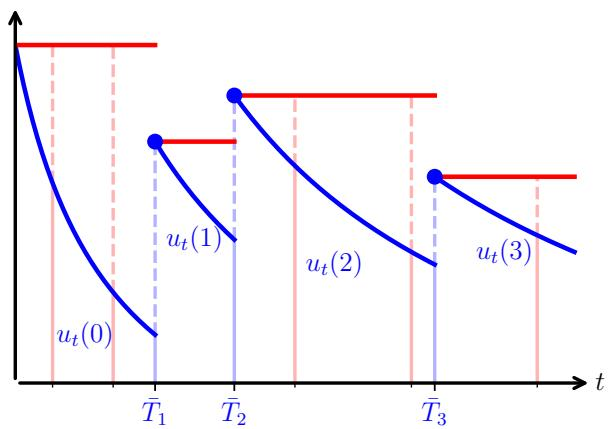

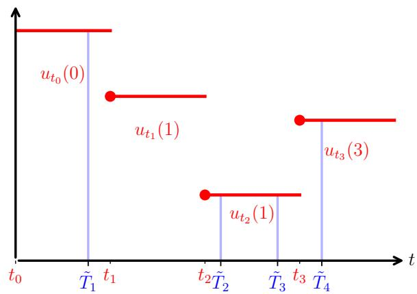  
Figure 2: Visual representation of the simulation procedures when π is a Gamma distribution with paramaters $\alpha , \beta = 1 , 2$ (Left) The thinning algorithm of Proposition 6, Algorithm 2, in dimension $d = 1$ . For every $i \geqslant 0 , t \geqslant \bar { T } _ { i }$ , potential jump times (vertical lines) are drawn according to the “frozen”, piecewise constant intensity $u _ { \bar { T } _ { i } } ( i )$ (red curve) instead ofthe true intensity $t \mapsto u _ { t } ( i )$ (blue curve); and accepted with probability $u _ { t } ( i ) / u _ { \bar { T } _ { i } } ( i ) = ( - \bar { - } ) / ( - \bar { } - ) + - - - )$ . Accepted jumps times $\bar { T _ { i } }$ are colored blue. (Right) The approximate process of Proposition 7, Algorithm 1. Given a time-grid $0 = t _ { 0 } < t _ { 1 } < t _ { 2 } < . . .$ , jump times $\tilde { T _ { i } }$ are drawn according to a discretized version of the intensity (red curve): on each sub-interval $[ t _ { k } , t _ { k + 1 } ]$ , the number of jumps is distributed as $\mathrm { P o i s } ( ( t _ { k + 1 } - t _ { k } ) u _ { t _ { k } } ( \tilde { Z } _ { t _ { k } } ) )$ .

Proof. As, conditionally on $\mathbf { F } _ { T _ { i } } ^ { \mathbf { Z } }$ , the counting process Z coincides with an inhomogeneous Poisson process with deter ministic intensity $t \mapsto u _ { t } ( Z _ { T _ { i } } ) { \overset { } { = } } : \alpha _ { t }$ until its next jump, Proposition 5 gives

$$
\mathbb { P } ( T _ { i + 1 } > t | Z _ { T _ { i } } , T _ { i } ) = \exp \left( - \int _ { T _ { i } } ^ { t } \| \alpha _ { s } \| _ { 1 } \mathrm { d } s \right) ~ ,
$$

and coordinate j is chosen with probability $\alpha _ { T _ { i + 1 } } ^ { j } / \Vert \alpha _ { T _ { i + 1 } } \Vert _ { 1 } , i . e .$ ., the same mechanism used to simulate $\bar { \mathbf { Z } } .$

Now, we must verify that the distribution of $( \bar { T } _ { i } ) _ { i \geqslant 0 }$ coincides with that of $( T _ { i } ) _ { i \geqslant 0 } .$ . Fix $i \in \mathbb N$ and $t \geqslant \bar { T } _ { i }$ . Conditionally on $\bar { T _ { i } } , \bar { Z _ { \bar { T } _ { i } } }$ , let M denote the number ofjumps ofa univariate Poisson process on $[ \bar { T } _ { i } , t ]$ with constant intensity $\| u _ { \bar { T } _ { i } } ( \bar { Z } _ { \bar { T } _ { i } } ) \| _ { 1 } =$ $\lVert \alpha _ { \bar { T } _ { i } } \rVert _ { 1 }$ , and $\bar { T } _ { i } < S _ { 1 } < \cdots < S _ { M }$ the associated jump times. Conditionally on $\bar { T _ { i } } , \bar { Z _ { \bar { T _ { i } } } }$ and $M ,$ , which follows a Poisson distribution with mean $\left( t - \bar { T } _ { i } \right) \Vert \alpha _ { \bar { T } _ { i } } \Vert _ { 1 }$ , the unordered jump times are independent and uniformly distributed on $[ \bar { T } _ { i } , t ]$ Take $U _ { 1 } , U _ { 2 } , \dots$ a sequence of iid random variables, uniform on [0, 1], independent of the other random variables. Then, no jump before t means that every proposed jump is rejected, that is,

$$
\begin{array} { r l } {  { \mathbb { P } ( \bar { T } _ { i + 1 } > t | \bar { Z } _ { \bar { T } _ { i } } , \bar { T } _ { i } ) = \sum _ { n \geqslant 0 } \mathbb { P } ( M = n | \bar { Z } _ { \bar { T } _ { i } } , \bar { T } _ { i } ) \mathbb { P } ( \overset { n } { \underset { k = 1 } { \bigcap } } \{ U _ { k } > \| \alpha _ { S _ { k } } \| _ { 1 } / \| \alpha _ { \bar { T } _ { i } } \| _ { 1 } \} \bigg | M = n , \bar { Z } _ { \bar { T } _ { i } } , \bar { T } _ { i } ) } } \\ & { = \exp ( - ( t - \bar { T } _ { i } ) \| \alpha _ { \bar { T } _ { i } } \| _ { 1 } ) \sum _ { n \geqslant 0 } \frac { ( ( t - \bar { T } _ { i } ) \| \alpha _ { \bar { T } _ { i } } \| _ { 1 } ) ^ { n } } { n ! } ( \frac { 1 } { t - \bar { T } _ { i } } \int _ { \bar { T } _ { i } } ^ { t } 1 - \frac { \| \alpha _ { \delta } \| _ { 1 } } { \| \alpha _ { \bar { T } _ { i } } \| _ { 1 } } \mathrm { d } s ) ^ { n } } \\ & { = \exp ( - ( t - \bar { T } _ { i } ) \| \alpha _ { \bar { T } _ { i } } \| _ { 1 } ) \exp ( ( t - \bar { T } _ { i } ) \| \alpha _ { \bar { T } _ { i } } \| _ { 1 } - \int _ { \bar { T } _ { i } } ^ { t } \| \alpha _ { s } \| _ { 1 } \mathrm { d } s ) } \\ & { = \exp ( - \int _ { \bar { T } _ { i } } ^ { t } \| \alpha _ { s } \| _ { 1 } \mathrm { d } s ) , } \end{array}
$$

which equals $^ { \flat } ( T _ { i + 1 } > t | Z _ { T _ { i } } , T _ { i } )$ . Both Z and Z<sup>¯</sup> are Markovian, and their conditional distributions of the next jump are identical; thus, their distributions match. □

Proposition 7. Let Z be a counting process with $\mathbf { F } ^ { \mathbf { Z } }$ -intensity $t \mapsto u _ { t } ( Z _ { t - } ) \in \mathbb { R } _ { + } ^ { d }$ , where u is a measurable, locally integrable function. For any $t > 0$ , consider a time-grid $0 = t _ { 0 } < t _ { 1 } < \cdot \cdot \cdot < t _ { N } = t ,$ , with $\Delta _ { k } : = t _ { k + 1 } - t _ { k }$ . Define the

Algorithm 2 Thinning   
Require: Intensity $( t , z ) \mapsto u _ { t } ( z ) \in \mathbb { R } _ { + } ^ { d }$ satisfying the assumptions of Proposition $6 ; { t _ { \operatorname* { m a x } } } > 0$   
1: Initialize $i = 0 , t _ { 0 } = 0 , s = 0$ and $\bar { Z } _ { 0 } ^ { \dot { } } = 0 \stackrel { \cdot } { \in } \mathbb { N } ^ { \check { d } }$   
2: repeat   
3: Increment $s = s + \mathrm { E x p } ( \Vert u _ { t _ { i } } ( \bar { Z } _ { i } ) \Vert _ { 1 } )$ ▷ Potential next jump time   
4: Compute $u _ { s } ( \bar { Z } _ { i } )$   
5: Draw $U \sim \mathrm { U n i f } _ { [ 0 , 1 ] }$   
6: if $U < \Vert u _ { s } ( \bar { Z } _ { i } ) \Vert _ { 1 } / \Vert u _ { t _ { i } } ( \bar { Z } _ { i } ) \Vert _ { 1 }$ and $s < t _ { \mathrm { m a x } }$ then ▷ Accept or reject jump   
7: Draw $j \sim \mathrm { C a t } ( u _ { s } ( \bar { Z } _ { i } ) )$ ▷ If accepted, choose which coordinate actually jumps   
8: Set $\bar { Z } _ { i + 1 } = \bar { Z } _ { i } + e _ { j } , t _ { i + 1 } = s$   
9: Increment $i = i + 1$   
10: end if   
11: until $s \geqslant$ t<sub>max</sub>   
12: return ${ \bar { Z } } _ { i }$

Euler discretization Z<sup>˜</sup> of Z as the counting process with the following recursion: $\tilde { Z } _ { 0 } = 0$ and for every $k \geqslant 0 , s \in [ t _ { k } , t _ { k + 1 } ] .$ conditionally on $\tilde { Z } _ { t _ { k } . }$

$$
\tilde { Z } _ { s } = \tilde { Z } _ { k } + ^ { k } N _ { s - t _ { k } } ^ { u _ { t _ { k } } ( \tilde { Z } _ { t _ { k } } ) } \mathrm { ~ , ~ }
$$

where the ${ } ^ { k } \mathbf { N } ^ { u _ { t _ { k } } ( \tilde { Z } _ { t _ { k } } ) }$ is a standard Poisson processes with constant intensity $u _ { t _ { k } } ( \tilde { Z } _ { t _ { k } } )$ and independent of the past. Said diferently, Z<sup>˜</sup> has piecewise constant $\mathbf { F } ^ { \tilde { \mathbf { Z } } }$ -stochastic intensity s 7→ $\begin{array} { r } { \lambda _ { s } : = \sum _ { k = 0 } ^ { N - 1 } \mathbb { 1 } _ { [ t _ { k } , t _ { k + 1 } ) } ( s ) u _ { t _ { k } } ( \tilde { Z } _ { t _ { k } } ) } \end{array}$ . Assume the following.

• Given any fixed $z \in \mathbb { N } ^ { d } , s \in [ 0 , t ] \mapsto u _ { s } ( z )$ is Lipschitz continuous, and there exist constants $a , b , L \geqslant 0 ,$ as well as $0 \leqslant L _ { k } \leqslant L , 0 \leqslant k \leqslant N - 1$ , such that the Lipschitz constant $\mathit { \Delta } ) f s \in [ t _ { k } , t _ { k + 1 } ] \mapsto u _ { s } ( z )$ is upper bounded by $( a \| z \| _ { 1 } + b ) L _ { k }$

• For a fixed $\begin{array} { r } { s \in [ 0 , t ] , \mathrm { L i p } ( u _ { s } ) : = \operatorname* { s u p } _ { z \neq y \in \mathbb { N } ^ { d } } \| u _ { s } ( z ) - u _ { s } ( y ) \| _ { 1 } / \| z - y \| _ { 1 } } \end{array}$ iffinite, and $\mathrm { s u p } _ { s \leqslant t } \mathrm { L i p } ( u _ { s } ) < \infty$ . This holds in particular $i f s \mapsto \operatorname { L i p } ( u _ { s } )$ is continuous.

Then, $\begin{array} { r } { \mathbb { E } [ \| \tilde { Z } _ { t } - Z _ { t } \| _ { 1 } ] = \mathcal { O } ( \operatorname* { m a x } _ { k } \Delta _ { k } ) a s \operatorname* { m a x } _ { k } \Delta _ { k } \to 0 . } \end{array}$

In particular, these assumptions hold when $\mathbf { Z } \sim \mathrm { M P P } ( \gamma )$ with $\boldsymbol { \gamma } \sim \mathbf { \Gamma } \Gamma ( \alpha , \beta )$ a Gamma distribution, in which case $u _ { t } ^ { i } ( z ) =$ $( z _ { i } + \alpha _ { i } ) / ( \beta _ { i } + t )$ ; see Appendix B.4.

Proof. First, we derive an upper bound on the expected values of $\| \tilde { \mathbf Z } \|$ <sub>1</sub> on the grid. Write, for $s \in [ t _ { k } , t _ { k + 1 } ]$

$$
\begin{array} { r l } & { \mathbb { E } [ \| \tilde { Z } _ { s } \| _ { 1 } ] = \mathbb { E } [ \| \tilde { Z } _ { t _ { k } } \| _ { 1 } ] + \mathbb { E } [ \| ^ { k } N _ { s - t _ { k } } ^ { u _ { t _ { k } } ( \tilde { Z } _ { t _ { k } } ) } \| _ { 1 } ] } \\ & { \qquad = \mathbb { E } [ \| \tilde { Z } _ { t _ { k } } \| _ { 1 } ] + ( s - t _ { k } ) \mathbb { E } [ \| u _ { t _ { k } } ( \tilde { Z } _ { t _ { k } } ) \| _ { 1 } ] } \\ & { \qquad \leqslant \mathbb { E } [ \| \tilde { Z } _ { t _ { k } } \| _ { 1 } ] + ( s - t _ { k } ) \left( \| u _ { t _ { k } } ( 0 ) \| _ { 1 } + \mathrm { L i p } ( u _ { t _ { k } } ) \mathbb { E } [ \| \tilde { Z } _ { t _ { k } } \| _ { 1 } ] \right) \ , } \end{array}\tag{15}
$$

and in particular $\mathbb { E } [ \| \tilde { Z } _ { t _ { k + 1 } } \| _ { 1 } ] \leqslant \Delta _ { k } \| u _ { t _ { k } } ( 0 ) \| _ { 1 } + \mathbb { E } [ \| \tilde { Z } _ { t _ { k } } \| ] ( 1 + \Delta _ { k } \operatorname { L i p } ( u _ { t _ { k } } ) )$ ; writing $\mu _ { k } : = \mathbb { E } [ \| \tilde { Z } _ { t _ { k } } \| _ { 1 } ]$ , increasing in k due to counting processes being non-decreasing, this gives the upper bound

$$
\begin{array} { r l } { \mu _ { k } \leqslant \mu _ { N } \leqslant \displaystyle \sum _ { i = 0 } ^ { N - 1 } \Delta _ { i } \| u _ { t _ { i } } ( 0 ) \| _ { 1 } \displaystyle \prod _ { j = i + 1 } ^ { N - 1 } ( 1 + \Delta _ { j } \mathrm { L i p } ( u _ { t _ { j } } ) ) } & { } \\ { \leqslant \displaystyle \sum _ { i = 0 } ^ { N - 1 } \Delta _ { i } \| u _ { t _ { i } } ( 0 ) \| _ { 1 } \times \exp \left( \displaystyle \sum _ { j = 0 } ^ { N - 1 } \Delta _ { j } \mathrm { L i p } ( u _ { t _ { j } } ) \right) } & { } \\ { \leqslant \displaystyle \sum _ { i = 0 } ^ { N - 1 } \Delta _ { i } \| u _ { t _ { i } } ( 0 ) \| _ { 1 } \times \exp \left( \displaystyle \tan \mathrm { L i p } \mathrm { L i p } ( u _ { s } ) \right) } & { } \\ { \leqslant \displaystyle \sum _ { i = 0 } ^ { N } \| u _ { s } ( 0 ) \| _ { 1 } \times \exp \left( \imath \displaystyle \operatorname* { s u p } _ { s \leqslant t } \mathrm { L i p } ( u _ { s } ) \right) } & { } \\ { \leqslant \displaystyle t \operatorname* { s u p } _ { s \leqslant t } \| u _ { s } ( 0 ) \| _ { 1 } \times \exp \left( \imath \displaystyle \operatorname* { s u p } _ { s \leqslant t } \mathrm { L i p } ( u _ { s } ) \right) . } \end{array}
$$

In particular, there exists a uniform upper bound $K > 0$ such that $0 = \mu _ { 0 } \leqslant \mu _ { 1 } \leqslant \cdots \leqslant \mu _ { N } \leqslant K$ for any time-grid. Next, we use the integral representation (10) with $\mathbf { F } = \mathbf { F } ^ { \mathbf { Z } } \vee \mathbf { F } ^ { \tilde { \mathbf { Z } } }$ and couples both processes through the same F-Poisson point process Π. For every $1 \leqslant i \leqslant d ,$

$$
\begin{array} { r l } { \displaystyle \mathbb { E } [ | \mathcal { Z } _ { t } ^ { i } - \mathcal { \bar { Z } } _ { t } ^ { i } | ] \leqslant \mathbb { E } \int _ { 0 } ^ { t } \int _ { \mathbb { R } _ { + } } | \mathbb { I } _ { [ 0 , u _ { s } ^ { i } ( Z _ { s - } ) ] } ( x ) - \mathbb { I } _ { [ 0 , \lambda _ { s - } ^ { i } ] } ( x ) | \mathrm { I I } ( \mathrm { d } s , \mathrm { d } x ) } \\ { \displaystyle } & { \qquad = \mathbb { E } \int _ { 0 } ^ { t } \int _ { \mathbb { R } _ { + } } | \mathbb { I } _ { [ 0 , u _ { s } ^ { i } ( Z _ { s } ) ] } ( x ) - \mathbb { I } _ { [ 0 , \lambda _ { s } ^ { i } ] } ( x ) | \mathrm { d } x \mathrm { d } s } \\ { \displaystyle } & { = \mathbb { E } \int _ { 0 } ^ { t } | u _ { s } ^ { i } ( Z _ { s } ) - \lambda _ { s } ^ { i } | \mathrm { d } s } \\ { \displaystyle } & { = \sum _ { k = 0 } ^ { N - 1 } \int _ { t _ { k } } ^ { t _ { k + 1 } } \mathbb { E } [ | u _ { s } ^ { i } ( Z _ { s } ) - u _ { t _ { k } } ^ { i } ( \tilde { Z } _ { t _ { k } } ) | ] \mathrm { d } s } \\ { \displaystyle } & { \leqslant \sum _ { k = 0 } ^ { N - 1 } \int _ { t _ { k } } ^ { t _ { k + 1 } } \mathbb { E } [ | u _ { s } ^ { i } ( Z _ { s } ) - u _ { t _ { k } } ^ { i } ( \tilde { Z } _ { t _ { k } } ) | ] \mathrm { d } s + \int _ { 0 } ^ { t } \mathbb { E } [ | u _ { s } ^ { i } ( Z _ { s } ) - u _ { s } ^ { i } ( \tilde { Z } _ { s } ) | ] \mathrm { d } s , } \end{array}
$$

where the second line is obtained by noting that $s \mapsto | \mathbb { 1 } _ { [ 0 , u _ { s } ^ { i } ( Z _ { s - } ) ] } ( x ) - \mathbb { 1 } _ { [ 0 , \lambda _ { s - } ^ { i } ] } ( x ) |$ is $\mathcal { F } _ { s }$ -predictable by definition of stochastic intensities, and using the compensation formula of the Poisson random measure; see, e.g., (Kyprianou, 2014, Theorem 4.4). Note that we omit the s− in the integral, as, almost surely, this does not change the integral value. Summing these inequalities, we obtain

$$
\mathbb { E } [ \Vert Z _ { t } - \tilde { Z } _ { t } \Vert _ { 1 } ] \leqslant \sum _ { k = 0 } ^ { N - 1 } \int _ { t _ { k } } ^ { t _ { k + 1 } } \mathbb { E } [ \Vert u _ { s } ( \tilde { Z } _ { s } ) - u _ { t _ { k } } ( \tilde { Z } _ { t _ { k } } ) \Vert _ { 1 } ] \mathrm { d } s + \int _ { 0 } ^ { t } \mathrm { L i p } ( u _ { s } ) \mathbb { E } [ \Vert Z _ { s } - \tilde { Z } _ { s } \Vert _ { 1 } ] \mathrm { d } s ~ .
$$

To bound the first term, write, for $s \in [ t _ { k } , t _ { k + 1 } ]$

$$
\begin{array} { r l } & { \mathbb { E } [ \| u _ { s } ( \tilde { Z } _ { s } ) - u _ { t _ { k } } ( \tilde { Z } _ { t _ { k } } ) \| _ { 1 } ] \leqslant \mathbb { E } [ \| u _ { s } ( \tilde { Z } _ { s } ) - u _ { s } ( \tilde { Z } _ { t _ { k } } ) \| _ { 1 } ] + \mathbb { E } [ \| u _ { s } ( \tilde { Z } _ { t _ { k } } ) - u _ { t _ { k } } ( \tilde { Z } _ { t _ { k } } ) \| _ { 1 } ] } \\ & { \qquad \leqslant \mathrm { L i p } ( u _ { s } ) \mathbb { E } [ \| \tilde { Z } _ { s } - \tilde { Z } _ { t _ { k } } \| _ { 1 } ] + ( s - t _ { k } ) L _ { k } ( a \mathbb { E } [ \| \tilde { Z } _ { t _ { k } } \| _ { 1 } ] + b ) } \\ & { \qquad \leqslant \mathrm { L i p } ( u _ { s } ) ( s - t _ { k } ) ( \| u _ { t _ { k } } ( 0 ) \| _ { 1 } + \mathrm { L i p } ( u _ { t _ { k } } ) \mathbb { E } [ \| \tilde { Z } _ { t _ { k } } \| _ { 1 } ] ) + ( s - t _ { k } ) L _ { k } ( a \mathbb { E } [ \| \tilde { Z } _ { t _ { k } } \| _ { 1 } ] + b ) } \\ & { \qquad = \mathrm { L i p } ( u _ { s } ) ( s - t _ { k } ) ( \| u _ { t _ { k } } ( 0 ) \| _ { 1 } + \mathrm { L i p } ( u _ { t _ { k } } ) \mu _ { k } ) + ( s - t _ { k } ) L _ { k } ( a \mu _ { k } + b ) , } \end{array}
$$

using (15) and the assumptions on u. This yields

$$
\begin{array} { r l } & { \displaystyle \sum _ { k = 0 } ^ { N - 1 } \int _ { t _ { k } } ^ { t _ { k + 1 } } \mathbb { E } [ \| u _ { s } ( \tilde { Z } _ { s } ) - u _ { t _ { k } } ( \tilde { Z } _ { t _ { k } } ) \| _ { 1 } ] \mathrm { d } s } \\ & { \leqslant \displaystyle \sum _ { k = 0 } ^ { N - 1 } ( \| u _ { t _ { k } } ( 0 ) \| _ { 1 } + \mathrm { L i p } ( u _ { t _ { k } } ) \mu _ { k } ) \int _ { t _ { k } } ^ { t _ { k + 1 } } \mathrm { L i p } ( u _ { s } ) ( s - t _ { k } ) \mathrm { d } s + \displaystyle \sum _ { k = 0 } ^ { N - 1 } \frac { \Delta _ { k } ^ { 2 } } { 2 } L _ { k } ( a \mu _ { k } + b ) } \\ & { \leqslant C : = \displaystyle \sum _ { k = 0 } ^ { N - 1 } \left( \displaystyle \operatorname* { s u p } _ { s \leqslant t } \mathrm { L i p } ( u _ { s } ) ( \displaystyle \operatorname* { s u p } _ { s \leqslant t } \| u _ { s } ( 0 ) \| _ { 1 } + \displaystyle \operatorname* { s u p } _ { s \leqslant t } \mathrm { L i p } ( u _ { s } ) K ) + L ( a K + b ) \right) \frac { \Delta _ { k } ^ { 2 } } { 2 } . } \end{array}\tag{16}
$$

Using Gronwall’s lemma, the discretization error upper bound is

$$
\mathbb { E } [ \| Z _ { t } - \tilde { Z } _ { t } \| _ { 1 } ] \leqslant C \exp \left( \int _ { 0 } ^ { t } \mathrm { L i p } ( u _ { s } ) \mathrm { d } s \right) \ .\tag{17}
$$

Convergence follows, as $C = \mathcal { O } ( \| \Delta \| _ { 2 } ^ { 2 } ) = \mathcal { O } ( \operatorname* { m a x } _ { k } \Delta _ { k } )$ as ma $\mathrm { x } _ { k } \Delta _ { k }  0$ , concluding the proof.

Example 2. We can make the discretization error bound explicit when $\pi = \gamma \sim \Gamma ( \alpha , \beta )$ . For simplicity, we consider the univariate case. Since $K _ { s } ^ { \gamma } ( z ) = ( z + \alpha ) / ( \beta + s )$ , we have $\mathrm { L i p } ( u _ { s } ) = 1 / ( \beta + s ) , u _ { s } ( 0 ) = \alpha / ( \beta + s ) , a = 1 , b = \alpha$ and $L _ { k } = 1 / ( \beta + t _ { k } ) ^ { 2 }$

Furthermore, the inequality (15) is actually an equality in this specific case, since the denoiser is afine in z. Thus $\mu _ { k }$ satisfies the recursion

$$
\begin{array} { l } { \displaystyle \mu _ { k + 1 } = \Delta _ { k } \frac { \alpha } { \beta + t _ { k } } + \mu _ { k } \left( 1 + \frac { \Delta _ { k } } { \beta + t _ { k } } \right) } \\ { \displaystyle \mu _ { k + 1 } + \alpha = ( \mu _ { k } + \alpha ) \times \frac { \beta + t _ { k + 1 } } { \beta + t _ { k } } \ : , } \end{array}
$$

and as a result, $\mu _ { k } + \alpha = \alpha ( \beta + t _ { k } ) / \beta$ , and finally $\mu _ { k } = t _ { k } \alpha / \beta$ . Using (16), with $\mathrm { L i p } ( u _ { s } ) \leqslant 1 / ( \beta + t _ { k } ) o n [ t _ { k } , t _ { k + 1 } ] ,$ , we obtain after simplification

$$
\mathbb { E } [ | Z _ { t } - \tilde { Z } _ { t } | ] \leqslant \frac { \alpha } { \beta } \sum _ { k = 0 } ^ { N - 1 } \frac { \Delta _ { k } ^ { 2 } } { \beta + t _ { k } } \times \left( 1 + \frac { t } { \beta } \right) ~ .
$$

We compare this bound with simulations in Figure 3.

Remark 2. Our sampling procedure based on discretization, Algorithm 1, is quite similar to (Chen and Zhou, 2023, Algorithm 2). Although their construction difers from ours (see Section 2.2), they rigorously derive their algorithm using binomial thinning arguments, while our algorithm leverages the stochastic intensity of counting processes. On the other hand, (Bhattacharya et al., 2025, Algorithm 2) difers substantially from Algorithm 1 and (Chen and Zhou, 2023, Algorithm 2): instead of considering an update ofthe form $\tilde { Z } _ { t _ { k + 1 } } = \tilde { Z } _ { t _ { k } } + n _ { k } , n _ { k } \sim \mathrm { P o i s } ( \Delta _ { k } u _ { t _ { k } } ( \tilde { Z } _ { t _ { k } } ) )$ , with $u _ { t _ { k } } ( \tilde { Z } _ { t _ { k } } )$ approximating the Poisson denoiser, they instead draw $\tilde { Z } _ { t _ { k + 1 } } \sim \mathrm { P o i s } ( t _ { k + 1 } u _ { t _ { k } } ( \tilde { Z } _ { t _ { k } } ) )$ . To the best ofour understanding, this sampling procedure is not mathematically derived in the paper, and we see no straightforward justification. We assess their sampling procedure with the tractable bivariate Gamma mixture distribution ofAppendix E.3, using the same log-uniform time-grid (with N = 64, 1024): we compare the quality ofapproximate π samples obtained with their algorithm and ours, using the analytical expression of the Poisson denoiser. As reported in Table 3, the samples obtained with Algorithm 1 accurately reproduce the first two scalar moments of π, whereas the samples obtained with (Bhattacharya et al., 2025, Algorithm 2) exhibit substantially larger discrepancies.

<table><tr><td rowspan="2">Sampling method</td><td colspan="2">N = 64</td><td colspan="2">N = 1024</td></tr><tr><td>ρ</td><td>ô</td><td>Î</td><td>ô</td></tr><tr><td>Algorithm 1</td><td>5.03</td><td>1.95</td><td>5.00</td><td>1.98</td></tr><tr><td>(Bhattacharya et al., 2025, Algorithm 2)</td><td>5.41</td><td>1.91</td><td>5.32</td><td>2.12</td></tr></table>

Table 3: Empirical moments $\hat { \mu } , \hat { \sigma }$ obtained with $1 0 ^ { 6 }$ approximate π samples, with π the bivariate Gamma mixture distribution of Appendix E.3. The exact values of $\mu = \mathbb { E } [ X _ { 1 } + X _ { 2 } ] , \sigma ^ { 2 } = \mathbb { E } [ ( X _ { 1 } + X _ { 2 } - \mu ) ^ { 2 } ] , \mathrm { a r e } \ \mu = 5 . 0 , \sigma \approx 1 . 9 9$

Proposition 3. Let $\mathbf { Z } \sim \operatorname { M P P } ( \pi )$ with random rate X. Assume $\mathbb { E } [ \| X \| _ { 2 } ^ { 2 } ] < \infty ;$ then for every $t > 0$

$$
\mathcal { W } _ { 2 } ( \mathrm { L a w } ( Z _ { t } / t ) , \pi ) ^ { 2 } \leqslant \mathbb { E } [ \| Z _ { t } / t - X \| _ { 2 } ^ { 2 } ] = \mathbb { E } [ \| X \| _ { 1 } ] / t ,
$$

where $\mathcal { W } _ { 2 }$ is the 2-Wasserstein distance defined in Appendix $A , ( 8 )$

Proof. Note that for every $t > 0$ , conditionally on $X , Z _ { t } ^ { i }$ is Poisson distributed with mean and variance $t X _ { i } .$ Assuming $\mathbb { E } [ \| \dot { X } \| _ { 2 } ^ { 2 } ] < \infty$ , we have

$$
\begin{array} { r l } { \mathbb { E } \left[ \| Z _ { t } - t X \| _ { 2 } ^ { 2 } \right] = \mathbb { E } \left[ \mathbb { E } \left[ \| Z _ { t } - t X \| _ { 2 } ^ { 2 } | X \right] \right] } & { } \\ { = \displaystyle \sum _ { i = 1 } ^ { d } \mathbb { E } \left[ \mathbb { E } \left[ ( Z _ { t } ^ { i } - t X _ { i } ) ^ { 2 } | X \right] \right] } & { } \\ { = \displaystyle t \sum _ { i = 1 } ^ { d } \mathbb { E } [ X _ { i } ] = t \mathbb { E } [ \| X \| _ { 1 } ] . } \end{array}
$$

Dividing by $t ^ { 2 }$ gives the result.

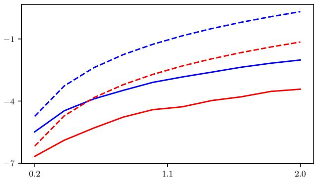

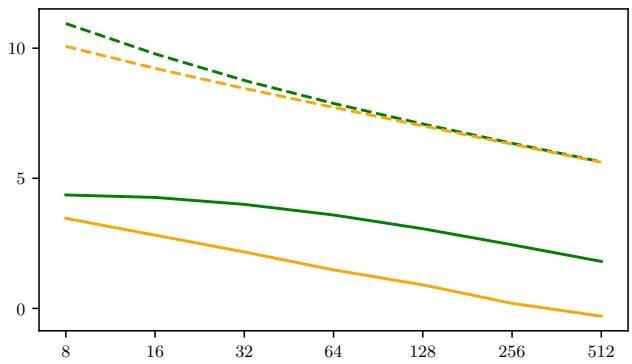  
Figure 3: Discretization error for $\mathbf { Z } \sim \mathrm { M P P } ( \pi ) , \pi = \Gamma ( \alpha = 3 , \beta = 5 )$ $\tilde { \mathbf { Z } }$ is the discretized process of Proposition 7. The y-axis is on a log scale. (Left) Empirical 1-Wassertein distance $\mathrm { ( 1 0 ^ { 7 } ~ s a m p l e s ) }$ between $\operatorname { L a w } ( Z _ { t } )$ and $\operatorname { L a w } ( \bar { \tilde { Z } } _ { t } )$ (continuous line) and the associated upper theoretical bound ofExample 2 (dashed line) using a uniform time-grid on $[ 0 , t ] , 0 . 2 \leqslant t \leqslant 2 ;$ with either $N = 1 6 ( \mathrm { b l u e } )$ or $N = 6 4 ( \mathrm { r e d } )$ . We observe that the theoretical upper bound is relatively sharp for low $t ,$ with a gap increasing with $t . \ ( \mathbf { R i g h t } )$ Empirical 1-Wassertein distance between $\operatorname { L a w } ( Z _ { t } )$ and $\operatorname { L a w } ( \tilde { Z } _ { t } )$ (continuous line) and the associated theoretical upper bound of Example 2 (dashed line) for $t = 1 0 0$ , as a function of $N = 8 , , 1 6 , \dotsc , 5 1 2$ We compare the uniform time-grid (green) and a log-uniform grid (orange). More precisely, we use uniformly spaced log $( \beta + t _ { k } )$ : empirically, this yields a substantially smaller error compared to the uniform time-grid.

Lemma 1. Let Z, Y be counting processes with respective intensities $t \mapsto u _ { t } ( Z _ { t - } ) , t \mapsto v _ { t } ( Y _ { t - } )$ , where $u , v$ are measurable, locally integrable functions. Assume that $f o r t > 0$ , the integrated discrepancy $\begin{array} { r } { \delta ( t ) : = \int _ { 0 } ^ { t } \mathbb { E } [ \| u _ { s } ( Y _ { s } ) - v _ { s } ( Y _ { s } ) \| ] } \end{array}$ <sub>1</sub>]ds is finite, andfinally that $\begin{array} { r } { t \mapsto \mathrm { L i p } ( u _ { t } ) = \operatorname* { s u p } _ { y \neq z } \| u _ { t } ( z ) - u _ { t } ( y ) \| _ { 1 } / \| z - y \| _ { 1 } } \end{array}$ is locally integrable. Then, $f o r t > 0$

$$
\begin{array} { r } { \mathcal { W } _ { 1 , 1 } \left( \operatorname { L a w } \left( Z _ { t } \right) , \operatorname { L a w } \left( Y _ { t } \right) \right) \leqslant \delta ( t ) \exp \left( \int _ { 0 } ^ { t } \operatorname { L i p } ( u _ { s } ) \mathrm { d } s \right) , } \end{array}
$$

where $\mathcal { W } _ { 1 , 1 }$ denotes the 1-Wasserstein distance associated to the $l ^ { 1 }$ distance: see Appendix A, (9).

Proof. Set $\mathbf { F } = \mathbf { F ^ { Z } } \vee \mathbf { F ^ { Y } }$ . Using the integral representation (10) with $\mathbf { F } ,$ we may couple Z and Y through the same Poisson point process Π. Then, for $1 \leqslant i \leqslant d ,$

$$
\begin{array} { r l } {  { \mathbb { E } [ | Z _ { t } ^ { i } - Y _ { t } ^ { i } | ] \leqslant \mathbb { E } \int _ { 0 } ^ { t } \int _ { \mathbb { R } _ { + } } | \mathbb { 1 } _ { [ 0 , u _ { s } ^ { i } ( Z _ { s } ) ] } ( x ) - \mathbb { 1 } _ { [ 0 , v _ { s } ^ { i } ( Y _ { s } ) ] } ( x ) | \Pi ( \mathrm { d } s , \mathrm { d } x ) } } \\ & { = \mathbb { E } \int _ { 0 } ^ { t } \int _ { \mathbb { R } _ { + } } | \mathbb { 1 } _ { [ 0 , u _ { s } ^ { i } ( Z _ { s } ) ] } ( x ) - \mathbb { 1 } _ { [ 0 , v _ { s } ^ { i } ( Y _ { s } ) ] } ( x ) | \mathrm { d } x \mathrm { d } s } \\ & { = \mathbb { E } \int _ { 0 } ^ { t } | u _ { s } ^ { i } ( Z _ { s } ) - v _ { s } ^ { i } ( Y _ { s } ) | \mathrm { d } s } \\ & { \leqslant \int _ { 0 } ^ { t } \mathbb { E } [ | u _ { s } ^ { i } ( Y _ { s } ) - v _ { s } ^ { i } ( Y _ { s } ) | ] \mathrm { d } s + \int _ { 0 } ^ { t } \mathbb { E } [ | u _ { s } ^ { i } ( Z _ { s } ) - u _ { s } ^ { i } ( Y _ { s } ) | ] \mathrm { d } s \ , } \end{array}
$$

where the second line uses the compensation formula of Π, see, e.g., (Kyprianou, 2014, Theorem 4.4). Summing for $1 \leqslant i \leqslant d$ yields

$$
\begin{array} { r l } {  { \mathbb { E } [ \| Z _ { t } - Y _ { t } \| _ { 1 } ] = \sum _ { i = 1 } ^ { d } \mathbb { E } [ | Z _ { t } ^ { i } - Y _ { t } ^ { i } | ] } } \\ & { \leqslant \int _ { 0 } ^ { t } \mathbb { E } [ \| u _ { s } ( Y _ { s } ) - v _ { s } ( Y _ { s } ) \| _ { 1 } ] \mathrm { d } s + \int _ { 0 } ^ { t } \mathbb { E } [ \| u _ { s } ( Z _ { s } ) - u _ { s } ( Y _ { s } ) \| _ { 1 } ] \mathrm { d } s } \\ & { \leqslant \delta ( t ) + \int _ { 0 } ^ { t } \mathbb { E } [ \| Z _ { s } - Y _ { s } \| _ { 1 } ] \mathrm { L i p } ( u _ { s } ) \mathrm { d } s . } \end{array}
$$

Gronwall’s inequality leads to the upper bound on $\mathbb { E } [ \| Z _ { t } - Y _ { t } \| _ { 1 } ]$ , and thus on the Wasserstein distance.

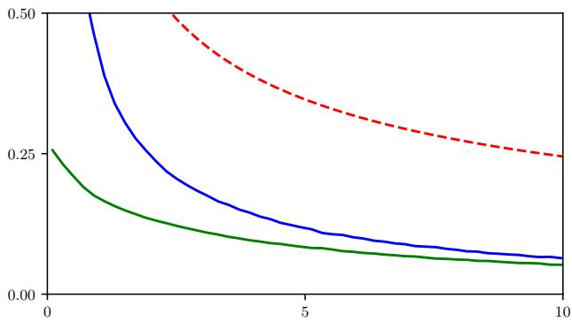

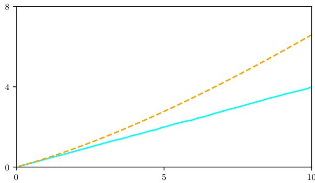  
Figure 4: Illustration of Proposition 3 and Lemma 1 with $\mathbf { Z } \sim \mathrm { M P P } ( \pi ) , \pi = \Gamma ( \alpha = 3 , \beta = 5 )$ and $\mathbf { Y } \sim \mathrm { M P P } ( \gamma ) , \gamma =$ $\Gamma ( \tilde { \alpha } = 5 , \beta = 5 )$ , for $0 \leqslant t \leqslant 1 0$ . (Left) Early stopping error. Blue line shows the empirical 1-Wasserstein distance between Law $\left( Z _ { t } / t \right)$ and π as a function of t, red dashed line is the associated (loose) theoretical bound ${ \sqrt { \mathbb { E } [ X ] / t } } ,$ and green line the empirical 1-Wasserstein distance between $K ^ { \pi } ( Z _ { t } ) = ( Z _ { t } + \alpha ) / ( \beta + t )$ and $\pi ;$ see Remark 1. (Right) Denoiser estimation error. Cyan line is the empirical 1-Wasserstein distance between Law(Z<sub>t</sub>) and Law(Y<sub>t</sub>), and orange dashed line the theoretical upper bound of Example 3.

Example 3. In dimension 1, $i f \mathbf { Z } \sim \mathrm { M P P } ( \pi )$ with ${ \boldsymbol { \pi } } = { \boldsymbol { \gamma } } = \mathbf { \boldsymbol { \Gamma } } ( \alpha , \beta )$ , the denoiser is an afine function ofz: $\begin{array} { r } { K _ { t } ^ { \gamma } ( z ) = \frac { z + \alpha } { t + \beta } } \end{array}$ see Appendix B.4. Let $\mathbf { Y } \sim \mathrm { M P P } ( \tilde { \gamma } )$ ), with $\tilde { \gamma } \sim \mathbf { \Gamma } \Gamma ( \tilde { \alpha } , \beta )$ ; then $\begin{array} { r } { K _ { t } ^ { \tilde { \gamma } } ( z ) = \frac { y + \tilde { \alpha } } { t + \beta } } \end{array}$ . We have $\begin{array} { r } { \delta ( t ) = \int _ { 0 } ^ { t } \mathbb { E } [ | K _ { s } ^ { \gamma } ( Y _ { s } ) - K _ { s } ^ { \gamma } ( Y _ { s } ) | ] \mathrm { d } s = } \end{array}$ $\left| \alpha - \tilde { \alpha } \right| \log \left( 1 + t / \beta \right)$ and $\mathrm { L i p } ( K _ { t } ^ { \gamma } ) = 1 / ( t { + } \beta )$ , hence the bound $\mathcal { W } _ { 1 , 1 } ( \mathrm { L a w } ( Z _ { t } )$ , Law $\begin{array} { r } { ( Y _ { t } ) ) \leqslant | \alpha - \tilde { \alpha } | \left( 1 + \frac { t } { \beta } \right) \log \left( 1 + \frac { t } { \beta } \right) } \end{array}$ Here, the exact value o ${ f \mathcal { W } _ { 1 , 1 } ( \mathrm { L a w } ( Z _ { t } ) , \mathrm { L a w } ( Y _ { t } ) ) }$ is tractable, and reads $\frac { | \alpha - \tilde { \alpha } | } { \beta } t$ . The general bound we computed difers from the actual distance by only a logarithmic factor; see also Figure 4.

Combining the previous results yields the upper bounds below. Using thinning (Algorithm 2) introduces no additional error, leading to (18); however, execution time is uncertain. Using time discretization instead (Algorithm 1) does not have this drawback, but introduces the additional error derived in Proposition 7, yielding (19).

Corollary 1. Let $\mathbf { Z } \sim \operatorname { M P P } ( \pi )$ with random rate X, and consider an approximation Y with stochastic intensity $k ^ { \theta } \approx K ^ { \pi }$ Assume $\mathbb { E } [ \| X \| _ { 2 } ^ { 2 } ] < \infty$ , and that $k ^ { \theta }$ satisfies the assumptions ofLemma 1. Then, for any fixed $t > 0$ , using the notation of Lemma 1,

$$
\mathcal { W } _ { 1 , 1 } ( \mathrm { L a w } ( Y _ { t } / t ) , \pi ) \leqslant \sqrt { d \frac { \mathbb { E } [ \| X \| _ { 1 } ] } { t } } + \frac { \delta ( t ) } { t } \exp \left( \int _ { 0 } ^ { t } \mathrm { L i p } ( k _ { s } ^ { \theta } ) \mathrm { d } s \right) .\tag{18}
$$

$I f { \tilde { \mathbf { Y } } }$ is the counting process obtained by discretization of Y on a time-grid $0 = t _ { 0 } < t _ { 1 } < \cdots < t _ { N }$ , and $i f k ^ { \theta }$ satisfies the regularity assumptions ofProposition $^ { 7 , }$ then

$$
\mathcal { W } _ { 1 , 1 } ( \mathrm { L a w } ( \tilde { Y } _ { t } / t ) , \pi ) \leqslant \sqrt { d \frac { \mathbb { E } [ \| X \| _ { 1 } ] } { t } } + \frac { 1 } { t } \left( \delta ( t ) + C \right) \exp \left( \int _ { 0 } ^ { t } \mathrm { L i p } ( k _ { s } ^ { \theta } ) \mathrm { d } s \right) ,\tag{19}
$$

with $C = \mathcal { O } ( \operatorname* { m a x } _ { k } \Delta _ { k } )$ being defined in the proof of Proposition 7.

Proof. Using the triangle inequality,

$$
\begin{array} { r l } & { \mathcal { W } _ { 1 , 1 } ( \mathrm { L a w } ( Y _ { t } / t ) , \pi ) \leqslant \mathbb { E } [ \| Y _ { t } / t - X \| _ { 1 } ] } \\ & { \qquad \leqslant \mathbb { E } [ \| Z _ { t } / t - X \| _ { 1 } ] + \mathbb { E } [ \| Z _ { t } - Y _ { t } \| _ { 1 } ] / t . } \end{array}
$$

The first term is upper bounded with Proposition 3:

$$
\begin{array} { r l } & { \mathbb { E } [ \| Z _ { t } / t - X \| _ { 1 } ] \leqslant \sqrt { d } \mathbb { E } [ \| Z _ { t } / t - X \| _ { 2 } ] } \\ & { \leqslant \sqrt { d } \sqrt { \frac { \mathbb { E } [ \| X \| _ { 1 } ] } { t } } } \end{array}
$$

Plugging in the bounds of Proposition 3 and Lemma 1 yields (18). Then,

$$
\begin{array} { r l } & { \mathcal { W } _ { 1 , 1 } ( \mathrm { L a w } ( \tilde { Y } _ { t } / t ) , \pi ) \leqslant \mathbb { E } [ \| \tilde { Y } _ { t } / t - X \| _ { 1 } ] } \\ & { \qquad \leqslant \mathbb { E } [ \| Z _ { t } / t - X \| _ { 1 } ] + \mathbb { E } [ \| Z _ { t } - \tilde { Y } _ { t } \| _ { 1 } ] / t } \\ & { \qquad \leqslant \mathbb { E } [ \| Z _ { t } / t - X \| _ { 1 } ] + \mathbb { E } [ \| Z _ { t } - Y _ { t } \| _ { 1 } ] / t + \mathbb { E } [ \| \tilde { Y } _ { t } - Y _ { t } \| _ { 1 } ] / t } \end{array}
$$

yields (19) using Proposition 7, Equation (17).

## B.4 The Gamma case

Difusion-based methods usually consider Gaussian mixtures as toy examples. For MPDM, the tractable case corresponds to Gamma mixtures.

MPP with Gamma random rate. Consider a mixed Poisson process Z with distribution $\mathrm { M P P } ( \gamma )$ , where

$$
\gamma ( \mathrm { d } x ) = \mathbf { { r } } ( \alpha , \beta ) = \prod _ { i = 1 } ^ { d } \mathbf { { r } } ( x _ { i } ; \alpha _ { i } , \beta _ { i } ) \mathrm { { d } } x _ { i } = \prod _ { i = 1 } ^ { d } \mathrm { { e } } ^ { - \beta _ { i } x _ { i } } x _ { i } ^ { \alpha _ { i } - 1 } { \frac { \beta _ { i } ^ { \alpha _ { i } } } { \Gamma ( \alpha _ { i } ) } } \mathrm { { d } } x _ { i } ,
$$

$$
\alpha , \beta \in ( 0 , + \infty ) ^ { d } .
$$

$$
\Gamma ( \alpha , \beta )
$$

$$
\mathbb { R } _ { + } ^ { d } , x _ { i } \in
$$

$$
\mathbb { R } _ { + } \mapsto \mathbf { \Gamma } \mapsto \mathbf { \Gamma } \Vdash ( x _ { i } ; \alpha _ { i } , \beta _ { i } )
$$

Then each component $\mathbf { Z } _ { i } , 1 \leqslant i \leqslant$ d is a Poyla process ´ , see (Grandell, 1997, Example 4.1). Specifically, for every $t \geqslant 0 ,$ , the components of $Z _ { t }$ are independent and admit a negative binomial distribution:

$$
\begin{array} { l } { \displaystyle p _ { t } ^ { \gamma } ( z ) : = \mathbb { P } ( Z _ { t } = z ) = \int _ { \mathbb { R } _ { + } } \prod _ { i = 1 } ^ { d } \mathrm { e } ^ { - t x _ { i } } \frac { ( t x _ { i } ) ^ { z _ { i } } } { z _ { i } ! } \gamma ( \mathrm { d } x ) } \\ { = \displaystyle \prod _ { i = 1 } ^ { d } \int _ { 0 } ^ { \infty } \mathrm { e } ^ { - ( t + \beta _ { i } ) x _ { i } } \frac { x _ { i } ^ { z _ { i } + \alpha _ { i } - 1 } } { z _ { i } \Gamma ( \alpha _ { i } ) } t ^ { z _ { i } } \beta _ { i } ^ { \alpha _ { i } } \mathrm { d } x _ { i } } \\ { = \displaystyle \prod _ { i = 1 } ^ { d } \frac { \Gamma ( z _ { i } + \alpha _ { i } ) } { ( t + \beta _ { i } ) ^ { z _ { i } + \alpha _ { i } } } \frac { t ^ { z _ { i } } \beta _ { i } ^ { \alpha _ { i } } } { z _ { i } ! \Gamma ( \alpha _ { i } ) } } \\ { = \displaystyle \prod _ { i = 1 } ^ { d } \frac { \Gamma ( z _ { i } + \alpha _ { i } ) } { z _ { i } ! \Gamma ( \alpha _ { i } ) } \left( 1 - \frac { \beta _ { i } } { t + \beta _ { i } } \right) ^ { z _ { i } } \left( \frac { \beta _ { i } } { t + \beta _ { i } } \right) ^ { \alpha _ { i } } , } \end{array}\tag{20}
$$

where we recognize unnormalized Gamma densities to compute the integrals. Given $z \in \mathbb { N } ^ { d }$ , the denoising density $( i . e . ,$ the density of $\bar { X }$ conditionally on $Z _ { t } = z )$ is a product of Gamma densities:

$$
\begin{array} { l } { \displaystyle \pi _ { t } ( \mathrm { d } x | z ) = p _ { t } ^ { \gamma } ( x | z ) \mathrm { d } x : = \prod _ { i = 1 } ^ { d } \mathrm { e } ^ { - t x _ { i } } \frac { ( t x _ { i } ) ^ { z _ { i } } } { z _ { i } ! } \times \frac { \gamma ( \mathrm { d } x ) } { \mathbb { P } ( Z _ { t } = z ) } } \\ { \propto \mathbf { { \Gamma } } ( z + \alpha , t 1 + \beta ) ~ . } \end{array}\tag{21}
$$

The denoiser is the mean of this distribution, hence:

$$
[ K _ { t } ^ { \gamma } ( z ) ] _ { i } = \frac { z _ { i } + \alpha _ { i } } { t + \beta _ { i } } , 1 \leqslant i \leqslant d .
$$

Mixture of Gamma. If $\mathbf { Z } \sim \operatorname { M P P } ( \mu )$ with $\begin{array} { r } { \mu ( \mathrm { d } x ) = \sum _ { j = 1 } ^ { N } w _ { j } \prod _ { i = 1 } ^ { d } \mathbf { r } ( x _ { i } ; \alpha _ { i j } , \beta _ { i j } ) \mathrm { d } x _ { i } } \end{array}$ with w on the simplex, (20) is directly adapted by adding the weighted sum to the equation:

$$
p _ { t } ^ { \mu } ( z ) = \sum _ { j = 1 } ^ { N } w _ { j } \prod _ { i = 1 } ^ { d } \frac { \Gamma ( z _ { i } + \alpha _ { i j } ) } { z _ { i } ! \Gamma ( \alpha _ { i j } ) } \left( 1 - \frac { \beta _ { i j } } { t + \beta _ { i j } } \right) ^ { z _ { i } } \left( \frac { \beta _ { i j } } { t + \beta _ { i j } } \right) ^ { \alpha _ { i j } } .
$$

The denoising density is a Gamma mixture, namely:

$$
p _ { t } ^ { \mu } ( x | z ) \mathrm { d } x = \sum _ { j = 1 } ^ { N } \tilde { w } _ { j } \prod _ { i = 1 } ^ { d } \Gamma ( x _ { i } ; z _ { i } + \alpha _ { i j } , t + \beta _ { i j } ) \mathrm { d } x _ { i } , \tilde { w } _ { j } : = \frac { w _ { j } } { p _ { t } ^ { \mu } ( z ) } \prod _ { i = 1 } ^ { d } \frac { t ^ { z _ { i } } \beta _ { i j } ^ { \alpha _ { i j } } } { \Gamma ( \alpha _ { i j } ) z _ { i } ! } \frac { \Gamma ( z _ { i } + \alpha _ { i j } ) } { ( t + \beta _ { i j } ) ^ { z _ { i } + \alpha _ { i j } } } ,
$$

hence the denoiser

$$
[ K _ { t } ^ { \mu } ( z ) ] _ { i } = \sum _ { j = 1 } ^ { N } \tilde { w } _ { j } \frac { z _ { i } + \alpha _ { i j } } { t + \beta _ { i j } } \mathrm { , } 1 \leqslant i \leqslant d .
$$

## C Overwiew of difusion-based posterior sampling methods

We provide a brief overview of difusion-based posterior sampling. In particular, we explain the core ideas of the algorithms that are adapted to the MPDM setting in Section 3. We will refer to the difusion model introduced in Section 2.2 and the associated notations.

Gaussian inverse problems. Let $\mathcal { A } : \mathbb { R } ^ { d }  \mathbb { R } ^ { d _ { y } }$ denote the forward operator, with $1 \leqslant d _ { y } \leqslant d ,$ and consider the posterior distribution $\pi ^ { y }$ of $X \sim \pi$ given the observation $Y = y ,$ where

$$
\begin{array} { r } { Y = \mathcal { A } ( X ) + \sigma \varepsilon , } \end{array}
$$

with $\varepsilon \sim \mathrm { N } ( 0 , \mathrm { I } _ { d } )$ and $\sigma > 0$ . From Bayes’ rule, we have $\pi ^ { y } ( \mathrm { d } x ) \propto g ( y | x ) \pi ( \mathrm { d } x )$ , with $g$ the likelihood function: in this case, $g ( y | x ) = \mathrm { N } ( y ; \mathcal { A } ( x ) , \sigma ^ { 2 } \mathrm { I } _ { d } )$

Instead of focusing on a specific forward operator ${ \mathcal { A } } ,$ recent training-free methods use a pre-trained difusion model as a general-purpose prior. The Gaussian denoiser $D ^ { \pi }$ and the observation y are combined to sample from the posterior distribution $\pi ^ { y }$ of a given inverse problem; see the review by Janati et al. (2025b).

Guidance-based methods. Granted access to the conditional denoiser, i.e., $D ^ { \pi ^ { y } }$ , samples from $\pi ^ { y }$ could be obtained by simulating the associated difusion (5). Difusion Posterior Sampling (DPS) (Chung et al., 2023), approximates the conditional denoiser $D ^ { \pi ^ { y } 1 }$ as

$$
D _ { t } ^ { \pi ^ { y } } ( x _ { t } ) = D _ { t } ^ { \pi } ( x _ { t } ) + \nabla \log g _ { t } ( y | x _ { t } ) \approx D _ { t } ^ { \pi } ( x _ { t } ) + \nabla \log g ( y | D _ { t } ^ { \pi } ( x _ { t } ) ) ,\tag{22}
$$

where the intractable term $\begin{array} { r } { g _ { t } ( y | x _ { t } ) : = \int g ( y | x ) \pi _ { t } ( \mathrm { d } x | x _ { t } ) } \end{array}$ is estimated by approximating $\pi _ { t } ( \mathrm { d } x | x _ { t } ) \approx \delta _ { D _ { t } ^ { \pi } ( x _ { t } ) } ( \mathrm { d } x )$ . In practice, evaluating this approximation requires diferentiating the learned denoiser with respect to $x _ { t } .$ Alternatively, ΠGDM (Song et al., 2023) assumes $\pi _ { t } ( \mathrm { d } x | x _ { t } )$ is Gaussian distributed with mean $D _ { t } ^ { \pi } ( x _ { t } )$ and covariance matrix $r _ { t } \mathrm { I } _ { d } ,$ with $r _ { t } > 0$ . For Gaussian inverse problems with linear A, this approximation makes the conditional score, or equivalently the conditional denoiser $D ^ { \pi ^ { y } }$ , tractable. However, ΠGDM does not transpose to Poisson inverse problems.

Split Gibbs sampling methods. Instead of approximating $D ^ { \pi ^ { y } }$ to simulate a difusion process directly, another class of methods sample from a sequence of intermediary, augmented distributions. For instance, PnP-DM (Wu et al., 2024) consider the augmented distributions

$$
\pi _ { k } ^ { y } ( \mathrm { d } x , \mathrm { d } \tilde { x } ) \propto g ( y | \tilde { x } ) \mathrm { e } ^ { - \| x - \tilde { x } \| _ { 2 } ^ { 2 } / ( 2 \rho _ { k } ^ { 2 } ) } \pi ( \mathrm { d } x ) \ ,\tag{23}
$$

where $( \rho _ { k } ) _ { k = 1 } ^ { n } \ \in \ ( 0 , + \infty ) ^ { n }$ is typically non-increasing. For each $1 \leqslant k \leqslant n , x , \tilde { x }$ are updated through a two steps procedure. The likelihood step, i.e., sampling from $\pi _ { k } ^ { y } ( \mathrm { d } \tilde { x } | x ) \propto g ( y | \tilde { x } ) \mathrm { e } ^ { - \| x - \tilde { x } \| _ { 2 } ^ { 2 } / ( 2 \rho _ { k } ^ { 2 } ) }$ , is exact for Gaussian inverse problem with linear $\mathcal { A } ;$ in general, it can be tackled with standard MCMC methods. The prior step leverages the pre-trained difusion model, as

$$
\pi _ { k } ^ { y } ( \mathrm { d } x | \tilde { x } ) \propto \mathrm { e } ^ { - \| x - \tilde { x } \| _ { 2 } ^ { 2 } / ( 2 \rho _ { k } ^ { 2 } ) } \pi ( \mathrm { d } x ) \propto \pi _ { t _ { k } } \left( \mathrm { d } x | t _ { k } \tilde { x } \right) \ ,
$$

setting $t _ { k } : = 1 / \rho _ { k } ^ { 2 }$ : the difusion process is simulated from $t _ { k }$ onward, with initial state $t _ { k } \tilde { x }$ . As $\rho _ { k }$ approaches zero, $x \approx \tilde { x }$ is approximately distributed as $\pi ^ { y }$

A related approach is DAPS (Zhang et al., 2025): its structure resembles that of PnP-DM, but includes a third, noising step that decouples successive samples to promote a larger exploration of the posterior distribution. We describe DAPS using the difusion model of Section 2.2, which slightly modifies the formulation of the original paper (which relied on a forward/backward difusion formalism). This algorithm revolves around the sequence of distributions

$$
\pi _ { t _ { k } } ^ { y } ( \mathrm { d } x | x _ { t _ { k } } ) \propto g ( y | x ) \pi _ { t _ { k } } ( \mathrm { d } x | x _ { t _ { k } } ) \ : ,\tag{24}
$$

on a time-grid $t _ { 1 } < \dots t _ { N }$ . DAPS uses the approximation $\pi _ { t } ( \mathrm { d } x | x _ { t } ) \approx \mathrm { N } ( \hat { x } ( x _ { t } ) , r _ { t } ^ { 2 } \mathrm { I } _ { d } )$ , see (Zhang et al., 2025, Equation 5). Here, $\hat { \boldsymbol x } ( \boldsymbol x _ { t } )$ denotes an estimator of X given $X _ { t } = x _ { t } \mathrm { { : } }$ : it can be obtained as $D _ { T } ^ { \pi } ( x _ { T } )$ , where x is computed by numerical integration of (5) from t up to a terminal time T using a given time-grid. Using only one denoising step results in the simple estimator $\hat { x } ( x _ { t } ) = D _ { t } ^ { \pi } ( x _ { t } )$ ; this design choice is discussed in (Zhang et al., 2025, Appendix I). By analogy with PnP-DM, we refer to the estimation of $\hat { x } ( x _ { t } )$ , for a given $t = t _ { k }$ , as the prior step. Then, the likelihood step consists of sampling from

$$
\pi _ { t _ { k } } ^ { y } ( \mathrm { d } x | x _ { t _ { k } } ) \propto g ( y | x ) \mathrm { N } ( \hat { x } ( x _ { t _ { k } } ) , r _ { t _ { k } } ^ { 2 } \mathrm { I } _ { d } )
$$

with an MCMC scheme. Finally, given the output x of the likelihood step, one draws $x _ { t _ { k + 1 } } = t _ { k + 1 } x + { \sqrt { t _ { k + 1 } } } G _ { k + 1 }$ , with $G _ { k + 1 } \sim \mathrm { N } ( 0 , \mathrm { I } _ { d } )$ . This noising step is meant to decouple the successive $x _ { t _ { k } } \colon$ instead of generating a single trajectory of the denoising process $\mathbf { X ^ { d } } \left( 5 \right)$ , we sample a “fresh” noisy intermediate $x _ { t _ { k + 1 } }$ through the noising process $\mathbf { X } ^ { \mathrm { n } }$

Gaussian denoising. Difusion-based posterior sampling methods often exploit the Gaussian nature of the inverse problem, leveraging the matching noise structure between the difusion and the inverse problem; e.g., (Song et al., 2023; Kawar et al., 2022). This correspondence is best illustrated when the problem consists of pure Gaussian noise, $i . e . , \mathcal { A } = a \mathrm { I } _ { d }$ with $a \in \mathbb { R } ^ { }$ : then,

$$
D _ { t } ^ { \pi ^ { y } } ( x _ { t } ) = D _ { t + ( a / \sigma ) ^ { 2 } } ^ { \pi } \left( x _ { t } + a y / \sigma ^ { 2 } \right) .\tag{25}
$$

In other words, sampling from the posterior distribution $\pi ^ { y }$ is possible by simulating (5) while shifting the inputs of $D ^ { \pi }$ without any further approximation.

Poisson inverse problems. $\operatorname { I f } X \sim \pi$ with π supported on $\mathbb { R } _ { + } ^ { d }$ and $\mathcal { A } : \mathbb { R } _ { + } ^ { d }  \mathbb { R } _ { + } ^ { d _ { y } }$ , a Poisson inverse problem consists of sampling from the posterior distribution $\pi ^ { y } \propto g ( y | x ) \pi ( \mathrm { d } x )$ of X given $Y = y _ { \mathrm { : } }$ , where $Y \sim \operatorname { P o i s } ( { \mathcal { A } } ( X ) )$ , i.e.,

$$
g ( y | x ) \propto \prod _ { i = 1 } ^ { d _ { y } } \mathrm { e } ^ { - [ { \cal A } ( x ) ] _ { i } } [ { \cal A } ( x ) ] _ { i } ^ { y _ { i } } \ .\tag{26}
$$

This class of problems is mostly excluded from the aforementioned posterior sampling methods. Even DPS, whose ${ \mathrm { a p - } }$ proximation (22) theoretically holds for any likelihood $^ { g , }$ eventually replaces the Poisson likelihood by a “Gaussianized” one due to poor numerical stability; see (Chung et al., 2023, Appendix C.4). This approximation is only valid when the measured values $y _ { i }$ are large, excluding the regime where some $y _ { i }$ are close to or equal to zero. Gibbs-sampling methods can theoretically handle the Poisson likelihood, but the likelihood step (23) requires a non-trivial MCMC sampling of a density that is supported on $\mathbb { R } _ { + } ^ { d }$ . Moreover, standard gradient-based methods such as Langevin MCMC are problematic near the boundary of the positive orthant, since the Poisson log-likelihood has a singular gradient when $[ \mathcal { A } ( x ) ] _ { i } \to 0$ for $y _ { i } > 0 ;$ and unconstrained Gaussian updates can leave the domain.

In stark contrast with the Gaussian case, even when ${ \mathcal { A } } = a \mathrm { I } _ { d } ,$ there is no straightforward difusion-based posterior sampling method. Leveraging Theorem 3, PDPS precisely fills this gap.

## D Algorithmics details

## D.1 Training

Algorithm 3 Training   
Require: Dataset ${ \mathcal { D } } ,$ trainable network $k ^ { \theta } { } _ { ; }$ , strictly convex function $\phi : \mathbb { R } _ { + } ^ { d }  \mathbb { R } ,$ , mini-batch size B, number of epoch   
N, probability measure $\nu ( \mathrm { d } t )$ on $\mathbb { R } _ { + }$ and weight function w.   
1: Initialize $\theta$   
2: repeat   
3: Draw mini-batch $x _ { 1 } , \dots , x _ { B } \in \mathcal { D }$   
4: Sample $t _ { 1 } , \ldots , t _ { B } \sim \nu ( \mathrm { d } t )$   
5: Draw $z _ { i } \sim \mathrm { P o i s } ( t _ { i } x _ { i } ) , 1 \leqslant i \leqslant B$ ▷ Noising   
6: Compute $k _ { t _ { i } } ^ { \theta } ( z _ { i } ) , 1 \leqslant i \leqslant B$ ▷ Denoising   
7: Perform gradient descent step on $\begin{array} { r l } { } & { { } \sum _ { i = 1 } ^ { B } \mathcal { D } _ { \phi } ( x _ { i } , k _ { t _ { i } } ^ { \theta } ( z _ { i } ) ) w ( t _ { i } ) } \end{array}$ ▷ Minimization of ${ \mathcal { L } } ( \theta )$   
8: until convergence or target number of epochs is reached   
9: return learned model $k ^ { \theta }$

For completeness, we provide the training pseudo-code that outputs an approximation of the Poisson denoiser, $k ^ { \theta } \approx K ^ { \pi }$ This algorithm is similar to the one proposed by Bhattacharya et al. (2025); Chen and Zhou (2023), albeit with a generic Bregman divergence instead of (4). For our numerical experiments, we observed that using the usual Euclidean distance instead of (4) had little influence on the learned model performance. The distribution $\nu ( \mathrm { d } t )$ can be either discrete, if one fixes a time-grid, or continuous, e.g., uniform on some $[ t _ { \operatorname* { m i n } } , t _ { \operatorname* { m a x } } ] .$ In practice, we set ν as the log-uniform distribution on $[ t _ { \mathrm { m i n } } , t _ { \mathrm { m a x } } ]$ and the weight function $t \mapsto w ( t ) = t ;$ , similar to Bhattacharya et al. (2025). This increases the number of low-SNR (i.e., low t) inputs $z _ { t }$ while preserving the training objective associated with uniform t:

$$
\mathcal { L } ( \theta ) = \int _ { t _ { \mathrm { m i n } } } ^ { t _ { \mathrm { m a x } } } \mathbb { E } [ \mathcal { D } _ { \phi } ( X , k _ { t } ^ { \theta } ( Z _ { t } ) ) ] \mathrm { d } t \propto \int _ { t _ { \mathrm { m i n } } } ^ { t _ { \mathrm { m a x } } } w ( t ) \mathbb { E } [ \mathcal { D } _ { \phi } ( X , k _ { t } ^ { \theta } ( Z _ { t } ) ) ] \nu ( \mathrm { d } t ) .
$$

We detail the exact parameters used in our numerical experiments in Appendix E.

## D.2 Poisson denoising with PDPS

PDPS (Algorithm 4) is a relatively straightforward implementation of Theorem 3 that solves the inverse problem defined by $Y \sim \mathrm { P o i s } ( a X ) , X \sim \pi$ by leveraging a pre-trained MPDM. We provide the proof and pseudo-code below, and show a sample trajectory in Figure 5.

Theorem 3. Let $\pi ^ { y }$ denote the posterior distribution of X given $Y = y ,$ , where $Y \sim \mathrm { P o i s } ( a X )$ and $X \sim \pi$ . The denoiser $K ^ { \pi ^ { y } }$ associated with $\operatorname { M P P } ( \pi ^ { y } )$ is given by $( t , z ) \mapsto K _ { t } ^ { \pi ^ { y } } ( z ) = K _ { t + a } ^ { \pi } ( z + y )$

Proof. Fix $t > 0$ and $z \in \mathbb { R } _ { + } ^ { d }$ . Recall that, from Proposition 2, we have

$$
K _ { t } ^ { \pi } ( z ) = \int _ { \mathbb R _ { + } ^ { d } } x \prod _ { j = 1 } ^ { d } x _ { j } ^ { z _ { j } } \mathrm { e } ^ { - t x _ { j } } \pi ( \mathrm { d } x ) \Bigg / \int _ { \mathbb R _ { + } ^ { d } } \prod _ { j = 1 } ^ { d } x _ { j } ^ { z _ { j } } \mathrm { e } ^ { - t x _ { j } } \pi ( \mathrm { d } x ) .
$$

Similarly, the denoiser associated to $\operatorname { M P P } ( \pi ^ { y } )$ writes

$$
\begin{array} { l } { { \displaystyle K _ { t } ^ { \pi ^ { y } } ( z ) = \int _ { \mathbb { R } _ { + } ^ { d } } x \prod _ { j = 1 } ^ { d } x _ { j } ^ { z _ { j } } \mathrm { e } ^ { - t x _ { j } } \pi ^ { y } ( \mathrm { d } x ) \Bigg / \int _ { \mathbb { R } _ { + } ^ { d } } \prod _ { j = 1 } ^ { d } x _ { j } ^ { z _ { j } } \mathrm { e } ^ { - t x _ { j } } \pi ^ { y } ( \mathrm { d } x ) } } \\ { { \displaystyle \quad \quad = \int _ { \mathbb { R } _ { + } ^ { d } } x \prod _ { j = 1 } ^ { d } x _ { j } ^ { z _ { j } } \mathrm { e } ^ { - t x _ { j } } \prod _ { k = 1 } ^ { d } \mathrm { e } ^ { - a x _ { k } } ( a x _ { k } ) ^ { y _ { k } } \pi ( \mathrm { d } x ) \Bigg / \int _ { \mathbb { R } _ { + } ^ { d } } \prod _ { j = 1 } ^ { d } x _ { j } ^ { z _ { j } } \mathrm { e } ^ { - t x _ { j } } \prod _ { k = 1 } ^ { d } \mathrm { e } ^ { - a x _ { k } } ( a x _ { k } ) ^ { y _ { k } } \pi ( \mathrm { d } x ) } } \\ { { \displaystyle \quad \quad = \int _ { \mathbb { R } _ { + } ^ { d } } x \prod _ { j = 1 } ^ { d } x _ { j } ^ { z _ { j } + y _ { j } } \mathrm { e } ^ { - ( t + a ) x _ { j } } \pi ( \mathrm { d } x ) \Bigg / \int _ { \mathbb { R } _ { + } ^ { d } } \prod _ { j = 1 } ^ { d } x _ { j } ^ { z _ { j } + y _ { j } } \mathrm { e } ^ { - ( t + a ) x _ { j } } \pi ( \mathrm { d } x ) , } } \end{array}
$$

Algorithm 4 Poisson denoising posterior sampling (PDPS)   
Require: Learned denoiser $k ^ { \theta } \approx K ^ { \pi }$ , rate $a > 0 ,$ observation $\boldsymbol { y } ~ \in ~ \mathbb { N } ^ { d }$ , time-grid $0 = t _ { 0 } < t _ { 1 } < \cdots < t _ { N }$ , with   
$\Delta _ { k } = t _ { k + 1 } - t _ { k }$   
1: Initialize $z _ { 0 } = 0$   
2: for $k = 0 , \ldots , N - 1$ do   
3: Estimate $\begin{array} { r } { K _ { t _ { k } } ^ { \pi ^ { y } } ( z _ { k } ) \approx \tilde { K } _ { t _ { k } } ^ { \pi ^ { y } } ( z _ { k } ) = k _ { t _ { k } + a } ^ { \theta } ( z _ { k } + y ) } \end{array}$ ▷ Theorem 3   
4: Draw n<sub>k</sub> ∼ Pois $\left( \Delta _ { k } \tilde { K } _ { t _ { k } } ^ { \pi ^ { y } } ( z _ { k } ) \right)$   
5: Set $z _ { k + 1 } = z _ { k } + n _ { k }$ ▷ Discretization scheme (Algorithm 1)   
6: end for   
7: return $z _ { N } / t _ { N }$ or $k _ { t _ { N - 1 } + a } ^ { \theta } ( z _ { N - 1 } + y )$ ▷ See Remark 1

using $\begin{array} { r } { \pi ^ { y } ( \mathrm { d } x ) \propto g ( y \vert x ) \pi ( \mathrm { d } x ) \propto \prod _ { k = 1 } ^ { d } \mathrm { e } ^ { - a x _ { k } } ( a x _ { k } ) ^ { y _ { k } } \pi ( \mathrm { d } x ) } \end{array}$ . We recognize the expression of $K _ { t + a } ^ { \pi } ( z + y )$ , concluding the proof. □

## D.3 MPDM-based DPS

We provide additional details regarding the MPDM adaptation of DPS.

Theorem 4. Consider the posterior distribution $\pi ^ { y }$ ofa general Poisson inverse problem with likelihood function g defined in (26). For any $\boldsymbol { z } _ { t } \in \mathbb { N } ^ { d }$ and $t > 0 _ { i }$ , writing $e _ { i } = ( \delta _ { i , j } ) _ { 1 \leqslant j \leqslant d } .$ , we have

$$
[ K _ { t } ^ { \pi ^ { \nu } } ( z _ { t } ) ] _ { i } = [ K _ { t } ^ { \pi } ( z _ { t } ) ] _ { i } \frac { g _ { t } ( y | z _ { t } + e _ { i } ) } { g _ { t } ( y | z _ { t } ) } = [ K _ { t } ^ { \pi } ( z _ { t } ) ] _ { i } \left( 1 + \frac { g _ { t } ( y | z _ { t } + e _ { i } ) - g _ { t } ( y | z _ { t } ) } { g _ { t } ( y | z _ { t } ) } \right) , 1 \leqslant i \leqslant d .
$$

Proof. Let $\mathbf { Z } \sim \operatorname { M P P } ( \pi )$ . As seen in the proof of Proposition 2, we have for every $z _ { t } \in \mathbb { N } ^ { d } , t > 0$

$$
[ K _ { t } ^ { \pi } ( z _ { t } ) ] _ { i } = \frac { z _ { t } ^ { i } + 1 } { t } \frac { \mathbb { P } ( Z _ { t } = z _ { t } + e _ { i } ) } { \mathbb { P } ( Z _ { t } = z _ { t } ) } \mathrm { ~ , ~ }\tag{27}
$$

where $z _ { t } ^ { i }$ denotes the i-th coordinate of $z _ { t } . \operatorname { I f } \mathbf { Z } ^ { y } \sim \operatorname { M P P } ( \pi ^ { y } )$ , we have

$$
\begin{array} { l } { \displaystyle \mathbb { P } ( Z _ { t } ^ { y } = z _ { t } ) = \int _ { \mathbb { R } _ { + } ^ { d } } \prod _ { j = 1 } ^ { d } \mathrm { e } ^ { - t x _ { j } } \frac { ( t x _ { j } ) ^ { z _ { t } ^ { j } } } { z _ { t } ^ { j } ! } \pi ^ { y } ( \mathrm { d } x ) } \\ { \displaystyle \propto \int _ { \mathbb { R } _ { + } ^ { d } } \prod _ { j = 1 } ^ { d } \mathrm { e } ^ { - t x _ { j } } \frac { ( t x _ { j } ) ^ { z _ { t } ^ { j } } } { z _ { t } ^ { j } ! } g ( y | x ) \pi ( \mathrm { d } x ) } \\ { \displaystyle \propto \mathbb { P } ( Z _ { t } = z ) \int _ { \mathbb { R } _ { + } ^ { d } } g ( y | x ) \pi _ { t } ( \mathrm { d } x | z _ { t } ) \ , } \end{array}
$$

using $\pi ^ { y } ( \mathrm { d } ) \propto g ( y | x ) \pi ( \mathrm { d } x )$ and $p _ { t } ( z _ { t } ) \pi _ { t } ( \mathrm { d } x | z _ { t } ) = p _ { t } ( z _ { t } | x ) \pi ( \mathrm { d } x )$ . Combining (27) and $\begin{array} { r } { g _ { t } ( y | z _ { t } ) = \int _ { \mathbb { R } _ { + } ^ { d } } g ( y | x ) \pi _ { t } ( \mathrm { d } x | z _ { t } ) } \end{array}$ this yields

$$
[ K _ { t } ^ { \pi ^ { y } } ( z _ { t } ) ] _ { i } = [ K _ { t } ^ { \pi } ( z _ { t } ) ] _ { i } \frac { g _ { t } ( y | z _ { t } + e _ { i } ) } { g _ { t } ( y | z _ { t } ) } = [ K _ { t } ^ { \pi } ( z _ { t } ) ] _ { i } \left( 1 + \frac { g _ { t } ( y | z _ { t } + e _ { i } ) - g _ { t } ( y | z _ { t } ) } { g _ { t } ( y | z _ { t } ) } \right)
$$

Estimation of the discrete derivative. Computing the discrete derivative resulting from the DPS approximation, that is, equation (6), would require d denoiser evaluations, which is prohibitive in most applications. Thus, we suggest two approximations.

The first replaces the discrete derivative with a continuous one, using Proposition 2 to extend the domain of definition of $K _ { t } ^ { \pi }$ to $\mathbb { R } _ { + } ^ { d }$ . We motivate this approximation by noting that, by construction of the MPP, for a relatively large $t > 0 , K _ { t } ^ { \pi }$ is typically evaluated with an input $z _ { t } \approx t x ,$ with $x = \mathcal { O } ( 1 )$ . Then, $K _ { t } ^ { \pi } ( z _ { t } + e _ { i } ) \approx K _ { t } ^ { \pi } ( t ( x + e _ { i } / t ) ) \approx K ^ { \pi } ( t x ) + \partial _ { i } K _ { t } ^ { \pi } ( t x ) ,$ hence $K _ { t } ^ { \pi } ( z _ { t } + e _ { i } ) - K _ { t } ^ { \pi } ( z _ { t } ) \approx \partial _ { i } K _ { t } ^ { \pi } ( z _ { t } )$

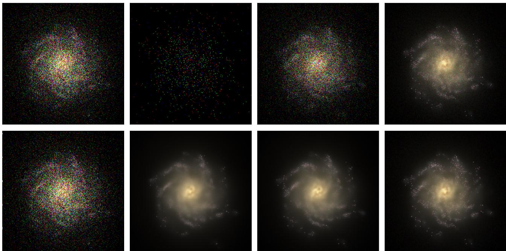  
Figure 5: Intermediate states of PDPS for the Poisson denoising problem on the EAGLE dataset. (Top-left, bottom-left) Observation $y \sim \operatorname { P o i s } ( a x )$ , with x an image of the validation dataset. (Top row) $Z _ { t } ^ { y } / ( 1 + t )$ , with $\mathbf Z ^ { y } \sim \mathrm { M P P } ( \pi ^ { y } )$ for increasing values of t. This MPP is simulated using the Poisson denoiser approximation $K ^ { \pi ^ { y } } ( Z _ { t } ^ { y } ) \approx k ^ { \theta } ( Z _ { t } ^ { y } + y )$ (Bottom-row) The corresponding Poisson denoiser outputs $K ^ { \pi ^ { y } } ( Z _ { t } ^ { y } ) \approx k ^ { \theta } ( Z _ { t } ^ { y } \overset { . } { + } y )$

If for any $1 \leqslant i \leqslant d , z _ { t } \mapsto [ K _ { t } ^ { \pi } ( z _ { t } ) ]$ only depends on $z _ { t } ^ { i } ,$ , we may evaluate the discrete derivative with only two denoiser evaluations: indeed, $[ K _ { t } ^ { \pi } ( z _ { t } + e _ { j } ) ] _ { i } - [ K _ { t } ^ { \pi } ( z _ { t } ) ] _ { i } = ( [ K _ { t } ^ { \pi } ( z _ { t } + 1 ) ] _ { i } - [ K _ { t } ^ { \pi } ( z _ { t } ) ] _ { i } ) \times \delta _ { i , j }$ in that case. This condition holds notably i $\dot { \cdot } \pi = \pi _ { 1 } \otimes \cdot \cdot \cdot \otimes \pi _ { d }$ . However, this assumption is generally too restrictive in practice and therefore introduces an approximation error.

As noted in Example 1, both approximations are in fact exact when $\pi = \gamma \sim \mathbf { { r } } ( \alpha , \beta ) , \mathbf { a s } [ K _ { t } ^ { \gamma } ( z _ { t } ) ] _ { i } = ( z _ { t } ^ { i } + \alpha _ { i } ) / ( \beta _ { i } + t )$ Since the continuous approximation can be justified for large t, a reasonable strategy would be to use it for large t, and default to the independent coordinates approximation when t is close to 0. We illustrate this compromise in Figure 7, where we compare the quality of both approximations on tractable examples. For the numerical experiments of Section 4, we observed that the continuous approximation generally led to better empirical results, but that starting with the independent coordinates approximation for small t usually slightly improved results; see Appendix E.3. These observations suggest that the continuous derivative should be used by default, while the independent coordinate approximation can be relevant for small $t ,$ depending on the application.

## D.4 MPDM-based PnP-DM

Consider the following family of distributions. For clarity, we keep the notation $\rho _ { k }$ of the original PnP-DM paper; however, in practice we set $t _ { k } = 1 / \rho _ { k } ^ { 2 }$ , for a time-grid $0 \approx t _ { 0 } < t _ { 1 } < \cdot \cdot \cdot < t _ { N }$

$$
\begin{array} { r } { \pi _ { k } ^ { y } ( \mathrm { d } x , \mathrm { d } \tilde { x } ) \propto g ( y | \tilde { x } ) \exp \left( - \mathcal { D } _ { \mathrm { e } } ( \tilde { x } , x ) / \rho _ { k } ^ { 2 } \right) \pi ( \mathrm { d } x ) \mathrm { d } \tilde { x } \ . } \end{array}
$$

The marginal in x is heuristically expected to approach the posterior $\pi ^ { y }$ as $t _ { k } \to \infty$ . We do not claim any exact convergence: this expression is motivated by the analogy existing with the Gaussian difusion case, as Proposition 4 shows that the denoising distribution of $\operatorname { M P P } ( \pi )$ naturally appears within the prior step. However, a properly normalized kernel of this form generally involves an additional normalization factor, potentially depending on x, which is omitted here.

Prior step. Proposition 4 shows that $\pi _ { k } ^ { y } ( \mathrm { d } x | \tilde { x } ) \propto \pi _ { t _ { k } } \left( \mathrm { d } x | t _ { k } \tilde { x } \right)$ , setting $t _ { k } : = 1 / \rho _ { k } ^ { 2 }$ . Recall that $\pi _ { t } ( \mathrm { d } x | z _ { t } )$ denotes the conditional distribution of X given $Z _ { t } = z _ { t }$ , with Z the MPP with rate X. A priori, it is defined for $z _ { t } \in \mathbb { N } ^ { d }$ ; however, equation (2) allows us to extend its domain of definition to $\mathbb { R } _ { + } ^ { d }$ . A sample from $\pi _ { k } ^ { y } ( \mathrm { d } x | \tilde { x } )$ can be obtained by simulating this MPP, using a slightly modified version of Algorithm 1. Instead of starting with $t _ { 0 } = 0 , \tilde { Z } _ { 0 } = 0 ,$ consider a time-grid $t _ { k } = t _ { k , 0 } < \cdots < t _ { k , N }$ , and an initial value $\boldsymbol { \tilde { Z } _ { t _ { k } } } = t _ { k } \boldsymbol { \tilde { x } }$ . Again, $t _ { k } \tilde { x }$ does not necessarily belong to $\mathbb { N } ^ { d }$ : one solution is to round each coordinate to the nearest integer. However, note that the discretization scheme of Algorithm 1 does not explicitly require the initial state to be integer-valued. Indeed, as noted already, Proposition $2$ shows that the Poisson denoiser $K _ { t } ^ { \pi }$ , for a fixed $t ,$ can be extended to $\mathbb { R } _ { + } ^ { d }$ -valued inputs. Furthermore, as explained in Appendix $\operatorname { E . 2 } ,$ , the learned denoiser $k _ { t } ^ { \theta }$ is typically trained using rescaled inputs of the form $z _ { t } / ( 1 + t )$ to compensate for the $Z _ { t } = \mathcal { O } ( t )$ scaling of the MPP. Thus, the learned denoiser is naturally compatible with non-integer inputs: in our numerical experiments, we observed no substantial diference when keeping $t _ { k } \tilde { x }$ instead of rounding it.

Algorithm 5 MPDM adaptation of DPS   
Require: Learned denoiser $k ^ { \theta } \approx K ^ { \pi }$ , likelihood $g ( y | \cdot )$ , measurement $y ,$ time-schedule $0 = t _ { 0 } < t _ { 1 } < \cdots < t _ { N }$ with   
$\Delta _ { k } = t _ { k + 1 } - t _ { k }$   
1: Initialize $z _ { 0 } = 0$   
2: for $k = 0 , \ldots , N - 1$ do   
3: Compute $k _ { t _ { k } } ^ { \theta } ( z _ { k } )$   
4: Estimate $K _ { t _ { k } } ^ { \tilde { \pi } ^ { y } } ( z _ { k } ) \approx \tilde { K } _ { t _ { k } } ^ { \pi ^ { y } } ( z _ { k } )$ using $g ( y | \cdot )$ and (6) (either the continuous approximation   
or the independent coordinates approximation)   
5: Draw $n _ { k } \sim \mathrm { P o i s } ( \Delta _ { k } ^ { - } \tilde { K } _ { t _ { k } } ^ { \pi ^ { y } } ( z _ { k } ) )$   
6: Set $z _ { k + 1 } = z _ { k } + n _ { k }$ ▷ Discretization scheme (Algorithm 1)   
7: end for   
8: return $z _ { N } / t _ { N }$ or $\tilde { K } _ { t _ { N - 1 } } ^ { \pi ^ { y } } \left( z _ { N - 1 } \right)$ ▷ See Remark 1

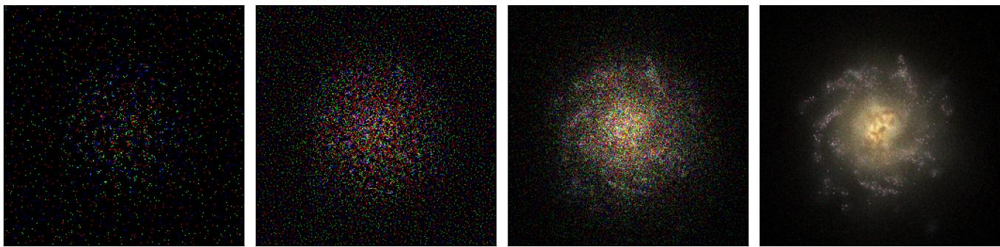  
Figure 6: Trajectory generated by MDPM-based DPS, for the Poisson denoising problem. Images show $Z _ { t } ^ { y } / ( 1 + t )$ , with $\mathbf { Z } ^ { y } \sim \mathrm { M P P } ( \pi ^ { y } )$ , for increasing values oft. This MPP is simulated using the Poisson denoiser approximation ofTheorem 4, with the discrete derivative being approximated by the continuous one.

Proposition 4. For every $t > 0$ and $z _ { t } \in \mathbb { N } ^ { d } , \pi _ { t } ( \mathrm { d } x | z _ { t } ) \propto \exp \left( - t \mathcal { D } _ { \mathrm { e } } ( z _ { t } / t , x ) \right) \pi ( \mathrm { d } x )$

Proof. As by definition $\begin{array} { r } { \mathcal { D } _ { \phi } ( x , y ) = \sum _ { i = 1 } ^ { d } x _ { i } \log ( x _ { i } / y _ { i } ) - x _ { i } + y _ { i } } \end{array}$ , we have

$$
\begin{array} { l } { \displaystyle \exp \left( - t \mathcal { D } _ { \phi } ( t z _ { t } , x ) \right) = \exp \left( - t \sum _ { i = 1 } ^ { d } \frac { z _ { t } ^ { i } } { t } \log \left( \frac { z _ { t } ^ { i } / t } { x _ { i } } \right) - \frac { z _ { t } ^ { i } } { t } + x _ { i } \right) } \\ { \displaystyle \qquad = \exp \left( \sum _ { i = 1 } ^ { d } z _ { t } ^ { i } \log ( x _ { i } ) - t x _ { i } \right) \times C ( z _ { t } ) } \\ { \displaystyle \qquad \propto \prod _ { i = 1 } ^ { d } \mathrm { e } ^ { - t x _ { i } } x _ { i } ^ { z _ { t } ^ { i } } , } \end{array}
$$

where $C ( \boldsymbol { z } _ { t } )$ does not depend on x. We recognize the expression of $\pi _ { t } \big ( \mathrm { d } \boldsymbol { x } | \boldsymbol { z } _ { t } \big ) \left( 2 \right)$

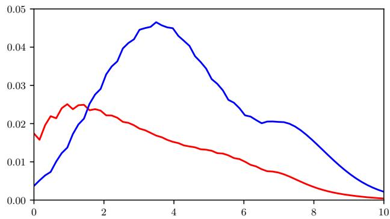

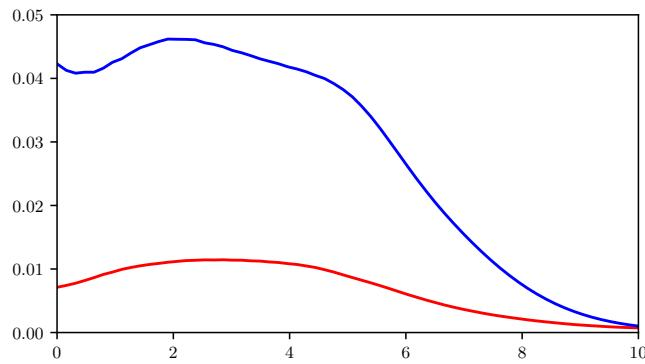  
Figure 7: Errors associated with the approximation of the Poisson denoiser $K _ { t } ^ { \pi }$ discrete derivative, for $0 \leqslant t \leqslant 1 0 ,$ when π is a mixture of bivariate Gamma distributions. Red lines show the total error associated with the continuous approximation, $\begin{array} { r } { i . e . , 1 / 4 \sum _ { i , j = 1 } ^ { 2 } | [ K _ { t } ^ { \pi } ( z _ { t } + e _ { j } ) ] _ { i } - [ K _ { t } ^ { \pi } ( z _ { t } ) ] _ { i } - \partial _ { j } [ K _ { t } ^ { \pi } ( z _ { t } ) ] _ { i } | } \end{array}$ . Blue lines show the error associated with the independent coordinate approximations, that is, $\begin{array} { r } { 1 / 4 \sum _ { i , j = 1 } ^ { 2 } | [ K _ { t } ^ { \pi } ( z _ { t } + e _ { j } ) ] _ { i } - [ K _ { t } ^ { \pi } ( z _ { t } ) ] _ { i } - ( [ K _ { t } ^ { \pi } ( z _ { t } + { \bf 1 } ) ] _ { i } - [ K _ { t } ^ { \pi } ( z _ { t } ) ] _ { i } ) \times \delta _ { i j } | } \end{array}$ The errors are averaged over $z _ { t } = ( k , l ) , 1 \leqslant k , l \leqslant 1 5 .$ . (Left) π is the distribution used in the toy example; see Appendix E.3. We observe that the independent coordinates approximation is preferable in the low t regime, whereas the continuous approximation gets significantly better as t increases. (Right) we modify π to be less “symmetric”, setting $\alpha _ { 1 } = ( 1 6 , 1 6 ) , \alpha _ { 2 } = ( 6 4 , 6 4 ) , \alpha _ { 3 } = ( 3 2 , 6 4 ) , \alpha _ { 4 } = ( 3 2 , 1 6 ) , \alpha _ { 5 } = ( 2 0 , 2 0 )$ ). In this case, the independent coordinates approximation exhibits a substantially larger error.

Likelihood step. The likelihood step, i.e., sampling from $\pi _ { k } ^ { y } ( \mathrm { d } \tilde { x } | x )$ , requires an MCMC procedure. To be precise, from (7), (4), we obtain

$$
\pi _ { k } ^ { y } ( \mathrm { d } \tilde { x } | x ) \propto g ( y | \tilde { x } ) \exp \left( - t _ { k } \sum _ { i = 1 } ^ { d } \tilde { x } _ { i } \log ( \tilde { x } _ { i } / x _ { i } ) - \tilde { x } _ { i } \right) \mathrm { d } \tilde { x } = : q _ { y } ^ { k } ( \tilde { x } | x ) \mathrm { d } \tilde { x } \ ,
$$

and the associated score (gradient log with respect to x˜) is

$$
\nabla \log q _ { y } ^ { k } ( \tilde { x } | x ) = \nabla \log g ( y | \tilde { x } ) - t _ { k } \sum _ { i = 1 } ^ { d } ( \log ( \tilde { x } _ { i } ) - \log ( x _ { i } ) ) e _ { i } ,
$$

with $e _ { i } = ( \delta _ { i , j } ) _ { 1 \leqslant j \leqslant d } .$ However, this score is not well behaved when x˜ has coordinates close to zero. Furthermore, we need to enforce the constraints $\tilde { x } \in \mathbb { R } _ { + } ^ { d }$ . We address these points by relying on a Riemannian Langevin MCMC method; see (Girolami and Calderhead, 2011, Section 5). More precisely, we consider the manifold $( 0 , + \infty ) ^ { d }$ equipped with the Riemannian g defined as $\mathbf { g } _ { x } = \mathrm { d i a g } ( 1 / x _ { 1 } , \dots , 1 / x _ { d } )$ . This metric is actually the Fisher information matrix associated with the Poisson distribution; see (Girolami and Calderhead, 2011, Section 4). With this metric, the Langevin SDE has the form

$$
\mathrm { d } \tilde { X } _ { t } = \Big ( \tilde { X } _ { t } \odot \nabla \log q _ { y } ^ { k } \big ( \tilde { X } _ { t } | x \big ) + 1 \Big ) \mathrm { d } t + \sqrt { 2 \tilde { X } _ { t } \odot } \mathrm { d } B _ { t } ,
$$

with $\odot$ the coordinate-wise product and $1 = ( 1 , \ldots , 1 ) \in \mathbb { R } ^ { d }$ . The Euler discretization of this SDE yields Algorithm 7. In particular, the j-th Langevin MCMC update has the form

$$
\tilde { x } ^ { j + 1 } = \tilde { x } ^ { j } + \delta \times \tilde { x } ^ { j } \odot \nabla \log g ( y | \tilde { x } ^ { j } ) - t _ { k } \delta \times \sum _ { i = 1 } ^ { d } \tilde { x } _ { i } ^ { j } ( \log ( \tilde { x } _ { i } ^ { j } ) - \log ( x _ { i } ) ) e _ { i } + \delta \times 1 + \sqrt { 2 \delta \tilde { x } ^ { j } } \odot G _ { j } ~ ,
$$

with $\delta > 0$ denoting the step-size and $G _ { j } \sim \mathrm { N } ( 0 , \mathrm { I } _ { d } )$ . Note that $\tilde { x } _ { i } ^ { j } \log ( \tilde { x } _ { i } ^ { j } )$ is well behaved near zero.

While the Riemannian Langevin SDE is intrinsically defined on $( 0 , + \infty ) ^ { d }$ , its discretization may lead to negative outputs, especially if a large step-size $\delta$ is used; in practice, we clamp each update to guarantee positivity. Finally, Algorithm 6 includes an optional hyperparameter $\eta ,$ which is not present in the original PnP-DM algorithm. This addition is justified by a similar hyperparameter within the original DAPS algorithm; see below.

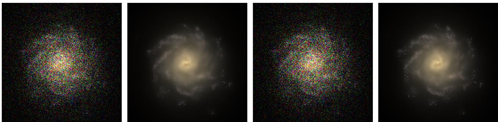  
Figure 8: Same setting as Figures 5 and 6. Successive likelihood and prior steps (images 1,3 and 2,4, respectively) of MPDMbased PnP-DM.

```tcl
Algorithm 6 MPDM adaptation of PnP-DM
Require: Learned denoiser $k ^ { \theta } \approx K ^ { \pi }$ , likelihood $g ( y | \cdot )$ , measurement y, schedule $t _ { 0 } < t _ { 1 } < \cdots < t _ { N }$ ; optional: $\eta > 0 ;$
default $\eta = 1$
1: Initialize x
2: for $k = 0 , \ldots , N - 1$ do
3: Sample x˜ from $\pi _ { k } ^ { y } ( \mathrm { d } \tilde { x } | x ) \propto g ( y | \tilde { x } ) ^ { \eta }$ exp $\mathopen { } \mathclose \bgroup \left( - t _ { k } \mathcal { D } _ { \mathrm { e } } ( \tilde { x } , x ) \aftergroup \egroup \right)$ d˜x with Algorithm 7
where $\begin{array} { r } { \mathcal { D } _ { \mathrm { e } } ( \tilde { x } , x ) = \sum _ { i = 1 } ^ { d } \tilde { x } _ { i } \log ( \tilde { x } _ { i } / x _ { i } ) - \tilde { x } _ { i } + x _ { i } } \end{array}$ ▷ Likelihood step
4: Sample x from $\pi _ { k } ^ { y } ( \mathrm { d } x | \tilde { x } )$ by simulating the counting process with intensity $k ^ { \theta }$
with initial state $t _ { k } \dot { \iota }$ x˜ at time $t _ { k } ;$ see Algorithm 1 ▷ Prior step
5: end for
6: return x
```

## D.5 MPDM-based DAPS

Our MPDM version of DAPS (Zhang et al., 2025) is closely related to the original Gaussian difusion version, described in Appendix C. We introduce, given a time-grid $t _ { 0 } < t _ { 1 } < . . . t _ { N }$

$$
\pi _ { t _ { k } } ^ { y } ( \mathrm { d } x | z _ { t _ { k } } ) \propto g ( y | x ) \pi _ { t _ { k } } ( \mathrm { d } x | z _ { t _ { k } } ) .
$$

This is mostly the same equation as (24), but here $\pi _ { t } ( \mathrm { d } x | z _ { t } )$ is the conditional distribution associated with the MPP, defined in (2).

Prior step. Instead of a Gaussian approximation, we use a Gamma one:

$$
\boldsymbol \pi _ { t } ( \mathrm { d } \boldsymbol x | \boldsymbol z _ { t } ) \approx \boldsymbol \Gamma ( r _ { t } ^ { - 2 } \hat { \boldsymbol x } ( \boldsymbol z _ { t } ) , r _ { t } ^ { - 2 } { \boldsymbol 1 } ) ,
$$

where $\hat { x } ( z _ { t } )$ is either obtained by simulation of the MPP from $z _ { t }$ onward, or directly as $K _ { t } ^ { \pi } ( z _ { t } )$ . This latter choice is actually exact when π is Gamma distributed.

Algorithm 7 Riemannian Langevin MCMC algorithm on $\mathbb { R } _ { + } ^ { d }$   
Require: Score function $s : \mathbb { R } _ { + } ^ { d } \to \mathbb { R } ^ { d } ;$ , time-step $\delta > 0$ , number of iterations N, initial state $\boldsymbol { x } _ { 0 } \in \mathbb { R } _ { + } ^ { d }$   
1: for $k = 0 , \ldots , N - 1$ do   
2: Sample $G _ { k } \sim \mathrm { N } ( 0 , \mathrm { I } _ { d } )$   
3: Set $x _ { k + 1 } = x _ { k } + \delta x _ { k } \odot s ( x _ { k } ) + \delta \mathbf { 1 } + { \sqrt { 2 \delta x _ { k } } } \odot G _ { k }$ , with $\odot$ the component-wise product   
4: Set $x _ { k + 1 } = ( x _ { k + 1 } ) .$ + ▷ Enforce positivity   
5: end for   
6: return $x _ { N }$

Algorithm 8 MPDM adaptation of DAPS   
Require: Learned denoiser $k ^ { \theta } \approx K ^ { \pi }$ , likelihood $g ( y | \cdot )$ , measurement y, schedule $t _ { 0 } < t _ { 1 } < \cdots < t _ { N } ;$ optional: $\eta > 0 ,$   
default $\eta = 1$   
1: Initialize x   
2: for $k = 0 , \ldots , N - 1$ do   
3: Sample $z _ { k } \sim \mathrm { P o i s } ( t _ { k } x )$ ▷ Noising step   
4: Compute $\hat { x } = k _ { t _ { k } } ^ { \theta } ( z _ { k } )$ (or simulate the counting process with intensity $k ^ { \theta }$   
with initial state $z _ { k }$ at time $t _ { k }$ with Algorithm 1) ▷ Prior step   
5: Sample x from the density $g ( y | x ) ^ { \eta } \mathbf { \Gamma } ( x ; \mathbf { \bar { \Lambda } } / r _ { t _ { k } } ^ { - 2 } \hat { x } , r _ { t _ { k } } ^ { - 2 } 1 )$ dx   
with Algorithm 7 ▷ Likelihood step   
6: end for   
7: return x

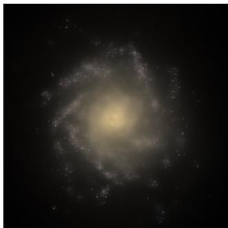

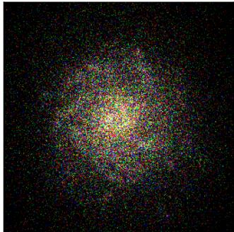

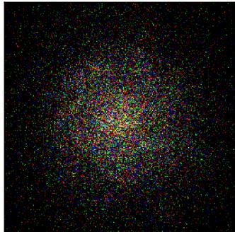

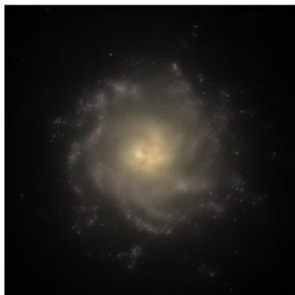  
Figure 9: Same setting as Figures $5 , 6$ and 8. Successive prior steps (images 1,4), likelihood step (image 2), and noising step (image 3) for MPDM-based DAPS. For the noising step, we rescale by a factor of $1 / ( 1 + t _ { k } )$

Example 4. Note that when $\boldsymbol { \pi } = \boldsymbol { \gamma } \sim \mathbf { \Gamma } \Gamma ( \alpha , \beta 1 ) , \boldsymbol { \alpha } \in ( 0 , + \infty ) ^ { d } , \beta > 0 .$ , from Appendix B.4, (21),

$$
\pi _ { t } ( \mathrm { d } x | z _ { t } ) \sim \Gamma ( z + \alpha , ( t + \beta ) 1 ) .
$$

Since $K _ { t } ^ { \gamma } ( z _ { t } ) = ( z _ { t } + \alpha ) / ( t + \beta )$ , we have $\pi _ { t } ( \mathrm { d } x | z _ { t } ) \sim \Gamma ( ( t + \beta ) K _ { t } ^ { \pi } ( z _ { t } ) , ( t + \beta ) 1 )$ , matching our ${ } ^ { \mathrm { e } } D A P S - l i k e ^ { 3 { \mathrm { { r } } } }$ approximation with $r _ { t } ^ { 2 } = 1 / ( t + \beta )$

Likelihood step. Similar to our PnP-DM adaptation, we use Algorithm 7 to sample from

$$
\pi _ { t _ { k } } ^ { y } ( \mathrm { d } x | z _ { t _ { k } } ) \propto g ( y | x ) \mathbf { \Gamma } ( r _ { t } ^ { - 2 } \hat { x } ( z _ { t } ) , r _ { t } ^ { - 2 } 1 ) .
$$

The Riemannian metric discussed in the previous section combines well with the Gamma density: the j-th Riemannian Langevin MCMC update is, after simplification,

$$
\begin{array} { r l } & { x ^ { j + 1 } = x ^ { j } + \delta \times x ^ { j } \odot \nabla \log g ( y | x ^ { j } ) + \delta \displaystyle \sum _ { i = 1 } ^ { d } x _ { i } ^ { j } \times \left( ( r _ { t _ { k } } ^ { - 2 } \hat { x } _ { i } ^ { j } - 1 ) / x _ { i } ^ { j } - r _ { t _ { k } } ^ { - 2 } \right) e _ { i } + \delta 1 + \sqrt { 2 \delta x ^ { j } } \odot G _ { j } } \\ & { \quad \quad = x ^ { j } + \delta \times x ^ { j } \odot \nabla \log g ( y | x ^ { j } ) + \delta \displaystyle \sum _ { i = 1 } ^ { d } r _ { t _ { k } } ^ { - 2 } \left( \hat { x } _ { i } ^ { j } - x _ { i } ^ { j } \right) e _ { i } + \sqrt { 2 \delta x ^ { j } } \odot G _ { j } ~ . } \end{array}
$$

The otherwise problematic $1 / x _ { i } ^ { j }$ factors, which follow from the score of the Gamma distribution, are cancelled out.

Noising step. In analogy with the Gaussian difusion case, we then sample $z _ { t _ { k + 1 } } \sim \operatorname { P o i s } ( t _ { k + 1 } x )$ . Unlike our adaptation of PnP-DM, this extra step ensures that the successive $z _ { t _ { k } }$ lie in $\mathbb { N } ^ { d }$

To improve empirical performance, the original DAPS includes a hyperparameter to control the weight of the likelihood g in the MCMC sampling phases, see (Zhang et al., 2025, Appendix F.2). We adopt the same strategy: in the Langevin update of Algorithm 8, we replace ∇ log $g ( y | \cdot )$ with $\eta \nabla$ log g(y|·), $\eta > 0$ (equivalently, replace $g ( y | \cdot )$ with $g ( y | \cdot ) ^ { \eta } )$ . We apply the same modification to the Langevin update of PnP-DM, as we also observe better empirical performance in our inverse problem experiments when $\eta > 1$ . While it tends to improve the quality of the reconstructed images, note that setting $\eta > 1$ alters the posterior distribution that we aim to sample from. In particular, it can lead to more concentrated samples, hence decreasing the posterior diversity. The values of η used in our experiments are empirically tuned and reported in Table 10.

## E Numerical experiments: details

## E.1 Datasets

PET. The public BrainWeb dataset (Aubert-Broche et al., 2006; Schramm, 2021) contains 21 PET-like brain volumes; we use 20 for training and the remaining one as validation for the inverse problems. From each volume, we extract 60 slices (the middle-most ones), resulting in 1200 256 × 256 training images (and 60 for validation) with four diferent pixel values (lowest is 0, highest is 1). During training, we add random lesions to slices <sup>2</sup>. We augment the dataset during training by applying random translation (±10 pixels), horizontal flip, and small rotation (± 2<sup>°</sup>).

Astrophysics. We downloaded the public mock galaxy images from the EAGLE simulation (McAlpine et al., 2016) after requesting access to the database<sup>3</sup>. We extracted mock images from the RefL0100N1504 Subhalo with GalaxyID $< 2 . 1 0 ^ { 7 }$ , giving 41372 RGB $2 5 6 \times 2 5 6$ images. To enforce a relative homogeneity of the training dataset, we used PCA with 100 components followed by a k-means clustering with 3 clusters, and selected one cluster. We kept 100 images for validation and 7787 for training. We augment the dataset during training by applying random translation (±10 pixels), horizontal and vertical flips, and a random rotation. As for the PET dataset, pixel values span [0, 1].

## E.2 Training details

While most of the literature relies on pre-trained models to evaluate Gaussian difusion-based posterior sampling algorithms, our approach requires training models from scratch. The input z of the Poisson denoiser, $( z , t ) \mapsto K _ { t } ^ { \pi } ( z )$ , scales with t due to the nature of MPP. Thus, we use rescaled inputs for the network approximating $K ^ { \pi }$ , denoted by $k ^ { \theta } ,$ , namely $z / ( 1 + t )$ and $1 / ( 1 + t )$ instead of $z , t .$ These design choices are similar to those of Bhattacharya et al. (2025). The network directly predicts the denoised image, rather than a residual correction to the input. We used the same strategy to train Gaussian denoisers approximating $D ^ { \pi }$ . The Gaussian difusion formulation we considered, detailed in Section 2.2, is admittedly not the most common; however, it shares several similarities with MPDM: SNR increasing with t, process X scaling as $X _ { t } \approx t ,$ and such that $X _ { t } / t \to X \sim \pi$ almost surely.

Architectures. For the toy example, we used a time-conditioned residual multilayer perceptron with a hidden dimension of 128 and three residual blocks. The two-dimensional input was first projected to the hidden dimension, and the difusion time variable was encoded using a 64-dimensional time embedding followed by a two-layer MLP. Each residual block consisted of two linear layers with SiLU activations and was conditioned on the time embedding through featurewise linear modulation (FiLM), implemented as a learned scale and shift. A final linear layer mapped the hidden repre sentation back to the two-dimensional output space, followed by a Softplus activation to enforce non-negativity.

For the BrainWeb and EAGLE datasets, we used a U-Net architecture (Ronneberger et al., 2015) with 32 input channels, base width 256, and 5 resolution levels. The number of channels doubles at every level, with spatial downsampling by a factor oftwo. Each encoder and decoder level consists oftwo residual blocks. The residual blocks use Group Normalization and SiLU activations and are conditioned on the difusion time through the same feature-wise linear modulation (FiLM) mechanism. The time variable is first mapped to a 128-dimensional sinusoidal embedding, followed by a two-layer MLP. The bottleneck consists of two residual blocks and contains no attention. The decoder uses nearest-neighbor upsampling followed by convolution and concatenates the corresponding encoder features through standard U-Net skip connections. A final $1 \times 1$ convolution produces the output channels, followed by a Softplus activation to enforce non-negativity.

Training. We trained our models with the Adam optimizer and a $1 0 ^ { - 4 }$ learning rate. During training, each image is noised at a level t with a log-uniform distribution: log t is uniform on $[ - 7 , 7 ]$ . This non-uniform distribution for t is compensated with a Jacobian factor; see Appendix D.1. We use the usual $l ^ { 2 }$ loss instead of the Bregman divergence (4): after comparing both choices, we observed no significant diference in our experiments.

For the image datasets, we used a batch size of 32 and trained for 3500 epochs for the PET dataset and 1000 epochs for the astrophysics dataset. For the toy example, we used approximately $1 0 ^ { 5 }$ optimization steps, with batches of 1024 fresh samples from the Gamma mixture distribution defined in Appendix E.3.

## E.3 Inverse problems: settings and detailed results

Computational budget and hyperparameters. PDPS, DPS, PnP-DM and DAPS all require a time grid $t _ { 0 } < t _ { 1 } <$ $\cdots < t _ { N }$ to approximately simulate the underlying Gaussian difusion/MPDM. PDPS and DPS use one NFE (denoiser call) per iteration, hence N NFEs in total; to be precise, DPS requires vector-Jacobian computations. For DAPS and PnP-DM, there is an additional inner loop at each prior step: if we fix the total number of NFEs, we must allocate them between the outer loop on $t _ { 0 } < t _ { 1 } < . . . t _ { N }$ and the inner loop that simulates the difusion from t onward. For fairness and simplicity, we use only one NFE for each prior step, and keep the same grid $t _ { 0 } < t _ { 1 } < \cdots < t _ { N }$ for every algorithm. This design choice is present in DAPS: the authors observe that more NFEs in the inner loop lead to slightly better reconstruction metrics for linear inverse problems; see (Zhang et al., 2025, Appendix I). On the other hand, using only one inner-loop NFE is admittedly a slight modification of the original PnP-DM design.

In the likelihood step of DAPS and PnP-DM, we set the number of Langevin steps to 128 and the step-size to $\delta = 0 . 0 0 1$ While computationally cheap, this likelihood step is repeated at each iteration, thus N times. For simplicity, we choose to only match the number of NFEs between these methods and DPS/PDPS, ignoring these Langevin steps. Note that for Gaussian difusion-based PnP-DM and DAPS, we use a standard Langevin MCMC scheme and clamp updates that have negative values, as the authors do not discuss the case where the density is supported on $\mathbb { R } _ { + } ^ { d }$ . Meanwhile, our MPDMbased adaptations rely on Riemannian Langevin MCMC (Algorithm 7).

The hyperparameter η mimics the empirical tuning of $\beta _ { y }$ present in DAPS (Zhang et al., 2025, Appendix F.2): it efectively increases the weight of the likelihood term in the Langevin scheme. As in the original DAPS paper, we observe better reconstruction metrics when $\eta > 1$ , so we keep this design choice in our implementations. This additional parameter is not present in PnP-DM: we include it to ensure fairness, as we also observe better empirical performance with $\eta > 1$ . In each experiment, we test several values of η for both DAPS and PnP-DM, ranging from 1 to 20, and select the one that yields the best reconstruction metrics; see Table 10. For DAPS algorithms (either MPDM or difusion-based), we used $r _ { t } ^ { 2 } = 1 / ( 1 + t )$ . We mostly rely on continuous derivative approximation for MPDM-based DPS (see Appendix D.3), except for the EAGLE dataset (both Poisson denoising and blur problems) and the toy dataset, where we use the independent coordinates approximation until $t = 0 . 0 5$ , before switching to the continuous approximation. We observed that it slightly improved the reconstruction performance in these cases.

Overall, comparison of these diferent methods is not straightforward, especially because DAPS and PnP-DM prior steps and likelihood steps require specific computational budget and several hyperparameters: we choose to tune η, but to keep the Langevin parameters identical for every experiment. Note that, while limited to the $A = a \mathrm { I } _ { d }$ case, PDPS requires few hyperparameters (only the time-grid design), only one NFE per iteration, and no vector-Jacobian computation.

Toy example. We consider the bidimensional Gamma mixture distribution $\textstyle \pi = { \frac { 1 } { 5 } } \sum _ { i = 1 } ^ { 5 } \mathbf { r } ( \alpha _ { i } , \beta _ { i } )$ with $\alpha _ { 1 } = ( 1 6 , 1 6 ) , \alpha _ { 2 } =$ $( 6 4 , 6 4 ) , \alpha _ { 3 } = ( 1 6 , 6 4 ) , \alpha _ { 4 } = ( 6 4 , 1 6 ) , \alpha _ { 5 } = ( 2 0 , 2 0 ) , \beta _ { 1 } = \beta _ { 2 } = \beta _ { 3 } = \beta _ { 4 } = ( 1 6 , 1 6 ) , \beta _ { 5 } = ( 8 , 8 )$ . The MPP is com pletely tractable in this case; see Appendix B.4.

We sample 10 points $x _ { 1 } , \ldots . x _ { 1 0 }$ from π and draw $y _ { i } \sim \operatorname { P o i s } ( a x _ { i } )$ in both the low-count regime $( a = 0 . 6 )$ and highcount regime $( a = 3 )$ . All algorithms use the same time grid: $s _ { 1 } , \ldots s _ { N }$ are log-uniform on [0.1, 100] and we set $t _ { i } =$ $0 . 0 0 0 1 + s _ { i } - 0 . 1$ ; we choose $N = 1 0 2 4$ . For PnP-DM and DAPS methods, we use only one denoising step at each time $t _ { i }$ to ensure that all methods have identical NFE; furthermore, we keep $\eta = 1$ in order to preserve the correct target distribution. For $i = 1 , \ldots , 1 0$ , every method generates 10000 approximate $\pi ^ { y _ { i } }$ samples: we compute the 2-Wasserstein distance against a set of 10000 exact $\pi ^ { y _ { i } }$ samples, and average the results over i. We repeat this procedure 10 times to obtain confidence intervals. We also compute the 2-Wasserstein distance between two distinct sets of exact samples to obtain a baseline. The full results are given in Table 4. We also generate approximate π samples with both the MPDM

<table><tr><td rowspan="2" colspan="2">Methods</td><td>Toy (LC)</td><td>Toy (HC)</td></tr><tr><td>2-Wasserstein ↓</td><td>2-Wasserstein ↓</td></tr><tr><td rowspan="4">MPDM-based Poisson</td><td>DAPS</td><td>0.3320 ± 0.0055</td><td>0.3173 ± 0.0042</td></tr><tr><td>DPS</td><td>0.2332 ± 0.0091</td><td>0.3106 ± 0.0039</td></tr><tr><td>PnP-DM</td><td>1.0761 ± 0.0053</td><td>0.3749 ± 0.0037</td></tr><tr><td>PDPS</td><td>0.0945 ± 0.0053</td><td>0.0732±0.0023</td></tr><tr><td rowspan="3">Diffusion-based Poisson</td><td>DAPS</td><td>0.2898 ± 0.0043</td><td>0.2576±0.0044</td></tr><tr><td>DPS</td><td> $0 . 2 1 3 4 \pm 0 . 0 0 4 6$ </td><td> $0 . 2 9 9 9 \pm 0 . 0 0 3 8$ </td></tr><tr><td>PnP-DM</td><td> $1 . 0 7 8 3 \pm 0 . 0 0 3 0$ </td><td> $0 . 3 5 5 3 \pm 0 . 0 0 3 0$ </td></tr><tr><td rowspan="3">Diffusion-based Gaussian-approximated</td><td>DAPS</td><td>0.4292 ± 0.0081</td><td>0.3241 ± 0.0039</td></tr><tr><td>DPS</td><td>0.6285 ± 0.0052</td><td> $0 . 2 8 4 9 \pm 0 . 0 0 4 0$ </td></tr><tr><td>PnP-DM</td><td> $1 . 0 7 9 2 \pm 0 . 0 0 7 2$ </td><td> $0 . 3 5 5 1 \pm 0 . 0 0 4 1$ </td></tr><tr><td colspan="2">PDPS (exact denoiser)</td><td>0.0837 ± 0.0047</td><td></td></tr><tr><td colspan="2">Ground truth</td><td>0.0721 ± 0.0052</td><td> $0 . 0 6 2 5 \pm 0 . 0 0 1 6$   $0 . 0 4 6 9 \pm 0 . 0 0 2 2$ </td></tr></table>

Table 4: Average posterior sampling performance for the toy example. PDPS (exact denoiser) uses the analytical expression of the Poisson denoiser (see Appendix B.4) instead of a learned model. As a baseline, “Ground truth” indicates the 2- Wasserstein distance between two sets of exact samples.

and the difusion model, using the same time-grid (with either N = 64 or N = 1024 time steps). Table 5 shows the 2- Wassertein distance against exact π samples. Note that both models have comparable generative performance, suggesting that the posterior sampling discrepancy observed in Table 4 is due to posterior sampling algorithms rather than the quality of the learned prior.
<table><tr><td>Generative model</td><td>N = 64</td><td>N = 1024</td></tr><tr><td>MPDM</td><td> $0 . 1 1 0 8 \pm 0 . 0 2 0 5$ </td><td> $0 . 1 0 1 1 \pm 0 . 0 1 2 8$ </td></tr><tr><td>Diffusion</td><td> $0 . 1 1 5 3 \pm 0 . 0 1 2 5$ </td><td> $0 . 1 0 7 8 \pm 0 . 0 1 6 7$ </td></tr><tr><td>MPDM (exact denoiser)</td><td> $0 . 1 1 7 6 \pm 0 . 0 1 3 7$  一</td><td> $0 . 1 0 1 3 \pm 0 . 0 2 2 7$ </td></tr><tr><td>Ground truth</td><td>0.0861 ± 0.0164</td><td></td></tr></table>

Table 5: Evaluation of generative models for the toy example. 2-Wasserstein distance between exact and approximate samples.

For each imaging inverse problem, we draw an observation y for each image x in the validation dataset, compute the PSNR, SSIM, and LPIPS of the reconstructed image obtained with each posterior sampling algorithm, and average the metrics over the validation dataset. We repeat this procedure 4 times to obtain confidence intervals.
<table><tr><td rowspan="2" colspan="2">Methods</td><td colspan="3">BrainWeb denoising (LC)</td><td colspan="3">BrainWeb denoising (HC)</td></tr><tr><td>PSNR ↑</td><td>SSIM ↑</td><td>LPIPS ↓</td><td>PSNR ↑</td><td>SSIM ↑</td><td>LPIPS↓</td></tr><tr><td rowspan="4">MPDM-based Poisson</td><td>DAPS</td><td> $1 6 . 7 2 \pm 0 . 0 7$ </td><td> $0 . 7 5 7 0 \pm 0 . 0 0 2 5$ </td><td> $0 . 1 6 5 4 \pm 0 . 0 0 6 7$ </td><td> $2 0 . 6 2 \pm 0 . 0 8$ </td><td> $0 . 8 5 5 9 \pm 0 . 0 0 1 9$ </td><td> $0 . 1 1 5 9 \pm 0 . 0 0 4 9$ </td></tr><tr><td>DPS</td><td> $1 6 . 9 1 \pm 0 . 1 5$ </td><td> $0 . 7 5 7 4 \pm 0 . 0 0 9 2$ </td><td> $0 . 1 4 2 9 \pm 0 . 0 1 1 0$ </td><td> $2 0 . 4 9 \pm 0 . 1 3$ </td><td> $0 . 8 4 7 7 \pm 0 . 0 0 8 6$ </td><td> $0 . 1 2 0 7 \pm 0 . 0 1 1 0$ </td></tr><tr><td>PnP</td><td> $1 6 . 6 5 \pm 0 . 1 0$ </td><td> $0 . 6 2 7 8 \pm 0 . 0 0 5 1$ </td><td> $0 . 2 2 5 8 \pm 0 . 0 0 7 0$ </td><td> $2 1 . 7 2 \pm 0 . 0 7$ </td><td> $0 . 8 1 7 1 \pm 0 . 0 0 3 8$ </td><td> $0 . 1 4 0 8 \pm 0 . 0 0 7 1$ </td></tr><tr><td>PDPS</td><td> $1 6 . 9 0 \pm 0 . 0 9$ </td><td> $0 . 7 8 1 2 \pm 0 . 0 0 3 3$ </td><td> $0 . 1 1 2 4 \pm 0 . 0 0 6 3$ </td><td> $2 1 . 3 1 \pm 0 . 1 0$ </td><td> $0 . 9 0 1 9 \pm 0 . 0 0 2 0$ </td><td> $0 . 0 5 8 5 \pm 0 . 0 0 3 8$ </td></tr><tr><td rowspan="3">Diffusion-based Poisson</td><td>DAPS</td><td> $1 7 . 1 2 \pm 0 . 0 7$ </td><td> $0 . 7 7 9 4 \pm 0 . 0 0 2 8$ </td><td> $0 . 1 1 4 1 \pm 0 . 0 0 5 1$ </td><td> $2 1 . 4 1 \pm 0 . 0 8$ </td><td> $0 . 8 7 9 6 \pm 0 . 0 0 1 9$ </td><td> $0 . 0 6 6 8 \pm 0 . 0 0 3 3$ </td></tr><tr><td>DPS</td><td> $1 7 . 2 2 \pm 0 . 1 1$ </td><td> $0 . 7 9 1 5 \pm 0 . 0 0 3 2$ </td><td> $0 . 0 8 9 0 \pm 0 . 0 0 4 3$ </td><td> $2 0 . 6 2 \pm 0 . 1 4$ </td><td> $0 . 8 8 1 4 \pm 0 . 0 0 2 8$ </td><td> $0 . 0 5 9 1 \pm 0 . 0 0 5 2$ </td></tr><tr><td>PnP</td><td> $1 6 . 7 7 \pm 0 . 0 6$ </td><td> $0 . 7 8 1 5 \pm 0 . 0 0 2 2$ </td><td> $0 . 1 1 1 3 \pm 0 . 0 0 4 2$ </td><td> $2 0 . 9 1 \pm 0 . 0 9$ </td><td> $0 . 8 8 4 2 \pm 0 . 0 0 1 7$ </td><td> $0 . 0 6 8 7 \pm 0 . 0 0 3 0$ </td></tr><tr><td rowspan="3">Diffusion-based Gaussian-approximated DPS</td><td>DAPS</td><td> $1 5 . 6 3 \pm 0 . 0 7$ </td><td> $0 . 7 3 3 3 \pm 0 . 0 0 3 6$ </td><td> $0 . 1 8 2 1 \pm 0 . 0 0 7 3$ </td><td> $2 1 . 0 3 \pm 0 . 0 9$ </td><td> $0 . 8 7 5 3 \pm 0 . 0 0 2 0$ </td><td> $0 . 0 6 0 6 \pm 0 . 0 0 3 9$ </td></tr><tr><td></td><td> $1 5 . 9 9 \pm 0 . 1 2$ </td><td> $0 . 7 5 1 6 \pm 0 . 0 0 4 6$ </td><td> $0 . 1 0 0 6 \pm 0 . 0 0 6 3$ </td><td> $1 7 . 3 5 \pm 0 . 1 1$ </td><td> $0 . 7 9 5 9 \pm 0 . 0 0 3 1$ </td><td> $0 . 0 8 5 9 \pm 0 . 0 0 5 0$ </td></tr><tr><td>PnP</td><td> $1 5 . 1 0 \pm 0 . 0 1$ </td><td> $0 . 7 2 6 2 \pm 0 . 0 0 0 7$ </td><td> $0 . 3 0 2 9 \pm 0 . 0 0 3 8$ </td><td> $2 0 . 3 6 \pm 0 . 0 7$ </td><td> $0 . 8 7 5 0 \pm 0 . 0 0 1 2$ </td><td> $0 . 0 9 3 7 \pm 0 . 0 0 3 3$ </td></tr></table>

Table 6: Poisson denoising problem $( \mathcal { A } = a \mathbf { I } _ { d } )$ with the BrainWeb dataset, in the low-count (a = 1) and high-count $( a = 5 )$ regime. “Poisson” and “Gaussian-approximated” refer to which likelihood is used, similar to the sufix $\mathbf { \partial } ^ { - } \mathbf { p } , \mathbf { \partial } ^ { - } \mathbf { g }$ of the smaller tables: either the exact Poisson likelihood or $g ( y | x )$ ≈ $\mathrm { N } ( \mathcal { A } ( x )$ , diag(A(x)).

<table><tr><td rowspan="2">Methods</td><td rowspan="2"></td><td colspan="3">BrainWeb PET (LC)</td><td colspan="3">BrainWeb PET (HC)</td></tr><tr><td>PSNR ↑</td><td>SSIM ↑</td><td>LPIPS ↓</td><td>PSNR↑</td><td>SSIM ↑</td><td>LPIPS ↓</td></tr><tr><td rowspan="3">MPDM-based Poisson</td><td>DAPS DPS</td><td> $1 5 . 8 2 \pm 0 . 0 7$   $1 5 . 5 6 \pm 0 . 1 3$ </td><td> $0 . 7 2 9 6 \pm 0 . 0 0 2 8$ </td><td> $0 . 1 6 1 9 \pm 0 . 0 0 6 5$ </td><td> $1 7 . 2 5 \pm 0 . 0 6$ </td><td> $0 . 7 7 8 3 \pm 0 . 0 0 2 4$ </td><td> $0 . 1 5 4 1 \pm 0 . 0 0 6 0$ </td></tr><tr><td>PnP</td><td> $1 6 . 4 1 \pm 0 . 0 5$ </td><td> $0 . 7 0 8 4 \pm 0 . 0 0 8 5$   $0 . 7 3 2 9 \pm 0 . 0 0 1 9$ </td><td> $0 . 1 3 9 5 \pm 0 . 0 0 9 6$   $0 . 1 0 5 1 \pm 0 . 0 0 4 0$ </td><td> $1 6 . 8 4 \pm 0 . 1 6$   $1 8 . 1 1 \pm 0 . 0 5$ </td><td> $0 . 7 5 0 3 \pm 0 . 0 1 0 0$   $0 . 7 9 4 0 \pm 0 . 0 0 1 8$ </td><td> $0 . 1 3 1 8 \pm 0 . 0 0 9 2$   $0 . 0 8 2 8 \pm 0 . 0 0 3 1$ </td></tr><tr><td></td><td></td><td></td><td></td><td></td><td></td><td></td></tr><tr><td rowspan="3">Diffusion-based Poisson</td><td>DAPS</td><td> $1 6 . 0 7 \pm 0 . 0 6$ </td><td> $0 . 7 3 2 7 \pm 0 . 0 0 3 2$ </td><td> $0 . 1 3 3 0 \pm 0 . 0 0 6 6$ </td><td> $1 7 . 6 3 \pm 0 . 0 6$ </td><td> $0 . 7 9 2 3 \pm 0 . 0 0 2 2$ </td><td> $0 . 1 0 2 7 \pm 0 . 0 0 4 5$ </td></tr><tr><td>DPS</td><td> $1 5 . 8 2 \pm 0 . 1 3$ </td><td> $0 . 7 4 0 1 \pm 0 . 0 0 4 2$ </td><td> $0 . 0 9 6 8 \pm 0 . 0 0 5 1$ </td><td> $1 6 . 6 6 \pm 0 . 2 0$ </td><td> $0 . 7 7 5 8 \pm 0 . 0 0 6 3$ </td><td> $0 . 0 9 4 7 \pm 0 . 0 0 6 4$ </td></tr><tr><td>PnP</td><td> $1 5 . 7 4 \pm 0 . 0 5$ </td><td> $0 . 7 1 9 4 \pm 0 . 0 0 2 2$ </td><td> $0 . 1 7 5 5 \pm 0 . 0 0 5 6$ </td><td> $1 7 . 3 3 \pm 0 . 0 6$ </td><td> $0 . 7 8 1 9 \pm 0 . 0 0 2 3$ </td><td> $0 . 1 3 6 5 \pm 0 . 0 0 4 9$ </td></tr><tr><td rowspan="3">Diffusion-base Gaussian-approximated DPS</td><td>DAPS</td><td> $1 6 . 1 3 \pm 0 . 0 6$ </td><td> $0 . 7 4 7 8 \pm 0 . 0 0 2 5$ </td><td> $0 . 1 1 1 1 \pm 0 . 0 0 5 8$ </td><td> $1 7 . 6 0 \pm 0 . 0 8$ </td><td> $0 . 7 9 3 0 \pm 0 . 0 0 4 6$ </td><td> $0 . 1 1 1 5 \pm 0 . 0 1 2 3$ </td></tr><tr><td></td><td> $1 4 . 7 5 \pm 0 . 1 5$ </td><td> $0 . 6 8 9 1 \pm 0 . 0 0 5 7$ </td><td> $0 . 1 6 7 8 \pm 0 . 0 1 0 6$ </td><td> $1 5 . 7 3 \pm 0 . 1 3$ </td><td> $0 . 7 3 7 2 \pm 0 . 0 0 4 7$ </td><td> $0 . 0 9 6 2 \pm 0 . 0 0 5 9$ </td></tr><tr><td>PnP</td><td> $1 5 . 8 6 \pm 0 . 0 6$ </td><td> $0 . 7 3 9 2 \pm 0 . 0 0 2 8$ </td><td> $0 . 1 3 8 8 \pm 0 . 0 0 9 0$ </td><td> $1 7 . 2 9 \pm 0 . 0 7$ </td><td> $0 . 7 8 6 9 \pm 0 . 0 0 3 9$ </td><td> $0 . 1 3 9 0 \pm 0 . 0 1 0 6$ </td></tr></table>

Table 7: PET (with the BrainWeb dataset), in the low-count (a = 20) and high-count (a = 100) regimes.

PET. Our PET setting was constructed with parallelproj<sup>4</sup> (Schramm and Thielemans, 2024). The forward operator comprised 180 equally spaced projection angles over $0 \leqslant \theta \leqslant \pi$ . With $2 5 6 \times 2 5 6$ grayscale images, the discretized Radon operator satisfies $\mathcal { A } : \mathbb { R } _ { + } ^ { d }  \mathbb { R } _ { + } ^ { d _ { y } }$ , with $d = 2 5 6 \times 2 5 6$ and $d _ { y } = 1 8 0 \times 1 8 0$ . For each angle, projection bins were uniformly distributed radially, spanning 3.5 times the image width. The projection geometry used a source-to-detector radius of 400 pixels. The image origin was centered such that the reconstructed field of view was symmetric about the origin. See Figure 10 for an illustration. For both the PET and Poisson denoising problems, each posterior sampling algorithm relies on the same log-uniform time-grid $t _ { 0 } < \cdots < t _ { N }$ , with $t _ { N } = 1 0 0$ and $N = 1 2 8$

Astrophysics. We considered a two-dimensional Gaussian blurring forward operator. The input images were convolved with a normalized $6 5 \times 6 5$ Gaussian kernel with standard deviation $\sigma = 3 .$ pixels. Zero-padding was used at the image boundaries to preserve the image dimensions. Here, $\mathcal { A } : \mathbb { R } _ { + } ^ { d }  \mathbb { R } _ { + } ^ { d }$ with $d = d _ { y } = 3 \times 2 5 6 \times 2 5 6$ . See Figure 11 for a visual example. For both the blur and Poisson denoising problems, each posterior sampling algorithm relies on the same log-uniform time-grid $t _ { 0 } < \cdots < t _ { N }$ , with $t _ { N } = 1 0 0$ and $N = 2 5 6$

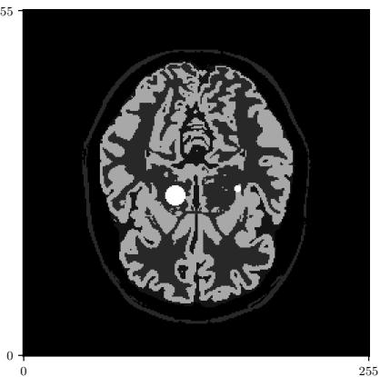

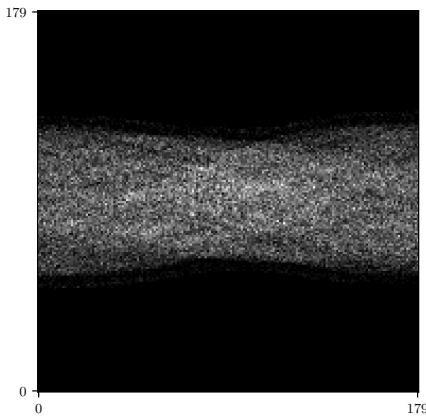

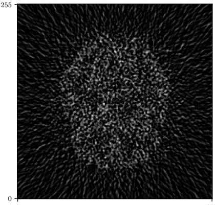  
Figure 10: PET illustration. (Left) Ground-truth image x from the BrainWeb dataset, with lesions (bright dots). (Center) the sinogram, i.e., observation y ∼ Pois(A(x)). Each pixel represents the number ofdetections for a given pair ofdetectors. (Right) Filtered back-projection of y.

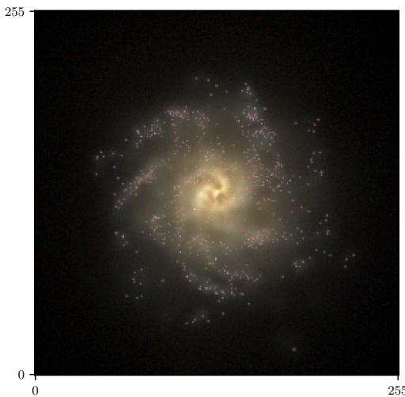

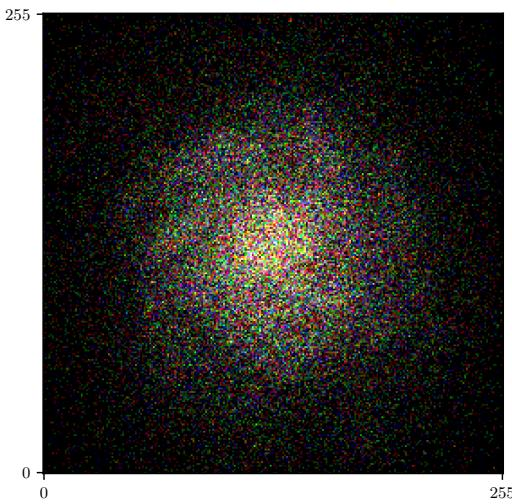  
Figure 11: Gaussian blurring illustration. (Left) Ground-truth image x from the EAGLE dataset. (Right) Observation $y \sim \operatorname { P o i s } ( \mathcal { A } ( x ) )$ .

<table><tr><td rowspan="2" colspan="2">Methods</td><td colspan="3">EAGLE denoising (LC)</td><td colspan="3">EAGLE denoising (HC)</td></tr><tr><td>PSNR ↑</td><td>SSIM↑</td><td>LPIPS ↓</td><td>PSNR ↑</td><td>SSIM↑</td><td>LPIPS ↓</td></tr><tr><td rowspan="4">MPDM-based Poisson</td><td>DAPS</td><td> $2 9 . 9 7 \pm 0 . 0 9$ </td><td> $0 . 5 8 7 1 \pm 0 . 0 0 3 6$ </td><td> $0 . 3 0 6 5 \pm 0 . 0 1 0 5$ </td><td> $3 2 . 9 4 \pm 0 . 0 6$ </td><td> $0 . 6 9 6 4 \pm 0 . 0 0 2 3$ </td><td> $0 . 1 2 8 3 \pm 0 . 0 0 6 6$ </td></tr><tr><td>DPS</td><td> $3 1 . 5 5 \pm 0 . 1 9$ </td><td> $0 . 7 4 7 2 \pm 0 . 0 0 8 2$ </td><td> $0 . 1 7 8 3 \pm 0 . 0 1 5 2$ </td><td> $3 3 . 1 6 \pm 0 . 1 1$ </td><td> $0 . 7 7 4 8 \pm 0 . 0 0 4 4$ </td><td> $0 . 1 3 6 9 \pm 0 . 0 1 2 8$ </td></tr><tr><td>PnP</td><td> $2 6 . 2 5 \pm 0 . 1 4$ </td><td> $0 . 5 9 3 3 \pm 0 . 0 0 4 0$ </td><td> $0 . 4 1 4 9 \pm 0 . 0 1 0 6$ </td><td> $3 4 . 8 0 \pm 0 . 0 6$ </td><td> $0 . 8 4 0 1 \pm 0 . 0 0 1 2$ </td><td> $0 . 0 9 9 1 \pm 0 . 0 0 4 0$ </td></tr><tr><td>PDPS</td><td> $3 2 . 3 4 \pm 0 . 1 5$ </td><td> $0 . 7 9 1 6 \pm 0 . 0 0 3 4$ </td><td> $0 . 1 5 4 3 \pm 0 . 0 1 0 7$ </td><td> $3 4 . 9 4 \pm 0 . 0 8$ </td><td> $0 . 8 4 3 5 \pm 0 . 0 0 1 3$ </td><td> $0 . 0 8 6 3 \pm 0 . 0 0 4 4$ </td></tr><tr><td rowspan="3">Diffusion-based Poisson</td><td>DAPS</td><td> $2 9 . 9 2 \pm 0 . 0 9$ </td><td> $0 . 7 2 6 8 \pm 0 . 0 0 2 8$ </td><td> $0 . 2 5 4 7 \pm 0 . 0 1 0 8$ </td><td> $3 4 . 6 0 \pm 0 . 0 9$ </td><td> $0 . 8 3 8 8 \pm 0 . 0 0 1 6$ </td><td> $0 . 1 5 4 6 \pm 0 . 0 0 5 3$ </td></tr><tr><td>DPS</td><td> $3 2 . 4 6 \pm 0 . 1 4$ </td><td> $0 . 8 0 6 0 \pm 0 . 0 0 2 6$ </td><td> $0 . 2 2 1 3 \pm 0 . 0 1 2 7$ </td><td> $3 4 . 6 9 \pm 0 . 0 9$ </td><td> $0 . 8 4 0 9 \pm 0 . 0 0 1 4$ </td><td> $0 . 1 6 1 2 \pm 0 . 0 0 6 5$ </td></tr><tr><td>PnP</td><td> $2 6 . 9 5 \pm 0 . 0 3$ </td><td> $0 . 6 8 8 4 \pm 0 . 0 0 1 4$ </td><td> $0 . 4 0 8 5 \pm 0 . 0 0 5 3$ </td><td> $3 2 . 9 9 \pm 0 . 0 4$ </td><td> $0 . 8 2 0 3 \pm 0 . 0 0 0 9$ </td><td> $0 . 1 9 0 2 \pm 0 . 0 0 3 3$ </td></tr><tr><td rowspan="3">Diffusion-based Gaussian-approximated DPS</td><td>DAPS</td><td> $2 6 . 4 8 \pm 0 . 0 6$ </td><td> $0 . 6 5 3 0 \pm 0 . 0 0 5 5$ </td><td> $0 . 2 3 2 2 \pm 0 . 0 0 8 6$ </td><td> $3 4 . 6 6 \pm 0 . 0 8$ </td><td> $0 . 8 3 7 2 \pm 0 . 0 0 1 6$ </td><td> $0 . 1 6 3 0 \pm 0 . 0 0 7 2$ </td></tr><tr><td></td><td> $3 1 . 2 3 \pm 0 . 1 9$ </td><td> $0 . 7 5 0 3 \pm 0 . 0 0 4 4$ </td><td> $0 . 3 0 0 1 \pm 0 . 0 1 6 0$ </td><td> $3 2 . 5 7 \pm \mathbf { 0 } . 1 5$ </td><td> $0 . 8 0 7 5 \pm 0 . 0 0 2 7$ </td><td> $0 . 2 1 2 2 \pm 0 . 0 1 2 0$ </td></tr><tr><td>PnP</td><td> $2 4 . 0 7 \pm 0 . 0 2$ </td><td> $0 . 6 6 1 0 \pm 0 . 0 0 1 0$ </td><td> $0 . 3 7 5 3 \pm 0 . 0 0 4 7$ </td><td> $3 3 . 4 2 \pm 0 . 0 7$ </td><td> $0 . 8 2 8 6 \pm 0 . 0 0 1 3$ </td><td> $0 . 1 6 8 0 \pm 0 . 0 0 4 3$ </td></tr></table>

Table 8: Poisson denoising problem $( \mathcal { A } = a \mathrm { I } _ { d } )$ for the EAGLE dataset, in the low-count (a = 4) and high-count (a = 20) regime.
<table><tr><td rowspan="2" colspan="2">Methods</td><td colspan="3">EAGLE blur (LC)</td><td colspan="3">EAGLE blur (HC)</td></tr><tr><td>PSNR ↑</td><td>SSIM↑</td><td>LPIPS ↓</td><td>PSNR ↑</td><td>SSIM↑</td><td>LPIPS ↓</td></tr><tr><td rowspan="3">MPDM-based Poisson</td><td>DAPS</td><td> $2 7 . 3 4 \pm 0 . 2 2$ </td><td> $0 . 6 1 7 4 \pm 0 . 0 0 4 4$ </td><td> $0 . 4 5 2 8 \pm 0 . 0 1 0 0$ </td><td> $3 0 . 6 3 \pm 0 . 1 2$ </td><td> $0 . 6 8 3 2 \pm 0 . 0 0 2 9$ </td><td> $0 . 2 9 7 0 \pm 0 . 0 1 0 5$ </td></tr><tr><td>DPS</td><td> $3 1 . 1 3 \pm 0 . 2 2$ </td><td> $0 . 7 6 3 8 \pm 0 . 0 0 4 4$ </td><td> $0 . 2 0 4 9 \pm 0 . 0 1 7 1$ </td><td> $3 1 . 6 4 \pm 0 . 1 9$ </td><td> $0 . 7 7 6 4 \pm 0 . 0 0 3 3$ </td><td> $0 . 1 8 5 8 \pm 0 . 0 1 3 8$ </td></tr><tr><td>PnP</td><td> $2 9 . 8 3 \pm 0 . 1 0$ </td><td> $0 . 7 3 4 1 \pm 0 . 0 0 2 3$ </td><td> $0 . 3 0 3 9 \pm 0 . 0 1 0 1$ </td><td> $3 3 . 2 2 \pm 0 . 0 5$ </td><td> $0 . 8 0 0 0 \pm 0 . 0 0 0 9$ </td><td> $0 . 2 5 1 1 \pm 0 . 0 0 8 4$ </td></tr><tr><td rowspan="3">Diffusion-based Poisson</td><td>DAPS</td><td> $3 0 . 6 8 \pm 0 . 1 1$ </td><td> $0 . 7 4 1 9 \pm 0 . 0 0 2 4$ </td><td> $0 . 2 7 2 4 \pm 0 . 0 0 9 8$ </td><td> $3 3 . 0 1 \pm 0 . 0 9$ </td><td> $0 . 8 0 0 0 \pm 0 . 0 0 1 8$ </td><td> $0 . 2 3 7 0 \pm 0 . 0 0 8 7$ </td></tr><tr><td>DPS</td><td> $3 1 . 7 2 \pm 0 . 2 0$ </td><td> $0 . 7 9 3 5 \pm 0 . 0 0 3 0$ </td><td> $0 . 2 4 3 2 \pm 0 . 0 1 5 5$ </td><td> $3 2 . 5 6 \pm 0 . 1 8$ </td><td> $0 . 8 0 1 7 \pm 0 . 0 0 2 6$ </td><td> $0 . 2 1 2 9 \pm 0 . 0 1 0 4$ </td></tr><tr><td>PnP</td><td> $2 7 . 9 0 \pm 0 . 0 9$ </td><td> $0 . 6 5 3 0 \pm 0 . 0 0 2 4$ </td><td> $0 . 3 5 7 3 \pm 0 . 0 0 8 4$ </td><td> $2 9 . 5 8 \pm 0 . 0 8$ </td><td> $0 . 7 0 4 1 \pm 0 . 0 0 2 3$ </td><td> $0 . 3 1 0 3 \pm 0 . 0 0 8 5$ </td></tr><tr><td rowspan="3">Diffusion-based Gaussian-approximated DPS</td><td>DAPS</td><td> $3 1 . 9 9 \pm 0 . 1 0$ </td><td> $0 . 7 8 8 1 \pm 0 . 0 0 1 9$ </td><td> $0 . 2 6 5 2 \pm 0 . 0 0 8 8$ </td><td> $3 3 . 1 4 \pm 0 . 0 9$ </td><td> $0 . 8 0 4 1 \pm 0 . 0 0 1 8$ </td><td> $0 . 2 3 6 5 \pm 0 . 0 0 8 7$ </td></tr><tr><td></td><td> $3 0 . 9 0 \pm 0 . 2 2$ </td><td> $0 . 7 6 9 1 \pm 0 . 0 0 4 1$ </td><td> $0 . 3 2 6 3 \pm 0 . 0 1 4 5$ </td><td> $3 2 . 5 2 \pm 0 . 2 1$ </td><td> $0 . 7 9 8 5 \pm 0 . 0 0 2 7$ </td><td> $0 . 2 3 5 2 \pm 0 . 0 1 1 6$ </td></tr><tr><td>PnP</td><td> $2 8 . 6 4 \pm 0 . 1 0$ </td><td> $0 . 7 1 3 6 \pm 0 . 0 0 2 3$ </td><td> $0 . 3 6 3 2 \pm 0 . 0 0 8 8$ </td><td> $2 9 . 7 4 \pm 0 . 0 8$ </td><td> $0 . 7 1 5 3 \pm 0 . 0 0 2 4$ </td><td> $0 . 3 0 7 2 \pm 0 . 0 0 8 1$ </td></tr></table>

Table 9: Deblurring problem (with the EAGLE dataset), in the low-count (a = 4) and high-count (a = 20) regimes.

## E.4 PET: additional measurements

The classical metrics we use to evaluate posterior sampling algorithms measure the quality ofa given reconstructed image. They therefore provide only a partial assessment of sampling quality, as they do not directly account for the dispersion or diversity of the generated samples. Typically, in low-count regimes, posterior sampling methods should capture the dispersion of the true posterior. Moreover, the relevant notion of reconstruction quality may depend on the downstream task and the specific inverse problem at hand. In PET, for example, detecting lesions and accurately quantifying the associated uncertainty can be more relevant than the image quality measured by the aforementioned metrics. Figures 12 and 13 illustrate the detection of lesions with the BrainWeb dataset, in low-count regimes.

To quantify this, we also evaluate reconstruction errors specifically within the lesions; see Tables 11 and 12. To do so, we compute the mean absolute error between the ground truth images and the approximate posterior samples, restricted to lesions (pixels with value $> 0 . 9$ on either image). If x denotes the ground truth and xˆ the reconstruction, we define it as

$$
l ( \boldsymbol { x } , \hat { \boldsymbol { x } } ) = \frac { 1 } { \# \mathcal { L } ( \boldsymbol { x } ) \cup \mathcal { L } ( \hat { \boldsymbol { x } } ) } \sum _ { i = 1 } ^ { d } \left| \mathbb { 1 } _ { \mathcal { L } ( \boldsymbol { x } ) } - \mathbb { 1 } _ { \mathcal { L } ( \hat { \boldsymbol { x } } ) } \right| ,
$$

with ${ \mathcal { L } } ( x ) = \{ 1 \leqslant i \leqslant d : x _ { i } > 0 . 9 \} , { \mathcal { L } } ( { \hat { x } } ) = \{ 1 \leqslant i \leqslant d : { \hat { x } } _ { i } > 0 . 9 \}$ . In particular, we show that, while difusionbased DPS is on par with, or even outperforms, MPDM-based methods on several metrics reported in Tables 6 and 7, it nevertheless exhibits larger reconstruction errors in lesion regions. This is still an image metric, however, and not a proper posterior calibration evaluation.

## E.5 Generative modeling: gallery

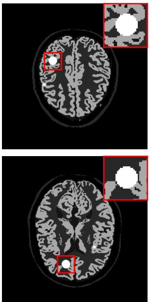

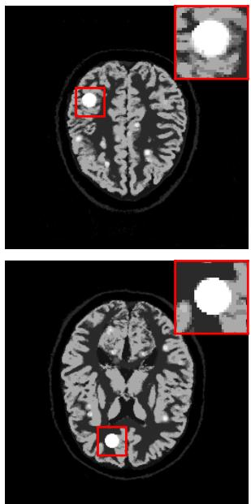

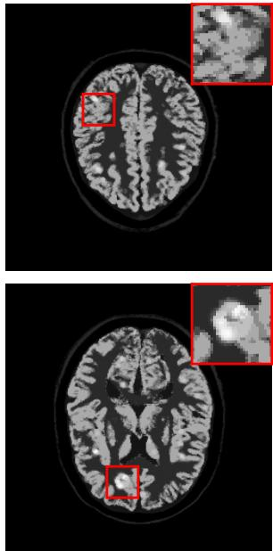  
Figure 12: Poisson denoising problem with the BrainWeb dataset, in the low-count regime. (Left) Ground truth image from the BrainWeb validation dataset. (Center) Average of 4 samples obtained with PDPS. (Right) Average of 4 samples obtained with difusion-based DPS.

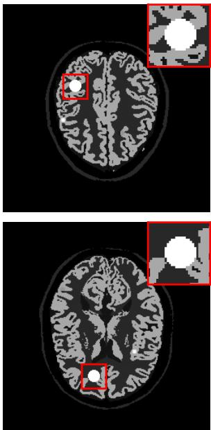

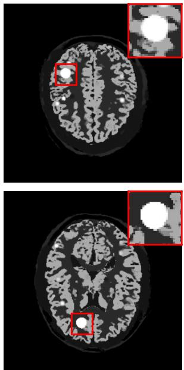

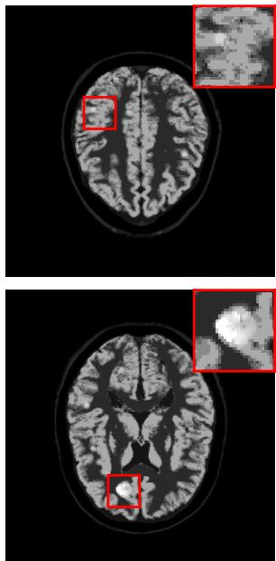  
Figure 13: PET problem with the BrainWeb dataset, in the low-count regime. (Left) Ground truth image from the BrainWeb validation dataset. (Center) Average of 4 samples obtained with MPDM-based PnP-DM. (Right) Average of 4 samples obtained with difusion-based DPS.

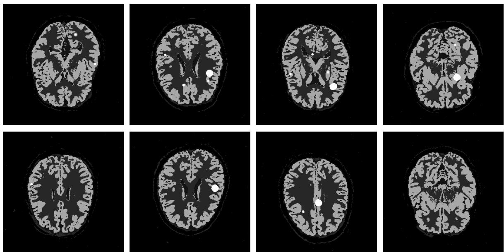

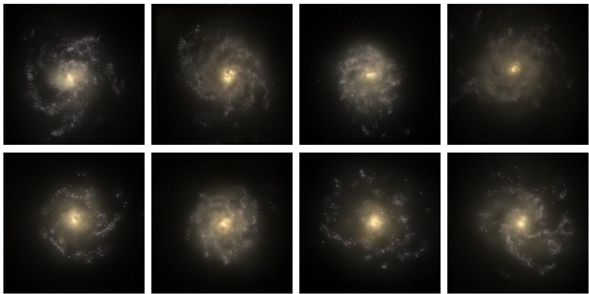  
Figure 14: Images generated by our MPDM trained on the EAGLE dataset.  
Figure 15: Images generated by our MPDM trained on the BrainWeb dataset.

<table><tr><td></td><td colspan="2">Toy</td><td colspan="2">BrainWeb denoising</td><td colspan="2">BrainWeb PET</td><td colspan="2">Eagle denoising</td><td colspan="2">Eagle blur</td></tr><tr><td></td><td>LC</td><td>HC</td><td>LC</td><td>HC</td><td>LC</td><td>HC</td><td>LC</td><td>HC</td><td>LC</td><td>HC</td></tr><tr><td>PnP-DM (MPDM) η</td><td>1</td><td>1</td><td>8</td><td>5</td><td>14</td><td>8</td><td>5</td><td>4</td><td>7</td><td>5</td></tr><tr><td>DAPS (MPDM) η</td><td>1</td><td>1</td><td>5</td><td>4</td><td>8</td><td>5</td><td>2</td><td>3</td><td>6</td><td>3</td></tr><tr><td>PnP-DM-p (diffusion) η</td><td>1</td><td>1</td><td>4</td><td>2</td><td>8</td><td>4</td><td>10</td><td>10</td><td>7</td><td>3</td></tr><tr><td>DAPS-p (diffusion) η</td><td>1</td><td>1</td><td>6</td><td>5</td><td>12</td><td>8</td><td>5</td><td>7</td><td>8</td><td>6</td></tr><tr><td>PnP-DM-g (diffusion) η</td><td>1</td><td>1</td><td>9</td><td>2</td><td>6</td><td>4</td><td>9</td><td>2</td><td>4</td><td>2</td></tr><tr><td>DAPS-g (diffusion) η</td><td>1</td><td>1</td><td>2</td><td>2</td><td>10</td><td>8</td><td>2</td><td>2</td><td>4</td><td>5</td></tr></table>

Table 10: We specify the parameter η chosen for the algorithms relying on a Langevin MCMC scheme: our MPDMbased PnP-DM (Algorithm 6) and DAPS (Algorithm 8), as well as their difusion counterparts (either with true Poisson likelihood, indicated by -p, or its Gaussian approximation, indicated by -g). Values of η ranging from 1 to 20 were tested in each setting, and we chose the ones leading to the overall best reconstruction metrics.

<table><tr><td>Methods</td><td>BrainWeb denoising (LC)</td></tr><tr><td>PDPS (MPDM)</td><td> $0 . 7 2 6 4 \pm 0 . 0 0 5 1$ </td></tr><tr><td>DPS-p (diffusion)</td><td>0.7832 ± 0.0094</td></tr></table>

Table 11: Average $l ( x , { \hat { x } } )$ , where x is a validation sample of the BrainWeb dataset, and xˆ is an approximate posterior sample obtained with either difusion-based DPS or PDPS, for the Poisson denoising problem $( \mathcal { A } = a \mathrm { I } _ { d } )$ in the lowcount regime.

<table><tr><td>Methods</td><td>BrainWeb PET (LC)</td></tr><tr><td>PnP-DM (MPDM)</td><td> $0 . 7 5 7 3 \pm 0 . 0 0 8 0$ </td></tr><tr><td>DPS-p (diffusion)</td><td>0.8458 ± 0.0228</td></tr></table>

Table 12: Average $l ( x , { \hat { x } } )$ , where x is a validation sample of the BrainWeb dataset, and xˆ is an approximate posterior sample obtained with either difusion-based DPS or PDPS, for the PET problem in the low-count regime.