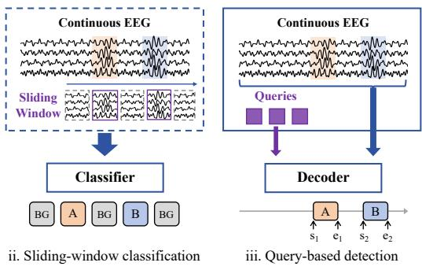
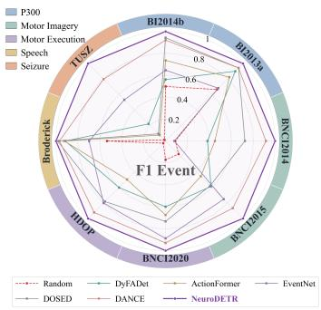
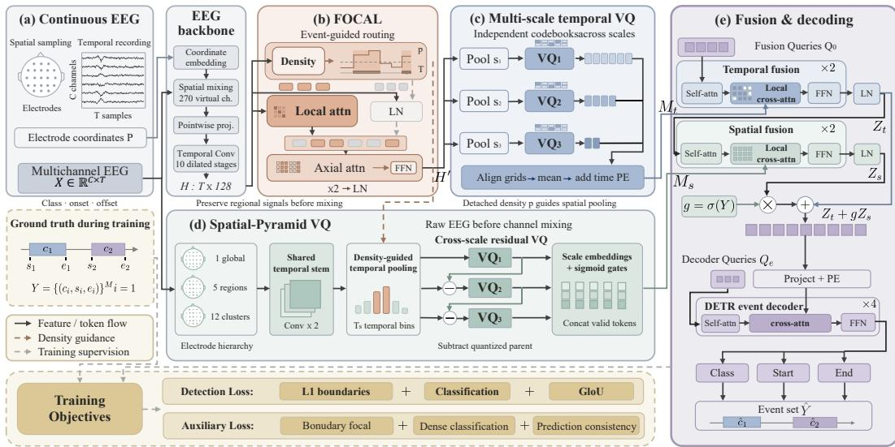
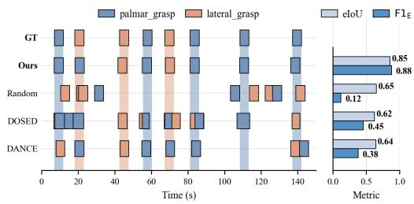
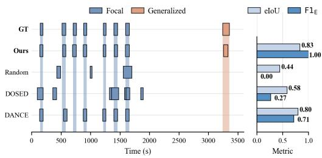
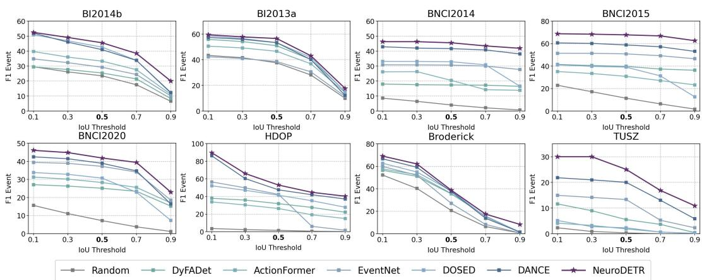
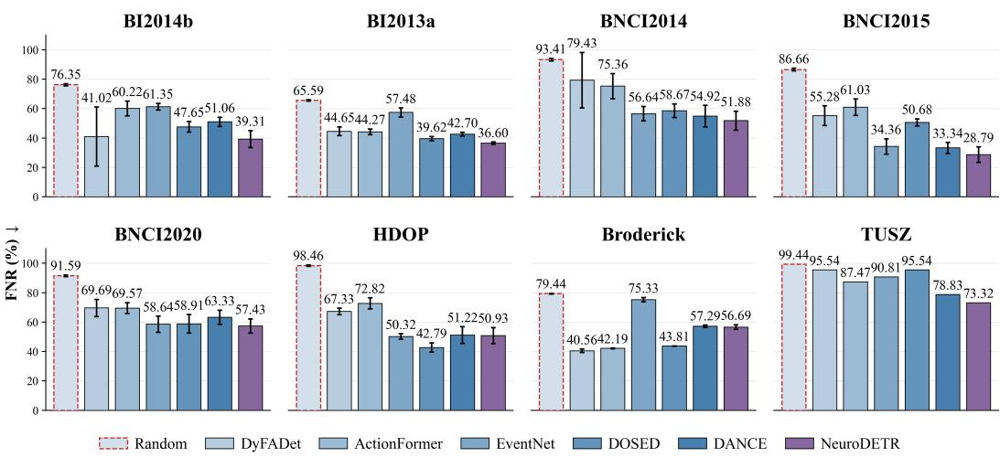
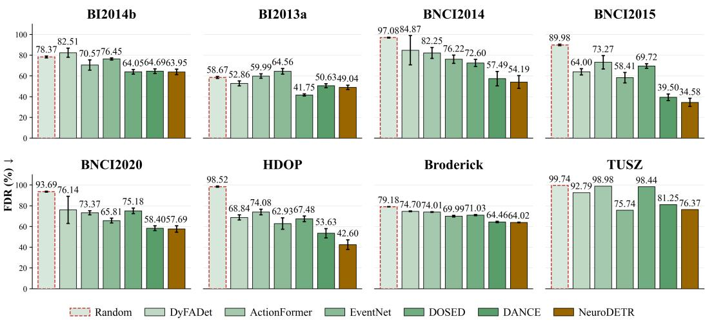

# NEURODETR: MULTISCALE DISCRETE SPATIOTEM-PORAL TOKENIZATION FOR ASYNCHRONOUS EEGEVENT DETECTION

Yaozhi Wen1,2,3, Kun Zhao1,4, Wei Wei1, Haoyang Chen3,5, Kangning Wang1, Yi Sun1,3,4, Shaowei Gu1,2,3, Dingkun Liu3,6, Shuang Qiu1,\*, and Huiguang He1,2,3,4,\*

1Laboratory of Brain Atlas and Brain-Inspired Intelligence, State Key Laboratory of Brain Cognition and Brain-inspired Intelligence Technology, Institute of Automation, Chinese Academy of Sciences

2School of Future Technology, University of Chinese Academy of Sciences 3Zhongguancun Academy

4School of Artificial Intelligence, University of Chinese Academy of Sciences 5Wuhan University

6Hubei Key Laboratory of Brain-inspired Intelligent Systems, School of Artificial Intelligence and Automation, Huazhong University of Science and Technology \*Corresponding authors

{wenyaozhi2024, shuang.qiu, huiguang.he}@ia.ac.cn

## ABSTRACT

Asynchronous EEG event detection supports practical brain-computer interfaces by identifying event classes and temporal boundaries directly from continuous recordings without predefined event boundaries at inference time. The primary challenge lies in extracting event-related patterns embedded in ongoing background activity. To address this, we propose NeuroDETR, a discrete spatiotemporal multiscale framework that combines structured tokenization with eventaware feature refinement. Multiscale temporal codebooks capture brief responses and sustained dynamics, while Spatial-Pyramid VQ hierarchically encodes spatial structure across EEG channels. These complementary representations form a compact event memory for jointly classifying events and estimating their onsets and offsets. Before tokenization, we apply FOCAL, an event-aware sparse attention module that uses predicted event presence to guide temporal feature refinement and spatial aggregation, emphasizing likely event periods while preserving context across the recording. Experiments on eight EEG datasets that span diverse paradigms demonstrate state-of-the-art performance. These findings provide a basis for the development of BCI systems that recognize meaningful neural activity during continuous interaction and monitoring.

## 1 INTRODUCTION

Brain–computer interfaces (BCIs) establish direct communication pathways between neural activity and external devices by translating neural signals into actionable information for device control, human–computer interaction, and clinical decision-making [1, 2]. Achieving this goal depends on reliably identifying behaviorally or physiologically meaningful neural events in continuous electroencephalographic (EEG) recordings. Asynchronous EEG decoding addresses this challenge by jointly identifying event categories and localizing their onset and offset within the ongoing signal.

As shown in Figure 1a (i), a straightforward approach to asynchronous decoding applies slidingwindow classifiers to continuous EEG, assigning each window an event or background label [3, 4]. However, the mismatch between fixed-length windows and variable event durations and boundaries can fragment detections or merge adjacent events, making performance sensitive to window settings and post-processing rules [5]. As illustrated in Figure 1a (ii), query-based detection addresses this mismatch by directly mapping continuous EEG to an unordered set of events, each characterized by its category, onset, and offset.

  
(a) EEG decoding paradigms

  
(b) Relative performance  
Figure 1: EEG decoding paradigms and relative performance. (a) Sliding-window classification and query-based event detection. (b) Performance of NeuroDETR and six baselines across eight datasets. Scores on each dataset are normalized by NeuroDETR’s score (NeuroDETR = 1).

The effectiveness of this approach depends on how well the EEG features supplied to the decoder preserve event-specific information. Existing methods use cross-attention to aggregate information from long feature sequences into a fixed set of continuous latent tokens, but do not explicitly organize event cues across temporal scales and spatial regions [6, 7]. Across EEG datasets and paradigms, events vary in duration, occurrence frequency, and spatial distribution. Their responses are also embedded in ongoing background activity, requiring feature aggregation to preserve weak or transient event cues.

In this study, we propose NeuroDETR, a multiscale discrete spatiotemporal framework for asynchronous EEG event detection. NeuroDETR uses vector quantization to organize continuous features into reusable learned codewords. To accommodate differences across datasets and paradigms, multiscale temporal VQ represents both brief responses and sustained dynamics, while Spatial-Pyramid VQ encodes channel information at complementary spatial levels. These representations form a compact event memory that supports joint localization and classification within a unified detection architecture.

To guide this representation toward event-related activity, we introduce FOCAL, an event-aware sparse attention module. FOCAL uses predicted event presence to guide temporal feature refinement before quantization and temporal pooling within the spatial branch, while retaining cross-window context. This shared event guidance connects the temporal and spatial representations, supplying the DETR decoder with event-aware multiscale information for predicting event classes and boundaries. We evaluate NeuroDETR on eight EEG datasets spanning P300, motor imagery, motor execution, speech, and seizure detection. NeuroDETR achieves the highest event-level F1 among the evaluated methods on all eight datasets, demonstrating its effectiveness across EEG paradigms with diverse event characteristics. By improving neural event detection in continuous EEG, NeuroDETR sup ports the development of practical BCI applications.

## Our main contributions are summarized as follows:

• We propose NeuroDETR, which jointly predicts event classes, onsets, and offsets from continuous EEG without predefined event boundaries. At its core, vector quantization organizes EEG features into a compact event memory, with multiscale temporal and hierarchical spatial codebooks accommodating diverse event characteristics across paradigms.

• We introduce FOCAL, an event-aware sparse attention module that concentrates local feature refinement on likely event periods while preserving cross-window context. By sharing event-presence estimates with spatial aggregation, FOCAL directs both temporal and spatial tokenization toward event-relevant information.

• Experiments on eight EEG datasets spanning diverse paradigms demonstrate state-of-theart performance. Ablation studies support the complementary contributions of spatiotemporal tokenization and event-aware refinement.

## 2 RELATED WORK

## 2.1 ASYNCHRONOUS EEG DECODING

Asynchronous EEG decoding identifies events in continuous signals without known onset times. Early systems estimate control states or classify sliding windows, using probabilistic aggregation or temporal decision rules [8, 4, 3]. Recovering event instances typically requires temporal post-processing. DOSED and EventNet directly localize events through single-stage detection and center–duration regression, respectively [9, 5]. DETRtime uses event queries and bipartite matching for set prediction [10], while a frozen foundation model has also been adapted for dense EEG segmentation [11]. DANCE combines Perceiver-style resampling [6] with query decoding to predict event classes and temporal boundaries [7].

## 2.2 DISCRETE SPATIOTEMPORAL EEG REPRESENTATIONS

Discrete EEG tokens support EEG-to-text translation in DeWave [12] and pretraining or multimodal decoding in LaBraM, VQ-MTM, and NeuroLM [13, 14, 15]. Recent tokenizers learn single-channel time–frequency motifs and decoupled temporal–spectral vocabularies [16, 17]. Related approaches model EEG through electrode graphs, multiscale temporal filters, and regional and global spatial representations [18, 19], or use sparse attention for motor imagery decoding [20, 21]. THD-BAR constructs hierarchical spatial tokens for autoregressive learning [22], while NeuroRVQ combines multiscale temporal convolutions with residual vector quantization for biosignal reconstruction and foundation-model training [23].

NeuroDETR uses shared event-presence estimates to route local temporal attention and weight temporal pooling of regional features before multiscale temporal and hierarchical spatial quantization. The resulting memory supports event-set prediction.

## 3 METHOD

## 3.1 PROBLEM FORMULATION AND OVERVIEW

We study asynchronous event detection from continuous EEG. Given $\mathbf { X } \in \mathbb { R } ^ { C \times T }$ with C channels and $T = f _ { s } { \bar { W } }$ samples, where $f _ { s }$ is the sampling rate and W the window duration, the target is an unordered event set:

$$
\mathcal { V } = \{ ( c _ { i } , s _ { i } , e _ { i } ) \} _ { i = 1 } ^ { M } , \quad c _ { i } \in \{ 1 , \ldots , K \} , \quad 0 \leq s _ { i } < e _ { i } \leq 1 .\tag{1}
$$

Here, M varies across windows, and boundaries are normalized by W. NeuroDETR adopts a DETRstyle detection framework to predict events in parallel using $N _ { \epsilon }$ learnable event queries, with class 0 denoting no event.

As shown in Figure 2, a convolutional backbone extracts dense features, which FOCAL refines through event-guided local attention and cross-window interaction. Temporal VQ encodes dynamics at multiple resolutions, while spatial VQ retains regional electrode information before channel mixing. Query-based fusion combines both memories for event localization and classification [24].

## 3.2 DENSE EEG ENCODING

We adapt SimpleConv from Defossez et al. [25]. Spatial attention uses Fourier embeddings of nor-´ malized electrode coordinates $\mathbf { P } \in \mathbb { R } ^ { C \times 2 }$ to mix the inputs into 270 virtual channels. A pointwise projection and ten dilated temporal convolutional stages yield

$$
\mathbf { H } = f _ { \mathrm { e n c } } ( \mathbf { X } , \mathbf { P } ) \in \mathbb { R } ^ { T \times D } , \qquad D = 1 2 8 .\tag{2}
$$

The backbone preserves temporal resolution, supplying features for FOCAL and auxiliary boundary supervision. Architectural details appear in Appendix F.

## 3.3 FOCAL: EVENT-AWARE SPARSE ATTENTION

FOCAL combines event-guided local attention with axial interaction across windows.

  
Figure 2: Overview of NeuroDETR. (a) Continuous EEG input. (b) FOCAL uses event-presence estimates to guide local attention. (c) Temporal features are quantized at multiple resolutions. (d) Spatial-Pyramid VQ quantizes EEG features at global, regional, and local spatial levels. (e) A query decoder predicts event classes and boundaries from fused spatiotemporal memory. Detection and auxiliary losses provide training supervision.

Event-guided routing. We partition H into $N _ { w } = \lceil T / w \rceil$ windows of w tokens, padding the last window with zeros. A density head $g _ { \phi }$ , comprising layer normalization, two linear layers, and GELU, predicts event presence from mean-pooled features:

$$
\ell _ { n } = g _ { \phi } \left( \frac { 1 } { w } \sum _ { t \in \mathcal { W } _ { n } } \mathbf { h } _ { t } \right) , \qquad p _ { n } = \sigma ( \ell _ { n } ) .\tag{3}
$$

Window targets indicate overlap with an annotated event:

$$
y _ { n } = k ^ { \prime } { \Big [ } \exists i : e _ { i } > { \frac { n } { N _ { w } } } , s _ { i } < { \frac { n + 1 } { N _ { w } } } { \Big ] } , \quad n = 0 , \dots , N _ { w } - 1 .\tag{4}
$$

We train $g _ { \phi }$ with binary cross-entropy:

$$
\mathcal { L } _ { \mathrm { d e n } } = - \frac { 1 } { N _ { w } } \sum _ { n = 0 } ^ { N _ { w } - 1 } \left[ y _ { n } \log p _ { n } + ( 1 - y _ { n } ) \log ( 1 - p _ { n } ) \right] .\tag{5}
$$

Windows are selected for local attention by

$$
\begin{array} { r } { \mathcal { T } _ { \mathrm { e v t } } = \{ n : p _ { n } > \tau \} \cup \mathrm { T o p K } ( \ell , k _ { \mathrm { m i n } } ) , \quad m _ { n } = | \mathcal { k } [ n \in \mathcal { T } _ { \mathrm { e v t } } ] . } \end{array}\tag{6}
$$

The default uses $\tau = 0 . 4$ and $k _ { \operatorname* { m i n } } = 1$ . The density map and routing mask are computed once and shared across both FOCAL blocks. Hard routing leaves $g _ { \phi }$ supervised by ${ \mathcal { L } } _ { \mathrm { d e n } }$

Local–axial interaction. Selected windows receive local self-attention, and the others receive background normalization:

$$
\widetilde { \mathbf { H } } _ { n } = \left\{ \begin{array} { l l } { \mathbf { H } _ { n } + \mathrm { M H S A } ( \mathrm { L N } ( \mathbf { H } _ { n } ) ) , } & { m _ { n } = 1 , } \\ { \mathrm { L N } _ { \mathrm { b g } } ( \mathbf { H } _ { n } ) , } & { m _ { n } = 0 . } \end{array} \right.\tag{7}
$$

For $\mathbf { H } _ { n } \in \mathbb { R } ^ { w \times D }$ , axial attention [26] connects corresponding token positions across all windows by reshaping

$$
[ B , N _ { w } , w , D ] \longrightarrow [ B w , N _ { w } , D ] ,\tag{8}
$$

where B is the batch size. Each block applies axial attention and a feed-forward network with prenormalization and residual connections. Two blocks, final normalization, and padding removal yield $\mathbf { H } ^ { \prime } \in \mathbb { R } ^ { T \times D }$ for temporal VQ.

## 3.4 SPATIOTEMPORAL VQ TOKENIZATION

Temporal and spatial branches use independent, scale-specific codebooks to encode temporal dynamics and channel-group structure.

Quantization and codebook learning. Following VQ representation learning [27], we assign z to its nearest codeword in $\mathcal { E } = \{ \mathbf { e } _ { j } \} _ { j = 1 } ^ { V } \mathrm { : }$

$$
k ^ { \star } = \arg \operatorname* { m i n } _ { j } \| { \bf z } - { \bf e } _ { j } \| _ { 2 } ^ { 2 } , \qquad Q ( { \bf z } ) = { \bf z } + \mathrm { s g } [ { \bf e } _ { k ^ { \star } } - { \bf z } ] .\tag{9}
$$

sg[·] denotes stop-gradient, so $Q$ returns the codeword and passes gradients to z. Each quantizer incurs a commitment penalty $\beta \operatorname { M S E } ( \mathbf { z } , \operatorname { s g } [ \mathbf { e } _ { k ^ { \star } } ] )$ . Codebooks are initialized from features and updated by exponential moving averages (EMA), with underused codes reinitialized. Commitment losses are averaged across scales within each branch, using only valid tokens for spatial VQ.

## 3.4.1 MULTISCALE TEMPORAL VQ

At each scale $s \in S _ { \mathrm { t } }$ , average pooling with kernel and stride s retains $\lceil T / s \rceil$ tokens, including the final partial bin:

$$
\mathbf { H } _ { s } = \operatorname { A v g P o o l } _ { s } ( \mathbf { H } ^ { \prime } ) , \qquad \mathbf { q } _ { s } ^ { \mathrm { t } } = Q ^ { \mathrm { t } , s } ( \mathbf { H } _ { s } ) .\tag{10}
$$

We linearly interpolate the codes to the finest pooled grid, $L _ { \mathrm { m } } = \operatorname* { m a x } _ { s } \lceil T / s \rceil$ , and average them before adding sinusoidal positional embeddings:

$$
\mathbf { M } ^ { \mathrm { t } } = \frac { 1 } { | S _ { \mathrm { t } } | } \sum _ { s \in S _ { \mathrm { t } } } \mathrm { U p } _ { L _ { \mathrm { m } } } ( \mathbf { q } _ { s } ^ { \mathrm { t } } ) + \mathrm { P E } _ { L _ { \mathrm { m } } } .\tag{11}
$$

A two-layer MLP $r _ { \psi }$ reconstructs dense features from the averaged codes resampled to length T:

$$
\mathcal { L } _ { \mathrm { r e c } } = \mathrm { M S E } \left( r _ { \psi } \left[ \frac { 1 } { \vert S _ { \mathrm { t } } \vert } \sum _ { s \in S _ { \mathrm { t } } } \mathrm { U p } _ { T } ( \mathbf { q } _ { s } ^ { \mathrm { t } } ) \right] , \mathrm { s g } [ \mathbf { H } ^ { \prime } ] \right) .\tag{12}
$$

Reconstruction uses codes before positional embedding and memory fusion.

## 3.4.2 SPATIAL-PYRAMID VQ

Spatial-Pyramid VQ aggregates raw EEG channels before backbone mixing at three levels: one whole-head group, five coarse groups (frontal, temporal, central, parietal, and occipital), and twelve fine electrode clusters:

$$
\mathbf { R } _ { \ell } = \mathbf { A } _ { \ell } \mathbf { X } \in \mathbb { R } ^ { N _ { \ell } \times T } , \qquad ( N _ { 1 } , N _ { 2 } , N _ { 3 } ) = ( 1 , 5 , 1 2 ) .\tag{13}
$$

Each nonempty row of $\mathbf { A } _ { \ell }$ averages available channels assigned by channel name. A shared stem with two strided temporal convolutions and GELU produces $\mathbf { \bar { F } } _ { \ell , r , u } \in \mathbb { R } ^ { D }$ , indexed by region r and stem time step u. Details of the hierarchical electrode grouping are provided in Appendix B.

Density-guided pooling. FOCAL probabilities d $= \operatorname { s g } [ \sigma ( \ell ) ]$ are linearly interpolated to the stem grid as $\ddot { d } _ { u }$ and weight each group’s features within $T _ { \mathrm { s } }$ temporal bins:

$$
\mathbf { E } _ { \ell , r , b } = \frac { \sum _ { u } \kappa ( b , u ) \widetilde { d } _ { u } \mathbf { F } _ { \ell , r , u } } { \operatorname* { m a x } \left( \sum _ { u } \kappa ( b , u ) \widetilde { d } _ { u } , \epsilon \right) } .\tag{14}
$$

Here, b indexes output bins, κ is a row-normalized triangular kernel centered on each bin, and $\epsilon = 1 0 ^ { - 6 }$ . The detached weights emphasize likely event periods without updating the density estimator.

Cross-scale residual quantization. The whole-head descriptor is quantized directly, while each finer level quantizes its residual relative to its parent’s code:

$$
\begin{array} { r } { \mathbf { { u } } _ { \ell } = \left\{ \begin{array} { l l } { \mathbf { E } _ { 1 } , } & { \ell = 1 , } \\ { \mathbf { E } _ { \ell } - \mathrm { B r o a d c a s t } _ { \ell } ( \mathbf { q } _ { \ell - 1 } ^ { \mathrm { s } } ) , } & { \ell > 1 , } \end{array} \right. \quad \mathbf { { q } } _ { \ell } ^ { \mathrm { s } } = Q ^ { \mathrm { s } , \ell } ( \mathbf { u } _ { \ell } ) . } \end{array}\tag{15}
$$

Broadcast assigns each child the immediately preceding level’s quantized parent output at the same temporal bin. Learnable scale embeddings $\mathbf { a } _ { \ell }$ and sigmoid gates $g _ { \ell } = \sigma ( \eta _ { \ell } )$ form the spatial memory:

$$
\mathbf { M ^ { s } } = \underset { \ell = 1 } { \overset { 3 } { \parallel } } \mathrm { F l a t t e n } _ { \mathrm { v a l i d } } [ g _ { \ell } ( \mathbf { q } _ { \ell } ^ { \mathrm { s } } + \mathbf { a } _ { \ell } ) ] .\tag{16}
$$

Flatte $\mathrm { \Delta n _ { v a l i d } }$ retains all temporal bins of nonempty channel groups.

## 3.5 EVENT MEMORY FUSION AND SET PREDICTION

Temporal fusion and gated spatial integration. Starting from $N _ { q }$ learnable queries initialized with sinusoidal embeddings, temporal fusion alternates global self-attention, sliding-window crossattention (SWA), and feed-forward refinement:

$$
\mathbf { Q } \xleftarrow { } \mathbf { Q } + \mathrm { M H S A } ( \mathrm { L N } ( \mathbf { Q } ) ) , \quad \mathbf { Q } \xleftarrow { } \mathbf { Q } + \mathrm { S W A } ( \mathrm { L N } ( \mathbf { Q } ) , \mathbf { M } ^ { \mathrm { t } } ) , \quad \mathbf { Q } \xleftarrow { } \mathbf { Q } + \mathrm { F F N } ( \mathrm { L N } ( \mathbf { Q } ) ) .\tag{17}
$$

Cross-attention spans are centered proportionally along the memory. The normalized output $\mathbf { Z } _ { \mathrm { t } } ~ = ~ \mathrm { L N } [ \mathcal { F } _ { \mathrm { t } } ( \mathbf { Q } _ { 0 } ^ { \mathrm { ~ \bar { ~ } } } , \mathbf { M } ^ { \mathrm { t } } ) ]$ initializes an independently parameterized spatial Transformer with the same structure, whose output enters through a gated residual:

$$
\begin{array} { r } { \mathbf { Z } = \mathbf { Z } _ { \mathrm { t } } + g \operatorname { L N } [ \mathcal { F } _ { \mathrm { s } } ( \mathbf { Z } _ { \mathrm { t } } , \mathbf { M } ^ { \mathrm { s } } ) ] , \qquad g = \sigma ( \gamma ) . } \end{array}\tag{18}
$$

Each stream has two layers and four heads, yielding memory $\mathbf { Z } \in \mathbb { R } ^ { N _ { q } \times D }$ . The spatial gate is initialized at $g = 0 . 0 2$

Set-based event decoding. A four-layer, four-head DETR decoder [24] applies $N _ { e }$ event queries to the fused memory, projected from 128 to 256 dimensions and augmented with sinusoidal embeddings. Query features $\mathbf { o } _ { j }$ predict classes and boundaries:

$$
\widehat { \mathbf { p } } _ { j } = \mathrm { s o f t m a x } ( \mathrm { C l s } ( \mathbf { o } _ { j } ) ) , \quad \widehat { s } _ { j } = \sigma ( \mathrm { S t a r t } ( \mathbf { o } _ { j } ) ) , \quad \widehat { e } _ { j } = \sigma ( \mathrm { E n d } ( \mathbf { o } _ { j } ) ) .\tag{19}
$$

We discard queries whose highest-probability class is background and multiply the remaining boundaries by W. Here, $N _ { q }$ controls memory length and $N _ { e }$ the candidate-event budget.

## 3.6 TRAINING OBJECTIVES

Detection Loss. Hungarian matching [28] assigns ground-truth events to predicted queries using a matching cost based on class probabilities and temporal IoU. The classification loss $\mathcal { L } _ { \mathrm { c l s } }$ applies cross-entropy supervision to all queries, assigning event labels to matched queries and the background label to unmatched queries. For matched queries, endpoint regression loss $\mathcal { L } _ { \ell _ { 1 } }$ penalizes absolute onset and offset errors. Temporal generalized IoU loss $\mathcal { L } _ { \mathrm { G I o U } } \ [ 2 9 ]$ complements endpoint regression by supervising interval overlap and relative position. The detection objective is

$$
\mathcal { L } _ { \mathrm { d e t } } = \lambda _ { \ell _ { 1 } } \mathcal { L } _ { \ell _ { 1 } } + \lambda _ { \mathrm { c l s } } \mathcal { L } _ { \mathrm { c l s } } + \lambda _ { \mathrm { g i o u } } \mathcal { L } _ { \mathrm { G I o U } } .\tag{20}
$$

Auxiliary Loss. We complement set prediction with full-resolution boundary supervision, dense classification, and prediction consistency. A boundary head applied to the backbone features H predicts class-agnostic onset and offset heatmaps. The targets are pointwise maxima of Gaussians centered at annotated boundaries. Sigmoid focal loss ${ \mathcal { L } } _ { \mathrm { b n d } }$ supervises these predictions while downweighting easy non-boundary positions.

For dense classification and prediction consistency, we follow the auxiliary-supervision strategy of DANCE [7]. Dense cross-entropy loss $\mathcal { L } _ { \mathrm { d e n s e } }$ supervises class predictions at each position of the fused memory Z. To construct the set-derived predictions, we accumulate query class probabilities over their discretized predicted intervals and normalize the accumulated scores at each covered grid position. Uncovered positions are assigned zero vectors. We apply componentwise clamping to both predictions without renormalization and compute a KL-style regularizer ${ \mathcal { L } } _ { \mathrm { c o n s } }$ . At covered grid positions, this term encourages agreement between dense and set-derived predictions. At uncovered positions, the clamped zero vectors induce an entropy regularization effect on the dense predictions.

The complete event-supervision objective is

$$
\mathcal { L } _ { \mathrm { e v e n t } } = \mathcal { L } _ { \bf d e t } + \lambda _ { \mathrm { b n d } } \mathcal { L } _ { \mathrm { b n d } } + \lambda _ { \mathrm { d e n s e } } \mathcal { L } _ { \mathrm { d e n s e } } + \lambda _ { \mathrm { c o n s } } \mathcal { L } _ { \mathrm { c o n s } } .\tag{21}
$$

More details on the training objectives are provided in the appendix.

## 4 EXPERIMENTS

## 4.1 DATASETS

We evaluate our method on eight EEG datasets spanning five task domains with diverse temporal characteristics. These datasets cover densely occurring and potentially overlapping P300 events (BI2013a [30] and BI2014b [31]), fine-grained high-frequency speech-related events (Broderick [32, 33]), sparse and long-duration motor imagery events (BNCI2014 [34] and BNCI2015 [35]), motor execution events (BNCI2020 [36] and HDOP [37]), and rare epileptic seizures with durations ranging from several seconds to several minutes (TUSZ (v2.0.6) [38]). This diversity enables a comprehensive evaluation of whether a unified set-prediction framework can generalize across variations in event frequency, duration, category complexity, and recording configurations. Further details on the datasets are provided in Appendix D.

## 4.2 BASELINES

We compare NeuroDETR with four dense temporal detection frameworks, EventNet [5], ActionFormer [39], DyFADet [40], and DOSED [9], and the query-based set-prediction framework DANCE [7]. We also include a dataset-aware Random event generator as a lower bound. For each learned baseline, we adapt the input representation, classification head, and temporal decoding procedure to EEG event detection while retaining its original detection mechanism. All methods use the same data splits and event-level evaluation protocol. For all dense detectors, we apply a confidence threshold of 0.05 and non-maximum suppression (NMS) with a temporal IoU threshold of 0.5, retaining at most $N _ { e }$ predictions per window. Further implementation details appear in Appendix E.

## 4.3 EVALUATION METRICS

We report $F 1 _ { \mathrm { s a m p l e } }$ and $F 1 _ { \mathrm { e v e n t } }$ . The former measures sample-wise classification quality through macro-averaged F1, while the latter jointly evaluates event detection, classification, and localization. Under one-to-one matching, a predicted event counts as a true positive when

$$
\mathrm { I o U } ( \hat { I } _ { j } , I _ { i } ) > \tau _ { \mathrm { I o U } } \quad \mathrm { a n d } \quad \hat { c } _ { j } = c _ { i } ,\tag{22}
$$

where $\hat { I } _ { j }$ and $I _ { i }$ denote the predicted and ground-truth intervals, and ${ \hat { c } } _ { j }$ and $c _ { i }$ their respective classes. We set $\tau _ { \mathrm { I o U } } = 0 . 5$ for the main evaluation. The two metrics are computed as

$$
\begin{array} { l } { F 1 _ { \mathrm { s a m p l e } } = \displaystyle \frac { 1 } { | \mathcal C | } \sum _ { c \in \mathcal C } \frac { 2 T P _ { c } ^ { \mathrm { s } } } { 2 T P _ { c } ^ { \mathrm { s } } + F P _ { c } ^ { \mathrm { s } } + F N _ { c } ^ { \mathrm { s } } } , } \\ { F 1 _ { \mathrm { e v e n t } } = \displaystyle \frac { 2 T P ^ { \mathrm { e } } } { 2 T P ^ { \mathrm { e } } + F P ^ { \mathrm { e } } + F N ^ { \mathrm { e } } } . } \end{array}\tag{23}
$$

Here, C is the evaluated class set, and superscripts s and e denote counts over time samples and event instances, respectively.

## 4.4 MAIN RESULTS

As shown in Table 1, NeuroDETR ranks first on most datasets in $F 1 _ { \mathrm { s a m p l e } } .$ . It achieves an average of 57.50, outperforming DANCE, the strongest baseline on average, by 3.32 percentage points and demonstrating consistently strong sample-wise discrimination.

For $F 1 _ { \mathrm { e v e n t } }$ , NeuroDETR achieves the best performance on all eight datasets, averaging 46.70 and surpassing DANCE by 4.29 percentage points. Its improvement over the strongest baseline reaches 8.99 percentage points on BNCI2015, highlighting its effectiveness in jointly detecting, classifying, and localizing EEG events.

Some baselines achieve competitive sample-wise classification, yet this advantage does not consistently translate into better event detection. NeuroDETR achieves the best average performance on both metrics, combining strong sample-wise classification with effective event-instance recovery. Its consistent gains across P300, motor imagery, motor execution, speech, and seizure tasks support its broad applicability across EEG datasets and paradigms.

Table 1: Results on eight EEG datasets: $\mathrm { m e a n } \pm \mathrm { S D }$ over five cross-validation folds, except TUSZ, which uses a single result on its predefined split. Best and second-best scores are bold and underlined, respectively.
<table><tr><td rowspan="2"></td><td rowspan="2">Method</td><td colspan="2">P300</td><td colspan="2">Motor Imagery</td><td colspan="2">Motor Execution</td><td>Speech</td><td>Seizure</td></tr><tr><td>BI2014b</td><td>BI2013a</td><td>BNCI2014</td><td>BNCI2015</td><td>BNCI2020</td><td>HDOP</td><td>Broderick</td><td>TUSZ</td></tr><tr><td rowspan="7">FImp pe</td><td>Random</td><td> $3 5 . 4 6 _ { \pm 0 . 6 0 }$ </td><td> $4 0 . 4 0 { \scriptstyle \pm 0 . 3 6 }$ </td><td> $2 0 . 0 6 _ { \pm 0 . 5 4 }$ </td><td> $3 3 . 7 5 _ { \pm 1 . 1 2 }$ </td><td> $3 3 . 5 0 { \scriptstyle \pm 0 . 5 0 }$ </td><td> $2 5 . 1 1 { \scriptstyle \pm 0 . 3 9 }$ </td><td> $4 8 . 9 4 _ { \pm 0 . 1 5 }$ </td><td>19.67</td></tr><tr><td>DyFADet</td><td> $3 4 . 8 4 { \scriptstyle \pm 9 . 4 6 }$ </td><td> $5 5 . 0 8 _ { \pm 2 . 2 2 }$ </td><td> $3 4 . 5 8 _ { \pm 2 0 . 6 7 }$ </td><td> $6 3 . 6 8 _ { \pm 3 . 5 2 }$ </td><td> $4 5 . 9 9 _ { \pm 2 2 . 0 5 }$ </td><td> $5 1 . 4 0 _ { \pm 1 . 2 3 }$ </td><td> $4 7 . 7 8 { \scriptstyle \pm 2 . 6 6 }$ </td><td>25.60</td></tr><tr><td>ActionFormer</td><td> $5 2 . 1 8 _ { \pm 1 . 6 5 }$ </td><td> $5 4 . 7 1 { \scriptstyle \pm 2 . 2 9 }$ </td><td> $4 2 . 3 8 _ { \pm 4 . 8 5 }$ </td><td> $5 3 . 0 4 { \scriptstyle \pm 1 . 2 9 }$ </td><td> $5 3 . 5 0 { \scriptstyle \pm 2 . 1 6 }$ </td><td> $4 6 . 6 3 { \scriptstyle \pm 1 . 8 0 }$ </td><td> $4 2 . 7 5 { \scriptstyle \pm 1 . 1 7 }$ </td><td>22.56</td></tr><tr><td>EventNet</td><td> $4 4 . 0 4 { \scriptstyle \pm 2 . 7 4 }$ </td><td> $5 1 . 6 1 { \scriptstyle \pm 5 . 8 8 }$ </td><td> $5 3 . 6 4 _ { \pm 3 . 5 0 }$ </td><td> $\underline { { 7 3 . 9 4 } } _ { \pm 4 . 0 2 }$ </td><td> ${ \bf 5 9 . 9 1 _ { \pm 2 . 9 4 } }$ </td><td> $5 7 . 5 2 _ { \pm 3 . 8 2 }$ </td><td> $5 2 . 1 8 _ { \pm 0 . 6 1 }$ </td><td>24.52</td></tr><tr><td>DOSED</td><td> $3 8 . 5 6 _ { \pm 2 . 3 0 }$ </td><td> $4 4 . 7 5 _ { \pm 3 . 0 1 }$ </td><td> $4 6 . 0 6 { \scriptstyle \pm 2 . 9 8 }$ </td><td> $6 0 . 8 5 { \scriptstyle \pm 3 . 5 5 }$ </td><td> $5 5 . 3 6 { \scriptstyle \pm 2 . 9 3 }$ </td><td> $\underline { { 6 4 . 1 5 } } \mathrm { \underline { { { \ t } } } 1 . 6 9 }$ </td><td> $4 3 . 3 0 { \scriptstyle \pm 0 . 4 4 }$ </td><td>18.27</td></tr><tr><td>DANCE</td><td> $5 6 . 2 4 _ { \pm 3 . 0 4 }$ </td><td> $5 4 . 7 3 { \scriptstyle \pm 2 . 4 1 }$ </td><td> $5 3 . 4 6 _ { \pm 6 . 4 4 }$ </td><td> $7 3 . 3 6 _ { \pm 2 . 5 4 }$ </td><td> $5 5 . 7 9 { \scriptstyle \pm 2 . 5 6 }$ </td><td> $6 1 . 7 4 { \scriptstyle \pm 3 . 3 7 }$ </td><td> $5 0 . 3 1 { \scriptstyle \pm 2 . 7 1 }$ </td><td>27.78</td></tr><tr><td>NeuroDETR</td><td> ${ \bf 5 9 . 6 1 _ { \pm 3 . 1 2 } }$ </td><td> ${ \bar { 5 } } 7 . 4 8 _ { \pm 4 . 0 2 }$ </td><td> ${ \bar { 5 } } 5 . 6 3 _ { \pm 5 . 1 7 }$ </td><td> $7 5 . 8 2 _ { \pm 3 . 3 0 }$ </td><td> $5 9 . 0 5 { \scriptstyle \pm 2 . 8 0 }$ </td><td> ${ \bf 6 6 . 3 2 _ { \pm 3 . 3 5 } }$ </td><td> ${ \bar { 5 } } 3 . 8 0 _ { \pm 0 . 6 8 }$ </td><td>32.26</td></tr><tr><td rowspan="7">FvtVnt</td><td>Random</td><td> $2 2 . 5 8 { \scriptstyle \pm 0 . 5 8 }$ </td><td> $3 7 . 5 5 { \scriptstyle \pm 0 . 5 0 }$ </td><td> $4 . 0 5 _ { \pm 0 . 5 6 }$ </td><td> $1 1 . 4 4 _ { \pm 0 . 7 6 }$ </td><td> $7 . 2 1 _ { \pm 0 . 5 4 }$ </td><td> $1 . 5 1 _ { \pm 0 . 5 5 }$ </td><td> $2 0 . 6 9 _ { \pm 0 . 0 6 }$ </td><td>0.35</td></tr><tr><td>DyFADet</td><td> $2 5 . 3 8 { \scriptstyle \pm 2 . 5 8 }$ </td><td> $5 0 . 8 6 _ { \pm 1 . 8 6 }$ </td><td> $1 7 . 4 0 _ { \pm 1 5 . 5 1 }$ </td><td> $3 9 . 7 6 _ { \pm 3 . 9 5 }$ </td><td> $2 5 . 1 0 { \scriptstyle \pm 1 2 . 9 4 }$ </td><td> $3 1 . 8 0 _ { \pm 1 . 1 4 }$ </td><td> $3 5 . 4 9 _ { \pm 0 . 4 3 }$ </td><td>5.51</td></tr><tr><td>ActionFormer</td><td> $3 3 . 2 9 _ { \pm 1 . 7 2 }$ </td><td> $4 6 . 5 3 { \scriptstyle \pm 1 . 3 4 }$ </td><td> $2 0 . 4 7 _ { \pm 6 . 1 4 }$ </td><td> $3 0 . 8 8 _ { \pm 2 . 1 1 }$ </td><td> $2 8 . 2 8 { \scriptstyle \pm 1 . 9 2 }$ </td><td> $2 6 . 3 0 { \scriptstyle \pm 1 . 3 0 }$ </td><td> $3 5 . 8 6 _ { \pm 0 . 2 8 }$ </td><td>1.89</td></tr><tr><td>EventNet</td><td> $2 9 . 2 2 _ { \pm 0 . 5 9 }$ </td><td> $3 8 . 5 2 _ { \pm 1 . 4 4 }$ </td><td> $3 0 . 6 7 _ { \pm 4 . 6 3 }$ </td><td> $5 0 . 8 6 _ { \pm 5 . 2 4 }$ </td><td> $3 7 . 2 1 { \scriptstyle \pm 2 . 2 1 }$ </td><td> $4 2 . 3 4 _ { \pm 4 . 4 2 }$ </td><td> $2 7 . 0 5 { \scriptstyle \pm 0 . 7 6 }$ </td><td>13.33</td></tr><tr><td>DOSED</td><td> $\underline { { 4 2 . 6 2 } } _ { \pm 2 . 6 4 }$ </td><td> $5 3 . 2 8 _ { \pm 0 . 8 8 }$ </td><td> $3 2 . 9 2 _ { \pm 3 . 7 5 }$ </td><td> $3 9 . 0 8 _ { \pm 0 . 9 3 }$ </td><td> $3 0 . 7 1 { \scriptstyle \pm 2 . 9 8 }$ </td><td> $4 1 . 3 7 _ { \pm 2 . 1 6 }$ </td><td> $3 8 . 2 2 _ { \pm 0 . 5 0 }$ </td><td>2.31</td></tr><tr><td>DANCE</td><td> $4 1 . 6 3 { \scriptstyle \pm 2 . 1 2 }$ </td><td> $5 3 . 2 6 _ { \pm 0 . 7 5 }$ </td><td> $\underline { { 4 1 . 6 5 } } _ { \pm 6 . 9 6 }$ </td><td> $5 8 . 7 8 _ { \pm 3 . 3 7 }$ </td><td> $\underline { { 3 8 . 9 2 } } _ { \pm 3 . 6 4 }$ </td><td> $\underline { { 4 7 . 4 8 } } _ { \pm 4 . 4 6 }$ </td><td> $3 7 . 5 5 { \scriptstyle \pm 0 . 8 3 }$ </td><td>20.03</td></tr><tr><td>NeuroDETR</td><td> $4 5 . 2 3 _ { \pm 1 . 2 2 }$ </td><td> ${ \bar { \mathbf { 5 6 . 5 0 } } } _ { \pm 0 . 9 7 }$ </td><td> $4 5 . 5 5 _ { \pm 4 . 9 6 }$ </td><td> ${ \bf 6 7 . 7 7 { \scriptstyle \pm 3 . 9 9 } }$ </td><td> ${ \bf 4 1 . 8 5 _ { \pm 3 . 8 3 } }$ </td><td> ${ \pm 2 . 9 1 } _ { \pm 3 . 3 3 }$ </td><td> $3 8 . 7 6 _ { \pm 0 . 5 7 }$ </td><td>25.06</td></tr></table>

Table 2: Core component ablations: $F 1 _ { \mathrm { e v e n t } }$ on eight EEG datasets (mean ± SD over five crossvalidation folds; TUSZ: a single result on its predefined split). Best and second-best scores are bold and underlined, respectively.
<table><tr><td rowspan="2">Variant</td><td colspan="2">P300</td><td colspan="2">Motor Imagery</td><td colspan="2">Motor Execution</td><td>Speech</td><td>Seizure</td></tr><tr><td>BI2014b</td><td> $\mathrm { B I } 2 0 1 3 \mathrm { a }$ </td><td>BNCI2014</td><td>BNCI2015</td><td>BNCI2020</td><td>HDOP</td><td>Broderick</td><td>TUSZ</td></tr><tr><td>M1</td><td> $4 3 . 0 3 _ { \pm 1 . 7 5 }$ </td><td> $5 2 . 7 7 _ { \pm 1 . 2 2 }$ </td><td> $4 3 . 1 1 _ { \pm 6 . 7 0 }$ </td><td> $6 5 . 1 7 _ { \pm 5 . 3 3 }$ </td><td> $3 9 . 4 9 _ { \pm 3 . 1 3 }$ </td><td> $4 8 . 1 2 _ { \pm 3 . 8 4 }$ </td><td> $3 8 . 0 2 _ { \pm 0 . 4 3 }$ </td><td>21.32</td></tr><tr><td>M2</td><td> $4 3 . 8 8 _ { \pm 2 . 4 6 }$ </td><td> $5 3 . 4 6 _ { \pm 0 . 9 9 }$ </td><td> $4 3 . 3 8 _ { \pm 5 . 5 2 }$ </td><td> $\underline { { 6 5 . 6 7 } } \underline { { : 4 . 3 0 } }$ </td><td> $\underline { { 4 0 . 9 2 } } _ { \pm 4 . 0 4 }$ </td><td> $4 8 . 8 7 _ { \pm 5 . 0 5 }$ </td><td> $\underline { { 3 8 . 7 3 } } \underline { { \pm 0 . 5 7 } }$ </td><td>18.96</td></tr><tr><td>M3</td><td> $\underline { { 4 4 . 5 4 } } _ { \pm 2 . 3 2 }$ </td><td> $5 3 . 8 9 _ { \pm 0 . 8 6 }$ </td><td> $\underline { { 4 3 . 7 2 } } \underline { { \pm 7 . 7 9 } }$ </td><td> $6 5 . 4 4 { \scriptstyle \pm 3 . 0 2 }$ </td><td> $4 0 . 5 7 { \scriptstyle \pm 7 . 6 3 }$ </td><td> $4 8 . 9 7 _ { \pm 3 . 1 7 }$ </td><td> $3 8 . 7 1 { \scriptstyle \pm 0 . 4 3 }$ </td><td>19.69</td></tr><tr><td>M4</td><td> $4 3 . 4 6 _ { \pm 2 . 4 3 }$ </td><td> $5 2 . 4 4 { \scriptstyle \pm 1 . 2 2 }$ </td><td> $4 2 . 3 9 { \scriptstyle \pm 7 . 1 8 }$ </td><td> $6 4 . 9 3 { \scriptstyle \pm 4 . 1 1 }$ </td><td> $4 0 . 4 9 { \scriptstyle \pm 3 . 0 6 }$ </td><td> $4 7 . 9 6 _ { \pm 3 . 2 2 }$ </td><td> $3 8 . 1 2 _ { \pm 0 . 6 2 }$ </td><td>16.30</td></tr><tr><td>M5</td><td> $4 2 . 8 3 _ { \pm 2 . 0 8 }$ </td><td> $5 2 . 2 5 _ { \pm 1 . 6 1 }$ </td><td> $4 2 . 8 3 _ { \pm 5 . 1 9 }$ </td><td> $6 4 . 2 3 { \scriptstyle \pm 4 . 5 3 }$ </td><td> $2 8 . 6 7 _ { \pm 1 . 2 9 }$ </td><td> $4 6 . 7 7 _ { \pm 3 . 3 8 }$ </td><td> $3 7 . 8 7 _ { \pm 0 . 6 6 }$ </td><td>7.98</td></tr><tr><td>Full</td><td> $4 5 . 2 3 _ { \pm 1 . 2 2 }$  –</td><td> ${ \bar { \bf 5 6 . 5 0 _ { \pm 0 . 9 7 } } }$  </td><td> ${ \pm 5 . 5 5 } _ { \pm 4 . 9 6 }$  </td><td> ${ \bf 6 7 . 7 7 { \scriptstyle \pm 3 . 9 9 } }$  </td><td> ${ \bf 4 1 . 8 5 _ { \pm 3 . 8 3 } }$  </td><td> ${ \pm 2 . 9 1 _ { \pm 3 . 3 3 } }$  </td><td> $\mathbf { 3 8 . 7 6 _ { \pm 0 . 5 7 } }$ </td><td>25.06</td></tr></table>

## 4.5 ABLATION STUDIES

We evaluate the contributions of NeuroDETR’s core components and examine the relationship between spatiotemporal quantization and event guidance.

Ablation of Core Components. We compare five variants with the full model. M1 and M2 replace the temporal and spatial quantized representations with continuous features, respectively. M3 retains only the finest temporal scale while preserving the memory grid and fusion output length. M4 retains only fine electrode clusters, removing higher spatial levels and cross-level residual connections. M5 removes FOCAL and event-presence supervision, feeds backbone features directly into temporal tokenization, and replaces event-guided spatial pooling with adaptive average pooling.

Table 2 shows that the full model outperforms all five variants in event F1 on each of the eight datasets. The largest drops under M5 occur on BNCI2020, HDOP, and TUSZ, reaching 13.18, 6.14, and 17.08 points, respectively. These datasets have event occupancies of 27.03%, 6.15%, and 3.18%, respectively. On Broderick, M5 reduces event F1 by 0.89 points. These results show that the combined contribution of FOCAL-associated processing and supervision varies across datasets, with larger gains in these low-occupancy settings. M4 also reduces event F1 by 4.95 points on HDOP and 8.76 points on TUSZ, supporting the contribution of the multilevel spatial representation and its cross-level residual connections.

Quantization and Event Guidance. We evaluate continuous and quantized representations with and without event guidance in a $\mathrm { ~ \ i ~ 2 ~ \times ~ 2 ~ }$ study. Continuous variants bypass both quantizers while preserving pooling, hierarchy, and fusion. Disabling guidance replaces event-based routing with event-independent window selection and uses uniform weights for regional feature pooling. The attention architecture, event-presence head, and its supervision are retained across configurations.

Table 3: Quantization and FOCAL ablation: $F 1 _ { \mathrm { e v e n t } }$ (%, five-fold ${ \mathrm { m e a n } } \pm { \mathrm { S D } } ;$ TUSZ: a single result).
<table><tr><td colspan="2">Configuration</td><td colspan="2">P300</td><td colspan="2">Motor Imagery</td><td colspan="2">Motor Execution</td><td>Speech</td><td>Seizure</td></tr><tr><td>Quantization</td><td>FOCAL</td><td>BI2014b</td><td>BI2013a</td><td>BNCI2014</td><td>BNCI2015</td><td>BNCI2020</td><td>HDOP</td><td>Broderick</td><td>TUSZ</td></tr><tr><td>x</td><td>x</td><td> $4 2 . 0 2 _ { \pm 1 . 3 8 }$ </td><td> $5 0 . 6 4 { \scriptstyle \pm 0 . 6 5 }$ </td><td> $3 9 . 4 4 { \scriptstyle \pm 3 . 2 7 }$ </td><td> $6 3 . 0 5 { \scriptstyle \pm 3 . 5 0 }$ </td><td> $3 6 . 7 3 { \scriptstyle \pm 3 . 6 1 }$ </td><td> $4 6 . 3 4 { \scriptstyle \pm 2 . 7 9 }$ </td><td> $3 7 . 1 5 { \scriptstyle \pm 0 . 3 0 }$ </td><td>12.24</td></tr><tr><td>√</td><td>x</td><td> $4 3 . 5 0 { \scriptstyle \pm 2 . 7 4 }$ </td><td> $5 1 . 1 1 _ { \pm 1 . 3 2 }$ </td><td> $4 1 . 2 3 _ { \pm 6 . 3 0 }$ </td><td> $6 4 . 1 5 { \scriptstyle \pm 5 . 1 1 }$ </td><td> $3 7 . 2 8 _ { \pm 4 . 5 4 }$ </td><td> $4 6 . 5 0 { \scriptstyle \pm 1 . 4 3 }$ </td><td> $3 7 . 9 8 _ { \pm 0 . 4 4 }$ </td><td>16.32</td></tr><tr><td>x</td><td>√</td><td> $\underline { { 4 3 . 9 8 } } _ { \pm 2 . 6 4 }$ </td><td> $\underline { { 5 1 . 9 9 } } _ { \pm 1 . 3 3 }$ </td><td> $\underline { { 4 2 . 7 6 } } _ { \pm 5 . 8 8 }$ </td><td> $\underline { { 6 5 . 3 4 } } _ { \pm 2 . 8 8 }$ </td><td> $\underline { { 3 7 . 7 9 } } \pm 3 . 7 0 $ </td><td> $\underline { { 4 7 . 9 8 } } _ { \pm 3 . 0 4 }$ </td><td> $3 7 . 9 4 { \scriptstyle \pm 0 . 5 1 }$ </td><td>20.14</td></tr><tr><td>√</td><td>√</td><td> $\mathbf { 4 5 . 2 3 _ { \pm 1 . 2 2 } }$ </td><td> ${ \bf 5 6 . 5 0 _ { \pm 0 . 9 7 } }$  </td><td> ${ \bf 4 5 . 5 5 { \scriptstyle \pm 4 . 9 6 } }$  </td><td> $\mathbf { 6 7 . 7 7 _ { \pm 3 . 9 9 } }$  –</td><td> $\mathbf { 4 1 . 8 5 _ { \pm 3 . 8 3 } }$  –</td><td> ${ \bf 5 2 . 9 1 _ { \pm 3 . 3 3 } }$ </td><td> $\mathbf { 3 8 . 7 6 _ { \pm 0 . 5 7 } }$ </td><td>25.06</td></tr></table>

  
(a) BNCI2020 (150 s)

  
(b) TUSZ (3600 s)  
Figure 3: Temporal decoding examples from (a) BNCI2020 and (b) TUSZ. Colored intervals indicate event classes and temporal extents; GT denotes ground truth. Side panels report metrics computed on the displayed segments: eIoU is the mean temporal IoU over overlapping, same-class one-to-one matches, and event-level F1 $( F 1 _ { \mathrm { e v e n t } } )$ is evaluated at an IoU threshold of 0.5. N/A indicates that no matches are available for computing eIoU.

For each dataset, let $F _ { q , g }$ denote the reported event F1, where $q , g \in \{ 0 , 1 \}$ indicate whether quantization and event guidance are enabled. We measure their interaction as

$$
\Delta _ { \mathrm { i n t } } = ( F _ { 1 , 1 } - F _ { 0 , 1 } ) - ( F _ { 1 , 0 } - F _ { 0 , 0 } ) .
$$

A positive value indicates quantization provides a larger gain with event guidance than without it.

Table 3 shows that the joint configuration achieves the highest event F1 on all eight datasets. Across the seven cross-validation datasets, the average quantization gain increases from 0.91 points without guidance to 2.97 points with guidance, yielding an average interaction contrast of 2.06 points. The interaction contrasts computed from the reported means are largest on HDOP (4.77 points), BI2013a (4.04), and BNCI2020 (3.51). BI2014b shows a negative contrast (−0.23), while Broderick is close to zero (−0.01). These point estimates indicate that event guidance increases the benefit of quantization on average, with interactions that vary across datasets.

## 4.6 VISUALIZATION OF DECODED EVENTS

Figure 3 compares NeuroDETR with Random, DOSED, and DANCE on a 150 s EEG segment from BNCI2020 and a 3600 s segment from TUSZ. The aligned timelines show predicted event classes and temporal boundaries alongside the ground-truth annotations, allowing inspection of boundary deviations, missed events, and false positives. The accompanying metrics summarize detection performance within each displayed segment.

## 5 CONCLUSION

We presented NeuroDETR, a framework for asynchronous EEG event detection that jointly predicts event classes, onsets, and offsets from continuous recordings. Multiscale temporal VQ and Spatial-Pyramid VQ organize temporal dynamics and hierarchical spatial information into a compact event memory. FOCAL uses predicted event presence to guide temporal feature refinement and spatial pooling while preserving cross-window context. Across eight datasets spanning P300, motor imagery, motor execution, speech, and seizure detection, NeuroDETR achieves the highest eventlevel F1 among the compared methods, improving the average over DANCE by 4.29 percentage points. Ablation studies support the complementary contributions of discrete spatiotemporal representations, multiscale structure, and event-aware refinement. These results demonstrate the value of organizing event-relevant information across temporal scales and spatial regions for joint event classification and localization in continuous EEG.

## AI USE STATEMENT

We used generative AI tools to assist with manuscript writing and language polishing, focusing on improving clarity and readability. We take full responsibility for the final content of this work, including all AI-assisted text. All AI-assisted text was reviewed and revised by the authors.

## REPRODUCIBILITY STATEMENT

The main text describes the architecture and training objectives of NeuroDETR. Dataset statistics, input window lengths, and per-GPU batch sizes are summarized in Table 6. Section G specifies the preprocessing, data splits, model hyperparameters, optimization settings, random seed, and validation-based checkpoint selection procedure.

## REFERENCES

[1] Xin Tang, Hao Shen, Siyuan Zhao, Na Li, and Jia Liu. Flexible brain-computer interfaces. Nat. Electron., 6(2):109–118, 2023.

[2] Jacob T. Robinson, Sumner L. Norman, Matthew R. Angle, Timothy G. Constandinou, Timothy Denison, John P. Donoghue, Ryan M. Field, et al. An application-based taxonomy for brain-computer interfaces. Nat. Biomed. Eng., 9(6):789–791, 2025.

[3] Huanyu Wu, Siyang Li, and Dongrui Wu. Motor imagery classification for asynchronous EEG-based brain–computer interfaces. IEEE Trans. Neural Syst. Rehabil. Eng., 32:527–536, 2024.

[4] Catarina Lopes-Dias, Andreea I. Sburlea, and Gernot R. Muller-Putz. Online asynchronous¨ decoding of error-related potentials during the continuous control of a robot. Sci. Rep., 9(1): 17596, 2019.

[5] Nick Seeuws, Maarten De Vos, and Alexander Bertrand. Avoiding post-processing with eventbased detection in biomedical signals. IEEE Trans. Biomed. Eng., 71(8):2442–2453, 2024.

[6] Andrew Jaegle, Felix Gimeno, Andy Brock, Oriol Vinyals, Andrew Zisserman, and Joao Carreira. Perceiver: General perception with iterative attention. In Proc. ICML, pages 4651–4664, 2021.

[7] Jarod Levy, Hubert Banville, J ´ er´ emy Rapin, Jean-Remi King, Thomas Moreau, and St ´ ephane´ d’Ascoli. DANCE: Detect and classify events in EEG, 2026.

[8] Haihong Zhang, Cuntai Guan, and Chuanchu Wang. Asynchronous P300-based brain– computer interfaces: A computational approach with statistical models. IEEE Trans. Biomed. Eng., 55(6):1754–1763, 2008.

[9] Stanislas Chambon, Valentin Thorey, Pierrick J. Arnal, Emmanuel Mignot, and Alexandre Gramfort. DOSED: A deep learning approach to detect multiple sleep micro-events in EEG signal. J. Neurosci. Methods, 321:64–78, 2019.

[10] Lukas Wolf, Ard Kastrati, Martyna Beata Płomecka, Jie-Ming Li, Dustin Klebe, Alexander Veicht, Roger Wattenhofer, et al. A deep learning approach for the segmentation of electroencephalography data in eye tracking applications. In Proc. ICML, pages 23912–23932, 2022.

[11] Jun Ma and Tuukka Ruotsalo. Adapting frozen foundation models for montage-agnostic highresolution EEG event segmentation. J. Neural Eng., 23(3):036020, 2026.

[12] Yiqun Duan, Jinzhao Zhou, Zhen Wang, Yu-Kai Wang, and Chin-teng Lin. DeWave: Discrete encoding of EEG waves for EEG to text translation. In Proc. NeurIPS, volume 36, pages 9907–9918, 2023.

[13] Wei-Bang Jiang, Li-Ming Zhao, and Bao-Liang Lu. Large brain model for learning generic representations with tremendous EEG data in BCI. In Proc. ICLR, pages 16405–16426, 2024.

[14] Haokun Gui, Xiucheng Li, and Xinyang Chen. Vector quantization pretraining for EEG time series with random projection and phase alignment. In Proc. ICML, pages 16731–16750, 2024.

[15] Wei-Bang Jiang, Yansen Wang, Bao-Liang Lu, and Dongsheng Li. NeuroLM: A universal multi-task foundation model for bridging the gap between language and EEG signals. In Proc. ICLR, pages 55436–55457, 2025.

[16] Jathurshan Pradeepkumar, Xihao Piao, Zheng Chen, and Jimeng Sun. Tokenizing singlechannel EEG with time-frequency motif learning. In Proc. ICLR, pages 36611–36637, 2026.

[17] Jingying Ma, Feng Wu, Qika Lin, Yucheng Xing, Chenyu Liu, Ziyu Jia, and Mengling Feng. CodeBrain: Bridging decoupled tokenizer and multi-scale architecture for EEG foundation model. In Proc. ICLR, pages 83526–83574, 2026.

[18] Yi Ding, Neethu Robinson, Su Zhang, Qiuhao Zeng, and Cuntai Guan. TSception: Capturing temporal dynamics and spatial asymmetry from EEG for emotion recognition. IEEE Trans. Affect. Comput., 14(3):2238–2250, 2023.

[19] Hongxiang Gao, Xingyao Wang, Zhenghua Chen, Min Wu, Zhipeng Cai, Lulu Zhao, Jianqing Li, et al. Graph convolutional network with connectivity uncertainty for EEG-based emotion recognition. IEEE J. Biomed. Health Inform., 28(10):5917–5928, 2024.

[20] Ming Liu, Yanbing Liu, Weiyou Shi, Yitai Lou, Yuan Sun, Qi Meng, Dezheng Wang, et al. EMPT: A sparsity transformer for EEG-based motor imagery recognition. Front. Neurosci., 18:1366294, 2024.

[21] Tianhua Miao, Liansen Sha, Kun Huang, Yongbin Li, and Bin Liu. SATrans-Net: Sparse attention transformer for EEG-based motor imagery decoding. Sci. Rep., 16:1192, 2026.

[22] Wenchao Yang, Weidong Yan, Wenkang Liu, Yulan Ma, and Yang Li. THD-BAR: Topology hierarchical derived brain autoregressive modeling for EEG generic representations. In Proc. NeurIPS, volume 38, pages 150290–150314, 2025.

[23] Konstantinos Barmpas, Na Lee, Dimitrios Chalatsis, William Raftery, Yannis Panagakis, Dimitrios A. Adamos, Nikolaos Laskaris, et al. NeuroRVQ: Multi-scale biosignal tokenization for generative foundation models, 2026.

[24] Nicolas Carion, Francisco Massa, Gabriel Synnaeve, Nicolas Usunier, Alexander Kirillov, and Sergey Zagoruyko. End-to-end object detection with transformers. In Proc. ECCV, pages 213–229, 2020.

[25] Alexandre Defossez, Charlotte Caucheteux, J´ er´ emy Rapin, Ori Kabeli, and Jean-R´ emi King.´ Decoding speech perception from non-invasive brain recordings. Nat. Mach. Intell., 5(10): 1097–1107, 2023.

[26] Jonathan Ho, Nal Kalchbrenner, Dirk Weissenborn, and Tim Salimans. Axial attention in multidimensional transformers, 2019.

[27] Aaron van den Oord, Oriol Vinyals, and Koray Kavukcuoglu. Neural discrete representation learning. In Proc. NeurIPS, volume 30, pages 6306–6315, 2017.

[28] H. W. Kuhn. The Hungarian method for the assignment problem. Nav. Res. Logist. Q., 2(1–2): 83–97, 1955.

[29] Hamid Rezatofighi, Nathan Tsoi, JunYoung Gwak, Amir Sadeghian, Ian Reid, and Silvio Savarese. Generalized intersection over union: A metric and a loss for bounding box regression. In Proc. CVPR, pages 658–666, 2019.

[30] Marco Congedo, Matthieu Goyat, Nicolas Tarrin, Gelu Ionescu, Leo Varnet, Bertrand Rivet,´ Ronald Phlypo, et al. “Brain Invaders”: A prototype of an open-source P300-based video game working with the OpenViBE platform. In Int. BCI Conf., pages 280–283, 2011.

[31] Louis Korczowski, Ekaterina Ostaschenko, Anton Andreev, Gregoire Cattan, Pedro Luis ´ Coelho Rodrigues, Violette Gautheret, and Marco Congedo. Brain Invaders solo versus collaboration: Multi-user P300-based brain-computer interface dataset (bi2014b). Zenodo, 2019.

[32] Michael P. Broderick, Andrew J. Anderson, Giovanni M. Di Liberto, Michael J. Crosse, and Edmund C. Lalor. Electrophysiological correlates of semantic dissimilarity reflect the comprehension of natural, narrative speech. Curr. Biol., 28(5):803–809.e3, 2018.

[33] Michael P. Broderick, Andrew J. Anderson, Giovanni M. Di Liberto, Michael J. Crosse, and Edmund C. Lalor. Data from: Electrophysiological correlates of semantic dissimilarity reflect the comprehension of natural, narrative speech. Dryad, 2019.

[34] Michael Tangermann, Klaus-Robert Muller, Ad Aertsen, Niels Birbaumer, Christoph Braun,¨ Clemens Brunner, Robert Leeb, et al. Review of the BCI Competition IV. Front. Neurosci., 6: 55, 2012.

[35] Josef Faller, Carmen Vidaurre, Teodoro Solis-Escalante, Christa Neuper, and Reinhold Scherer. Autocalibration and recurrent adaptation: Towards a plug and play online ERD-BCI. IEEE Trans. Neural Syst. Rehabil. Eng., 20(3):313–319, 2012.

[36] Andreas Schwarz, Carlos Escolano, Luis Montesano, and Gernot R. Muller-Putz. Analyzing ¨ and decoding natural reach-and-grasp actions using gel, water and dry EEG systems. Front. Neurosci., 14:849, 2020.

[37] G. Lomele, T. Lencioni, S. D’Ambrosio, A. Comanducci, F. Lucchetti, A. Marzegan, C. Derchi, et al. High-density EEG and multi-muscle EMG dataset during object prehension with a sensorized grasping box in humans. Sci. Data, 13(1):932, 2026.

[38] Vinit Shah, Eva von Weltin, Silvia Lopez, James Riley McHugh, Lillian Veloso, Meysam Golmohammadi, Iyad Obeid, et al. The Temple University Hospital Seizure Detection Corpus. Front. Neuroinform., 12:83, 2018.

[39] Chen-Lin Zhang, Jianxin Wu, and Yin Li. ActionFormer: Localizing moments of actions with transformers. In Proc. ECCV, pages 492–510, 2022.

[40] Le Yang, Ziwei Zheng, Yizeng Han, Hao Cheng, Shiji Song, Gao Huang, and Fan Li. Dy-FADet: Dynamic feature aggregation for temporal action detection. In Proc. ECCV, pages 305–322, 2024.

[41] Tsung-Yi Lin, Priya Goyal, Ross Girshick, Kaiming He, and Piotr Dollar. Focal loss for dense´ object detection. In Proc. ICCV, pages 2980–2988, 2017.

## Appendix

## A ADDITIONAL RESULTS

## A.1 EVENT-LEVEL F1 AT DIFFERENT TEMPORAL IOU THRESHOLDS

  
Figure 4: Event-level F1 of NeuroDETR and baseline methods at different temporal IoU thresholds. Higher thresholds impose stricter temporal localization requirements.

As shown in Figure 4, we compare NeuroDETR with the baselines in $F 1 _ { \mathrm { e v e n t } }$ at temporal IoU thresholds $\tau _ { \mathrm { I o U } } \in \{ 0 . 1 , 0 . 3 , 0 . 5 , 0 . 7 , 0 . 9 \}$ to assess detection performance under increasingly strict localization requirements. Lower thresholds allow greater boundary deviations, whereas higher thresholds require closer alignment between predicted and annotated intervals.

NeuroDETR achieves the highest event-level F1 among the compared methods at every evaluated IoU threshold, demonstrating its effectiveness in joint event classification and temporal localization even under stringent boundary-matching requirements.

## A.2 DETECTION ERROR ANALYSIS

To distinguish missed events from incorrect detections, we evaluate the event-level false discovery rate (FDR) and false negative rate (FNR). Predictions are matched one-to-one to ground-truth events in descending confidence order, with a true positive requiring the correct class and temporal IoU $> 0 . 5$ . The metrics are defined as

$$
\mathrm { F D R } = \frac { \mathrm { F P } } { \mathrm { T P } + \mathrm { F P } } \times 1 0 0 \% , \qquad \mathrm { F N R } = \frac { \mathrm { F N } } { \mathrm { T P } + \mathrm { F N } } \times 1 0 0 \% .\tag{24}
$$

Here, TP counts correct matches, FP counts incorrect predictions, and FN counts ground-truth events without a correct match. FDR measures the proportion of incorrect detections among predictions, while FNR measures the proportion of missed events among annotations.

As shown in Figures 5 and 6, NeuroDETR achieves the lowest FDR and FNR on six of the eight datasets each, while attaining the highest $\mathrm { F 1 _ { e v e n t } }$ on all eight. Where competing methods achieve a lower individual error rate, this advantage is accompanied by a higher complementary error rate: lower FDR coincides with more missed events, whereas lower FNR coincides with a larger proportion of incorrect detections. Such single-metric advantages therefore do not translate into better overall detection performance. NeuroDETR achieves the highest $\mathrm { F 1 _ { e v e n t } }$ across all eight datasets, indicating superior overall event detection performance.

## A.3 SENSITIVITY TO THE NUMBER OF EVENT QUERIES

The number of decoder queries $N _ { e }$ bounds the number of event predictions within an input window. Table 4 reports event F1 at five query counts for each dataset to assess sensitivity to this prediction capacity.

Figure 5: Event-level false negative rate (FNR) across eight datasets. Lower values indicate fewer missed events. NeuroDETR achieves the lowest FNR on six datasets. Error bars denote standard deviations and are omitted for TUSZ, where standard deviations are unavailable.  
  
Figure 6: Event-level false discovery rate (FDR) across eight datasets. Lower values indicate a smaller proportion of incorrect detections among predictions. NeuroDETR achieves the lowest FDR on six datasets. Error bars denote standard deviations and are omitted for TUSZ, where standard deviations are unavailable.

Several datasets show small differences over a range of query counts. On Broderick, event F1 ranges from 38.65 to 38.76 for $N _ { e }$ between 50 and 200, before decreasing to 37.05 at 400 queries. BNCI2014 yields scores of 45.55 and 45.44 with 5 and 10 queries, respectively, while TUSZ achieves 25.06 and 25.00 with 8 and 16 queries.

Increasing the query count can also produce substantial, non-monotonic changes. On BNCI2015, event F1 decreases from 67.77 to 64.12 when $N _ { e }$ increases from 40 to 80. HDOP shows a sharper change: increasing $N _ { e }$ from 16 to 24 reduces event F1 from 52.91 to 41.17, followed by a recovery to 51.94 at 32 queries.

Overall, query-count sensitivity depends on the dataset: some query ranges yield similar scores, while individual settings can produce substantial drops. Larger query budgets do not consistently improve event detection. These findings motivate selecting $N _ { e }$ separately for each dataset using validation performance.

Table 4: Sensitivity to decoder query count $N _ { e }$ . For each dataset, the upper and lower rows report $N _ { e }$ and $F 1 _ { \mathrm { e v e n t } }$ , respectively. Bold indicates the selected query count and its corresponding score.
<table><tr><td>Dataset</td><td colspan="5">Decoder queries / Event F1</td></tr><tr><td>BI2014b</td><td>50 44.00</td><td>100 45.13</td><td>150 45.23</td><td>200 44.20</td><td>300 43.20</td></tr><tr><td>BI2013a</td><td>50 55.65</td><td>100 52.71</td><td>150 56.50</td><td>200 52.46</td><td>300 54.28</td></tr><tr><td>BNCI2014</td><td>1 42.55</td><td>3 43.10</td><td>5 45.55</td><td>10 45.44</td><td>20 42.77</td></tr><tr><td>BNCI2015</td><td>10 66.85</td><td>20 67.44</td><td>40 67.77</td><td>60 67.49</td><td>80 64.12</td></tr><tr><td>BNCI2020</td><td>10 40.03</td><td>20 41.32</td><td>40 41.85</td><td>60 40.99</td><td>80 39.80</td></tr><tr><td>HDOP</td><td>4 51.52</td><td>8 51.78</td><td>16 52.91</td><td>24 41.17</td><td>32 51.94</td></tr><tr><td>Broderick</td><td>50 38.65</td><td>100 38.73</td><td>150 38.76</td><td>200 38.71</td><td>400 37.05</td></tr><tr><td>TUSZ</td><td>2 23.65</td><td>4 24.09</td><td>8 25.06</td><td>16 25.00</td><td>32 24.18</td></tr></table>

## B HIERARCHICAL BRAIN-REGION GROUPING

NeuroDETR uses a fixed three-level hierarchy of scalp-electrode groups: one global group $( S _ { 1 } )$ five coarse regions $( S _ { 2 } )$ , and twelve fine clusters $( S _ { 3 } )$ . The global group aggregates all electrodes assigned to the hierarchy, while the coarse-to-fine organization is summarized in Table 5.

Table 5: Coarse-to-fine spatial grouping.
<table><tr><td>Coarse region (S2)</td><td>Fine clusters (S3)</td><td>Count</td></tr><tr><td>Frontal</td><td>Left, midline, and right frontal</td><td>3</td></tr><tr><td>Temporal</td><td>Left and right temporal</td><td>2</td></tr><tr><td>Central</td><td>Left, midline, and right central</td><td>3</td></tr><tr><td>Parietal</td><td>Left, midline, and right parietal</td><td>3</td></tr><tr><td>Occipital</td><td>Undivided occipital group</td><td>1</td></tr><tr><td>Total</td><td></td><td>12</td></tr></table>

Each fine cluster belongs to one coarse region, and all coarse regions share the global group as their parent. The two temporal clusters are merged at the coarse level, whereas the occipital group remains undivided. This hierarchy provides a spatial prior over scalp electrodes and is instantiated using the available mapped channels of each dataset.

## C DETAILS OF EVENT SUPERVISION

This appendix specifies the set-prediction loss and auxiliary supervision in Eq. 21. For each of the $N _ { e }$ queries, ${ \hat { \mathbf { p } } } _ { j }$ denotes the class probabilities over $\{ 0 , \ldots , K \}$ and $\hat { I } _ { j } = [ \hat { s } _ { j } , \hat { e } _ { j } ]$ the predicted interval. Ground-truth event i has class ci and interval $\boldsymbol { I _ { i } } = [ s _ { i } , e _ { i } ]$ , with M events in the input window. Class 0 denotes background, and all interval boundaries are normalized to the input-window duration.

## C.1 MATCHING AND SET-PREDICTION LOSS

Hungarian matching. Following set-based detection [24], Hungarian matching produces a oneto-one assignment M by minimizing the total matching cost, with pairwise cost

$$
\begin{array} { r } { \mathcal { C } _ { j i } = - \lambda _ { \mathrm { m c l s } } \log \hat { p } _ { j } ( c _ { i } ) + 1 - \mathrm { I o U } ( \hat { I } _ { j } , I _ { i } ) . } \end{array}\tag{25}
$$

The assignment determines the classification targets and the query–event pairs used for localization supervision.

Endpoint regression. For matched queries, the endpoint loss penalizes absolute errors in normalized onset and offset predictions:

$$
\mathcal { L } _ { \ell _ { 1 } } = \frac { 1 } { N _ { e } } \sum _ { ( j , i ) \in \mathcal { M } } \left( \left| \hat { s } _ { j } - s _ { i } \right| + \left| \hat { e } _ { j } - e _ { i } \right| \right) .\tag{26}
$$

Event classification. Matched queries receive their assigned event labels, while unmatched queries receive the background label. Cross-entropy supervision is applied to all queries:

$$
\boldsymbol { c } _ { j } ^ { \star } = \left\{ \begin{array} { l l } { \boldsymbol { c } _ { i } , } & { ( j , i ) \in \mathcal { M } , } \\ { \boldsymbol { 0 } , } & { \mathrm { o t h e r w i s e } , } \end{array} \right. \qquad \mathcal { L } _ { \mathrm { c l s } } = - \frac { 1 } { N _ { e } } \sum _ { j = 1 } ^ { N _ { e } } \log \hat { p } _ { j } ( \boldsymbol { c } _ { j } ^ { \star } ) .\tag{27}
$$

Interval localization. Temporal generalized IoU [29] complements endpoint regression with interval-level supervision. For intervals A and B, let $H ( A , B )$ denote their smallest enclosing interval and | · | denote temporal length. We define

$$
\begin{array} { r l r } & { } & { \mathrm { I o U } ( A , B ) = \displaystyle \frac { | A \cap B | } { | A \cup B | } , } \\ & { } & { \mathrm { G I o U } ( A , B ) = \mathrm { I o U } ( A , B ) - \displaystyle \frac { | H ( A , B ) | - | A \cup B | } { | H ( A , B ) | } , } \\ & { } & { \mathcal { L } _ { \mathrm { G I o U } } = \displaystyle \frac { 1 } { N _ { e } } \sum _ { ( j , i ) \in M } \left[ 1 - \mathrm { G I o U } ( \hat { I } _ { j } , I _ { i } ) \right] . } \end{array}\tag{28}
$$

The enclosing-interval term provides localization supervision even when the predicted and target intervals do not overlap.

Both localization losses are normalized by the full query count $N _ { e }$ , and unmatched queries receive no localization gradients. For windows without annotated events, all classification targets are back ground and both localization losses are zero. The set-prediction objective is

$$
\mathcal { L } _ { \mathrm { d e t } } = \lambda _ { \ell _ { 1 } } \mathcal { L } _ { \ell _ { 1 } } + \lambda _ { \mathrm { c l s } } \mathcal { L } _ { \mathrm { c l s } } + \lambda _ { \mathrm { g i o u } } \mathcal { L } _ { \mathrm { G I o U } } .\tag{29}
$$

## C.2 AUXILIARY SUPERVISION

We complement set prediction with full-resolution boundary supervision, dense classification, and prediction consistency.

Boundary supervision. A linear head on the backbone features H predicts class-agnostic onset and offset logits $b _ { t } ^ { u }$ , where $u \in \{ \mathrm { o n } , \mathrm { o f f } \}$ . Let $\mu _ { i } ^ { u }$ denote the corresponding annotated boundary in sample coordinates. For windows containing events, the target heatmaps are

$$
Y _ { t } ^ { u } = \operatorname* { m a x } _ { i = 1 , \dots , M } \exp \left( - \frac { ( t - \mu _ { i } ^ { u } ) ^ { 2 } } { 2 \sigma _ { \mathrm { b n d } } ^ { 2 } } \right) , \qquad t = 1 , \dots , T ,\tag{30}
$$

where $\sigma _ { \mathrm { b n d } }$ controls the Gaussian width. For windows without events, $Y _ { t } ^ { u } = 0$ for both boundary types. Sigmoid focal loss [41] supervises the heatmaps while downweighting easy non-boundary positions:

$$
\mathcal { L } _ { \mathrm { b n d } } = \frac { 1 } { 2 T } \sum _ { u \in \{ \mathrm { o n } , \mathrm { o f f } \} } \sum _ { t = 1 } ^ { T } \mathrm { F L } _ { \mathrm { s i g m o i d } } ( b _ { t } ^ { u } , Y _ { t } ^ { u } ) .\tag{31}
$$

Dense classification. A classifier on the fused memory $\mathbf { Z }$ produces class probabilities $\mathbf { P } _ { \mathrm { d e n s e } } \in$ $\mathbb { R } ^ { N _ { q } \times ( K + 1 ) }$ . Let $y _ { r }$ denote the annotation label at grid position $r ,$ with 0 indicating background. The dense classification loss is

$$
\mathcal { L } _ { \mathrm { d e n s e } } = - \frac { 1 } { N _ { q } } \sum _ { r = 1 } ^ { N _ { q } } \log P _ { \mathrm { d e n s e } } ( r , y _ { r } ) .\tag{32}
$$

Prediction consistency. We project query predictions onto the same $N _ { q }$ -position grid as the dense predictions. Let $a _ { r j } \in \{ 0 , 1 \}$ indicate whether position r lies within query $j ^ { \dagger } \mathbf { s }$ discretized predicted interval. We accumulate class probabilities from all queries, including the background class, and normalize the scores at covered positions:

$$
\begin{array} { r l } { S _ { r , c } = \displaystyle \sum _ { j = 1 } ^ { N _ { e } } a _ { r j } \hat { p } _ { j } ( c ) , } & { } \\ { P _ { \mathrm { s e t } } ( r , c ) = \displaystyle \left\{ \frac { S _ { r , c } } { \sum _ { k = 0 } ^ { K } S _ { r , k } } , } & { \sum _ { k = 0 } ^ { K } S _ { r , k } > 0 , \right. } \\ { \displaystyle 0 , } & { \mathrm { o t h e r w i s e } . } \end{array}\tag{33}
$$

Overlapping predictions contribute jointly, while uncovered positions are assigned zero vectors. Let $\widetilde { P }$ denote componentwise clamping for numerical stability, without subsequent renormalization, and let $\epsilon _ { \mathrm { c l a m p } } > 0$ denote its lower bound. The KL-style consistency penalty is averaged over the full grid:

$$
\mathcal { L } _ { \mathrm { c o n s } } = \frac { 1 } { N _ { q } } \sum _ { r = 1 } ^ { N _ { q } } \sum _ { c = 0 } ^ { K } \widetilde { P } _ { \mathrm { d e n s e } } ( r , c ) \log \frac { \widetilde { P } _ { \mathrm { d e n s e } } ( r , c ) } { \widetilde { P } _ { \mathrm { s e t } } ( r , c ) } .\tag{34}
$$

At covered positions, this penalty encourages agreement between the dense and set-derived predictions. At uncovered positions, all components of the set-derived vector are clamped to $\epsilon _ { \mathrm { c l a m p } } .$ . When clamping leaves the dense probabilities unchanged, the contribution at an uncovered position, before averaging over the grid, reduces to

$$
\sum _ { c = 0 } ^ { K } P _ { \mathrm { d e n s e } } ( r , c ) \log \frac { P _ { \mathrm { d e n s e } } ( r , c ) } { \epsilon _ { \mathrm { c l a m p } } } = \log \frac { 1 } { \epsilon _ { \mathrm { c l a m p } } } - H ( P _ { \mathrm { d e n s e } } ( r , \cdot ) ) ,
$$

where H denotes Shannon entropy. This term therefore favors higher-entropy dense predictions at uncovered positions, while $\mathcal { L } _ { \mathrm { d e n s e } }$ provides supervision from the annotation labels.

At covered positions, gradients propagate to both classification heads through probability entries unaffected by clamping. At uncovered positions, the set-derived vector is constant, so this term backpropagates only through the dense predictions. The discrete interval masks block gradients to the predicted boundaries through this projection.

The event-supervision objective combines the set-prediction loss with the three auxiliary terms:

$$
\mathcal { L } _ { \mathrm { e v e n t } } = \mathcal { L } _ { \mathrm { d e t } } + \lambda _ { \mathrm { b n d } } \mathcal { L } _ { \mathrm { b n d } } + \lambda _ { \mathrm { d e n s e } } \mathcal { L } _ { \mathrm { d e n s e } } + \lambda _ { \mathrm { c o n s } } \mathcal { L } _ { \mathrm { c o n s } } .\tag{35}
$$

## D DATASETS

Table 6: Dataset statistics and training configurations.
<table><tr><td>Dataset</td><td>Domain</td><td>Subjects</td><td>Channels</td><td>Event (h)</td><td>Non-event (h)</td><td>Mean event duration (s)</td><td>Event coverage (%)</td><td>Split</td><td>Window (s)</td><td>Batch size per GPU</td></tr><tr><td>Korczowski2014b</td><td>P300</td><td>38</td><td>32</td><td>1.0</td><td>1.3</td><td>1.0</td><td>44</td><td>CV</td><td>8</td><td>32</td></tr><tr><td>Vaineau2018Brain</td><td>P300</td><td>24</td><td>16</td><td>4.4</td><td>1.1</td><td>1.0</td><td>80</td><td>CV</td><td>32</td><td>8</td></tr><tr><td>Tangermann2012</td><td>Motor imagery</td><td>9</td><td>22</td><td>5.8</td><td>5.8</td><td>4.0</td><td>50</td><td>CV</td><td>8</td><td>32</td></tr><tr><td>Faller2012</td><td>Motor imagery</td><td>12</td><td>13</td><td>7.8</td><td>8.9</td><td>5.0</td><td>47</td><td>CV</td><td>32</td><td>4</td></tr><tr><td>BNCI2020</td><td>Motor execution</td><td>45</td><td>12/32/58</td><td>10</td><td>27</td><td>5.0</td><td>27</td><td>CV</td><td>32</td><td>4</td></tr><tr><td>HDOP</td><td>Motor execution</td><td>14</td><td>62</td><td>0.24</td><td>3.7</td><td>0.20</td><td>6.1</td><td>CV</td><td>9</td><td>8</td></tr><tr><td>Broderick</td><td>Speech</td><td>19</td><td>128</td><td>14</td><td>6.5</td><td>0.23</td><td>69</td><td>CV</td><td>8</td><td>32</td></tr><tr><td>TUSZ (v2.0.6)</td><td>Seizure</td><td>675</td><td>17-25</td><td>47</td><td>1.4 × 103</td><td>63</td><td>3.2</td><td>Fixed</td><td>256</td><td>4†</td></tr></table>

†TUSZ uses eight GPUs with a batch size of four per GPU, giving an effective batch size of $3 2 \ : ( 8 \times 4 )$

Table 6 summarizes the eight EEG datasets used in our experiments, including their domains, subject and channel counts, event and non-event recording times, mean event durations, event coverage, data splits, and input window lengths. For each recording, event time is the temporal union of the configured event annotations, and non-event time is the remaining recording time. Summing these quantities across recordings gives E and N, reported in hours, with event coverage defined as $E / ( E ^ { ' } + N ) \times 1 0 0 \%$ . Overlapping intervals contribute only once to E.

The datasets span P300, motor imagery, motor execution, speech, and clinical seizure detection. Korczowski2014b (BI2014b) and Vaineau2018Brain (BI2013a) contain visual oddball stimulation, with both target and non-target stimuli represented as event classes using 1-s annotation intervals. Tangermann2012 (BNCI2014-001) and Faller2012 (BNCI2015-001) provide four-class and twoclass motor-imagery tasks, respectively, with annotated intervals of 4 and 5 s. BNCI2020 contains palmar and lateral grasp events annotated with 5-s intervals, while rest is treated as background. HDOP represents LED onset, object contact, and object lift as three event classes, each assigned a 0.2-s interval. Broderick contains continuous EEG recorded during naturalistic speech listening, with word-level temporal annotations. TUSZ (v2.0.6) provides clinical seizure annotations mapped to four configured categories: focal, generalized, absence, and tonic-clonic. Duplicate seizure annotations across channels are removed before computing the statistics.

Channel counts refer to EEG channels retained by the dataset loaders. BNCI2020 uses 12, 32, and 58 channels in its dry-, water-, and gel-electrode groups, respectively; the dry group includes the A2 reference channel. HDOP retains 62 EEG channels after excluding VEOG and HEOG, while TUSZ retains 17–25 EEG channels depending on the recording montage.

For the seven non-clinical datasets, we use five-fold cross-validation (CV) grouped by subject. One fold is held out for testing, and 10% of the remaining subjects are reserved for validation, rounded up to the next integer. TUSZ follows its official train/dev/eval partition, comprising 579, 53, and 43 subjects, respectively. Input windows range from 8 to 32 s for the non-clinical datasets and span 256 s for TUSZ.

## E BASELINES

## E.1 BASELINE IMPLEMENTATIONS

We compare NeuroDETR with six event-level baselines: a dataset-aware random predictor, two biomedical event detectors, two temporal action detection models, and DANCE. The comparison excludes sliding-window classifiers because evaluating densely overlapping windows repeatedly processes the same portions of long EEG recordings.

All methods use the same dataset-specific EEG channels, preprocessing, event annotations, class mappings, temporal units, and subject-level training, validation, and test partitions. Model selection is performed exclusively on the validation set. All methods share the event-level evaluation protocol described below.

For all dense detectors (EventNet, ActionFormer, DyFADet, and DOSED), we apply a confidence threshold of 0.05 and class-wise non-maximum suppression (NMS) with a temporal IoU threshold of 0.5. After NMS, we retain at most Ne predictions per window, ranked by confidence.

Random. We construct a dataset-aware random predictor to provide a non-trivial lower bound. For each training fold, the event-class distribution, event-duration distribution, and event occurrence rate are estimated using only the training annotations. The number of predicted events in each evaluation segment is sampled according to the estimated occurrence rate. Their classes and durations are sampled from the corresponding training distributions, while their onset locations are sampled uniformly within the segment. Predicted intervals are clipped to the valid temporal range and evaluated using the same event-level protocol as the learned models.

EventNet. EventNet denotes our implementation of the event-based modeling framework introduced by Seeuws et al. [5]. The original method represents each event using its temporal center and duration. A sequence-to-sequence backbone produces a center-confidence signal and a duration estimate at every temporal position. During inference, local maxima in the center-confidence signal are selected as event centers, and the corresponding duration predictions are converted into temporal intervals.

We extend the original binary formulation with class-specific center and duration heads for multiclass EEG event detection. Candidate intervals are decoded independently for each class, allowing events of different classes to overlap. The decoded intervals undergo the shared post-processing described above.

ActionFormer. ActionFormer [39] is a single-stage, anchor-free temporal detector originally developed for temporal action localization in untrimmed videos. It constructs a multiscale temporal feature pyramid, uses local self-attention to model temporal context, and predicts an event class to gether with the distances from each positive temporal location to the left and right event boundaries.

For EEG adaptation, we replace the video feature extractor with a one-dimensional EEG encoder. Its output is arranged as a temporal feature sequence and processed by the original multiscale detection architecture. The temporal strides and regression ranges of the feature pyramid are adjusted according to the EEG sampling resolution and the dataset-specific event-duration distribution. Predicted boundary distances are converted into onset–offset intervals, followed by the shared post-processing.

DyFADet. DyFADet [40] extends temporal action detection with dynamic feature aggregation. Its dynamic encoder adjusts the aggregation weights and temporal receptive fields according to the input features. The associated dynamic detection head further adapts its parameters across different feature-pyramid levels, allowing the model to handle events with substantially different durations.

We use the same EEG encoder, input resolution, and temporal feature interface as in the Action-Former adaptation. The video feature sequence is replaced by the EEG temporal representation, while the dynamic encoder, multiscale feature pyramid, and boundary-regression mechanism are retained. The supported regression ranges are rescaled to the event durations of each EEG dataset. The output intervals are decoded in seconds and processed using the shared post-processing.

DOSED. DOSED [9] is a one-dimensional, anchor-based detector originally designed for detecting multiple sleep micro-events in EEG. The model associates a collection of default temporal events with different positions and durations. For every default event, it jointly predicts a class score and localization offsets. Training matches ground-truth events to default events according to temporal overlap and optimizes the classification and localization objectives jointly.

We adapt DOSED to the event categories of each dataset using its default-event detection formulation. Default-event durations are estimated using only the training annotations of each fold. Predicted offsets are decoded into onset–offset intervals, clipped to the input duration, and processed using the shared post-processing.

DANCE. DANCE [7] is a query-based model for detecting and classifying temporal events in EEG recordings. An EEG encoder first maps the input signal into a temporal representation. A fixed set of learnable queries then interacts with the encoded features, with each query predicting an event category and its temporal extent. During training, bipartite matching establishes a one-to-one assignment between predicted and annotated events, while unmatched predictions are assigned to the no-event category.

In the query-sensitivity analysis, we vary only the number of decoder queries. The capacity used to encode ground-truth events remains fixed across the sweep, and all query settings use identical training and evaluation annotations.

Unified evaluation. All methods ultimately output a collection of $( t _ { \mathrm { s t a r t } } , t _ { \mathrm { e n d } } , c , s )$ tuples, where c denotes the event class and s is the confidence score. Predictions are sorted by confidence and greedily assigned to unmatched ground-truth intervals according to temporal IoU. A matched pair contributes a true positive only when its class is correct and its IoU satisfies the evaluation threshold. We report event-level F1 at a temporal IoU threshold of 0.5.

## F BACKBONE ARCHITECTURE

We use a SimpleConv backbone adapted from [25] to extract spatial and temporal features from EEG recordings. The backbone first performs spatial channel mixing, where Fourier embeddings of electrode coordinates determine learnable attention weights over the recording channels. This operation maps the input signals to a fixed set of virtual channels, incorporating electrode positions into the spatial representation. A pointwise convolution then projects the mixed signals into the feature space used by the temporal stack.

Temporal features are extracted through ten convolutional stages with increasing dilation rates, progressively expanding the temporal receptive field. The first nine stages use 512 hidden channels with batch normalization, GELU activation, and dropout, while the final stage produces 128-dimensional features. All temporal convolutions preserve the sequence length, maintaining alignment between the extracted features and the input EEG samples for subsequent event localization and classification. Table 7 summarizes the module configurations and input–output dimensions, where B, C, and T denote the batch size, number of EEG channels, and sequence length, respectively.

Table 7: Backbone architecture and hyperparameters. The temporal resolution is preserved throughout the backbone.
<table><tr><td>Module</td><td>Input shape</td><td>Output shapeConfiguration</td><td></td></tr><tr><td>Spatial channel mixing</td><td> $B \times C \times T$ </td><td> $B \times 2 7 0 \times T$ </td><td>Fourier embedding dimension: 2048; spatial dropout radius: 0.2</td></tr><tr><td>Pointwise projection</td><td> $B \times 2 7 0 \times T$ </td><td> $B \times 2 5 6 \times T$ </td><td>Conv1d, kernel size: 1</td></tr><tr><td>Input dropout</td><td> $B \times 2 5 6 \times T$ </td><td> $B \times 2 5 6 \times T$ </td><td>Dropout probability: 0.1</td></tr><tr><td>Temporal stage 1</td><td> $B \times 2 5 6 \times T$ </td><td> $B \times 5 1 2 \times T$ </td><td>Kernel size: 9; dilation: 1</td></tr><tr><td>Temporal stages 2–9</td><td> $B \times 5 1 2 \times T$ </td><td> $B \times 5 1 2 \times T$ </td><td>Kernel size: 9; dilation:  $d _ { \ell } = \lfloor 2 . 5 ^ { \ell - 1 } \rfloor$ </td></tr><tr><td>Temporal stage 10</td><td> $B \times 5 1 2 \times T$ </td><td> $B \times 1 2 8 \times T$ </td><td>Kernel size: 9; dilation: 3814; no normalization or activation</td></tr><tr><td>Transpose</td><td> $B \times 1 2 8 \times T$ </td><td> $B \times T \times 1 2 8$ </td><td>Feature sequence for downstream modules</td></tr></table>

All temporal convolutions use stride 1 and symmetric padding $4 d _ { \ell }$ . Stages 1–9 each apply Conv1d, Batch-Norm1d, GELU, dropout $( p = 0 . 1 )$ , and a pointwise convolution followed by ReLU. Stage 10 contains only the temporal convolution.

## G IMPLEMENTATION DETAILS

We implement NeuroDETR using PyTorch and PyTorch Lightning. EEG signals are resampled to 128 Hz and normalized using robust scaling. For the seven cross-validation datasets, we perform five-fold subject-wise cross-validation. Within each fold, 10% of the remaining subjects are reserved for validation. TUSZ uses its predefined training, development, and evaluation splits. The random seed is fixed to 42. We train with AdamW and a OneCycle learning-rate schedule, using the first 10% of training steps for learning-rate increase. Unless otherwise specified, the peak learning rate is $1 0 ^ { - 4 }$ , weight decay is $1 0 ^ { - 3 }$ , and the maximum gradient norm is 1. Training runs for up to 100 epochs with an early-stopping patience of 20 epochs. Checkpoint selection and early stopping are based on validation $F 1 _ { \mathrm { e v e n t } }$ at a temporal IoU threshold of 0.5. All experiments use FP32 precision. For the seven cross-validation datasets, we train the model on a single GPU. TUSZ uses distributed data parallel training on eight GPUs, with four windows per GPU and an effective batch size of 32.