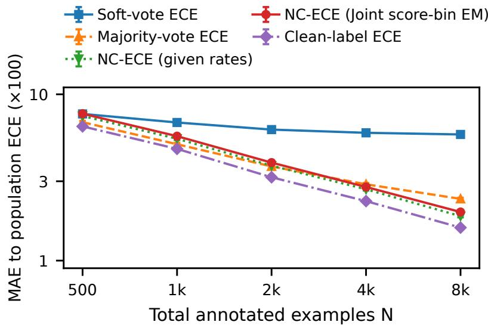
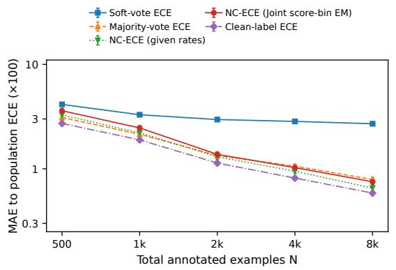
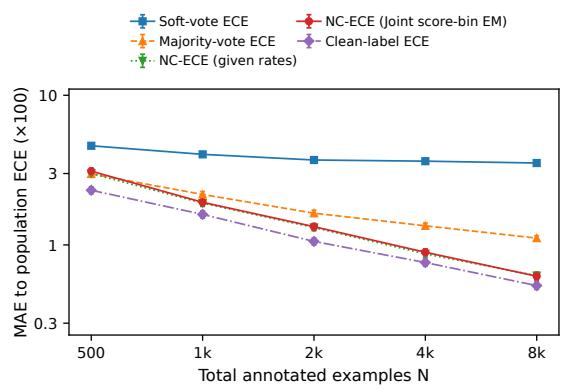

# Noisy-Label Calibration with Multiple Unreliable Labels

Keisuke Hanada<sup>1,3</sup>, Futoshi Futami<sup>2,3,4</sup>

<sup>1</sup>Department of Biostatistics, Wakayama Medical University, Wakayama, Japan

<sup>2</sup>Graduate School of Engineering Science, The University of Osaka, Osaka, Japan

<sup>3</sup>RIKEN AIP, Tokyo, Japan

<sup>4</sup>Department of Complexity Science and Engineering, The University of Tokyo, Tokyo, Japan

## Abstract

In medical annotation and crowdsourcing, multiple annotators assign labels to each example, but these labels may be incorrect. Treating such noisy labels as ground truth can bias calibration evaluation. To address this problem, we propose methods for evaluating and recalibrating a fixed binary predictor under the underlying clean-label distribution, using only noisy annotations. First, given annotator-specific noise probabilities, we propose Noise Corrected ECE (NC-ECE), a binned estimator of expected calibration error (ECE) under class-conditional noise. We derive non-asymptotic bounds on the estimator’s bias. Then, we propose practical algorithms for estimating unknown noise probabilities under conditional independence and label-orientation assumptions. We also develop loss-based and histogram post-hoc recalibration with clean-risk and calibration guarantees, respectively. Experiments on semi-synthetic benchmarks show that the proposed ECE estimator closely tracks its cleanlabel oracle counterpart and that the recalibration methods substantially improve latent-label calibration, whereas uncorrected recalibration against noisy annotations can degrade it.

## 1 Introduction

Using probabilistic predictions for decisions requires more than accurate class predictions: the probabilities should also be calibrated. Calibration means that predicted probabilities agree with outcome frequencies among examples assigned those probabilities. For example, among examples assigned an eighty percent probability of a positive outcome, about eighty percent should be positive [Guo et al., 2017, Vaicenavicius et al., 2019]. Calibration evaluation and post-hoc recalibration usually treat held-out labels as ground truth [Guo et al., 2017, Fujisawa and Futami, 2025]. In medical annotation and crowdsourcing, however, multiple annotators label each example, and these labels may contain errors [Raykar et al., 2010, Tanno et al., 2019]. Medical experts may disagree in their annotations [Gulshan et al., 2016, Elmore et al., 2015], and majority voting does not necessarily eliminate annotation errors [Krause et al., 2018]. We study how to evaluate and improve a fixed binary predictor’s calibration under the underlying clean-label distribution when only noisy annotations are available.

Noisy-label evaluation confounds predictor miscalibration with annotator response tendencies [Dawid and Skene, 1979, Penso et al., 2024]. For example, excess positive responses can reflect either underpredicted probabilities or an annotator’s tendency to report positives. With a fixed number of annotators, more evaluation examples generally leave this bias intact; averaging or majority vote need not remove it either. Recalibration toward annotation agreement can even worsen true-label calibration. Reliable uncertainty assessment is important in medical decision support, where expert judgments may disagree [Mimori et al., 2021]. Noisy evaluation labels complicate predictive reliability assessment.

Loss correction for learning with noisy labels provides our starting point. Known noise probabilities can yield unbiased estimators of clean-label risk [Natarajan et al., 2013, Patrini et al., 2017, van Rooyen and Williamson, 2018]. We apply this principle to calibration evaluation in Section 3. Under annotator-specific class-conditional noise, inverting each known channel yields a corrected label whose conditional expectation given the prediction matches that of the true label. Subtracting the prediction gives a corrected residual with the desired conditional mean (Lemma 1). This gives unbiased estimates of clean-label bin residual moments, whose absolute values are summed to form a noise-corrected binned ECE estimator (Definition 4).

The required noise probabilities, however, are usually unknown. Response frequencies mix annotator errors with true-class proportions and need not identify either [Hui and Walter, 1980]. Multiple annotations of the same example supply additional information [Dawid and Skene, 1979, Allman et al., 2009]. Under conditional independence and label-orientation assumptions, we use their joint distribution, supplemented where necessary by score-defined groups. Section 4 characterizes identification conditions and constructs channel estimators accordingly, using two annotators with score-defined groups (Theorem 2) or three or more informative annotators. We then account for their estimation errors in ECE evaluation rather than treating estimated noise probabilities as exact.

Our analysis connects noise-probability estimation to calibration evaluation under the cleanlabel distribution, separating bin approximation, sampling variation, and channel-estimation errors (Theorem 1). The same corrected labels support post-hoc recalibration in Section 5: corrected-loss fitting provides a clean-risk guarantee, while histogram fitting provides a calibration guarantee (Proposition 2). Both evaluation and recalibration thus address the underlying cleanlabel distribution using noisy annotations alone.

Our contributions are threefold.

1. Calibration evaluation. We propose a noise-corrected binned ECE estimator with separate binning, sampling, and channel-estimation error bounds (Theorem 1), including sample reuse with fixed bins (Proposition 1). We also optimize annotator weights to reduce residual variance (Lemma 2).

2. Recalibration. Corrected-loss and projected histogram fitting provide clean-risk and calibration guarantees, respectively (Section 5; Proposition 2).

3. Empirical validation. Controlled and semi-synthetic experiments assess estimation and recalibration (Section 6). Human annotations show how label choice can reverse recalibration assessments.

Related work. Calibration evaluation and binning bias have been studied extensively [Vaicenavicius et al., 2019, Roelofs et al., 2022, Futami and Fujisawa, 2024]. Weighted test functions provide a common view of calibration criteria [Błasiok et al., 2023, Gopalan et al., 2022]. Unbiased class-conditional loss correction is also established [Natarajan et al., 2013]. Kiryo et al. [2026] estimate ECE from positive and unlabeled data, and Futami and Ishida [2026] develop decontamination-based multicalibration estimators and post-processing for weak supervision. We build on this correction principle. Our focus is the statistical link from unknown, annotatorspecific rates in repeated annotations to ECE evaluation and recalibration, including finite-sample error propagation and sample reuse.

For identification, our two-group construction instantiates the Hui–Walter setting of two imperfect tests in populations with diferent prevalences [Hui and Walter, 1980]. Here the populations are observable score groups. The identification structure is classical. Our analysis connects quantitative channel-estimation guarantees in this setting to latent ECE. With additional annotators, we use the classical Dawid–Skene product-mixture model [Dawid and Skene, 1979, Allman et al., 2009]. Joint noisy-label classifier training [Tanno et al., 2019] estimates a predictor together with the annotation model. Our analysis evaluates and recalibrates a fixed predictor. Disagreement-based approaches model the distribution of annotator judgments [Mimori et al., 2021, Riera-Marín et al., 2026]. Our target is calibration to one latent binary outcome. The distinction between correcting known channels and identifying unknown ones determines the assumptions and scope of our results.

## 2 Preliminaries

Notation. For a positive integer $d ,$ let $[ d ] : = \{ 1 , \ldots , d \}$ . Capital letters denote random variables and lower-case letters their realizations. We write $P _ { V }$ for the distribution of $V$ and $P _ { V | W }$ for its conditional distribution given W. Probabilities and expectations are denoted by P and E. The indicator $\mathbf { 1 } ( E )$ equals one on event E and zero otherwise. Conditional-expectation equalities hold almost surely. Further notation is in Appendix A.

## 2.1 Calibration in binary classification

Let X and $\mathcal { V } : = \{ 0 , 1 \}$ be the input and label spaces, and let $( X , Y ) \sim P _ { X , Y }$ . Fix a measurable predictor $f : \mathcal { X } \to [ 0 , 1 ]$ and write $Z : = f ( X )$ . The score $f ( x )$ is intended to estimate $\mathbb { E } [ Y \mid X = x ]$ Calibration compares a predicted probability with the positive-label frequency among inputs assigned that probability.

Definition 1 (Expected calibration error). The predictor f is perfectly calibrated ${ \mathrm { i f ~ } } \mathbb { E } [ Y \mid Z ] = Z$ almost surely. Its expected calibration error (ECE) is

$$
\operatorname { E C E } ( f ) : = \mathbb { E } \left[ \left| \mathbb { E } [ Y \mid Z ] - Z \right| \right] .\tag{1}
$$

To estimate ECE from data, binning groups examples with similar predicted probabilities [Guo et al., 2017]. Let $S = \{ ( X _ { i } , Y _ { i } ) \} _ { i = 1 } ^ { n }$ be an independent and identically distributed (i.i.d.) sample from $P _ { X , Y }$ , independent of the training of $f ,$ , and put $Z _ { i } : = f ( X _ { i } )$

Definition 2 (Binning ECE). Let $\boldsymbol { B } : = \{ B _ { 1 } , \dots , B _ { M } \}$ partition [0, 1] into $M \geq 1$ measurable bins. For $\ell \in [ M ]$ , set $I _ { \ell } : = \{ i \in [ n ] : Z _ { i } \in B _ { \ell } \}$ and $n _ { \ell } : = | I _ { \ell } |$ . For $n _ { \ell } > 0$ , define $\begin{array} { r } { \bar { Y } _ { \ell } : = n _ { \ell } ^ { - 1 } \sum _ { i \in I _ { \ell } } Y _ { i } } \end{array}$ and $\begin{array} { r } { \bar { Z } _ { \ell } : = n _ { \ell } ^ { - 1 } \sum _ { i \in I _ { \ell } } Z _ { i } } \end{array}$ ; set both means to zero otherwise. The Binning ECE estimator is

$$
\begin{array} { r l } & { \widehat { \mathrm { E C E } } _ { \mathcal { B } } ( f , S ) : = \sum _ { \ell = 1 } ^ { M } ( n _ { \ell } / n ) | \bar { Y } _ { \ell } - \bar { Z } _ { \ell } | } \\ & { \qquad = \sum _ { \ell = 1 } ^ { M } \big | n ^ { - 1 } \sum _ { i = 1 } ^ { n } ( Y _ { i } - Z _ { i } ) \mathbf { 1 } ( Z _ { i } \in B _ { \ell } ) \big | . } \end{array}\tag{2}
$$

Binning ECE compares each bin’s positive-label frequency with its average prediction. Sampling introduces error in these averages, while binning can conceal opposite residuals within a bin. Both errors must be accounted for when estimating $\operatorname { E C E } ( f )$ [Roelofs et al., 2022, Futami and Fujisawa, 2024].

## 2.2 Multi-annotator setting

In medical annotation and crowdsourcing, multiple annotators may supply noisy labels for each input when clean evaluation labels are unavailable [Raykar et al., 2010, Tanno et al., 2019]. Let $K \geq 1$ be the number of annotators and $A _ { j } \in \mathcal { V }$ the label supplied by annotator $j \in [ K ]$ . Write $A _ { 1 : K } : = ( A _ { 1 } , \ldots , A _ { K } )$ . The annotation model $P _ { A _ { 1 : K } | X , Y }$ extends $P _ { X , Y }$ to the joint distribution of inputs, true labels, and annotations. We impose the following condition given $( Y , Z )$

Assume $0 < P ( Y = 1 ) < 1$ . For each $j \in [ K ]$ , define $a _ { j } : = P ( A _ { j } = 1 \mid Y = 0 ) , b _ { j } : = P ( A _ { j } =$ $1 \mid Y = 1 )$ , and $\delta _ { j } : = b _ { j } - a _ { j }$ . The pair $( a _ { j } , b _ { j } )$ is the annotator’s binary noise channel: $a _ { j }$ is its false-positive probability and $1 - b _ { j }$ its false-negative probability. The channel gap is $\delta _ { j } ;$ the channel is informative if $\delta _ { j } \neq 0$

Assumption 1 (Class-conditional annotation noise). For every $j \in [ K ] , \mathbb { E } [ A _ { j } \mid Y , Z ] = a _ { j } + \delta _ { j } Y$

Since $A _ { j }$ is binary, this excludes score-dependent errors: its error probabilities do not vary with the score once the true label is fixed. Write $m ( z ) : = \mathbb { E } [ Y \mid Z = z ]$ for a measurable version m $\mathbf { \sigma } : [ 0 , 1 ]  [ 0 , 1 ]$ of the conditional expectation. Then

$$
\mathbb { E } [ A _ { j } \mid Z ] = a _ { j } + \delta _ { j } m ( Z ) , \qquad j \in [ K ] .\tag{3}
$$

Let $A _ { i j }$ denote annotator $j ^ { \prime } \mathrm { s }$ label for example i. Evaluating ECE directly from annotator $j ^ { \prime } \mathrm { s }$ labels amounts to replacing $Y _ { i }$ by $A _ { i j }$ in Eq. (2). The label-side conditional mean is then $a _ { j } + \delta _ { j } m ( Z )$ rather than $m ( Z )$ . Annotation noise therefore generally biases estimation of ECE with respect to the true label. Increasing the evaluation sample size, averaging annotations, or taking a majority vote does not in general remove this noise-induced bias (Appendix B.3).

## 3 Calibration Estimation

We evaluate $\operatorname { E C E } ( f )$ using known channel probabilities $a _ { j } , b _ { j } , j \in [ K ]$ , or supplied estimates $\widehat { a } _ { j } , \widehat { b } _ { j }$ . Section 4 gives methods for estimating these probabilities.

For each $j \in [ K ]$ with known channel probabilities and $\delta _ { j } \neq 0$ , Eq. (3) gives

$$
\operatorname { \mathbb { E } } [ Y \mid Z ] = ( \operatorname { \mathbb { E } } [ A _ { j } \mid Z ] - a _ { j } ) / \delta _ { j } = \operatorname { \mathbb { E } } [ ( A _ { j } - a _ { j } ) / \delta _ { j } \mid Z ] .
$$

Applying this inverse transformation to an annotation therefore recovers the true label’s conditional expectation given the prediction.

Definition 3 (Corrected labels and residuals). For known channels with $\delta _ { j } \neq 0$ for every $j \in [ K ]$ define $U _ { j } : = ( A _ { j } - a _ { j } ) / \delta _ { j }$ and $\psi _ { j } : = U _ { j } - Z$ . We call $U _ { j }$ the corrected label and $\psi _ { j }$ the corrected residual of annotator $j$ . Let $\Delta _ { K } : = \bar { \{ \alpha \in [ 0 , 1 ] ^ { K } : \sum _ { j = 1 } ^ { K } \alpha _ { j } = 1 \} }$ . For fixed $\alpha \in \Delta _ { K }$ , define their convex combinations by

$$
\begin{array} { r } { U _ { \alpha } : = \sum _ { j = 1 } ^ { K } \alpha _ { j } U _ { j } , \qquad \psi _ { \alpha } : = \sum _ { j = 1 } ^ { K } \alpha _ { j } \psi _ { j } . } \end{array}\tag{4}
$$

Thus $\psi _ { \alpha } = U _ { \alpha } - Z $

Lemma 1 (Corrected ECE representation). Under Assumption 1, the corrections in Definition 3   
satisfy, for every fixed $\alpha \in \Delta _ { K }$ 2

$$
\begin{array} { r } { \operatorname { E C E } ( f ) = \mathbb { E } \big [ \big | \mathbb { E } [ \psi _ { \alpha } \mid Z ] \big | \big ] . } \end{array}\tag{5}
$$

The proof is in Appendix C.1. The identity holds for every fixed $\alpha .$ Under conditional independence, Section 4.4 derives weights minimizing the total variance of the bin-moment estimates.

Estimation from finite samples. We estimate the conditional residual in $\mathrm { E q . ~ ( 5 ) }$ by bin averages, replacing unknown channel probabilities with estimates. If f is learned, condition on its training data and randomness. Let $\mathcal { D } _ { \mathrm { c h } }$ and $\mathcal { D } _ { \mathrm { e v } }$ be independent i.i.d. samples of ${ \cal O } : = ( Z , A _ { 1 : K } ) \sim P _ { \cal O }$ , with sizes $n _ { \mathrm { c h } }$ and $n _ { \mathrm { e v } }$ . Neither sample contains true labels; both are independent of the training of $f .$

Definition 4 (Noise Corrected ECE (NC-ECE)). For each $j \in [ K ]$ , let $\widehat { a } _ { j } , \widehat { b } _ { j }$ be measurable estimators of $a _ { j } , b _ { j }$ based on $\mathcal { D } _ { \mathrm { c h } }$ , with $0 \leq \widehat { a } _ { j } < \widehat { b } _ { j } \leq 1$ . Let $\widehat { \alpha } \in \Delta _ { K }$ and the evaluation partition B also be chosen measurably from $\mathcal { D } _ { \mathrm { c h } }$ , not $\mathcal { D } _ { \mathrm { e v } }$ . Set $\widehat { \delta } _ { j } : = \widehat { b } _ { j } - \widehat { a } _ { j }$ . For each example $i \in [ n _ { \mathrm { e v } } ]$ and annotator $j \in [ K ]$ , define $\widehat { U } _ { i j } : = ( A _ { i j } - \widehat { a } _ { j } ) / \widehat { \delta } _ { j }$ and $\widehat { \psi } _ { i j } : = \widehat { U } _ { i j } - \bar { Z } _ { i }$ . Their weighted aggregates are

$$
\begin{array} { r } { \widehat { U } _ { i } : = \sum _ { j = 1 } ^ { K } \widehat { \alpha } _ { j } \widehat { U } _ { i j } , \qquad \widehat { \psi } _ { i } : = \sum _ { j = 1 } ^ { K } \widehat { \alpha } _ { j } \widehat { \psi } _ { i j } . } \end{array}\tag{6}
$$

Then $\widehat { \psi } _ { i } = \widehat { U } _ { i } - Z _ { i }$ . Define $I _ { \ell } , n _ { \ell } , \bar { Z } _ { \ell }$ on $\mathcal { D } _ { \mathrm { e v } }$ as in Definition 2, and set $\begin{array} { r } { \bar { U } _ { \ell } : = n _ { \ell } ^ { - 1 } \sum _ { i \in I _ { \ell } } \widehat { U } _ { i } } \end{array}$ when $n _ { \ell } > 0$ , and zero otherwise. In a nonempty bin, $\bar { U } _ { \ell } - \bar { Z } _ { \ell }$ is the sample mean of the corrected residuals $\widehat { \psi } _ { i }$ . We define Noise Corrected ECE (NC-ECE) by

$$
\begin{array} { r } { \widehat { \mathrm { E C E } } _ { B } ^ { \mathrm { N C } } ( f , \mathcal { D } _ { \mathrm { e v } } ) : = \sum _ { \ell = 1 } ^ { M } \frac { n _ { \ell } } { n _ { \mathrm { e v } } } | \bar { U } _ { \ell } - \bar { Z } _ { \ell } | . } \end{array}\tag{7}
$$

Write $\widehat { U } \big ( A _ { 1 : K } \big )$ for the fitted correction of a new annotation vector. Its residual is $\widehat { \psi } ( O ) : =$ $\widehat { U } ( A _ { 1 : K } ) - \widehat { Z } .$

Error relative to ECE. The estimation error separates into bin approximation, evaluationsample fluctuation, and channel-estimation error.

Theorem 1 (ECE estimation with independent samples). Suppose Assumption 1 holds, and use the estimator in Definition 4 with independent samples $\mathcal { D } _ { \mathrm { c h } } , \mathcal { D } _ { \mathrm { e v } }$ . Assume $r ( z ) : = m ( z ) - z$ has a version satisfying $| r ( z ) - r ( z ^ { \prime } ) | \leq L _ { r } | z - z ^ { \prime } |$ on the support of $P _ { Z }$ . Let $h _ { B } : = \operatorname* { m a x } _ { \ell \in [ M ] }$ diam $( B _ { \ell } )$ $\textstyle \widehat { B } : = \sum _ { j = 1 } ^ { K } \widehat { \alpha } _ { j } / \widehat { \delta } _ { j }$ , and define

$$
\begin{array} { r } { d _ { \mathrm { c h } } : = \sum _ { j = 1 } ^ { K } \widehat { \alpha } _ { j } \operatorname* { m a x } \ ( | \widehat { a } _ { j } - a _ { j } | , | \widehat { b } _ { j } - b _ { j } | ) / \widehat { \delta } _ { j } . } \end{array}\tag{8}
$$

For every $\eta \in ( 0 , 1 )$ , conditional on $\mathcal { D } _ { \mathrm { c h } }$ , with probability at least $1 - \eta ,$

$$
\begin{array} { r l } & { \left| \widehat { \mathrm { E C E } } _ { \mathcal B } ^ { \mathrm { N C } } ( f , \mathcal D _ { \mathrm { e v } } ) - \mathrm { E C E } ( f ) \right| } \\ & { \leq L _ { r } h _ { \mathcal B } + \widehat B \sqrt { 2 ( M \log 2 + \log ( 2 / \eta ) ) / n _ { \mathrm { e v } } } + d _ { \mathrm { c h } } . } \end{array}\tag{9}
$$

The proof is in Appendix C.2.

Remark 1 (Three sources of error). The terms represent binning, sampling, and channel-estimation errors. Smoothness controls binning; the proof also gives a smoothness-free fixed-bin bound. Because $d _ { \mathrm { c h } }$ contains unknown parameters, the bound alone does not yield a computable confidence interval.

Convergence rates. Define the maximum channel estimation error across annotators by

$$
e _ { \mathrm { c h } } : = \operatorname* { m a x } _ { 1 \leq j \leq K } \bigl ( | \widehat { a } _ { j } - a _ { j } | + | \widehat { b } _ { j } - b _ { j } | \bigr ) .\tag{10}
$$

Corollary 1 (Convergence rates). Under Theorem 1, keep K fixed and assume $\delta _ { j } \geq \delta _ { \operatorname* { m i n } } > 0$ for every $j \in [ K ]$ . Suppose $e _ { \mathrm { c h } } = O _ { p } ( \varepsilon _ { n _ { \mathrm { c h } } } )$ , where $\varepsilon _ { n _ { \mathrm { c h } } } > 0$ is a deterministic sequence tending to zero. For M equal-width evaluation bins,

$$
\begin{array} { r l } & { \left| \widehat { \mathrm { E C E } } _ { \mathcal { B } } ^ { \mathrm { N C } } ( f , \mathcal { D } _ { \mathrm { e v } } ) - \mathrm { E C E } ( f ) \right| } \\ & { = O _ { p } \Big ( M ^ { - 1 } + \sqrt { M / n _ { \mathrm { e v } } } + \varepsilon _ { n _ { \mathrm { c h } } } \Big ) . } \end{array}\tag{11}
$$

Thus $M \asymp n _ { \mathrm { e v } } ^ { 1 / 3 }$ gives $O _ { p } ( n _ { \mathrm { e v } } ^ { - 1 / 3 } + \varepsilon _ { n _ { \mathrm { c h } } } )$

The proof is in Appendix C.2.1. If $e _ { \mathrm { c h } } = O _ { p } ( n _ { \mathrm { c h } } ^ { - 1 / 2 } )$ and $M \asymp n _ { \mathrm { e v } } ^ { 1 / 3 }$ , the error is $O _ { p } ( n _ { \mathrm { e v } } ^ { - 1 / 3 } +$ $n _ { \mathrm { c h } } ^ { - 1 / 2 } )$ . In particular, $n _ { \mathrm { c h } } \asymp n _ { \mathrm { e v } } \asymp n$ gives $O _ { p } ( n ^ { - 1 / 3 } )$ . This matches the order of existing binning-based ECE estimation bounds with clean labels [Futami and Fujisawa, 2024].

Reusing the estimation sample. We next reuse one sample for channel estimation and ECE evaluation, with f and the evaluation bins fixed independently of that sample.

Proposition 1 (ECE estimation with a reused sample). Suppose Assumption 1 and the Lipschitz condition of Theorem 1 hold. Fix f, B independently of an i.i.d. sample D of size n. Let $\widehat { a } _ { j } , \widehat { b } _ { j }$ $j \in [ K ]$ , be measurable channel estimates fitted on D, with $0 \leq \widehat { a } _ { j } < \widehat { b } _ { j } \leq 1$ , and let $\widehat { \alpha } \in \Delta _ { K }$ also depend on D. Compute the estimator in Definition $\it 4$ on D with these values. For every $\eta \in ( 0 , 1 )$ , with probability at least $1 - \eta$

$$
\begin{array} { r l } & { \left| \widehat { \mathrm { E C E } } _ { \mathcal B } ^ { \mathrm { N C } } ( f , \mathcal D ) - \mathrm { E C E } ( f ) \right| } \\ & { \leq L _ { r } h _ { \mathcal B } + \widehat B \sqrt { 2 ( M \log 2 + \log ( 6 K / \eta ) ) / n } + d _ { \mathrm { c h } } , } \end{array}\tag{12}
$$

where $\widehat { B } , d _ { \mathrm { c h } }$ are defined in Theorem 1 using estimates fitted on $\mathcal { D }$

The proof is in Appendix C.3; Appendix C.4 treats the estimator based on cross-fitting.

With fixed $K , \delta _ { j } \geq \delta _ { \operatorname* { m i n } } > 0$ for all $j \in [ K ]$ , and $e _ { \mathrm { c h } } = O _ { p } ( \varepsilon _ { n } )$ , Proposition 1 also gives the rate in Corollary 1, with $\mathcal { D } _ { \mathrm { e v } } , n _ { \mathrm { e v } } , n _ { \mathrm { c h } }$ replaced by $\mathcal { D } , n , n$

## 4 Channel and Weight Estimation

## 4.1 Setting and assumptions

Section 3 requires channel probabilities $a _ { j } , b _ { j }$ . Without true labels, response frequencies mix annotation errors and class proportions; we identify these quantities using joint responses and score groups.

We retain Assumption 1 and assume that annotations are independent conditional on the true label and score, extending the class-conditional noise model proposed by Natarajan et al. [2013] to multiple annotators.

Assumption 2 ( Conditionally independent annotations ). For every $s = ( s _ { 1 } , \dots , s _ { K } ) \in \{ 0 , 1 \} ^ { K }$

$$
P ( A _ { 1 : K } = s \mid Y , Z ) = \prod _ { j = 1 } ^ { K } P ( A _ { j } = s _ { j } \mid Y , Z ) .
$$

Together, Assumptions 1 and 2 give independence conditional on Y and channels shared across score groups (Appendix B.2).

The observation distribution must determine the parameters (identification). One annotator, or two without scores, are generally insuficient (Appendix D.1).

Remark 2 (Label orientation). Relabeling $Y ^ { \star } : = 1 - Y$ exchanges $a _ { j } , b _ { j }$ and complements class proportions without changing the observations. To resolve this exchange, we specify an orientation, such as $a _ { j } < b _ { j }$ for a designated annotator. Orientation alone does not resolve this information shortage.

## 4.2 Two annotators and two score groups

Let $K = 2$ . Choose a threshold $t \in ( 0 , 1 )$ in advance or on data independent of $\mathcal { D } _ { \mathrm { c h } }$ , and define $G : = { \bf 1 } ( Z \geq t )$ . Here $G = 0$ is the low-score group and $G = 1$ the high-score group. The group indicator G is not the true label Y : either group may contain both classes. For $g \in \{ 0 , 1 \}$ , assume $P ( G = g ) > 0$ and let $\mu _ { g } : = P ( Y = 1 \mid G = g )$ be its unknown positiveclass proportion. We jointly estimate $\theta : = ( a _ { 1 } , b _ { 1 } , a _ { 2 } , b _ { 2 } , \mu _ { 0 } , \mu _ { 1 } )$ . The groups share channels; their class proportions may difer.

Estimation idea and observable moments. We recover channel probabilities from responsepair means and covariances within each score group, together with diferences between the group means. For each $g \in \{ 0 , 1 \}$ , define $q _ { 1 , g } : = \mathbb { E } [ A _ { 1 } \mid G = g ] , q _ { 2 , g } : = \mathbb { E } [ A _ { 2 } \mid G = g ]$ , and $q _ { 1 2 , g } : = \mathbb { E } [ A _ { 1 } A _ { 2 } \mid G = g ]$ . They are the probabilities that annotator 1, annotator 2, and both answer positively, respectively. Averaging over the true label gives the following three identities for each $g \in \{ 0 , 1 \}$ , hence six moment equations in total:

$$
\begin{array} { r l r } & { } & { q _ { 1 , g } = a _ { 1 } + \delta _ { 1 } \mu _ { g } , \quad q _ { 2 , g } = a _ { 2 } + \delta _ { 2 } \mu _ { g } , } \\ & { } & { q _ { 1 2 , g } = ( 1 - \mu _ { g } ) a _ { 1 } a _ { 2 } + \mu _ { g } b _ { 1 } b _ { 2 } , \qquad g \in \{ 0 , 1 \} . } \end{array}\tag{13}
$$

Conditional independence gives the joint-positive terms and, for $g \in \{ 0 , 1 \}$ ,

$$
\begin{array} { c } { q _ { 1 , 1 } - q _ { 1 , 0 } = \delta _ { 1 } ( \mu _ { 1 } - \mu _ { 0 } ) , } \\ { q _ { 2 , 1 } - q _ { 2 , 0 } = \delta _ { 2 } ( \mu _ { 1 } - \mu _ { 0 } ) , } \\ { q _ { 1 2 , g } - q _ { 1 , g } q _ { 2 , g } = \delta _ { 1 } \delta _ { 2 } \mu _ { g } ( 1 - \mu _ { g } ) . } \end{array}
$$

The last line is the within-group covariance. These relations yield a closed-form inverse; its lengthy expression is given in Appendix D.2.

Theorem 2 (Two-group identification). Suppose Assumptions 1 and 2 hold with $K \ = \ 2$ $0 \leq a _ { j } < b _ { j } \leq 1 f o r j \in [ 2 ]$ , and $0 < \mu _ { 0 } , \mu _ { 1 } < 1$ with $\mu _ { 0 } \neq \mu _ { 1 }$ . For the two positive-probability groups above, the six moments

$$
\Gamma ( \theta ) : = ( q _ { 1 , 0 } , q _ { 2 , 0 } , q _ { 1 2 , 0 } , q _ { 1 , 1 } , q _ { 2 , 1 } , q _ { 1 2 , 1 } )
$$

uniquely determine θ.

Appendix D.2 gives the inverse and proof. The class proportions are estimated, not supplied. Calibration of f is unnecessary, but a low/high score split alone does not ensure $\mu _ { 0 } \neq \mu _ { 1 }$

Finite-sample estimation. On $\mathcal { D } _ { \mathrm { c h } }$ , let $G _ { i } : = \mathbf { 1 } ( Z _ { i } \geq t )$ and $\begin{array} { r } { n _ { g } : = \sum _ { i = 1 } ^ { n _ { \mathrm { c h } } } \mathbf { 1 } ( G _ { i } = g ) } \end{array}$ . For $g \in \{ 0 , 1 \}$ with $n _ { g } > 0$ , estimate the three moments by

$$
\begin{array} { r l } & { \widehat { q } _ { j , g } : = n _ { g } ^ { - 1 } \sum _ { i : G _ { i } = g } A _ { i j } , \qquad j \in [ 2 ] , } \\ & { \widehat { q } _ { 1 2 , g } : = n _ { g } ^ { - 1 } \sum _ { i : G _ { i } = g } A _ { i 1 } A _ { i 2 } . } \end{array}\tag{14}
$$

Let $\widehat { \Gamma }$ collect the six estimates in the order of $\Gamma ( \theta )$ . The closed-form estimator is ${ \widehat { \theta } } _ { \mathrm { m o m } } : = H ( { \widehat { \Gamma } } )$ 2 where H is the inverse in Theorem 2, whenever it is feasible.

Sampling error can make the closed-form inverse infeasible. We therefore also fit the same moment model by constrained generalized method of moments (GMM; Appendices G.2 and D.4). Under separation and interiority, the feasible inverse and an exact GMM minimizer satisfy $e _ { \mathrm { c h } } = O _ { p } ( n _ { \mathrm { c h } } ^ { - 1 / 2 } )$ (Theorems D.2 and D.3), supplying the rate in Corollary 1. Constraints do not resolve weak identification.

## 4.3 Three or more annotators

With at least three informative annotators, the response vectors alone sufice under Assumptions 1 and 2: no threshold or score-group separation is required.

Response distribution. Let $K \ge 3 , \mu : = P ( Y = 1 ) \in ( 0 , 1 )$ , and $\theta : = ( \mu , a _ { 1 } , b _ { 1 } , \ldots , a _ { K } , b _ { K } )$ with true value $\theta _ { 0 }$ . Under Assumptions 1 and 2, the responses are independent conditional on $Y$ Marginalizing $Y$ therefore gives the joint response distribution $P ( A _ { 1 : K } = s ) = p _ { \theta _ { 0 } } ( s )$ , where

$$
\begin{array} { l } { { \displaystyle p _ { \theta } ( s ) : = ( 1 - \mu ) \prod _ { j = 1 } ^ { K } a _ { j } ^ { s _ { j } } ( 1 - a _ { j } ) ^ { 1 - s _ { j } } } } \\ { { \displaystyle ~ + \mu \prod _ { j = 1 } ^ { K } b _ { j } ^ { s _ { j } } ( 1 - b _ { j } ) ^ { 1 - s _ { j } } , \quad s \in \{ 0 , 1 \} ^ { K } . } } \end{array}\tag{15}
$$

Eq. (15) is the binary Dawid–Skene model [Dawid and Skene, 1979], a mixture of response distributions for the two classes.

Maximum-likelihood estimation. Using only responses, not predictions $Z = f ( X )$ , we jointly estimate $\mu$ and $( a _ { j } , b _ { j } ) _ { j \in [ K ] }$ on a compact set $\Theta \subset ( 0 , 1 ) ^ { 2 K + 1 }$ containing $\theta _ { 0 }$ with the prescribed orientation. On $\mathcal { D } _ { \mathrm { c h } }$ , define the log likelihood and a measurable maximizer:

$$
\begin{array} { r l } & { L _ { n _ { \mathrm { c h } } } ( \theta ) : = n _ { \mathrm { c h } } ^ { - 1 } \sum _ { i = 1 } ^ { n _ { \mathrm { c h } } } \log p _ { \theta } ( A _ { i , 1 : K } ) , } \\ & { \qquad \widehat { \theta } _ { \mathrm { M L } } \in \arg \operatorname* { m a x } L _ { n _ { \mathrm { c h } } } ( \theta ) . } \end{array}\tag{16}
$$

The channel coordinates give $\widehat { a } _ { j } , \widehat { b } _ { j }$ for the correction in Section 3. Numerical likelihood maximization uses expectation–maximization (EM; Appendix F). A finite EM run need not reach a global maximizer [Wu, 1983].

Why three annotations sufice. The third-order central moment, together with the three pairwise covariances, determines µ up to its complement. The prescribed orientation resolves this exchange; response means and covariances then recover the channels. Proposition D.2 gives the exact inverse, including $\mu = 1 / 2 \mathrm { [ A }$ llman et al., 2009].

For fixed K, Theorem D.4 gives $O _ { p } ( n _ { \mathrm { c h } } ^ { - 1 / 2 } )$ error under its identification, interiority, and Fisher-information conditions. Its channel estimates can be used in Corollary 1 when the positive-gap conditions hold.

Prediction information can also be used: divide the prediction range into pre-specified intervals and jointly estimate their positive-class proportions and each annotator’s channel probabilities, shared across intervals. The EM algorithm (Joint score-bin EM) and numerical comparisons are in Appendices F and G, respectively.

## 4.4 Choosing aggregation weights

Channel and class-proportion estimates also determine the aggregation weights in Section 3. We design the weights by minimizing the known-channel residual variance, then substitute the estimated parameters. For fixed f and nonzero channel gaps, choose constant $\alpha \in \Delta _ { K }$ to minimize $V _ { \mathrm { r e s } } ( \alpha ) : = \mathrm { V a r } ( \psi _ { \alpha } )$ , where

$$
V _ { \mathrm { r e s } } ( \alpha ) = \mathrm { V a r } ( Y - Z ) + \mathbb { E } [ ( U _ { \alpha } - Y ) ^ { 2 } ] .\tag{17}
$$

The equality follows from $\mathbb { E } [ U _ { \alpha } - Y \mid Y , Z ] = 0 ;$ only the second term depends on the weights. For each $j \in [ K ]$ , the corrected annotation-noise variance $\bar { v } _ { j } : = \mathbb { E } [ ( U _ { j } - Y ) ^ { 2 } ] = \mathbb { E } [ \mathrm { V a r } ( U _ { j } \mid Y , Z ) ]$ satisfies

$$
\bar { v } _ { j } = [ ( 1 - \mu ) a _ { j } ( 1 - a _ { j } ) + \mu b _ { j } ( 1 - b _ { j } ) ] / \delta _ { j } ^ { 2 } .
$$

Thus the channel and class-proportion estimates give a plug-in estimate of this variance without true labels.

Lemma 2 (Inverse-variance weights). Under Assumptions 1 and 2, with $\delta _ { j } \neq 0$ for all $j \in [ K ]$ $V _ { \mathrm { r e s } } ( \alpha ) = \mathrm { V a r } ( Y - Z ) + \textstyle \sum _ { j = 1 } ^ { K } \alpha _ { j } ^ { 2 } \bar { v } _ { j }$ . If every $\bar { v } _ { j } > 0$ , the unique minimizer over $\Delta _ { K }$ is

$$
\begin{array} { r } { \alpha _ { j } ^ { \mathrm { I V } } : = \bar { v } _ { j } ^ { - 1 } / \bigl ( \sum _ { k = 1 } ^ { K } \bar { v } _ { k } ^ { - 1 } \bigr ) , \qquad j \in [ K ] . } \end{array}\tag{18}
$$

The proof and zero-variance case are in Appendix C.6. For known channels and a fixed evaluation partition, these weights also minimize the total variance of the unbiased binmoment estimates (Proposition C.1). In practice, we replace $a _ { j } , b _ { j } , \mu$ by their estimates and normalize the inverse estimated variances; Appendix F.4 specifies this plug-in rule. This optimality result assumes known channels.

## 5 Recalibration

We fit a measurable post-processing map $g : [ 0 , 1 ]  [ 0 , 1 ]$ to improve the calibration of $f$ . Let $\mathcal { D } _ { \mathrm { r e c } } : = \{ ( Z _ { i } , A _ { i , 1 : K } ) \} _ { i \in [ n _ { \mathrm { r e c } } ] }$ be an i.i.d. sample from $P _ { O }$ , independent of $\mathcal { D } _ { \mathrm { c h } }$ . We fit g on $\mathcal { D } _ { \mathrm { r e c } }$ using the corrected labels $\widehat { U } _ { i } = \widehat { U } ( A _ { i , 1 : K } )$ defined as in $\mathrm { E q . ~ ( 6 ) }$

## 5.1 Corrected-loss fitting

We use unbiased loss correction for class-conditional label noise [Natarajan et al., 2013]. Logarithmic loss is afine in the binary label, so $\mathbb { E } [ U _ { \alpha } \mid Y , Z ] = Y$ recovers the clean-label expected loss when the channels are known. We fit the map using corrected labels $\widehat { U } _ { i }$ computed from estimated channels.

Definition 5 (Corrected logarithmic loss). Let $\mathcal { G }$ be a class of measurable maps $[ 0 , 1 ]  ( 0 , 1 )$ For $p \in ( 0 , 1 ) , i \in [ n _ { \mathrm { r e c } } ]$ , and $g \in { \mathcal { G } }$ , define the corrected loss and empirical risk by

$$
\begin{array} { r l } & { \widehat { \ell } _ { i } ( p ) : = - \widehat { U } _ { i } \log p - ( 1 - \widehat { U } _ { i } ) \log ( 1 - p ) , } \\ & { \widehat { R } ( g ) : = n _ { \mathrm { r e c } } ^ { - 1 } \sum _ { i = 1 } ^ { n _ { \mathrm { r e c } } } \widehat { \ell } _ { i } ( g ( Z _ { i } ) ) . } \end{array}\tag{19}
$$

We minimize this risk over temperature or Platt scaling maps [Guo et al., 2017, Platt, 1999]. Appendix E.2 defines these families with clipped input scores and compact parameter sets. These restrictions keep predictions away from zero and one and prevent an unbounded objective when corrected labels lie outside [0, 1].

Remark 3 (Risk and calibration guarantees). Minimizing the corrected empirical risk attains clean log risk close to the best in the chosen family. Theorem E.2 bounds the excess risk by sampling, channel-estimation, and optimization errors. This is a log-risk guarantee, not a guarantee that every fitted temperature or Platt map reduces $\operatorname { E C E } ( g \circ f )$

## 5.2 Fixed-bin recalibration

Histogram binning ofers a nonparametric alternative [Gupta and Ramdas, 2021]. The fitting bins need not coincide with the channel-estimation groups or the evaluation bins.

Definition 6 (Projected histogram recalibration). For a positive integer J, let $\mathcal { H } : = \{ H _ { h } \} _ { h \in [ J ] }$ be a measurable partition of [0, 1] chosen independently of $\mathcal { D } _ { \mathrm { r e c } }$ . For $h \in [ J ]$ , set $I _ { h } : = \{ i \in$ $[ n _ { \mathrm { r e c } } ] : Z _ { i } \in H _ { h } \}$ and $n _ { h } : = | I _ { h } |$ . Write $\Pi _ { [ 0 , 1 ] } ( u ) : = \operatorname* { m i n } ( 1 , \operatorname* { m a x } ( 0 , u ) )$ for projection onto $[ 0 , 1 ]$ . If $n _ { h } > 0$ , define

$$
\begin{array} { r } { \widetilde { m } _ { h } : = n _ { h } ^ { - 1 } \sum _ { i \in I _ { h } } \widehat { U } _ { i } , \qquad \widehat { m } _ { h } : = \Pi _ { [ 0 , 1 ] } ( \widetilde { m } _ { h } ) . } \end{array}\tag{20}
$$

For an empty bin, choose $\widehat { m } _ { h } \in [ 0 , 1 ]$ arbitrarily. The recalibration map is $\widehat { m } \varkappa ( z ) \ : =$ $\begin{array} { r } { \sum _ { h = 1 } ^ { J } \widehat { m } _ { h } \mathbf { 1 } ( z \in H _ { h } ) } \end{array}$

The bin mean estimates $\mathbb { E } [ Y \mid Z \in H _ { h } ]$ , and projection makes its output a probability.

Proposition 2 (Calibration of projected bin averages). Suppose Assumption 1 holds, $\mathcal { D } _ { \mathrm { r e c } }$ ⊥⊥ $\mathcal { D } _ { \mathrm { c h } }$ and $0 \leq \widehat { a } _ { j } < \widehat { b } _ { j } \leq 1$ for $j \in [ K ]$ . Let H and $\widehat { \alpha } \in \Delta _ { K }$ be fixed conditional on $\mathcal { D } _ { \mathrm { c h } }$ . For every $\eta \in ( 0 , 1 )$ , conditional on $\mathcal { D } _ { \mathrm { c h } }$ , with probability at least 1 − η,

$$
\mathrm { E C E } ( \widehat { m } \varkappa \circ f ) \leq d _ { \mathrm { c h } } + ( \widehat { B } + 1 ) \sqrt { \frac { 2 ( J \log 2 + \log ( 4 / \eta ) ) } { n _ { \mathrm { r e c } } } } .\tag{21}
$$

The proof is in Appendix E.

## 6 Experiments

We use three settings: fully synthetic toy data to study ECE estimation and sample reuse; real tabular data with simulated label noise to test recalibration; and real images with collected human labels to stress-test both procedures without guaranteed theoretical assumptions. Appendix G gives details and additional results.

## 6.1 Toy data

We examine whether noisy labels sufice to estimate the ECE of a fixed predictor, with either known or estimated noise probabilities. We generate $\begin{array} { r } { X \sim \frac { 1 } { 2 } N ( - 1 , 1 ) + \frac { 1 } { 2 } N ( 1 , 1 ) , \mathrm { f a x } \ f ( X ) = \sigma ( 0 . 3 - X ) } \end{array}$ and draw $Y \mid Z \sim \operatorname { B e r n o u l l i } ( m ( Z ) )$ , where $Z = f ( { \bar { X } } )$ and σ is the logistic function. Each of three annotators labels every example, independently conditional on $Y _ { i }$ , with false-positive probabilities $( 0 . 0 8 , 0 . 1 3 , 0 . 1 8 )$ and false-negative probabilities $( 0 . 1 6 , 0 . 1 1 , 0 . 0 6 )$ . Here $m ( z ) = P ( Y = 1 \mid Z = z )$ is the true positive-label probability. Keeping the input distribution, $f ,$ and noise probabilities unchanged, we vary only m: $m ( z ) = z$ (Calibrated), $\begin{array} { r } { m ( z ) = \sigma ( 0 . 6 5 \log { \frac { z } { 1 - z } } - 0 . 3 ) } \end{array}$ (Shifted), or $m ( z ) = \Pi _ { [ 0 . 0 2 , 0 . 9 8 ] } ( z + 0 . 1 2 \sin ( 2 \pi z ) )$ (Nonlinear), where Π clips to the indicated interval. The latter two make f miscalibrated; no recalibration is performed. Figure 1 uses only Calibrated, whose true ECE is zero; Table 1 uses all three.

Table 1: Toy ECE estimation at $N = 8 0 0 0 \colon$ mean ± SD of absolute error over 200 repetitions (×100).
<table><tr><td>Condition</td><td>Sample splitting</td><td>Full-sample reuse</td><td>5-fold cross-fitting</td></tr><tr><td>Calibrated</td><td> $1 . 9 6 0 \pm 0 . 4 8 0$ </td><td> ${ \bf 1 . 3 4 3 \pm 0 . 3 2 2 }$ </td><td> $\mathbf { 1 . 3 4 3 \pm 0 . 3 2 2 }$ </td></tr><tr><td>Shifted</td><td> $0 . 7 5 1 \pm 0 . 6 0 5$ </td><td> $\mathbf { 0 . 4 4 8 \pm 0 . 3 5 8 }$ </td><td> $\mathbf { 0 . 4 4 8 \pm 0 . 3 5 8 }$ </td></tr><tr><td>Nonlinear</td><td> $0 . 6 1 8 \pm 0 . 5 0 8$ </td><td> $\mathbf { 0 . 4 2 7 \pm 0 . 3 3 6 }$ </td><td> $\mathbf { 0 . 4 2 7 \pm 0 . 3 3 6 }$ </td></tr></table>

ECE estimation. Soft-vote ECE and Majority-vote ECE replace the corrected label $\widehat { U } _ { i }$ in Eq. (7) by $K ^ { - 1 } \textstyle \sum _ { j = 1 } ^ { K } A _ { i j }$ and $\textstyle \mathbf { 1 } \{ \sum _ { j = 1 } ^ { K } A _ { i j } > K / 2 \}$ , respectively, with $K = 3$ . NC-ECE uses true noise probabilities (given rates) or estimates obtained from noisy responses using Joint score-bin EM (Appendix F.1.2); both use equal weights. ECE uses ten equal-width bins. Clean-label ECE replaces $\widehat { U } _ { i }$ by $Y _ { i }$ only as a reference. For $N \in \{ 5 0 0 , 1 0 0 0 , 2 0 0 0 , 4 0 0 0 , 8 0 0 0 \}$ , half the examples estimate noise probabilities; all methods use the remaining half for ECE. We report mean absolute error (MAE) relative to population ECE over 200 repetitions; error bars show one Monte Carlo standard error.

Figure 1 shows decreasing NC-ECE errors, with estimated rates performing close to given rates, illustrating Lemma 1 and Theorem 1. Majority voting is wrong only when at least two of the three annotators are wrong, which is unlikely with low error rates and conditionally independent errors. These nonzero rates still change label expectations; correction need not have lower finite-sample MAE. Appendix Figure 2 shows the Shifted and Nonlinear comparisons:

Table 2: Recalibration on tabular data: dataset-wise Oracle ECE (×100), mean ± SD over ten seeds.
<table><tr><td rowspan="2">Dataset</td><td rowspan="2">Base</td><td colspan="2">Temperature</td><td colspan="2">Platt</td><td colspan="2">Fixed-bin</td></tr><tr><td>Naive</td><td>Corrected</td><td></td><td>Naive Corrected</td><td>Naive</td><td>Corrected</td></tr><tr><td>ACSIncome</td><td> $6 . 5 8 \pm 0 . 0 7$ </td><td> $1 2 . 2 2 \pm 0 . 1 8$ </td><td> $3 . 0 0 \pm 0 . 2 4$ </td><td> $1 2 . 3 1 \pm 0 . 1 9$ </td><td> $2 . 3 5 \pm 0 . 1 6$ </td><td> $9 . 1 7 \pm 0 . 1 4$ </td><td> $\mathbf { 0 . 8 0 \pm 0 . 0 8 }$ </td></tr><tr><td>CreditDefault</td><td> $8 . 4 3 \pm 0 . 3 8$ </td><td> $1 2 . 5 0 \pm 0 . 2 1$ </td><td> $5 . 5 4 \pm 0 . 3 5$ </td><td> $1 0 . 0 9 \pm 0 . 2 2$ </td><td> $2 . 3 7 \pm 0 . 2 8$ </td><td> $9 . 0 6 \pm 0 . 1 8$ </td><td> ${ \bf 1 . 5 1 \pm 0 . 2 6 }$ </td></tr><tr><td>HMDA</td><td> $6 . 4 4 \pm 0 . 1 2$ </td><td> $1 5 . 3 3 \pm 0 . 2 5$ </td><td> $4 . 4 4 \pm 0 . 3 5$ </td><td> $1 4 . 0 1 \pm 0 . 1 5$ </td><td> $1 . 9 6 \pm 0 . 1 1$ </td><td> $1 1 . 3 9 \pm 0 . 1 1$ </td><td> ${ \bf 0 . 7 9 \pm 0 . 0 9 }$ </td></tr><tr><td>MEPS</td><td> $1 0 . 6 5 \pm 0 . 8 5$ </td><td> $1 9 . 1 2 \pm 0 . 6 6$ </td><td> $1 2 . 0 9 \pm 0 . 9 2$ </td><td> $1 1 . 7 6 \pm 0 . 2 5$ </td><td> $3 . 3 7 \pm 0 . 4 3$ </td><td> $1 0 . 5 6 \pm 0 . 3 3$ </td><td> ${ \bf 2 . 3 9 \pm 0 . 3 9 }$ </td></tr></table>

  
Figure 1: Toy ECE-estimation MAE (×100, m(z) = z).

voting is close to NC-ECE in Shifted, whereas the diference is clearer at larger sample sizes in Nonlinear.

Sample reuse. For each of the three conditions, we compare how the same N examples, each labeled by three annotators, are used: sample splitting (half for noise estimation, half for ECE), full-sample reuse (all examples for both), and five-fold cross-fitting (estimate noise probabilities on four folds and apply the correction to the remaining fold). Cross-fitting combines the held-out residuals before computing ECE. The predictor and bin boundaries remain fixed, and every method uses Joint score-bin EM and equal weights.

Table 1 shows similar mean errors for reuse and cross-fitting, both lower than for splitting in all three conditions. Even when the true ECE is zero, finite-sample estimation error remains. The calibrated case illustrates the reuse allowed by Proposition 1, not a theoretical ranking of the methods.

## 6.2 Recalibration on tabular data

We examine whether recalibration improves an existing predictor when only noisy labels are available for post-hoc fitting. We train decision trees, random forests, SVMs, naive Bayes, logistic regression, and MLPs with the original labels of ACSIncome, CreditDefault, HMDA, and MEPS [Hansen et al., 2024]. Each held-out example receives labels from $K = 2 , 3$ , 4 simulated annotators, generated by flipping its original label with annotator- and class-specific probabilities. Joint scorebin EM estimates the unknown noise probabilities on the recalibration sample (Appendix G.3), and the methods of Section 5 recalibrate the predictions using only these noisy labels. Naive uses averaged noisy annotations as targets. Corrected adjusts each annotation using estimated noise probabilities and combines the corrected labels with inverse-variance weights. Table 2 checks improvement using original labels of separate test examples. Corrected Platt and fixed-bin methods reduce mean ECE relative to Base on all four datasets, whereas corrected temperature scaling worsens ECE on MEPS. Improvements are not universal.

## 6.3 Real label noise: a stress test

We stress-test ECE evaluation and recalibration on CIFAR-10N, where class-conditional noise (Assumption 1) and conditional independence (Assumption 2) are not assured. Each image has its original CIFAR-10 label and three additional classifications by distinct people, who can vary across images. The original multiclass study reports feature-dependent noise [Wei et al., 2022]. No artificial corruption is introduced.

Both label sets are mapped to animal/vehicle. CLIP ViT-B/32’s animal probability is the score [Radford et al., 2021]. We compare the base predictor, fixed-bin fitting to mean responses (Naive), and noise-corrected fixed-bin fitting (Corrected). For recalibration and evaluation, marginal Dawid–Skene EM estimates noise probabilities from responses alone on separate images. We reserve original CIFAR-10 labels [Krizhevsky, 2009] as benchmark reference labels for binned Oracle ECE; they are not used for fitting or selection.

Table 3: CIFAR-10N fixed-bin recalibration: mean ± SD over five pilot splits $( \times 1 0 0 )$ .
<table><tr><td>Method</td><td>Oracle ECE Soft-vote ECE</td><td></td><td>NC-ECE</td></tr><tr><td>Base</td><td> $2 . 1 2 9 \pm 0 . 0 0 0$ </td><td> $2 . 8 2 5 \pm 0 . 0 0 0$ </td><td> $2 . 4 3 6 \pm 0 . 0 0 0$ </td></tr><tr><td>Naive fixed-bin</td><td> $4 . 3 5 1 \pm 0 . 2 4 3$ </td><td> $\mathbf { 0 . 4 5 0 \pm 0 . 1 4 1 }$ </td><td> $4 . 6 9 5 \pm 0 . 2 2 6$ </td></tr><tr><td>Corrected fixed-bin</td><td> $\mathbf { 0 . 4 7 0 \pm 0 . 1 5 7 }$ </td><td> $4 . 2 9 1 \pm 0 . 1 0 1$ </td><td> $\mathbf { 0 . 4 8 2 \pm 0 . 0 6 9 }$ </td></tr></table>

Table 3 averages five fits sharing held-out samples. Naive recalibration reduces Soft-vote ECE but worsens reference-label ECE; correction reverses both changes. In this fixed-bin comparison, NC-ECE is close to Oracle ECE values and tracks their direction of change using noisy responses alone; the noise assumptions remain unverified.

## 7 Conclusion and Limitations

Corrected annotations enable ECE evaluation and recalibration from noisy responses. Our bounds separate binning, sampling, and channel-estimation errors, including fixed-bin sample reuse. Corrected-loss and histogram fitting provide clean-risk and calibration guarantees, respectively.

Our framework assumes score-invariant error rates within each true class. Identifying unknown channels additionally requires conditional independence of annotators given the true label and score, and label orientation. Even under these strong assumptions, small channel gaps can amplify correction variance, while weak separation between group class proportions can destabilize two-annotator estimation. Likelihood rates need not hold after finitely many EM steps. Addressing the limitations of these assumptions and extending the framework to multiclass labels remain directions for future work.

## References

Elizabeth S. Allman, Catherine Matias, and John A. Rhodes. Identifiability of parameters in latent structure models with many observed variables. The Annals of Statistics, 37(6A): 3099–3132, 2009. doi: 10.1214/09-AOS689.

Heesun Bae, Seungjae Shin, Byeonghu Na, Joonho Jang, Kyungwoo Song, and Il-Chul Moon. From noisy prediction to true label: Noisy prediction calibration via generative model. In Proceedings

of the 39th International Conference on Machine Learning, volume 162 of Proceedings of Machine Learning Research, pages 1277–1297, 2022.

Jarosław Błasiok, Parikshit Gopalan, Lunjia Hu, and Preetum Nakkiran. A unifying theory of distance from calibration. In Proceedings of the 55th Annual ACM Symposium on Theory of Computing, pages 1727–1740, 2023.

Alexander Philip Dawid and Allan M. Skene. Maximum likelihood estimation of observer errorrates using the em algorithm. Journal of the Royal Statistical Society: Series C (Applied Statistics), 28(1):20–28, 1979. doi: 10.2307/2346806.

Arthur P. Dempster, Nan M. Laird, and Donald B. Rubin. Maximum likelihood from incomplete data via the EM algorithm. Journal of the Royal Statistical Society: Series B (Methodological), 39(1):1–22, 1977.

Frances Ding, Moritz Hardt, John Miller, and Ludwig Schmidt. Retiring adult: New datasets for fair machine learning. In Advances in Neural Information Processing Systems, volume 34, pages 6478–6490, 2021.

Joann G Elmore, Gary M Longton, Patricia A Carney, Berta M Geller, Tracy Onega, Anna NA Tosteson, Heidi D Nelson, Margaret S Pepe, Kimberly H Allison, Stuart J Schnitt, et al. Diagnostic concordance among pathologists interpreting breast biopsy specimens. JAMA, 313 (11):1122–1132, 2015.

Masahiro Fujisawa and Futoshi Futami. PAC-Bayes Analysis for Recalibration in Classification. In Aarti Singh, Maryam Fazel, Daniel Hsu, Simon Lacoste-Julien, Felix Berkenkamp, Tegan Ma haraj, Kiri Wagstaf, and Jerry Zhu, editors, Proceedings of the 42nd International Conference on Machine Learning, volume 267 of Proceedings of Machine Learning Research, pages 17986– 18023. PMLR, 2025. URL https://proceedings.mlr.press/v267/fujisawa25a.html.

Futoshi Futami and Masahiro Fujisawa. Information-theoretic generalization analysis for expected calibration error. In Advances in Neural Information Processing Systems, volume 37, pages 84246–84297, 2024.

Futoshi Futami and Takashi Ishida. Unified approach for weakly supervised multicalibration. arXiv preprint arXiv:2605.09857, 2026.

Parikshit Gopalan, Michael P. Kim, Mihir A. Singhal, and Shengjia Zhao. Low-degree multicalibration. In Proceedings of the 35th Conference on Learning Theory, volume 178 of Proceedings of Machine Learning Research, pages 3193–3234, 2022.

Varun Gulshan, Lily Peng, Marc Coram, Martin C Stumpe, Derek Wu, Arunachalam Narayanaswamy, Subhashini Venugopalan, Kasumi Widner, Tom Madams, Jorge Cuadros, et al. Development and validation of a deep learning algorithm for detection of diabetic retinopathy in retinal fundus photographs. JAMA, 316(22):2402–2410, 2016.

Chuan Guo, Geof Pleiss, Yu Sun, and Kilian Q. Weinberger. On Calibration of Modern Neural Networks. In Doina Precup and Yee Whye Teh, editors, Proceedings of the 34th International Conference on Machine Learning, volume 70, pages 1321–1330. PMLR, 2017. URL https://proceedings.mlr.press/v70/guo17a.html.

Chirag Gupta and Aaditya Ramdas. Distribution-free calibration guarantees for histogram binning without sample splitting. In Proceedings of the 38th International conference on machine learning, volume 139, pages 3942–3952. PMLR, 2021.

Dutch Hansen, Siddartha Devic, Preetum Nakkiran, and Vatsal Sharan. When is multicalibration post-processing necessary? In Advances in Neural Information Processing Systems, volume 37, pages 38383–38455, 2024.

Lars Peter Hansen. Large sample properties of generalized method of moments estimators. Econometrica, 50(4):1029–1054, 1982.

Mahmoud Hegazy, Michael I. Jordan, and Aymeric Dieuleveut. Scalable utility-aware multiclass calibration. In Emtiyaz Khan, Yingzhen Li, Arno Solin, and Aaditya Ramdas, editors, Proceedings of The 29th International Conference on Artificial Intelligence and Statistics, volume 300, pages 397–405. PMLR, 2026.

Siu L. Hui and Stephen D. Walter. Estimating the error rates of diagnostic tests. Biometrics, 36 (1):167–171, 1980. doi: 10.2307/2530508.

Ryuichi Kiryo, Futoshi Futami, and Masashi Sugiyama. Estimating expected calibration error for positive-unlabeled learning. Transactions on Machine Learning Research, 2026. https: //openreview.net/forum?id=SvoBtLIrPZ.

Jonathan Krause, Varun Gulshan, Ehsan Rahimy, Peter Karth, Kasumi Widner, Greg S Corrado, Lily Peng, and Dale R Webster. Grader variability and the importance of reference standards for evaluating machine learning models for diabetic retinopathy. Ophthalmology, 125(8):1264–1272, 2018.

Alex Krizhevsky. Learning multiple layers of features from tiny images. Technical report, University of Toronto, 2009. URL https://www.cs.toronto.edu/\~kriz/ learning-features-2009-TR.pdf.

Takahiro Mimori, Keiko Sasada, Hirotaka Matsui, and Issei Sato. Diagnostic uncertainty calibration: Towards reliable machine predictions in medical domain. In Arindam Banerjee and Kenji Fukumizu, editors, Proceedings of The 24th International Conference on Artificial Intelligence and Statistics, volume 130 of Proceedings of Machine Learning Research, pages 3664– 3672. PMLR, 13–15 Apr 2021. URL https://proceedings.mlr.press/v130/mimori21a. html.

Nagarajan Natarajan, Inderjit S Dhillon, Pradeep K Ravikumar, and Ambuj Tewari. Learning with noisy labels. Advances in neural information processing systems, 26, 2013.

Amanda Olmin and Fredrik Lindsten. Robustness and reliability when training with noisy labels. In Proceedings of the 25th International Conference on Artificial Intelligence and Statistics, volume 151, pages 922–942, 2022.

Giorgio Patrini, Alessandro Rozza, Aditya Krishna Menon, Richard Nock, and Lizhen Qu. Making deep neural networks robust to label noise: A loss correction approach. In Proceedings of the IEEE conference on computer vision and pattern recognition, pages 1944–1952, 2017.

Coby Penso, Lior Frenkel, and Jacob Goldberger. Confidence calibration of a medical imaging classification system that is robust to label noise. IEEE Transactions on Medical Imaging, 43 (6):2050–2060, 2024. doi: 10.1109/TMI.2024.3353762.

John C. Platt. Probabilistic outputs for support vector machines and comparisons to regularized likelihood methods. In Advances in Large Margin Classifiers, pages 61–74. MIT Press, 1999.

Teodora Popordanoska, Raphael Sayer, and Matthew B. Blaschko. A consistent and diferentiable l<sub>p</sub> canonical calibration error estimator. Advances in Neural Information Processing Systems, 35:7933–7946, 2022.

Teodora Popordanoska, Sebastian Gregor Gruber, Aleksei Tiulpin, Florian Buettner, and Matthew B. Blaschko. Consistent and asymptotically unbiased estimation of proper calibration errors. In Proceedings of the 27th International Conference on Artificial Intelligence and Statistics, volume 238, pages 3466–3474, 2024.

Alec Radford, Jong Wook Kim, Chris Hallacy, Aditya Ramesh, Gabriel Goh, Sandhini Agarwal, Girish Sastry, Amanda Askell, Pamela Mishkin, Jack Clark, et al. Learning transferable visual models from natural language supervision. In International conference on machine learning, pages 8748–8763. PMLR, 2021.

Vikas C. Raykar, Shipeng Yu, Linda H. Zhao, Gerardo Hermosillo Valadez, Charles Florin, Luca Bogoni, and Linda Moy. Learning From Crowds. Journal of Machine Learning Research, 11 (43):1297–1322, 2010. URL http://jmlr.org/papers/v11/raykar10a.html.

Meritxell Riera-Marín, Javier García López, Júlia Rodríguez-Comas, Miguel A. González Ballester, and Adrian Galdran. Multi-rater calibration error estimation. In Uncertainty for Safe Utilization of Machine Learning in Medical Imaging, volume 16166 of Lecture Notes in Computer Science, pages 147–157. Springer, 2026. doi: 10.1007/978-3-032-06593-3\_14.

Rebecca Roelofs, Nicholas Cain, Jonathon Shlens, and Michael C. Mozer. Mitigating bias in calibration error estimation. In Proceedings of the 25th International Conference on Artificial Intelligence and Statistics, pages 4036–4054, 2022.

Raphael Rossellini, Jake A. Solof, Rina Foygel Barber, Zhimei Ren, and Rebecca Willett. Can a calibration metric be both testable and actionable? In Proceedings of the Thirty-Eighth Conference on Learning Theory, volume 291, pages 4937–4972. PMLR, 2025.

Shubham Sharma, Andrew H. Gee, David Paydarfar, and Joydeep Ghosh. FaiR-N: Fair and robust neural networks for structured data. In Proceedings of the 2021 AAAI/ACM Conference on AI, Ethics, and Society, pages 946–955, 2021.

Ryutaro Tanno, Ardavan Saeedi, Swami Sankaranarayanan, Daniel C Alexander, and Nathan Silberman. Learning from noisy labels by regularized estimation of annotator confusion. In 2019 IEEE/CVF Conference on Computer Vision and Pattern Recognition (CVPR), pages 11236–11245. IEEE, 2019.

Juozas Vaicenavicius, David Widmann, Carl Andersson, Fredrik Lindsten, Jacob Roll, and Thomas Schön. Evaluating model calibration in classification. In Kamalika Chaudhuri and Masashi Sugiyama, editors, Proceedings of the Twenty-Second International Conference on Artificial Intelligence and Statistics, volume 89, pages 3459–3467. PMLR, 2019. URL https://proceedings.mlr.press/v89/vaicenavicius19a.html.

Aad W. van der Vaart. Asymptotic Statistics. Cambridge University Press, 1998.

Brendan van Rooyen and Robert C. Williamson. A theory of learning with corrupted labels. Journal of Machine Learning Research, 18(228):1–50, 2018. URL http://jmlr.org/papers/ v18/16-315.html.

Jiaheng Wei, Zhaowei Zhu, Hao Cheng, Tongliang Liu, Gang Niu, and Yang Liu. Learning with noisy labels revisited: A study using real-world human annotations. In International Conference on Learning Representations, 2022. URL https://openreview.net/forum?id=TBWA6PLJZQm.

C. F. Jef Wu. On the convergence properties of the EM algorithm. The Annals of Statistics, 11 (1):95–103, 1983.

I-Cheng Yeh. Default of credit card clients. UCI Machine Learning Repository, 2009.

## Supplementary Material

The supplement gives proofs, additional statistical results, algorithms, and experimental protocols. Appendix A collects the notation; Appendix B discusses the annotation model. Appendices C–E establish the results of Sections 3–5. Algorithms and experiments are given in Appendices F and G, followed by additional related work and discussion in Appendix H.

## A Notation

The input space is standard Borel. Predictors, post-processing maps, and bin-membership indicators are measurable, jointly with any fitting data. A learned predictor is fixed by conditioning on its training data and randomness; all subsequent samples are independent of that information. We assume the same K response slots are observed for every example; sparse responses require additional missingness assumptions and example-dependent aggregation. Conditional expectations hold almost surely. Pointwise statements about $m ( z ) = \mathbb { E } [ Y \mid Z = z ]$ use a measurable version; regularity assumptions require a version with the stated property.

<table><tr><td>Symbol</td><td>Meaning</td></tr><tr><td> $Z = f ( X ) , O = ( Z , A _ { 1 : K } )$   $a _ { j } , b _ { j } , \delta _ { j }$ </td><td>Prediction and observed post-hoc data; their laws are  $P _ { Z } , P _ { O }$  False-positive probability, true-positive probability, and  $b _ { j } - a _ { j }$ </td></tr><tr><td> $\rho _ { 0 , j } , \rho _ { 1 , j }$ </td><td>Alternative noise coordinates  $a _ { j } , 1 - b _ { j }$   $P ( Y = 1 )$ </td></tr><tr><td> $\mu , r ( z )$   $B , M , { \mathrm { E C E } } _ { B } ( f )$ </td><td>and  $m ( z ) - z .$  Evaluation partition, bin count, and population binned error in</td></tr><tr><td> ${ \mathcal { C } } , L , G , \mu _ { g }$ </td><td>Eq. (B.2). Identification partition, group count, group indicator, and  $P ( \boldsymbol { Y } =$ </td></tr><tr><td></td><td> $1 \mid G = g )$  . Two-group formulas use  $g \in \{ 0 , 1 \}$  Recalibration partition and its bin count.</td></tr><tr><td> $\mathcal { H } , J$   $\mathcal { D } _ { s } , n _ { s }$ </td><td>Sample and size for  $s \in \{ \mathrm { c h } , \mathrm { r e c } , \mathrm { v a l } , \mathrm { e v } \}$  . Split-sample results use</td></tr><tr><td></td><td>mutually independent samples.</td></tr><tr><td> $\mathbb { E } _ { \mathcal { D } _ { s } } [ h ]$   $U _ { j } , \psi _ { j } , U _ { \alpha } , \psi _ { \alpha }$ </td><td> $\textstyle n _ { s } ^ { - 1 } \sum _ { i = 1 } ^ { n _ { s } } h ( O _ { i } ^ { ( s ) } )$  Known-channel corrected labels and residuals; hats denote fitted</td></tr><tr><td> $\widehat { B } , d _ { \mathrm { c h } }$ </td><td>corrections. Bounds for a fitted correction and its conditional-mean error.</td></tr><tr><td> $e _ { \mathrm { c h } } , \varepsilon _ { n _ { \mathrm { c h } } }$ </td><td>Maximum endpoint error and its deterministic convergence-rate</td></tr><tr><td> $V _ { \mathrm { r e s } } ( \alpha )$ </td><td>sequence. Variance of one corrected residual, not of the ECE estimator.</td></tr></table>

Expectations of fitted functions integrate over a fresh independent example, with the fit held fixed. Conditional risk and bias statements require finite integrals for almost every fit, not finite averages over the fitting data. Positive fitted gaps give a finite $\widehat { B }$ for each fit but need not give $\mathbb { E } [ \widehat { B } ] < \infty$ . We use the usual $O _ { p } , o _ { p } , \asymp$ notation and natural logarithms. Norms $\| \cdot \| _ { 2 } , \| \cdot \| _ { \infty } , \| \cdot \| _ { \mathrm { o p } }$ are Euclidean, maximum-coordinate, and induced operator norms; DF, ∇, and $\nabla ^ { 2 }$ denote Jacobian, gradient, and Hessian. Matrix inequalities use the positive-semidefinite order.

A fixed nonempty informative subset $\mathcal { I } \subseteq [ K ]$ can replace $[ K ]$ in correction formulas, with weights in $\begin{array} { r } { \Delta _ { \mathcal { I } } = \{ \alpha _ { j } \geq 0 : \sum _ { i \in \mathcal { I } } \alpha _ { j } = 1 \} } \end{array}$ . An excluded zero-gap channel is not evaluated as a zero-weighted inverse. For equal-width partitions, bins are left-closed and right-open, except that the last bin includes 1. The same convention applies to $M , L , J$ bins. Write $\Pi _ { [ a , b ] } ( u ) = \operatorname* { m i n } ( b , \operatorname* { m a x } ( a , u ) )$ and interpret factors with exponent zero in Bernoulli mass functions as one, including $0 ^ { 0 } = 1$

Table 4: Information suficient for correction or identification. Unknown-channel estimation also requires label orientation; rate results impose the regularity conditions in Appendix D.
<table><tr><td>Task</td><td>Annotation model</td><td>Additional condition</td></tr><tr><td>Known-channel correction Assumption 1</td><td></td><td>Nonzero gaps for inverted channels</td></tr><tr><td>Unknown,  $K = 2$ </td><td>Assumptions 1, 2</td><td>Two informative channels; two positive-mass groups with distinct class proportions strictly between</td></tr><tr><td>Unknown,  $K \geq 3$ </td><td>Assumptions 1, 2</td><td>zero and one Three informative annotators; no score separation</td></tr></table>

## B Calibration and the Annotation Model

## B.1 Population and empirical binned errors

For a fixed partition, the clean estimator and its population counterpart are

$$
{ \widehat { \mathrm { E C E } } } _ { { B } } ( f , S ) = \sum _ { \ell = 1 } ^ { M } \left| { \frac { 1 } { n } } \sum _ { i = 1 } ^ { n } ( Y _ { i } - Z _ { i } ) \mathbf { 1 } ( Z _ { i } \in B _ { \ell } ) \right| ,\tag{B.1}
$$

$$
\begin{array} { r } { \mathrm { E C E } _ { B } ( f ) = \sum _ { \ell = 1 } ^ { M } \vert \mathbb { E } [ ( Y - Z ) \mathbf { 1 } ( Z \in B _ { \ell } ) ] \vert . } \end{array}\tag{B.2}
$$

For a positive-mass bin, conditional Jensen gives $| \mathbb { E } [ r ( Z ) \mid Z \in B _ { \ell } ] | \le \mathbb { E } [ | r ( Z ) | \mid Z \in B _ { \ell } ]$ Multiplying by $p _ { \ell } = P ( Z \in B _ { \ell } )$ and summing proves $\mathrm { E C E } _ { B } ( f ) \leq \mathrm { E C E } ( f )$ . Fixed-bin estimation can therefore leave binning error even as sampling error vanishes. An independently fitted partition is held fixed in these expectations.

Example B.1 (Cancellation within a bin). If Z is uniform on $\{ 1 / 4 , 3 / 4 \}$ and $Y \sim \mathrm { B e r n o u l l i } ( 1 / 2 )$ is independent of $Z ,$ then $\operatorname { E C E } ( f ) = 1 / 4$ but one bin gives $\operatorname { E C E } { p } ( f ) = | \mathbb { E } [ Y - Z ] | = 0$

## B.2 Conditional distributions and identification

Because annotations are binary, Assumption 1 is equivalent to

$$
P ( A _ { j } = 1 \mid Y , Z ) = a _ { j } + \delta _ { j } Y , \qquad \delta _ { j } = b _ { j } - a _ { j } .\tag{B.3}
$$

Taking conditional expectations yields

$$
q _ { j } ( z ) = \mathbb { E } [ A _ { j } \mid Z = z ] = a _ { j } + \delta _ { j } m ( z ) .\tag{B.4}
$$

Known-channel correction uses this marginal relation and nonzero gaps; it requires neither positive orientation nor independence among annotators. Assumption 2 additionally gives

$$
\begin{array} { r } { P ( A _ { 1 : K } = s \mid Y = y , Z = z ) = \prod _ { j = 1 } ^ { K } p _ { j } ( y ) ^ { s _ { j } } ( 1 - p _ { j } ( y ) ) ^ { 1 - s _ { j } } , \qquad p _ { j } ( y ) = a _ { j } + \delta _ { j } y . } \end{array}\tag{B.5}
$$

This implies independence of the annotations given $Y$ and $A _ { 1 : K } \bot \bot Z \mid Y$ , producing the likelihood model [Dawid and Skene, 1979]. Dependence can violate this product relation while preserving the marginal correction identity. If the marginal channels themselves vary with $Z$ given $Y$ , a single shared correction need not remain valid. Table 4 separates the requirements.

Remark B.1 (Label orientation). Replacing µ by $1 - \mu$ and exchanging $a _ { j } , b _ { j }$ leaves the marginal response law unchanged. Identification therefore needs a prescribed orientation, such as $a _ { j } < b _ { j }$ for a specified informative annotator.

## B.3 Aggregation before correction

Proposition B.1 (Expectation of an aggregated annotation). Suppose $P _ { A _ { 1 : K } | Y , Z } = P _ { A _ { 1 : K } | Y }$ . For a fixed finite-valued $v : \{ 0 , 1 \} ^ { K } \to \mathbb { R }$ , let $c _ { y } = \mathbb { E } [ v ( A _ { 1 : K } ) \ | \ Y = y ]$ . Then

$$
\operatorname { \mathbb { E } } [ v ( A _ { 1 : K } ) \mid Z ] = c _ { 0 } + ( c _ { 1 } - c _ { 0 } ) m ( Z ) .\tag{B.6}
$$

The afine expression $c _ { 0 } + ( c _ { 1 } - c _ { 0 } ) t$ equals t for all $t \in [ 0 , 1 ]$ if and only if $c _ { 0 } = 0 , c _ { 1 } = 1$

Proof. Iterated expectation gives $\operatorname { \mathbb { E } } [ v ( A _ { 1 : K } ) \mid Z ] = \operatorname { \mathbb { E } } [ c _ { Y } \mid Z ] = ( 1 - m ( Z ) ) c _ { 0 } + m ( Z ) c _ { 1 }$ . Evaluating the afine expression at 0 and 1 proves the last assertion. □

The proposition covers majority vote and fixed weighted averages. For fixed K, more evaluation examples do not remove a conditional-mean mismatch, although particular distributions may have equal scalar ECEs.

Remark B.2 (Prediction-dependent aggregation). For the correctly specified posterior $\tau ( A _ { 1 : K } , Z ) = \mathbb { E } [ Y \mid A _ { 1 : K } , Z ]$ 2

$$
\mathbb { E } [ \tau ( A _ { 1 : K } , Z ) \mid Z ] = m ( Z ) .\tag{B.7}
$$

This follows by iterated expectation. Such prediction-dependent rules are not excluded by Proposition B.1; fitted posteriors require their own estimation-error analysis.

## C Calibration Estimation: Statements and Proofs

## C.1 Weighted representations and corrected moments

A bounded function w selects or weights predictions. Bin indicators recover the usual ECE moments. Allowing one sign in each bin expresses the sum of absolute moments as a maximum, which is useful for concentration bounds; it does not change how the estimator is computed. Let ${ \mathcal W } _ { \infty }$ be the class of measurable maps $[ 0 , 1 ]  [ - 1 , 1 ]$ and define the calibration moment

$$
M _ { f } ( w ) : = \mathbb { E } [ ( Y - Z ) w ( Z ) ] , \qquad w \in \mathcal { W } _ { \infty } .\tag{C.1}
$$

For ${ \mathfrak { B } } : = \{ B _ { \ell } \} _ { \ell \in [ M ] }$ , let $r _ { \ell } : = \mathbb { E } [ ( Y - Z ) \mathbf { 1 } ( Z \in B _ { \ell } ) ] , w _ { s } ( z ) : = \sum _ { \ell = 1 } ^ { M } s _ { \ell } \mathbf { 1 } ( z \in B _ { \ell } )$ , and $\mathcal { W } _ { B } : = \{ w _ { s }$ $s \in [ - 1 , 1 ] ^ { M } \}$

Lemma C.1 (Weighted calibration representations). For the fixed predictor f,

$$
\begin{array} { r } { \operatorname { E C E } ( f ) = \operatorname* { s u p } _ { w \in \mathcal { W } _ { \infty } } M _ { f } ( w ) = \operatorname* { s u p } _ { w \in \mathcal { W } _ { \infty } } | M _ { f } ( w ) | , } \end{array}\tag{C.2}
$$

$$
\mathrm { E C E } _ { \mathcal { B } } ( f ) = \operatorname* { s u p } _ { w \in \mathcal { W } _ { \mathcal { B } } } M _ { f } ( w ) = \operatorname* { m a x } _ { s \in \{ - 1 , 1 \} ^ { M } } \sum _ { \ell = 1 } ^ { M } s _ { \ell } r _ { \ell } .\tag{C.3}
$$

Proof. Since $w ( Z )$ is measurable with respect to $Z , M _ { f } ( w ) = \mathbb { E } [ ( m ( Z ) - Z ) w ( Z ) ]$ . Its absolute value is at most $\mathbb { E } [ | m ( Z ) - Z | ]$ . Equality is attained by the measurable sign of $m ( z ) - z$ , with any value in $[ - 1 , 1 ]$ at zero. The class is symmetric under sign change, which gives both suprema. For a binwise-constant $\begin{array} { r } { w _ { s } , M _ { f } ( w _ { s } ) = \sum _ { \ell = 1 } ^ { M } s _ { \ell } r _ { \ell } } \end{array}$ . Choosing each sign to agree with $r _ { \ell } ~ { \mathrm { g i v e s } } ~ \sum _ { \ell = 1 } ^ { M } | r _ { \ell } |$ including zero-moment bins. □

Lemma C.2 (Corrected moments and unbiased empirical moments). Suppose Assumption 1 holds and $\delta _ { j } \neq 0 f o r j \in [ K ]$ . For $U _ { j } : = ( A _ { j } - a _ { j } ) / \delta _ { j }$ and $\psi _ { j } : = U _ { j } - Z$ , and every fixed $\alpha \in \Delta _ { K }$

$$
\mathbb { E } [ U _ { j } \mid Y , Z ] = Y , \qquad \mathbb { E } [ U _ { \alpha } \mid Y , Z ] = Y ,\tag{C.4}
$$

$$
\mathbb { E } [ \psi _ { j } \mid Z ] = \mathbb { E } [ \psi _ { \alpha } \mid Z ] = m ( Z ) - Z ,\tag{C.5}
$$

$$
\begin{array} { r } { \mathbb { E } [ \psi _ { j } w ( Z ) ] = \mathbb { E } [ \psi _ { \alpha } w ( Z ) ] = M _ { f } ( w ) , \quad w \in \mathcal { W } _ { \infty } . } \end{array}\tag{C.6}
$$

For an independent evaluation sample, the empirical corrected moment is unbiased, conditional on any independent data determining $\alpha , w$

Proof of Lemmas 1 and C.2. Eq. (B.3) gives $\mathbb { E } [ ( A _ { j } \mathrm { ~ - ~ } a _ { j } ) / \delta _ { j } \mathrm { ~ \mid ~ } Y , Z ] \mathrm { ~ = ~ } Y$ Linearity and $\textstyle \sum _ { j = 1 } ^ { K } \alpha _ { j } = 1$ give the aggregate identity. Conditioning again on $Z$ gives $\mathbb { E } [ U _ { j } \mid Z ] = \mathbb { E } [ U _ { \alpha } \mid Z ] =$ $m ( Z )$ . Subtracting $Z$ proves Eq. (C.5). Substitution into the ECE definition in Eq. (1) proves Eq. (5). Multiplication by bounded $w ( Z )$ and expectation yield Eq. (C.6). All variables are integrable because the finite set of inverted gaps is nonzero. Finally, expectation of an empirical average equals its population expectation when the function is fixed independently of the sample. No joint annotator independence is used. □

## C.2 Independent-sample ECE bound

Write $\widehat { \psi } ( { \cal O } ) = \widehat { U } ( A _ { 1 : K } ) - Z$ and define

$$
\begin{array} { r } { \widehat { r _ { \ell } } : = \mathbb { E } _ { \mathcal { D } _ { \mathrm { e v } } } [ \widehat { \psi } \mathbf { 1 } ( Z \in B _ { \ell } ) ] , \qquad \widehat { \mathrm { E C E } } _ { \mathcal { B } } ^ { \mathrm { N C } } ( f , \mathcal { D } _ { \mathrm { e v } } ) = \sum _ { \ell = 1 } ^ { M } | \widehat { r _ { \ell } } | . } \end{array}\tag{C.7}
$$

The estimates, weights, and bins are measurable functions of $\mathcal { D } _ { \mathrm { c h } }$ , which may include independent pilot information. They are independent of $\mathcal { D } _ { \mathrm { e v } }$

Lemma C.3 (Conditional-expectation error and bounds). Under Assumption 1, assume $0 \leq$ $\widehat { a } _ { j } < \widehat { b } _ { j } \leq 1$ for $j \in [ K ]$ and $\widehat { \alpha } \in \Delta _ { K }$ . For an independent example $O \sim P _ { O }$ , with $\mathcal { D } _ { \mathrm { c h } }$ held fixed as in Appendix A,

$$
\begin{array} { r l } & { b _ { \mathrm { c h } } ( z ) : = \mathbb { E } [ \widehat { U } \mid Z = z , { \mathcal { D } } _ { \mathrm { c h } } ] - m ( z ) } \\ & { \qquad = \sum _ { j = 1 } ^ { K } \widehat { \alpha } _ { j } \frac { ( 1 - m ( z ) ) ( a _ { j } - \widehat { a } _ { j } ) + m ( z ) ( b _ { j } - \widehat { b } _ { j } ) } { \widehat { \delta } _ { j } } , } \end{array}\tag{C.8}
$$

$$
\vert b _ { \mathrm { c h } } ( Z ) \vert \le d _ { \mathrm { c h } } , \qquad \vert \widehat { U } \vert \le \widehat { B } , \qquad \vert \widehat { \psi } \vert \le \widehat { B } .\tag{C.9}
$$

These bounds also hold for zero true gaps. In that case they need not be small, and they do not imply that the channel can be identified.

Proof. Independence of the example and $\mathcal { D } _ { \mathrm { c h } }$ allows the estimates to be held fixed. By Eq. (B.4), the conditional expectation of the jth estimated corrected label is $( a _ { j } + \delta _ { j } m ( z ) - \widehat { a } _ { j } ) / \widehat { \delta } _ { j }$ . Subtracting $m ( z )$ and using $\delta _ { j } - { \widehat { \delta } } _ { j } = ( b _ { j } - { \widehat { b } } _ { j } ) - ( a _ { j } - { \widehat { a } } _ { j } )$ proves Eq. (C.8). Its numerator is a convex combination of two endpoint errors, so its absolute value is bounded by their maximum. Summing gives $d _ { \mathrm { c h } }$ . The label bound follows from $| A _ { j } - \widehat { a } _ { j } | \leq 1$ . For the residual, note that $\widehat { a } _ { j } + \widehat { \delta } _ { j } Z = ( 1 - Z ) \widehat { a } _ { j } + Z \widehat { b } _ { j } \in [ 0 , 1 ]$ . Thus $| A _ { j } - \widehat { a } _ { j } - \widehat { \delta } _ { j } Z | \leq 1$ ; division and convex aggregation prove the last bound. □

Theorem C.1 (Finite-sample error and conditional bias). Suppose Assumption 1 holds. Let $\mathcal { D } _ { \mathrm { c h } }$ and $\mathcal { D } _ { \mathrm { e v } }$ be independent i.i.d. samples from $P _ { O _ { 3 } }$ , with the predictor fixed independently of both. Let the estimates, weights and partition satisfy Definition $^ { 4 , }$ and set $p _ { \ell } : = P ( Z \in B _ { \ell } \mid { \mathcal { D } } _ { \mathrm { c h } } )$ . No smoothness is needed for the first two assertions. Conditional on $\mathcal { D } _ { \mathrm { c h } }$ ,

$$
- d _ { \mathrm { c h } } \leq \mathbb { E } [ \widehat { \mathrm { E C E } } _ { \mathcal { B } } ^ { \mathrm { N C } } ( f , \mathcal { D } _ { \mathrm { e v } } ) \mid \mathcal { D } _ { \mathrm { c h } } ] - \mathrm { E C E } _ { \mathcal { B } } ( f ) \leq \widehat { B } \sqrt { M / n _ { \mathrm { e v } } } + d _ { \mathrm { c h } } .\tag{C.10}
$$

For every $\eta \in ( 0 , 1 )$ , with conditional probability at least $1 - \eta$

$$
\begin{array} { r } { \Big \lvert \widehat { \mathrm { E C E } } _ { \mathcal B } ^ { \mathrm { N C } } ( f , \mathcal D _ { \mathrm { e v } } ) - \mathrm { E C E } _ { \mathcal B } ( f ) \Big \rvert \leq \widehat { B } \sqrt { \frac { 2 ( M \log 2 + \log ( 2 / \eta ) ) } { n _ { \mathrm { e v } } } } + d _ { \mathrm { c h } } . } \end{array}\tag{C.11}
$$

If $r ( z ) ~ : = ~ m ( z ) ~ - ~ z$ has an $L _ { r } – L i p s c h i t z$ version on the support of $P _ { Z }$ , and $h _ { B } \quad : =$ max $\cdot \ell \in [ M ]$ diam $( B _ { \ell } )$ , then

$$
0 \leq \mathrm { E C E } ( f ) - \mathrm { E C E } _ { B } ( f ) \leq L _ { r } h _ { B } .\tag{C.12}
$$

Combining $E q .$ (C.11) and Eq. (C.12) proves Theorem 1 for the population target.

Proof. Condition throughout on $\mathcal { D } _ { \mathrm { c h } }$ . Set $q _ { \ell } \ = \ \mathbb { E } [ \widehat { \psi } \mathbf { 1 } ( Z \ \in \ B _ { \ell } ) \ | \ \mathcal { D } _ { \mathrm { c h } } ]$ and $\begin{array} { r } { Q _ { B } \ = \ \sum _ { \ell } \left| q _ { \ell } \right| . } \end{array}$ Lemma C.3 gives

$$
\begin{array} { r } { \sum _ { \ell } | q _ { \ell } - r _ { \ell } | \leq \sum _ { \ell } \mathbb { E } \big [ | b _ { \mathrm { c h } } ( Z ) | \mathbf { 1 } ( Z \in B _ { \ell } ) \ | \ \mathcal { D } _ { \mathrm { c h } } \big ] \leq d _ { \mathrm { c h } } . } \end{array}\tag{C.13}
$$

Thus $| Q _ { \mathcal { B } } - \mathrm { E C E } _ { \mathcal { B } } ( f ) | \leq d _ { \mathrm { c h } }$ d<sub>ch</sub>. Since $\mathbb { E } [ \widehat { r } _ { \ell } ] = q _ { \ell }$ and $\mathrm { V a r } ( \widehat { r } _ { \ell } ) \leq \widehat { B } ^ { 2 } p _ { \ell } / n _ { \mathrm { e v } }$ , Jensen and Cauchy– Schwarz yield $\begin{array} { r } { 0 \leq \mathbb { E } [ \widehat { \mathrm { E C E } } _ { \mathcal { B } } ^ { \mathrm { N C } } ] - Q _ { \mathcal { B } } \leq \sum _ { \ell } \mathbb { E } | \widehat { r } _ { \ell } - q _ { \ell } | \leq \widehat { B } n _ { \mathrm { e v } } ^ { - 1 / 2 } \sum _ { \ell } \sqrt { p _ { \ell } } \leq \widehat { B } \sqrt { M / n _ { \mathrm { e v } } } } \end{array}$ , proving Eq. (C.10). For the deviation bound,

$$
\begin{array} { r } { \sum _ { \ell } | \widehat { r } _ { \ell } - q _ { \ell } | = \operatorname* { m a x } _ { s \in \{ - 1 , 1 \} ^ { M } } | ( \mathbb { E } _ { \mathcal { D } _ { \mathrm { e v } } } - \mathbb { E } ) [ \widehat { \psi } w _ { s } ( Z ) ] | . } \end{array}\tag{C.14}
$$

Each of the $2 ^ { M }$ functions is bounded by $\widehat { B }$ in absolute value. Two-sided Hoefding and a union bound give tail probability at most $2 ^ { M + 1 } \exp ( - n _ { \mathrm { e v } } t ^ { 2 } / ( 2 \widehat { B } ^ { 2 } ) )$ . Setting this equal to η and using Eq. (C.13) proves Eq. (C.11). Finally, in each positive-mass bin let $\bar { r } _ { \ell } = \mathbb { E } [ r ( Z ) \mid Z \in B _ { \ell } ]$ . An independent conditional copy $Z ^ { \prime }$ gives $| r ( z ) - \bar { r } _ { \ell } | \leq \mathbb { E } [ | r ( z ) - r ( Z ^ { \prime } ) | \ | \ Z ^ { \prime } \in B _ { \ell } ] \leq L _ { \eta }$ diam(B<sub>ℓ</sub>) almost surely. Conditional Jensen and summation with bin masses prove $0 \leq \operatorname { E C E } ( f ) -$ $\mathrm { E C E } p ( f ) \le L _ { r } h B$ and Theorem 1. □

Lemma C.4 (Known-channel bias). Suppose Assumption 1 holds and $\delta _ { j } \neq 0$ for $j \in [ K ]$ . Set

$$
\begin{array} { r } { B _ { \rho } : = \operatorname* { m a x } _ { j \in [ K ] } | \delta _ { j } | ^ { - 1 } . } \end{array}\tag{C.15}
$$

Let $\alpha \in \Delta _ { K }$ and B be fixed. On an i.i.d. sample ${ \mathcal { D } } = \{ O _ { i } \} _ { i \in [ n ] } \sim P _ { O } ^ { n }$ , define the knownchannel estimator $\begin{array} { r } { \widehat { \mathrm { E C E } } _ { \rho , \mathcal { B } } ^ { \mathrm { N C } } ( f , \mathcal { D } ) : = \sum _ { \ell = 1 } ^ { M } | \mathbb { E } _ { \mathcal { D } } [ ( U _ { \alpha } - Z ) \mathbf { 1 } ( Z \in B _ { \ell } ) ] | } \end{array}$ . Each corrected bin moment is unbiased, and

$$
0 \leq \mathbb { E } [ \widehat { \mathrm { E C E } } _ { \rho , \mathcal { B } } ^ { \mathrm { N C } } ( f , \mathcal { D } ) ] - \mathrm { E C E } _ { \mathcal { B } } ( f ) \leq B _ { \rho } \sqrt { M / n } .\tag{C.16}
$$

If the weights and partition are chosen using independent data, the same statement holds conditional on those data.

Proof. Lemma C.2 gives unbiased bin moments. Since $a _ { j } + \delta _ { j } Z \in [ 0 , 1 ] , | \psi _ { j } | \leq | \delta _ { j } | ^ { - 1 }$ , including negative nonzero gaps. Thus $| \psi _ { \alpha } | \leq B _ { \rho }$ . The Jensen and variance argument in the preceding proof, now with $q _ { \ell } = r _ { \ell } ,$ yields the result. □

## C.2.1 Proof of Corollary 1

Proof. Use $e _ { \mathrm { c h } }$ from Eq. (10). The assumption $e _ { \mathrm { c h } } = O _ { p } ( \varepsilon _ { n _ { \mathrm { c h } } } )$ with $\varepsilon _ { n _ { \mathrm { c h } } } \to 0$ implies $e _ { \mathrm { c h } } = o _ { p } ( 1 )$ For every $j \in [ K ] , | \widehat { \delta } _ { j } - \delta _ { j } | \leq | \widehat { a } _ { j } - a _ { j } | + | \widehat { b } _ { j } - b _ { j } | \leq e _ { \mathrm { c h } }$ . Thus, on the event $e _ { \mathrm { c h } } \le \delta _ { \mathrm { m i n } } / 2$ whose probability tends to one, $\widehat { \delta } _ { j } \geq \delta _ { \mathrm { m i n } } / 2$ for all j, and $\widehat { B } \le 2 / \delta _ { \mathrm { m i n } } , \quad d _ { \mathrm { c h } } \le 2 e _ { \mathrm { c h } } / \delta _ { \mathrm { m i n } }$ . The conditional probability bound in Theorem 1, integrated over $\mathcal { D } _ { \mathrm { c h } }$ , therefore gives a sampling term of order $O _ { p } ( \sqrt { M / n _ { \mathrm { e v } } } )$ and channel error $O _ { p } ( \varepsilon _ { n _ { \mathrm { c h } } } )$ . For equal-width bins, $h _ { B } = M ^ { - 1 }$ , proving Eq. (11). The choice $M \asymp n _ { \mathrm { e v } } ^ { 1 / 3 }$ balances binning and sampling. For the reused sample, the same event and deterministic inequalities apply with $e _ { \mathrm { c h } } = O _ { p } ( \varepsilon _ { n } )$ . Apply Proposition 1; fixed K changes only a constant inside the logarithm. This gives $\bar { O _ { p } } ( M ^ { - 1 } + \sqrt { M / n } + \varepsilon _ { n } )$ and the stated choice of M. Neither argument treats fitted coeficients as independent of the sample that fitted them. □

The smoothness-free bound in Theorem C.1 also gives $O _ { p } ( n _ { \mathrm { e v } } ^ { - 1 / 2 } + \varepsilon _ { n _ { \mathrm { c h } } } )$ error relative to $\operatorname { E C E } _ { B } ( f )$ for a fixed partition. That statement concerns the auxiliary binned quantity, not ECE(f).

Remark C.1 (Evaluation bins and channel groups). A growing evaluation bin count M need not change the dimension of the channel estimator: its group count L can remain fixed. The rates above require the stated channel-error rate; fixed-dimensional channel theory does not supply that rate when its group count also grows.

## C.3 Same-sample estimation with fixed bins

A uniform finite-class argument permits the same observations to fit the channels, choose the weights, and evaluate ECE. It controls the empirical deviations simultaneously over all admissible fitted corrections. Population expectations of a fitted function always refer to an independent example, with its realized coeficients held fixed.

Corollary C.1 (Same-sample ECE estimation). Let ${ \mathcal { D } } = \{ O _ { i } \} _ { i \in [ n ] }$ be i.i.d. from $P _ { O }$ , and let the predictor and partition B be fixed independently of this sample. Suppose Assumption 1 holds. Let $0 \leq \widehat { a } _ { j } < \widehat { b } _ { j } \leq 1$ for $j \in [ K ]$ and $\widehat { \alpha } \in \Delta _ { K }$ be arbitrary measurable functions of D. Define $\widehat { B } , d _ { \mathrm { c h } }$ as in Theorem 1 for these estimates. For every $\eta \in ( 0 , 1 )$ , with probability at least $1 - \eta$

$$
\Bigl | \widehat { \mathrm { E C E } } _ { \scriptscriptstyle B } ^ { \mathrm { N C } } ( f , { \mathcal D } ) - \mathrm { E C E } _ { \scriptscriptstyle B } ( f ) \Bigr | \le \widehat { B } \sqrt { \frac { 2 ( M \log 2 + \log ( 6 K / \eta ) ) } { n } } + d _ { \mathrm { c h } } .\tag{C.17}
$$

No nonzero-true-gap assumption is needed for this inequality. $I f \ r ( z ) \ : = \ m ( z ) - z$ has an $L _ { r } – L i p s c h i t z$ version, add $L _ { r } h _ { B }$ to obtain a bound relative to ECE(f).

Proof. For $j \in [ K ]$ , define three fixed functions $h _ { j , 0 } ( O ) : = A _ { j } , h _ { j , 1 } ( O ) : = A _ { j } - Z .$ , and $h _ { j , 2 } ( O ) : =$ $A _ { j } - 1$ . For every $s \in \{ - 1 , 1 \} ^ { M }$ and $v \in \{ 0 , 1 , 2 \}$ , $h _ { j , v } w _ { s }$ takes values in $[ - 1 , 1 ]$ . Hoefding’s inequality and a union bound over the $3 K 2 ^ { M }$ functions give an event of probability at least $1 - \eta$ on which

$$
\begin{array} { r } { \operatorname* { m a x } _ { j , v , s } | ( \mathbb { E } _ { \mathcal { D } } - \mathbb { E } ) [ h _ { j , v } w _ { s } ] | \le t _ { n } , \qquad t _ { n } : = \sqrt { 2 ( M \log 2 + \log ( 6 K / \eta ) ) / n } . } \end{array}\tag{C.18}
$$

For any $0 \leq a ^ { \prime } < b ^ { \prime } \leq 1$ , the exact decomposition

$$
A _ { j } - a ^ { \prime } - ( b ^ { \prime } - a ^ { \prime } ) Z = ( 1 - b ^ { \prime } ) h _ { j , 0 } + ( b ^ { \prime } - a ^ { \prime } ) h _ { j , 1 } + a ^ { \prime } h _ { j , 2 }\tag{C.19}
$$

has nonnegative coeficients summing to one. Consequently, on the same event, simultaneously for all admissible channel estimates and convex weights, ma $\begin{array} { r } { \mathrm { x } _ { s } \left| ( \mathbb { E } _ { \mathcal { D } } - \mathbb { E } ) [ \widehat { \psi } w _ { s } ] \right| \leq \sum _ { j = 1 } ^ { K } \frac { \widehat { \alpha } _ { j } } { \widehat { \delta } _ { i } } t _ { n } = \widehat { B } t _ { n } } \end{array}$ The inequality holds for every realized sample on the uniform event, even when the coeficients are fitted on D. For each realized correction, the algebra of Eq. (C.8), applied to an independent copy, also gives $| \mathbb { E } [ \widehat { \psi } w _ { s } ] - M _ { f } ( w _ { s } ) | \leq d _ { \mathrm { c h } }$ . Thus ma $\mathrm { x } _ { s } \vert \mathbb { E } _ { \mathcal { D } } [ \widehat { \psi } w _ { s } ] - M _ { f } ( w _ { s } ) \vert \le \widehat { B } t _ { n } + d _ { \mathrm { c h } }$ . The diference between the two maxima defining the empirical and population binned errors is bounded by this maximum deviation. Eq. (C.12) gives the population extension and proves Proposition 1.

Remark C.2 (Failed fits and data reuse). The finite-class event is uniform over all admissible estimates. If a procedure can fail to return admissible gaps, the probability that it both succeeds and violates the bound is at most $\eta .$ This is not a conditional coverage claim restricted to successful fits. Alternatively, a fixed admissible fallback defines the estimator on all samples, with fitting failures reported separately. The corollary does not cover a partition or base predictor fitted on D.

Corollary C.2 (Explicit channel-error radius). Under the conditions of Corollary C.1, suppose $\delta _ { j } \geq \delta _ { \operatorname* { m i n } } > 0 ~ f o r ~ j \in [ K ]$ and

$$
\begin{array} { r } { P \left( \operatorname* { m a x } _ { j \in [ K ] } ( | \widehat { a } _ { j } - a _ { j } | + | \widehat { b } _ { j } - b _ { j } | ) \leq r _ { n } \right) \geq 1 - \eta _ { \mathrm { c h } } , \qquad r _ { n } \leq \delta _ { \operatorname* { m i n } } / 2 . } \end{array}\tag{C.20}
$$

Then, for $\eta _ { \mathrm { e v } } \in ( 0 , 1 )$ , with probability at least $1 - \eta _ { \mathrm { c h } } - \eta _ { \mathrm { e v . } }$

$$
\left| \widehat { \mathrm { E C E } } _ { \mathcal B } ^ { \mathrm { N C } } ( f , \mathcal D ) - \mathrm { E C E } _ { \mathcal B } ( f ) \right| \leq \frac { 2 } { \delta _ { \operatorname* { m i n } } } \left( \sqrt \frac { 2 ( M \log 2 + \log ( 6 K / \eta _ { \mathrm { e v } } ) ) } { n } + r _ { n } \right) .\tag{C.21}
$$

Proof. On the channel event, ${ \widehat { \delta } } _ { j } \geq \delta _ { \operatorname* { m i n } } / 2 , { \widehat { B } } \leq 2 / \delta _ { \operatorname* { m i n } }$ , and $d _ { \mathrm { c h } } \leq 2 r _ { n } / \delta _ { \mathrm { m i n } }$ . Substitute these bounds into Corollary C.1 and take a union bound with the channel event. □

The bound is linear in the inverse gap multiplying the channel radius. For fixed K, consistent root-n channel estimates, a Lipschitz residual, and equal-width bins with $M \asymp n ^ { 1 / 3 }$ , it yields

$$
\begin{array} { r l } & { \left| \widehat { \mathrm { E C E } } _ { \boldsymbol { B } } ^ { \mathrm { N C } } ( \boldsymbol { f } , \mathcal { D } ) - \mathrm { E C E } ( \boldsymbol { f } ) \right| = O _ { p } ( n ^ { - 1 / 3 } ) . } \end{array}\tag{C.22}
$$

This rate requires smoothness and does not establish distribution-free or minimax optimality.

## C.4 Cross-fitting with one common evaluation partition

Let ${ \mathcal { D } } = \{ O _ { i } \} _ { i \in [ n ] }$ consist of i.i.d. examples from $P _ { O }$ . Let the index sets $I _ { 1 } , \ldots , I _ { F }$ partition [n] independently of the data, with $F \geq 2$ and $n _ { k } : = | I _ { k } | > 0$ for $k \in [ F ]$ . Fix a common partition B independently of the full sample. For each fold $k ,$ fit channels and weights on $\mathcal { D } _ { - k } : = \{ O _ { i } : i \in [ n ] \setminus I _ { k } \}$ , obtaining $0 \leq \widehat { a } _ { j } ^ { ( - k ) } < \widehat { b } _ { j } ^ { ( - k ) } \leq 1$ and $\widehat { \alpha } ^ { ( - k ) } \in \Delta _ { K }$ . For each $k \in [ F ]$ define $\begin{array} { r } { \widehat { \psi } ^ { ( - k ) } ( { \cal O } ) : = \sum _ { j = 1 } ^ { K } \widehat { \alpha } _ { j } ^ { ( - k ) } \frac { A _ { j } - \widehat { a } _ { j } ^ { ( - k ) } } { \widehat { b } _ { j } ^ { ( - k ) } - \widehat { a } _ { j } ^ { ( - k ) } } - Z . } \end{array}$ The held-out bin moments and their aggregate are

$$
\begin{array} { r } { \widehat { r } _ { k , \ell } : = \frac { 1 } { n _ { k } } \sum _ { i \in I _ { k } } \widehat { \psi } ^ { ( - k ) } ( O _ { i } ) \mathbf { 1 } ( Z _ { i } \in B _ { \ell } ) , \quad \widehat { r } _ { \ell } ^ { \mathrm { e f } } : = \sum _ { k = 1 } ^ { F } \frac { n _ { k } } { n } \widehat { r } _ { k , \ell } , \quad \widehat { \mathrm { E C E } } _ { B } ^ { \mathrm { e f } } ( f , \mathcal { D } ) : = \sum _ { \ell = 1 } ^ { M } | \widehat { r } _ { \ell } ^ { \mathrm { e f } } | . } \end{array}\tag{C.23}
$$

The absolute values are taken after aggregating the moments, not before. For each $k \in [ F ]$ , let ${ \widehat { B } } ^ { ( - k ) }$ and $d _ { \mathrm { c h } } ^ { ( - k ) }$ be the quantities $\widehat { B }$ and $d _ { \mathrm { c h } }$ in Eq. (8), computed using the channels and weights fitted without fold k.

Corollary C.3 (Cross-fitted calibration error). Under Assumption 1 and the preceding conditions, for $\eta \in ( 0 , 1 )$ , with probability at least $1 - \eta$ 11,

$$
\begin{array} { r } { \left| \widehat { \mathrm { E C E } } _ { B } ^ { \mathrm { e f } } ( f , \mathcal { D } ) - \mathrm { E C E } _ { B } ( f ) \right| \leq \sum _ { k = 1 } ^ { F } \frac { n _ { k } } { n } \left( \widehat { B } ^ { ( - k ) } \sqrt { \frac { 2 \left( M \log 2 + \log ( 2 F / \eta ) \right) } { n _ { k } } } + d _ { \mathrm { c h } } ^ { ( - k ) } \right) . } \end{array}\tag{C.24}
$$

An $L _ { r } h _ { B }$ term gives the population extension under the same smoothness condition as Theorem 1.

Proof. Hold the independently chosen fold assignment and common partition fixed. For a fixed k, condition only on $\mathcal { D } _ { - k }$ . The held-out fold is an independent i.i.d. sample. The proof of Theorem C.1, before taking the diference of scalar errors, yields $\begin{array} { r } { \sum _ { \ell = 1 } ^ { M } | \widehat { r } _ { k , \ell } - r _ { \ell } | \leq } \end{array}$ $\widehat { B } ^ { ( - k ) } \sqrt { 2 ( M \log 2 + \log ( 2 F / \eta ) ) / n _ { k } } + d _ { \mathrm { c h } } ^ { ( - k ) }$ with conditional probability at least $1 - \eta / F$ . Integrating this conditional probability gives the same unconditional failure bound. A union bound over the F folds is valid without independence of their fitted estimators. On the simultaneous event, $\begin{array} { r } { \sum _ { \ell = 1 } ^ { M } | \widehat { r } _ { \ell } ^ { \mathrm { c f } } - r _ { \ell } | \leq \sum _ { k = 1 } ^ { F } \frac { n _ { k } } { n } \sum _ { \ell = 1 } ^ { M } | \widehat { r } _ { k , \ell } - r _ { \ell } | } \end{array}$ , which proves the claim by a reverse triangle inequality. □

Remark C.3 (Common bins and the scope of cross-fitting). The common partition ensures that every fold estimates the same $r _ { \ell } .$ Arbitrary fold-specific partitions do not satisfy that requirement. Nor does this result establish calibration of a single map formed by combining independently fitted fold-specific recalibration maps. The fixed-bin recalibration theorem retains its stated sample splitting.

## C.5 NC-ECE and histogram plug-in estimators

Let ${ \mathcal { D } } = \{ O _ { i } \} _ { i \in [ n ] }$ be the evaluation sample, and set $\begin{array} { r } { n _ { \ell } : = \sum _ { i = 1 } ^ { n } \mathbf { 1 } ( Z _ { i } \in B _ { \ell } ) } \end{array}$ for $\ell \in [ M ]$ . For a nonempty bin, let $\begin{array} { r } { \bar { U } _ { \ell } : = n _ { \ell } ^ { - 1 } \sum _ { i : Z _ { i } \in B _ { \ell } } \widehat { U } _ { i } } \end{array}$ and $\begin{array} { r } { \bar { Z } _ { \ell } : = n _ { \ell } ^ { - 1 } \sum _ { i : Z _ { i } \in B _ { \ell } } Z _ { i } } \end{array}$

Lemma C.5 (Equivalent NC-ECE formulas). The following equality holds:

$$
\begin{array} { r } { \sum _ { \ell : n _ { \ell } > 0 } \frac { n _ { \ell } } { n } | \bar { U } _ { \ell } - \bar { Z } _ { \ell } | = \sum _ { \ell = 1 } ^ { M } \left| \frac { 1 } { n } \sum _ { i = 1 } ^ { n } ( \widehat { U } _ { i } - Z _ { i } ) \mathbf { 1 } ( Z _ { i } \in B _ { \ell } ) \right| } \end{array}\tag{C.25}
$$

Empty bins contribute zero to both sides.

Proof. For each nonempty bin, distribute $n \ell / n$ inside the absolute value and substitute the definitions of its two means. Empty bins have zero sample mass, so both expressions contribute zero there. □

For constant weights and channels, averaging annotations within a bin and then applying their afine corrections gives exactly $\bar { U } _ { \ell } .$ . Thus a histogram plug-in computation is not intrinsically a diferent estimator. Projection, a diferent fitting sample, diferent bins, or a diferent estimator of the conditional expectation can change the result, but those changes must be specified in a comparison. No uniform ranking of NC-ECE and plug-in estimators follows from the moment analysis.

## C.6 Aggregation weights and residual variance

With the predictor, known channels, and constant weights fixed, $V _ { \mathrm { r e s } } ( \alpha ) = \operatorname { V a r } ( \psi _ { \alpha } )$ is the variance over a fresh example. Let Assumptions 1 and 2 hold and suppose the channels used in correction have nonzero gaps. Define $U _ { j } : = ( A _ { j } - a _ { j } ) / \delta _ { j } , \mu : = P ( Y = 1 )$ , and

$$
v _ { j } ( z ) : = \frac { ( 1 - m ( z ) ) a _ { j } ( 1 - a _ { j } ) + m ( z ) b _ { j } ( 1 - b _ { j } ) } { \delta _ { j } ^ { 2 } } ,\tag{C.26}
$$

$$
\bar { v } _ { j } : = \mathbb { E } [ v _ { j } ( Z ) ] = \mathbb { E } [ ( U _ { j } - Y ) ^ { 2 } ] = \frac { ( 1 - \mu ) a _ { j } ( 1 - a _ { j } ) + \mu b _ { j } ( 1 - b _ { j } ) } { \delta _ { j } ^ { 2 } } .\tag{C.27}
$$

Lemma C.6 (Optimal constant weights for known channels). For $\alpha \in \Delta _ { K }$

$$
\begin{array} { r } { \mathrm { V a r } ( U _ { \alpha } - Z ) = \mathrm { V a r } ( Y - Z ) + \sum _ { j = 1 } ^ { K } \alpha _ { j } ^ { 2 } \bar { v } _ { j } . } \end{array}\tag{C.28}
$$

If every $\bar { v } _ { j } > 0$ , the unique minimizing constant vector is

$$
\begin{array} { r } { \alpha _ { j } ^ { \mathrm { I V } } : = \frac { \bar { v } _ { j } ^ { - 1 } } { \sum _ { k = 1 } ^ { K } \bar { v } _ { k } ^ { - 1 } } , \qquad j \in [ K ] . } \end{array}\tag{C.29}
$$

If some $\bar { v } _ { j } = 0$ , the minimizers are precisely the convex vectors supported on zero-variance annotators.

Proof of Lemmas 2 and $C . 6 .$ The decomposition $U _ { \alpha } - Z = ( Y - Z ) + ( U _ { \alpha } - Y )$ has uncorrelated terms because $\mathbb { E } [ U _ { \alpha } - Y \mid Y , Z ] = 0$ . Conditional independence gives $\operatorname { V a r } ( U _ { \alpha } \mid Y , Z ) =$ $\textstyle \sum _ { j = 1 } ^ { K } \alpha _ { j } ^ { 2 } \operatorname { V a r } ( U _ { j } \mid Y , Z )$ . Averaging the two Bernoulli conditional variances yields Eq. (C.28). For positive $\bar { v } _ { j } { . }$ , Cauchy–Schwarz gives $\begin{array} { r } { 1 = \left( \sum _ { j = 1 } ^ { K } \alpha _ { j } \right) ^ { 2 } \leq \left( \sum _ { j = 1 } ^ { K } \alpha _ { j } ^ { 2 } \bar { v } _ { j } \right) \left( \sum _ { j = 1 } ^ { K } \bar { v } _ { j } ^ { - 1 } \right) } \end{array}$ , with equality exactly when $\alpha _ { j } \bar { v } _ { j }$ is constant. Normalization gives Eq. (C.29), and strict convexity proves uniqueness. If some $\bar { v } _ { j } = 0$ , the noise term is minimized exactly by assigning zero weight to annotators with positive variance. □

Alternative constant rules. For positive gaps, Equal, Gap, and Squared-gap weights are proportional to $1 , \delta _ { j } , \delta _ { j } ^ { 2 }$ . Writing $\zeta _ { j } = ( 1 - \mu ) a _ { j } ( 1 - a _ { j } ) + \mu b _ { j } ( 1 - b _ { j } )$ gives $\alpha _ { j } ^ { \mathrm { I V } } \propto \delta _ { j } ^ { 2 } / \zeta _ { j }$ , so Squaredgap and IV agree when all positive $\zeta _ { j }$ are equal. These rules compare residual variance, not finite-sample ECE mean squared error. Plug-in IV and shrinkage are specified in Appendix F.4.

## C.6.1 Connection to bin-moment and NC-ECE variance

Fix the predictor, the true nonzero-gap channels, a partition $\boldsymbol { B } : = \{ B _ { 1 } , \dots , B _ { M } \}$ , and constant weights $\alpha \in \Delta _ { K }$ independently of an i.i.d. evaluation sample ${ \mathcal { D } } : = \{ O _ { i } \} _ { i = 1 } ^ { n }$ . For $\ell \in [ M ]$ , define

$$
\begin{array} { r l } { R _ { \ell , \alpha } ( O ) : = \psi _ { \alpha } ( O ) \mathbf { 1 } ( Z \in B _ { \ell } ) , \quad } & { r _ { \ell } : = {  { \mathbb E } } [ ( Y - Z ) \mathbf { 1 } ( Z \in B _ { \ell } ) ] , } \\ { \widehat { r } _ { \ell , \alpha } : = \frac { 1 } { n } \sum _ { i = 1 } ^ { n } R _ { \ell , \alpha } ( O _ { i } ) , \quad } & { \widehat { E } _ { \alpha } : = \sum _ { \ell = 1 } ^ { M } | \widehat { r } _ { \ell , \alpha } | . } \end{array}\tag{C.30}
$$

Here $\widehat { E } _ { \alpha }$ is NC-ECE with known channels. Unbiasedness applies to each $\widehat { r } _ { \ell , \alpha }$ , not generally to $\widehat { E } _ { \alpha } .$ ; the absolute values give $\mathbb { E } [ \widehat { E } _ { \alpha } ] \geq \sum _ { \ell = 1 } ^ { M } | r _ { \ell } |$

Proposition C.1 (Variance of bin moments and NC-ECE). Under Assumption 1 and the preceding conditions, $\mathbb { E } [ \widehat { r } _ { \ell , \alpha } ] = r _ { \ell }$ 2

$$
\begin{array} { r l r } {  { \sum _ { \ell = 1 } ^ { M } \operatorname { V a r } ( \widehat { r } _ { \ell , \alpha } ) = \frac { 1 } { n } ( \mathbb { E } [ \psi _ { \alpha } ^ { 2 } ] - \sum _ { \ell = 1 } ^ { M } r _ { \ell } ^ { 2 } ) } } \\ & { } & { = \frac { 1 } { n } ( V _ { \mathrm { r e s } } ( \alpha ) + ( \mathbb { E } [ Y - Z ] ) ^ { 2 } - \sum _ { \ell = 1 } ^ { M } r _ { \ell } ^ { 2 } ) . } \end{array}\tag{C.31}
$$

Thus minimizing $V _ { \mathrm { r e s } }$ is equivalent to minimizing the sum of variances, or the sum of mean squared errors, of these bin-moment estimates.

If M and B remain fixed as $n \to \infty$ , and $r _ { \ell } \neq 0$ for every bin with $P ( Z \in B _ { \ell } ) > 0$ , then

$$
\begin{array} { r } { \mathrm { V a r } ( \widehat { E } _ { \alpha } ) = \frac { \sigma _ { \alpha } ^ { 2 } } { n } + o ( n ^ { - 1 } ) , \qquad \sigma _ { \alpha } ^ { 2 } : = V _ { \mathrm { r e s } } ( \alpha ) + ( \mathbb { E } [ Y - Z ] ) ^ { 2 } - \mathrm { E C E } _ { B } ( f ) ^ { 2 } . } \end{array}\tag{C.32}
$$

Consequently, under Assumption 2 as well, the IV weights of Lemma C.6 minimize both the exact total bin-moment variance and, under the nonzero-moment condition, the leading asymptotic variance of known-channel NC-ECE among constant convex weights.

Proof. The corrected-moment identity gives $\mathbb { E } [ R _ { \ell , \alpha } ] = r _ { \ell }$ . Independent evaluation examples imply $\mathrm { V a r } ( \widehat { r } _ { \ell , \alpha } ) = \mathrm { V a r } ( R _ { \ell , \alpha } ) / n$ . Since the bins partition the score space, $\textstyle \sum _ { \ell = 1 } ^ { M } R _ { \ell , \alpha } ^ { 2 } = \psi _ { \alpha } ^ { 2 }$ almost surely. Summing the variances and using $\mathbb { E } [ \psi _ { \alpha } ] = \mathbb { E } [ Y - Z ]$ proves Eq. (C.31). Its other terms do not depend on α, and each bin-moment estimate is unbiased.

For the second part, zero-mass bins contribute zero almost surely. Let $s ( z ) \quad : = { }$ $\begin{array} { r } { \sum _ { \ell = 1 } ^ { M } \mathrm { s g n } ( r _ { \ell } ) { \bf 1 } ( z \ \in \ B _ { \ell } ) } \end{array}$ and $H _ { n } : = n ^ { - 1 } \Sigma _ { i = 1 } ^ { n } \psi _ { \alpha } ( O _ { i } ) s ( Z _ { i } )$ Then $s ( Z ) ^ { 2 } \ = \ 1$ almost surely, $\mathbb { E } [ H _ { n } ] \ : = \ : \mathrm { E C E } _ { B } ( f )$ , and $\mathrm { V a r } ( H _ { n } ) ~ = ~ ( { \mathbb E } [ \psi _ { \alpha } ^ { 2 } ] - \mathrm { E C E } _ { \boldsymbol B } ( \boldsymbol { f } ) ^ { 2 } ) / n$ . To control sign changes, let $d : = \mathrm { m i n } _ { \ell : P ( Z \in B _ { \ell } ) > 0 } | r _ { \ell } | > 0$ and $B _ { \rho } : = \operatorname* { m a x } _ { j \in [ K ] } | \delta _ { j } | ^ { - 1 }$ . We have $| \psi _ { \alpha } | \le B _ { \rho }$ , and Hoefding’s inequality gives $\begin{array} { r } { P ( \widehat { E } _ { \alpha } \neq H _ { n } ) \leq 2 M \exp \left( - \frac { n d ^ { 2 } } { 2 B _ { \rho } ^ { 2 } } \right) } \end{array}$ . Indeed, the two statistics are equal whenever no estimated bin moment has the opposite sign to its population moment. Also $| \widehat { E } _ { \alpha } - H _ { n } | \leq 2 B _ { \rho }$ so $\mathbb { E } [ ( \widehat { E } _ { \alpha } - H _ { n } ) ^ { 2 } ]$ decays exponentially. It follows that $n | \mathrm { V a r } ( \widehat { E } _ { \alpha } ) - \mathrm { V a r } ( H _ { n } ) | \to 0$ . The identity $\mathbb { E } [ \psi _ { \alpha } ^ { 2 } ] = V _ { \mathrm { r e s } } ( \alpha ) + ( \mathbb { E } [ Y - Z ] ) ^ { 2 }$ proves Eq. (C.32). Applying Lemma C.6 completes the argument. □

Example C.1 (Residual and finite-sample ECE variances can favor diferent weights). Let $K = 2$ $Z = 1 / 2 , Y \sim { \mathrm { B e r n o u l l i } } ( 1 / 2 )$ , and suppose the two annotators are conditionally independent with identical known channels $a _ { 1 } = a _ { 2 } = 1 / 4 , b _ { 1 } = b _ { 2 } = 3 / 4$ . Each $\psi _ { j } = 2 A _ { j } - 1$ takes values −1, 1 with equal probabilities. For $n = 1$ and one bin, choosing $\alpha = ( 1 , 0 )$ gives $\mathrm { V a r } ( \psi _ { \alpha } ) = 1$ but $\widehat { E } _ { \alpha } = | \psi _ { 1 } | = 1$ almost surely, so $\mathrm { V a r } ( \widehat { E } _ { \alpha } ) = 0$ . The IV weights are $\alpha = ( 1 / 2 , 1 / 2 )$ , with $\psi _ { \alpha } = A _ { 1 } + A _ { 2 } - 1$ . They reduce the residual variance to $\mathrm { V a r } ( \psi _ { \alpha } ) = 5 / 8$ , but $\widehat { E } _ { \alpha }$ is Bernoulli with success probability $5 / 8$ and hence $\mathrm { V a r } ( \widehat { E } _ { \alpha } ) = 1 5 / 6 4 > 0$ . Both residual-moment estimates are unbiased for zero.

The asymptotic statement above excludes zero population bin moments and does not cover an increasing number of bins or estimated channels. Signed bin moments are unbiased with known channels, whereas their absolute values have nonnegative finite-sample bias by Jensen’s inequality. Small channel gaps can amplify this efect through larger corrected-label variance. IV weighting reduces signed-moment variance but does not remove this bias, so the result is not a finite-sample optimality claim for the absolute-value statistic.

## D Channel Identification and Estimation

Identification asks whether two parameter values can produce the same distribution of available data. Estimation asks how accurately the uniquely determined parameters can be recovered from a finite sample. We address these questions in that order. The channel-error bounds can then be inserted into the calibration bounds of Appendix C. Within each model, θ denotes a candidate parameter vector, $\theta _ { 0 }$ its true value, and $\widehat { \theta }$ an estimate based on $\mathcal { D } _ { \mathrm { c h } }$ . The coordinates of $\widehat { \theta }$ corresponding to $a _ { j } , b _ { j }$ are the channel estimates $\widehat { a } _ { j } , \widehat { b } _ { j }$ used in Section 3.

## D.1 Non-identification without suficient information

Proposition D.1 (One annotator). Suppose K = 1 and $q ( z ) : = P ( A _ { 1 } = 1 \mid Z = z )$ satisfies

$$
0 < \operatorname { e s s i n f } q ( Z ) \leq \operatorname { e s s } \operatorname* { s u p } q ( Z ) < 1 .\tag{D.1}
$$

There is a continuum of positively oriented class-conditional channels and true-label distributions inducing the same distribution of $( Z , A _ { 1 } )$ . The population true-label calibration error is not generally identifiable in this model.

Proof. Keep $P _ { Z }$ fixed. For any pair satisfying $0 \leq a ^ { \prime } <$ ess inf $q ( Z ) \leq$ ess sup q $( Z ) < b ^ { \prime } \leq 1$ , define $m ^ { \prime } ( z ) : = ( q ( z ) - a ^ { \prime } ) / ( b ^ { \prime } - a ^ { \prime } )$ outside a $P _ { Z }$ -null set and extend it measurably to that set, for example by setting it to $1 / 2$ . Then $0 < m ^ { \prime } ( Z ) <$ 1 almost surely. Generate $Y ^ { \prime } \mid Z = z \sim$ Bernoulli $\left( m ^ { \prime } ( z ) \right)$ and $A _ { 1 } \mid ( Y ^ { \prime } = 0 , Z )$ ∼ Bernoulli(a<sup>′</sup>), $A _ { 1 } \mid ( Y ^ { \prime } = 1 , Z )$ ∼ Bernoulli(b<sup>′</sup>). This construction has $P ( A _ { 1 } = 1 \mid Z ) = a ^ { \prime } + ( b ^ { \prime } - a ^ { \prime } ) m ^ { \prime } ( Z ) = q ( Z )$ , so the distribution of the available data is unchanged. The condition in Eq. (D.1) provides a continuum of such pairs.

To show that calibration itself can change, take $Z \sim \mathrm { U n i f } [ 0 , 1 ]$ . The models $( a , b , m ( z ) ) =$ $( 0 . 2 , 0 . 8 , 0 . 2 5 + 0 . 5 z ) , \quad ( a ^ { \prime } , b ^ { \prime } , m ^ { \prime } ( z ) ) = ( 0 . 1 , 0 . 9 , 0 . 3 1 2 5 + 0 . 3 7 5 z )$ both give $q ( z ) = 0 . 3 5 + 0 . 3 z$ Their calibration errors are respectively $1 / 8$ and 5/32. Thus the same available-data distribution need not determine $\operatorname { E C E } ( f )$ □

The essential bounds in Eq. (D.1) ensure that the alternative channels remain valid probabilities. The example establishes non-identification of ECE in general; particular equivalent models can still have equal calibration errors.

Two annotators after discarding scores. The following family produces identical marginal annotation distributions with diferent noise probabilities. Set $\mu = 1 / 2$ , choose $d \in ( 0 . 2 4 , 1 )$ and define $\delta _ { 1 } : = d , \delta _ { 2 } : = 0 . 2 4 / d , a _ { j } : = ( 1 - \delta _ { j } ) / 2 , b _ { j } : = ( 1 + \delta _ { j } ) / 2$ for $j \in [ 2 ]$ . Generate the two annotations independently conditional on $Y$ . For every such $d ,$ both annotation means equal $1 / 2$ and their covariance is $\mu ( 1 - \mu ) \delta _ { 1 } \delta _ { 2 } = 0 . 0 6$ . Hence the $( 0 , 0 ) , ( 0 , 1 ) , ( 1 , 0 ) , ( 1 , 1 )$ probabilities are always $( 0 . 3 1 , 0 . 1 9 , 0 . 1 9 , 0 . 3 1 )$ , although the channels vary continuously. All channels are positively oriented and interior. The marginal two-annotator model is therefore not generally identified. Longer optimization cannot recover information discarded with the scores.

## D.2 Two annotators in two score groups

Let $G : = { \bf 1 } ( Z \geq t )$ , where $t \in ( 0 , 1 )$ is fixed independently of the channel sample, or is chosen on an independent pilot sample. All statements can be conditioned on that pilot sample. For $g \in \{ 0 , 1 \}$ and $j \in [ 2 ]$ , assume

$$
P ( G = g ) > 0 , \quad 0 < \mu _ { g } < 1 , \quad \mu _ { 0 } \neq \mu _ { 1 } , \quad 0 \leq a _ { j } < b _ { j } \leq 1 ,\tag{D.2}
$$

and impose Assumptions 1 and 2 with $K = 2$ . The shared channels and group proportions are $\theta : = ( a _ { 1 } , b _ { 1 } , a _ { 2 } , b _ { 2 } , \mu _ { 0 } , \mu _ { 1 } )$ . Define $q _ { 1 , g } , q _ { 2 , g } , q _ { 1 2 , g }$ as in Section 4.2; their model equations are Eq. (13) for $g \in \{ 0 , 1 \}$ . Let $\Gamma ( \theta ) : = ( q _ { 1 , 0 } , q _ { 2 , 0 } , q _ { 1 2 , 0 } , q _ { 1 , 1 } , q _ { 2 , 1 } , q _ { 1 2 , 1 } )$

Theorem D.1 (Closed-form two-group identification). Under Assumptions 1 and $\mathcal { Z }$ and the conditions in Eq. (D.2), let

$$
c _ { g } : = q _ { 1 2 , g } - q _ { 1 , g } q _ { 2 , g } , \qquad \beta : = \frac { q _ { 2 , 1 } - q _ { 2 , 0 } } { q _ { 1 , 1 } - q _ { 1 , 0 } } , \qquad h _ { g } : = \frac { c _ { g } } { \beta } + q _ { 1 , g } ^ { 2 } ,\tag{D.3}
$$

$$
u : = \frac { h _ { 1 } - h _ { 0 } } { q _ { 1 , 1 } - q _ { 1 , 0 } } , \qquad v : = u q _ { 1 , 0 } - h _ { 0 } , \qquad \tau : = q _ { 2 , 0 } - \beta q _ { 1 , 0 } .\tag{D.4}
$$

Then the channels and proportions are uniquely recovered by

$$
\begin{array} { l } { \displaystyle { a _ { 1 } = \frac { u - \sqrt { u ^ { 2 } - 4 v } } { 2 } , \qquad b _ { 1 } = \frac { u + \sqrt { u ^ { 2 } - 4 v } } { 2 } , } } \\ { \displaystyle { a _ { 2 } = \tau + \beta a _ { 1 } , \qquad b _ { 2 } = \tau + \beta b _ { 1 } , \qquad \mu _ { g } = \frac { q _ { 1 , g } - a _ { 1 } } { b _ { 1 } - a _ { 1 } } , \quad g \in \{ 0 , 1 \} . } } \end{array}\tag{D.5}
$$

The Jacobian determinant is

$$
\operatorname* { d e t } D \Gamma ( \theta ) = \delta _ { 1 } ^ { 2 } \delta _ { 2 } ^ { 2 } ( \mu _ { 1 } - \mu _ { 0 } ) ^ { 2 } .\tag{D.6}
$$

Proof. The group-moment equations follow by conditioning on Y and using the product assumption. In particular, $q _ { 1 , 1 } - q _ { 1 , 0 } = \delta _ { 1 } ( \mu _ { 1 } - \mu _ { 0 } ) \neq 0$ and $q _ { 2 , 1 } - q _ { 2 , 0 } = \delta _ { 2 } ( \mu _ { 1 } - \mu _ { 0 } )$ , so $\beta = \delta _ { 2 } / \delta _ { 1 } > 0$ . Conditional independence gives $c _ { g } = \delta _ { 1 } \delta _ { 2 } \mu _ { g } ( 1 - \mu _ { g } )$ . Since $q _ { 1 , g } - a _ { 1 } = \delta _ { 1 } \mu _ { g }$ and $\begin{array} { r } { b _ { 1 } - q _ { 1 , g } = \delta _ { 1 } ( 1 - \mu _ { g } ) , ~ \frac { c _ { g } } { \vartheta } = ( q _ { 1 , g } - a _ { 1 } ) ( b _ { 1 } - q _ { 1 , g } ) , ~ h _ { g } = ( a _ { 1 } + b _ { 1 } ) q _ { 1 , g } - a _ { 1 } b _ { 1 } , } \end{array}$ . The two distinct values of $q _ { 1 , g }$ identify the slope $a _ { 1 } + b _ { 1 }$ and the negative intercept $- a _ { 1 } b _ { 1 }$ . The polynomial $q ^ { 2 } - u q + v = ( q - a _ { 1 } ) ( q - b _ { 1 } )$ therefore has the two ordered roots in Eq. (D.5). Positive orientation fixes the ordering. Also $q _ { 2 , g } - \beta q _ { 1 , g } = a _ { 2 } - \beta a _ { 1 }$ , proving the remaining channel formulas. Finally $\mu _ { g } = ( q _ { 1 , g } - a _ { 1 } ) / \delta _ { 1 }$ . This proves identification and Theorem 2.

For completeness, replace the input coordinates by $\left( a _ { 1 } , \delta _ { 1 } , a _ { 2 } , \delta _ { 2 } , \mu _ { 0 } , \mu _ { 1 } \right)$ and the output coordinates by $( q _ { 1 , 0 } , q _ { 2 , 0 } , c _ { 0 } , q _ { 1 , 1 } , q _ { 2 , 1 } , c _ { 1 } )$ . Both changes have determinant one. The resulting Jacobian is

$$
\left( \begin{array} { c c c c c c c } { { 1 } } & { { \mu _ { 0 } } } & { { 0 } } & { { 0 } } & { { \delta _ { 1 } } } & { { 0 } } \\ { { 0 } } & { { 0 } } & { { 1 } } & { { \mu _ { 0 } } } & { { \delta _ { 2 } } } & { { 0 } } \\ { { 0 } } & { { \delta _ { 2 } \mu _ { 0 } ( 1 - \mu _ { 0 } ) } } & { { 0 } } & { { \delta _ { 1 } \mu _ { 0 } ( 1 - \mu _ { 0 } ) } } & { { \delta _ { 1 } \delta _ { 2 } ( 1 - 2 \mu _ { 0 } ) } } & { { 0 } } \\ { { 1 } } & { { \mu _ { 1 } } } & { { 0 } } & { { 0 } } & { { 0 } } & { { \delta _ { 1 } } } \\ { { 0 } } & { { 0 } } & { { 1 } } & { { \mu _ { 1 } } } & { { 0 } } & { { \delta _ { 2 } } } \\ { { 0 } } & { { \delta _ { 2 } \mu _ { 1 } ( 1 - \mu _ { 1 } ) } } & { { 0 } } & { { \delta _ { 1 } \mu _ { 1 } ( 1 - \mu _ { 1 } ) } } & { { 0 } } & { { \delta _ { 1 } \delta _ { 2 } ( 1 - 2 \mu _ { 1 } ) } } \end{array} \right) .\tag{D.7}
$$

Subtract the first three rows from their corresponding last rows and write $d = \mu _ { 1 } - \mu _ { 0 }$ and $q = 1 - \mu _ { 0 } - \mu _ { 1 }$ . Expanding along the first and third columns leaves the negative of a $4 \times 4$ determinant. Subtracting $q \delta _ { 2 }$ times its second row and $q \delta _ { 1 }$ times its third row from its fourth row leaves $( 0 , 0 , \delta _ { 1 } \delta _ { 2 } ( 1 - 2 \mu _ { 1 } ) , - \delta _ { 1 } \delta _ { 2 } ( 1 - 2 \mu _ { 0 } ) )$ . Expansion $\mathrm { g i v e s } - \delta _ { 1 } ^ { 2 } \delta _ { 2 } ^ { 2 } d ^ { 2 }$ ; the preceding sign proves Eq. (D.6). □

These are the classical two-test, two-population conditions [Hui and Walter, 1980]. Scores need not be calibrated, but the group class proportions must difer. Small between-group responsemean diferences or a small minimum singular value of $D \Gamma ( { \widehat { \theta } } )$ diagnose weak identification, but do not test the latent condition $\mu _ { 0 } \neq \mu _ { 1 }$ . The exactly identified model supplies no excess moments for testing its assumptions.

## D.3 Concentration and stable inversion

Let $\mathcal { D } _ { \mathrm { c h } }$ consist of i.i.d. examples and let $G _ { i }$ be the group assigned to its ith example by the fixed score partition. For groups indexed by $[ L ]$ , let $\begin{array} { r } { n _ { g } : = \sum _ { i = 1 } ^ { n _ { \mathrm { c h } } } \mathbf { 1 } ( G _ { i } = g ) } \end{array}$ and $n _ { \mathrm { m i n } } : = \mathrm { m i n } _ { g \in [ L ] } n _ { g }$ For positive group counts, define, for $j \in [ 2 ]$ and $g \in [ L ]$

$$
\begin{array} { r } { \widehat { q } _ { j , g } : = \frac { 1 } { n _ { g } } \sum _ { i : G _ { i } = g } A _ { i j } , \qquad \widehat { q } _ { 1 2 , g } : = \frac { 1 } { n _ { g } } \sum _ { i : G _ { i } = g } A _ { i 1 } A _ { i 2 } . } \end{array}\tag{D.8}
$$

Stack $( \widehat { q } _ { 1 , g } , \widehat { q } _ { 2 , g } , \widehat { q } _ { 1 2 , g } )$ in increasing order of $g$ to obtain $\widehat { \Gamma } _ { L }$ . Its population counterpart is $\Gamma _ { L } ( \theta _ { 0 } )$ Lemma D.1 (Group-moment concentration). For $\eta \in ( 0 , 1 )$ , conditional on positive group counts,

$$
P \left( | | \widehat { \Gamma } _ { L } - \Gamma _ { L } ( \theta _ { 0 } ) | | _ { \infty } > \sqrt { \frac { \log ( 6 L / \eta ) } { 2 n _ { \operatorname* { m i n } } } } \Bigg | ( n _ { g } ) _ { g \in [ L ] } \right) \leq \eta .\tag{D.9}
$$

Proof. Conditional on the group assignments, each coordinate is an average of $n _ { g }$ independent variables in [0, 1] from that group’s distribution. Hoefding’s inequality bounds its two-sided deviation by $2 \exp ( - 2 n _ { g } t ^ { 2 } ) \leq 2 \exp ( - 2 n _ { \mathrm { m i n } } t ^ { 2 } )$ . The bound does not depend on which indices form each group, so it also holds conditional only on group counts. A union bound over 3L coordinates and the stated choice of t prove the result. Independence between coordinates is not needed. □

For two groups, use indices $g \in \{ 0 , 1 \}$ as in Appendix D.2 and write $\widehat { \Gamma }$ for the resulting six sample moments. Let H denote the inverse given by Eq. (D.3) and Eq. (D.5). The methodof-moments estimator is $\widehat \theta _ { \mathrm { { m o m } } } : = H ( \widehat \Gamma )$ whenever the formulas are real, the denominators are nonzero, and the resulting probabilities are feasible with positive gaps. Otherwise the inversion procedure reports failure. The following theorem gives a high-probability event on which the estimate is both defined and accurate.

Theorem D.2 (Finite-sample closed-form inversion). Suppose the conditions of Theorem D.1 hold and, for fixed positive constants $\pi _ { \mathrm { m i n } } , \delta _ { \mathrm { m i n } } , \gamma _ { \mathrm { m i n } } , \epsilon .$

$$
P ( G = g ) \geq \pi _ { \mathrm { m i n } } , \quad \delta _ { j } \geq \delta _ { \mathrm { m i n } } , \quad \left| \mu _ { 1 } - \mu _ { 0 } \right| \geq \gamma _ { \mathrm { m i n } } , \quad a _ { j } , b _ { j } , \mu _ { g } \in [ \epsilon , 1 - \epsilon ]\tag{D.10}
$$

for $j \in [ 2 ] , g \in \{ 0 , 1 \}$ . There is $R _ { 0 } > 0$ such that the inverse H in $E q .$ . (D.5) is continuously diferentiable on an open set containing the closed Euclidean ball $N : = \overline { { B } } _ { 2 } ( \Gamma ( \theta _ { 0 } ) , R _ { 0 } )$ and maps N into feasible, positively oriented probability parameters. Let $\begin{array} { r } { L _ { H } : = \operatorname* { s u p } _ { \gamma \in N } \| D H ( \gamma ) \| _ { \mathrm { o p } } < \infty } \end{array}$ Conditional on positive group counts, if

$$
\begin{array} { r } { \sqrt 6 \epsilon _ { n } ( \eta ) \le R _ { 0 } , \qquad \epsilon _ { n } ( \eta ) : = \sqrt { \frac { \log ( 1 2 / \eta ) } { 2 n _ { \operatorname* { m i n } } } } , } \end{array}\tag{D.11}
$$

then with probability at least $1 - \eta$ , the empirical inverse is feasible and

$$
\lVert \widehat { { \boldsymbol { \theta } } } _ { \mathrm { m o m } } - { \boldsymbol { \theta } } _ { 0 } \rVert _ { 2 } \leq \sqrt { 6 } L _ { H } \epsilon _ { n } ( \eta ) .\tag{D.12}
$$

Proof. At the true moment vector, $| q _ { 1 , 1 } - q _ { 1 , 0 } | \geq \delta _ { \mathrm { m i n } } \gamma _ { \mathrm { m i n } } , \beta = \delta _ { 2 } / \delta _ { 1 } > 0$ , and the discriminant equals $\delta _ { 1 } ^ { 2 } \ge \delta _ { \mathrm { m i n } } ^ { 2 }$ . All denominators and the square root are therefore separated from their singularities. The inverse is continuously diferentiable on a suficiently small open neighborhood.

By continuity and the interior assumptions, choose a closed ball N contained in that neighborhood whose image remains feasible and positively oriented. Continuity of DH on the compact ball gives finite $L _ { H }$ . On the event from Lemma D.1 with $L = 2 , \| \widehat { \Gamma } - \Gamma ( \theta _ { 0 } ) \| _ { 2 } \leq \sqrt { 6 } \epsilon _ { n } \leq R _ { 0 }$ . The segment joining these two vectors is in the convex ball N. The integral form of the mean-value formula gives $\begin{array} { r } { \boldsymbol { H } ( \widehat { \Gamma } ) - \boldsymbol { H } ( \Gamma ( \theta _ { 0 } ) ) = \int _ { 0 } ^ { 1 } \boldsymbol { D } \boldsymbol { H } ( \Gamma ( \theta _ { 0 } ) + t ( \widehat { \Gamma } - \Gamma ( \theta _ { 0 } ) ) ) ( \widehat { \Gamma } - \Gamma ( \theta _ { 0 } ) ) d t } \end{array}$ . Taking norms proves Eq. (D.12). □

For the asymptotic statement, extend the estimator by any fixed feasible value when inversion fails; the finite-sample bound concerns its valid event. Experimental failures remain reported separately. Each individual endpoint error is at most the Euclidean bound, while $| \widehat { a } _ { j } - a _ { j } | +$ $| \widehat { b } _ { j } - b _ { j } | \le \sqrt { 2 } \| \widehat { \theta } _ { \mathrm { m o m } } - \theta _ { 0 } \| _ { 2 }$ . The endpoint bound controls $d _ { \mathrm { c h } }$ in both independent-sample and same-sample evaluation. The sum bound is useful when a result is stated in terms of the maximum two-endpoint error. Since $P ( G = g ) \geq \pi _ { \mathrm { m i n } } , P ( n _ { g } < n _ { \mathrm { c h } } \pi _ { \mathrm { m i n } } / 2 ) \leq \exp ( - n _ { \mathrm { c h } } \pi _ { \mathrm { m i n } } / 8 )$ by a binomial multiplicative Chernof bound. Thus positive counts and $n _ { \mathrm { m i n } }$ of order $n _ { \mathrm { c h } }$ have probability tending to one, giving $O _ { p } ( n _ { \mathrm { c h } } ^ { - 1 / 2 } )$ parameter error. Neither $R _ { 0 }$ nor $L _ { H }$ is an automatically observable confidence bound. They quantify local stability under the specified separation assumptions.

## D.4 Constrained GMM and optimization error

We estimate the grouped parameters by generalized method of moments (GMM) [Hansen, 1982]. Let ${ \mathcal { C } } : = \{ C _ { g } \} _ { g \in [ L ] }$ be a partition independent of the channel sample, where $L \ge 2$ is fixed and $G = g$ exactly when $Z \in C _ { g } .$ In this subsection write $n : = n _ { \mathrm { c h } }$ . For $K = 2$ , define $\theta : = ( a _ { 1 } , b _ { 1 } , a _ { 2 } , b _ { 2 } , \mu _ { 1 } , \dots , \mu _ { L } ) \in \mathbb { R } ^ { L + 4 }$ . For each candidate parameter $\theta _ { ; }$ , let $\Gamma _ { L } ( \theta ) \in \mathbb { R } ^ { 3 L }$ collect $( q _ { 1 , g } , q _ { 2 , g } , q _ { 1 2 , g } )$ from the same three model equations as Eq. (13), now for each $g \in [ L ]$ , in increasing order of $g .$ Let $\widehat { \Gamma } _ { L }$ contain the corresponding empirical averages in Eq. (D.8).

Definition D.1 (Constrained GMM estimator). Let $W _ { n } \in \mathbb { R } ^ { 3 L \times 3 L }$ be symmetric positive definite, and let Θ be compact, contain the true parameter $\theta _ { 0 }$ , and impose interior probability bounds and gaps at least $\delta _ { \mathrm { m i n } } > 0$ . Define

$$
\begin{array} { r } { Q _ { n } ( { \boldsymbol { \theta } } ) : = \big \| { \boldsymbol { W } } _ { n } ^ { 1 / 2 } ( \widehat \Gamma _ { L } - \Gamma _ { L } ( { \boldsymbol { \theta } } ) ) \big \| _ { 2 } ^ { 2 } , \qquad \widehat \theta _ { \mathrm { G M M } } \in \arg \operatorname* { m i n } _ { { \boldsymbol { \theta } } \in \Theta } Q _ { n } ( { \boldsymbol { \theta } } ) , } \end{array}\tag{D.13}
$$

choosing any measurable minimizer.

We use the following explicit conditions.

Assumption D.1 (GMM estimation conditions). Assumptions 1 and 2 hold with $K = 2$ , and:

(i) $P ( G = g ) \ge \pi _ { \operatorname* { m i n } } > 0$ for all $g \in [ L ]$

(ii) $\theta _ { 0 }$ belongs to a compact set Θ on which all probability coordinates lie in $[ \epsilon , 1 - \epsilon ]$ for some $\epsilon \in ( 0 , 1 / 2 )$ , and $b _ { j } - a _ { j } \geq \delta _ { \operatorname* { m i n } } > 0 ~ f o r ~ j \in [ 2 ]$

(iii) There exist $g _ { 0 } \neq g _ { 1 }$ in [L] such that $| \mu _ { g _ { 1 } } - \mu _ { g _ { 0 } } | \geq \gamma _ { \mathrm { m i n } } > 0$ at the true parameter.

(iv) The symmetric moment-weighting matrix $W _ { n } \in \mathbb { R } ^ { 3 L \times 3 L }$ may depend on the sample but satisfies deterministic bounds $0 < \lambda _ { - } \leq \lambda _ { \operatorname* { m i n } } ( W _ { n } ) \leq \lambda _ { \operatorname* { m a x } } ( W _ { n } ) \leq \lambda _ { + } < \infty$ almost surely.

Define the quantitative identification constant

$$
\begin{array} { r } { \kappa _ { \Theta } : = \operatorname* { i n f } _ { { \boldsymbol { \theta } } \in \Theta \backslash \{ { \boldsymbol { \theta } } _ { 0 } \} } \frac { \| \Gamma _ { L } ( { \boldsymbol { \theta } } ) - \Gamma _ { L } ( { \boldsymbol { \theta } } _ { 0 } ) \| _ { 2 } } { \| { \boldsymbol { \theta } } - { \boldsymbol { \theta } } _ { 0 } \| _ { 2 } } . } \end{array}\tag{D.14}
$$

Its positivity follows from the preceding conditions; it is not a separate assumption of a wellbehaved inverse.

Lemma D.2 (Quantitative identification on the compact parameter set). Under Assumption $D . 1 _ { \ i }$ $\Gamma _ { L } ( \theta ) = \Gamma _ { L } ( \theta _ { 0 } )$ for $\theta \in \Theta$ implies $\theta = \theta _ { 0 }$ , its Jacobian at $\theta _ { 0 }$ has full column rank, and $\kappa _ { \Theta } > 0$

Proof. Restrict the moments to the two separated groups $g _ { 0 } , g _ { 1 }$ . Their first-annotator means difer because $\delta _ { 1 } ( \mu _ { g _ { 1 } } - \mu _ { g _ { 0 } } ) \neq 0$ . Every parameter with these same moments must therefore also have diferent group proportions. The two-group inverse identifies its shared channels and these two proportions uniquely. All remaining proportions follow from $\mu _ { g } = ( q _ { 1 , g } - a _ { 1 } ) / \delta _ { 1 }$ . This proves identification of $\theta _ { 0 }$ on Θ.

If $D \Gamma _ { L } ( \theta _ { 0 } ) v = 0$ , restriction to these same two groups and Eq. (D.6) forces the four channel coordinates of v and its two group-proportion coordinates to vanish. For each remaining group, the derivative of $q _ { 1 , g }$ is then $\delta _ { 1 } v _ { \mu _ { g } } = 0$ , so $v = 0$ . Let $s _ { 0 } > 0$ be the smallest singular value of this full-column-rank Jacobian. Diferentiability gives a radius $r _ { 0 } ~ > ~ 0$ such that $\| \Gamma _ { L } ( \theta ) - \Gamma _ { L } ( \theta _ { 0 } ) \| _ { 2 } \geq ( s _ { 0 } / 2 ) \| \theta - \theta _ { 0 } \| _ { 2 }$ when $\lVert \theta - \theta _ { 0 } \rVert _ { 2 } \leq r _ { 0 }$ . On the remaining compact set, the numerator has a positive minimum by identification and continuity, while the denominator is bounded above. Combining the two regions gives $\kappa _ { \Theta } > 0$ □

This lemma does not provide a separation-free numerical lower bound: $\kappa _ { \Theta }$ may become small as gaps or group diferences decrease.

Theorem D.3 (Finite-sample GMM bound). Suppose Assumption D.1 holds and condition on positive group counts. For the objective $Q _ { n }$ in Definition $D . 1 ,$ any measurable feasible estimate satisfying

$$
\begin{array} { r } { Q _ { n } ( \widehat { \theta } ) \leq \operatorname* { i n f } _ { \theta \in \Theta } Q _ { n } ( \theta ) + \epsilon _ { \mathrm { o p t } } , \qquad \epsilon _ { \mathrm { o p t } } \geq 0 , } \end{array}\tag{D.15}
$$

satisfies, for every $\eta \in ( 0 , 1 )$ , with probability at least $1 - \eta$

$$
\| \widehat { \theta } - \theta _ { 0 } \| _ { 2 } \leq \frac { 2 \sqrt { 3 L } } { \kappa _ { \Theta } } \sqrt { \frac { \lambda _ { \operatorname* { m a x } } ( W _ { n } ) } { \lambda _ { \operatorname* { m i n } } ( W _ { n } ) } } \sqrt { \frac { \log ( 6 L / \eta ) } { 2 n _ { \operatorname* { m i n } } } } + \frac { \sqrt { \epsilon _ { \mathrm { o p t } } } } { \kappa _ { \Theta } \sqrt { \lambda _ { \operatorname* { m i n } } ( W _ { n } ) } } .\tag{D.16}
$$

A global minimizer has $\epsilon _ { \mathrm { o p t } } = 0$

Proof. Because $\theta _ { 0 } \in \Theta$ , Eq. (D.15) and $\begin{array} { r } { \sqrt { x ^ { 2 } + y } \leq x + \sqrt { y } \mathrm { f o r } x , y \geq 0 \mathrm { g i v e } \| W _ { n } ^ { 1 / 2 } ( \widehat { \Gamma } _ { L } - \Gamma _ { L } ( \widehat { \theta } ) ) \| _ { 2 } \leq } \end{array}$ $\| W _ { n } ^ { 1 / 2 } ( \widehat { \Gamma } _ { L } - \Gamma _ { L } ( \theta _ { 0 } ) ) \| _ { 2 } + \sqrt { \epsilon _ { \mathrm { o p t } } }$ . The triangle inequality and the eigenvalue bounds therefore imply $\begin{array} { r } { \| \Gamma _ { L } ( \widehat { \theta } ) - \Gamma _ { L } ( \theta _ { 0 } ) \| _ { 2 } \leq 2 \sqrt { \lambda _ { \operatorname* { m a x } } ( W _ { n } ) / \lambda _ { \operatorname* { m i n } } ( W _ { n } ) } \| \widehat { \Gamma } _ { L } - \Gamma _ { L } ( \theta _ { 0 } ) \| _ { 2 } + \sqrt { \epsilon _ { \mathrm { o p t } } / \lambda _ { \operatorname* { m i n } } ( W _ { n } ) } } \end{array}$ . Apply Eq. (D.14), $\| v \| _ { 2 } \leq \sqrt { 3 L } \| v \| _ { \infty }$ in $\mathbb { R } ^ { 3 L }$ , and Lemma D.1. All inequalities hold for each realized $W _ { n } ,$ , so its independence from $\widehat { \Gamma } _ { L }$ is not required. □

A stopping tolerance or a stationary point is not a certificate for $\operatorname { E q } .$ . (D.15) with a specified global objective gap. The theorem for a global minimizer must not be attributed to an arbitrary numerical output without that additional justification. For fixed $L ,$ a certified optimization gap $O _ { p } ( n _ { \mathrm { c h } } ^ { - 1 } )$ preserves the $\mathrm { r o o t } - n _ { \mathrm { c h } }$ order under the stated stability conditions.

Propagation to ECE. Let $R _ { \theta }$ be the right-hand side of $\mathrm { E q . ~ ( D . 1 6 ) }$ , using channel failure probability $\eta _ { \mathrm { c h } }$ . For any channel-data-dependent convex weights, $d _ { \mathrm { c h } } \leq R _ { \theta } / \delta _ { \mathrm { m i n } }$ and $\widehat { B } \le 1 / \delta _ { \mathrm { m i n } }$ because the feasible estimate has gaps at least $\delta _ { \mathrm { m i n } }$ ${ \mathrm { I f ~ } } r ( z ) : = m ( z ) - z$ has an $L _ { r } – \mathrm { L i p s c }$ hitz version, independent evaluation gives, with probability at least $1 - \eta _ { \mathrm { c h } } - \eta _ { \mathrm { e v } }$ conditional on positive group counts,

$$
\Bigl | \widehat { \mathrm { E C E } } _ { \mathcal B } ^ { \mathrm { N C } } ( f , \mathcal D _ { \mathrm { e v } } ) - \mathrm { E C E } ( f ) \Bigr | \le L _ { r } h _ { \mathcal B } + \frac { 1 } { \delta _ { \mathrm { m i n } } } \sqrt { \frac { 2 ( M \log 2 + \log ( 2 / \eta _ { \mathrm { e v } } ) ) } { n _ { \mathrm { e v } } } + \frac { R _ { \theta } } { \delta _ { \mathrm { m i n } } } } .\tag{D.17}
$$

For a global minimizer, the last term is exactly

$$
\frac { 2 \sqrt { 3 L } } { \kappa _ { \Theta } \delta _ { \mathrm { m i n } } } \sqrt { \frac { \lambda _ { \mathrm { m a x } } ( W _ { n } ) } { \lambda _ { \mathrm { m i n } } ( W _ { n } ) } } \sqrt { \frac { \log ( 6 L / \eta _ { \mathrm { c h } } ) } { 2 n _ { \mathrm { m i n } } } } .\tag{D.18}
$$

This independent-sample propagation has one inverse gap factor, in addition to the conditioning already present in $\kappa _ { \Theta }$ . For same-sample evaluation, the same bounds $d _ { \mathrm { c h } } ~ \le ~ R _ { \theta } / \delta _ { \mathrm { m i n } }$ and $\widehat { B } \le 1 / \delta _ { \operatorname* { m i n } }$ can be inserted directly into Corollary C.1. No additional channel-radius restriction is needed, since the feasible GMM set already imposes the lower $\mathrm { g a p }$ bound. The logarithmic term then uses $\log ( 1 2 / \eta _ { \mathrm { e v } } )$ because $K = 2$ . The same-sample concentration event is unconditional. Combine it with the group-count event as below; conditioning it on successful channel fitting is not justified by the uniform bound alone.

Accounting for random group counts. The preceding bounds condition on positive counts, rather than treating these counts as fixed design quantities. For an unconditional statement, the multiplicative binomial bound gives $P ( n _ { \mathrm { m i n } } < n _ { \mathrm { c h } } \pi _ { \mathrm { m i n } } / 2 ) \leq L \exp ( - n _ { \mathrm { c h } } \pi _ { \mathrm { m i n } } / 8 )$ . On its complement, replace $n _ { \mathrm { m i n } }$ in Eq. (D.16) by $n _ { \mathrm { c h } } \pi _ { \mathrm { m i n } } / 2$ . Combining with the channel and evaluation events gives probability at least $1 - \eta _ { \mathrm { c h } } - \eta _ { \mathrm { e v } } - L \exp ( - n _ { \mathrm { c h } } \pi _ { \mathrm { m i n } } / 8 )$ for Eq. (D.17) with that enlarged radius. A procedure returning failure when a group is empty is thus covered on an explicit high-probability success event. This does not assign zero estimation loss to failed runs.

## D.5 Marginal identification with three informative annotators

Let $K \ge 3 , \mu : = P ( Y = 1 ) \in ( 0 , 1 )$ , and assume Assumptions 1 and 2. Its probabilities are $p _ { \theta } ( s )$ in Eq. (15). The following moment argument gives the binary identification result under the stated nondegeneracy conditions; it is consistent with the latent-class identification framework of Allman et al. [2009].

For the identities behind the argument in Section 4.3, relabel an informative triple as $1 , 2 , 3 ,$ define $q _ { j } : = \mathbb { E } [ A _ { j } ]$ for $j \in [ K ]$ and $C _ { j k } : = \mathrm { C o v } ( A _ { j } , A _ { k } )$ for distinct $j , k \in [ K ]$ , and let $T : = \mathbb { E } [ ( A _ { 1 } - q _ { 1 } ) ( A _ { 2 } - q _ { 2 } ) ( A _ { 3 } - q _ { 3 } ) ]$ . Then

$$
C _ { j k } = \mu ( 1 - \mu ) \delta _ { j } \delta _ { k } , \qquad T = \mu ( 1 - \mu ) ( 1 - 2 \mu ) \delta _ { 1 } \delta _ { 2 } \delta _ { 3 } .\tag{D.19}
$$

Combining them eliminates the channel gaps:

$$
\begin{array} { r } { \frac { T ^ { 2 } } { C _ { 1 2 } C _ { 1 3 } C _ { 2 3 } } = \frac { ( 1 - 2 \mu ) ^ { 2 } } { \mu ( 1 - \mu ) } = \frac { 1 } { \mu ( 1 - \mu ) } - 4 . } \end{array}\tag{D.20}
$$

The proposition and its proof justify these identities and recover the remaining parameters.

Proposition D.2 (Binary marginal identification). Under the conditions above, suppose three specified annotators are informative and the sign of one of their gaps is known. Then the marginal distribution of $A _ { 1 : K }$ identifies µ and every $a _ { j } , b _ { j }$ , up to the global permutation before orientation. Other modeled annotators may be uninformative.

Proof. Relabel the specified informative triple as 1, 2, 3 and first take the known anchor sign to be $\delta _ { 1 } > 0$ . For a negative anchor sign, exchange the two class labels for this calculation and undo that exchange afterwards. Put $q _ { j } : = \mathbb { E } [ A _ { j } ] , C _ { j k } : = \mathbb { E } [ ( A _ { j } - q _ { j } ) ( A _ { k } - q _ { k } ) ]$ for distinct $j , k \in [ K ]$ , and $T : = \mathbb { E } [ ( A _ { 1 } - q _ { 1 } ) ( A _ { 2 } - q _ { 2 } ) ( A _ { 3 } - q _ { 3 } ) ]$ . To obtain the moment identities, write $\xi _ { j } : = A _ { j } - a _ { j } - \delta _ { j } Y$ The two assumptions imply conditional independence given $Y$ and $\mathbb { E } [ \xi _ { j } \ | \ Y ] = 0 .$ . Also $q _ { j } = a _ { j } + \mu \delta _ { j }$ , so $A _ { j } - q _ { j } = \delta _ { j } ( Y - \mu ) + \xi _ { j }$ . In products involving distinct annotators, terms containing any $\xi _ { j }$ have zero conditional expectation given $Y .$ . Using $\mathbb { E } [ ( Y - \mu ) ^ { 2 } ] = \mu ( 1 - \mu )$ and $\mathbb { E } [ ( Y - \mu ) ^ { 3 } ] = \mu ( 1 - \mu ) ( 1 - 2 \mu )$ therefore gives

$$
C _ { j k } = \mu ( 1 - \mu ) \delta _ { j } \delta _ { k } , \qquad T = \mu ( 1 - \mu ) ( 1 - 2 \mu ) \delta _ { 1 } \delta _ { 2 } \delta _ { 3 } .\tag{D.21}
$$

For the triple, $C _ { 1 2 } C _ { 1 3 } C _ { 2 3 } = [ \mu ( 1 - \mu ) ] ^ { 3 } \delta _ { 1 } ^ { 2 } \delta _ { 2 } ^ { 2 } \delta _ { 3 } ^ { 2 } > 0$ . Dividing the squared third moment by this expression gives Eq. (D.20); the channel gaps cancel exactly. To fix the branch left by that squared ratio, use the known anchor sign and the sign of the third moment. Let $s _ { \delta } : = \mathrm { s i g n } ( C _ { 1 2 } C _ { 1 3 } )$ and

$t : = s _ { \delta } T / \sqrt { C _ { 1 2 } C _ { 1 3 } C _ { 2 3 } }$ . Because $\delta _ { 1 } > 0 , s _ { \delta }$ is the sign of $\delta _ { 1 } \delta _ { 2 } \delta _ { 3 }$ , and hence $t = ( 1 - 2 \mu ) / \sqrt { \mu ( 1 - \mu ) }$ Solving gives

$$
\mu = \frac { 1 } { 2 } \left( 1 - \frac { t } { \sqrt { t ^ { 2 } + 4 } } \right) , \qquad \delta _ { 1 } = \sqrt { \frac { C _ { 1 2 } C _ { 1 3 } } { C _ { 2 3 } \mu ( 1 - \mu ) } } .\tag{D.22}
$$

When $\mu = 1 / 2 , T = 0$ and $t = 0$ , so the same formulas recover $\mu = 1 / 2$ and the oriented gaps. No nonzero-third-moment condition is needed. For $j \in [ K ] \setminus \{ 1 \} , \delta _ { j } = C _ { 1 j } / ( \mu ( 1 - \mu ) \delta _ { 1 } )$ , including zero gaps. Finally $a _ { j } = q _ { j } - \mu \delta _ { j }$ and $b _ { j } = a _ { j } + \delta _ { j }$ . All formulas are determined by the marginal distribution and the chosen orientation. Reversing the orientation applies the one global label permutation, completing the proof. □

An uninformative channel can be estimated as part of this likelihood model but cannot be inverted as a known channel. In applying the known-channel correction or variance formulas, use only a specified informative subset as described in Appendix A. The estimated-channel bound of Theorem 1 instead requires positive estimated gaps and records any large channel error explicitly; it does not make an uninformative annotator informative.

## D.6 Regular likelihood estimators and grouped models

Write $A = A _ { 1 : K }$ in the likelihood formulas. For marginal estimation, let $\ell _ { \theta } ( A ) : =$ log $p _ { \theta } ( A )$ and $\theta : = ( \mu , a _ { 1 } , b _ { 1 } , \ldots , a _ { K } , b _ { K } )$ . For grouped estimation with fixed L, set, for $g \in [ L ]$ and $s \in \{ 0 , 1 \} ^ { K }$

$$
p _ { \theta } ( s \mid g ) : = ( 1 - \mu _ { g } ) \prod _ { j = 1 } ^ { K } a _ { j } ^ { s _ { j } } ( 1 - a _ { j } ) ^ { 1 - s _ { j } } + \mu _ { g } \prod _ { j = 1 } ^ { K } b _ { j } ^ { s _ { j } } ( 1 - b _ { j } ) ^ { 1 - s _ { j } } ,\tag{D.23}
$$

$$
\ell _ { \theta } ( G , A ) : = \log p _ { \theta } ( A \mid G ) , \qquad \theta : = ( ( a _ { j } , b _ { j } ) _ { j \in [ K ] } , ( \mu _ { g } ) _ { g \in [ L ] } ) .\tag{D.24}
$$

The group probabilities $\pi _ { g } : = P ( G = g ) > 0$ do not depend on these parameters. The joint distribution of $( G , A )$ is $\pi _ { g } p _ { \theta } ( s \mid g )$ , so maximizing the conditional likelihood is appropriate without modeling the score density inside a group.

Theorem D.4 (Consistency and rate of likelihood estimation). Consider either of these correctly specified finite-alphabet models with fixed K and, for the grouped model, fixed L. Let Θ be compact, with all channel and class-proportion coordinates in $[ \epsilon , 1 - \epsilon ]$ for some $\epsilon \in ( 0 , 1 / 2 )$ . Assume the prescribed orientation identifies the true parameter $\theta _ { 0 }$ on Θ. Let $V _ { 1 } , \ldots , V _ { n _ { \mathrm { c h } } }$ be i.i.d. observations from that model at $\theta _ { 0 }$ , with $A _ { i } = A _ { i , 1 : K }$ . Write $n : = n _ { \mathrm { c h } }$ and define the normalized log likelihood $L _ { n } ( \theta ) : = n _ { \mathrm { c h } } ^ { - 1 } \sum _ { i = 1 } ^ { n _ { \mathrm { c h } } } \ell _ { \theta } ( V _ { i } )$ , where $V _ { i } = A _ { i } \ o r \ ( G _ { i } , A _ { i } )$ as appropriate. Let ${ \widehat { \theta } } \in \Theta$ be a measurable estimate satisfying

$$
L _ { n } ( \widehat \theta ) \geq \operatorname* { s u p } _ { \theta \in \Theta } L _ { n } ( \theta ) - \epsilon _ { \mathrm { o p t } } , \qquad \epsilon _ { \mathrm { o p t } } \geq 0 , \quad \epsilon _ { \mathrm { o p t } } = o _ { p } ( 1 ) .\tag{D.25}
$$

Then $\widehat { \theta } \quad \to \quad \theta _ { 0 }$ in probability. If, additionally, $\theta _ { 0 }$ is interior to Θ and $I ( \theta _ { 0 } ) : = $ $\mathbb { E } _ { \theta _ { 0 } } [ \nabla \ell _ { \theta _ { 0 } } ( V ) \nabla \ell _ { \theta _ { 0 } } ( V ) ^ { \mathsf { T } } ]$ is positive definite, let $e _ { n _ { \mathrm { c h } } } > 0$ be a deterministic sequence tending to zero such that $\epsilon _ { \mathrm { o p t } } = O _ { p } ( e _ { n _ { \mathrm { c h } } } )$ . Then

$$
\begin{array} { r } { \| \widehat { \theta } - \theta _ { 0 } \| _ { 2 } = O _ { p } \left( n _ { \mathrm { c h } } ^ { - 1 / 2 } + \sqrt { e _ { n _ { \mathrm { c h } } } } \right) . } \end{array}\tag{D.26}
$$

In particular, exact global maximizers are consistent and have root $- n _ { \mathrm { c h } }$ error. The same order holds when $\epsilon _ { \mathrm { o p t } } = O _ { p } ( n _ { \mathrm { c h } } ^ { - 1 } )$ ).

Proof. Uniform convergence. All model probabilities are uniformly positive on Θ because the alphabet is finite and all coordinates are bounded away from zero and one. The log probabilities are therefore bounded and continuous on Θ. Writing $L ( \theta ) : = \mathbb { E } _ { \theta _ { 0 } } \ell _ { \theta } ( V )$ , convergence of the finite vector of empirical cell frequencies gives sup<sub>θ∈Θ</sub> $\begin{array} { r } { | L _ { n } ( \theta ) - L ( \theta ) | \to 0 } \end{array}$ in probability. Identification of the population maximum. For the marginal model, $L ( \theta _ { 0 } ) - L ( \theta ) = D _ { \mathrm { { K L } } } ( p _ { \theta _ { 0 } } \| p _ { \theta } )$ For the grouped model, this diference is $\begin{array} { r } { \sum _ { g = 1 } ^ { L } \pi _ { g } D _ { \mathrm { K L } } ( p _ { \theta _ { 0 } } ( \cdot \ : | \ : g ) | | p _ { \theta } ( \cdot \ : | \ : g ) ) } \end{array}$ . Here $D _ { \mathrm { K L } } ( p \Vert q ) : =$ $\begin{array} { r } { \sum _ { s } p ( s ) \log ( p ( s ) / q ( s ) ) } \end{array}$ . Positivity of the group probabilities and identification give a unique population maximum at $\theta _ { 0 }$ . Compactness then implies strict population separation outside every fixed neighborhood of $\theta _ { 0 }$ . Uniform convergence and Eq. (D.25) prove consistency. Continuity also ensures existence of an exact global maximizer.

Local error bound. For the rate, choose a closed convex neighborhood N of $\theta _ { 0 }$ inside Θ. The first two log-likelihood derivatives are uniformly bounded and continuous there. Diferentiating the finite sum of probabilities gives $\mathbb { E } _ { \theta _ { 0 } } \nabla \ell _ { \theta _ { 0 } } = 0$ and $\nabla ^ { 2 } L ( \theta _ { 0 } ) = - I ( \theta _ { 0 } )$ . Hence $\Vert \nabla L _ { n } ( \theta _ { 0 } ) \Vert _ { 2 } =$ $O _ { p } ( n _ { \mathrm { c h } } ^ { - 1 / 2 } )$ . After reducing N, uniform convergence of its Hessians implies, with probability tending to one, $\nabla ^ { 2 } L _ { n } ( \theta ) \preceq - \lambda I _ { d } / 2$ for every $\theta \in N$ , where $\lambda : = \lambda _ { \operatorname* { m i n } } ( I ( \theta _ { 0 } ) ) > 0 .$ , d is the parameter dimension, and $I _ { d }$ is the identity matrix. Consistency places $\widehat { \theta }$ in N with probability tending to one. The Taylor formula and approximate optimality then give, for $r : = \lVert \widehat { \theta } - \theta _ { 0 } \rVert _ { 2 } ,$ $\lambda r ^ { 2 } / 4 \le \| \nabla L _ { n } ( \theta _ { 0 } ) \| _ { 2 } r + \epsilon _ { \mathrm { o p t } }$ . Solving this scalar inequality yields $r \leq 4 \| \nabla L _ { n } ( \theta _ { 0 } ) \| _ { 2 } / \lambda + 2 \sqrt { \epsilon _ { \mathrm { o p t } } / \lambda }$ on this event. Together with the assumed rate of the optimization gap, this proves Eq. (D.26).

A separate local statement is useful for comparing this theorem with standard likelihood theory [van der Vaart, 1998]. Any selected consistent interior stationary solution also has $\mathrm { r o o t } - n _ { \mathrm { c h } }$ error: its empirical score equation is

$$
\begin{array} { r } { 0 = \nabla L _ { n } ( \theta _ { 0 } ) + H _ { n } ( \widehat { \theta } - \theta _ { 0 } ) , \qquad H _ { n } : = \int _ { 0 } ^ { 1 } \nabla ^ { 2 } L _ { n } \bigl ( \theta _ { 0 } + t ( \widehat { \theta } - \theta _ { 0 } ) \bigr ) d t . } \end{array}\tag{D.27}
$$

Consistency and uniform Hessian convergence give $H _ { n } \to - I ( \theta _ { 0 } )$ , and the empirical score is $O _ { p } ( n _ { \mathrm { c h } } ^ { - 1 / 2 } )$ . Unlike global likelihood maximization on the identified compact set, stationarity alone does not establish the consistency used in this local argument. The tolerance in Eq. (D.25) is a gap in mean log likelihood relative to the global optimum, not the change between consecutive EM iterations.

Corollary D.1 (Fixed-group shared-channel likelihood). For the grouped model, suppose C is fixed independently of the channel sample, L is fixed, and every group has positive probability. Suficient identification conditions are either: (a) an informative pair of positively oriented annotators and two groups with diferent interior true-label class proportions; or (b) three informative annotators, interior group proportions, and a common label orientation. On an oriented compact parameter set satisfying Theorem D.4, global grouped likelihood maximizers are consistent. With interior truth and nonsingular Fisher information, their error is $O _ { p } ( n _ { \mathrm { c h } } ^ { - 1 / 2 } )$ , and approximate global maximizers obey Eq. (D.26) under its stated optimization-error condition. This includes the fixed-L statistical model fitted by Joint score-bin EM.

Proof. Under (a), the two-group inverse identifies the shared pair and its group proportions. Other group proportions follow from either identified annotator’s mean. For an additional annotator, its means in the two separated groups identify its two endpoints by a two-equation linear system. Under (b), the marginal triple identifies the shared channels and orientation by Proposition D.2; group means then identify every $\mu _ { g }$ . The compact-set and interior conditions and nonsingular Fisher information remain explicit hypotheses. Theorem D.4 applied to the finite alphabet $[ L ] \times \{ 0 , 1 \} ^ { K }$ proves the rate. □

This corollary is not a growing-dimensional result. In particular, taking $L = M \asymp n _ { \mathrm { e v } } ^ { 1 / 3 }$ does not follow from the fixed-L argument. Increasing the number of evaluation bins reduces binning error, whereas increasing L changes the dimension of the channel-estimation problem. Likewise, a partition constructed from the same channel sample is outside the fixed-partition likelihood argument without additional analysis.

Remark D.1 (What EM establishes). Exact E- and M-steps do not decrease the likelihood [Dempster et al., 1977, Wu, 1983]. Neither monotonicity nor a finite number of initializations guarantees the global objective condition or the consistent local solution required above. A converged admissible fit is a numerical output, not a proof of global optimality or of consistency. A numerical fit at a boundary can also fall outside the regular interior theory.

## D.7 Model checks and extensions

For two annotators and $L > 2 , 3 L$ moments versus $L + 4$ parameters give $2 L - 4$ restrictions at regular points. A marginal model has $2 ^ { K } - 1$ observable probabilities and $2 K + 1$ parameters; $K > 3$ permits additional model checks. Discrepancy tests need their own regularity and calibration, especially near boundaries or weak identification. Group-specific channels require informative overlap and a common orientation in every group; efective sizes are the group counts. Missing answers require a missingness model and identifiable overlap. No guarantee for arbitrary selective missingness, dependence, or instance-dependent channels is asserted.

## E Recalibration: Statements and Proofs

This appendix proves clean-risk guarantees for corrected-loss fitting, calibration guarantees for histogram fitting, and evaluation bounds for the fitted predictor.

## E.1 Corrected binary losses

Let $\ell : ( 0 , 1 ) \times \{ 0 , 1 \} $ R be a binary loss and write $\ell _ { y } ( p ) : = \ell ( p , y )$ for $y \in \{ 0 , 1 \}$

Definition E.1 (Corrected binary loss). For fixed true channels with $\delta _ { j } \neq 0$ for every $j \in [ K ]$ and fixed $\alpha \in \Delta _ { K }$ , define

$$
\ell _ { \rho , \alpha } ^ { \mathrm { c o r r } } ( p , A _ { 1 : K } ) : = \ell _ { 0 } ( p ) + U _ { \alpha } ( A _ { 1 : K } ) ( \ell _ { 1 } ( p ) - \ell _ { 0 } ( p ) ) .\tag{E.1}
$$

Its estimated-channel version, denoted by $\ell _ { \widehat { \rho } } ^ { \mathrm { c o r r } }$ , replaces $U _ { \alpha }$ by $\widehat { U }$ and therefore uses both the fitted channels and the fitted convex weights.

For a fixed measurable $g : [ 0 , 1 ]  ( 0 , 1 )$ , write $R _ { \ell } ( g ) : = \mathbb { E } [ \ell ( g ( Z ) , Y ) ]$ . Every map used in the following risk identities is assumed to satisfy $\mathbb { E } [ | \ell _ { 0 } ( g ( Z ) ) | + | \ell _ { 1 } ( g ( Z ) ) | ] < \infty ;$ for a random class this condition is imposed after fixing the independent fitting data. This excludes undefined diferences of infinite risks.

Theorem E.1 (Corrected risk and channel error). Suppose Assumption 1 holds. For known channels with nonzero gaps and fixed $\alpha \in \Delta _ { K }$

$$
\mathbb { E } [ \ell _ { \rho , \alpha } ^ { \mathrm { c o r r } } ( g ( Z ) , A _ { 1 : K } ) ] = R _ { \ell } ( g )\tag{E.2}
$$

for every fixed measurable g for which these expectations exist. For estimated channels satisfying the conditions of Lemma C.3, no nonzero-true-gap condition is needed for the following comparison. If a class G satisfies

$$
\begin{array} { r } { C _ { \ell , \mathcal { G } } : = \operatorname* { s u p } _ { g \in \mathcal { G } } \operatorname* { s u p } _ { z \in [ 0 , 1 ] } | \ell _ { 1 } ( g ( z ) ) - \ell _ { 0 } ( g ( z ) ) | < \infty , } \end{array}\tag{E.3}
$$

then risks evaluated on an independent example, conditional on the channel-fitting data, satisfy

$$
\begin{array} { r } { \operatorname* { s u p } _ { g \in \mathcal { G } } \left| \mathbb { E } [ \ell _ { \widehat { \rho } } ^ { \mathrm { c o r r } } ( g ( Z ) , A _ { 1 : K } ) \mid \mathcal { D } _ { \mathrm { c h } } ] - R _ { \ell } ( g ) \right| \leq C _ { \ell , \mathcal { G } } d _ { \mathrm { c h } } . } \end{array}\tag{E.4}
$$

The class may be fixed conditional on $\mathcal { D } _ { \mathrm { c h } }$

Proof. A binary loss satisfies $\ell ( p , y ) = \ell _ { 0 } ( p ) + y ( \ell _ { 1 } ( p ) - \ell _ { 0 } ( p ) )$ . Conditioning Eq. (E.1) on $( Y , Z )$ and using $\mathbb { E } [ U _ { \alpha } \mid Y , Z ] = Y$ proves $\mathrm { E q . \ ( E . 2 ) }$ . For estimated channels, conditioning on $( Z , \mathcal { D } _ { \mathrm { c h } } )$ shows that the risk diference is $\mathbb { E } [ b _ { \mathrm { c h } } ( Z ) ( \ell _ { 1 } ( g ( Z ) ) - \ell _ { 0 } ( g ( Z ) ) ) \mid \mathcal { D } _ { \mathrm { c h } } ]$ . Lemma C.3 bounds this uniformly by $C _ { \ell , \mathcal { G } } d _ { \mathrm { c h } }$ □

## E.2 Parametric logarithmic-loss fitting

Fix an input clipping level $\epsilon \in ( 0 , 1 / 2 )$ and write $\bar { z } : = \Pi _ { [ \epsilon , 1 - \epsilon ] } ( z )$ and $s ( z ) : = \log ( \bar { z } / ( 1 - \bar { z } ) )$ . Let $\sigma ( t ) : = ( 1 + e ^ { - t } ) ^ { - 1 }$ . The two families are

$$
g _ { T } ( z ) : = \sigma ( s ( z ) / T ) , \qquad T \in [ T _ { \operatorname* { m i n } } , T _ { \operatorname* { m a x } } ] , \quad 0 < T _ { \operatorname* { m i n } } < T _ { \operatorname* { m a x } } < \infty ,\tag{E.5}
$$

$$
g _ { u , v } ( z ) : = \sigma ( u s ( z ) + v ) , \qquad ( u , v ) \in \Theta _ { P } , \quad \Theta _ { P } \subset \mathbb { R } ^ { 2 } \ \mathrm { n o n e m p t y ~ a n d ~ c o m p a c t } .\tag{E.6}
$$

Compactness and bounded s imply a common output interval $[ \epsilon _ { p } , 1 - \epsilon _ { p } ]$ for some $\epsilon _ { p } \in ( 0 , 1 / 2 )$ The logarithmic loss is $\ell _ { \log } ( p , y ) : = - y \log p - ( 1 - y ) \log ( 1 - p )$ . Its corrected version is

$$
\ell _ { \mathrm { l o g } , \widehat { \rho } } ^ { \mathrm { c o r r } } ( p , A _ { 1 : K } ) : = - \widehat { U } \log p - ( 1 - \widehat { U } ) \log ( 1 - p ) .\tag{E.7}
$$

It may be negative for individual examples. Bounded probabilities are therefore substantive conditions, not only numerical conventions. In code we evaluate log $\left( 1 + \exp \eta \right) - \widehat { U } _ { i } \eta$ directly with a stable softplus, rather than using a binary-cross-entropy routine that restricts targets to [0, 1].

Remark E.1 (Convexity and boundedness). For $\boldsymbol { x } _ { i } = ( s ( Z _ { i } ) , 1 ) ^ { \top }$ and $\boldsymbol { \vartheta } = ( u , v ) ^ { \mathsf { T } }$ , the corrected loss is $\log ( 1 + e ^ { x _ { i } ^ { \mathsf { T } } \vartheta } ) - \widehat { U } _ { i } x _ { i } ^ { \mathsf { T } } \vartheta$ . Its Hessian is $\sigma ( x _ { i } ^ { \mathsf { T } } \vartheta ) ( 1 - \sigma ( x _ { i } ^ { \mathsf { T } } \vartheta ) ) x _ { i } x _ { i } ^ { \mathsf { T } } \succeq 0 .$ , regardless of $\widehat { U } _ { i }$ . The same argument applies to inverse temperature. The objective is convex on a convex parameter set but can be unbounded below without the stated compactness.

Conditional on $\mathcal { D } _ { \mathrm { c h } }$ , let $\widehat { \mathcal { F } } _ { \mathcal { G } } : = \{ O \mapsto \ell _ { \log , \widehat { \rho } } ^ { \mathrm { c o r r } } ( g ( Z ) , A _ { 1 : K } ) : g \in \mathcal { G } \}$ and define its expected g, absolute Rademacher complexity by

$$
\begin{array} { r } { \Re _ { n } ( \widehat { \mathcal { F } } _ { \mathcal { G } } \mid \mathcal { D } _ { \mathrm { c h } } ) : = \mathbb { E } _ { \mathcal { D } , \varepsilon } \left[ \operatorname* { s u p } _ { h \in \widehat { \mathcal { F } } _ { \mathcal { G } } } \left| \frac { 1 } { n } \sum _ { i = 1 } ^ { n } \varepsilon _ { i } h ( O _ { i } ) \right| \Big | \mathcal { D } _ { \mathrm { c h } } \right] , } \end{array}\tag{E.8}
$$

where D consists of n i.i.d. examples from $P _ { O }$ , independently of $\mathcal { D } _ { \mathrm { c h } } .$ and $\varepsilon _ { i }$ are independent uniform signs, independent of the data. The compact continuous families above give measurable suprema, for example by restriction to a countable dense parameter subset.

Theorem E.2 (Clean log-loss guarantee). Suppose Assumption 1 holds, channels sa $; t i s f y \mid 0 \le$ $\widehat { a } _ { j } < \widehat { b } _ { j } \le 1$ , and $\mathcal { D } _ { \mathrm { r e c } }$ ⊥⊥ $\mathcal { D } _ { \mathrm { c h } }$ . Let G be one of the families in $E q . ~ \left( \mathrm { E . 5 } \right)$ and $E q . ~ \left( \mathrm { E . 6 } \right)$ Suppose a measurable fitted map ${ \widehat { g } } \in { \mathcal { G } }$ satisfies $\begin{array} { r } { \widehat { R } ( \widehat { g } ) \leq \operatorname* { i n f } _ { g \in \mathcal { G } } \widehat { R } ( g ) + \epsilon _ { \mathrm { o p t } } \ w i t h \ \epsilon _ { \mathrm { o p t } } \geq 0 . \ D e f i n e } \end{array}$ $B _ { \mathrm { l o g } } : = ( 1 + 2 \widehat { B } ) \log ( 1 / \epsilon _ { p } )$ and $C _ { \epsilon _ { p } } : = \log ( ( 1 - \epsilon _ { p } ) / \epsilon _ { p } )$ . For $\eta \in ( 0 , 1 )$ , conditional on $\mathcal { D } _ { \mathrm { c h } }$ , with probability at least $1 - \eta$

$$
R _ { \log } ( \widehat { g } ) - \operatorname* { i n f } _ { g \in \mathcal { G } } R _ { \log } ( g ) \leq 4 \Re _ { n _ { \mathrm { r e c } } } ( \widehat { \mathcal { F } } _ { \mathcal { G } } \mid \mathcal { D } _ { \mathrm { c h } } ) + 2 B _ { \log } \sqrt { \frac { 2 \log ( 1 / \eta ) } { n _ { \mathrm { r e c } } } } + 2 C _ { \epsilon _ { p } } d _ { \mathrm { c h } } + \epsilon _ { \mathrm { o p t } } .\tag{E.9}
$$

For the fixed-dimensional compact families above, the complexity is $O ( n _ { \mathrm { r e c } } ^ { - 1 / 2 } )$ conditional on bounded Bb and fixed parameter and clipping bounds.

Proof. By $| \widehat { U } | \ \leq \ \widehat { B } , \ | \ell _ { \mathrm { l o g } , \widehat { \rho } } ^ { \mathrm { c o r r } } | \ \leq \ B _ { \mathrm { l o g } }$ . For a class bounded in $[ - B _ { \mathrm { l o g } } , B _ { \mathrm { l o g } } ]$ , symmetrization gives expected uniform empirical deviation at most twice its expected absolute Rademacher complexity. Changing one sample point changes the supremum deviation by at most $2 B _ { \mathrm { l o g } } / n _ { \mathrm { r e c } }$ McDiarmid’s inequality consequently gives, with probability 1 − η, $\begin{array} { r } { \operatorname* { s u p } _ { h \in \widehat { \mathcal { F } } _ { \mathcal { G } } } | \mathbb { E } _ { \mathcal { D } _ { \mathrm { r e c } } } [ h ] - \mathbb { E } [ h \ | } \end{array}$ $\begin{array} { r } { \mathcal { D } _ { \mathrm { c h } } \big ] | \leq 2 \Re _ { n _ { \mathrm { r e c } } } ( \widehat { \mathcal { F } } _ { \mathcal { G } } \mid \mathcal { D } _ { \mathrm { c h } } ) + B _ { \log } \sqrt { 2 \log ( 1 / \eta ) / n _ { \mathrm { r e c } } } . } \end{array}$ . Also $| \ell _ { 1 } ( p ) - \ell _ { 0 } ( p ) | = | \log ( ( 1 - p ) / p ) | \leq C _ { \epsilon _ { p } }$ Theorem E.1 bounds the uniform diference between conditional corrected risk and clean risk by $C _ { \epsilon _ { p } } d _ { \mathrm { c h } }$ . Call the sum of these two bounds $\Delta _ { n }$ . For any $g \in { \mathcal { G } }$ , approximate empirical optimality gives $\begin{array} { r } { R _ { \mathrm { l o g } } ( \widehat { g } ) \leq \widehat { R } ( \widehat { g } ) + \Delta _ { n } \leq \widehat { R } ( g ) + \epsilon _ { \mathrm { o p t } } + \Delta _ { n } \leq R _ { \mathrm { l o g } } ( g ) + \epsilon _ { \mathrm { o p t } } + 2 \Delta _ { n } } \end{array}$ . Taking the infimum proves Eq. (E.9). The bounded input logit and compact parameters make the corrected loss uniformly Lipschitz in a one- or two-dimensional parameter. A Euclidean cover has logarithmic size at most d log $( C / \epsilon ^ { \prime } )$ for dimension $d \in \{ 1 , 2 \}$ . The entropy integral of its square root is finite, giving the stated $\dot { n } _ { \mathrm { r e c } } ^ { - 1 / 2 }$ order, with constants depending on the fixed bounds and ${ \widehat { B } } .$ □

## E.3 Fixed-bin recalibration

Let $\mathcal { H } : = \{ H _ { h } \} _ { h \in [ J ] }$ be fixed conditional on $\mathcal { D } _ { \mathrm { c h } }$ , independently of $\mathcal { D } _ { \mathrm { r e c } }$ . Define $n _ { h } , \widetilde { m } _ { h }$ , and $\widehat { m } _ { h }$ as in Eq. (20). For an empty bin, assign both $\widetilde { m } _ { h }$ and $\widehat { \ b { m } } _ { h }$ any common value in $[ 0 , 1 ]$ . Set

$$
\begin{array} { r } { \widetilde { m } _ { \mathcal { H } } ( z ) : = \sum _ { h = 1 } ^ { J } \widetilde { m } _ { h } \mathbf { 1 } ( z \in H _ { h } ) , \qquad \widehat { m } _ { \mathcal { H } } ( z ) : = \sum _ { h = 1 } ^ { J } \widehat { m } _ { h } \mathbf { 1 } ( z \in H _ { h } ) . } \end{array}\tag{E.10}
$$

The first map can take values outside $[ 0 , 1 ]$ and is used only to describe the empirical residual; the second is the probability-valued predictor. For any H-binwise constant map g, define

$$
\begin{array} { r } { \widehat C _ { \mathcal H } ( g ) : = \sum _ { h = 1 } ^ { J } \left| \mathbb E _ { \mathcal D _ { \mathrm { r e c } } } [ ( \widehat U - g ( Z ) ) \mathbf 1 ( Z \in H _ { h } ) ] \right| . } \end{array}\tag{E.11}
$$

Its bins are those of the original score used for fitting. Test ECE is instead computed using bins of the transformed score.

Theorem E.3 (Uniform fixed-bin calibration guarantee). Under the hypotheses of Proposition ${ \mathcal { Q } } ,$ with conditional probability at least $1 - \eta _ { ; }$ simultaneously for every possibly sample-dependent $g _ { \mathcal { H } } : [ 0 , 1 ] \to [ 0 , 1 ]$ constant on each fitting bin,

$$
\mathrm { E C E } ( g _ { \mathcal { H } } \circ f ) \leq \widehat { C } _ { \mathcal { H } } ( g _ { \mathcal { H } } ) + d _ { \mathrm { c h } } + ( \widehat { B } + 1 ) \sqrt { \frac { 2 ( J \log 2 + \log ( 4 / \eta ) ) } { n _ { \mathrm { r e c } } } } .\tag{E.12}
$$

For the fitted maps, the empirical residuals satisfy

$$
\begin{array} { r } { \hat { C } _ { \mathcal { H } } ( \tilde { m } _ { \mathcal { H } } ) = 0 , \qquad \hat { C } _ { \mathcal { H } } ( \hat { m } _ { \mathcal { H } } ) = \sum _ { h : n _ { h } > 0 } \frac { n _ { h } } { n _ { \mathrm { r e c } } } | \widetilde { m } _ { h } - \widehat { m } _ { h } | . } \end{array}\tag{E.13}
$$

Proof. Fix any vector of bin values $( g _ { h } ) _ { h \in [ J ] } \in [ 0 , 1 ] ^ { J }$ and let $V : = g _ { \mathcal { H } } ( Z )$ . The finite-valued prediction has

$$
\begin{array} { r } { \mathrm { E C E } ( g _ { \mathcal { H } } \circ f ) = \sum _ { v \in \{ g _ { h } \cdot h \in [ J ] \} } | \mathbb { E } [ ( Y - v ) \mathbf { 1 } ( V = v ) ] | \le \sum _ { h = 1 } ^ { J } | \mathbb { E } [ ( Y - g _ { h } ) \mathbf { 1 } ( Z \in H _ { h } ) ] | . } \end{array}
$$

The inequality allows diferent fitting bins to have the same predicted value. By Lemma C.3, replacing Y by $\widehat { U }$ in the population bin moments changes their sum of absolute values by at most $d _ { \mathrm { c h } }$ . Let $p _ { h } : = P ( Z \in H _ { h } \mid { \mathcal { D } } _ { \mathrm { c h } } )$ . Adding and subtracting the empirical moments, using $0 \leq g _ { h } \leq 1$ , gives the pathwise bound

$$
\begin{array} { r l } & { \mathrm { E C E } ( g _ { \mathcal { H } } \circ f ) \leq \widehat { C } _ { \mathcal { H } } ( g _ { \mathcal { H } } ) + d _ { \mathrm { c h } } + D _ { \mathcal { U } } + D _ { 1 } , } \\ & { \qquad D _ { U } : = \sum _ { h = 1 } ^ { J } | \mathbb { E } [ \widehat { U } \mathbf { 1 } ( Z \in H _ { h } ) \ | \ \mathcal { D } _ { \mathrm { c h } } ] - \mathbb { E } _ { \mathcal { D } _ { \mathrm { r e c } } } [ \widehat { U } \mathbf { 1 } ( Z \in H _ { h } ) ] | , } \\ & { \qquad D _ { 1 } : = \sum _ { h = 1 } ^ { J } | p _ { h } - \mathbb { E } _ { \mathcal { D } _ { \mathrm { r e c } } } [ \mathbf { 1 } ( Z \in H _ { h } ) ] | . } \end{array}
$$

These last two quantities do not depend on the vector $\left( g _ { h } \right)$ . Use the $2 ^ { J }$ sign representation of each sum. The corresponding summands are bounded by $\widehat { B }$ and 1, respectively. Hoefding concentration and a union bound over signs and the two sums give $D _ { U } + D _ { 1 } \leq ( \widehat { B } + 1 ) \sqrt { 2 ( J \log { 2 } + \log ( 4 / \eta ) ) / n _ { \mathrm { r e c } } }$ with probability at least $1 - \eta$ . The same event holds for every vector of bin values, including the vector fitted from the sample. This proves Eq. (E.12) for an arbitrary fitted vector of bin values.

For a nonempty bin, $\mathbb { E } _ { \mathcal { D } _ { \mathrm { r e c } } } [ ( \widehat { U } - g _ { h } ) \mathbf { 1 } ( Z \in H _ { h } ) ] = ( n _ { h } / n _ { \mathrm { r e c } } ) ( \widetilde { m } _ { h } - g _ { h } )$ . Substituting $g _ { h } = \widetilde { m } _ { h }$ gives zero; substituting $g _ { h } = \Pi _ { [ 0 , 1 ] } ( \widetilde { m } _ { h } )$ gives the second identity. Empty bins have zero empirical contribution and are included in the population sampling bound through $D _ { U } , D _ { 1 }$ □

The projection residual is determined by the fitted bin means and is zero exactly when all nonempty-bin means lie in [0, 1]. No Lipschitz assumption on m is used in this theorem.

Lemma E.1 (Projected bin masses). Let $p , q \ge 0 , \ \theta \in [ 0 , 1 ]$ , and $u \in \mathbb { R }$ . For $q > 0$ , set $v : = \Pi _ { [ 0 , 1 ] } ( u / q )$ . For $q = 0$ , assume $u = 0$ and choose any $v \in [ 0 , 1 ]$ . Then

$$
p | v - \theta | \leq | u - p \theta | + | q - p | .\tag{E.14}
$$

Proof. If $q = 0$ , the left side is at most $p ,$ which is no larger than the right side. For $q > 0$ and $0 \leq u \leq q , u = q v$ and $p ( v - \theta ) = u - p \theta + ( p - q ) v$ , proving the inequality. If $u < 0$ , then $v = 0$ and $p \theta \leq | u - p \theta |$ . If $u > q$ , then $v = 1$ and $p ( 1 - \theta ) = ( p - q ) + ( q - u ) + ( u - p \theta ) \leq | p - q | + | u - p \theta |$ .

Corollary E.1 (Direct guarantee for the projected histogram). Under the hypotheses of Proposition ${ \it 2 } ,$ with conditional probability at least $1 - \eta$

$$
\mathrm { E C E } ( \widehat { m } _ { \mathcal { H } } \circ f ) \leq d _ { \mathrm { c h } } + ( \widehat { B } + 1 ) \sqrt { \frac { 2 ( J \log 2 + \log ( 4 / \eta ) ) } { n _ { \mathrm { r e c } } } } .\tag{E.15}
$$

No empirical projection residual appears in this bound.

Proof. For each fitting bin, let $p _ { h } : = P ( Z \in H _ { h } \mid \mathcal D _ { \mathrm { c h } } ) , \theta _ { h } : = \mathbb { E } [ Y \mid Z \in H _ { h } , \mathcal D _ { \mathrm { c h } } ]$ when $p _ { h } > 0$ , and choose any $\theta _ { h } \in [ 0 , 1 ]$ when $p _ { h } = 0 . \mathrm { \ A p p l y }$ Lemma E.1 with $q _ { h } : = n _ { h } / n _ { \mathrm { r e c } }$ $u _ { h } : = \mathbb { E } _ { \mathcal { D } _ { \mathrm { r e c } } } [ \widehat { U } \mathbf { 1 } ( Z \in H _ { h } ) ]$ , and $v _ { h } : = \widehat { m } _ { h }$ . If $q _ { h } = 0$ then $u _ { h } = 0$ , so the lemma includes empty bins. Grouping bins with equal outputs and using the triangle inequality gives

$$
\begin{array} { r l } & { \mathrm { E C E } ( \widehat { m } _ { \mathcal { H } } \circ f ) \leq \sum _ { h = 1 } ^ { J } p _ { h } \vert \widehat { m } _ { h } - \theta _ { h } \vert } \\ & { \qquad \leq \sum _ { h = 1 } ^ { J } \vert u _ { h } - p _ { h } \theta _ { h } \vert + \sum _ { h = 1 } ^ { J } \vert q _ { h } - p _ { h } \vert \leq D _ { U } + D _ { 1 } + d _ { \mathrm { c h } } . } \end{array}
$$

The last step uses $\mathrm { E q . \ ( C . 8 ) }$ to compare $\mathbb { E } [ \widehat { U } \mathbf { 1 } ( Z \in H _ { h } ) \mid \mathcal { D } _ { \mathrm { c h } } ]$ with $p _ { h } \theta _ { h }$ . The $D _ { U } , D _ { 1 }$ terms and their simultaneous concentration are exactly those in the proof of Theorem E.3. This proves Eq. (E.15) and Proposition 2. □

The general residual bound applies to any binwise-constant map. For the specific projected averages, the preceding proof removes the empirical projection-residual term. Projection is already included in the comparison with the bin’s true positive-label frequency. The absence of a bin-approximation term concerns calibration of a coarsened output. It is not a claim that coarse predictions retain the information or discrimination of the original predictor.

Corollary E.2 (Rate for projected histogram recalibration). Under Proposition 2, suppose $J , K$ are fixed, min<sub>j</sub> $\delta _ { j } \ge \delta _ { \operatorname* { m i n } } > 0$ , and $e _ { \mathrm { c h } } = O _ { p } ( \varepsilon _ { n _ { \mathrm { c h } } } )$ , with $e _ { \mathrm { c h } }$ as in Eq. (10), for a positive deterministic sequence $\varepsilon _ { n _ { \mathrm { c h } } } \to 0$ . Then $\mathrm { E C E } ( \widehat { m } _ { \mathcal { H } } \circ f ) = O _ { p } ( n _ { \mathrm { r e c } } ^ { - 1 / 2 } + \varepsilon _ { n _ { \mathrm { c h } } } )$ . No smoothness of m is required.

Proof. The channel-error assumption gives $\widehat { B } = O _ { p } ( 1 )$ and $d _ { \mathrm { c h } } = O _ { p } ( \varepsilon _ { n _ { \mathrm { c h } } } )$ by the proof of Corollary 1. Substitute these orders and fixed J into Proposition 2. □

## E.4 Evaluation of a fitted predictor

Let A be the sigma-field generated by all data and algorithmic randomness used to choose a fitted map g, channel estimates, convex weights, and evaluation partition B. The map is jointly measurable in this information and its score argument. Assume the i.i.d. evaluation examples are jointly independent of A. For an independent example let $T : = g ( Z )$ . Every expectation below holds A fixed, and $\begin{array} { r } { \mathrm { E C E } _ { B } ( g \circ f ) = \sum _ { \ell = 1 } ^ { M } \vert \mathbb { E } [ ( Y - T ) \mathbf { 1 } ( T \in B _ { \ell } ) \vert \mathbf { \mathcal { A } } ] \vert } \end{array}$

Proposition E.1 (Held-out evaluation after recalibration). Suppose Assumption 1 holds and the estimated channels satisfy $0 \le \widehat { a } _ { j } < \widehat { b } _ { j } \le 1 f o r j \in [ K ]$ . On the independent sample, define $\begin{array} { r } { \widehat { \mathrm { E C E } } _ { \mathcal B } ^ { \mathrm { N C } } ( \boldsymbol g \circ f , \mathcal D _ { \mathrm { e v } } ) : = \sum _ { \ell = 1 } ^ { M } \left| n _ { \mathrm { e v } } ^ { - 1 } \sum _ { i = 1 } ^ { n _ { \mathrm { e v } } } ( \widehat { U } _ { i } - g ( Z _ { i } ) ) \mathbf 1 ( g ( Z _ { i } ) \in B _ { \ell } ) \right| } \end{array}$ . For every $\eta \in ( 0 , 1 )$ conditional on ${ \mathcal { A } } ,$ with probability at least $1 - \eta$

$$
\begin{array} { r } { | \widehat { \mathrm { E C E } } _ { B } ^ { \mathrm { N C } } ( g \circ f , \mathcal { D } _ { \mathrm { e v } } ) - \mathrm { E C E } _ { \mathcal { B } } ( g \circ f ) | \leq \widehat { B } \sqrt { 2 ( M \log 2 + \log ( 2 / \eta ) ) / n _ { \mathrm { e v } } } + d _ { \mathrm { c h } } . } \end{array}\tag{E.16}
$$

If g has at most J distinct output values and every evaluation bin contains at most one such value, then $\operatorname { E C E } _ { B } ( g \circ f ) = \operatorname { E C E } ( g \circ f )$ . For a general map, an $L _ { g } – L i p s c h i t z$ version of $t \mapsto \mathbb { E } [ Y \ ]$ $T = t , \mathcal { A } \vert - t$ instead gives the approximation term $L _ { g } h _ { B }$

Proof. For each fitted correction, Eq. (C.8) gives $| \mathbb { E } [ \widehat { U } - Y \mid Z , \mathcal { A } ] | \leq d _ { \mathrm { c h } }$ . Since $T$ is a function of $Z$ conditional on A, iterated expectation yields $| \mathbb { E } [ \widehat { U } - Y \mid T , \boldsymbol { \mathcal { A } } ] | \leq d _ { \mathrm { c h } }$ . Also $| \widehat { U } - T | \le \widehat { B }$ by the same convex-endpoint calculation as in Lemma C.3. The bin-sign proof of Theorem C.1 now applies to $T .$ . For finitely many outputs, a partition separating them groups no distinct prediction values, so the bin-moment expression is exactly the conditional ECE. Such interval boundaries can be placed between consecutive distinct outputs using fitting data alone; repeated values are merged. For the Lipschitz case, apply Eq. (C.12) to the transformed residual. □

Fixed equal-width test bins need not separate the outputs of a histogram map. The exact finite-output statement applies only to a partition that does so. Even when there is no binning error, empirical ECE still has sampling error. The finite-output statement does not identify a finite-sample ECE value with exact population ECE.

## E.5 Split-sample workflow

The fitting and evaluation partitions have diferent roles. In Algorithm 1, all choices made before evaluation are independent of $\mathcal { D } _ { \mathrm { e v } }$ . A separate channel sample may be used for final evaluation, as in the human-annotation protocol. In that case the held-out channels replace the fitting channels only in the evaluation step. Proposition E.1 gives the evaluation guarantee conditional on the samples determining the fitted map, weights, and test partition.

```latex
Algorithm 1 Calibration from repeated noisy annotations
Require: Fixed independently trained predictor $f ;$ independent samples $\mathcal { D } _ { s }$ of sizes $n _ { s } , s \in$
{ch, rec, val, ev}; identification groups independent of $\mathcal { D } _ { \mathrm { c h } } \mathrm { : }$ fitting bins $\mathcal { H }$ independent of $\mathcal { D } _ { \mathrm { r e c } } ;$
evaluation bins B independent of $\mathcal { D } _ { \mathrm { e v } } \ i$ a pre-specified family of candidate procedures.
1: Estimate channels $( \widehat { a } _ { j } , \widehat { b } _ { j } ) _ { j \in [ K ] }$ and weights $\widehat { \alpha } \in \Delta _ { K }$ from $\mathcal { D } _ { \mathrm { c h } }$
2: Verify the required estimated gaps; return failure if the declared admissibility conditions are
not met.
3: for $s \in \{ \mathrm { r e c } .$ , val, ev} and $i \in [ n _ { s } ]$ do
4: Compute $\widehat { U } _ { i } ^ { ( s ) } \gets \sum _ { j = 1 } ^ { K } \widehat { \alpha } _ { j } \overline { { ( A _ { i j } ^ { ( s ) } - \widehat { a } _ { j } ) / ( \widehat { b } _ { j } - \widehat { a } _ { j } ) } }$
5: end for
6: Fit candidate maps on $\mathcal { D } _ { \mathrm { r e c } }$ by corrected loss or the projected bin averages in $\mathrm { E q . \ ( E . 1 0 ) }$
7: Select $\widehat g$ using the pre-specified corrected validation criterion on $\mathcal { D } _ { \mathrm { v a l } }$ , or retain the single
pre-specified candidate.
8: for $i \in [ n _ { \mathrm { e v } } ]$ do
9: Set $T _ { i } \gets \widehat { g } ( Z _ { i } ^ { \mathrm { ( e v ) } } )$
10: end for
11: for $\ell \in [ M ]$ do
12: Compute $\begin{array} { r } { \widehat { r } _ { \ell } \gets n _ { \mathrm { e v } } ^ { - 1 } \sum _ { i = 1 } ^ { n _ { \mathrm { e v } } } ( \widehat { U } _ { i } ^ { ( \mathrm { e v } ) } - T _ { i } ) \mathbf { 1 } ( T _ { i } \in B _ { \ell } ) } \end{array}$
13: end for
14: Set $\widehat { \mathrm { E C E } } ^ { \mathrm { N C } }  \sum _ { \ell = 1 } ^ { M } | \widehat { r _ { \ell } } | .$
15: return $( \widehat { g } , \widehat { \mathrm { E C E } } ^ { \mathrm { { N C } } } )$ and channel-fitting diagnostics.
```

## F Algorithms and Implementation

## F.1 Likelihood updates

For $n = n _ { \mathrm { c h } }$ , let $A _ { i } = \left( A _ { i 1 } , \dots , A _ { i K } \right)$ and define

$$
\begin{array} { r } { L _ { i 0 } ( { \bf a } ) = \prod _ { j } a _ { j } ^ { A _ { i j } } ( 1 - a _ { j } ) ^ { 1 - A _ { i j } } , \qquad L _ { i 1 } ( { \bf b } ) = \prod _ { j } b _ { j } ^ { A _ { i j } } ( 1 - b _ { j } ) ^ { 1 - A _ { i j } } . } \end{array}\tag{F.1}
$$

The E-step evaluates a posterior class probability under the current parameters; the M-step maximizes the expected complete-data log likelihood [Dempster et al., 1977]. These posterior probabilities lie in $[ 0 , 1 ] ;$ the corrected labels need not.

## F.1.1 Marginal Dawid–Skene

The response likelihood is $( 1 - \mu ) L _ { i 0 } + \mu L _ { i 1 }$ . At iteration $q .$

$$
\gamma _ { i } ^ { ( q ) } = \frac { \mu ^ { ( q ) } L _ { i 1 } ( \mathbf { b } ^ { ( q ) } ) } { ( 1 - \mu ^ { ( q ) } ) L _ { i 0 } ( \mathbf { a } ^ { ( q ) } ) + \mu ^ { ( q ) } L _ { i 1 } ( \mathbf { b } ^ { ( q ) } ) } .\tag{F.2}
$$

Replacing the unobserved $Y _ { i }$ by $\gamma _ { i } ^ { ( q ) }$ in the Bernoulli log likelihood gives

$$
\mu ^ { ( q + 1 ) } = n ^ { - 1 } \sum _ { i } \gamma _ { i } ^ { ( q ) } , \quad a _ { j } ^ { ( q + 1 ) } = \frac { \sum _ { i } ( 1 - \gamma _ { i } ^ { ( q ) } ) A _ { i j } } { \sum _ { i } ( 1 - \gamma _ { i } ^ { ( q ) } ) } , \quad b _ { j } ^ { ( q + 1 ) } = \frac { \sum _ { i } \gamma _ { i } ^ { ( q ) } A _ { i j } } { \sum _ { i } \gamma _ { i } ^ { ( q ) } } .\tag{F.3}
$$

No predictions enter these updates. A marginal two-annotator fit is used only as a non-identified control.

## F.1.2 Shared channels with score groups

For fixed groups $C _ { g }$ , write $G _ { i } = g$ when $Z _ { i } \in C _ { g }$ and $n _ { g } = | \{ i : G _ { i } = g \} | > 0$ . Use the grouped likelihood in Eq. (D.23). Its updates are

$$
\begin{array} { r } { \gamma _ { i } ^ { ( q ) } = \frac { \mu _ { G _ { i } } ^ { ( q ) } L _ { i 1 } \left( \mathbf { b } ^ { ( q ) } \right) } { \left( 1 - \mu _ { G _ { i } } ^ { ( q ) } \right) L _ { i 0 } \left( \mathbf { a } ^ { ( q ) } \right) + \mu _ { G _ { i } } ^ { ( q ) } L _ { i 1 } \left( \mathbf { b } ^ { ( q ) } \right) } , \quad \mu _ { g } ^ { ( q + 1 ) } = n _ { g } ^ { - 1 } \sum _ { i : G _ { i } = g } \gamma _ { i } ^ { ( q ) } . } \end{array}\tag{F.4}
$$

The channel updates remain Eq. (F.3), pooled over all examples. Joint score-bin EM uses this same likelihood. Its optional prediction map is

$$
\begin{array} { r } { \widehat { m } c ( z ) = \sum _ { g = 1 } ^ { L } \widehat { \mu } _ { g } \mathbf { 1 } ( z \in C _ { g } ) . } \end{array}\tag{F.5}
$$

This map is distinct from separately fitting a recalibration map to corrected labels. Its in-sample summary $\textstyle \sum _ { g } ( n _ { g } / n ) | { \widehat { \mu } } _ { g } - { \bar { Z } } _ { g } |$ is not an independent evaluation. Fitting group-specific channels instead applies the marginal updates within each group, with a common label orientation; the shared-channel guarantees do not automatically cover that extension.

## F.2 Numerical procedure

For each EM start, alternate the updates above using log-scale probabilities and log-sum-exp until the stopping tolerance or iteration limit is reached. Impose the prescribed orientation by a single global label exchange, $\mu _ { g }  1 - \mu _ { g }$ and $( a _ { j } , b _ { j } )  ( b _ { j } , a _ { j } )$ ; the marginal model has one class proportion. Candidate selection and acceptance criteria depend on the estimator and experiment. Tabular grouped EM selects the largest-likelihood candidate after orientation and preliminary gap screening, then checks convergence and the final gap threshold for that candidate. Marginal Dawid–Skene uses finite-parameter and gap checks without a separate convergence check. Further experiment-specific details appear in Appendix G. Two-annotator GMM minimizes the constrained objective in Definition D.1; its optimization-error term is given in Theorem D.3.

## F.3 Computational cost

For R starts and Q iterations, marginal and shared-channel EM require $O ( R Q n K )$ operations and $O ( n K + n + K + L )$ storage. Group-specific fits have the same time order and require $O ( n K + n + K L )$ storage. Two-annotator moment aggregation costs $O ( n + L )$ before optimization. Given bin memberships, NC-ECE costs $O ( n K + M )$ ; assigning equal-width bins costs $O ( n )$

## F.4 Feasible aggregation weights

For an estimated class proportion ${ \widehat { \mu } } ,$ define

$$
\widehat { v } _ { j } = \frac { ( 1 - \widehat { \mu } ) \widehat { a } _ { j } ( 1 - \widehat { a } _ { j } ) + \widehat { \mu } \widehat { b } _ { j } ( 1 - \widehat { b } _ { j } ) } { \widehat { \delta } _ { j } ^ { 2 } } , \qquad \widehat { \alpha } _ { j } ^ { \mathrm { I V } } = \frac { \widehat { v } _ { j } ^ { - 1 } } { \sum _ { k } \widehat { v } _ { k } ^ { - 1 } } .\tag{F.6}
$$

For zero variances, use the support convention of Lemma C.6 or the stabilization below. Gaussian recalibration uses $\begin{array} { r } { \widehat { \mu } = \sum _ { g } ( n _ { g } / n _ { \mathrm { c h } } ) \widehat { \mu } _ { g } } \end{array}$ and

$$
\widehat { \alpha } ^ { \mathrm { s h r } } ( \lambda ) = ( 1 - \lambda ) \widehat { \alpha } ^ { \mathrm { I V } } + \lambda ( K ^ { - 1 } , \ldots , K ^ { - 1 } ) , \qquad \lambda = 0 . 2 5 .\tag{F.7}
$$

The tabular Main rule estimates $\widehat { \mu }$ by the mean of equally weighted corrected labels, clipped to $[ 1 0 ^ { - 4 } , 1 - 1 0 ^ { - 4 } ]$ , and floors $\widehat { v } _ { j }$ at $1 0 ^ { - 8 }$ before inversion. Equal, Gap, and Squared-gap weights are proportional to 1, $\widehat { \delta } _ { j }$ , and $\widehat { \delta } _ { j } ^ { 2 }$ , respectively. Weights are fixed before test evaluation.

## G Experimental Protocols and Additional Results

## G.1 Evaluation and reporting conventions

Toy estimation errors use population $\mathrm { E C E } ( f ) = \mathbb { E } | m ( Z ) - Z |$ as the reference. Gaussian Oracle ECE replaces test labels by $m ( Z _ { i } )$ in empirical bin moments. Tabular and CIFAR Oracle ECE use original test labels. These empirical references use the same predictions and bins as the noisy-label criteria. “Oracle channels” means that the true noise probabilities are supplied.

For repetition errors $e _ { r } ,$ bias and MAE are the means of $e _ { r }$ and $\left| e _ { r } \right|$ , respectively. RMSE is the square root of the mean of $e _ { r } ^ { 2 }$ . Figure error bars show one Monte Carlo standard error of MAE. Table 1 reports sample SDs over 200 repetitions; Table 5 reports sample SDs over 60 repetitions. Tabular and CIFAR tables use the aggregation units described below and in their captions.

## G.2 Synthetic experiments

Gaussian recalibration. We use $P ( Y = 1 ) = 1 / 2 , X \mid Y = 1 \sim N ( - 1 , 1 ) , X \mid Y = 0 \sim$ $N ( 1 , 1 )$ , and $Z = \sigma ( 0 . 3 - X )$ [Futami and Fujisawa, 2024], giving $m ( z ) = \sigma ( 2 \log \mathrm { i t } ( z ) - 0 . 6 )$ . The two annotators are independent given Y and have $( \rho _ { 0 , 1 } , \rho _ { 1 , 1 } ) = ( 0 . 0 5 , 0 . 2 5 )$ and $( \rho _ { 0 , 2 } , \rho _ { 1 , 2 } ) =$ $( 0 . 0 5 , 0 . 0 5 )$ . For total sizes 1500, 3000, 6000, 12000, each of 60 repetitions uses equal independent channel-fitting, recalibration, and test thirds. Two-group constrained GMM uses the fixed population score-median boundary $\sigma ( 0 . 3 )$ and four starts. Corrected fitting uses the shrunk IV weights above; Naive fitting uses average annotations, and clean-label fits use $Y$

Temperature fitting uses bounded scalar optimization with inverse temperature in [0.05, 20]. Platt fitting uses L-BFGS-B with slope in [0, 10], intercept in $[ - 1 0 , 1 0 ]$ , and four starts. Projected histogram fitting uses $J = \mathrm { r o u n d } ( n _ { \mathrm { r e c } } ^ { 1 / 3 } )$ population score-quantile bins. Evaluation uses $M =$ round $( n _ { \mathrm { e v } } ^ { 1 / 3 } )$ equal-width bins of each transformed score; at total size 12000, $J = M = 1 6$ . The $L _ { 1 } ( m )$ metric is the test mean of $| m ( Z _ { i } ) - g ( Z _ { i } ) |$ |. Log loss and Brier use sampled test labels; log-loss evaluation clips predictions to $[ 1 0 ^ { - 8 } , 1 - 1 0 ^ { - 8 } ]$ . Table 5 reports the largest total size.

Toy ECE estimation and sample reuse. The input distribution, predictor, three label functions, and annotator channels are those of Section 6. Five equal-width channel groups and ten equal-width evaluation bins are fixed before sampling. Each $N \in \{ 5 0 0 , 1 0 0 0 , 2 0 0 0 , 4 0 0 0 , 8 0 0 0 \}$ has 200 repetitions. The population ECEs for Calibrated, Shifted, and Nonlinear are 0, 0.08962637465, and 0.08328889713. For splitting, the first half fits channels and the second half evaluates all criteria. Reuse applies both steps to the full sample. Five-fold cross-fitting pools held-out signed bin moments with fold-size weights before taking absolute values. NC-ECE uses equal annotator weights.

Table 5: Gaussian recalibration at $n = 1 2 0 0 0 \colon$ mean $\pm \ \mathrm { S D }$ over 60 repetitions (unscaled metrics).
<table><tr><td colspan="4">Calibration errors</td></tr><tr><td>Method</td><td>Oracle ECE</td><td>NC-ECE</td><td>Abs. error</td></tr><tr><td>Clean-label Platt (oracle fit)</td><td> $0 . 0 0 6 1 1 8 \pm 0 . 0 0 3 5 2 6$ </td><td> $0 . 0 2 2 7 6 1 \pm 0 . 0 0 4 7 2 0$ </td><td> $0 . 0 1 6 6 4 2 \pm 0 . 0 0 5 2 0 0$ </td></tr><tr><td>Corrected Platt</td><td> $\mathbf { 0 . 0 0 9 6 8 7 \pm 0 . 0 0 5 7 0 2 }$ </td><td> $0 . 0 2 2 4 6 2 \pm 0 . 0 0 4 8 1 3$ </td><td> $0 . 0 1 2 8 6 8 \pm 0 . 0 0 5 6 8 6$ </td></tr><tr><td>Corrected histogram m</td><td> $0 . 0 1 6 3 0 1 \pm 0 . 0 0 3 8 9 4$ </td><td> $\mathbf { 0 . 0 2 2 1 4 7 \pm 0 . 0 0 5 4 8 1 }$ </td><td> $0 . 0 0 6 6 9 2 \pm 0 . 0 0 4 5 3 1$ </td></tr><tr><td>Clean-label temperature (oracle fit)</td><td> $0 . 0 6 5 9 4 6 \pm 0 . 0 0 1 0 0 3$ </td><td> $0 . 0 6 6 3 6 1 \pm 0 . 0 0 9 3 1 0$ </td><td> $0 . 0 0 7 2 0 5 \pm 0 . 0 0 5 3 6 6$ </td></tr><tr><td>Corrected temperature</td><td> $0 . 0 6 6 0 9 5 \pm 0 . 0 0 1 1 1 5$ </td><td> $0 . 0 6 6 4 0 2 \pm 0 . 0 0 9 1 3 9$ </td><td> $0 . 0 0 7 0 3 3 \pm 0 . 0 0 5 3 2 7$ </td></tr><tr><td>Naive Platt</td><td> $0 . 0 9 2 8 1 9 \pm 0 . 0 0 4 5 4 0$ </td><td> $0 . 0 9 4 1 6 0 \pm 0 . 0 0 7 8 1 5$ </td><td> $\mathbf { 0 . 0 0 4 9 2 2 \pm 0 . 0 0 3 8 2 6 }$ </td></tr><tr><td>Before recalibration</td><td> $0 . 1 1 3 9 6 0 \pm 0 . 0 0 0 8 0 4$ </td><td> $0 . 1 1 5 1 1 0 \pm 0 . 0 0 6 9 8 5$ </td><td> $0 . 0 0 5 5 1 8 \pm 0 . 0 0 4 2 4 0$ </td></tr><tr><td>Naive temperature</td><td> $0 . 1 1 4 5 7 0 \pm 0 . 0 0 4 0 9 1$ </td><td> $0 . 1 1 5 7 2 7 \pm 0 . 0 0 7 9 8 0$ </td><td> $0 . 0 0 5 4 9 2 \pm 0 . 0 0 4 1 3 1$ </td></tr></table>

<table><tr><td colspan="4">Curve error and predictive losses</td></tr><tr><td>Method</td><td> $L _ { 1 } ( m )$ </td><td>Log loss</td><td>Brier</td></tr><tr><td>Clean-label Platt (oracle fit)</td><td> $0 . 0 0 6 1 2 5 \pm 0 . 0 0 3 5 2 8$ </td><td> $0 . 3 5 6 1 2 0 \pm 0 . 0 0 7 9 6 8$ </td><td> $0 . 1 1 2 3 3 1 \pm 0 . 0 0 2 7 6 8$ </td></tr><tr><td>Corrected Platt</td><td> $\mathbf { 0 . 0 0 9 6 9 6 \pm 0 . 0 0 5 7 0 9 }$ </td><td> $\mathbf { 0 . 3 5 6 6 0 1 \pm 0 . 0 0 8 1 1 1 }$ </td><td> $\mathbf { 0 . 1 1 2 4 8 1 \pm 0 . 0 0 2 7 8 9 }$ </td></tr><tr><td>Corrected histogram m</td><td> $0 . 0 2 5 1 7 1 \pm 0 . 0 0 3 1 8 6$ </td><td> $0 . 3 6 9 1 6 0 \pm 0 . 0 1 4 5 6 8$ </td><td> $0 . 1 1 3 2 9 4 \pm 0 . 0 0 2 7 7 3$ </td></tr><tr><td>Clean-label temperature (oracle fit)</td><td> $0 . 0 6 5 9 5 8 \pm 0 . 0 0 0 9 8 8$ </td><td> $0 . 3 7 5 1 2 3 \pm 0 . 0 0 8 1 5 1$ </td><td> $0 . 1 1 9 1 1 5 \pm 0 . 0 0 2 8 3 0$ </td></tr><tr><td>Corrected temperature</td><td> $0 . 0 6 6 1 2 4 \pm 0 . 0 0 1 0 7 9$ </td><td> $0 . 3 7 5 3 9 9 \pm 0 . 0 0 8 3 5 2$ </td><td> $0 . 1 1 9 1 8 2 \pm 0 . 0 0 2 8 7 0$ </td></tr><tr><td>Naive Platt</td><td> $0 . 0 9 3 0 5 9 \pm 0 . 0 0 4 5 4 6$ </td><td> $0 . 3 9 7 4 6 7 \pm 0 . 0 0 6 9 1 5$ </td><td> $0 . 1 2 3 9 2 9 \pm 0 . 0 0 2 7 5 7$ </td></tr><tr><td>Before recalibration</td><td> $0 . 1 1 4 4 0 4 \pm 0 . 0 0 0 8 0 3$ </td><td> $0 . 4 1 4 3 1 7 \pm 0 . 0 0 5 2 5 2$ </td><td> $0 . 1 2 9 0 3 4 \pm 0 . 0 0 2 1 5 6$ </td></tr><tr><td>Naive temperature</td><td> $0 . 1 1 4 9 9 7 \pm 0 . 0 0 3 8 6 2$ </td><td> $0 . 4 1 4 8 3 4 \pm 0 . 0 0 6 0 5 3$ </td><td> $0 . 1 2 9 1 9 7 \pm 0 . 0 0 2 3 0 5$ </td></tr></table>

Joint EM fits shared channels and group-specific class proportions from response-pattern counts. Each fit uses ten starts, at most 1000 iterations, and stopping threshold $1 0 ^ { - 9 } ( 1 + | \ell _ { \mathrm { p r e v i o u s } } | )$ for the change in mean log likelihood. Probabilities are clipped to $[ 1 0 ^ { - 6 } , 1 - 1 0 ^ { - 6 } ]$ . Initial $a _ { j } , b _ { j }$ are uniform on [0.04, 0.30] and [0.70, 0.96]; initial proportions are uniform on [0.1, 0.9], with group midpoints used for the first start. The first channel fixes global orientation. Retain the largest likelihood among converged starts with all oriented gaps at least $1 0 ^ { - 3 }$ . Empty groups or no accepted start trigger the fixed fallback $( \widehat { a } _ { j } , \widehat { b } _ { j } ) = ( 0 . 2 , 0 . 8 )$ and proportions $1 / 2 .$ All 200 fits succeeded in each reported condition. Corrected labels and bin means are unprojected. Figure 2 reports Shifted and Nonlinear.



  
Figure 2: ECE-estimation MAE (×100): Shifted (left) and Nonlinear (right).

## G.3 Semi-synthetic tabular benchmarks

ACSIncome, CreditDefault, HMDA, and MEPS use the benchmark preprocessing and six predictor families [Ding et al., 2021, Yeh, 2009, Hansen et al., 2024, Sharma et al., 2021]. Base models use original labels; the MLP checkpoint is selected by validation accuracy, and the SVM produces clipped hard predictions. Post-hoc channel estimation and recalibration use simulated annotations. We use ten seeds, $K = 2 , 3 , 4$ , and four channel regimes, taking the first K pairs $( \rho _ { 0 } , \rho _ { 1 } )$ below:

Symmetric (.05, .05), (.10, .10), (.15, .15), (.20, .20) Asymmetric (.05, .25), (.25, .05), (.10, .20), (.20, .10) Heterogeneous (.02, .08), (.08, .20), (.20, .08), (.28, .22) Hard (.20, .30), (.30, .20), (.25, .30), (.30, .25)

Base-training, channel-fitting, recalibration, validation, and test fractions are $0 . 3 6 / 0 . 1 2 / 0 . 1 2 / 0 . 2 0 / 0 . 2 0$ . Test uses seed 42, validation the run seed, the remaining training division seed 50, and the channel/recalibration division seed 51 plus the run seed. Each post-hoc split receives independently generated annotations. Predictors share annotation matrices within each dataset, seed, regime, and split; $K = 2 , 3$ uses the first columns of $K = 4$

The primary analysis uses Joint score-bin EM and Main plug-in IV weights. Joint EM estimates shared channels and prevalences for the nonempty bins of ten equal-width score bins on the recalibration split. Temperature, Platt, and projected histogram maps are fitted on this split; the auxiliary Joint map uses the fitted prevalences, with empty-bin values set to the overall fitted posterior mean. Naive fitting uses mean annotator responses, and Corrected fitting uses IV-weighted corrected labels. Oracle-channel comparisons cover all $K ,$ constrained GMM covers $K = 2$ , and marginal Dawid–Skene EM covers $K = 3 ,$ 4. Marginal DS and GMM use the channel-fitting split. GMM forms two equal-count groups from score ranks with deterministic tie breaking. The tabular GMM fit also constrains the fitted prevalence in the higher-score group to exceed that in the lower-score group by at least $1 0 ^ { - 5 }$ . Sample reuse and adaptive GMM groups difer from the independent-sample and fixed-group conditions of the corresponding theoretical guarantees. Joint EM, histogram fitting, and test ECE use ten equal-width bins; test bins are applied to each transformed score.

Channel fits require finite parameters and estimated gaps greater than $1 0 ^ { - 4 }$ , with estimatorspecific success checks. Inadmissible channels stop that grid cell. Temperature and Platt fits retain finite objectives and parameters. Each dataset covers $7 2 0 = 6 \times 1 0 \times 3 \times 4$ predictor–seed– annotator-count–regime cells, and pooled summaries cover 2880 cells. Recalibration means and sample SDs use ten seed-level means, averaging the predictor, annotator-count, and regime grid within each seed; pooled results also average across datasets within each seed. Channel-RMSE summaries use the grid units specified in their captions. Annotations and test data are shared across conditions.

Table 6: Tabular recalibration: mean ± SD over ten seeds. ECE and absolute gaps are multiplied by 100; accuracy is in percent.
<table><tr><td>Method</td><td>Oracle ECE</td><td>NC-ECE</td><td></td><td>Absolute gap Accuracy (%)</td></tr><tr><td>Base</td><td> $8 . 0 3 \pm 0 . 2 7$ </td><td> $8 . 2 5 \pm 0 . 2 7$ </td><td> $0 . 5 0 \pm 0 . 0 8$ </td><td> $8 1 . 7 5 \pm 0 . 2 5$ </td></tr><tr><td>Naive temperature</td><td> $1 4 . 7 9 \pm 0 . 1 7$ </td><td> $1 4 . 7 7 \pm 0 . 2 6$ </td><td> $0 . 6 2 \pm 0 . 1 0$ </td><td> $8 1 . 7 5 \pm 0 . 2 5$ </td></tr><tr><td>Corrected temperature</td><td> $6 . 2 7 \pm 0 . 2 9$ </td><td> $6 . 3 2 \pm 0 . 2 5$ </td><td> $0 . 5 5 \pm 0 . 0 7$ </td><td> $8 1 . 7 5 \pm 0 . 2 5$ </td></tr><tr><td>Naive Platt</td><td> $1 2 . 0 4 \pm 0 . 0 8$ </td><td> $1 2 . 0 5 \pm 0 . 2 2$ </td><td> $0 . 5 4 \pm 0 . 0 8$ </td><td> $8 2 . 1 5 \pm 0 . 0 5$ </td></tr><tr><td>Corrected Platt</td><td> $2 . 5 1 \pm 0 . 1 3$ </td><td> $2 . 4 8 \pm 0 . 0 9$ </td><td> ${ \bf 0 . 4 2 \pm 0 . 0 8 }$ </td><td> $8 2 . 4 0 \pm 0 . 0 6$ </td></tr><tr><td>Naive fixed-bin</td><td> $1 0 . 0 5 \pm 0 . 0 7$ </td><td> $1 0 . 0 7 \pm 0 . 2 7$ </td><td> $0 . 5 7 \pm 0 . 0 9$ </td><td> $8 2 . 4 7 \pm 0 . 0 8$ </td></tr><tr><td>Corrected fixed-bin</td><td> $1 . 3 7 \pm 0 . 1 3$ </td><td> $1 . 3 3 \pm 0 . 0 8$ </td><td> $0 . 4 3 \pm 0 . 0 8$ </td><td> ${ \bf 8 2 . 4 8 \pm 0 . 0 9 }$ </td></tr><tr><td>Joint map</td><td> ${ \bf 1 . 3 5 \pm 0 . 1 3 }$ </td><td> $1 . 3 2 \pm 0 . 0 7$ </td><td> $0 . 4 3 \pm 0 . 0 8$ </td><td> ${ \bf 8 2 . 4 8 \pm 0 . 0 8 }$ </td></tr></table>

Table 7: Tabular channel estimation and ECE evaluation. Channel RMSE is mean $\pm \ \mathrm { S D }$ over 960 dataset–predictor–seed–noise settings for each K; NC-ECE–Oracle absolute gaps are means. All metrics are unscaled.
<table><tr><td>Channel method</td><td>K</td><td>Channel RMSE</td><td>Mean absolute gap</td></tr><tr><td>Oracle channels</td><td>2</td><td> $0 . 0 0 0 0 \pm 0 . 0 0 0 0$ </td><td>0.0031</td></tr><tr><td>Oracle channels</td><td>3</td><td> $0 . 0 0 0 0 \pm 0 . 0 0 0 0$ </td><td>0.0026</td></tr><tr><td>Oracle channels</td><td>4</td><td> $0 . 0 0 0 0 \pm 0 . 0 0 0 0$ </td><td>0.0023</td></tr><tr><td>Constrained GMM</td><td>2</td><td> $0 . 0 2 6 4 \pm 0 . 0 3 3 3$ </td><td>0.0101</td></tr><tr><td>Marginal Dawid-Skene EM</td><td>3</td><td> $0 . 0 1 6 5 \pm 0 . 0 1 9 5$ </td><td>0.0064</td></tr><tr><td>Marginal Dawid-Skene EM</td><td>4</td><td> $0 . 0 1 2 4 \pm 0 . 0 1 2 2$ </td><td>0.0046</td></tr><tr><td>Joint score-bin EM</td><td>2</td><td> $\mathbf { 0 . 0 1 6 5 \pm 0 . 0 1 8 2 }$ </td><td>0.0062</td></tr><tr><td>Joint score-bin EM</td><td>3</td><td> $\mathbf { 0 . 0 1 2 3 \pm 0 . 0 1 2 1 }$ </td><td>0.0048</td></tr><tr><td>Joint score-bin EM</td><td>4</td><td> $\mathbf { 0 . 0 1 1 8 \pm 0 . 0 1 0 2 }$ </td><td>0.0039</td></tr></table>

## G.4 CIFAR-10N stress test

CIFAR-10N supplies 50,000 images and three response columns [Wei et al., 2022]. Labels are mapped to animal (bird, cat, deer, dog, frog, horse) versus vehicle (airplane, automobile, ship, truck). CLIP ViT-B/32 [Radford et al., 2021] predicts animal probability by summing the six animal probabilities after softmax over ten prompts a photo of a {class}, without fine-tuning. Original CIFAR-10 labels [Krizhevsky, 2009] provide the evaluation reference. Response columns are treated as slots because workers can vary across images or batches.

Disjoint pilot, evaluation-channel, and test partitions contain 10,000, 20,000, and 20,000 images, retaining the original ten-image annotation batches. Five pilot splits provide channelfitting, recalibration, and validation subsets. Marginal Dawid–Skene EM estimates channels from responses alone; Joint score-bin EM is a separate comparison. Corrected labels are aggregated using IV weights. Joint EM uses five equal-width channel groups, ten starts, at most 1000 iterations, tolerance $1 0 ^ { - 8 }$ , and converged fits with positive gaps.

Within each family, Naive and Corrected methods share fitting examples and use average responses and IV-weighted corrected labels, respectively. Temperature and Platt minimize logarithmic loss with $0 . 0 5 \leq T \leq 2 0 ~ \mathrm { o r } - 1 0 \leq u , v \leq 1 0$ . Fixed-bin fitting uses ten equal-width original-score bins and projected mean targets; empty bins receive the projected mean of all fitting targets. The auxiliary Joint map uses the five fitted prevalences on the pilot channel sample.

Validation NC-ECE compares Base and the six Naive/Corrected candidates. Table 3 shows the fixed-bin comparison, and Table 8 shows all candidates. The evaluation-channel sample supplies a common correction after fitting. For each map g, ten equal-width bins of $g ( Z )$ are used on the test sample; Oracle, Soft-vote, and NC-ECE share predictions and bins, changing only the label targets. The five pilot fits share evaluation-channel and test samples; reported sample SDs measure variation across pilot fits.

## H Additional Related Work and Discussion

## H.1 Related work

Binning, smoothing, and conditional-probability estimation afect calibration metrics and their estimators [Vaicenavicius et al., 2019, Roelofs et al., 2022, Popordanoska et al., 2022, 2024]. Weighted-moment formulations connect ECE with other calibration criteria [Błasiok et al., 2023, Gopalan et al., 2022, Rossellini et al., 2025, Hegazy et al., 2026]. Here label noise changes the moment’s label-side expectation; correcting it leaves binning and sampling errors as distinct terms.

Table 8: CIFAR-10N recalibration with marginal Dawid–Skene EM and Joint score-bin EM: mean ± SD over five pilot splits (unscaled).
<table><tr><td colspan="4">Marginal Dawid-Skene EM</td></tr><tr><td>Method</td><td>Oracle ECE</td><td>Soft-vote ECE</td><td>NC-ECE</td></tr><tr><td>Base</td><td> $0 . 0 2 1 2 9 \pm 0 . 0 0 0 0 0$ </td><td> $0 . 0 2 8 2 5 \pm 0 . 0 0 0 0 0$ </td><td> $0 . 0 2 4 3 6 \pm 0 . 0 0 0 0 0$ </td></tr><tr><td>Naive fixed-bin</td><td> $0 . 0 4 3 5 1 \pm 0 . 0 0 2 4 3$ </td><td> $\mathbf { 0 . 0 0 4 5 0 \pm 0 . 0 0 1 4 1 }$ </td><td> $0 . 0 4 6 9 5 \pm 0 . 0 0 2 2 6$ </td></tr><tr><td>Naive temperature</td><td> $0 . 0 5 7 7 3 \pm 0 . 0 0 2 2 0$ </td><td> $0 . 0 2 3 2 9 \pm 0 . 0 0 0 8 2$ </td><td> $0 . 0 6 0 7 6 \pm 0 . 0 0 2 2 0$ </td></tr><tr><td>Naive Platt</td><td> $0 . 0 5 7 5 4 \pm 0 . 0 0 2 3 5$ </td><td> $0 . 0 2 1 3 7 \pm 0 . 0 0 0 5 7$ </td><td> $0 . 0 6 0 7 0 \pm 0 . 0 0 2 3 4$ </td></tr><tr><td>Corrected temperature</td><td> $0 . 0 0 5 5 7 \pm 0 . 0 0 1 0 9$ </td><td> $0 . 0 4 7 0 9 \pm 0 . 0 0 1 1 0$ </td><td> $0 . 0 0 4 1 5 \pm 0 . 0 0 0 2 4$ </td></tr><tr><td>Corrected Platt</td><td> $0 . 0 0 6 4 4 \pm 0 . 0 0 0 3 3$ </td><td> $0 . 0 4 7 8 2 \pm 0 . 0 0 0 3 7$ </td><td> $\mathbf { 0 . 0 0 3 5 7 \pm 0 . 0 0 0 7 9 }$ </td></tr><tr><td>Corrected fixed-bin</td><td> $\mathbf { 0 . 0 0 4 7 0 \pm 0 . 0 0 1 5 7 }$ </td><td> $0 . 0 4 2 9 1 \pm 0 . 0 0 1 0 1$ </td><td> $0 . 0 0 4 8 2 \pm 0 . 0 0 0 6 9$ </td></tr><tr><td colspan="2">Joint EM map (auxiliary)</td><td></td><td></td></tr></table>

<table><tr><td colspan="4">Joint score-bin EM</td></tr><tr><td>Method</td><td>Oracle ECE</td><td>Soft-vote ECE</td><td>NC-ECE</td></tr><tr><td>Base</td><td> $0 . 0 2 1 2 9 \pm 0 . 0 0 0 0 0$ </td><td> $0 . 0 2 8 2 5 \pm 0 . 0 0 0 0 0$ </td><td> $0 . 0 2 4 3 3 \pm 0 . 0 0 0 0 0$ </td></tr><tr><td>Naive fixed-bin</td><td> $0 . 0 4 3 5 1 \pm 0 . 0 0 2 4 3$ </td><td> $\mathbf { 0 . 0 0 4 5 0 \pm 0 . 0 0 1 4 1 }$ </td><td> $0 . 0 4 6 9 3 \pm 0 . 0 0 2 2 5$ </td></tr><tr><td>Naive temperature</td><td> $0 . 0 5 7 7 3 \pm 0 . 0 0 2 2 0$ </td><td> $0 . 0 2 3 2 9 \pm 0 . 0 0 0 8 2$ </td><td> $0 . 0 6 0 7 4 \pm 0 . 0 0 2 2 0$ </td></tr><tr><td>Naive Platt</td><td> $0 . 0 5 7 5 4 \pm 0 . 0 0 2 3 5$ </td><td> $0 . 0 2 1 3 7 \pm 0 . 0 0 0 5 7$ </td><td> $0 . 0 6 0 6 7 \pm 0 . 0 0 2 3 4$ </td></tr><tr><td>Corrected temperature</td><td> $0 . 0 0 5 9 6 \pm 0 . 0 0 0 4 7$ </td><td> $0 . 0 4 7 4 8 \pm 0 . 0 0 0 4 7$ </td><td> $\mathbf { 0 . 0 0 3 4 0 \pm 0 . 0 0 0 1 5 }$ </td></tr><tr><td>Corrected Platt</td><td> $0 . 0 0 6 4 5 \pm 0 . 0 0 0 3 5$ </td><td> $0 . 0 4 7 9 0 \pm 0 . 0 0 0 4 3$ </td><td> $0 . 0 0 3 4 9 \pm 0 . 0 0 0 3 2$ </td></tr><tr><td>Corrected fixed-bin</td><td> $\mathbf { 0 . 0 0 4 1 9 \pm 0 . 0 0 0 9 5 }$ </td><td> $0 . 0 4 3 1 3 \pm 0 . 0 0 0 9 9$ </td><td> $0 . 0 0 4 6 5 \pm 0 . 0 0 0 8 8$ </td></tr><tr><td>Joint EM map (auxiliary)</td><td> $0 . 0 0 4 1 2 \pm 0 . 0 0 1 6 0$ </td><td> $0 . 0 4 2 7 0 \pm 0 . 0 0 1 0 8$ </td><td> $0 . 0 0 5 2 7 \pm 0 . 0 0 1 9 9$ </td></tr></table>

Class-conditional loss correction uses known transition probabilities to recover clean risk [Natarajan et al., 2013]. Calibration studies also address noisy-label training, noisy validation labels, and noisy predictions [Olmin and Lindsten, 2022, Bae et al., 2022, Penso et al., 2024]. Positive–unlabeled ECE estimation [Kiryo et al., 2026] and weakly supervised multicalibration [Futami and Ishida, 2026] use other supervision structures. Our repeated annotations support estimation of unknown annotator-specific channels and propagation of that estimation error to ECE and recalibration.

The identification routes specialize the Hui–Walter and Dawid–Skene models [Hui and Walter, 1980, Dawid and Skene, 1979, Allman et al., 2009]; the GMM analysis quantifies their stability [Hansen, 1982]. Unlike joint predictor-and-annotator training [Tanno et al., 2019], the predictor here is fixed independently of channel estimation and recalibration. Disagreement-based methods can instead treat difering judgments as target uncertainty [Mimori et al., 2021, Riera-Marín et al., 2026]. Our model presupposes one meaningful binary outcome, so disagreement must be interpretable as imperfect measurement rather than equally valid alternative labels.

## H.2 Scope

Known marginal-channel correction permits annotation dependence; identification requires the assumptions in Section 4. Adding annotators does not establish conditional independence. ECE-estimation accuracy, small recalibrated ECE, and classification accuracy are distinct. Corrected-loss guarantees concern clean risk, histogram guarantees concern calibration, and IV optimality concerns known-channel variance under its stated conditions. Human-label results stress-test the method without verifying its noise assumptions or clinical validity. Benchmark labels serve as evaluation references; shared evaluation samples limit interpretation of pilot-fit SDs.