# OCCUPANCY MODELING VIA DRIFTING:ONE-STEP GENERATION ENABLESDIRECT POLICY EXTRACTION

Robin Uhrich1 Marco Bagatella∗,2,3 Nuria Armengol Urp´ ´ı∗,2,3

Pavel Kolev1 Georg Martius1

1University of Tubingen ¨ 2ETH Zurich ¨ 3Max Planck Institute for Intelligent Systems \* Equal supervision

## ABSTRACT

The growing interest in behavior foundation models, combined with recent advancements in generative modeling, has led to an appealing recipe for reinforcement learning from unlabeled data: pre-train a generative model to model occupancies, i.e., discounted state visitations, on reward-free trajectories, such that a policy can be easily extracted once a small reward-labeled dataset becomes available. We decompose this recipe along three axes: (i) the degree to which the multi-modal structure of occupancies must be captured, (ii) the class of generative model, and (iii) the method used for policy extraction. Along each axis, we consider existing choices, propose simpler alternatives, and validate each decision experimentally. This analysis culminates in a novel, streamlined method that leverages drifting, a modern one-step generative sampler, to model the occupancy. We show that this enables policy extraction via direct differentiation through the occupancy model, and bypasses the need for critic distillation. Overall, we observe that this nimble setup leads to improvements in performance on standard benchmarks.

## 1 INTRODUCTION

Reinforcement learning (RL) requires rewards, yet most available interaction data comes without them. In the absence of rewards, instead of learning how desirable each behavior is, it is convenient to learn to predict the states each behavior visits (Touati et al., 2023; Farebrother et al., 2025; Zheng et al., 2026). Then, once a reward is revealed, this knowledge can be readily leveraged to extract a good policy (Zheng et al., 2026). This is the intuition motivating occupancy models, which predict the discounted distribution over future states (Janner et al., 2020; Blier et al., 2021) that will be visited when starting from a given state and following a policy. If this is estimated correctly, computing values for any given reward becomes trivial (see Section 3) and computationally efficient. In turn, this facilitates downstream policy selection or extraction (Schramm & Boularias, 2024; Farebrother et al., 2025; Zheng et al., 2026).

Recent works have trained expressive generative models to model occupancies from data, largely through a temporal difference objective (Farebrother et al., 2025; Zheng et al., 2026). While remarkably expressive, they often involve complex, multi-step pipelines. Intention-Conditioned Flow Occupancy Models (InFOM) (Zheng et al., 2026) rely on a flow-based generative model of the occupancy, which requires several costly integration steps per sample. Moreover, this choice of generative model complicates the policy extraction procedure. Once a reward is revealed, a differentiable occupancy model would allow training an actor in a policy-gradient fashion by backpropagating through the occupancy to find actions that lead to high-reward states in the future. As differentiation through the ODE is not straightforward, Zheng et al. (2026) resort to a two-step process for policy extraction, by first distilling a critic from Monte Carlo value estimates, and then using deep policy gradients of the distilled critic to update the actor’s parameters. Finally, InFOM conditions the occupancy model on a latent intention inferred by a variational encoder, in order to perform generalized policy improvement (GPI) (Barreto et al., 2017; Farebrother et al., 2025) over behaviors present in the data. While this is in principle a powerful policy extraction technique, in practice it relies on accurate inference of each mode of the data generation process. Each additional component adds computational requirements, hyperparameters, and potential failure modes, while its importance in practical settings has so far been explored only partially.

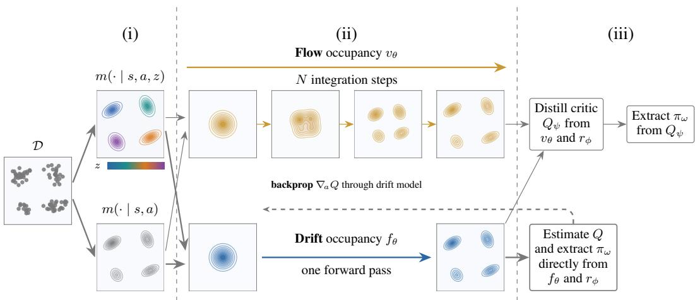  
Figure 1: A generative pipeline for unsupervised RL. Starting from an unlabeled dataset D, the occupancy can be modeled in a conditional or unconditional fashion (i). Independently of this choice, the occupancy can be learned through flow matching or drifting (ii). In both cases, the policy can be extracted in a two-step process, but drifting also allows for direct policy extraction (iii). We study all combinations of these choices, and recommend those marked by a bold arrow.

In this work, we revisit this generative pipeline for unsupervised RL, and isolate three design choices that are central to occupancy modeling and policy extraction (see Figure 1):

(i) Target. The occupancy can be modeled in a conditional fashion, by inferring the diverse modes (or intentions) the data displays (Ghosh et al., 2023), or simply in a marginal fashion. We show how each target supports different policy improvement operators, and compare both empirically.

(ii) Model class. Flow matching (Lipman et al., 2023; 2024) is expressive, but requires costly integration at inference. We instead investigate one-step generative modeling, focusing on drifting models (Deng et al., 2026). Building on this framework, we introduce a temporal difference occupancy modeling objective, which we refer to as TD-Drift.

(iii) Policy extraction. A one-step model is cheap to differentiate, which allows extracting a policy directly from deep value gradients through the occupancy model. We compare this simple technique with the existing two-step pipeline involving critic distillation (Zheng et al., 2026).

We systematically evaluate these design choices on four domains of the DeepMind Control Suite (Tassa et al., 2018) with reward-free ExORL data (Yarats et al., 2022). We find that (1) drifting occupancy models are competitive with flow occupancy models at a fraction of the sampling cost, (2) intention conditioning pays off, but is not strictly necessary, and (3) the direct policy extraction procedure enabled by one-step generative modeling is not only simpler, but also outperforms critic-based policy extraction. Composing these findings, we propose a practical method for unsupervised RL that models the occupancy through drifting, potentially conditioned on intentions, and extracts policies directly.

In summary, our contributions are threefold: we study the essential components of the generative occupancy pipeline and offer new alternatives, we introduce a temporal-difference objective for drifting occupancy models, and we propose a simple, practical recipe based on drifting and direct policy extraction.

## 2 RELATED WORK

Generative modeling in RL Several entities in RL, including transition kernels, policies (Sutton & Barto, 2018), and returns (Bellemare et al., 2017), are often stochastic in nature. In deep RL, distributions are traditionally approximated with simple families such as Gaussian policies (Haarnoja et al., 2018; Hafner et al., 2020; Fujimoto & Gu, 2021). Expressive generative models, on the other hand, especially diffusion and flow matching (Sohl-Dickstein et al., 2015; Ho et al., 2020; Song et al., 2021; Lipman et al., 2023; Liu et al., 2023), can now replace estimates with their diffusionbased counterparts (Chi et al., 2023; Ding & Jin, 2024; Park et al., 2025; Dong et al., 2026). In model-based RL, generative transition models are unrolled for planning or imagined policy learning (Heess et al., 2015; Hafner et al., 2020; Janner et al., 2022), up to action-conditioned video simulators (Yang et al., 2024; Bruce et al., 2024; Alonso et al., 2024), but autoregressive rollouts compound errors over the horizon (Talvitie, 2014). Occupancy models — the object of this work — avoid this by predicting the discounted distribution of future states directly (Janner et al., 2020), at the cost of losing awareness of the time step at which a state is reached. Despite the expressive power of flow models, their iterative sampling makes differentiation through the sampler costly and unstable (Park et al., 2025). Since many applications, such as policy optimization via deep policy gradients, require differentiation, several workarounds have been proposed, often involving some form of distillation (Park et al., 2025; Zheng et al., 2026).

One-step generative models Reducing the number of network evaluations of diffusion and flow models is an active line of research: via straighter probability paths (Liu et al., 2023), consistency and shortcut models (Song et al., 2023; Frans et al., 2025), or mean and terminal velocities (Geng et al., 2025; Zhou et al., 2025). Drifting models (Deng et al., 2026) take a different route: they are one-step by construction and move the iterative transport from inference into training, by minimizing a kernel-based discrepancy between generated and data samples. We present other related works and discuss similarities in Appendix A.

Unsupervised pre-training and occupancy models Reward-free offline data (Yarats et al., 2022; Levine et al., 2020) enables pre-training that is later adapted once rewards are revealed (Ghosh et al., 2023; Park et al., 2024b; Zheng et al., 2026; Bagatella et al., 2025), e.g. via skill discovery (Eysenbach et al., 2019; Park et al., 2024c) or behavior foundation models for zero-shot RL (Touati & Ollivier, 2021; Touati et al., 2023; Tirinzoni et al., 2025; Di Ventura et al., 2025; Urp´ı et al., 2025; Hu et al., 2026). A central object is the successor representation (Dayan, 1993; Barreto et al., 2017) and its continuous counterpart, the occupancy or successor measure (Blier et al., 2021), on which we further comment in Appendix A.

## 3 BACKGROUND

Markov decision processes We consider a reward-free Markov decision process (MDP) $\mathcal { M } = ( \mathcal { S } , \mathcal { A } , p , \gamma , \mu _ { 0 } )$ with state space $s ,$ action space ${ \mathcal { A } } ,$ transition kernel $p ( s ^ { \prime } \mid s , a )$ , discount factor $\gamma \in [ 0 , 1 )$ and initial state distribution $\mu _ { 0 } . \mathrm { { A } }$ policy $\pi ( \cdot \mid s )$ is a conditional distribution over actions given a state. We consider a task to be specified by a reward function $r : { \mathcal { S } }  \mathbb { R }$ , turning M into a standard MDP $\mathcal { M } _ { r } = ( \mathcal { S } , \mathcal { A } , p , \gamma , r , \bar { \mu _ { 0 } } )$ . The goal of RL is to find a policy that maximizes the expected discounted cumulative reward $\begin{array} { r } { J ( \pi ) = \mathbb { E } _ { \pi } \left[ \sum _ { t = 0 } ^ { \infty } \gamma ^ { t } r ( s _ { t + 1 } ) \right] } \end{array}$ , where $s _ { 0 } \sim \mu _ { 0 }$ $s _ { t + 1 } \sim p ( \cdot \mid s _ { t } , a _ { t } )$ and $a _ { t } \sim \pi ( \cdot \mid s _ { t } )$

Occupancy models The occupancy (or successor measure) of a policy π is the discounted distribution over future states when starting in s, taking action a, and following π thereafter (Dayan, 1993; Blier et al., 2021):

$$
m ^ { \pi } ( S ^ { + } \mid s , a ) = ( 1 - \gamma ) \sum _ { t = 0 } ^ { \infty } \gamma ^ { t } \operatorname* { P r } ( S _ { t + 1 } \in S ^ { + } \mid S _ { 0 } = s , A _ { 0 } = a , \pi ) ,\tag{1}
$$

with $S ^ { + } \subseteq S$ and $\operatorname* { P r } ( S _ { t + 1 } \in S ^ { + } \ | \ S _ { 0 } , A _ { 0 } , \pi )$ as the probability of reaching a state in $S ^ { + }$ at step $t + 1$ . The occupancy satisfies a Bellman equation (Janner et al., 2020):

$$
\begin{array} { r } { m ^ { \pi } ( \cdot \mid s , a ) = \left( 1 - \gamma \right) p ( \cdot \mid s , a ) + \gamma \mathbb { E } _ { s ^ { \prime } \sim p \left( \cdot \mid s , a \right) , a ^ { \prime } \sim \pi \left( \cdot \mid s ^ { \prime } \right) } \left[ m ^ { \pi } ( \cdot \mid s ^ { \prime } , a ^ { \prime } ) \right] . } \end{array}\tag{2}
$$

Finally, the expected discounted sum of rewards collected from a given state and action and following policy π thereafter (i.e., the action-value function) can be expressed as

$$
Q _ { r } ^ { \pi } ( s , a ) = \frac { 1 } { 1 - \gamma } \mathbb { E } _ { s ^ { + } \sim m ^ { \pi } ( \cdot | s , a ) } \big [ r ( s ^ { + } ) \big ] ,\tag{3}
$$

which illustrates how the occupancy model enables evaluating π for arbitrary tasks.

Flow matching and drifting Flow matching (Lipman et al., 2023; Liu et al., 2023) learns a velocity field $v _ { \theta } ( x _ { t } , t )$ that transports noise $x _ { 0 } \sim \mathcal { N } ( 0 , \mathrm { I } )$ to data $x _ { 1 }$ by regressing onto $x _ { 1 } - x _ { 0 }$ at interpolants $x _ { t } = \left( 1 - t \right) x _ { 0 } + t x _ { 1 }$ . Samples are obtained by integrating the ODE $\dot { x } _ { t } = v _ { \theta } ( x _ { t } , t )$ from $t = 0 \mathrm { t o } t = 1$ , which requires many network evaluations. Drifting models (Deng et al., 2026), instead, train a one-step generator $f _ { \theta } : \epsilon \mapsto x , \epsilon \sim \mathcal { N } ( 0 , \mathrm { I } )$ , whose pushforward distribution qθ should match a target distribution $p .$ Generated samples x are moved by a drifting field $V _ { p , q }$ that attracts them towards positive samples $y ^ { + } \sim p$ and repels them from negative samples $y ^ { - } \sim q _ { \theta }$

$$
V _ { p , q } ( x ) = \underbrace { \frac { \mathbb { E } _ { y ^ { + } \sim p } \left[ k ( x , y ^ { + } ) \left( y ^ { + } - x \right) \right] } { \mathbb { E } _ { y ^ { + } \sim p } \left[ k ( x , y ^ { + } ) \right] } } _ { V _ { p } ^ { + } ( x ) } - \underbrace { \frac { \mathbb { E } _ { y ^ { - } \sim q _ { \theta } } \left[ k ( x , y ^ { - } ) \left( y ^ { - } - x \right) \right] } { \mathbb { E } _ { y ^ { - } \sim q _ { \theta } } \left[ k ( x , y ^ { - } ) \right] } } _ { V _ { q } ^ { - } ( x ) } ,\tag{4}
$$

with a kernel $k , { \mathrm { e . g . } }$ ., the exponential kernel $k ( x , y ) = \exp ( - \| x - y \| / \kappa )$ with temperature $\kappa .$ . The generator $f _ { \theta }$ is trained so its output is a self-consistent fixed point of the field $V _ { p , q } .$ , via

$$
\begin{array} { r } { \mathcal { L } _ { \mathrm { D r i f t } } ( \theta ) = \mathbb { E } _ { \epsilon \sim \mathcal { N } ( 0 , 1 ) } \Big [ \big \| f _ { \theta } ( \epsilon ) - \mathrm { s g } \big ( f _ { \theta } ( \epsilon ) + V _ { p , q } ( f _ { \theta } ( \epsilon ) ) \big ) \big \| ^ { 2 } \Big ] , } \end{array}\tag{5}
$$

where $\mathrm { s g }$ denotes the stop-gradient operator, such that $q _ { \theta } = p \Rightarrow \| V _ { p , q } \| = 0$

## 4 METHODS

We study a pipeline for unsupervised RL which operates in two stages following Zheng et al. (2026). During pre-training, a large reward-free dataset of transitions $\mathcal { D } \stackrel { \mathbf { \backslash } } { = } \{ ( s , a , s ^ { \prime } , \stackrel { \mathbf { \backslash } } { a ^ { \prime } } ) \}$ is available; we will fit several variants of occupancy models on $\mathcal { D }$ (see Section 4.2). During policy extraction, a reward-labeled dataset $\mathcal { D } _ { r } = \{ ( \bar { s } , a , \bar { r } ) \}$ from a downstream task is exposed, and we learn a rewardmaximizing policy $\pi _ { \omega }$ on top of the frozen occupancy model. In this phase, we fit a reward model $r _ { \phi } : S  \mathbb { R }$ on $\mathcal { D } _ { r }$ , and study different techniques to extract a policy (see Section 4.3).

We will focus on three design choices at the core of this pipeline: (i) what to $\hbar t -$ whether the different modes composing an occupancy are explicitly inferred and modeled (Section 4.1), (ii) how to fit it – the class of generative model used to represent the occupancy (Section 4.2), and (iii) how to extract a policy from the occupancy once a reward is provided (Section 4.3). For each of these decisions, we review existing solutions and present novel alternatives or simplifications.

## 4.1 CONDITIONAL OR UNCONDITIONAL MODELING

We model occupancies by learning a generative sampler $s ^ { + } \sim \hat { m } ^ { \pi } ( \cdot \mid s , a ) \approx m ^ { \pi } ( \cdot \mid s , a )$ . Here, the superscript π denotes the data-generating policy whose occupancy is modeled, i.e., the behavior policy $\pi _ { \beta }$ or an intention-conditioned policy $\pi _ { z } ,$ and not the extracted policy $\pi _ { \omega }$ . Occupancy models are often fitted on data collected by a mixture of policies. This raises a design choice: the degree to which the multimodal structure of the data must be captured by the occupancy model. Prior work has addressed this by learning occupancy models for a family of policies $\pi _ { z }$ indexed by a latent z (Barreto et al., 2017; Touati & Ollivier, 2021). InFOM (Zheng et al., 2026) infers intentions $z \sim p _ { e } ( \cdot \mid s ^ { \prime } , a ^ { \prime } )$ from consecutive transitions $( s , a , s ^ { \prime } , a ^ { \prime } )$ via a variational encoder, and predicts the occupancy measure of future states, $m ^ { \pi _ { z } } ( \cdot \ | \ s , a )$ , based on that intention. Importantly, the occupancy model and the intention encoder are optimized jointly via the following objective:

$$
\begin{array} { r } { \mathcal { L } _ { \mathrm { c o n d } } ( \theta , e ) = \mathcal { L } _ { \mathrm { F l o w } | \mathrm { D r i f t } } ^ { \pi _ { z } } ( \theta ) + \lambda _ { \mathrm { K L } } \mathbb { E } _ { ( s ^ { \prime } , a ^ { \prime } ) \sim \mathcal { D } } \big [ D _ { \mathrm { K L } } \big ( p _ { e } ( \cdot \mid s ^ { \prime } , a ^ { \prime } ) \| \mathcal { N } ( 0 , \mathbf { I } ) \big ) \big ] . } \end{array}\tag{6}
$$

Here, $z \sim p _ { e } ( \cdot \mid s ^ { \prime } , a ^ { \prime } )$ , and $\mathcal { L } _ { \mathrm { F l o w | D r i f t } } ^ { \pi _ { z } }$ denotes the occupancy model’s training loss, which takes a different form depending on the underlying generative model class, as described in Section 4.2.

Unconditional modeling We explore a simpler, unconditional alternative, which drops the encoder together with the KL term, and only minimizes $\mathcal { L } _ { \mathrm { F l o w | D r i f t } } ^ { \pi _ { \beta } } ( \theta )$ such that it fits the occupancy $m ^ { \pi _ { \beta } }$ of the marginal behavior policy $\pi _ { \beta }$ that generated the dataset D. Despite a conditional model being more expressive (and enabling a different form of policy extraction, as we will see in Section 4.3), jointly learning the occupancy model and a policy latent as in Equation 6 can be very challenging, since it adds complexity to the pipeline, and its benefits might be offset by poor inten tion inference.

## 4.2 MODEL CLASS

Occupancies in continuous spaces can be very complex, which calls for an expressive model class, such as flow-based generative models. TD-Flow (Farebrother et al., 2025; Zheng et al., 2026) proposes a training objective that enforces the Bellman equation (Equation 2) at the level of probability paths, mixing a next-state (Equation 8) and a bootstrap (Equation 9) regression term. Given a transition $( s , a , \bar { s ^ { \prime } } , a ^ { \prime } ) \sim \mathcal { D }$ , noise $\epsilon \sim \mathcal { N } ( 0 , \mathrm { I } )$ , and time $t \sim \mathcal { U } [ 0 , 1 ]$ , the next-state term regresses onto the straight path towards $s ^ { \prime } ,$ while the bootstrap term regresses onto the target velocity field $v _ { \bar { \theta } } ^ { \pi }$ at a future state $\bar { s } ^ { + } \sim \bar { m } ^ { \pi } ( \cdot \mid s ^ { \prime } , a ^ { \prime } )$ , obtained by integrating $v _ { \bar { \theta } } ^ { \pi }$ at the next state-action pair $( s ^ { \prime } , a ^ { \prime } )$

$$
\begin{array} { r } { \mathcal { L } _ { \mathrm { F l o w } } ^ { \pi } ( \theta ) = ( 1 - \gamma ) \mathcal { L } _ { \mathrm { n e x t } } ^ { \pi } ( \theta ) + \gamma \mathcal { L } _ { \mathrm { b o o t } } ^ { \pi } ( \theta ) , } \end{array}\tag{7}
$$

$$
\begin{array} { r } { \begin{array} { r } { \mathcal { L } _ { \mathrm { n e x t } } ^ { \pi } ( \theta ) = \mathbb { E } \Big [ \big \lVert v _ { \theta } ^ { \pi } \big ( x _ { t } , t \mid s , a \big ) - ( s ^ { \prime } - \epsilon ) \big \rVert ^ { 2 } \Big ] , } \end{array} } \end{array}
$$

$$
x _ { t } = ( 1 - t ) \epsilon + t s ^ { \prime }\tag{8}
$$

$$
\begin{array} { r } { \mathcal { L } _ { \mathrm { b o o t } } ^ { \pi } ( \theta ) = \mathbb { E } \Big [ \big \| v _ { \theta } ^ { \pi } \big ( \bar { x } _ { t } , t \mid s , a \big ) - \mathrm { s g } \big ( v _ { \theta } ^ { \pi } ( \bar { x } _ { t } , t \mid s ^ { \prime } , a ^ { \prime } ) \big ) \big \| ^ { 2 } \Big ] , \qquad \bar { x } _ { t } = ( 1 - t ) \epsilon + t \bar { s } ^ { + } } \end{array}\tag{9}
$$

Flow matching has proven very powerful and precise for generating individual samples, but sample quality depends on the number of integration steps, and thus on inference compute (Frans et al., 2025). In occupancy learning, this cost is paid twice: computing every bootstrap target $\bar { s } ^ { + }$ (used for training the occupancy model) and every Monte Carlo value estimate (used for policy extraction, see Section 4.3), both of which require a full ODE integration. Motivated by this limitation, we introduce a Bellman-consistent one-step sampler, which we call $T D { - } D r i f t$

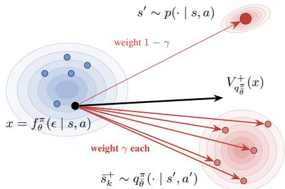  
Figure 2: Attracting TD-Drift field $\mathbf { V } _ { \mathbf { q } _ { \bar { a } } ^ { \pi } } ^ { + }$ . Each sample from the pushforward distribution (blue) is attracted with weight $1 - \gamma$ (light red) towards the next state $s ^ { \prime } .$ , while the attraction towards the bootstrap samples $\bar { s } ^ { + }$ (bold red) is weighted with $\gamma$

TD-Drift We build on drifting (Equations 4 and 5) with a conditional generator $f _ { \theta } ^ { \pi } ( \epsilon \mid s , a )$ whose pushforward distribution $q _ { \theta } ^ { \pi } ( \cdot \mid s , a )$ approximates $m ^ { \pi } ( \cdot \mid s , a )$ . Drifting requires samples from the target distribution – in this case,

the measure $m ^ { \pi }$ . Based on the ideas from Farebrother et al. (2025); Zheng et al. (2026), on the Bellman equation $( 2 )$ , and on temporal difference learning, we instantiate a training objective for drifting occupancy models. We write $m ^ { \pi }$ at $( s , a )$ as a mixture between the next state distribution $p ,$ and the measure at the next state, in practice estimated through $q _ { \theta } ^ { \pi }$ , a target copy of the model:

$$
m ^ { \pi } ( \cdot \mid s , a ) \approx \left( 1 - \gamma \right) p ( \cdot \mid s , a ) + \gamma \mathbb { E } _ { s ^ { \prime } \sim p \left( \cdot \mid s , a \right) , a ^ { \prime } \sim \pi \left( \cdot \mid s ^ { \prime } \right) } \left[ q _ { \bar { \theta } } ^ { \pi } ( \cdot \mid s ^ { \prime } , a ^ { \prime } ) \right] .\tag{10}
$$

By linearity of expectation, the attraction field in Equation 4 towards this mixture becomes:

$$
V _ { q _ { \theta } ^ { \pi } } ^ { + } ( x ) = \frac { ( 1 - \gamma ) \mathbb { E } _ { s ^ { \prime } } \left[ k ( x , s ^ { \prime } ) ( s ^ { \prime } - x ) \right] + \gamma \mathbb { E } _ { \bar { s } ^ { + } , s ^ { \prime } , a ^ { \prime } } \left[ k ( x , \bar { s } ^ { + } ) ( \bar { s } ^ { + } - x ) \right] } { ( 1 - \gamma ) \mathbb { E } _ { s ^ { \prime } } \left[ k ( x , s ^ { \prime } ) \right] + \gamma \mathbb { E } _ { \bar { s } ^ { + } , s ^ { \prime } , a ^ { \prime } } \left[ k ( x , \bar { s } ^ { + } ) \right] } ,\tag{11}
$$

with $s ^ { \prime } \sim p ( \cdot \mid s , a )$ and $\bar { s } ^ { + } \sim q _ { \bar { \theta } } ^ { \pi } ( \cdot \mid s ^ { \prime } , a ^ { \prime } ) , a ^ { \prime } \sim \pi ( \cdot \mid s ^ { \prime } )$ . See Section D for more details.

Inserting the resulting field into Equation 5 yields the TD-Drift loss for policy $\pi ,$

$$
\mathcal { L } _ { \mathrm { D r i f t } } ^ { \pi } ( \theta ) = \mathbb { E } _ { ( s , a , s ^ { \prime } , a ^ { \prime } ) \sim \mathcal { D } , x \sim q _ { \theta } ^ { \pi } ( \cdot \vert s , a ) } \Big [ \big \| x - \mathrm { s g } \big ( x + V _ { q _ { \theta } ^ { \pi } } ^ { + } ( x ) - V _ { q } ^ { - } ( x ) \big ) \big \| ^ { 2 } \Big ] ,\tag{12}
$$

which plays the same role as $\mathcal { L } _ { \mathrm { F l o w } } ^ { \pi }$ in Equation 7. We visually describe the attractive component of this objective in Figure 2. In contrast to TD-Flow, TD-Drift generates bootstrap samples from the estimated measure at the next state, required in Equation 11, with a single forward pass of the target network.

## 4.3 POLICY EXTRACTION

The third design choice we explore concerns policy extraction, once a reward-labeled dataset is available. The implementation of this step depends predominantly on the multimodality of the modeled occupancy (Section 4.1) and on the generative model class used to fit it (Section 4.2). We first address the case of more general conditional occupancy models, and later describe a lighter unconditional variant.

A conditional model estimates a family of occupancies, allowing for policy extraction via generalized policy improvement (GPI) (Barreto et al., 2017). Intuitively, GPI optimizes not only over actions but also over intentions, i.e., arg max $\phantom { } _ { v } \mathbb { E } _ { a \sim \pi _ { \omega } ( \cdot | s ) } \operatorname* { m a x } _ { z } Q _ { z } ( s , a )$ , where each intentionconditioned value (Equation 3) can be estimated by Monte Carlo (MC) via:

$$
\hat { Q } _ { z } ( s , a ) = \frac { 1 } { ( 1 - \gamma ) N } \sum _ { i = 1 } ^ { N } r _ { \phi } ( s _ { i } ^ { + } ) , \quad s _ { i } ^ { + } \sim \hat { m } ^ { \pi _ { z } } ( \cdot \mid s , a ) .\tag{13}
$$

InFOM first distills these estimates into an explicit critic $Q _ { \psi }$ via:

$$
\mathcal { L } _ { Q } ( \psi ) = \mathbb { E } _ { ( s , a ) \sim \mathcal { D } _ { r } , z \sim p ( z ) } \Big [ \ell _ { 2 } ^ { \tau } \Big ( \hat { Q } _ { z } ( s , a ) - Q _ { \psi } ( s , a ) \Big ) \Big ] ,\tag{14}
$$

where $p ( z ) = \mathcal { N } ( 0 , \mathrm { I } )$ , and the expectile loss $\ell _ { 2 } ^ { \tau } ( u ) = | \tau - { \bf 1 } ( u < 0 ) | u ^ { 2 }$ (Kostrikov et al., 2021) with $\tau \in ( \mathrm { 0 . 5 , 1 } )$ regresses $Q _ { \psi }$ towards an upper expectile over intentions, implicitly approximating the maximum over z. The policy $\pi _ { \omega }$ is then extracted with a behavior-regularized DDPG-BC objective (Fujimoto & Gu, 2021), $\dot { \mathcal { L } } _ { \pi } ( \omega ) = \mathbb { E } _ { ( s , a ) \sim \mathcal { D } _ { r } , \hat { a } \sim \pi _ { \omega } ( \cdot \vert s ) } \big [ - Q _ { \psi } ( s , \hat { a } ) - \alpha \log \pi _ { \omega } ( a \mid s ) \big ]$ with BC weight $\alpha ,$ following the action gradient $\dot { \nabla } _ { a } Q _ { \psi } ( s , a )$ through the distilled critic (see Appendix D for more details). Crucially, this two-step procedure avoids backpropagating through the occupancy model, which is expensive and reported to be unstable for flow-based models (Zheng et al., 2026).

In contrast to flow-based models, drifting models generate samples with a single forward pass. We hypothesize that their gradients with respect to the action are informative enough to extract a policy directly, and hence propose a novel policy extraction method that circumvents the need to train an additional critic network.

Direct extraction With drifting models, future states in Equation 13 are sampled as $s _ { i } ^ { + } = f _ { \theta } ( \epsilon _ { i } \mid s , a , z )$ with $\epsilon _ { i } \sim \mathcal { N } ( 0 , \mathrm { I } )$ , so the MC estimate is itself differentiable with respect to the action. Instead of approximating the maximum over intentions implicitly, we perform a zero-order search over a finite set of M candidate intentions, i.e., $\begin{array} { r } { , z ^ { * } ( s , a ) = \arg \operatorname* { m a x } _ { z \in \{ z _ { 1 } , \dots , z _ { M } \} } \hat { Q } _ { z } ( s , a ) } \end{array}$ where $z _ { m } \sim \mathcal { N } ( 0 , \mathrm { I } )$ . Treating $z ^ { * }$ as fixed, the action gradient $\nabla _ { a } \hat { Q }$ follows from the chain rule, composing the gradient of the reward model $r _ { \phi }$ with the Jacobian of the generator $f _ { \boldsymbol { \theta } } { : }$

$$
\nabla _ { a } \hat { Q } _ { z ^ { * } } ( s , a ) = \frac { 1 } { 1 - \gamma } \frac { 1 } { N } \sum _ { i = 1 } ^ { N } \frac { \partial r _ { \phi } ( s _ { i } ^ { + } ) } { \partial s _ { i } ^ { + } } \frac { \partial f _ { \theta } ( \epsilon _ { i } \mid s , a , z ^ { * } ) } { \partial a } .\tag{15}
$$

This gradient replaces $\nabla _ { a } Q _ { \psi }$ in the DDPG-BC objective of $\pi _ { \omega }$ , removing the need for a distilled critic. Optimizing the intention with first-order methods would also be a viable approach, but we do not consider it in this work.

A note on unconditional extraction While we have described extraction for conditional occupancy models, unconditional variants yield an even lighter pipeline, since no optimization over intentions is needed. In this case, GPI reduces to a single step of policy improvement of the behavior value function (Brandfonbrener et al., 2021). For critic distillation, the expectile loss in Equation 14 simplifies to standard MSE $( \tau = 0 . 5 )$ , while for direct policy extraction, no search is needed and Equation 15 is used as is, with the dependence on z dropped.

## 5 EXPERIMENTS

Methods Crossing the three decisions of Section 4 yields six variants of occupancy modeling (OM) depending (i) on whether they are conditioned on Intentions or not, (ii) on the model (Flow or Drift), and (iii) on whether policy extraction is Direct: InFOM, FOM, InDOM, DOM, InDOM-Direct and DOM-Direct. We do not consider direct extraction for flow models, since it would require differentiating through the ODE solver. The first and the second combinations (InFOM and FOM) recover methods introduced by Zheng et al. (2026), while the remaining ones are novel instantiations. All share the same reward and policy model, so they differ only in the studied components;

the hyperparameter tuning protocol is reported in Appendix C. As references, we also report behavior cloning (BC) as a lower bound, and forward-backward representations (FB) (Touati et al., 2023) rerun from Bagatella et al. (2025), which operate in different frameworks and are therefore shown in gray.

Domains, data and protocol We evaluate on four domains of the DeepMind Control Suite (Tassa et al., 2018): cheetah, walker, quadruped, and jaco, each spanning four tasks that share dynamics and differ only in the reward. We will largely report performance averaged over the tasks, and refer to Table 2 for detailed results. Following Zheng et al. (2026), occupancy models are pretrained on a reward-free exploratory dataset with 1M transitions from ExORL (Yarats et al., 2022), gathered by random network distillation (Burda et al., 2019). The occupancy model is then frozen, and the policy is extracted on a reward-labeled dataset with 500K transitions of the same domain. We report the undiscounted episode return of the extracted policy averaged over 50 evaluation episodes and four tasks, as mean ± standard error (s.e.m.) over five independent seeds unless stated otherwise (see Appendix C.1).

We will first seek a direct empirical answer to the three design choices we highlighted in Section 4, and then provide a broader comparison between the best recipe and existing methods, and ablate its most important components.

## 5.1 IS DRIFTING AN EFFECTIVE SOLUTION TO OCCUPANCY MODELING?

Figure 3 compares an existing, flow-based pipeline (InFOM) with a variant that replaces the occupancy model with one based on drifting (InDOM), adopting the training objective we derived in Section 4.2. Both are conditional and extract a policy from a distilled critic, so that they differ only in the generative model. Overall, InDOM outperforms InFOM, particularly on quadruped, where the flow model is also markedly less stable across seeds. In-FOM remains ahead in jaco. Averaged over the four domains, InDOM reaches an improvement of 14%: drifting is thus a competitive replacement for flow matching as an occupancy

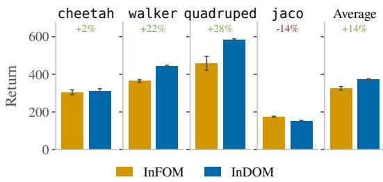  
Figure 3: Drifting vs. flow matching. Return of InFOM and InDOM per domain (mean ± s.e.m.). The percentage is the performance difference of InDOM relative to InFOM.

model, while requiring a single network evaluation per generation instead of an ODE integration (see Figure 7 for a wall-clock comparison).

## 5.2 IS CONDITIONAL OCCUPANCY MODELING NECESSARY?

The degree to which different intentions can be modeled is governed by the weight $\lambda _ { \mathrm { K L } }$ of the KL term that regularizes the intention posterior towards its prior (see Equation 6). Sweeping its values in Figure 4, we observe that in every domain the return of InDOM grows with $\lambda _ { \mathrm { K L } }$ . Modeling a conditional occupancy is therefore not free: an under-regularized intention encoder, which in principle should extract more expressive intentions, in practice actively harms the downstream policy.

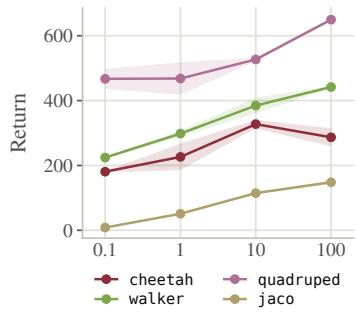

A latent that is pushed this close to its prior invites the hypothesis that it carries almost no information at all, such that an unconditional model should do at least as well. Figure 5 hints that this may often be the case: at its best KL weight, conditioning on intentions can still raise performance for both InFOM and InDOM, but unconditional variants (FOM and DOM) are overall competitive. While intention modeling can be beneficial, performance gains are modest, require a carefully

Figure 4: KL weight of the intention encoder. Return of InDOM over the KL weight. Each sweep uses a fixed configuration per domain. (mean ± s.e.m. over three random seeds).

tuned KL regularization, and the instantiation of an additional encoder, as discussed in Section 4.1.

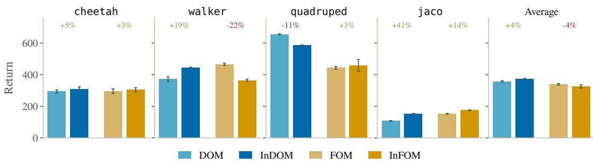  
Figure 5: Effect of intention conditioning. Return with and without intention conditioning for the drift (DOM, InDOM) and the flow (FOM, InFOM) occupancy models. The percentage is the change in performance due to conditional measure modeling. (mean ± s.e.m.)

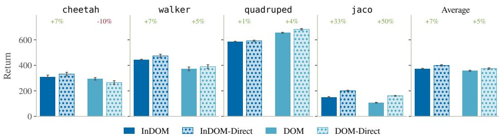  
Figure 6: Critic-based vs. direct extraction. Return of InDOM and DOM with policy extraction through a distilled critic and direct policy extraction. The percentage is the performance change of direct policy extraction over extraction from a distilled critic. $( \mathrm { m e a n } \pm \mathrm { s . e . m . } )$

## 5.3 IS DIRECT POLICY EXTRACTION COMPETITIVE?

Since a drift model generates future states in a single forward pass, gradients from the Monte Carlo value estimates should be informative and therefore make direct policy extraction, without training a critic (Equation 15), possible. Figure 6 compares both routes for InDOM and DOM. We find that direct extraction not only simplifies the occupancy modeling pipeline (removing the need for critic distillation), but it also matches or improves over critic-based extraction in seven of eight settings, by up to 50%.

## 5.4 IS POLICY EXTRACTION VIA DRIFT OCCUPANCIES MORE EFFICIENT?

Drifting is by design a single neural-function-evaluation (NFE) sampler. Since we compare it throughout this work with a flowbased sampler, which uses 10 integration steps, we also benchmark both approaches with respect to their inference cost (over 500K steps) and report results in Figure 7. Flow-based methods are expensive, especially due to critic distillation, which requires sampling through the ODE solver for every target critic sample (see Equation 13). InFOM and FOM methods incur the same cost, since they extract the policy through a similar distilled critic, and intention conditioning does not add overhead during this process. Drifting models are generally cheaper: for InDOM and DOM, critic distillation is cheaper, as it only requires a single NFE to compute targets. Finally, InDOM-Direct and DOM-Direct are even faster, as they do not need to distill a critic at all, yielding a speedup of 2.4× over (In)FOM. On top of this, we find that the cost of zero-order optimization over intentions required by InDOM-Direct is almost negligible.

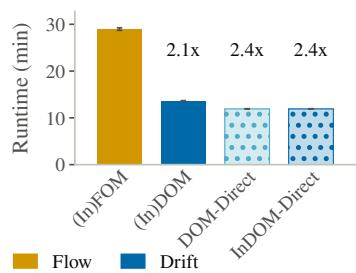  
Figure 7: Wall-clock time for policy extraction. Extrapolated: 10K to 500K steps. (mean ± s.e.m.).

Table 1: Comparison with existing methods. Four-task mean return per domain (mean $\pm \ \mathrm { s . e . m . }$ over five pre-training seeds), each method at its best discount and configuration per domain. FB are rerun using the codebase of Bagatella et al. (2025). Per-task numbers and the remaining variants are in Table 2.
<table><tr><td>Environment</td><td>BC</td><td>FB</td><td>InFOM</td><td>DOM-Direct</td><td>InDOM-Direct</td></tr><tr><td>cheetah</td><td> $1 4 2 \pm 2$ </td><td> $6 3 1 \pm 1 6$ </td><td> $3 0 5 \pm { } 1 3$ </td><td> $2 6 6 \pm 1 4$ </td><td> ${ \bf 3 3 1 \pm 1 4 }$ </td></tr><tr><td>walker</td><td> $2 3 2 \pm 2$ </td><td> $7 8 0 \pm { \mathrm { 1 2 } }$ </td><td> $3 6 4 \pm { } 7$ </td><td> $3 9 0 \pm { } 1 5$ </td><td> ${ \bf 4 7 4 \pm 1 3 }$ </td></tr><tr><td>quadruped</td><td> $5 0 1 \pm 3$ </td><td> $6 0 1 \pm 1 8$ </td><td> $4 5 8 \pm 3 7$ </td><td> ${ \bf 6 8 2 \pm 6 }$ </td><td> $5 9 2 \pm 6$ </td></tr><tr><td>jaco</td><td> $3 \pm { } 1$ </td><td> $2 \pm { } 1$ </td><td> $1 7 5 \pm 3$ </td><td> $1 6 1 \pm 3$ </td><td> ${ \bf 2 0 1 \pm 5 }$ </td></tr><tr><td>Mean</td><td>220</td><td>503</td><td>326</td><td>375</td><td>400</td></tr></table>

## 5.5 WHAT MATTERS FOR OCCUPANCY MODELING AND DOWNSTREAM POLICYEXTRACTION?

Previous evaluations hinted that the choice of generative model and extraction method matters; modeling intentions does too, albeit to a lesser extent. We thus highlight two recipes and compare them with existing methods in Table 1. Both InDOM-Direct and DOM-Direct simplify the occupancy modeling pipeline by fitting a drifting model through which the policy is extracted directly. They thus remove the need for a critic; DOM-Direct also needs no intention encoder, no KL weight, and no optimization over latent candidates. DOM-Direct outperforms InFOM on quadruped and walker, and stays close on cheetah and jaco, on average scoring 375 against 326. Adding intentions back, InDOM-Direct is the strongest variant overall. All occupancy-based methods clearly exceed behavior cloning, while FB, which does not rely on generative modeling and adopts a fundamentally different approach, remains stronger on cheetah and walker but falls behind on quadruped and jaco.

## 6 DISCUSSION

The combination of occupancy modeling with downstream policy extraction constitutes a promising technique for unsupervised RL. We decompose this recipe along three axes: what is modeled (con ditional or marginal occupancies), how it is modeled (iterative or one-step generative models), and how a policy is extracted (via a distilled critic or directly). We propose simpler alternatives to prior choices on each axis and introduce TD-Drift, a temporal difference objective for drifting models of occupancies, which allows direct policy extraction. When tested across several domains, method based on TD-Drift outperform the existing flow-based pipeline while being conceptually simpler and computationally more efficient.

Limitations Our move towards drifting trades cheaper inference for more training compute: distributional distances based on samples (drift) are generally more expensive than matching vector fields (flow). Our method thus requires a longer pre-training phase for learning the occupancy model. However, this cost is paid offline and amortized over all downstream tasks. In exchange, our method is more efficient when it matters most, at inference time.

As we followed the standard benchmark procedure for unsupervised reinforcement learning, we focused on datasets collected through self-supervised exploration, and we did not evaluate other sources of data, such as expert demonstrations. Finally, we measured whether intentions help but did not inspect what the intention manifold encodes, which leaves the question of the reason for the performance gap open.

Future work Our pipeline evaluated a two-step policy extraction technique based on critic distillation, and a simple, direct policy extraction objective. These are, in practice, two ends of a spectrum of methods for policy optimization from a learned occupancy: first-order and zero-order approaches can be instantiated and combined to further improve policy learning. More generally, investigating the scalability of drifting-based occupancy modeling by defining kernels in latent space is an interesting direction, as demonstrated in image generation (Deng et al., 2026). Learning the latent space in which this should occur is even more exciting.

Acknoledgements We would like to thank the members of the Autonomous Learning Group for the many thoughtful discussions that shaped this work Nuria Armengol Urpi and Marco Bagatella ´ are supported by the Max Planck ETH Center for Learning Systems. Georg Martius is a member of the Machine Learning Cluster of Excellence, EXC number 2064/1 – Project number 390727645.

Reproducibility statement To ensure reproducibility of our results, we make our code publicly available on our website. We additionally provide all relevant hyperparameters, details for training and evaluating each method, and access to external data sources in Section 5 and Appendix C to D.

Ethics statement Our work adheres to the ICLR Code of Ethics. It does not involve human subjects, and it raises no privacy, security, or other ethical concerns that we are aware of. Our work does focus on reinforcement learning for embodied control, and we recognize that autonomous robotic systems could be deployed in harmful applications. However, our contributions are fundamental and algorithmic in nature, and they do not directly target any specific negative use case.

AI disclosure In this work, we used generative AI tools for refining hypotheses, providing feedback on research methodology and experiments, and coding assistance for implementing the methods. We did not use generative AI tools for generating synthetic datasets, developing theoretical models or conceptual frameworks, formulating or proving mathematical claims or proofs, providing critical ingredients for proving mathematical claims, assisting in the writing of proofs, proposing hypotheses, designing research methodology or experiments, cleaning or reformatting datasets, supporting qualitative or thematic data analysis, or interpreting results. Our work does not involve translation, transcription, surveys, or interviews.

We also used AI tools to format scientific figures and images (but not to generate their content), edit software code, improve the readability of the text, analyze existing literature, discover research topics, and identify research gaps and relevant literature.

We have thoroughly reviewed all LLM-generated text and code, and adapted it when necessary. The authors take full responsibility for the final content of this work, including any text, claims, or artifacts produced with the aid of generative AI.

## REFERENCES

Siddhant Agarwal, Harshit Sikchi, Peter Stone, and Amy Zhang. Proto successor measure: Representing the behavior space of an rl agent. In Proceedings ofthe 42nd International Conference on Machine Learning (ICML), 2025. URL https://arxiv.org/abs/2411.19418.

Eloi Alonso, Adam Jelley, Vincent Micheli, Anssi Kanervisto, Amos Storkey, Tim Pearce, and Franc¸ois Fleuret. Diffusion for world modeling: Visual details matter in atari. In Advances in Neural Information Processing Systems, 2024.

Marco Bagatella, Matteo Pirotta, Ahmed Touati, Alessandro Lazaric, and Andrea Tirinzoni. TD-JEPA: Latent-predictive representations for zero-shot reinforcement learning. arXiv preprint, 2025. URL https://arxiv.org/abs/2510.00739.

Andre Barreto, Will Dabney, R´ emi Munos, Jonathan J Hunt, Tom Schaul, Hado P van Has-´ selt, and David Silver. Successor features for transfer in reinforcement learning. In Advances in Neural Information Processing Systems 30, pp. 4055–4065. Curran Associates, Inc., 2017. URL https://proceedings.neurips.cc/paper/2017/hash/ 350db081a661525235354dd3e19b8c05-Abstract.html.

Marc G. Bellemare, Will Dabney, and Remi Munos. A distributional perspective on reinforcement´ learning. In Proceedings of the 34th International Conference on Machine Learning (ICML), 2017.

Leonard Blier, Corentin Tallec, and Yann Ollivier. Learning successor states and goal-dependent´ values: A mathematical viewpoint. arXiv preprint, 2021. URL https://arxiv.org/abs/ 2101.07123.

David Brandfonbrener, William F. Whitney, Rajesh Ranganath, and Joan Bruna. Offline RL without off-policy evaluation. In Advances in Neural Information Processing Systems, 2021.

Jake Bruce, Michael Dennis, Ashley Edwards, Jack Parker-Holder, et al. Genie: Generative interactive environments. In Proceedings of the 41st International Conference on Machine Learning (ICML), 2024.

Yuri Burda, Harrison Edwards, Amos Storkey, and Oleg Klimov. Exploration by random net work distillation. In International Conference on Learning Representations (ICLR), 2019. URL https://arxiv.org/abs/1810.12894.

Cheng Chi, Siyuan Feng, Yilun Du, Zhenjia Xu, Eric Cousineau, Benjamin Burchfiel, and Shuran Song. Diffusion policy: Visuomotor policy learning via action diffusion. In Robotics: Science and Systems (RSS), 2023.

Peter Dayan. Improving generalization for temporal difference learning: The successor representation. Neural Computation, 5(4):613–624, 1993. URL https://direct.mit.edu/neco/article/5/4/613/5736/ Improving-Generalization-for-Temporal-Difference.

Mingyang Deng, He Li, Tianhong Li, Yilun Du, and Kaiming He. Generative modeling via drifting. arXiv preprint, 2026. URL https://arxiv.org/abs/2602.04770.

Jacopo Di Ventura, Jan Felix Kleuker, Aske Plaat, and Thomas Moerland. A unified framework for zero-shot reinforcement learning. arXiv preprint, 2025. URL https://arxiv.org/abs/ 2510.20542.

Zihan Ding and Chi Jin. Consistency models as a rich and efficient policy class for reinforcement learning. In International Conference on Learning Representations (ICLR), 2024.

Perry Dong, Chongyi Zheng, Chelsea Finn, Dorsa Sadigh, and Benjamin Eysenbach. Value flows. In International Conference on Learning Representations (ICLR), 2026. URL https://arxiv. org/abs/2510.07650.

Benjamin Eysenbach, Abhishek Gupta, Julian Ibarz, and Sergey Levine. Diversity is all you need: Learning skills without a reward function. In International Conference on Learning Representations (ICLR), 2019. URL https://arxiv.org/abs/1802.06070.

Benjamin Eysenbach, Ruslan Salakhutdinov, and Sergey Levine. C-learning: Learning to achieve goals via recursive classification. In International Conference on Learning Representations (ICLR), 2021. URL https://arxiv.org/abs/2011.08909.

Benjamin Eysenbach, Tianjun Zhang, Sergey Levine, and Ruslan Salakhutdinov. Contrastive learning as goal-conditioned reinforcement learning. In Advances in Neural Information Processing Systems, 2022. URL https://arxiv.org/abs/2206.07568.

Jesse Farebrother, Matteo Pirotta, Andrea Tirinzoni, Remi Munos, Alessandro Lazaric, and Ahmed´ Touati. Temporal difference flows. In Proceedings of the 42nd International Conference on Machine Learning (ICML), 2025. URL https://arxiv.org/abs/2503.09817.

Jesse Farebrother, Matteo Pirotta, Andrea Tirinzoni, Marc G. Bellemare, Alessandro Lazaric, and Ahmed Touati. Compositional planning with jumpy world models. arXiv preprint, 2026. URL https://arxiv.org/abs/2602.19634.

Kevin Frans, Danijar Hafner, Sergey Levine, and Pieter Abbeel. One step diffusion via shortcut models. In International Conference on Learning Representations (ICLR), 2025. URL https: //arxiv.org/abs/2410.12557.

Scott Fujimoto and Shixiang Shane Gu. A minimalist approach to offline reinforcement learning. In Advances in Neural Information Processing Systems, 2021. URL https://arxiv.org/ abs/2106.06860.

Yuxuan Gao, Yedong Shen, Shiqi Zhang, Wenhao Yu, Yifan Duan, Jia Pan, Jiajia Wu, Jiajun Deng, and Yanyong Zhang. Drift-based policy optimization: Native one-step policy learning for online robot control. arXiv preprint arXiv:2604.03540, 2026.

Zhengyang Geng, Mingyang Deng, Xingjian Bai, J. Zico Kolter, and Kaiming He. Mean flows for one-step generative modeling. In Advances in Neural Information Processing Systems, 2025. URL https://arxiv.org/abs/2505.13447.

Dibya Ghosh, Chethan Bhateja, and Sergey Levine. Reinforcement learning from passive data via latent intentions. In Proceedings of the 40th International Conference on Machine Learning (ICML), 2023.

Tuomas Haarnoja, Aurick Zhou, Pieter Abbeel, and Sergey Levine. Soft actor-critic: Off-policy maximum entropy deep reinforcement learning with a stochastic actor. In Proceedings ofthe 35th International Conference on Machine Learning (ICML), 2018.

Danijar Hafner, Timothy Lillicrap, Jimmy Ba, and Mohammad Norouzi. Dream to control: Learning behaviors by latent imagination. In International Conference on Learning Representations (ICLR), 2020. URL https://arxiv.org/abs/1912.01603.

Nicolas Heess, Gregory Wayne, David Silver, Timothy Lillicrap, Tom Erez, and Yuval Tassa. Learning continuous control policies by stochastic value gradients. In Advances in Neural Information Processing Systems, 2015. URL https://arxiv.org/abs/1510.09142.

Jonathan Ho, Ajay Jain, and Pieter Abbeel. Denoising diffusion probabilistic models. In Advances in Neural Information Processing Systems, 2020.

Anas Houssaini, Mohamad H. Danesh, Amin Abyaneh, Scott Fujimoto, Hsiu-Chin Lin, and David Meger. Drift Q-learning. arXiv preprint arXiv:2606.00350, 2026.

Jiajun Hu, Nuria Armengol Urp ´ ´ı, Jin Cheng, and Stelian Coros. Maximum entropy behavior exploration for sim2real zero-shot reinforcement learning. Reinforcement Learning Journal, 7, 2026.

Michael Janner, Igor Mordatch, and Sergey Levine. Generative temporal difference learning for infinite-horizon prediction. In Advances in Neural Information Processing Systems, 2020. URL https://arxiv.org/abs/2010.14496.

Michael Janner, Yilun Du, Joshua Tenenbaum, and Sergey Levine. Planning with diffusion for flexible behavior synthesis. In Proceedings of the 39th International Conference on Machine Learning (ICML), 2022.

Juil Koo, Mingue Park, Jiwon Choi, Yunhong Min, and Minhyuk Sung. Drifting field policy: A onestep generative policy via Wasserstein gradient flow. arXiv preprint arXiv:2605.07727, 2026.

Ilya Kostrikov, Ashvin Nair, and Sergey Levine. Offline reinforcement learning with implicit qlearning. In International Conference on Learning Representations (ICLR), 2021. URL https: //arxiv.org/abs/2110.06169.

Aviral Kumar, Aurick Zhou, George Tucker, and Sergey Levine. Conservative Q-learning for offline reinforcement learning. In Advances in Neural Information Processing Systems, 2020.

Sergey Levine, Aviral Kumar, George Tucker, and Justin Fu. Offline reinforcement learning: Tutorial, review, and perspectives on open problems. arXiv preprint, 2020. URL https: //arxiv.org/abs/2005.01643.

Yaron Lipman, Ricky T. Q. Chen, Heli Ben-Hamu, Maximilian Nickel, and Matt Le. Flow matching for generative modeling. In International Conference on Learning Representations (ICLR), 2023. URL https://arxiv.org/abs/2210.02747.

Yaron Lipman, Marton Havasi, Peter Holderrieth, Neta Shaul, Matt Le, Brian Karrer, Ricky T. Q. Chen, David Lopez-Paz, Heli Ben-Hamu, and Itai Gat. Flow Matching Guide and Code, Decem ber 2024. URL http://arxiv.org/abs/2412.06264. arXiv:2412.06264 [cs].

Xingchao Liu, Chengyue Gong, and Qiang Liu. Flow straight and fast: Learning to generate and transfer data with rectified flow. In International Conference on Learning Representations (ICLR), 2023. URL https://arxiv.org/abs/2209.03003.

Susie Lu, Haonan Chen, Weirui Ye, and Yilun Du. DriftWorld: Fast world modeling through drifting. arXiv preprint arXiv:2607.15065, 2026.

Seohong Park, Kevin Frans, Sergey Levine, and Aviral Kumar. Is value learning really the main bottleneck in offline RL? In Advances in Neural Information Processing Systems, 2024a. URL https://arxiv.org/abs/2406.09329.

Seohong Park, Tobias Kreiman, and Sergey Levine. Foundation policies with Hilbert representations. In Proceedings ofthe 41st International Conference on Machine Learning (ICML), 2024b. URL https://arxiv.org/abs/2402.15567.

Seohong Park, Oleh Rybkin, and Sergey Levine. METRA: Scalable unsupervised RL with metricaware abstraction. In International Conference on Learning Representations (ICLR), 2024c. URL https://arxiv.org/abs/2310.08887.

Seohong Park, Qiyang Li, and Sergey Levine. Flow q-learning. In International Conference on Machine Learning (ICML), 2025. URL https://arxiv.org/abs/2502.02538.

Xue Bin Peng, Aviral Kumar, Grace Zhang, and Sergey Levine. Advantage-weighted regression: Simple and scalable off-policy reinforcement learning. arXiv preprint, 2019. URL https: //arxiv.org/abs/1910.00177.

Liam Schramm and Abdeslam Boularias. Bellman diffusion models. arXiv preprint, 2024. URL https://arxiv.org/abs/2407.12163.

Haosen Shi, Jianda Chen, and Sinno Jialin Pan. Bridging successor measure and online policy learning with flow matching-based representations. In International Conference on Learning Representations (ICLR), 2026. URL https://iclr.cc/virtual/2026/poster/ 10007906.

David Silver, Guy Lever, Nicolas Heess, Thomas Degris, Daan Wierstra, and Martin A. Riedmiller. Deterministic policy gradient algorithms. In Proceedings of the 31st International Conference on Machine Learning, volume 32 of Proceedings of Machine Learning Research, pp. 387–395. PMLR, 2014. URL http://proceedings.mlr.press/v32/silver14.html.

Jascha Sohl-Dickstein, Eric Weiss, Niru Maheswaranathan, and Surya Ganguli. Deep unsupervised learning using nonequilibrium thermodynamics. In Proceedings of the 32nd International Conference on Machine Learning (ICML), 2015.

Yang Song, Jascha Sohl-Dickstein, Diederik P. Kingma, Abhishek Kumar, Stefano Ermon, and Ben Poole. Score-based generative modeling through stochastic differential equations. In International Conference on Learning Representations (ICLR), 2021.

Yang Song, Prafulla Dhariwal, Mark Chen, and Ilya Sutskever. Consistency models. In International Conference on Machine Learning (ICML), 2023. URL https://arxiv.org/abs/2303. 01469.

Hyung Ju Suh, Max Simchowitz, Kaiqing Zhang, and Russ Tedrake. Do differentiable simulators give better policy gradients? In Proceedings of the 39th International Conference on Machine Learning (ICML), 2022. URL https://arxiv.org/abs/2202.00817.

Richard S Sutton and Andrew G Barto. Reinforcement Learning: An Introduction. MIT Press, 2018.

Erik Talvitie. Model regularization for stable sample rollouts. In Proceedings of the Thirtieth Conference on Uncertainty in Artificial Intelligence, UAI 2014, pp. 780–789, 2014.

Denis Tarasov, Vladislav Kurenkov, Alexander Nikulin, and Sergey Kolesnikov. Revisiting the minimalist approach to offline reinforcement learning. In Advances in Neural Information Processing Systems, 2023.

Yuval Tassa, Yotam Doron, Alistair Muldal, Tom Erez, Yazhe Li, Diego de Las Casas, David Budden, Abbas Abdolmaleki, Josh Merel, Andrew Lefrancq, Timothy Lillicrap, and Martin Riedmiller. Deepmind control suite. arXiv preprint, 2018. URL https://arxiv.org/abs/ 1801.00690.

Shantanu Thakoor, Mark Rowland, Diana Borsa, Will Dabney, Remi Munos, and Andr´ e Barreto.´ Generalised policy improvement with geometric policy composition. In Proceedings of the 39th International Conference on Machine Learning (ICML), 2022. URL https://arxiv.org/ abs/2206.08736.

Andrea Tirinzoni, Ahmed Touati, Jesse Farebrother, Mateusz Guzek, Anssi Kanervisto, Yingchen Xu, Alessandro Lazaric, and Matteo Pirotta. Zero-shot whole-body humanoid control via behavioral foundation models. In International Conference on Learning Representations (ICLR), 2025. URL https://arxiv.org/abs/2504.11054.

Ahmed Touati and Yann Ollivier. Learning one representation to optimize all rewards. In Advances in Neural Information Processing Systems, volume 34, 2021. URL https://proceedings.neurips.cc/paper/2021/hash/ 003dd617c12d444ff9c80f717c3fa982-Abstract.html.

Ahmed Touati, Jer´ emy Rapin, and Yann Ollivier. Does zero-shot reinforcement learning exist? In´ International Conference on Learning Representations (ICLR), 2023. URL https://arxiv. org/abs/2209.14935.

Nuria Armengol Urp ´ ´ı, Marin Vlastelica, Georg Martius, and Stelian Coros. Epistemically-guided forward-backward exploration. Reinforcement Learning Journal, 6:2159–2173, 2025.

Harley Wiltzer, Jesse Farebrother, Arthur Gretton, Yunhao Tang, Andre Barreto, Will Dabney, ´ Marc G. Bellemare, and Mark Rowland. A distributional analogue to the successor representation. In Proceedings of the 41st International Conference on Machine Learning (ICML), 2024. URL https://arxiv.org/abs/2402.08530.

Sherry Yang, Yilun Du, Kamyar Ghasemipour, Jonathan Tompson, Leslie Kaelbling, Dale Schuurmans, and Pieter Abbeel. Learning interactive real-world simulators. In International Conference on Learning Representations (ICLR), 2024.

Denis Yarats, David Brandfonbrener, Hao Liu, Michael Laskin, Pieter Abbeel, Alessandro Lazaric, and Lerrel Pinto. Don’t change the algorithm, change the data: Exploratory data for offline reinforcement learning. In ICLR Workshop on Generalizable Policy Learning in the Physical World, 2022. URL https://arxiv.org/abs/2201.13425.

Qi Zhang. Positive-only drifting policy optimization. arXiv preprint arXiv:2604.16519, 2026.

Chongyi Zheng, Seohong Park, Sergey Levine, and Benjamin Eysenbach. Intention-conditioned flow occupancy models. In International Conference on Learning Representations (ICLR), 2026. URL https://arxiv.org/abs/2506.08902.

Linqi Zhou, Mathias Parger, Ayaan Haque, and Jiaming Song. Terminal velocity matching. In International Conference on Learning Representations (ICLR), 2025. URL https://arxiv. org/abs/2511.19797.

## A EXTENDED RELATED WORKS

Drifting models Drifting has quickly been adopted in RL: as one-step policies trained online (Gao et al., 2026; Zhang, 2026) and offline (Koo et al., 2026), combined with critic-driven improvement in Drift Q-Learning (Houssaini et al., 2026), and as fast action-conditioned world models (Lu et al., 2026). To our knowledge, drifting has so far only been applied to targets that are given by data, like actions or next states. We develop a recursive temporal-difference variant for occupancy models.

Successor measures Successor measures are often learned either through representations and density ratios (Touati & Ollivier, 2021; Agarwal et al., 2025; Bagatella et al., 2025; Eysenbach et al., 2021; 2022; Wiltzer et al., 2024), or as a generative model from which future states are sampled: γ-models (Janner et al., 2020; Thakoor et al., 2022), Bellman diffusion (Schramm & Boularias, 2024), TD-Flow (Farebrother et al., 2025; 2026), flow successor representations (Shi et al., 2026), and InFOM (Zheng et al., 2026). This work belongs to the second family and is closest to InFOM, which provides the starting pipeline that we decompose, update, and streamline.

Offline policy extraction Offline policy extraction must stay close to the data (Levine et al., 2020), e.g. via conservative values (Kumar et al., 2020), in-sample expectile regression (Kostrikov et al., 2021), advantage-weighted regression (Peng et al., 2019), or behavior-regularized deterministic policy gradients (Silver et al., 2014) such as TD3+BC (Fujimoto & Gu, 2021) and ReBRAC (Tarasov et al., 2023), while gradient-based extraction tends to outperform weighted regression (Park et al., 2024a). Generative occupancy models have so far distilled an explicit critic (Zheng et al., 2026), since gradients through iterative samplers are expensive and poorly conditioned (Suh et al., 2022). We study whether a one-step occupancy model enables direct, critic-free extraction.

## B ADDITIONAL RESULTS

<table><tr><td>Task</td><td>BC</td><td>FB</td><td>InFOM</td><td>FOM</td><td>InDOM</td><td>DOM</td><td>InDOM-Direct</td><td>DOM-Direct</td></tr><tr><td>cheetah</td><td></td><td></td><td></td><td></td><td></td><td></td><td></td><td></td></tr><tr><td>Walk</td><td> $2 1 2 \pm 9$ </td><td> $8 9 2 \pm 3 2$ </td><td> ${ \bf 4 9 8 \pm 1 4 }$ </td><td> $4 7 8 \pm 2 3$ </td><td> $4 3 2 \pm 2 5$ </td><td> $3 9 5 \pm { } 1 5$ </td><td> $4 3 8 \pm 2 6$ </td><td> $3 6 2 \pm 2 1$ </td></tr><tr><td>Walk Backward</td><td> $2 5 6 \pm 6$ </td><td> $9 1 3 \pm 3 5$ </td><td> $5 4 0 \pm 4 5$ </td><td> $5 2 7 \pm 5 0$ </td><td> $6 0 9 \pm 3 0$ </td><td> $6 3 7 \pm 3 8$ </td><td> ${ \bf 7 0 2 \pm 5 9 }$ </td><td> $5 7 6 \pm 6 4$ </td></tr><tr><td>Run</td><td> $4 5 \pm 3$ </td><td> $4 6 9 \pm 8$ </td><td> $9 6 \pm 3$ </td><td> ${ \bf 9 7 \pm 3 }$ </td><td> $\mathbf { 9 7 \pm 8 }$ </td><td> $6 2 \pm 2$ </td><td> $8 1 \pm 6$ </td><td>56 ±2</td></tr><tr><td>Run Backward</td><td>54±2</td><td> $2 5 2 \pm 3 0$ </td><td> $8 4 \pm 3$ </td><td> $8 1 \pm 3$ </td><td> $1 0 1 \pm 1 2$ </td><td> $8 4 \pm 4$ </td><td> ${ \bf 1 0 5 \pm 1 1 }$ </td><td>68±4</td></tr><tr><td>Mean</td><td>142 ± 2</td><td> $6 3 1 \pm 1 6$ </td><td> $3 0 5 \pm { } 1 3$ </td><td> ${ 2 9 6 \pm 1 5 }$ </td><td> $3 1 0 \pm { } 1 3$ </td><td>295± 9</td><td> ${ \bf 3 3 1 \pm 1 4 }$ </td><td> $2 6 6 \pm 1 4$ </td></tr><tr><td>walker</td><td></td><td></td><td></td><td></td><td></td><td></td><td></td><td></td></tr><tr><td>Flip</td><td> ${ 2 4 9 \pm 3 }$ </td><td> $9 2 6 \pm 2 6$ </td><td> $3 5 1 \pm 3$ </td><td> $3 9 4 \pm { } 1 2$ </td><td> $4 2 2 \pm 8$ </td><td> $3 6 7 \pm 6$ </td><td> ${ \bf 4 2 5 \pm 1 7 }$ </td><td> $3 6 3 \pm { } 1 2$ </td></tr><tr><td>Run</td><td> $9 0 \pm 1$ </td><td> $3 6 7 \pm { } 1 2$ </td><td> $1 1 0 \pm 2$ </td><td> $1 1 9 \pm 1$ </td><td> $1 1 9 \pm 1$ </td><td> $1 1 3 \pm 1$ </td><td>125±1</td><td> $1 1 2 \pm 1$ </td></tr><tr><td>Stand</td><td> $3 9 6 \pm 1$ </td><td> $9 4 0 \pm 7$ </td><td> $6 0 1 \pm 3 2$ </td><td> $7 7 8 \pm 1 6$ </td><td> $8 0 0 \pm 8$ </td><td> $6 2 0 \pm 6 6$ </td><td> ${ \bf s 1 7 \pm 1 3 }$ </td><td>670±50</td></tr><tr><td>Walk</td><td> $1 9 2 \pm 3$ </td><td> $8 8 6 \pm 2 9$ </td><td> $3 9 5 \pm 1 6$ </td><td> ${ \bf 5 7 1 \pm 1 3 }$ </td><td> $4 3 7 \pm 1 2$ </td><td> $3 8 9 \pm 8$ </td><td> $5 2 8 \pm 3 1$ </td><td>413±32</td></tr><tr><td>Mean</td><td> ${ 2 3 2 \pm 2 }$ </td><td> $7 8 0 \pm 1 2$ </td><td> $3 6 4 \pm 7$ </td><td> $4 6 6 \pm 7$ </td><td> $4 4 5 \pm 3$ </td><td> $3 7 2 \pm { } 1 5$ </td><td> ${ \bf 4 7 4 \pm 1 3 }$ </td><td>390±15</td></tr><tr><td>quadruped</td><td></td><td></td><td></td><td></td><td></td><td></td><td></td><td></td></tr><tr><td>Walk</td><td> $3 4 4 \pm 3$ </td><td> $5 8 5 \pm 1 5$ </td><td> $3 5 0 \pm 7$ </td><td> $3 0 7 \pm 1 1$ </td><td> $3 9 7 \pm { } 1 2$ </td><td> $4 6 7 \pm 1 2$ </td><td> $4 1 0 \pm { } 1 5$ </td><td> ${ \bf 5 1 9 \pm 2 2 }$ </td></tr><tr><td>Jump</td><td> $6 1 6 \pm 3$ </td><td> $6 3 0 \pm 2 5$ </td><td> $5 6 1 \pm 2 7$ </td><td> $4 8 1 \pm 1 5$ </td><td> ${ 7 0 2 \pm 3 }$ </td><td> $7 5 4 \pm 5$ </td><td> $7 1 0 \pm 4$ </td><td> ${ \bf 7 8 3 \pm 8 }$ </td></tr><tr><td>Run</td><td> $3 4 7 \pm 2$ </td><td> $4 1 6 \pm 1 4$ </td><td> $3 3 9 \pm 1 0$ </td><td> $3 6 7 \pm 8$ </td><td> $4 1 4 \pm 2$ </td><td> $4 5 5 \pm 8$ </td><td> $4 2 1 \pm 2$ </td><td> ${ \bf 4 7 9 \pm 2 }$ </td></tr><tr><td>Stand</td><td> $6 9 6 \pm 4$ </td><td> $7 7 5 \pm 3 2$ </td><td> $5 8 4 \pm 1 1 2$ </td><td> $6 1 9 \pm 2 1$ </td><td> $8 2 7 \pm 3$ </td><td> $9 4 5 \pm 4$ </td><td> $8 2 9 \pm 6$ </td><td> ${ \bf 9 4 9 \pm 3 }$ </td></tr><tr><td>Mean</td><td> $5 0 1 \pm 3$ </td><td> $6 0 1 \pm 1 8$ </td><td> $4 5 8 \pm 3 7$ </td><td> ${ 4 4 3 \pm 9 }$ </td><td> $5 8 5 \pm 4$ </td><td> $6 5 5 \pm 4$ </td><td> $5 9 2 \pm 6$ </td><td> ${ \bf 6 8 2 \pm 6 }$ </td></tr><tr><td>jaco</td><td></td><td></td><td></td><td></td><td></td><td></td><td></td><td></td></tr><tr><td>Reach Top Left</td><td>2±0</td><td>1±0</td><td> $1 7 7 \pm 4$ </td><td> $1 6 4 \pm 4$ </td><td> $1 5 3 \pm 6$ </td><td>110±6</td><td>196 ± 6</td><td>156 ± 9</td></tr><tr><td>Reach Top Right</td><td>4±1</td><td>5±4</td><td> $1 5 7 \pm 5$ </td><td> $1 3 7 \pm 5$ </td><td>138± 9</td><td>105±4</td><td>185±8</td><td>139±4</td></tr><tr><td>Reach Bottom Left</td><td>2±1</td><td>1±1</td><td> $1 9 0 \pm 2$ </td><td> $1 6 1 \pm 7$ </td><td>168±6</td><td>108±4</td><td>211±4</td><td>184±5</td></tr><tr><td>Reach Bottom Right</td><td>4±1</td><td>0±0</td><td> $1 7 6 \pm 4$ </td><td> $1 4 9 \pm 6$ </td><td>146 ± 2</td><td>105±4</td><td>210±3</td><td>165±8</td></tr><tr><td>Mean</td><td>3±1</td><td>2±1</td><td> $1 7 5 \pm 3$ </td><td> $1 5 3 \pm 2$ </td><td>151±4</td><td>107±3</td><td>201± 5</td><td>161±3</td></tr></table>

Table 2: Per-task results, all variants. Undiscounted episode return per task (mean ± s.e.m. over random seeds), grouped by domain with fixed configuration per domain and method; Mean rows give the four-task domain average. FB numbers are rerun using the codebase from Bagatella et al. (2025). InFOM and FOM numbers are rerun using the codebase from Zheng et al. (2026). Bold marks the best method per row.

<table><tr><td>Hyperparameter</td><td>(In)DOM</td><td>(In)FOM</td></tr><tr><td>learning rate</td><td> $1 0 ^ { - 4 }$ </td><td> $3 \times 1 0 ^ { - 4 }$ </td></tr><tr><td>optimizer</td><td>Adam</td><td>Adam</td></tr><tr><td>pre-training steps</td><td>1.5M (cheetah), 2M (else)</td><td>1M</td></tr><tr><td>policy extraction / finetuning steps</td><td>500K</td><td>500K</td></tr><tr><td>batch size</td><td>256</td><td>256</td></tr><tr><td>target network update rate</td><td> $1 0 ^ { - 4 }$ </td><td> $5 \times 1 0 ^ { - 4 }$ </td></tr><tr><td>double-Q aggregation</td><td>min</td><td>min</td></tr><tr><td>policy update frequency</td><td>0.25</td><td>0.25</td></tr><tr><td>IQL expectile</td><td>0.9</td><td>0.9</td></tr><tr><td># bootrstrap samples  $N ^ { + }$ </td><td>100</td><td></td></tr></table>

Table 3: Common hyperparameters for our method and baselines. For direct policy extraction via (In)DOM, we inherit all relevant hyperparameters except the IQL expectile.

## C HYPERPARAMETERS AND TUNING PROTOCOL

We follow InFOM’s tuning protocol and inherit the following design choices. From Appendix D.4 of Zheng et al. (2026), we use $\tau = 0 . 9$ for the expectile loss in Equation 14, and the number of flow/drift samples $N = 1 6$ for the Monte Carlo Q estimation. We do not re-tune InFOM’s parameters since they belong to the pipeline InFOM already tuned per environment, and re-searching them would make our comparison to InFOM a comparison between two tuning budgets.

We tune parameters and design choices that the drift model adds or changes: the discount factor $\gamma \in \{ 0 . 9 \bar { 8 } , 0 . 9 9 \}$ , the kernel temperature $\kappa \in \{ 0 . 1 , 0 . 2 , ( 0 . 0 5 , 0 . 1 , 0 . 2 ) \}$ }, and the KL weight λKL ∈ $\{ 0 . 1 , 1 , 1 0 , 1 0 0 \}$ on the intention encoder. The learning rate and target update rate are set to more conservative values (both $1 0 ^ { - 4 } )$ since we focused on avoiding divergence rather than convergence speed. The conservative choices on learning rate and target update rate also forced an increase in the number of update steps necessary compared to InFOM. For the occupancy flow and intention encoder, InFOM used 1M steps for pre-training and 500K update steps during policy extraction, while we used 1.5M steps for cheetah and 2M steps for the other domains for pre-training, and kept the occupancy model frozen during policy extraction.

For our pipeline we tune the discount factor $\gamma \in \{ 0 . 9 8 , 0 . 9 9 \}$ based on the unconditional pipeline where no KL term exists per domain, and used the optimized discounts for the intention-conditioned runs for the domain task pairs: cheetah-walk, quadruped-walk, walker-walk, and $\mathtt { j a c o - r e a c h - t o p - l e f t }$ , where λKL $\in \ \{ 0 . 1 , 1 , 1 0 , 1 0 0 \}$ is then swept on top of them. For a fair comparison with InFOM, we also tuned the discount factor per domain, keeping the rest of the hyperparameters as reported in Zheng et al. (2026).

## C.1 EVALUATION PROTOCOL

We tune per domain: a configuration is scored by the mean over the domain’s four tasks, averaged over three pre-training seeds, and only configurations with the complete $3 \times 4$ grid are scored at all. For the results reported in Table 1 and 2, as well as for method comparisons in Figure 3, 5, and 6, we report the best-performing configuration per method with five seeds.

Baselines We report three baselines to our contribution: behavior-cloning (BC), Intention-Conditioned-Flow-Occupancy-Models (InFOM), and Forward-Backward (FB). BC represents the lower baseline and is used to show whether policy improvement provides a valuable signal to go beyond imitating the behavior. In the implementation, we reuse the existing pipeline for policy extraction but only optimize with respect to the BC term in Equation 17, also for 500K steps. Since our contributions sit on the shoulders of InFOM, we rerun their pipeline with the reported best configurations for our five seeds. FB is not a direct fit to our setup, yet a very powerful one in zero-shot RL. Its motivation is aligned with ours: pre-training from unlabeled data and later performing fast adaptation (in their case, zero-shot) to a revealed reward. The reported results in Tables 1 and 2 are obtained by running the codebase of TD-JEPA (Bagatella et al., 2025) and tuning over the orthonormalization coefficient {0.01, 0.1, 1}. We further extended the set of domains TD-JEPA supports to jaco, and tested the same orthonormalization grid with an additional sweep over the discount factor $\gamma \in \{ 0 . 9 8 , 0 . 9 9 \}$

<table><tr><td>Environment</td><td>Parameter</td><td>InFOM</td><td>FOM</td><td>InDOM</td><td>DOM</td><td>InDOM-Direct</td><td>DOM-Direct</td></tr><tr><td>cheetah</td><td>γ</td><td>0.98</td><td>0.98</td><td>0.99</td><td>0.99</td><td>0.99</td><td>0.99</td></tr><tr><td></td><td> $\lambda _ { \mathrm { K L } }$ </td><td>0.05</td><td></td><td>10</td><td></td><td>10</td><td></td></tr><tr><td></td><td>α</td><td>0.3</td><td>0.3</td><td>0.3</td><td>0.3</td><td>0.3</td><td>0.3</td></tr><tr><td></td><td>κ</td><td>一</td><td></td><td>0.2</td><td> $( 0 . 0 5 , 0 . 1 , 0 . 2 )$ </td><td>0.1</td><td>0.1</td></tr><tr><td></td><td> $M$ </td><td></td><td>一</td><td></td><td>一</td><td>10</td><td></td></tr><tr><td></td><td>dim(z)</td><td>128</td><td>一</td><td>128</td><td>一</td><td>128</td><td>一</td></tr><tr><td>quadruped</td><td></td><td>0.98</td><td>0.98</td><td>0.98</td><td>0.98</td><td>0.98</td><td>0.98</td></tr><tr><td></td><td> $\displaystyle \sum _ { \lambda _ { \mathrm { K L } } } ^ { \gamma }$ </td><td>0.005</td><td></td><td>100</td><td></td><td>100</td><td></td></tr><tr><td></td><td>α</td><td>0.3</td><td>0.3</td><td>0.3</td><td>0.3</td><td>0.3</td><td>0.3</td></tr><tr><td></td><td>κ</td><td>一</td><td>一</td><td>0.1</td><td>0.1</td><td>0.1</td><td>(0.05, 0.1, 0.2)</td></tr><tr><td></td><td> $M$ </td><td>一</td><td>一</td><td></td><td>一</td><td>1</td><td></td></tr><tr><td></td><td> $\mathrm { d i m } ( z )$ </td><td>512</td><td>一</td><td>512</td><td>一</td><td>512</td><td>一</td></tr><tr><td>walker</td><td>γ</td><td>0.98</td><td>0.98</td><td>0.98</td><td>0.98</td><td>0.98</td><td>0.98</td></tr><tr><td></td><td> $\lambda _ { \mathrm { K L } }$ </td><td>0.1</td><td></td><td>100</td><td></td><td>100</td><td></td></tr><tr><td></td><td>α</td><td>0.3</td><td>0.3</td><td>0.3</td><td>0.3</td><td>0.3</td><td>0.3</td></tr><tr><td></td><td>κ</td><td></td><td></td><td>0.1</td><td>0.2</td><td>0.2</td><td>0.2</td></tr><tr><td></td><td>M</td><td></td><td>一</td><td></td><td>一</td><td>10</td><td>一</td></tr><tr><td></td><td> $\mathrm { d i m } ( z )$ </td><td>512</td><td>一</td><td>128</td><td>一</td><td>128</td><td>一</td></tr><tr><td>jaco</td><td>γ</td><td>0.99</td><td>0.99</td><td>0.99</td><td>0.99</td><td>0.98</td><td>0.98</td></tr><tr><td></td><td> $\lambda _ { \mathrm { K L } }$ </td><td>0.2</td><td></td><td>100</td><td></td><td>100</td><td></td></tr><tr><td></td><td>α</td><td>0.1</td><td>0.1</td><td>0.3</td><td>0.3</td><td>0.3</td><td>0.3</td></tr><tr><td></td><td>κ</td><td>一</td><td></td><td>0.2</td><td>0.2</td><td>0.1</td><td>0.1</td></tr><tr><td></td><td>M</td><td></td><td></td><td></td><td>一</td><td>10</td><td>一</td></tr><tr><td></td><td> $\mathrm { d i m } ( z )$ </td><td>512</td><td>一</td><td>128</td><td>一</td><td>128</td><td>一</td></tr></table>

Table 4: Domain-specific hyperparameters for our method and the baselines.

## D IMPLEMENTATION DETAILS

We further provide details on the practical implementation of pre-training (see Algorithm 1) and policy extraction based on drifting occupancies via critic-based and direct gradient estimation (see Algorithm 2 and 3 )

Sample based estimate of the TD-Drift field $V _ { q _ { \bar { \theta } } ^ { \pi } } ^ { + }$ To apply the TD-Drift objective derived in Equation 12 in practice, we convert the attraction and repulsion forces into Monte Carlo estimators: $\hat { V } _ { q _ { \bar { \theta } } ^ { \pi } } ^ { + }$ and $\hat { V } _ { q } ^ { - }$ . For the attraction, we make the following simplifications: (i) $p ( \cdot \mid s , a )$ is unknown; hence we estimate it via single samples from the dataset $( s , a , s ^ { \prime } ) \sim \mathcal { D } \colon ( \mathrm { i i } )$ similar to InFOM, we fit a SARSA-variant of the algorithm in which the next action $\dot { a } ^ { \prime }$ is likewise obtained from the dataset, sampled from the data-generating policy, i.e., $( s , a , s ^ { \prime } , a ^ { \prime } ) \sim \mathcal { D } ;$ (iii) each transition provides exactly one next state $s ^ { \prime } ,$ whereas the bootstrap term can be sampled arbitrarily often. We draw $N ^ { + }$ bootstrap samples $\bar { s } _ { j } ^ { + } = f _ { \bar { \theta } } ( \epsilon _ { j } \mid s ^ { \prime } , a ^ { \prime } )$ and re-weight the forces of the positive field directly:

$$
\hat { V } _ { q _ { \bar { \theta } } ^ { \mp } } ^ { + } ( x ) = \frac { \left( 1 - \gamma \right) k ( x , s ^ { \prime } ) \left( s ^ { \prime } - x \right) + \frac { \gamma } { N ^ { + } } \sum _ { j = 1 } ^ { N ^ { + } } k ( x , \bar { s } _ { j } ^ { + } ) \left( \bar { s } _ { j } ^ { + } - x \right) } { \left( 1 - \gamma \right) k ( x , s ^ { \prime } ) + \frac { \gamma } { N ^ { + } } \sum _ { j = 1 } ^ { N ^ { + } } k ( x , \bar { s } _ { j } ^ { + } ) } .\tag{16}
$$

In the case of a deterministic transition kernel, Equation 16 is a consistent estimator of Equation 11 as $N ^ { + }  \infty$ . In contrast, a stochastic transition kernel requires an additional aggregation over next-state samples, as already indicated by Equation 11. The repulsion field $\hat { V } _ { q } ^ { - }$ however, as in Equation 4, is estimated from G independently generated Monte Carlo samples $\overset { \cdot } { x _ { i } } = f _ { \theta } ^ { \pi } ( \epsilon _ { i } \mid s , a )$

Final activation and observation normalization In contrast to flow-occupancies as in InFOM (Zheng et al., 2026), a drift generator $f _ { \theta }$ directly predicts in data space. To regularize bootstrap samples from the target model, flow-based samplers make a hard projection into a box-constrained manifold of the marginal state space from the dataset. Since we designed drifting occupancies with direct differentiation in mind, this non-differentiable projection is not an option since it invalidates gradients. To still satisfy the box constraint while retaining differentiability of generated samples, we use tanh as the final activation function.

Tanh as the final activation function pairs naturally with max/min normalization of the dataset, mapping the state space into the hypercube $[ - 1 , 1 ] ^ { d }$ , where d is the dimensionality of the state space. Although this normalization provides the advantage of narrowing down the search for feasible kernel length scales, it is also a stronger assumption than the mean/standard-deviation normalization used by the flow baselines, since a single outlying transition compresses the whole coordinate. In our implementation, the normalization statistics are computed once, on the pre-training dataset, and shared between pre-training and policy extraction, so the frozen occupancy model remains valid across both phases. All drift results reported in this paper use this normalization.

Decoupling Noise We tested the noise-coupling scheme from TD-Flow (Farebrother et al., 2025), which reuses the same noise $\mathbf { \boldsymbol { \epsilon } } \sim \mathcal { N } ( \mathbf { \boldsymbol { 0 } } , \mathbf { \boldsymbol { I } } )$ for the current prediction $x = f _ { \theta } ^ { \pi } ( \epsilon \mid s , a )$ and the bootstrap sample $\bar { s } ^ { + } = f _ { \bar { \theta } } ^ { \pi } ( \epsilon \mid$ $s ^ { \prime } , a ^ { \prime } )$ We find that this coupling destabilizes training via a positive feedback loop (see Figure 8): (i) prediction and target networks start identical since $\theta \ = \ \bar { \theta } ;$ (ii) consecutive state-action pairs within a trajectory are close $( s , a ) \approx ( s ^ { \prime } , a ^ { \prime } )$ , so $q _ { \theta } ^ { \pi } ( \cdot \mid s , a ) \approx q _ { \bar { \theta } } ^ { \pi } ( \cdot \mid s ^ { \prime } , a ^ { \prime } ) ;$ (iii) coupling ϵ on top of this injects a bias into the kernel matrix, dominantly attracting $f _ { \theta } ^ { \pi } ( \epsilon \mid s , a )$ towards $f _ { \bar { \theta } } ^ { \pi } ( \epsilon \mid s ^ { \prime } , a ^ { \prime } )$ ; (iv) since $\bar { \theta }$ is an EMA of $\theta ,$ , this bias feeds back into the target, closing the loop and destabilizing TD learning. Throughout this work, we therefore use i.i.d. $\epsilon , \bar { \epsilon } \sim \mathcal { N } ( 0 , \mathrm { I } )$ for $f _ { \theta } ^ { \pi }$ and $f _ { \bar { \theta } } ^ { \pi }$ for an unbiased estimate of the bootstrap distribution.

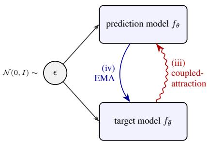  
Figure 8: Positive feedback loop from noise coupling (iii) shared ϵ biases the kernel towards self-attraction; (iv) the EMA update feeds this bias into the target, closing the loop.

Policy extraction In all methods, we extract a parameterized policy $\pi _ { \omega }$ via a behavior-regularized DDPG-BC objective (Fujimoto & Gu, 2021), following the action gradient $\nabla _ { a } \tilde { Q } ( s , a )$

$$
\mathcal { L } _ { \pi } ( \omega ) = \mathbb { E } _ { ( s , a ) \sim \mathcal { D } _ { r } , \hat { a } \sim \pi _ { \omega } ( \cdot \mid s ) } \big [ - \tilde { Q } ( s , \hat { a } ) - \alpha \log \pi _ { \omega } ( a \mid s ) \big ] .\tag{17}
$$

Here, $\tilde { Q }$ can be either a Monte Carlo value estimate $\hat { Q }$ (see Equation 13) or a distilled critic $Q _ { \psi }$ (see Equation 14). We adopt DDPG-BC because Park et al. (2024a) have shown that it outperforms other behavior-regularized approaches such as weighted-regression alternatives (Peng et al., 2019).

Algorithm 1 InDOM / DOM: pre-training. For intention-conditioned or -unconditioned occupan  
cies   
Require: # pushforward samples G, # bootstrap samples $N ^ { + }$   
1: Warmup $f _ { \theta }$ with static target $s \sim \mathcal { D }$   
2: $\bar { \theta }  \theta$   
3: while pre-training do   
4: Sample batch $\{ ( s , a , s ^ { \prime } , a ^ { \prime } ) \} \sim \mathcal { D }$   
5: Sample noise $\{ \epsilon _ { i } \} _ { i = 1 } ^ { G } , \{ \bar { \epsilon } _ { j } \} _ { j = 1 } ^ { N ^ { + } } \sim \mathcal { N } ( 0 , \mathrm { I } )$   
▷ Infer Policy Intention   
6: $z \sim p _ { e } ( \cdot \mid s ^ { \prime } , a ^ { \prime } )$   
7: ${ \mathrm { K L } } \stackrel { \sim } { = } D _ { \mathrm { K L } } ( p _ { e } ( z \mid s ^ { \prime } , a ^ { \prime } ) \parallel { \mathcal { N } } ( 0 , \mathrm { I } ) )$   
8: $( z  0 , \mathrm { { K L }  0 ) }$   
▷ pushforward, target-network bootstrap   
9: $x _ { i } = f _ { \theta } ^ { \pi } ( \epsilon _ { i } \mid s , a , z )$   
10: $\bar { s } _ { j } ^ { + } = \stackrel { \cdot } { \mathrm { s g } } \big ( f _ { \bar { \theta } } ^ { \pi } ( \bar { \epsilon } _ { j } \mid s ^ { \prime } , a ^ { \prime } , z ) \big )$   
11: $\hat { V } _ { q _ { \bar { \theta } } ^ { \pi } } ^ { + } ( x _ { i } )$ from Equation 16   
12: $\mathcal { L } _ { \mathrm { D r i f t } } ^ { \mathrm { ^ { o } } } = \left. x _ { i } - \mathrm { s g } ( x _ { i } + \hat { V } _ { q _ { \bar { \theta } } ^ { \pi } } ^ { + } ( x _ { i } ) - \hat { V } _ { q } ^ { - } ( x _ { i } ) ) \right. ^ { 2 }$   
13: Update θ (and e) to minimize $\mathcal { L } _ { \mathrm { D r i f t } } ^ { \pi } + \lambda _ { \mathrm { K L } }$ KL   
14: update ω to minimize BC loss $- \log \pi _ { \omega } ( a \mid s )$   
▷ EMA target update   
15: $\bar { \theta }  \eta \theta + \overline { { ( 1 - \eta ) } } \bar { \theta }$   
16: end while   
17: Freeze θ (and e)

Algorithm 2 Critic-Based Policy Extraction Algorithm 3 Direct Policy Extraction for   
for intention-conditioned or -unconditioned oc- intention-conditioned or -unconditioned occu  
cupancies pancies   
Require: # MC-samples N Require: # MC-samples N, # latent candidates M   
1: while policy extraction do 1: while policy extraction do   
2: Sample reward batch $\smash { \{ ( s , a , r ) \} } \sim  { \mathcal { D } _ { r } }$ 2: Sample reward batch $\smash { \{ ( s , a , r ) \} \sim  { \mathcal { D } } _ { \tau } }$   
3: Sample noise $\{ \epsilon _ { i } \} _ { i = 1 } ^ { N } \sim \mathcal { N } ( 0 , \mathrm { { I } ) }$ 3: Sample noise $\{ \epsilon _ { i } \} _ { i = 1 } ^ { N } \sim \mathcal { N } ( 0 , \bar { \mathrm { I } } )$   
4: update ϕ to minimize $\mathbb { E } \big [ \| r _ { \phi } ( s ) - r \| ^ { 2 } \big ]$ 4: update ϕ to minimize $\mathbb { E } \big [ \| r _ { \phi } ( s ) - r \| ^ { 2 } \big ]$   
▷ Prepare GPI ▷ Prepare GPI   
5: sample latent $z \sim \mathcal { N } ( 0 , \mathrm { I } )$ 5: sample M latents $\{ z _ { m } \sim \mathcal { N } ( 0 , \mathrm { I } ) \} _ { m = 1 } ^ { M }$   
6: $( z \gets 0 )$ 6: $( z _ { m } \gets 0 )$   
▷ Make MC value estimate ▷ Make MC value estimate   
7: $\hat { s } _ { i } ^ { + } = f _ { \theta } ^ { \pi } ( \epsilon _ { i } \mid s , a , z )$ 7: $\hat { a } \sim \pi _ { \omega } ( \cdot \mid s )$   
8: $\begin{array} { r } { \hat { Q } _ { z } ( s , a ) = \frac { 1 } { ( 1 - \gamma ) N } \sum _ { i } r _ { \phi } ( \hat { s } _ { i } ^ { + } ) } \end{array}$ 8: $\hat { s } _ { i , m } ^ { + } = \hat { f } _ { \theta } ^ { \pi } ( \epsilon _ { i } \mid s , \hat { a } , z _ { m } )$   
9: $\begin{array} { r } { \hat { Q } _ { z _ { m } } ( s , \hat { a } ) = \frac { 1 } { ( 1 - \gamma ) N } \sum _ { i } r _ { \phi } ( \hat { s } _ { i , m } ^ { + } ) } \end{array}$   
▷ GPI/PI over intentions   
9: $\psi  \psi - \nabla _ { \psi } \mathbb { E } [ \ell _ { 2 } ^ { \tau } ( \hat { Q } _ { z } ( s , a ) - Q _ { \psi } ( s , a ) ) ]$ ▷ GPI/PI over intentions   
10: $\psi  \psi - \nabla _ { \psi } \mathbb { E } \big [ \| \hat { Q } _ { z } ( s , a ) - Q _ { \psi } ( s , a ) \| ^ { 2 } \big ]$ 10: $\hat { Q } ( s , \hat { a } ) = \operatorname* { m a x } _ { m } \hat { Q } _ { z _ { m } } ( s , \hat { a } )$   
11: $\hat { Q } ( s , \hat { a } ) = \hat { Q } _ { 0 } ( s , \hat { a } )$   
▷ DDPG-BC actor update   
11: $\hat { a } \sim \pi _ { \omega } ( \cdot \mid s )$ ▷ DDPG-BC actor update   
12: $\omega  \stackrel { \sim } { \omega } + \stackrel { \sim } { \nabla } _ { \omega } ( \mathbb { E } [ Q _ { \psi } ( s , \hat { a } ) + \alpha \log \pi _ { \omega } ( a \mid s ) ] )$ 12: $\omega \gets \omega + \nabla _ { \omega } \bigl ( \mathbb { E } [ \hat { Q } ( s , \hat { a } ) + \alpha \log \pi _ { \omega } ( a \mid s ) ] \bigr )$   
13: end while 13: end while

## E ABLATIONS

## E.1 AN INITIAL SPREAD MAKES TD-DRIFT WORK

The bootstrapped objective guides the model towards the target distribution through the kernel similarity between its own bootstrap samples and the observed next states (see Equation 16). If the initial distribution is concentrated, the kernel similarity is uniformly high towards the bootstrap samples, since those are very close. If the learning problem were set up with a high enough discount factor $\gamma  1$ , the supervision signal for the next state approaches 0, causing the prediction model to chase after its bootstrap estimates, a positive feedback loop similar to that in Figure 8. To avoid this, we propose an initial warm-up pre-training phase (10K steps) to spread the initial drifting distribution – for instance, to approximate the cover-

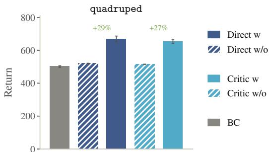  
Figure 9: Effect of warming up initial spread. Policy return on quadruped for DOM and DOM-Direct with (w) and without (w/o) warmup phase to generate an initial spread.

age of the dataset. This shortens the expected distance to the next state, raising the expected kernel similarity to the next state supervision signal into its informative range. We find this initial spread to be crucial for the TD-Drift objective to work. To ablate this, we evaluate DOM and DOM-Direct on the quadruped domain over four tasks using drifting models with and without this initial warm-up phase. Figure 9 shows that all methods using an occupancy without (w/o) warm-up collapse back to the BC baseline performance.

## E.2 MEDIAN TEMPERATURE RESCALING

Drifting is, at its core, a kernel method, and inherits the problem of choosing a kernel bandwidth. Deng et al. (2026) mitigate this by aggregating the drift field over an array of temperatures, offering potential robustness. Other works like Houssaini et al. (2026) have shown drifting to work well also with a single temperature, but the search space across different datasets and geometries is still vast. Our TD-Drift implementation in Algorithm 1 already normalizes the state space to a $1 [ - 1 , 1 ] ^ { d }$ hypercube, which fixes the range of the sample coordinates but not the scale of pairwise distances between samples, since this scale still depends on the dimensionality and geometry of each domain.

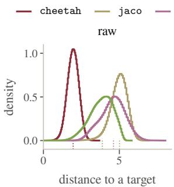

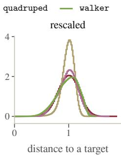  
Figure 10: Rescaling kernel distances per dataset. Two histograms of inter-sample distances. The left one is based on min-max normalization per data domain. Right one: each distance is divided by the median pairwise distance (dashed line in left histogram)

After priming the model to approximate the

state space coverage sufficiently well through the warm-up phase described in Section E.1, we are, at the start of TD-learning, left with a fixed but a priori unknown distribution of inter-sample distances. At the start of occupancy-learning through the TD-objective, we are therefore interested in how well a kernel of a given temperature can pick up the signal from the next-state supervision.

Since this informative range depends on the dataset’s own distance scale, which we do not know ahead of time, we rescale the temperatures by the median expected inter-sample distance of the dataset (see Figure 10), which unifies the distance scale across domains and makes a single default temperature(-field) choice meaningful. Rescaling is used throughout the paper. Despite that, the chosen temperature field (0.05, 0.1, 0.2) is not a clear win, since it is reported to be best in only two out of 16 domain × task pairs; it usually is not far from the best tested temperature and therefore represents a reasonable default.