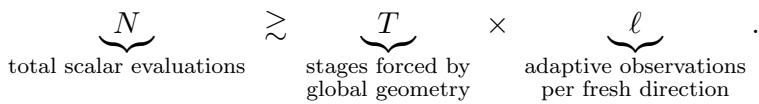

# On Global Joint Lower Bounds in Zeroth-Order Nonconvex Optimization

Yuxuan Xia

Xiao-Tong Yuan

502024710019@smail.nju.edu.cn

xtyuan@nju.edu.cn

School of Intelligence Science and Technology

Nanjing University, Suzhou, 215163, China

State Key Laboratory for Novel Software Technology

Nanjing University, Nanjing, 210023, China

## Abstract

Recent work has sought to transfer first-order nonconvex optimization guarantees to zerothorder methods through gradient estimators, typically incurring a factor linear in d. Ko rnowski and Shamir (2024) obtained an $\bar { \mathcal { O } } ( \bar { d } \bar { \delta } ^ { - 1 } \epsilon ^ { - 3 } )$ oracle complexity for nonsmooth nonconvex optimization and asked whether its dependence on all three parameters is jointly optimal. Although the dimension dependence and the first-order dependence on $( \delta , \epsilon )$ are separately known to be unavoidable, a matching zeroth-order lower bound has remained open. We answer this question in the unrestricted full-space setting. For smooth stochastic nonconvex optimization, we establish a scalar-oracle lower bound of $\bar { \Omega } \big ( d L _ { 0 } ^ { 2 } \operatorname* { m i n } \{ \Delta H , L _ { 0 } ^ { 2 } \} / \epsilon ^ { 4 } \big )$ assuming a smooth, globally lower-bounded population objective and a second-moment bound on sample Lipschitz constants. A smooth reduction then yields a lower bound for Goldstein stationarity, proving the joint minimax optimality of the dependence on $( d , \delta , \epsilon )$ under explicit high-dimensional and small-accuracy conditions. Crucially, our results allow algorithms to query arbitrary points in $\mathbb { R } ^ { d }$ , adaptively select sample-function labels, reuse the same sampled function at any number of locations, and output points without spatial restrictions. Thus, unlike lower bounds based on bounded query regions or fresh evaluation noise, our guarantees apply to a fully adaptive, reusable-sample scalar oracle. We also establish a separate noiseless exact-value lower bound against randomized algorithms, and hence also against deterministic methods. Our proof combines a globally defined sequential nonconvex construction with an exact Gaussian scalar channel, multistage random-field estimates, and an antithetic finite-sample realization that preserves information hardness under adaptive reuse.

## 1 Introduction

Zeroth-order optimization asks what can be accomplished when an algorithm observes function values rather than gradients. In stochastic optimization, the oracle provides evaluations $F ( x ; \xi )$ of random sample functions, while the objective is their population mean $f ( x ) = \mathbb { E } _ { \xi } F ( x ; \xi )$ . Establishing sharp stationarity complexity bounds for nonconvex objectives is particularly challenging because lower bounds that are individually optimal in dimension and accuracy do not necessarily imply their joint optimality. The corresponding dificulties must be realized simultaneously within a single admissible oracle distribution.

Formally, let $\Im ( d , H , L _ { 0 } , \Delta )$ denote the class of stochastic oracle instances whose population objectives are H-smooth, have initial global objective gap at most $\Delta ,$ and satisfy a second-moment bound $L _ { 0 } ^ { 2 }$ on sample Lipschitz constants. We study the minimax scalar-query

complexity

$$
\mathcal { C } _ { \mathrm { Z O } } ( \epsilon ) : = \operatorname* { i n f } \left\{ T : \exists A \in \mathcal { A } _ { T } , \operatorname* { s u p } _ { I \in \mathcal { I } } \mathbb { P } _ { A , I } \big ( \| \nabla f _ { I } ( \widehat { x } _ { A } ) \| > \epsilon \big ) \leq \frac { 1 } { 3 } \right\} ,
$$

where $A _ { T }$ consists of randomized algorithms making at most $T$ adaptive exact function-value queries, with unrestricted query locations, sample reuse, and outputs.

Establishing a joint lower bound in this model presents two fundamental dificulties. First, exact scalar evaluations with sample reuse invalidate arguments based on independent evaluation noise. An algorithm may combine arbitrarily many evaluations of the same sample function, potentially eliminating simple correlated perturbations. A valid informationtheoretic argument must therefore control the entire adaptive transcript of reusable sample functions. Second, the absence of spatial restrictions requires genuinely global hardness. Lower bounds established within a bounded query region (Zhang et al., 2026a) do not automatically exclude algorithms that escape the hard region or locate stationary points elsewhere in $\mathbb { R } ^ { d }$ . Moreover, the prescribed initial objective gap must be measured against the global infimum rather than a local minimum within the construction.

We overcome both dificulties in a parameter-dependent high-dimensional regime, establishing a joint scalar-oracle lower bound of

$$
\Omega \left( { \frac { d L _ { 0 } ^ { 2 } \operatorname* { m i n } \{ \Delta H , L _ { 0 } ^ { 2 } \} } { \epsilon ^ { 4 } } } \right) .
$$

Our construction uses a finite-support distribution over globally Lipschitz sample functions whose population objective is globally H-smooth and lower bounded, with the prescribed global gap budget. The result imposes no spatial restrictions on queries or outputs, no fresh-noise assumption, and no prescribed sample-sampling rule. It therefore establishes joint hardness under the full adaptive capabilities of the reusable-sample scalar oracle.

Main result. Let $B = \operatorname* { m i n } \{ \Delta H , L _ { 0 } ^ { 2 } \}$ . For $\epsilon ^ { 2 } \le c _ { 0 } B$ and $d \ge C ( B / \epsilon ^ { 2 } ) \log ( 2 + B L _ { 0 } ^ { 2 } / \epsilon ^ { 4 } )$ we establish

$$
N = \Omega \bigg ( \frac { d L _ { 0 } ^ { 2 } B } { \epsilon ^ { 4 } } \bigg )\tag{1}
$$

scalar evaluations, with universal constants $c _ { 0 } , C > 0$ . For fixed positive $L _ { 0 } , \Delta , H$ , this yields the joint $\Omega ( d \epsilon ^ { - 4 } )$ rate in the stated high-dimensional regime. The cap in B describes the range established by our construction, not a claimed saturation of the minimax complexity.

Contributions and Proof Overview. Our proof follows a central principle: construct many sequential stages, make each stage informationally dificult, and establish that their query costs must accumulate. We first develop a global zero-chain geometry that forces every approximate stationary point to complete all hidden stages, even under unrestricted queries and outputs. Each stage is then associated with a fresh hidden workspace direction, while a past-centered correction prevents premature access to subsequent stages. To establish the information cost of recovering each direction under arbitrary sample reuse, we construct an exact Gaussian feature channel that remains information-limited under adaptive multipoint evaluations. A uniform global Lipschitz-moment bound ensures that all stages coexist within a single admissible stochastic oracle, while deferred revelation and antithetic pairing establish that their information costs indeed accumulate in a fixed finite sample family. Together, these ingredients yield a joint lower bound in which the number of stages and the information cost per stage multiply. We additionally establish a separate noiseless exact-value lower bound against randomized algorithms, using the same global geometry but a distinct adaptive spherical-measurement argument.

## 2 Related Work

Sequential nonconvex lower bounds. Classical smooth nonconvex lower bounds rely on zero-chain constructions, in which optimization progress requires the sequential discovery of hidden coordinates (Carmon et al., 2020). Stochastic extensions incorporate oracle uncertainty and information-hiding arguments to establish corresponding complexity lower bounds (Arjevani et al., 2023). These techniques provide the foundation for studying sequential hardness, although their application to unrestricted zeroth-order oracles requires additional geometric and information-theoretic control.

Stochastic zeroth-order complexity. The dimension dependence of stochastic zerothorder optimization has been studied extensively, including fundamental lower bounds for gradient-free estimation (Duchi et al., 2015). For nonsmooth nonconvex optimization, Kornowski and Shamir (2024) established an $O ( d \delta ^ { - 1 } \epsilon ^ { - 3 } )$ upper bound and raised the question of joint optimality in $( d , \delta , \epsilon )$ . More recently, Zhang et al. (2026a) established a joint lower bound for Goldstein stationarity on Euclidean balls, permitting adaptive sample reuse. Our work studies the complementary unrestricted full-space model with a global objective gap. The diferences in oracle assumptions and parameter regimes are summarized in Table 1 and Section 5.3.

Deterministic and exact-value complexity. Deterministic zeroth-order optimization has also been investigated for nonsmooth nonconvex objectives (Jordan et al., 2023; Kornowski, 2026). Related exact-value lower bounds have been developed for convex optimization (Zhang et al., 2026b). An important distinction is that deterministic algorithms and noiseless oracles are not equivalent restrictions: a randomized algorithm may still interact with a fixed deterministic function. Our separate exact-value lower bound applies to arbitrary randomized algorithms and therefore includes deterministic methods, under the function-class assumptions of our theorem.

Information-theoretic tools. Our reusable-sample analysis draws on Gaussian-process and reproducing-kernel representations (Rasmussen and Williams, 2006; van der Vaart and van Zanten, 2008), together with spherical concentration and adaptive information inequalities. Antithetic sampling techniques (Hammersley and Morton, 1956) further motivate the finite-sample symmetrization used to construct a fixed stochastic oracle.

Organization. Sections 3 and 4 introduce the notation and main technical challenges. Section 5 formalizes the oracle model and construction strategy. Sections 6 to 9 develop the geometric, information-theoretic, and probabilistic ingredients of the proof. Section 10 establishes the main lower bounds and their Goldstein and exact-value consequences. Detailed proofs are provided in the appendices.

## 3 Notation

General notation. We write $\mathbb { R } ^ { d }$ and $\mathbb { S } ^ { d - 1 }$ for the Euclidean space and unit sphere, respectively. The symbols $\lVert \cdot \rVert$ and $\langle \cdot , \cdot \rangle$ denote the Euclidean norm and inner product, while E and $\mathbb { P }$ denote expectation and probability. We use $\operatorname { L i p } ( q )$ for the global Lipschitz constant of $q ,$ and $O ( \cdot ) , \Omega ( \cdot )$ , and ≍ for standard asymptotic notation. All logarithms are natural.

Optimization parameters. The objective is $f = \mathbb { E } _ { \xi } f _ { \xi }$ on $\mathbb { R } ^ { d } .$ with

$$
\operatorname { L i p } ( \nabla f ) \leq H , \qquad \mathbb { E } _ { \xi } \operatorname { L i p } ( f _ { \xi } ) ^ { 2 } \leq L _ { 0 } ^ { 2 } , \qquad f ( 0 ) - \operatorname* { i n f } f \leq \Delta .
$$

Here, d is the dimension, H the smoothness constant, $L _ { 0 }$ the sample Lipschitz bound, and $\Delta$ the initial optimality gap. We denote the stationarity tolerance by ϵ and the Goldstein neighborhood radius by δ. The capped parameters are

$$
B = \operatorname * { m i n } \{ \Delta H , L _ { 0 } ^ { 2 } \} , \qquad B _ { G } = \operatorname * { m i n } \{ \Delta \epsilon / \delta , L _ { 0 } ^ { 2 } \} .
$$

The Goldstein residual is $g _ { \delta } ( x ) = \operatorname* { i n f } \{ \| u \| : u \in \partial _ { \delta } ^ { G } f ( x ) \}$ , where $\partial _ { \delta } ^ { G } f ( x )$ denotes the Goldstein subdiferential. The symbol $N$ counts scalar function-value queries.

Lower-bound construction. We decompose $d = r + m$ into chain and workspace dimensions. The integer T denotes the number of hidden stages, with $U$ and V representing their independent random orthonormal frames. Lowercase $( z , x )$ denotes normalized chain and workspace coordinates. The parameter σ controls the Gaussian noise level, while $Q _ { j }$ denotes the fixed noise field associated with sample label $j .$ . Other construction-specific symbols and auxiliary parameters are defined when first introduced.

## 4 Dificulties

A joint lower bound cannot be obtained by multiplying a zero-chain lower bound with an independent direction-estimation bound. Four obstacles must be resolved within the same static oracle instance.

Exact scalar information. A scalar evaluation need not reveal only one coordinate: cleverly chosen values can encode several hidden directions. Thus the loss of gradient access does not, by itself, force a factor linear in d. We must show that sequential progress and the cost of identifying each new direction persist together, against adaptive scalar measurements.

Reuse of sample functions. When a label $j$ identifies a fixed function $F _ { j }$ , repeated queries may cancel simple perturbations. For instance, if $F _ { j } ( x ) = f ( x ) + \xi _ { j }$ , then

$$
F _ { j } ( x ) - F _ { j } ( y ) = f ( x ) - f ( y ) .
$$

Fresh, independently added noise at each evaluation therefore cannot substitute for a reusable sample-function oracle. The lower-bound proof must control the full adaptive transcript of a label, including the correlations among its observations.

Global spatial access. The algorithm can query and return points anywhere in $\mathbb { R } ^ { d }$ A local zero-chain need not prevent distant queries from revealing unreached stages, or a distant output from being stationary without completing the chain. We therefore need a global progress certificate that localizes every suficiently small-gradient point, not merely points inside a designated query ball.

One global regularity budget. The construction must simultaneously satisfy the globalgap, population smoothness, and sample-Lipschitz moment constraints in (2). Combining many individually dificult stages is not suficient if their sample gradients make the global Lipschitz moment grow with the number of stages. The proof must establish both an additive information cost and a uniform regularity bound for one finite, fixed sample family.

## 5 Problem Formulation and Construction Plan

## 5.1 A scalar oracle with unrestricted queries

Let $f : \mathbb { R } ^ { d } $ R be the population objective associated with a uniform distribution over a finite family of functions $\{ f _ { \xi } \} _ { \xi \in \Xi }$ . Thus

$$
f ( \boldsymbol { x } ) = \mathbb { E } _ { \boldsymbol { \xi } } f _ { \boldsymbol { \xi } } ( \boldsymbol { x } ) = \frac { 1 } { | \Xi | } \sum _ { \boldsymbol { \xi } \in \Xi } f _ { \boldsymbol { \xi } } ( \boldsymbol { x } ) .
$$

We take the initial point to be 0 and impose three assumptions. The population is lower bounded and its initial global objective gap is at most $\Delta .$ Its gradient is H-Lipschitz. Finally, the sample functions have a bounded second moment of their global Lipschitz constants:

$$
\begin{array} { r l r } & { } & { f ( 0 ) - \underset { x \in \mathbb { R } ^ { d } } { \operatorname* { i n f } } f ( x ) \leq \Delta , \qquad \mathrm { i n f } f > - \infty , } \\ & { } & { \quad \| \nabla f ( x ) - \nabla f ( y ) \| \leq H \| x - y \| , \mathbb { E } _ { \xi } [ \mathrm { L i p } ( f _ { \xi } ) ^ { 2 } ] \leq L _ { 0 } ^ { 2 } . } \end{array}\tag{2}
$$

Here $\begin{array} { r } { \mathrm { L i p } ( f _ { \xi } ) = \operatorname* { s u p } _ { x \neq y } | f _ { \xi } ( x ) - f _ { \xi } ( y ) | / \| x - y \| } \end{array}$ ; there is no required pointwise deterministic bound on each sample’s Lipschitz constant.

Remark 5.1 (Role of the smooth subclass). The global gap and sample-Lipschitz moment assumptions match the type of stochastic zeroth-order guarantees considered by Kornowski and Shamir (2024). Requiring a smooth population gives a smaller hard-instance class for the gradient-stationarity theorem. Its implication for nonsmooth Goldstein stationarity is not automatic: it uses the smooth reduction (27), stated in Section 10.3.1.

What an algorithm observes. At every round the algorithm can choose both a label $\xi \in \Xi$ and a location $\boldsymbol { x } \in \mathbb { R } ^ { d }$ using its complete transcript, and it receives the exact real number $f _ { \xi } ( x )$ . Previously selected labels may be reused without restriction. Each such scalar evaluation costs one query. The output $\widehat { x }$ may likewise be anywhere in $\mathbb { R } ^ { d }$ . This oracle is at least as informative as one that supplies only fresh, independently sampled labels; proving a lower bound for it rules out algorithms using the weaker oracle as well.

## 5.2 The construction target: making two costs multiply

The oracle model fixes the class, but it does not explain why a scalar query should be expensive. A deterministic zero-chain forces progress through successive stages; separately, a stochastic direction-estimation problem can cost order d observations. Neither fact alone forces their product. A single scalar query could inspect future stages, compare several points of one retained sample, or exploit a distant stationary point. We therefore start with the desired proof mechanism, not the final bound:

(3)

The product in (3) is a target, not an inference from separate lower bounds. We must construct one oracle for which completing a new stage provably requires an essentially fresh direction-estimation task, and for which these tasks cannot be short-circuited by of-stage queries.

The physical gap permits roughly $\Delta H / \epsilon ^ { 2 }$ stages. The global sample-Lipschitz budget of the particular confining geometry used here allows only roughly $L _ { 0 } ^ { 2 } / \epsilon ^ { 2 }$ stages. Accordingly, define

$$
B : = \operatorname* { m i n } \{ \Delta H , L _ { 0 } ^ { 2 } \} .\tag{4}
$$

In the intended scaling $T \ \times \ B / \epsilon ^ { 2 }$ , while one fresh workspace direction must require $\ell \asymp d L _ { 0 } ^ { 2 } / \epsilon ^ { 2 }$ scalar evaluations. We will justify each factor and, more importantly, justify multiplying them within a finite, static, reusable-sample oracle. The cap in B is imposed by the present construction; it is not asserted to be a minimax upper bound.

From stagewise hardness to a global lower bound. The preceding argument in (3) suggests that the total query complexity should scale as the number of hidden stages multiplied by the information cost of discovering each stage. However, these two factors cannot simply be multiplied. First, we must ensure that every approximate stationary point requires completing all hidden stages, regardless of where the algorithm queries or outputs. Second, we must show that discovering each new hidden direction remains costly even when the algorithm can repeatedly evaluate the same sample function at adaptively chosen points.

Even these two properties do not yet establish a valid stochastic lower bound. The hard instances for diferent stages must coexist within a single oracle distribution without violating the global sample-Lipschitz budget. Moreover, the stagewise information costs must provably accumulate for one fixed finite sample family, rather than relying on an oracle that changes as the algorithm progresses.

## 5.3 Comparison with Existing Results

Table 1 summarizes the dependence on d, ϵ, and δ, suppressing other parameters. Our simplified lower bounds hold in the unsaturated regime under the dimension and accuracy conditions of the corresponding theorems.

Two distinctions are particularly important. First, the exponential lower bound of Ding and Yuan (2026) applies to deterministic local-oracle algorithms, whereas our exact-value lower bounds hold against randomized adaptive zeroth-order algorithms on smooth objectives. Second, Zhang et al. (2026a) establish a joint stochastic lower bound on a Euclidean ball, allowing sample reuse but restricting queries and outputs and measuring the initial gap relative to that ball. Our results instead permit unrestricted queries and outputs and use the global objective gap, at the cost of stronger dimension requirements and a capped dependence on the gap.

Table 1: Scalar-query upper and lower bounds for zeroth-order nonconvex optimization. S: smooth (ϵ-gradient stationarity); NS: nonsmooth (Goldstein $( \delta , \epsilon )$ -stationarity). Only dependence on d, ϵ, and δ is displayed, under the respective theorem-specific assumptions. Stoch. denotes sample-function evaluations, while Exact denotes evaluations of a single deterministic function. Global allows unrestricted queries and outputs with a global objective gap; Ball restricts queries and outputs to a ball with a local gap.
<table><tr><td>Work</td><td>Oracle Class</td><td></td><td>Upper bound</td><td>Lower bound Domain</td></tr><tr><td>Ghadimi and Lan (2013)</td><td>Stoch.</td><td>S</td><td> $O ( d \epsilon ^ { - 4 } )$ </td><td>Global</td></tr><tr><td>Lin et al. (2022)</td><td>Stoch.</td><td>NS</td><td> $O ( d ^ { 3 / 2 } / ( \delta \epsilon ^ { 4 } ) )$ </td><td>Global</td></tr><tr><td>Chen et al. (2023)</td><td>Stoch.</td><td>NS</td><td> $O ( d ^ { 3 / 2 } / ( \delta \epsilon ^ { 3 } ) )$ </td><td>Global</td></tr><tr><td>Kornowski and Shamir (2024)</td><td>Stoch.</td><td>NS</td><td> $O ( d / ( \delta \epsilon ^ { 3 } ) )$ </td><td>Global</td></tr><tr><td>Cartis et al. (2012)</td><td>Exact</td><td>S</td><td> $O ( d \epsilon ^ { - 2 } )$ </td><td>Global</td></tr><tr><td>Ding and Yuan (2026)†</td><td>Exact</td><td>NS</td><td> $( 1 + ( \delta \epsilon ) ^ { - 1 } ) ~ e ^ { O ( d \log ( 1 / \epsilon ) ) }$   $e ^ { \Omega ( d ) }$ </td><td>Global</td></tr><tr><td>Zhang et al. (2026a)</td><td>Stoch.</td><td>NS</td><td> $\Omega ( d / ( \delta \epsilon ^ { 3 } ) )$ </td><td>Ball</td></tr><tr><td>This Work (Theorem 10.1) Stoch.</td><td></td><td>S</td><td> $\Omega ( d \epsilon ^ { - 4 } )$ </td><td>Global</td></tr><tr><td>This Work (Theorem 10.3) Stoch.</td><td></td><td>NS</td><td> $\Omega ( d / ( \delta \epsilon ^ { 3 } ) )$ </td><td>Global</td></tr><tr><td>This Work (Theorem 10.5) Exact</td><td></td><td>S</td><td> $\Omega ( d \epsilon ^ { - 2 } )$ </td><td>Global</td></tr><tr><td>This Work (Theorem 10.7) Exact</td><td></td><td>NS</td><td> $\Omega ( d / ( \delta \epsilon ) )$ </td><td>Global</td></tr></table>

† Both bounds of Ding and Yuan (2026) concern deterministic algorithms. Their lower bound holds even for a stronger local oracle, while the upper bound uses only function values. The exponential lower bound is stated for fixed suficiently small accuracy parameters.  
All lower bounds of this work hold against randomized algorithms. The displayed Goldstein rates correspond to the unsaturated regime $\Delta \epsilon / \delta \leq L _ { 0 } ^ { 2 } ;$ outside this regime, the proven lower bounds are capped.

## 6 Constructing a Global Progress Certificate

Our first task is geometric: every approximate stationary point, regardless of its location in $\mathbb { R } ^ { d }$ , must certify progress through all T hidden stages. A smooth zero-chain supplies the sequential stages; the construction below extends their progress requirement to unrestricted outputs before assigning a scalar-query cost to each stage.

Why global confinement is necessary. This dificulty is particularly apparent when a zero-chain is composed with a bounded coordinate map. Such a map keeps the efective zero-chain coordinates bounded, but its derivative vanishes at infinity. Consequently, without an additional mechanism, the resulting objective may have arbitrarily small gradients far from the initialization, allowing an algorithm to satisfy the stationarity criterion without completing the hidden stages. To exclude this possibility, we combine the bounded coordinate map with a coercive radial penalty whose gradient remains nonzero at infinity. The resulting construction satisfies a global progress certificate: every suficiently small-gradient point must complete all stages of the zero-chain, regardless of its location. At the same time, we control the global objective gap, gradient magnitude, and smoothness. The required estimates are established in Appendix B.

## 6.1 Zero-chain and confinement

The standard zero-chain has coordinates that would be known if we placed it directly on the coordinate axes. We instead randomize those axes: let $U = \left( u _ { 1 } , \dots , u _ { T } \right) \in \mathbb { R } ^ { r \times T } , r \geq T$ be a Haar orthonormal frame (a uniformly random collection of orthonormal directions). The algorithm does not know this frame in advance. Its T progress coordinates will be the projections $w _ { i } = \langle u _ { i } , y ( z ) \rangle$ of a transformed query point $y ( z )$ , defined below. Orthogonality keeps the embedded stages geometrically separate; random orientation makes their locations initially unknown.

For this embedding we use the smooth zero-chain $\begin{array} { r } { B _ { T } ( w ) = \sum _ { i = 1 } ^ { T } b _ { i } ( w ) } \end{array}$ of Carmon et al. (2020), defined by

$$
\Psi ( t ) = \left\{ \begin{array} { l l } { 0 , } & { t \leq 1 / 2 , } \\ { \exp ( 1 - ( 2 t - 1 ) ^ { - 2 } ) , } & { t > 1 / 2 , } \end{array} \right. \quad \Phi ( t ) = \sqrt { e } \int _ { - \infty } ^ { t } e ^ { - u ^ { 2 } / 2 } d u ,
$$

$$
b _ { 1 } ( w ) = - \Phi ( w _ { 1 } ) , \qquad b _ { i } ( w ) = \Psi ( - w _ { i - 1 } ) \Phi ( - w _ { i } ) - \Psi ( w _ { i - 1 } ) \Phi ( w _ { i } ) .
$$

The two functions have diferent roles. The factors $\Psi ( \pm w _ { i - 1 } )$ gate the next stage: when $| w _ { i - 1 } | \le 1 / 2$ , the i-th term is zero and cannot yet respond to changes in w . Once a gate opens, Φ provides the varying part of that term, with $\Phi ^ { \prime } ( t ) = \sqrt { e } e ^ { - t ^ { 2 } / 2 } > 0$ . Thus the newly exposed coordinate has a smooth, nonconstant directional response, rather than a flat cost. The Gaussian-integral form of Φ also gives bounded derivatives, needed for the global gradient and Hessian estimates. These facts explain the roles of the two functions, not the complete stationary certificate: proving that every small-gradient point has $w _ { i } > 1$ still requires the combined zero-chain estimates in Appendix B.

A direct embedding does not yet guarantee global hardness. We therefore introduce a bounded coordinate map together with a radial penalty:

$$
R = 6 4 \sqrt T , \quad \alpha ( z ) = \left( 1 + \frac { \| z \| ^ { 2 } } { R ^ { 2 } } \right) ^ { - 1 / 2 } , \quad y ( z ) = \alpha ( z ) z , \quad w = U ^ { \top } y ( z ) ,\tag{5}
$$

$$
P ( z ) = \frac { R ^ { 2 } } { 5 } \big ( \alpha ( z ) ^ { - 1 } - 1 \big ) .\tag{6}
$$

The bounded map $y ( z )$ satisfies $\| y ( z ) \| < R$ for every $z \in \mathbb { R } ^ { r }$ . This both prevents arbitrarily distant queries from creating arbitrarily large efective chain coordinates and later enables concentration estimates for undisclosed columns of U. But the derivative of y tends to zero at infinity; without a penalty, this would make the composed zero-chain gradient vanish at distant points even if the chain is unfinished. The radial term satisfies $\nabla P ( z ) = y ( z ) / 5 ,$ whose norm tends to $R / 5$ as $\| z \|  \infty$ . The choice $R = 6 4 \sqrt { T }$ keeps the soft-coordinate radius proportional to the natural $\sqrt { T }$ scale of the chain, while leaving a substantial radial gradient far away. Its numerical coeficient is chosen for the global estimates, not claimed to be optimal. The two terms together exclude escape at infinity; ruling out cancellations at finite distances requires Appendix B.

The resulting base objective is

$$
F _ { \mathrm { b a s e } } ( z ) = P ( z ) + B _ { T } ( U ^ { \top } y ( z ) ) .
$$

The proof in Appendix B establishes the global bounds

$$
\begin{array} { r l } { F _ { \mathrm { b a s e } } ( 0 ) - \operatorname* { i n f } F _ { \mathrm { b a s e } } \le 1 2 T , } & { } \\ { \| \nabla F _ { \mathrm { b a s e } } \| \le 3 7 \sqrt { T } , } & { \| \nabla F _ { \mathrm { b a s e } } \| \le \frac { 1 } { 5 } \implies w _ { i } > 1 \ \forall i . } \\ { \| \nabla ^ { 2 } F _ { \mathrm { b a s e } } \| \le 1 6 1 , } \end{array}\tag{7}
$$

The first three bounds control the global objective gap, gradient magnitude, and smoothness. The implication on the right is the key geometric conclusion: every suficiently small-gradient point must have completed all $T$ hidden stages, regardless of its location in the ambient space.

This establishes the global progress requirement. However, it does not yet show that completing each stage requires many scalar queries. We introduce an additional hiddendirection task to create that information cost.

## 6.2 Translated center and past-centered correction

Introducing a hidden-direction task. To make each stage informationally dificult, we introduce a second, independent Haar orthonormal frame $V = ( v _ { 1 } , \ldots , v _ { T } ) \in \mathbb { R } ^ { m \times T } , m \geq T$ The optimization variable is now $( z , x ) \in \mathbb { R } ^ { r } \times \mathbb { R } ^ { m }$ , so the ambient dimension is $d = r + m$ The frames serve diferent purposes: U hides when the zero-chain progresses, while V hides where the auxiliary workspace well moves at each stage. Independence is needed later to treat a newly activated $v _ { k }$ as a fresh random direction even after the preceding zero-chain information has been revealed.

As the chain progresses, the well moves along successive hidden directions $v _ { i }$ . Consequently, an approximate stationary point must not only complete the zero-chain but also locate the final workspace center.

To move the well without discontinuities, we need smooth activation functions that are exactly zero before a stage and exactly one after activation, with vanishing first and second derivatives at the endpoints. Let $S _ { 5 }$ be the clamped quintic interpolant $1 0 u ^ { 3 } - 1 5 u ^ { 4 } + 6 u ^ { 5 }$ on [0, 1], extended as zero for $u \leq 0$ and one for $u \geq 1$ . This choice is $C ^ { 2 }$ across the joins. Define

$$
\Gamma ( t ) = S _ { 5 } ( 4 t - 1 ) , \qquad g _ { i } ( w ) = \Gamma ( | w _ { i } | ) , \qquad A = 1 2 8 .
$$

Here $g _ { i } = 0$ when $| w _ { i } | \le 1 / 4$ and $g _ { i } = 1$ when $| w _ { i } | \geq 1 / 2$ . The absolute value makes the workspace activation nonnegative on either side of the chain coordinate; the global progress certificate later selects the positive branch $w _ { i } > 1$ . Although $| w _ { i } |$ is not diferentiable at zero, $g _ { i }$ is identically zero in a neighborhood of zero; the flat endpoints of $S _ { 5 }$ ensure that $g _ { i }$ is globally $C ^ { 2 }$ . Its first and second derivatives vanish in the fully inactive and active regions. The numerical shift $A = 1 2 8$ separates successive well centers by a distance large compared with the cutof width introduced below.

Define the workspace well and its moving center by

$$
h ( \boldsymbol { q } ) = 4 \big ( \sqrt { 1 + \| \boldsymbol { q } \| ^ { 2 } } - 1 \big ) , \qquad a ( \boldsymbol { w } ) = A \sum _ { i = 1 } ^ { T } g _ { i } ( \boldsymbol { w } ) v _ { i } .
$$

The function h has a unique minimum at $q = 0 ,$ a gradient that points back toward this minimum, and globally bounded gradient and Hessian. Thus the term $h ( x - a ( w ) )$ forces a low-gradient workspace point toward the current center without violating the global regularity budget. As successive stages become activated, this center moves from 0 to $A v _ { 1 }$ then to $A ( v _ { 1 } + v _ { 2 } )$ , and eventually to $A \textstyle \sum _ { i } v _ { i }$

The additional well therefore converts progress through the zero-chain into a sequence of hidden-direction localization tasks.

Why a correction is necessary. The moving well alone is insuficient to enforce sequential information acquisition. Although approximate stationarity requires completing all stages, unrestricted scalar queries may still reveal later zero-chain terms before the algorithm reaches their intended workspace regions.

We address this issue by canceling the relevant chain terms outside their corresponding regions. The cancellation must depend only on previously activated workspace directions; otherwise, the cutof itself could reveal future directions.

For each stage $i ,$ define its past center by

$$
a _ { < i } ( w ) = A \sum _ { j < i } g _ { j } ( w ) v _ { j } .
$$

The past center contains no current or future workspace directions. Two cutofs play diferent roles: $\chi$ specifies where to cancel a chain term in the workspace, while $\tau$ specifies when this cancellation is allowed. Choose $\beta = 1 6$ and $\rho _ { 0 } = 3 / 3 2$ , and define

$$
\chi ( q ) = 1 - S _ { 5 } ( \| q \| ^ { 2 } / \beta ^ { 2 } - 1 ) .
$$

The cutof satisfies $\chi ( q ) = 1$ for $\| q \| \leq \beta$ and $\chi ( q ) = 0$ for $\| q \| \geq { \sqrt { 2 } } \beta$ . Thus the correction leaves the chain term untouched near the past center and cancels it far away. Its smooth transition is essential because sharp spatial truncation would destroy diferentiability and the stationary certificate. The numerical choices are coordinated: since $A \rho _ { 0 } = 1 2 8 ( 3 / 3 2 ) =$ $1 2 < \beta = 1 6$ , an active correction will be at least $\beta - A \rho _ { 0 } = 4$ away from the actual well center. At that distance the well gradient exceeds $1 6 / \sqrt { 1 7 }$ , leaving room for the correction’s maximum workspace-gradient contribution of 3. These are suficient separation margins, not optimized constants; the estimates are used explicitly below.

The temporal cutof $\tau$ turns the i-th correction of as soon as stage i or its sufix is suficiently activated; this keeps the correction from modifying the chain during completed progress. Because $\tau$ is constant near zero, its composition with the norm of the sufix remains smooth even where the sufix vector vanishes. Let $\tau$ be a $C ^ { 2 }$ cutof equal to one on $[ 0 , \rho _ { 0 } / 2 ]$ smoothly decreasing to zero on $( \rho _ { 0 } / 2 , \rho _ { 0 } )$ , and zero on $[ \rho _ { 0 } , \infty )$ . Writing $g _ { \ge i } = ( g _ { i } , \dots , g _ { T } )$ set

$$
c _ { i } ( w ) = b _ { i } ( w ) \tau ( \| g _ { \ge i } \| ) .
$$

These definitions allow us to specify the complete objective:

$$
F _ { \mathrm { n e w } } ( z , x ) = P ( z ) + B _ { T } ( w ) + h ( x - a ( w ) ) - \sum _ { i = 1 } ^ { T } [ 1 - \chi ( x - a _ { < i } ( w ) ) ] c _ { i } ( w ) .\tag{8}
$$

The last term is the past-centered correction. Its efect is easiest to see before stage i has been activated. If $g _ { \geq i } = 0$ , then $c _ { i } ( w ) = b _ { i } ( w )$ . When the query lies outside the cutof region around $a _ { < i } ( w )$ , we have $\chi = 0 .$ , and the corresponding chain term is canceled exactly:

$$
b _ { i } ( w ) - [ 1 - \chi ( x - a _ { < i } ( w ) ) ] c _ { i } ( w ) = 0 .
$$

Inside the past workspace region, $\chi = 1$ and the original chain term is retained.

Thus, the correction suppresses premature access to selected future-stage terms while using only past workspace directions to determine where the suppression occurs. The full adaptive information guarantee will be established separately in Appendix E.

Why the correction preserves the global geometry. Introducing the correction raises two concerns: it may lower the global infimum, violating the prescribed objective-gap budget, or create unintended approximate stationary points that bypass the zero-chain. We show that the workspace well prevents both possibilities.

First, the correction is supported only where the well provides a suficiently large positive penalty. The two-jet of a function means its value, gradient, and Hessian at the point. The sufix cutofs are designed so that at most one $c _ { i }$ has a nonzero two-jet at any point, rather than allowing many corrections to contribute simultaneously. On the support of that correction, $\| a ( w ) - a _ { < i } ( w ) \| \le A \rho _ { 0 } = 1 2$ . Moreover, the corresponding correction can be nonzero only when $\| x - a _ { < i } ( w ) \| > 1 6$ . By the triangle inequality, $\| x - a ( w ) \| > 4$ , and hence $h ( x - a ( w ) ) > 4 ( \sqrt { 1 7 } - 1 )$ . Since $| c _ { i } ( w ) | \leq 6$ , the well penalty dominates the correction, giving $F _ { \mathrm { n e w } } ( z , x ) \ge F _ { \mathrm { b a s e } } ( z )$ . Equality holds at $x = a ( w )$ , where the well and all correction terms vanish. Consequently, inf $F _ { \mathrm { n e w } } = \operatorname* { i n f } F _ { \mathrm { b a s e } } ,$ , so the global objective gap is preserved.

Second, the same separation of workspace centers prevents the correction from introducing spurious approximate stationary points. Whenever the correction or its relevant derivatives are nonzero, we have $\| x - a ( w ) \| > 4$ . The well gradient therefore has magnitude greater than $1 6 / \sqrt { 1 7 }$ . Using $| c _ { i } | \le 6$ , the cutof derivative bound $\lVert \nabla \chi \rVert \leq 8 / 1 6$ , and the fact that at most one correction is active, we obtain

$$
\| \nabla _ { x } F _ { \mathrm { n e w } } \| > \frac { 1 6 } { \sqrt { 1 7 } } - \frac { 6 \cdot 8 } { 1 6 } > \frac { 1 } { 2 } .
$$

Thus, at any point with $\| \nabla F _ { \mathrm { n e w } } \| \le e _ { * } < 1 / 2$ , the correction and its first derivatives vanish. However, the moving workspace well still contributes to the gradient with respect to $z , \ \mathrm { A t }$ such a point, we have $\nabla _ { z } F _ { \mathrm { n e w } } = \nabla F _ { \mathrm { b a s e } } - ( D _ { z } a ) ^ { \top } \nabla _ { x } F _ { \mathrm { n e w } }$ . The activation functions satisfy $\operatorname* { s u p } _ { t } | \Gamma ^ { \prime } ( t ) | \ \leq \ 7 . 5 ;$ with the orthonormal frames and $\| D y ( z ) \| _ { \mathrm { o p } } \leq 1$ , this gives $\| D _ { z } a \| _ { \mathrm { o p } } \leq A ( 7 . 5 ) = 9 6 0$ , so

$$
\lVert \nabla F _ { \mathrm { b a s e } } \rVert \leq 9 6 1 \lVert \nabla F _ { \mathrm { n e w } } \rVert \leq 9 6 1 e _ { * } = \frac { 1 } { 5 } .
$$

We can therefore apply the base progress certificate (7) to obtain $w _ { i } > 1$ for every $i = 1 , \dots , T$ All activations then satisfy $g _ { i } = 1$ with vanishing derivatives, making the workspace center locally constant.

Hence, the correction preserves both the global objective gap and the requirement that every approximate stationary point complete the entire zero-chain. The following lemma gives the resulting global regularity and stationary-point localization bounds.

Lemma 6.1 (Global geometry and stationary localization). The function (8) is globally $C ^ { 2 }$ and coercive; it satisfies

$$
\begin{array} { r } { \operatorname* { i n f } F _ { \mathrm { n e w } } = \operatorname* { i n f } F _ { \mathrm { b a s e } } , \qquad F _ { \mathrm { n e w } } ( 0 , 0 ) - \operatorname* { i n f } F _ { \mathrm { n e w } } \leq 1 2 T , } \end{array}\tag{9}
$$

$$
\| \nabla F _ { \mathrm { n e w } } \| \le 3 7 \sqrt { T } + 9 1 4 7 , \qquad \| \nabla ^ { 2 } F _ { \mathrm { n e w } } \| \le H _ { * } : = \frac { 6 6 2 4 3 2 4 5 } { 8 } .
$$

The threshold is smaller than the base certificate’s $1 / 5$ because the moving center can amplify the z-gradient by the factor $1 + \| D _ { z } a \| \leq 9 6 1$ . We therefore choose $J = 9 6 1$ and $e _ { * } = 1 / ( 5 J ) = 1 / 4 8 0 5$ . Whenever $0 < e _ { 0 } \le e _ { * }$

$$
\| \nabla F _ { \mathrm { n e w } } ( z , x ) \| \leq e _ { 0 } \Longrightarrow \left\{ \begin{array} { l l } { w _ { i } > 1 } & { ( 1 \leq i \leq T ) , } \\ { \| x - A \sum _ { i } v _ { i } \| \leq \frac { e _ { 0 } } { \sqrt { 1 6 - e _ { 0 } ^ { 2 } } } , } \\ { \| P _ { U ^ { \perp } } y ( z ) \| \leq 5 e _ { 0 } . } \end{array} \right.\tag{10}
$$

Remark 6.2 (Meaning of the stationary certificate). The lemma imposes three necessary conditions on every approximate stationary point. First, all zero-chain stages must be completed. Second, the workspace variable must be close to the final center determined by the hidden directions $v _ { 1 } , \ldots , v _ { T }$ . Third, the transformed chain position $y ( z )$ must have a small component orthogonal to the hidden subspace spanned by U, where $\begin{array} { r } { P _ { U ^ { \perp } } = I - U U ^ { \top } } \end{array}$ This last condition rules out a large transverse component. Because the nonlinear map $y ( z )$ couples radial and chain directions, this does not follow by treating the chain gradient as lying entirely in span(U); it requires the projected-gradient estimate proved in Appendix B. It is a geometric localization condition, not an independent information-theoretic stage.

These requirements hold globally, not merely inside a prescribed query ball. They establish the geometric necessity of learning the hidden structure, but do not by themselves quantify the number of scalar queries required.

From global geometry to information complexity. The preceding lemma shows that every approximate stationary point must approach the final workspace center $A \sum _ { i = 1 } ^ { T } v _ { i }$ However, this geometric requirement does not yet quantify how many scalar evaluations are needed to locate the hidden directions.

To study this cost, consider an auxiliary sequential experiment at stage k. Its stage gate will be the condition that the chain has activated coordinate k and the query lies near the corresponding workspace center; its exact definition is given in Section 9. Before the gate is crossed, the preceding directions $v _ { 1 } , \ldots , v _ { k - 1 }$ are revealed to the simulator, while $v _ { k }$ is still hidden and future stages remain inactive on the simulated transcript. At a failed gate, the new dependence of the mean on $v _ { k }$ is isolated in the workspace-well term

$$
h ( x - a _ { < k } - A g _ { k } v _ { k } ) .
$$

Substituting $r = x - a _ { < k } ( w )$ and $g = g _ { k } ( w )$ into the definition of $h ,$ and using $\| v _ { k } \| = 1$ , we obtain

$$
4 \left( \sqrt { 1 + \| r \| ^ { 2 } + A ^ { 2 } g ^ { 2 } - 2 A g \langle r , v _ { k } \rangle } - 1 \right) .
$$

Thus, the current hidden direction enters the mean through a scalar inner product. This reduces the information-theoretic task to determining how many adaptive scalar observations are needed to identify $v _ { k }$ , even when previously sampled functions can be queried repeatedly.

The next section establishes a lower bound for this one-stage estimation problem. To transfer that bound to the original unrestricted oracle, we subsequently prove that the sequential experiment faithfully simulates the relevant adaptive transcript outside a controlled failure event; see Appendix E.

## 7 Charging One Hidden Direction Under Sample Reuse

Stage k introduces an unknown workspace direction $v _ { k }$ . In the auxiliary prefix experiment, the new part of the mean response has the form $h ( q - A g v )$ , where $q \in \mathbb { R } ^ { m }$ is the displacement from the revealed past center, $g \in [ 0 , 1 ]$ is the current activation, and v is the one still-hidden unit vector. The auxiliary experiment is not an oracle restriction: its agreement with the original adaptive transcript is a separate coupling theorem proved later. The function h was defined in the preceding section, and $A = 1 2 8$ . Thus an algorithm must learn about v from scalar observations of the nonlinear mean

$$
\mu _ { v } ( q , g ) : = h ( q - A g v ) = 4 \big ( \sqrt { 1 + \| q \| ^ { 2 } + A ^ { 2 } g ^ { 2 } - 2 A g \langle q , v \rangle } - 1 \big ) .
$$

Our objective is to show that accurately locating this new direction requires many queries, even when each query point is chosen after observing all previous responses.

Why ordinary observation noise is insuficient. In the oracle model studied here, opening a sample label $j$ reveals access to one fixed random function, and later queries to that label evaluate the same function at new locations. Noise cannot therefore be modeled as an independent random variable added anew at every evaluation. For example, if a retained sample has the form $F _ { j } ( q , g ) = \mu _ { v } ( q , g ) + \xi _ { j }$ , subtracting two evaluations removes $\xi _ { j }$ exactly. We need a fixed random field whose entire adaptive multipoint transcript remains information-limited. The construction below supplies such a field by representing the nonlinear mean and the sample noise in the same feature space.

## 7.1 Square-root tensor representation

Representing the nonlinear dependence on v. Write $S = 1 + \| q \| ^ { 2 } + A ^ { 2 } g ^ { 2 }$ and $t = 2 A g q / S$ . Then $\mu _ { v } ( q , g ) = 4 ( \sqrt { S } \sqrt { 1 - \langle t , v \rangle } - 1 )$ . The key bound is $\| t \| \leq \rho ,$ where $\rho = A / \sqrt { 1 + A ^ { 2 } } < 1$ . Consequently, the expansion parameter remains uniformly inside the radius of convergence, even for arbitrarily distant $q .$

Let $c _ { \ell } = \binom { 1 / 2 } { \ell } ( - 1 ) ^ { \ell } < 0$ and $\omega _ { \ell } = \ell ^ { 2 } | c _ { \ell } |$ for $\ell \geq 1$ . For each sample label $j ,$ draw independent standard Gaussian tensors $G _ { j , \ell }$ (with independent standard normal coordinates) once and retain them for all subsequent queries to that label. The parameter $\sigma > 0$ controls the noise amplitude: larger σ makes a new hidden direction statistically harder to estimate, but also consumes more of the global sample-Lipschitz budget. We choose its physical size only after both costs have been quantified. Define

$$
Q _ { j } ( q , g ) = \frac { \sigma } { \sqrt { m } } \sum _ { \ell \geq 1 } \omega _ { \ell } \sqrt { S } \langle G _ { j , \ell } , t ^ { \otimes \ell } \rangle .\tag{11}
$$

Here $t ^ { \otimes \ell }$ is the ℓ-fold tensor product of t. The weight $\omega _ { \ell } = \ell ^ { 2 } | c _ { \ell } |$ makes the parameter coeficients below decay as $\ell ^ { - 2 }$ , while $\| t \| < 1$ provides convergence and derivative control for the noise series. This balance is needed for both an exact nonlinear-mean representation and a finite sensitivity bound. Each $Q _ { j }$ is one correlated Gaussian function, not a sequence of freshly sampled errors. Notice that $Q _ { j } ( q , 0 ) = 0$ ; this value identity alone does not imply $D _ { g } Q _ { j } ( q , 0 ) = 0$ , so activation boundaries require care later.

Why the same tensor features appear in the mean and the noise. Introduce the Hilbert space $\mathcal { H } = \oplus _ { \ell \geq 1 } ( \mathbb { R } ^ { m } ) ^ { \otimes \ell }$ and the feature and parameter sequences

$$
\phi _ { \ell } ( q , g ) = { \frac { \sigma } { \sqrt { m } } } \omega _ { \ell } \sqrt { S } t ^ { \otimes \ell } , \qquad \theta _ { \ell } ( v ) = - { \frac { 4 \sqrt { m } } { \sigma \ell ^ { 2 } } } v ^ { \otimes \ell } .\tag{12}
$$

The Taylor expansion gives the following exact identity, rather than an approximation to the nonlinear well:

$$
\mu _ { v } ( q , g ) = 4 ( \sqrt { S } - 1 ) + \langle \theta ( v ) , \phi ( q , g ) \rangle _ { \mathcal { H } } .\tag{13}
$$

The same $\phi ( q , g )$ generates the random part $Q _ { j }$ when evaluated by the Gaussian linear functional defined by the retained tensors. This alignment makes Gaussian regression applicable to arbitrary repeated queries: the algorithm may choose any features, but the information in their previously observed linear span need not be charged a second time.

To quantify the information in a genuinely new feature direction, consider a tangent perturbation $\zeta \perp v$ of the hidden unit vector. Orthogonality of tensor insertions yields

$$
\| d \theta ( v ) [ \zeta ] \| _ { \mathcal { H } } ^ { 2 } = \frac { 1 6 m } { \sigma ^ { 2 } } \sum _ { \ell \geq 1 } \ell ^ { - 3 } \| \zeta \| ^ { 2 } \leq \frac { 2 0 m } { \sigma ^ { 2 } } \| \zeta \| ^ { 2 } .\tag{14}
$$

This bound is important because it limits the sensitivity of the mean to changes in v per new scalar innovation. The relevant quantity is an operator norm in feature space, not a sum of separate sensitivity bounds over the m coordinates.

What it means to recover a direction. In the later stage argument, a successful gate hit will produce a unit-vector candidate having inner product greater than $1 5 / 1 6$ with the hidden $v _ { k }$ . Moreover, the algorithm may generate several candidates from diferent queries. We therefore need a bound for a list of possible guesses, not just a single final estimator. The threshold 15/16 is chosen to match the geometric implication of a gate hit in Section 9; the restriction on the list size below prevents an exponentially large list from covering the sphere even without observations.

Theorem 7.1 (Information bound for reusable scalar samples). Let v be uniform on the unit sphere in a known s-dimensional subspace of $\mathbb { R } ^ { m }$ , where $s \geq 4$ . An algorithm makes at most n adaptive exact scalar queries to the sample functions $\mu _ { v } + Q _ { j }$ , with arbitrary label openings and reuse. Let $\widehat { v } _ { 1 } , \ldots , \widehat { v } _ { M _ { \mathrm { l i s t } } }$ be transcript-measurable unit-vector guesses satisfying log $M _ { \mathrm { l i s t } } \le s / 8$ . Assume any initial auxiliary information is independent of the current v and its Gaussian fields. Then

$$
\mathbb { P } \bigg ( \operatorname* { m a x } _ { a \le M _ { \mathrm { l i s t } } } \langle v , \widehat { v } _ { a } \rangle \ge \frac { 1 5 } { 1 6 } \bigg ) \le \frac { 6 4 m n } { s ^ { 2 } \sigma ^ { 2 } } + \frac { 9 } { 4 s } .\tag{15}
$$

Remark 7.2. When s is comparable to $m _ { \perp }$ , the probability of recovering a strongly correlated direction remains small unless n is of order $m \sigma ^ { 2 }$ . The theorem allows the algorithm to reuse a sample label and adapt every query to the complete transcript. Its conclusion is therefore not derived from an assumption of independent noise across evaluations.

Why reuse does not create unlimited information. The argument has three steps, each addressing a diferent way in which repeated observations might seem to reveal more information. First, condition on the complete past transcript and consider the next query of label $j .$ Project its feature $\phi ( q , g )$ onto the span of features previously queried with that same label, and denote the orthogonal residual by $\psi .$ The observed Gaussian field is fixed for the label, but conditional Gaussian regression (Rasmussen and Williams, 2006; van der Vaart and van Zanten, 2008) shows that only this residual brings a new Gaussian innovation. Its conditional variance is $\| \psi \| ^ { 2 }$ ; its hidden-mean tangent derivative is $\zeta \mapsto \langle d \theta ( v ) [ \zeta ] , \psi \rangle$ . If $\psi = 0$ , the next scalar value is determined by the earlier observations and known query features, so it adds no conditional information.

Second, for $\psi \neq 0$ , the squared tangent sensitivity divided by this conditional variance is bounded by the feature-space derivative estimate (14). Hence the conditional spherical score $S _ { i }$ of one innovation obeys

$$
\mathbb { E } [ \| S _ { i } \| ^ { 2 } | v , { \mathcal { T } } _ { i - 1 } ] \leq 2 0 m / \sigma ^ { 2 } .
$$

The score increments are martingale diferences after conditioning on adaptive queries, so the full transcript has a score second moment at most $2 0 m n / \sigma ^ { 2 }$ . The spherical log-Sobolev inequality (Beckner, 1993) converts this score control into $I ( v ; T _ { n } ) \leq 1 0 m n / ( ( s - 2 ) \sigma ^ { 2 } )$ . This is the information budget for all n observations, including repeated queries of the same field.

Finally, a guess with $\langle v , \widehat { v } \rangle \geq 1 5 / 1 6$ selects a small spherical cap. Even a list of $M _ { \mathrm { l i s t } }$ candidates covers only a small prior fraction of the sphere when log $M _ { \mathrm { l i s t } } \le s / 8$ . Binary data processing compares this small prior probability with the probability of success after seeing the transcript. The mutual-information budget therefore implies (15) (Duchi and Wainwright, 2013; Aras et al., 2019). The successive logical steps are Gaussian innovations, posterior information control, and spherical-cap recovery; the formal constants and conditioning are proved in Appendix C. In particular, query locations are treated as predictable functions of previous observations, not as independently chosen fixed points.

This controls only one fresh direction. It does not yet imply a T-fold cost: the $T$ channels must coexist in one admissible, fixed oracle, and the algorithm must not learn future directions from earlier queries. The next section handles the first requirement (regularity); the following coupling section handles the second (sequential accumulation).

## 8 Keeping All Stage Fields Within One Global Budget

Why separate hard stages are not enough. The information theorem provides a cost for one hidden direction, but our optimization problem assumes a bound on the global Lipschitz constant of each sample function. Simply adding T independent copies of the preceding noise field could make the resulting sample too irregular and invalidate the oracle assumptions. Bounding the noise or its gradient at any one fixed point would not solve the problem: the required quantity is $\mathbb { E } [ \mathrm { L i p } ( F _ { \xi } ) ^ { 2 } ]$ , where the supremum defining $\operatorname { L i p } ( F _ { \xi } )$ ranges over the entire unbounded domain. We need to combine all stage fields while keeping one global regularity budget.

Activating only the stages relevant at a point. For each sample label $j$ and stage $i ,$ take an independent tensor field $Q _ { j , i }$ of the form (11). The label $j$ specifies the entire collection of these fields once and for all. Recall the activation $g _ { i } ( w )$ , the past center $a _ { < i } ( w )$ and the cutof $\tau$ from the preceding geometry section. Write $g _ { > i } = ( g _ { i + 1 } , . . . , g _ { T } )$ and set

$$
N _ { j } ( w , x ) = \sum _ { i = 1 } ^ { T } \tau ( \| g _ { > i } \| ) Q _ { j , i } ( x - a _ { < i } , g _ { i } ) .\tag{16}
$$

This is one static sample field. Its cutof depends on the query point through the activation coordinates, not on which stage the algorithm is believed to be visiting. When the later activations have suficiently large total magnitude, $\tau ( \| g _ { > i } \| ) = 0$ and the earlier field is suppressed. Using $g { > } i$ rather than $g _ { \geq i }$ keeps the current stage’s channel available as $g _ { i }$ increases while suppressing past channels after subsequent activations. On a prefix where future activations are zero, those future terms have zero values because $Q _ { j , i } ( r , 0 ) = 0$ , even if the same label was queried at earlier stages. This observation is only a value-level identity: derivatives at partial-activation boundaries must still be handled in the gate analysis.

Why the Lipschitz budget does not accumulate a factor of $T .$ The cutofs force the active portion of the sum to have small activation energy: instead of bounding each stage’s maximum gradient and multiplying by $T ,$ , we bound all simultaneously active stages as a single process. To see the mechanism, take $j _ { 0 }$ to be the first index for which $\| g _ { > j _ { 0 } } \| < \rho _ { 0 }$ All earlier cutof terms and their two-jets vanish, while the remaining activation vector obeys $\| g _ { \ge j _ { 0 } } \| ^ { 2 } \le 1 + \rho _ { 0 } ^ { 2 }$ . Thus the active fields do not explore an arbitrary T-dimensional activation cube; they are confined to a bounded-energy set.

The remaining terms also share a common workspace origin. After translating by $a _ { < j _ { 0 } } ( w )$ , each active field is indexed by the same translated workspace variable and by the bounded-energy activation vector. This joint structure is stronger than separately bounding each $Q _ { j , i }$ and summing the resulting estimates.

The remaining obstacle is that a sample Lipschitz constant takes a supremum over all workspace locations. We therefore need to replace this unbounded geometric index set by bounded coordinates before applying a uniform Gaussian-process estimate. A radial compactification maps the translated position $x ^ { \prime }$ to $s _ { c } = ( 1 + \| x ^ { \prime } \| ^ { 2 } ) ^ { - 1 / 2 }$ and $e _ { c } = s _ { c } x ^ { \prime }$ 2 with $s _ { c } ^ { 2 } + \| e _ { c } \| ^ { 2 } = 1$ . In these variables the derivative features have uniform Hilbertspace bounds. The covering numbers of the resulting joint index set satisfy log $\mathcal { N } ( 2 ^ { - n } ) \lesssim$ $\log ( 2 T ) + ( m + T ) ( n + 1 )$ . Gaussian chaining, in the spirit of Dudley (1967), then controls the supremum of the entire derivative process rather than adding the per-stage suprema. The detailed metric-entropy and derivative estimates appear in Appendix D.

Theorem 8.1 (Uniform global sample-noise moment). For the independent stage tensors defining (16),

$$
\mathbb { E } \operatorname { L i p } _ { ( w , x ) } ( N _ { j } ) ^ { 2 } \leq C _ { A } \sigma ^ { 2 } \frac { m + T + \log ( 2 T ) } { m } .\tag{17}
$$

In particular, when $m \geq T$ , the right-hand side is bounded by a universal constant multiple $o f \sigma ^ { 2 }$ , independently of T. The same order bound holds after composition with the soft coordinate map.

Remark 8.2. The theorem allows many information-theoretically hard stages to coexist without paying for their regularity T separate times. This is what makes the eventual product of stage count and per-stage query cost compatible with the single global sample-Lipschitz moment assumption. It is a global function bound, not merely a pointwise noise-variance estimate.

The constants supplied by the proof are conservative; for the composed field an admissible choice is $C _ { N } = 2 ^ { 1 2 8 }$ . Such constants afect the parameter range where the construction is admissible, although they do not change the asymptotic exponents of the stated lower bound. At this point we have controlled geometry, one-stage information, and sample regularity. What remains is to prove that the stagewise costs really add when the algorithm queries a single, fixed sample family.

## 9 Making the Stage Costs Add for One Static Oracle

Why a one-stage lower bound cannot simply be multiplied by T. Even if every stage must be completed and each isolated direction takes many queries to recover, an algorithm might use an early query to learn something about several future directions at once. It might also reuse earlier sample labels, query far outside the intended workspace, or exploit correlations across the finite sample family. A sequential experiment that reveals fresh randomness on demand would therefore be insuficient. We must show that a simulator which reveals hidden information stage by stage reproduces the same transcript as one fixed oracle, except on explicitly controlled events. This section carries out that step using deferred revelation, Haar concentration, and antithetic pairing; see Appendix E, especially (80), (85), and (86).

## 9.1 Static finite population and regularity conditioning

Building an actual finite collection of reusable sample functions. The Gaussian stage fields above define a random-function model, but the main theorem requires a finite family of sample functions whose mean is a specified smooth objective. Draw M independent copies $N _ { 1 } , \ldots , N _ { M }$ of the combined field from (16). For each copy, include both signs of the field. At the physical scale, with normalized variables $( z , x ) = ( Z / b , X / b )$ , define

$$
\begin{array} { r } { f _ { j , \pm } ( Z , X ) = a \Big [ F _ { \mathrm { n e w } } ( Z / b , X / b ) \pm N _ { j } ( U ^ { \top } y ( Z / b ) , X / b ) \Big ] . } \end{array}\tag{18}
$$

Here $a > 0$ is a scalar amplitude and $b > 0 \textrm { a }$ spatial scale; the scalar a should not be confused with the workspace-center function $a ( w )$ . The scaling is necessary because the earlier construction is dimensionless, whereas the theorem prescribes particular values of the smoothness H and tolerance ϵ. Each sampled function is fixed after the draw, and querying the same label again returns another exact value of that same function. The 2M labels are assigned by an independent hidden uniform permutation, so the algorithm cannot identify the opposite-signed partner of an opened label merely from its public index.

Why antithetic pairs matter. The paired functions have exactly opposite noise, so their uniform population mean is the intended deterministic geometry for every realization:

$$
\frac { 1 } { 2 M } \sum _ { j = 1 } ^ { M } ( f _ { j , + } + f _ { j , - } ) = a F _ { \mathrm { n e w } } ( Z / b , X / b ) .
$$

This identity does not rely on averaging over Gaussian draws. Thus the lower-bound oracle is a finite, static distribution of sample functions rather than a fresh-noise process. The idea of antithetic pairing is related to Hammersley and Morton (1956).

The parameters a and b transfer the normalized geometry to a target population smoothness H and stationarity tolerance ϵ. Using the constants H∗ and $e _ { * }$ from Theorem 6.1, set

$$
b = \frac { \epsilon H _ { * } } { e _ { * } H } , \qquad a = \frac { \epsilon ^ { 2 } H _ { * } } { e _ { * } ^ { 2 } H } , \qquad \frac { a } { b } = \frac { \epsilon } { e _ { * } } , \qquad \frac { a H _ { * } } { b ^ { 2 } } = H .\tag{19}
$$

The last two identities explain the scaling: the original gradient threshold $e _ { * }$ becomes $\epsilon ,$ and the normalized Hessian bound H∗ becomes H. The global gap and sample-Lipschitz budgets must also be checked; scaling alone does not guarantee them.

Obtaining a genuinely admissible finite family. For the sampled pool define $\begin{array} { r } { S _ { M } = ( 2 M ) ^ { - 1 } \sum _ { j , \pm } \mathrm { L i p } ( f _ { j , \pm } ) ^ { 2 } } \end{array}$ . By Minkowski’s inequality and Theorem 8.1,

$$
\mathbb { E } S _ { M } \leq \left[ \frac { a } { b } \big ( 3 7 \sqrt { T } + 9 1 4 7 + \sqrt { C _ { N } } \sigma \big ) \right] ^ { 2 } .
$$

Choose the physical parameters so that this upper bound is at most $L _ { 0 } ^ { 2 } / 4$ . Markov’s inequality then gives $\mathbb { P } ( E _ { \mathrm { a d m } } ) \geq 3 / 4$ for $E _ { \mathrm { a d m } } = \{ S _ { M } \leq L _ { 0 } ^ { 2 } \}$ . This step ensures that at least a substantial fraction of the randomly generated finite families satisfy the required moment budget. It is important not to condition on $E _ { \mathrm { a d m } }$ while deriving the Gaussian and Haar information bounds, because such conditioning could change the joint distribution of the hidden directions and sample fields. We first establish the success-probability bound unconditionally and only then extract an admissible fixed family.

## 9.2 Stage birth, gate tests, and deferred revealing

Why a simulator is needed. The one-stage information bound applies only when the current hidden direction remains uniformly distributed conditional on the history preceding that stage. This condition is not automatic for the original oracle: an algorithm may query arbitrary points and repeatedly evaluate previously opened sample functions, potentially obtaining information about future directions before reaching their intended stages. Consequently, we cannot simply condition on the original adaptive transcript and apply the one-stage bound independently at each stage.

To overcome this dificulty, we introduce a deferred-revelation simulator. At the beginning of stage k, it has revealed the preceding workspace directions $v _ { 1 } , \ldots , v _ { k - 1 }$ , but not $v _ { k }$ or its associated Gaussian fields. The current direction therefore remains uniform on the sphere of the unrevealed subspace, allowing the one-stage information bound to be applied conditionally on the stage-birth history.

Crucially, the simulator is an auxiliary proof device, not a diferent oracle or a restriction on the algorithm. The simulator postpones the revelation, not the sampling, of the hidden directions and Gaussian fields. We must prove that its responses coincide with those of the original fixed sample functions. The zero-chain gates and past-centered correction suppress premature future-stage information, while Haar concentration controls attempts to activate unrevealed coordinates through unrestricted queries. Outside the resulting bad events, the two adaptive transcripts agree pathwise. This coupling transfers the conditional stagewise information bounds to the original oracle and justifies accumulating their query costs.

A gate hit produces a direction estimate. Write $\begin{array} { r } { a _ { k } = A \sum _ { i \leq k } g _ { i } v _ { i } } \end{array}$ , and define the stage-k gate by

$$
\begin{array} { r } { \mathcal G _ { k } = \big \{ | w _ { k } | \geq \frac { 1 } { 2 } , \ \| x - a _ { k } \| < \sqrt { 2 } \beta \big \} . } \end{array}
$$

The condition $| w _ { k } | \ge 1 / 2$ implies $g _ { k } = 1$ . The workspace-distance threshold ${ \sqrt { 2 } } \beta$ is chosen to match the spatial cutof transition from the geometry section. Thus a gate hit places x near $a _ { < k } + A v _ { k }$ , so the algorithm cannot pass the gate without proposing a point that geometrically identifies the newly shifted well. Remove the already revealed workspace directions from $x - a _ { < k }$ by projecting onto their orthogonal complement, and denote the residual by $p .$ The gate geometry implies

$$
\mathcal { G } _ { k } \implies \langle p / \| p \| , v _ { k } \rangle > 1 5 / 1 6 .
$$

This is why the list-recovery formulation in Theorem 7.1 is needed: every attempted gate crossing supplies a possible candidate for the still-hidden direction, and an actual hit would make one such candidate strongly correlated with $v _ { k }$

The conditioning at the birth of stage k is crucial. At that time the simulator’s permitted history contains neither $v _ { k }$ nor its stage-k Gaussian tensors. Consequently $v _ { k }$ remains uniform on the sphere in the unexposed workspace subspace, whose dimension is $s _ { k } = m - k + 1$ This remains true even if the algorithm previously reopened labels used for earlier stages, because each label-stage tensor block was drawn independently. The precise conditional statement and its coupling to the real transcript are proved in Appendix E.

Turning one-stage recovery into a minimum stage duration. Let $s = m - T + 1$ be the smallest remaining workspace dimension and define $\ell _ { 0 } = \lfloor s ^ { 2 } \sigma ^ { 2 } / ( 2 0 4 8 m ) \rfloor$ ⌋. The factor 2048 gives a margin so that the one-stage recovery bound is at most $1 / 1 6$ for this many attempts; it is not an additional algorithmic parameter. In the regime of the final theorem, $\ell _ { 0 } \geq 1 ;$ we also require $s \geq 7 2$ and log $\ell _ { 0 } \leq s / 8$ , exactly the geometric-cap and list-size conditions needed in Theorem 7.1. To test whether stage k can finish too quickly, consider its first $\ell _ { 0 }$ attempted crossings and collect the associated candidate directions. Let $\mathsf { F a s t } _ { k }$ denote completion of stage k within these $\ell _ { 0 }$ tests, and let $\mathcal { H } _ { k }$ denote its birth history. Applying Theorem 7.1 conditionally at stage birth gives

$$
\mathbb { P } ( \mathsf { F a s t } _ { k } \mid \mathcal { H } _ { k } ) \le \frac { 6 4 m \ell _ { 0 } } { s ^ { 2 } \sigma ^ { 2 } } + \frac { 9 } { 4 s } \le \frac { 1 } { 1 6 } .
$$

Remark 9.1 (Conditional application of the one-stage information bound). At stage birth, the permitted history $\mathcal { H } _ { k }$ contains the revealed past but neither $v _ { k }$ nor its current-stage Gaussian fields. Consequently, conditional on $\mathcal { H } _ { k }$ , the direction $v _ { k }$ remains uniform on the sphere in the unrevealed workspace subspace, and its Gaussian fields retain their independent law.

The first $\ell _ { 0 }$ gate attempts produce a list of candidate directions. Since an actual gate hit yields a candidate strongly correlated with vk, we can apply Theorem 7.1 conditionally to this list. The resulting bound holds for every permitted birth history, allowing the stagewise costs to accumulate without assuming that diferent stage durations are independent.

Thus each newly born stage is unlikely to finish in fewer than $\ell _ { 0 }$ tests, conditional on the complete admissible past. No independence assumption on diferent stage durations is needed.

If all $T$ stages are completed using $N + 1 \leq T \ell _ { 0 } / 4$ tests, where the extra test allows the final output to be checked without a value evaluation, at least half of the stages must finish unusually quickly. Fixing a proposed set of fast stages and conditioning successively at their birth times bounds its probability by $( 1 / 1 6 ) ^ { T / 2 }$ . Taking a union bound over at most $2 ^ { T }$ sets yields $2 ^ { - T }$ . This is the step that makes the stage costs add, provided the simulator actually agrees with the original unrestricted oracle.

## 9.3 Haar projection and finite-pool coupling

Why the simulator represents unrestricted queries. An unrestricted query might try to activate a future zero-chain coordinate before its direction has been disclosed. The bounded soft map from Equation (5) is useful here for a second reason: $\| y ( z ) \| \le R$ holds for all z, even at arbitrarily distant points. Haar concentration therefore controls the projection of every adaptively tested soft coordinate onto undisclosed columns of U. A union bound over the tests and future columns gives

$$
p _ { \mathrm { b a d } } \leq 2 ( N + 1 ) T \exp \left( - { \frac { r - T } { 3 2 R ^ { 2 } } } \right) , \qquad R = 6 4 { \sqrt { T } } .\tag{20}
$$

To see why this projection event yields a matching transcript, consider a query made before the stage-k gate is crossed. Inductively, the simulator and the real oracle have returned the same earlier scalar values; the next query is therefore determined by the same past transcript. Outside the bad-projection event, every undisclosed future coordinate satisfies $| w _ { i } | < 1 / 4$ and hence $g _ { i } = 0$ . For later noise channels, $Q _ { j , i } ( q , 0 ) = 0$ , so those fields contribute no scalar value, even if label j was already used in a previous stage.

There remains a subtler issue with the deterministic chain: the first future term $b _ { k + 1 }$ can depend on its coordinate $w _ { k + 1 }$ even when $g _ { k + 1 } = 0$ . The failed-gate condition handles precisely this case. If $| w _ { k } | < 1 / 2$ , the factor $\Psi ( \pm w _ { k } )$ switches $b _ { k + 1 }$ of. Otherwise $| w _ { k } | \ge 1 / 2$ and failure of the gate means $\left\| x - a _ { k } \right\| \geq { \sqrt { 2 } } \beta$ . Since the undisclosed sufix has zero activation, $c _ { k + 1 } = b _ { k + 1 }$ and $\chi ( x - a _ { k } ) = 0 \quad$ ; the past-centered correction cancels $b _ { k + 1 }$ exactly. Still later chain terms vanish because their preceding future coordinates lie below the activation threshold. This explains how the zero-chain gate and the correction work together to hide future dependence in the values observed at failed gates.

These identities isolate the current vk-dependent channel; the simulator reproduces the remaining terms from revealed history and the current one-stage Gaussian channel. The induction then gives pathwise, label-by-label agreement up to a gate hit, provided neither bad projections nor hidden-pair collisions occur. Partially activated current stages, boundary derivatives, and the formal simulator bookkeeping are handled in Appendix E; the argument does not presume that the algorithm voluntarily follows the stages or restrict its query locations. Conditional Haar concentration, applied under the inductive history, controls the bad-projection event even for adaptively selected queries; it is not an independence assumption about all query points.

Why finite antithetic samples introduce one more risk. The two samples $f _ { j , + }$ and $f _ { j , - }$ share opposite copies of the same noise field. If an algorithm discovers both members of a pair, it can cancel that field, producing information not covered by the one-sample innovation calculation. Hiding the random pairing behind a uniform permutation makes such a collision unlikely when the finite pool is suficiently large. Deferred matching bounds the probability of encountering opposite-sign partners within N queries by $N ^ { 2 } / M$

The stage-birth information bound transfers to the original fixed oracle because the simulator agrees with its scalar transcript outside the bad-projection and hidden-pair collision events. We can therefore combine the fast-stage estimate with the probabilities of these two coupling failures.

Let $\mathsf { S u c c } _ { N }$ denote the event that the algorithm finds an approximate stationary point with at most N evaluations. Combining the fast-stage bound, the future-projection event, and partner collisions gives the master estimate

$$
\mathbb { P } ( \mathsf { S u c c } _ { N } ) \le 2 ^ { - T } + p _ { \mathrm { b a d } } + N ^ { 2 } / M ,\tag{21}
$$

valid when $N + 1 \leq T \ell _ { 0 } / 4$ Taking $M \geq 1 2 N _ { 0 } ^ { 2 }$ and $N _ { 0 } \ \asymp \ d T \sigma ^ { 2 }$ , together with the high-dimensional condition that makes (20) negligible, bounds the unconditioned success probability by $1 1 / 4 8 .$ . Since $\mathbb { P } ( E _ { \mathrm { a d m } } ) \geq 3 / 4$ , conditioning on admissibility can increase this probability by a factor of at most $4 / 3 { \it \Delta }$ , leaving it strictly below $1 / 3$ . Averaging therefore yields at least one fixed admissible finite family on which the algorithm fails with the required probability. Truncating an algorithm at $N _ { 0 }$ also gives the corresponding worst-case expected-query lower bound.

What the assembly proves. The single-direction theorem alone does not justify multiplying a stage count by a query cost. The coupling above closes that logical gap: it bounds all ways that an unrestricted algorithm could obtain premature information while interacting with one finite reusable-sample oracle. Consequently the $T$ hidden stages incur an accumulated cost of order $T \ell _ { 0 }$ , which becomes $\Omega ( d T \sigma ^ { 2 } )$ when $s \asymp m \asymp d .$ . The final parameter selection in Section 10 translates this normalized product into the stated global lower bound.

## 10 Scaling the Construction and Deriving the Global Lower Bound

The previous sections have now supplied the ingredients that were missing from the tentative product (3). The global stationary certificate forces completion of T stages; Theorem 7.1 charges each fresh workspace direction; Theorem 8.1 controls the complete sample family; and the master inequality (21) justifies adding the stage costs for a fixed, reusable oracle. Having established the geometric and information-theoretic bounds for the parameterized construction, we now choose the construction parameters to satisfy the prescribed smoothness, objective-gap, and sample-Lipschitz budgets.

## 10.1 Joint scale and its unavoidable construction cap

At normalized scale, the mean has initial gap at most 12T, gradient bound $3 7 { \sqrt { T } } + 9 1 4 7 .$ and Hessian bound $H _ { * }$ . With the physical scales (19), the sample and gap budgets require

$$
1 2 a T \le \Delta , \qquad { \frac { a } { b } } \left( 3 7 \sqrt { T } + 9 1 4 7 + \sqrt { C _ { N } } \sigma \right) \le { \frac { L _ { 0 } } { 2 } } .\tag{22}
$$

A uniform choice, given with explicit constants in Appendix F, is

$$
T \asymp \frac { B } { \epsilon ^ { 2 } } , \qquad \sigma ^ { 2 } \asymp \frac { L _ { 0 } ^ { 2 } } { \epsilon ^ { 2 } } , \qquad m \asymp d , \qquad B = \operatorname* { m i n } \{ \Delta H , L _ { 0 } ^ { 2 } \} .\tag{23}
$$

The gap budget limits $T$ by $\Delta H / \epsilon ^ { 2 } ;$ ; the deterministic gradient induced by the confining wrapper also limits $T$ by $L _ { 0 } ^ { 2 } / \epsilon ^ { 2 }$ . This second limit is a property of the chosen geometry, not a universal obstruction. The suficient high-dimensional hypothesis ensures $m \geq 2 T$ , the list-recovery bounds, and a negligible future-frame projection probability. In particular, the stage cost $\ell _ { 0 } = \Omega ( d \sigma ^ { 2 } )$ can now be multiplied by $T$ using (21).

## 10.2 The global stochastic lower bound

Theorem 10.1 (Global stochastic zeroth-order lower bound). There exist universal constants $c , C , c _ { 0 } > 0$ with the following property. Let $L _ { 0 } , \Delta , H , \epsilon > 0$ , define B by (4), and suppose

$$
\epsilon ^ { 2 } \le c _ { 0 } B , \qquad d \ge C \frac { B } { \epsilon ^ { 2 } } \log \biggl ( 2 + \frac { B L _ { 0 } ^ { 2 } } { \epsilon ^ { 4 } } \biggr ) .\tag{24}
$$

Any randomized algorithm that, on every finite family satisfying (2), returns a point $\widehat { x }$ with $\| \nabla f ( \widehat { \boldsymbol { x } } ) \| \leq \epsilon$ with probability at least $2 / 3$ , must make at least

$$
N \geq c \frac { d L _ { 0 } ^ { 2 } B } { \epsilon ^ { 4 } }\tag{25}
$$

scalar evaluations in the worst case. The same order lower-bounds worst-case expected query complexity. The statement allows arbitrary adaptive spatial queries and unrestricted reuse of sample labels.

Remark 10.2 (Interpretation and scope). The lower bound charges both the number of necessary stages and the information needed for each fresh direction, within one global, reusable-sample oracle. The cap in B is a property of our construction; it is not a matching upper bound in the large-gap regime.

What the rate establishes—and what it does not. Substituting $T \asymp B / \epsilon ^ { 2 }$ and $\ell \asymp d L _ { 0 } ^ { 2 } / \epsilon ^ { 2 }$ in (3) gives the claimed $\Omega ( d L _ { 0 } ^ { 2 } B / \epsilon ^ { 4 } )$ only after the static-oracle coupling (21) is proved. In the unsaturated range $\Delta H \leq L _ { 0 } ^ { 2 }$ , this is $\Omega ( d L _ { 0 } ^ { 2 } \Delta H / \epsilon ^ { 4 } )$ . For $\Delta H > L _ { 0 } ^ { 2 }$ the proved bound is $\Omega ( d L _ { 0 } ^ { 4 } / \epsilon ^ { 4 } )$ and does not grow linearly with arbitrarily large $\Delta .$ The dimension and tolerance requirements in (24) are essential to the present proof. For fixed positive $L _ { 0 } , \Delta , H$ and suficiently small $\epsilon ,$ the bound is $\Omega ( d \epsilon ^ { - 4 } )$ under the corresponding $d \gtrsim \epsilon ^ { - 2 } \log ( 2 + \epsilon ^ { - 4 } )$ condition (the implied constants can depend on the fixed parameters).

## 10.3 Consequences for nonsmooth and noiseless models

The primary result concerns smooth stochastic objectives. Goldstein-type stationarity and its finite-time algorithms are studied by Goldstein (1977); Zhang et al. (2020); Tian et al. (2022); Davis et al. (2022). Two useful extensions follow after the main theorem, with their complete reduction or separate noiseless argument supplied in Appendix G. These statements are consequences, not additional ingredients in the stochastic proof.

## 10.3.1 Goldstein stationarity

For a locally Lipschitz population objective, write $\partial _ { C } f$ for the Clarke subdiferential and define its Goldstein enlargement (Goldstein, 1977; Clarke, 1990) by

$$
\partial _ { \delta } ^ { G } f ( x ) = \mathrm { c o n v } \bigcup _ { \| y - x \| \leq \delta } \partial _ { C } f ( y ) , \qquad g _ { \delta } ( x ) = \operatorname* { i n f } _ { u \in \partial _ { \delta } ^ { G } f ( x ) } \| u \| .\tag{26}
$$

If $f$ is globally H-smooth, every gradient within distance $\delta$ of $x$ difers from $\nabla f ( x )$ by at most Hδ. The same bound holds for their convex combinations. Hence

$$
g _ { \delta } ( x ) \leq \| \nabla f ( x ) \| \leq g _ { \delta } ( x ) + H \delta .\tag{27}
$$

To reduce $( \delta , \epsilon )$ -Goldstein success to gradient stationarity on the hard smooth objective, take $H = \epsilon / \delta$ . A Goldstein-stationary output then has gradient norm at most $2 \epsilon .$ . Inserting this value in Theorem 10.1 (and adjusting universal constants) yields the following statement.

Theorem 10.3 (Stochastic Goldstein consequence). There exist universal constants $c , C , c _ { 0 } >$ 0 such that, with $B _ { G } = \operatorname* { m i n } \{ \Delta \epsilon / \delta , L _ { 0 } ^ { 2 } \}$ , the conditions

$$
\epsilon ^ { 2 } \le c _ { 0 } B _ { G } , \qquad d \ge C { \frac { B _ { G } } { \epsilon ^ { 2 } } } \log \biggl ( 2 + { \frac { B _ { G } L _ { 0 } ^ { 2 } } { \epsilon ^ { 4 } } } \biggr )
$$

ensure that finding a $( \delta , \epsilon )$ -Goldstein stationary point for globally Lipschitz, possibly nonsmooth objectives under the corresponding global sample-moment promise requires

$$
N = \Omega \bigg ( \frac { d L _ { 0 } ^ { 2 } B _ { G } } { \epsilon ^ { 4 } } \bigg ) = \Omega \bigg ( d L _ { 0 } ^ { 2 } \operatorname* { m i n } \left\{ \frac { \Delta } { \delta \epsilon ^ { 3 } } , \frac { L _ { 0 } ^ { 2 } } { \epsilon ^ { 4 } } \right\} \bigg ) .\tag{28}
$$

This result permits unrestricted spatial queries and sample reuse.

Remark 10.4 (Role of this result). This follows through a smooth-to-Goldstein reduction. The conclusion is jointly sharp in the unsaturated regime, but the capped statement must not be rewritten as an unrestricted linear dependence on $\Delta$

When $\Delta \epsilon / \delta \leq L _ { 0 } ^ { 2 } .$ , the leading term is $\Omega ( d L _ { 0 } ^ { 2 } \Delta / ( \delta \epsilon ^ { 3 } ) )$ . Outside that regime, Theorem 10.3 gives only the capped rate. This does not establish that the true minimax complexity loses its δ dependence.

## 10.3.2 Single-function exact-value oracle

This theorem concerns a single deterministic objective evaluated exactly, not a restriction to deterministic algorithms: the querying strategy may still randomize. The stochastic Gaussian information argument cannot establish this claim after its random field is removed, so we give a separate spherical-measurement argument for the same mean geometry. For $g > 0$ , an exact response to the stage mean determines one linear measurement of the hidden direction v:

$$
\langle r , v \rangle = \frac { 1 + \Vert r \Vert ^ { 2 } + A ^ { 2 } g ^ { 2 } - \left( 1 + \mu _ { v } ( r , g ) / 4 \right) ^ { 2 } } { 2 A g } .\tag{29}
$$

For $g = 0$ , the response is independent of $v .$ Rotational invariance implies that after n adaptive exact linear measurements, the unexplained part of a uniform spherical direction remains spherical in the residual subspace. $\mathrm { A }$ corresponding list-recovery lemma gives, when n is a small fraction of the residual dimension s,

$$
\mathbb { P } \left( \operatorname* { m a x } _ { a } \langle v , \widehat v _ { a } \rangle \geq 1 5 / 1 6 \right) \leq \frac { 4 n } { s } + M _ { \mathrm { l i s t } } \exp \left( - \frac { 4 9 ( s - n ) } { 5 1 2 } \right) .
$$

This adaptive residual-sphere argument forces $\Omega ( m )$ scalar evaluations per stage. Combined with the global geometry, it gives the following separate consequence.

Theorem 10.5 (Noiseless exact-value consequence). There exist universal $c , C , c _ { 0 } > 0$ such that, for $B = \operatorname* { m i n } \{ \Delta H , L _ { 0 } ^ { 2 } \}$ , the conditions

$$
\epsilon ^ { 2 } \leq c _ { 0 } B , \qquad d \geq C { \frac { B } { \epsilon ^ { 2 } } } \log \left( 2 + { \frac { B } { \epsilon ^ { 2 } } } \right)
$$

imply that every (possibly randomized) exact scalar-value algorithm for globally $L _ { 0 } – L i p s c h i t z .$ H-smooth, globally lower-bounded functions with initial gap at most $\Delta$ requires

$$
N = \Omega \left( { \frac { d B } { \epsilon ^ { 2 } } } \right)\tag{30}
$$

queries to find an ϵ-stationary point with success probability at least $2 / 3$ for every function.

Remark 10.6. The quantified algorithm in Theorem 10.5 may use internal random coins and arbitrary adaptive function-value queries. Thus every deterministic zeroth-order algorithm is included. This does not imply any lower bound for gradient-access algorithms; the oracle remains scalar. Moreover, the noiseless rate is diferent from the stochastic rate: no stochastic $L _ { 0 } ^ { 2 } / \epsilon ^ { 2 }$ factor is asserted here.

This is a deterministic-function zeroth-order statement. In the Goldstein setting, the corresponding reduction yields the following.

Corollary 10.7 (Noiseless Goldstein consequence). There exist universal constants $c , C , c _ { 0 } >$ 0 such that, writing $B _ { G } = \operatorname* { m i n } \{ \Delta \epsilon / \delta , L _ { 0 } ^ { 2 } \}$ , the conditions

$$
\epsilon ^ { 2 } \le c _ { 0 } B _ { G } , \qquad d \ge C { \frac { B _ { G } } { \epsilon ^ { 2 } } } \log \biggl ( 2 + { \frac { B _ { G } } { \epsilon ^ { 2 } } } \biggr )
$$

imply that any possibly randomized, adaptive exact scalar-value algorithm requires

$$
N = \Omega \left( { \frac { d B _ { G } } { \epsilon ^ { 2 } } } \right)
$$

queries to find a (δ, ϵ)-Goldstein stationary point in the corresponding globally Lipschitz function class with global initial gap at most $\Delta$ . In the unsaturated regime the bound is $\Omega ( d \Delta / ( \delta \epsilon ) )$

Remark 10.8 (Role of this result). This follows from Theorem 10.5 by the smooth-to-Goldstein reduction (27); it adds no stochastic $L _ { 0 } ^ { 2 } \epsilon ^ { - 2 }$ factor. The algorithm may query and output anywhere.

## 11 Conclusion

In this work, we establish joint lower bounds for stochastic zeroth-order nonconvex optimization under unrestricted queries and outputs. Our earlier investigations of upper bounds yielded guarantees comparable to Kornowski and Shamir (2024), while isolating the dimension dependence entirely to the second moment of the zeroth-order estimator. This suggested a deeper connection between first-order and zeroth-order optimization and motivated us to study the joint lower-bound open problem proposed by Kornowski and Shamir (2024).

Although our results achieve the desired joint dependence on d, $\delta ,$ and $\epsilon$ in the stated regimes, we believe that the capped dependence on the initial gap $\Delta$ reflects limitations of our construction. More recently, we established a logarithmic dependence on $\Delta$ and, in parallel, extended the capped regime to one that depends on the query accuracy. However, the trade-ofs identified earlier rendered this line of approach nearly infeasible. A substantial gap remains compared with the linear dependence in existing upper bounds. In the simplest one- and two-dimensional settings, a linear dependence on the gap $\Delta$ is impossible. In summary, whether this linear dependence is fundamentally necessary in high-dimensional settings, or can be improved through new algorithms exploiting unrestricted scalar queries, remains an important open question.

AI Use Statement The mathematical results presented in this paper were primarily generated with the assistance of AI. We initially used GPT-5.6 Sol to investigate joint lower bounds for stochastic zeroth-order nonconvex optimization, but encountered fundamental obstacles when pursuing a construction similar to that of Zhang et al. (2026a). Subsequently, through extensive and iterative human–AI collaboration with GPT-6, we developed and refined the constructions and proofs, ultimately obtaining the results presented in this paper under unrestricted queries and outputs over the entire Euclidean space.

Due to rapid technological advances and the increasing dificulty of further progress, we have decided to release these results in their current, admittedly incomplete form, without resolving the optimal joint dependence on all problem parameters. To improve our confidence in the mathematical arguments, we employed multiple independent AI agents to critically examine and cross-check the proofs. The results were also discussed among the authors, who reached a shared assessment of their validity and limitations. We may release materials related to Lean formalization at a later stage, particularly if further theoretical progress proves dificult. The authors take responsibility for the final mathematical statements, proofs, and presentation, and would like to share some of the insights gained during the research process regarding the results generated by AI in a more comprehensive future version of this work.

## References

Efe Aras, Kuan-Yun Lee, Ashwin Pananjady, and Thomas A. Courtade. A family of bayesian Cram´er–Rao bounds, and consequences for log-concave priors. In 2019 IEEE International Symposium on Information Theory (ISIT), 2019. doi: 10.1109/ISIT.2019.8849630.

Yossi Arjevani, Yair Carmon, John C. Duchi, Dylan J. Foster, Nathan Srebro, and Blake Woodworth. Lower bounds for non-convex stochastic optimization. Mathematical Programming, 199:165–214, 2023. doi: 10.1007/s10107-022-01822-7.

William Beckner. Sharp sobolev inequalities on the sphere and the Moser–Trudinger inequality. Annals of Mathematics, 138(1), 1993.

Yair Carmon, John C. Duchi, Oliver Hinder, and Aaron Sidford. Lower bounds for finding stationary points I. Mathematical Programming, 184:71–120, 2020. doi: 10.1007/s10107-019-01406-y.

Coralia Cartis, Nicholas I. M. Gould, and Philippe L. Toint. On the oracle complexity of first-order and derivative-free algorithms for smooth nonconvex minimization. SIAM Journal on Optimization, 22(1):66–86, 2012. doi: 10.1137/100812276.

Lesi Chen, Jing Xu, and Luo Luo. Faster gradient-free algorithms for nonsmooth nonconvex stochastic optimization. In Proceedings of the 40th International Conference on Machine Learning, volume 202 of Proceedings of Machine Learning Research, pages 5219–5233, 2023.

Frank H. Clarke. Optimization and Nonsmooth Analysis. SIAM, Philadelphia, 1990.

Damek Davis, Dmitriy Drusvyatskiy, Yin Tat Lee, Swati Padmanabhan, and Guanghao Ye. A gradient sampling method with complexity guarantees for lipschitz functions in high and low dimensions. In Advances in Neural Information Processing Systems, volume 35, pages 6692–6703, 2022.

Yixi Ding and Ya-Xiang Yuan. Exponential deterministic query complexity of goldstein stationarity, 2026. URL https://arxiv.org/abs/2609.38082.

John C. Duchi and Martin J. Wainwright. Distance-based and continuum Fano inequalities with applications to statistical estimation, 2013.

John C. Duchi, Michael I. Jordan, Martin J. Wainwright, and Andre Wibisono. Optimal rates for zero-order convex optimization: The power of two function evaluations. IEEE Transactions on Information Theory, 2015.

Richard M. Dudley. The sizes of compact subsets of Hilbert space and continuity of gaussian processes. Journal of Functional Analysis, 1(3), 1967.

Saeed Ghadimi and Guanghui Lan. Stochastic first- and zeroth-order methods for nonconvex stochastic programming. SIAM Journal on Optimization, 23(4):2341–2368, 2013. doi: 10.1137/120880811.

A. A. Goldstein. Optimization of lipschitz continuous functions. Mathematical Programming, 13:14–22, 1977.

J. M. Hammersley and K. W. Morton. A new Monte Carlo technique: Antithetic variates. Mathematical Proceedings of the Cambridge Philosophical Society, 52(3), 1956.

Michael I. Jordan, Guy Kornowski, Tianyi Lin, Ohad Shamir, and Manolis Zampetakis. Deterministic nonsmooth nonconvex optimization. In Proceedings of the 36th Conference on Learning Theory, volume 195 of Proceedings of Machine Learning Research, pages 4570–4597, 2023. URL https://proceedings.mlr.press/v195/jordan23a.html.

Guy Kornowski. The exponential price of determinism in nonsmooth nonconvex optimization, 2026. URL https://arxiv.org/abs/2609.23837.

Guy Kornowski and Ohad Shamir. An algorithm with optimal dimension-dependence for zero-order nonsmooth nonconvex stochastic optimization. Journal of Machine Learning Research, 25(122):1–14, 2024. URL https://jmlr.org/papers/v25/23-1159.html.

Tianyi Lin, Zeyu Zheng, and Michael I. Jordan. Gradient-free methods for deterministic and stochastic nonsmooth nonconvex optimization. In Advances in Neural Information Processing Systems, volume 35, pages 26160–26175, 2022.

Carl Edward Rasmussen and Christopher K. I. Williams. Gaussian Processes for Machine Learning. MIT Press, 2006.

Lai Tian, Kaiwen Zhou, and Anthony Man-Cho So. On the finite-time complexity and practical computation of approximate stationarity concepts of lipschitz functions. In Proceedings of the 39th International Conference on Machine Learning, volume 162 of Proceedings of Machine Learning Research, pages 21360–21379, 2022.

Aad W. van der Vaart and J. Harry van Zanten. Reproducing kernel Hilbert spaces of gaussian priors, 2008.

Roman Vershynin. High-Dimensional Probability: An Introduction with Applications in Data Science. Cambridge University Press, 2018. doi: 10.1017/9781108231596.

Haihan Zhang, Wendao Wu, Chenheng Zhang, Yanyi Li, Chunyuan Zheng, Cong Fang, Haoxuan Li, and Zhouchen Lin. Joint lower bounds for zeroth-order nonconvex optimization on euclidean balls, 2026a. URL https://arxiv.org/abs/2610.00275.

Haihan Zhang, Chenheng Zhang, Zhiquan Qi, and Zhouchen Lin. Near-optimal lower bounds for exact zeroth-order convex optimization, 2026b. URL https://arxiv.org/abs/2607. 16558.

Junyu Zhang, Hongzhou Lin, Stefanie Jegelka, Suvrit Sra, and Ali Jadbabaie. Complexity of finding stationary points of nonconvex nonsmooth functions. In Proceedings of the 37th International Conference on Machine Learning, volume 119 of Proceedings of Machine Learning Research, pages 11173–11182, 2020.

## Appendix proof map

The appendices follow the causal order of the main text. First,Appendix A formally states the external Gaussian, spherical, information, and concentration tools (with their hypotheses). Specifically, Appendix B proves the all-space stationary certificate Theorem 6.1 and the estimates (7); Appendix C proves the exact feature identity (13) and the reusable-information Theorem 7.1; Appendix D proves the global sample-moment Theorem 8.1; Appendix E proves the simulator, fast-stage bound, static coupling and (21); and Appendix F checks the scaling and regime of Theorem 10.1. Finally, Appendix G proves the Goldstein reduction and the separate exact-value measurement argument behind Theorems 10.3 and 10.5.

## Appendix A. External Probabilistic Tools and Their Exact Roles

This appendix states the standard results used below before their first application. These are external tools, not novel claims of this paper. We spell out the hypotheses because a fixed-function adaptive scalar oracle is not an independent-noise oracle. All logarithms are natural. The letter s denotes an intrinsic sphere dimension; the ambient optimization dimension is always d.

Theorem A.1 (Gaussian maximum and dyadic chaining; Dudley, 1967; Vershynin, 2018). If $Z _ { 1 } , \dots , Z _ { K }$ are centered Gaussian variables with max $\mathbb { E } Z _ { i } ^ { 2 } \le v ^ { 2 }$ , not necessarily independent, then

$$
\| \operatorname* { m a x } _ { i \leq K } | Z _ { i } | \| _ { L ^ { 2 } } \leq C v \sqrt { \log ( 2 K ) } .
$$

More generally, suppose $( Z _ { t } ) _ { t \in \mathcal { T } }$ is a separable centered Gaussian process on a totally bounded metric space, with canonical metric $d _ { Z } ( t , t ^ { \prime } ) = \Vert Z _ { t } - Z _ { t ^ { \prime } } \Vert _ { L ^ { 2 } } . \ I f { \mathcal N } ( \eta )$ is the covering number for $d _ { Z }$ , then for any base point $t _ { 0 }$ ,

$$
\left\| \operatorname* { s u p } _ { t \in \mathcal T } | Z _ { t } | \right\| _ { L ^ { 2 } } \leq C \left[ \| Z _ { t _ { 0 } } \| _ { L ^ { 2 } } + \int _ { 0 } ^ { \dim ( \mathcal T , d _ { Z } ) } \sqrt { \log ( 2 \mathcal N ( \eta ) ) } d \eta \right] .
$$

Remark A.2 (Why the $L ^ { 2 }$ rather than merely expectation form is used). Our sample assumption bounds E $\mathrm { L i p } ( f _ { \xi } ) ^ { 2 }$ . The displayed bound controls the second moment of the supremum of the entire derivative process. Its application below includes a finite base-point variance and a dyadic approximation, so the extra log 2 is harmless.

Explanation of the needed $L ^ { 2 }$ version. The union bound and the Gaussian tail inequality imply

$$
\mathbb { P } \bigg ( \operatorname* { m a x } _ { i } | Z _ { i } | > t \bigg ) \le \sum _ { i = 1 } ^ { K } \mathbb { P } ( | Z _ { i } | > t ) \le 2 K \exp [ - t ^ { 2 } / ( 2 v ^ { 2 } ) ] .
$$

Integrating $\begin{array} { r } { \mathbb { E } W ^ { 2 } = \int _ { 0 } ^ { \infty } 2 t \mathbb { P } ( W > t ) } \end{array}$ dt, with $t _ { 0 } = v \sqrt { 2 \log ( 2 K ) }$ , yields

$$
\begin{array} { r l r } {  { \mathbb { E } W ^ { 2 } \le t _ { 0 } ^ { 2 } + \int _ { t _ { 0 } } ^ { \infty } 4 K t e ^ { - t ^ { 2 } / ( 2 v ^ { 2 } ) } d t } } \\ & { } & \\ & { } & { = 2 v ^ { 2 } \log ( 2 K ) + 4 K v ^ { 2 } e ^ { - t _ { 0 } ^ { 2 } / ( 2 v ^ { 2 } ) } = 2 v ^ { 2 } \big [ \log ( 2 K ) + 1 \big ] . } \end{array}
$$

For the process bound, take nested nets at distances $2 ^ { - j }$ in the canonical metric and write $Z _ { t } - Z _ { t _ { 0 } }$ as the telescoping sum of net increments. Each increment has standard deviation $O ( 2 ^ { - j } )$ and there are at most $\mathcal { N } ( 2 ^ { - j } ) \mathcal { N } ( 2 ^ { - j + 1 } )$ possible pairs. Apply the preceding finitemaximum estimate to each level, and then Minkowski’s inequality to the sum. The resulting Riemann sum is the displayed entropy integral. Separable continuity identifies the net limit with the process supremum; this is the standard Dudley argument (Dudley, 1967). □

Theorem A.3 (Conditional Gaussian projection; see Rasmussen and Williams, 2006). Let G be an isonormal Gaussian process over a real separable Hilbert space H: for finite $u _ { i } ,$ the vector $( G ( u _ { i } ) ) .$ is jointly centered Gaussian with $\mathbb { E } [ G ( u ) G ( v ) ] = \langle u , v \rangle$ . After observing $G ( u _ { 1 } ) , \ldots , G ( u _ { k } )$ , let $P _ { k }$ project onto span $\{ u _ { 1 } , \ldots , u _ { k } \}$ . Conditional on those observations,

$$
G ( u ) = G ( P _ { k } u ) + G ( ( I - P _ { k } ) u ) , \qquad G ( ( I - P _ { k } ) u ) \sim N ( 0 , \| ( I - P _ { k } ) u \| ^ { 2 } ) ,
$$

and the last term is independent of the observed projections. The assertion continues to hold for a sequence of adaptive $u _ { i }$ measurable with respect to past responses, when interpreted conditionally at each step.

Remark A.4 (The limitation of Gaussian regression). For observations $G ( u ) + \langle \theta ( v ) , u \rangle$ 2 the past noisy observations are held fixed while diferentiating the conditional likelihood in v. A new feature inside the old span has no fresh Gaussian innovation; its mean innovation also vanishes only when the same feature map represents the signal. This last identity is specific to our construction.

Theorem A.5 (Adaptive Gaussian likelihood and score chain rule). Let v be a parameter on a smooth manifold and $\mathcal { T } _ { i }$ an adaptive transcript. Conditional on $\mathcal { T } _ { i - 1 }$ and $v ,$ suppose response $Y _ { i }$ is either a parameter-independent point mass or has a Gaussian density with history-measurable variance $s _ { i } ^ { 2 } > 0$ and a diferentiable conditional mean $m _ { i } ( v )$ . Assume $\begin{array} { r } { \sum _ { i \leq n } \mathbb { E } \| \nabla m _ { i } ( v ) \| ^ { 2 } / s _ { i } ^ { 2 } < \infty } \end{array}$ . Then, holding each realized history fixed while diferentiating, the log-likelihood score is the sum of conditional scores

$$
\nabla _ { v } \log p ( \mathcal { T } _ { n } \mid v ) = \sum _ { i = 1 } ^ { n } S _ { i } , \qquad S _ { i } : = \frac { Y _ { i } - m _ { i } ( v ) } { s _ { i } ^ { 2 } } \nabla _ { v } m _ { i } ( v )
$$

for Gaussian responses, with $S _ { i } = 0$ for parameter-independent deterministic responses. Moreover

$$
\mathbb { E } [ S _ { i } \mid v , \mathcal { T } _ { i - 1 } ] = 0 , \qquad \mathbb { E } [ \| S _ { i } \| ^ { 2 } \mid v , \mathcal { T } _ { i - 1 } ] = \frac { \| \nabla _ { v } m _ { i } ( v ) \| ^ { 2 } } { s _ { i } ^ { 2 } } .
$$

In particular, conditional scores from diferent rounds are orthogonal in $L ^ { 2 }$ , without independence of adaptive query locations.

Proof. Fix a realized history h. The positive-variance conditional kernel is

$$
p _ { i } ( y \mid v , h ) = \frac { 1 } { \sqrt { 2 \pi } s _ { i } ( h ) } \exp \left[ - \frac { ( y - m _ { i } ( v , h ) ) ^ { 2 } } { 2 s _ { i } ( h ) ^ { 2 } } \right] .
$$

The derivative at fixed h is $\nabla _ { v }$ log $p _ { i } = ( y - m _ { i } ) \nabla _ { v } m _ { i } / s _ { i } ^ { 2 }$ . Its conditional mean is zero and its conditional second moment equals $\Vert \nabla _ { v } m _ { i } \Vert ^ { 2 } / s _ { i } ^ { 2 }$ because the standardized innovation is

$N ( 0 , 1 )$ . Predictable adaptive design rules have no extra likelihood factor: once the history has been fixed, the next chosen query and label are already determined. The chain rule for conditional kernels gives $\begin{array} { r } { p ( \mathcal { T } _ { n } \mid v ) = \prod _ { i < n } p _ { i } ( Y _ { i } \mid v , \mathcal { T } _ { i - 1 } ) } \end{array}$ , with the parameter-independent atoms contributing zero score. Diferent scores are orthogonal by conditioning the later one on its past. If a variance can approach zero along histories, first truncate below at a positive threshold, establish the identity, and pass to the limit using the assumed finite score energy and $L ^ { 2 }$ convergence. □

Remark A.6 (Why this tool is needed). One cannot take the derivative of an adaptive query rule as $i f$ it were a new parametric observation. All conditioning is at a fixed transcript; only the next response kernel contributes score. Our reusable Gaussian experiment meets this theorem precisely because the signal and noise have the same feature map.

Theorem A.7 (Spherical logarithmic Sobolev inequality; Beckner, 1993). Let π be uniform probability measure on the unit sphere $\mathbb { S } ^ { s - 1 } \subset \mathbb { R } ^ { s }$ with $s \geq 4$ . For every nonnegative smooth $p$ with $\textstyle \int p d \pi = 1$ ，

$$
\mathrm { E n t } _ { \pi } ( p ) : = \int p \log p d \pi \leq { \frac { 1 } { 2 ( s - 2 ) } } \int { \frac { \| \nabla _ { \mathbb { S } } p \| ^ { 2 } } { p } } d \pi .
$$

The conclusion extends to densities with finite weak Fisher information by smooth approximation and lower semicontinuity.

Remark A.8 (Why the sphere’s dimension matters). The $1 / ( s - 2 )$ factor converts one scalar response’s Fisher cost of order $m / \sigma ^ { 2 }$ into information ${ \cal O } ( m / ( s \sigma ^ { 2 } ) )$ . The additional factor of s needed for direction recovery then yields the $s ^ { 2 } \sigma ^ { 2 } / m$ query cost.

Theorem A.9 (Spherical cap and conditional Haar symmetry; Vershynin, 2018). For $V \sim \mathrm { U n i f } ( \mathbb { S } ^ { s - 1 } )$ and deterministic unit $u _ { ; }$

$$
\mathbb { E } e ^ { \lambda \langle u , V \rangle } \le e ^ { \lambda ^ { 2 } / ( 2 s ) } , \qquad \mathbb { P } ( \langle u , V \rangle \ge t ) \le e ^ { - s t ^ { 2 } / 2 } , \quad t \ge 0 .
$$

If an orthonormal frame is sampled according to Haar measure, then conditioned on its first k columns, the next column is uniform on the sphere in their orthogonal complement. The same conditional law holds after observing any random variables measurable with respect to the revealed prefix and independent auxiliary randomness, provided the unexposed column did not enter them.

Remark A.10 (What conditioning does not permit). The statement cannot be applied after conditioning on a future-projection event that depends on the hidden column, or on an admissibility event that depends on all hidden fields. Both are handled at the end by separate failure probabilities.

Theorem A.11 (Binary information contraction; Duchi and Wainwright, 2013). For joint law $P _ { X Y }$ and product $Q = P _ { X } \otimes P _ { Y }$ , and any measurable event $E \subseteq \mathcal { X } \times \mathcal { Y }$ , set $p = P _ { X Y } ( E )$ and $q = Q ( E ) \in ( 0 , 1 )$ . Then

$$
I ( X ; Y ) = D _ { \mathrm { K L } } ( P _ { X Y } \| Q ) \geq D _ { \mathrm { K L } } ( \mathrm { B e r } ( p ) \| \mathrm { B e r } ( q ) ) \geq p \log ( 1 / q ) - \log 2 .
$$

Derivation of the last inequality. Expand the binary divergence without omitting either term:

$$
\begin{array} { r l } {  { D _ { \mathrm { K L } } ( \mathrm { B e r } ( p ) \| \operatorname { B e r } ( q ) ) = p \log \frac { p } { q } + ( 1 - p ) \log \frac { 1 - p } { 1 - q } } } \\ & { = p \log \frac { 1 } { q } + [ p \log p + ( 1 - p ) \log ( 1 - p ) ] + ( 1 - p ) \log \frac { 1 } { 1 - q } } \\ & { \geq p \log \frac { 1 } { q } - h _ { 2 } ( p ) \geq p \log \frac { 1 } { q } - \log 2 . } \end{array}
$$

The first inequality discards a nonnegative term, and the last uses the binary entropy bound $h _ { 2 } ( p ) \leq \log 2$ . The data-processing inequality gives the first displayed inequality by mapping the pair (X, Y) to ${ \bf 1 } _ { E }$ □

Theorem A.12 (Finite-sample first and second-moment tools). For nonnegative random variables Z, $\mathbb { P } ( Z > t ) \le \mathbb { E } Z / t$ . If X and Y lie in $L ^ { 2 }$ , then $\| X + Y \| _ { L ^ { 2 } } \leq \| X \| _ { L ^ { 2 } } + \| Y \| _ { L ^ { 2 } }$ For a nonnegative integer-valued cost C and threshold N, $\mathbb { E } C \ge N \mathbb { P } ( C > N )$

Remark A.13 (Why list elementary tools). We use Markov to condition a random finite sample family on the global Lipschitz promise, Minkowski before taking the spatial supremum, and the tail-cost inequality to convert a fixed-budget failure into a worst-case expected-cost lower bound. None is an independent-noise assumption.

## Appendix B. Detailed Global Geometry and Stationary Certificates

Proof obligation from Section 6. We verify (7), then the past-centered correction and Theorem 6.1; in particular the stationary certificate (10) applies on all of Rd. We prove the global geometric estimates for the zero-chain and the full population objective. Numerical constants are retained for transparency.

What this proof establishes. The hard instance must rule out stationary-point escape everywhere, not merely along a prescribed chain trajectory. The following calculations separately check confinement, the translated workspace, and the absence of cancellation in the transition region. Geometry is used later only through the precise stationary-localization certificate.

Remark B.1 (How to read the geometric estimates). Each derivative bound pays for a concrete aspect of admissibility: function boundedness controls the global gap, the Hessian bound controls H-smoothness, and the strict gradient margin prevents premature success. None of these can be dropped merely because the local zero-chain already looks dificult.

## B.1 Elementary derivatives of the chain and activations

For the smooth zero-chain of Section 6, the estimates used throughout are

$$
\begin{array} { c } { { | b _ { i } | \leq 1 2 , \quad \| D b _ { i } \| \leq 2 0 , \quad \| D ^ { 2 } b _ { i } \| \leq 1 6 0 , } } \\ { { \| D B _ { T } \| \leq 2 4 \sqrt { T } , \quad \| D ^ { 2 } B _ { T } \| \leq 1 6 0 , } } \\ { { \| D g \| \leq \displaystyle \frac { 1 5 } { 2 } , \qquad \| D ^ { 2 } g \| \leq 9 3 . } } \end{array}\tag{31}
$$

Here derivatives of the vector $g = ( g _ { 1 } , \dotsc , g _ { T } )$ are in the Euclidean operator norms. To obtain (31), bound the elementary factors by

$$
0 \leq \Psi < 1 1 / 4 , \quad 0 \leq \Psi ^ { \prime } < 9 / 2 , \quad | \Psi ^ { \prime \prime } | < 3 4 , \qquad 0 < \Phi < 2 5 / 6 , \quad 0 < \Phi ^ { \prime } < 5 / 3 , \quad \left| \Phi ^ { \prime \prime } \right| \leq 1 .
$$

For $u = 2 t - 1 > 0$ and $a = u ^ { - 2 }$ , direct diferentiation gives

$$
\Psi ^ { \prime } ( t ) = 4 e a ^ { 3 / 2 } e ^ { - a } , \qquad \Psi ^ { \prime \prime } ( t ) = 8 e ( 2 a ^ { 3 } - 3 a ^ { 2 } ) e ^ { - a } .
$$

The maximum of the square of the first derivative is $5 4 / e \mathrm { ~ < ~ } ( 9 / 2 ) ^ { 2 }$ . For $0 \leq a \leq 3 / 2$ $a ^ { 2 } ( 3 - 2 a ) \leq 1$ bounds the second derivative by $8 e < 2 2 .$ . On $a \geq 3 / 2 ,$ , its maximum occurs at $a _ { + } = ( 9 + \sqrt { 3 3 } ) / 4 \in ( 1 1 / 3 , 3 7 / 1 0 )$ ; the bounds it by 34 using an explicit rational comparison. Moreover

$$
\Phi ^ { \prime } ( t ) = e ^ { ( 1 - t ^ { 2 } ) / 2 } , \quad | t | \Phi ^ { \prime } ( t ) \leq 1 , \quad \sqrt { 2 \pi e } < 2 5 / 6 .
$$

The supports of $\Psi ( t )$ and $\Psi ( - t )$ , including their first two derivative supports, are disjoint. To see how this enters the chain bounds, for $i \geq 2$ diferentiate the two adjacent terms:

$$
\begin{array} { r l } & { ~ \partial _ { i } b _ { i } = - \Psi \bigl ( - w _ { i - 1 } \bigr ) \Phi ^ { \prime } ( - w _ { i } ) - \Psi \bigl ( w _ { i - 1 } \bigr ) \Phi ^ { \prime } ( w _ { i } ) \leq 0 , } \\ & { \partial _ { i } b _ { i + 1 } = - \Psi ^ { \prime } ( - w _ { i } ) \Phi ( - w _ { i + 1 } ) - \Psi ^ { \prime } ( w _ { i } ) \Phi ( w _ { i + 1 } ) \leq 0 , } \\ & { ~ \partial _ { i } B _ { T } = \partial _ { i } b _ { i } + \mathbf { 1 } _ { \{ i < T \} } \partial _ { i } b _ { i + 1 } \leq 0 . } \end{array}
$$

Each $b _ { i }$ depends only on $( w _ { i - 1 } , w _ { i } )$ ; the Hessian of $B _ { T }$ is therefore tridiagonal. The support disjointness keeps the derivative estimates uniform rather than introducing a factor of $T .$ In particular, the first-coordinate identity is $\partial _ { 1 } b _ { 1 } = - \Phi ^ { \prime } ( w _ { 1 } )$ and all successor contributions remain nonpositive. Hence

$$
\begin{array} { c } { { | b _ { i } | \leq ( 1 1 / 4 ) ( 2 5 / 6 ) = 2 7 5 / 2 4 < 1 2 , } } \\ { { | | D b _ { i } | | \leq \sqrt { ( 7 5 / 4 ) ^ { 2 } + ( 5 5 / 1 2 ) ^ { 2 } } < 2 0 , } } \\ { { | ( D B _ { T } ) _ { i } | \leq ( 9 / 2 ) ( 2 5 / 6 ) + ( 1 1 / 4 ) ( 5 / 3 ) = 7 0 / 3 < 2 4 , } } \\ { { \operatorname* { m a x } \{ | | D ^ { 2 } b _ { i } | | , | | D ^ { 2 } B _ { T } | | \} \leq 3 4 ( 2 5 / 6 ) + 1 1 / 4 + 2 ( 9 / 2 ) ( 5 / 3 ) = 1 9 1 3 / 1 2 < 1 6 0 . } } \end{array}
$$

For clarity, the Hessian estimate for $B _ { T }$ is a matrix bound, not an addition of $T$ termwise Hessian bounds. Its Hessian is tridiagonal, and each absolute row sum is bounded by

$$
\begin{array} { l } { { \displaystyle \sum _ { j } \bigl | \partial _ { i j } ^ { 2 } B _ { T } ( w ) \bigr | \le \underbrace { \frac { 1 1 } { 4 } } _ { \mathrm { o w n } ~ w _ { i } ~ \mathrm { s e c o n d ~ d e r i v a t i v e } } + \underbrace { 3 4 \cdot \frac { 2 5 } { 6 } } _ { \mathrm { s u c c e s s o r ' s ~ p r e d e c e s s o r ~ d e r i v a t i v e } } } } \\ { { \displaystyle ~ + \underbrace { 2 \cdot \frac { 9 } { 2 } \cdot \frac { 5 } { 3 } } _ { \mathrm { t w o ~ n e i g h b o r i n g ~ m i x e d ~ d e r i v a t i v e s } } } } \\ { { \displaystyle = \frac { 1 9 1 3 } { 1 2 } < 1 6 0 . } } \end{array}
$$

The bound uses disjointness of positive/negative activation supports at each predecessor coordinate, so one does not sum both signs of $\Psi ^ { \prime \prime }$ . For a real symmetric matrix, the spectral norm does not exceed the maximum absolute row sum (Gershgorin’s inequality), proving

$\| D ^ { 2 } B _ { T } \| \le 1 6 0$ . The gradient bound $\| D B _ { T } \| \leq 2 4 \sqrt { T }$ instead bounds each coordinate by $7 0 / 3 < 2 4$ and sums T squared coordinates.

Since $\Gamma ( t ) = S _ { 5 } ( 4 t - 1 )$ and max $| S _ { 5 } ^ { \prime } | = 1 5 / 8$ , max $| S _ { 5 } ^ { \prime \prime } | = 1 0 / \sqrt { 3 }$

$$
\| D g \| \leq 4 \operatorname* { m a x } | S _ { 5 } ^ { \prime } | = 1 5 / 2 , \qquad \| D ^ { 2 } g \| \leq 1 6 \operatorname* { m a x } | S _ { 5 } ^ { \prime \prime } | = 1 6 0 / \sqrt { 3 } < 9 3 ,
$$

where $\begin{array} { r } { \sum _ { i } u _ { i } ^ { 2 } v _ { i } ^ { 2 } \le \| u \| ^ { 2 } \| v \| ^ { 2 } } \end{array}$ is used for the bilinear operator bound.

## B.2 All-space stationary localization for the base zero-chain

Proof of the base regularity and localization lemma. Put $q = \nabla B _ { T } ( w )$ and abbreviate $\alpha =$ $\alpha ( z )$ . Direct diferentiation gives

$$
D y = \alpha \left( I - \frac { y y ^ { \top } } { R ^ { 2 } } \right) , \qquad \| D y \| \leq 1 , \qquad \| D ^ { 2 } y \| \leq \frac { 2 } { R } ,\tag{32}
$$

$$
\nabla F _ { \mathrm { b a s e } } = \alpha U q + c y , \qquad c = \frac { 1 } { 5 } - \frac { \alpha \langle y , U q \rangle } { R ^ { 2 } } .\tag{33}
$$

Indeed for unit $u , v ,$

$$
D ^ { 2 } y [ u , v ] = - \frac { \alpha ^ { 3 } } { R ^ { 2 } } \big ( \langle z , v \rangle u + \langle z , u \rangle v + \langle u , v \rangle z \big ) + \frac { 3 \alpha ^ { 5 } } { R ^ { 4 } } \langle z , u \rangle \langle z , v \rangle z .
$$

Writing $t = \| z \| / R$ , the bound is

$$
R \| D ^ { 2 } y \| \leq \frac { 3 t } { ( 1 + t ^ { 2 } ) ^ { 3 / 2 } } + \frac { 3 t ^ { 3 } } { ( 1 + t ^ { 2 } ) ^ { 5 / 2 } } \leq \frac { 2 } { \sqrt { 3 } } + \frac { 1 8 \sqrt { 3 } } { 2 5 \sqrt { 5 } } < \frac { 7 } { 6 } + \frac { 3 } { 5 } < 2 .
$$

Suppose first that $\| z \| \geq R$ and write $\widehat { z } = z / \| z \|$ . The radial eigenvalue of $D y$ is $\alpha ^ { 3 }$ , giving

$$
\begin{array} { r l r } {  { \langle \widehat { z } , \nabla F _ { \mathrm { b a s e } } \rangle \geq \frac { \alpha \| z \| } { 5 } - 2 4 \alpha ^ { 3 } \sqrt { T } } } \\ & { } & { \geq \frac { R } { 5 \sqrt { 2 } } - \frac { 2 4 \sqrt { T } } { 2 \sqrt { 2 } } = \frac { 4 } { 5 \sqrt { 2 } } \sqrt { T } > \frac { 1 } { 2 } . } \end{array}
$$

Therefore a point with $\| \nabla F _ { \mathrm { b a s e } } \| \le e _ { 0 } \le 1 / 5$ must satisfy $\| z \| < R$ . In this region $\alpha \ge 1 / \sqrt { 2 }$ $\alpha \| y \| \le R / 2$ , and

$$
\left| c - { \frac { 1 } { 5 } } \right| \leq { \frac { 2 4 { \sqrt { T } } } { 2 R } } = { \frac { 3 } { 1 6 } } , \qquad c \in [ 1 / 8 0 , 3 1 / 8 0 ] .
$$

Each coordinate qi of $q = \nabla B _ { T }$ is nonpositive. If i is the first coordinate with $| w _ { i } | \le 1$ 2 then either $i = 1$ , in which case $\partial _ { 1 } b _ { 1 } = - \Phi ^ { \prime } ( w _ { 1 } ) = - \exp ( ( 1 - w _ { 1 } ^ { 2 } ) / 2 ) \le - 1 , \mathrm { ~ o r ~ } i > 1$ in which case $| w _ { i - 1 } | > 1$ and precisely one of $\Psi ( w _ { i - 1 } ) , \Psi ( - w _ { i - 1 } )$ is at least 1. Since $\Phi ^ { \prime } ( t ) = \exp ( ( 1 - t ^ { 2 } ) / 2 ) \geq 1$ for $| t | \leq 1$ , the current chain term has $\partial _ { i } b _ { i } \leq - 1$ . The successor derivative $\partial _ { i } b _ { i + 1 }$ is nonpositive, as computed above. Consequently $q _ { i } ~ \leq ~ - 1$ . The i-th gradient component obeys the explicit chain

$$
\begin{array} { r } { \begin{array} { r l } { \langle u _ { i } , \nabla F _ { \mathrm { b a s e } } \rangle = \alpha q _ { i } + c w _ { i } \qquad } & { \mathrm { ( d i f f e r e n t i a t e ~ } B _ { T } ( U ^ { \top } y ) \mathrm { ~ a n d ~ } P \mathrm { ) } } \\ { \leq - \alpha + | c | | w _ { i } | } & { \mathrm { ( } q _ { i } \leq - 1 , | w _ { i } | \leq 1 , c > 0 \mathrm { ) , } } \\ { \leq - \displaystyle \frac { 1 } { \sqrt { 2 } } + \frac { 3 1 } { 8 0 } } & { \mathrm { ( } \| z \| < R , \mathrm { h e n c e ~ } \alpha \geq 1 / \sqrt { 2 } \mathrm { ) , } } \\ { < - \displaystyle \frac { 1 } { 4 } . } \end{array} } \end{array}
$$

Therefore

$$
\left. u _ { i } , \nabla F _ { \mathrm { b a s e } } \right. = \alpha q _ { i } + c w _ { i } \leq - \frac { 1 } { \sqrt { 2 } } + \frac { 3 1 } { 8 0 } < - \frac { 1 } { 4 } ,
$$

contradicting $\lVert \nabla F _ { \mathrm { b a s e } } \rVert \leq e _ { 0 }$ . Thus $| w _ { i } | > 1$ for all $i ,$ and $\| y \| \geq \| w \| > { \sqrt { T } } \geq 1$ . Taking inner product with y in (33) yields

$$
\alpha \langle q , w \rangle \left( 1 - \frac { \| y \| ^ { 2 } } { R ^ { 2 } } \right) + \frac { 1 } { 5 } \| y \| ^ { 2 } = \langle \nabla F _ { \mathrm { b a s e } } , y \rangle \leq e _ { 0 } \| y \| < \frac { 1 } { 5 } \| y \| ^ { 2 } .
$$

Since $\| y \| < R$ , one has $\langle q , w \rangle < 0$ and consequently $c > 1 / 5$ . If any $w _ { i } ~ < ~ - 1$ , then $\langle u _ { i } , \nabla F _ { \mathrm { b a s e } } \rangle = \alpha q _ { i } + c w _ { i } < - 1 / 5$ , another contradiction. Thus $w _ { i } > 1$ for every i. The orthogonal component of (33) now gives the projected certificate with all algebraic steps:

$$
P _ { U ^ { \perp } } \nabla F _ { \mathrm { b a s e } } = P _ { U ^ { \perp } } ( \alpha U q + c y ) = c P _ { U ^ { \perp } } y
$$

(the columns of U lie in span(U)),

$$
\| P _ { U ^ { \perp } } y \| = \frac { \| P _ { U ^ { \perp } } \nabla F _ { \mathrm { b a s e } } \| } { c } \leq \frac { \| \nabla F _ { \mathrm { b a s e } } \| } { c } \leq \frac { e _ { 0 } } { c } < 5 e _ { 0 }
$$

Here $c > 1 / 5$ and orthogonal projections are contractions.

Remark B.2 (Geometry-to-information interface). The inequalities $w _ { i } > 1$ enforce all activations $g _ { i } = 1$ , rather than merely making a specific chain coordinate large. The projection estimate rules out an easy direction of descent transverse to the hidden frame. These are precisely the two facts reused in Appendix E.

Finally, $P$ is coercive and $B _ { T } \geq - 1 2 T$ . The initial gap is bounded by 12T; (31) and (32) give

$$
\left\| \nabla F _ { \mathrm { b a s e } } \right\| \le 2 4 { \sqrt { T } } + R / 5 = ( 1 8 4 / 5 ) { \sqrt { T } } < 3 7 { \sqrt { T } } ,
$$

$$
\left. \nabla ^ { 2 } F _ { \mathrm { b a s e } } \right. \leq 1 6 0 + 4 8 \sqrt { T } / R + 1 / 5 < 1 6 1 .
$$

## B.3 Past-centered gate, gap identity, and global stationarity

Write $\tau _ { e } ( u ) = \tau ( \lVert u \rVert )$ , with

$$
\tau ( t ) = \left\{ \begin{array} { l l } { 1 , } & { t \leq \rho _ { 0 } / 2 , } \\ { 1 - S _ { 5 } ( 2 t / \rho _ { 0 } - 1 ) , } & { \rho _ { 0 } / 2 < t < \rho _ { 0 } , } \\ { 0 , } & { t \geq \rho _ { 0 } . } \end{array} \right.
$$

The gate is $C ^ { 2 }$ and flat at its two support boundaries. For $i > 1$ , a nonzero two-jet of $b _ { i }$ requires $| w _ { i - 1 } | > 1 / 2$ , hence $g _ { i - 1 } = 1$ , killing every earlier tail cutof and its derivatives. More explicitly, whenever $c _ { i }$ has a potentially nonzero $\mathrm { t w o - j e t } , \tau ( \lVert g _ { \geq i } \rVert )$ or one of its first two derivatives must be nonzero; since $\tau$ is flat on $[ \rho _ { 0 } , \infty )$ , this forces $\| g _ { \geq i } \| < \rho _ { 0 }$ . If simultaneously $c _ { j }$ with $j > i$ had a nonzero two-jet, the necessary support of $b _ { j }$ would force $g _ { j - 1 } = 1$ , where $j - 1 \ge i$ , giving

$$
1 = g _ { j - 1 } \leq \| g _ { \geq i } \| < \rho _ { 0 } < 1 ,
$$

a contradiction. The same argument covers derivatives at cutof boundaries because $\tau$ is $C ^ { 2 }$ and flat there. Thus at most one $c _ { i } = b _ { i } \tau ( \| g _ { \geq i } \| )$ has a nonzero two-jet at a point. On its support,

$$
\| a - a _ { < i } \| \leq A \| g _ { \geq i } \| \leq A \rho _ { 0 } = 1 2 .\tag{34}
$$

On this support $g _ { i } < \rho _ { 0 } < S _ { 5 } ( 1 / 4 ) = 5 3 / 5 1 2 .$ , so $| w _ { i } | < 5 / 1 6 .$ Hence $\Phi ( \pm w _ { i } ) \ < \ 8 / 3$ $| b _ { i } | < ( 1 1 / 4 ) ( 8 / 3 ) < 8$ . This improved bound $C _ { 0 } = 8$ is support-specific, not a global bound on $| b _ { i } |$

Proof of the global mean geometry and stationary certificate. Set $q = x - a ( w )$ and $e _ { i } \ =$ $x - a _ { < i } ( w )$ . At $x = a ( w )$ , every correction gate is inactive by (34) and $\| e _ { i } \| \le 1 2 < \beta = 1 6$ so $F _ { \mathrm { n e w } } = F _ { \mathrm { b a s e } }$ . If a correction is nonzero then $\left\| \boldsymbol { e } _ { i } \right\| > \beta$ , hence

$$
\| q \| \geq \| e _ { i } \| - \| a - a _ { < i } \| > \beta - 1 2 = 4 .
$$

The correction’s spatial cutof satisfies $0 \leq 1 - \chi \leq 1 ;$ at the only potentially nonzero index we also have $| c _ { i } | \leq | b _ { i } | < 8$ . Because $\| q \| > 4$ and h is increasing in ∥q∥,

$$
\begin{array} { r l r } {  { F _ { \mathrm { n e w } } ( z , x ) - F _ { \mathrm { b a s e } } ( z ) = h ( q ) - \sum _ { i } [ 1 - \chi ( e _ { i } ) ] c _ { i } ( w ) } } \\ & { } & \\ & { } & { \geq 4 \big ( \sqrt { 1 + \| q \| ^ { 2 } } - 1 \big ) - 8 } \\ & { } & { > 4 ( \sqrt { 1 7 } - 1 ) - 8 > 0 . } \end{array}
$$

When no correction is active, the same diference equals $h ( q ) \geq 0$ . On the graph $x = a ( w )$ for every live correction $\| e _ { i } \| = \| a - a _ { < i } \| \leq 1 2 < \beta$ , so $\chi ( e _ { i } ) = 1 ;$ also $h ( 0 ) = 0$ . Hence $F _ { \mathrm { n e w } } ( z , a ( w ) ) = F _ { \mathrm { b a s e } } ( z )$ for every z. Taking first the infimum in $( z , x )$ and then evaluating on the graph yields both inequalities inf $F _ { \mathrm { n e w } } \geq \operatorname* { i n f } F _ { \mathrm { b a s e } }$ and inf $F _ { \mathrm { n e w } } \leq \operatorname* { i n f } F _ { \mathrm { b a s e } }$ . Therefore

$$
\begin{array} { r } { \operatorname* { i n f } F _ { \mathrm { n e w } } = \operatorname* { i n f } F _ { \mathrm { b a s e } } , \qquad F _ { \mathrm { n e w } } ( 0 , 0 ) = F _ { \mathrm { b a s e } } ( 0 ) , \qquad F _ { \mathrm { n e w } } ( 0 , 0 ) - \operatorname* { i n f } F _ { \mathrm { n e w } } \leq 1 2 T . } \end{array}
$$

If the workspace gradient of a correction is nonzero, its gate is annular and $\| q \| > 4$ . The reverse triangle inequality and $\| D \chi \| \leq 6 / \beta$ imply

$$
\| \nabla _ { x } F _ { \mathrm { n e w } } \| \ge \| \nabla h ( q ) \| - C _ { 0 } \| D \chi \| > \frac { 1 6 } { \sqrt { 1 7 } } - \frac { 6 C _ { 0 } } { \beta } = \frac { 1 6 } { \sqrt { 1 7 } } - 3 > \frac { 1 } { 2 } .\tag{35}
$$

If the correction’s workspace gradient vanishes but $\| q \| \geq 1$ , then

$$
\| \nabla _ { x } F _ { \mathrm { n e w } } \| = \frac { 4 \| q \| } { \sqrt { 1 + \| q \| ^ { 2 } } } \ge \frac { 4 } { \sqrt { 2 } } > \frac { 1 } { 2 } .
$$

Hence $\| \nabla F _ { \mathrm { n e w } } \| \le e _ { 0 } \le e _ { * }$ forces $\| q \| < 1$ . Every potentially live gate then has $\| e _ { i } \| < 1 3 < \beta$ so all correction two-jets vanish. The remaining derivative identities are

$$
\nabla _ { \boldsymbol { x } } F _ { \mathrm { n e w } } = \nabla h ( \boldsymbol { q } ) , \qquad \nabla _ { \boldsymbol { z } } F _ { \mathrm { b a s e } } = \nabla _ { \boldsymbol { z } } F _ { \mathrm { n e w } } + ( D _ { \boldsymbol { z } } \boldsymbol { a } ) ^ { \top } \nabla _ { \boldsymbol { x } } F _ { \mathrm { n e w } } .
$$

Since $\begin{array} { r } { \| D _ { z } a \| \le A \| D g \| \| U ^ { \top } D y \| \le 1 5 A / 2 } \end{array}$ , defining $J = 1 + 1 5 A / 2 = 9 6 1 ~ \mathrm { g i }$ ves

$$
\begin{array} { r l } & { \| \nabla _ { z } F _ { \mathrm { b a s e } } \| = \| \nabla _ { z } F _ { \mathrm { n e w } } + ( D _ { z } a ) ^ { \top } \nabla _ { x } F _ { \mathrm { n e w } } \| } \\ & { \qquad \leq \| \nabla _ { z } F _ { \mathrm { n e w } } \| + \| D _ { z } a \| \| \nabla _ { x } F _ { \mathrm { n e w } } \| } \\ & { \qquad \leq ( 1 + 1 5 A / 2 ) \| \nabla F _ { \mathrm { n e w } } \| \leq J e _ { 0 } \leq \frac { 1 } { 5 } . } \end{array}
$$

The first identity uses vanishing correction jets for $\| q \| < 1$ , the second is the triangle inequality, and the third uses the operator-norm chain rule. This is the point at which the global full-variable stationarity request reduces to a zero-chain request.

We next apply the base localization argument twice, because the first application alone gives the weaker tolerance $J e _ { 0 }$ . Indeed, (33) and the base lemma, applied with threshold $\eta = J e _ { 0 } \le 1 / 5$ , imply

$$
\| \nabla F _ { \mathrm { b a s e } } ( z ) \| \le J e _ { 0 } \quad \Longrightarrow \quad w _ { i } > 1 \quad ( 1 \le i \le T ) .\tag{36}
$$

The definition $g _ { i } ( w ) = \Gamma ( | w _ { i } | )$ , and the fact that Γ is identically one on $[ 1 / 2 , \infty )$ , then $\mathrm { g i v e } .$ at this particular point,

$$
\begin{array} { r l r l r l } & { g _ { i } ( w ) = 1 , } & & { D _ { w } g _ { i } ( w ) = 0 } & & { ( 1 \leq i \leq T ) , } \\ & { } & & { a ( w ) = A \displaystyle \sum _ { i = 1 } ^ { T } v _ { i } , \quad } & & { D _ { z } a ( w ( z ) ) = A V D _ { w } g ( w ) U ^ { \top } D y ( z ) = 0 . } \end{array}
$$

The correction two-jets had already vanished on $\| q \| < 1$ , so the ordinary chain rule for $F _ { \mathrm { n e w } } = F _ { \mathrm { b a s e } } + h ( x - a ( w ) )$ gives

$$
\begin{array} { r l } & { \nabla _ { z } F _ { \mathrm { n e w } } = \nabla F _ { \mathrm { b a s e } } - ( D _ { z } \boldsymbol { a } ) ^ { \top } \nabla h ( \boldsymbol { q } ) = \nabla F _ { \mathrm { b a s e } } , } \\ & { \nabla _ { x } F _ { \mathrm { n e w } } = \nabla h ( \boldsymbol { q } ) . } \end{array}
$$

In particular, the improved bound is

$$
\begin{array} { r } { \| \nabla F _ { \mathrm { b a s e } } ( z ) \| = \| \nabla _ { z } F _ { \mathrm { n e w } } ( z , x ) \| \le \| \nabla F _ { \mathrm { n e w } } ( z , x ) \| \le e _ { 0 } , } \end{array}\tag{37}
$$

not merely $J e _ { 0 }$ . Apply the same base lemma a second time, now with tolerance $e _ { 0 } \leq 1 / 5$ The base-gradient identity (33) then has $c > 1 / 5$ , and projecting it onto the orthogonal complement of span(U) yields

$$
\begin{array} { r l } & { P _ { U ^ { \perp } } \nabla F _ { \mathrm { b a s e } } = c P _ { U ^ { \perp } } y , } \\ & { \qquad \| P _ { U ^ { \perp } } y \| = c ^ { - 1 } \| P _ { U ^ { \perp } } \nabla F _ { \mathrm { b a s e } } \| \le c ^ { - 1 } \| \nabla F _ { \mathrm { b a s e } } \| < 5 e _ { 0 } . } \end{array}
$$

It would be invalid to insert the first-pass tolerance $J e _ { 0 }$ in this last line: that would yield only $5 J e _ { 0 }$ . Finally, since $\nabla _ { x } F _ { \mathrm { n e w } } = \nabla h ( q ) = { 4 q } / { \sqrt { 1 + \| q \| ^ { 2 } } }$ , we have

$$
\begin{array} { r l r } {  { \frac { 4 \| q \| } { \sqrt { 1 + \| q \| ^ { 2 } } } = \| \nabla _ { x } F _ { \mathrm { n e w } } \| \le e _ { 0 } , } } \\ & { } & { 1 6 \| q \| ^ { 2 } \le e _ { 0 } ^ { 2 } ( 1 + \| q \| ^ { 2 } ) , } \\ & { } & { \big ( 1 6 - e _ { 0 } ^ { 2 } ) \| q \| ^ { 2 } \le e _ { 0 } ^ { 2 } , } \\ & { } & { \| x - A \sum _ { i } v _ { i } \| = \| q \| \le \frac { e _ { 0 } } { \sqrt { 1 6 - e _ { 0 } ^ { 2 } } } , \qquad } \end{array}
$$

where $1 6 - e _ { 0 } ^ { 2 } > 0$ follows from $e _ { 0 } \leq e _ { * } \leq 1 / 5$ . Thus both the $5 e _ { 0 }$ projection estimate and the workspace estimate have the claimed tolerance, completing the global certificate.

For the derivative budget, diferentiate the radial cutof only on its transition annulus $\rho _ { 0 } / 2 < \| u \| < \rho _ { 0 }$ , where the norm is $C ^ { 2 }$ . With $t = \| u \|$ , the chain rule gives

$$
\begin{array} { r l r } & { } & { D \tau _ { e } ( u ) [ h ] = \tau ^ { \prime } ( t ) \frac { \langle u , h \rangle } { t } , } \\ & { } & { D ^ { 2 } \tau _ { e } ( u ) [ h , k ] = \tau ^ { \prime \prime } ( t ) \frac { \langle u , h \rangle \langle u , k \rangle } { t ^ { 2 } } + \tau ^ { \prime } ( t ) \left( \frac { \langle h , k \rangle } { t } - \frac { \langle u , h \rangle \langle u , k \rangle } { t ^ { 3 } } \right) . } \end{array}
$$

Since the cutof is flat outside the annulus and $\tau ( t ) = 1 - S _ { 5 } ( 2 t / \rho _ { 0 } - 1 )$ inside, the bounds on $S _ { 5 } ^ { \prime }$ and $S _ { 5 } ^ { \prime \prime }$ imply

$$
\| D \tau _ { e } \| \| \leq \frac { 1 5 } { 4 \rho _ { 0 } } = 4 0 , \qquad \| D ^ { 2 } \tau _ { e } \| < 2 7 0 0 .
$$

For the composition $\tau _ { e } \circ g _ { \geq i }$ , use

$$
D ^ { 2 } ( \tau _ { e } \circ g ) [ h , k ] = D ^ { 2 } \tau _ { e } ( g ) [ D g [ h ] , D g [ k ] ] + D \tau _ { e } ( g ) [ D ^ { 2 } g [ h , k ] ] .
$$

The operator-norm chain is therefore

$$
\begin{array} { l } { \displaystyle \| D ( \tau _ { e } \circ g ) \| \leq 4 0 \cdot \frac { 1 5 } { 2 } = 3 0 0 , } \\ { \displaystyle \| D ^ { 2 } ( \tau _ { e } \circ g ) \| \leq 2 7 0 0 \left( \frac { 1 5 } { 2 } \right) ^ { 2 } + 4 0 \cdot 9 3 = 1 5 1 8 7 5 + 3 7 2 0 = 1 5 5 5 9 5 . } \end{array}
$$

A second application of the product rule to $c _ { i } = b _ { i } ( \tau _ { e } \circ g _ { \geq i } )$ then gives

$$
\begin{array} { c } { { \| D c _ { i } \| \leq \| D b _ { i } \| + | b _ { i } | \| D ( \tau _ { e } \circ g ) \| \leq 2 0 + 8 \cdot 3 0 0 = 2 4 2 0 , } } \\ { { \| D ^ { 2 } c _ { i } \| \leq \| D ^ { 2 } b _ { i } \| + 2 \| D b _ { i } \| \| D ( \tau _ { e } \circ g ) \| + | b _ { i } | \| D ^ { 2 } ( \tau _ { e } \circ g ) \| } } \\ { { \leq 1 6 0 + 2 \cdot 2 0 \cdot 3 0 0 + 8 \cdot 1 5 5 5 9 5 = 1 2 5 6 9 2 0 . } } \end{array}
$$

These bounds apply on the relevant support, where $| b _ { i } | < 8 ;$ outside it all correction jets vanish. We record the values:

$$
\begin{array} { r l r } & { \| D ( \tau _ { e } \circ g _ { \geq i } ) \| \leq 3 0 0 , } & { \| D ^ { 2 } ( \tau _ { e } \circ g _ { \geq i } ) \| \leq 1 5 5 5 9 5 , } \\ & { \| D c _ { i } \| \leq 2 0 + 8 \cdot 3 0 0 = 2 4 2 0 , } \\ & { \| D ^ { 2 } c _ { i } \| \leq 1 6 0 + 2 \cdot 2 0 \cdot 3 0 0 + 8 \cdot 1 5 5 5 9 5 = 1 2 5 6 9 2 0 . } \end{array}
$$

Composing with $w = U ^ { \top } y ( z )$ and $\| D ^ { 2 } y \| \le 2 / R$ yields

$$
\begin{array} { r } { \| D _ { z } c _ { i } \| \leq 2 4 2 0 , \quad \| D _ { z } ^ { 2 } c _ { i } \| < 1 2 5 7 0 0 0 . } \end{array}
$$

For $E _ { i } ( z , x ) = x - a _ { < i } ( w ( z ) )$ , the first derivative obeys

$$
\begin{array} { r } { \| D E _ { i } \| \le 1 + A \| D g \| \| U ^ { \top } D y \| \le 1 + A ( 1 5 / 2 ) = J . } \end{array}
$$

Its second derivative is obtained by the bilinear chain rule:

$$
\begin{array} { r l } & { D ^ { 2 } a _ { < i } ( w ( z ) ) [ h , k ] = A \displaystyle \sum _ { j < i } v _ { j } \Big ( D ^ { 2 } g _ { j } ( w ) [ U ^ { \top } D y [ h ] , U ^ { \top } D y [ k ] ] + D g _ { j } ( w ) [ U ^ { \top } D ^ { 2 } y [ h , k ] ] \Big ) , } \\ & { \qquad \| D ^ { 2 } E _ { i } \| \leq A \left( \| D ^ { 2 } g \| \| D y \| ^ { 2 } + \| D g \| \| D ^ { 2 } y \| \right) } \\ & { \qquad \leq A \left( 9 3 + \displaystyle \frac { 1 5 } { R } \right) < A \cdot 9 4 = : K _ { 0 } = 1 2 0 3 2 . } \end{array}
$$

The first inequality uses orthogonality of the $v _ { j }$ frame to control the vector sum; the second uses $\| D y \| \leq 1$ and $\| D ^ { 2 } y \| \le 2 / R$ . On the annulus supporting $D \chi , \ \| D \chi \| \leq 6 / \beta$ and $\| D ^ { 2 } \chi \| < 5 2 / \beta ^ { 2 }$ . The product rule therefore gives

$$
\begin{array} { r l } & { \| D [ ( 1 - \chi ( E _ { i } ) ) c _ { i } ] \| \leq 2 4 2 0 + 4 8 J / \beta , } \\ & { \| D ^ { 2 } [ ( 1 - \chi ( E _ { i } ) ) c _ { i } ] \| \leq 1 2 5 7 0 0 0 + 2 9 0 4 0 J / \beta + 4 1 6 J ^ { 2 } / \beta ^ { 2 } + 4 8 K _ { 0 } / \beta . } \end{array}
$$

Only one correction two-jet is live, so the same bounds hold for their sum. Confinement contributes at most $4 J$ to the gradient and $4 J ^ { 2 } + 4 K _ { 0 }$ to the Hessian. Thus the numerical value

$$
H _ { * } = 1 6 1 + 4 J ^ { 2 } + 4 K _ { 0 } + 1 2 5 7 0 0 0 + { \frac { 2 9 0 4 0 J } { \beta } } + { \frac { 4 1 6 J ^ { 2 } } { \beta ^ { 2 } } } + { \frac { 4 8 K _ { 0 } } { \beta } } = { \frac { 6 6 2 4 3 2 4 5 } { 8 } }\tag{38}
$$

controls $\| \nabla ^ { 2 } F _ { \mathrm { n e w } } \|$ globally. Similarly

$$
\left. \nabla F _ { \mathrm { n e w } } \right. \leq 3 7 \sqrt { T } + 2 4 2 0 + 4 J + 4 8 J / \beta = 3 7 \sqrt { T } + 9 1 4 7 \leq 9 1 8 4 \sqrt { T } .
$$

Coercivity follows from $F _ { \mathrm { n e w } } \geq F _ { \mathrm { b a s e } }$ for $\| z \|  \infty$ , and, when z is bounded, from $F _ { \mathrm { n e w } } \geq$ $F _ { \mathrm { b a s e } } + h ( x - a ) - 8 \to \infty { \mathrm { ~ a s ~ } } \| x \| \to \infty$ □

Exact prefix dependence. If all future $| w _ { j } | < 1 / 4$ beyond a disclosed stage k, all later activations vanish. The corrections through index k involve only the already known past centers $a _ { < i }$ . Away from the complete stage-k gate, the only new vk-dependent term is

$$
h ( r _ { k } - A g _ { k } v _ { k } ) , \qquad r _ { k } = x - a _ { < k } .
$$

At a stage crossing with $| w _ { k } | \ge 1 / 2$ , the next correction reduces to $c _ { k + 1 } = b _ { k + \cdot }$ and its gate is centered at $a _ { < k + 1 } = a _ { k }$ . This gives the constant-angle recovery interface in the assembly theorem.

## Appendix C. Detailed Proofs for the Reusable Gaussian Experiment

Proof obligation from Section 7. We justify convergence of the fixed tensor sample field (11), the feature identity (13), and the adaptive-reuse information inequality (15) in Theorem 7.1.

What this proof establishes. The Gaussian tensors describe one fixed sample function, which can be revisited; they are not independently renewed evaluation noise. The feature identity first converts all repeated values into a common Gaussian observation experiment. Only after this identity is established do we apply the information inequality.

Remark C.1 (Why the series calculations matter). Uniform convergence and global derivative control certify an actual function-valued oracle. A pointwise Gaussian variable would not sufice because an algorithm can evaluate the same label at arbitrarily many adaptively chosen points.

## C.1 Uniform convergence and sample regularity

Proof of the Gaussian-field existence and regularity statement. For each degree $\ell ,$ put

$$
P _ { \ell } ( e ) = \langle G _ { \ell } , e ^ { \otimes \ell } \rangle , \qquad Z _ { \ell , a } = \operatorname* { s u p } _ { \substack { \| e \| = \| h _ { 1 } \| = \cdots = \| h _ { a } \| = 1 } } \left| D ^ { a } P _ { \ell } ( e ) [ h _ { 1 } , \ldots , h _ { a } ] \right| , \quad a = 0 , 1 .
$$

We derive the degree-uniform estimate from the finite Gaussian maximum inequality in Theorem $\mathrm { A . 1 }$ , including the entropy count. For $a = 0 ,$ 1 write the indexed Gaussian variable as $Z _ { x } = \langle \boldsymbol { G } _ { \ell } , \boldsymbol { A } _ { \ell , a } ( \boldsymbol { x } ) \rangle$ , with $x = ( e , h _ { 1 } , \ldots , h _ { a } )$ a tuple of unit vectors and

$$
A _ { \ell , 0 } ( e ) = e ^ { \otimes \ell } , \qquad A _ { \ell , 1 } ( e , h ) = \sum _ { j = 1 } ^ { \ell } e ^ { \otimes ( j - 1 ) } \otimes h \otimes e ^ { \otimes ( \ell - j ) } .
$$

The tensor-product norm is multiplicative, and the derivative tensor contains at most $\ell ^ { a }$ unit simple tensors. Thus

$$
\| A _ { \ell , a } ( x ) \| \leq \ell ^ { a } , \qquad \| Z _ { x } \| _ { L ^ { 2 } } = \| A _ { \ell , a } ( x ) \| \leq \ell ^ { a } .
$$

For two unit tuples $x , x ^ { \prime } .$ , telescope each tensor product one slot at a time. The diference of one rank-one tensor product is bounded by the sum of the diferences of its factors; summing over the at most $\ell ^ { a }$ derivative placements therefore gives

$$
\| A _ { \ell , a } ( x ) - A _ { \ell , a } ( x ^ { \prime } ) \| \leq C _ { a } \ell ^ { a + 1 } \operatorname* { m a x } _ { 0 \leq j \leq a } \| x _ { j } - x _ { j } ^ { \prime } \| , \quad ( a = 0 , 1 ) .\tag{39}
$$

For clarity, at $a = 1$ this also follows directly by splitting $A _ { \ell , 1 } ( e , h ) - A _ { \ell , 1 } ( e ^ { \prime } , h ^ { \prime } )$ into a term with $h - h ^ { \prime }$ , whose norm is at most $\ell \| h - h ^ { \prime } \|$ , and a term with $e - e ^ { \prime }$ , whose ℓ summands each telescope over $\ell - 1$ slots, yielding at most $\ell ( \ell - 1 ) \| e - e ^ { \prime } \|$ . The $a = 0$ case is the same ℓ-slot telescoping identity.

For each $n \geq 0$ construct a Euclidean 2−n/ℓ-net $\textstyle { \mathcal { N } } _ { n }$ in the product of $a + 1$ unit spheres, using the maximum of the coordinate distances. The volumetric sphere covering bound gives

$$
\begin{array} { c } { | \mathcal { N } _ { n } | \leq ( 1 + 2 ^ { n + 1 } \ell ) ^ { m ( a + 1 ) } , } \\ { \log ( 2 | \mathcal { N } _ { n } | ) \leq C _ { a } m \left[ \log ( 2 \ell ) + n + 1 \right] . } \end{array}
$$

Choose a nearest-net representative $x _ { n }$ of each index x, so maxj $\lvert \lvert x _ { j } - ( x _ { n } ) _ { j } \rvert \rvert \leq 2 ^ { - n } / \ell .$ Equation (39) implies that $Z _ { x } - Z _ { x _ { 0 } }$ has Gaussian standard deviation at most $C _ { a } \ell ^ { a }$ , and that $Z _ { x _ { n + 1 } } - Z _ { x _ { n } }$ has standard deviation at most $C _ { a } \ell ^ { a } 2 ^ { - n }$ . There are at most $| { \mathcal { N } } _ { n + 1 } | \left| { \mathcal { N } } _ { n } \right|$ possible links at level $n .$ Applying the $L ^ { 2 }$ finite-maximum inequality from Theorem A.1 to the base net and each collection of links,

$$
\begin{array} { r l r } & { } & { \Big \| \underset { x _ { 0 } \in \mathcal { N } _ { 0 } } { \operatorname* { m a x } } | Z _ { x _ { 0 } } | \Big \| _ { L ^ { 2 } } \leq C _ { a } \ell ^ { a } \sqrt { m \log ( 2 \ell ) } , ~ } \\ & { } & { \Big \| _ { \mathrm { l e v e l } - n ~ \mathrm { l i n k s } } | Z _ { x _ { n + 1 } } - Z _ { x _ { n } } | \Big \| _ { L ^ { 2 } } \leq C _ { a } \ell ^ { a } 2 ^ { - n } \sqrt { m [ \log ( 2 \ell ) + n + 1 ] } . } \end{array}
$$

For each fixed finite tensor $G _ { \ell } ,$ the polynomial map in the unit-vector arguments is continuous; hence $Z _ { x _ { n } } \to Z _ { x }$ . Finite telescoping followed by Minkowski’s inequality and monotone passage

over the net levels gives

$$
\begin{array} { l } { \displaystyle \| Z _ { \ell , a } \| _ { L ^ { 2 } } \leq C _ { a } \ell ^ { a } \sqrt { m } \left[ \sqrt { \log ( 2 \ell ) } + \sum _ { n \geq 0 } 2 ^ { - n } \sqrt { \log ( 2 \ell ) + n + 1 } \right] } \\ { \leq C _ { a } ^ { \prime } \ell ^ { a } \sqrt { m \log ( 2 \ell ) } . } \end{array}
$$

The final step uses $\begin{array} { r } { \sqrt { u + v } \leq \sqrt { u } + \sqrt { v } , \sum _ { n > 0 } 2 ^ { - n } = 2 } \end{array}$ and $\scriptstyle \sum _ { n \geq 0 } 2 ^ { - n } { \sqrt { n + 1 } } < \infty$ . Absorb the numerical $C _ { a } ^ { \prime }$ into $C _ { a }$ to record

$$
\| Z _ { \ell , a } \| _ { L ^ { 2 } } \leq C _ { a } \ell ^ { a } \sqrt { m \log ( 2 \ell ) } .\tag{40}
$$

Recall $S = 1 + \| r \| ^ { 2 } + A ^ { 2 } g ^ { 2 } , t = 2 A g r / S$ , and $\rho = A / \sqrt { 1 + A ^ { 2 } } < 1$ . Since

$$
\| t \| = \frac { 2 A g \| r \| } { 1 + A ^ { 2 } g ^ { 2 } + \| r \| ^ { 2 } } \le \frac { A g } { \sqrt { 1 + A ^ { 2 } g ^ { 2 } } } \le \rho , \qquad \sqrt { S } \| t \| \le 2 A g \le 2 A ,
$$

homogeneity gives

$$
\operatorname* { s u p } _ { r , g } \left. \sqrt { S } P _ { \ell } ( t ) \right. \leq 2 A \rho ^ { \ell - 1 } Z _ { \ell , 0 } .\tag{41}
$$

The relevant derivatives are

$$
\begin{array} { c c } { { D _ { r } t = \displaystyle \frac { 2 A g } { S } I - \frac { 4 A g } { S ^ { 2 } } r r ^ { \top } , ~ } } & { { ~ D _ { g } t = \displaystyle \frac { 2 A r } { S } - \frac { 4 A ^ { 3 } g ^ { 2 } r } { S ^ { 2 } } , } } \\ { { \| D \sqrt { S } \| \leq 1 + A , ~ } } & { { ~ \sqrt { S } \| D t \| \leq 3 A . } } \end{array}
$$

Indeed the parenthesized operator in $D _ { r } t = ( 2 A g / S ) ( I - 2 r r ^ { \top } / S )$ has norm at most one; the analogous scalar factor in $D _ { g } t$ does as well. The two derivative blocks, after multiplication by $\sqrt { S }$ , have norm at most 2A each. Consequently

$$
\operatorname* { s u p } _ { r , g } \left\| D \big ( \sqrt { S } P _ { \ell } ( t ) \big ) \right\| \leq ( 1 + A ) \rho ^ { \ell } Z _ { \ell , 0 } + 3 A \rho ^ { \ell - 1 } Z _ { \ell , 1 } .\tag{42}
$$

Combining (40)–(42) and $\omega \ell \leq \ell ^ { 2 }$ yields

$$
\sum _ { \ell \ge 1 } \frac { \sigma \omega _ { \ell } } { \sqrt { m } } \sum _ { a = 0 } ^ { 1 } \| \operatorname* { s u p } _ { r , g } \big \| D ^ { a } \big ( \sqrt { S } P _ { \ell } ( t ) \big ) \big \| \| _ { L ^ { 2 } } \le C _ { A } \sigma \sum _ { \ell \ge 1 } \ell ^ { 3 } \sqrt { \log ( 2 \ell ) } \rho ^ { \ell - 1 } < \infty .\tag{43}
$$

Tonelli’s theorem and $\| X \| _ { L ^ { 1 } } \leq \| X \| _ { L ^ { 2 } }$ imply almost-sure uniform summability of the values and first derivatives. Therefore the infinite field defines a globally $C ^ { 1 }$ process on $\mathbb { R } ^ { m } \times [ 0 , 1 ]$ Minkowski’s inequality gives

$$
\mathbb { E } \operatorname* { s u p } _ { r , g } | Q _ { j } ( r , g ) | ^ { 2 } + \mathbb { E } \operatorname { L i p } ( Q _ { j } ) ^ { 2 } \leq C _ { A } \sigma ^ { 2 } .
$$

Convergence in $L ^ { 1 }$ permits taking expectations, so $\mathbb { E } Q _ { j } = 0$ . Since $t = 0$ when $g = 0$ or $r = 0 , Q _ { j } ( r , 0 ) = Q _ { j } ( 0 , g ) = 0$ identically. Importantly, these vanishing values do not assert that all derivatives vanish at those locations. □

## C.2 The exact Gaussian shift representation

The expansion $\begin{array} { r } { \sqrt { 1 - z } = 1 + \sum _ { \ell \geq 1 } c _ { \ell } z ^ { \ell } , } \end{array}$ , with $c _ { \ell } = { \binom { 1 / 2 } { \ell } } ( - 1 ) ^ { \ell } < 0$ , gives the mean identity directly. In fact,

$$
\begin{array} { r l r } {  { \| r - A g v \| ^ { 2 } + 1 = S - 2 A g \langle r , v \rangle = S \big ( 1 - \langle t , v \rangle \big ) , } } \\ & { } & { \mu _ { v } ( r , g ) = 4 ( \sqrt { S } - 1 ) + 4 \sqrt { S } \sum _ { \ell \geq 1 } c _ { \ell } \langle t , v \rangle ^ { \ell } = 4 ( \sqrt { S } - 1 ) + \langle \theta ( v ) , \phi ( r , g ) \rangle _ { \mathcal { H } } . } \end{array}
$$

For $h \perp v ,$ the ℓ insertion terms appearing in $D ( v ^ { \otimes \ell } ) [ h ]$ are mutually orthogonal. Thus

$$
\| D \theta ( v ) [ h ] \| _ { \mathcal { H } } ^ { 2 } = \frac { 1 6 m } { \sigma ^ { 2 } } \sum _ { \ell \ge 1 } \ell ^ { - 3 } \| h \| ^ { 2 } \le \frac { 1 6 m } { \sigma ^ { 2 } } \left( 1 + \frac { 1 } { 8 } + \int _ { 2 } ^ { \infty } t ^ { - 3 } d t \right) \| h \| ^ { 2 } = \frac { 2 0 m } { \sigma ^ { 2 } } \| h \| ^ { 2 } .\tag{44}
$$

This bounds the derivative in operator norm, not its trace over tangent dimensions.

## C.3 Proof of the arbitrary-reuse information inequality

Proof of Theorem 7.1. Precisely which information is conditioned on. Let ω collect the private random coins of the algorithm and let A denote any initial auxiliary randomness independent of the current parameter v and all the current-stage Gaussian fields. For a fixed query budget $n ,$ write

$$
\mathcal { F } _ { 0 } = \sigma ( \omega , A ) , \qquad \mathcal { F } _ { i } = \sigma ( \mathcal { F } _ { 0 } , ( j _ { t } , r _ { t } , g _ { t } , Y _ { t } ) _ { t \leq i } ) , \qquad 0 \leq i \leq n .
$$

Here $j _ { i }$ is the chosen sample label, $( r _ { i } , g _ { i } )$ is the query point, and $Y _ { i }$ is its scalar response. By adaptivity, the label, the point, and the corresponding feature $\phi _ { i } = \phi ( r _ { i } , g _ { i } )$ are $\mathcal { F } _ { i - 1 ^ { - } }$ measurable (the coins are in $\mathcal { F } _ { 0 } )$ . The law of these predictable selections, conditional on the recorded history, contributes no extra factor to the conditional likelihood. We establish the response kernel for every fixed v before averaging over the spherical prior; in particular, we do not condition on a later success event or on any property of hidden future samples.

Exact regression for one adaptively reused label. Subtract the known public term $b _ { i } = 4 ( \sqrt { S ( r _ { i } , g _ { i } ) } - 1 )$ , and put $\widetilde { Y _ { i } } = Y _ { i } - b _ { i }$ . The common feature representation (13) gives the exact pathwise identity

$$
\widetilde { Y } _ { i } = \langle \theta ( v ) , \phi _ { i } \rangle _ { \mathcal { H } } + G _ { j _ { i } } ( \phi _ { i } ) ,\tag{45}
$$

where the isonormal processes $G _ { j }$ are independent across labels but the same $G _ { j }$ is used on every visit to label j. At the instant preceding response i, let

$$
E _ { j , i - 1 } = \mathrm { s p a n } \{ \phi _ { t } : t < i , \ j _ { t } = j \} , \qquad P _ { j , i - 1 } = \mathrm { P r o j } _ { E _ { j , i - 1 } } ,
$$

with $E _ { j , i - 1 } = \{ 0 \}$ for an unopened label. All the vectors in this span, and hence its orthogonal projection, are determined by $\mathcal { F } _ { i - 1 }$ . Define

$$
\psi _ { i } = ( I - P _ { j _ { i } , i - 1 } ) \phi _ { i } .
$$

Choose coeficients $c _ { i , t }$ (only for $t < i$ with ${ j _ { t } = j _ { i } ) }$ such that

$$
P _ { j _ { i } , i - 1 } \phi _ { i } = \sum _ { t < i : j _ { t } = j _ { i } } c _ { i , t } \phi _ { t } .
$$

For instance, the Moore–Penrose solution of the finite Gram system is a measurable choice, including when the preceding features are linearly dependent. Once the history has been fixed, each coeficient $c _ { i , t }$ is fixed and does not depend on the candidate parameter v. Using (45) at the old observations,

$$
\begin{array} { l } { \displaystyle \widetilde { Y } _ { i } - \sum _ { t < i : j _ { t } = j _ { i } } c _ { i , t } \widetilde { Y } _ { t } = \langle \theta ( v ) , \phi _ { i } - P _ { j _ { i } , i - 1 } \phi _ { i } \rangle + G _ { j _ { i } } ( \phi _ { i } - P _ { j _ { i } , i - 1 } \phi _ { i } ) } \\ { \displaystyle \qquad } \\ { = \langle \theta ( v ) , \psi _ { i } \rangle + G _ { j _ { i } } ( \psi _ { i } ) . } \end{array}
$$

This calculation uses only linearity of a fixed sample field, so it remains true after arbitrarily many exact reuses.

Induction for the conditional Gaussian law. We prove the regression statement, rather than assume that adaptive features form a deterministic design. Conditional on v and ${ \mathcal { F } } _ { 0 } .$ , every unopened label has its independent original isonormal law. Suppose inductively that, conditional on $( v , \mathcal { F } _ { i - 1 } )$ , the unobserved component of each label’s field on $E _ { j , i - 1 } ^ { \perp }$ is a centered isonormal process, independent of the revealed linear observations and of the other labels’ unobserved components. This holds for $i = 1$ because every such span is zero. As $( j _ { i } , \phi _ { i } )$ is fixed after conditioning on the past, ordinary orthogonal Gaussian regression (Theorem A.3) shows that

$$
G _ { j _ { i } } ( \psi _ { i } ) \mid ( v , { \mathcal { F } } _ { i - 1 } ) \sim N ( 0 , \| \psi _ { i } \| ^ { 2 } ) .\tag{46}
$$

It is independent of the fields on previously unobserved orthogonal directions. If $\psi _ { i } \neq 0$ conditioning on this new scalar leaves an isonormal process on $E _ { j _ { i } , i - 1 } ^ { \perp } \cap \psi _ { i } ^ { \perp }$ , exactly the complement of the enlarged span $E _ { j _ { i } , i }$ . If $\psi _ { i } = 0$ , the span does not change. The fields of other labels are untouched. This verifies the inductive hypothesis at time i + 1, including interleaved openings, revisits and arbitrarily data-dependent features. Notice that the induction conditions on v: we are establishing likelihood kernels, not asserting posterior independence of v and the already observed values.

For a realized history $h \in { \mathcal { F } } _ { i - }$ − define the predictable conditional mean and variance

$$
\begin{array} { l } { { m _ { i } ( v , h ) = b _ { i } ( h ) + \displaystyle \sum _ { t < i : j _ { t } = j _ { i } } c _ { i , t } ( h ) \big ( Y _ { t } - b _ { t } \big ) + \langle \theta ( v ) , \psi _ { i } ( h ) \rangle , } } \\ { { \ s _ { i } ^ { 2 } ( h ) = \| \psi _ { i } ( h ) \| ^ { 2 } . } } \end{array}\tag{47}
$$

The induction and the preceding exact identity give the full conditional response kernel

$$
Y _ { i } \mid ( v , \mathcal { F } _ { i - 1 } = h ) \sim \left\{ \begin{array} { l l } { N ( m _ { i } ( v , h ) , s _ { i } ^ { 2 } ( h ) ) , } & { s _ { i } ( h ) > 0 , } \\ { \delta _ { m _ { i } ( h ) } , } & { s _ { i } ( h ) = 0 , } \end{array} \right.\tag{48}
$$

where in the second line $\psi _ { i } = 0$ and $\begin{array} { r } { m _ { i } ( h ) = b _ { i } + \sum c _ { i , t } ( Y _ { t } - b _ { t } ) } \end{array}$ is independent of v. This zero-variance case is essential: an exact query inside the old feature span returns a predictable combination of old answers, not a new parameter-dependent point mass.

Likelihood diferentiation at fixed history. For $s _ { i } ( h ) > 0$ , conditional on the realized h the density with respect to Lebesgue measure is

$$
p _ { i } ( y \mid v , h ) = ( 2 \pi s _ { i } ^ { 2 } ( h ) ) ^ { - 1 / 2 } \exp \biggl [ - \frac { ( y - m _ { i } ( v , h ) ) ^ { 2 } } { 2 s _ { i } ^ { 2 } ( h ) } \biggr ] .
$$

Only the last term in $m _ { i } ( v , h )$ depends on the candidate v. In particular, the derivatives do not act on the algorithm’s chosen query, the old observations, the coeficients $c _ { i , t } ( h )$ , the projection $P _ { j _ { i } , i - 1 } ( h )$ , or the variance $s _ { i } ^ { 2 } ( h )$ : all of them are frozen by the conditioning. The parameter-independent conditional atom when $s _ { i } = 0$ contributes zero likelihood score. For tangent $h _ { v } \in T _ { v } \mathbb { S } ^ { s - 1 }$ , direct diferentiation gives

$$
\begin{array} { c } { { D _ { h _ { v } } m _ { i } ( v , h ) = \langle D \theta ( v ) [ h _ { v } ] , \psi _ { i } ( h ) \rangle , } } \\ { { { } } } \\ { { D _ { h _ { v } } \log p _ { i } ( Y _ { i } \mid v , h ) = \displaystyle \frac { Y _ { i } - m _ { i } ( v , h ) } { s _ { i } ^ { 2 } ( h ) } \langle D \theta ( v ) [ h _ { v } ] , \psi _ { i } ( h ) \rangle . } } \end{array}
$$

Set $z _ { i } = \psi _ { i } / \| \psi _ { i } \|$ and $\xi _ { i } = ( Y _ { i } - m _ { i } ( v , \mathcal { F } _ { i - 1 } ) ) / s _ { i }$ when $s _ { i } > 0$ . Then $\xi _ { i } \mid ( v , \mathcal { F } _ { i - 1 } ) \sim N ( 0 , 1 )$ and

$$
D _ { h _ { v } } \log p _ { i } ( Y _ { i } \mid v , { \mathcal F } _ { i - 1 } ) = \xi _ { i } \langle D \theta ( v ) [ h _ { v } ] , z _ { i } \rangle .\tag{49}
$$

The common Hilbert feature map is exactly what makes this derivative valid after subtracting the previously revealed field projection: no separate derivative of a conditional-noise mean remains.

Let $S _ { i } \in T _ { v } \mathbb { S } ^ { s - 1 }$ denote this directional score vector, with $S _ { i } = 0$ when $\psi _ { i } = 0$ . For an orthonormal basis $( h _ { a } ) _ { a = 1 } ^ { s - 1 }$ of the tangent space and $\psi _ { i } \neq 0$

$$
\begin{array} { r l } {  { \mathbb { E } [ \| S _ { i } \| ^ { 2 } \mid v , \mathcal { F } _ { i - 1 } ] = \mathbb { E } [ \xi _ { i } ^ { 2 } \mid v , \mathcal { F } _ { i - 1 } ] \sum _ { a = 1 } ^ { s - 1 } \vert \langle D \theta ( v ) [ h _ { a } ] , z _ { i } \rangle \vert ^ { 2 } } } \\ & { \quad \quad \quad = \| \operatorname* { P r o j } _ { T _ { v } \mathbb { S } ^ { s - 1 } } D \theta ( v ) ^ { \ast } z _ { i } \| ^ { 2 } } \\ & { \quad \quad \leq \| D \theta ( v ) \| _ { \mathrm { o p } } ^ { 2 } \| z _ { i } \| ^ { 2 } \leq \frac { 2 0 m } { \sigma ^ { 2 } } , } \end{array}
$$

where the last inequality is (44). In particular, one Gaussian innovation contributes an operator norm, not $s - 1$ copies of that bound. Both cases of the kernel satisfy

$$
\mathbb { E } [ S _ { i } \mid v , \mathcal { F } _ { i - 1 } ] = 0 , \qquad \mathbb { E } [ \| S _ { i } \| ^ { 2 } \mid v , \mathcal { F } _ { i - 1 } ] \leq \frac { 2 0 m } { \sigma ^ { 2 } } .\tag{50}
$$

From conditional kernels to the full transcript. Conditionally on $\mathcal { F } _ { 0 }$ , the joint transcript law factors into the successive response kernels (48); predictable queries add no further parameter-dependent factors. The supports of the zero-variance atoms depend only on the realized past, not on v. Thus the conditional-score chain rule in Theorem A.5 applies: there is no moving-support or parameter-dependent-variance term. On histories admitting a positive density, with the conventional score zero at a predictable atom,

$$
\nabla _ { \mathbb { S } } \log p ( \mathcal { F } _ { n } \mid v , \mathcal { F } _ { 0 } ) = \sum _ { i = 1 } ^ { n } S _ { i } .
$$

The square-integrability hypothesis of that theorem follows from (50) for finite n. For $i < j ,$ $S _ { i }$ is $\sigma ( v , \mathcal { F } _ { j - 1 } )$ -measurable, so the tower property gives

$$
{ \mathbb E } \langle S _ { i } , S _ { j } \rangle = { \mathbb E } \left[ \langle S _ { i } , { \mathbb E } [ S _ { j } \mid v , { \mathcal F } _ { j - 1 } ] \rangle \right] = 0 .
$$

Consequently, expanding the square and using each conditional bound,

$$
\mathbb { E } \Vert \nabla _ { \mathbb { S } } \log p ( \mathcal { F } _ { n } \mid v , \mathcal { F } _ { 0 } ) \Vert ^ { 2 } = \sum _ { i = 1 } ^ { n } \mathbb { E } \Vert S _ { i } \Vert ^ { 2 } \leq \frac { 2 0 m n } { \sigma ^ { 2 } } .\tag{51}
$$

As $\mathcal { F } _ { 0 }$ is independent of $v ,$ including its auxiliary information cannot increase this likelihood score bound or contribute a prior-score term.

We now invoke the external spherical logarithmic Sobolev theorem Theorem $\mathrm { A . 7 } .$ Its hypotheses are met because $s \geq 4$ and the prior is the uniform sphere law. One proof of that external theorem uses heat-flow entropy dissipation and the spherical Bochner identity, which imply

$$
\frac { d } { d t } \operatorname { E n t } _ { \pi } ( p _ { t } ) = - I _ { \pi } ( p _ { t } ) , \qquad \frac { d } { d t } I _ { \pi } ( p _ { t } ) \leq - 2 ( s - 2 ) I _ { \pi } ( p _ { t } ) .
$$

Consequently the spherical log-Sobolev bound is

$$
\mathrm { E n t } _ { \pi } ( p ) = \int _ { 0 } ^ { \infty } I _ { \pi } ( p _ { t } ) d t \leq { \frac { I _ { \pi } ( p ) } { 2 ( s - 2 ) } } .\tag{52}
$$

The inequality extends to posterior densities of finite square-root energy by positive smoothing and lower semicontinuity. To verify the Bayesian identification explicitly, for a transcript t (including initial auxiliary data) let $L _ { t } ( v ) = p ( t \mid v )$ denote its likelihood, with the predictable atoms interpreted using the common kernels above. Because the prior π is uniform and the initial auxiliary data are independent of $v ,$ the posterior density relative to $\pi$ is

$$
p _ { t } ( v ) = \frac { L _ { t } ( v ) } { \int L _ { t } ( u ) \pi ( d u ) } .
$$

The denominator is constant in $v ;$ hence $\nabla _ { \mathbb { S } } \log p _ { t } ( v ) = \nabla _ { \mathbb { S } } \log L _ { t } ( v )$ . The posterior Fisher information therefore satisfies

$$
\begin{array} { r l r } & { } & { \mathbb { E } _ { t } \displaystyle \int p _ { t } ( v ) \| \nabla _ { \mathbb { S } } \log p _ { t } ( v ) \| ^ { 2 } \pi ( d v ) = \mathbb { E } _ { v , t } \| \nabla _ { \mathbb { S } } \log L _ { t } ( v ) \| ^ { 2 } } \\ & { } & { \leq 2 0 m n / \sigma ^ { 2 } } \end{array}\tag{by (51).}
$$

Apply the spherical log-Sobolev inequality separately at each posterior and average to obtain

$$
I ( v ; { \mathcal { F } } _ { n } ) = \mathbb { E } _ { t } \operatorname { E n t } _ { \pi } ( p _ { t } ) \leq { \frac { 1 0 m n } { ( s - 2 ) \sigma ^ { 2 } } } .\tag{53}
$$

Since the algorithm’s coins are independent of $v ,$ the same bound holds for any coarser transcript which omits those coins. In the list recovery step below we use $\mathcal { F } _ { n }$ as the complete transcript, which only makes the success event measurable and strengthens the bound. For a uniform $V \in \mathbb { S } ^ { s - 1 }$ and any fixed unit vector $u ,$ its even moments are

$$
\mathbb { E } \langle V , u \rangle ^ { 2 a } = \frac { ( 2 a - 1 ) ! ! } { s ( s + 2 ) \cdots ( s + 2 a - 2 ) } .
$$

The even-moment identity gives the concentration statement in Theorem A.9. To exhibit the intermediate calculation, odd moments vanish and

$$
\begin{array} { l } { \displaystyle \mathbb { E } e ^ { \lambda \langle V , u \rangle } = \sum _ { a = 0 } ^ { \infty } \frac { \lambda ^ { 2 a } } { ( 2 a ) ! } \mathbb { E } \langle V , u \rangle ^ { 2 a } } \\ { \displaystyle = \sum _ { a = 0 } ^ { \infty } \frac { \lambda ^ { 2 a } } { ( 2 a ) ! } \frac { ( 2 a - 1 ) ! ! } { s ( s + 2 ) \cdot \cdot ( s + 2 a - 2 ) } } \\ { \displaystyle \le \sum _ { a = 0 } ^ { \infty } \frac { 1 } { a ! } \left( \frac { \lambda ^ { 2 } } { 2 s } \right) ^ { a } = e ^ { \lambda ^ { 2 } / ( 2 s ) } , } \end{array}
$$

where $( 2 a - 1 ) ! ! / ( 2 a ) ! = 1 / ( 2 ^ { a } a ! )$ and every denominator factor is at least s. Applying Markov to $e ^ { \lambda \langle \dot { V } , u \rangle }$ and minimizing in $\lambda = s t$ gives

$$
\mathbb { P } ( \langle V , u \rangle \ge t ) \le \operatorname* { i n f } _ { \lambda > 0 } e ^ { - \lambda t + \lambda ^ { 2 } / ( 2 s ) } = e ^ { - s t ^ { 2 } / 2 } .
$$

In particular,

$$
\mathbb { P } ( \langle V , u \rangle \ge 1 5 / 1 6 ) \le e ^ { - 2 2 5 s / 5 1 2 } .
$$

Let $p _ { \mathrm { h i t } }$ be the list-success probability under the joint law of $( v , \mathcal { F } _ { n } )$ , and let $q _ { \mathrm { h i t } }$ be the probability of the same event under the product of the prior and transcript marginal. The cap bound and the union bound give

$$
0 \leq q _ { \mathrm { h i t } } \leq M _ { \mathrm { l i s t } } e ^ { - 2 2 5 s / 5 1 2 } \leq e ^ { - 1 6 1 s / 5 1 2 } < 1 ,
$$

where the second inequality uses log $M _ { \mathrm { l i s t } } \ \leq \ s / 8$ . If $q _ { \mathrm { h i t } } ~ = ~ 0$ , finiteness of the mutual information in (53) implies absolute continuity of the joint law with respect to the product law, so $p _ { \mathrm { h i t } } = 0$ and the claim follows. Otherwise, applying Theorem A.11 to this event yields

$$
\begin{array} { r l } & { I ( v ; \mathcal { F } _ { n } ) \ge D _ { \mathrm { K L } } ( \mathrm { B e r } ( p _ { \mathrm { h i t } } ) \| \mathrm { B e r } ( q _ { \mathrm { h i t } } ) ) } \\ & { \qquad \ge p _ { \mathrm { h i t } } \log ( 1 / q _ { \mathrm { h i t } } ) - \log 2 } \\ & { \qquad \ge p _ { \mathrm { h i t } } \left( \frac { 2 2 5 s } { 5 1 2 } - \log M _ { \mathrm { l i s t } } \right) - \log 2 . } \end{array}
$$

The first step is binary data processing with the actual product-law probability, the second expands the binary divergence and bounds binary entropy by log 2, and only the last step substitutes the upper bound on $q _ { \mathrm { h i t } }$ . Using log $M _ { \mathrm { l i s t } } \leq s / 8$ and (53),

$$
p _ { \mathrm { h i t } } \leq \frac { 5 1 2 0 m n } { 1 6 1 s ( s - 2 ) \sigma ^ { 2 } } + \frac { 5 1 2 \log 2 } { 1 6 1 s } \leq \frac { 6 4 m n } { s ^ { 2 } \sigma ^ { 2 } } + \frac { 9 } { 4 s } ,
$$

where $s - 2 \geq s / 2$ for $s \geq 4$ and log $2 < 7 / 1 0$ . This proves the claim, including arbitrary interleaving of sample openings and reuse. □

## Appendix D. Global Regularity of the Multistage Sample Field

Proof obligation from Section 8. The estimates below are for the complete multistage field (16), not merely a single sample’s pointwise variance; we prove the uniform global Lipschitz second moment (17) of Theorem 8.1. The centered sample noise is the static field

$$
N _ { j } ( w , x ) = \sum _ { i = 1 } ^ { T } \tau ( \| g _ { > i } \| ) Q _ { j , i } ( x - a _ { < i } , g _ { i } ) ,
$$

where all stage/degree/sample tensor families are independent and each label keeps its entire family permanently. A current stage appears with coeficient one when all future activations vanish; later fields then vanish because $Q _ { j , i } ( r , 0 ) = 0$ . The value identity alone does not imply $D _ { g } Q _ { j , i } ( r , 0 ) = 0$ , so the derivative budget must include the first potentially active sufix.

What this proof establishes. Charging every hidden stage separately is only meaningful if the sum of the fields remains within a single global sample-function Lipschitz budget. We track spatial activation, gradient overlap, and second moments separately before taking the final supremum.

Remark D.1 (Interpretation). The stage count cannot simply be multiplied into a stochastic lower bound if the resulting random functions cease to satisfy the assumptions. This appendix verifies the constraint that permits the multiplication.

## D.1 Bounded activation sufix and common shift

Proof of the uniform regularity theorem. Treat $g \in [ 0 , 1 ] ^ { T }$ temporarily as independent coordinates, and let $j _ { 0 }$ be the first index satisfying $\| g _ { > j _ { 0 } } \| < \rho _ { 0 }$ . Every earlier tail cutof and its first two derivatives vanish, including at equality, since $\tau$ is $C ^ { 2 }$ and flat outside its support. Therefore only indices $i \geq j _ { 0 }$ can contribute to the value or its first two derivatives. Moreover

$$
\begin{array} { r } { \| g _ { \geq j _ { 0 } } \| ^ { 2 } = g _ { j _ { 0 } } ^ { 2 } + \| g _ { > j _ { 0 } } \| ^ { 2 } \leq 1 + \rho _ { 0 } ^ { 2 } = : B _ { \operatorname { s u f } } ^ { 2 } . } \end{array}\tag{54}
$$

Translate the workspace by the preceding center,

$$
x ^ { \prime } = x - A \sum _ { i < j _ { 0 } } g _ { i } v _ { i } , \qquad B _ { i } = A \sum _ { j _ { 0 } \leq a < i } g _ { a } v _ { a } ,
$$

so $\| B _ { i } \| \le A B _ { \mathrm { s u f } }$ and $\| D B _ { i } \| \le A$ . Earlier activations enter the active sufix only through the same spatial shift $x \mapsto x ^ { \prime }$ , whose diferential has norm at most $1 + A$ by orthogonality of $V$ . It remains to control one sufix on

$$
\left\{ g \in [ 0 , 1 ] ^ { T - j _ { 0 } + 1 } : \left\| g \right\| \leq B _ { \operatorname { s u f } } \right\} \times \mathbb { R } ^ { m } ,\tag{55}
$$

then take the maximum over the at most $T$ possible sufix choices.

Compactifying the workspace. Write

$$
s _ { c } = ( 1 + \| x ^ { \prime } \| ^ { 2 } ) ^ { - 1 / 2 } , \qquad e _ { c } = s _ { c } x ^ { \prime } , \qquad s _ { c } ^ { 2 } + \| e _ { c } \| ^ { 2 } = 1 , \quad s _ { c } \geq 0 .
$$

Writing $\bar { x } = x ^ { \prime }$ and $s _ { c } = ( 1 + \| \bar { x } \| ^ { 2 } ) ^ { - 1 / 2 }$ , diferentiation yields

$$
D _ { \bar { x } } s _ { c } [ h ] = - s _ { c } ^ { 3 } \langle \bar { x } , h \rangle , \qquad D _ { \bar { x } } e _ { c } [ h ] = s _ { c } h - s _ { c } ^ { 3 } \langle \bar { x } , h \rangle \bar { x } .
$$

The same radial/tangential decomposition as for Dy in Appendix B gives

$$
\| D _ { \bar { x } } ( s _ { c } , e _ { c } ) [ h ] \| ^ { 2 } \leq \| h \| ^ { 2 } .
$$

This is the compactification’s nonexpansion property. Define, for stage $i ,$

$$
\begin{array} { l } { { d _ { i } = e _ { c } - s _ { c } B _ { i } , ~ K _ { i } = s _ { c } ^ { 2 } + \| d _ { i } \| ^ { 2 } + A ^ { 2 } g _ { i } ^ { 2 } s _ { c } ^ { 2 } , } } \\ { { \displaystyle p _ { i } = \frac { 2 A g _ { i } d _ { i } } { \sqrt { K _ { i } } } , ~ { t _ { i } = \frac { 2 A g _ { i } s _ { c } d _ { i } } { K _ { i } } . } } } \end{array}\tag{56}
$$

For the inverse-shear estimate, use

$$
\begin{array} { r l } { \left( s _ { c } ^ { 2 } + \| e _ { c } \| ^ { 2 } \right) ^ { 1 / 2 } = \left( s _ { c } ^ { 2 } + \| d _ { i } + s _ { c } B _ { i } \| ^ { 2 } \right) ^ { 1 / 2 } } & { } \\ { \leq \left( s _ { c } ^ { 2 } + \| d _ { i } \| ^ { 2 } \right) ^ { 1 / 2 } + s _ { c } \| B _ { i } \| } & { } \\ { \leq ( 1 + \| B _ { i } \| ) \big ( s _ { c } ^ { 2 } + \| d _ { i } \| ^ { 2 } \big ) ^ { 1 / 2 } . } \end{array}
$$

The first equality substitutes $e _ { c } = d _ { i } + s _ { c } B _ { i } ; $ the second is the Euclidean triangle inequality; the third uses $s _ { c } \leq ( s _ { c } ^ { 2 } + \| d _ { i } \| ^ { 2 } ) ^ { 1 / 2 }$ . Allowing the slightly looser denominator $2 + \left. B _ { i } \right.$ , we have

$$
\begin{array} { r l } & { K _ { i } = s _ { c } ^ { 2 } + \Vert e _ { c } - s _ { c } B _ { i } \Vert ^ { 2 } + A ^ { 2 } g _ { i } ^ { 2 } s _ { c } ^ { 2 } } \\ & { \quad \geq s _ { c } ^ { 2 } + \Vert e _ { c } - s _ { c } B _ { i } \Vert ^ { 2 } } \\ & { \quad \geq \frac { s _ { c } ^ { 2 } + \Vert e _ { c } \Vert ^ { 2 } } { ( 2 + \Vert B _ { i } \Vert ) ^ { 2 } } \geq ( 2 + A B _ { \mathrm { s u f } } ) ^ { - 2 } = : c _ { A } > 0 . } \end{array}
$$

The first inequality drops a nonnegative term and the last uses $s _ { c } ^ { 2 } + \| e _ { c } \| ^ { 2 } = 1$ and $\| B _ { i } \| \leq$ $A B _ { \mathrm { s u f } }$ . Thus the coordinates extend smoothly to $s _ { c } = 0$ . For $s _ { c } > 0$ one has $p _ { i } = \sqrt { S _ { i } } t _ { i }$ where $S _ { i }$ and $t _ { i }$ are the one-stage expressions evaluated at $( r , g ) = ( x ^ { \prime } - B _ { i } , g _ { i } )$ . Globally,

$$
\| p _ { i } \| \leq 2 A | g _ { i } | , \qquad \| t _ { i } \| \leq \rho < 1 .
$$

For degree $\ell ,$ the unscaled feature can therefore be written without division by $s _ { c } \colon$

$$
f _ { i , \ell } = \omega _ { \ell } p _ { i } \otimes t _ { i } ^ { \otimes ( \ell - 1 ) } .\tag{57}
$$

Here are the diferential identities behind the Hilbert bounds. Treat $q _ { i } = ( B _ { i } , s _ { c } , e _ { c } )$ and $g _ { i }$ as independent variables; write $d = d _ { i } , K = K _ { i }$ , and let η be any increment. The quotient

and product rules give

$$
\begin{array} { l } { { \displaystyle { \cal D } d [ \eta ] = \eta _ { e } - \eta _ { s } B _ { i } - s _ { c } \eta _ { B } , } } \\ { { \displaystyle { \cal D } K [ \eta ] = 2 s _ { c } \eta _ { s } + 2 \langle d , D d [ \eta ] \rangle + 2 A ^ { 2 } g _ { i } s _ { c } ^ { 2 } \eta _ { g } + 2 A ^ { 2 } g _ { i } ^ { 2 } s _ { c } \eta _ { s } , } } \\ { { \displaystyle { \cal D } p [ \eta ] = \displaystyle \frac { 2 A } { \sqrt { K } } ( \eta _ { g } d + g _ { i } D d [ \eta ] ) - \displaystyle \frac { A g _ { i } d } { K ^ { 3 / 2 } } { \cal D } K [ \eta ] , } } \\ { { \displaystyle { \cal D } t [ \eta ] = \displaystyle \frac { 2 A } { K } ( \eta _ { g } s _ { c } d + g _ { i } \eta _ { s } d + g _ { i } s _ { c } { \cal D } d [ \eta ] ) - \displaystyle \frac { 2 A g _ { i } s _ { c } d } { K ^ { 2 } } { \cal D } K [ \eta ] . } } \end{array}
$$

The denominators are uniformly separated from zero by the preceding calculation. For the compact domain $\| g \| \leq B _ { \mathrm { s u f } }$ and $s _ { c } ^ { 2 } + \| e _ { c } \| ^ { 2 } = 1$ , the norms of $d , D d , D K , D ^ { 2 } K$ are bounded by numbers depending only on $A ,$ not on m or $T$ . In the $q _ { i }$ derivatives the numerators have an explicit factor $g _ { i }$ , while $g _ { i }$ diferentiation can remove that factor. Thus

$$
\begin{array} { r } { \| D _ { q _ { i } } ^ { a } p \| + \| D _ { q _ { i } } ^ { a } t \| \leq C _ { A } | g _ { i } | \ ( 0 \leq a \leq 2 ) , \qquad \| D _ { g _ { i } } p \| + \| D _ { g _ { i } } t \| + \| D _ { g _ { i } } ^ { 2 } ( p , t ) \| \leq C _ { A } . } \end{array}
$$

For the tensor product, show the two first product-rule levels explicitly:

$$
\begin{array} { r l } & { \quad \displaystyle { D f _ { i , \ell } [ \eta ] = \omega _ { \ell } \Big ( D p [ \eta ] \otimes t ^ { \otimes ( \ell - 1 ) } + \sum _ { a = 1 } ^ { \ell - 1 } p \otimes t ^ { \otimes ( a - 1 ) } \otimes D t [ \eta ] \otimes t ^ { \otimes ( \ell - a - 1 ) } \Big ) } , } \\ & { \quad \| D f _ { i , \ell } [ \eta ] \| \leq \omega _ { \ell } \Big ( \| D p [ \eta ] \| \rho ^ { \ell - 1 } + ( \ell - 1 ) \| p \| \| D t [ \eta ] \| \rho ^ { \ell - 2 } \Big ) . } \end{array}
$$

A second derivative diferentiates at most two tensor factors; there are at most $1 + 2 ( \ell -$ $1 ) + ( \ell - 1 ) ( \ell - 2 )$ product-rule terms and at least $\ell - 3$ untouched factors. Substitution of $\| p \| \leq 2 A | g _ { i } |$ and $\| t \| \leq \rho$ bounds derivatives through order two by

$$
C _ { A } \omega _ { \ell } \ell ^ { 2 } \rho ^ { \mathrm { m a x } \{ \ell - 3 , 0 \} } .
$$

The squared degree bounds are summable. Let $f _ { i } = ( f _ { i , \ell } ) _ { \ell \geq 1 }$ and $q _ { i } = ( B _ { i } , s _ { c } , e _ { c } )$ . Summation in the Hilbert direct sum gives

$$
\begin{array} { c } { { \left\| { D } _ { q _ { i } } ^ { a } f _ { i } \right\| \leq C _ { A } | g _ { i } | \quad ( a = 0 , 1 , 2 ) , } } \\ { { \left\| { D } _ { g _ { i } } f _ { i } \right\| + \| { D } _ { g _ { i } } ^ { 2 } f _ { i } \| + \| { D } _ { q _ { i } } { D } _ { g _ { i } } f _ { i } \| \leq C _ { A } . } } \end{array}\tag{58}
$$

These are multilinear operator bounds, not entrywise bounds on random tensor coeficients.

Joint rather than stagewise derivative bounds. Let F be the Hilbert direct sum over degrees and active stages of

$$
F ( g , s _ { c } , e _ { c } ) = \left( \tau ( \| g _ { > i } \| ) f _ { i } \right) _ { i \geq j _ { 0 } } .
$$

For an increment $\eta = \left( u , \xi \right)$ put $R _ { \eta } = A \| u \| + \| \xi \|$ . Equation (58) and $\| D B _ { i } \| \le A$ yield

$$
\| D f _ { i } [ \eta ] \| \le C _ { A } \big ( | u _ { i } | + | g _ { i } | R _ { \eta } \big ) .\tag{59}
$$

The second derivative in $\eta = \left( u , \xi \right)$ and $\zeta = ( v , v )$ is bounded by $C _ { A }$ times

$$
| u _ { i } v _ { i } | + | u _ { i } | R _ { \zeta } + | v _ { i } | R _ { \eta } + | g _ { i } | R _ { \eta } R _ { \zeta } .
$$

Using (54), Cauchy–Schwarz, and $R _ { \eta } \leq ( 1 + A ) \| \eta \|$ , we obtain

$$
\begin{array} { r l r } {  { \sum _ { i } \| f _ { i } \| ^ { 2 } \leq C _ { A } ^ { 2 } \sum _ { i } g _ { i } ^ { 2 } \leq C _ { A } ^ { 2 } B _ { \operatorname* { s u f } } ^ { 2 } , } } \\ & { } & { \ \sum _ { i } \| D f _ { i } [ \eta ] \| ^ { 2 } \leq 2 C _ { A } ^ { 2 } ( \| u \| ^ { 2 } + B _ { \operatorname* { s u f } } ^ { 2 } R _ { \eta } ^ { 2 } ) \leq C _ { A } \| \eta \| ^ { 2 } , } \\ & { } & { \ \sum _ { i } \| D ^ { 2 } f _ { i } [ \eta , \zeta ] \| ^ { 2 } \leq 4 C _ { A } ^ { 2 } \big ( \| u \| ^ { 2 } \| v \| ^ { 2 } + \| u \| ^ { 2 } R _ { \zeta } ^ { 2 } + \| v \| ^ { 2 } R _ { \eta } ^ { 2 } + B _ { \operatorname* { s u f } } ^ { 2 } R _ { \eta } ^ { 2 } R _ { \zeta } ^ { 2 } \big ) \leq C _ { A } \| \eta \| ^ { 2 } \| \zeta \| ^ { 2 } . } \end{array}\tag{60}
$$

For the cutof, set $R _ { i } = \| g _ { > i } \|$ and $\tau _ { i } = \tau ( R _ { i } )$ . On the cutof transition interval $R _ { i } \in [ \rho _ { 0 } / 2 , \rho _ { 0 } ]$ the norm is smooth and bounded away from zero. In directions $u , v ,$

$$
\begin{array} { r l } & { \quad D R _ { i } [ u ] = \frac { \langle g _ { > i } , u _ { > i } \rangle } { R _ { i } } , } \\ & { \quad D ^ { 2 } R _ { i } [ u , v ] = \frac { \langle u _ { > i } , v _ { > i } \rangle } { R _ { i } } - \frac { \langle g _ { > i } , u _ { > i } \rangle \langle g _ { > i } , v _ { > i } \rangle } { R _ { i } ^ { 3 } } , } \\ & { \quad \quad D \tau _ { i } [ u ] = \tau ^ { \prime } ( R _ { i } ) D R _ { i } [ u ] , } \\ & { \quad D ^ { 2 } \tau _ { i } [ u , v ] = \tau ^ { \prime \prime } ( R _ { i } ) D R _ { i } [ u ] D R _ { i } [ v ] + \tau ^ { \prime } ( R _ { i } ) D ^ { 2 } R _ { i } [ u , v ] . } \end{array}
$$

Outside the transition interval the derivatives vanish because $\tau$ is flat. Hence $| \tau _ { i } | \le 1$ 2 $\| D \tau _ { i } \| \le C _ { \rho _ { 0 } } , \| D ^ { 2 } \tau _ { i } \| \le C _ { \rho _ { 0 } }$ uniformly in the number of coordinates. Applying the product rule once and twice gives

$$
\begin{array} { r l } & { \quad D ( \tau _ { i } f _ { i } ) [ \eta ] = D \tau _ { i } [ \eta ] f _ { i } + \tau _ { i } D f _ { i } [ \eta ] , } \\ & { \quad D ^ { 2 } ( \tau _ { i } f _ { i } ) [ \eta , \zeta ] = D ^ { 2 } \tau _ { i } [ \eta , \zeta ] f _ { i } + D \tau _ { i } [ \eta ] D f _ { i } [ \zeta ] + D \tau _ { i } [ \zeta ] D f _ { i } [ \eta ] + \tau _ { i } D ^ { 2 } f _ { i } [ \eta , \zeta ] . } \end{array}
$$

Cauchy–Schwarz in the orthogonal Hilbert sum over stages, together with $\begin{array} { r } { \sum _ { i } g _ { i } ^ { 2 } \le B _ { \mathrm { s u f } } ^ { 2 } } \end{array}$ , now yields, with constants independent of the sufix length,

$$
\| F \| + \| D F \| + \| D ^ { 2 } F \| \leq C _ { A } .\tag{61}
$$

The global Gaussian supremum. For one sufix and a unit tangent direction $h _ { 0 }$ in the $( g , s _ { c } , e _ { c } )$ parameter space, define the centered Gaussian directional derivative process

$$
Z ( g , s _ { c } , e _ { c } , h _ { 0 } ) = \frac { \sigma } { \sqrt { m } } G \bigl ( D { \cal F } ( g , s _ { c } , e _ { c } ) [ h _ { 0 } ] \bigr ) .
$$

By (61), its standard deviation and canonical increment metric are bounded by $C _ { A } \sigma / \sqrt { m }$ times the Euclidean parameter distance on a bounded set of dimension at most $C ( m + T )$ Hemisphere chord distance is comparable to path distance: a short great-circle arc has length at most $\pi / 2$ times its chord. The activation set is convex of diameter at most $2 B _ { \mathrm { s u f } }$ Mesh-2−n coverings across all $T$ sufix choices have log-cardinality at most

$$
\log ( 2 T ) + C ( m + T ) ( n + 1 ) .
$$

Apply the formally stated $L ^ { 2 }$ chaining theorem Theorem A.1. To see that no factor T is hidden in its use, let $\textstyle { \mathcal { N } } _ { n }$ be a dyadic net of the whole sufix/direction index set with

$| \mathcal { N } _ { n } | \leq 2 T \exp [ C ( m + T ) ( n + 1 ) ]$ . The canonical standard deviation of a level-n increment is at most $C _ { A } ( \sigma / \sqrt { m } ) 2 ^ { - n }$ . Therefore

$$
\begin{array} { r } { \Big \| \displaystyle \operatorname* { m a x } _ { \mathrm { l e v e l } - n \operatorname* { l i m k s } } | Z _ { t } - Z _ { t ^ { \prime } } | \Big \| _ { L ^ { 2 } } \leq C _ { A } \frac { \sigma } { \sqrt { m } } 2 ^ { - n } \sqrt { \log ( 2 T ) + C ( m + T ) ( n + 1 ) } } \end{array}
$$

by the finite Gaussian maximum theorem. Minkowski’s inequality first sums these $L ^ { 2 }$ norms, and then $\scriptstyle \sum _ { n } 2 ^ { - n } { \sqrt { n + 1 } } < \infty$ removes the dyadic level. This yields the detailed chain

$$
\| \operatorname* { s u p } | Z | \| _ { L ^ { 2 } } \leq C _ { A } \frac { \sigma } { \sqrt { m } } \sum _ { n \geq 0 } 2 ^ { - n } \sqrt { \log ( 2 T ) + ( m + T ) ( n + 1 ) }\tag{62}
$$

$$
\leq C _ { A } \sigma { \sqrt { \frac { m + T + \log ( 2 T ) } { m } } } .\tag{63}
$$

Apply this first to finite degree truncations. The tail version of the degree estimates above has a constant tending to zero as the first retained degree tends to infinity. Thus the derivative Gaussian processes converge uniformly in $L ^ { 2 }$ over the compact indices. Their continuous limits agree on a countable dense set and, by continuity, everywhere with the $C ^ { 1 }$ series of the one-stage existence theorem. The bound therefore applies to the actual infinite Gaussian field.

Finally, restoring the common shift and the activation map multiplies the derivative norm by at most $( 1 + A ) ( 1 5 / 2 ) ; U ^ { \top } y ( z )$ has diferential norm at most one. Hence

$$
\big \| \operatorname { L i p } ( N _ { j } ( U ^ { \top } y ( z ) , x ) ) \big \| _ { L ^ { 2 } } \leq C _ { A } \sigma \sqrt { \frac { m + T + \log ( 2 T ) } { m } } ,
$$

which proves the global sample Lipschitz second-moment assertion.

## D.2 Explicit global noise constants and intrinsic loss

The chaining argument gives a numerical upper bound $C _ { N } = 2 ^ { 1 2 8 }$ on the squared Lipschitz moment, but its magnitude is not a pointwise variance estimate and must not be replaced by an empirically observed value. Below we give the coeficient calculations for this constant and an independent lower bound on any uniform admissible $C _ { N }$

The binomial coeficients satisfy

$$
| c _ { \ell } | = { \frac { a _ { \ell } } { 2 \ell - 1 } } , \qquad a _ { \ell } = { \binom { 2 \ell } { \ell } } 4 ^ { - \ell } , \qquad { \frac { a _ { \ell + 1 } } { a _ { \ell } } } = { \frac { 2 \ell + 1 } { 2 \ell + 2 } } .
$$

Starting from $a _ { 1 } = 1 / 2$ , induction and the elementary comparison

$$
{ \frac { \ell + 1 } { \ell + 2 } } - \left( { \frac { 2 \ell + 1 } { 2 \ell + 2 } } \right) ^ { 2 } = { \frac { 3 \ell + 2 } { 4 ( \ell + 1 ) ^ { 2 } ( \ell + 2 ) } } > 0
$$

yield $a _ { \ell } \leq ( \ell + 1 ) ^ { - 1 / 2 }$ , and therefore

$$
\begin{array} { r } { | c _ { \ell } | \le \ell ^ { - 3 / 2 } , \quad \omega _ { \ell } ^ { 2 } \le \ell . } \end{array}
$$

For $q = \rho ^ { 2 } = A ^ { 2 } / ( 1 + A ^ { 2 } )$ , define

$$
S _ { 0 } ^ { 2 } = \sum _ { \ell \ge 1 } \ell q ^ { \ell - 1 } = ( 1 - q ) ^ { - 2 } , \qquad S _ { 1 } ^ { 2 } = \sum _ { \ell \ge 1 } \ell ^ { 3 } q ^ { \ell - 1 } = { \frac { 1 + 4 q + q ^ { 2 } } { ( 1 - q ) ^ { 4 } } } .
$$

Thus $S _ { 0 } = 1 + A ^ { 2 } = 1 6 3 8 5$ and $S _ { 1 } < \sqrt { 6 } ( 1 + A ^ { 2 } ) ^ { 2 } < 2 ^ { 3 0 }$ . For a single-stage feature $f$ with the normalization $\sigma / { \sqrt { m } }$ removed, direct calculation gives

$$
\| f \| \leq 2 A g S _ { 0 } , \quad \| D _ { r } f \| \leq 3 A g S _ { 1 } , \quad \| D _ { g } f \| \leq 3 A S _ { 1 } .
$$

The active sufix, with $B _ { \mathrm { s u f } } < 3 3 / 3 2$ , satisfies a combined directional coeficient bound

$$
8 0 A B _ { \mathrm { s u f } } S _ { 0 } + 3 A S _ { 1 } \big ( 1 + B _ { \mathrm { s u f } } ( 1 + A ) \big ) < 2 ^ { 4 6 } .\tag{64}
$$

This includes stages with $g _ { i } = 0$ but nonzero derivatives. The corresponding compactified degree features admit explicit first- and second-derivative bounds; we use normalized coordinates $( s _ { c } , e _ { c } - s _ { c } B _ { i } , A g _ { i } s _ { c } )$ and proves its norm is above $2 ^ { - 8 }$ , with first and second derivatives bounded by $2 ^ { 9 }$ . The normalization map then yields $\| D n \| \leq 2 ^ { 1 7 }$ and $\| D ^ { 2 } n \| \leq 2 ^ { 3 7 }$ The product-rule bounds for the degree features sum by

$$
\sum _ { \ell \geq 1 } \omega _ { \ell } ^ { 2 } \ell ^ { 4 } q ^ { \operatorname* { m a x } \{ \ell - 3 , 0 \} } \leq 9 6 0 \frac { q } { ( 1 - q ) ^ { 6 } } < 2 ^ { 1 0 0 } .
$$

The normalization derivative estimates are obtained from $n ( x ) = x / \| x \| { \mathrm { ~ a t ~ } } \| x \| \geq 2 ^ { - 8 }$

$$
\begin{array} { c c } { \displaystyle D n ( \boldsymbol { x } ) [ h ] = \frac { h } { \| \boldsymbol { x } \| } - \frac { \boldsymbol { x } \langle \boldsymbol { x } , h \rangle } { \| \boldsymbol { x } \| ^ { 3 } } , \qquad } & { \| D n ( \boldsymbol { x } ) \| \le \| \boldsymbol { x } \| ^ { - 1 } \le 2 ^ { 8 } , } \\ { \| D ^ { 2 } n ( \boldsymbol { x } ) [ h , k ] \| \le 3 \frac { \| h \| \| k \| } { \| \boldsymbol { x } \| ^ { 2 } } \qquad } & { \| D ^ { 2 } n ( \boldsymbol { x } ) \| \le 3 \cdot 2 ^ { 1 6 } . } \end{array}
$$

Composing with the source coordinates, whose first two derivatives are bounded by $2 ^ { 9 }$ , gives

$$
\begin{array} { r l } & { \| D ( n \circ x ) \| \leq 2 ^ { 8 } \cdot 2 ^ { 9 } = 2 ^ { 1 7 } , } \\ & { \| D ^ { 2 } ( n \circ x ) \| \leq ( 3 \cdot 2 ^ { 1 6 } ) ( 2 ^ { 9 } ) ^ { 2 } + 2 ^ { 8 } \cdot 2 ^ { 9 } < 2 ^ { 3 7 } . } \end{array}
$$

The source-coordinate bounds $2 ^ { 9 }$ used here can be checked without concealing any dependence on $T .$ . For $X _ { i } = ( s _ { c } , d _ { i } , A g _ { i } s _ { c } )$ , the mixed derivatives of $\begin{array} { r } { B _ { i } = A \sum _ { a < i } g _ { a } v _ { a } } \end{array}$ satisfy $\| D B _ { i } \| \le A$ and $D ^ { 2 } B _ { i } = 0$ . Setting $C _ { x } = 1 + A B _ { \mathrm { s u f } } + A$ , we obtain

$$
\begin{array} { l } { \| D X _ { i } \| ^ { 2 } \leq 1 + C _ { x } ^ { 2 } + 4 A ^ { 2 } < 2 ^ { 1 8 } , } \\ { \| D ^ { 2 } X _ { i } \| \leq 4 A < 2 ^ { 9 } . } \end{array}
$$

The bounds use $\| B _ { i } \| \le A B _ { \mathrm { s u f } }$ , the product rule in $d _ { i } = e _ { c } - s _ { c } B _ { i } .$ , and the Euclidean norm of the three blocks.

We now make the previously implicit tensor estimate explicit. Set $n = X _ { i } / \Vert X _ { i } \Vert$ , denote its spatial-vector part by $n _ { d }$ and its last scalar coordinate by $n _ { a }$ . The compact coordinates satisfy the exact identities

$$
p _ { i } = 2 A g _ { i } n _ { d } , \qquad t _ { i } = 2 n _ { a } n _ { d } .
$$

From the just-proved normalization bounds and $0 \leq g _ { i } \leq 1$ , the product rule yields

$$
\begin{array} { r l r l } & { \| p _ { i } \| \leq 2 A < 2 ^ { 8 } , \ } & { \| D p _ { i } \| \leq 2 A ( 1 + 2 ^ { 1 7 } ) < 2 ^ { 2 6 } , \ } & { \| D ^ { 2 } p _ { i } \| \leq 2 A ( 2 \cdot 2 ^ { 1 7 } + 2 ^ { 3 7 } ) < 2 ^ { 4 6 } , } \\ & { \| t _ { i } \| \leq \rho , \ } & { \| D t _ { i } \| \leq 4 \cdot 2 ^ { 1 7 } = 2 ^ { 1 9 } , \ } \end{array}
$$

For a degree-ℓ tensor, diferentiating once and twice as in the displayed product rules gives, for unit directions,

$$
\begin{array} { r l } & { \left\| D f _ { i , \ell } \right\| \leq \omega _ { \ell } \big ( 2 ^ { 2 6 } \rho ^ { \ell - 1 } + ( \ell - 1 ) 2 ^ { 8 } 2 ^ { 1 9 } \rho ^ { \ell - 2 } \big ) \leq 2 ^ { 2 8 } \omega _ { \ell } \ell \rho ^ { \mathrm { m a x } \{ \ell - 2 , 0 \} } , } \\ & { \left\| D ^ { 2 } f _ { i , \ell } \right\| \leq \omega _ { \ell } \big ( 2 ^ { 4 6 } \rho ^ { \ell - 1 } + 2 ( \ell - 1 ) 2 ^ { 2 6 } 2 ^ { 1 9 } \rho ^ { \ell - 2 } + ( \ell - 1 ) 2 ^ { 8 } 2 ^ { 4 0 } \rho ^ { \ell - 2 } } \\ & { \qquad \quad \ : + ( \ell - 1 ) ( \ell - 2 ) 2 ^ { 8 } ( 2 ^ { 1 9 } ) ^ { 2 } \rho ^ { \ell - 3 } \big ) \leq 2 ^ { 5 1 } \omega _ { \ell } \ell ^ { 2 } \rho ^ { \mathrm { m a x } \{ \ell - 3 , 0 \} } . } \end{array}
$$

Terms with negative tensor exponents are absent when $\ell = 1 , 2 ;$ in the upper bounds the exponent is truncated at zero. The first inequalities are the product rule; the second replace every untouched tensor factor by $\rho$ and bound the combinatorial number of derivative placements by ℓ or $\ell ^ { 2 }$

With $q = \rho ^ { 2 }$ , the exact Hilbert direct-sum identity and the explicit degree series give

$$
\begin{array} { r l r } {  { \| D ^ { 2 } f _ { i } \| _ { \mathcal H } \le 2 ^ { 5 1 } ( \sum _ { \ell \ge 1 } \omega _ { \ell } ^ { 2 } \ell ^ { 4 } q ^ { \mathrm { m a x } \{ \ell - 3 , 0 \} } ) ^ { 1 / 2 } } } \\ & { } & { < 2 ^ { 5 1 } \cdot 2 ^ { 5 0 } = 2 ^ { 1 0 1 } , } \end{array}
$$

For the first derivative, the Hilbert direct-sum calculation is separate:

$$
\begin{array} { r l r } {  { \| D f _ { i } \| _ { \mathcal { H } } ^ { 2 } \le 2 ^ { 5 6 } \sum _ { \ell \ge 1 } \omega _ { \ell } ^ { 2 } \ell ^ { 2 } q ^ { \operatorname* { m a x } \{ \ell - 2 , 0 \} } } } \\ & { } & { \le 2 ^ { 5 6 } q ^ { - 1 } \displaystyle \sum _ { \ell \ge 1 } \ell ^ { 3 } q ^ { \ell - 1 } = 2 ^ { 5 6 } q ^ { - 1 } S _ { 1 } ^ { 2 } < 2 ^ { 1 1 8 } , } \end{array}
$$

where $\omega _ { \ell } ^ { 2 } \leq \ell , q ^ { - 1 } < 2$ , and $S _ { 1 } < 2 ^ { 3 0 }$ . Thus $\| D f _ { i } \| _ { \mathcal { H } } < 2 ^ { 5 9 }$ , while the previous line gives $\| D ^ { 2 } f _ { i } \| _ { \mathcal { H } } < 2 ^ { 1 0 1 }$ . The cutof derivatives satisfy $\| D \tau ( \| g _ { > i } \| ) \| \leq 4 0$ and $\| \bar { D } ^ { 2 } \tau ( \| g _ { > i } \| ) \| < 2 ^ { 1 2 }$ on the transition region, by the explicit radial derivative formulas above. Finally, perform the stagewise summation before bounding the operator norm: $\begin{array} { r } { \sum g _ { i } ^ { 2 } \le B _ { \mathrm { s u f } } ^ { 2 } , \sum u _ { i } ^ { 2 } \le \Vert u \Vert ^ { 2 } } \end{array}$ and $\sum { \bar { u } } _ { i } ^ { 2 } v _ { i } ^ { 2 } \leq \| u \| ^ { 2 } \| v \| ^ { 2 }$ . In particular, preserving the factors $g _ { i }$ and $u _ { i }$ in the first derivative product rule yields the weighted bounds

$$
\begin{array} { r l } & { \quad \| D f _ { i } [ \eta ] \| \le 2 ^ { 7 8 } \big ( | u _ { i } | + g _ { i } R _ { \eta } \big ) , } \\ & { \quad \| D ^ { 2 } f _ { i } [ \eta , \zeta ] \| \le 2 ^ { 1 0 1 } \big ( | u _ { i } v _ { i } | + | u _ { i } | R _ { \zeta } + | v _ { i } | R _ { \eta } + g _ { i } R _ { \eta } R _ { \zeta } \big ) , } \end{array}
$$

where $\eta = ( u , \xi ) , \zeta = ( v , \upsilon )$ and $R _ { \eta } = A \| u \| + \| \xi \| \leq 2 ^ { 8 } \| \eta \|$ . These follow from the preceding $p , t$ identities by distinguishing a derivative on $g _ { i }$ (which removes one factor $g _ { i } )$ from a derivative on shared coordinates (which preserves it).

Now insert the cutof product rule and sum the squared stage norms. Since $B _ { \mathrm { s u f } } < 2$ and the cutof bounds are $\| D \tau _ { i } \| \leq 2 ^ { 6 } , \| D ^ { 2 } \tau _ { i } \| \leq 2 ^ { 1 2 }$ ，

$$
\begin{array} { r l } & { \quad \| D F [ \eta ] \| \leq 2 ^ { 7 8 } ( \| u \| + B _ { \mathrm { s u f } } R _ { \eta } ) + 2 ^ { 6 } \cdot 2 ^ { 5 8 } B _ { \mathrm { s u f } } \| \eta \| } \\ & { \qquad \leq \big [ 2 ^ { 7 8 } ( 1 + 2 ^ { 9 } ) + 2 ^ { 6 5 } \big ] \| \eta \| < 2 ^ { 9 0 } \| \eta \| , } \\ & { \| D ^ { 2 } F [ \eta , \zeta ] \| \leq 2 ^ { 1 0 1 } \big ( \| u \| \| v \| + \| u \| R _ { \zeta } + \| v \| R _ { \eta } + B _ { \mathrm { s u f } } R _ { \eta } R _ { \zeta } \big ) } \\ & { \qquad + 2 \cdot 2 ^ { 6 } \cdot 2 ^ { 7 8 } ( 1 + 2 ^ { 9 } ) \| \eta \| \| \zeta \| + 2 ^ { 1 2 } \cdot 2 ^ { 5 8 } B _ { \mathrm { s u f } } \| \eta \| \| \zeta \| } \\ & { \qquad \leq \big [ 2 ^ { 1 0 1 } ( 1 + 2 ^ { 9 } + 2 ^ { 1 7 } ) + 2 ^ { 8 5 } ( 1 + 2 ^ { 9 } ) + 2 ^ { 7 1 } \big ] \| \eta \| \| \zeta \| } \\ & { \qquad < 2 ^ { 1 2 2 } \| \eta \| \| \zeta \| . } \end{array}
$$

The first inequality in each calculation is the Hilbert direct-sum triangle inequality; the second uses Cauchy–Schwarz over stages, $R _ { \eta } \leq 2 ^ { 8 } \| \eta \|$ , and $B _ { \mathrm { s u f } } < 2$ . In particular, we obtain the deliberately looser advertised constants $\| D F \| < 2 ^ { 1 2 3 }$ and $\| D ^ { 2 } F \| < 2 ^ { 1 3 0 }$ . No factor $T$ appears in either expression. We spell out the final passage from the compactified feature map $F$ to the directional Gaussian coeficient $\Xi ,$ which is needed for the numerical chaining constant. Write $C ( x ^ { \prime } ) = ( s _ { c } ( x ^ { \prime } ) , e _ { c } ( x ^ { \prime } ) )$ ) and, for a unit physical increment $\eta = ( u , h )$ with $\| u \| ^ { 2 } + \| h \| ^ { 2 } = 1$ , define the coeficient

$$
\Xi ( g , C ( x ^ { \prime } ) , \eta ) : = D F ( g , C ( x ^ { \prime } ) ) [ u , J _ { c } ( x ^ { \prime } ) h ] , \qquad J _ { c } = D C .\tag{65}
$$

In the compact coordinates $s = s _ { c }$ and $e = e _ { c }$ this Jacobian has the explicit extension to the closed hemisphere

$$
J _ { c } ( s , e ) h = \Big ( - s ^ { 2 } \langle e , h \rangle , s ( I - e e ^ { \top } ) h \Big ) .\tag{66}
$$

Since $s ^ { 2 } + \| e \| ^ { 2 } = 1$ , it is the diferential of the normalized vector $( 1 , x ^ { \prime } ) / \sqrt { 1 + \| x ^ { \prime } \| ^ { 2 } }$ : for every $h ,$

$$
\| J _ { c } h \| ^ { 2 } = s ^ { 2 } \big ( \| h \| ^ { 2 } - \langle e , h \rangle ^ { 2 } \big ) \leq \| h \| ^ { 2 } .
$$

Thus $\| J _ { c } \| \leq 1$ . Diferentiating the two blocks of (66), for an increment $( { \dot { s } } , { \dot { e } } )$ of unit norm, gives

$$
\begin{array} { r } { D J _ { c } [ ( \dot { s } , \dot { e } ) ] h = \big ( - 2 s \dot { s } \langle e , h \rangle - s ^ { 2 } \langle \dot { e } , h \rangle , ~ } \\ { \dot { s } ( I - e e ^ { \top } ) h - s ( \dot { e } e ^ { \top } + e \dot { e } ^ { \top } ) h \big ) . } \end{array}
$$

The absolute value of the first block is at most $3 \| h \| \| ( \dot { s } , \dot { e } ) \|$ and the norm of the second at most $3 \| h \| \| ( \dot { s } , \dot { e } ) \|$ ; hence $\| D J _ { c } \| < 8$ uniformly, including at the compactification boundary $s = 0$

For the sharper size bound on $\Xi ,$ it is useful to diferentiate the original stage features before compactifying. The one-stage bounds (64) give $\| f _ { i } \| \le 2 A g _ { i } S _ { 0 } , \ \| D _ { x ^ { \prime } } f _ { i } \| \le 3 A g _ { i } S _ { 1 }$ and $\| D _ { g _ { i } } f _ { i } \| \leq 3 A S _ { 1 }$ . Changing an earlier activation changes its center $B _ { i }$ by at most $A \Vert u \Vert$

so the product and chain rules, then Cauchy–Schwarz across orthogonal stage blocks, imply

$$
\begin{array} { r l r } {  { \| \Xi \| \leq \underbrace { ( 4 0 ) ( 2 A S _ { 0 } ) \Big ( \sum _ { i } g _ { i } ^ { 2 } \Big ) ^ { 1 / 2 } \| u \| } _ { \mathrm { d i f f e r e n t i a t i n g ~ t h e ~ c u t o f s } } } } \\ & { } & { \qquad + 3 A S _ { 1 } [ \| u \| + \Big ( \sum _ { i } g _ { i } ^ { 2 } \Big ) ^ { 1 / 2 } ( \| h \| + A \| u \| ) ] } \\ & { } & { \qquad \leq 8 0 A B _ { \mathrm { s u f } } S _ { 0 } + 3 A S _ { 1 } \big ( 1 + B _ { \mathrm { s u f } } ( 1 + A ) \big ) < 2 ^ { 4 6 } , } \end{array}
$$

where $\textstyle \sum _ { i } g _ { i } ^ { 2 } \leq B _ { \mathrm { s u f } } ^ { 2 }$ and $\left\| u \right\| , \left\| h \right\| \leq 1$ . This is why the coeficient size uses the substantially sharper bound $2 ^ { 4 6 }$ , not the coarse second-derivative bound used for metric entropy.

For the increment metric, regard $\Xi$ as a function of $( g , s , e , \eta )$ on a fixed active-sufix index set, using (65) and the smooth extension (66). In a unit change of $( g , s , e )$ , the chain and product rules give

$$
\begin{array} { r l } & { \| D _ { ( g , s , e ) } \Xi \| \leq \| D ^ { 2 } F \| \| ( u , J _ { c } h ) \| + \| D F \| \| D J _ { c } \| \| h \| } \\ & { \qquad < 2 ^ { 1 3 0 } + 8 \cdot 2 ^ { 9 0 } < 2 ^ { 1 3 2 } . } \end{array}
$$

The derivative in the direction parameter η itself is bounded by $\| D F \|$ max $\{ 1 , \| J _ { c } \| \} < 2 ^ { 9 0 }$ Combining both blocks gives

$$
\operatorname* { s u p } \| \Xi \| < 2 ^ { 4 6 } , \qquad \mathrm { L i p } ( \Xi ) < 2 ^ { 1 3 4 } ,\tag{67}
$$

within each fixed sufix (including the boundary of its compactified index set). No factor T was inserted: the sums precede the operator-norm estimates, and the dependence on the chosen active sufix is handled by taking a union of its compact index sets below.

For each sufix choose a $\delta _ { n } \mathrm { - n e t }$ , and write $\textstyle { \mathcal { N } } _ { n }$ for the disjoint union of these nets, where

$$
\delta _ { n } = 2 ^ { - 8 8 - n } , \qquad | { \mathcal { N } } _ { n } | \leq T 2 ^ { p ( 9 2 + n ) } , \qquad p = 2 ( m + T ) + 1 \leq 5 m .
$$

For each $t \in \mathcal { N } _ { n + 1 }$ choose a parent $\pi _ { n } ( t ) \in \mathcal { N } _ { n }$ in the same sufix with $\| t - \pi _ { n } ( t ) \| \leq \delta _ { n }$ There is one increment per fine-net point, so the number of level-n increments is at most $| \mathcal { N } _ { n + 1 } |$ . The isonormal covariance identity and the coeficient bounds give

$$
\begin{array} { c } { \| G ( \Xi ( t ) ) \| _ { L ^ { 2 } } = \| \Xi ( t ) \| \le 2 ^ { 4 6 } , } \\ { \| G ( \Xi ( t ) ) - G ( \Xi ( \pi _ { n } ( t ) ) ) \| _ { L ^ { 2 } } = \| \Xi ( t ) - \Xi ( \pi _ { n } ( t ) ) \| } \\ { \le 2 ^ { 1 3 4 } \delta _ { n } = 2 ^ { 4 6 - n } . } \end{array}
$$

Every fine-net point can be linked through these parents to a base-net point. Telescoping along its finite ancestral chain bounds its absolute process value by the base-net maximum plus the sum of the level maxima. For finite degree truncations the process is continuous, and the union of the nets is dense; thus the same bound holds for the supremum over the compact index sets. The uniform $L ^ { 2 }$ convergence established above then passes the bound to the infinite field.

The finite-maximum proof in Theorem A.1 gives $\begin{array} { r } { \| \operatorname* { m a x } _ { j \leq K } | Z _ { j } | \| _ { L ^ { 2 } } \leq 2 v \sqrt { \log ( 2 K ) + 1 } } \end{array}$ Since $T \leq m$ and $m \ge 8 , \log ( 2 T ) \le m$ and $1 \leq m$ . Using log $2 < 1$ and $p \leq 5 m$ , the base-net and increment counts satisfy, respectively,

$$
\begin{array} { r l } & { ~ \log ( 2 | \mathcal { N } _ { 0 } | ) + 1 \leq \log ( 2 T ) + 9 2 p \log 2 + 1 \leq 4 6 2 m , } \\ & { \log ( 2 | \mathcal { N } _ { n + 1 } | ) + 1 \leq \log ( 2 T ) + p ( 9 3 + n ) \log 2 + 1 } \\ & { \qquad \leq m + 5 m ( 9 3 + n ) + m = m ( 4 6 7 + 5 n ) , } \\ & { ~ \sqrt { 4 6 7 + 5 n } \leq 2 2 + 3 ( n + 1 ) . } \end{array}
$$

The last inequality follows from $2 2 ^ { 2 } = 4 8 4 \geq 4 6 7$ and ${ \sqrt { 5 n } } \leq 3 ( n + 1 )$ for all $n \geq 0$ Evaluating both the base-net maximum and the dyadic increments by the finite-maximum inequality, then applying Minkowski, gives

$$
\begin{array} { r l r } {  { \| \operatorname* { s u p } | G ( \Xi ) | \| _ { L ^ { 2 } } \leq 2 ^ { 4 7 } \sqrt { m } ( 2 2 + \sum _ { n \geq 0 } 2 ^ { - n } [ 2 2 + 3 ( n + 1 ) ] ) } } \\ & { } & { = 2 ^ { 4 7 } \sqrt { m } ( 2 2 + 2 2 \cdot 2 + 3 \cdot 4 ) = 1 5 6 \cdot 2 ^ { 4 6 } \sqrt { m } < 2 ^ { 5 4 } \sqrt { m } . } \end{array}
$$

We used the exact geometric series $\textstyle \sum _ { n \geq 0 } 2 ^ { - n } = 2$ and $\begin{array} { r } { \sum _ { n \geq 0 } ( n + 1 ) 2 ^ { - n } = 4 ; } \end{array}$ the inequality therefore has an explicit numerical margin, rather than an unspecified chaining constant. Multiplying by the composition factor $( 1 + A ) ( 1 5 / 2 ) < 2 ^ { 1 0 }$ and the noise scaling $\sigma / \sqrt { m }$ yields

$$
\big \| \operatorname { L i p } ( N _ { j } ( U ^ { \top } y ( z ) , x ) ) \big \| _ { L ^ { 2 } } \leq 2 ^ { 6 4 } \sigma , \qquad \operatorname { \mathbb { E } } \operatorname { L i p } ( N _ { j } ( U ^ { \top } y ( z ) , x ) ) ^ { 2 } \leq 2 ^ { 1 2 8 } \sigma ^ { 2 } .
$$

Conversely, take the realizable activation $g _ { 1 } = 1$ and $g _ { i } = 0$ for $i > 1$ . Then the sample noise in x is exactly $Q _ { j , 1 } ( x , 1 )$ . $\mathrm { A t } \ x = \sqrt { 1 + A ^ { 2 } } e$ with $\| e \| = 1$ , each unit tangent direction $h \perp e$ has derivative variance

$$
\frac { 2 \sigma ^ { 2 } } { m } \sum _ { \ell \geq 1 } \ell ^ { 5 } c _ { \ell } ^ { 2 } q ^ { \ell } .
$$

The reverse coeficient inequality $a _ { \ell } \geq 1 / ( 2 \sqrt { \ell } )$ follows from

$$
\left( { \frac { 2 \ell + 1 } { 2 \ell + 2 } } \right) ^ { 2 } - { \frac { \ell } { \ell + 1 } } = { \frac { 1 } { 4 ( \ell + 1 ) ^ { 2 } } } > 0 .
$$

Hence $c _ { \ell } ^ { 2 } \geq 1 / ( 1 6 \ell ^ { 3 } )$ . Summing the $m - 1$ tangential directions and letting $m \to \infty$ gives the intrinsic lower bound

$$
C _ { N } \geq { \frac { 1 } { 8 } } \sum _ { \ell \geq 1 } \ell ^ { 2 } q ^ { \ell } = { \frac { q ( 1 + q ) } { 8 ( 1 - q ) ^ { 3 } } } = { \frac { A ^ { 2 } ( 1 + A ^ { 2 } ) ( 1 + 2 A ^ { 2 } ) } { 8 } } = 1 0 9 9 6 1 2 2 9 3 1 2 0 .\tag{68}
$$

To see exactly why the intrinsic estimate concerns the global Lipschitz moment, fix the displayed point and an orthonormal basis $( h _ { a } ) _ { a = 1 } ^ { m - 1 }$ of its tangent space. For each sample realization,

$$
\mathrm { L i p } ( N _ { j } ) ^ { 2 } \geq \| \nabla _ { x } N _ { j } \| ^ { 2 } \geq \sum _ { a = 1 } ^ { m - 1 } | D _ { h _ { a } } N _ { j } | ^ { 2 } .
$$

Taking expectations and substituting the variance displayed above gives

$$
\begin{array} { c } { { \mathbb { E } \operatorname { L i p } ( N _ { j } ) ^ { 2 } \geq ( m - 1 ) \frac { 2 \sigma ^ { 2 } } { m } \displaystyle \sum _ { \ell \geq 1 } \ell ^ { 5 } c _ { \ell } ^ { 2 } q ^ { \ell } } } \\ { { \geq \displaystyle \frac { m - 1 } { m } \displaystyle \frac { \sigma ^ { 2 } } { 8 } \displaystyle \sum _ { \ell \geq 1 } \ell ^ { 2 } q ^ { \ell } . } } \end{array}
$$

The first line uses independence and orthogonality of tensor coordinates; the second uses $c _ { \ell } ^ { 2 } \geq 1 / ( 1 6 \ell ^ { 3 } )$ . Taking m → ∞ gives (68). This is a necessary lower bound on a suficient upper-bound constant; it cannot replace $2 ^ { 1 2 8 }$ in any upper-budget estimate.

Remark D.2 (The proof bottleneck). The dificult part here is the uniform supremum of a joint derivative field, not Gaussian tails at one location. The proof keeps the order “feature derivatives → Hilbert sum → metric entropy → global Lipschitz moment” so that the factor $T$ never re-enters unnoticed.

## Appendix E. Full Assembly: From Deferred Revelation to a Static Scalar Oracle

Proof obligation from Section 9. We prove that the one-stage bound (15) adds across stages for the fixed sample functions (18), by verifying the stage simulator, (85), (20), and the master inequality (21). We now give the stage simulator, scripted-failure argument, exact static coupling, and admissibility conditioning used in the proof. All sample functions in the target experiment are fixed before the algorithm starts; the sequential experiment is only a proof device.

What this proof establishes. A lower bound for a scripted sequential experiment is not yet one for a static oracle. We first justify deferred revealing and gate accounting, and then couple the entire adaptive query transcript to a finite population of fixed functions. The coupling error is tracked explicitly rather than assumed zero.

Remark E.1 (Most important logical boundary). Statements about newly revealed directions apply to the adaptive history only after the coupling and collision events have been controlled. This is why the proof keeps the ideal experiment and the physical oracle distinct until the final probability estimate.

## E.1 Physical scales and the exact finite population

Fix $L _ { 0 } , \Delta , H > 0$ . Let $H _ { * } , c _ { * } = 3 7 , C _ { * } = 9 1 4 7$ and $e _ { * } = 1 / 4 8 0 5$ be as above. Use the physical scales

$$
b = \frac { \epsilon H _ { * } } { e _ { * } H } , \qquad a = \frac { \epsilon ^ { 2 } H _ { * } } { e _ { * } ^ { 2 } H } , \qquad T = \bigl \lfloor c _ { 1 } \epsilon ^ { - 2 } \bigr \rfloor , \qquad \sigma = \frac { c _ { 2 } L _ { 0 } e _ { * } } { \epsilon } .\tag{69}
$$

For $m \geq T$ , let $C _ { N }$ be a valid upper bound on the global sample-noise Lipschitz second moment, so that E $\mathrm { L i p } ( N _ { j } ) ^ { 2 } \le C _ { N } \sigma ^ { 2 }$ . Choose positive $c _ { 1 } , c _ { 2 }$ suficiently small (for this fixed-parameter theorem) that

$$
1 2 a T \le \Delta , \qquad { \frac { a } { b } } \left( c _ { * } \sqrt { T } + C _ { * } + \sqrt { C _ { N } } \sigma \right) \le { \frac { L _ { 0 } } { 2 } } .\tag{70}
$$

Then $a F _ { \mathrm { n e w } } ( Z / b , X / b )$ is globally H-smooth, because $a H _ { * } / b ^ { 2 } = H$ . Its population gradient is normalized by $a / b = \epsilon / e _ { * }$ , so physical ϵ-stationarity implies the normalized certificate with threshold $e _ { * }$

Draw M independent base random functions $N _ { j }$ , define

$$
\begin{array} { r } { f _ { j , \pm } ( Z , X ) = a \big [ F _ { \mathrm { n e w } } ( Z / b , X / b ) \pm N _ { j } ( U ^ { \top } y ( Z / b ) , X / b ) \big ] , } \end{array}\tag{71}
$$

and conceal their positive/negative pairing under a uniformly random permutation of 2M publicly queryable labels. Every fixed realization has exact uniform population mean

$$
\frac { 1 } { 2 M } \sum _ { j = 1 } ^ { M } ( f _ { j , + } + f _ { j , - } ) = a F _ { \mathrm { n e w } } ( Z / b , X / b ) .
$$

Put $M _ { T } = ( a / b ) ( c _ { * } { \sqrt { T } } + C _ { * } )$ and let $Z _ { j }$ denote the global Lipschitz constant of the scaled noise sample. For the empirical second moment $S _ { M } = ( 2 M ) ^ { - 1 } \textstyle \sum _ { j , \nu } \mathrm { L i p } ( f _ { j , \nu } ) ^ { 2 }$ , Minkowski’s inequality and (70) give

$$
\begin{array} { r l r } & { \mathbb { E } S _ { M } \le \mathbb { E } ( M _ { T } + Z _ { 1 } ) ^ { 2 } \le ( M _ { T } + \sqrt { \mathbb { E } Z _ { 1 } ^ { 2 } } ) ^ { 2 } } & \\ & { \quad \quad \le \left[ \cfrac { a } { b } \left( c _ { * } \sqrt { T } + C _ { * } + \sqrt { C _ { N } } \sigma \right) \right] ^ { 2 } \le \cfrac { L _ { 0 } ^ { 2 } } { 4 } . } & \end{array}
$$

To check the $L ^ { 2 }$ calculation term by term, use $\mathrm { L i p } ( f _ { j , \nu } ) \leq M _ { T } + Z _ { j }$ for both signs, and apply Theorem A.12 to obtain

$$
\begin{array} { l } { \displaystyle \mathbb { E } S _ { M } = \frac { 1 } { 2 M } \sum _ { j = 1 } ^ { M } \sum _ { \nu \in \{ + , - \} } \mathbb { E } \mathrm { L i p } ( f _ { j , \nu } ) ^ { 2 } } \\ { \displaystyle \quad \leq \frac { 1 } { M } \sum _ { j = 1 } ^ { M } \mathbb { E } ( M _ { T } + Z _ { j } ) ^ { 2 } } \\ { \displaystyle \quad \leq \frac { 1 } { M } \sum _ { j = 1 } ^ { M } \bigl ( M _ { T } + \sqrt { \mathbb { E } Z _ { j } ^ { 2 } } \bigr ) ^ { 2 } } \\ { \displaystyle \qquad \leq \left[ \frac { a } { b } ( c _ { \ast } \sqrt { T } + C _ { \ast } + \sqrt { C _ { N } } \sigma ) \right] ^ { 2 } \leq L _ { 0 } ^ { 2 } / 4 . } \end{array}
$$

The first bound uses the deterministic-plus-noise Lipschitz inequality, the next uses Minkowski in $L ^ { 2 }$ , and the last is the physical sample budget. Consequently the global admissibility event

$$
E _ { \mathrm { a d m } } = \{ S _ { M } \leq L _ { 0 } ^ { 2 } \}\tag{72}
$$

has probability at least $3 / 4$ by Markov’s inequality. The rest of the analysis uses the unconditioned Gaussian and Haar laws; condition on $E _ { \mathrm { a d m } }$ only at the end.

## E.2 The unconditioned sequential stage simulator

Work in normalized coordinates $( z , x )$ , which are known rescalings of the physical coordinates. Initially disclose $u _ { 1 }$ . At stage k, disclose the prefix $u _ { 1 } , \ldots , u _ { k }$ and $v _ { 1 } , \ldots , v _ { k - 1 }$ . For every

current query compute its disclosed chain coordinates and set future activations to zero. Write

$$
a _ { k } = A \sum _ { i \leq k } g _ { i } v _ { i } , \qquad G _ { k } = \big \{ | w _ { k } | \geq 1 / 2 , \ \| x - a _ { k } \| < \sqrt { 2 } \beta \big \} .\tag{73}
$$

At most one gate is processed per query. At a successful stage crossing the exact mean answer, using the disclosed new $u _ { k + 1 } { \mathrm { ~ i f ~ } } k < T$ , is

$$
P + \sum _ { i \leq k } b _ { i } ( w ) + h ( x - a _ { k } ) + \chi ( x - a _ { k } ) b _ { k + 1 } ( w ) ,\tag{74}
$$

with the last term omitted at $k = T$ . To derive this expression from the static mean (8), set all not-yet-revealed chain coordinates to zero in the scripted prefix. At a gate crossing, $| w _ { k } | \ge 1 / 2$ makes $g _ { k } = 1$ , while $g _ { i } = 0$ for $i > k$ . Consequently the following simplifications hold in order:

$$
\begin{array} { r l } { \tau ( \| g _ { \geq i } \| ) = 0 \quad ( i \leq k ) \quad \quad } & { { } \quad ( \| g _ { \geq i } \| \geq g _ { k } = 1 > \rho _ { 0 } ) , } \\ { c _ { i } = 0 \quad ( i \leq k ) \quad \quad } & { { } \quad ( \mathrm { d e f i n i t i o n ~ o f ~ } c _ { i } ) , } \\ { c _ { k + 1 } = b _ { k + 1 } \tau ( 0 ) = b _ { k + 1 } \quad \quad } & { { } \quad ( \tau ( 0 ) = 1 ) , } \\ { b _ { i } = 0 \quad ( i > k + 1 ) \quad \quad } & { { } \quad ( \mathrm { z e r o ~ p r e d e c e s s o r ~ c o o r d i n a t e s } ) , } \\ { a ( w ) = a _ { k } , \quad a _ { < k + 1 } = a _ { k } \quad \quad } & { { } \quad \mathrm { ( z e r o ~ f u t u r e ~ a c t i v a t i o n s ) } . } \end{array}
$$

Substitution into the full objective gives

$$
\begin{array} { l } { { \displaystyle F _ { \mathrm { n e w } } = P + \sum _ { i \leq k } b _ { i } + b _ { k + 1 } + h ( x - a _ { k } ) - [ 1 - \chi ( x - a _ { k } ) ] b _ { k + 1 } } } \\ { ~ } \\ { { \displaystyle ~ = P + \sum _ { i \leq k } b _ { i } + h ( x - a _ { k } ) + \chi ( x - a _ { k } ) b _ { k + 1 } } . } \end{array}
$$

At $k = T$ the next chain term is absent. This identity, unlike the later Haar coupling, is algebraically exact for a truncated prefix. The crossing answer uses only noise terms through stage $k ;$ the convention sets future activations to zero even if the newly revealed $u _ { k + 1 }$ would have a large coordinate at the same point. After the crossing, reveal $v _ { k }$ and, if $k < T , u _ { k + 1 }$ and enter the next stage. At $k = T$ mark completion.

For a failed stage gate, the mean answer is the fixed outside-gate extension

$$
P + \sum _ { i \leq k } b _ { i } ( w ) - \sum _ { i \leq k } \left[ 1 - \chi ( x - a _ { < i } ) \right] c _ { i } ( w ) + h ( x - a _ { < k } - A g _ { k } v _ { k } ) ,\tag{75}
$$

with future activations zero. The next chain term is explicitly excluded even if a hypothetical scripted query would pass the gate. To verify that the scripted failed mean agrees with the full mean on the good-future-projection event, distinguish the two possibilities explicitly. If $| w _ { k } | < 1 / 2$ , the successor term $b _ { k + 1 }$ and its active chain transition vanish since $\Psi ( w _ { k } ) =$ $\Psi ( - w _ { k } ) = 0$ . In this case the full mean has exactly the $i \leq k$ terms of (75). If $| w _ { k } | \ge 1 / 2$ then $g _ { k } = 1$ and, because the gate failed, $\| x - a _ { k } \| \ge \sqrt { 2 } \beta \ \mathrm { s o } \ \chi ( x - a _ { k } ) = 0$ . The potential successor contribution is

$$
b _ { k + 1 } - [ 1 - \chi ( x - a _ { k } ) ] b _ { k + 1 } = b _ { k + 1 } - ( 1 - 0 ) b _ { k + 1 } = 0 .
$$

All remaining future terms vanish because their predecessor coordinates and activations are zero. In both cases, the full mean reduces exactly to (75). The only approximation in the static/simulator comparison is the separate event controlling unexposed U projections, not this cancellation identity.

The simulator may additionally reveal the past-stage tensors of already opened labels and the past-stage tensors of a newly opened label at its paid query, but never current or future stage tensors or unopened labels’ tensors. Gate notifications may also be granted. These disclosures only strengthen the simulated algorithm. Previously opened labels retain their Gaussian families forever.

A precise birth-time filtration. We formalize the preceding deferred-disclosure argument in the ideal independent-label experiment; the separate coupling below passes from that experiment to the fixed finite antithetic population. Let R contain the algorithm’s random coins and any other initial randomness independent of $( U , V )$ and the stage tensors. For $1 \leq k \leq T$ , define the enlarged pre-birth sigma-algebra

$$
\mathcal { G } _ { < k } = \sigma \Big ( \mathcal { R } , ~ U , ~ v _ { 1 } , \ldots , v _ { k - 1 } , ~ \{ G _ { j , i , \ell } : i < k , ~ j ~ \mathrm { a n y ~ p u b l i c ~ l a b e l } , ~ \ell \geq 1 \} \Big ) .\tag{76}
$$

This sigma-algebra deliberately grants more than the simulator actually reveals: it contains the entire U frame and all past-stage tensors, including tensors of as-yet-unopened labels. Such enlargement is safe for the one-stage information argument because the U and V frames are independently Haar, the Gaussian tensor blocks are independent across stages and labels in the ideal experiment, and none of the variables in $\mathscr { G } _ { < k }$ involves $v _ { k }$ beyond the known orthonormality constraint with $v _ { 1 } , \ldots , v _ { k - 1 }$

The simulated transcript before the birth of stage k is $\mathcal { G } _ { < k ^ { - } } \mathrm { m e a s u r a b l e }$ . This follows by induction on paid queries and gate tests: a stage- $i < k$ failed reply is given by (75), using only $U , v _ { 1 } , \ldots , v _ { i }$ and the corresponding stage-j ≤ i tensors; a successful crossing is given by (74), with $u _ { i + 1 }$ but without $v _ { i + 1 }$ or any stage-(i + 1) tensor. The label chosen next and the time of crossing are functions of the transcript and R. Thus they too are $\mathcal { G } _ { < k } .$ -measurable until stage k is born. This proves, in particular,

$$
\begin{array} { r } { \mathcal { H } _ { \mathrm { b i r t h } } ( k ) \subseteq \mathcal { G } _ { < k } , } \end{array}\tag{77}
$$

where the birth history includes the identities of all labels opened so far and the already revealed frame prefix.

For a bounded measurable test function f on the sphere, independent Haar completion of V now gives the conditional identity

$$
\mathbb { E } [ f ( v _ { k } ) \mid \mathcal { G } _ { < k } ] = \int _ { \mathbb S ^ { s _ { k } - 1 } \cap \mathrm { s p a n } ( v _ { < k } ) ^ { \perp } } f ( u ) \pi _ { v _ { < k } } ( d u ) , \qquad s _ { k } = m - k + 1 ,\tag{78}
$$

where $\pi _ { v _ { < k } }$ is the normalized Haar measure on that residual sphere. The same identity holds after conditioning on $\mathcal { H } _ { \mathrm { b i r t h } } ( k )$ together with the disclosed $v _ { < k } \colon$ apply the tower property to (78) and use (77). Equivalently,

$$
v _ { k } \mid { \mathcal { H } } _ { \mathrm { b i r t h } } ( k ) \sim \operatorname { U n i f } \left( { \mathbb { S } } ^ { s _ { k } - 1 } \cap \operatorname { s p a n } ( v _ { 1 } , \ldots , v _ { k - 1 } ) ^ { \perp } \right) , \qquad s _ { k } = m - k + 1 .\tag{79}
$$

The right-hand side is a conditional kernel indexed by the revealed prefix, not an unconditional law on a fixed sphere.

Similarly, conditionally on $\mathscr { G } _ { < k }$ and $v _ { k }$ , the entire stage-k family $( G _ { j , k , \ell } ) _ { j , \ell }$ has its original independent Gaussian law. A label used in earlier stages reveals only blocks with index $i < k ;$ its stage-k block is still fresh. This is precisely the independence required to invoke the adaptive Gaussian result Theorem 7.1 at birth. It is important that no conditioning on the future-projection good event, the absence of an antithetic partner collision, or $E _ { \mathrm { a d m } }$ has been performed here: each of those events depends on currently hidden variables and is charged separately in the final coupling and conditioning argument.

## E.3 Charging adaptive reuse in each stage

In stage k, all earlier noise fields can be subtracted after the permitted past-tensor disclosures, even if their sufix weights depend on the known $g _ { k }$ . The current noise coeficient is one. Therefore subtraction of all known terms from (75) leaves exactly

$$
\mu _ { v _ { k } } ( r _ { k } , g _ { k } ) + Q _ { j , k } ( r _ { k } , g _ { k } ) , \qquad r _ { k } = x - a _ { < k } .\tag{80}
$$

To apply Theorem 7.1, condition first on the stronger $\mathscr { G } _ { < k }$ of (76) and on the revealed frame prefix, before observing any current-stage reply. By (78), $v _ { k }$ is uniform on the residual sphere; by independence of tensor blocks, every stage-k sample field has its original Gaussian law, jointly independent of $v _ { k }$ . The extra past-stage information is therefore auxiliary information of the exact sort permitted in Theorem 7.1. After conditioning on it, the algorithm’s currentstage label and query choices remain predictable functions of past current-stage responses and its coins, even if it requests disclosures of further past-stage fields. Those disclosures are measurable functions of $\mathscr { G } _ { < k }$ and the selected label, and hence contribute no new conditional likelihood factor in $v _ { k }$ . In particular, the selected label identities must not be conditioned upon as unexplained free advice about $v _ { k } \colon$ they are part of the adaptive transcript and are handled by the conditional-score factorization (48)–(51). The finite antithetic-pool simulator uses a stricter opened-only disclosure policy, because revealing unopened labels’ tensors would destroy the hidden-pair exchangeability used in (87).

Put

$$
s = m - T + 1 , \qquad \ell _ { 0 } = \left\lfloor \frac { s ^ { 2 } \sigma ^ { 2 } } { 2 0 4 8 m } \right\rfloor , \qquad s \geq 7 2 , \quad \ell _ { 0 } \geq 1 , \quad \log \ell _ { 0 } \leq \frac { s } { 8 } .\tag{81}
$$

From each stage’s birth, script $\ell _ { 0 }$ consecutive failures using (75), withholding all crossing disclosures, and record the workspace guesses generated on this script. Up to the first actual gate hit, the scripted transcript agrees with the actual stage run. To turn any potential gate hit into a direction guess, project $r _ { k }$ orthogonally away from the disclosed workspace prefix and call the result $p .$ At a hit, $g _ { k } = 1$ and $x - a _ { k } = r _ { k } - A v _ { k }$ . Let $P _ { < k } ^ { \perp }$ project onto the orthogonal complement of the already revealed $v _ { 1 } , \ldots , v _ { k - 1 }$ . Since $P _ { < k } ^ { \perp } v _ { k } = v _ { k }$ , we have

$$
\begin{array} { c } { p - A v _ { k } = P _ { < k } ^ { \perp } r _ { k } - P _ { < k } ^ { \perp } ( A v _ { k } ) = P _ { < k } ^ { \perp } ( r _ { k } - A v _ { k } ) } \\ { = P _ { < k } ^ { \perp } ( x - a _ { k } ) , } \end{array}
$$

$$
\| p - A v _ { k } \| \leq \| x - a _ { k } \| < \sqrt { 2 } \beta < A .
$$

The first line is the definition of $p ,$ the second uses $v _ { k } \perp v _ { < k }$ , and the inequality is nonexpansivity of orthogonal projection followed by the gate radius. Since ${ \sqrt { 2 } } \beta < A$ , we also have $p \neq 0$ . By reverse triangle inequality,

$$
\left\| { \frac { p } { \| p \| } } - v _ { k } \right\| \leq 2 \left\| { \frac { p } { A } } - v _ { k } \right\| < { \frac { 2 { \sqrt { 2 } } \beta } { A } } ,
$$

and because both vectors are unit,

$$
\left. \frac { p } { \| p \| } , v _ { k } \right. = 1 - \frac { 1 } { 2 } \left\| \frac { p } { \| p \| } - v _ { k } \right\| ^ { 2 } > 1 - \frac { 4 \beta ^ { 2 } } { A ^ { 2 } } = \frac { 1 5 } { 1 6 } .\tag{82}
$$

For $p = 0$ use a fixed residual-space unit vector; such a candidate cannot hit. The list-recovery theorem with birth dimension $s _ { k } \geq s$ yields

$$
\mathbb { P } ( \mathrm { s t a g e } \ k \ \mathrm { p a s s e s \ w i t h i n } \ \ell _ { 0 } \ \mathrm { t e s t s } \ | \ \mathcal { H } _ { \mathrm { b i r t h } } ) \le \frac { 6 4 m \ell _ { 0 } } { s _ { k } ^ { 2 } \sigma ^ { 2 } } + \frac { 9 } { 4 s _ { k } }\tag{83}
$$

$$
\leq \frac { 6 4 m \ell _ { 0 } } { s ^ { 2 } \sigma ^ { 2 } } + \frac { 9 } { 4 s } \leq \frac { 1 } { 3 2 } + \frac { 1 } { 3 2 } = \frac { 1 } { 1 6 } .\tag{84}
$$

Scripted failure gate notifications give no additional hidden-parameter information before the first actual hit because their value is fixed there; that hit is contained in the scripted list-success event.

Call a stage fast if it finishes within $\ell _ { 0 }$ of its own tests; an unborn stage has fast indicator zero. Let $k _ { 1 } < \dots < k _ { j }$ be any fixed collection of indices and $F _ { k }$ the event that stage k is born and finishes fast. Applying the tower property at the birth of the last selected stage, then successively at the earlier births, gives the complete recursion

$$
\begin{array} { r l r } & { } & { \mathbb { P } \Big ( \displaystyle \bigcap _ { a = 1 } ^ { j } F _ { k _ { a } } \Big ) = \mathbb { E } \left[ \mathbf { 1 } _ { \bigcap _ { a < j } F _ { k _ { a } } } \mathbb { P } ( F _ { k _ { j } } \mid \mathcal { H } _ { \mathrm { b i r t h } } ( k _ { j } ) ) \right] } \\ & { } & { \leq \displaystyle \frac { 1 } { 1 6 } \mathbb { P } \Big ( \bigcap _ { a < j } F _ { k _ { a } } \Big ) \leq \cdots \leq \Big ( \frac { 1 } { 1 6 } \Big ) ^ { j } . } \end{array}
$$

The indicators for earlier selected stages are measurable at this birth; a stage not born has indicator zero. No independence between durations is invoked. After an algorithm stops, pad with $( z , x ) = ( 0 , 0 )$ , which never passes a gate. If fewer than $\lceil T / 2 \rceil$ stages were fast, more than $T / 2$ stages would each consume more than $\ell _ { 0 }$ tests, giving strictly more than $T \ell _ { 0 } / 2 > T \ell _ { 0 } / 4 \geq N + 1$ tests. Thus finishing in the allotted budget forces at least $\lceil T / 2 \rceil$ fast stages. Union-bounding the joint probability over all subsets of this size (and then crudely over all $2 ^ { T }$ subsets) yields

$$
\begin{array} { r } { \mathbb { P } ( \mathrm { a l l } \ T \ \mathrm { s t a g e s ~ f i n i s h } ) \le \binom { T } { \lceil T / 2 \rceil } ( 1 / 1 6 ) ^ { \lceil T / 2 \rceil } } \\ { \le 2 ^ { T } ( 1 / 1 6 ) ^ { T / 2 } = 2 ^ { - T } . } \end{array}
$$

We record this as the fast-stage counting bound:

$$
\mathbb { P } ( \mathrm { a l l } \ T \ \mathrm { s t a g e s ~ f i n i s h } ) \le 2 ^ { - T } .\tag{85}
$$

No independent-stage-duration assumption is made. The output point contributes one additional gate test, but receives no value observation and opens no sample label. For missing scripted observations one can pad at $g = 0$ , where both the hidden mean component and Gaussian field are parameter independent.

## E.4 Exact coupling to the unrestricted static oracle

Undisclosed U columns never enter simulated responses before their gate crossings. Before a stage-k query discloses the next direction, any undisclosed $u _ { j }$ is marginally uniform in the orthogonal complement of the revealed U columns, conditional on the simulated history. Since $\| y ( z ) \| \leq R$ , the spherical exponential-moment bound gives

$$
\mathbb { P } \big ( | \langle u _ { j } , y ( z ) \rangle | \ge 1 / 4 \mid \mathrm { h i s t o r y } \big ) \le 2 \exp \left( - \frac { r - k } { 3 2 R ^ { 2 } } \right) .
$$

The sphere theorem Theorem A.9 applies conditionally to the as-yet-undisclosed U columns. For a fixed query point conditioned on the simulator history, $\| y ( z ) \| \le R ;$ the threshold $1 / 4$ thus corresponds to a unit-sphere inner product of at least $1 / ( 4 R )$ . Using the weaker remaining dimension $r - T$ and a two-sided union bound,

$$
\begin{array} { r l } & { \mathbb { P } \left( | \langle u _ { j } , y ( z ) \rangle | \ge \frac { 1 } { 4 } \mid \mathcal { H } \right) \le 2 \exp \left[ - \frac { r - T } { 2 } \left( \frac { 1 } { 4 R } \right) ^ { 2 } \right] } \\ & { \qquad = 2 \exp \left[ - \frac { r - T } { 3 2 R ^ { 2 } } \right] . } \end{array}
$$

There are at most T hidden columns and N paid queries plus one final unpaid output test. A union bound, conditional at each adaptive query and then averaged, gives

$$
p _ { \mathrm { b a d } } \leq 2 ( N + 1 ) T \exp \left( - \frac { r - T } { 3 2 R ^ { 2 } } \right) .\tag{86}
$$

On the complementary good-projection event, every undisclosed future activation is identically zero. Therefore the complete static noise field and the simulator’s prefix field coincide at every queried label and location, including reused labels and stage crossings. The mean identities follow from the past-centered correction and the crossing and failure formulas. This is an exact pathwise coupling, not replacement of reused noise with fresh independent noise.

The global stationary certificate forces $w _ { i } > 1$ for every i at any small-gradient output. Before final stage completion, the necessary future activations are absent on the goodprojection event, so such an output would contradict the certificate. At stage T, the same certificate forces the final gate. Thus stationary success requires completing all stages or encountering a bad future projection.

To realize independent labels inside the finite antithetic pool, couple the q-th distinct newly opened public label to a fresh Gaussian family until the opposite-signed partner of an opened label is itself opened. Here is the precise source of the probability estimate. The hidden pairing is a uniformly random perfect matching of 2M public positions. Conditional on the history of previously opened nonpartner positions, when a new label is chosen, its partner is uniform among the remaining unexposed positions. At most $q - 1$ of those positions are already represented by a previously opened counterpart. On the event that no partner has yet been opened, distinct base tensor families are independent. The sign of a new family is symmetric because G and $- G$ have identical centered Gaussian laws. Reused labels keep their assigned fields. Conditioned on no previous partner collision, the q-th new label has at most $q - 1$ partners among $2 M - q + 1$ unexposed positions. For $N \leq M$ ，

$$
\mathbb { P } ( \mathrm { p a r t n e r ~ c o l l i s i o n } ) \le \sum _ { q = 1 } ^ { N } \frac { q - 1 } { 2 M - q + 1 } \le \frac { 1 } { M } \sum _ { q = 1 } ^ { N } ( q - 1 ) = \frac { N ( N - 1 ) } { 2 M } \le \frac { N ^ { 2 } } { M } .\tag{87}
$$

The random permutation and Gaussian sign symmetry ensure that before collisions newly opened labels have the law of independent Gaussian families. Only opened-label past fields are disclosed in this finite-pool coupling; revealing all unopened fields would invalidate the hidden-pair exchangeability argument.

The three events can now be separated explicitly. Let $E _ { 1 }$ be completion of all gates in the scripted simulator, $E _ { 2 }$ be a large projection onto a future undisclosed U column, and $E _ { 3 }$ be opening both signs of some hidden antithetic pair. On $E _ { 2 } ^ { c } \cap E _ { 3 } ^ { c }$ , the static evaluation transcript equals the simulator transcript at every paid query and its stationary-output gate test. Thus

$$
\begin{array} { r l } & { \mathbb { P } ( \mathrm { s t a t i c ~ s t a t i o n a r y ~ s u c c e s s } ) \le \mathbb { P } ( E _ { 1 } \cup E _ { 2 } \cup E _ { 3 } ) } \\ & { \qquad \le \mathbb { P } ( E _ { 1 } ) + \mathbb { P } ( E _ { 2 } ) + \mathbb { P } ( E _ { 3 } ) } \\ & { \qquad \le 2 ^ { - T } + 2 ( N + 1 ) T e ^ { - ( r - T ) / ( 3 2 R ^ { 2 } ) } + N ^ { 2 } / M . } \end{array}
$$

The first inequality uses the pathwise coupling and the all-space stationary certificate; the second is the union bound; and the last inserts the three estimates already proved. This gives the unconditioned master bound

$$
\mathbb { P } ( \mathrm { s t a t i o n a r y ~ s u c c e s s ~ w i t h i n ~ } N \mathrm { ~ e v a l u a t i o n s } ) \le 2 ^ { - T } + p _ { \mathrm { b a d } } + \frac { N ^ { 2 } } { M } , \qquad N + 1 \le \frac { T \ell _ { 0 } } { 4 } .\tag{88}
$$

## E.5 Conditioning on the global moment promise

Set $N _ { 0 } = \lfloor c _ { 3 } d T \sigma ^ { 2 } \rfloor$ , with $c _ { 3 } > 0$ suficiently small. In the fixed-parameter high-dimensional regime of the main theorem, the stage budget, $\ell _ { 0 } \geq 1$ , the list size condition, and $p _ { \mathrm { b a d } } \leq 1 / 1 2$ hold. Choose $M \geq 1 2 N _ { 0 } ^ { 2 }$ and $T \geq 4$ . Then

$$
\mathbb { P } ( \operatorname { s u c c e s s } , \ \mathrm { c o s t } \leq N _ { 0 } ) \leq 2 ^ { - T } + \frac { 1 } { 1 2 } + \frac { 1 } { 1 2 } \leq \frac { 1 } { 1 6 } + \frac { 1 } { 1 2 } + \frac { 1 } { 1 2 } = \frac { 1 1 } { 4 8 } .
$$

Only now condition on (72), whose unconditional probability is at least $3 / 4$ . The conditional probability of a successful run using at most $N _ { 0 }$ scalar evaluations is bounded by

$$
\mathbb { P } ( \mathrm { s u c c e s s } , \ \mathrm { c o s t } \leq N _ { 0 } \mid E _ { \mathrm { a d m } } ) \leq \frac { 1 1 / 4 8 } { 3 / 4 } = \frac { 1 1 } { 3 6 } < \frac { 1 } { 3 } .
$$

The conditioned distribution is supported entirely on admissible fixed finite sample families. Fix an algorithm first, including its private randomization rule. If that algorithm succeeded with probability at least $2 / 3$ on every admissible fixed family, its success probability averaged over the conditioned family law would also be at least $2 / 3$ , contradicting the strictly smaller upper bound $1 1 / 3 6$ . Therefore some fixed admissible finite population defeats this algorithm. This is the required worst-case quantifier; the final hard instance need not be the same for every algorithm.

Remark E.2 (What is and is not coupled). The good-projection event handles undisclosed U directions, the no-partner event handles correlations between opposite members of the finite pool, and the stage information bound handles arbitrary within-label reuse. These are three distinct obligations: showing the first cannot replace either of the others.

For a variable-length algorithm truncate the run after $N _ { 0 }$ evaluations. Let S denote eventual successful output and C its evaluation cost. The events $S \cap \{ C \leq N _ { 0 } \}$ and $\{ C > N _ { 0 } \}$ cover S. Averaging over admissible families and using the fixed-budget result gives the full implication

$$
\begin{array} { r l } {  { \frac { 2 } { 3 } \leq \mathbb { P } ( S \mid E _ { \mathrm { a d m } } ) } } \\ & { \leq \mathbb { P } ( S , C \leq N _ { 0 } \mid E _ { \mathrm { a d m } } ) + \mathbb { P } ( C > N _ { 0 } \mid E _ { \mathrm { a d m } } ) } \\ & { < \frac { 1 } { 3 } + \mathbb { P } ( C > N _ { 0 } \mid E _ { \mathrm { a d m } } ) . } \end{array}
$$

The three inequalities use, respectively, the uniform success guarantee, the union bound, and the truncated-run bound. Thus $\mathbb { P } ( C > N _ { 0 } \mid E _ { \mathrm { a d m } } ) > 1 / 3$ . Applying the nonnegative-cost tail bound from Theorem A.12 yields

$$
\begin{array} { r } { \mathbb { E } [ C \mid E _ { \mathrm { a d m } } ] \geq N _ { 0 } \mathbb { P } ( C > N _ { 0 } \mid E _ { \mathrm { a d m } } ) \geq N _ { 0 } / 3 . } \end{array}
$$

Another averaging argument yields the worst-case expected-cost claim on a fixed admissible family. With $r ,$ m constant fractions of d, the physical scales imply $N _ { 0 } = \Theta ( d T \sigma ^ { 2 } ) = \Theta ( d \epsilon ^ { - 4 } )$ for fixed positive $L _ { 0 } , \Delta , H$

## Appendix F. Parameter-Explicit Scales and the Dimension Threshold

Proof obligation from Section 10. We select $T , \sigma , m$ so that the global gap and samplemoment constraints (22) and the high-dimensional regime (24) hold together, completing Theorem 10.1. We complete the physical scale selection, parameter-cap argument, and the noiseless exact-value proof. All numerical restrictions remain explicit.

What this proof establishes. At this point the geometry, scalar information charge, and static oracle construction have already been proved. The remaining task is not to invent a new source of hardness: it is to verify simultaneously the gap, smoothness, Lipschitz-moment, probability, and dimension inequalities after rescaling.

Remark F.1 (Where the cap enters). The cap $B = \operatorname* { m i n } \{ \Delta H , L _ { 0 } ^ { 2 } \}$ comes from a constraint of the present global wrapper, not from an information-theoretic upper bound for the underlying optimization problem. It must be carried through all later deductions.

## F.1 The cap from the present global wrapper

The physical gap and sample-moment budgets imply

$$
T \lesssim \frac { \Delta H } { \epsilon ^ { 2 } } , \qquad T \lesssim \frac { L _ { 0 } ^ { 2 } } { \epsilon ^ { 2 } } .\tag{89}
$$

The second restriction also has a direct necessary explanation for the present wrapper. Along the graph $x = a ( w )$ , the correction jets and confinement gradients vanish. Along rays $z = t u$ with $\lVert u \rVert = 1$ , one has $D y ( z ) \to 0$ and $\nabla P ( z )  ( R / 5 ) u$ as $t \to \infty$ . Hence $\mathrm { L i p } ( F _ { \mathrm { n e w } } ) \geq R / 5 = 6 4 \sqrt { T } / 5$ . Under physical scaling and the sample Lipschitz promise,

$$
\frac { 6 4 \epsilon \sqrt { T } } { 5 e _ { * } } \le \mathrm { L i p } ( f ) \le \mathbb { E } _ { \xi } \mathrm { L i p } ( f _ { \xi } ) \le \sqrt { \mathbb { E } _ { \xi } \mathrm { L i p } ( f _ { \xi } ) ^ { 2 } } \le L _ { 0 } .
$$

Rearranging this complete chain (all quantities are nonnegative),

$$
\frac { 6 4 \epsilon \sqrt { T } } { 5 e _ { * } } \leq L _ { 0 } ( \mathrm { c o m b i n e ~ t h e ~ p r e c e d i n g ~ l o w e r ~ a n d ~ u p p e r ~ L i p s c h i t z ~ b o u n d s } ) ,
$$

$$
\sqrt { T } \leq \frac { 5 e _ { * } L _ { 0 } } { 6 4 \epsilon } ( \mathrm { d i v i d e ~ b y ~ } 6 4 \epsilon / ( 5 e _ { * } ) > 0 ) ,
$$

$$
T \leq \left( { \frac { 5 e _ { * } L _ { 0 } } { 6 4 \epsilon } } \right) ^ { 2 } \ \quad { \mathrm { ( s q u a r e ~ b o t h ~ n o n n e g a t i v e ~ s i d e s ) } } .
$$

This is a limitation of this specific wrapper and scaling, not a general impossibility theorem for the stochastic zeroth-order problem. Define

$$
B : = \operatorname* { m i n } \{ \Delta H , L _ { 0 } ^ { 2 } \} .
$$

## F.2 Joint selection of the chain length and Gaussian level

Retain the source constants $e _ { * } , H _ { * } , c _ { * } , C _ { * }$ and any valid $C _ { N } \geq 1$ . Define

$$
\Lambda = \frac { e _ { * } L _ { 0 } } { 2 \epsilon } - C _ { * } , \qquad T _ { \mathrm { g a p } } = \frac { e _ { * } ^ { 2 } \Delta H } { 1 2 H _ { * } \epsilon ^ { 2 } } , \qquad t _ { * } = \operatorname* { m i n } \left\{ T _ { \mathrm { g a p } } , \left( \frac { \Lambda } { 2 c _ { * } } \right) ^ { 2 } \right\} ,\tag{90}
$$

$$
T = \lfloor t _ { * } \rfloor , \qquad \sigma ^ { 2 } = \frac { ( \Lambda - c _ { * } \sqrt { T } ) ^ { 2 } } { C _ { N } } .
$$

When $\Lambda > 0$ and $t _ { * } \ge 8$ , these satisfy the two suficient physical budgets. To see why this selection is optimal within those budgets, write $u = { \sqrt { t } }$ . The objective is

$$
F ( u ) = \frac { u ^ { 2 } ( \Lambda - c _ { * } u ) ^ { 2 } } { C _ { N } } , \quad 0 \leq u \leq \operatorname* { m i n } \{ \sqrt { T _ { \mathrm { g a p } } } , \Lambda / c _ { * } \} ,
$$

with derivative

$$
F ^ { \prime } ( u ) = \frac { 2 u ( \Lambda - c _ { * } u ) ( \Lambda - 2 c _ { * } u ) } { C _ { N } } .
$$

Thus the real optimum is $t _ { * }$ . Rounding gives

$$
T \sigma ^ { 2 } \geq \frac { 1 } { 2 } F ( \sqrt { t _ { * } } ) ,
$$

and the exact integer optimum occurs among feasible $\left[ t _ { * } \right] , \left\lceil t _ { * } \right\rceil$ . This optimization does not by itself imply $\sigma ^ { 2 } \geq 1$ or the stage-list and dimension hypotheses, which must be checked separately.

## F.3 Uniform parameter theorem

Define the source universal constants

$$
a _ { T } = { \frac { e _ { * } ^ { 2 } } { 1 2 H _ { * } } } , \qquad a _ { \sigma } = { \frac { 9 e _ { * } ^ { 2 } } { 6 4 C _ { N } } } , \qquad c _ { 0 } = \mathrm { m i n } \left\{ { \frac { a _ { T } } { 8 } } , { \frac { e _ { * } ^ { 2 } } { 8 1 C _ { * } ^ { 2 } } } , a _ { \sigma } \right\} .\tag{91}
$$

For $\epsilon ^ { 2 } \le c _ { 0 } B$ , take

$$
T = \left\lfloor \frac { a _ { T } B } { \epsilon ^ { 2 } } \right\rfloor , \qquad \sigma ^ { 2 } = \frac { a _ { \sigma } L _ { 0 } ^ { 2 } } { \epsilon ^ { 2 } } .\tag{92}
$$

We verify the floor and Gaussian-level conditions explicitly. Since $\epsilon ^ { 2 } \le c _ { 0 } B \le ( a _ { T } / 8 ) B$ , one has

$$
\frac { a _ { T } B } { \epsilon ^ { 2 } } \geq 8 , \qquad T = \left\lfloor \frac { a _ { T } B } { \epsilon ^ { 2 } } \right\rfloor \geq 8 , \qquad T \geq \frac { 1 } { 2 } \frac { a _ { T } B } { \epsilon ^ { 2 } } ,
$$

where the last inequality uses $\lfloor x \rfloor \ge x / 2$ for $x \geq 2 .$ . Similarly, since $B \leq L _ { 0 } ^ { 2 }$ and $\epsilon ^ { 2 } \le c _ { 0 } B \le$ $a _ { \sigma } B$ 2

$$
\sigma ^ { 2 } = a _ { \sigma } \frac { L _ { 0 } ^ { 2 } } { \epsilon ^ { 2 } } \geq a _ { \sigma } \frac { B } { \epsilon ^ { 2 } } \geq 1 .
$$

Thus all denominators and floor bounds used below lie in their required ranges. The gap budget follows by writing out each substitution rather than identifying the final scale immediately:

$$
\begin{array} { r l } { F ( 0 ) - \operatorname* { i n f } F = a \big [ F _ { \mathrm { n e w } } ( 0 , 0 ) - \operatorname* { i n f } F _ { \mathrm { n e w } } \big ] \quad } & { \mathrm { ( g l o b a l ~ c h a n g e ~ o f ~ v a r i a b l e s ) , } } \\ { \leq 1 2 a T } & { \mathrm { ( g l o b a l ~ g e o m e t r y ~ l e m m a ) , } } \\ { \leq 1 2 \frac { \epsilon ^ { 2 } H _ { * } } { e _ { * } ^ { 2 } H } \frac { a _ { T } B } { \epsilon ^ { 2 } } \quad } & { \mathrm { ( f l o o r ~ i n e q u a l i t y ~ } T \leq a _ { T } B / \epsilon ^ { 2 } ) , } \\ { = \frac { 1 2 H _ { * } a _ { T } } { e _ { * } ^ { 2 } } \frac { B } { H } = \frac { B } { H } \leq \Delta \quad } & { \mathrm { ( } a _ { T } = e _ { * } ^ { 2 } / ( 1 2 H _ { * } ) \mathrm { ~ a n d ~ } B \leq \Delta H \mathrm { ) } } \end{array}
$$

Remark F.2 (Role of the capped length). The proof has only $T \asymp B / \epsilon ^ { 2 }$ sequential gates. The other factor $\sigma ^ { 2 } \asymp L _ { 0 } ^ { 2 } / \epsilon ^ { 2 }$ is the cost of learning each gate. Multiplying these after proving global admissibility gives $d L _ { 0 } ^ { 2 } B / \epsilon ^ { 4 }$ ; the cap is a geometric-budget limitation, not an upper bound on the unknown minimax complexity.

For the moment budget, the source separately bounds

$$
\begin{array} { r l r } {  { \frac { \epsilon } { e _ { * } } c _ { * } \sqrt { T } \le \frac { c _ { * } } { \sqrt { 1 2 H _ { * } } } \sqrt { B } < \frac { L _ { 0 } } { 7 2 } , } } \\ & { } & { \frac { \epsilon } { e _ { * } } C _ { * } \le \frac { \sqrt { B } } { 9 } \le \frac { L _ { 0 } } { 9 } , \qquad } \\ & { } & { \frac { \epsilon } { e _ { * } } \sqrt { C _ { N } } \sigma = \frac { 3 L _ { 0 } } { 8 } . \qquad } \end{array}
$$

Therefore

$$
\frac { a } { b } ( c _ { * } \sqrt { T } + C _ { * } + \sqrt { C _ { N } } \sigma ) \leq ( 1 / 7 2 + 1 / 9 + 3 / 8 ) L _ { 0 } = L _ { 0 } / 2 .\tag{93}
$$

The first two terms alone bound the deterministic scaled Lipschitz constant by $L _ { 0 } / 8$

Dimension and list conditions with an explicit suficient constant. Take $r = \lfloor d / 2 \rfloor$ $m = d - r , s = m - T + 1$ , and $N _ { 0 } = \lfloor a _ { N } d T \sigma ^ { 2 } \rfloor$ , where $a _ { N } = 2 ^ { - 1 9 }$ . We may choose the universal constants

$$
C _ { 1 } = 2 ^ { 2 8 } , \qquad C _ { 2 } = 2 ^ { 3 6 } .\tag{94}
$$

These values are deliberately loose; they are suficient constants for the following implications, not claims of optimal dimension thresholds. Suppose first that

$$
d \geq C _ { 1 } T \log ( 2 + d T ^ { 2 } \sigma ^ { 2 } ) .\tag{95}
$$

Because $T \geq 8 , \sigma ^ { 2 } \geq 1$ and the logarithm is at least log 2, the bound gives $d \geq 4 T + 4 .$ $d \ge 8 T$ , and $d \sigma ^ { 2 } \geq 2 ^ { 1 7 }$ . Since $m = \lceil d / 2 \rceil \geq d / 2$ and $m \leq d ,$

$$
s = m - T + 1 \geq { \frac { d } { 2 } } - T + 1 \geq { \frac { d } { 4 } } ,
$$

In particular the real number defining the stage budget, $x _ { \ell } = s ^ { 2 } \sigma ^ { 2 } / ( 2 0 4 8 m )$ , satisfies

$$
x _ { \ell } \geq { \frac { ( d / 4 ) ^ { 2 } \sigma ^ { 2 } } { 2 0 4 8 d } } = { \frac { d \sigma ^ { 2 } } { 3 2 7 6 8 } } \geq 4 .
$$

Thus $\lfloor x _ { \ell } \rfloor \ge x _ { \ell } / 2$ and

$$
\ell _ { 0 } = \lfloor x _ { \ell } \rfloor \geq \frac { s ^ { 2 } \sigma ^ { 2 } } { 4 0 9 6 m } \geq \frac { d \sigma ^ { 2 } } { 6 5 5 3 6 } \geq 2 .\tag{96}
$$

For the total gate-test budget, use the upper floor bound for $N _ { 0 }$ and the preceding lower bound:

$$
\begin{array} { c } { { \displaystyle \frac { T \ell _ { 0 } } { 4 } - \left( N _ { 0 } + 1 \right) \geq \frac { d T \sigma ^ { 2 } } { 2 6 2 1 4 4 } - \frac { d T \sigma ^ { 2 } } { 5 2 4 2 8 8 } - 1 } } \\ { { = \frac { d T \sigma ^ { 2 } } { 5 2 4 2 8 8 } - 1 \geq 0 , } } \end{array}
$$

where $d \sigma ^ { 2 } \geq 2 ^ { 1 7 }$ and $T \geq 8$ . Finally, because $s \leq m \leq d _ { \cdot }$

$$
\ell _ { 0 } \leq \frac { s ^ { 2 } \sigma ^ { 2 } } { 2 0 4 8 m } \leq d \sigma ^ { 2 } , \qquad \log \ell _ { 0 } \leq \log ( 2 + d T ^ { 2 } \sigma ^ { 2 } ) .
$$

Meanwhile $s \geq d / 4$ and (95) give

$$
\frac { s } { 8 } \geq \frac { d } { 3 2 } \geq \frac { 2 ^ { 2 8 } T } { 3 2 } \log ( 2 + d T ^ { 2 } \sigma ^ { 2 } ) \geq \log \ell _ { 0 } .
$$

This verifies $s \geq 7 2 , \ell _ { 0 } \geq 1$ and log $\ell _ { 0 } \leq s / 8$ with all floor efects included.

Explicit bad-projection margin. With $R ^ { 2 } = 4 0 9 6 T$ and $r = \lfloor d / 2 \rfloor$ , the coupling estimate (86) reads

$$
\begin{array} { r l } & { p _ { \mathrm { b a d } } \leq 2 ( N _ { 0 } + 1 ) T \exp \left[ - \frac { r - T } { 1 3 1 0 7 2 T } \right] } \\ & { \qquad \leq 2 ( a _ { N } d T \sigma ^ { 2 } + 1 ) T \exp \left[ - \frac { d } { 1 0 4 8 5 7 6 T } \right] , } \end{array}
$$

because $r - T \geq d / 4 - 1 \geq d / 8$ for $d \geq 8 .$ . Put $X = d T ^ { 2 } \sigma ^ { 2 }$ . Since $X \geq T$ and $C _ { 1 } = 2 ^ { 2 8 }$ 2

$$
\exp \left[ - { \frac { d } { 1 0 4 8 5 7 6 T } } \right] \leq \exp [ - 2 5 6 \log ( 2 + X ) ] = ( 2 + X ) ^ { - 2 5 6 } .
$$

Consequently

$$
\begin{array} { r l r } {  { p _ { \mathrm { b a d } } \le 2 ( a _ { N } X + T ) ( 2 + X ) ^ { - 2 5 6 } } } \\ & { } & { \le 4 X ( 2 + X ) ^ { - 2 5 6 } \le 4 ( 2 + X ) ^ { - 2 5 5 } < \frac { 1 } { 1 2 } . } \end{array}
$$

Thus the intermediate dimension requirement controls both list recovery and the unrestrictedquery coupling with a strict margin.

Removing d from inside the logarithm. It sufices instead to require

$$
d \geq C _ { 2 } T \log ( 2 + T \sigma ^ { 2 } ) , \qquad C _ { 2 } = 2 ^ { 3 6 } .\tag{97}
$$

To prove this directly, set $X _ { 0 } = T \sigma ^ { 2 } \geq 8 , L = \log ( 2 + X _ { 0 } ) \geq \log 3 > 1$ , and $d _ { * } = C _ { 2 } T L$ Since $T \leq X _ { 0 }$ and $L \leq X _ { 0 }$

$$
\begin{array} { r l } { \log ( 2 + d _ { * } T ^ { 2 } \sigma ^ { 2 } ) = \log ( 2 + C _ { 2 } T ^ { 2 } X _ { 0 } L ) } & { } \\ { \ } & { \leq \log ( 2 + C _ { 2 } X _ { 0 } ^ { 4 } ) } \\ { \ } & { \leq \log ( 2 + C _ { 2 } ) + 4 \log X _ { 0 } } \\ { \ } & { \leq \left[ \log ( 2 + C _ { 2 } ) + 4 \right] L . } \end{array}
$$

Here $\log ( 2 + 2 ^ { 3 6 } ) + 4 < 3 0$ and $C _ { 2 } / C _ { 1 } = 2 5 6$ , so $d _ { * } \geq C _ { 1 } T \log ( 2 + d _ { * } T ^ { 2 } \sigma ^ { 2 } )$ . For $\alpha = T ^ { 2 } \sigma ^ { 2 } > 0$ the function $d \mapsto \log ( 2 + \alpha d ) / d$ is decreasing: with $t = 2 + \alpha d \geq 2$ , the numerator of its derivative is $1 - 2 / t - \log t < 0$ . Thus the same intermediate inequality holds for every $d \ge d _ { * }$ . Finally, $T \le a _ { T } B / \epsilon ^ { 2 }$ and $T \sigma ^ { 2 } \leq a _ { T } a _ { \sigma } B L _ { 0 } ^ { 2 } / \epsilon ^ { 4 }$ . Since the fixed source constants $a _ { T } , a _ { \sigma }$ are at most one, a suficiently large universal C in the main theorem makes

$$
d \geq C \frac { B } { \epsilon ^ { 2 } } \log \left( 2 + \frac { B L _ { 0 } ^ { 2 } } { \epsilon ^ { 4 } } \right) \quad \Longrightarrow \quad ( 9 7 ) .
$$

No extra parameter restriction is used in replacing the intermediate dimension inequality by the advertised one. Under these conditions, the finite-pool argument gives an expected-cost

lower bound at least $N _ { 0 } / 3$ . The complete numerical chain is

$$
\begin{array} { r l r l } & { \frac { N _ { 0 } } { 3 } = \frac { 1 } { 3 } \lfloor a _ { N } d T \sigma ^ { 2 } \rfloor } \\ & { \quad \ge \frac { 1 } { 6 } a _ { N } d T \sigma ^ { 2 } } & & { \quad ( a _ { N } d T \sigma ^ { 2 } \ge 2 , \mathrm { ~ s o ~ } \lfloor x \rfloor \ge x / 2 ) , } \\ & { \quad \ge \frac { 1 } { 6 } a _ { N } d \left( \frac { a _ { T } B } { 2 \epsilon ^ { 2 } } \right) \left( \frac { a _ { \sigma } L _ { 0 } ^ { 2 } } { \epsilon ^ { 2 } } \right) } & & { \quad \mathrm { ( l o w e r ~ f l o o r ~ b o u n d ~ f o r ~ } T \mathrm { ~ a n d ~ c h o s e n ~ } \sigma ^ { 2 } \mathrm { ) , } } \\ & { \quad \quad = \frac { a _ { N } a _ { T } a _ { \sigma } } { 1 2 } \frac { d L _ { 0 } ^ { 2 } B } { \epsilon ^ { 4 } } . } \end{array}
$$

The multiplier d arises from the hidden-space dimension $s _ { k } \asymp d ,$ not from summing the global Lipschitz costs of $T$ samples. The source records the following single suficient universal prefactor:

$$
c = \frac { 2 ^ { - 1 9 } a _ { T } a _ { \sigma } } { 1 2 } = \frac { e _ { * } ^ { 4 } } { 2 ^ { 2 9 } H _ { * } C _ { N } } \approx \frac { 4 . 2 1 9 9 \times 1 0 ^ { - 3 1 } } { C _ { N } } .\tag{98}
$$

For the conservative global estimate $C _ { N } = 2 ^ { 1 2 8 }$ , the resulting numerical constants are

$$
c \approx 1 . 2 4 0 1 \times 1 0 ^ { - 6 9 } , \qquad c _ { 0 } \approx 1 . 7 8 9 9 \times 1 0 ^ { - 4 7 } , \qquad \epsilon / \sqrt { B } \leq \sqrt { c _ { 0 } } \approx 4 . 2 3 0 8 \times 1 0 ^ { - 2 4 } .
$$

These are suficient and deliberately conservative constants. The intrinsic lower bound (68) gives an upper ceiling on this prescribed proof prefactor, not an upper bound on algorithmic oracle complexity.

## Appendix G. Goldstein and Noiseless Lower-Bound Proofs

Proof obligations for Theorems 10.3 and 10.5. The first part supplies the smoothto-Goldstein reduction; the second uses adaptive exact linear measurements instead of a Gaussian channel and therefore is a distinct deterministic lower-bound argument.

## G.1 Smooth-to-Goldstein comparison

For a locally Lipschitz $f ,$ let $\partial _ { C } f$ be the Clarke subdiferential and define

$$
\partial _ { \delta } ^ { G } f ( x ) = \mathrm { c o n v } \left( \bigcup _ { \| y - x \| \leq \delta } \partial _ { C } f ( y ) \right) , \qquad g _ { \delta } ( x ) = \operatorname* { i n f } _ { v \in \partial _ { \delta } ^ { G } f ( x ) } \| v \| .
$$

For globally H-smooth $f ,$ one has

$$
g _ { \delta } ( x ) \leq \| \nabla f ( x ) \| \leq g _ { \delta } ( x ) + H \delta .\tag{99}
$$

The first inequality holds because $\nabla f ( x ) \in \partial _ { \delta } ^ { G } f ( x )$ . For a finite convex combination $\begin{array} { r } { v = \sum _ { a } \lambda _ { a } \nabla f ( y _ { a } ) } \end{array}$ , where $\| y _ { a } - x \| \leq \delta$ , the triangle inequality and smoothness yield

$$
\| \nabla f ( x ) - v \| \leq \sum _ { a } \lambda _ { a } \| \nabla f ( x ) - \nabla f ( y _ { a } ) \| \leq H \delta .
$$

For any finite convex combination $v \in \partial _ { \delta } ^ { G } f ( x )$ as above,

$$
\begin{array} { r l r l } & { \displaystyle \| \nabla f ( x ) \| \leq \| v \| + \| \nabla f ( x ) - v \| } & & { \mathrm { ( t r i a n g l e ~ i n c q u a l i t y ) } , } \\ & { \displaystyle = \| v \| + \left\| \displaystyle \sum _ { a } \lambda _ { a } [ \nabla f ( x ) - \nabla f ( y _ { a } ) ] \right\| } \\ & { \leq \| v \| + \displaystyle \sum _ { a } \lambda _ { a } \| \nabla f ( x ) - \nabla f ( y _ { a } ) \| } & & { \mathrm { ( c o n v e x i t y ~ o f ~ t h e ~ n o r m ) } , } \\ & { \leq \| v \| + \displaystyle \sum _ { a } \lambda _ { a } H \| x - y _ { a } \| } & & { \mathrm { ( g l o b a l ~ } H \mathrm { - s m o o t h n e s s } ) , } \\ & { \leq \| v \| + H \delta } & & { \mathrm { ( \| y _ { a } - } x \| \leq \delta \mathrm { ~ a n d ~ } \displaystyle \sum _ { a } \lambda _ { a } = 1 ) . } \end{array}
$$

Continuity passes this bound to the closed convex hull; taking the infimum over v gives the second inequality. The Hδ term is necessary: for $f ( t ) = H t ^ { 2 } / 2$ at $x = \delta$ , one has $g _ { \delta } ( x ) = 0$ and $| f ^ { \prime } ( x ) | = H \delta$

Set $H = \epsilon / \delta$ and apply the smooth theorem with gradient tolerance $\epsilon _ { s } = 2 \epsilon$ . If a returned x were Goldstein (δ, ϵ)-stationary, the comparison just proved would yield

$$
\| \nabla f ( x ) \| \leq g _ { \delta } ( x ) + H \delta \leq \epsilon + \frac { \epsilon } { \delta } \delta = 2 \epsilon = \epsilon _ { s } .
$$

Thus every algorithm solving the Goldstein task would also solve gradient stationarity for the same smooth witness and the tolerance $\epsilon _ { s } ,$ without any oracle conversion. The smooth lower bound equals

$$
\Omega \left( \frac { d L _ { 0 } ^ { 2 } \operatorname* { m i n } \{ \Delta H , L _ { 0 } ^ { 2 } \} } { \epsilon _ { s } ^ { 4 } } \right) = \Omega \left( \frac { d L _ { 0 } ^ { 2 } \operatorname* { m i n } \{ \Delta \epsilon / \delta , L _ { 0 } ^ { 2 } \} } { 1 6 \epsilon ^ { 4 } } \right) ,
$$

where 16 is absorbed into the universal constant. This is the capped lower bound

$$
N \geq c \frac { d L _ { 0 } ^ { 2 } B _ { G } } { \epsilon ^ { 4 } } , \qquad B _ { G } = \operatorname* { m i n } \left\{ \frac { \Delta \epsilon } { \delta } , L _ { 0 } ^ { 2 } \right\} ,
$$

subject to $\epsilon ^ { 2 } \leq c _ { 0 } B _ { G }$ and $d \ge C ( B _ { G } / \epsilon ^ { 2 } ) \log ( 2 + B _ { G } L _ { 0 } ^ { 2 } / \epsilon ^ { 4 } )$ with appropriate universal constants. In the unsaturated interval $\Delta \epsilon / L _ { 0 } ^ { 2 } \leq \delta \leq c _ { 0 } \Delta / \epsilon$ , this yields $\Omega ( d L _ { 0 } ^ { 2 } \Delta / ( \delta \epsilon ^ { 3 } ) )$ ; for smaller $\delta$ the source establishes only the capped result.

## G.2 Adaptive noiseless spherical measurements

The reduction in plain terms. One exact scalar answer does not identify an entire hidden vector. After subtracting the known part of the mean, the explicit inverse formula recovers only the one-dimensional inner product $\langle r , v \rangle$ . Repeating this adaptively reveals the projection of v onto the span of measured directions. The orthogonal complement remains rotationally uninformative.

Remark G.1 (Algorithmic quantifier). The next result allows random coins and adaptive, exact scalar queries. Consequently the ensuing oracle lower bound applies to all randomized exact-value zeroth-order methods and therefore, a fortiori, to deterministic ones. The word “noiseless” does not mean “deterministic algorithm.”

Lemma G.2 (Noiseless spherical measurement list bound). Let v be uniform on the unit sphere in a known s-dimensional Euclidean subspace, $s \geq 4$ . After $n < s$ adaptive exact linear measurements of $v ,$ let the algorithm output a transcript-measurable list of $M _ { \mathrm { l i s t } }$ unit-vector guesses; its initial auxiliary information and random coins are independent of v. Then

$$
\mathbb { P } \left( \operatorname* { m a x } _ { a \le M _ { \mathrm { l i s t } } } \langle v , \widehat { v } _ { a } \rangle \ge 1 5 / 1 6 \right) \le \frac { 4 n } { s } + M _ { \mathrm { l i s t } } \exp \left( - \frac { 4 9 ( s - n ) } { 5 1 2 } \right) .\tag{100}
$$

For $s \geq 5 1 2$ and $n , M _ { \mathrm { l i s t } } \leq s / 2 5 6$ , the probability is at most $1 / 1 6$

Remark G.3 (Meaning of the list bound). The first term, $4 n / s _ { ; }$ , accounts for the energy of the hidden direction already measured. The second term controls a list of candidate completions in the remaining sphere. The lemma therefore rules out both reconstructing the direction and guessing a small collection of alternatives after too few scalar observations.

Proof. By Gram–Schmidt, each nonredundant exact linear measurement reveals the projection onto a unit direction in the unmeasured subspace. If a measurement is redundant, disclose an additional orthogonal component for free, strengthening the experiment. Conditional on the first i measured components, the residual is uniform on the sphere in the remaining $( s - i )$ -dimensional subspace, with squared radius $1 - \| P _ { i } v \| ^ { 2 }$ This follows inductively from rotational invariance because the next query direction is fixed by the recorded history and conditioning on its exact component preserves spherical symmetry in the orthogonal complement.

Let $r _ { i } = v - P _ { i } v$ and $\lambda _ { i } = \| r _ { i } \|$ . Under the conditional spherical law, a new unit measurement direction $h _ { i }$ orthogonal to the previous span satisfies

$$
\mathbb { E } \left[ \langle r _ { i } , h _ { i } \rangle \mid \mathcal { T } _ { i } \right] = 0 , \qquad \mathbb { E } \left[ \langle r _ { i } , h _ { i } \rangle ^ { 2 } \mid \mathcal { T } _ { i } \right] = \frac { \lambda _ { i } ^ { 2 } } { s - i } ,
$$

because the covariance of a uniform sphere of radius $\lambda _ { i }$ in $s - i$ dimensions is $\lambda _ { i } ^ { 2 } I / ( s - i )$ Since the next projection is $P _ { i + 1 } v = P _ { i } v + \langle r _ { i } , h _ { i } \rangle h _ { i }$ with orthogonal summands, Pythagoras gives

$$
\begin{array} { c } { \displaystyle | | P _ { i + 1 } v | | ^ { 2 } - | | P _ { i } v | | ^ { 2 } = \langle r _ { i } , h _ { i } \rangle ^ { 2 } , } \\ { \displaystyle \mathbb { E } [ | | P _ { i + 1 } v | | ^ { 2 } - | | P _ { i } v | | ^ { 2 } \mid \mathcal { T } _ { i } ] = \frac { \lambda _ { i } ^ { 2 } } { s - i } = \frac { 1 - | | P _ { i } v | | ^ { 2 } } { s - i } . } \end{array}
$$

This establishes the conditional increment identity from rotational symmetry rather than assuming the adaptive directions are independent of v. Starting with $P _ { 0 } = 0$ , write $a _ { i } = \mathbb { E } \Vert P _ { i } v \Vert ^ { 2 }$ . Taking expectation in the displayed conditional formula gives

$$
\begin{array} { r l r l } & { a _ { i + 1 } = a _ { i } + \displaystyle \frac { 1 - a _ { i } } { s - i } \qquad } & & { \mathrm { ( t o w e r ~ p r o p e r t y ~ o f ~ c o n d i t i o n a l ~ e x p e c t a t i o n ) , } } \\ & { \qquad = \displaystyle \frac { i } { s } + \displaystyle \frac { 1 - i / s } { s - i } \qquad } & & { \mathrm { ( i n d u c t i o n ~ h y p o t h e s i s ~ } a _ { i } = i / s ) , } \\ & { \qquad = \displaystyle \frac { i } { s } + \displaystyle \frac { 1 } { s } = \frac { i + 1 } { s } \qquad } & & { \mathrm { ( s i n c e ~ } ( 1 - i / s ) / ( s - i ) = 1 / s ) . } \end{array}
$$

Thus $\mathbb { E } \| P _ { n } v \| ^ { 2 } = n / s$ . Markov’s inequality then yields

$$
\mathbb { P } ( \| P _ { n } v \| > 1 / 2 ) \leq 4 n / s .
$$

On the event $\| P _ { n } v \| \leq 1 / 2$ , a guess satisfying $\langle v , \widehat { v } \rangle \geq 1 5 / 1 6$ necessarily obeys

$$
\begin{array} { l } { \displaystyle \langle v - P _ { n } v , \widehat { v } \rangle = \displaystyle \langle v , \widehat { v } \rangle - \displaystyle \langle P _ { n } v , \widehat { v } \rangle } \\ { \displaystyle \geq \frac { 1 5 } { 1 6 } - \| P _ { n } v \| \| \widehat { v } \| \geq \displaystyle \frac { 1 5 } { 1 6 } - \displaystyle \frac { 1 } { 2 } = \displaystyle \frac { 7 } { 1 6 } . } \end{array}
$$

The first line is linearity, the next uses Cauchy–Schwarz and $\| \widehat { v } \| = 1$ , and the last uses the low-projection event. Given the transcript, the residual orientation is uniform on a sphere of dimension $s - n$ and radius at most one. Conditioned on the transcript, the guess $\widehat { v }$ is fixed. The residual orientation is uniform in the $( s - n )$ -dimensional remaining sphere and its radius is at most one, so the spherical cap theorem Theorem $\mathrm { A . 9 }$ gives

$$
\mathbb { P } \left( \langle v - P _ { n } v , \widehat { v } \rangle \geq \frac { 7 } { 1 6 } \mid \mathcal { T } _ { n } \right) \leq \exp \left[ - \frac { s - n } { 2 } \left( \frac { 7 } { 1 6 } \right) ^ { 2 } \right] = \exp \left[ - \frac { 4 9 ( s - n ) } { 5 1 2 } \right] .
$$

A union bound over $M _ { \mathrm { l i s t } }$ guesses and then Markov over the high-projection event yield

$$
\begin{array} { r l r } {  { \mathbb P ( \operatorname* { m a x } _ { a \leq M _ { \mathrm { l i s t } } } \langle v , \widehat v _ { a } \rangle \geq \frac { 1 5 } { 1 6 } ) \leq \mathbb P ( \| P _ { n } v \| > 1 / 2 ) + M _ { \mathrm { l i s t } } e ^ { - 4 9 ( s - n ) / 5 1 2 } } } \\ & { } & { \leq \frac { 4 n } { s } + M _ { \mathrm { l i s t } } e ^ { - 4 9 ( s - n ) / 5 1 2 } , } \end{array}
$$

which is (100). For the stated specialization, $4 n / s \le 1 / 6 4$ . Also, when $s \geq 5 1 2$ and $n \leq s / 2 5 6$

$$
{ \frac { s } { 2 5 6 } } \exp \left[ - { \frac { 4 9 ( s - n ) } { 5 1 2 } } \right] \leq { \frac { 3 } { 6 4 } } .
$$

Thus the total success probability is at most $1 / 1 6$

## G.3 Smooth exact-value lower bound

In the deterministic oracle experiment, the algorithm queries a single fixed function with exact precision; the algorithm itself may be randomized. Use the same Haar frames, geometric mean $F _ { \mathrm { n e w } }$ , and physical scales (69), but no Gaussian field and no sample pool. Take $T = \lfloor a _ { T } B / \epsilon ^ { 2 } \rfloor$ and choose $c _ { 0 } = \operatorname* { m i n } \{ a _ { T } / 8 , e _ { * } ^ { 2 } / ( 8 1 C _ { * } ^ { 2 } ) \}$ , without a noise constant. The deterministic scaled Lipschitz bound is at most $L _ { 0 } / 8$ under the small-tolerance condition, while smoothness, gap, and stationary localization follow from the same geometric estimates.

At a failed stage gate the new hidden contribution is $\mu _ { v _ { k } } ( \boldsymbol { r } _ { k } , g _ { k } )$ . For $g _ { k } > 0$ , put $\boldsymbol { u } = \langle r _ { k } , v _ { k } \rangle$ and recall $\mu _ { v _ { k } } ( r _ { k } , g _ { k } ) = 4 \big ( \sqrt { 1 + \| r _ { k } - A g _ { k } v _ { k } \| ^ { 2 } } - 1 \big )$ . A complete algebraic inversion is

$$
\begin{array} { r l } & { 1 + \mu _ { v _ { k } } ( r _ { k } , g _ { k } ) / 4 = \sqrt { 1 + \| r _ { k } - A g _ { k } v _ { k } \| ^ { 2 } } } \\ & { \qquad = \sqrt { 1 + \| r _ { k } \| ^ { 2 } + A ^ { 2 } g _ { k } ^ { 2 } - 2 A g _ { k } \langle r _ { k } , v _ { k } \rangle } , } \\ & { \big ( 1 + \mu _ { v _ { k } } ( r _ { k } , g _ { k } ) / 4 \big ) ^ { 2 } = 1 + \| r _ { k } \| ^ { 2 } + A ^ { 2 } g _ { k } ^ { 2 } - 2 A g _ { k } u , } \\ & { \qquad 2 A g _ { k } u = 1 + \| r _ { k } \| ^ { 2 } + A ^ { 2 } g _ { k } ^ { 2 } - \big ( 1 + \mu _ { v _ { k } } ( r _ { k } , g _ { k } ) / 4 \big ) ^ { 2 } . } \end{array}
$$

The first line is the definition, the second expands the squared distance using $\| v _ { k } \| = 1$ , and the third solves for the unknown inner product. Thus one exact scalar value is equivalent to at most one exact linear measurement:

$$
\langle r _ { k } , v _ { k } \rangle = \frac { 1 + \| r _ { k } \| ^ { 2 } + A ^ { 2 } g _ { k } ^ { 2 } - ( 1 + \mu _ { v _ { k } } ( r _ { k } , g _ { k } ) / 4 ) ^ { 2 } } { 2 A g _ { k } } .\tag{101}
$$

For $g _ { k } = 0$ , the response is independent of $v _ { k }$ . Thus the scripted failure experiment is simulable with at most one adaptive exact linear measurement per scalar evaluation. Let $s = m - T + 1 \geq 5 1 2$ and $\ell _ { \mathrm { d e t } } = \lfloor s / 2 5 6 \rfloor$ . The noiseless list bound and the same gate-to-angle implication give fast-stage probability at most 1/16. Consequently, if $N + 1 \leq T \ell _ { \mathrm { d e t } } / 4$

$$
\mathbb { P } ( \mathrm { a l l ~ s t a g e s ~ f i n i s h } ) \le 2 ^ { - T } .
$$

The static mean/Haar coupling needs no sample collision term or final admissibility conditioning; hence

$$
\mathbb { P } ( \mathrm { s t a t i o n a r y ~ s u c c e s s ~ w i t h i n ~ } N \mathrm { ~ e v a l u a t i o n s } ) \le 2 ^ { - T } + 2 ( N + 1 ) T \exp \left( - \frac { r - T } { 3 2 R ^ { 2 } } \right) .
$$

For $N _ { 0 } = \lfloor a _ { N } d T \rfloor$ and a suficiently small universal $a _ { N } > 0$ , the stage budget is valid: since $s \geq d / 4$ and $m \geq d / 2$ , the deterministic stage allowance satisfies

$$
\ell _ { \mathrm { d e t } } = \lfloor s / 2 5 6 \rfloor \geq { \frac { s } { 5 1 2 } } \geq { \frac { d } { 2 0 4 8 } } \quad { \mathrm { f o r ~ } } s \geq 5 1 2 .
$$

Taking, for example, $a _ { N } \leq 1 / 1 6 3 8 4$ (and assuming $T ,$ d above the fixed numerical thresholds),

$$
N _ { 0 } + 1 \leq a _ { N } d T + 1 \leq \frac { d T } { 8 1 9 2 } \leq \frac { T \ell _ { \mathrm { d e t } } } { 4 } .
$$

The +1 pays for the unqueried candidate output gate test. The remaining condition $d \ge C T \log ( 2 + T )$ makes the future-U projection probability negligible by the same exponential calculation as in the stochastic proof. Under $d \geq C T \log ( 2 + T )$ the futureprojection event contributes at most 1/12. Therefore success is strictly below $1 / 3$ at budget $N _ { 0 }$ , and the same averaging/truncation argument gives worst-case and worst-case expected scalar cost

$$
N = \Omega ( d T ) = \Omega \left( \frac { d \operatorname* { m i n } \{ \Delta H , L _ { 0 } ^ { 2 } \} } { \epsilon ^ { 2 } } \right) .
$$

Remark G.4 (Strictly broader algorithm class than deterministic ZO). The probability is over the random hard-instance orientation and any internal algorithm coins. Averaging produces a fixed hard function for randomized procedures in the standard worst-case sense. Fixing a random seed recovers deterministic zeroth-order procedures as a subclass; this theorem therefore strengthens a deterministic-algorithm-only lower bound under the same smooth exact-value oracle assumptions. It does not apply to gradient oracles.

This is a zeroth-order exact-value lower bound, not a lower bound against a first-order oracle. Without a fixed global Lipschitz budget the same proof may take $B = \Delta H$ , subject to its modified dimensional and accuracy hypotheses; no analogous statement about removing the stochastic sample-moment budget follows.

Applying (99) with $H = \epsilon / \delta$ and gradient tolerance 2ϵ gives the noiseless Goldstein consequence

$$
N = \Omega \left( \frac { d B _ { G } } { \epsilon ^ { 2 } } \right) = \Omega \left( d \operatorname* { m i n } \left\{ \frac { \Delta } { \delta \epsilon } , \frac { L _ { 0 } ^ { 2 } } { \epsilon ^ { 2 } } \right\} \right) ,
$$

with its corresponding small-tolerance and dimension conditions. In particular, the unsaturated term is $\Omega ( d \Delta / ( \delta \epsilon ) )$ ), without the additional stochastic factor $L _ { 0 } ^ { \bar { 2 } } \epsilon ^ { - 2 }$