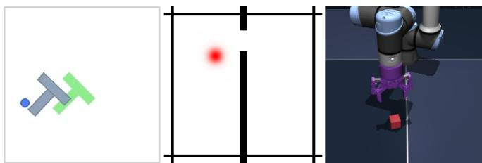
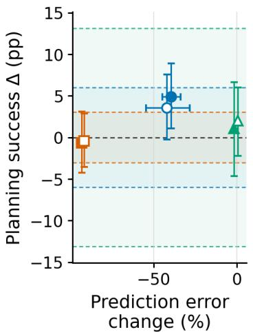
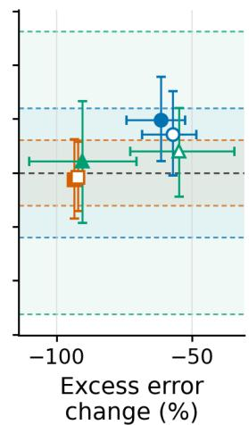

# One-Step Prediction Fidelity Is a Poor Proxy for Planning Performance in JEPA World Models

Joshua Cheung

Zhang He

## Abstract

Latent world models are routinely selected, checkpointed and ablated on one-step prediction loss, on the assumption that a model which predicts the next latent better is a better model. In model-based RL this assumption is known to be unreliable; we ask whether it also fails for latent world models, where the training target is the model’s own embedding and the loss is not expressed in interpretable units. We introduce a frozen-decoder protocol reporting one-step error in physical units, decomposed into the part already present in the encoder’s representation and the part the predictor adds. Applying it to a recent end-to-end JEPA world model across three continuous-control environments, we move the metric by fine-tuning and measure goal-conditioned planning on the same checkpoints, with three training seeds and paired planning seeds throughout. Within one environment, a per-epoch ladder shows the relationship saturating after a single epoch: the first epoch improves fidelity by 32% and planning by 4.4 pp, but across the fifteen checkpoints that follow — a further 15% fidelity improvement, monotone in every training seed — the correlation between one-step error and planning success is r = −0.010. This is not a task-ceiling artifact: stratifying by a model-independent measure of training-data support, planning in the lowest-support stratum starts at 80%, leaving ample headroom, and is nonetheless flat from epoch 1 onward. Across environments the exchange rate is equally unstable: a 93% fidelity reduction on TwoRoom yields −0.7 pp of planning, while a 40% reduction on PushT yields +4.9 pp [+1.1, +8.9]. All results replicate under a decoder-free measure, latent drift. We also show that a matched continued-training control absorbs the entire fidelity gain we had attributed to an auxiliary objective.

## 1 Introduction

Joint-Embedding Predictive Architectures (JEPAs) learn world models by predicting the latent representation of a future observation rather than its pixels [LeCun, 2022]. Recent work has made end-to-end training from pixels stable and cheap [Maes et al., 2026]. Training is driven by a nextembedding prediction loss, and that loss — or a close proxy — is also what practitioners use to choose between checkpoints, to justify architectural changes, and to report progress.

The implicit assumption is that lower one-step prediction error indicates a better world model. In model-based reinforcement learning more broadly this assumption is already known to fail: Lambert et al. [2020] named the objective mismatch between model likelihood and control performance, and showed that the likelihood of one-step-ahead predictions is not reliably correlated with control performance, and the value-aware and value-equivalent model-learning literature [Farahmand et al., 2017, Grimm et al., 2020] is the constructive response to it. That work concerns generative models trained by likelihood or reconstruction. Whether the same mismatch afflicts latent world models — where the training target is the model’s own embedding rather than an observation, and where the metric is therefore not even expressed in interpretable units — has not to our knowledge been measured.

There are reasons to expect it does. The prediction loss is computed in a latent space of the model’s own choosing, at a single step, under teacher forcing, on trajectories drawn from the training distribution. Planning executes long action sequences through the predictor, off-distribution, with no ground-truth latent to anchor to at any point after the first.

Testing this requires three things that are individually unremarkable and rarely combined. First, a measure of prediction fidelity that is interpretable and comparable across models — latent-space error norms are not, since each model chooses its own latent scale. Second, an intervention that moves that measure, so the question becomes causal rather than correlational across an uncontrolled model zoo. Third, a downstream measurement the intervention cannot directly optimize, evaluated with enough statistical care to distinguish a real effect from seed noise. Our contributions:

• A frozen-decoder protocol (Section 3) reporting one-step error in ground-truth physical units. A single decoder, fitted only on encoder embeddings of real observations and then frozen, is applied both to real next-observation embeddings and to predicted next embeddings. Their difference isolates the predictor’s contribution and detects when the protocol has no power.

• A within-environment saturation result (Section 6). A per-epoch checkpoint ladder on PushT shows fidelity improving monotonically across all three training seeds while planning goes flat after the first epoch (r = −0.010 over the fifteen post-epoch-1 checkpoints). Stratifying by a model-independent measure of training-data support shows this is not a task-ceiling artifact, and identifies where these models fail: planning and one-step error are both substantially worse in regions where the offline data are sparse.

• A cross-environment dissociation (Section 7), in which the largest fidelity improvement we induce buys the least planning.

• A noise-floor calibration (Section 8) showing untouched baselines varying by up to 26 percentage points across evaluation seeds — larger than any effect we induce, and larger than differences routinely reported from single runs in this literature.

• A methodological caution (Section 8). An auxiliary state-grounding objective we introduced is indistinguishable from five additional epochs of ordinary training on every measure we computed. Reported without a matched control it would have appeared as a large, tightlyresolved improvement.

## 2 Related work

Objective mismatch. Lambert et al. [2020] showed that model predictive accuracy and downstream control performance are only loosely coupled in model-based RL, and that lower model loss can accompany worse control. Farahmand et al. [2017] and Grimm et al. [2020] respond constructively by training models against value-aware or value-equivalent objectives rather than likelihood. Our contribution is not to observe the mismatch for the first time but to measure it in the latent JEPA setting, where the training target is the model’s own embedding, with a controlled intervention and an interpretable metric.

JEPA world models. LeCun [2022] introduced the JEPA recipe; self-supervised instantiations predict masked latent content for images [Assran et al., 2023] and video [Assran et al., 2025], usually stabilized by an EMA target encoder whose optimization semantics are unclear [Ponce et al., 2026]. Action-conditioned variants either freeze a pretrained encoder [Zhou et al., 2025] or train end-toend with variance-covariance regularization [Bardes et al., 2022, Sobal et al., 2025]. We evaluate LeWorldModel [Maes et al., 2026]: end-to-end from pixels with next-embedding prediction plus a regularizer [Balestriero and LeCun, 2025] enforcing approximately Gaussian latents via random projections [Epps and Pulley, 1983, Cramér and Wold, 1936].

Probing and physical structure. A common evaluation trains probes to recover physical quantities from learned representations [Maes et al., 2026, Sobal et al., 2022]. A second family adopts the violation-of-expectation paradigm [Margoni et al., 2024] to ask whether models assign elevated surprise to physically implausible inputs [Garrido et al., 2025, Bordes et al., 2025]. Both measure what a representation contains or discriminates, computed on encoder outputs applied to real observations. We instead apply the decoder to the predictor’s output, measuring what the model produces.

Planning with latent dynamics. Model-based control either trains a policy in imagination [Ha and Schmidhuber, 2018, Hafner et al., 2020, 2025a,b] or plans at test time with model-predictive control [Hansen et al., 2022, 2024, Bar et al., 2025]. We use the latter, with the cross-entropy method [Rubinstein and Kroese, 2004].

## 3 The frozen-decoder protocol

## 3.1 Setup and metrics

Let enc map an observation $o _ { t }$ to a latent $z _ { t } .$ , and let $\hat { z } _ { t + 1 } = \mathrm { p r e d } _ { \phi } ( z _ { t } , a _ { t } )$ . Let $s _ { t } \in \mathbb { R } ^ { k }$ be the ground-truth simulator state; angles are represented as (sin, cos) pairs so errors respect wrap-around.

We fit a decoder D from latents to physical state using only encoder embeddings of real observations, on a held-out set of training episodes, with the world model frozen. D is then frozen and applied to two different inputs on disjoint test episodes:

$$
E _ { \mathrm { r e p r } } = d \big ( D ( \mathrm { e n c } _ { \theta } ( o _ { t + 1 } ) ) , s _ { t + 1 } \big ) , \qquad E _ { \mathrm { p r e d } } = d \big ( D ( \hat { z } _ { t + 1 } ) , s _ { t + 1 } \big ) , \qquad E _ { \mathrm { e x c e s s } } = E _ { \mathrm { p r e d } } - E _ { \mathrm { r e p r } } ,\tag{1}
$$

where d is squared error per state component, divided by that component’s training-set variance and averaged. Normalisation statistics are shared by all models within an environment.

$E _ { \mathrm { r e p r } }$ asks how readable the next state is from the encoder’s representation of the real next observation; it involves the predictor not at all. $E _ { \mathrm { p r e d } }$ asks the same of the predictor’s output given the true action, and is the quantity a practitioner has in mind when speaking of one-step prediction quality. Eexcess is the one we argue should be reported: if the predictor were perfect, $\hat { z } _ { t + 1 } = z _ { t + 1 }$ and $E _ { \mathrm { e x c e s s } } = 0$ exactly, whatever $D$ does. Conversely, when $\bar { E } _ { \mathrm { r e p r } } \approx E _ { \mathrm { p r e d } }$ , almost all measured error originates before the predictor is involved and the protocol has little power — a condition we observe on one environment (Section 5) and which $E _ { \mathrm { p r e d } }$ alone would have concealed.

## 3.2 Is the decoder extrapolating?

D is fitted on enc (o) and evaluated on $\hat { z } = \mathrm { p r e d } _ { \phi } ( z , a )$ . If predicted latents sit off the encoder’s output manifold, D is being asked to extrapolate and $E _ { \mathrm { e x c e s s } }$ could partly measure manifold offset rather than physical inaccuracy.

We check this against latent drift $\| \hat { z } _ { t + 1 } - z _ { t + 1 } \| _ { 2 }$ , which never passes through the decoder. Within a single environment — across the fifteen PushT ladder checkpoints of Section $^ { 6 , }$ where scales are comparable — mean $E _ { \mathrm { e x c e s s } }$ and mean latent drift correlate at $r = 0 . 8 5$ . The two therefore track each other at the level our claims are made, and every result below replicates under a decoder-free measure. (The same correlation computed across all twelve environment–variant combinations is 0.99, but those points span orders of magnitude in both quantities, so that figure is largely driven by between environment scale and we do not rely on it.) Per transition the two are essentially uncorrelated (PushT $r = 0 . 0 1 2$ , OGBench-Cube $r = - 0 . 0 0 7$ ; TwoRoom is the exception at $r = 0 . 3 4 \mathrm { - 0 . 5 9 }$ , plausibly because its state is two-dimensional and drift is dominated by the position axis), so they are not mechanically coupled within a model. Drift also exhibits the same dissociation independently: it falls 77% on TwoRoom for −0.7 pp of planning and 32% on PushT for +4.9 pp.

## 3.3 Interventions and planning evaluation

We warm-start from released checkpoints and continue training for 5 epochs at learning rate $1 0 ^ { - 5 }$ batch size 128, with three training seeds per environment. Continued uses the original two-term objective only. State-grounded adds an auxiliary head predicting standardized physical state from encoder embeddings (weight 0.1, discarded after training); it was initially proposed as an improvement and is reported here as an instrument. Section 8 shows the two are not distinguishable, so the induced variation should be understood as one intervention under two labels — five additional epochs — rather than two independent manipulations.

A further variant adding auxiliary supervision on state differences was evaluated on fidelity but not planning, and is excluded from the analysis; it changes no conclusion. Because the auxiliary head and the evaluation decoder share a target parameterization, an improvement in $E _ { \mathrm { r e p r } }$ under grounding is close to guaranteed by construction; we treat it as a manipulation check, not a result. The auxiliary loss is applied to encoder embeddings only, so the predictor is never directly supervised toward decodability.

  
Figure 1: Evaluation environments. Left to right: PushT, TwoRoom, OGBench-Cube.

Planning uses the released evaluation unchanged: cross-entropy method [Rubinstein and Kroese, 2004] under receding-horizon MPC over 50 goal-conditioned test trajectories. Solver, hyperparameters and test trajectories are fixed across variants, and the same three planning seeds are used at every training seed, so all differences are paired.

## 4 Experimental setup

Environments. PushT (2D manipulation, 5 state dimensions, 41,983 test transitions); TwoRoom (2D navigation through a doorway, 2 dimensions, 16,076); OGBench-Cube [Park et al., 2025] (3D manipulation, 9 dimensions, 38,000). Figure 1 shows representative frames. All are continuous-action and trained offline without reward.

Decoder. A two-layer MLP, hidden width 512, up to 60 epochs with early stopping (patience 10), batch size 4096. No test episode contributes to fitting D.

Statistics. Three training seeds per variant per environment, five paired decoder/data-split seeds for fidelity, three paired planning seeds. Point estimates average transitions within episodes, then episodes, then evaluation seeds, then training seeds. Intervals come from 10,000 hierarchical paired bootstrap repetitions resampling at all three levels while preserving variant pairing.

Limits of that procedure. Two limitations should be stated up front. A bootstrap resampling only three training seeds gives poorly calibrated intervals at the top level, and our planning intervals should be read as indicative rather than exact. And planning success is a binomial over 50 trajectories, which places a floor of roughly 4–7 pp on what any single evaluation can resolve. Effects smaller than that are not measurable in our design at any seed count, and we do not claim to measure them.

## 5 Are the predictors non-degenerate?

Replacing the true action with one sampled from a different transition raises $E _ { \mathrm { p r e d } }$ by 29.1× on PushT, 15.7× on TwoRoom and 2.1× on OGBench-Cube: the predictors are genuinely action-conditioned. Against trivial baselines — persistence $( \hat { s } _ { t + 1 } = s _ { t } )$ and constant velocity $( \hat { s } _ { t + 1 } = s _ { t } + ( s _ { t } - s _ { t - 1 } ) )$ ), both computed on ground-truth state — PushT and TwoRoom exceed skill 0.87.

OGBench-Cube is the exception. Its constant-velocity skill is −0.74: the learned predictor is worse than linear extrapolation. Its action sensitivity is weakest, and its $E _ { \mathrm { e x c e s s } }$ is only 0.3% of $E _ { \mathrm { p r e d } } .$ meaning almost all measured error originates in the decoder. The protocol has little power there, and $E _ { \mathrm { e x c e s s } }$ detects this without reference to any downstream task. We include OGBench-Cube below but weight it accordingly.

## 6 Within one environment: the relationship saturates

Our fine-tuning runs save a checkpoint each epoch, giving a graded fidelity ladder inside a single environment at evaluation cost only. Table 1 reports PushT, averaged over three training seeds, with five decoder seeds and three paired planning seeds per checkpoint.

<table><tr><td colspan="4"></td><td colspan="4">Planning success (%)</td></tr><tr><td>Epoch</td><td> $E _ { \mathrm { p r e d } }$ </td><td> $\Delta \left( \% \right)$ </td><td>Drift</td><td>Low sup.</td><td>Med. sup.</td><td>High sup.</td><td>All</td></tr><tr><td>0</td><td>0.003336</td><td></td><td>1.123</td><td>80.00</td><td>90.14</td><td>100.00</td><td>90.00</td></tr><tr><td>1</td><td>0.002268</td><td>-32.0</td><td>0.839</td><td>89.17</td><td>94.84</td><td>99.15</td><td>94.44</td></tr><tr><td>2</td><td>0.002109</td><td>-36.8</td><td>0.814</td><td>85.83</td><td>95.78</td><td>97.44</td><td>93.56</td></tr><tr><td>3</td><td>0.002071</td><td>-37.9</td><td>0.787</td><td>86.67</td><td>95.78</td><td>99.15</td><td>94.22</td></tr><tr><td>4</td><td>0.002026</td><td>-39.3</td><td>0.774</td><td>88.33</td><td>95.78</td><td>99.15</td><td>94.67</td></tr><tr><td>5</td><td>0.002013</td><td>-39.7</td><td>0.768</td><td>87.50</td><td>96.71</td><td>98.29</td><td>94.67</td></tr></table>

Table 1: PushT per-epoch ladder, three training seeds. Fidelity and latent drift fall monotonically throughout. Planning is flat after epoch 1 in every support stratum. Support groups are defined in Section 6.1 from the initial block position only, independently of any model. Baseline units per stratum: 40 low, 71 medium, 39 high; a single trajectory–seed unit is 0.5–0.9 pp.

The first epoch moves both quantities: −32.0% fidelity, +4.44 pp planning. Read alone this is consistent with the proxy behaving as assumed, and we report it as such.

The remaining four epochs are the informative part. Fidelity falls a further 11.2% and latent drift a further 8.5%, both monotonically and on every individual training seed. Aggregate planning moves +0.22 pp, and the per-seed changes from epoch 1 to epoch 5 are +2.00, 0.00 and −1.33, differing in sign. Because a 0.22 pp shift is far below what this evaluation can resolve (Section 4), we do not rest the claim on that magnitude. The claim rests on the correlation over the graded portion of the ladder. Across the fifteen post-epoch-1 checkpoints — epochs 1–5 at three training seeds, spanning a further 15% range of $E _ { \mathrm { p r e d } }$ within a single task — the correlation between one-step error and planning success is $r = - \mathrm { \bar { 0 } } . 0 1 0$ , and between latent drift and planning success $r = - 0 . 1 7 5$

Including the baseline checkpoint raises this to $r = - 0 . 8 8$ over the full 40% range. We report that figure but do not rest on it: it is carried entirely by the single epoch 0 → 1 step, and because the baseline was evaluated once and shared across training seeds, the three added points are identical and act as one lever. The informative comparison is between that first step, which moves both quantities, and everything after it, which moves only one.

## 6.1 This is not a task ceiling

Aggregate PushT planning is 90% at epoch 0, so an obvious objection is that the task is saturated rather than the relationship. We test this with a difficulty measure that is defined without reference to any model.

Following an analysis of the offline dataset, we partition the $5 1 2 \times 5 1 2$ workspace into an $8 \times 8$ grid and count the dataset states whose block centre falls in each cell. Weighted quartiles of these counts define low, medium and high support strata, covering 25.2%, 48.5% and 26.3% of dataset states. The partition is spatial: low-support states are edge-like (mean 160.7 px from the workspace centre) and high-support states centre-like (38.7 px). Test trajectories are assigned by the block position at their initial state.

The pretrained baseline is strongly stratified by this measure. Under a ten-planning-seed evaluation, high-support planning exceeds low-support planning by 18.28 pp $[ + 2 . 3 \bar { 8 } , + 3 9 . \bar { 3 } 5 ]$ , and the highminus-low contrast in one-step block-position error is $- 0 . 0 0 2 1 2 7 \ [ - 0 . 0 0 2 3 5 3 , - 0 . 0 0 1 9 2 7 ]$ ; the three-seed ladder of Table 1 gives a 20.0 pp planning gap at epoch 0. Where the training data are sparse, the model both predicts worse and plans worse — a positive finding about where these models fail, independent of anything else here.

It also supplies the headroom the ceiling objection requires. Low-support planning begins at 80.0%, some 20 pp below saturation. If the aggregate flatness were a ceiling effect, this is the stratum in which fidelity gains should convert into planning gains. They do not: low-support planning peaks at epoch 1 $( + 9 . 1 7 \mathrm { p p } )$ , then declines and never recovers, ending at +7.50 pp while fidelity continues to improve monotonically. The epoch-1-to-5 change of −1.67 pp is two trajectories out of 120 comparisons and we do not interpret its sign; what matters is that it is not an increase. Medium support behaves the same way, flat from epoch 2. High support, where a genuine ceiling does operate, is negative throughout (−0.85 to −2.56 pp from a baseline of 100%).

<table><tr><td>Env</td><td>Intervention</td><td></td><td> $\Delta E _ { \mathrm { p r e d } } ( \% )$ </td><td> $\Delta E _ { \mathrm { e x c e s s } } \left( \% \right)$ </td><td></td><td>∆ planning (pp)</td></tr><tr><td>TwoRoom</td><td>Continued</td><td></td><td>-93.1 [−93.8, -92.3]</td><td> $- 9 3 . 4 \left[ - 9 4 . 1 , - 9 2 . 6 \right]$ </td><td></td><td> $- 0 . 6 7 \left[ - 4 . 2 2 , + 3 . 1 2 \right]$ </td></tr><tr><td>TwoRoom</td><td>State-grounded</td><td></td><td> $- 9 1 . 8 \left[ - 9 3 . 0 , - 9 0 . 1 \right]$ </td><td> $- 9 2 . 1 \left[ - 9 3 . 3 , - 9 0 . 4 \right]$ </td><td></td><td> $- 0 . 4 4 \left[ - 3 . 5 6 , + 2 . 8 9 \right]$ </td></tr><tr><td>PushT</td><td>State-grounded</td><td></td><td>1 -42.2 [−54.6, −28.3] 1</td><td>-57.0 [−68.2, -48.2]</td><td></td><td> $+ 3 . 5 6 \ [ - 0 . 2 2 , + 7 . 5 6 ]$ </td></tr><tr><td>PushT</td><td>Continued</td><td></td><td> $- 3 9 . 7 \ [ - 4 4 . 8 , - 3 3 . 8 ]$ </td><td> $- 6 1 . 5 \ : [ - 7 4 . 2 , - 5 2 . 3 ]$ </td><td></td><td> $+ 4 . 8 9 [ + 1 . 1 1 , + 8 . 8 9 ]$ </td></tr><tr><td>Cube</td><td>State-grounded</td><td></td><td> $- 1 . 0 \left[ - 1 . 5 , - 0 . 6 \right]$ </td><td> $- 5 4 . 8 \ : [ - 7 2 . 7 , - 3 4 . 3 ]$ </td><td></td><td> $+ 2 . 0 0 [ - 2 . 2 2 , + 6 . 0 1 ]$ </td></tr><tr><td>Cube</td><td>Continued</td><td></td><td> $- 0 . 3 \left[ - 0 . 6 , + 0 . 0 \right]$ </td><td> $- 9 0 . 4 \ : [ - 1 1 0 . 1 , - 7 0 . 3 ] ^ { \dagger }$ </td><td></td><td> $+ 1 . 1 1 \left[ - 4 . 6 7 , + 6 . 6 7 \right]$ </td></tr></table>

Table 2: Change relative to baseline, 95% hierarchical paired-bootstrap intervals over three training seeds, ordered by fidelity improvement. Only the bolded planning interval excludes zero. Between-arm differences quoted in Section 8 use unrounded values and may differ in the last digit from subtracting the entries shown. $\mathrm { \mathrm { \hat { \mathrm { \Delta } } C u b e \mathrm { \cdot } s \ E _ { e x c e s s } \ i s 0 . 0 0 0 7 } }$ at baseline and 0.0002 after continued training, against $E _ { \mathrm { r e p r } } = 0 . 2 4 4$ ; resampled estimates go negative when decoder noise exceeds the predictor’s contribution, so the interval extends past −100%. See Section 5.

Per-trajectory outcomes confirm that the flat aggregate is not cancelling churn of growing magnitude. Relative to epoch 0, trajectories that flip from success to failure number 8, 10, 7, 7, 10 across epochs 1–5 out of 405 baseline successes — real backward movement, roughly 2%, with no trend as fidelity improves.

## 6.2 A third intervention: rebalancing data coverage

The support stratification suggests a further intervention that manipulates data rather than the objective. Holding checkpoint, architecture, objective, sample count and epochs fixed, we resampled the 200,000 selected training windows to favour rare block positions, raising the low-support share from 27.1% to 43.6%.

Its pre-specified outcomes were null: low-support block-position error changed by −0.000036 [−0.000101, +0.000032] and low-support planning by +1.245 pp [−3.611, +5.989]. A secondary, uncorrected outcome did move — low-support mean state-prediction nMSE fell by 0.000207 [−0.000386, −0.000019], a 6.7% relative reduction — so rebalancing changes some aspects of one-step physical prediction without producing detectable planning improvement. We report it as a third instrument exhibiting the same signature, not as a positive result.

## 7 Across environments: no stable exchange rate

Table 2 orders the six intervention–environment pairs by fidelity improvement. The two largest, both above 91%, produce the only two negative planning estimates. The single resolvable planning improvement, +4.9 pp, arises from a fidelity change less than half that size — and belongs to the control arm, not the intervention. OGBench-Cube’s −0.3% produces a larger planning point estimate than TwoRoom’s −93.1%.

We are explicit about what this comparison is. Because the two interventions are indistinguishable (Section 8), the fidelity variation in Table 2 is almost entirely between environments: within each environment the two rows differ by a few percentage points of fidelity and produce same-signed planning changes. Neither side of this comparison is strictly commensurable across tasks. Planning success differs in baseline and headroom; equally, a percentage reduction in $E _ { \mathrm { p r e d } }$ does not mean the same thing in a two-dimensional state space whose $E _ { \mathrm { e x c e s s } }$ is essentially all of $E _ { \mathrm { p r e d } }$ as it does in a nine-dimensional one whose predictor is degenerate. Table 2 alone would therefore support only a weak claim. It is Section 6, where fidelity varies within a single task, that supplies the within-environment evidence; the two together establish that the exchange rate between fidelity and planning is neither stable across tasks nor sustained within one.

Figure 2 plots both fidelity measures against paired planning change.

## 8 Two ways to see an effect that is not there

Two features of this design would, if omitted, have produced confident conclusions from nothing. We report them separately from the main result because they stand independently of it.

  
Figure 2: Change in one-step fidelity (left: $E _ { \mathrm { p r e d } } ;$ right: $E _ { \mathrm { e x c e s s } } )$ against paired change in planning success, three training seeds. Shaded bands show ±1 standard deviation of the unmodified baseline across evaluation seeds, one band per environment (widest: OGBench-Cube, ±13.1). Five of six points lie within the ambient variation of doing nothing.

The planning noise floor. Evaluating the untouched baseline checkpoints across planning seeds — changing nothing about the model — gives 84–96 on PushT (sd 6.0), 82–88 on TwoRoom (sd 3.1) and 58–84 on OGBench-Cube (sd 13.1). The unmodified OGBench-Cube baseline varies by 26 percentage points across evaluation seeds alone, against a largest observed intervention effect anywhere of 4.9 pp. Planning comparisons in this literature are frequently reported from single runs. At these variances a single-seed comparison can produce an apparent effect of ten or more percentage points from nothing, in either direction: our own OGBench-Cube grounded-minusbaseline differences are +6, −4 and +6 across three planning seeds at one training seed. Pairing across matched seeds is what recovers enough power to resolve the one effect we can resolve. Paired multi-seed evaluation should be the default for this class of comparison, and the seed spread should be reported alongside the mean.

A matched control absorbs the intervention. State grounding is not distinguishable from continued training on any measure we computed. On TwoRoom, Continued alone achieves −93.1% against grounding’s −91.8% — the control is nominally better, with overlapping intervals. Paired planning differences between the arms, resampled over training seeds, are −1.33 [−4.22, +1.78] on PushT, +0.22 [−4.44, +4.00] on TwoRoom and +0.89 [−4.00, +5.11] on OGBench-Cube: no consistent sign, all containing zero. Latent drift does not separate them either. We flag this because the control is easy to omit, and its omission is not obviously negligent. The two arms differ in one loss weight; the auxiliary objective is well-motivated; the improvement is large, tightly resolved, and reproduces across five evaluation and three training seeds. Reported without a matched continued-training arm, the natural conclusion would be that an auxiliary state-grounding loss reduces one-step physical prediction error by more than 90%. That number is real. Its attribution would have been wrong.

## 9 Discussion

What we are entitled to conclude. We do not claim that fidelity interventions never affect planning: one of our six effects is resolved and positive, and the first epoch of fine-tuning moves both quantities together. What we can exclude is a stable, monotone exchange rate of the kind the proxy’s use presupposes. Within PushT the relationship saturates after one epoch; across environments, a 93% fidelity reduction on TwoRoom buys less planning than a 0.3% reduction on OGBench-Cube does. Neither pattern licenses ranking checkpoints or architectures by one-step loss.

Why this might be. We advance no mechanism, having measured none. One-step teacher-forced error may be dominated by transitions planning never visits; planning may be limited by the optimizer or by compounding error rather than single-step accuracy; or the planning cost may be insensitive to the latent directions our interventions improve. Distinguishing these requires rollout-level measurement, to which the protocol extends directly.

Limitations. Our fidelity measure is one-step and teacher-forced while planning is long-horizon and off-distribution; a rollout-level version of this measurement is the experiment that would settle how far the result generalizes, and we regard it as the most promising direction. We evaluate one architecture at 15M parameters, three low-dimensional simulated environments, one planner, and warm-started fine-tunes from one checkpoint family, so we characterize a neighbourhood rather than the space of world models. Our within-environment ladder covers one environment; the correlation is estimated over the 15% fidelity range lying beyond the first epoch, which is about a fifth of the total baseline-to-epoch-5 reduction, and a wider within-task sweep via auxiliary-weight or capacity ablation would strengthen it. Our support stratification addresses the task-ceiling confound but rests on 40 low-support baseline units, so individual stratum differences of one or two percentage points are not interpretable. Three training seeds and 50 planning trajectories bound what we can resolve, as noted in Section 4.

Recommendations. Do not present a reduction in latent prediction loss as evidence of a better world model without a downstream measurement. When a fidelity metric is reported, decompose it: $E _ { \mathrm { e x c e s s } }$ separates predictor error from decoder error and identifies when a probing-based evaluation has no power. Accompany any fine-tuning intervention with a matched continued-training arm. Report planning with paired multiple seeds at both the training and evaluation levels, and publish the seed spread.

## 10 Conclusion

We introduced a frozen-decoder protocol measuring one-step world-model prediction error in physical units and separating the predictor’s contribution from the encoder’s. Moving that metric by finetuning, we found the relationship to goal-conditioned planning saturates within a task after a coarse initial gain, and has no stable exchange rate across tasks: the largest fidelity improvements we induced bought the least planning. The result replicates under a decoder-free measure, and a matched continued-training control absorbs the entire improvement we had attributed to an auxiliary objective. One-step fidelity is a poor proxy for planning competence at this scale.

## References

M. Assran, Q. Duval, I. Misra, P. Bojanowski, P. Vincent, M. Rabbat, Y. LeCun, and N. Ballas. Self-supervised learning from images with a joint-embedding predictive architecture. In CVPR, pages 15619–15629, 2023.

M. Assran, A. Bardes, D. Fan, Q. Garrido, R. Howes, M. Muckley, A. Rizvi, C. Roberts, K. Sinha, A. Zholus, et al. V-JEPA 2: Self-supervised video models enable understanding, prediction and planning. arXiv:2506.09985, 2025.

R. Balestriero and Y. LeCun. LeJEPA: Provable and scalable self-supervised learning without the heuristics. arXiv:2511.08544, 2025.

A. Bar, G. Zhou, D. Tran, T. Darrell, and Y. LeCun. Navigation world models. In CVPR, pages 15791–15801, 2025.

A. Bardes, J. Ponce, and Y. LeCun. VICReg: Variance-invariance-covariance regularization for self-supervised learning. In ICLR, 2022.

F. Bordes, Q. Garrido, J. T. Kao, A. Williams, M. Rabbat, and E. Dupoux. IntPhys 2: Benchmarking intuitive physics understanding in complex synthetic environments. arXiv:2506.09849, 2025.

H. Cramér and H. Wold. Some theorems on distribution functions. Journal of the London Mathematical Society, 1(4):290–294, 1936.

T. W. Epps and L. B. Pulley. A test for normality based on the empirical characteristic function. Biometrika, 70 (3):723–726, 1983.

A. Farahmand, A. Barreto, and D. Nikovski. Value-aware loss function for model-based reinforcement learning. In Artificial Intelligence and Statistics (AISTATS), pages 1486–1494. PMLR, 2017.

Q. Garrido, N. Ballas, M. Assran, A. Bardes, L. Najman, M. Rabbat, E. Dupoux, and Y. LeCun. Intuitive physics understanding emerges from self-supervised pretraining on natural videos. arXiv:2502.11831, 2025.

C. Grimm, A. Barreto, S. Singh, and D. Silver. The value equivalence principle for model-based reinforcement learning. In Advances in Neural Information Processing Systems, volume 33, pages 5541–5552, 2020.

D. Ha and J. Schmidhuber. World models. arXiv:1803.10122, 2018.

D. Hafner, T. Lillicrap, J. Ba, and M. Norouzi. Dream to control: Learning behaviors by latent imagination. In ICLR, 2020.

D. Hafner, J. Pasukonis, J. Ba, and T. Lillicrap. Mastering diverse control tasks through world models. Nature, 640(8059):647–653, 2025a.

D. Hafner, W. Yan, and T. Lillicrap. Training agents inside of scalable world models. arXiv:2509.24527, 2025b.

N. Hansen, X. Wang, and H. Su. Temporal difference learning for model predictive control. In ICML, 2022.

N. Hansen, H. Su, and X. Wang. TD-MPC2: Scalable, robust world models for continuous control. In ICLR, 2024.

N. Lambert, B. Amos, O. Yadan, and R. Calandra. Objective mismatch in model-based reinforcement learning. In Learningfor Dynamics and Control (L4DC), volume 120 of PMLR, pages 761–770, 2020.

Y. LeCun. A path towards autonomous machine intelligence, version 0.9.2. OpenReview, 2022.

L. Maes, Q. Le Lidec, D. Scieur, Y. LeCun, and R. Balestriero. LeWorldModel: Stable end-to-end jointembedding predictive architecture from pixels. arXiv:2603.19312, 2026.

F. Margoni, L. Surian, and R. Baillargeon. The violation-of-expectation paradigm: A conceptual overview. Psychological Review, 131(3):716, 2024.

S. Park, K. Frans, B. Eysenbach, and S. Levine. OGBench: Benchmarking offline goal-conditioned RL. In ICLR, 2025.

J. Ponce, B. Terver, M. Hebert, and M. Arbel. Dual perspectives on non-contrastive self-supervised learning. In ICLR, 2026.

R. Y. Rubinstein and D. P. Kroese. The cross-entropy method: a unified approach to combinatorial optimization, Monte-Carlo simulation and machine learning. Springer, 2004.

V. Sobal, Jyothir S V, S. Jalagam, N. Carion, K. Cho, and Y. LeCun. Joint embedding predictive architectures focus on slow features. arXiv:2211.10831, 2022.

V. Sobal, W. Zhang, K. Cho, R. Balestriero, T. G. J. Rudner, and Y. LeCun. Learning from reward-free offline data: A case for planning with latent dynamics models. In Advances in Neural Information Processing Systems, volume 38, 2025.

G. Zhou, H. Pan, Y. LeCun, and L. Pinto. DINO-WM: World models on pre-trained visual features enable zero-shot planning. In ICML, pages 79115–79135. PMLR, 2025.

## A Absolute values and reproducibility notes

All claims in the main text are relative changes with intervals. For reference, baseline (epoch-0) values, averaged over five evaluation seeds at the reference training seed, are: PushT $E _ { \mathrm { r e p r } } = \bar { 0 . 0 0 2 6 0 } .$ $E _ { \mathrm { p r e d } } = 0 . 0 0 3 3 4$ , drift 1.123; TwoRoom $2 . 9 9 \times 1 0 ^ { - 5 }$ , 0.01017, 3.439; OGBench-Cube 0.24421, $0 . { \dot { 2 } } 4 4 9 2 , \ 0 . 8 6 2$ . Persistence and constant-velocity skill are 0.945/0.944 (PushT), 0.871/0.914 (TwoRoom) and −0.637/ − 0.736 (OGBench-Cube).

Hyperparameters match across environments and seeds, verified by auditing every saved run configuration. One state-grounded checkpoint needed a parameter-name remap for an older ViT key layout, verified lossless (303/303 tensors, zero value mismatches). Baseline PushT planning matches the originally reported figure on one of three evaluation seeds (96%), averaging 90%. The ladder used only checkpoints saved during the original runs; no extra training was done.