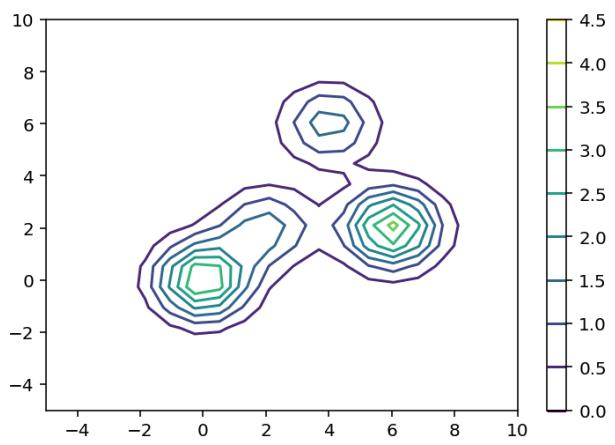
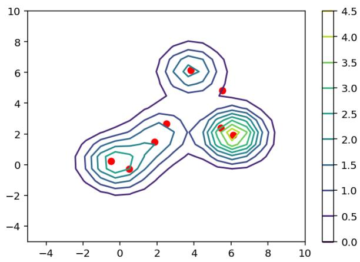
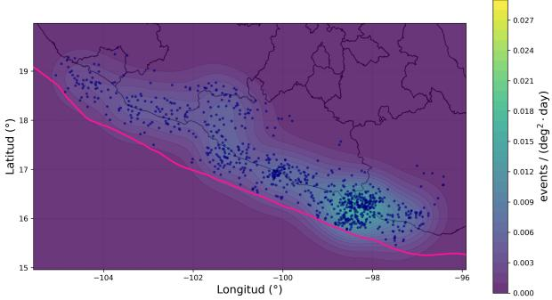
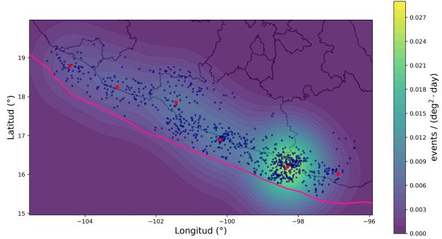

# PROJECTED WASSERSTEIN-FISHER-RAO FLOWS FOR HAWKES BACKGROUND-INTENSITY ESTIMATION

ISA´IAS BANALES AND ARTURO JARAMILLO˜

Abstract. We consider the problem of estimating the background intensity of a Hawkes process when the triggering mechanism is known, treating the background as an unknown finite positive measure with a regular density. We propose a likelihood-based variational approach based on the Wasserstein-Fisher-Rao geometry. In this setting, the relevant first variations are naturally distribution-valued and therefore fall outside the classical gradient flow formulation. We develop a distributional framework for the resulting dynamics and give them a finite-dimensional meaning through projections onto statistical manifolds. We identify the true background as the unique zero of a limiting generalized gradient when $\kappa _ { F R } > 0$ and, under suitable stability, compactness, integrability and approximation conditions, establish a conditional consistency theorem for measurable estimators satisfying the empirical projected equations on events whose probabilities tend to one. Finally, we specialize the construction to Gaussian-mixture manifolds and obtain an explicit finite-dimensional scheme.

Keywords: Hawkes processes, ETAS models, background intensity estimation, Wasserstein-Fisher-Rao gradient flows, statistical manifolds, variational inference.

## 1. Introduction

This paper is devoted the to the development of a framework for variational inference based on distribution-valued Wasserstein-Fisher-Rao gradient dynamics on spaces of measures, with the goal of estimating the background intensity in Hawkes-type models of seismic activity. We also develop an explicit numerical scheme that exploits the merging of Gaussian components to obtain parsimonious representations of the background intensity. Its performance is illustrated through simulated Poisson data and real seismic data from southern Mexico, within the ETAS framework.

From the point of view of the statistical problem motivating this work, our starting point is the non-parametric estimation of the driving measures underlying point process models, which provide a natural framework for describing systems in which the occurrence of an event modifies the likelihood of subsequent events, and are particularly relevant in the modeling of seismic activity. Among the most prominent instances of such models are Hawkes processes [23], which can be viewed as counting processes retaining some of the basic features of the classical Poisson process, while incorporating a form of memory through a conditional intensity that combines a background component with a self-exciting contribution determined by the past history of the process (see Section 2.1 for further details). In seismology, this mechanism constitutes the basis of the Epidemic Type Aftershock Sequence (ETAS) model [44], where earthquakes are interpreted as events that may trigger additional seismic activity over time and space.

A fundamental statistical problem in this setting is the estimation of the background intensity. In a general non-parametric formulation, the background intensity is not represented by a finite-dimensional parameter, but by a non-negative measure, or equivalently, whenever absolute continuity holds, by a non-negative spatial density. The corresponding estimation problem is therefore naturally infinite dimensional. More precisely, given N observed events with spatial locations $x _ { 1 } , \ldots , x _ { N }$ in a spatial region of interest $\mathcal { Z } \subseteq \mathbb { R } ^ { d }$ over a time horizon [0, T], one is led to a likelihood functional $\mathcal { F } _ { T }$ which, as explained in detail in Section 2.2, has the form

$$
\mathcal { F } _ { T } ( \mu ) = \frac { 1 } { T } \sum _ { q = 1 } ^ { N } \log \left( \Gamma [ \mu ] ( x _ { q } ) + b _ { q } \right) - \mu [ \mathcal { Z } ] ,\tag{1.1}
$$

where $\mu$ denotes a finite nonnegative background measure on $\mathcal { Z }$ with a specified continuous density $\Gamma [ \mu ]$ with respect to Lebesgue measure, and $b _ { q }$ represents the cumulative excitation at the q-th observed event generated by the preceding events. The triggering mechanism will be kept fixed throughout.

Maximizing $\mathcal { F } _ { T }$ is a natural formulation of the estimation problem. Related likelihood-based optimization over spaces of measures using Wasserstein-Fisher-Rao dynamics has been studied by Yan, Wang and Rigollet [54]. Our setting, however, is diferent. We work directly with the Hawkes background likelihood as a functional of the unknown density, before introducing any finite-dimensional representation. As discussed in Section 2.2, the unrestricted likelihood maximization problem is ill posed. Nevertheless, the original likelihood still admits a distribution-valued first variation, structure that serves as the starting point for the projected dynamics developed in this work. To place the problem in context, we first review the broader literature on non-parametric background-intensity estimation for Hawkes and ETAS models, including likelihood-based, declustering, kernel, Bayesian and other nonparametric approaches. We then return to the variational formulation and explain how the ingredients used in our construction relate to existing work on measure-valued gradient flows and projection methods.

1.1. Existing approaches to background intensity estimation. Among the existing approaches to background-intensity estimation, classical likelihood-based methods provide a natural starting point. In the classical ETAS formulation, the background and triggering mechanisms are specified through finite-dimensional parametric families and estimated by likelihood methods [44]. Zhuang, Ogata and Vere-Jones [55] introduced a stochastic declustering approach in which the branching structure is used to assign to each event a probability of belonging to the background process, whose intensity is then estimated non-parametrically through kernel methods. This latent branching interpretation was later used by Veen and

Schoenberg [51] to formulate an EM-type procedure, providing an alternative to the direct maximization of the likelihood; see also [49].

Several works have introduced more flexible representations of the background intensity. Marsan and Lenglin´e [38] considered a non-parametric reconstruction of earthquake triggering, while Fox, Schoenberg and Gordon [17] developed spatially inhomogeneous background estimators for non-parametric Hawkes models. Li, Song and Wang [34] further considered space-time inhomogeneity by combining the latent branching representation with histogram and variable-bandwidth kernel estimators. These approaches allow considerable flexibility, but require choosing a particular representation or smoothing mechanism for the unknown intensity.

Bayesian non-parametric methods provide another important alternative. Kottas and Sans´o [31] represented the intensity of a spatial Poisson process as a positive scale multiplied by a probability density and assigned a Dirichlet-process mixture prior to the latter. Ross and Kolev [47] incorporated this idea into the ETAS framework. Alternatively, Molkenthin et al. [41] modeled the spatial background intensity through a Gaussian-process prior, while Muir and Ross [42] considered a deep Gaussian-process representation. Dependent Dirichletprocess constructions provide another way of allowing the underlying density to vary with space or time [16, 53]. More recently, Ba˜nales et al. [4] used graphical Dirichlet processes to model a spatiotemporally varying background intensity. Such flexibility is particularly relevant in seismic applications, where background activity may change due to tectonic forcing, slow-slip phenomena or large earthquakes [19, 20, 39, 40, 13, 43].

1.2. Variational inference approach. The variational formulation of likelihood-based estimation provides a natural connection with gradient flows on spaces of measures. This connection relies on a well-established mathematical framework [28, 45, 2], and related constructions have been used in sampling and variational inference [37, 36, 32]. In particular, Yan, Wang and Rigollet [54] develop Wasserstein-Fisher-Rao (WFR) gradient descent for non-parametric maximum-likelihood estimation of Gaussian mixtures. Their work provides an important methodological precedent for the construction considered here.

In the model studied by Yan, Wang and Rigollet [54], independent and identically distributed observations have density $\xi _ { \star } * \varphi ,$ where $\xi _ { \star }$ is an unknown probability mixing measure and $\varphi$ is a fixed Gaussian density. The Gaussian convolution regularizes the dependence of the likelihood on the mixing measure, yielding a regular first variation with respect to this measure and allowing the Wasserstein Fisher Rao gradient flow to be formulated directly on the corresponding space of probability measures. The authors derive an interacting-particle implementation in which both weights and locations evolve, and establish convergence properties of the associated WFR iterations under suitable conditions. Our construction, however, follows a diferent route: we derive the Wasserstein-Fisher-Rao direction directly from the original Hawkes likelihood at the level of the unknown background density, introducing a finite-dimensional representation only afterward through tangent-space projection.

In our setting, the unknown background intensity is a finite positive measure whose total mass must also be inferred. This naturally leads to unbalanced transport geometries [30, 35, 11], and in particular to the Wasserstein-Fisher-Rao geometry, whose Wasserstein component transports mass through space while its Fisher-Rao component allows its magnitude to vary.

When $\mu ( d x ) \ : = \ : \rho ( x ) d x$ , the directional derivative of $\mathcal { F } _ { T }$ with respect to regular enough perturbations of the density is represented by the distribution

$$
\frac { \delta \mathcal { F } _ { T } } { \delta \rho } = \frac { 1 } { T } \sum _ { q = 1 } ^ { N } \frac { 1 } { \rho ( x _ { q } ) + b _ { q } } \delta _ { x _ { q } } - 1 .\tag{1.2}
$$

This singular first variation prevents a direct use of the regular WFR gradient-flow formula, but it also provides the main computational simplification of our construction. When the corresponding WFR expression is tested against smooth directions, spatial derivatives are transferred onto those directions and the Dirac masses turn the empirical contribution into exact point evaluations at the observed events. We therefore retain the singular event terms rather than smoothing the empirical score. Once this weak action has been identified, we use the standard mechanism of tangent-space projection to obtain a finite-dimensional realization. The non-standard feature is thus not the projection step itself, but the distributionvalued Wasserstein Fisher Rao operator to which it is applied and the fact that its singular structure makes the resulting projected quantities explicit. Our main goal is to turn these dynamics into a practical likelihood-based procedure for estimating the background intensity, to study the limiting behavior of the resulting estimators, and to assess their performance numerically. We refer to the resulting construction as a projected Wasserstein-Fisher-Rao likelihood flow.

The use of tangent-space projection to obtain finite-dimensional approximations of infinitedimensional evolutions is a well-established idea, closely related to Galerkin approximation and to the diferential-geometric approach to statistical models. In nonlinear filtering, projection methods on finite-dimensional manifolds of densities were developed, in particular, by Brigo, Hanzon and Le Gland [7, 8]; Armstrong and Brigo [3] later developed direct- $. L ^ { 2 }$ projection on Gaussian-mixture manifolds, with tangent Gram matrices, explicit Gaussian calculations and numerical implementations. Brigo and Pistone [9] place this type of projection-based dimensional reduction in a broader framework for measure-valued evolution equations. We use this established projection mechanism as one component of the present construction, applied here to the distribution-valued WFR operator generated by the Hawkes likelihood.

## 1.2.1. Projected Wasserstein-Fisher-Rao likelihood flows.

Applying the Wasserstein-Fisher-Rao prescription to the empirical likelihood leads formally to $\partial _ { u } \rho _ { u } = \mathcal { A } _ { T } ( \rho _ { u } )$ , with

$$
A _ { T } ( \rho ) = - \kappa _ { W } \nabla \cdot \left( \rho \nabla \frac { \delta \mathcal { F } _ { T } } { \delta \rho } \right) + \kappa _ { F R } \rho \frac { \delta \mathcal { F } _ { T } } { \delta \rho } .\tag{1.3}
$$

Since the first variation in (1.2) is distribution-valued, we do not interpret this dynamic as a classical evolution equation. Instead, for a smooth finite-dimensional family

$$
\mathcal { M } _ { \Theta } = \{ \rho _ { \theta } : \theta \in \Theta \} ,
$$

with $\Theta \subset \mathbb { R } ^ { m }$ and $\rho _ { \theta } \mathrm { ~ a ~ }$ suitable family of densities, we require the tangent velocity to reproduce the action of $\scriptstyle A _ { T } ( \rho _ { \theta } )$ on the tangent directions of $\mathcal { M } _ { \Theta }$ . The construction, developed in Section $^ { 3 , }$ naturally leads to the determination of $\theta$ through the dynamics

$$
G ( \theta ) { \dot { \theta } } = g _ { T } ( \theta ) ,\tag{1.4}
$$

where $G ( \theta )$ is the Gram matrix of the tangent directions and $g _ { T } ( \theta )$ records the action of the generalized gradient on those directions. We call (1.4) the projected Wasserstein-Fisher-Rao likelihood flow.

This construction uses the likelihood to generate projected estimating equations; it does not in general produce likelihood ascent or likelihood maximization on the chosen manifold. Its statistical motivation is to ask whether empirical projected equilibria identify the true background as the observation horizon grows and the available tangent directions become suficiently rich. This statistical limit is distinct from convergence of a trajectory in algorithmic time.

1.2.2. Equilibrium. Fix an observation horizon $T .$ . Under the regularity and immersion assumptions of Subsection 3.4, suppose that a solution $\theta ( u )$ of the empirical projected dynamics exists for every $u \geq 0$ and converges to a parameter $\theta _ { \infty }$ in $\Theta$ . Then $\rho _ { \Theta } ^ { \circ } : = \rho _ { \theta _ { \circ } }$ satisfies the empirical equilibrium equation

$$
\langle \mathcal { A } _ { T } ( \rho _ { \Theta } ^ { \circ } ) , d \rangle = 0\tag{1.5}
$$

for every d in $T _ { \rho _ { \Theta } ^ { \circ } } \mathcal { M } _ { \Theta }$ . Thus, each statistical manifold provides a finite collection of empirical projected equations. This implication does not establish convergence of the trajectories.

1.2.3. Conditional consistency. In order to carry out the consistency analysis, we assume that the data-generating Hawkes-ETAS parameters satisfy the conditions stated in Section 2.1, including the subcriticality condition on the branching ratio. The precise arguments are developed in Section $5 ;$ here we only describe the mechanism behind the result.

Let $\rho _ { \star }$ denote the true background density and let $\rho$ be a generic candidate density, with the triggering mechanism kept fixed. The observed data are generated under $\rho _ { \star }$ , while the empirical likelihood is evaluated at $\rho .$ . Applying the projected Wasserstein-Fisher-Rao construction to this likelihood gives the empirical generalized gradient $\scriptstyle A _ { T } ( \rho )$ . The consistency question is whether the equilibria produced by this procedure identify the background density that generated the data. To address this, we introduce the limiting generalized gradient $\scriptstyle A ( \rho )$ associated with the stationary regime of the model. As a first step, for $\kappa _ { F R } > 0$ , we prove that $\mathcal { A } ( \rho ) = 0$ if and only if $\rho = \rho _ { \star }$ . Thus, at the limiting level, the generalized-gradient equation has the true background density as its unique solution.

It remains to understand whether the empirical projected equilibria are eventually forced toward this limiting equation. Two approximations are involved, and they play diferent roles. First, as the observation horizon grows, the empirical generalized gradient $\scriptstyle A _ { T } ( \rho )$ approaches its limiting counterpart $\scriptstyle A ( \rho )$ in a suitable topology of distributions. This is where the stationary and ergodic regime provided by the subcriticality assumptions enters the argument. Second, as the statistical manifolds become suficiently rich, their tangent spaces provide an increasingly complete collection of directions along which the generalized gradient is tested. Hence, if $\rho _ { n } ^ { \circ }$ is an empirical projected equilibrium satisfying

$$
\big \langle \boldsymbol { A } _ { T _ { n } } ( \rho _ { n } ^ { \circ } ) , \boldsymbol { v } \big \rangle = 0 , \qquad \boldsymbol { v } \in T _ { \rho _ { n } ^ { \circ } } \mathcal { M } _ { m _ { n } } ,
$$

then, for large observation horizons and suficiently accurate tangent approximations, these projected equations increasingly capture the full limiting condition $\ A ( \rho ) = 0$ . Since that condition identifies only $\rho _ { \star }$ , this suggests that the empirical equilibria should approach the true background density.

Theorem 5.3 makes this argument precise under the assumptions of Section 5, including tangent approximation and the high-probability existence of measurable empirical equilibria. The selected densities then converge in probability to $\rho _ { \star }$ in both $H ^ { \beta } ( { \mathcal { Z } } )$ and $L ^ { 1 } ( \mathcal { Z } )$ , and their total masses converge to that of $\rho _ { \star }$

1.3. Gaussian-mixture realization and numerical study. We finally turn to a concrete realization of the projected construction. For the numerical implementation, we take the statistical manifolds to be finite mixtures of Gaussian densities with fixed bandwidth. For a given number k of components, we write

$$
\rho _ { \theta } ( x ) = \sum _ { i = 1 } ^ { k } e ^ { \alpha _ { i } } \chi _ { \sigma } ( x ; m _ { i } ) ,\tag{1.6}
$$

where $m _ { 1 } , \ldots , m _ { k }$ are the component locations and $\alpha _ { 1 } , \ldots , \alpha _ { k }$ are their log-weights. This choice is particularly convenient for the equations developed above: the densities and their tangent directions are smooth, the Gram matrix can be computed explicitly, and the action of the distributional generalized gradient on the tangent space admits a closed expression in terms of the observed events, the Gaussian components and the Hawkes excitation. The resulting projected flow is therefore a finite-dimensional system of ordinary diferential equations that can be implemented without discretizing the ambient spatial domain.

The number of components k controls the flexibility of the finite-dimensional Gaussian representation and the number of tangent directions available to the projected equations. In the planned numerical experiments, k will be treated as an implementation parameter rather than as the index of an asymptotic manifold-refinement scheme. Thus, varying k allows us to examine the efect of the dimension of the chosen statistical manifold, without invoking the tangent-approximation assumptions of Theorem 5.3.

The planned numerical experiments will examine the resulting dynamics in examples for which the true background intensity is known. We will study how well the method recovers spatially non-constant background intensities and how the reconstruction changes with the number of Gaussian components, their initialization and bandwidth, and the relative values of $\kappa _ { W }$ and $\kappa _ { F R }$ . In particular, the experiments will examine the contributions inherited from the ambient Wasserstein transport and Fisher-Rao reaction terms.

Section 2 introduces the model and background likelihood. Section 3 develops the distributional WFR construction and its projection onto statistical manifolds. Section 4 gives the Gaussian-mixture realization. Section 5 presents a conditional consistency result for an increasingly complex collection of statistical manifolds. Numerical experiments and discussion follow in Sections 6 and 7. The appendices contain the statistical proofs.

## 2. Model and background likelihood

We first specify the observed process and isolate the part of its likelihood that depends on the background. The triggering mechanism is kept fixed throughout, so changes in the candidate background do not change the excitation computed from a given event history.

2.1. Hawkes processes and the ETAS model. Let $\eta$ be a locally finite simple marked point process on $\mathbb { R } _ { + } \times \mathcal { Z } \times \mathcal { R }$ , where $\mathcal { Z } \subseteq \mathbb { R } ^ { d }$ is the spatial region and R is the mark space. Its ground counting measure is $\eta ( d t , d x ) : = \pmb \eta ( d t , d x , \pmb \mathscr { R } )$ . We use the usual augmentation of the natural filtration and start with empty history at time zero. Under a background density $\rho ,$ the ground process has predictable compensator $\lambda _ { \rho } ( t , x )$ dt dx. Equivalently, for each bounded Borel set $C \subseteq { \mathcal { Z } }$ 2

$$
\eta [ ( 0 , t ] \times C ] - \int _ { 0 } ^ { t } \int _ { C } \lambda _ { \rho } ( s , x ) d x d s
$$

is a local martingale. We take

$$
\lambda _ { \rho } ( t , x ) = \rho ( x ) + B _ { t } ( x ) ,\tag{2.1}
$$

$$
B _ { t } ( x ) = \int _ { ( 0 , t ) } \int _ { \mathcal { Z } \times \mathcal { R } } \nu ( t - s , x - y , r ) \eta ( d s , d y , d r ) .\tag{2.2}
$$

The background is time-independent, nonnegative and has finite mass. The kernel $\nu$ is nonnegative, and $B _ { t }$ only uses events strictly before t. For finitely many previous events, $\begin{array} { r } { B _ { t } ( x ) = \sum _ { i : t _ { i } < t } \nu ( t - t _ { i } , x - x _ { i } , r _ { i } ) } \end{array}$ . Thus $\rho$ describes background activity, while the summands describe activity triggered by earlier events. General references are [23, 14, 24, 6].

For the ETAS specification [44], use the factorization

$$
\nu ( s , z , r ) = \kappa ( r ) g ( s ) f ( z ; r ) \mathbb { 1 } _ { \{ s > 0 \} } ,\tag{2.3}
$$

where $\kappa$ gives productivity, g gives the temporal distribution of direct descendants, and $f ( \cdot ; r )$ is a probability density on $\mathbb { R } ^ { d }$ . More specifically, let

$$
\kappa ( r ) = K \exp \{ \alpha ( r - M _ { u } ) \} , \qquad g ( s ) = ( p - 1 ) c ^ { p - 1 } ( s + c ) ^ { - p } , \qquad s > 0 ,
$$

with $K , c > 0$ and $p > 1$ , so that $\begin{array} { r } { \int _ { 0 } ^ { \infty } g ( s ) d s = 1 } \end{array}$ . Marks attached at birth are independent of the preceding history and of one another, with density

$$
q _ { \mathrm { G R } } ( r ) = \beta _ { \mathrm { G R } } \exp \{ - \beta _ { \mathrm { G R } } ( r - M _ { u } ) \} \mathbb { 1 } _ { \{ r \geq M _ { u } \} } , \qquad \beta _ { \mathrm { G R } } > 0 .\tag{2.4}
$$

The marked compensator is therefore $\lambda _ { \rho } ( t , x ) q _ { \mathrm { G R } } ( r )$ dt dx dr.

The finite-sample construction does not require stationarity. For the statistical analysis, we assume $\alpha < \beta _ { \mathrm { G R } }$ and

$$
\mathfrak { n } : = \int _ { M _ { u } } ^ { \infty } \kappa ( r ) q _ { \mathrm { G R } } ( r ) d r = K \frac { \beta _ { \mathrm { G R } } } { \beta _ { \mathrm { G R } } - \alpha } < 1 .\tag{2.5}
$$

$\mathrm { O n } \mathbb { R } ^ { d }$ , n is the expected number of direct descendants after averaging over the parent mark. On a smaller region, discarding descendants outside the region can only decrease this mean. Finite background mass and (2.5) give a stationary version with finite mean rate that is mixing under time translations. Appendix A recalls the construction and gives the estimates needed to compare it with the observed empty-history process. No spatial stationarity is assumed.

2.2. Likelihood for the background intensity. Let $( t _ { q } , x _ { q } , r _ { q } ) _ { q = 1 } ^ { N }$ be the events observed up to $T > 0$ , ordered by time, and put $b _ { q } : = B _ { t _ { q } } ( x _ { q } )$ . The joint marked point-process likelihood is

$$
L _ { T } ^ { \mathrm { m a r k e d } } ( \rho ) = \exp \bigg \{ - \int _ { 0 } ^ { T } \int _ { \mathcal { Z } } \lambda _ { \rho } ( t , x ) d x d t \bigg \} \prod _ { q = 1 } ^ { N } \lambda _ { \rho } ( t _ { q } , x _ { q } ) q _ { \mathrm { G R } } ( r _ { q } ) .\tag{2.6}
$$

The intensity is evaluated predictably, so an event does not contribute to its own excitation. The mark-density factor is independent of the candidate background and can be omitted when estimating $\rho ;$ this is a factorization of the joint likelihood, not conditioning on the entire observed list of marks. See [14, 44].

Since the triggering mechanism is fixed, $B _ { t }$ is computed from the same observed history for every candidate. In particular,

$$
\int _ { 0 } ^ { T } \int _ { Z } \lambda _ { \rho } ( t , x ) d x d t = T \int _ { Z } \rho ( x ) d x + \int _ { 0 } ^ { T } \int _ { Z } B _ { t } ( x ) d x d t .
$$

The log-likelihood can consequently be written as

$$
\ell _ { T } ( \rho ) = \sum _ { q = 1 } ^ { N } \log \big ( \rho ( x _ { q } ) + b _ { q } \big ) - T \int _ { \mathcal { Z } } \rho ( x ) d x + C _ { T } ,\tag{2.7}
$$

where $C _ { T }$ includes the integrated excitation and mark contribution and does not depend on $\rho .$ We therefore work with the normalized objective

$$
\mathcal { F } _ { T } ( \rho ) = \frac { 1 } { T } \sum _ { q = 1 } ^ { N } \log \left( \rho ( x _ { q } ) + b _ { q } \right) - \int _ { \mathcal { Z } } \rho ( x ) d x .\tag{2.8}
$$

For $\mu ( d x ) = \rho ( x ) d x$ , this is the functional in (1.1). Normalization rescales the subsequent vector field and algorithmic time, but not its equilibria.

The point evaluations require specified continuous representatives. For finite observations, we initially use integrable densities with $\rho ( x _ { q } ) + b _ { q } > 0$ at every event and finite $b _ { q } ;$ the construction below imposes additional spatial regularity. This restriction matters statistically: unrestricted concentration at observed points can make the likelihood arbitrarily large while keeping the mass bounded. We do not assume an unrestricted non-parametric likelihood maximizer exists. Instead, the likelihood generates projected estimating equations on smooth statistical manifolds.

## 3. Projected Wasserstein-Fisher-Rao construction

In this section we make precise the dynamics of measures outlined in the introduction. The construction proceeds in four steps. First, we recall how the Wasserstein-Fisher-Rao geometry associates an evolution equation with a functional whose first variation is regular. Second, we return to the empirical likelihood: since its first variation in (1.2) is distributionvalued, we interpret the corresponding WFR gradient in a weak sense and identify a Sobolev setting in which the resulting generalized gradient $\scriptstyle A _ { T } ( \rho )$ is well defined. Third, we establish the regularity of the map $\rho \mapsto \mathcal { A } _ { T } ( \rho )$ that will be needed to define the dynamics. Finally, having identified the generalized WFR gradient that prescribes the infinitesimal motion of the measure, we use it to define dynamics on smooth finite-dimensional statistical manifolds. Since this ambient direction is distribution-valued and need not itself be a tangent vector to the chosen manifold, we select the tangent velocity whose $L ^ { 2 }$ pairings with the tangent directions reproduce the action prescribed by the generalized WFR gradient. Each statistical manifold therefore yields a finite-dimensional projected realization of the same underlying infinitesimal WFR dynamics, and the collection of these realizations constitutes our projected Wasserstein-Fisher-Rao construction.

Throughout this section and the remaining analysis, we take $\mathcal { Z } = \mathbb { R } ^ { d }$ . The observation horizon is T, while u denotes algorithmic time.

3.1. Wasserstein Fisher Rao dynamics. We begin by recalling the standard Wasserstein-Fisher-Rao formulation underlying our construction; see [28, 45, 2, 48] for the Wasserstein gradient-flow viewpoint, and [30, 35, 11, 10] for the Wasserstein-Fisher-Rao geometry and its applications to gradient dynamics. For a smooth family $\rho _ { u }$ of positive, integrable densities on $\mathcal { Z } .$ , a transport field $v _ { u }$ and a reaction field $\alpha _ { u }$ represent its velocity through

$$
\partial _ { u } \rho _ { u } + \nabla \cdot \left( \rho _ { u } v _ { u } \right) = \alpha _ { u } \rho _ { u } .\tag{3.1}
$$

The pair $( v _ { u } , \alpha _ { u } )$ is not uniquely determined by the velocity $\partial _ { u } \rho _ { u } .$ : diferent combinations of transport and reaction may produce the same change of density through (3.1). To distinguish among these representations, one equips the space of measures with a metric structure, or equivalently at the infinitesimal level with a cost for the pair $( v _ { u } , \alpha _ { u } )$ . Minimizing this cost among all pairs producing the same velocity defines the corresponding tangent norm. Thus, (3.1) specifies the admissible ways in which a measure may evolve, while the choice of cost determines the geometry used to select among them. In the WFR geometry, for $\kappa _ { W } , \kappa _ { F R } > 0$ this cost takes the form

$$
\int _ { \mathcal { Z } } \left( \frac { | v _ { u } | ^ { 2 } } { \kappa _ { W } } + \frac { | \alpha _ { u } | ^ { 2 } } { \kappa _ { F R } } \right) \rho _ { u } d x .
$$

The squared WFR norm of the tangent velocity is then defined as the smallest cost among all pairs representing it:

$$
\| \partial _ { u } \rho _ { u } \| _ { \rho _ { u } , \mathrm { W F R } } ^ { 2 } = \operatorname* { i n f } _ { \substack { v _ { u } , \alpha _ { u } : } \atop \partial _ { u } \rho _ { u } + \nabla \cdot ( \rho _ { u } v _ { u } ) = \alpha _ { u } \rho _ { u } } \int _ { \mathcal { Z } } \left( \frac { | v _ { u } | ^ { 2 } } { \kappa _ { W } } + \frac { | \alpha _ { u } | ^ { 2 } } { \kappa _ { F R } } \right) \rho _ { u } d x .\tag{3.2}
$$

The operator formulas below also allow nonnegative coeficients with $\kappa _ { W } + \kappa _ { F R } > 0$ ; the displayed tangent norm is used only when both coeficients are positive.

To see how this geometry determines a gradient, suppose a functional E has a regular first variation $\varphi _ { \rho }$ . This means that

$$
D \mathcal { E } ( \rho ) [ h ] : = \left. \frac { d } { d \varepsilon } \mathcal { E } ( \rho + \varepsilon h ) \right| _ { \varepsilon = 0 } = \int _ { \mathcal { Z } } \varphi _ { \rho } ( x ) h ( x ) d x
$$

for admissible perturbations h. Along a curve satisfying (3.1), the chain rule and integration by parts give

$$
\frac { d } { d u } \mathcal { E } ( \rho _ { u } ) = \int _ { \mathcal { Z } } \varphi _ { \rho _ { u } } \partial _ { u } \rho _ { u } d x = \int _ { \mathcal { Z } } \rho _ { u } \nabla \varphi _ { \rho _ { u } } \cdot v _ { u } d x + \int _ { \mathcal { Z } } \rho _ { u } \varphi _ { \rho _ { u } } \alpha _ { u } d x .\tag{3.3}
$$

With respect to the weighted inner product in (3.2), this derivative is represented by the fields $v _ { u } = \kappa _ { W } \nabla \varphi _ { \rho _ { u } }$ and $\alpha _ { u } = \kappa _ { F R } \varphi _ { \rho _ { u } }$ . Substitution into the continuity-reaction equation gives the formal WFR gradient-ascent equation

$$
\partial _ { u } \rho _ { u } = - \kappa _ { W } \nabla \cdot \left( \rho _ { u } \nabla \varphi _ { \rho _ { u } } \right) + \kappa _ { F R } \rho _ { u } \varphi _ { \rho _ { u } } .\tag{3.4}
$$

Along this regular evolution,

$$
\frac { d } { d u } \mathcal { E } ( \rho _ { u } ) = \kappa _ { W } \int _ { \mathcal { Z } } \rho _ { u } | \nabla \varphi _ { \rho _ { u } } | ^ { 2 } d x + \kappa _ { F R } \int _ { \mathcal { Z } } \rho _ { u } | \varphi _ { \rho _ { u } } | ^ { 2 } d x \geq 0 .
$$

Thus, whenever the preceding formal calculation is justified, the WFR gradient direction increases the value of E along the resulting curve.

3.2. Distributional Wasserstein Fisher Rao gradient. We now return to the empirical likelihood. Fix the observed events and write $b _ { q } = B _ { t _ { q } } ( x _ { q } ) \in [ 0 , \infty )$ . Let $\rho \in C ^ { 1 } ( \mathcal { Z } ) \cap L ^ { 1 } ( \mathcal { Z } )$ be nonnegative and satisfy $\rho ( x _ { q } ) { + } b _ { q } > 0$ at every event. Diferentiating (2.8) in an integrable, continuous direction h for which $\rho + \varepsilon h$ remains admissible gives

$$
D \mathcal { F } _ { T } ( \rho ) [ h ] = \frac { 1 } { T } \sum _ { q = 1 } ^ { N } \frac { h ( x _ { q } ) } { \rho ( x _ { q } ) + b _ { q } } - \int _ { \mathcal { Z } } h ( x ) d x .\tag{3.5}
$$

Using $\langle \delta _ { x _ { q } } , h \rangle = h ( x _ { q } )$ , the directional derivative can be written as

$$
D \mathcal { F } _ { T } ( \rho ) [ h ] = \langle S _ { T } ( \rho ) , h \rangle ,
$$

thus implying that the associated first variation is represented by

$$
\mathcal { S } _ { T } ( \rho ) = \frac { 1 } { T } \sum _ { q = 1 } ^ { N } \frac { \delta _ { x _ { q } } } { \rho ( x _ { q } ) + b _ { q } } - 1 .\tag{3.6}
$$

Here the constant term acts by integration against Lebesgue measure.

If we formally substitute $S _ { T } ( \rho )$ into the WFR equation (3.4), the Wasserstein term would require taking spatial derivatives of the Dirac masses appearing in $S _ { T } ( \rho )$ . This suggests formulating the corresponding WFR gradient in a weak sense. First suppose that the first

variation is represented by a smooth function s. For $\phi \in C _ { c } ^ { \infty } ( \mathcal { Z } )$ , integration by parts gives

$$
\begin{array} { l } { \displaystyle \int _ { \mathcal Z } \big [ - \kappa _ { W } \nabla \cdot ( \rho \nabla s ) + \kappa _ { F R } \rho s \big ] \phi d x } \\ { \displaystyle \quad = - \kappa _ { W } \int _ { \mathcal Z } s \nabla \cdot ( \rho \nabla \phi ) d x + \kappa _ { F R } \int _ { \mathcal Z } s \rho \phi d x . } \end{array}
$$

The right-hand side no longer involves derivatives of $s$ and therefore remains meaningful when s is replaced by the distributional first variation $S _ { T } ( \rho )$ . This leads to the following weak formulation of the empirical WFR generalized gradient:

$$
\langle A _ { T } ( \rho ) , \phi \rangle : = - \kappa _ { W } \langle S _ { T } ( \rho ) , \nabla \cdot ( \rho \nabla \phi ) \rangle + \kappa _ { F R } \langle S _ { T } ( \rho ) , \rho \phi \rangle .\tag{3.7}
$$

The pairings are understood as integration against the locally finite signed measure $S _ { T } ( \rho )$ their arguments are continuous and compactly supported.

The weak formulation above can be written explicitly in terms of the observed events. Substituting (3.6) into (3.7) and using

$$
\int _ { \mathcal { Z } } \nabla \cdot \left( \rho \nabla \phi \right) d x = 0 ,
$$

for $\phi \in C _ { c } ^ { \infty } ( \mathcal { Z } )$ , gives

$$
\begin{array} { l } { \langle A _ { T } ( \rho ) , \phi \rangle = \displaystyle - \frac { \kappa _ { W } } { T } \sum _ { q = 1 } ^ { N } \frac { \nabla \cdot ( \rho \nabla \phi ) ( x _ { q } ) } { \rho ( x _ { q } ) + b _ { q } } + \frac { \kappa _ { F R } } { T } \sum _ { q = 1 } ^ { N } \frac { \rho ( x _ { q } ) \phi ( x _ { q } ) } { \rho ( x _ { q } ) + b _ { q } } } \\ { \displaystyle - \kappa _ { F R } \int _ { \mathcal Z } \rho ( x ) \phi ( x ) d x . } \end{array}\tag{3.8}
$$

3.3. Sobolev regularity. Before passing to statistical manifolds, we need to make sure that the weak action above is defined on a suficiently large class of test functions and depends regularly on the candidate density. This is precisely what will allow us to evaluate $\scriptstyle A _ { T } ( \rho )$ on tangent directions and, later, to obtain a well-defined finite-dimensional dynamics. Since (3.8) involves pointwise evaluations of $\phi , \nabla \phi$ and $\Delta \phi$ , we take

$$
\beta > \frac { d } { 2 } + 2 .
$$

Then Sobolev embedding gives a constant $C _ { \beta }$ such that

$$
\operatorname* { m a x } \{ \| \phi \| _ { \infty } , \| \nabla \phi \| _ { \infty } , \| \Delta \phi \| _ { \infty } \} \leq C _ { \beta } \| \phi \| _ { H ^ { \beta } } .
$$

We write $H ^ { - \beta }$ for the continuous dual of $H ^ { \beta }$ . The following result shows that the weak empirical WFR gradient defines an element of this dual space, and hence in particular a tempered distribution, and varies regularly with $\rho .$

Proposition 3.1. Let $\beta > d / 2 \AA + 2$ and let $\rho \in C ^ { 1 } ( \mathcal { Z } ) \cap L ^ { 1 } ( \mathcal { Z } )$ be nonnegative, with $\rho ( x _ { q } ) { + } b _ { q } >$ 0 for every observed event. Then the action defined in (3.7) extends uniquely from $C _ { c } ^ { \infty } ( \mathcal { Z } )$ to a continuous linear functional on $H ^ { \beta }$ . In particular,

$$
\begin{array} { r } { A _ { T } ( \rho ) \in H ^ { - \beta } . } \end{array}
$$

For every $\phi \in H ^ { \beta }$ , its action is given by (3.8). Moreover, for every $M , a > 0$ , there is a finite constant C, depending also on the fixed observations, $T , \beta$ and the coeficients, such that

$$
\| \mathcal { A } _ { T } ( \rho ) - \mathcal { A } _ { T } ( \gamma ) \| _ { H ^ { - \beta } } \leq C \| \rho - \gamma \| _ { H ^ { \beta } }
$$

whenever $\rho , \gamma \in H ^ { \beta } \cap L ^ { 1 }$ are nonnegative, their $H ^ { \beta }$ norms are at most M, and $\rho ( x _ { q } ) +$ $b _ { q } , \gamma ( x _ { q } ) + b _ { q } \geq a$ at every event.

Proof. For $\phi \in C _ { c } ^ { \infty } ( \mathcal { Z } )$ , formula (3.8) and Sobolev embedding give

$$
\begin{array} { r l } & { | \langle \mathcal { A } _ { T } ( \rho ) , \phi \rangle | \leq \frac { C _ { \beta } } { T } \displaystyle \sum _ { q = 1 } ^ { N } \frac { \kappa _ { W } | \nabla \rho ( x _ { q } ) | + ( \kappa _ { W } + \kappa _ { F R } ) \rho ( x _ { q } ) } { \rho ( x _ { q } ) + b _ { q } } \| \phi \| _ { H ^ { \beta } } } \\ & { \quad \quad \quad \quad \quad + \kappa _ { F R } C _ { \beta } \| \rho \| _ { L ^ { 1 } } \| \phi \| _ { H ^ { \beta } } . } \end{array}
$$

The coeficient is finite because the number of observed events is finite and every denominator is positive. Hence the weak action is bounded with respect to the $H ^ { \beta }$ norm on $C _ { c } ^ { \infty } ( { \mathcal { Z } } )$ Density of $C _ { c } ^ { \infty } ( { \mathcal { Z } } )$ in $H ^ { \beta }$ gives a unique continuous extension, so $\mathcal { A } _ { T } ( \rho ) \in H ^ { - \beta }$ . The righthand side of (3.8) is itself continuous in $\phi$ for the $H ^ { \beta }$ norm by the same bound, and therefore represents this extension.

For the Lipschitz property, let $\rho$ and $\gamma$ have $H ^ { \beta }$ norms bounded by M and suppose that

$$
\rho ( x _ { q } ) + b _ { q } , ~ \gamma ( x _ { q } ) + b _ { q } \geq a > 0
$$

for every observed event. At each x , the diference of the Wasserstein contributions can be $x _ { q }$ written as

$$
\frac { \nabla \cdot ( \rho \nabla \phi ) } { \rho + b _ { q } } - \frac { \nabla \cdot ( \gamma \nabla \phi ) } { \gamma + b _ { q } } = \frac { \nabla \cdot ( ( \rho - \gamma ) \nabla \phi ) } { \rho + b _ { q } } + \nabla \cdot ( \gamma \nabla \phi ) \frac { \gamma - \rho } { ( \rho + b _ { q } ) ( \gamma + b _ { q } ) } .
$$

The same decomposition applies to the Fisher-Rao event term. Sobolev embedding and the lower bound $a$ bound each event diference by a constant times $\| \rho - \gamma \| _ { H ^ { \beta } } \| \phi \| _ { H ^ { \beta } }$ . The deterministic term is controlled separately by

$$
\displaystyle \left. \int _ { \mathcal { Z } } ( \rho - \gamma ) \phi d x \right. \le \lVert \rho - \gamma \rVert _ { L ^ { 2 } } \lVert \phi \rVert _ { L ^ { 2 } } \le \lVert \rho - \gamma \rVert _ { H ^ { \beta } } \lVert \phi \rVert _ { H ^ { \beta } } .
$$

Combining these bounds gives

$$
| \langle \mathcal { A } _ { T } ( \rho ) - \mathcal { A } _ { T } ( \gamma ) , \phi \rangle | \leq C \Vert \rho - \gamma \Vert _ { H ^ { \beta } } \Vert \phi \Vert _ { H ^ { \beta } } ,
$$

where $C$ depends on $M , a , T , \beta _ { \astrosun }$ , the coeficients and the fixed observations. Taking the supremum over $\| \phi \| _ { H ^ { \beta } } \leq 1$ proves the claim. □

For the statistical analysis developed later, it will also be convenient to write the same action directly in terms of the ground counting measure:

$$
\begin{array} { l } { \displaystyle \langle A _ { T } ( \rho ) , \phi \rangle = \frac { 1 } { T } \int _ { ( 0 , T ] \times  { \boldsymbol { z } } } \frac { - \kappa _ { W } \nabla \cdot ( \rho \nabla \phi ) ( \boldsymbol { x } ) + \kappa _ { F R } \rho ( \boldsymbol { x } ) \phi ( \boldsymbol { x } ) } { \rho ( \boldsymbol { x } ) + B _ { t } ( \boldsymbol { x } ) } \eta ( d t , d \boldsymbol { x } ) } \\ { \displaystyle - \kappa _ { F R } \int _ {  { \boldsymbol { z } } } \rho ( \boldsymbol { x } ) \phi ( \boldsymbol { x } ) d \boldsymbol { x } . } \end{array}\tag{3.9}
$$

Thus $\scriptstyle A _ { T } ( \rho )$ can be evaluated on any $H ^ { \beta }$ tangent direction, which is exactly what is needed to define the projected dynamics in the next subsection.

3.4. Projected dynamics. Having constructed the generalized WFR gradient $\scriptstyle A _ { T } ( \rho )$ , which prescribes the ambient infinitesimal motion of the density, we now use it to define a finitedimensional dynamics. For a chosen statistical manifold, the ambient distributional direction need not itself be a tangent vector. We therefore determine a tangent velocity by requiring its $L ^ { 2 }$ pairing with each tangent direction to reproduce the action of $\scriptstyle A _ { T } ( \rho )$ on that direction. Let $\Theta \subset \mathbb { R } ^ { m }$ be open and let $\theta \mapsto \rho _ { \theta }$ be twice continuously diferentiable into $H ^ { \beta }$ . Each $\rho _ { \theta }$ is an integrable nonnegative density satisfying $\rho _ { \theta } ( x _ { q } ) + b _ { q } > 0$ at every observed event. Write

$$
\mathcal { M } _ { \Theta } = \{ \rho _ { \theta } : \theta \in \Theta \} , \qquad d _ { i } ^ { \theta } = \partial _ { \theta _ { i } } \rho _ { \theta } , \qquad T _ { \rho _ { \theta } } \mathcal { M } _ { \Theta } = \mathrm { s p a n } \{ d _ { 1 } ^ { \theta } , \ldots , d _ { m } ^ { \theta } \} .\tag{3.10}
$$

We assume the parametrization is an immersion, meaning that these tangent directions are linearly independent in $L ^ { 2 }$ . We work in local charts of an embedded statistical manifold; redundant parameter labels are permitted only when they are related by compatible changes of coordinates. A diferentiable parameter curve satisfies $\begin{array} { r } { \partial _ { u } \rho _ { \theta ( u ) } = \sum _ { i } d _ { i } ^ { \theta ( u ) } \dot { \theta } _ { i } ( u ) } \end{array}$ . The empirical projected equations are

$$
\int _ { \mathcal { Z } } \partial _ { u } \rho _ { \theta ( u ) } ( x ) d _ { j } ^ { \theta ( u ) } ( x ) d x = \langle A _ { T } ( \rho _ { \theta ( u ) } ) , d _ { j } ^ { \theta ( u ) } \rangle ,\tag{3.11}
$$

for $j = 1 , \ldots , m$ . They replace an equality between a regular tangent velocity and a distribution by finitely many scalar equalities.

Define the Gram matrix and the projected coeficients by

$$
G _ { i j } ( \theta ) = \int _ { \mathcal { Z } } d _ { i } ^ { \theta } d _ { j } ^ { \theta } d x , \qquad g _ { T , j } ( \theta ) = \langle \mathcal { A } _ { T } ( \rho _ { \theta } ) , d _ { j } ^ { \theta } \rangle .\tag{3.12}
$$

The chain rule turns (3.11) into

$$
G ( \theta ) \dot { \theta } = g _ { T } ( \theta ) , \qquad \dot { \theta } = G ( \theta ) ^ { - 1 } g _ { T } ( \theta ) .\tag{3.13}
$$

Indeed, $\begin{array} { r } { a ^ { \top } G ( \theta ) a = \| \sum _ { i } a _ { i } d _ { i } ^ { \theta } \| _ { L ^ { 2 } } ^ { 2 } } \end{array}$ , so the immersion assumption makes G positive definite. Substituting (3.8) gives

$$
\begin{array} { l } { { \displaystyle g _ { T , j } ( \theta ) = \ - \frac { \kappa _ { W } } { T } \sum _ { q = 1 } ^ { N } \frac { \nabla \cdot ( \rho _ { \theta } \nabla d _ { j } ^ { \theta } ) ( x _ { q } ) } { \rho _ { \theta } ( x _ { q } ) + b _ { q } } + \frac { \kappa _ { F R } } { T } \sum _ { q = 1 } ^ { N } \frac { \rho _ { \theta } ( x _ { q } ) d _ { j } ^ { \theta } ( x _ { q } ) } { \rho _ { \theta } ( x _ { q } ) + b _ { q } } } } \\ { { \displaystyle \qquad - \kappa _ { F R } \int _ { \mathcal { Z } } \rho _ { \theta } d _ { j } ^ { \theta } d x } . } \end{array}\tag{3.14}
$$

Equations (3.11) identify the unique tangent vector whose $L ^ { 2 }$ pairing with every tangent direction agrees with the action of $\boldsymbol { \mathcal { A } } _ { T }$ . Thus the velocity is the finite-dimensional $L ^ { 2 }$ -Riesz representative of the restricted functional, not an $L ^ { 2 }$ representative of the ambient distribution. This description is independent of coordinates: a smooth reparametrization changes the matrix and vector but not the tangent velocity of the density. It is not the gradient obtained by restricting the WFR metric to $\mathcal { M } _ { \Theta }$ , so neither likelihood ascent nor likelihood maximization on the manifold is implied.

On a suficiently small coordinate neighborhood, the event intensities have a positive common lower bound and the parametrization and its first two derivatives have bounded $H ^ { \beta }$ norms. Proposition 3.1 and the continuous bilinear dual pairing then make $g _ { T }$ locally Lipschitz. Since G is continuously diferentiable and positive definite, $G ^ { - 1 } g _ { T }$ is locally Lipschitz. Hence, for every initial condition $\theta _ { 0 } \in \Theta$ , the projected system (3.13) admits a unique local solution by standard ordinary diferential equation theory.

The same construction applies to every statistical manifold satisfying the preceding assumptions. The generalized WFR gradient $\boldsymbol { A } _ { T }$ prescribes the underlying ambient infinitesimal motion, while the chosen manifold determines its finite-dimensional tangent realization. The resulting collection of manifold-indexed systems (3.13) is what we call the projected Wasserstein-Fisher-Rao dynamics.

An empirical projected equilibrium satisfies $g _ { T } ( \theta ) = 0$ . If a global trajectory has an interior limit $\theta _ { \infty }$ , continuity of the vector field makes its velocity converge to $G ( \theta _ { \infty } ) ^ { - 1 } g _ { T } ( \theta _ { \infty } )$ That vector must be zero: otherwise its projection along its limiting direction is eventually bounded away from zero, contradicting convergence of $\theta ( u )$ . Existence of a trajectory limit is not asserted. The statistical question in Section 5 instead concerns empirical equilibria as the observation horizon and the collection of available tangent directions increase.

## 4. Gaussian-mixture realization

In the previous section, the projected Wasserstein-Fisher-Rao construction was defined for a general statistical manifold, giving a family of finite-dimensional realizations of the same ambient generalized WFR dynamics. Our purpose here is not to study all such realizations simultaneously, but to obtain one explicit and computable instance that can be used for estimation. We therefore specialize to fixed-bandwidth Gaussian mixtures. For this family, all the ingredients of the projected system introduced in (1.4) can be computed explicitly: we first identify the tangent directions, then compute their $L ^ { 2 }$ Gram matrix, next evaluate the generalized WFR gradient along these directions, and finally assemble the resulting system in a form suitable for numerical implementation. The statistical conditions under which projected estimators recover the true background are studied in the forthcoming Section 5.

4.1. Tangent directions. The first ingredient to be determined is the tangent space of the chosen statistical manifold. Fix $k \geq 1$ and $\sigma > 0$ . We write

$$
\theta = \left( \alpha _ { 1 } , \ldots , \alpha _ { k } , m _ { 1 } , \ldots , m _ { k } \right)
$$

for the parameters of the Gaussian mixture, where $\alpha _ { i } \in \mathbb { R }$ are the log-weights and $m _ { i } \in \mathbb { R } ^ { d }$ are the component locations. We then define

$$
\chi _ { \sigma } ( x ; m ) = ( 2 \pi \sigma ^ { 2 } ) ^ { - d / 2 } \exp \big \{ - | x - m | ^ { 2 } / ( 2 \sigma ^ { 2 } ) \big \} ,\tag{4.1}
$$

$$
\rho _ { \theta } ( x ) = \sum _ { i = 1 } ^ { k } e ^ { \alpha _ { i } } \chi _ { \sigma } ( x ; m _ { i } ) .\tag{4.2}
$$

For convenience in the writing, we will use the shortcut notation $\chi _ { i } ( x ) : = \chi _ { \sigma } ( x ; m _ { i } )$ and $y _ { i } ( x ) : = x - m _ { i }$ . Diferentiating with respect to the log-weights and locations gives

$$
d _ { i } ^ { \alpha } ( x ) = e ^ { \alpha _ { i } } \chi _ { i } ( x ) , \qquad d _ { i , \ell } ^ { m } ( x ) = e ^ { \alpha _ { i } } \chi _ { i } ( x ) \frac { y _ { i , \ell } ( x ) } { \sigma ^ { 2 } } ,\tag{4.3}
$$

for $\ell = 1 , \ldots , d .$ All event intensities are positive. We restrict to configurations where these directions are linearly independent; coinciding or redundant components can violate this condition.

4.2. Gram matrix. The second ingredient is the Gram matrix $G ( \theta )$ appearing in the projected system (3.13). Since its entries are the $L ^ { 2 }$ inner products of the tangent directions above, they can be computed explicitly from Gaussian overlaps. Define

$$
\begin{array} { l } { { \displaystyle K _ { i j } ( \theta ) = e ^ { \alpha _ { i } + \alpha _ { j } } ( 4 \pi \sigma ^ { 2 } ) ^ { - d / 2 } \exp \big \{ - | m _ { i } - m _ { j } | ^ { 2 } / ( 4 \sigma ^ { 2 } ) \big \} } } \\ { { \displaystyle \quad \quad = \int _ { \mathcal { Z } } e ^ { \alpha _ { i } } \chi _ { i } ( x ) e ^ { \alpha _ { j } } \chi _ { j } ( x ) d x . } } \end{array}\tag{4.4}
$$

Then, for $i , j = 1 , \ldots , k$ and $\ell , r = 1 , \ldots , d ,$

$$
G _ { \alpha _ { i } , \alpha _ { j } } = K _ { i j } ,\tag{4.5}
$$

$$
G _ { \alpha _ { j } , m _ { i , \ell } } = G _ { m _ { i , \ell } , \alpha _ { j } } = - \frac { m _ { i , \ell } - m _ { j , \ell } } { 2 \sigma ^ { 2 } } K _ { i j } ,\tag{4.6}
$$

$$
G _ { m _ { i , \ell } , m _ { j , r } } = K _ { i j } \biggl ( \frac { \mathbb { 1 } _ { \{ \ell = r \} } } { 2 \sigma ^ { 2 } } - \frac { \bigl ( m _ { i , \ell } - m _ { j , \ell } \bigr ) \bigl ( m _ { i , r } - m _ { j , r } \bigr ) } { 4 \sigma ^ { 4 } } \biggr ) .\tag{4.7}
$$

To verify these identities, write $z = x - ( m _ { i } + m _ { j } ) / 2$ . Completion of the square gives

$$
\chi _ { i } ( x ) \chi _ { j } ( x ) = ( 2 \pi \sigma ^ { 2 } ) ^ { - d } \exp \bigg \{ - \frac { | z | ^ { 2 } } { \sigma ^ { 2 } } - \frac { | m _ { i } - m _ { j } | ^ { 2 } } { 4 \sigma ^ { 2 } } \bigg \} .
$$

After normalization, z has mean zero and covariance $( \sigma ^ { 2 } / 2 ) I$ . Also $y _ { i } = z - ( m _ { i } - m _ { j } ) / 2$ and $y _ { j } = z + ( m _ { i } - m _ { j } ) / 2$ . The constant moment gives $G _ { \alpha _ { i } , \alpha _ { j } }$ , the mean of $y _ { i }$ gives the mixed entry, and $\mathbb { E } [ y _ { i , \ell } y _ { j , r } ] = ( \sigma ^ { 2 } / 2 ) \mathbb { 1 } _ { \{ \ell = r \} } - ( m _ { i , \ell } - m _ { j , \ell } ) ( m _ { i , r } - m _ { j , r } ) / 4$ gives the location block after division by $\sigma ^ { 4 }$

4.3. Projected generalized gradient. Having computed the Gram matrix $G ( \theta )$ , it remains to determine the projected generalized-gradient coeficients $g _ { T } ( \theta )$ appearing on the right-hand side of the projected system (1.4). Direct diferentiation of the Gaussian tangent directions gives

$$
\nabla \cdot ( \rho _ { \theta } \nabla d _ { i } ^ { \alpha } ) ( x ) = e ^ { \alpha _ { i } } \chi _ { i } ( x ) \sum _ { a = 1 } ^ { k } e ^ { \alpha _ { a } } \chi _ { a } ( x ) \bigg ( \frac { y _ { a } ( x ) \cdot y _ { i } ( x ) + | y _ { i } ( x ) | ^ { 2 } } { \sigma ^ { 4 } } - \frac { d } { \sigma ^ { 2 } } \bigg )\tag{4.8}
$$

and

$$
\begin{array} { r l } & { \nabla \cdot ( \rho _ { \theta } \nabla d _ { i , \ell } ^ { m } ) ( x ) } \\ & { = e ^ { \alpha _ { i } } \chi _ { i } ( x ) \displaystyle \sum _ { a = 1 } ^ { k } e ^ { \alpha _ { a } } \chi _ { a } ( x ) \bigg ( \frac { y _ { i , \ell } ( x ) \big ( y _ { a } ( x ) \cdot y _ { i } ( x ) + | y _ { i } ( x ) | ^ { 2 } \big ) } { \sigma ^ { 6 } } - \frac { y _ { a , \ell } ( x ) + ( d + 2 ) y _ { i , \ell } ( x ) } { \sigma ^ { 4 } } \bigg ) . } \end{array}\tag{4.9}
$$

The corresponding mass pairings are obtained from the Gaussian overlap identities:

$$
\int _ { \mathcal { Z } } \rho _ { \theta } d _ { i } ^ { \alpha } d x = \sum _ { a = 1 } ^ { k } K _ { i a } , \qquad \int _ { \mathcal { Z } } \rho _ { \theta } d _ { i , \ell } ^ { m } d x = - \frac { 1 } { 2 \sigma ^ { 2 } } \sum _ { a = 1 } ^ { k } ( m _ { i , \ell } - m _ { a , \ell } ) K _ { i a } .\tag{4.10}
$$

Substitution in (3.14) therefore gives

$$
\begin{array} { r c l } { g _ { T , \alpha _ { i } } ( \theta ) } & { = } & { \displaystyle - \frac { \kappa _ { W } } { T } \sum _ { q = 1 } ^ { N } \frac { \nabla \cdot ( \rho _ { \theta } \nabla d _ { i } ^ { \alpha } ) ( x _ { q } ) } { \rho _ { \theta } ( x _ { q } ) + b _ { q } } + \frac { \kappa _ { F R } } { T } \sum _ { q = 1 } ^ { N } \frac { \rho _ { \theta } ( x _ { q } ) d _ { i } ^ { \alpha } ( x _ { q } ) } { \rho _ { \theta } ( x _ { q } ) + b _ { q } } - \kappa _ { F R } \sum _ { a = 1 } ^ { k } K _ { i a } , } \end{array}\tag{4.11}
$$

and

$$
\begin{array} { c l } { \displaystyle g _ { T , m _ { i } , \ell } ( \theta ) = - \frac { \kappa _ { W } } { T } \sum _ { q = 1 } ^ { N } \frac { \nabla \cdot ( \rho _ { \theta } \nabla d _ { i , \ell } ^ { m } ) ( x _ { q } ) } { \rho _ { \theta } ( x _ { q } ) + b _ { q } } + \frac { \kappa _ { F R } } { T } \sum _ { q = 1 } ^ { N } \frac { \rho _ { \theta } ( x _ { q } ) d _ { i , \ell } ^ { m } ( x _ { q } ) } { \rho _ { \theta } ( x _ { q } ) + b _ { q } } } \\ { \displaystyle + \frac { \kappa _ { F R } } { 2 \sigma ^ { 2 } } \sum _ { a = 1 } ^ { k } ( m _ { i , \ell } - m _ { a , \ell } ) K _ { i a } . } \end{array}\tag{4.12}
$$

4.4. Finite-dimensional implementation. At each algorithmic time, the velocity is obtained by solving $G ( \theta ) v = g _ { T } ( \theta )$ rather than forming the inverse. For improved conditioning, the implementation may instead solve

$$
\big ( G ( \theta ) + \varepsilon _ { G } I \big ) v = g _ { T } ( \theta ) , \qquad \dot { \theta } = v , \qquad \varepsilon _ { G } > 0 .\tag{4.13}
$$

This changes the trajectory but not the exact equilibrium equations $g _ { T } ( \theta ) = 0$ . The regularization is tied to the displayed parameter coordinates and does not remove geometric degeneracy of the original parametrization. The computation requires Gaussian evaluations, pairwise overlaps and a finite-dimensional linear solve. Initialization, time integration and numerical stopping criteria are specified in Section 6.

## 5. Conditional consistency

In this section we study whether equilibria of the projected dynamics on statistical manifolds, such as the Gaussian-mixture families introduced in Section 4, recover the true background intensity as more observations become available. We allow the chosen manifold to vary with the observation horizon, so that its tangent directions can become increasingly rich. Under the assumptions stated below, including that equilibria can be selected measurably on events whose probabilities tend to one, we prove convergence of these equilibrium densities to the true background.

5.1. Heuristic considerations. Throughout the section, we assume that the observations available are generated by a Hawkes process with unknown true background density $\rho _ { \star }$ Since consistency will be studied along increasingly rich statistical manifolds, the candidate densities themselves vary with the approximation scheme. We therefore place all densities under consideration, including the true background $\rho _ { \star } ,$ inside a common ambient class $\kappa .$ We will impose compactness and integrability assumptions on $\kappa .$ . With this ambient class fixed, we evaluate each candidate $\rho \in \mathcal { K }$ using the same observed catalog up to time $T$ This gives the random generalized gradient $\scriptstyle A _ { T } ( \rho )$ introduced in Section 3. This operator prescribes the action used to define the projected dynamics at observation horizon $T .$ . The consistency argument proceeds in three fundamental steps.

First, we identify the deterministic limit of $\scriptstyle A _ { T } ( \rho )$ for a fixed candidate $\rho .$ Since $\scriptstyle A _ { T } ( \rho )$ is built from time-averaged event contributions, an ergodic argument is the natural tool. The observed Hawkes process, however, is not stationary, as it starts at time zero with empty history. We therefore introduce a stationary Hawkes process with the same true background $\rho _ { \star }$ and triggering mechanism, and define $\mathbf { \mathcal { A } } _ { T } ^ { \circ } ( \rho )$ by replacing $( \eta , B _ { t } )$ with its stationary counterpart $( \eta ^ { \circ } , B _ { t } ^ { \circ } )$ while keeping $\rho$ fixed. The argument then has two separate parts. For the stationary process, the ergodic theorem gives convergence, when tested against each fixed $\phi \in H ^ { \beta }$ , to the deterministic operator

$$
\mathcal { A } ( \rho ) : = \mathbb { E } _ { \star } ^ { \circ } [ \mathcal { A } _ { 1 } ^ { \circ } ( \rho ) ] .
$$

We then compare the stationary and empty-history processes and show that $\mathcal { A } _ { T } ( \rho ) - \mathcal { A } _ { T } ^ { \circ } ( \rho )$ tends to zero in probability. It follows that the operator $\scriptstyle A _ { T } ( \rho )$ computed from the actual observations converges to the same deterministic limit $\scriptstyle A ( \rho )$

As part of this first step, for $\kappa _ { F R } > 0$ , we also show that the limiting operator A identifies the true background, in the sense that

$$
A ( f ) = 0 \quad { \mathrm { i f ~ a n d ~ o n l y ~ i f } } \quad f = \rho _ { \star } , \qquad f \in { \mathcal { K } } .
$$

Second, we strengthen this to convergence uniformly over $\rho \in \mathcal { K }$ , so that the approximation remains valid when $\rho$ is replaced by the data-dependent equilibrium density appearing in the third step.

Finally, we combine the uniform convergence from the second step with a tangent-approximation condition imposed on the sequence of statistical manifolds, in order to show that the selected equilibrium densities approach $\rho _ { \star }$ . Let $\mathcal { M } _ { m }$ be one of these manifolds and, whenever an equilibrium exists, let $\rho _ { T , m } ^ { \circ } \in \mathcal { M } _ { m } \cap \mathcal { K }$ denote a selected equilibrium density at observation horizon $T .$ . By definition, the density $\rho _ { T , m } ^ { \circ }$ satisfies

$$
\begin{array} { r } { \langle \mathscr { A } _ { T } ( \rho _ { T , m } ^ { \circ } ) , v \rangle = 0 \qquad \mathrm { f o r ~ e v e r y ~ } v \in T _ { \rho _ { T , m } ^ { \circ } } \mathscr { M } _ { m } . } \end{array}
$$

In particular, $\mathcal { A } _ { T } ( \rho _ { T , m } ^ { \circ } )$ is not required to vanish as a distribution on the whole test space; only its action on the tangent space of $\mathcal { M } _ { m }$ at $\rho _ { T , m } ^ { \circ }$ vanishes. The additional tangentapproximation assumption is precisely what allows these restricted equations to approximate the full test-space condition as the manifolds become richer. More precisely, if $v \in T _ { \rho _ { T , m } ^ { \circ } } \mathcal { M } _ { m }$ approximates an admissible test function $\phi _ { ; }$ , then the equilibrium condition gives

$$
\langle \mathcal { A } _ { T } ( \rho _ { T , m } ^ { \circ } ) , \phi \rangle = \langle \mathcal { A } _ { T } ( \rho _ { T , m } ^ { \circ } ) , \phi - v \rangle .
$$

Together with the uniform Sobolev bound proved below, tangent approximation makes the empirical residual small on the full test class; uniform convergence then transfers this to $\mathscr { A } ( \rho _ { T , m } ^ { \circ } )$ , and compactness of $\mathcal { K }$ together with identification of the unique zero $\rho _ { \star }$ yields consistency.

5.2. Deterministic limit and identification. The first step is to identify the deterministic limit of $\scriptstyle A _ { T } ( \rho )$ for a fixed candidate $\rho$ and show that its zero equation identifies $\rho _ { \star }$ . We first construct the limit using stationary averages and compare it with the operator computed from the actual observations. We then determine which candidates make this limiting operator vanish. Throughout, we work on $\mathcal { Z } = \mathbb { R } ^ { d }$ under the subcritical ETAS conditions of Section 2.1, with observations generated by the empty-history process of true intensity $\lambda _ { \star } ( t , x ) = \rho _ { \star } ( x ) + B _ { t } ( x )$

Because this process is not stationary, a stationary ergodic theorem does not apply directly. We therefore introduce an auxiliary stationary Hawkes process with the same true background $\rho _ { \star }$ and triggering mechanism, but with events extending into the past. Let $\eta ^ { \circ }$ denote its marked counting measure, $\eta ^ { \circ }$ its ground process, and

$$
B _ { t } ^ { \circ } ( x ) = \int _ { ( - \infty , t ) } \int _ { \mathcal { Z } \times \mathcal { R } } \nu ( t - s , x - y , r ) \eta ^ { \circ } ( d s , d y , d r )
$$

its excitation field. Its true intensity is $\lambda _ { \star } ^ { \circ } ( t , x ) = \rho _ { \star } ( x ) + B _ { t } ^ { \circ } ( x )$ , and expectation under its stationary law is denoted by $\mathbb { E } _ { \star } ^ { \circ }$ . Proposition A.1 ensures that this process has finite mean event rate.

The following assumptions specify the common candidate class and control the averages used below. Fix $\beta > d / 2 + 2$ and $M > 0$ , and let $\mathcal { K }$ be a nonempty subset of

$$
\big \{ \rho \in H ^ { \beta } ( \mathcal { Z } ) \cap W ^ { 1 , 1 } ( \mathcal { Z } ) : \ \| \rho \| _ { H ^ { \beta } } + \| \rho \| _ { W ^ { 1 , 1 } } \leq M , \quad \rho ( x ) > 0 \mathrm { ~ f o r ~ e v e r y ~ } x \big \} ,\tag{5.1}
$$

where $\begin{array} { r } { \| \rho \| _ { W ^ { 1 , 1 } } = \int _ { \mathcal { Z } } ( | \rho | + | \nabla \rho | ) } \end{array}$ dx. We assume $\rho _ { \star } \in \mathcal { K }$ and that $\kappa$ is compact for

$$
d _ { \mathcal { K } } ( \rho , \gamma ) = \| \rho - \gamma \| _ { H ^ { \beta } } + \| \rho - \gamma \| _ { L ^ { 1 } } .\tag{5.2}
$$

Compactness is imposed on K and does not follow from the norm bounds above. We further assume

$$
\mathbb { E } _ { \star } ^ { \circ } [ Z ] < \infty , \qquad Z : = \operatorname* { s u p } _ { \rho \in { \mathcal K } } \int _ { ( 0 , 1 ] \times { \mathcal Z } } \left( 1 + | \nabla \log \rho ( x ) | \right) \eta ^ { \circ } ( d t , d x ) .\tag{5.3}
$$

The supremum in (5.3) is taken after integration over the unit event block. The logarithmic derivative appears because, for $b \geq 0$ , the complete empirical integrand satisfies

$$
\begin{array} { r l } & { \frac { - \kappa _ { W } \nabla \cdot ( \rho \nabla \phi ) ( x ) + \kappa _ { F R } \rho ( x ) \phi ( x ) } { \rho ( x ) + b } } \\ & { \qquad = \frac { \rho ( x ) } { \rho ( x ) + b } \big [ - \kappa _ { W } \Delta \phi ( x ) - \kappa _ { W } \nabla \log \rho ( x ) \cdot \nabla \phi ( x ) + \kappa _ { F R } \phi ( x ) \big ] . } \end{array}\tag{5.4}
$$

Since $\rho / ( \rho + b ) \leq 1$ , the absolute value of (5.4) is bounded by $C _ { 0 } ( 1 + | \nabla \log \rho ( x ) | ) \| \phi \| _ { H ^ { \beta } }$ with $C _ { 0 } : = C _ { \beta } ( \kappa _ { W } + \kappa _ { F R } )$ . Thus (5.3) controls the event contributions even when $\rho$ becomes small. On each fixed ball $K _ { R } : = \{ x : | x | \leq R \}$ , compactness and strict positivity additionally give a uniform positive lower bound for $\rho .$ . No global reciprocal bound or common upper and lower density profile is assumed.

For $\rho \in { \mathcal { K } } ,$ , replace $( \eta , B _ { t } )$ by $( \eta ^ { \circ } , B _ { t } ^ { \circ } )$ in (3.9), without changing the candidate density. This defines the auxiliary random operator, for $T > 0$ and $\phi \in H ^ { \beta }$ 2

$$
\begin{array} { l } { { \displaystyle \langle { \mathcal A } _ { T } ^ { \circ } ( \rho ) , \phi \rangle = \frac { 1 } { T } \int _ { ( 0 , T ] \times { \cal Z } } \frac { - \kappa _ { W } \nabla \cdot ( \rho \nabla \phi ) ( x ) + \kappa _ { F R } \rho ( x ) \phi ( x ) } { \rho ( x ) + B _ { t } ^ { \circ } ( x ) } \eta ^ { \circ } ( d t , d x ) } } \\ { { \displaystyle \qquad - \kappa _ { F R } \int _ { { \cal Z } } \rho ( x ) \phi ( x ) d x } . } \end{array}\tag{5.5}
$$

We obtain a deterministic operator by taking the expectation of the stationary expression over one unit of time:

$$
\langle \mathcal { A } ( \rho ) , \phi \rangle : = \mathbb { E } _ { \star } ^ { \circ } \big [ \langle \mathcal { A } _ { 1 } ^ { \circ } ( \rho ) , \phi \rangle \big ] .\tag{5.6}
$$

This expectation is finite by (5.4) and (5.3). Stationarity and normalization by $T$ imply that averaging $\mathbf { \mathcal { A } } _ { T } ^ { \circ } ( \rho )$ gives the same operator for every $T > 0$

We next show why this expectation is the limit of the empirical operator. For each fixed $\rho \in \mathcal { K }$ and $\phi \in H ^ { \beta }$ , the integrability assumption permits application of the ergodic theorem to the stationary unit-block contributions. The final partial block is controlled by the same integrable block bound, as detailed in Appendix C. Thus, as $T$ increases without bound,

$$
\langle \mathcal { A } _ { T } ^ { \circ } ( \rho ) , \phi \rangle \stackrel { \mathrm { a . s . } } {  } \langle \mathcal { A } ( \rho ) , \phi \rangle .
$$

The coupling comparison in Appendix C shows that $\langle \mathcal { A } _ { T } ( \rho ) - \mathcal { A } _ { T } ^ { \circ } ( \rho ) , \phi \rangle$ tends to zero in probability. Consequently, $\langle \mathcal { A } _ { T } ( \rho ) , \phi \rangle \stackrel { \mathbb { P } } {  } \langle \mathcal { A } ( \rho ) , \phi \rangle$ , so the operator computed from the actual observations has the same deterministic limit.

To identify the zeros of ${ \mathcal { A } } .$ we compute its action using the stationary compensator. Finite stationary mean rate implies that $B _ { 0 } ^ { \circ } ( x )$ is finite almost surely for almost every x. At those points, define

$$
\mathfrak { s } _ { \rho } ( x ) = \mathbb { E } _ { \star } ^ { \circ } \bigg [ \frac { \lambda _ { \star } ^ { \circ } ( 0 , x ) } { \rho ( x ) + B _ { 0 } ^ { \circ } ( x ) } \bigg ] - 1 = \big ( \rho _ { \star } ( x ) - \rho ( x ) \big ) \mathbb { E } _ { \star } ^ { \circ } \bigg [ \frac { 1 } { \rho ( x ) + B _ { 0 } ^ { \circ } ( x ) } \bigg ] .\tag{5.7}
$$

The expected ratio is finite because it is bounded by max $\{ 1 , \rho _ { \star } ( x ) / \rho ( x ) \}$ . Using the compensator identity and $\begin{array} { r } { \int _ { \mathcal Z } \nabla \cdot \left( \rho \nabla \phi \right) d x = 0 } \end{array}$ , justified by $\rho \in W ^ { 1 , 1 }$ and Sobolev embedding, gives

$$
\langle A ( \rho ) , \phi \rangle = \int _ { \mathcal { Z } } \mathfrak { s } _ { \rho } ( x ) \big [ - \kappa _ { W } \nabla \cdot ( \rho \nabla \phi ) ( x ) + \kappa _ { F R } \rho ( x ) \phi ( x ) \big ] d x .\tag{5.8}
$$

The integral is well defined because

$$
\begin{array} { r } { \rho | \mathfrak { s } _ { \rho } | \leq | \rho _ { \star } - \rho | , \qquad | \nabla \rho | | \mathfrak { s } _ { \rho } | \leq \rho _ { \star } | \nabla \log \rho | + | \nabla \rho | , } \end{array}
$$

and these quantities are controlled by the class assumptions and (5.3).

The following result identifies the only zero of $\mathcal { A }$ and gives the continuity needed to deduce consistency from a small limiting residual.

Proposition 5.1. Under the class, model and integrability assumptions above, $\mathcal { A } ( \rho ) \in H ^ { - \beta }$ for every $\rho \in \mathcal { K }$ , and $\rho \mapsto { \mathcal { A } } ( \rho )$ is continuous from $( \kappa , d \kappa )$ into $H ^ { - \beta }$ . If $\kappa _ { F R } > 0$ , then $\mathcal { A } ( \rho ) = 0$ if and only if $\rho = \rho _ { \star }$

Appendix B proves continuity by dominated convergence and identification by a cutof argument when $\kappa _ { W } > 0 ;$ when $\kappa _ { W } = 0$ , identification follows directly from the reaction term.

5.3. Uniform convergence. The second step makes the preceding approximation valid at data-dependent equilibrium densities. We strengthen convergence for each fixed candidate and test function to a bound uniform over $\rho \in \mathcal { K }$ and a test-function unit ball. To specify that ball and the corresponding distributional norm, set, for $\gamma > 0$

$$
\mathcal { X } ^ { \gamma } : = \{ \phi \in H ^ { \gamma } : \ | x | \phi \in L ^ { 2 } \} , \qquad \| \phi \| _ { \mathcal { X } ^ { \gamma } } : = \| \phi \| _ { H ^ { \gamma } } + \| | x | \phi \| _ { L ^ { 2 } } ,
$$

and denote its continuous dual by $\chi - \gamma$ . In particular, for $F \in H ^ { - \beta }$

$$
\| F \| _ { \mathcal { X } ^ { - ( \beta + r ) } } = \operatorname* { s u p } _ { \| \phi \| _ { \mathcal { X } ^ { \beta + r } } \leq 1 } | \langle F , \phi \rangle | .
$$

For every $r > 0 , \mathcal { X } ^ { \beta + r }$ is dense in $H ^ { \beta }$ and its unit ball is relatively compact in $H ^ { \beta }$ . The additional derivatives provide local compactness, while the spatial weight controls the tails. Subsection C.1 proves this compact inclusion.

The following result bounds the approximation error uniformly over $\rho \in \mathcal { K }$ and this testfunction unit ball. The accompanying $H ^ { - \beta }$ bound controls the tangent approximation error in the third step.

Proposition 5.2. Under the same class, model and integrability assumptions, for every $r > 0$ ，

$$
\operatorname* { s u p } _ { \rho \in { \mathcal K } } \| { \mathcal A } _ { T } ( \rho ) - { \mathcal A } ( \rho ) \| _ { { \mathcal X } ^ { - ( \beta + r ) } } \overset { \mathbb P } { \to } 0\tag{5.9}
$$

as T increases without bound, and

$$
\operatorname* { s u p } _ { \rho \in \mathcal { K } } \| \mathcal { A } _ { T } ( \rho ) \| _ { H ^ { - \beta } } = O _ { \mathbb { P } } ( 1 ) .\tag{5.10}
$$

Appendix C proves these estimates using the full stationary event blocks, with spatial localization only in the comparison with the empty-history process.

5.4. Tangent approximation and consistency. The third step combines uniform convergence with an additional assumption on the tangent spaces. An equilibrium makes the empirical operator vanish only on the tangent space at its density. To control its action on the test functions used above, let $( \mathcal { M } _ { m } ) _ { m \geq 1 }$ be a sequence of statistical manifolds as in Subsection 3.4 and impose the following approximation condition: for some $r > 0$ and nonnegative numbers $\varepsilon _ { m }$ with lim $\iota _ { m  \infty } \varepsilon _ { m } = 0$ , every $\rho \in \mathcal { M } _ { m } \cap \mathcal { K }$ and $\phi \in { \mathcal { X } } ^ { \beta + r }$ admit $v \in T _ { \rho } \mathcal { M } _ { m }$ satisfying

$$
\| \phi - v \| _ { H ^ { \beta } } \leq \varepsilon _ { m } \| \phi \| _ { \mathcal { X } ^ { \beta + r } } .\tag{5.11}
$$

This is a uniform approximation assumption on the tangent spaces at the candidate densities. Compactness of the test-function unit ball allows approximation by some finite-dimensional spaces, but does not establish (5.11) for the tangent spaces of the chosen manifolds.

Theorem 5.3. Assume the class, model and integrability conditions above, $\kappa _ { F R } > 0$ , and (5.11). Let $\begin{array} { r } { \operatorname* { l i m } _ { n \to \infty } T _ { n } = \infty } \end{array}$ and $\begin{array} { r } { \operatorname* { l i m } _ { n  \infty } \varepsilon _ { m _ { n } } = 0 } \end{array}$ . For every n, let $\rho _ { n } ^ { \circ }$ be a measurable K-valued estimator and $E _ { n }$ a measurable event, both determined by observations up to $T _ { n }$ Suppose lim $\mathsf { \Pi } _ { { n \to \infty } } \mathbb { P } [ E _ { n } ] = 1$ and that, on $E _ { n } , \rho _ { n } ^ { \circ } \in \mathcal { M } _ { m _ { n } } \cap \mathcal { K }$ and

$$
\langle \mathcal { A } _ { T _ { n } } ( \rho _ { n } ^ { \circ } ) , v \rangle = 0 \qquad f o r \ e v e r y \ v \in T _ { \rho _ { n } ^ { \circ } } \mathcal { M } _ { m _ { n } } .\tag{5.12}
$$

Then

$$
d _ { K } ( \rho _ { n } ^ { \circ } , \rho _ { \star } ) \stackrel { \mathbb { P } } {  } 0 .\tag{5.13}
$$

In particular, the densities converge in probability in both $H ^ { \beta } ( { \mathcal { Z } } )$ and $L ^ { 1 } ( \mathcal { Z } )$ , and $\int _ { \mathcal { Z } } \rho _ { n } ^ { \circ }$ dx converges in probability to $\int _ { \mathcal { Z } } \rho _ { \star } d x$

Proof. We first show that the limiting generalized gradient vanishes asymptotically at the selected density. Fix $n$ and work on $E _ { n }$ . For $\phi \in { \mathcal { X } } ^ { \beta + r }$ , choose $v _ { n } \in T _ { \rho _ { n } ^ { \circ } } { \mathcal { M } } _ { m _ { r } }$ satisfying (5.11). By the equilibrium equation,

$$
\begin{array} { r } { \langle \boldsymbol A ( \rho _ { n } ^ { \circ } ) , \boldsymbol \phi \rangle = \langle \boldsymbol A ( \rho _ { n } ^ { \circ } ) - \boldsymbol A _ { T _ { n } } ( \rho _ { n } ^ { \circ } ) , \boldsymbol \phi \rangle + \langle \boldsymbol A _ { T _ { n } } ( \rho _ { n } ^ { \circ } ) , \boldsymbol \phi - \boldsymbol v _ { n } \rangle . } \end{array}
$$

The first term measures the diference between the empirical and limiting operators; the second is the error from replacing $\phi$ by a tangent direction. Applying the corresponding norm bounds and taking the supremum over $\| \phi \| _ { \mathcal { X } ^ { \beta + r } } \leq 1$ gives, on $E _ { n }$

$$
\begin{array} { r l } {  { \Vert \mathcal { A } ( \rho _ { n } ^ { \circ } ) \Vert _ { \mathcal { X } ^ { - ( \beta + r ) } } \leq \underset { \rho \in \mathcal { K } } { \operatorname* { s u p } } \Vert \mathcal { A } _ { T _ { n } } ( \rho ) - \mathcal { A } ( \rho ) \Vert _ { \mathcal { X } ^ { - ( \beta + r ) } } } } \\ & { + \varepsilon _ { m _ { n } } \underset { \rho \in \mathcal { K } } { \operatorname* { s u p } } \Vert \mathcal { A } _ { T _ { n } } ( \rho ) \Vert _ { H ^ { - \beta } } . } \end{array}\tag{5.14}
$$

The tangent approximant is used only to obtain this pointwise inequality, so no measurable selection of $v _ { n }$ is needed. Both terms on the right tend to zero in probability by Proposition 5.2 and li $\begin{array} { r } { \Omega _ { n \to \infty } \varepsilon _ { m _ { n } } = 0 } \end{array}$ . For every $a > 0$ ，

$$
\begin{array} { r } { \mathbb { P } \big [ \| \boldsymbol { \mathcal { A } } ( \rho _ { n } ^ { \circ } ) \| _ { \mathcal { X } ^ { - ( \beta + r ) } } > a \big ] \leq \mathbb { P } [ E _ { n } ^ { c } ] + \mathbb { P } \big [ E _ { n } \cap \{ \| \boldsymbol { \mathcal { A } } ( \rho _ { n } ^ { \circ } ) \| _ { \mathcal { X } ^ { - ( \beta + r ) } } > a \} \big ] . } \end{array}
$$

The first probability tends to zero by assumption, and the second by (5.14). Hence

$$
\| \mathcal { A } ( \rho _ { n } ^ { \circ } ) \| _ { \mathcal { X } ^ { - ( \beta + r ) } } \overset { \mathbb { P } } {  } 0 .\tag{5.15}
$$

To pass from residual convergence to density convergence, fix $\delta > 0$ and set ${ \mathcal { K } } _ { \delta } : = \{ \rho \in { \mathcal { K } }$ $d _ { \mathcal { K } } ( \rho , \rho _ { \star } ) \geq \delta \}$ . If this set is empty, the conclusion is immediate. Otherwise, it is compact for $d _ { K }$ . Proposition 5.1 and the continuous inclusion $\mathcal { X } ^ { \beta + r } \subset H ^ { \beta }$ make $\rho \mapsto \| A ( \rho ) \| _ { \mathcal { X } ^ { - ( \beta + r ) } }$ continuous. This norm is strictly positive on ${ \displaystyle { \cal { K } } _ { \delta } } \colon$ if it vanished, density of $\mathcal { X } ^ { \beta + r }$ in $H ^ { \beta }$ would give $\mathcal { A } ( \rho ) = 0$ and hence $\rho = \rho _ { \star }$ . Therefore

$$
c _ { \delta } : = \operatorname* { m i n } _ { \rho \in { \mathcal { K } } _ { \delta } } \| { \mathcal { A } } ( \rho ) \| _ { { \mathcal { X } } ^ { - ( \beta + r ) } } > 0 .
$$

Since $\rho _ { n } ^ { \circ }$ is K-valued on all samples,

$$
\mathbb { P } \big [ d _ { K } ( \rho _ { n } ^ { \circ } , \rho _ { \star } ) \geq \delta \big ] \leq \mathbb { P } \big [ \| A ( \rho _ { n } ^ { \circ } ) \| _ { \mathcal { X } ^ { - ( \beta + r ) } } \geq c _ { \delta } \big ] .
$$

The right-hand side tends to zero by (5.15), proving convergence in $d _ { K }$ . The two norm conclusions follow from (5.2), and convergence of the total mass follows from $| \int _ { \mathcal Z } ( \rho _ { n } ^ { \circ } -$ $\rho _ { \star } ) d x | \leq \| \rho _ { n } ^ { \circ } - \rho _ { \star } \| _ { L ^ { 1 } }$ □

The theorem is conditional on the tangent-approximation property and on the high-probability existence of measurable empirical equilibria. These two conditions are not established here for the Gaussian-mixture implementation of Section 4. Accordingly, Theorem 5.3 applies to projected estimating schemes satisfying the stated assumptions, rather than establishing consistency of that particular implementation. Outside $E _ { n }$ , the estimator may be assigned any fixed member of K. The conclusion concerns the selected equilibrium densities, not convergence of projected trajectories or likelihood maximization.

5.5. Gaussian compatibility. The three-step consistency argument is now complete. We finish by checking which of its assumptions are verified by the Gaussian classes of Section 4. The next proposition supplies a compact ambient class containing mixtures with any finite number of components, provided their bandwidth is fixed, their centers remain in a fixed ball, and their total mass stays in a fixed positive interval. A finite first spatial moment of the stationary process then sufices for the event-integrability assumption.

Proposition 5.4. Fix $\sigma > 0 , 0 \leq D < \infty$ and $0 < a \le b < \infty$ . The Gaussian convolutions

$$
\rho ( x ) = \int _ { \{ | m | \leq D \} } \chi _ { \sigma } ( x ; m ) \xi ( d m ) , \qquad a \leq \xi [ \mathbb { R } ^ { d } ] \leq b ,
$$

with finite positive mixing measures supported on $\{ | m | \leq D \}$ form a compact class for $d _ { K }$ satisfying (5.1) for some M. Moreover,

$$
| \nabla \log \rho ( x ) | \leq { \frac { | x | + D } { \sigma ^ { 2 } } } .\tag{5.16}
$$

Thus (5.3) holds whenever

$$
\mathbb { E } _ { \star } ^ { \circ } \bigg [ \int _ { ( 0 , 1 ] \times \mathcal { Z } } ( 1 + | x | ) \eta ^ { \circ } ( d t , d x ) \bigg ] < \infty .\tag{5.17}
$$

Appendix D proves the proposition and gives suficient model conditions for (5.17). The logarithmic-derivative bound is independent of the number of components and requires no lower bound on individual component weights. This verifies the analytical class conditions, not all the hypotheses of Theorem 5.3: membership of $\rho _ { \star }$ , tangent approximation and highprobability existence of equilibria must still be checked for the chosen scheme. In particular, increasing the number of Gaussian components alone does not imply (5.11); this condition must be verified uniformly over the candidate configurations in the chosen manifolds. Fixedbandwidth mixtures are not asserted to approximate arbitrary true densities.

## 6. Numerical experiments

Next, we present numerical applications of the intenstiy estimation scheme developed above. Beyond the direct implementation of the theoretical scheme, its numerical realization brings additional phenomena that must be taken into account. We therefore begin by discussing a few considerations arising at this level. We then illustrate the methodology in two complementary settings: (i) a simulated non-homogeneous Poisson process and (ii) a real-data ETAS application to seismicity in Southern Mexico.

In Appendix E, we present the pseudocode for the algorithm proposed in Section 4. Furthermore, for readers interested in replicating this work, the codes used to generate all examples are available in the GitHub repository isaiasmanuel/VariationalHawkes.

6.1. Numerical considerations. For the computational implementation, rather than directly using standard gradient descent, we have chosen to incorporate the ADAM algorithm [29]. As noted by authors such as [12], incorporating this algorithm in the context of particlebased variational inference accelerates convergence. Furthermore, this approach avoids numerical issues arising from difering orders of magnitude between the gradients with respect to the weights and the means.

In our numerical experiments, we observed a common behavior where diferent centers m tended to collapse to the same value. When this occurred, the Gram matrix became noninvertible, leading to numerical instability in the implementation. To prevent this issue, we introduced a merging threshold (line 17 of the pseudocode in Appendix E). Under this threshold, whenever two mixture components become suficiently close, they are merged into a single component located at their average position, with its weight set to the sum of their individual weights.

Far from being a drawback, this collapsing behavior is actually advantageous. This automatically reduces the model’s complexity without requiring model selection procedures, such as Akaike information criterion (AIC) [1], cross-validation, or Reversible Jump MCMC [18].

Although $\kappa _ { W }$ and $\kappa _ { F R }$ are introduced as algorithm hyperparameters in Equation (1.3), having no prior preference for either metric, we set $\kappa _ { W } = \kappa _ { F R } = 1$ across all experiments in this work. The variance of the mixture components, $\sigma ^ { 2 }$ , will be the only hyperparameter to be calibrated. To this end, for each example, we evaluated the model over a grid of $\sigma ^ { 2 }$ values and selected the optimal model using AIC or Bayesian Information Criterion (BIC) [50]. Nevertheless, the optimal models selected by AIC and BIC in our experiments were the same, therefore we omit further discussion regarding BIC to streamline the text.

6.2. Simulated Poisson Process. While the majority of this work focuses on Hawkes processes, inference for Poisson processes remains a subject of active interest [53, 4]; for this reason, we include an example of how to estimate its intensity. Also, in the context of Hawkes process inference, [51] suggested using the Expectation-Maximization algorithm [15] to estimate the intensity function, which requires maximizing a likelihood function that depends solely on a Poisson process.

To evaluate the performance of the algorithm proposed in Section 4, we define a Poisson process with the following intensity function:

$$
\lambda ( \mathbf { x } ) = 7 0 \left( \frac { 1 } { 2 } \Big ( \frac { 2 } { 3 } \chi \_ { \sigma } ( \mathbf { x } ; \mathbf { m } _ { 1 } ) + \frac { 1 } { 3 } \chi \_ { \sigma } ( \mathbf { x } ; \mathbf { m } _ { 2 } ) \Big ) + \frac { 1 } { 2 } \Big ( \frac { 1 } { 3 } \chi _ { \sigma } ( \mathbf { x } ; \mathbf { m } _ { 3 } ) + \frac { 2 } { 3 } \chi _ { \sigma } ( \mathbf { x } ; \mathbf { m } _ { 4 } ) \Big ) \right) ,\tag{6.1}
$$

where ${ \bf m } _ { 1 } = ( 0 , 0 ) , { \bf m } _ { 2 } = ( 2 , 2 ) , { \bf m } _ { 3 } = ( 4 , 6 ) , { \bf m } _ { 4 } = ( 6 , 2 )$ , and $\sigma = 1$ . And we perform a stochastic simulation of this process using the thinning algorithm [33, 26] to obtain a sample of 695 points, which can be reproduced using Simulation.py from our GitHub repository.

Table 1. Model evaluation metrics over a grid search of $\sigma ^ { 2 }$ bandwidth values for the Poisson process case.
<table><tr><td> $\sigma ^ { 2 }$ </td><td>AIC</td><td>BIC</td><td>Log-Likelihood</td><td>Components (k)</td><td>Parameters</td></tr><tr><td>0.10</td><td>171498.49</td><td>172057.39</td><td>-85626.24</td><td>41</td><td>123</td></tr><tr><td>0.35</td><td>3246.64</td><td>3587.44</td><td>-1548.32</td><td>25</td><td>75</td></tr><tr><td>0.60</td><td>1471.30</td><td>1703.04</td><td>-684.65</td><td>17</td><td>51</td></tr><tr><td>0.85</td><td>1260.48</td><td>1437.70</td><td>-591.24</td><td>13</td><td>39</td></tr><tr><td>1.10</td><td>1194.08</td><td>1303.13</td><td>-573.04</td><td>8</td><td>24</td></tr><tr><td>1.35</td><td>1227.60</td><td>1309.39</td><td>-595.80</td><td>6</td><td>18</td></tr><tr><td>1.60</td><td>1292.70</td><td>1374.49</td><td>-628.35</td><td>6</td><td>18</td></tr><tr><td>1.85</td><td>1347.01</td><td>1401.54</td><td>-661.50</td><td>4</td><td>12</td></tr><tr><td>2.10</td><td>1427.34</td><td>1522.77</td><td>-692.67</td><td>7</td><td>21</td></tr><tr><td>2.35</td><td>1484.81</td><td>1580.23</td><td>-721.41</td><td>7</td><td>21</td></tr><tr><td>2.60</td><td>1519.21</td><td>1573.74</td><td>-747.60</td><td>4</td><td>12</td></tr><tr><td>2.85</td><td>1566.70</td><td>1621.23</td><td>-771.35</td><td>4</td><td>12</td></tr><tr><td>3.10</td><td>1616.51</td><td>1671.04</td><td>-796.26</td><td>4</td><td>12</td></tr><tr><td>3.35</td><td>1676.67</td><td>1758.46</td><td>-820.33</td><td>6</td><td>18</td></tr><tr><td>3.60</td><td>1703.94</td><td>1744.84</td><td>-842.97</td><td>3</td><td>9</td></tr><tr><td>3.85</td><td>1770.21</td><td>1865.63</td><td>-864.11</td><td>7</td><td>21</td></tr><tr><td>4.10</td><td>1785.46</td><td>1826.36</td><td>-883.73</td><td>3</td><td>9</td></tr><tr><td>4.35</td><td>1845.77</td><td>1941.19</td><td>-901.88</td><td>7</td><td>21</td></tr><tr><td>4.60</td><td>1867.22</td><td>1935.38</td><td>-918.61</td><td>5</td><td>15</td></tr><tr><td>4.85</td><td>1903.95</td><td>1985.74</td><td>-933.98</td><td>6</td><td>18</td></tr><tr><td>5.10</td><td>1914.11</td><td>1955.00</td><td>-948.05</td><td>3</td><td>9</td></tr></table>

Table 1 summarizes the AIC and BIC values obtained across the candidate values of $\sigma ^ { 2 }$ when initializing the algorithm with $k = 1 0 0$ components. Based on these metrics, we conclude that the optimal model is achieved at $\sigma ^ { 2 } = 1 . 1$

Finally, Figure 1 compares the true and estimated intensity functions for the Poisson process. The left panel displays the contour lines of the ground-truth intensity function defined in (6.1), while the right panel shows the intensity function estimated by our algorithm, which yields a highly satisfactory approximation. Notably, evaluating our estimated intensity requires computing only 8 Gaussian components, in stark contrast to the 695 evaluations that standard Kernel Density Estimation (KDE) would require. Generating the grid search results in Table 1 required 166.24 seconds of computation time on a MacBook Pro equipped with an M5 processor.

6.3. Seismicity data in southern Mexico. As discussed in Section 1.1, several methods exist for estimating intensity functions. A prominent application of Hawkes process inference lies in seismology within the framework of Epidemic Type Aftershock Sequence (ETAS)

  
(a) True intensity.

  
(b) Best model intensity $( \sigma ^ { 2 } = 1 . 1 )$  
Figure 1. Comparison of the process intensity function. The red dots represent the $m _ { i }$ values of the mixture elements

models, where recent literature has actively explored southern Mexico [5, 27, 4]. To demonstrate the capability of our algorithm, this section presents ETAS process inference applied to seismic data from this region.

For this analysis, we utilize the U.S. Geological Survey (USGS) catalog covering the period from January 1, 2000, to December 31, 2016, within the spatial region bounded by $1 4 . 4 6 0 ^ { \circ } \mathrm { N } -$ 20.475◦N latitude and 106.061◦W–95.412◦W longitude, which has a cutof magnitude of 4.3. For a more detailed discussion regarding the dataset selection, we refer the reader to [5].

We define the conditional intensity function according to the space-time ETAS model presented in [55], i.e.,

$$
\lambda ( t , x , y \mid \mathcal { H } _ { t } ) = \mu ( x , y ) + \sum _ { \{ k : t _ { k } < t \} } k ( M _ { k } ) g ( t - t _ { k } ) f ( x - x _ { k } , y - y _ { k } \mid M _ { k } ) ,\tag{6.2}
$$

the index $k \in \{ 1 , \ldots , n \}$ denotes the k-th event, characterized by its spatial coordinates $( x _ { k } , y _ { k } )$ , occurrence time $t _ { k } ,$ and magnitude $M _ { k }$ . Without loss of generality, the arrival times are assumed to be strictly ordered chronologically $\left( t _ { 1 } < t _ { 2 } < \cdots < t _ { n } \right)$ . In addition,

$$
k ( M ) = A e ^ { \alpha ( M - M _ { 0 } ) }\tag{6.3}
$$

$$
g ( t ) = ( p - 1 ) c ^ { p - 1 } ( t + c ) ^ { - p } \mathbb { 1 } ( t > 0 )\tag{6.4}
$$

$$
f ( x , y \mid M ) = \frac { 1 } { 2 \pi \sqrt { d e ^ { \alpha ( M - M _ { 0 } ) } } } \exp \left\{ - \frac { 1 } { 2 } \frac { x ^ { 2 } + y ^ { 2 } } { d e ^ { \alpha ( M - M _ { 0 } ) } } \right\} .\tag{6.5}
$$

Thus, within this framework, the objective is to estimate the spatially varying background intensity $\mu ( x , y )$ alongside the ETAS parameters $( A , \alpha , c , p , d )$

Following a procedure similar to that of the Poisson baseline, Table 2 summarizes the AIC and BIC metrics across the candidate models. In this case, the optimal fit is achieved at $\sigma ^ { 2 } = 0 . 6$ , comprising only 6 mixture components. The full grid search across $\sigma ^ { 2 }$ values presented in Table 2 required a total execution time of 734.79 seconds on the same workstation used for the Poisson process benchmark.

The estimated self-exciting parameter vector $( A , \alpha , c , p , d )$ yields (0.18 events, 0.97, 0.02 days, 1.26, 0.0065◦), which closely aligns with the values reported by [5] for the same region using a modified methodology from [34], namely (0.11 events, 1.11, 0.02 days, 1.36, 0.0048◦). For comparison, we applied Zhuang’s ETAS model [55] to this same catalog, obtaining parameter values of $( A , \alpha , c , p , d ) = ( 0 . 6 7 9 1 2 4 , 0 . 9 2 6 8 1 4 , 0 . 0 0 9 2 4 3 \mathrm { ~ d a y s } , 1 . 0 3 9 8 4 9 , 0 . 0 0 7 5 6 8 ^ { \circ } )$

The optimum based on [55] is a supercritical point process [25] similar to those reported by [27] for the same region, which means that the process may exhibit explosive behavior. Consequently, it is not physically preferable to the optimum achieved using our methodology, as subcritical regimes guarantee that the aftershock cascade remains finite and stable, with the event frequency progressively decaying over time until returning to the background seismicity rate.

A key distinction between our methodology and those proposed by [55] and [49] is that our algorithm does not estimate the branching structure at each iteration; hence, it does not utilize latent variable information and relies solely on coordinate-wise optimization via profile likelihoods. In contrast, both benchmark approaches require evaluating the background rate $\mu$ at every event location during each update step, which, in the case of [55], entails evaluating as many Gaussian components as there are data points in the catalog.

Table 2. Model evaluation metrics over a grid search of $\sigma ^ { 2 }$ bandwidth values for the Hawkes process case.
<table><tr><td> $\sigma ^ { 2 }$ </td><td>AIC</td><td>BIC</td><td>Log-Likelihood</td><td>Components (k)</td><td>Parameters</td></tr><tr><td>0.10</td><td>30448.32</td><td>30626.05</td><td>-15186.16</td><td>11</td><td>38</td></tr><tr><td>0.20</td><td>10954.69</td><td>11076.30</td><td>-5451.35</td><td>7</td><td>26</td></tr><tr><td>0.30</td><td>8497.65</td><td>8619.26</td><td>-4222.83</td><td>7</td><td>26</td></tr><tr><td>0.40</td><td>7957.68</td><td>8065.26</td><td>-3955.84</td><td>6</td><td>23</td></tr><tr><td>0.50</td><td>7852.39</td><td>7959.96</td><td>-3903.19</td><td>6</td><td>23</td></tr><tr><td>0.60</td><td>7851.05</td><td>7958.63</td><td>-3902.53</td><td>6</td><td>23</td></tr><tr><td>0.70</td><td>7880.11</td><td>7973.66</td><td>-3920.06</td><td>5</td><td>20</td></tr><tr><td>0.80</td><td>7921.70</td><td>8015.24</td><td>-3940.85</td><td>5</td><td>20</td></tr><tr><td>0.90</td><td>7960.26</td><td>8039.77</td><td>-3963.13</td><td>4</td><td>17</td></tr><tr><td>1.00</td><td>8006.53</td><td>8086.04</td><td>-3986.26</td><td>4</td><td>17</td></tr></table>

Figure 2b presents the estimated background rate $\mu$ from the best ETAS model in Table 2, which is consistent with those reported for the region [5, 4] and with the map obtained using the methodology of [55] presented in Figure 2a. This agreement allows us to conclude that our methodology is efective for estimating the ETAS process.

Although our algorithm does not ofer an advantage in terms of computational time, taking 71 seconds to fit the best model compared to 16.79 seconds using [55], we believe it represents a valuable proposal, as it achieves a parsimonious model and a physically meaningful optimum without requiring the inclusion of latent variables.

  
(a) Using [55] methodology.

  
(b) Best model intensity $( \sigma ^ { 2 } = 0 . 6 )$  
Figure 2. Spatial distribution of seismic events in Southern Mexico from the USGS catalog (2000–2016) and the estimated ETAS background intensity function. The Middle America Trench is shown in pink, and the red dots represent the mixture element centers $m _ { i } , ( i = 1 , 2 , \ldots , 6 )$

## 7. Discussion

This work has proposed a novel perspective on variational likelihood minimization, in which the distribution-valued first variation is directly fed into a formal version of a classical Wasserstein Fisher-Rao gradient flow. This approach yields simple closed-form expressions for tangent-space projections on statistical manifolds, leading to particularly tractable numerical schemes. The Gaussian-mixture construction provides a concrete illustration of this principle.

As a particular case of our statistical manifold representation, a construction based on Gaussian-mixtures was proposed to implement numerical experiments, illustrating the applicability of the method to infer intensities of Poisson and Hawkes processes models. Furthermore, our algorithm merges nearby Gaussian components, yielding parsimonious representations of the estimated intensities. On the statistical side, we obtain convergence of the empirical generalized gradient under suitable assumptions. These results lead to a conditional consistency theorem for projected equilibria.

A natural starting point for further work is the joint estimation of a non-parametric triggering kernel and the background intensity, with particular attention to the identifiability of these components. In addition, the extension to time-dependent background intensities, under suitable assumptions on their temporal variation, also deserves investigation. In a diferent setting, the determination of convergence rates for the proposed estimators remains an interesting question to be addressed in future work.

## Appendix A. Stationarity and prehistory estimates

This appendix supplies the stationary process used to define A in Subsection 5.2 and the coupling needed to recover that limit from the empty-history observations. We first verify stationarity, ergodicity and finite mean event rate. We then separate the events generated by pre-zero immigrants and bound their remaining contribution. These bounds are used in Subsection C.2 to prove that the two empirical operators have the same limit.

We work on $\mathcal { Z } = \mathbb { R } ^ { d }$ with the mark distribution and triggering kernel of Subsection 2.1, and with branching ratio n $< 1$ from (2.5). Stationarity refers only to time translations: for $a \in \mathbb { R }$ , set $\vartheta _ { a } \bar { \pmb { \eta } } ^ { \circ } [ A \times C \times D ] = \pmb { \eta } ^ { \circ } [ ( A + a ) \times C \times D ]$ . No spatial stationarity is imposed. The following proposition provides the ergodic shift and finite unit-block counts required in Subsection 5.2.

Proposition A.1. Under the subcritical ETAS conditions of Subsection 2.1 and $\int _ { \mathcal { Z } } \rho _ { \star } d x <$ $\infty _ { i }$ , the model admits a stationary version that is mixing under time translations. In particular, $S : = \vartheta _ { 1 }$ is ergodic and

$$
\mathbb { E } _ { \star } ^ { \circ } [ \eta ^ { \circ } [ ( 0 , 1 ] \times \mathcal { Z } ] ] \leq \frac { \int _ { \mathcal { Z } } \rho _ { \star } ( x ) d x } { 1 - \mathfrak { n } } < \infty .\tag{A.1}
$$

Proof. The Hawkes–Oakes construction uses Poisson immigrants with intensity dt $\rho _ { \star } ( x )$ dx. Each immigrant receives an independent mark with density q and generates an independent branching cluster [24]. A parent with mark $r$ has a Poisson family of direct descendants with space-time intensity $\nu ( s , z , r )$ ds $d z$ , so its expected number of children is $\kappa ( r )$ . The independent marks of new children make the expected size of generation $j$ equal to $\mathfrak { n } ^ { j }$ Consequently the expected total size of one cluster is

$$
\sum _ { j = 0 } ^ { \infty } \mathfrak { n } ^ { j } = \frac { 1 } { 1 - \mathfrak { n } } .
$$

It is finite, so clusters are finite almost surely. Placing immigrants on the whole time axis and integrating their expected cluster contributions over immigrant times gives $\mathrm { ( A . 1 ) }$ ; on the full spatial domain the displayed inequality is an equality. In particular, there are finitely many events in every bounded time interval almost surely. Time translation preserves the immigrant law and the relative cluster law, giving stationarity, and summing the ofspring intensities gives the stipulated Hawkes compensator. For mixing, regard each immigrant as marked by its entire independent relative cluster. This marked Poisson immigrant process is mixing under time translations, and the measurable cluster-superposition map commutes with those translations. Its image is therefore mixing, so the unit-time shift of the Hawkes process is ergodic; see [52, 6, 56]. □

Finite mean rate also gives $\textstyle \int _ { \mathcal { Z } } \mathbb { E } _ { \star } ^ { \circ } [ B _ { 0 } ^ { \circ } ( x ) ] d x \ < \ \infty$ , by stationarity and the compensator identity. Hence $B _ { 0 } ^ { \circ } ( x )$ is finite almost surely for almost every x, as required in (5.7). The predictable set where $B _ { t } ^ { \circ } ( x ) = \infty$ has zero compensator measure and therefore contains no observed events almost surely. Thus the stationary event formulas use finite excitation values as well as positive candidate denominators.

A.1. Contribution of the initial history. We now couple the stationary and emptyhistory processes so that their diference is expressed entirely through families whose immigrants arrived before zero. Retain only the clusters whose immigrants occur after zero to obtain the observed process. On positive times,

$$
\eta ^ { \circ } = \eta + \eta ^ { \mathrm { p r e } } , \qquad B _ { t } ^ { \circ } = B _ { t } + R _ { t } , \qquad R _ { t } \geq 0 ,\tag{A.2}
$$

where $\eta ^ { \mathrm { p r e } }$ consists of post-zero events whose immigrant ancestor occurred before zero. The field $R _ { t }$ is the excitation generated by all events in those pre-zero immigrant families that occurred before $t ,$ including events before zero. Families are classified by their immigrant ancestor, not by the birth times of individual descendants. The two collections of families are independent. Write $\mathbb { E } _ { \star }$ for expectation on this coupling space, whose empty-history marginal is the original data law. In the joint past filtration, which reveals events and their family labels only as they occur, both excitation fields are predictable, $\eta$ has intensity $\lambda _ { \star } ( t , x ) = \rho _ { \star } ( x ) + B _ { t } ( x )$ , and $\eta ^ { \mathrm { p r e } }$ has intensity $R _ { t } ( x )$

To bound the missing-history contribution, define

$$
\psi ( t ) = \sum _ { j = 1 } ^ { \infty } \mathfrak { n } ^ { j } g ^ { * j } ( t ) , \qquad \Psi ( t ) = \int _ { t } ^ { \infty } \psi ( s ) d s .
$$

The jth generation has expected temporal density $\mathfrak { n } ^ { j } g ^ { * j }$ after integrating over spatial locations and marks. An immigrant at time $- u$ contributes at time $t > 0$ through descendants of age $t + u$ . Summing over generations and integrating over $u > 0$ gives

$$
\int _ { { \mathcal { Z } } } \mathbb { E } _ { \star } [ R _ { t } ( x ) ] d x \leq { \biggl ( } \int _ { { \mathcal { Z } } } \rho _ { \star } ( x ) d x { \biggr ) } \sum _ { j = 1 } ^ { \infty } \mathfrak { n } ^ { j } \int _ { t } ^ { \infty } g ^ { * j } ( s ) d s = { \biggl ( } \int _ { { \mathcal { Z } } } \rho _ { \star } ( x ) d x { \biggr ) } \Psi ( t ) .\tag{A.3}
$$

The compensator of $\eta ^ { \mathrm { p r e } }$ then yields

$$
\mathbb { E } _ { \star } [ \eta ^ { \mathrm { p r e } } [ ( 0 , T ] \times \mathcal { Z } ] ] = \int _ { 0 } ^ { T } \int _ { \mathcal { Z } } \mathbb { E } _ { \star } [ R _ { t } ( x ) ] d x d t \leq \left( \int _ { \mathcal { Z } } \rho _ { \star } ( x ) d x \right) \int _ { 0 } ^ { T } \Psi ( t ) d t .\tag{A.4}
$$

Since $\begin{array} { r } { \int _ { 0 } ^ { \infty } \psi ( s ) d s = \mathfrak { n } / ( 1 - \mathfrak { n } ) } \end{array}$ , the function Ψ is bounded and tends to zero. In particular, $\begin{array} { r } { T ^ { - 1 } \int _ { 0 } ^ { T } \Psi ( t ) } \end{array}$ dt tends to zero. These are the two estimates needed in the operator comparison: they control both the change in excitation at shared events and the additional events belonging to pre-zero families. No temporal first moment is required.

## Appendix B. Identification of the background intensity

This appendix proves Proposition 5.1 from Subsection 5.2. We first justify the stationary expectation defining A and its continuity in the candidate density. We then show that $\mathcal { A } ( \rho ) = 0$ forces $\rho = \rho ,$ when $\kappa _ { F R } > 0$ . Continuity and uniqueness are used in Subsection 5.4 to turn a small limiting residual into convergence of the selected densities. Throughout, the model and candidate class are those of Section 5.

We begin with a bound for the full event integrand. It makes the stationary expectation finite and supplies the domination needed to pass to a limit in $\rho .$ Factorization (5.4) and Sobolev embedding give, for $\rho \in \mathcal { K } , \phi \in H ^ { \beta }$ and $b \geq 0$

$$
\mathopen { } \mathclose \bgroup \left| \frac { - \kappa _ { W } \nabla \cdot ( \rho \nabla \phi ) ( x ) + \kappa _ { F R } \rho ( x ) \phi ( x ) } { \rho ( x ) + b } \aftergroup \egroup \right| \leq C _ { 0 } ( 1 + | \nabla \log \rho ( x ) | ) \| \phi \| _ { H ^ { \beta } } ,\tag{B.1}
$$

where $C _ { 0 } = C _ { \beta } ( \kappa _ { W } + \kappa _ { F R } )$ The random variable $Z$ in (5.3) is measurable: on a finite unit-block configuration, the event sum defining it is continuous in $\rho \in { \mathcal { K } } ,$ , so its supremum equals the supremum over one countable dense subset of $\mathcal { K }$ . Values on the null set of nonfinite configurations may be assigned arbitrarily. Consequently,

$$
\operatorname* { s u p } _ { \rho \in { \mathcal K } } \| \mathcal A _ { 1 } ^ { \circ } ( \rho ) \| _ { H ^ { - \beta } } \le C _ { 0 } Z + \kappa _ { F R } C _ { \beta } M .\tag{B.2}
$$

The right-hand side is integrable by (5.3). Taking expectations through the dual pairings therefore defines $\mathcal { A } ( \rho ) \in H ^ { - \beta }$

We next justify the score representation used for identification. The score in (5.7) is locally bounded because $\vert \mathfrak { s } _ { \rho } \vert \leq \vert \rho _ { \star } - \rho \vert / \rho _ { : }$ , and it satisfies

$$
\begin{array} { r } { \rho | \mathfrak { s } _ { \rho } | \leq | \rho _ { \star } - \rho | , \qquad | \nabla \rho | | \mathfrak { s } _ { \rho } | \leq \rho _ { \star } | \nabla \log \rho | + | \nabla \rho | . } \end{array}\tag{B.3}
$$

By the compensator identity, first for nonnegative truncations and then by monotone convergence,

$$
\int _ { \mathcal { Z } } \rho _ { \star } | \nabla \log \rho | d x \leq \mathbb { E } _ { \star } ^ { \circ } \bigg [ \int _ { ( 0 , 1 ] \times \mathcal { Z } } \left| \nabla \log \rho ( x ) \right| \eta ^ { \circ } ( d t , d x ) \bigg ] \leq \mathbb { E } _ { \star } ^ { \circ } [ Z ] .\tag{B.4}
$$

Together with $\rho \in W ^ { 1 , 1 }$ , these estimates give

$$
\int \rho | \mathfrak { s } _ { \rho } | d x < \infty , \qquad \int | \nabla \rho | | \mathfrak { s } _ { \rho } | d x < \infty .
$$

Since $\nabla \cdot \left( \rho \nabla \phi \right) = \nabla \rho \cdot \nabla \phi + \rho \Delta \phi$ , the integral in (5.8) is absolutely convergent for every $\phi \in H ^ { \beta }$

Also, $\nabla \cdot ( \rho \nabla \phi ) \in L ^ { 1 }$ and its integral is zero. Indeed, testing with a smooth cutof equal to one on $K _ { R }$ bounds the boundary term by $C R ^ { - 1 } \| \rho \| _ { L ^ { 1 } } \| \nabla \phi \| _ { \infty }$ , which tends to zero. Applying the stationary compensator to (5.6) gives

$$
\langle A ( \rho ) , \phi \rangle = \int _ { \mathcal { Z } } \mathbb { E } _ { * } ^ { \circ } \bigg [ \frac { \lambda _ { * } ^ { \circ } ( 0 , x ) } { \rho ( x ) + B _ { 0 } ^ { \circ } ( x ) } \bigg ] \left[ - \kappa _ { W } \nabla \cdot ( \rho \nabla \phi ) ( x ) + \kappa _ { F R } \rho ( x ) \phi ( x ) \right] d x - \kappa _ { F R } \int _ { \mathcal { Z } } \rho \phi d x .\tag{B.5}
$$

The interchanges are justified by (B.1) and (5.3). Because the divergence integrates to zero, subtracting the last term replaces the expected ratio by ${ \mathfrak { s } } _ { \rho } , { \mathrm { g i v i n g } }$ (5.8).

For continuity, let $\rho _ { n } , \rho \in \mathcal { K }$ with $d _ { K } ( \rho _ { n } , \rho ) \to 0$ . The stationary unit block contains finitely many events with finite excitation values almost surely. Since $\rho _ { n } \to \rho$ in $H ^ { \beta }$ and $\rho$ is strictly positive, the candidate intensities at these locations have a common positive lower bound for all suficiently large n. Proposition 3.1 therefore gives

$$
\| \mathcal { A } _ { 1 } ^ { \circ } ( \rho _ { n } ) - \mathcal { A } _ { 1 } ^ { \circ } ( \rho ) \| _ { H ^ { - \beta } } \longrightarrow 0 \qquad \mathrm { a l m o s t ~ s u r e l y } .
$$

The diferences are dominated by twice the integrable bound in (B.2); their norms are measurable by separability of $H ^ { \beta }$ . Thus dominated convergence and the definition of A yield

$$
\| \boldsymbol { A } ( \rho _ { n } ) - \boldsymbol { A } ( \rho ) \| _ { H ^ { - \beta } } \leq \mathbb { E } _ { \star } ^ { \circ } \big [ \| \boldsymbol { A } _ { 1 } ^ { \circ } ( \rho _ { n } ) - \boldsymbol { A } _ { 1 } ^ { \circ } ( \rho ) \| _ { H ^ { - \beta } } \big ] \longrightarrow 0 .
$$

This proves the continuity asserted in Proposition 5.1.

It remains to show why the equation $\mathcal { A } ( \rho ) = 0$ identifies the true background. The score factorization makes $\mathcal { A } ( \rho _ { \star } ) = 0$ immediate, but the converse requires ruling out nonzero scores annihilated by the weighted diferential operator. We first obtain the local regularity needed to test the resulting equation and then use a cutof argument on the whole spatial domain.

Suppose $\kappa _ { F R } > 0$ and $\mathcal { A } ( \rho ) = 0$ , and write $v = \mathfrak { s } _ { \rho }$ . Equations (B.3)–(B.4) give

$$
\int _ { \mathcal { Z } } \rho | v | d x < \infty , \qquad \int _ { \mathcal { Z } } \left| \nabla \rho \right| | v | d x < \infty .\tag{B.6}
$$

If $\kappa _ { W } = 0$ , the equation is $\kappa _ { F R } \rho v = 0 , \ s o \ v = 0$ almost everywhere. For $\kappa _ { W } > 0$ , testing (5.8) against $C _ { c } ^ { \infty }$ gives

$$
\nabla \cdot ( \rho \nabla v ) = \frac { \kappa _ { F R } } { \kappa _ { W } } \rho v\tag{B.7}
$$

in distributions, where the left-hand side acts on a test $\phi$ as $\textstyle \int v \nabla \cdot ( \rho \nabla \phi ) d x$

To justify the tests used below, set $u = \rho v$ and $b = \nabla \log \rho .$ The score is locally bounded, and $\rho \in H ^ { \beta }$ with $\beta > d / 2 + 2$ has a positive $C ^ { 2 }$ representative. Hence u and b are locally bounded. Equation (B.7) becomes $\Delta u = \nabla \cdot ( b u ) + ( \kappa _ { F R } / \kappa _ { W } ) u$ . For $\zeta \in C _ { c } ^ { \infty }$ , the function $w = \zeta u \in L ^ { 2 }$ satisfies $\Delta w = \nabla \cdot F + f$ , where

$$
\begin{array} { r } { F = \zeta b u + 2 u \nabla \zeta , \qquad f = ( \kappa _ { F R } / \kappa _ { W } ) \zeta u - u b \cdot \nabla \zeta - u \Delta \zeta . } \end{array}
$$

Both $F$ and $f$ are compactly supported and in $L ^ { 2 }$ . On frequencies with $| \xi | \geq 1$ , the Fourier identity bounds |ξ| times the absolute transform of w by the absolute transform of $F$ plus $| \xi | ^ { - 1 }$ times that of $f ;$ frequencies with $| \xi | < 1$ are controlled by $\| w \| _ { L ^ { 2 } }$ . Plancherel’s identity gives

$$
\| w \| _ { H ^ { 1 } } \leq C \big ( \| w \| _ { L ^ { 2 } } + \| F \| _ { L ^ { 2 } } + \| f \| _ { L ^ { 2 } } \big ) .
$$

Since the cutof is arbitrary, $u \in H _ { \mathrm { l o c } } ^ { 1 }$ . On any compact set, $1 / \rho$ and its first derivatives are bounded, so $v = u / \rho \in H _ { \mathrm { l o c } } ^ { 1 }$ . This regularity is derived only at a zero of $A$ and does not require diferentiating the excitation field.

Let $\chi \in C _ { c } ^ { \infty }$ be nonnegative and $F _ { \varepsilon } ( a ) = \sqrt { a ^ { 2 } + \varepsilon ^ { 2 } }$ . For fixed $\varepsilon > 0 , F _ { \varepsilon } ^ { \prime }$ is bounded and Lipschitz, so $\chi F _ { \varepsilon } ^ { \prime } ( v )$ is a compactly supported $H ^ { 1 }$ function. On a bounded open set containing its support, the weak equation extends continuously from smooth tests to $H _ { 0 } ^ { 1 }$ tests. Approximation therefore justifies using $\chi F _ { \varepsilon } ^ { \prime } ( v )$ . The chain rule and $F _ { \varepsilon } ^ { \prime \prime } \geq 0$ give

$$
\begin{array} { r l } & { \kappa _ { W } \displaystyle \int F _ { \varepsilon } ( v ) \nabla \cdot ( \rho \nabla \chi ) d x = \kappa _ { W } \int \chi \rho F _ { \varepsilon } ^ { \prime \prime } ( v ) | \nabla v | ^ { 2 } d x + \kappa _ { F R } \int \chi \rho v F _ { \varepsilon } ^ { \prime } ( v ) d x } \\ & { \qquad \geq \kappa _ { F R } \displaystyle \int \chi \rho v F _ { \varepsilon } ^ { \prime } ( v ) d x . } \end{array}
$$

On the support of χ, $F _ { \varepsilon } ( v ) \leq | v | + 1$ for $\varepsilon \leq 1$ , and $0 \leq v F _ { \varepsilon } ^ { \prime } ( v ) \leq | v |$ . Dominated convergence as $\varepsilon$ decreases to zero yields

$$
\kappa _ { F R } \int \chi \rho | \boldsymbol { v } | d x \leq \kappa _ { W } \int | \boldsymbol { v } | \nabla \cdot \left( \rho \nabla \chi \right) d x .\tag{B.8}
$$

Choose $\chi _ { R } ( x ) = \chi _ { 1 } ( x / R )$ , where $\chi _ { 1 } \in C _ { c } ^ { \infty } , 0 \leq \chi _ { 1 } \leq 1$ , and $\chi _ { 1 }$ is one on $K _ { 1 }$ and zero outside $K _ { 2 }$ . With $C _ { 1 } = \| \nabla \chi _ { 1 } \| _ { \infty }$ and $C _ { 2 } = \| \Delta \chi _ { 1 } \| _ { \infty } ,$ , the right-hand side is bounded by

$$
\kappa _ { W } \left( \frac { C _ { 2 } } { R ^ { 2 } } \int \rho | v | d x + \frac { C _ { 1 } } { R } \int | \nabla \rho | | v | d x \right) .
$$

This tends to zero by (B.6), while dominated convergence applies on the left. Hence $\textstyle \int \rho | v | d x = 0$ , and strict positivity of $\rho$ gives $v = 0$ almost everywhere.

In either case, the reciprocal expectation in (5.7) is strictly positive for almost every $x ,$ since $\rho ( x ) > 0$ and $B _ { 0 } ^ { \circ } ( x ) < \infty$ almost surely there. Thus $v = 0$ implies $\rho = \rho _ { \star }$ almost everywhere, and their continuous representatives agree everywhere. This completes the proof of Proposition 5.1.

## Appendix C. Uniform convergence of the empirical generalized gradient

This appendix proves Proposition 5.2 from Subsection 5.3. We need an approximation that remains valid at a data-dependent candidate and a bound that controls the tangentapproximation error in Theorem 5.3. We first verify compactness of the test-function class and obtain uniform convergence for the stationary event blocks. We then use the coupling of Appendix A to transfer the limit to the empty-history observations, and finish with the uniform $H ^ { - \beta }$ bound. The model, candidate class and integrability assumptions are those of Section 5.

C.1. Compactness of the test class. The uniform ergodic argument requires a compact parameter space containing both the candidate densities and the test functions. Compactness of K is assumed; here we verify the compact inclusion for $\mathcal { X } ^ { \beta + r }$ asserted in Subsection 5.3. Fix $r > 0$ . A bounded sequence in $\mathcal { X } ^ { \beta + r }$ has uniformly bounded $H ^ { \beta + r }$ norm and satisfies

$$
\int _ { \{ | x | > R \} } | \phi _ { n } ( x ) | ^ { 2 } d x \leq R ^ { - 2 } \| | x | \phi _ { n } \| _ { L ^ { 2 } } ^ { 2 } .
$$

Rellich compactness on each ball and a diagonal argument give a subsequence converging locally in $L ^ { \hat { 2 } }$ . The displayed tail bound makes it Cauchy in $\bar { L ^ { 2 } } ( \mathbb { R } ^ { d } )$ . Interpolation gives, for two terms of that subsequence,

$$
\begin{array} { r } { \| \phi _ { j } - \phi _ { k } \| _ { H ^ { \beta } } \leq \| \phi _ { j } - \phi _ { k } \| _ { L ^ { 2 } } ^ { r / ( \beta + r ) } \| \phi _ { j } - \phi _ { k } \| _ { H ^ { \beta + r } } ^ { \beta / ( \beta + r ) } . } \end{array}
$$

The second factor is uniformly bounded, so the subsequence is Cauchy in $H ^ { \beta }$ . This proves compactness of the inclusion. Separately, $C _ { c } ^ { \infty } \subset \mathcal { X } ^ { \beta + r }$ and density of $C _ { c } ^ { \infty }$ in $H ^ { \beta }$ show that $\mathcal { X } ^ { \beta + r }$ is dense in $H ^ { \beta }$

We now prove uniform convergence for $\mathbf { \mathcal { A } } _ { T } ^ { \circ }$ , using the stationary process of Proposition A.1. Let $\mathbb { B } _ { r }$ be the unit ball of $\mathcal { X } ^ { \beta + r }$ and put $\mathsf { P } = \mathcal { K } \times \overline { { \mathbb { B } _ { r } } } ^ { H ^ { \beta } }$ , with metric $d ( ( \rho , \phi ) , ( \gamma , \psi ) ) =$

$d _ { K } ( \rho , \gamma ) + \lVert \phi - \psi \rVert _ { H ^ { \beta } }$ . The preceding subsection makes P compact. Define the full unit-block contributions by

$$
\begin{array} { l } { { H _ { \rho , \phi } ^ { \circ } ( t , x ) = \frac { - \kappa _ { W } \nabla \cdot ( \rho \nabla \phi ) ( x ) + \kappa _ { F R } \rho ( x ) \phi ( x ) } { \rho ( x ) + B _ { t } ^ { \circ } ( x ) } , } } \\ { { \Xi _ { j } ^ { \circ } ( \rho , \phi ) = \displaystyle \int _ { ( j , j + 1 ] \times \pi } H _ { \rho , \phi } ^ { \circ } ( t , x ) \eta ^ { \circ } ( d t , d x ) . } } \end{array}\tag{C.1}
$$

Stationarity gives $\Xi _ { j } ^ { \circ } = \Xi _ { 0 } ^ { \circ } \circ S ^ { j }$ , where $S = \vartheta _ { 1 }$ is measure preserving and ergodic.

We apply the uniform ergodic theorem for random continuous functions, Theorem 2.1 of Hansen [22]; see also [46, 21]. The stationary unit block contains finitely many events with finite excitation values almost surely. On each such realization, $\Xi _ { 0 } ^ { \circ }$ is a finite sum of continuous functions of $( \rho , \phi ) \in \mathsf { P } ;$ : the candidate denominators are positive, and the required point evaluations are continuous by Sobolev embedding. Pointwise measurability and separability of $C ( { \mathsf { P } } )$ make $\Xi _ { 0 } ^ { \circ }$ a measurable $C ( { \mathsf { P } } )$ -valued random element, after assigning values on the null exceptional set. Furthermore, (B.1) gives

$$
\operatorname* { s u p } _ { z \in \mathsf { P } } | \Xi _ { 0 } ^ { \circ } ( z ) | \le C _ { 0 } Z , \qquad \mathbb { E } _ { \star } ^ { \circ } [ Z ] < \infty .
$$

For each $z \in { \mathsf { P } }$ , continuity makes $\mathrm { s u p } _ { d ( z , z ^ { \prime } ) < \delta } | \Xi _ { 0 } ^ { \circ } ( z ) - \Xi _ { 0 } ^ { \circ } ( z ^ { \prime } ) |$ tend to zero almost surely as $\delta \downarrow 0$ . This measurable supremum is bounded by $2 C _ { 0 } Z$ , so dominated convergence verifies the first-moment continuity required by the cited theorem. It follows that

$$
\operatorname* { l i m } _ { n \to \infty } \operatorname* { s u p } _ { z \in \mathbb { P } } \left| \frac { 1 } { n } \sum _ { j = 0 } ^ { n - 1 } \Xi _ { j } ^ { \circ } ( z ) - \mathbb { E } _ { \star } ^ { \circ } [ \Xi _ { 0 } ^ { \circ } ( z ) ] \right| = 0 \qquad \mathrm { a l m o s t ~ s u r e l y } .\tag{C.2}
$$

By the definition of ${ \mathcal { A } } ,$

$$
\langle \mathcal { A } _ { n } ^ { \circ } ( \rho ) - \mathcal { A } ( \rho ) , \phi \rangle = \frac { 1 } { n } \sum _ { j = 0 } ^ { n - 1 } \Xi _ { j } ^ { \circ } ( \rho , \phi ) - \mathbb { E } _ { \star } ^ { \circ } [ \Xi _ { 0 } ^ { \circ } ( \rho , \phi ) ] .
$$

The pairings are $H ^ { \beta } \mathrm { - c o n t i n u o u s , }$ so taking the supremum over P is equivalent to taking the supremum over $\rho \in \mathcal { K }$ and the original unit ball $\mathbb { B } _ { r }$ . This proves the stationary uniform limit at integer horizons.

For arbitrary $T ,$ put $n = | T | \geq 1$ and $Z _ { j } = Z \circ S ^ { j }$ . The deterministic mass term cancels when comparing $\mathbf { \mathcal { A } } _ { T } ^ { \circ }$ with $\mathcal { A } _ { n } ^ { \circ }$ . The diference of the event averages, uniformly over $\mathsf { P } ,$ is at most

$$
{ \frac { C _ { 0 } } { T } } Z _ { n } + C _ { 0 } \bigg | { \frac { 1 } { T } } - { \frac { 1 } { n } } \bigg | \sum _ { j = 0 } ^ { n - 1 } Z _ { j } .
$$

The ergodic theorem gives $\begin{array} { r } { n ^ { - 1 } \sum _ { j = 0 } ^ { n - 1 } Z _ { j } \to \mathbb { E } _ { \star } ^ { \circ } [ Z ] } \end{array}$ almost surely. On that probability-one event,

$$
{ \frac { Z _ { n } } { n } } = { \frac { n + 1 } { n } } \bigg ( { \frac { 1 } { n + 1 } } \sum _ { j = 0 } ^ { n } Z _ { j } \bigg ) - { \frac { 1 } { n } } \sum _ { j = 0 } ^ { n - 1 } Z _ { j } \longrightarrow 0 .
$$

Since $n / T \to 1$ and $| 1 / T - 1 / n | \leq 1 / ( n T )$ , both terms in the preceding bound vanish. Thus

$$
\operatorname* { l i m } _ { T \to \infty } \operatorname* { s u p } _ { \rho \in K } \| \mathcal A _ { T } ^ { \circ } ( \rho ) - \mathcal A ( \rho ) \| _ { \mathcal X ^ { - ( \beta + r ) } } = 0 \qquad \mathrm { a l m o s t ~ s u r e l y } .\tag{C.3}
$$

For a single fixed $\phi \in H ^ { \beta }$ , the scalar ergodic theorem and the same partial-block bound also give the fixed-test convergence used in Subsection 5.2.

C.2. Comparison with the observed process. The stationary limit must now be transferred to the operator computed from the actual observations. On the coupling of Subsection A.1, we prove the stronger comparison

$$
\operatorname* { l i m } _ { T \to \infty } \mathbb { E } _ { \star } \bigg [ \operatorname* { s u p } _ { \rho \in { \mathcal { K } } } \| A _ { T } ( \rho ) - \mathcal { A } _ { T } ^ { \circ } ( \rho ) \| _ { H ^ { - \beta } } \bigg ] = 0 .\tag{C.4}
$$

The argument uses a fixed spatial ball to control the denominators and the integrability assumption to control the events outside that ball. This localization is needed for the comparison, not for the stationary uniform ergodic argument above.

First, for $R \geq 1$ , compactness of $\kappa$ and Sobolev embedding make $( \rho , x ) \mapsto \rho ( x )$ and $( \rho , x ) \mapsto$ $\nabla \rho ( x )$ continuous on ${ \boldsymbol { \kappa } } \times { \boldsymbol { K } } _ { R }$ . Strict positivity therefore gives

$$
c _ { R } : = \operatorname* { i n f } _ { \rho \in { \mathcal K } , x \in { K _ { R } } } \rho ( x ) > 0 , \qquad L _ { R } : = \operatorname* { s u p } _ { \rho \in K , x \in { K _ { R } } } | \nabla \log \rho ( x ) | < \infty .\tag{C.5}
$$

Neither constant is required to be uniform in R. For the tails, define

$$
Z _ { R } : = \operatorname* { s u p } _ { \rho \in { \cal K } } \int _ { ( 0 , 1 ] \times { \cal K } _ { R } ^ { c } } \left( 1 + | \nabla \log \rho ( x ) | \right) \eta ^ { \circ } ( d t , d x ) .
$$

As for $Z ,$ the supremum can be taken over a countable dense subset of $\kappa .$ , so $Z _ { R }$ is measurable. Each finite unit-block configuration is contained in some ball, making $Z _ { R }$ eventually zero on that realization. Since $0 \le Z _ { R } \le Z$ , dominated convergence yields

$$
\operatorname* { l i m } _ { R \to \infty } \mathbb { E } _ { \star } ^ { \circ } [ Z _ { R } ] = 0 .\tag{C.6}
$$

Keep R fixed and set

$$
H _ { \rho , \phi } ( t , x ) = \frac { - \kappa _ { W } \nabla \cdot ( \rho \nabla \phi ) ( x ) + \kappa _ { F R } \rho ( x ) \phi ( x ) } { \rho ( x ) + B _ { t } ( x ) } .
$$

The deterministic mass terms cancel, and (A.2) gives

$$
\begin{array} { l } { \displaystyle \langle { \mathcal A } _ { T } ( \rho ) - { \mathcal A } _ { T } ^ { \circ } ( \rho ) , \phi \rangle = \frac { 1 } { T } \int _ { ( 0 , T ] \times K _ { R } } ( H _ { \rho , \phi } - H _ { \rho , \phi } ^ { \circ } ) ( t , x ) \eta ( d t , d x ) } \\ { \displaystyle \qquad - \frac { 1 } { T } \int _ { ( 0 , T ] \times K _ { R } } H _ { \rho , \phi } ^ { \circ } ( t , x ) \eta ^ { \mathrm { p r e } } ( d t , d x ) } \\ { \displaystyle \qquad + \frac { 1 } { T } \int _ { ( 0 , T ] \times K _ { R } ^ { \epsilon } } H _ { \rho , \phi } ( t , x ) \eta ( d t , d x ) } \\ { \displaystyle \qquad - \frac { 1 } { T } \int _ { ( 0 , T ] \times K _ { R } ^ { \epsilon } } H _ { \rho , \phi } ^ { \circ } ( t , x ) \eta ^ { \circ } ( d t , d x ) . } \end{array}
$$

The first term accounts for the changed excitation at shared events, the second for events absent from the observed process, and the last two for the spatial tails.

For $x \in K _ { R }$ and $\| \phi \| _ { H ^ { \beta } } \leq 1$ , factorization (5.4) gives

$$
\begin{array} { l } { \displaystyle | H _ { \rho , \phi } - H _ { \rho , \phi } ^ { \circ } | \leq C _ { 0 } ( 1 + L _ { R } ) \frac { \rho ( x ) R _ { t } ( x ) } { ( \rho ( x ) + B _ { t } ( x ) ) ( \rho ( x ) + B _ { t } ( x ) + R _ { t } ( x ) ) } } \\ { \leq C _ { 0 } ( 1 + L _ { R } ) \frac { R _ { t } ( x ) } { c _ { R } + B _ { t } ( x ) + R _ { t } ( x ) } . } \end{array}
$$

Also $| H _ { \rho , \phi } ^ { \circ } | \leq C _ { 0 } ( 1 + L _ { R } )$ on $K _ { R } .$ With ${ D _ { R } } = \operatorname* { m a x } \{ 1 , \operatorname* { s u p } _ { x \in { K _ { R } } } { \rho _ { \star } ( x ) } / { c _ { R } } \}$

$$
{ \frac { \lambda _ { \star } ( t , x ) } { c _ { R } + B _ { t } ( x ) + R _ { t } ( x ) } } \leq D _ { R } , \qquad x \in K _ { R } .
$$

In the joint past filtration, $R _ { t }$ is predictable, and the compensator of $\eta$ is $\lambda _ { \star } ( t , x )$ dt dx. Taking absolute values, then the supremum over $\rho$ and unit $H ^ { \beta }$ tests, bounds the expected contribution of the first two terms by

$$
\frac { C _ { 0 } ( 1 + L _ { R } ) } { T } \biggl ( D _ { R } \int _ { 0 } ^ { T } \int _ { K _ { R } } \mathbb { E } _ { \star } [ R _ { t } ( x ) ] d x d t + \mathbb { E } _ { \star } [ \eta ^ { \mathrm { p r e } } [ ( 0 , T ] \times K _ { R } ] ] \biggr ) .
$$

Equations $( \mathrm { A . 3 } ) { - } ( \mathrm { A . 4 } )$ bound this expression by $\begin{array} { r } { C _ { R } T ^ { - 1 } \int _ { 0 } ^ { T } \Psi ( t ) d t } \end{array}$ , where one may take

$$
C _ { R } = C _ { 0 } ( 1 + L _ { R } ) ( D _ { R } + 1 ) \int _ { \mathcal { Z } } \rho _ { \star } ( x ) d x .
$$

For the two tail terms, (B.1) and $\eta \leq \eta ^ { \circ }$ give the uniform bound

$$
\frac { 2 C _ { 0 } } { T } \operatorname* { s u p } _ { \rho \in \mathcal { K } } \int _ { ( 0 , T ] \times K _ { R } ^ { c } } \left( 1 + \left| \nabla \log \rho ( x ) \right| \right) \eta ^ { \circ } ( d t , d x ) \leq \frac { 2 C _ { 0 } } { T } \sum _ { j = 0 } ^ { \lceil T \rceil - 1 } Z _ { R } \circ S ^ { j } .
$$

For $T \geq 1$ , its expectation is at most $4 C _ { 0 } \mathbb { E } _ { \star } ^ { \circ } [ Z _ { R } ]$ . Combining the local and tail estimates yields

$$
\mathbb { E } _ { \star } \bigg [ \operatorname* { s u p } _ { \rho \in { \mathcal K } } \| \boldsymbol { \mathcal { A } } _ { T } ( \rho ) - \boldsymbol { \mathcal { A } } _ { T } ^ { \circ } ( \rho ) \| _ { H ^ { - \beta } } \bigg ] \leq \frac { C _ { R } } { T } \int _ { 0 } ^ { T } \Psi ( t ) d t + 4 C _ { 0 } \mathbb { E } _ { \star } ^ { \circ } [ Z _ { R } ] .\tag{C.7}
$$

For fixed $R ,$ the first term tends to zero because $\Psi$ is bounded and tends to zero. Taking the limit superior in $T$ and only then letting R tend to infinity proves (C.4). The comparison also holds in $\chi ^ { - ( \beta + r ) }$ for every $r \geq 0 .$ , since the $\mathcal { X } ^ { \beta + r }$ norm dominates the $H ^ { \beta }$ norm. No temporal first moment or relation between R and $T$ is needed.

We now combine the two limits and prove the stochastic bound in Proposition 5.2. The triangle inequality gives

$$
\operatorname* { s u p } _ { \rho \in { \mathcal K } } \| { \mathcal A } _ { T } ( \rho ) - { \mathcal A } ( \rho ) \| _ { x ^ { - ( \beta + r ) } } \leq \operatorname* { s u p } _ { \rho \in { \mathcal K } } \| { \mathcal A } _ { T } ^ { \circ } ( \rho ) - { \mathcal A } ( \rho ) \| _ { { \mathcal X } ^ { - ( \beta + r ) } } + \operatorname* { s u p } _ { \rho \in { \mathcal K } } \| { \mathcal A } _ { T } ( \rho ) - { \mathcal A } _ { T } ^ { \circ } ( \rho ) \| _ { { \mathcal X } ^ { - ( \beta + r ) } } .
$$

The first term tends to zero almost surely by (C.3); the second tends to zero in mean, hence in probability, by (C.4). This proves (5.9) on the coupling space. Since $\boldsymbol { \mathcal { A } } _ { T }$ depends only on the observed process and $A$ is deterministic, the quantity on the left-hand side of (5.9) has the same distribution under the coupling and the original data law. Consequently, the convergence in probability in (5.9) also holds under the original data law.

For the remaining bound, (B.1) and $\eta \leq \eta ^ { \circ }$ give

$$
\operatorname* { s u p } _ { \rho \in { \cal K } } \| { \cal A } _ { T } ( \rho ) \| _ { H ^ { - \beta } } \leq \frac { C _ { 0 } } { T } \sum _ { j = 0 } ^ { \lceil T \rceil - 1 } Z \circ S ^ { j } + \kappa _ { F R } C _ { \beta } M .
$$

For $T \geq 1$ , the expectation is bounded by $2 C _ { 0 } \mathbb { E } _ { \star } ^ { \circ } [ Z ] + \kappa _ { F R } C _ { \beta } M$ , uniformly in T. Markov’s inequality proves (5.10). All suprema used here are measurable: the candidate class and test spaces are separable, and the maps $( \rho , \phi ) \mapsto \langle A _ { T } ( \rho ) , \phi \rangle$ and $( \rho , \phi ) \mapsto \langle \mathcal { A } ( \rho ) , \phi \rangle$ are continuous by Proposition 3.1 and Appendix B. This completes the proof of Proposition 5.2. Its two conclusions are exactly the two bounds used in (5.14).

## Appendix D. Gaussian classes and spatial integrability

This appendix proves the Gaussian compatibility result, Proposition 5.4, from Subsection 5.5. We first show that the allowed mixing measures generate a compact class of positive regular densities and verify the logarithmic-derivative bound. We then give suficient conditions on the true background and triggering kernel for the stationary spatial moment required in (5.17). These calculations verify the analytical assumptions for the Gaussian class; they do not establish tangent approximation or the existence of empirical equilibria.

We use the bandwidth, center bound and mass interval fixed in Proposition 5.4. The allowed mixing measures have supports in a fixed compact set and masses in $[ a , b ]$ , so they form a weakly compact set. To transfer compactness to the density metric, let $\xi _ { n }$ converge weakly to an allowed $\xi .$ . The map $m \mapsto \chi _ { \sigma } ( \cdot ; m )$ is continuous into the Banach space $\bar { H } ^ { \beta } \cap W ^ { 1 , \bar { 1 } }$ with its sum norm, hence uniformly continuous on the compact center set. For each $\varepsilon > 0$ , a finite partition of unity gives an approximation $\textstyle \sum _ { j = 1 } ^ { J } a _ { j } ( m ) f _ { j }$ , with continuous scalar functions $a _ { j }$ and fixed elements $f _ { j }$ of that Banach space, whose error is at most $\varepsilon ,$ uniformly in m.

Integrating this error against either $\xi _ { n }$ or $\xi$ gives a norm error at most $b \varepsilon .$ . For the finite approximation, weak convergence makes each coeficient $\textstyle \int a _ { j } ( m ) \xi _ { n } ( d m )$ converge to $\textstyle \int a _ { j } ( m ) \xi ( d m )$ . Thus the limit superior of the norm distance between the Gaussian convolutions is at most $2 b \varepsilon$ . Letting ε decrease to zero proves convergence in $H ^ { \beta } \cap W ^ { 1 , 1 }$ , hence in $d _ { K }$ . The image of the mixing-measure class is therefore compact. Translation invariance and the triangle inequality give

$$
\| \rho \| _ { H ^ { \beta } } + \| \rho \| _ { W ^ { 1 , 1 } } \leq b \big ( \| \chi _ { \sigma } ( \cdot ; 0 ) \| _ { H ^ { \beta } } + \| \chi _ { \sigma } ( \cdot ; 0 ) \| _ { W ^ { 1 , 1 } } \big ) .
$$

Since the Gaussian is strictly positive and $\xi [ \mathbb { R } ^ { d } ] \ge a > 0$ , each convolution is strictly positive everywhere. This verifies the class conditions in (5.1).

To check event integrability, diferentiate under the mixing integral to obtain

$$
\nabla \log \rho ( x ) = - \frac { x } { \sigma ^ { 2 } } + \frac { 1 } { \sigma ^ { 2 } } \frac { \int m \chi _ { \sigma } ( x ; m ) \xi ( d m ) } { \int \chi _ { \sigma } ( x ; m ) \xi ( d m ) } .
$$

The ratio is a weighted mean of centers of norm at most $D ,$ proving (5.16). Consequently $Z$ is bounded by the stationary event integral of $1 + ( | x | + D ) / \sigma ^ { 2 }$ , and (5.17) implies (5.3). This completes the proof of Proposition 5.4.

We finish by deriving the stationary spatial moment from assumptions on the background and the ofspring displacements, rather than imposing it directly on the stationary process. Under the model assumptions of Proposition A.1, suppose

$$
\int _ { z } ( 1 + | x | ) \rho _ { \star } ( x ) d x < \infty , \qquad \int _ { M _ { u } } ^ { \infty } \kappa ( r ) q _ { \mathrm { G R } } ( r ) \int _ { \mathbb { R } ^ { d } } | z | f ( z ; r ) d z d r < \infty .\tag{D.1}
$$

Write

$$
m _ { 0 } = \int _ { \mathcal { Z } } \rho _ { \star } ( x ) d x , \qquad m _ { 1 } = \int _ { \mathcal { Z } } | x | \rho _ { \star } ( x ) d x ,
$$

and set

$$
h ( z ) = \int _ { M _ { u } } ^ { \infty } \kappa ( r ) q _ { \mathrm { G R } } ( r ) f ( z ; r ) d r , \qquad a _ { 1 } = \int _ { \mathbb { R } ^ { d } } | z | h ( z ) d z .
$$

Then $\textstyle \int h = { \mathfrak { n } } < 1$ . For generation $j ,$ integrating over immigrant times removes the normalized temporal density, and independence of the marks attached to new events gives the mean spatial density $h ^ { \ast j } \ast \rho _ { \star } ;$ for $j = 0$ this means $\rho _ { \star }$ . The stationary mean spatial event density is the nonnegative sum of these generation contributions.

The jth term has mass ${ \mathfrak { n } } ^ { j } m _ { 0 }$ . For $j \geq 1$ , write a descendant’s position as $x + z _ { 1 } + \cdot \cdot \cdot + z _ { j }$ Integrating $| x + z _ { 1 } + \cdot \cdot \cdot + z _ { j } | \leq | x | + \textstyle \sum _ { i = 1 } ^ { j } | z _ { i } |$ against $\begin{array} { r } { \rho _ { \star } ( x ) d x \prod _ { i = 1 } ^ { j } h ( z _ { i } ) d z _ { i } } \end{array}$ bounds its first absolute moment by ${ \mathfrak { n } } ^ { j } m _ { 1 } + j { \mathfrak { n } } ^ { j - 1 } a _ { 1 } m _ { 0 }$ . Tonelli’s theorem permits summation without assuming the desired stationary moment in advance. The two geometric series therefore give

$$
\mathbb { E } _ { \star } ^ { \circ } \bigg [ \int _ { ( 0 , 1 ] \times z } ( 1 + | x | ) \eta ^ { \circ } ( d t , d x ) \bigg ] \leq \frac { m _ { 0 } + m _ { 1 } } { 1 - \mathfrak { n } } + \frac { m _ { 0 } a _ { 1 } } { ( 1 - \mathfrak { n } ) ^ { 2 } } < \infty .\tag{D.2}
$$

Thus (D.1) implies the moment condition used in Subsection 5.5. Only normalization of the temporal kernel is used, not a temporal first moment.

Algorithm 1 WFR-Hawkes Algorithm (Spatial Background & Kernel Estimation)   
Require: Seismic catalog $\boldsymbol { \mathcal { D } } = \{ ( t _ { i } , \mathbf { x } _ { i } , M _ { i } ) \} _ { i = 1 } ^ { N } ;$ spatial bandwidth $\sigma > 0 ;$ number of initial   
Gaussian components $k ;$ maximum outer iterations $I _ { \mathrm { m a x } } ;$ number of updates using WFR   
in each iteration $N _ { \mathrm { { W F R } } } ;$ convergence threshold $\varepsilon ;$ merging distance $\delta _ { \mathrm { d i s t } } \mathrm { : }$ ; weight pruning   
threshold $\delta _ { \mathrm { w e i g h t } }$   
Ensure: Estimated spatial background intensity $\mu ( \mathbf { x } )$ and optimal self-excitation parame  
ters ${ \pmb { \theta } } _ { H } ^ { * }$   
1: Initialize centers $\{ \mathbf { m } _ { j } \} _ { j = 1 } ^ { k }$ via uniform spatial sampling over domain of $\mathcal { D }$   
2: Set equal initial log-weights $\alpha _ { j }  \ln ( 1 / k )$ for $j = 1 , \dots , k$   
3: Initialize ETAS kernel parameters $\pmb { \theta } _ { H } ^ { ( 0 ) } = ( A , \alpha , c , p , d , \gamma , q )$   
4: iter $ 0 , \Delta \mathcal { L }  2 \varepsilon , \mathcal { L } _ { \mathrm { p r e v } }  - \infty$   
5: while iter $< I _ { \mathrm { m a x } }$ and $\Delta \mathcal { L } > \varepsilon$ do   
6: iter ← iter + 1   
7: ▷ Block 1: Background Density Optimization via WFR Flow   
8: for $s = 1$ to $N _ { \mathrm { w f r } }$ do   
9: Compute spatial background density: $\begin{array} { r } { \mu ( \mathbf { x } )  K _ { \mu } \sum _ { j = 1 } ^ { k } e ^ { \alpha _ { j } } { \mathcal { N } } ( \mathbf { x } \mid \mathbf { m } _ { j } , \sigma ^ { 2 } \mathbf { I } ) } \end{array}$   
10: Evaluate full conditional intensity: $\begin{array} { r } { \lambda ( t , \mathbf { x } )  \mu ( \mathbf { x } ) + \breve { \sum _ { { t _ { i } } < t } } g ( t - { t _ { j } } , \mathbf { x } - \mathbf { x } _ { j } , M _ { j } \mid \theta _ { H } ) } \end{array}$   
11: With $\theta ^ { \mathrm { i t e r } }$ fixed, compute log-likelihood gradient w.r.t. parameters   
$\Theta _ { \mathrm { b g } } = \left( \mathbf { m } _ { 1 } , \ldots , \mathbf { m } _ { k } , \ldots , \ldots , \alpha _ { k } \right)$   
12: Construct WFR Gram matrix $G ( \Theta _ { \mathrm { b g } } )$ and gradient action vector $g _ { T } ( \Theta _ { \mathrm { b g } } )$   
13: Solve diferential linear system: $G ( \Theta _ { \mathrm { b g } } ) \dot { \Theta } _ { \mathrm { b g } } = g _ { T } ( \Theta _ { \mathrm { b g } } )$   
14: Update centers m and log-weights α using velocity $\dot { \Theta } _ { \mathrm { b g } }$ via ADAM step   
15: Component Merging and Pruning   
16: for all pairs $( i , j )$ with $i \neq j$ do   
17: if $\| \mathbf { m } _ { i } - \mathbf { m } _ { j } \| _ { 2 } < \delta _ { \mathrm { d i s t } }$ then   
18: Merge component $j$ into i: $e ^ { \alpha _ { i } } \gets e ^ { \alpha _ { i } } + e ^ { \alpha _ { j } }$ and recompute center $\mathbf { m } _ { i }$   
19: end if   
20: end for   
21: Remove components $j$ where $e ^ { \alpha _ { j } } < \delta _ { \mathrm { w e i g h t } }$ and re-normalize weights α   
22: end for   
23: ▷ Block 2: Hawkes Self-Excitation Parameter Fitting   
24: Fix spatial background function $\mu ( \mathbf { x } )$   
25: Update kernel parameters: $\pmb { \theta } _ { H } ^ { \mathrm { ( i t e r ) } }  \mathrm { a r g } \operatorname* { m a x } _ { \pmb { \theta } _ { H } }$ ln $\mathcal { L } ( \mathcal { D } \mid \mu ( \mathbf { x } ) , \pmb { \theta } _ { H } )$   
26: ▷ Convergence Check   
27: Compute total log-likelihood: $\mathcal { L } _ { \mathrm { t o t a l } } $ ln $\mathcal { L } \left( \mathcal { D } \mid \mu ^ { \mathrm { ( i t e r ) } } , \pmb { \theta } _ { H } ^ { \mathrm { ( i t e r ) } } \right)$   
28: $\Delta \mathcal { L } \gets | \mathcal { L } _ { \mathrm { t o t a l } } - \mathcal { L } _ { \mathrm { p r e v } } |$   
29: $\mathcal { L } _ { \mathrm { p r e v } }  \mathcal { L } _ { \mathrm { t o t a l } }$   
30: end while   
31: return $\Theta _ { \mathrm { b g } }$ and $\pmb { \theta } _ { H } ^ { * }$

## Acknowledgements

Arturo Jaramillo Gil was supported by the grant CBF2023-2024-2088.

## References

[1] Hirotugu Akaike. Factor analysis and aic. Psychometrika, 52(3):317–332, 1987.

[2] Luigi Ambrosio, Nicola Gigli, and Giuseppe Savar´e. Gradient Flows in Metric Spaces and in the Space of Probability Measures. Birkh¨auser, Basel, 2 edition, 2008.

[3] John Armstrong and Damiano Brigo. Nonlinear filtering via stochastic PDE projection on mixture manifolds in $L ^ { 2 }$ direct metric. Mathematics of Control, Signals, and Systems, 28(1), 2016. Article 5.

[4] Isa´ıas Ba˜nales, Tomoaki Nishikawa, Yoshihiro Ito, and Manuel J. Aguilar-Vel´azquez. Estimating inhomogeneous spatiotemporal background intensity functions using graphical Dirichlet processes. Mathematical Geosciences, 2026.

[5] Isa´ıas Ba˜nales, Tomoaki Nishikawa, Yoshihiro Ito, Vladimir Kostoglodov, Ekaterina Kazachkina, and Jos´e Santiago. Inhomogeneous spatio-temporal epidemic-type aftershock sequence model incorporating seismicity-triggering slow slip events. Scientific Reports, 16(1):514, 2025.

[6] Pierre Br´emaud and Laurent Massouli´e. Stability of nonlinear hawkes processes. The Annals of Probability, 24(3):1563–1588, 1996.

[7] Damiano Brigo, Bernard Hanzon, and Fran¸cois Le Gland. A diferential geometric approach to nonlinear filtering: the projection filter. IEEE Transactions on Automatic Control, 43:247–252, 1998.

[8] Damiano Brigo, Bernard Hanzon, and Fran¸cois Le Gland. Approximate nonlinear filtering by projection on exponential manifolds of densities. Bernoulli, 5:495–534, 1999.

[9] Damiano Brigo and Giovanni Pistone. Dimensionality reduction for measure valued evolution equations in statistical manifolds. In Frank Nielsen, Frank Critchley, and Christopher T. J. Dodson, editors, Computational Information Geometry, Signals and Communication Technology, pages 217–265. Springer, Cham, 2017.

[10] Sinho Chewi, Jonathan Niles-Weed, and Philippe Rigollet. Statistical Optimal Transport, volume 2364 of Lecture Notes in Mathematics. Springer, 2025.

[11] L´ena¨ıc Chizat, Gabriel Peyr´e, Bernhard Schmitzer, and Fran¸cois-Xavier Vialard. Unbalanced optimal transport: Dynamic and kantorovich formulations. Journal of Functional Analysis, 274(11):3090–3123, 2018.

[12] Miguel Corrales, Sean Berti, Bertrand Denel, Paul Williamson, Mattia Aleardi, and Matteo Ravasi. Annealed stein variational gradient descent for improved uncertainty estimation in full-waveform inversion. Geophysical Journal International, 241(2):1088–1113, 2025.

[13] V´ıctor M. Cruz-Atienza, Josu´e Tago, Carlos Villafuerte, Meng Wei, Ricardo Garza-Gir´on, Luis A. Dominguez, Vladimir Kostoglodov, Takuya Nishimura, S. I. Franco, Jorge Real, M. A. Santoyo, Y. Ito, and E. Kazachkina. Short-term interaction between silent and devastating earthquakes in mexico. Nature Communications, 12(1):2171, 2021.

[14] Daryl J. Daley and David Vere-Jones. An Introduction to the Theory of Point Processes. Volume I: Elementary Theory and Methods. Probability and Its Applications. Springer, New York, 2 edition, 2003.

[15] Arthur P Dempster, Nan M Laird, and Donald B Rubin. Maximum likelihood from incomplete data via the em algorithm. Journal of the royal statistical society: series B (methodological), 39(1):1–22, 1977.

[16] Jason A. Duan, Michele Guindani, and Alan E. Gelfand. Generalized spatial Dirichlet process models. Biometrika, 94(4):809–825, 2007.

[17] Eric Warren Fox, Frederic Paik Schoenberg, and Joshua Seth Gordon. Spatially inhomogeneous background rate estimators and uncertainty quantification for nonparametric Hawkes point process models of earthquake occurrences. The Annals of Applied Statistics, 10(3):1725–1756, 2016.

[18] Peter J Green. Reversible jump markov chain monte carlo computation and bayesian model determination. Biometrika, 82(4):711–732, 1995.

[19] Sebastian Hainzl and Yosihiko Ogata. Detecting fluid signals in seismicity data through statistical earthquake modeling. Journal of Geophysical Research: Solid Earth, 110(B5), 2005.

[20] Sebastian Hainzl, Olga Zakharova, and David Marsan. Impact of aseismic transients on the estimation of aftershock productivity parameters. Bulletin of the Seismological Society of America, 103(3):1723–1732, 2013.

[21] Lars Peter Hansen. Large sample properties of generalized method of moments estimators. Econometrica, 50(4):1029–1054, 1982.

[22] Lars Peter Hansen. Proofs for large sample properties of generalized method of moments estimators. Journal of Econometrics, 170(2):325–330, 2012.

[23] Alan G. Hawkes. Spectra of some self-exciting and mutually exciting point processes. Biometrika, 58(1):83–90, 04 1971.

[24] Alan G. Hawkes and David Oakes. A cluster process representation of a self-exciting process. Journal of Applied Probability, 11(3):493–503, 1974.

[25] Agn\`es Helmstetter, Didier Sornette, and Jean-Robert Grasso. Mainshocks are aftershocks of conditional foreshocks: How do foreshock statistical properties emerge from aftershock laws. Journal of Geophysical Research: Solid Earth, 108(B1), 2003.

[26] Janine Illian, Antti Penttinen, Helga Stoyan, and Dietrich Stoyan. Statistical analysis and modelling of spatial point patterns. John Wiley & Sons, 2008.

[27] Miguel A Jaimes and Gerardo Su´arez. Aftershock models of moderate-to-large mexican interplate and intraslab earthquakes. Bulletin of the Seismological Society of America, 115(4):1719–1738, 2025.

[28] Richard Jordan, David Kinderlehrer, and Felix Otto. The variational formulation of the Fokker–Planck equation. SIAM Journal on Mathematical Analysis, 29(1):1–17, 1998.

[29] Diederik P Kingma and Jimmy Ba. Adam: A method for stochastic optimization. arXiv preprint arXiv:1412.6980, 2014.

[30] Stanislav Kondratyev, L´eonard Monsaingeon, and Dmitry Vorotnikov. A new optimal transport distance on the space of finite radon measures. Advances in Diferential Equations, 21(11–12):1117–1164, 2016.

[31] Athanasios Kottas and Bruno Sans´o. Bayesian mixture modeling for spatial Poisson process intensities, with applications to extreme value analysis. Journal of Statistical Planning and Inference, 137(10):3151– 3163, 2007.

[32] Marc Lambert, Sinho Chewi, Francis Bach, Silv\`ere Bonnabel, and Philippe Rigollet. Variational inference via wasserstein gradient flows. In Advances in Neural Information Processing Systems, volume 35, 2022.

[33] PA W Lewis and Gerald S Shedler. Simulation of nonhomogeneous poisson processes by thinning. Naval research logistics quarterly, 26(3):403–413, 1979.

[34] Chenlong Li, Zhanjie Song, and Wenjun Wang. Space-time inhomogeneous background intensity estimators for semiparametric space-time self-exciting point process models. Annals of the Institute of Statistical Mathematics, 72(4):945–967, 2020.

[35] Matthias Liero, Alexander Mielke, and Giuseppe Savar´e. Optimal transport in competition with reaction: The Hellinger–Kantorovich distance and geodesic curves. SIAM Journal on Mathematical Analysis, 50(1):142–213, 2018.

[36] Qiang Liu. Stein variational gradient descent as gradient flow. In Advances in Neural Information Processing Systems, volume 30, 2017.

[37] Qiang Liu and Dilin Wang. Stein variational gradient descent: A general purpose bayesian inference algorithm. In Advances in Neural Information Processing Systems, volume 29, 2016.

[38] David Marsan and Olivier Lenglin´e. Extending earthquakes’ reach through cascading. Science, 319(5866):1076–1079, 2008.

[39] David Marsan, Elodie Prono, and Agn\`es Helmstetter. Monitoring aseismic forcing in fault zones using earthquake time series. Bulletin of the Seismological Society of America, 103(1):169–179, 2013.

[40] David Marsan, Thomas Reverso, Agn\`es Helmstetter, and Bogdan Enescu. Slow slip and aseismic deformation episodes associated with the subducting pacific plate ofshore japan, revealed by changes in seismicity. Journal of Geophysical Research: Solid Earth, 118(9):4900–4909, 2013.

[41] Christian Molkenthin, Christian Donner, Sebastian Reich, Gert Z¨oller, Sebastian Hainzl, Matthias Holschneider, and Manfred Opper. GP-ETAS: semiparametric bayesian inference for the spatio-temporal epidemic type aftershock sequence model. Statistics and Computing, 32(2):29, 2022.

[42] Jack B. Muir and Zachary E. Ross. A deep gaussian process model for seismicity background rates. Geophysical Journal International, 234(1):427–438, 2023.

[43] Tomoaki Nishikawa and Takuya Nishimura. Development of an epidemic-type aftershock-sequence model explicitly incorporating the seismicity-triggering efects of slow slip events. Journal of Geophysical Research: Solid Earth, 128(5):e2023JB026457, 2023.

[44] Yosihiko Ogata. Statistical models for earthquake occurrences and residual analysis for point processes. Journal of the American Statistical Association, 83(401):9–27, 1988.

[45] Felix Otto. The geometry of dissipative evolution equations: the porous medium equation. Communications in Partial Diferential Equations, 26(1–2):101–174, 2001.

[46] R. Ranga Rao. Relations between weak and uniform convergence of measures with applications. The Annals of Mathematical Statistics, 33(2):659–680, 1962.

[47] Gordon J. Ross and Aleksandar A. Kolev. Semiparametric bayesian forecasting of spatiotemporal earthquake occurrences. The Annals of Applied Statistics, 16(4):2083–2100, 2022.

[48] Filippo Santambrogio. Optimal Transport for Applied Mathematicians: Calculus of Variations, PDEs, and Modeling, volume 87 of Progress in Nonlinear Diferential Equations and Their Applications. Birkh¨auser, Cham, 2015.

[49] Frederic P. Schoenberg. Facilitated estimation of ETAS. Bulletin of the Seismological Society of America, 103(1):601–605, 2013.

[50] Gideon Schwarz. Estimating the dimension of a model. The annals of statistics, pages 461–464, 1978.

[51] Alejandro Veen and Frederic P. Schoenberg. Estimation of space-time branching process models in seismology using an EM-type algorithm. Journal of the American Statistical Association, 103(482):614– 624, 2008.

[52] M. Westcott. On existence and mixing results for cluster point processes. Journal of the Royal Statistical Society. Series B (Methodological), 33(2):290–300, 1971.

[53] Sheng Xiao, Athanasios Kottas, and Bruno Sans´o. Modeling for seasonal marked point processes: An analysis of evolving hurricane occurrences. The Annals of Applied Statistics, 9(1):353–382, 2015.

[54] Yuling Yan, Kaizheng Wang, and Philippe Rigollet. Learning Gaussian mixtures using the Wasserstein– Fisher–Rao gradient flow. The Annals of Statistics, 52(4):1774–1795, 2024.

[55] Jiancang Zhuang, Yosihiko Ogata, and David Vere-Jones. Stochastic declustering of space-time earthquake occurrences. Journal of the American Statistical Association, 97(458):369–380, 2002.

[56] Jiancang Zhuang, Maximilian J. Werner, and David S. Harte. Stability of earthquake clustering models: Criticality and branching ratios. Physical Review E, 88(6):062109, 2013.