# Progress-Aware Distillation for Mitigating Stagnation in Small Language Model Agents

Yuanpu Cao1, Saket Sathe2, Hanyu Wang1, Ziyi Yin¹, Fenglong Ma¹, Jinghui Chen¹ 1The Pennsylvania State University 2Microsoft CoreAI

## Abstract

While LLM-based agent systems have demonstrated remarkable proficiency in reasoning and solving complex real-world tasks, they also come with substantial token consumption and inference latency, limiting their practical deployment. To enhance the efficiency of agent systems, recent efforts have focused on transferring agentic capabilities from large-scale models to small language models (SLMs) via supervised fine-tuning-based distillation. Nevertheless, as interaction trajectories grow longer, involving extended reasoning-action chains and extensive environmental feedback, distilled student agents tend to experience progress stagnation: becoming trapped in unproductive loops characterized by persistent failed strategies and difficulty making meaningful progress. Our systematic analysis shows that this phenomenon consistently occurs across diverse SLMs and task domains. To address this issue, we propose Progress-Aware Distillation (ProD), which explicitly detects and penalizes stagnation in student-generated trajectories. ProD encodes the stagnation gap between student and teacher into an adaptive margin for dynamically penalizing possible stagnation. By iteratively applying this procedure, ProD enables student agents to progressively approximate teacher behavior. Extensive experiments involving 8 SLMs, ranging from 0.6B to 8B parameters, on both in-domain and out-of-domain benchmarks, demonstrate that ProD substantially mitigates progress stagnation while enhancing both the success rates and task-completion efficiency of distilled SLM agents.

## 1 Introduction

Recent advances in large language models (LLMs) have led to strong generalization across diverse natural language processing tasks [Achiam et al., 2023, Yang et al., 2025]. To extend beyond conventional language modeling, LLM-powered agents [Luo et al., 2025] integrate action modules with controlled API access, enabling the invocation of task-specific tools and interaction with external environments [Schick et al., 2023]. This agentic design allows LLMs to address more demanding realworld challenges, including web-based information retrieval [Liu et al., 2025], software engineering [Yang et al., 2024], and scientific report generation [Li et al., 2025, OpenAI, 2025a]. In these complex settings, LLM agents typically employ iterative Reason-Act-Observe cycles to incrementally make progress and refine solutions [Yao et al., 2022, Wang et al., 2024]. While agents built on large proprietary backbones such as GPT-4.1 [OpenAI, 2025b] achieve high task success rates, their prohibitive token consumption and inference latency pose significant barriers to practical deployment.

To bridge this efficiency gap, transferring agentic capabilities from large-scale models to small language models (SLMs) has emerged as a compelling research direction. Inspired by the success of chain-of-thought (CoT) distillation [Ho et al., 2023, Shridhar et al., 2023], a recent agent distillation framework [Kang et al., 2025] leverages expert trajectories composed of (Thought, Action, Observation) tuples generated by high-capacity teachers during problem solving. By performing behavioral cloning via supervised fine-tuning (SFT) on these trajectories, SLMs are trained to emulate teacher behaviors and thereby acquire tool-augmented reasoning capabilities.

However, despite familiarizing SLMs with agent execution workflows, this SFT-based distillation strategy suffers from a critical limitation during task execution. Specifically, as agents perform successive Reason-Act-Observe iterations, the runtime context accumulates long reasoning-action chains alongside large volumes of environment-derived feedback, such as noisy web search results and code execution logs. Under these increasingly complex contexts, distilled SLM agents frequently exhibit a pronounced form of progress stagnation: they become trapped in unproductive loops persistently attempting failed strategies and actions from prior turns, and struggle to break these cycles to make forward progress. Our systematic analysis (in Section 2) reveals that this stagnation is pervasive across diverse model families (e.g., Qwen3 [Yang et al., 2025], Llama3 [Grattafiori et al., 2024], and Gemma3 [Team et al., 2025]), various task domains, and different fine-tuning paradigms Moreover, the issue becomes increasingly severe as model scale decreases and trajectory length increases, ultimately creating a fundamental bottleneck for effective agent distillation.

To address this limitation, we propose Progress-Aware Distillation (ProD), a novel framework that explicitly detects and penalizes stagnation in student-generated trajectories during the distillation process. To achieve precise intervention, ProD encodes the stagnation gap (i.e., the difference in stagnation levels) between student and teacher trajectories into an adaptive margin. This margin dynamically modulates the optimization strength, enabling aggressive correction of stagnant behaviors while preventing overcorrection on student trajectories that already closely align with teacher progress. By iteratively applying this optimization procedure, ProD substantially alleviates progress stagnation in SLM-based agents, enabling them to steadily converge toward the coherent problem-solving behaviors of high-capacity teacher agents.

We summarize our contributions as follows.

• We identify and systematically analyze progress stagnation, a pervasive failure mode in SFTbased agent distillation where SLMs collapse into unproductive loops during multi-turn interactions. Our analysis reveals that this phenomenon consistently occurs across various model families and task domains.

• We propose the Progress-Aware Distillation (ProD) framework, which explicitly detects and penalizes stagnation exhibited in student-generated trajectories during optimization. By encoding student-teacher stagnation gap into an adaptive optimization margin, ProD dynamically penalizes possible stagnation during the distillation process.

• Comprehensive experiments on 8 SLMs ranging from 0.6B to 8B parameters across in-domain and out-of-domain benchmarks demonstrate that ProD substantially mitigates progress stagnation while enhancing both task success rates and completion efficiency for distilled SLM agents.

## 2 Progress Stagnation Analysis

We organize this section as follows. In Section 2.1, we review the standard SFT-based agent distillation framework. In Section 2.2, we analyze the progress stagnation phenomenon in SFT-distilled SLM agents and introduce stagnation scores to quantify the associated failure modes.

## 2.1 Preliminaries: Agent Distillation via SFT

The goal of agent distillation is to transfer agentic capabilities from a powerful teacher model $p _ { T }$ to a compact student model $p _ { S } ^ { \theta }$ . Under multi-turn interaction frameworks such as ReAct [Yao et al., 2022] and CodeAct [Wang et al., 2024], agent distillation typically begins by collecting execution trajectories from the teacher model. Each trajectory τ is a sequence of interaction tuples consisting of thoughts (h), actions $( a )$ , and environmental observations (o). Specifically, given a user query x and an agent instruction $I _ { \mathrm { a g e n t } } ( \mathrm { e . g . }$ , “To solve the task, you must plan forward to proceed in a series of steps, in a cycle of Thought, Code, and Observation sequences." [Roucher et al., 2025]), the teacher produces a trajectory $\tau = \bigm \lceil ( h _ { 1 } , a _ { 1 } , o _ { 1 } ) , \dots , ( h _ { L _ { \tau } } , a _ { L _ { \tau } } , \pmb { \mathscr { o } } _ { L _ { \tau } } ) \bigm \rceil \sim p _ { T } ( \cdot \mid x , I _ { \mathrm { a g e n t } } )$ , where $L _ { \tau }$ denotes the total number of interaction turns. At each turn i, the agent generates a reasoning thought $\boldsymbol { h } _ { i }$ and an action $\mathbf { a } _ { i }$ to invoke external tools. For instance, CodeAct employs executable code as the action space, providing greater flexibility and broader software compatibility than the text- or JSON-based formats used in the conventional ReAct framework. The observation $\mathbf { o } _ { i }$ represents the environment's response to the action $\mathbf { a } _ { i }$ and is not generated by the model. Following the data collection procedures in prior research [Chen et al., 2023, Gou et al., 2025], Kang et al. [2025] constructs the distillation dataset D by filtering and retaining only successful teacher trajectories that lead to the correct final answer. The student agent is then trained via SFT, with the loss calculated exclusively on teacher-generated tokens while masking out observations. For notational convenience, we define the log-likelihood of a trajectory (excluding observations) as log $\begin{array} { r } { p _ { S } ^ { \theta } ( \tau \mid x ) : = \sum _ { i = 1 } ^ { L _ { \tau } } \log p _ { S } ^ { \theta } ( h _ { i } , \pmb { a } _ { i } \mid \pmb { x } , \tau _ { < i } ) } \end{array}$ , where $\tau _ { < i }$ denotes the interaction history prior to turn ¿. The SFT objective is thus $\mathcal { L } _ { \mathrm { S F T } } ( \pmb { \theta } ) = - \mathbb { E } _ { ( \pmb { x } , \tau ) \sim \mathcal { D } } \left[ \log p _ { S } ^ { \pmb { \theta } } ( \tau \mid \pmb { x } ) \right]$

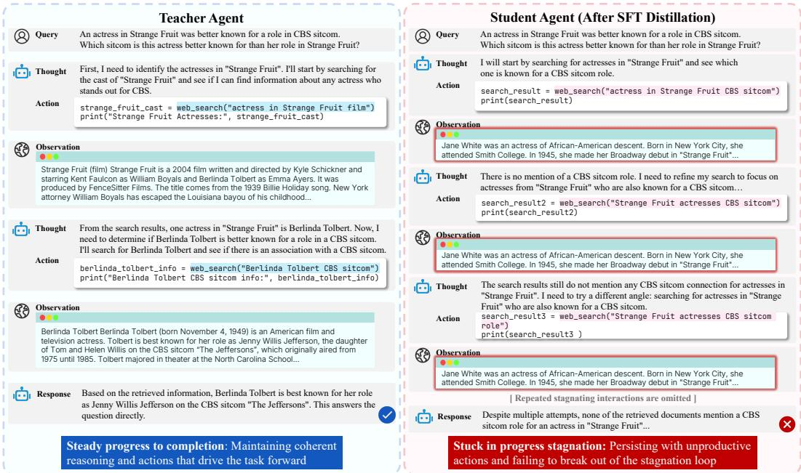  
Figure 1: Comparison between the teacher agent (GPT-4.1) and the student agent (SFT-distilled Qwen3-1.7B) on a web information-retrieval task. The teacher maintains steady progress through coherent reasoning and actions (left), while the student suffers from progress stagnation, cycling through similar but ineffective search queries and remaining stuck (right).

## 2.2 Progress Stagnation in SFT-Distilled Agents

While SFT distillation enables SLMs to develop proficiency in tool-augmented reasoning and reduces basic tool-invocation errors, our analysis identifies a fundamental limitation: SLM agents frequently exhibit progress stagnation when tackling complex tasks. As the interaction context grows with extensive reasoning chains and environmental feedback, such as noisy search results and verbose code-execution logs, these agents frequently lapse into unproductive reasoning-action loops. In these scenarios, the student model tends to redundantly recycle ineffective strategies rather than synthesize feedback to generate novel solution directions, thereby impeding task progress. As illustrated in Figure 1 (right), an SFT-distilled agent tasked with a factual reasoning query repeatedly issues highly similar web-search actions across multiple turns, despite prior attempts failing to retrieve the requisite information. This persistent failure to adapt eventually leads to task expiration or incorrect termination. In contrast, the teacher agent maintains steady progress (Figure 1, left): by effectively leveraging prior interactions, the teacher adaptively refines its actions, progressively acquiring new information until the task is successfully resolved.

Stagnation Score. To quantify the gap between student   
and teacher agents in mitigating progress stagnation, we   
operationalize the turn-level stagnation score in three vari  
ants: lexical overlap, semantic similarity, and LLM-as  
judge evaluation. Specifically, for the thought $\boldsymbol { h } _ { i }$ and   
action $\mathbf { a } _ { i }$ generated at turn $i ,$ let $\mathbf { } h _ { i } \oplus \mathbf { } a _ { i }$ denote their con  
catenation. The three formulations of the stagnation score   
$S _ { { h _ { i } } \oplus { a _ { i } } } \in [ 0 , 1 ]$ are defined in Table 1, and all target the same underlying phenomenon — whether are defined in Table 1, and all target the s

Table 1: Three formulations of the turnlevel stagnation score $S _ { h _ { i } \oplus a _ { i } }$
<table><tr><td>Score</td><td>Formulation</td></tr><tr><td>Lexical</td><td> $\mathrm { m a x } _ { j < i } \mathrm { R O U G E _ { L } } ( \pmb { h } _ { i } \oplus \pmb { a } _ { i } , \pmb { h } _ { j } \oplus \pmb { a } _ { j } )$ </td></tr><tr><td>Semantic</td><td>maxj&lt;i Cos(E(hi ⊕ ai), E(hj ⊕ aj))</td></tr><tr><td>Judgment</td><td>JLLM(hi ⊕ ai | {hj ⊕ aj}j&lt;i)</td></tr></table>

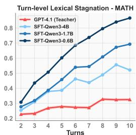

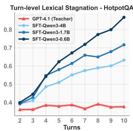

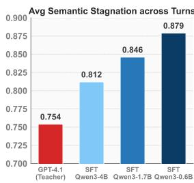

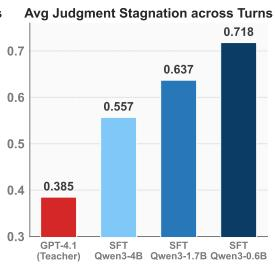  
Figure 2: Comparison of stagnation scores between the teacher agent (GPT-4.1) and SFT-distilled students (Qwen3-4/1.7/0.6B): (1&2) turn-level lexical stagnation on MATH and HotpotQA, (3&4) average semantic and judgment stagnation across turns and datasets.

the current turn revisits previously attempted thoughts or actions. Lexical overlap, measured by ROUGE-L [Lin, 2004], provides a clear and interpretable signal, particularly informative in agent settings where actions often involve code generation or API calls rather than free-form text. Semantic similarity captures stagnation beyond surface-form overlap by detecting paraphrased recurrences. We encode each thought-action pair into a sentence embedding $E ( h _ { i } \oplus a _ { i } )$ using all-mpnet-base-v2 [Song et al., 2020] and compute the cosine similarity between embedded pairs. LLM-as-judge employs a frontier LLM to directly assess turn-level progress following the protocol of Zhu et al. [2025] (see Appendix A for details). For lexical and semantic scores, we compare the current turn against all previous turns and take the maximum, rather than comparing only with the immediate predecessor since stagnation loops can span multiple turns. The LLM-as-judge score implicitly accounts for the full prior history through its prompt design. Since different tasks may naturally exhibit varying degrees of benign overlap between interaction turns, we primarily analyze the teacher-student gap in stagnation scores rather than absolute values. This gap measures the behavioral discrepancy in maintaining progress and avoiding unproductive cycles.

Stagnation Evaluation. Equipped with the proposed stagnation metric, we conduct a comprehensive analysis under the CodeAct framework across diverse agentic tasks. Following the SFT distillation procedure in Section 2.1, we employ GPT-4.1 as the teacher agent to collect 3,000 trajectories from the training sets of MATH [Hendrycks et al., 2021] and HotpotQA [Yang et al., 2018], respectively. With appropriate tool set configurations [Kang et al., 2025], these benchmarks facilitate the evaluation of diverse agentic capabilities, including code-assisted numerical computation, software package execution, and web information seeking. We then distill these capabilities into various SLMs using LoRA [Hu et al., 2022], with training details provided in Appendix B.1. Figure 2 (1&2) presents turn-level lexical stagnation scores for distilled Qwen3-4B/1.7B/0.6B on held-out evaluation sets, while Figure 2 (3&4) report the average semantic and judgment stagnation across turns and datasets. The results reveal a consistent pattern: distilled SLMs exhibit substantially more severe stagnation than the teacher agent, and this disparity becomes increasingly pronounced as model scale decreases or trajectory length increases. In particular, the lexical stagnation score can reach values close to 0.9, indicating that the student actions highly resemble their previous attempts. We further compute pairwise Pearson correlations r among the three stagnation metrics in Table 2, finding consistently high agreement with $r > 0 . 9 2$ This strong correlation suggests that, under severe stagnation, the three metrics capture the same underlying failure mode in SLM agents. We observe the similar stagnation trend across additional model families, including Llama3 and Gemma3 (see Section 4.2 and Appendix G). The pattern also persists under full-parameter fine-tuning, as detailed in Appendix C, and remains evident even when evaluating on the distillation training data itself (Appendix D). These findings collectively demonstrate that SFT distillation alone is insufficient for enabling SLMs to acquire the teacher's resilience to stagnation.

Table 2: Pearson correlation among stagnation metrics on Qwen SFT agents averaged across HotpotQA and MATH.
<table><tr><td>Pearson r</td><td>4B</td><td>1.7B</td><td>0.6B</td></tr><tr><td> $r ( S ^ { \mathrm { l e x } } , S ^ { \mathrm { s e m } } )$ </td><td>0.929</td><td>0.958</td><td>0.964</td></tr><tr><td> $r ( S ^ { \mathrm { l e x } } , S ^ { \mathrm { j u d g e } } )$ </td><td>0.946</td><td>0.975</td><td>0.956</td></tr><tr><td> $r ( S ^ { \mathrm { s e m } } , S ^ { \mathrm { j u d g \acute { e } } } )$ </td><td>0.947</td><td>0.971</td><td>0.979</td></tr></table>

## 3 Progress-Aware Distillation for SLM Agents

Building on our analysis in Section 2, we observe that standard SFT distillation often leads to suboptimal outcomes since student agents fail to replicate the teacher's non-stagnant progression. Motivated by this gap, we propose Progress-Aware Distillation (ProD), a training strategy that explicitly detects stagnation in student-generated trajectories and applies adaptive penalties during optimization. By discouraging unproductive reasoning-action patterns, ProD enables SLM agents to maintain forward progress and more closely align with the teacher's problem-solving dynamics.

Penalizing Stagnation in Student Trajectories. Our approach starts with a base student agent $p _ { S } ^ { \pmb { \theta } _ { 0 } }$ obtained via SFT. Then, for each query x from the SFT distillation dataset D, we execute the student agent to generate one trajectory $\tilde { \tau } = \left[ ( \tilde { h } _ { 1 } , \tilde { a } _ { 1 } , \tilde { o } _ { 1 } ) , \ldots , ( \tilde { h } _ { L \tau } , \tilde { a } _ { L \tau } , \tilde { o } _ { L \tau } ) \right] \sim p _ { S } ^ { \theta _ { 0 } } ( \cdot \mid x )$ . Our goal is to favor the teacher's forward-progressing trajectories while penalizing stagnant behavior in student trajectories. A central challenge is modulating the penalty strength: student trajectories with severe stagnation require stronger corrective signals, whereas those with smoother progress should receive milder updates to avoid overcorrection. To this end, we encode the discrepancy in stagnation levels between the student and teacher into an adaptive margin $f ( \tilde { \tau } , \tau )$ (defined later), which leads to the following progress-aware objective:

$$
\begin{array} { r l } & { \mathcal { L } _ { \mathrm { P R O } } ( \pmb { \theta } ) = - \mathbb { E } _ { ( \pmb { x } , \tau ) \sim \mathcal { D } , \tilde { \tau } \sim p _ { S } ^ { \theta _ { 0 } } ( \cdot | \pmb { x } ) } \left[ \log \sigma \left( \frac { \beta } { | \tau | } \log p _ { S } ^ { \theta } ( \tau \mid \pmb { x } ) - \frac { \beta } { | \tilde { \tau } | } \log p _ { S } ^ { \theta } ( \tilde { \tau } \mid \pmb { x } ) - f ( \tilde { \tau } , \tau ) \right) \right] , } \end{array}\tag{1}
$$

where σ is the sigmoid function, |τ| and $| \tilde { \tau } |$ denote the token lengths of teacher and student trajectories. and β scales the log-likelihood gap. This formulation adaptively scales the gradient signal, whereby student trajectories with pronounced stagnation yield larger margins and induce aggressive corrective updates, while trajectories approaching the teacher's progress dynamics receive smaller margins and are preserved with minimal intervention. A detailed gradient analysis is provided in Appendix E.

Adaptive Margin. We first define a trajectory-level stagnation gap as the difference between the student's and teacher's average turn-wise stagnation:

$$
\begin{array} { r } { \Delta S ( \tilde { \tau } , \tau ) : = \frac { 1 } { L \tilde { \tau } } \sum _ { i = 1 } ^ { L _ { \tilde { \tau } } } S _ { \tilde { h } _ { i } \oplus \tilde { a } _ { i } } - \frac { 1 } { L _ { \tau } } \sum _ { i = 1 } ^ { L _ { \tau } } S _ { h _ { i } \oplus a _ { i } } , } \end{array}\tag{2}
$$

where the stagnation score for the first turn is set to zero, since there are no prior turns to compare against. Using a base margin constant $c _ { 0 }$ , we construct an adaptive margin as $c _ { 0 } \cdot \operatorname* { m a x } \{ 0 , \Delta S ( \tilde { \tau } , \tau ) \}$ which increases proportionally to the severity of the student's stagnation relative to the teacher. To further distinguish student trajectories that yield correct answers from those that do not, we incorporate answer correctness into the margin via a weighted combination:

$$
\begin{array} { r } { f ( \tilde { \tau } , \tau ) = c _ { 0 } \Big ( \alpha \operatorname* { m a x } \{ 0 , \Delta S ( \tilde { \tau } , \tau ) \} + ( 1 - \alpha ) \mathbb { I } _ { \mathrm { A n s } ( \tilde { \tau } ) \neq \mathrm { A n s } ( \tau ) } \Big ) , } \end{array}\tag{3}
$$

where $\operatorname { A n s } ( \cdot )$ extracts the final answer from a trajectory and $\alpha \in [ 0 , 1 ]$ balances the contributions from stagnation severity and answer correctness. Under this formulation, student trajectories that simultaneously exhibit pronounced stagnation and produce incorrect answers receive the largest margins, thereby inducing stronger corrective updates.

Overall Optimization Objective. The objective in Equation (1) is inspired by SimPO [Meng et al., 2024]. However, unlike SimPO, which relies on offline preference data with a fixed margin shared across instances, our formulation leverages student generations from the current model and introduces an instance-dependent margin that more accurately reflects the behavioral discrepancies between the student and teacher. While $\mathcal { L } _ { \mathrm { P R O } }$ effectively widens the relative probability gap, optimizing it in isolation may trigger likelihood displacement [Razin et al., 2024], where the probabilities of both teacher and student trajectories decrease simultaneously. This is undesirable because the teacher trajectory encodes the target

Algorithm 1 Progress-Aware Distillation (ProD)   
Input: SFT dataset $\mathcal { D } = \{ ( \pmb { x } _ { i } , \tau _ { i } ) \} _ { i = 1 } ^ { N }$ , SFT student $p _ { S } ^ { \pmb { \theta } _ { 0 } }$   
and iterations T   
1: for $t = 0$ to $T - 1$ do   
2: for $i = 1$ to N do   
3: Generate a student trajectory $\tilde { \tau } _ { i } \sim p _ { S } ^ { \pmb \theta _ { t } } ( \cdot \mid \pmb x _ { i } )$   
4: Compute stagnation gap $\Delta \ o X ( \tilde { \tau } _ { i } , \tau _ { i } )$ using Eq. (2)   
5: Compute adaptive margin $f ( \tilde { \tau } _ { i } , \tau _ { i } )$ using Eq. (3)   
6: end for   
7: $\begin{array} { r } { \mathcal { L } ( \pmb { \theta } ) = \frac { 1 } { N } \sum _ { i = 1 } ^ { N } \Big [ - \log \sigma \Big ( \frac { \beta } { | \tau _ { i } | } \log p _ { S } ^ { \pmb \theta } ( \tau _ { i } \mid \pmb x _ { i } ) - } \end{array}$   
$\begin{array} { r } { \frac { \beta } { | \tilde { \tau } _ { i } | } \log { p _ { S } ^ { \theta } ( \tilde { \tau } _ { i } \mid \pmb { x } _ { i } ) } - f ( \tilde { \tau } _ { i } , \tau _ { i } ) \Big ) - \lambda \log { p _ { S } ^ { \theta } ( \tau _ { i } \mid \pmb { x } _ { i } ) } \Big ] } \end{array}$   
8:Update $\pmb \theta _ { t + 1 } \gets$ arg minθ $\mathcal { L } ( \pmb { \theta } )$   
9: end for   
Output: $\pmb { \theta } _ { T }$

problem-solving behavior that the student should preserve. To mitigate this, we retain the original SFT loss and jointly optimize it with the progress-aware objective, $\begin{array} { r } { \dot { \mathcal { L } } ( \pmb { \theta } ) = \mathcal { L } _ { \mathrm { P R O } } ( \pmb { \theta } ) + \lambda \mathcal { L } _ { \mathrm { S F T } } ( \pmb { \theta } ) } \end{array}$ thereby maintaining the likelihood of high-quality teacher trajectories while still applying effective corrective signals to stagnant student trajectories. In practice, if a student agent still demonstrates a substantial stagnation gap relative to the teacher after a single optimization round, the distillation process can be executed iteratively. In each iteration, the student agent from the previous round is used to generate fresh trajectories and recompute stagnation penalties, thereby progressively nudging the student toward the teacher's behavior. The overall ProD procedure is summarized in Algorithm 1.

Table 3: Comparison between teacher and student agents, including base models, SFT distillation, and ProD, on in-domain and out-of-domain agent tasks, evaluated by final answer accuracy (%)
<table><tr><td rowspan="2">Method</td><td colspan="3">In-domain</td><td colspan="4">Out-of-domain</td></tr><tr><td>MATH</td><td>HotpotQA</td><td>Avg.</td><td>Omni-MATH (Level 1–3)</td><td>Omni-MATH (Level 4–5)</td><td>2Wiki MultiHopQA</td><td>Avg.</td></tr><tr><td colspan="10">Teacher Agent</td></tr><tr><td>GPT-4.1</td><td>90.4</td><td>71.0</td><td>80.7</td><td>82.0</td><td>60.0</td><td>59.2</td><td>67.1</td></tr><tr><td colspan="10">Student Agents</td></tr><tr><td>Qwen3-4B</td><td>56.8</td><td>53.8</td><td>55.3</td><td>57.8</td><td>23.0</td><td>44.8</td><td></td><td>41.9</td></tr><tr><td rowspan="2">SFT Distill ProD</td><td>81.9</td><td>66.6</td><td>74.2</td><td>73.6</td><td>39.4</td><td></td><td>49.4</td><td>54.1</td></tr><tr><td>85.2</td><td>70.8</td><td>78.0</td><td></td><td>76.8</td><td>46.0</td><td>52.4</td><td>58.4</td></tr><tr><td rowspan="3">Qwen3-1.7B SFT Distill ProD</td><td>46.1</td><td>41.6</td><td>43.8</td><td>48.4</td><td>13.8</td><td></td><td>29.2</td><td>30.5</td></tr><tr><td>65.7</td><td>58.6</td><td>62.2</td><td></td><td>59.2</td><td>23.0</td><td>42.8</td><td>41.7</td></tr><tr><td>70.8</td><td>65.0</td><td>67.9</td><td>64.8</td><td></td><td>28.2</td><td>51.2</td><td>48.1</td></tr><tr><td rowspan="3">Qwen3-0.6B SFT Distill ProD</td><td>17.8</td><td>3.4</td><td>10.6</td><td>25.4</td><td></td><td>3.6</td><td>0.0</td><td>9.7</td></tr><tr><td>46.0</td><td>52.0</td><td>49.0</td><td></td><td>46.8</td><td>10.4</td><td>34.2</td><td>30.5</td></tr><tr><td>50.0</td><td>55.4</td><td>52.7</td><td>51.6</td><td></td><td>14.6</td><td>38.4</td><td>34.9</td></tr><tr><td rowspan="3">Llama-3.1-8B-Inst SFT Distill ProD</td><td>50.1</td><td>45.8</td><td>48.0</td><td>47.8</td><td></td><td>14.6</td><td>37.4</td><td>33.3</td></tr><tr><td>59.1</td><td>64.6</td><td>61.8</td><td></td><td>52.8</td><td>12.6</td><td>51.8</td><td>39.1</td></tr><tr><td>65.2</td><td>69.2</td><td>67.2</td><td>59.8</td><td></td><td>18.6</td><td>57.6</td><td>45.3</td></tr><tr><td rowspan="3">Llama-3.2-3B-Inst SFT Distill ProD</td><td>27.8</td><td>19.8</td><td>23.8</td><td></td><td>24.8</td><td>5.8</td><td>15.4</td><td>15.3</td></tr><tr><td>55.5</td><td>61.6</td><td>58.6</td><td>49.0</td><td></td><td>11.0</td><td>45.4</td><td>35.1</td></tr><tr><td>58.6</td><td>67.0</td><td>62.8</td><td>53.6</td><td>14.8</td><td></td><td>51.2</td><td>39.9</td></tr><tr><td rowspan="3">Llama-3.2-1B-Inst SFT Distill ProD</td><td>2.6</td><td>6.0</td><td>4.3</td><td>2.6</td><td></td><td>2.0</td><td>0.0</td><td>1.5</td></tr><tr><td>25.6</td><td>46.2</td><td>35.9</td><td>27.8</td><td></td><td>4.8</td><td>28.0</td><td>20.2</td></tr><tr><td>30.3</td><td>52.8</td><td>41.6</td><td>33.6</td><td>4.8</td><td></td><td>38.6</td><td>25.7</td></tr><tr><td rowspan="3">Gemma-3-4b-it SFT Distill ProD</td><td>42.0</td><td>41.2</td><td>41.6</td><td>43.8</td><td></td><td>15.2</td><td>39.6</td><td>32.9</td></tr><tr><td>50.5</td><td>62.2</td><td>56.4</td><td></td><td>53.2</td><td>14.8</td><td>44.6</td><td>37.5</td></tr><tr><td>55.6</td><td>66.4</td><td>61.0</td><td>55.6</td><td></td><td>15.0</td><td>49.4</td><td>40.0</td></tr><tr><td>Gemma-3-1b-it</td><td>3.1</td><td>4.6</td><td>3.8</td><td></td><td>2.8</td><td>0.2</td><td>1.0</td><td>1.3</td></tr><tr><td>SFT Distill</td><td></td><td></td><td></td><td></td><td></td><td>1.4</td><td>25.8</td><td>16.5</td></tr><tr><td></td><td>16.0</td><td>41.2</td><td>28.6</td><td>22.2 26.2</td><td></td><td>3.4</td><td>36.0</td><td>21.9</td></tr><tr><td>ProD</td><td>19.6</td><td>46.8</td><td>33.2</td><td></td><td></td><td></td><td></td><td></td></tr></table>

## 4 Experiments

## 4.1 Experimental Settings

Student Backbones and Teacher Agent. To evaluate the effectiveness of ProD across various model scales, we select eight SLMs ranging from 0.6B to 8B parameters as student backbones. Specifically our evaluation includes the Qwen3 series (4B, 1.7B, 0.6B) [Yang et al., 2025], Llama-3.1-8B-Instruct [Grattafiori et al., 2024], Llama-3.2 (3B, 1B-Instruct) [Grattafiori et al., 2024], and Gemma-3 (4B, 1B-it) [Team et al., 2025]. Following the SFT distillation procedure described in Section 2.1, we employ GPT-4.1 as the teacher agent to collect 3,000 trajectories from the training sets of MATH [Hendrycks et al., 2021] and HotpotQA [Yang et al., 2018], respectively, and retain only the successful ones to construct the distillation dataset.

Implementation Details. All experiments use the CodeAct framework [Wang et al., 2024], with the web-search tool implemented following [Kang et al., 2025, Jin et al., 2025]. For both SFT and ProD, we train separate LoRA weights [Hu et al., 2022] for each task with rank 64, batch size 32, AdamW, and a linear learning rate schedule with 3% warmup. ProD initializes from the SFT-distilled student agent and is further optimized. The main results in Section 4.2 use the lexical stagnation score, a single ProD iteration, and an adaptive-margin weighting of α = 0.5. We analyze iterative ProD optimization in Section 4.4, and report results using alternative stagnation scores in Appendix F. During inference, we use greedy decoding and cap the interaction horizon at 10 turns. Additional hyperparameter details (e.g., learning rate, training epochs, co, and λ) are provided in Appendix B.1.

Datasets and Evaluation. We evaluate agentic capabilities primarily through factual and mathematical reasoning tasks, covering code-assisted numerical computation, software execution, and web-based information seeking. We consider both in-domain (ID) and out-of-domain (OOD) generalization. For ID evaluation, we use MATH and HotpotQA. We sample 110 problems from each of the seven MATH subjects (770 in total) and 500 hard-level questions from HotpotQA. To assess OOD generalization, we utilize Omni-MATH [Gao et al., 2025], sampling 500 problems from difficulty levels 1–3 and another 500 from levels 4–5. We also include 500 instances from 2WikiMultiHopQA [Ho et al., 2020] to provide broader coverage of web-search-based multi-hop factual reasoning. Following prior work [Kang et al., 2025, Gao et al., 2025], we rely on an LLM-as-Judge (GPT-4.1-mini) to determine accuracy by comparing generated answers with ground-truth reference. Evaluation prompts are provided in Appendix B.2. Additionally, we use stagnation scores and related efficiency metrics to quantify the practical utility of our method in reducing stagnant interaction loops.

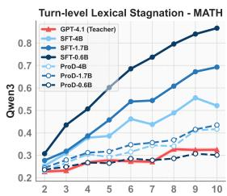

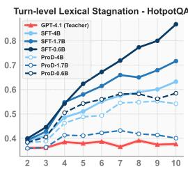

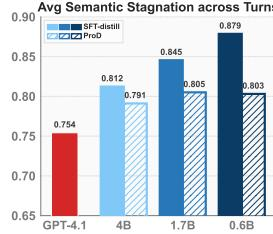

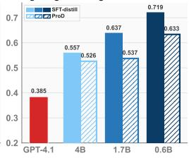

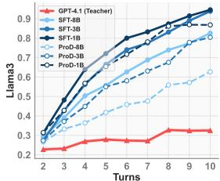

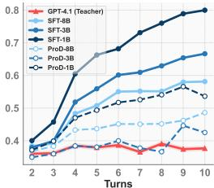

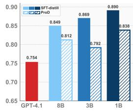

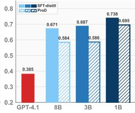  
Figure 3: Alleviating progress stagnation. Comparison between SFT and ProD agents: Columns 1&2 show turn-level lexical stagnation on MATH and HotpotQA, Columns 3&4 show average semantic and judgment stagnation across turns and datasets.

## 4.2 Main Results

ProD consistently surpasses SFT distillation in both in-domain and out-of-domain settings. Table 3 reports the accuracy of 8 student agents across multiple benchmarks. Compared with the base models, ProD yields substantial absolute improvements and consistently outperforms standard SFT distillation across all model families. On average, ProD improves in-domain accuracy by 29.2% over base models and by 4.7% over SFT, while achieving out-of-domain gains of 18.5% and 4.9%, respectively. Notably, ProD exhibits average relative improvement of approximately 10% in-domain and 17% out-of-domain over SFT. ProD enables students to narrow the gap to their teacher. For instance, on HotpotQA, the Qwen3-4B student distilled via ProD achieves 70.8% accuracy, nearly matching the teacher's performance of 71.0%. These results underscore ProD's ability to enhance both the fundamental effectiveness and the generalization of SLM-based agents.

ProD effectively mitigates progress stagnation and enhances task efficiency. In Figure 3, we compare the stagnation patterns of SFT and ProD agents. The results show that ProD substantially alleviates stagnation across lexical, semantic, and LLMas-judge metrics, allowing student agents to maintain smoother trajectories that align more closely with the teacher's behavior. Additional Gemma3 results are provided in Appendix G, and qualitative examples are shown in Appendix K. Beyond trajectory quality, Table 4 reports the average number of interaction turns and token consumption, averaged over eight student agents in both ID and OOD settings. By explicitly penalizing stagnant reasoning-action patterns, ProD enables agents to solve tasks more decisively. This leads to a consistent reduction in interaction length across most SLMs on all benchmarks, demonstrating that ProD not only improves accuracy but also significantly enhances overall task efficiency. We defer the analysis of training overhead to Appendix H.

Table 4: Inference efficiency averaged over 8 student agents on ID and OOD settings.
<table><tr><td>Cost</td><td>SFT</td><td>ProD</td></tr><tr><td>Avg Turns</td><td>4.144</td><td>3.663 (↓11.6%)</td></tr><tr><td>Avg Tokens</td><td>16206</td><td>12847 (↓20.7%)</td></tr></table>

## 4.3 Comparison with Repetition-Control Methods

In this section, we investigate whether existing repetition-control techniques can help address progress stagnation in SLM agents. We compare against two representative methods that suppress redundant generation at the decoding level and at the training-data level, respectively. Specifically, Repetition Penalty (RP) [Keskar et al., 2019, vLLM, 2026] operates at decoding time by rescaling the logits of previously generated tokens to discourage excessive repetition. We apply RP on top of SFT-distill with penalty strengths of 1.1, 1.2, and 1.3. The other family reduces redundancy at the data level by shortening teacher demonstrations before distillation. For example, Wu et al. [2025] compress long chain-of-thought traces into concise variants. In the agent-distillation setting, we implement this strategy by identifying training examples whose teacher trajectory contains at least 4 steps and prompting the teacher to re-execute the task with its original trajectory as context, producing shorter and less redundant demonstrations (see Appendix I for the detailed prompt). This procedure reduces the average number of steps from 4.98 to 2.65. As shown in Table 5, ProD substantially outperforms both methods, indicating that decoding-level diversity enforcement is insufficient to address trajectorylevel stagnation, while overly large penalties further degrade performance. Data-level shortening reduces redundancy in the teacher demonstrations, but does not impose any constraint on the student's own behavior during optimization, yielding only minimal gains over SFT distillation.

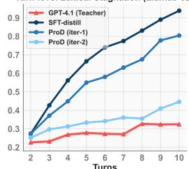

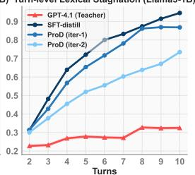

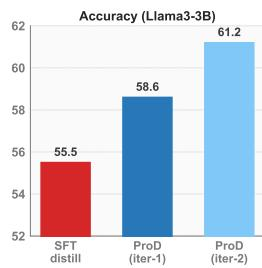

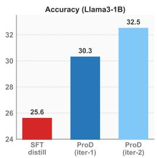  
Figure 4: Iterative ProD further alleviates stagnation (1&2) and improves accuracy (3&4) on MATH.

Table 5: Comparison with repetition-control baselines on HotpotQA. RP(·) denotes repetition penalty with the corresponding strength. Concise SFT trains on shortened, less redundant teacher trajectories.
<table><tr><td>Model</td><td>SFT</td><td>RP(1.1)</td><td>RP(1.2)</td><td>RP(1.3)</td><td>Concise SFT</td><td>ProD</td></tr><tr><td>Qwen3-4B</td><td>66.6</td><td>66.2</td><td>65.6</td><td>61.6</td><td>66.4</td><td>70.8</td></tr><tr><td>Llama3.2-3B</td><td>61.6</td><td>62.0</td><td>61.2</td><td>58.0</td><td>62.0</td><td>67.0</td></tr></table>

## 4.4 Effects of Iterative ProD Optimization

Figure 3 shows that even a single ProD iteration substantially improves distilled agents' resistance to progress stagnation. For the Qwen family, ProD students achieve stagnation scores close to those of the teacher. However, for other model families, such as Llama3.2-3B and Llama3.2-1B on MATH, a noticeable gap remains despite improvements over standard SFT. Motivated by this, we study additional ProD iterations by using the first-iteration students as new base models, regenerating trajectories, and recomputing stagnation gaps and adaptive margins for further distillation. Figure 4 (1&2) illustrates the stagnation scores after two ProD iterations. The results indicate that two ProD iterations further reduce stagnation, pushing student behavior closer to the teacher's progress dynamics. This refinement also yields consistent gains in final answer accuracy, as shown in Figure 4 (3&4). These results suggest that iterative ProD can further alleviate persistent stagnation and improve performance when a single round is insufficient to close the teacher-student behavioral gap.

## 4.5 Ablation Studies

In this section, we examine the key components of ProD, including the adaptive margin and the SFT loss term. We further analyze the sensitivity of the adaptive margin by varying the relative weighting between the stagnation gap and final answer correctness. The results validate these design choices and indicate that both signals are necessary to capture behavioral discrepancies between the student and teacher. Hyperparameter details for the ablations are provided in Appendix B.1.

Ablation of Optimization Components. We evaluate two variants to assess the roles of the adaptive margin and the SFT objective: (1) ProD (w/o SFT + AM) removes the SFT loss from L(θ) and replaces the adaptive margin with a fixed constant. This version effectively degenerates to SimPO [Meng et al., 2024], albeit using trajectories produced by the current student agent. (2) ProD (w/o AM) retains the SFT loss but adopts a fixed margin. As shown in Figure 5, ProD (w/o SFT + AM) exhibits unstable performance and even underperforms the SFT-distilled baseline on Qwen3-4B and Gemma3-4B-it. This underscores the importance of the SFT loss in anchoring the student to valid reasoning paths by maintaining high probability on teacher trajectories. In contrast, ProD (w/o AM)

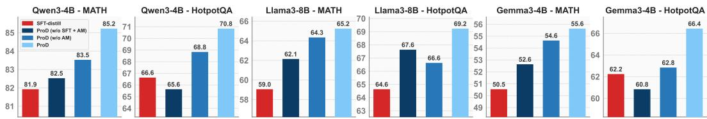  
Figure 5: Ablation of optimization objective components in ProD with two ablated variants, ProD (w/o SFT + AM) and ProD (w/o AM), where AM denotes the adaptive margin

consistently outperforms SFT but remains inferior to the full ProD formulation. This suggests that a fixed margin may lead to overcorrection or insufficient optimization for varied trajectory qualities, thereby limiting potential gains. These results indicate that the SFT loss and adaptive margin play complementary roles in stabilizing optimization and bolstering performance.

Effect of Adaptive Margin Weighting. The coefficient α in Equation (3) balances the stagnation gap and answer correctness, with α = 0.5 used by default in Table 3. Table 6 reports ProD performance under different α values, where α = 1 uses only the stagnation gap and α = 0 uses only answer correctness. Even with the stagnation gap alone (α = 1), ProD substantially improves over the SFT baseline. However, the best average accuracy is consistently achieved at α = 0.5, indicating that balancing both signals provides a more fine-grained estimate of behavioral discrepancies and enables more effective control over optimization strength.

Table 6: Accuracy (%) under different α values in the adaptive margin.
<table><tr><td rowspan="2">Dataset</td><td rowspan="2">SFT</td><td colspan="5">ProD</td></tr><tr><td>α = 1</td><td>α = 0.75</td><td>α = 0.5</td><td>α = 0.25</td><td>α = 0</td></tr><tr><td colspan="7">Qwen3-4B</td></tr><tr><td>MATH</td><td>81.9</td><td>85.2</td><td>85.8</td><td>85.2</td><td>84.5</td><td>85.3</td></tr><tr><td>HotpotQA</td><td>66.6</td><td>69.4</td><td>68.8</td><td>70.8</td><td>66.8</td><td>67.6</td></tr><tr><td>Average</td><td>74.2</td><td>77.3</td><td>77.3</td><td>78.0</td><td>75.7</td><td>76.4</td></tr><tr><td colspan="7">Llama3-8B</td></tr><tr><td>MATH</td><td>59.1</td><td>64.5</td><td>65.1</td><td>65.2</td><td>64.2</td><td>65.1</td></tr><tr><td>HotpotQA</td><td>64.6</td><td>67.8</td><td>67.8</td><td>69.2</td><td>66.6</td><td>67.4</td></tr><tr><td>Average</td><td>61.8</td><td>66.2</td><td>66.4</td><td>67.2</td><td>65.4</td><td>66.2</td></tr><tr><td colspan="7">Gemma3-4B</td></tr><tr><td>MATH</td><td>50.5</td><td>55.2</td><td>54.7</td><td>55.6</td><td>54.0</td><td>54.3</td></tr><tr><td>HotpotQA</td><td>62.2</td><td>65.8</td><td>65.2</td><td>66.4</td><td>64.6</td><td>64.8</td></tr><tr><td>Average</td><td>56.4</td><td>60.5</td><td>60.0</td><td>61.0</td><td>59.3</td><td>59.6</td></tr></table>

## 5 Related Work

Chain-of-Thought Distillation. Prior works fine-tune student models on complete teacher-generated reasoning chains [Ho et al., 2023, Shridhar et al., 2023]. To reduce noise from lengthy CoT sequences, several methods extract concise or keypoint-focused rationales via token-weighting modules [Feng et al., 2024], reasoning segmentation [Chen et al., 2025], or redundant-step pruning [Wu et al., 2025, Jiang et al., 2025]. UniCoTT [Zhuang et al., 2025] introduces structural-consistency learning for diverse reasoning patterns, while SCOTT [Wang et al., 2023] uses counterfactual training to improve reasoning faithfulness. Pipis et al. [2025] study looping in single-turn CoT distillation and attribute to hardness-induced risk aversion, highlighting the need for training-time interventions without developing a dedicated mitigation objective. In contrast, we study stagnation in agent distillation characterize it via the teacher-student stagnation gap, and propose a training-time solution.

Agent Distillation. Distilling agentic capabilities enables SLMs to learn tool-augmented reasoning rather than merely memorize facts, as in conventional CoT distillation. As a result, distilled SLMs exhibit stronger generalization to novel tasks that require previously unseen knowledge. A recent foundational work [Kang et al., 2025] establishes an SFT paradigm on teacher-generated interactive trajectories. By masking environmental observations in the training loss, this approach encourages the student to produce coherent thoughts and actions. While effective, it does not adequately address the severe stagnation exhibited by SLMs in interactions, which our method aims to mitigate.

## 6 Conclusion

This work systematically analyzes a key limitation of SFT-based agent distillation: progress stagnation. We find that student agents often become trapped in unproductive, failed strategies, and that this issue worsens with longer interaction horizons and smaller model scales. To address it, we propose Progress-Aware Distillation (ProD), which explicitly detects and adaptively penalizes stagnation by measuring behavioral discrepancies against teacher trajectories. Through iterative optimization, ProD gradually closes the gap toward teacher-level dynamics. Extensive experiments demonstrate that ProD significantly enhances both the task success rates and execution efficiency of SLMs. Future work could develop more fine-grained progress metrics and more precise methods for localizing stagnant actions, enabling targeted corrective signals during agent distillation.

## References

J. Achiam, S. Adler, S. Agarwal, L. Ahmad, I. Akkaya, F. L. Aleman, D. Almeida, J. Altenschmidt, S. Altman, S. Anadkat, et al. Gpt-4 technical report. arXiv preprint arXiv:2303.08774, 2023.

B. Chen, C. Shu, E. Shareghi, N. Collier, K. Narasimhan, and S. Yao. Fireact: Toward language agent fine-tuning. arXiv preprint arXiv:2310.05915, 2023.

X. Chen, S. Zhou, K. Liang, X. Sun, and X. Liu. Skip-thinking: Chunk-wise chain-of-thought distillation enable smaller language models to reason better and faster. In Proceedings of the 2025 Conference on Empirical Methods in Natural Language Processing, pages 12153–12168, 2025.

K. Feng, C. Li, X. Zhang, J. Zhou, Y. Yuan, and G. Wang. Keypoint-based progressive chain-ofthought distillation for llms. In Proceedings of the 41st International Conference on Machine Learning, pages 13241–13255, 2024.

B. Gao, F. Song, Z. Yang, Z. Cai, Y. Miao, Q. Dong, L. Li, C. Ma, L. Chen, R. Xu, et al. Omni-math: A universal olympiad level mathematic benchmark for large language models. In The Thirteenth International Conference on Learning Representations, 2025.

Z. Gou, Z. Shao, Y. Gong, Y. Yang, M. Huang, N. Duan, W. Chen, et al. Tora: A tool-integrated reasoning agent for mathematical problem solving. In The Twelfth International Conference on Learning Representations, 2025.

A. Grattafiori, A. Dubey, A. Jauhri, A. Pandey, A. Kadian, A. Al-Dahle, A. Letman, A. Mathur A. Schelten, A. Vaughan, et al. The llama 3 herd of models. arXiv preprint arXiv:2407.21783, 2024.

D. Hendrycks, C. Burns, S. Kadavath, A. Arora, S. Basart, E. Tang, D. Song, and J. Steinhardt. Measuring mathematical problem solving with the math dataset. In Thirty-fifth Conference on Neural Information Processing Systems Datasets and Benchmarks Track (Round 2), 2021.

N. Ho, L. Schmid, and S.-Y. Yun. Large language models are reasoning teachers. In Proceedings of the 61st annual meeting of the association for computational linguistics (volume 1: long papers), pages 14852–14882, 2023.

X. Ho, A.-K. Duong Nguyen, S. Sugawara, and A. Aizawa. Constructing a multi-hop QA dataset for comprehensive evaluation of reasoning steps. In D. Scott, N. Bel, and C. Zong, editors, Proceedings of the 28th International Conference on Computational Linguistics, pages 6609–6625, Barcelona, Spain (Online), Dec. 2020. International Committee on Computational Linguistics. doi: 10.18653/ v1/2020.coling-main.580. URL https://aclanthology.org/2020.coling-main.580/.

E. J. Hu, Y. Shen, P. Wallis, Z. Allen-Zhu, Y. Li, S. Wang, L. Wang, W. Chen, et al. Lora: Low-rank adaptation of large language models. ICLR, 1(2):3, 2022.

Y. Jiang, D. Li, and F. Ferraro. Drp: Distilled reasoning pruning with skill-aware step decomposition for efficient large reasoning models. arXiv preprint arXiv:2505.13975, 2025.

B. Jin, H. Zeng, Z. Yue, J. Yoon, S. Arik, D. Wang, H. Zamani, and J. Han. Search-r1: Training llms to reason and leverage search engines with reinforcement learning. arXiv preprint arXiv:2503.09516, 2025.

M. Kang, J. Jeong, S. Lee, J. Cho, and S. J. Hwang. Distilling llm agent into small models with retrieval and code tools. arXiv preprint arXiv:2505.17612, 2025.

N. S. Keskar, B. McCann, L. R. Varshney, C. Xiong, and R. Socher. Ctrl: A conditional transformer language model for controllable generation. arXiv preprint arXiv:1909.05858, 2019.

X. Li, J. Jin, G. Dong, H. Qian, Y. Zhu, Y. Wu, J. Wen, and Z. Dou. Webthinker: Empowering large reasoning models with deep research capability. CoRR, abs/2504.21776, 2025. doi: 10.48550/ ARXIV.2504.21776. URL https://doi.org/10.48550/arXiv.2504.21776.

C.-Y. Lin. ROUGE: A package for automatic evaluation of summaries. In Text Summarization Branches Out, pages 74–81, Barcelona, Spain, July 2004. Association for Computational Linguistics. URL https://aclanthology.org/W04-1013/.

J. Liu, Y. Li, C. Zhang, J. Li, A. Chen, K. Ji, W. Cheng, Z. Wu, C. Du, Q. Xu, et al. Webexplorer: Explore and evolve for training long-horizon web agents. arXiv preprint arXiv:2509.06501, 2025.

J. Luo, W. Zhang, Y. Yuan, Y. Zhao, J. Yang, Y. Gu, B. Wu, B. Chen, Z. Qiao, Q. Long, et al. Large language model agent: A survey on methodology, applications and challenges. arXiv preprint arXiv:2503.21460, 2025.

Y. Meng, M. Xia, and D. Chen. Simpo: Simple preference optimization with a reference-free reward. Advances in Neural Information Processing Systems, 37:124198–124235, 2024.

OpenAI. Introducing deep research, 2025a. URL https://openai.com/index/ introducing-deep-research/.

OpenAI. Introducing GPT-4.1 in the api. https://openai.com/index/gpt-4-1/, 2025b. Accessed: 2025-12-22.

C. Pipis, S. Garg, V. Kontonis, V. Shrivastava, A. Krishnamurthy, and D. Papailiopoulos. Wait, wait, wait... why do reasoning models loop? arXiv preprint arXiv:2512.12895, 2025.

R. Rafailov, A. Sharma, E. Mitchell, C. D. Manning, S. Ermon, and C. Finn. Direct preference optimization: Your language model is secretly a reward model. Advances in neural information processing systems, 36:53728–53741, 2023.

N. Razin, S. Malladi, A. Bhaskar, D. Chen, S. Arora, and B. Hanin. Unintentional unalignment: Likelihood displacement in direct preference optimization. arXiv preprint arXiv:2410.08847, 2024.

A. Roucher, A. V. del Moral, T. Wolf, L. von Werra, and E. Kaunismäki. smolagents: a smol library to build great agentic systems. https://github.com/huggingface/smolagents, 2025.

T. Schick, J. Dwivedi-Yu, R. Dessì, R. Raileanu, M. Lomeli, E. Hambro, L. Zettlemoyer, N. Cancedda, and T. Scialom. Toolformer: Language models can teach themselves to use tools. Advances in Neural Information Processing Systems, 36:68539–68551, 2023.

K. Shridhar, A. Stolfo, and M. Sachan. Distilling reasoning capabilities into smaller language models. Findings of the Association for Computational Linguistics: ACL 2023, pages 7059–7073, 2023.

K. Song, X. Tan, T. Qin, J. Lu, and T.-Y. Liu. Mpnet: Masked and permuted pre-training for language understanding. Advances in neural information processing systems, 33:16857–16867, 2020.

G. Team, A. Kamath, J. Ferret, S. Pathak, N. Vieillard, R. Merhej, S. Perrin, T. Matejovicova, A. Ramé, M. Rivière, et al. Gemma 3 technical report. arXiv preprint arXiv:2503.19786, 2025.

vLLM. SamplingParams.repetition\_penalty — vLLM Documentation. https://docs.vllm. ai/en/latest/api/vllm/#vllm.SamplingParams.repetition\_penalty,2026.Accessed: 2026-05-06.

P. Wang, Z. Wang, Z. Li, Y. Gao, B. Yin, and X. Ren. Scott: Self-consistent chain-of-thought distillation. In Proceedings of the 61st Annual Meeting of the Association for Computational Linguistics (Volume 1: Long Papers), pages 5546–5558, 2023.

X. Wang, Y. Chen, L. Yuan, Y. Zhang, Y. Li, H. Peng, and H. Ji. Executable code actions elicit better 1lm agents. In Forty-first International Conference on Machine Learning, 2024.

Y. Wu, J. Shi, B. Wu, J. Zhang, X. Lin, N. Tang, and Y. Luo. Concise reasoning, big gains: Pruning long reasoning trace with difficulty-aware prompting. arXiv preprint arXiv:2505.19716, 2025.

A. Yang, A. Li, B. Yang, B. Zhang, B. Hui, B. Zheng, B. Yu, C. Gao, C. Huang, C. Lv, et al. Qwen3 technical report. arXiv preprint arXiv:2505.09388, 2025.

J. Yang, C. E. Jimenez, A. Wettig, K. Lieret, S. Yao, K. Narasimhan, and O. Press. Swe-agent: Agentcomputer interfaces enable automated software engineering. Advances in Neural Information Processing Systems, 37:50528–50652, 2024.

Z. Yang, P. Qi, S. Zhang, Y. Bengio, W. Cohen, R. Salakhutdinov, and C. D. Manning. Hotpotqa: A dataset for diverse, explainable multi-hop question answering. In Proceedings of the 2018 conference on empirical methods in natural language processing, pages 2369–2380, 2018.

S. Yao, J. Zhao, D. Yu, N. Du, I. Shafran, K. R. Narasimhan, and Y. Cao. React: Synergizing reasoning and acting in language models. In The eleventh international conference on learning representations, 2022.

H. Zhu, T. Qin, K. Zhu, H. Huang, Y. Guan, J. Xia, H. Li, Y. Yao, N. Wang, P. Liu, T. Peng, X. Gui, L. Xiaowan, Y. Liu, X. Tang, J. Yang, G. Zhang, X. Gao, Y. E. Jiang, C. Zhang, J. Wang, J. Liu, and W. Zhou. OAgents: An empirical study of building effective agents. In C. Christodoulopoulos, T. Chakraborty, C. Rose, and V. Peng, editors, Findings of the Association for Computational Linguistics: EMNLP 2025, pages 13354–13369, Suzhou, China, Nov. 2025. Association for Computational Linguistics. ISBN 979-8-89176-335-7. doi: 10.18653/v1/2025.findings-emnlp.720. URL https://aclanthology.org/2025.findings-emnlp.720/.

X. Zhuang, Z. Zhu, Z. Wang, X. Cheng, and Y. Zou. Unicott: A unified framework for structural chainof-thought distillation. In The Thirteenth International Conference on Learning Representations, 2025.

## A LLM-as-Judge Setup for Progress Stagnation

We use a frontier LLM, gpt-5.4-2026-03-05, to evaluate progress stagnation for both the teacher agent (GPT-4.1) and various student agents. Following the evaluation protocol [Zhu et al., 2025], which assesses how promising each action in an agent trajectory is for advancing toward the user's task, we ask the judge to assign a stagnation score from 0.0 to 1.0 starting from the second turn, since the first turn has no prior interaction history for comparison. The full prompt is provided below.

Evaluation Prompt for Progress Stagnation   
System prompt:   
You are ān expert evaluator of AI agent trajectories. Your task is to assess progress stagnation at   
each interaction turn.   
Progress stagnation occurs when an agent repeats previously failed strategies without making   
meaningful forward progress toward solving the task. A stagnant turn typically:   
- Issues the same or very similar search queries as prior turns   
- Executes the same or nearly identical code as before   
- Repeats reasoning already attempted without introducing new insights or directions   
For each turn starting from Turn 2, assign a stagnation score from 0.0 to 1.0. Use the full   
continuous range — do not cluster around a few values:   
- 0.0: Completely new direction — entirely different strategy, query, or reasoning path   
- 0.2: Mostly new progress — builds on prior observations with a clearly different approach   
- 0.4: Slight repetition — minor overlap with prior turns but introduces meaningful new   
elements   
- 0.6: Noticeable stagnation — similar strategy as before with only superficial variation   
- 0.8: Strong stagnation — nearly the same action or reasoning as a prior turn, minimal new   
content   
- 1.0: Complete stagnation — essentially copy-pasting a prior failed action verbatim   
Intermediate values (e.g. 0.1, 0.3, 0.55, 0.75, 0.9) are encouraged for nuanced cases.   
Return ONLY a valid JSON object with key "turn\_scores" — a list of floats, one per turn   
starting from Turn 2.   
User prompt:   
Task: {Task description}   
— Turn 1 —   
[Thought & Action]: {Assistant message at Turn 1}   
[Observation]: {Tool response at Turn 1, truncated to 600 chars}   
— Turn 2 —   
[Thought & Action]: {Assistant message at Turn 2}   
[Observation]: {Tool response at Turn 2, truncated to 600 chars}   
— Turn N —   
[Thought & Action]: {Assistant message at Turn N}   
[Observation]: {Tool response at Turn N, truncated to 600 chars}   
Assess stagnation for Turn 2 through Turn N (N-1 score(s) total).   
Return ONLY JSON: {"turn\_scores": [score\_turn2, score\_turn3, ...]}

## B Additional Experimental Details

In this section, we present additional implementation details, along with the hyperparameter selection and evaluation prompts used in our experiments. We implement all agents under the CodeAct framework [Wang et al., 2024] using smolagents [Roucher et al., 2025]. The specific version of the

teacher agent is gpt-4.1-2025-04-14. All experiments were conducted on a single NVIDIA A100 GPU (80GB) and a single NVIDIA H200 GPU (140GB).

## B.1 Hyperparameters

Hyperparameters in SFT Distillation. For SFT-based distillation, we first explore a range of learning rates on each task and evaluate model checkpoints from different training epochs on indistribution evaluation sets to identify the optimal configuration. The selected model is then directly evaluated under out-of-distribution settings. Concretely, we consider learning rates from the set $\{ 2 \times 1 0 ^ { - 4 } , 2 \times 1 0 ^ { - 5 } \}$ , with a batch size of 32, the AdamW optimizer, and a linear learning rate schedule with a 3% warmup ratio. All models are trained for up to 5 epochs, and checkpoints from each epoch are evaluated. The checkpoint achieving the best accuracy is retained as the final SFT-distilled agent, and all reported results, including stagnation scores, final answer accuracy, and task efficiency, are obtained using these selected models. Across all models and tasks, we find that a learning rate of $2 \times 1 0 ^ { - 4 }$ consistently yields superior performance, which is consistent with prior settings in Kang et al. [2025]. Regarding the number of training epochs, 3 epochs are sufficient for most models to reach optimal performance across tasks. An exception is observed on the MATH benchmark, where Llama3.1-8B and Llama3.2-3B achieve their best results after 2 epochs, and additional training leads to performance degradation.

Hyperparameters in Progress-Aware Distillation (ProD). ProD is applied on top of the SFTdistilled SLMs. We use a batch size of 32, the AdamW optimizer, and a linear learning rate schedule with a 3% warmup ratio, consistent with the SFT stage. We fix the log-likelihood scaling parameter β to 2.5 following [Meng et al., 2024]. For the overall objective $\begin{array} { r } { \mathcal { L } ( \pmb { \theta } ) = \mathcal { L } _ { \mathrm { P R O } } ( \pmb { \theta } ) + \lambda \bar { \mathcal { L } } _ { \mathrm { S F T } } ( \pmb { \theta } ) } \end{array}$ , we set the weight of the SFT loss term to λ = 1. Empirically, we observe that $\lambda = 1$ preserves a high log-probability on teacher trajectories throughout training, and therefore we do not further tune this parameter. For the adaptive margin weighting, we set α = 0.5 by default and analyze its sensitivity in Section 4.5. We select the learning rate from $\{ 1 \times 1 0 ^ { - 5 } , 5 \times 1 0 ^ { - 6 } , 1 \times 1 0 ^ { - { \breve { 6 } } } \}$ and the initial adaptive margin $c _ { 0 }$ from {0.3, 0.5, 0.7} based on in-domain evaluation results. Table 7 summarizes the best choices for each model and task. All out-of-domain evaluations are conducted using the selected models without additional training.

Table 7: Selected learning rates (LR) and initial adaptive margins $c _ { 0 }$ for ProD.
<table><tr><td>Task</td><td>Hyper.</td><td>Qwen3 4B</td><td>Qwen3 1.7B</td><td>Qwen3 0.6B</td><td>Llama-3.1 8B-Inst</td><td>Llama-3.2 3B-Inst</td><td>Llama-3.2 1B-Inst</td><td>Gemma-3 4B-it</td><td>Gemma-3 1B-it</td></tr><tr><td rowspan="2">MATH</td><td>LR</td><td>5e-6</td><td>5e-6</td><td>5e-6</td><td>5e-6</td><td>1e-6</td><td>1e-6</td><td>5e-6</td><td>1e-6</td></tr><tr><td>c0</td><td>0.5</td><td>0.5</td><td>0.5</td><td>0.5</td><td>0.5</td><td>0.5</td><td>0.7</td><td>0.5</td></tr><tr><td rowspan="2">HotpotQA</td><td>LR</td><td>1e-6</td><td>1e-5</td><td>1e-6</td><td>1e-6</td><td>5e-6</td><td>5e-6</td><td>5e-6</td><td>5e-6</td></tr><tr><td> $c _ { 0 }$ </td><td>0.7</td><td>0.5</td><td>0.7</td><td>0.5</td><td>0.5</td><td>0.5</td><td>0.7</td><td>0.3</td></tr></table>

Hyperparameters in ProD Ablations. For all ProD ablation variants, we follow the same hyperparameter selection procedure as in the full ProD setting. Specifically, the learning rates and fixed margins are selected based on in-domain evaluation performance, and the best-performing configuration for each model and task is reported. The selected hyperparameters for all ablation settings are summarized in Table 8. Unless otherwise specified, all other training configurations, including optimizer choice, batch size, learning rate schedule, and loss weights, are kept identical to those used in ProD. For the sensitivity analysis of the adaptive margin weight α reported in Table 6, we isolate the effect of α by fixing all other hyperparameters to their default ProD values and varying only α. This controlled setup ensures that the observed performance differences can be directly attributed to changes in the adaptive margin weighting.

Table 8: Selected learning rates (LR) and fixed margins $c _ { 0 }$ for ProD ablations (w/o SFT+AM and w/o AM) across models and tasks.
<table><tr><td rowspan="2">Task</td><td rowspan="2">Hyper.</td><td colspan="3">ProD (w/o SFT + AM)</td><td colspan="3">ProD (w/o AM)</td></tr><tr><td>Qwen3-4B</td><td>Llama-3.1-8-Inst</td><td>Gemma-3-4B-it</td><td>Qwen3-4B</td><td>Llama-3.1-8-Inst</td><td>Gemma-3-4B-it</td></tr><tr><td rowspan="2">MATH</td><td>LR</td><td>5e-6</td><td>5e-6</td><td>1e-6</td><td>5e-6</td><td>5e-6</td><td>5e-6</td></tr><tr><td>c0</td><td>0.5</td><td>0.5</td><td>0.3</td><td>0.5</td><td>0.5</td><td>0.7</td></tr><tr><td rowspan="2">HotpotQA</td><td>LR</td><td>5e-6</td><td>1e-6</td><td>5e-6</td><td>1e-6</td><td>1e-6</td><td>5e-6</td></tr><tr><td>C0</td><td>0.5</td><td>0.5</td><td>0.7</td><td>0.7</td><td>0.5</td><td>0.7</td></tr></table>

## B.2 Evaluation Prompts

For evaluating factual and mathematical reasoning tasks, strict string matching can be brittle and can lead to an inflated false-negative rate. In particular, benign surface-form variations, such as alternative phrasings, equivalent expressions (e.g., decimals vs. fractions), or omitted but implied units, are difficult to exhaustively enumerate with hand-crafted normalization rules and therefore leave many corner cases uncovered. Therefore, following prior work [Kang et al., 2025, Gao et al., 2025], we use an LLM-as-Judge (gpt-4.1-mini-2025-04-14) to assess answer correctness by comparing the model's final answer against the reference, which is more robust to such formatting variations. We provide the evaluation prompts below.

Evaluation Prompt for Factual Reasoning Task   
User prompt:   
Compare the following predicted answer with the gold (correct) answer and determine if they   
match in meaning given the question. Be reasonable - phrasing differences are okay if the   
core meaning is the same. You should accept the aliases and the answer conveying the same   
conclusion. If the predicted answer is overly verbose and fails to capture the key information   
found in the gold answer (i.e., low recall), consider it a false answer.   
Question: {Question}   
Predicted answer: {Predicted answer}   
Gold answer: {Ground truth}   
Output your evaluation as a JSON object with two fields:   
- explanation: Brief explanation of your scoring decision   
- score: 0 or 1 indicating if answers match

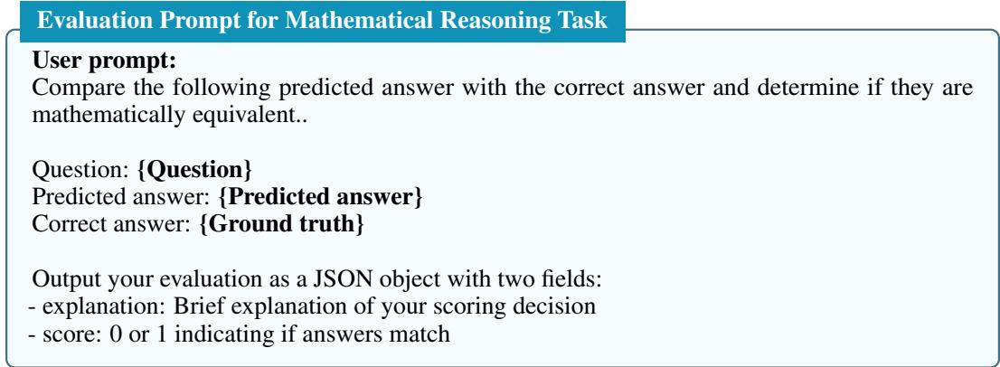

## C Evaluation of Progress Stagnation under Full-Parameter Fine-Tuning

In Figure 2 and Figure 3, we have shown that SLMs distilled via LoRA-based SFT exhibit substantially more severe progress stagnation than the teacher agent across a range of tasks and model families. To further investigate the impact of different training paradigms on this phenomenon, we conduct additional experiments using full-parameter fine-tuning (FFT) for SFT-based agent distillation. Following Appendix B.1, we train FFT for the same number of epochs as the LoRA setting and tune the learning rate over $\{ 2 \times 1 0 ^ { - 4 } , 2 \times 1 0 ^ { - 5 } \}$ , selecting $2 \times 1 0 ^ { - 5 }$ based on in-domain evaluation performance. The resulting stagnation scores are reported in Figure 6. We find that FFT-distilled agents still exhibit pronounced progress stagnation, indicating that this failure mode is not alleviated by simply increasing the capacity of parameter updates. Moreover, for the Qwen family, stagnation is sometimes even more severe than under LoRA-based fine-tuning. This suggests that unrestricted parameter updates may amplify imitation bias during the distillation process, thereby exacerbating unproductive agent interaction loops. These findings further underscore the importance of explicitly detecting and penalizing progress stagnation exhibited by the student during optimization, rather than relying solely on imitation-based supervision.

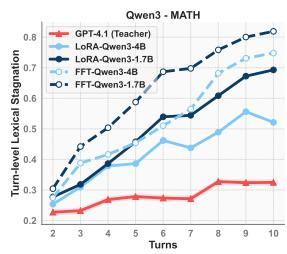

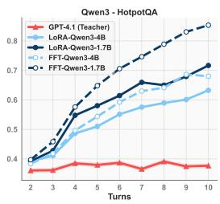

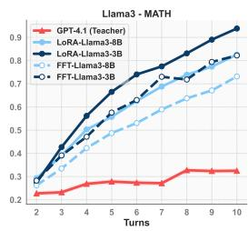

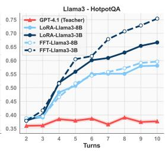  
Figure 6: Comparison of turn-level lexical stagnation scores on MATH and HotpotQA for the teacher agent $( \bar { \mathrm { G P T } } \bar { - } 4 . 1 )$ and SFT-distilled students (Qwen3-4B, Qwen3-1.7B, Llama3.1-8B-Inst, and Llama3.2-3B-Inst) trained with LoRA or full-parameter fine-tuning (FFT).

## D Evaluation of Progress Stagnation on the Distillation Training Data

In Figure 2 and Figure 3, we demonstrate that SLMs distilled via SFT exhibit pronounced progress stagnation on held-out in-domain evaluation sets. Here, we further show that this stagnation phenomenon persists even on the SFT distillation dataset itself. Specifically, we let the distilled student agent generate its own interaction trajectories in response to user queries drawn from the distillation dataset D, and compute the stagnation score at each interaction turn. Figure 7 reports the average stagnation scores aggregated over student-generated trajectories from 1,000 sampled user queries, together with the corresponding trajectories produced by the teacher agent. We observe that the student agent exhibits similarly severe stagnation patterns on the training dataset as those observed on held-out evaluation sets. This consistent behavior indicates that imitation-based SFT alone fails to endow student agents with the teacher's ability to avoid stagnation, even on the data used for distillation. These findings further motivate the design of ProD, which explicitly detects and penalizes stagnation directly on the SFT distillation dataset, enabling the student agent to progressively approximate the teacher's behavior.

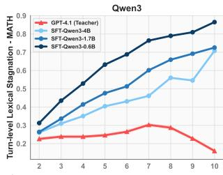

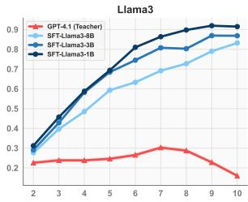

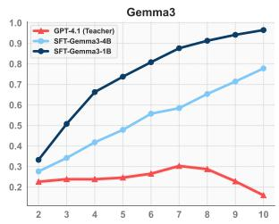

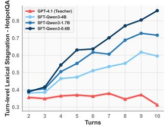

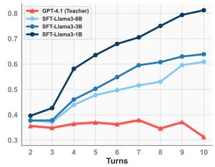

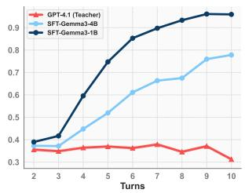  
Figure 7: Comparison of turn-level lexical stagnation scores between the teacher agent (GPT-4.1) and SFT-distilled students on the training dataset.

## E Gradient Analysis of the ProD Objective

In this section, we analyze the gradient of the progress-aware objective in Equation (1) to understand how the adaptive margin modulates the update strength. Our derivation follows the analytical framework of SimPO [Meng et al., 2024], while introducing a trajectory-dependent margin to capture progress signals:

$$
\begin{array} { r } { \nabla _ { \theta } \mathcal { L } _ { \mathrm { P R O } } ( \theta ) = - \beta \mathbb { E } _ { ( \boldsymbol { x } , \tau ) \sim \mathcal { D } , \boldsymbol { \tilde { \tau } } \sim p _ { S } ^ { \theta _ { 0 } } ( \cdot \vert \boldsymbol { x } ) } \Big [ w _ { \theta } ( \boldsymbol { \tilde { \tau } } , \tau ) \cdot \Big ( \frac { 1 } { \vert \tau \vert } \nabla _ { \theta } \log p _ { S } ^ { \theta } ( \tau \mid \boldsymbol { x } ) - \frac { 1 } { \vert \tau \vert } \nabla _ { \theta } \log p _ { S } ^ { \theta } ( \boldsymbol { \tilde { \tau } } \mid \boldsymbol { x } ) \Big ) \Big ] , } \end{array}\tag{4}
$$

where

$$
\begin{array} { r } { w _ { \pmb \theta } ( \tilde { \tau } , \tau ) = \sigma \Bigl ( \frac { \beta } { | \tilde { \tau } | } \log p _ { S } ^ { \pmb \theta } ( \tilde { \tau } \mid \pmb x ) - \frac { \beta } { | \tau | } \log p _ { S } ^ { \pmb \theta } ( \tau \mid \pmb x ) + f ( \tilde { \tau } , \tau ) \Bigr ) } \end{array}
$$

denotes the gradient weight induced by $\mathcal { L } _ { \mathrm { P R O } }$ . Because the adaptive margin $f ( \tilde { \tau } , \tau )$ in Equation (3) accounts for both the stagnation severity of the student trajectory and the correctness of the final outcome, student trajectories that exhibit stronger stagnation and yield incorrect answers are assigned larger margins, which in turn produce larger gradient weights. Conversely, student trajectories that make progress comparable to the teacher and reach correct final answers receive smaller margins and are thus down-weighted during optimization. Consequently, our instance-dependent margin design, driven by the stagnation gap between student and teacher trajectories, focuses updates on unproductive student behaviors while avoiding unnecessary over-correction on trajectories that already exhibit competent progress.

## F ProD with Alternative Progress Metrics

In Table 3, we have shown that ProD trained with the lexical stagnation score substantially outperforms standard SFT distillation across models and tasks. In Section 2.2, we further observed strong agreement among lexical, semantic, and LLM-as-judge stagnation scores. Here, we additionally train ProD using the semantic similarity-based stagnation signal. As shown in Table 9, ProD-Semantic achieves performance comparable to ProD, confirming that the overall distillation performance is robust to the choice of stagnation metric.

Table 9: ProD with alternative progress metrics on HotpotQA.
<table><tr><td>Model</td><td>SFT</td><td>ProD-Semantic</td><td>ProD</td></tr><tr><td>Qwen3-4B</td><td>66.6</td><td>69.2</td><td>70.8</td></tr><tr><td>Llama3.2-3B</td><td>61.6</td><td>66.6</td><td>67.0</td></tr></table>

## G Additional Results on Gemma 3 Models

In Figure 3, we mainly show that ProD substantially alleviates stagnation for Qwen3 and Llama3 agents across lexical, semantic, and LLM-as-judge metrics, enabling SLMs to maintain smoother task progress and better align with teacher behavior. Here, we provide additional results on Gemma3 models. As shown in Figure 8, ProD similarly reduces the stagnation of Gemma3 student agents, further validating the generality of our method across model families.

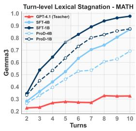

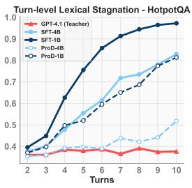

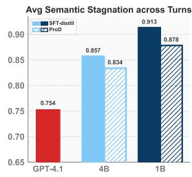

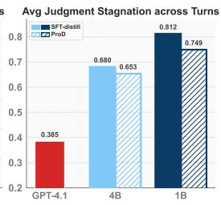  
Figure 8: Alleviating progress stagnation in Gemma3 agents. Comparison between SFT and ProD: 1&2 show turn-level lexical stagnation on MATH and HotpotQA, 3&4 show average semantic and judgment stagnation across turns and datasets.

## H Training Overhead

ProD is applied on top of SFT, with additional cost mainly arising from student rollout generation, stagnation-score computation, and ProD training, where the main experiments use the lexical variant of the stagnation score. Table 10 reports the wall-clock time of each component for two representative models, with all experiments conducted on a single H200 GPU. For each training question, only one student rollout is required, which is generated once as a preprocessing step rather than within the training loop. Overall, the additional cost remains well controlled. Moreover, ProD reduces inference token usage by 20.7%, improving deployment efficiency.

Table 10: Wall-clock time breakdown on HotpotQA (in minutes).
<table><tr><td>Component</td><td>Qwen3-4B</td><td>Qwen3-1.7B</td></tr><tr><td>SFT training (3 epochs)</td><td>34.7</td><td>19.7</td></tr><tr><td>Rollout generation + stagnation score (pre-computed)</td><td>73.8</td><td>44.4</td></tr><tr><td>ProD training (1 epoch)</td><td>22.2</td><td>12.1</td></tr></table>

## I Prompt for Concise-Trajectory SFT

To construct the concise-trajectory SFT baseline, we rewrite long teacher trajectories into shorter demonstrations. Specifically, for teacher trajectories with at least four interaction steps, we prompt the teacher model to solve the same question again using its original successful trajectory as context. The rewriting prompt encourages the model to avoid redundant searches, combine information where possible, and skip unnecessary steps, while still requiring at least one tool-based search. The prompt used for this procedure is shown below.

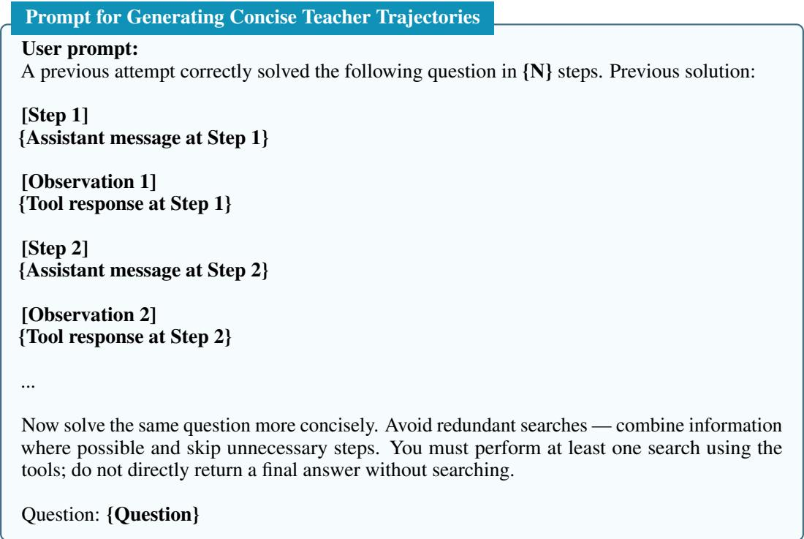

## J Comparison with Preference-Based Objectives

In Section 4.5, we compare ProD with ProD (w/o SFT + AM), which can be viewed as an on-policy SimPO [Meng et al., 2024] variant using trajectories generated by the student agent. Here, we further compare against on-policy DPO [Rafailov et al., 2023]. ProD differs from SimPO and DPO by using an adaptive margin explicitly defined by the teacher-student stagnation gap and dynamically adjusted according to trajectory severity. In contrast, SimPO and DPO use fixed-margin or margin-free preference objectives without accounting for trajectory-specific stagnation. As shown in Table 11, both baselines underperform ProD, with DPO even falling below SFT. These results demonstrate that the adaptive margin is essential, as non-adaptive preference objectives can either overcorrect or under-optimize trajectories of varying quality.

Table 11: On-policy preference optimization baselines, averaged over MATH and HotpotQA.
<table><tr><td>Model</td><td>SFT</td><td>DPO</td><td>SimPO</td><td>ProD</td></tr><tr><td>Qwen3-4B</td><td>74.2</td><td>74.4</td><td>74.1</td><td>78.0</td></tr><tr><td>Llama3.1-8B</td><td>61.8</td><td>62.7</td><td>64.9</td><td>67.2</td></tr><tr><td>Gemma3-4B</td><td>56.4</td><td>53.8</td><td>56.7</td><td>61.0</td></tr></table>

## K Qualitative Study

In this section, we present a qualitative analysis of two case studies, each consisting of a paired comparison between interaction trajectories of student agents distilled with SFT and ProD, generated on two sampled questions from the HotpotQA evaluation set. Figure 9 uses the same two-hop query as Figure 1. We observe that the SFT-distilled agent initially issues a single search query that attempts to cover keywords from both hops simultaneously. When the returned observation does not contain the relevant evidence, the agent continues to persist with highly similar, unsuccessful actions in subsequent turns, failing to acquire new information that would drive progress. In contrast, the ProD-distilled agent follows a solution pattern that closely mirrors the teacher trajectory in Figure 1: it executes a clear two-hop search procedure and uses intermediate observations to guide subsequent steps, resulting in steady progress toward the answer. Figure 10 exhibits a similar failure mode. Although the SFT-distilled agent recognizes that the first-turn search does not yield useful information, it remains trapped in a loop of near-duplicate search attempts. By comparison, the ProD-distilled agent, after two unsuccessful trials, shifts its search strategy at the third turn in a way that is meaningfully different from the prior failed actions. This change enables the agent to escape the stagnation loop, retrieve the required evidence, and ultimately solve the question. Overall, these examples illustrate that ProD produces student agents with smoother task execution and a stronger ability to break out of unproductive interaction loops compared to SFT distillation.

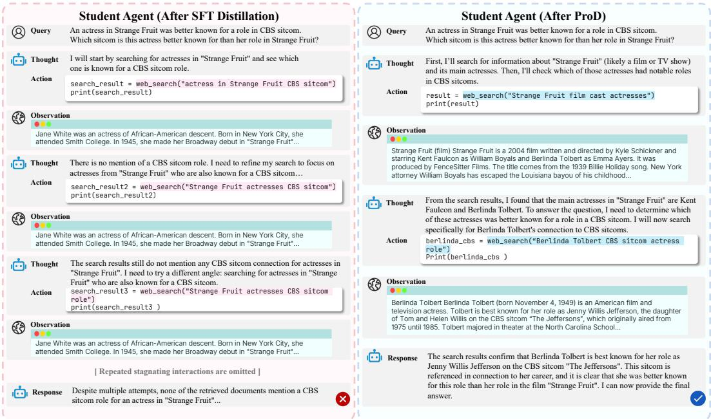  
Figure 9: Qualitative comparison between SFT- and ProD-distilled Qwen3-1.7B student agents on a two-hop HotpotQA question. The SFT-distilled agent repeatedly issues similar search queries that attempt to jointly cover both hops, failing to extract useful intermediate information and exhibiting persistent progress stagnation (left). In contrast, the ProD-distilled agent decomposes the task into a clear two-hop search process, leveraging intermediate observations to guide subsequent actions and achieving steady progress toward the correct answer (right).

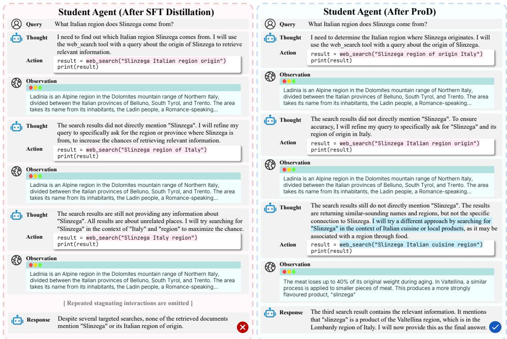  
Figure 10: Qualitative comparison between SFT- and ProD-distilled Qwen3-4B student agents on a HotpotQA evaluation example. Although the SFT-distilled agent recognizes the failure of its initial search attempt, it remains trapped in a loop of near-duplicate queries without acquiring new information (left). By contrast, the ProD-distilled agent adapts its search strategy after early unsuccessful attempts, escapes the stagnation loop, and successfully retrieves the required information to solve the task (right).

## L Discussion

Limitations. Our work focuses on measuring and mitigating stagnation at the trajectory level, where the goal is to quantify how much a student trajectory deviates from the teacher in maintaining progress. This design is effective for identifying broad teacher-student behavioral gaps, but it does not fully explain the root causes of stagnation. For example, a student may stagnate because it misinterprets an observation, fails to update its plan, over-trusts a failed tool call, or lacks the task knowledge needed to propose a new direction. Our current stagnation scores do not explicitly distinguish these cases. Future work could develop more fine-grained progress metrics that localize stagnation to specific reasoning steps, tool calls, or observation updates, and use this diagnosis to provide more targeted corrective signals during training.

Broader Impact and Safeguard Statement. This work improves agent distillation by mitigating progress stagnation in SLM agents, enabling more robust and decisive multi-turn task execution. We expect these advances to support more efficient distillation of reliable autonomous agents from stronger teacher models, especially in settings where large proprietary agents are costly to deploy. At the same time, making agentic capabilities available in smaller and locally deployable models raises important safety considerations, since such agents may interact with external tools, execute code, or retrieve information from the web. To reduce these risks, our current implementation uses the CodeAct framework, which executes code in a sandboxed environment with restricted tool access, providing basic safety guardrails. However, sandboxing alone is not a complete safety solution. When releasing our code and models, we will include usage guidelines and safeguards to discourage misuse.

## NeurIPS Paper Checklist

The checklist is designed to encourage best practices for responsible machine learning research, addressing issues of reproducibility, transparency, research ethics, and societal impact. Do not remove the checklist: The papers not including the checklist will be desk rejected. The checklist should follow the references and follow the (optional) supplemental material. The checklist does NOT count towards the page limit.

Please read the checklist guidelines carefully for information on how to answer these questions. For each question in the checklist:

• You should answer [Yes], [No], or [N/A].

• [N/A] means either that the question is Not Applicable for that particular paper or the relevant information is Not Available.

• Please provide a short (1–2 sentence) justification right after your answer (even for [N/A]).

The checklist answers are an integral part of your paper submission. They are visible to the reviewers, area chairs, senior area chairs, and ethics reviewers. You will also be asked to include it (after eventual revisions) with the final version of your paper, and its final version will be published with the paper.

The reviewers of your paper will be asked to use the checklist as one of the factors in their evaluation. While [Yes] is generally preferable to [No], it is perfectly acceptable to answer [No] provided a proper justification is given (e.g., error bars are not reported because it would be too computationally expensive" or “we were unable to find the license for the dataset we used’). In general, answering [No] or [N/A] is not grounds for rejection. While the questions are phrased in a binary way, we acknowledge that the true answer is often more nuanced, so please just use your best judgment and write a justification to elaborate. All supporting evidence can appear either in the main paper or the supplemental material, provided in appendix. If you answer [Yes] to a question, in the justification please point to the section(s) where related material for the question can be found.

IMPORTANT, please:

• Delete this instruction block, but keep the section heading “NeurIPS Paper Checklist",

• Keep the checklist subsection headings, questions/answers and guidelines below.

• Do not modify the questions and only use the provided macros for your answers

## 1. Claims

Question: Do the main claims made in the abstract and introduction accurately reflect the paper's contributions and scope?

Answer: [Yes]

Justification: The main claims made in the abstract and introduction accurately reflect the paper's contributions and scope.

Guidelines:

• The answer [N/A] means that the abstract and introduction do not include the claims made in the paper.

• The abstract and/or introduction should clearly state the claims made, including the contributions made in the paper and important assumptions and limitations. A [No] or [N/A] answer to this question will not be perceived well by the reviewers.

• The claims made should match theoretical and experimental results, and reflect how much the results can be expected to generalize to other settings.

• It is fine to include aspirational goals as motivation as long as it is clear that these goals are not attained by the paper.

## 2. Limitations

Question: Does the paper discuss the limitations of the work performed by the authors?

Answer: [Yes]

Justification: The limitations are provided in Appendix L.

## Guidelines:

• The answer [N/A] means that the paper has no limitation while the answer [No] means that the paper has limitations, but those are not discussed in the paper.

• The authors are encouraged to create a separate “Limitations" section in their paper.

• The paper should point out any strong assumptions and how robust the results are to violations of these assumptions (e.g., independence assumptions, noiseless settings, model well-specification, asymptotic approximations only holding locally). The authors should reflect on how these assumptions might be violated in practice and what the implications would be.

• The authors should reflect on the scope of the claims made, e.g., if the approach was only tested on a few datasets or with a few runs. In general, empirical results often depend on implicit assumptions, which should be articulated.

• The authors should reflect on the factors that influence the performance of the approach. For example, a facial recognition algorithm may perform poorly when image resolution is low or images are taken in low lighting. Or a speech-to-text system might not be used reliably to provide closed captions for online lectures because it fails to handle technical jargon.

• The authors should discuss the computational efficiency of the proposed algorithms and how they scale with dataset size.

• If applicable, the authors should discuss possible limitations of their approach to address problems of privacy and fairness.

• While the authors might fear that complete honesty about limitations might be used by reviewers as grounds for rejection, a worse outcome might be that reviewers discover limitations that aren't acknowledged in the paper. The authors should use their best judgment and recognize that individual actions in favor of transparency play an important role in developing norms that preserve the integrity of the community. Reviewers will be specifically instructed to not penalize honesty concerning limitations.

## 3. Theory assumptions and proofs

Question: For each theoretical result, does the paper provide the full set of assumptions and a complete (and correct) proof?

Answer: [N/A]

Justification: The paper does not include theoretical results.

Guidelines:

• The answer [N/A] means that the paper does not include theoretical results.

• All the theorems, formulas, and proofs in the paper should be numbered and crossreferenced.

• All assumptions should be clearly stated or referenced in the statement of any theorems.

• The proofs can either appear in the main paper or the supplemental material, but if they appear in the supplemental material, the authors are encouraged to provide a short proof sketch to provide intuition.

• Inversely, any informal proof provided in the core of the paper should be complemented by formal proofs provided in appendix or supplemental material.

• Theorems and Lemmas that the proof relies upon should be properly referenced.

## 4. Experimental result reproducibility

Question: Does the paper fully disclose all the information needed to reproduce the main experimental results of the paper to the extent that it affects the main claims and/or conclusions of the paper (regardless of whether the code and data are provided or not)?

Answer: [Yes]

Justification: We have provided detailed experimental settings including hyperparameters needed to reproduce the experimental results in Appendix B.

Guidelines:

• The answer [N/A] means that the paper does not include experiments.

• If the paper includes experiments, a [No] answer to this question will not be perceived well by the reviewers: Making the paper reproducible is important, regardless of whether the code and data are provided or not.

• If the contribution is a dataset and/or model, the authors should describe the steps taken to make their results reproducible or verifiable.

• Depending on the contribution, reproducibility can be accomplished in various ways. For example, if the contribution is a novel architecture, describing the architecture fully might suffice, or if the contribution is a specific model and empirical evaluation, it may be necessary to either make it possible for others to replicate the model with the same dataset, or provide access to the model. In general. releasing code and data is often one good way to accomplish this, but reproducibility can also be provided via detailed instructions for how to replicate the results, access to a hosted model (e.g., in the case of a large language model), releasing of a model checkpoint, or other means that are appropriate to the research performed.

• While NeurIPS does not require releasing code, the conference does require all submissions to provide some reasonable avenue for reproducibility, which may depend on the nature of the contribution. For example

(a) If the contribution is primarily a new algorithm, the paper should make it clear how to reproduce that algorithm.

(b) If the contribution is primarily a new model architecture, the paper should describe the architecture clearly and fully.

(c) If the contribution is a new model (e.g., a large language model), then there should either be a way to access this model for reproducing the results or a way to reproduce the model (e.g., with an open-source dataset or instructions for how to construct the dataset).

(d) We recognize that reproducibility may be tricky in some cases, in which case authors are welcome to describe the particular way they provide for reproducibility. In the case of closed-source models, it may be that access to the model is limited in some way (e.g., to registered users), but it should be possible for other researchers to have some path to reproducing or verifying the results.

## 5. Open access to data and code

Question: Does the paper provide open access to the data and code, with sufficient instructions to faithfully reproduce the main experimental results, as described in supplemental material?

Answer: [No]

Justification: We will release the complete code and data upon acceptance.

Guidelines:

• The answer [N/A] means that paper does not include experiments requiring code.

• Please see the NeurIPS code and data submission guidelines (https://neurips. cc/ public/guides/CodeSubmissionPolicy) for more details.

• While we encourage the release of code and data, we understand that this might not be possible, so [No] is an acceptable answer. Papers cannot be rejected simply for not including code, unless this is central to the contribution (e.g., for a new open-source benchmark).

• The instructions should contain the exact command and environment needed to run to reproduce the results. See the NeurIPS code and data submission guidelines (https: //neurips.cc/public/guides/CodeSubmissionPolicy) for more details.

• The authors should provide instructions on data access and preparation, including how to access the raw data, preprocessed data, intermediate data, and generated data, etc.

• The authors should provide scripts to reproduce all experimental results for the new proposed method and baselines. If only a subset of experiments are reproducible, they should state which ones are omitted from the script and why.

• At submission time, to preserve anonymity, the authors should release anonymized versions (if applicable).

• Providing as much information as possible in supplemental material (appended to the paper) is recommended, but including URLs to data and code is permitted.

## 6. Experimental setting/details

Question: Does the paper specify all the training and test details (e.g., data splits, hyperparameters, how they were chosen, type of optimizer) necessary to understand the results?

Answer: [Yes]

Justification: We have provided detailed experimental settings in Section 4 and Appendix B. Guidelines:

• The answer [N/A] means that the paper does not include experiments.

• The experimental setting should be presented in the core of the paper to a level of detail that is necessary to appreciate the results and make sense of them.

• The full details can be provided either with the code, in appendix, or as supplemental material.

## 7. Experiment statistical significance

Question: Does the paper report error bars suitably and correctly defined or other appropriate information about the statistical significance of the experiments?

Answer: [No]

Justification: We do not include error bars due to the high computational and evaluation costs involved.

Guidelines:

• The answer [N/A] means that the paper does not include experiments.

• The authors should answer [Yes] if the results are accompanied by error bars, confidence intervals, or statistical significance tests, at least for the experiments that support the main claims of the paper.

• The factors of variability that the error bars are capturing should be clearly stated (for example, train/test split, initialization, random drawing of some parameter, or overall run with given experimental conditions).

• The method for calculating the error bars should be explained (closed form formula, call to a library function, bootstrap, etc.)

• The assumptions made should be given (e.g., Normally distributed errors).

• It should be clear whether the error bar is the standard deviation or the standard error of the mean.

• It is OK to report 1-sigma error bars, but one should state it. The authors should preferably report a 2-sigma error bar than state that they have a 96% CI, if the hypothesis of Normality of errors is not verified.

• For asymmetric distributions, the authors should be careful not to show in tables or figures symmetric error bars that would yield results that are out of range (e.g., negative error rates).

• If error bars are reported in tables or plots, the authors should explain in the text how they were calculated and reference the corresponding figures or tables in the text.

## 8. Experiments compute resources

Question: For each experiment, does the paper provide sufficient information on the computer resources (type of compute workers, memory, time of execution) needed to reproduce the experiments?

Answer: [Yes]

Justification: This is provided in Appendix B.

Guidelines:

• The answer [N/A] means that the paper does not include experiments.

• The paper should indicate the type of compute workers CPU or GPU, internal cluster, or cloud provider, including relevant memory and storage.

• The paper should provide the amount of compute required for each of the individual experimental runs as well as estimate the total compute.

• The paper should disclose whether the full research project required more compute than the experiments reported in the paper (e.g., preliminary or failed experiments that didn't make it into the paper).

## 9. Code of ethics

Question: Does the research conducted in the paper conform, in every respect, with the NeurIPS Code of Ethics https://neurips.cc/public/EthicsGuidelines?

Answer: [Yes]

Justification: The research conducted in the paper conforms with the NeurIPS Code of Ethics.

Guidelines:

• The answer [N/A] means that the authors have not reviewed the NeurIPS Code of Ethics.

• If the authors answer [No], they should explain the special circumstances that require a deviation from the Code of Ethics.

• The authors should make sure to preserve anonymity (e.g., if there is a special consideration due to laws or regulations in their jurisdiction).

## 10. Broader impacts

Question: Does the paper discuss both potential positive societal impacts and negative societal impacts of the work performed?

Answer: [Yes]

Justification: We have provided such discussion in Appendix L.

Guidelines:

• The answer [N/A] means that there is no societal impact of the work performed

• If the authors answer [N/A] or [No], they should explain why their work has no societal impact or why the paper does not address societal impact

• Examples of negative societal impacts include potential malicious or unintended uses (e.g., disinformation, generating fake profiles, surveillance), fairness considerations (e.g., deployment of technologies that could make decisions that unfairly impact specific groups), privacy considerations, and security considerations.

• The conference expects that many papers will be foundational research and not tied to particular applications, let alone deployments. However, if there is a direct path to any negative applications, the authors should point it out. For example, it is legitimate to point out that an improvement in the quality of generative models could be used to generate Deepfakes for disinformation. On the other hand, it is not needed to point out that a generic algorithm for optimizing neural networks could enable people to train models that generate Deepfakes faster.

• The authors should consider possible harms that could arise when the technology is being used as intended and functioning correctly, harms that could arise when the technology is being used as intended but gives incorrect results, and harms following from (intentional or unintentional) misuse of the technology.

• If there are negative societal impacts, the authors could also discuss possible mitigation strategies (e.g., gated release of models, providing defenses in addition to attacks, mechanisms for monitoring misuse, mechanisms to monitor how a system learns from feedback over time, improving the efficiency and accessibility of ML).

## 11. Safeguards

Question: Does the paper describe safeguards that have been put in place for responsible release of data or models that have a high risk for misuse (e.g., pre-trained language models, image generators, or scraped datasets)?

Answer: [Yes]

Justification: We have described safeguards in Appendix L.

Guidelines:

• The answer [N/A] means that the paper poses no such risks.

• Released models that have a high risk for misuse or dual-use should be released with necessary safeguards to allow for controlled use of the model, for example by requiring that users adhere to usage guidelines or restrictions to access the model or implementing safety filters.

• Datasets that have been scraped from the Internet could pose safety risks. The authors should describe how they avoided releasing unsafe images.

• We recognize that providing effective safeguards is challenging, and many papers do not require this, but we encourage authors to take this into account and make a best faith effort.

## 12. Licenses for existing assets

Question: Are the creators or original owners of assets (e.g., code, data, models), used in the paper, properly credited and are the license and terms of use explicitly mentioned and properly respected?

Answer: [Yes]

Justification: All the creators and original owners of assets used in the paper are properly credited.

Guidelines:

• The answer [N/A] means that the paper does not use existing assets.

• The authors should cite the original paper that produced the code package or dataset.

• The authors should state which version of the asset is used and, if possible, include a URL.

• The name of the license (e.g., CC-BY 4.0) should be included for each asset.

• For scraped data from a particular source (e.g., website), the copyright and terms of service of that source should be provided.

• If assets are released, the license, copyright information, and terms of use in the package should be provided. For popular datasets, paperswithcode. com/datasets has curated licenses for some datasets. Their licensing guide can help determine the license of a dataset.

• For existing datasets that are re-packaged, both the original license and the license of the derived asset (if it has changed) should be provided.

• If this information is not available online, the authors are encouraged to reach out to the asset's creators.

## 13. New assets

Question: Are new assets introduced in the paper well documented and is the documentation provided alongside the assets?

Answer: [N/A]

Justification: The paper does not release new assets.

Guidelines:

• The answer [N/A] means that the paper does not release new assets.

• Researchers should communicate the details of the dataset/code/model as part of their submissions via structured templates. This includes details about training, license, limitations, etc.

• The paper should discuss whether and how consent was obtained from people whose asset is used.

• At submission time, remember to anonymize your assets (if applicable). You can either create an anonymized URL or include an anonymized zip file.

## 14. Crowdsourcing and research with human subjects

Question: For crowdsourcing experiments and research with human subjects, does the paper include the full text of instructions given to participants and screenshots, if applicable, as well as details about compensation (if any)?

Answer: [N/A]

Justification: The paper does not involve crowdsourcing experiments or research with human subjects.

Guidelines:

• The answer [N/A] means that the paper does not involve crowdsourcing nor research with human subjects.

• Including this information in the supplemental material is fine, but if the main contribution of the paper involves human subjects, then as much detail as possible should be included in the main paper.

• According to the NeurIPS Code of Ethics, workers involved in data collection, curation, or other labor should be paid at least the minimum wage in the country of the data collector.

## 15. Institutional review board (IRB) approvals or equivalent for research with human subjects

Question: Does the paper describe potential risks incurred by study participants, whether such risks were disclosed to the subjects, and whether Institutional Review Board (IRB) approvals (or an equivalent approval/review based on the requirements of your country or institution) were obtained?

Answer: [N/A]

Justification: The paper does not involve crowdsourcing experiments or research with human subjects.

Guidelines:

• The answer [N/A] means that the paper does not involve crowdsourcing nor research with human subjects.

• Depending on the country in which research is conducted, IRB approval (or equivalent) may be required for any human subjects research. If you obtained IRB approval, you should clearly state this in the paper.

• We recognize that the procedures for this may vary significantly between institutions and locations, and we expect authors to adhere to the NeurIPS Code of Ethics and the guidelines for their institution.

• For initial submissions, do not include any information that would break anonymity (if applicable), such as the institution conducting the review.

## 16. Declaration of LLM usage

Question: Does the paper describe the usage of LLMs if it is an important, original, or non-standard component of the core methods in this research? Note that if the LLM is used only for writing, editing, or formatting purposes and does not impact the core methodology, scientific rigor, or originality of the research, declaration is not required.

Answer: [Yes]

Justification: We use LLMs both as teacher agents for collecting training data and as judges for evaluating task execution outcomes. We provide detailed descriptions of these uses in Appendix B.

Guidelines:

• The answer [N/A] means that the core method development in this research does not involve LLMs as any important, original, or non-standard components.

• Please refer to our LLM policy in the NeurIPS handbook for what should or should not be described.