# REGRA: RESIDUAL-GRADIENT ADAPTATION FOR COMPLEMENTARY LOW-RANK FINE-TUNING

Fanyao Li∗, Yuxi Liu∗, Xiaohao Liu, He Chang, Zhaoxin Wang, Zhulin Tao† Communication University of China, National University of Singapore, Xidian University fanyao.li@mails.cuc.edu.cn, liuyuxi@cuc.edu.cn xiaohao.liu@u.nus.edu, hechangcuc@cuc.edu.cn wangzhaoxin@stu.xidian.edu.cn, taozhulin@gmail.com

## ABSTRACT

Low-rank adaptation (LoRA) enables parameter-efficient fine-tuning by learning low-rank weight updates. Increasing rank expands adaptation capacity, but does not guarantee that all learned directions improve downstream performance. In a diagnostic experiment with rank-16 LoRA, we show that retaining only the top singular components achieves the best performance, whereas adding further components degrades it. Motivated by this, we propose Residual-Gradient Adaptation (ReGRA), a two-stage method for making more effective use of a fixed rank budget. After the first stage, ReGRA estimates task gradients on a calibration set and removes their projections onto the two-sided subspace induced by the first-stage update. It then aggregates the residual-gradient directions to initialize a second-stage adapter without changing the first-stage update. An orthogonality regularizer encourages the two updates to capture complementary directions. Both updates can be merged into the pretrained weights, incurring no additional inference overhead. Across diverse benchmark sets, ReGRA achieves stronger performance than alternatives with the same total rank and even matches LoRA adapters with twice the rank. Ablation studies and further analysis support the contribution of its core design choices. Code is available at https://github.com/Fanyao-Li/ReGRA.

## 1 INTRODUCTION

Large pretrained models have achieved strong performance across a wide range of downstream tasks, alongside scaling parameters and training corpus (Brown et al., 2020; Chen et al., 2021). Efficient generation has also been explored through leap multi-token prediction (Liu et al., 2025b). In deployment, however, full-parameter fine-tuning for particular tasks or domains typically necessitates updating and storing full set of weights, motivating parameter-efficient fine-tuning (PEFT) (Houlsby et al., 2019; He et al., 2021). By optimizing only a small set of task-specific parameters, it significantly reduces the adaptation cost. Among PEFT methods, low-rank adaptation (LoRA) has become a widely used and effective choice, learning compact task-specific updates that can be merged into pretrained weights for inference (Hu et al., 2021).

The principle behind LoRA is to leverage low-rank trainable factors to approximate dense weight updates (Aghajanyan et al., 2021; Hu et al., 2021). Specifically, for a pretrained weight $W _ { 0 } ,$ , LoRA parameterizes the task-specific update as $\Delta { \bf W } = B \bar { \bf A }$ , which satisfies $r = \mathrm { r a n k } ( B \bar { A } ) \ll d ,$ where d denotes the dimension of W. $\dot { W } _ { 0 }$ remains frozen during the fine-tuning phase. Therefore, it substantially reduces the number of trainable parameters, and the learned update can be merged into $W _ { 0 }$ without additional inference overhead. This balance of parameter efficiency and effective task specialization has kept LoRA widely used in resource-constrained settings. Recent advances continue to refine its low-rank principle through adaptive rank allocation (Zhang et al., 2023b), initialization informed by pretrained weights or task gradients (Meng et al., 2024; Wang et al., 2024; Zhang et al.,

2025), optimization strategies tailored to its factorized parameterization (Hayou et al., 2024; Wang et al., 2025b) and adaptive adapter selection and placement (Hayou et al., 2026; Veprikov et al., 2026). Despite different methods to improve LoRA, they leave a fundamental question unanswered: does the learned update make effective use ofits allocated rank?

To this end, we train a LoRA model with rank r = 16 for diagnosis and decompose each learned update $\Delta \mathbf { W }$ using singular value decomposition (SVD). Without retraining, we evaluate rank-k approximations formed by retaining the top k singular components. As shown in Figure 1, we find that k = 3 yields the best downstream performance, whereas retaining additional components degrades it. This suggests that the full learned update is less effective than a lower-rank approximation of itself. A larger rank budget does not necessarily produce a more useful task-specific update.

Motivated by this observation, we propose Residual-Gradient Adaptation (ReGRA), which helps the learned LoRA update make more effective use of its available rank. ReGRA first trains a standard LoRA adapter and then estimates task gradients with a small subset of the training data. To exhaust the allocated rank, we initialize a second-stage adapter with task gradients projected onto the two-sided complement of the first-stage update. With this first-stage estimation, we are able to leave the previously learned components unchanged, yet continually fulfil the update within the allocated rank. During second-stage training, we apply orthogonal regularization to maintain decorrelation

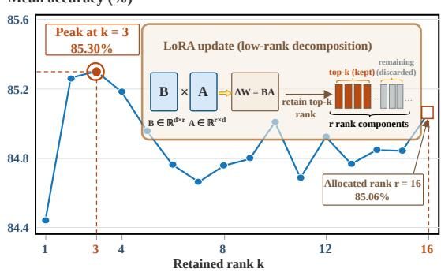  
Figure 1: Effect of retained rank on accuracy. Model performance does not improve monotonically with increasing retained rank.

between the two stages. After training, both updates can be merged into the base model, introducing no additional inference cost. We evaluate ReGRA using standard LoRA evaluation following (Hu et al., 2023) and expand it to natural language understanding, mathematical reasoning, and code generation. Under the same total-rank budget, ReGRA consistently achieves stronger overall performance across the evaluated benchmarks and even reaches the performance of the doublerank model. Ablation studies and further analysis support the effectiveness of residual-gradient initialization and update decorrelation.

Our contributions are summarized as follows:

• We reveal that standard LoRA training does not always make effective use of its allocated rank. We approach this problem from a task-gradient perspective, targeting directions not captured by the initial update.

• We propose ReGRA to exhaust the allocated rank. ReGRA is a two-stage adaptation method that estimates task gradients after standard LoRA training, projects out the components captured by the first-stage update, and uses the residual gradients to initialize a second-stage adapter. An orthogonal regularization maintains the decorrelation between the two updates.

• We evaluate ReGRA on diverse benchmark sets, showing that it outperforms representative baselines and, in some settings, matches the performance of a model with twice the rank. Ablation studies support the efficacy and rationale of our design.

## 2 RELATED WORK

Low-rank parameter-efficient fine-tuning. Low-rank adaptation (LoRA) represents task-specific weight updates using two trainable low-rank factors, reducing the number of trainable parameters while retaining mergeability at inference (Hu et al., 2021). Subsequent variants improve its memory and parameter efficiency through quantization, factor freezing, or shared random projections (Dettmers et al., 2023; Liu et al., 2026; Zhang et al., 2023a; Kopiczko et al., 2024). Other methods explore adaptive rank allocation and rank-dependent scaling (Zhang et al., 2023b; Valipour et al., 2023; Kalajdzievski, 2023). LoRA+, DoRA, and LoRA-Pro instead improve the optimization or parameterization of low-rank updates (Hayou et al., 2024; Liu et al., 2024; Wang et al., 2025b). Recent works also explore adaptive adapter selection and placement to determine where low-rank adaptation is most effective (Hayou et al., 2026; Veprikov et al., 2026). Although these methods improve LoRA from different perspectives, they do not explicitly investigate redundancy among rank components within a learned update matrix.

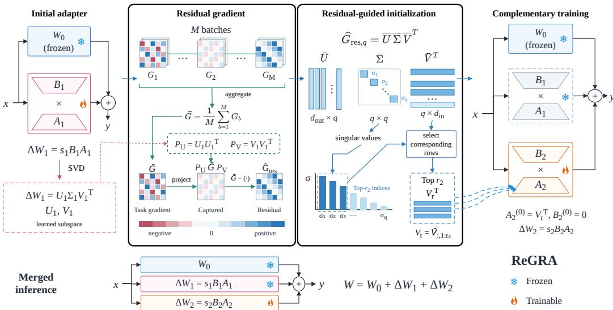  
Figure 2: Overall framework of Residual-Gradient Adaptation (ReGRA). ReGRA first trains Adapter 1 to learn an initial task-specific update. It then projects the task gradient away from the subspace already captured by Adapter 1 and extracts the dominant residual directions via SVD. These residual directions are used to initialize and guide Adapter 2 toward complementary taskrelevant information. The two adapters are finally combined with the frozen backbone to form the final model.

Spectral and gradient-informed initialization. Several methods initialize LoRA using information from pretrained weights, activations, or downstream data. PiSSA initializes adapters from the principal singular components of pretrained weights, whereas MiLoRA adapts their minor singular components (Meng et al., 2024; Wang et al., 2025a). CorDA constructs context-aware adaptation subspaces from weight and activation statistics, while EVA selects initialization directions accord ing to activation variance (Yang et al., 2024; Paischer et al., 2026). Gradient-based methods use the task gradient at the start of fine-tuning to guide adapter initialization (Wang et al., 2024; Zhang et al., 2025; Ponkshe et al., 2024). These approaches determine the adaptation subspace before fine-tuning, whereas ReGRA estimates residual task gradients after a first-stage update has been learned.

Sequential and subspace-aware adaptation. ReLoRA and Chain of LoRA (COLA) construct higher-rank effective updates by repeatedly training, merging, and reinitializing low-rank adapters (Lialin et al., 2024; Xia et al., 2024). LoRA-based adaptation has also been studied in continual learning. CoLoR applies LoRA to domain-incremental learning(Wistuba et al., 2023), while O-LoRA assigns sequential tasks to orthogonal low-rank subspaces and InfLoRA constructs adaptation subspaces that reduce interference with prior tasks (Wang et al., 2023; Liang & Li, 2024). KeepLoRA further uses residual-gradient information to balance knowledge retention and plasticity across tasks (Luo et al., 2026). CMCL uses dual-sided gradient projection to reduce forgetting in continual learning (Liu et al., 2025a). Unlike these methods, ReGRA considers two-stage adaptation to the same downstream objective and combines residual-gradient initialization with update decorrelation to encourage complementary stage-wise updates.

## 3 PRELIMINARIES

Low-rank adaptation (LoRA). LoRA adapts a frozen pretrained weight $W _ { 0 } \in \mathbb { R } ^ { d _ { \mathrm { o u t } } \times d _ { \mathrm { i r } } }$ , as shown in Figure 3, by adding a trainable low-rank update (Hu et al., 2021):

$$
W = W _ { 0 } + \Delta W , ~ \Delta W = s B A .\tag{1}
$$

Here, $\pmb { A } \in \mathbb { R } ^ { r \times d _ { \mathrm { i n } } }$ and $B \in \mathbb { R } ^ { d _ { \mathrm { o u t } } \times r }$ are trainable factors, r is the adapter rank, and s is the LoRA scaling coefficient. The pretrained weight $W _ { 0 }$ remains frozen during adaptation. Several extensions modify how LoRA updates are trained or initialized. QLoRA reduces memory use by quantizing the frozen backbone(Dettmers et al., 2023), while AdaLoRA and DyLoRA explore flexible rank allocation (Zhang et al., 2023b; Valipour et al., 2023). LoRA-GA uses the initial task gradient to guide adapter initialization (Wang et al., 2024). Our method focuses on learning a second-stage subspace that complements the subspace learned in the first stage.

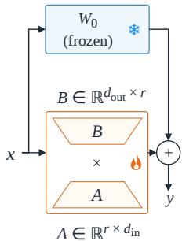

Singular value decomposition (SVD). For a learned low-rank update $\Delta \bar { W }$ with $k = \mathrm { r a n k } ( \Delta W ) \leq r$ , its compact singular value decomposition is

Figure 3: Illustration of the standard LoRA.

$$
\Delta W = U \Sigma V ^ { \top } .\tag{2}
$$

The matrices $U \in \mathbb { R } ^ { d _ { \mathrm { o u t } } \times k }$ and $V \in \mathbb { R } ^ { d _ { \mathrm { i n } } \times k }$ contain the left and right singular vectors, respectively, while $\Sigma = \operatorname { d i a g } ( \sigma _ { 1 } , \dots , \sigma _ { k } )$ contains the positive singular values in descending order. The columns of U span the output-side directions represented by the update, whereas the columns of V span its input-side directions. These singular subspaces are used to identify which components of a task gradient are already represented by a learned low-rank update.

Spectral information has also been used to initialize LoRA adapters: PiSSA selects the principal singular components of the pretrained weights(Meng et al., 2024), while MiLoRA selects the minor components (Wang et al., 2025a). Here, we apply SVD to the first-stage update $\Delta \mathbf { W }$ to identify the components of the task gradient already captured by the update.

## 4 RESIDUAL-GRADIENT ADAPTATION

We briefly introduce ReGRA to provide an overall understanding. ReGRA decomposes adaptation into two sequential low-rank updates:

$$
\begin{array} { r } { W = W _ { 0 } + \Delta W _ { 1 } + \Delta W _ { 2 } , \qquad \Delta W _ { i } = s _ { i } B _ { i } A _ { i } , \quad i \in \{ 1 , 2 \} . } \end{array}\tag{3}
$$

We describe ReGRA for a single adapted weight and omit the layer index. The same procedure is applied independently to all target weights. As demonstrated in Figure 2, the first stage follows standard LoRA training, optimizing a rank- $\mathbf { \nabla } \cdot r _ { 1 }$ adapter with the objective $\mathcal { L } _ { \mathrm { s t a g e 1 } } =$ $\bar { \mathcal { L } } _ { \mathrm { t a s k } } ^ { \mathrm { ~ ~ } } \big ( \boldsymbol { W } _ { 0 } + \Delta \boldsymbol { W } _ { 1 } ; \mathcal { D } _ { \mathrm { t r a i n } } \big )$ . ReGRA estimates task gradients and removes the component associated with the first stage, as characterized by the left and right singular subspaces of $\Delta { W _ { 1 } }$ . The residual gradient is used to initialize a rank-r2 second stage adapter while preserving the function defined by $W _ { 0 } + \Delta W _ { 1 }$ . During second-stage training, we apply an update-level regularizer to promote orthogonality between the first- and second-stage updates. After training, both updates can be merged into the pretrained weight without introducing an additional inference-time branch. The full procedure is listed in Appendix B.5.

## 4.1 RESIDUAL-GUIDED INITIALIZATION

To help the second stage learn complementary components, we first examine the first-stage update. Applying the compact SVD to the fixed first-stage update gives $\Delta { W } _ { 1 } = U _ { 1 } \Sigma _ { 1 } V _ { 1 } ^ { \top }$ . We define the projectors onto its output- and input-side subspaces as $\mathbf { { \bar { { F } } } } _ { U } = \mathbf { { \bar { U } } } _ { 1 } \mathbf { { \bar { U } } } _ { 1 } ^ { \top }$ and $\pmb { P } _ { V } = \pmb { V } _ { 1 } \pmb { V } _ { 1 } ^ { \top }$ , respectively. Let $\{ { \mathcal C } _ { b } \} _ { b = 1 } ^ { M }$ be calibration batches taken from the training data. At the first-stage solution, we compute the task gradient with respect to the adapted weight: $\pmb { G } = \nabla _ { \pmb { W } } \mathcal { L } _ { \mathrm { t a s k } } ( \pmb { W } _ { 0 } + \Delta \pmb { W } _ { 1 } ; \mathcal { C } _ { b } )$ . We remove its component in the two-sided subspace represented by the first-stage update, as derived in Appendix A.1:

$$
\begin{array} { r } { G _ { \mathrm { r e s } } = G - P _ { U } G _ { b } P _ { V } . } \end{array}\tag{4}
$$

Let ${ \widehat { G } } _ { \mathrm { r e s } , q } = { \overline { { U \Sigma V } } } ^ { \top }$ denote the rank-q truncated SVD approximation of ${ \widehat { G } } _ { \mathrm { r e s } } ,$ , obtained by batchwise low-rank aggregation as detailed in Appendix A.2. The calibration procedure is described in Appendix B.2. For a rank $\boldsymbol { \mathbf { \mathit { \Sigma } } } ^ { - T } 2$ second-stage adapter with $r _ { 2 } \leq q .$ , define $V _ { r } = \overline { { V } } _ { : , 1 : r _ { 2 } } , U _ { r } = \overline { { U } } _ { : , 1 : r _ { 2 } } ,$ and $\begin{array} { r } { \sum _ { r } = \overline { { \sum } } _ { 1 : r _ { 2 } , 1 : r _ { 2 } } } \end{array}$ . ReGRA initializes the adapter as

$$
A _ { 2 } ^ { ( 0 ) } = V _ { r } ^ { \top } , \qquad B _ { 2 } ^ { ( 0 ) } = \mathbf { 0 } .\tag{5}
$$

This initialization specifies the adapter’s input-side subspace using the leading right singular vectors of the residual-gradient estimate. The following theorem characterizes its initial effect on the model and its first task-gradient update.

Proposition 1 (Residual-guided first-step update). Consider $\Delta W _ { \mathrm { 2 } } ~ = ~ s _ { \mathrm { 2 } } B _ { \mathrm { 2 } } A _ { \mathrm { 2 } } ~$ initialized as in Equation equation 5. The initialization preserves the Stage-1 model function. After one simultaneous gradient-descent step on the task loss, the effective update lies in the input-side subspace spanned by $V _ { r } .$ . If the initial task gradient equals ${ \widehat { G } } _ { \mathrm { r e s } , q } ,$ this update is proportional to its negative leading rank-r2 component. The proofis given in Appendix A.3.

Remark. Since ${ \bf B } _ { 2 } ^ { ( 0 ) } = { \bf 0 }$ , we have $\Delta W _ { 2 } ^ { ( 0 ) } = \mathbf { 0 }$ . Let ${ \pmb G } ^ { ( 0 ) }$ be the task gradient at $W _ { 0 } + \Delta W _ { 1 }$ One simultaneous gradient-descent step with learning rate η gives $\Delta { \cal W } _ { 2 } ^ { ( 1 ) } = - \eta { \cal G } ^ { ( 0 ) } { \cal V } _ { r } { \cal V } _ { r } ^ { \top }$ In the special case $G ^ { ( 0 ) } = { \widehat { G } } _ { \mathrm { r e s } , q } .$ this reduces to $\Delta { \cal W } _ { 2 } ^ { ( 1 ) } = - \eta U _ { r } \Sigma _ { r } V _ { r } ^ { \top }$ . These expressions describe the first plain gradient-descent step, not the entire Stage-2 trajectory. Both factors are subsequently optimized, and the residual-gradient projection is not applied to later task gradients.

## 4.2 STAGE-WISE ORTHOGONALITY REGULARIZATION

Residual-gradient initialization guides the second-stage adapter toward directions associated with the remaining task gradient. As training proceeds, the second-stage update can move away from these initial directions. ReGRA therefore applies an update-level regularizer to promote orthogonality between the two stage-wise updates. For each adapted weight, let ${ \cal D } _ { 1 } = { \cal B } _ { 1 } \bar { \cal A } _ { 1 }$ and $D _ { 2 } = \bar { B } _ { 2 } A _ { 2 }$ denote the unscaled first- and second-stage updates. We define the orthogonality penalty as

$$
\Omega = \frac { \langle D _ { 1 } , D _ { 2 } \rangle _ { F } ^ { 2 } } { \| D _ { 1 } \| _ { F } ^ { 2 } \| D _ { 2 } \| _ { F } ^ { 2 } + \varepsilon } ,\tag{6}
$$

where $\varepsilon > 0$ ensures numerical stability. Squaring the inner product penalizes deviations from orthogonality in either direction. The penalty promotes orthogonal updates. For L adapted weights, we average the penalties: $\begin{array} { r } { \mathbb { R } _ { \mathrm { d e c o r r } } = \frac { 1 } { L } \sum _ { \ell = 1 } ^ { L } \Omega _ { \ell } } \end{array}$ . The inner products and norms can be computed from the LoRA factors without forming dense update matrices. The derivation is given in Appendix A.4.

During second-stage training, $\Delta { W _ { 1 } }$ remains fixed, while $A _ { 2 }$ and $B _ { 2 }$ are optimized using

$$
\mathcal { L } _ { \mathrm { s t a g e 2 } } = \mathcal { L } _ { \mathrm { t a s k } } \left( \boldsymbol { W _ { 0 } } + \Delta \boldsymbol { W _ { 1 } } + \Delta \boldsymbol { W _ { 2 } } ; \mathcal { D } _ { \mathrm { t r a i n } } \right) + \lambda _ { t } \mathbb { R } _ { \mathrm { d e c o r r } } .\tag{7}
$$

We set $\lambda _ { t } = 0 . 1$ throughout the second stage in all experiments.

Computation and inference. Residual-gradient calibration introduces a one-time cost between the two training stages. Each dense task gradient is formed only transiently, projected, compressed to rank q, and then discarded, while cross-batch aggregation and update decorrelation operate on low-rank factors. After training, the two learned updates are merged into the pretrained weight as $W _ { \mathrm { m e r g e d } } = W _ { 0 } + s _ { 1 } B _ { 1 } A _ { 1 } + s _ { 2 } \bar { B } _ { 2 } A _ { 2 }$ . The Stage-2 procedure is detailed in Appendix B.4. ReGRA therefore introduces neither an additional adapter branch nor extra computation during inference, storage and computation bounds are given in Appendix B.6.

## 5 EXPERIMENTS

To validate the efficacy and rationale of our design, we conduct experiments to address the following research questions (RQs):

• RQ1: How does ReGRA compare with baselines across diverse benchmark sets, and how does it compare with LoRA with larger rank capacity $( i . e . , r = 8 \nu . s . r = 1 6 ) ?$

• RQ2: What are the separate and combined effects of residual-gradient initialization and update decorrelation?

• RQ3: Which singular components of a trained LoRA update affect performance when removed, and what do isolated components of ReGRA’s second-stage update contribute?

• RQ4: How does performance change as rank-2 stages are progressively added?

Table 1: Performance (%) on eight GLUE natural language understanding tasks using RoBERTa-base and RoBERTa-large. Avg. is the unweighted mean across tasks. We calculate the performance gain of ReGRA against the rank-8 LoRA on the same backbone. For ReGRA, r = 8 denotes the rank of each stage. The best average for each backbone is marked in bold.
<table><tr><td>Method</td><td></td><td>|CoLA</td><td>MNLI</td><td>MRPC</td><td>QNLI</td><td>QQP</td><td>RTE</td><td>SST-2</td><td>STS-B</td><td>Avg.</td></tr><tr><td></td><td>LoRA (r = 16)</td><td>60.24</td><td>85.75</td><td>87.25</td><td>91.45</td><td>87.94</td><td>75.09</td><td>93.69</td><td>90.31</td><td>83.97</td></tr><tr><td></td><td>LoRA (r = 8)</td><td>58.04</td><td>85.11</td><td>87.50</td><td>90.99</td><td>87.16</td><td>72.92</td><td>93.92</td><td>90.07</td><td>83.21</td></tr><tr><td>RoB-ase</td><td>DoRA (r = 8)</td><td>56.53</td><td>86.20</td><td>88.23</td><td>91.21</td><td>85.43</td><td>74.36</td><td>93.92</td><td>90.05</td><td>83.24</td></tr><tr><td></td><td>PiSSA (r = 8)</td><td>56.01</td><td>84.16</td><td>89.12</td><td>90.49</td><td>87.43</td><td>72.56</td><td>93.23</td><td>89.56</td><td>82.82</td></tr><tr><td></td><td>LoRA-One (r = 8)</td><td>58.39</td><td>85.28</td><td>89.12</td><td>91.15</td><td>85.51</td><td>75.81</td><td>94.38</td><td>90.54</td><td>83.77</td></tr><tr><td></td><td>KeepLoRA (r = 8)</td><td>58.55</td><td>84.76</td><td>90.35</td><td>90.93</td><td>84.98</td><td>67.87</td><td>93.69</td><td>90.42</td><td>82.69</td></tr><tr><td></td><td>ReGRA (r = 8)</td><td>61.60+3.56</td><td>85.96+0.85</td><td>89.43+1.93</td><td>91.95+0.96</td><td>88.15+0.99</td><td>75.81+2.89</td><td>94.38+0.46</td><td>90.66+0.59|</td><td>84.74+1.53</td></tr><tr><td></td><td>LoRA (r = 16)</td><td>64.55</td><td>90.59</td><td>90.33</td><td>94.58</td><td>87.57</td><td>85.92</td><td>96.22</td><td>92.20</td><td>87.75</td></tr><tr><td>RoB-rge</td><td>LoRA (r = 8)</td><td>66.02</td><td>90.39</td><td>89.70</td><td>94.60</td><td>88.93</td><td>84.12</td><td>96.22</td><td>91.83</td><td>87.73</td></tr><tr><td></td><td>DoRA (r = 8)</td><td>65.53</td><td>90.52</td><td>91.04</td><td>94.34</td><td>87.53</td><td>84.11</td><td>96.10</td><td>91.90</td><td>87.63</td></tr><tr><td></td><td>PiSSA (r = 8)</td><td>60.59</td><td>89.89</td><td>90.91</td><td>94.08</td><td>86.88</td><td>83.75</td><td>96.33</td><td>91.72</td><td>86.77</td></tr><tr><td></td><td>LoRA-One (r = 8)</td><td>65.30</td><td>90.35</td><td>91.34</td><td>94.63</td><td>87.41</td><td>85.19</td><td>95.98</td><td>92.30</td><td>87.81</td></tr><tr><td></td><td>KeepLoRA (r = 8)</td><td>60.72</td><td>89.35</td><td>91.71</td><td>92.62</td><td>86.04</td><td>85.19</td><td>94.61</td><td>91.67</td><td>86.49</td></tr><tr><td></td><td>ReGRA (r = 8)</td><td>68.82+2.80</td><td>90.45+0.06</td><td>91.76+2.06</td><td>94.600.00</td><td>87.77-1.16</td><td>85.92+1.80</td><td>96.220.00</td><td>91.85+0.02|</td><td>88.42+0.69</td></tr></table>

## 5.1 EXPERIMENTAL SETUP

Tasks and datasets. We evaluate ReGRA on natural language understanding (Wang et al., 2018), mathematical reasoning (Hu et al., 2023; Cobbe et al., 2021),and code generation (Chen et al., 2021; Austin et al., 2021). For natural language understanding, we fine-tune RoBERTa-base and RoBERTa-large (Liu et al., 2019) separately on the eight GLUE tasks: CoLA, SST-2, MRPC, STS-B, QQP, MNLI, QNLI, and RTE. We evaluate all tasks on their labeled validation sets, with the matched validation split used for MNLI. For mathematical reasoning (Hu et al., 2023), we fine-tune Llama-3-8B (Grattafiori et al., 2024) and Qwen3-8B-Base (Yang et al., 2025) on Math-7K training set released with LLM-Adapters (Hu et al., 2023). We evaluate on AddSub, MultiArith, SingleEq, GSM8K, AQuA, and SVAMP. For code generation, we fine-tune Llama-3-8B on CodeFeedback-Filtered-Instruction (Zheng et al., 2024) and evaluate on MBPP (Austin et al., 2021) and its enhanced MBPP+ test suite using EvalPlus (Liu et al., 2023).

Implementation details. Adapters are applied to the query, key, and value projections while the pretrained backbones remain frozen, details are provided in Appendix B.1. Each ReGRA stage uses rank 8, α = 16, and dropout 0.05; the GLUE classification head is trained in the first stage and frozen in the second stage. Generative losses are computed only on response tokens. We use zero weight decay, and λ = 0.1, whose contribution is warmed up over the first 100 second-stage steps. The training schedules for GLUE, mathematics, and code generation comprise 20, 2, and 1 epochs, respectively, full settings are tabulated in Appendix B.3.

Baselines and evaluation. We compare ReGRA with LoRA (Hu et al., 2021), DoRA (Liu et al., 2024), PiSSA (Meng et al., 2024), LoRA-One (Zhang et al., 2025), and KeepLoRA (Luo et al., 2026). LoRA is evaluated at ranks 8 and 16, while the other baselines use rank 8. For ReGRA, r = 8 refers to the rank of each stage. GLUE uses the standard task-specific metrics: Matthews correlation for CoLA, the mean of Pearson and Spearman correlations for STS-B, the mean of accuracy and F for MRPC and QQP, and accuracy otherwise. Mathematical reasoning uses answer accuracy, and code generation uses pass@1. All scores are reported as percentages.

## 5.2 MAIN RESULTS (RQ1)

As shown in Table 1, ReGRA achieves the highest average score on both backbones. Increasing the rank of standard LoRA from 8 to 16 also improves its average score, confirming that additional low-rank capacity is useful. ReGRA obtains a further improvement at the same maximum update rank by guiding how that capacity is used. After learning the first-stage update, ReGRA initializes the second adapter from task-gradient directions outside the subspace associated with that update. Update-level decorrelation then discourages the two stage-wise updates from aligning during training. Standard rank-16 LoRA optimizes all rank components jointly without this explicit guidance toward complementary updates. The comparison supports the benefit of directing added capacity toward optimization directions left insufficiently covered by the first stage. Gains on CoLA, MRPC, and RTE further support this pattern.

Table 2: Accuracy (%) on six mathematical reasoning benchmarks using Llama-3-8B and Qwen3-8B-Base. Avg. is the unweighted mean across tasks. Subscript values beside ReGRA scores show percentage-point differences from rank-8 LoRA on the same backbone. For ReGRA, $r = 8$ denotes the rank of each stage. The best average for each backbone is marked in bold.
<table><tr><td colspan="2">Method</td><td>AddSub</td><td>MultiArith</td><td>SingleEq</td><td>SVAMP</td><td>GSM8K</td><td>AQuA</td><td>Avg.</td></tr><tr><td colspan="2">LoRA (r = 16)</td><td>79.74</td><td>92.83</td><td>87.59</td><td>69.80</td><td>60.50</td><td>39.37</td><td>71.64</td></tr><tr><td rowspan="7">LI1a--8B</td><td>LoRA (r = 8)</td><td>76.20</td><td>92.66</td><td>87.99</td><td>69.30</td><td>61.41</td><td>37.40</td><td>70.83</td></tr><tr><td>DoRA (r = 8)</td><td>77.72</td><td>94.16</td><td>86.41</td><td>72.10</td><td>60.34</td><td>39.76</td><td>71.75</td></tr><tr><td>PiSSA (r = 8)</td><td>74.93</td><td>89.00</td><td>85.23</td><td>67.80</td><td>58.07</td><td>43.30</td><td>69.72</td></tr><tr><td>LoRA-One (r = 8)</td><td>79.24</td><td>91.33</td><td>87.99</td><td>70.30</td><td>60.65</td><td>40.15</td><td>71.61</td></tr><tr><td>KeepLoRA (r = 8)</td><td>80.50</td><td>87.33</td><td>88.18</td><td>70.50</td><td>60.80</td><td>37.79</td><td>70.85</td></tr><tr><td>ReGRA (r = 8)</td><td> $7 9 . 2 4 _ { + 3 . 0 4 }$ </td><td> $8 9 . 5 0 _ { - 3 . 1 6 }$ </td><td> $8 8 . 1 9 _ { + 0 . 2 0 }$ </td><td> $7 2 . 4 0 _ { + 3 . 1 0 }$ </td><td> $6 2 . 5 5 _ { + 1 . 1 4 }$ </td><td> $4 0 . 9 4 _ { + 3 . 5 4 }$ </td><td>_  $7 2 . 1 4 _ { + 1 . 3 1 }$ </td></tr><tr><td>LoRA (r = 16)</td><td>91.65</td><td>98.50</td><td>95.08</td><td>85.90</td><td>77.41</td><td>61.42</td><td>84.99</td></tr><tr><td rowspan="7">w--ase</td><td>LoRA (r = 8)</td><td></td><td></td><td></td><td></td><td></td><td></td><td></td></tr><tr><td>DoRA (r = 8)</td><td>91.39 91.65</td><td>98.50</td><td>94.09</td><td>86.00 84.80</td><td>75.28</td><td>59.84</td><td>84.18</td></tr><tr><td>PiSSA (r = 8)</td><td>89.37</td><td>98.83 98.33</td><td>94.29 94.29</td><td>85.40</td><td>75.97 76.19</td><td>62.99</td><td>84.76</td></tr><tr><td>LoRA-One (r = 8)</td><td>92.15</td><td>99.00</td><td>94.88</td><td>84.90</td><td>76.12</td><td>61.02</td><td>84.10</td></tr><tr><td>KeepLoRA (r = 8)</td><td>86.84</td><td>97.50</td><td>94.09</td><td>81.90</td><td>77.48</td><td>60.63 62.99</td><td>84.61</td></tr><tr><td></td><td></td><td></td><td></td><td></td><td></td><td></td><td>83.47</td></tr><tr><td>ReGRA (r = 8)</td><td> $9 2 . 9 1 _ { + 1 . 5 2 }$ </td><td> $9 8 . 6 7 _ { + 0 . 1 7 }$ </td><td> $9 5 . 2 8 _ { + 1 . 1 9 }$ </td><td> $8 5 . 7 0 _ { - 0 . 3 0 }$ </td><td> $7 5 . 5 1 _ { + 0 . 2 3 }$ </td><td> $6 3 . 3 0 _ { + 3 . 4 6 }$ </td><td> $\mathbf { 8 5 . 2 3 _ { + 1 . 0 5 } }$ </td></tr></table>

Table 3: Pass@1 (%) on the MBPP and enhanced MBPP+ tests using Llama-3-8B. For ReGRA, r = 8 denotes the rank of each stage. The best result in each column is marked in bold.
<table><tr><td>Backbone Method</td><td></td><td>|MBPP</td><td>MBPP+</td></tr><tr><td rowspan="5">L1--8B</td><td>LoRA (r = 16)</td><td>67.98</td><td>57.14</td></tr><tr><td>LoRA (r = 8)</td><td>65.87</td><td>55.02</td></tr><tr><td>DoRA (r = 8)</td><td>66.40</td><td>55.55</td></tr><tr><td>PiSSA (r = 8)</td><td>66.93</td><td>54.49</td></tr><tr><td>LoRA-One (r = 8)</td><td>66.13</td><td>54.76</td></tr><tr><td rowspan="3"></td><td>KeepLoRA (r = 8)</td><td>67.46</td><td>56.35</td></tr><tr><td>ReGRA (r = 8)</td><td> $\mathbf { 6 8 . 7 8 _ { + 2 . 9 1 } }$ </td><td> ${ \pmb 5 7 . 4 1 } _ { + 2 . 3 9 }$ </td></tr></table>

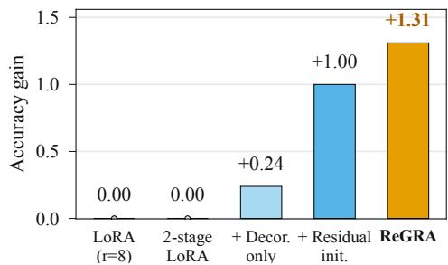  
Figure 4: Component ablation of ReGRA. Llama-3-8B gains in six-task average accuracy, in percentage points, relative to LoRA $( r = 8 )$ Each configuration used one seed.

## 5.3 RESULTS ON SPECIALIZED CAPABILITIES

Mathematical reasoning (RQ1). Table 2 shows that ReGRA achieves the highest six-task average on both Llama-3-8B and Qwen3-8B-Base. The task-level pattern differs between the backbones. On Llama-3-8B, the gains over rank-8 LoRA are concentrated on AddSub, SVAMP, and AQuA, while MultiArith declines. On Qwen3-8B-Base, AddSub, SingleEq, and AQuA benefit most, whereas ReGRA does not lead on every task. Its average also exceeds rank-16 LoRA on both backbones, though the margin is small on Qwen3-8B-Base. These results show that the overall mathematicalreasoning benefit carries across two generative backbones, with different task-level patterns.

Code generation (RQ1). Table 3 shows that ReGRA obtains the highest pass@1 on both the base and enhanced MBPP+ tests. All methods score lower on the enhanced tests, but ReGRA retains it lead under the stricter evaluation. Its advantage over rank-16 LoRA is modest on both test variants, so the code result supports a consistent improvement within this benchmark rather than a large gain in code generation. The commonsense comparison is reported in Appendix C.1.

Removed singular component  
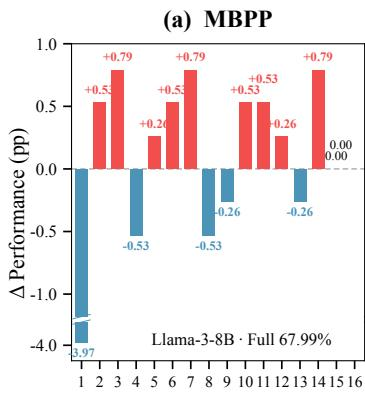

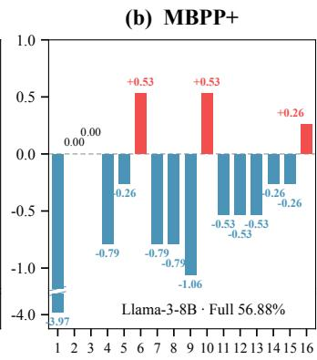

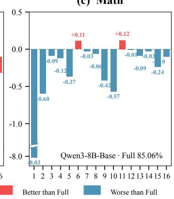  
Figure 5: Functional importance of LoRA singular components. For rank-16 LoRA, we apply SVD to each learned update ∆W and remove one component at a time. Bars show performance changes relative to the full update (dashed zero line) for Llama-3-8B on MBPP (a) and MBPP+ (b), and Qwen3-8B-Base on Math (c). Removing the leading component reduces performance by 3.97 percentage points on both code tasks and 8.03 percentage points on Math. Red and blue indicate gains and losses, respectively; broken axes display the larger leading-component effect.

## 5.4 ABLATION ANALYSIS (RQ2)

To disentangle the effects of the two key design components of ReGRA, we conduct a controlled 2 × 2 ablation study on the mathematical reasoning benchmarks. All variants share the same rank-8 first-stage adapter and train an additional rank-8 Stage-2 adapter under identical optimization settings. When residual-gradient initialization is removed, the second-stage adapter adopts the standard LoRA initialization, with a randomly initialized input-side factor and a zero-initialized output-side factor. When update-level decorrelation is removed, the corresponding regularization term is omitted from the Stage-2 objective. Performance is measured by the unweighted average accuracy across the six mathematical reasoning datasets.

As shown in Figure 4, residual-gradient initialization provides the dominant improvement, supporting the motivation of directing second-stage adaptation toward gradient information insufficiently captured by the first-stage. Update-level decorrelation provides a smaller additional benefit by discouraging redundancy between the two updates. The full model achieves the strongest overall performance, suggesting that the two components play complementary roles: the former determines informative adaptation directions, while the latter encourages the resulting update to remain distinct from the first-stage.

## 5.5 MORE ANALYSIS

Unequal Functional Contributions of LoRA Singular Components (RQ3). We further examine how individual directions in a trained rank-16 LoRA update affect downstream performance. We decompose each learned update using SVD, remove one singular component at a time, and evaluate the resulting model. As shown in Figure 5, removing the leading singular component produces the largest performance drop in all three evaluations: 3.97 percentage points on both MBPP and MBPP+, and 8.03 percentage points on Math. Removing most of the remaining components has a much smaller effect, and removing some even improves performance slightly.

These leave-one-component-out results measure the functional effect of each removal, beyond the magnitude of its singular value. Together with the top-k analysis in Figure 1, they indicate that the learned LoRA directions do not contribute uniformly to task performance. This observation motivates ReGRA to seek complementary directions from the residual gradient after the first-stage update has been learned.

Functional diversity of Stage-2 components (RQ3). To examine the functional contribution of the learned Stage-2 update, we decompose each trained Stage-2 update matrix by SVD and evaluate eight independent variants. Variant $\vec { C _ { i } }$ retains only the ith rank-one component in each adapted matrix while keeping Stage 1 fixed; the variants are not cumulative. As shown in Figure 6, their effects differ across task families. On the six mathematical reasoning benchmarks, only $C _ { 3 } , C _ { 4 }$ , and $C _ { 6 }$ improve mean accuracy over Stage 1-only, by 2.91, 1.27, and 0.56 percentage points, respectively; the other five components produce small decreases. The full Stage-2 update gains 1.27 points, below $C _ { 3 }$ alone. On MBPP+, seven components improve pass@1 by 0.79–1.85 points, while $C _ { 6 }$ leaves it unchanged; the full update gains 2.65 points. These results show heterogeneous and task-dependent component effects. The full update’s benchmark performance is not a sum of its isolated component effects, although these independent evaluations do not identify each component’s marginal contribution within the full update, example-level error analyses are reported in Appendix C.2.

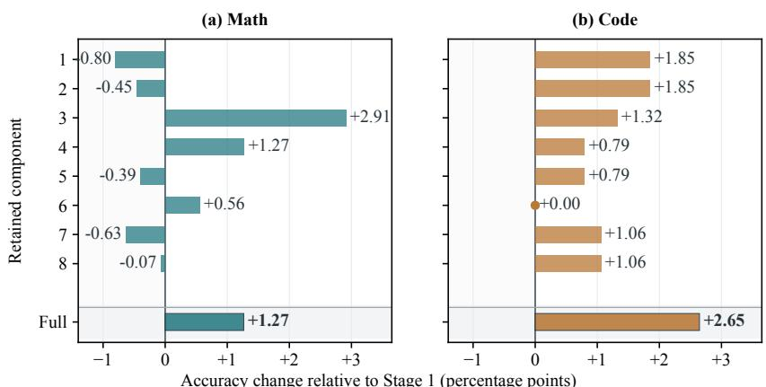  
Accuracy change relative to Stage 1 (percentage points)  
Figure 6: Effects of isolated Stage-2 SVD components on Llama-3-8B. Each $C _ { i }$ retains only the ith rank-one component of every Stage-2 update matrix on a fixed Stage-1 model; components are evaluated independently, not cumulatively. Full retains all eight components. Bars show percentagepoint changes from Stage 1-only in (a) mean accuracy across six math benchmarks and (b) MBPP+ pass1 on 378 problems. Positive and negative bars indicate gains and losses, respectively. Results are from one deterministic evaluation per condition.

Progressive Rank Expansion (RQ4). We further evaluate our method on LLaMA-3-8B under a multi-stage training setting. Starting from the base model, we iteratively train a new rank-2 adapter at each stage while freezing all previously learned adapters. Therefore, the effective adaptation rank increases progressively as more adapters are accumulated. As shown in Fig. 7, the overall performance consistently improves with the increasing cumulative rank, rising from 69.20% at rank 2 to 71.81% at rank

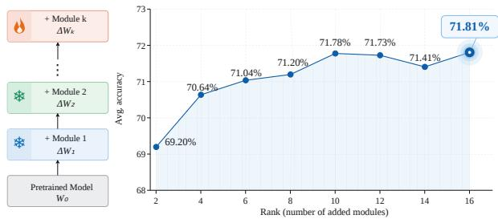  
Figure 7: Progressive rank expansion on LLaMA-3- 8B. At each stage, previously learned adapters are frozen and a new rank-2 adapter is trained.

16. Although minor fluctuations are observed at intermediate ranks, the overall trend demonstrates that newly introduced adapters continue to provide complementary adaptation capacity rather than merely duplicating previously learned directions. These results support the effectiveness of our additive multi-stage training strategy for progressively expanding the model’s adaptation capacity.

## 6 CONCLUSION

In this work, we introduced ReGRA, a two-stage adaptation method that makes more effective use of a fixed total-rank budget. Motivated by the observation that additional LoRA singular components do not always improve performance, ReGRA uses residual task gradients to initialize a second adapter while preserving the first-stage solution. An orthogonality regularizer helps maintain separation between the two updates, which can be merged without additional inference overhead. Experi ments on natural language understanding, mathematical reasoning, and code generation demonstrate improvements over rank-matched LoRA, while ablations support both design choices. These findings suggest that effective low-rank adaptation depends not only on increasing rank, but also on learning useful additional components relative to an existing update. Future work may investigate more principled ways to identify and allocate useful residual directions under a fixed rank budget.

## REFERENCES

Armen Aghajanyan, Sonal Gupta, and Luke Zettlemoyer. Intrinsic dimensionality explains the effectiveness of language model fine-tuning. In Proceedings of the 59th annual meeting of the association for computational linguistics and the 11th international joint conference on natural language processing (volume 1: long papers), pp. 7319–7328, 2021.

Jacob Austin, Augustus Odena, Maxwell Nye, Maarten Bosma, Henryk Michalewski, David Dohan, Ellen Jiang, Carrie Cai, Michael Terry, Quoc Le, et al. Program synthesis with large language models. arXiv preprint arXiv:2108.07732, 2021.

Tom Brown, Benjamin Mann, Nick Ryder, Melanie Subbiah, Jared D Kaplan, Prafulla Dhariwal, Arvind Neelakantan, Pranav Shyam, Girish Sastry, Amanda Askell, et al. Language models are few-shot learners. Advances in neural information processing systems, 33:1877–1901, 2020.

Mark Chen, Jerry Tworek, Heewoo Jun, Qiming Yuan, Henrique Ponde De Oliveira Pinto, Jared Kaplan, Harri Edwards, Yuri Burda, Nicholas Joseph, Greg Brockman, et al. Evaluating large language models trained on code. arXiv preprint arXiv:2107.03374, 2021.

Karl Cobbe, Vineet Kosaraju, Mohammad Bavarian, Mark Chen, Heewoo Jun, Lukasz Kaiser, Matthias Plappert, Jerry Tworek, Jacob Hilton, Reiichiro Nakano, et al. Training verifiers to solve math word problems. arXiv preprint arXiv:2110.14168, 2021.

Tim Dettmers, Artidoro Pagnoni, Ari Holtzman, and Luke Zettlemoyer. Qlora: Efficient finetuning of quantized llms. Advances in neural information processing systems, 36:10088–10115, 2023.

Aaron Grattafiori, Abhimanyu Dubey, Abhinav Jauhri, Abhinav Pandey, Abhishek Kadian, Ahmad Al-Dahle, Aiesha Letman, Akhil Mathur, Alan Schelten, Alex Vaughan, et al. The llama 3 herd of models. arXiv preprint arXiv:2407.21783, 2024.

Soufiane Hayou, Nikhil Ghosh, and Bin Yu. Lora+: Efficient low rank adaptation of large models. arXiv preprint arXiv:2402.12354, 2024.

Soufiane Hayou, Nikhil Ghosh, and Bin Yu. Plop: Precise lora placement for efficient finetuning of large models. In International Conference on Learning Representations, volume 2026, pp. 65166–65191, 2026.

Junxian He, Chunting Zhou, Xuezhe Ma, Taylor Berg-Kirkpatrick, and Graham Neubig. Towards a unified view of parameter-efficient transfer learning. arXiv preprint arXiv:2110.04366, 2021.

Neil Houlsby, Andrei Giurgiu, Stanislaw Jastrzebski, Bruna Morrone, Quentin De Laroussilhe, Andrea Gesmundo, Mona Attariyan, and Sylvain Gelly. Parameter-efficient transfer learning for nlp. In International conference on machine learning, pp. 2790–2799. PMLR, 2019.

Edward J Hu, Yelong Shen, Phillip Wallis, Zeyuan Allen-Zhu, Yuanzhi Li, Shean Wang, Lu Wang, and Weizhu Chen. Lora: Low-rank adaptation of large language models. arXiv preprint arXiv:2106.09685, 2021.

Zhiqiang Hu, Lei Wang, Yihuai Lan, Wanyu Xu, Ee-Peng Lim, Lidong Bing, Xing Xu, Soujanya Poria, and Roy Lee. Llm-adapters: An adapter family for parameter-efficient fine-tuning of large language models. In Proceedings of the 2023 conference on empirical methods in natural language processing, pp. 5254–5276, 2023.

Damjan Kalajdzievski. A rank stabilization scaling factor for fine-tuning with lora. arXiv preprint arXiv:2312.03732, 2023.

Dawid Kopiczko, Tijmen Blankevoort, and Yuki Asano. Vera: Vector-based random matrix adaptation. In International Conference on Learning Representations, volume 2024, pp. 6815–6835, 2024.

Vladislav Lialin, Sherin Muckatira, Namrata Shivagunde, and Anna Rumshisky. Relora: High-rank training through low-rank updates. In International Conference on Learning Representations, volume 2024, pp. 49405–49421, 2024.

Yan-Shuo Liang and Wu-Jun Li. Inflora: Interference-free low-rank adaptation for continual learning. In 2024 IEEE/CVF Conference on Computer Vision and Pattern Recognition (CVPR), pp. 23638–23647. IEEE, 2024.

Jiawei Liu, Chunqiu Steven Xia, Yuyao Wang, and Lingming Zhang. Is your code generated by chatgpt really correct? rigorous evaluation of large language models for code generation. Advances in neural information processing systems, 36:21558–21572, 2023.

Shih-Yang Liu, Chien-Yi Wang, Hongxu Yin, Pavlo Molchanov, Yu-Chiang Frank Wang, Kwang-Ting Cheng, and Min-Hung Chen. Dora: Weight-decomposed low-rank adaptation. arXiv preprint arXiv:2402.09353, 2024.

Xiaohao Liu, Xiaobo Xia, See-Kiong Ng, and Tat-Seng Chua. Continual multimodal contrastive learning. Advances in Neural Information Processing Systems, 38:48414–48455, 2025a.

Xiaohao Liu, Xiaobo Xia, Weixiang Zhao, Manyi Zhang, Xianzhi Yu, Xiu Su, Shuo Yang, See-Kiong Ng, and Tat-Seng Chua. L-mtp: Leap multi-token prediction beyond adjacent context for large language models. Advances in Neural Information Processing Systems, 38:102569–102600, 2025b.

Xiaohao Liu, Xiaobo Xia, Manyi Zhang, Ji-Fu Li, Xianzhi Yu, Fei Shen, Xiu Su, See-Kiong Ng, and Tat-Seng Chua. Freeact: Freeing activations for llm quantization. arXiv preprint arXiv:2603.01776, 2026.

Yinhan Liu, Myle Ott, Naman Goyal, Jingfei Du, Mandar Joshi, Danqi Chen, Omer Levy, Mike Lewis, Luke Zettlemoyer, and Veselin Stoyanov. Roberta: A robustly optimized bert pretraining approach. arXiv preprint arXiv:1907.11692, 2019.

Mao-Lin Luo, Zi-Hao Zhou, Yi-Lin Zhang, Yuanyu Wan, Min-Ling Zhang, and Tong Wei. Keeplora: Continual learning with residual gradient adaptation. In International Conference on Learning Representations, volume 2026, pp. 136017–136040, 2026.

Fanxu Meng, Zhaohui Wang, and Muhan Zhang. Pissa: Principal singular values and singular vectors adaptation of large language models. Advances in Neural Information Processing Systems, 37:121038–121072, 2024.

Fabian Paischer, Lukas Hauzenberger, Thomas Schmied, Benedikt Alkin, Marc Deisenroth, and Sepp Hochreiter. Parameter efficient fine-tuning via explained variance adaptation. Advances in Neural Information Processing Systems, 38:46215–46267, 2026.

Kaustubh Ponkshe, Raghav Singhal, Eduard Gorbunov, Alexey Tumanov, Samuel Horvath, and Praneeth Vepakomma. Initialization using update approximation is a silver bullet for extremely efficient low-rank fine-tuning. arXiv preprint arXiv:2411.19557, 2024.

Mojtaba Valipour, Mehdi Rezagholizadeh, Ivan Kobyzev, and Ali Ghodsi. Dylora: Parameterefficient tuning of pre-trained models using dynamic search-free low-rank adaptation. In Proceedings of the 17th Conference of the European Chapter of the Association for Computational Linguistics, pp. 3274–3287, 2023.

Andrey Veprikov, Vladimir Solodkin, Zyl Alexander, Andrey Savchenko, and Aleksandr Beznosikov. Weightlora: Keep only necessary adapters. In Proceedings ofthe 64th Annual Meeting of the Association for Computational Linguistics (Volume 1: Long Papers), pp. 12419–12437, 2026.

Alex Wang, Amanpreet Singh, Julian Michael, Felix Hill, Omer Levy, and Samuel R Bowman. Glue: A multi-task benchmark and analysis platform for natural language understanding. In Proceedings of the 2018 EMNLP workshop BlackboxNLP: Analyzing and interpreting neural networksfor NLP, pp. 353–355, 2018.

Hanqing Wang, Yixia Li, Shuo Wang, Guanhua Chen, and Yun Chen. Milora: Harnessing minor singular components for parameter-efficient llm finetuning. In Proceedings of the 2025 Conference of the Nations of the Americas Chapter of the Association for Computational Linguistics: Human Language Technologies (Volume 1: Long Papers), pp. 4823–4836, 2025a.

Shaowen Wang, Linxi Yu, and Jian Li. Lora-ga: Low-rank adaptation with gradient approximation. Advances in Neural Information Processing Systems, 37:54905–54931, 2024.

Xiao Wang, Tianze Chen, Qiming Ge, Han Xia, Rong Bao, Rui Zheng, Qi Zhang, Tao Gui, and Xuan-Jing Huang. Orthogonal subspace learning for language model continual learning. In Findings of the Association for Computational Linguistics: EMNLP 2023, pp. 10658–10671, 2023.

Zhengbo Wang, Jian Liang, Ran He, Zilei Wang, and Tieniu Tan. Lora-pro: Are low-rank adapters properly optimized? In International Conference on Learning Representations, volume 2025, pp. 93787–93808, 2025b.

Martin Wistuba, Prabhu Teja Sivaprasad, Lukas Balles, and Giovanni Zappella. Continual learning with low rank adaptation. arXiv preprint arXiv:2311.17601, 2023.

Wenhan Xia, Chengwei Qin, and Elad Hazan. Chain of LoRA: Efficient fine-tuning of language models via residual learning. In Proceedings of the 41st International Conference on Machine Learning, 2024.

An Yang, Anfeng Li, Baosong Yang, Beichen Zhang, Binyuan Hui, Bo Zheng, Bowen Yu, Chang Gao, Chengen Huang, Chenxu Lv, et al. Qwen3 technical report. arXiv preprint arXiv:2505.09388, 2025.

Yibo Yang, Xiaojie Li, Zhongzhu Zhou, Shuaiwen L Song, Jianlong Wu, Liqiang Nie, and Bernard Ghanem. Corda: Context-oriented decomposition adaptation of large language models for taskaware parameter-efficient fine-tuning. Advances in neural information processing systems, 37: 71768–71791, 2024.

Longteng Zhang, Lin Zhang, Shaohuai Shi, Xiaowen Chu, and Bo Li. Lora-fa: Memory-efficient low-rank adaptation for large language models fine-tuning. arXiv e-prints, pp. arXiv–2308, 2023a.

Qingru Zhang, Minshuo Chen, Alexander Bukharin, Nikos Karampatziakis, Pengcheng He, Yu Cheng, Weizhu Chen, and Tuo Zhao. Adalora: Adaptive budget allocation for parameterefficient fine-tuning. arXiv preprint arXiv:2303.10512, 2023b.

Yuanhe Zhang, Fanghui Liu, and Yudong Chen. Lora-one: One-step full gradient could suffice for fine-tuning large language models, provably and efficiently. arXiv preprint arXiv:2502.01235, 2025.

Tianyu Zheng, Ge Zhang, Tianhao Shen, Xueling Liu, Bill Yuchen Lin, Jie Fu, Wenhu Chen, and Xiang Yue. Opencodeinterpreter: Integrating code generation with execution and refinement. In Findings of the Association for Computational Linguistics: ACL 2024, pp. 12834–12859, 2024.

## Appendix

## CONTENTS

A Theoretical Analysis 13   
A.1 Residual-Gradient Projection and Orthogonality 13   
A.2 Low-Rank Calibration and Gradient Aggregation 14   
A.3 Proof of the Residual-Guided First-Step Update 14   
A.4 Update Orthogonality Regularization . 15   
B Supplementary Implementation Details 15   
B.1 Model and Training Setup 15   
B.2 Residual-Gradient Calibration 16   
B.3 Hyperparameter Settings 16   
B.4 Stage-2 Optimization and Merging . 16   
B.5 Algorithm Flow 17   
B.6 Computational Cost 17   
C Additional Results 18   
C.1 Commonsense Reasoning . 18   
C.2 Error-Level Analysis of Stage-2 Components 18

## A THEORETICAL ANALYSIS

In this section, we analyze the residual-gradient projection (Appendix A.1), its low-rank aggregation (Appendix A.2), the initial Stage-2 update (Appendix A.3), and the factorized decorrelation penalty (Appendix A.4).

## A.1 RESIDUAL-GRADIENT PROJECTION AND ORTHOGONALITY

Consider an adapted weight $W _ { 0 } \in \mathbb { R } ^ { d _ { \mathrm { o u t } } \times d _ { \mathrm { i n } } }$ . For the fixed first-stage update, define

$$
\begin{array} { r l r } { \boldsymbol { \Delta } W _ { 1 } = s _ { 1 } { B _ { 1 } } { A _ { 1 } } = } & { { } U _ { 1 } \boldsymbol { \Sigma } _ { 1 } \boldsymbol { V } _ { 1 } ^ { \top } , } & { } \\ { P _ { U } = U _ { 1 } { U } _ { 1 } ^ { \top } , \quad } & { { } P _ { V } = V _ { 1 } { V } _ { 1 } ^ { \top } . } \end{array}\tag{8}
$$

For a calibration batch $\mathcal { C } _ { b } .$ , the gradient and its residual are

$$
\begin{array} { r l } & { \quad G _ { b } = \nabla _ { W } \mathcal { L } _ { \mathrm { t a s k } } ( W _ { 0 } + \Delta W _ { 1 } ; \mathcal { C } _ { b } ) , } \\ & { G _ { \mathrm { r e s } , b } = G _ { b } - P _ { U } G _ { b } P _ { V } } \\ & { \quad \quad = G _ { b } - U _ { 1 } U _ { 1 } ^ { \top } G _ { b } V _ { 1 } V _ { 1 } ^ { \top } . } \end{array}\tag{9}
$$

The residual is orthogonal to every matrix in the two-sided subspace represented by the first-stage update. Indeed, for any compatible Z,

$$
\begin{array} { r l } & { \left. \boldsymbol { G } _ { \mathrm { r e s } , b } , \boldsymbol { U } _ { 1 } \boldsymbol { Z } \boldsymbol { V } _ { 1 } ^ { \top } \right. _ { F } = \left. \boldsymbol { U } _ { 1 } ^ { \top } \boldsymbol { G } _ { \mathrm { r e s } , b } \boldsymbol { V } _ { 1 } , \boldsymbol { Z } \right. _ { F } } \\ & { \qquad = \left. \boldsymbol { U } _ { 1 } ^ { \top } \big ( \boldsymbol { G } _ { b } - P _ { U } \boldsymbol { G } _ { b } P _ { V } \big ) \boldsymbol { V } _ { 1 } , \boldsymbol { Z } \right. _ { F } } \\ & { \qquad = \left. \boldsymbol { U } _ { 1 } ^ { \top } \boldsymbol { G } _ { b } \boldsymbol { V } _ { 1 } - \boldsymbol { U } _ { 1 } ^ { \top } \boldsymbol { G } _ { b } \boldsymbol { V } _ { 1 } , \boldsymbol { Z } \right. _ { F } } \\ & { \qquad = 0 . } \end{array}\tag{10}
$$

Thus, the projection removes components jointly aligned with the left and right first-stage subspaces.   
Unlike $( I - P _ { U } ) G _ { b } ( I - P _ { V } )$ , it retains components aligned with only one of these subspaces.

## A.2 LOW-RANK CALIBRATION AND GRADIENT AGGREGATION

For each calibration batch, we truncate the residual gradient immediately after projection. Let $\mathcal { T } _ { q } ( \cdot )$ denote the rank-at-most-q matrix returned by the low-rank SVD routine. Then

$$
\begin{array} { r l } & { G _ { \mathrm { r e s } , b } = G _ { b } - P _ { U } G _ { b } P _ { V } , } \\ & { \displaystyle \widetilde { G } _ { \mathrm { r e s } , b } : = \mathcal { T } _ { q } ( G _ { \mathrm { r e s } , b } ) } \\ & { \qquad = U _ { b } ^ { ( g ) } \Sigma _ { b } ^ { ( g ) } \left( V _ { b } ^ { ( g ) } \right) ^ { \top } , } \\ & { \displaystyle \widetilde { G } _ { \mathrm { r e s } } : = \frac { 1 } { M } \sum _ { b = 1 } ^ { M } \widetilde { G } _ { \mathrm { r e s } , b } } \\ & { \qquad = \displaystyle \frac { 1 } { M } \sum _ { b = 1 } ^ { M } U _ { b } ^ { ( g ) } \Sigma _ { b } ^ { ( g ) } \left( V _ { b } ^ { ( g ) } \right) ^ { \top } . } \end{array}\tag{11}
$$

The superscript $( g )$ distinguishes the batch-gradient singular vectors from those of the first-stage update. The mean can be aggregated without constructing a dense matrix. Define the concatenated factors

$$
\begin{array} { l } { { { \displaystyle { \bf L } = \left[ \frac { U _ { 1 } ^ { ( g ) } \Sigma _ { 1 } ^ { ( g ) } } { M } , . . . , \frac { U _ { M } ^ { ( g ) } \Sigma _ { M } ^ { ( g ) } } { M } \right] , } } } \\ { { { \displaystyle { \bf R } = \left[ V _ { 1 } ^ { ( g ) } , . . . , V _ { M } ^ { ( g ) } \right] . } } } \end{array}\tag{12}
$$

Using thin QR factorizations ${ \bf L } = { \bf Q } _ { L } { \bf R } _ { L }$ and ${ \bf R } = { \bf Q } _ { R } { \bf R } _ { R }$ , we obtain

$$
\begin{array} { r l } & { \widehat { G } _ { \mathrm { r e s } } = { \bf L } { \bf R } ^ { \top } } \\ & { \qquad = ( { \bf Q } _ { L } { \bf R } _ { L } ) ( { \bf Q } _ { R } { \bf R } _ { R } ) ^ { \top } } \\ & { \qquad = { \bf Q } _ { L } ( { \bf R } _ { L } { \bf R } _ { R } ^ { \top } ) { \bf Q } _ { R } ^ { \top } . } \end{array}\tag{13}
$$

Thus, the SVD can be performed on the smaller core matrix ${ \bf K } = { \bf R } _ { L } { \bf R } _ { R } ^ { \top }$ . Let $\mathbf { K } _ { q }$ be its rank-q truncated SVD. The corresponding truncated aggregate and Stage-2 initialization are

$$
\begin{array} { r l } { \hat { G } _ { \mathrm { r e s } , q } : = \mathbf { Q } _ { L } \mathbf { K } _ { q } \mathbf { Q } _ { R } ^ { \top } } & { { } } \\ { = \overline { { U \Sigma V } } ^ { \top } , } \\ { A _ { 2 } ^ { ( 0 ) } = \big ( \overline { { V } } _ { : , 1 : r _ { 2 } } \big ) ^ { \top } , \qquad } & { { } B _ { 2 } ^ { ( 0 ) } = \mathbf { 0 } , } \end{array}\tag{14}
$$

where $r _ { 2 } \leq q$ . This procedure obtains the initialization directions without explicitly forming the dense aggregate ${ \widehat { G } } _ { \mathrm { r e s } }$ . The orthogonality in Equation equation 10 applies to each residual gradient before truncation.

## A.3 PROOF OF THE RESIDUAL-GUIDED FIRST-STEP UPDATE

We prove Theorem 1 for one adapted weight. Write

$$
\begin{array} { r l r } { \Delta W _ { 2 } ^ { ( 0 ) } } & { = } & { s _ { 2 } B _ { 2 } ^ { ( 0 ) } A _ { 2 } ^ { ( 0 ) } } \\ & { = } & { s _ { 2 } \mathbf { 0 } V _ { r } ^ { \top } \quad \quad } \\ & { = } & { \mathbf { 0 } , } \end{array}\tag{15}
$$

so the initial Stage-2 model represents exactly $W _ { 0 } + \Delta W _ { 1 }$

Let ${ \pmb G } ^ { ( 0 ) }$ be the task-loss gradient with respect to the adapted weight at this initial model. The chain rule gives

$$
\begin{array} { r } { \nabla _ { B _ { 2 } } \mathcal { L } _ { \mathrm { t a s k } } = s _ { 2 } G A _ { 2 } ^ { \top } , } \\ { \nabla _ { A _ { 2 } } \mathcal { L } _ { \mathrm { t a s k } } = s _ { 2 } B _ { 2 } ^ { \top } G . } \end{array}\tag{16}
$$

Because ${ \cal B } _ { 2 } ^ { ( 0 ) } = { \bf 0 }$ , one simultaneous gradient-descent step with learning rate $\eta$ gives

$$
\begin{array} { r l } & { A _ { 2 } ^ { ( 1 ) } = A _ { 2 } ^ { ( 0 ) } - \eta s _ { 2 } \big ( B _ { 2 } ^ { ( 0 ) } \big ) ^ { \top } G ^ { ( 0 ) } = V _ { r } ^ { \top } , } \\ & { B _ { 2 } ^ { ( 1 ) } = B _ { 2 } ^ { ( 0 ) } - \eta s _ { 2 } G ^ { ( 0 ) } \big ( A _ { 2 } ^ { ( 0 ) } \big ) ^ { \top } } \\ & { \qquad = - \eta s _ { 2 } G ^ { ( 0 ) } V _ { r } . } \end{array}\tag{17}
$$

Therefore,

$$
\begin{array} { r l } & { \Delta \boldsymbol { W } _ { 2 } ^ { ( 1 ) } = s _ { 2 } \boldsymbol { B } _ { 2 } ^ { ( 1 ) } \boldsymbol { A } _ { 2 } ^ { ( 1 ) } } \\ & { \qquad = s _ { 2 } \big ( - \eta s _ { 2 } \boldsymbol { G } ^ { ( 0 ) } \boldsymbol { V } _ { r } \big ) \boldsymbol { V } _ { r } ^ { \intercal } } \\ & { \qquad = - \eta s _ { 2 } ^ { 2 } \boldsymbol { G } ^ { ( 0 ) } \boldsymbol { V } _ { r } \boldsymbol { V } _ { r } ^ { \intercal } . } \end{array}\tag{18}
$$

In the special case $G ^ { ( 0 ) } = \widehat { G } _ { \mathrm { r e s } , q } .$ the SVD definition of $V _ { r }$ further yields

$$
\begin{array} { r l } & { \Delta W _ { 2 } ^ { ( 1 ) } = - \eta s _ { 2 } ^ { 2 } \widehat { G } _ { \mathrm { r e s } , q } V _ { r } V _ { r } ^ { \top } } \\ & { \qquad = - \eta s _ { 2 } ^ { 2 } \overline { { U \Sigma V } } ^ { \top } V _ { r } V _ { r } ^ { \top } } \\ & { \qquad = - \eta s _ { 2 } ^ { 2 } U _ { r } \Sigma _ { r } V _ { r } ^ { \top } . } \end{array}\tag{19}
$$

This result describes one plain gradient-descent step. It does not assume that later mini-batch gradients equal the calibration estimate or that subsequent updates remain in the initialized subspace.

## A.4 UPDATE ORTHOGONALITY REGULARIZATION

Let $D _ { 1 } = B _ { 1 } A _ { 1 }$ and $D _ { \mathrm { 2 } } = B _ { \mathrm { 2 } } A _ { \mathrm { 2 } }$ be the unscaled stage-wise updates. Their Frobenius inner product satisfies

$$
\begin{array} { r l } & { \langle D _ { 1 } , D _ { 2 } \rangle _ { F } = \mathrm { t r } ( D _ { 1 } ^ { \top } D _ { 2 } ) } \\ & { \qquad = \mathrm { t r } ( A _ { 1 } ^ { \top } B _ { 1 } ^ { \top } B _ { 2 } A _ { 2 } ) } \\ & { \qquad = \mathrm { t r } \big [ ( B _ { 1 } ^ { \top } B _ { 2 } ) ^ { \top } ( A _ { 1 } A _ { 2 } ^ { \top } ) \big ] } \\ & { \qquad = \big \langle B _ { 1 } ^ { \top } B _ { 2 } , A _ { 1 } A _ { 2 } ^ { \top } \big \rangle _ { F } . } \end{array}\tag{20}
$$

Similarly,

$$
\begin{array} { r } { \| \pmb { D } _ { 1 } \| _ { F } ^ { 2 } = \mathrm { t r } ( \pmb { D } _ { 1 } ^ { \top } \pmb { D } _ { 1 } ) = \big \langle \pmb { B } _ { 1 } ^ { \top } \pmb { B } _ { 1 } , \pmb { A } _ { 1 } \pmb { A } _ { 1 } ^ { \top } \big \rangle _ { F } , } \\ { \| \pmb { D } _ { 2 } \| _ { F } ^ { 2 } = \mathrm { t r } ( \pmb { D } _ { 2 } ^ { \top } \pmb { D } _ { 2 } ) = \big \langle \pmb { B } _ { 2 } ^ { \top } \pmb { B } _ { 2 } , \pmb { A } _ { 2 } \pmb { A } _ { 2 } ^ { \top } \big \rangle _ { F } . } \end{array}\tag{21}
$$

Substitution into Equation equation 6 gives a factor-only expression:

$$
\Omega = \frac { \left. B _ { 1 } ^ { \top } B _ { 2 } , A _ { 1 } A _ { 2 } ^ { \top } \right. _ { F } ^ { 2 } } { \left. B _ { 1 } ^ { \top } B _ { 1 } , A _ { 1 } A _ { 1 } ^ { \top } \right. _ { F } \left. B _ { 2 } ^ { \top } B _ { 2 } , A _ { 2 } A _ { 2 } ^ { \top } \right. _ { F } + \varepsilon } .\tag{22}
$$

Thus, the penalty can be evaluated without explicitly forming either dense update matrix. It helps maintain orthogonality between $D _ { 1 }$ and $D _ { 2 }$ during Stage-2 training; it does not require their left or right singular subspaces to be separately orthogonal.

## B SUPPLEMENTARY IMPLEMENTATION DETAILS

This section specifies the model setup, residual-gradient calibration, training hyperparameters, algorithm flow, and computational cost of ReGRA.

## B.1 MODEL AND TRAINING SETUP

We apply LoRA adapters to the query, key, and value projections. The pretrained backbone remains fixed during both training stages. Each ReGRA stage uses rank 8, LoRA scaling parameter $\alpha = 1 6$ and dropout 0.05. Stage 1 trains a standard LoRA adapter on the task training data. Its learned update is then fixed during calibration and Stage-2 training.

For GLUE, the task-specific classification head is trained in Stage 1 and retained without further updates in Stage 2. For generative tasks, the language-modeling loss is computed only on response tokens. Experiments use seed 42, bfloat16 precision, and zero weight decay. The training runs were conducted on an NVIDIA GeForce RTX 3090.

Table 4: Training settings for ReGRA. The Stage-2 learning rate for RoBERTa-large RTE is $1 0 ^ { - 4 }$ rather than $5 \times \mathrm { 1 \bar { 0 } ^ { - 5 } }$
<table><tr><td>Setting</td><td>Epochs</td><td>Stage-1 LR</td><td>Stage-2 LR</td><td>Batch size</td><td>Max. length</td></tr><tr><td>RoBERTa-base, GLUE</td><td>Task-specific</td><td> $2 \times 1 0 ^ { - 4 }$ </td><td> $2 \times 1 0 ^ { - 4 }$ </td><td>32</td><td>128</td></tr><tr><td>RoBERTa-large, GLUE</td><td>Task-specific</td><td> $2 \times 1 0 ^ { - 4 }$ </td><td> $5 \times 1 0 ^ { - 5 ^ { * } }$ </td><td>32</td><td>128</td></tr><tr><td>Llama-3-8B, math</td><td>2</td><td> $1 0 ^ { - 4 }$ </td><td> $1 0 ^ { - 4 }$ </td><td>2</td><td>256</td></tr><tr><td>Qwen3-8B-Base, math</td><td>2</td><td> $1 0 ^ { - 4 }$ </td><td> $1 0 ^ { - 5 }$ </td><td>2</td><td>256</td></tr><tr><td>Llama-3-8B, code</td><td>1</td><td> $2 \times 1 0 ^ { - 5 }$ </td><td> $5 \times 1 0 ^ { - 6 }$ </td><td>4</td><td>1024</td></tr><tr><td>Llama-3-8B, commonsense</td><td>1</td><td> $1 0 ^ { - 4 }$ </td><td> $2 \times 1 0 ^ { - 5 }$ </td><td>4</td><td>256</td></tr></table>

Except RTE, which uses $1 0 ^ { - 4 }$

Table 5: Residual-gradient calibration settings for ReGRA.
<table><tr><td>Setting</td><td>M</td><td>b</td><td>q</td></tr><tr><td>GLUE, both backbones</td><td>8</td><td>32</td><td>16</td></tr><tr><td>Llama-3-8B, math</td><td>1</td><td>1</td><td>8</td></tr><tr><td>Qwen3-8B-Base, math</td><td>4</td><td>2</td><td>8</td></tr><tr><td>Llama-3-8B, code</td><td>16</td><td>1</td><td>16</td></tr><tr><td>Llama-3-8B, commonsense</td><td>16</td><td>4</td><td>32</td></tr></table>

## B.2 RESIDUAL-GRADIENT CALIBRATION

Calibration is performed once after Stage 1 and before Stage 2. We load the pretrained backbone together with the fixed Stage-1 adapter and evaluate task gradients on batches drawn from the training data. The selected calibration records are processed without data-loader shuffling. For each adapted weight, a gradient with respect to the underlying weight is computed without applying an optimizer update.

Each gradient is projected using the first-stage left and right subspaces, as described in $\mathsf { A p - }$ pendix A.1. The residual is immediately compressed to rank at most $q ,$ and the dense gradient is discarded. Batchwise low-rank factors are aggregated using the procedure in Appendix A.2. The leading right singular vectors of the aggregate initialize $A _ { 2 } ,$ while $B _ { 2 }$ is initialized to zero. Consequently, the initialized Stage-2 adapter does not change the function represented by the Stage-1 model.

For commonsense reasoning, the calibration subset contains 64 examples, with eight selected from each of the eight tasks. This task balancing applies only to calibration; it does not change the order of subsequent Stage-2 training.

## B.3 HYPERPARAMETER SETTINGS

Both stages use fused AdamW with a linear learning-rate schedule and 100 optimizer-step learningrate warmup. The effective training batch sizes, maximum sequence lengths, epoch counts, and peak learning rates are listed in Table 4. Both stages use the same epoch count within a given task.

For both RoBERTa backbones, CoLA, MNLI, MRPC, QNLI, QQP, RTE, SST-2, and STS-B are trained for 10, 3, 20, 3, 3, 20, 5, and 10 epochs, respectively.

Table 5 gives the calibration settings. Here, M is the number of calibration batches, b is their batch size, and q is the gradient compression rank. The low-rank SVD routine uses four iterations in all listed configurations.

## B.4 STAGE-2 OPTIMIZATION AND MERGING

During Stage 2, the backbone and Stage-1 adapter remain fixed. Only the Stage-2 LoRA factors are optimized. Training uses ordinary task gradients; the residual-gradient projection is used for

Algorithm 1 ReGRA: two-stage residual-gradient adaptation   
Require: Pretrained weights $\{ W _ { 0 , \ell } \} _ { \ell = 1 } ^ { L } ;$ training data $\mathcal { D } _ { \mathrm { t r a i n } } ;$ calibration batches $\{ { \mathcal C } _ { b } \} _ { b = 1 } ^ { M }$ ; stage   
ranks $r _ { 1 } , r _ { 2 } ;$ compression rank $q \geq r _ { 2 }$   
Ensure: Adapted weights $\{ W _ { \ell } ^ { * } \} _ { \ell = 1 } ^ { L }$   
1: Train a rank-r1 Stage-1 LoRA adapter on $\mathcal { D } _ { \mathrm { t r a i n } }$   
2: Fix its updates $\{ \Delta \bar { W } _ { 1 , \ell } \} _ { \ell = 1 } ^ { L }$   
3: for each adapted weight ℓ do   
4: Obtain the first-stage subspace projectors $P _ { U , \ell }$ and $P _ { V , \ell }$   
5: for each calibration batch $\mathcal { C } _ { b }$ do   
6: Compute the task gradient $G _ { \ell , b }$ at $W _ { 0 } + \Delta W _ { 1 }$   
7: Form $G _ { \mathrm { r e s } , \ell , b } \gets G _ { \ell , b } - P _ { U , \ell } G _ { \ell , b } P _ { V , \ell }$   
8: Store its rank-q compressed factors and discard the dense gradient   
9: end for   
10: Aggregate the compressed factors and extract the leading $r _ { 2 }$ right singular vectors $V _ { \ell , r }$   
11: Initialize $\pmb { A } _ { 2 , \ell }  \pmb { V } _ { \ell , r } ^ { \top } , \pmb { B } _ { 2 , \ell }  \mathbf { 0 }$   
12: end for   
13: Fix Stage 1 and optimize only the Stage-2 factors using the task loss and orthogonality regular  
izer   
14: for each adapted weight ℓ do   
15: Merge $\dot { \bar { W } } _ { \ell } ^ { * } \gets \tilde { W _ { 0 , \ell } } + \Delta W _ { 1 , \ell } + \Delta W _ { 2 , \ell }$   
16: end for   
17: return $\{ W _ { \ell } ^ { * } \} _ { \ell = 1 } ^ { L }$

initialization rather than applied to every training step. The task objective is augmented with the update-level orthogonality regularizer in Equation equation 6.

We linearly warm up the regularization coefficient over the first 100 Stage-2 optimization steps:

$$
{ \lambda _ { t } } = 0 . 1 \operatorname* { m i n } \left\{ 1 , \frac { t } { 1 0 0 } \right\} ,\tag{23}
$$

where t denotes the Stage-2 optimization step. This regularizer warmup is separate from the learning-rate warmup.

After training, the effective updates from both stages are merged into each adapted pretrained weight:

$$
W _ { \mathrm { m e r g e d } } = W _ { \mathrm { 0 } } + \Delta W _ { \mathrm { 1 } } + \Delta W _ { \mathrm { 2 } } .\tag{24}
$$

The merged model requires no additional adapter branch or adapter-specific computation during inference.

## B.5 ALGORITHM FLOW

Algorithm 1 summarizes the complete procedure. Stage 1 supplies a fixed task-specific update. Calibration constructs a low-rank estimate of the residual gradient at that solution. Stage 2 is initialized from this estimate, optimized with update-orthogonality regularization, and finally merged with Stage 1.

## B.6 COMPUTATIONAL COST

For an adapted weight of size $d _ { \mathrm { o u t } } \times d _ { \mathrm { i n } } .$ , each dense calibration gradient is held only transiently. Storing rank-q factors for M batches requires $O ( M q ( d _ { \mathrm { o u t } } + d _ { \mathrm { i n } } \bar { ) } )$ numbers per adapted weight. Factorized aggregation uses QR factorizations and an SVD of a core matrix of size at most $M q \times M q ;$ it does not explicitly form the dense aggregate gradient. Calibration is performed only once between the training stages.

The orthogonality penalty is computed from LoRA factors rather than dense update matrices. Its per-weight cost is

$$
O \big ( ( d _ { \mathrm { o u t } } + d _ { \mathrm { i n } } ) ( r _ { 1 } ^ { 2 } + r _ { 2 } ^ { 2 } + r _ { 1 } r _ { 2 } ) \big ) .\tag{25}
$$

Stage-1 errors uniquely corrected by one component  
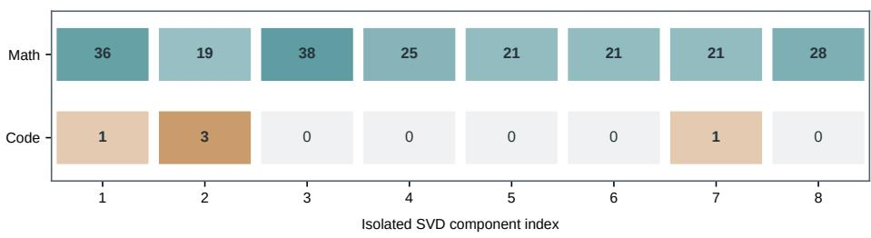  
Figure 8: Stage 1 errors uniquely corrected by isolated Stage-2 components. Each cell counts cases answered incorrectly by Stage 1, corrected by the indicated component, and not corrected by any of the other seven isolated components. Math counts task–example pairs across six benchmarks; Code counts MBPP+ problems.

Across the two stages, the LoRA factors contain $( r _ { 1 } + r _ { 2 } ) ( d _ { \mathrm { o u t } } + d _ { \mathrm { i n } } )$ parameters per adapted weight, excluding any task-specific output head. Once both updates are merged, inference uses the same dense weight multiplication as the pretrained model.

## C ADDITIONAL RESULTS

## C.1 COMMONSENSE REASONING

Table 6: Accuracy (%) on eight commonsense reasoning benchmarks using Llama-3-8B. Avg. is the unweighted mean across tasks. Subscript values beside ReGRA scores show percentage-point differences from rank-8 LoRA. The best average is marked in bold.
<table><tr><td>Method</td><td>OBQA</td><td>ARC-C</td><td>Wino.</td><td>PIQA</td><td>SIQA</td><td>ARC-E</td><td>BoolQ</td><td>Hella.</td><td>Avg.</td></tr><tr><td>LoRA (r = 16)</td><td>88.40</td><td>81.10</td><td>87.29</td><td>88.74</td><td>81.63</td><td>93.14</td><td>74.19</td><td>93.35</td><td>85.98</td></tr><tr><td>LoRA (r = 8)</td><td>86.80</td><td>81.31</td><td>87.61</td><td>88.57</td><td>81.12</td><td>93.10</td><td>69.93</td><td>92.73</td><td>85.15</td></tr><tr><td>L12--8B DoRA (r = 8)</td><td>86.40</td><td>81.14</td><td>87.21</td><td>89.28</td><td>81.57</td><td>93.43</td><td>73.82</td><td>92.57</td><td>85.68</td></tr><tr><td>PiSSA (r = 8)</td><td>81.00</td><td>77.90</td><td>86.02</td><td>88.46</td><td>80.80</td><td>92.38</td><td>73.18</td><td>91.55</td><td>83.91</td></tr><tr><td> LoRA-One (r = 8)</td><td>88.20</td><td>81.05</td><td>87.37</td><td>88.84</td><td>81.67</td><td>93.22</td><td>74.31</td><td>92.81</td><td>85.93</td></tr><tr><td>ReGRA (r = 8)</td><td>88.20+1.40</td><td>82.00+0.69</td><td>86.90-0.71</td><td>89.34+0.77</td><td>81.93+0.81</td><td>92.30 -0.80</td><td>74.22+4.29</td><td>93.07+0.34|</td><td>86.00+0.85</td></tr></table>

Table 6 shows that ReGRA achieves the highest eight-task average on Llama-3-8B, improving upon rank-8 LoRA by 0.85 percentage points. The largest task-level gains occur on BoolQ and OBQA, while Wino. and ARC-E decline. Increasing standard LoRA to rank 16 also improves the average and nearly matches ReGRA (85.98% versus 86.00%). These results extend the average gain over rank-8 LoRA to commonsense reasoning.

## C.2 ERROR-LEVEL ANALYSIS OF STAGE-2 COMPONENTS

## C.2.1 UNIQUE ERROR CORRECTIONS

Figure 8 compares the Stage-1 errors corrected by each isolated Stage-2 component. On Math, all eight components uniquely corrected errors, with 19–38 task–example pairs per component. On MBPP+, only components 1, 2, and 7 had unique corrections, with 1, 3, and 1 problems, respectively. The isolated components therefore showed distinct correction patterns on Math, while this distinction was less evident on MBPP+.

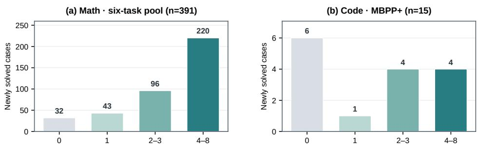  
Number of isolated components that recover each full-model gain  
Figure 9: Coverage of the full Stage-2 model’s newly solved cases. For each case answered incorrectly by Stage 1 and correctly by the full Stage-2 model, the bars show how many isolated components also answer it correctly. Math includes 391 task–example pairs; Code includes 15 MBPP+ problems.

## C.2.2 OVERLAP WITH FULL-MODEL GAINS

Figure 9 examines cases newly solved by the full Stage-2 model. At least one isolated component also solved 359 of 391 Math cases and 9 of 15 MBPP+ problems. The remaining 32 Math cases and 6 MBPP+ problems were not solved by any isolated component. These results show that isolated components recover many full-model gains, while some gains appear only with the combined update. The analysis does not measure each component’s marginal contribution within that update.