# ReAl: Refine neural operators via aligning dynamical flow

Jing Xu1,† Zenglin Xu1,2 Li Yi1 Ruoxi Jiang1,2,†,∗ Yuan Qi1,2,∗

1 Shanghai Academy of AI for Science , 2 Fudan University

† Project leader , \* Corresponding author

{roxie jiang, qiyuan}@fudan.edu.cn

## Abstract

Neural partial diferential equation (PDE) surrogates trained with mean squared error (MSE) can capture dominant dynamics but often lose high-frequency information and fine-scale structures. Generative models (e.g., Flow Matching) can capture the distribution of fine-scale details, yet stochastic errors may accumulate during autoregressive rollouts and compromise long-term stability. To address these limitations, we introduce Refine and Align (ReAl), a model-agnostic plug-in that augments pretrained PDE surrogates to improve the reconstruction of high-frequency structures associated with complex physical phenomena. In the refinement stage, a conditional flow-matching model learns the residual distribution around the deterministic base prediction, recovering missing fine-scale structures while retaining the dominant dynamics. In the alignment stage, to mitigate the generative discrepancies amplified in the autoregressive rollout, particularly in chaotic systems, we generate multiple trajectories from the same input and reinforce the refiner with trajectory-level rewards, thereby achieving long-horizon dynamical alignment. Experiments across diverse surrogate architectures and PDE tasks demonstrate that ReAl consistently improves high-frequency fidelity, forecasting accuracy, and long-horizon stability.

## 1 Introduction

Partial diferential equations (PDEs) are fundamental to modeling physical systems across fluid mechanics (Davidson, 2004), heat and mass transfer (Bergman, 2011), electromagnetics (Schwinger et al., 1998), and chemical difusion (Crank, 1979). Classical finite-diference (Morton & Mayers, 1994) and finite-element methods (Hughes, 2003) provide reliable solutions, but their computational costs grow rapidly with spatial resolution, dimensionality, and parameter-space size. This limitation has driven the development of deep-learning-based PDE surrogates and neural operators, including DeepONet (Lu et al., 2021), the Fourier Neural Operator (Li et al., 2020), and the Physics-Informed Neural Operator (Goswami et al., 2023). By approximating PDE solution operators, these methods enable substantially faster inference for large-scale simulation and real-time scientific prediction.

Most deep-learning-based PDE surrogates are trained with mean squared error (MSE) objective, which provides stable optimization and efectively captures large-scale, low-frequency dynamics. However, as a mean-regression objective, MSE tends to suppress high-frequency information, local vortices, and sharp interfaces (Lippe et al., 2023; Fotiadis et al., 2025), particularly on realworld datasets such as RealPDEBench (Hu et al., 2026), where measurement noise and unresolved physical processes further complicate the underlying dynamics. Generative models (Ho et al., 2020; Rombach et al., 2022; Lipman et al., 2023) can alleviate this limitation by modeling the conditional distribution of PDE solutions instead of producing only one deterministic prediction, enabling richer high-frequency details (Yao et al., 2026; Utkarsh et al., 2026; Hu et al., 2025). However, stochastic sampling may introduce predictive variance and compromise the dynamical consistency and longterm stability required by deterministic PDE systems.

Motivated by these observations, we adopt a complementary modeling strategy: retain the MSEtrained surrogate as a stable predictor of dominant dynamics and apply a conditional flow-based refiner to its output. Rather than regenerating the entire PDE state, the refiner is conditioned on the base prediction and learns to generate its fine-scale residual correction (Fotiadis et al., 2025). As shown in Fig.1 (a), this strategy recovers high-frequency information lost by MSE training while preserving low-frequency dynamics consistent in PDE predictions. Despite these benefits, a generative refiner can only partially mitigate the rollout shift rather than completely eliminate it. Stochastic perturbations can accumulate during autoregressive rollout, creating a gap between recovering fine-scale structures at individual steps and maintaining forecasting accuracy over the resulting trajectory (Luo, 2025; Yoo et al., 2026). As shown in Fig.1 (b), the base model preserves low-frequency dynamics over longer horizons, while high-frequency errors progressively accumulate and amplify, degrading long-term stability and physical consistency.

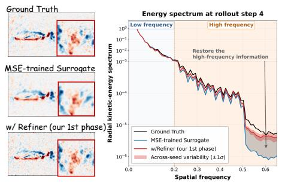  
(a) Necessity of refinement

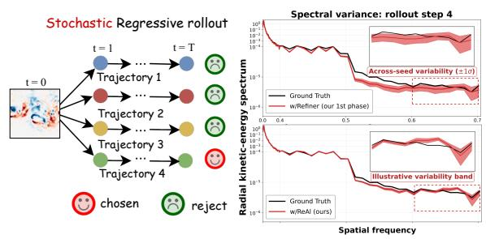  
(b) Necessity of alignment  
Figure 1: (a) MSE training leads to high-frequency information loss, while stochastic refiner recovers the structures. (b) Sampling variability accumulates during stochastic autoregressive rollout, espe cially in the high-frequency regime. Our ReAl mitigates this accumulation of sampling variability.

These observations motivate optimizing the refiner beyond individual prediction quality by accounting for its cumulative efect on the entire autoregressive trajectory. To this end, inspired by reinforcement learning for difusion models (Liu et al., 2025; Zheng et al., 2026), we introduce trajectory-alignment post-training for the flow-based refiner. Starting from the same input state, we sample multiple autoregressive trajectories using independent random seeds and evaluate their longterm quality with trajectory-level rewards. These rewards guide flow-matching updates to the same refiner, favoring refinements that yield accurate long-horizon forecasts. This extends the optimization target from one-step accuracy to long-term trajectory quality without sacrificing the refiner’s ability to recover fine-scale structures. Our main contributions are summarized as follows:

• We propose Refine and Align (ReAl), a lightweight, model-agnostic PDE forecasting plugin based on Flow Matching. ReAl addresses the loss of high-frequency information and fine-scale structures commonly observed in MSE-pretrained surrogates on real-world data, refining their predictions without modifying the underlying architectures.

• To the best of our knowledge, we are the first to post-train long-term autoregressive PDE trajectories from a reinforcement learning perspective. ReAl samples multiple stochastic rollouts from the same initial state and optimizes the Flow refiner with trajectory-level rewards, aligning local residual corrections with long-term dynamical evolution.

• Extensive experiments demonstrate that ReAl improves both prediction accuracy and longterm stability. Compared with the base models, it reduces the average RMSE by 34.3% at the 1-st rollout step and by 45.4% at the 20-th step, with larger gains over longer horizons on RealPDEBench. ReAl also recovers high-frequency physical structures, suppresses long-term error accumulation, and mitigates numerical dissipation.

## 2 Related Works

Neural PDE Surrogates. Neural PDE surrogates approximate expensive numerical solvers by learning mappings between physical fields. Representative approaches include DeepONet (Lu et al., 2021), the Fourier Neural Operator (FNO) (Li et al., 2021), and physics-informed neural operators (Goswami et al., 2023). Subsequent architectures have explored latent spectral representations, geometry-aware attention, hierarchical modeling, and large-scale pretraining, including LSM (Wu et al., 2023), DPOT (Hao et al., 2024), Transolver (Wu et al., 2024), Poseidon (Herde et al., 2024), and HINE (Jiang et al., 2026). Although these models are efective for autoregressive forecasting, prediction errors and insuficiently modeled frequency components can accumulate over long roll outs (Lippe et al., 2023; Yoo et al., 2026). We retain such models as deterministic backbones and improve their predictions through a model-agnostic refinement plug-in.

Generative Models and Refinements for PDEs. Difusion and Flow Matching models (Ho et al., 2020; Rombach et al., 2022; Lipman et al., 2023) have been widely applied to PDE simulation, data assimilation, and physics-constrained generation (Shysheya et al., 2024; Yao et al., 2026; Utkarsh et al., 2026). DifusionPDE addresses PDE solving under partial observations (Huang et al., 2024), DYfusion targets probabilistic multi-step forecasting (R¨uhling Cachay et al., 2023), and autoregressive conditional difusion models have been studied for turbulent-flow prediction (Kohl et al., 2026). Other methods improve multiscale reconstruction through wavelet or latent representations (Hu et al., 2025; Li et al., 2026). PDE-Refiner (Lippe et al., 2023), Adaptive Flow Matching (Fotiadis et al., 2025), PDE-SpectralRefiner (Luo, 2025), and FlowRefiner (Dai et al., 2026) further recover non-dominant frequency components through generative refinement. Unlike those methods based primarily on short-horizon objectives, ReAl directly optimizes long-term autoregressive rollouts.

Post-Training of Difusion Models. Reward-based post-training aligns difusion and Flow Matching models with task-specific objectives. DDPO (Black et al., 2024) and DPOK (Fan et al., 2023) optimize difusion sampling through reinforcement learning, Flow-GRPO (Liu et al., 2025) compares groups of samples, and DifusionNFT (Zheng et al., 2026) employs negative-aware online reinforcement learning. We extend these ideas to PDE forecasting by post-training the refiner with trajectory-level rewards for long-term accuracy, stability, and physical consistency.

## 3 Method

In this section, we introduce Refine and Align (ReAl), a model-agnostic plug-in for stable and accurate long-term partial diferential equation forecasting, as illustrated in Fig. 2. During refinement, we pretrain a flow matching refiner to correct the residual distribution of the base predictions. During alignment, we employ trajectory-level post-training to improve long-term forecasting stability.

## 3.1 Preliminaries

PDE surrogates for forecasting. Consider a nonlinear dynamical system governed by a partial diferential equation (PDE):

$$
\frac { \partial \pmb { u } } { \partial t } = \pmb { G } ( \pmb { u } ; \phi ) ,\tag{1}
$$

where ${ \pmb u } ( { \pmb x } , t )$ denotes a continuous physical field depending on spatial coordinate x and time $t , \phi$ represents the physical parameters governing the dynamics of the system, and $\mathcal { G } : \mathcal { U } \times \Phi  \mathcal { U }$ is a diferential operator. By applying numerical discretization techniques, such as finite-diference or spectral methods, we obtain a discrete trajectory of consecutive observed states: $\{ { \pmb u } _ { 0 } , { \pmb u } _ { 1 } , \ldots , { \pmb u } _ { N } \}$ Our goal is to learn a neural surrogate model $f _ { \theta } ,$ , parameterized by �, that approximates the discrete evolution operator and predicts the next state ${ \mathbf { } } { \mathbf { } } { \mathbf { } } { \mathbf { } } { \mathbf { } } { \mathbf { } } { \mathbf { } } { \mathbf { } } { \mathbf { } } { \mathbf { } } { \mathbf { } } { \mathbf { } } { \mathbf { } } { \mathbf { } } { \mathbf { } } { \mathbf { } } { \mathbf { } } { \mathbf { } } { \mathbf { } } { \mathbf { } } { \mathbf { } } { \mathbf { } } { \mathbf { } } { \mathbf { } } { \mathbf { } } { \mathbf { } } { \mathbf { } } { \mathbf { } } { \mathbf { } } { \mathbf { } } { \mathbf { } } { \mathbf { } } { \mathbf { } } { \mathbf { } } { \mathbf { } } { \mathbf { } } { \mathbf { } } { \mathbf { } } { \mathbf { } } { \mathbf { } } { \mathbf { } } { \mathbf { } } { \mathbf { } } { \mathbf { } } { \mathbf { } } { \mathbf { } } { \mathbf { } } { \mathbf { } } { \mathbf { } } { \mathbf { } } { \mathbf { } } { \mathbf { } } { \mathbf { } } { \mathbf { } } { \mathbf { } } { \mathbf { } } { \mathbf { } } { \mathbf { } } { \mathbf { } } { \mathbf { } } { \mathbf { } } { \mathbf { } } { \mathbf { } \mathbf { } } { \mathbf { } } { \mathbf { } \mathbf { } } { \mathbf { } } { \mathbf } { \mathbf { } } { \mathbf } { \mathbf { } } { \mathbf } { \mathbf { } } { \mathbf } { \mathbf { } } { \mathbf } { \mathbf } { \mathbf { } } { \mathbf } { \mathbf } { \mathbf } { \mathbf } { \mathbf } { } \mathbf { } \mathbf { } \mathbf { } \mathbf { } \mathbf { } \mathbf { } \mathbf { } \mathbf { } \mathbf { } \mathbf { } \mathbf { } \mathbf \mathbf { } \mathbf { } \mathbf { } \mathbf \mathbf { } \mathbf { } \mathbf { } \mathbf \mathbf { } \mathbf \mathbf { } \mathbf \mathbf { } \mathbf \mathbf { } \mathbf \mathbf { } \mathbf \mathbf { } \mathbf \mathbf { } \mathbf \mathbf \mathbf { } \mathbf \mathbf \mathbf { } \mathbf \mathbf \mathbf { } \mathbf \mathbf \mathbf { } \mathbf \mathbf \mathbf \Psi \Psi \mathbf \Psi \Psi \Psi $ from the current state ${ \hat { \mathbf { u } _ { n } } } ^ { \top } , { \hat { \mathbf { u } } } _ { n + 1 } = f _ { \theta } ( { \mathbf { u } } _ { n } )$ . For multi-step forecasting, the surrogate model is applied recursively in an autoregressive manner. The prediction at the �-th future step is given by $\widehat { \pmb { u } } _ { n + k } = f _ { \theta } ^ { \circ k } ( { \pmb { u } } _ { n } )$ , where $f _ { \theta } ^ { \circ k } ( \cdot )$ denotes the �-fold composition of $f _ { \theta } ( \cdot )$

Conditional Flow Matching. Conditional flow matching (CFM) (Lipman et al., 2023) learns a conditional vector field that transports samples from a Gaussian noise distribution to the target data distribution conditioned on c. During training, an intermediate state is sampled along a linear interpolation between a noise sample and a target sample, and the vector field ${ v } _ { \psi }$ is optimized to predict the corresponding transport velocity. At inference, the learned vector field is integrated from noise to data to generate a sample under the given condition. Here, the flow time $\tau \in [ 0 , 1 ]$ parameterizes the generative transport process and is distinct from the physical time of PDE evolution.

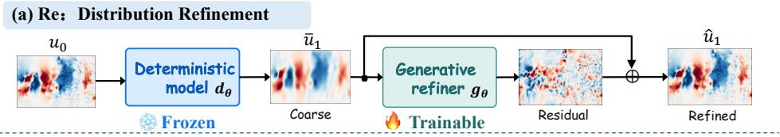

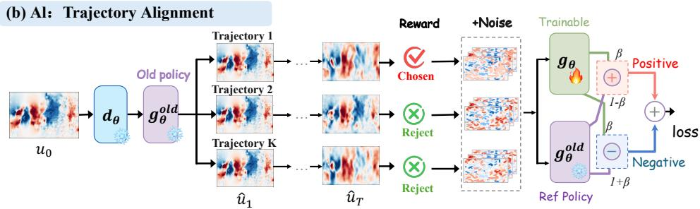  
Figure 2: Overview of Refine and Align (ReAl), a model-agnostic plug-in for pretrained PDE surrogates. (a) Refine: a conditional flow matching refiner generates fine-scale residuals for the frozen deterministic prediction. (b) Align: trajectory rewards from multiple stochastic rollouts posttrain the refiner for stable long-term PDE forecasting. Both stages optimize the same conditional velocity field, with trajectory rewards weighting its flow-matching objectives during alignment.

## 3.2 Distribution Refinement with Conditional Flow Matching

We first introduce the distribution refinement phase of ReAl, as shown in Fig. $2 ( \mathrm { a } )$ . Most existing PDE surrogates are trained with MSE, enabling the deterministic predictor $\scriptstyle d _ { \theta }$ to stably capture dominant dynamics but often suppressing high-frequency structures through mean regression. To address this limitation, we introduce a conditional flow matching refiner $\mathbf { \nabla } _ { \mathbf { \boldsymbol { g } } _ { \psi } }$ that learns the residual distribution between the base prediction and ground truth, recovering fine-scale structures.

Deterministic Base Prediction. Given the current PDE state ${ \mathbf { } } ^ { \mathbf { } } \mathbf { \Delta } \mathbf { u } _ { n } .$ , the MSE-based deterministic predictor produces the next-state estimate, $\bar { \pmb u } _ { n }$ , and is pretrained by minimizing its discrepancy from the ground truth, ${ \bf { u } } _ { n + 1 }$

$$
\bar { \boldsymbol { u } } _ { n + 1 } = d _ { \theta } ( \boldsymbol { u } _ { n } ) , \quad \mathcal { L } _ { \mathrm { M S E } } ( \theta ) = \mathbb { E } \left[ \Vert \bar { \boldsymbol { u } } _ { n + 1 } - \boldsymbol { u } _ { n + 1 } \Vert ^ { 2 } \right] .\tag{2}
$$

The optimal MSE predictor approaches the conditional mean, E $\left[ { \pmb u } _ { n + 1 } \ | \ { \pmb u } _ { n } \right]$ . Although this reliably captures the dominant dynamics, conditional averaging tends to suppress non-dominant fine-scale structures, resulting in overly smooth predictions.

Conditional Flow Refinement. To recover non-dominant structures suppressed by MSE training, we introduce a conditional flow matching refiner $\mathbf { \nabla } _ { \mathbf { \boldsymbol { \mathbf { \mathit { g } } } } _ { \psi } }$ that models the conditional distribution of fine-scale residuals. Specifically, we define the target residual, $\boldsymbol { r } _ { n + 1 }$ , and the condition, $c _ { n }$ , as:

$$
\begin{array} { r } { r _ { n + 1 } = { \pmb u } _ { n + 1 } - \bar { \pmb u } _ { n + 1 } , \quad { \pmb c } _ { n } = \mathrm { C o n c a t } \left[ { \pmb u } _ { n } , \bar { \pmb u } _ { n + 1 } \right] . } \end{array}\tag{3}
$$

The refiner learns to generate $\boldsymbol { r } _ { n + 1 }$ conditioned on the current state, ${ \pmb u } _ { n } .$ , and deterministic base prediction, $\bar { \boldsymbol { u } } _ { n + 1 }$ . Given a Gaussian sample $z _ { 0 } \sim \mathcal { N } ( 0 , I )$ , we construct a linear flow path toward the target residual:

$$
z _ { \tau } = ( 1 - \tau ) z _ { 0 } + \tau r _ { n + 1 } , \qquad \tau \sim \mathcal { U } ( 0 , 1 ) .\tag{4}
$$

The conditional velocity field ${ \pmb v } _ { \pmb { \psi } }$ is trained to match the corresponding transport velocity:

$$
\mathcal { L } _ { \mathrm { r e f i n e } } ( \psi ) = \mathbb { E } \left[ \left. v _ { \psi } \left( z _ { \tau } , \tau \mid c _ { n } \right) - \left( r _ { n + 1 } - z _ { 0 } \right) \right. ^ { 2 } \right] .\tag{5}
$$

At inference, the generative mapping $\mathbf { \nabla } _ { \mathbf { \boldsymbol { g } } _ { \psi } }$ is obtained by integrating ${ v _ { \psi } }$ from $\tau = 0$ to $\tau = 1$ , starting from $\epsilon \sim \mathcal { N } ( 0 , I )$ . The generated residual and refined prediction are:

$$
\hat { r } _ { n + 1 } = g _ { \psi } \left( \epsilon \mid c _ { n } \right) , \quad \hat { u } _ { n + 1 } = \bar { u } _ { n + 1 } + \hat { r } _ { n + 1 } .\tag{6}
$$

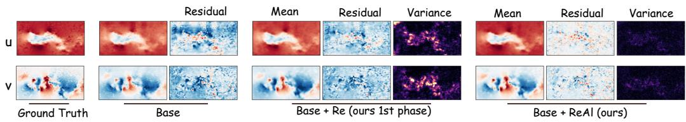  
Figure 3: Qualitative results on Controlled Cylinder Real2Real for velocity components � and �. Residuals are computed against the ground truth, while variance is measured across random seeds. Base+ReAl produces more accurate and consistent predictions.

The deterministic predictor and stochastic refiner are complementary: the former captures stable dominant dynamics, while the latter restores residual fine-scale structures without imposing a strict low- and high-frequency decomposition, as illustrated in Fig. 2(a).

## 3.3 Trajectory Alignment for PDE Forecasting

Although combining the deterministic predictor $\scriptstyle d _ { \theta }$ with a conditional flow matching refiner $\mathbf { \nabla } _ { \mathbf { \boldsymbol { g } } _ { \psi } }$ recovers non-dominant fine-scale information missing from the base prediction, perturbations introduced by stochastic flow sampling may accumulate during autoregressive rollouts and degrade long-term stability. To address this issue, we introduce the trajectory-alignment post-training phase of ReAl, as shown in Fig. 2(b). Specifically, we keep $d _ { \theta }$ frozen and post-train the refiner $\mathbf { \nabla } _ { \mathbf { \boldsymbol { g } } _ { \psi } }$ using trajectory-level rewards from multiple stochastic rollouts, thereby improving the quality of long-term PDE trajectories.

Trajectory rollout. Given an initial state ${ \mathbf { } } u _ { n } ,$ we generate � candidate trajectories using the frozen deterministic predictor $\scriptstyle d _ { \theta }$ and a snapshot of the refiner $\pmb { g } _ { \psi } ^ { \mathrm { o l d } }$ . All candidates start from the same state but use independent noise sequences. For the �-th candidate, we initialize $\hat { \pmb u } _ { n } ^ { ( i ) } = { \pmb u } _ { n }$ and recursively apply the refined transition:

$$
\begin{array} { r l } & { \bar { \boldsymbol { u } } _ { n + k } ^ { ( i ) } = d _ { \theta } \left( \hat { \boldsymbol { u } } _ { n + k - 1 } ^ { ( i ) } \right) , \boldsymbol { c } _ { n + k - 1 } ^ { ( i ) } = \mathrm { C o n c a t } \left[ \hat { \boldsymbol { u } } _ { n + k - 1 } ^ { ( i ) } , \bar { \boldsymbol { u } } _ { n + k } ^ { ( i ) } \right] , } \\ & { \hat { \boldsymbol { r } } _ { n + k } ^ { ( i ) } = g _ { \psi ^ { \mathrm { o l d } } } \left( \boldsymbol { \epsilon } _ { k } ^ { ( i ) } \mid \boldsymbol { c } _ { n + k - 1 } ^ { ( i ) } \right) , \quad \boldsymbol { \epsilon } _ { k } ^ { ( i ) } \sim N ( \boldsymbol { 0 } , \boldsymbol { I } ) , } \\ & { \hat { \boldsymbol { u } } _ { n + k } ^ { ( i ) } = \bar { \boldsymbol { u } } _ { n + k } ^ { ( i ) } + \hat { \boldsymbol { r } } _ { n + k } ^ { ( i ) } , \quad k = 1 , \dots , h . } \end{array}\tag{7}
$$

After ℎ autoregressive steps, the resulting trajectory is:

$$
\widehat { \mathcal { T } } _ { n } ^ { ( i ) } = \left[ \hat { \pmb { u } } _ { n + 1 } ^ { ( i ) } , \hat { \pmb { u } } _ { n + 2 } ^ { ( i ) } , \acute { \bf { \alpha } } \cdot \acute { \bf { \alpha } } \cdot \bf { \alpha } ,  \hat { \pmb { u } } _ { n + h } ^ { ( i ) } \right] , \quad \quad i = 1 , \ldots , K .\tag{8}
$$

Despite sharing the same initial state and deterministic predictor, independent residual samples produce diferent long-term trajectories. As shown in Fig. 3, stochastic refinement (Base + Re) introduces high-frequency variance that can accumulate during autoregressive rollouts.

Trajectory-level reward. Each candidate trajectory $\widehat { \mathcal { T } } _ { n } ^ { ( i ) }$ is evaluated against the corresponding ground-truth trajectory $\mathcal { T } _ { n }$ to obtain its trajectory-level reward:

$$
\begin{array} { r } { R ^ { ( i ) } = \mathcal { R } \left( \widehat { \mathcal { T } } _ { n } ^ { ( i ) } , \mathcal { T } _ { n } \right) , \quad R _ { \mathrm { M S E } } ^ { ( i ) } = - \left. \widehat { \pmb { u } } _ { n + h } ^ { ( i ) } - \pmb { u } _ { n + h } \right. ^ { 2 } , } \end{array}\tag{9}
$$

where $R _ { \mathrm { M S E } } ^ { ( i ) }$ denotes the negative mean squared error at the terminal state, such that a larger reward indicates a more accurate terminal prediction. Although the reward is evaluated only at the endpoint, the terminal state reflects the accumulated efects of stochastic residual corrections propagated throughout the multi-step autoregressive rollout. It therefore serves as a measure of long-term trajectory quality. More generally, R may be defined using discrepancies in physically relevant quantities, such as vorticity, divergence, and kinetic energy, or by combining multiple criteria to evaluate complementary properties of the predicted dynamics.

Since reward magnitudes can vary across initial conditions, we standardize the rewards within each group of � trajectories. Let $\mu _ { R }$ and $\sigma _ { R }$ denote the group mean and standard deviation, respectively. We then clip the standardized reward and linearly rescale it to [0, 1]:

$$
w ^ { ( i ) } = \frac { 1 } { 2 } \left[ 1 + \frac { 1 } { a _ { \mathrm { m a x } } } \mathrm { c l i p } \left( \frac { R ^ { ( i ) } - \mu _ { R } } { \sigma _ { R } + \epsilon _ { \mathrm { n u m } } } , - a _ { \mathrm { m a x } } , a _ { \mathrm { m a x } } \right) \right] .\tag{10}
$$

Here, $\epsilon _ { \mathrm { { n u m } } }$ is a small constant that ensures numerical stability and $a _ { \mathrm { m a x } } > 0$ controls the clipping range. Consequently, higher-quality trajectories receive weights closer to 1, whereas lower-quality receive weights closer to 0.

Trajectory reward-Guided Flow Alignment. Trajectory alignment post-trains the conditional velocity field learned during refinement (Sec. 3.2). We incorporate feedback from autoregressive rollouts through positive and negative flow-matching terms constructed from the current and old velocity fields, weighted by trajectory rewards. For the �-th autoregressive transition of the �- th candidate trajectory, $\boldsymbol { z } _ { \tau } ^ { ( i , k ) }$ denotes the intermediate residual state at flow time $\tau ,$ following Eq. equation 4. The velocity fields predicted by the current policy, old policy, and reference model are uniformly written as:

$$
\pmb { v } ^ { s , ( i , k ) } = \pmb { v } _ { \psi ^ { s } } \left( z _ { \tau } ^ { ( i , k ) } , \tau \mid c _ { n + k - 1 } ^ { ( i ) } \right) , \qquad s \in \{ \mathrm { c u r } , \mathrm { o l d } , \mathrm { r e f } \} .\tag{11}
$$

Here, $\psi ^ { \mathrm { { c u r } } } \equiv \psi$ denotes the parameters of the refiner being updated, $\psi ^ { \mathrm { o l d } }$ denotes the old-policy parameters used to generate the candidate trajectories, and $\bar { \psi } ^ { \mathrm { r e f } }$ denotes the parameters of the pretrained reference model, which remain frozen throughout post-training. Following the negative-aware forward-process formulation of DifusionNFT (Zheng et al., 2026), we construct positive and negative velocity fields from the current- and old-policy predictions:

$$
\begin{array} { r } { \pmb { v } ^ { + , ( i , k ) } = \beta \pmb { v } ^ { \mathrm { c u r } , ( i , k ) } + ( 1 - \beta ) \pmb { v } ^ { \mathrm { o l d } , ( i , k ) } , \quad \pmb { v } ^ { - , ( i , k ) } = ( 1 + \beta ) \pmb { v } ^ { \mathrm { o l d } , ( i , k ) } - \beta \pmb { v } ^ { \mathrm { c u r } , ( i , k ) } , } \end{array}\tag{12}
$$

where $\beta > 0$ controls the deviation of the positive and negative velocity fields from the old policy. The corresponding positive and negative flow matching losses are:

$$
\ell _ { \pm } ^ { ( i , k ) } = \left\| v ^ { \pm , ( i , k ) } - \left( r _ { n + k } ^ { ( i ) } - z _ { 0 } ^ { ( i , k ) } \right) \right\| ^ { 2 } .\tag{13}
$$

The final alignment objective averages over both candidate trajectories � and autoregressive steps �:

$$
\mathcal { L } _ { \mathrm { a l i g n } } = \frac { 1 } { \beta } \mathbb { E } _ { i , k } \left[ w ^ { ( i ) } \ell _ { + } ^ { ( i , k ) } + \left( 1 - w ^ { ( i ) } \right) \ell _ { - } ^ { ( i , k ) } \right] .\tag{14}
$$

Same trajectory-level reward $w ^ { ( i ) }$ is applied to every autoregressive step of the �-th candidate. A high trajectory reward produces a weight close to 1, emphasizing the positive objective and encouraging the associated residual corrections. A low reward produces a weight closer to $0 ,$ emphasizing the negative objective. Because the same trajectory-level weight is shared at every rollout step, the terminal feedback supervises residual generation along the entire trajectory.

To stabilize post-training, we further regularize the refiner toward the frozen pretrained reference model while retaining the supervised residual-learning objective. The training objective is:

$$
\begin{array} { r } { \mathcal { L } = \mathcal { L } _ { \mathrm { a l i g n } } + \lambda _ { \mathrm { r e f } } \mathbb { B } _ { i , k } \left[ \left\| v ^ { \mathrm { c u r } , ( i , k ) } - v ^ { \mathrm { r e f } , ( i , k ) } \right\| ^ { 2 } \right] + \lambda _ { \mathrm { s u p } } \mathbb { E } _ { i , k } \left[ \left\| \hat { r } _ { n + k } ^ { ( i ) } - r _ { n + k } ^ { ( i ) } \right\| ^ { 2 } \right] . } \end{array}\tag{15}
$$

The reference-model regularization prevents excessive deviation from the pretrained flow dynamics, while the supervised term preserves the refiner’s residual-modeling capability. Throughout posttraining, only the current refiner parameters � are updated; the deterministic predictor $\scriptstyle d _ { \theta }$ , old-policy parameters $\dot { \pmb { g } } _ { \psi } ^ { \mathrm { o l d } }$ , and reference-model parameters $\bar { \mathbf { \Lambda } } _ { \bar { \psi } } ^ { \mathrm { r e f } }$ remain frozen.

Overall, ReAl produces more accurate long-term predictions with lower across-seed variance. By favoring residual corrections that remain reliable over long horizons, it produces more accurate predictions with lower across-seed variance, as shown in Fig. 3 (Base+ReAl).

Table 1: Main experimental results on RealPDEBench (Hu et al., 2026). We report RMSE over the 10 predicted future frames on test set. lower is better. The small percentage in the bottom-right corner indicates the relative RMSE reduction over the corresponding baseline.
<table><tr><td rowspan="2">Benchmark</td><td rowspan="2">Setting</td><td rowspan="2">Task</td><td colspan="2">UNet</td><td colspan="2">FNO</td><td colspan="2">DPOT</td><td colspan="2">Transolver</td></tr><tr><td>Baseline</td><td>+ Ours</td><td>Baseline</td><td>+ Ours</td><td>Baseline</td><td>+ Ours</td><td>Baseline</td><td>+ Ours</td></tr><tr><td rowspan="8">RealPDEBench</td><td rowspan="4">Sim2Real</td><td>Cylinder</td><td>0.0256</td><td>0.0216 +16%</td><td>0.0425</td><td>0.0261 +39%</td><td>0.0235</td><td>0.0236 +1%</td><td>0.0315</td><td>0.0244 +23%</td></tr><tr><td>Controlled Cylinder</td><td>0.0219</td><td> $\mathbf { 0 . 0 1 5 5 }$ </td><td>0.0309</td><td>0.0168 +46%</td><td>0.0183</td><td>0.0144 +21%</td><td>0.0277</td><td>0.0147 +47%</td></tr><tr><td>Foil</td><td>0.0167</td><td>0.0136 +19%</td><td>0.0197</td><td>0.0122 +38%</td><td>0.0290</td><td>0.0169 +42%</td><td>0.0345</td><td>0.0276 +20%</td></tr><tr><td>FSI</td><td>0.0247</td><td> $\mathbf { 0 . 0 1 6 1 } _ { + 3 5 \% }$ </td><td>0.0452</td><td>0.0132 +71%</td><td>0.0201</td><td>0.0116 +42%</td><td>0.0273</td><td>0.0128 +53%</td></tr><tr><td rowspan="4">Real2Real</td><td>Cylinder</td><td>0.0082</td><td>0.0073 +11%</td><td>0.0135</td><td>0.0089 +34%</td><td>0.0115</td><td>0.0092 +20%</td><td>0.0154</td><td>0.0092 +41%</td></tr><tr><td>Controlled Cylinder</td><td>0.0089</td><td>0.0073 +19%</td><td>0.0102</td><td>0.0086 +18%</td><td>0.0114</td><td>0.0081 +30%</td><td>0.0137</td><td>0.0083 +39%</td></tr><tr><td>Foil</td><td>0.0082</td><td>0.0069 +14%</td><td>0.0134</td><td>0.0070 +48%</td><td>0.0144</td><td>0.0074 +49%</td><td>0.0241</td><td>0.0101 +58%</td></tr><tr><td>FSI</td><td>0.0058</td><td> $\mathbf { 0 . 0 0 5 3 } _ { + 8 \mathbb { F } }$ </td><td>0.0089</td><td>0.0056 +37%</td><td>0.0106</td><td>0.0056 +47%</td><td>0.0119</td><td>0.0056 +53%</td></tr></table>

## 4 Experiment

Benchmarks. We evaluate on RealPDEBench (Hu et al., 2026), comprising four physical subdatasets: Cylinder, Controlled Cylinder, Foil, and FSI, which provides paired numerical simulations and real-world measurements. Real observations contain noise, unresolved efects, and finer-scale dynamics absent from simulations. We consider two settings: Sim2Real, training on simulations and testing on real data; and Real2Real, training and testing on real data2.

Evaluation metircs. To evaluate quality of prediction , we report the root mean squared error (RMSE) and relative (Rel. $L _ { 2 } )$ error. To further assess physical fidelity, we use the Fourier-space RMSE (fRMSE), frequency error (FE), and kinetic energy error (KE). Detailed definitions of these metrics are provided in the Appendix A.

Experiment setup. In our experiments, following the task setting of RealPDEBench, we use 10 consecutive input frames to directly predict the subsequent 10 frames. We adopt U-Net (Ronneberger et al., 2015), FNO (Li et al., 2021), DPOT-S (Hao et al., 2024), and Transolver (Wu et al., 2024) as the base architectures. We then freeze the base model and train a lightweight time-conditioned U-Net flow matching Refiner (approximately 5.04M parameters, typically under one-tenth of the base model size) for 50,000 steps with a batch size of 16 and a learning rate of $1 \times 1 0 ^ { - 4 }$ . Details are provided in Appendix B. Subsequently, we initialize ReAl from the best Refiner checkpoint while keeping the base model frozen, and optimize ReAl for 10,000 steps using the trajectory-alignment objective. We use AdamW with a batch size of 4 and a learning rate of $2 \times 1 0 ^ { - 5 }$ . For each condition, we sample � = 4 complete trajectories. Each trajectory consists of five autoregressive rollout blocks, with each block generated by integrating the flow velocity field using four Euler flow steps. We use the negative MSE of the final, fifth prediction block as the trajectory reward. We set $\beta = 0 . 1$ in Eq. 14, and set $\lambda _ { \mathrm { r e f } } = 0 . 0 1$ and $\lambda _ { \mathrm { s u p } } = 0 . 1$ in Eq. 15.

## 4.1 Main Results

Prediction Accuracy. We first evaluate ReAl after a single rollout, i.e., direct prediction of one 10-frame future block, under the Sim2Real and Real2Real settings of RealPDEBench. As shown in Table 1, Base+ReAl consistently improves diverse base architectures across physical tasks. Averaged over all models, tasks, and settings, Base+ReAl reduces RMSE by 33.9%, including reductions of 33.7% on Sim2Real and 34.1% on Real2Real. Notably, ReAl achieves a 71% relative improvement for FNO on the Sim2Real FSI task. These results demonstrate that Base+ReAl provides efective post-training refinement even after a single rollout.

Long-Term Stability. To further evaluate long-term stability, we extend the autoregressive prediction horizon to 200 frames and compare the base models, Base+Re with only the flow refiner, and Base+ReAl with additional trajectory-alignment post-training in Fig. 4. As the rollout horizon increases, prediction errors of the base models accumulate continuously, with some models exhibiting severe error blow-up, such as FNO on FSI and DPOT on Foil. For DPOT on Foil, Base+ReAl limit

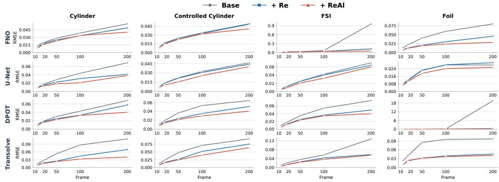  
   Figure 4: RMSE over long autoregressive rollout frames under the RealPDEBench Real2Real setting. Long-horizon error accumulation causes severe degradation for several base models, most notably DPOT on Foil and FNO on FSI. By contrast, Base+ReAl consistently limits error growth and preserves stable predictions over long rollout horizons.

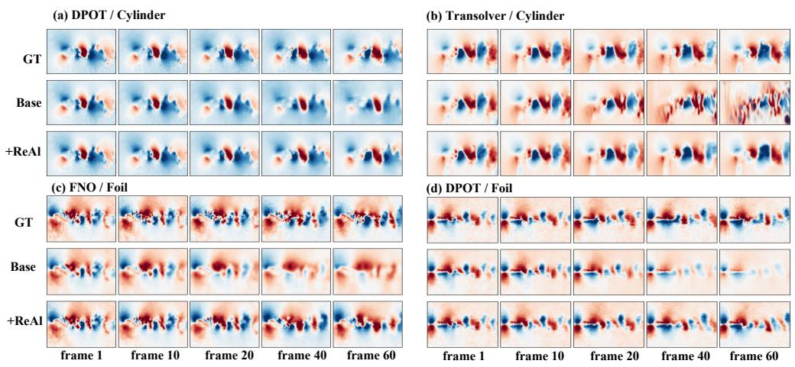  
Figure 5: Visualization of long-horizon Real2Real rollouts (v channel): Base+ReAl (a) restores fine-scale details, (b) suppresses error accumulation, and (c, d) mitigates numerical dissipation to preserve flow energy and wake structures.

200-frame error growth to 10.9×, compared with 44.5× for Base+Re and 1,360× for the base model. Although Base+Re reduces the overall error through fine-scale residual correction, perturbations introduced by stochastic sampling may still be progressively amplified during long-term forecasting. In contrast, Base+ReAl exhibits substantially slower error growth across most models and tasks and efectively suppresses these instabilities. Fig. 5 compares long-horizon predictions. While base predictions become oversmoothed and lose fine-scale vortices, Base+ReAl better preserves these structures throughout the rollout. Additional results are provided in Appendix C.

Frequency Information Recovery. To examine how each module corrects autoregressive trajectories, we decompose the prediction error in the radial frequency domain and evaluate the lowest 20% (� < 20) and highest 20% $( f \ge 8 0 )$ frequency regions. Here, R1, R5, and R10 denote the first, fifth, and tenth autoregressive rollout blocks, corresponding to rollout horizons of 10, 50, and 100 future frames, respectively. For frequency region �, we use the ground-truth-normalized error energy $\frac { E _ { \mathrm { e r r } , b } } { E _ { \mathrm { G T } , b } } \times 1 0 0 \%$ , where lower values indicate better frequency information recovery. As shown in Fig. 6 and Table 2, the Base+Re correction range expands with the rollout. At R1, it reduces highand low-frequency errors by 15.76% and 1.63%, respectively. At R10, these improvements reach 28.22% and 32.72%, indicating that Base+Re gradually extends from fine-scale to multiscale trajectory correction. In contrast, Base+ReAl consistently targets high-frequency errors: its additional improvements at R1, R5, and R10 are 17.32%, 15.56%, and 13.72%, while the low-frequency gains remain only 0.24%, 1.64%, and 1.69%. Thus, ReAl continuously restores fine-scale information lost during autoregressive prediction.

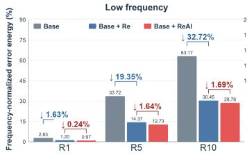

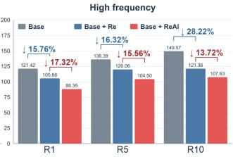  
Figure 6: Comparison of frequency-normalized error energy across rollout horizons. Lower is better.

Table 2: Numerical frequencynormalized error energy. Lower is better.
<table><tr><td>Frequency</td><td>Method</td><td>R1</td><td>R5</td><td>R10</td></tr><tr><td rowspan="3">Low</td><td>Base</td><td>2.83</td><td>33.72</td><td>63.17</td></tr><tr><td>Base + Re</td><td>1.20</td><td>14.37</td><td>30.45</td></tr><tr><td>Base + ReAl</td><td>0.97</td><td>12.73</td><td>28.76</td></tr><tr><td rowspan="3">High</td><td>Base</td><td>121.42</td><td>136.39</td><td>149.57</td></tr><tr><td> $\mathrm { B a s e } + \mathrm { R e }$ </td><td>105.66</td><td>120.06</td><td>121.36</td></tr><tr><td> $\mathrm { B a s e + R e A l }$ </td><td>88.35</td><td>104.50</td><td>107.63</td></tr></table>

Table 3: Reward ablation results on Controlled Cylinder. $h _ { r }$ denotes the rollout block used to compute the training reward. The best results are shown in bold, and the second-best results are underlined.
<table><tr><td rowspan="2">Method Reward</td><td rowspan="2"></td><td rowspan="2"></td><td colspan="5">Evaluation R1</td><td colspan="5">Evaluation R5</td><td colspan="5">Evaluation R10</td></tr><tr><td>|RMSE ↓</td><td> $\mathbf { R e l } , L _ { 2 } \downarrow$ </td><td>fRMSE ↓</td><td>FE↓</td><td>KE↓</td><td>|RMSE ↓</td><td> $\mathbf { R e l } , L _ { 2 } \downarrow$ </td><td>fRMSE ↓</td><td>FE↓</td><td>KE↓</td><td>| RMSE ↓</td><td> $\mathbf { R e l } , L _ { 2 } \downarrow$ </td><td>fRMSE ↓</td><td>FE↓</td><td>KE↓</td></tr><tr><td>Base</td><td></td><td>一</td><td>0.0100</td><td>0.0750</td><td>0.0012</td><td>21.5557</td><td>3.77e-5</td><td>0.0227</td><td>0.1771</td><td>0.0040</td><td>46.0869</td><td>5.57e-5</td><td>0.0320</td><td>0.2603</td><td>0.0065</td><td>64.3384</td><td>6.28e-5</td></tr><tr><td>+ Re</td><td></td><td>一</td><td>0.0093</td><td>0.0673</td><td>0.0011</td><td>26.3517</td><td>3.39e-5</td><td>0.0243</td><td>0.1830</td><td>0.0043</td><td>49.6342</td><td>5.63e-5</td><td>0.0331</td><td>0.2492</td><td>0.0067</td><td>65.5248</td><td>6.33e-5</td></tr><tr><td>+ ReAl</td><td>RMSE</td><td>1</td><td>0.0082</td><td>0.0602</td><td>0.0010</td><td>20.0997</td><td>3.12e-5</td><td>0.0223</td><td>0.1694</td><td>0.0039</td><td>35.1164</td><td>5.49e-5</td><td>0.0314</td><td>0.2358</td><td>0.0063</td><td>59.6282</td><td>6.20e-5</td></tr><tr><td>+ ReAl</td><td>RMSE</td><td>5</td><td>0.0084</td><td>0.0619</td><td>0.0010</td><td>20.5995</td><td>3.22e-5</td><td>0.0200</td><td>0.1560</td><td>0.0032</td><td>35.4562</td><td>5.38e-5</td><td>0.0273</td><td>0.2070</td><td>0.0054</td><td>55.0176</td><td>5.91e-5</td></tr><tr><td>+ ReAl</td><td>RMSE</td><td>10</td><td>0.0087</td><td>0.0637</td><td>0.0011</td><td>20.1948</td><td>3.31e-5</td><td>0.0210</td><td>0.1605</td><td>0.0037</td><td>35.7731</td><td>5.45e-5</td><td>0.0269</td><td>0.2052</td><td>0.0053</td><td>55.2919</td><td>5.91e-5</td></tr><tr><td>+ ReAl</td><td>KE</td><td>5</td><td>0.0084</td><td>0.0618</td><td>0.0010</td><td>20.7217</td><td>3.21e-5</td><td>0.0208</td><td>0.1585</td><td>0.0036</td><td></td><td>35.4098 5.37e-5</td><td>0.0273</td><td>0.2072</td><td>0.0054</td><td>55.3497</td><td>5.90e-5</td></tr><tr><td>+ ReAl</td><td>FE</td><td>5</td><td>0.0085</td><td>0.0624</td><td>0.0010</td><td>20.3108</td><td>3.24e-5</td><td>0.0210</td><td>0.1602</td><td>0.0037</td><td>35.2623</td><td>5.39e-5</td><td>0.0275</td><td>0.2095</td><td>0.0054</td><td>56.0622</td><td>5.92e-5</td></tr></table>

## 4.2 Ablation Study

Ablation of Reward Horizon and Metric. We investigate how the rollout block used to compute the training reward, $h _ { r } \in \{ 1 , 5 , 1 0 \}$ , and the choice of reward metric afect rollout performance. A clear horizon-matching efect emerges: $h _ { r } = 1 , 5$ , and 10 achieve the best RMSE at R1, R5, and R10, respectively, while remaining competitive elsewhere. Longer reward horizons improve recursive stability. RMSE provides the most consistent gains in RMSE, Rel. $L _ { 2 }$ , and fRMSE, while KE yields the lowest kinetic-energy error. FE optimization does not consistently minimize FE, indicating that physics-specific rewards need not improve their corresponding metrics. We therefore use RMSE with $h _ { r } = 5$ by default, which best balances short- and long-horizon performance.

## 5 Conclusion

In this paper, we propose Refine and Align (ReAl), a model-agnostic post-training framework for long-horizon PDE forecasting. ReAl retains an MSE-trained base model to capture stable dominant dynamics and uses a lightweight conditional Flow Refiner to generatively correct prediction residuals, recovering fine-scale high-frequency structures that are often lost under MSE training. We further introduce trajectory-alignment post-training, which optimizes the Refiner using trajectorylevel rewards from multiple stochastic autoregressive rollouts to align local corrections with longterm dynamics and suppress accumulated sampling perturbations. We systematically evaluate ReAl on RealPDEBench using UNet, FNO, DPOT-S, and Transolver. ReAl reduces RMSE by 33.9% on average for 1-st step predictions and 45.4% by 20-th step, which efectively mitigates error accumulation, trajectory divergence, and numerical dissipation over long autoregressive rollouts. Frequency analysis shows that the Refiner gradually extends to multiscale correction, while ReAl mainly provides additional improvements in high-frequency errors. These results demonstrate that ReAl serves as a general, lightweight, and plug-and-play post-training module that improves finescale detail recovery and long-horizon prediction stability for diverse PDE surrogates under real-world data distributions and simulation-to-reality shifts.

## AI usage statement

In this work, we used generative AI tools to assist with language polishing, translation, dataset cleaning and reformatting, qualitative and thematic data analysis, and the interpretation of experimental results. We did not use generative AI to generate synthetic datasets, develop theoretical models or conceptual frameworks, formulate mathematical claims, provide key elements of or write mathematical proofs, propose or refine hypotheses, design or provide feedback on research methodologies or experiments, or implement the proposed methods. We additionally used generative AI for brainstorming, information retrieval, improving the readability of the manuscript, and identifying potentially relevant literature. All AI-assisted text and translations were reviewed by the authors, references were verified against their original sources, and data processing, analyses, and interpretations were independently checked against the source data, implementation, and experimental results. We take full responsibility for the final content of this work, including all text, claims, and artifacts produced with the assistance of generative AI.

## References

Theodore L Bergman. Fundamentals ofheat and mass transfer. John Wiley & Sons, 2011.

Kevin Black, Michael Janner, Yilun Du, Ilya Kostrikov, and Sergey Levine. Training difusion models with reinforcement learning. In International Conference on Learning Representations, volume 2024, pp. 4965–4987, 2024.

John Crank. The mathematics ofdifusion. Oxford university press, 1979.

Yilong Dai, Yiming Sun, Yiheng Chen, Shengyu Chen, Xiaowei Jia, and Runlong Yu. Flowrefiner: Flow matching-based iterative refinement for 3d turbulent flow simulation. arXiv preprint arXiv:2604.17149, 2026.

Peter Alan Davidson. Turbulence: an introduction for scientists and engineers. Oxford university press, 2004.

Ying Fan, Olivia Watkins, Yuqing Du, Hao Liu, Moonkyung Ryu, Craig Boutilier, Pieter Abbeel, Mohammad Ghavamzadeh, Kangwook Lee, and Kimin Lee. Dpok: Reinforcement learning for fine-tuning text-to-image difusion models. Advances in neural information processing systems, 36:79858–79885, 2023.

Stathi Fotiadis, Noah D Brenowitz, Tomas Gefner, Yair Cohen, Michael Pritchard, Arash Vahdat, and Morteza Mardani. Adaptive flow matching for resolving small-scale physics. In Forty-second International Conference on Machine Learning, 2025.

Somdatta Goswami, Aniruddha Bora, Yue Yu, and George Em Karniadakis. Physics-informed deep neural operator networks. In Machine learning in modeling and simulation: methods and applications, pp. 219–254. Springer, 2023.

Zhongkai Hao, Chang Su, Songming Liu, Julius Berner, Chengyang Ying, Hang Su, Anima Anandkumar, Jian Song, and Jun Zhu. DPOT: Auto-regressive denoising operator transformer for large-scale PDE pre-training. In Ruslan Salakhutdinov, Zico Kolter, Katherine Heller, Adrian Weller, Nuria Oliver, Jonathan Scarlett, and Felix Berkenkamp (eds.), Proceedings of the 41st International Conference on Machine Learning, volume 235 of Proceedings ofMachine Learning Research, pp. 17616–17635, 2024.

Maximilian Herde, Bogdan Raonic, Tobias Rohner, Roger K ´ appeli, Roberto Molinaro, Emmanuel¨ De Bezenac, and Siddhartha Mishra. Poseidon: Eficient foundation models for pdes. Advances in Neural Information Processing Systems, 37:72525–72624, 2024.

Jonathan Ho, Ajay Jain, and Pieter Abbeel. Denoising difusion probabilistic models. Advances in neural information processing systems, 33:6840–6851, 2020.

Peiyan Hu, Rui Wang, Xiang Zheng, Tao Zhang, Haodong Feng, Ruiqi Feng, Long Wei, Yue Wang, Zhi-Ming Ma, and Tailin Wu. Wavelet difusion neural operator. In International Conference on Learning Representations, volume 2025, pp. 12291–12333, 2025.

Peiyan Hu, Haodong Feng, Hongyuan Liu, Tongtong Yan, Wenhao Deng, Tianrun Gao, Rong Zheng, Haoren Zheng, Chenglei Yu, Chuanrui Wang, et al. Realpdebench: A benchmark for complex physical systems with real-world data. International Conference on Learning Representations, 2026.

Jiahe Huang, Guandao Yang, Zichen Wang, and Jeong Joon Park. Difusionpde: Generative pdesolving under partial observation. Advances in Neural Information Processing Systems, 37: 130291–130323, 2024.

Thomas JR Hughes. The finite element method: linear static and dynamic finite element analysis. Courier Corporation, 2003.

Ruoxi Jiang, Xiao Zhang, Karan Jakhar, Peter Y Lu, Pedram Hassanzadeh, Michael Maire, and Rebecca Willett. Hierarchical implicit neural emulators. Advances in Neural Information Processing Systems, 38:73718–73751, 2026.

Georg Kohl, Li-Wei Chen, and Nils Thuerey. Benchmarking autoregressive conditional difusion models for turbulent flow simulation. Neural Networks, pp. 108641, 2026.

Zhong-Hao Li, Chao-Yu Liu, and Qian Zhang. Di-bilps: Denoising induced bidirectional latentpde-solver under sparse observations. ArXiv, abs/2605.13790, 2026. URL https://api. semanticscholar.org/CorpusID:288254894.

Zongyi Li, Nikola Kovachki, Kamyar Azizzadenesheli, Burigede Liu, Kaushik Bhattacharya, Andrew Stuart, and Anima Anandkumar. Fourier neural operator for parametric partial diferential equations. International Conference on Learning Representations (ICLR), 2020.

Zongyi Li, Nikola Kovachki, Kamyar Azizzadenesheli, Burigede Liu, Kaushik Bhattacharya, Andrew Stuart, and Anima Anandkumar. Fourier neural operator for parametric partial diferential equations. International Conference on Learning Representations, 2021.

Yaron Lipman, Ricky TQ Chen, Heli Ben-Hamu, Maximilian Nickel, and Matt Le. Flow matching for generative modeling. International Conference on Learning Representations, 2023.

Phillip Lippe, Bas Veeling, Paris Perdikaris, Richard Turner, and Johannes Brandstetter. Pderefiner: Achieving accurate long rollouts with neural pde solvers. Advances in Neural Information Processing Systems, 36:67398–67433, 2023.

Jie Liu, Gongye Liu, Jiajun Liang, Yangguang Li, Jiaheng Liu, Xintao Wang, Pengfei Wan, Di Zhang, and Wanli Ouyang. Flow-grpo: Training flow matching models via online rl. ArXiv, Advances in Neural Information Processing Systems, 2025. URL https://api.semanticscholar. org/CorpusID:278394068.

Lu Lu, Pengzhan Jin, Guofei Pang, Zhongqiang Zhang, and George Em Karniadakis. Learning nonlinear operators via deeponet based on the universal approximation theorem of operators. Nature machine intelligence, 3(3):218–229, 2021.

Li Luo. Pdespectralrefiner: Achieving more accurate long rollouts with spectral adjustment. In 2025 4th International Symposium on Computer Applications and Information Technology (ISCAIT), pp. 2097–2100. IEEE, 2025.

KW Morton and DF Mayers. Numerical solution of partial diferential equations. Cambridge University, 512, 1994.

Robin Rombach, Andreas Blattmann, Dominik Lorenz, Patrick Esser, and Bjorn Ommer. High-¨ resolution image synthesis with latent difusion models. In 2022 IEEE/CVF conference on computer vision and pattern recognition (CVPR), pp. 10674–10685. ieee, 2022.

Olaf Ronneberger, Philipp Fischer, and Thomas Brox. U-net: Convolutional networks for biomedical image segmentation. In International Conference on Medical image computing and computerassisted intervention, pp. 234–241. Springer, 2015.

Salva R¨uhling Cachay, Bo Zhao, Hailey Joren, and Rose Yu. Dyfusion: A dynamics-informed difusion model for spatiotemporal forecasting. Advances in neural information processing systems, 36:45259–45287, 2023.

Julian Schwinger, Lester L Deraad, Kimball Milton, Wu-yang Tsai, and Joyce Norton. Classical electrodynamics. Hachette UK, 1998.

Aliaksandra Shysheya, Cristiana Diaconu, Federico Bergamin, Paris Perdikaris, Jose Miguel´ Hernandez-Lobato, Richard E. Turner, and Emile Mathieu. On conditional difusion models´ for pde simulations. In Advances in Neural Information Processing Systems, 2024.

Utkarsh Utkarsh, Pengfei Cai, Alan Edelman, Rafael Gomez-Bombarelli, and Christopher Rackauckas. Physics-constrained flow matching: Sampling generative models with hard constraints. Advances in Neural Information Processing Systems, 38:160217–160252, 2026.

Haixu Wu, Tengge Hu, Huakun Luo, Jianmin Wang, and Mingsheng Long. Solving high-dimensional pdes with latent spectral models. International Conference on Machine Learning, 2023.

Haixu Wu, Huakun Luo, Haowen Wang, Jianmin Wang, and Mingsheng Long. Transolver: A fast transformer solver for pdes on general geometries. Proceedings of the 41st International Conference on Machine Learning, 2024.

Jiachen Yao, Abbas Mammadov, Julius Berner, Gavin Kerrigan, Jong Chul Ye, Kamyar Azizzadenesheli, and Animashree Anandkumar. Guided difusion sampling on function spaces with applications to pdes. Advances in Neural Information Processing Systems, 38:127057–127094, 2026.

Seungwoo Yoo, Juil Koo, Daehyeon Choi, and Minhyuk Sung. Difusionrollout: Uncertainty-aware rollout planning in long-horizon pde solving. Transactions on Machine Learning Research, 2026.

Kaiwen Zheng, Huayu Chen, Haotian Ye, Haoxiang Wang, Qinsheng Zhang, Kai Jiang, Hang Su, Stefano Ermon, Jun Zhu, and Ming-Yu Liu. Difusionnft: Online difusion reinforcement with forward process. In International Conference on Learning Representations, volume 2026, pp. 134129–134150, 2026.

## A Evaluation Metrics

Let $\widehat { Y } _ { n } , Y _ { n } \in \mathbb { R } ^ { C \times H \times W }$ denote the predicted and ground-truth physical fields at the �-th autoregressive rollout step, respectively, where � is the number of physical variables, and � and � denote the spatial height and width. All evaluation metrics are computed in the original physical space. Specifically, we invert the channel-wise Gaussian normalization as:

$$
\widehat { Y } _ { n , c , h , w } = \widehat { Y } _ { n , c , h , w } ^ { \mathrm { n o r m } } \sigma _ { c } + \mu _ { c } , \qquad Y _ { n , c , h , w } = Y _ { n , c , h , w } ^ { \mathrm { n o r m } } \sigma _ { c } + \mu _ { c } ,\tag{16}
$$

where $c \in \{ 1 , \ldots , C \}$ indexes the physical variable, while ℎ and � index the spatial coordinates. Here, $\widehat { Y } _ { n , c , h , w } ^ { \mathrm { n o r m } }$ and $Y _ { n , c , h , w } ^ { \mathrm { n o r m } }$ are the normalized prediction and target, respectively, and $\mu _ { c }$ and $\sigma _ { c }$ are the training-set mean and standard deviation of the �-th physical variable.

Prediction Accuracy Metrics. We use the Root Mean Squared Error (RMSE) and Relative $L _ { 2 }$ Error (Rel. $L _ { 2 } )$ to evaluate the pointwise accuracy of the predicted physical fields. At the �-th rollout step, RMSE is defined as:

$$
\mathrm { R M S E } _ { n } = \sqrt { \frac { 1 } { C H W } \sum _ { c = 1 } ^ { C } \sum _ { h = 1 } ^ { H } \sum _ { w = 1 } ^ { W } \left( \widehat { Y } _ { n , c , h , w } - Y _ { n , c , h , w } \right) ^ { 2 } } .\tag{17}
$$

This metric measures the absolute pointwise discrepancy between the prediction and ground truth over all physical variables and spatial locations. To account for diferences in magnitude acros physical variables, we further report the channel-averaged Rel. $L _ { 2 }$ Error:

$$
\operatorname { R e l . } L _ { 2 , n } = \frac { 1 } { C } \sum _ { c = 1 } ^ { C } \frac { \left\| \widehat { Y } _ { n , c } - Y _ { n , c } \right\| _ { 2 } } { \left\| Y _ { n , c } \right\| _ { 2 } } = \frac { 1 } { C } \sum _ { c = 1 } ^ { C } \sqrt { \frac { \sum _ { h = 1 } ^ { H } \sum _ { w = 1 } ^ { W } \left( \widehat { Y } _ { n , c , h , w } - Y _ { n , c , h , w } \right) ^ { 2 } } { \sum _ { h = 1 } ^ { H } \sum _ { w = 1 } ^ { W } Y _ { n , c , h , w } ^ { 2 } } } .\tag{18}
$$

Here, ${ \widehat { Y } } _ { n , c }$ and $Y _ { n , c } \in \mathbb { R } ^ { H \times W }$ denote the predicted and ground-truth spatial fields of the �-th physical variable. Rel. $L _ { 2 }$ Error is dimensionless and is computed independently for each physical variable before being averaged across all � variables.

Physics-Oriented Metrics. Beyond pointwise prediction errors, we employ Fourier-space RMSE (fRMSE), Frequency Error (FE), and Kinetic Energy Error (KE) to evaluate the spectral and dynam ical consistency of the predictions. Lower values indicate better performance for all three metrics.

Fourier-Space RMSE (fRMSE). fRMSE evaluates prediction accuracy in the spatial-frequency domain. At the �-th rollout step, a two-dimensional Fourier transform is applied independently to each physical variable, and the resulting coeficient errors are grouped according to their radial frequency magnitudes:

$$
\mathrm { f R M S E } _ { n } = \frac { 1 } { C K } \sum _ { c = 1 } ^ { C } \sum _ { q = 0 } ^ { K - 1 } \frac { 1 } { H W } \left( \sum _ { ( i , j ) \in S _ { q } } \left. \mathcal { F } _ { h , w } \left( \widehat { Y } _ { n , c } \right) _ { i , j } - \mathcal { F } _ { h , w } \left( Y _ { n , c } \right) _ { i , j } \right. ^ { 2 } \right) ^ { \frac { 1 } { 2 } } .\tag{19}
$$

Here, $\mathcal { F } _ { h , w }$ denotes the two-dimensional spatial Fourier transform, $( i , j )$ indexes the spatial-frequency coeficients, $S _ { q }$ denotes the $q \mathrm { - t h }$ radial frequency shell, and � is the total number of valid shells. For a more fine-grained spectral analysis, we further partition the radial spectrum into low-, middle-, and high-frequency bands.

Frequency Error (FE). FE measures whether the predicted trajectory preserves the temporal frequency characteristics of the underlying dynamics. Let $\hat { \pmb Y } , \pmb Y \in \mathbb { R } ^ { \tilde { \prime } }$ ���� denote the predicted and ground-truth trajectories over � consecutive physical time steps. We first aggregate each state over all physical variables and spatial locations:

$$
\widehat { s } _ { t } = \sum _ { c = 1 } ^ { C } \sum _ { h = 1 } ^ { H } \sum _ { w = 1 } ^ { W } \widehat { Y } _ { t , c , h , w } , \qquad s _ { t } = \sum _ { c = 1 } ^ { C } \sum _ { h = 1 } ^ { H } \sum _ { w = 1 } ^ { W } Y _ { t , c , h , w } .\tag{20}
$$

A one-dimensional Fourier transform is then applied along the physical time dimension, and FE is defined as the mean absolute diference between the predicted and ground-truth temporal spectra:

$$
\mathrm { F E } = \frac { 1 } { T } \sum _ { \omega = 0 } ^ { T - 1 } \left| \mathcal { F } _ { t } ( \widehat { \pmb { s } } ) _ { \omega } - \mathcal { F } _ { t } ( \pmb { s } ) _ { \omega } \right| .\tag{21}
$$

Here, $\widehat { \pmb { s } } = ( \widehat { s } _ { 1 } , \dots , \widehat { s } _ { T } )$ and $\pmb { s } = \left( s _ { 1 } , \ldots , s _ { T } \right)$ are the aggregated temporal signals, $\mathcal { F } _ { t }$ denotes the onedimensional Fourier transform along physical time, and � is the corresponding temporal-frequency index.

Kinetic Energy Error (KE). KE evaluates whether the predicted velocity field preserves the time-averaged fluctuating kinetic-energy distribution. Let $u _ { t , h , w }$ and $\nu _ { t , h , w }$ denote the two velocity components at physical time �. Their temporal means and the resulting fluctuating kinetic-energy field are defined as:

$$
\overline { { u } } _ { h , w } = \frac { 1 } { T } \sum _ { t = 1 } ^ { T } u _ { t , h , w } , \qquad \overline { { \nu } } _ { h , w } = \frac { 1 } { T } \sum _ { t = 1 } ^ { T } \nu _ { t , h , w } ,
$$

$$
\displaystyle \mathcal { K } _ { h , w } ( { \boldsymbol { Y } } ) = \frac { 1 } { 2 T } \sum _ { t = 1 } ^ { T } \left[ \left( u _ { t , h , w } - \overline { { u } } _ { h , w } \right) ^ { 2 } + \left( \nu _ { t , h , w } - \overline { { \nu } } _ { h , w } \right) ^ { 2 } \right] .\tag{22}
$$

The kinetic energy error is the spatial mean absolute diference between the predicted and groundtruth energy fields:

$$
\mathrm { K E } = \frac { 1 } { H W } \sum _ { h = 1 } ^ { H } \sum _ { w = 1 } ^ { W } \left| \mathcal { K } _ { h , w } ( \widehat { \mathbf { Y } } ) - \mathcal { K } _ { h , w } ( \mathbf { Y } ) \right| .\tag{23}
$$

Thus, KE measures the error in the time-averaged fluctuating kinetic-energy field rather than the instantaneous total kinetic energy. A lower KE indicates better preservation of temporal velocity fluctuations and their spatial energy distribution.

## B Details of architecture

We evaluate four representative neural operators under a unified direct multi-step forecasting protocol.

U-Net (Ronneberger et al., 2015). We use a spatiotemporal U-Net with an encoder–decoder architecture and skip connections. The network contains four resolution scales with channel multipliers [1, 2, 4, 8], corresponding to feature widths 64, 128, 256, and 512 for the 64 × 64 fields used in our experiments. Downsampling captures large-scale flow structures, while skip connections preserve local details and sharp spatial variations during decoding. The 10-frame input and 10-frame output are processed jointly, enabling the model to learn temporal correlations within a prediction block. The model contains 85.98M parameters for three-field datasets; for Controlled Cylinder, where two additional control variables are included in the input, the model has 86.02M parameters.

FNO (Li et al., 2021). We employ a 3D Fourier Neural Operator that alternates spectral convolution layers with pointwise channel mixing. Spectral convolutions operate jointly over the two spatial dimensions and time, allowing the model to capture long-range interactions eficiently in Fourier space. All FNO models use four Fourier layers. For Controlled Cylinder and Foil, we use width 64 and retained Fourier modes (4, 12, 16), resulting in 50.36M parameters. For Combustion, we retain (4, 16, 16) modes with width 64, resulting in 67.14M parameters. For FSI, we use width 128 and (4, 16, 16) modes, resulting in 268.52M parameters.

DPOT-S (Hao et al., 2024). DPOT-S is a discriminative pretrained operator transformer. It tokenizes spatiotemporal fields into 8 × 8 patches, maps them into a 1024-dimensional latent space, and applies six operator-Transformer layers with eight internal mixing blocks. Global token interactions and spectral/operator mixing enable the model to capture non-local physical dependencies. DPOT-S contains 30.80M parameters.

Transolver (Wu et al., 2024). We use Transolver as a coordinate-aware Transformer baseline. The model represents each point in the spatiotemporal mesh using its (�, �, �) coordinate and associated physical variables, and models their interactions through slice-based physics attention. Our configuration contains six Transformer layers, hidden dimension 256, eight attention heads, 32 slices, and reference resolution parameter 4. The model directly maps the complete 10-frame input block to the complete 10-frame output block. It contains approximately 42.59M parameters.

Refiner architecture. The refiner adopts a time-conditioned 2D U-Net that jointly predicts residuals for all ten future frames. For datasets with three physical variables, the residual trajectory is represented by 30 channels, corresponding to ten frames and three variables. The refiner is conditioned on the concatenation of the deterministic prediction of the ten-frames and the observation history of the ten-frames, resulting in 60 conditioning channels. The U-Net has a base width of 64 and consists of a 256-dimensional sinusoidal time embedding, two downsampling stages, two bottleneck residual blocks, two upsampling stages, and encoder–decoder skip connections. Its six time-conditioned residual blocks each employ Group Normalization, SiLU activations, two $3 \times 3$ convolutions, and a time-dependent afine projection. The resulting refiner contains 5,03M trainable parameters on standard three-variable datasets and 5,05M parameters on Controlled Cylinder, whose observation history includes two additional control channels.

## C Results on RealPDEBench

Consistent with the quantitative improvements reported in Table 1, Table 4 further compares RMSE at diferent autoregressive rollout horizons. The advantage of ReAl generally becomes more pronounced as the rollout progresses, indicating reduced long-term error accumulation. Table 5 further shows that these improvements extend beyond pointwise prediction accuracy to Rel. $L _ { 2 }$ error, spectral fidelity, temporal-frequency consistency, and kinetic-energy preservation. Qualitative comparisons in Fig. 7 and Fig. 8 show that ReAl efectively corrects accumulated rollout errors. Under the Real2Real setting, ReAl preserves coherent physical structures over longer horizons. The Sim2Real setting introduces a substantially larger distribution shift, causing base-model errors to accumulate more rapidly and increasing the risk of trajectory divergence. We therefore visualize Frames 1, 5, 10, 15, and 20, covering the informative rollout period before catastrophic failure. Across both settings, ReAl consistently reduces rollout drift and produces trajectories that remain closer to the ground truth.

Table 4: RMSE of autoregressive rollout frames. Lower is better; the lowest displayed value within each model–dataset group is shown in bold blue.
<table><tr><td>Dataset</td><td>Method</td><td>R1</td><td>R2</td><td>R5</td><td>R10</td><td>R20</td></tr><tr><td>FNO</td></tr><tr><td>Cylinder</td><td>Base</td><td>0.0138</td><td>0.0192</td><td>0.0286</td><td>0.0389</td><td>0.0572</td></tr><tr><td></td><td>+ Re + ReAl</td><td>0.0104 0.0092</td><td>0.0174</td><td>0.0252 0.0233</td><td>0.0336</td><td>0.0492 0.0406</td></tr><tr><td></td><td></td><td></td><td>0.0153</td><td></td><td>0.0340</td><td></td></tr><tr><td>Controlled cylinder</td><td>Base</td><td>0.0142</td><td>0.0181</td><td>0.0229</td><td>0.0421</td><td>0.0584</td></tr><tr><td></td><td>+ Re</td><td>0.0120</td><td>0.0162</td><td>0.0331</td><td>0.0407</td><td>0.0590</td></tr><tr><td></td><td>+ ReAl</td><td>0.0088</td><td>0.0143</td><td>0.0246</td><td>0.0366</td><td>0.0444</td></tr><tr><td>FSI</td><td>Base</td><td>0.0091</td><td>0.0148</td><td>0.0271</td><td>0.0687</td><td>0.9538</td></tr><tr><td></td><td>+ Re</td><td>0.0062</td><td>0.0132</td><td>0.0266</td><td>0.0384</td><td>0.1232</td></tr><tr><td></td><td>+ ReAl</td><td>0.0058</td><td>0.0124</td><td>0.0254</td><td>0.0370</td><td>0.0510</td></tr><tr><td>Foil</td><td>Base</td><td>0.0136</td><td>0.0216</td><td>0.0407</td><td>0.0590</td><td>0.0798</td></tr><tr><td></td><td>+ Re</td><td>0.0081</td><td>0.0131</td><td>0.0205</td><td>0.0301</td><td>0.0455</td></tr><tr><td></td><td>+ ReAl</td><td>0.0073</td><td>0.0120</td><td>0.0190</td><td>0.0237</td><td>0.0285</td></tr><tr><td>U-Net</td><td></td><td></td><td></td><td></td><td></td><td></td></tr><tr><td>Cylinder</td><td>Base</td><td>0.0099</td><td>0.0164</td><td>0.0285</td><td>0.0439</td><td>0.0691</td></tr><tr><td></td><td>+ Re + ReAl</td><td>0.0089</td><td>0.0147</td><td>0.0224</td><td>0.0310</td><td>0.0413</td></tr><tr><td></td><td></td><td>0.0090</td><td>0.0127</td><td>0.0184</td><td>0.0210</td><td>0.0383</td></tr><tr><td>Controlled cylinder</td><td>Base</td><td>0.0083</td><td>0.0135</td><td>0.0220</td><td>0.0323</td><td>0.0463</td></tr><tr><td></td><td>+ Re</td><td>0.0077</td><td>0.0133</td><td>0.0214</td><td>0.0307</td><td>0.0440</td></tr><tr><td></td><td>+ ReAl</td><td>0.0067</td><td>0.0103</td><td>0.0154</td><td>0.0257</td><td>0.0400</td></tr><tr><td>FSI</td><td>Base</td><td>0.0059</td><td>0.0117</td><td>0.0252</td><td>0.0424</td><td>0.0703</td></tr><tr><td></td><td>+ Re</td><td>0.0054</td><td>0.0115</td><td>0.0248</td><td>0.0405</td><td>0.0643</td></tr><tr><td></td><td>+ ReAl</td><td>0.0052</td><td>0.0085</td><td>0.0208</td><td>0.0325</td><td>0.0603</td></tr><tr><td>Foil</td><td>Base</td><td>0.0083</td><td>0.0121</td><td>0.0225</td><td>0.0279</td><td>0.0278</td></tr><tr><td></td><td>+ Re</td><td>0.0071</td><td>0.0115</td><td>0.0221</td><td>0.0281</td><td>0.0303</td></tr><tr><td></td><td>+ ReAl</td><td>0.0067</td><td>0.0105</td><td>0.0191</td><td>0.0241</td><td>0.0253</td></tr><tr><td>DPOT</td><td></td><td></td><td></td><td></td><td></td><td></td></tr><tr><td>Cylinder</td><td>Base</td><td>0.0115</td><td>0.0181</td><td>0.0302</td><td>0.0428</td><td>0.0679</td></tr><tr><td></td><td>+ Re</td><td>0.0105</td><td>0.0175</td><td>0.0251</td><td>0.0331</td><td>0.0574</td></tr><tr><td></td><td>+ ReAl</td><td>0.0092</td><td>0.0154</td><td>0.0229</td><td>0.0327</td><td>0.0400</td></tr><tr><td>Controlled cylinder</td><td>Base</td><td>0.0115</td><td>0.0191</td><td>0.0365</td><td>0.0531</td><td>0.0643</td></tr><tr><td></td><td>+ Re</td><td>0.0091</td><td>0.0155</td><td>0.0239</td><td>0.0351</td><td>0.0510</td></tr><tr><td></td><td>+ ReAl</td><td>0.0081</td><td>0.0137</td><td>0.0218</td><td>0.0299</td><td>0.0404</td></tr><tr><td>FSI</td><td>Base</td><td>0.0106</td><td>0.0167</td><td>0.0351</td><td>0.0544</td><td>0.0738</td></tr><tr><td></td><td>+ Re</td><td>0.0060</td><td>0.0126</td><td>0.0254</td><td>0.0364</td><td>0.0494</td></tr><tr><td></td><td>+ ReAl</td><td>0.0056</td><td>0.0118</td><td>0.0237</td><td>0.0344</td><td>0.0399</td></tr><tr><td>Foil</td><td>Base</td><td>0.0144</td><td>0.0174</td><td>0.0284</td><td>0.1003</td><td>19.5792</td></tr><tr><td></td><td>+ Re</td><td>0.0081</td><td>0.0130</td><td>0.0239</td><td>0.0695</td><td>0.3616</td></tr><tr><td></td><td>+ ReAl</td><td>0.0074</td><td>0.0119</td><td>0.0220</td><td>0.0640</td><td>0.0803</td></tr><tr><td>Transolver</td><td></td><td></td><td></td><td></td><td></td><td></td></tr><tr><td>Cylinder</td><td>Base</td><td>0.0154</td><td>0.0248</td><td>0.0535</td><td>0.0869</td><td>0.1101</td></tr><tr><td></td><td>+ Re</td><td>0.0104</td><td>0.0173</td><td>0.0252</td><td>0.0441</td><td>0.0693</td></tr><tr><td></td><td>+ ReAl</td><td>0.0092</td><td>0.0153</td><td>0.0231</td><td>0.0328</td><td>0.0404</td></tr><tr><td>Controlled cylinder</td><td>Base</td><td>0.0137</td><td>0.0232</td><td>0.0483</td><td>0.0711</td><td>0.0921</td></tr><tr><td></td><td>+ Re</td><td>0.0094</td><td>0.0165</td><td>0.0268</td><td>0.0518</td><td>0.0751</td></tr><tr><td></td><td>+ ReAl</td><td>0.0083</td><td>0.0146</td><td>0.0249</td><td>0.0400</td><td>0.0638</td></tr><tr><td>FSI</td><td>Base</td><td>0.0119</td><td>0.0200</td><td>0.0360</td><td>0.0570</td><td>0.1284</td></tr><tr><td></td><td>+ Re</td><td>0.0060</td><td>0.0127</td><td>0.0260</td><td>0.0430</td><td>0.0586</td></tr><tr><td></td><td>+ ReAl</td><td>0.0056</td><td>0.0118</td><td>0.0243</td><td>0.0368</td><td>0.0554</td></tr><tr><td></td><td></td><td></td><td></td><td></td><td></td><td></td></tr><tr><td>Foil</td><td>Base</td><td>0.0239</td><td>0.0400</td><td>0.0849</td><td>0.0950</td><td>0.0969</td></tr><tr><td></td><td>+ Re</td><td>0.0109</td><td>0.0226</td><td>0.0323</td><td>0.0391</td><td>0.0455</td></tr><tr><td></td><td>+ ReAl</td><td>0.0100</td><td>0.0240</td><td>0.0316</td><td>0.0369</td><td>0.0407</td></tr></table>

Table 5: Additional quantitative results across autoregressive rollout steps in the Real2Real setting. Each rollout step aggregates 10 frames. Lower is better; entries highlighted in the supplied table are shown in bold blue.
<table><tr><td rowspan=1 colspan=10>Dataset       Method         R1                   R5                  R10</td></tr><tr><td rowspan=1 colspan=10>Rel L2 fRMSEFE  KERel L2fRMSE FE  KE Rel L2fRMSEFE  KE</td></tr><tr><td rowspan=1 colspan=10>FNOCylinder      Base 0.0742.02e-352.616.65e-50.1615.77e-3154.371.13e-40.2208.45e-3219.351.55e-4+ Re 0.0531.88e-342.556.00e-50.1434.10e-3100.959.37e-50.1977.05e-387.121.30e-4</td></tr><tr><td rowspan=1 colspan=10>+ ReAl0.0471.11e-328.924.90e-50.1233.96e-355.088.84e-50.1756.46e-364.181.07e-4</td></tr><tr><td rowspan=1 colspan=10>Controlled cylinder Base 0.0731.17e-321.633.69e-50.1733.96e-345.725.43e-50.2516.42e-3146.696.14e-5</td></tr><tr><td rowspan=1 colspan=10>+ Re 0.0661.06e-3 22.84 3.31e-50.1784.21e-346.845.49e-50.2426.55e-365.376.21e-5</td></tr><tr><td rowspan=1 colspan=10>+ ReAl0.0589.32e-4 20.90 3.02e-50.1653.84e-344.415.33e-50.2296.14e-355.476.01e-5</td></tr><tr><td rowspan=1 colspan=10>FSI          Base 0.0667.50e-47.121.85e-50.1853.64e-336.533.32e-50.3791.22e-2299.36 2.27e-3</td></tr><tr><td rowspan=1 colspan=5>+ Re  0.0544.25e-410.581.50e-50.181</td><td rowspan=1 colspan=5>3.28e-321.492.31e-50.3036.09e-356.442.51e-5</td></tr><tr><td rowspan=1 colspan=5>+ ReAl0.0414.11e-410.671.41e-50.174</td><td rowspan=1 colspan=5>3.15e-321.572.23e-50.2545.89e-331.442.43e-5</td></tr><tr><td rowspan=1 colspan=5>Foil         Base  0.0292.16e-3 95.475.17e-50.087</td><td rowspan=1 colspan=5>7.42e-3321.419.04e-50.1261.09e-2466.209.94e-5</td></tr><tr><td rowspan=1 colspan=5>+ Re 0.0159.81e-4 30.574.74e-50.053</td><td rowspan=1 colspan=5>3.28e-360.717.97e-50.0705.26e-380.159.31e-5</td></tr><tr><td rowspan=1 colspan=5>+ ReAl0.0145.55e-424.153.39e-50.031</td><td rowspan=1 colspan=5>2.18e-345.167.16e-50.0383.15e-360.078.40e-5</td></tr><tr><td rowspan=1 colspan=5>U-Net</td><td rowspan=1 colspan=5></td></tr><tr><td rowspan=1 colspan=1>Cylinder      Base</td><td rowspan=1 colspan=1>0.051</td><td rowspan=1 colspan=2>1.28e-3 27.48 5.14e-5</td><td rowspan=1 colspan=1>0.153</td><td rowspan=1 colspan=3>5.55e-394.111.00e-4</td><td rowspan=1 colspan=1>0.234</td><td rowspan=1 colspan=1>9.57e-3172.411.26e-4</td></tr><tr><td rowspan=1 colspan=1>+ Re</td><td rowspan=1 colspan=1>0.040</td><td rowspan=1 colspan=1>1.13e-3 25.84</td><td rowspan=1 colspan=1>5.00e-50</td><td rowspan=1 colspan=1>.139</td><td rowspan=1 colspan=3>4.00e-365.918.96e-5</td><td rowspan=1 colspan=1>0.207</td><td rowspan=1 colspan=1>6.86e-3100.831.13e-4</td></tr><tr><td rowspan=1 colspan=2>+ ReAl0.045</td><td rowspan=1 colspan=1>1.06e-319.84</td><td rowspan=1 colspan=1>4.77e-5</td><td rowspan=1 colspan=1>0.119</td><td rowspan=1 colspan=3>3.62e-340.918.66e-5</td><td rowspan=1 colspan=1>0.167</td><td rowspan=1 colspan=1>5.56e-352.831.03e-4</td></tr><tr><td rowspan=1 colspan=2>Controlled cylinder Base  0.057</td><td rowspan=1 colspan=2>9.06e-417.123.02e-5</td><td rowspan=1 colspan=1>0.159</td><td rowspan=1 colspan=2>3.87e-335.67</td><td rowspan=1 colspan=1>5.28e-5</td><td rowspan=1 colspan=1>0.235</td><td rowspan=1 colspan=1>6.66e-350.906.20e-5</td></tr><tr><td rowspan=1 colspan=2>+ Re  0.054</td><td rowspan=1 colspan=2>9.00e-416.512.91e-5</td><td rowspan=1 colspan=1>0.152</td><td rowspan=1 colspan=2>3.74e-334.34</td><td rowspan=1 colspan=1>5.26e-5</td><td rowspan=1 colspan=1>0.228</td><td rowspan=1 colspan=1>6.43e-349.226.18e-5</td></tr><tr><td rowspan=1 colspan=2>+ ReAl0.051</td><td rowspan=1 colspan=2>8.70e-416.112.81e-5</td><td rowspan=1 colspan=1>0.152</td><td rowspan=1 colspan=3>3.70e-333.945.26e-5</td><td rowspan=1 colspan=1>0.218</td><td rowspan=1 colspan=1>6.33e-348.226.16e-5</td></tr><tr><td rowspan=1 colspan=2>FSI          Base 0.042</td><td rowspan=1 colspan=2>3.34e-43.431.39e-5</td><td rowspan=1 colspan=1>0.173</td><td rowspan=1 colspan=3>3.00e-313.872.24e-5</td><td rowspan=1 colspan=1>0.293</td><td rowspan=1 colspan=1>6.77e-329.242.57e-5</td></tr><tr><td rowspan=1 colspan=2>+ Re 0.039</td><td rowspan=1 colspan=1>3.29e-43.53</td><td rowspan=1 colspan=1>1.45e-5</td><td rowspan=1 colspan=1>0.170</td><td rowspan=1 colspan=2>2.93e-313.56</td><td rowspan=1 colspan=1>2.23e-5</td><td rowspan=1 colspan=1>0.279</td><td rowspan=1 colspan=1>6.53e-327.732.55e-5</td></tr><tr><td rowspan=1 colspan=2>+ ReAl0.036</td><td rowspan=1 colspan=1>3.21e-43.49</td><td rowspan=1 colspan=1>1.35e-5</td><td rowspan=1 colspan=1>0.170</td><td rowspan=1 colspan=2>2.93e-313.34</td><td rowspan=1 colspan=1>2.23e-5</td><td rowspan=1 colspan=1>0.201</td><td rowspan=1 colspan=1>6.33e-326.732.54e-5</td></tr><tr><td rowspan=1 colspan=2>Foil         Base 0.014</td><td rowspan=1 colspan=1>6.73e-412.94</td><td rowspan=1 colspan=1>3.53e-5</td><td rowspan=1 colspan=1>0.036</td><td rowspan=1 colspan=2>2.33e-322.92</td><td rowspan=1 colspan=1>8.71e-5</td><td rowspan=1 colspan=1>0.044</td><td rowspan=1 colspan=1>3.44e-333.741.07e-4</td></tr><tr><td rowspan=1 colspan=2>+ Re  0.012</td><td rowspan=1 colspan=1>5.99e-4 12.46</td><td rowspan=1 colspan=1>3.32e-5</td><td rowspan=1 colspan=1>0.034</td><td rowspan=1 colspan=2>2.33e-322.54</td><td rowspan=1 colspan=1>8.67e-5</td><td rowspan=1 colspan=1>0.043</td><td rowspan=1 colspan=1>3.53e-333.881.06e-4</td></tr><tr><td rowspan=1 colspan=2>+ ReAl0.012</td><td rowspan=1 colspan=2>5.51e-4 12.06 3.15e-5</td><td rowspan=1 colspan=1>0.034</td><td rowspan=1 colspan=2>2.23e-322.44</td><td rowspan=1 colspan=1>8.43e-5</td><td rowspan=1 colspan=1>0.040</td><td rowspan=1 colspan=1>3.35e-333.261.06e-4</td></tr><tr><td rowspan=1 colspan=2>DPOT</td><td rowspan=1 colspan=2></td><td rowspan=1 colspan=1></td><td rowspan=1 colspan=2></td><td rowspan=1 colspan=1></td><td rowspan=1 colspan=1></td><td rowspan=1 colspan=1></td></tr><tr><td rowspan=1 colspan=2>Cylinder      Base  0.061</td><td rowspan=1 colspan=1>1.25e-328.83</td><td rowspan=1 colspan=1>6.64e-5</td><td rowspan=1 colspan=1>0.164</td><td rowspan=1 colspan=1>5.40e-3</td><td rowspan=1 colspan=1>66.68</td><td rowspan=1 colspan=1>9.76e-5</td><td rowspan=1 colspan=1>0.239</td><td rowspan=1 colspan=1>8.59e-3114.261.11e-4</td></tr><tr><td rowspan=1 colspan=2>+ Re  0.054</td><td rowspan=1 colspan=1>1.27e-3 29.56</td><td rowspan=1 colspan=1>5.54e-5</td><td rowspan=1 colspan=1>0.133</td><td rowspan=1 colspan=1>4.11e-3</td><td rowspan=1 colspan=1>56.62</td><td rowspan=1 colspan=1>9.43e-5</td><td rowspan=1 colspan=1>0.176</td><td rowspan=1 colspan=1>6.01e-379.601.12e-4</td></tr><tr><td rowspan=1 colspan=2>+ ReAl0.048</td><td rowspan=1 colspan=1>1.12e-3 28.26</td><td rowspan=1 colspan=1>4.95e-5</td><td rowspan=1 colspan=1>0.123</td><td rowspan=1 colspan=2>3.84e-353.99</td><td rowspan=1 colspan=1>8.82e-5</td><td rowspan=1 colspan=1>0.172</td><td rowspan=1 colspan=1>6.04e-364.481.09e-4</td></tr><tr><td rowspan=1 colspan=2>Controlled cylinder Base  0.083</td><td rowspan=1 colspan=2>1.21e-333.344.98e-5</td><td rowspan=1 colspan=1>0.253</td><td rowspan=1 colspan=2>7.19e-365.26</td><td rowspan=1 colspan=1>6.41e-5</td><td rowspan=1 colspan=1>0.368</td><td rowspan=1 colspan=1>1.22e-2111.17 6.62e-5</td></tr><tr><td rowspan=1 colspan=2>+ Re  0.062</td><td rowspan=1 colspan=1>9.94e-4 25.05</td><td rowspan=1 colspan=1>3.86e-5</td><td rowspan=1 colspan=1>0.229</td><td rowspan=1 colspan=2>5.04e-344.68</td><td rowspan=1 colspan=1>5.42e-5</td><td rowspan=1 colspan=1>0.342</td><td rowspan=1 colspan=1>8.91e-362.476.26e-5</td></tr><tr><td rowspan=1 colspan=2>+ ReAl0.055</td><td rowspan=1 colspan=1>8.84e-4 20.25</td><td rowspan=1 colspan=1>2.90e-5</td><td rowspan=1 colspan=1>0.154</td><td rowspan=1 colspan=2>3.73e-343.68</td><td rowspan=1 colspan=1>5.25e-5</td><td rowspan=1 colspan=1>0.226</td><td rowspan=1 colspan=1>6.63e-366.286.06e-5</td></tr><tr><td rowspan=1 colspan=2>FSI          Base 0.078</td><td rowspan=1 colspan=1>4.87e-48.29</td><td rowspan=1 colspan=1>2.10e-5</td><td rowspan=1 colspan=1>0.236</td><td rowspan=1 colspan=2>4.95e-326.01</td><td rowspan=1 colspan=1>2.50e-5</td><td rowspan=1 colspan=1>0.367</td><td rowspan=1 colspan=1>9.57e-346.482.53e-5</td></tr><tr><td rowspan=1 colspan=2>+ Re 0.043</td><td rowspan=1 colspan=1>3.95e-49.05</td><td rowspan=1 colspan=1>1.46e-5</td><td rowspan=1 colspan=1>0.173</td><td rowspan=1 colspan=2>3.06e-321.13</td><td rowspan=1 colspan=1>2.26e-5</td><td rowspan=1 colspan=1>0.247</td><td rowspan=1 colspan=1>5.61e-330.59</td></tr><tr><td rowspan=1 colspan=2>+ ReAl0.041</td><td rowspan=1 colspan=1>3.75e-49.07</td><td rowspan=1 colspan=1>1.37e-5</td><td rowspan=1 colspan=1>0.162</td><td rowspan=1 colspan=2>2.85e-320.60</td><td rowspan=1 colspan=1>2.19e-5</td><td rowspan=1 colspan=1>0.234</td><td rowspan=1 colspan=1>5.31e-329.08</td></tr><tr><td rowspan=1 colspan=2>Foil         Base 0.024</td><td rowspan=1 colspan=2>1.15e-345.238.14e-5</td><td rowspan=1 colspan=1>0.047</td><td rowspan=1 colspan=2>4.34e-3120.24</td><td rowspan=1 colspan=1>1.09e-4</td><td rowspan=1 colspan=1>0.087</td><td rowspan=1 colspan=1>1.22e-2424.589.59e-4</td></tr><tr><td rowspan=1 colspan=2>+ Re  0.015</td><td rowspan=1 colspan=2>6.43e-4 26.533.75e-5</td><td rowspan=1 colspan=1>0.036</td><td rowspan=1 colspan=1>3.00e-3</td><td rowspan=1 colspan=1>80.07</td><td rowspan=1 colspan=1>1.10e-4</td><td rowspan=1 colspan=1>0.067</td><td rowspan=1 colspan=1>7.97e-3351.055.78e-4</td></tr><tr><td rowspan=1 colspan=2>+ ReAl0.015</td><td rowspan=1 colspan=2>6.15e-4 26.113.42e-5</td><td rowspan=1 colspan=1>0.033</td><td rowspan=1 colspan=1>2.78e-3</td><td rowspan=1 colspan=1>73.23</td><td rowspan=1 colspan=1>9.37e-5</td><td rowspan=1 colspan=1>0.063</td><td rowspan=1 colspan=1>7.39e-3231.772.46e-4</td></tr><tr><td rowspan=1 colspan=2>Transolver</td><td rowspan=1 colspan=2></td><td rowspan=1 colspan=1></td><td rowspan=1 colspan=2></td><td rowspan=1 colspan=1></td><td rowspan=1 colspan=1></td><td rowspan=1 colspan=1></td></tr><tr><td rowspan=1 colspan=2>Cylinder      Base 0.079</td><td rowspan=1 colspan=1>2.02e-345.19</td><td rowspan=1 colspan=1>7.41e-50</td><td rowspan=1 colspan=1>.291</td><td rowspan=1 colspan=1>1.06e-23</td><td rowspan=1 colspan=1>81.605</td><td rowspan=1 colspan=1>.78e-4</td><td rowspan=1 colspan=1>0.475</td><td rowspan=1 colspan=1>1.93e-2986.86 2.80e-3</td></tr><tr><td rowspan=1 colspan=2>+ Re 0.053</td><td rowspan=1 colspan=1>1.26e-330.37</td><td rowspan=1 colspan=1>5.45e-5</td><td rowspan=1 colspan=1>0.173</td><td rowspan=1 colspan=1>4.25e-3</td><td rowspan=1 colspan=1>169.53</td><td rowspan=1 colspan=1>1.28e-4</td><td rowspan=1 colspan=1>0.279</td><td rowspan=1 colspan=1>6.49e-3187.003.09e-4</td></tr><tr><td rowspan=1 colspan=2>+ ReAl0.047</td><td rowspan=1 colspan=1>1.11e-3 28.29</td><td rowspan=1 colspan=2>4.89e-50.122</td><td rowspan=1 colspan=2>3.97e-362.84</td><td rowspan=1 colspan=1>8.72e-5</td><td rowspan=1 colspan=2>0.1726.36e-375.651.05e-4</td></tr><tr><td rowspan=1 colspan=2>Controlled cylinder Base  0.096</td><td rowspan=1 colspan=3>1.86e-350.654.63e-50.339</td><td rowspan=1 colspan=2>1.13e-2422.53</td><td rowspan=1 colspan=1>3.20e-4</td><td rowspan=1 colspan=2>0.5421.93e-2817.56 6.55e-4</td></tr><tr><td rowspan=1 colspan=2>+ Re 0.074</td><td rowspan=1 colspan=2>1.10e-328.713.26e-50</td><td rowspan=1 colspan=1>.195</td><td rowspan=1 colspan=1>5.46e-3</td><td rowspan=1 colspan=1>92.06</td><td rowspan=1 colspan=1>5.64e-5</td><td rowspan=1 colspan=2>0.3009.39e-3157.28 6.51e-5</td></tr><tr><td rowspan=1 colspan=2>+ ReAl0.057</td><td rowspan=1 colspan=2>9.89e-4 27.242.97e-50</td><td rowspan=1 colspan=1>.170</td><td rowspan=1 colspan=1>5.05e-3</td><td rowspan=1 colspan=1>85.94</td><td rowspan=1 colspan=1>5.43e-5</td><td rowspan=1 colspan=2>0.2619.09e-3140.256.31e-5</td></tr><tr><td rowspan=1 colspan=2>FSI          Base 0.082</td><td rowspan=1 colspan=2>1.25e-313.071.82e-50</td><td rowspan=1 colspan=1>.246</td><td rowspan=1 colspan=2>5.67e-355.36</td><td rowspan=1 colspan=1>4.63e-5</td><td rowspan=1 colspan=2>0.4061.19e-2134.492.64e-4</td></tr><tr><td rowspan=1 colspan=2>+ Re 0.063</td><td rowspan=1 colspan=2>4.13e-49.581.46e-50</td><td rowspan=1 colspan=1>.196</td><td rowspan=1 colspan=2>3.45e-332.82</td><td rowspan=1 colspan=1>2.32e-5</td><td rowspan=1 colspan=2>0.2946.93e-375.852.56e-5</td></tr><tr><td rowspan=1 colspan=2>+ ReAl0.041</td><td rowspan=1 colspan=3>3.83e-49.351.37e-50.166</td><td rowspan=1 colspan=3>3.24e-331.662.23e-5</td><td rowspan=1 colspan=2>0.2516.58e-354.772.46e-5</td></tr><tr><td rowspan=1 colspan=5>Foil         Base 0.0393.91e-3 75.26 1.04e-40.115</td><td rowspan=1 colspan=5>1.89e-2422.583.12e-40.1281.93e-2427.763.06e-4</td></tr><tr><td rowspan=1 colspan=2>+ Re 0.029</td><td rowspan=1 colspan=2>1.33e-3 41.195.66e-50</td><td rowspan=1 colspan=1>.083</td><td rowspan=1 colspan=5>4.69e-383.068.64e-50.0705.45e-3193.001.19e-4</td></tr><tr><td rowspan=1 colspan=2>+ ReAl0.018</td><td rowspan=1 colspan=2>1.26e-3 39.04 5.22e-5</td><td rowspan=1 colspan=1>0.041</td><td rowspan=1 colspan=5>4.32e-384.298.15e-50.0495.52e-396.378.16e-5</td></tr></table>

DPOT / Cylinder  
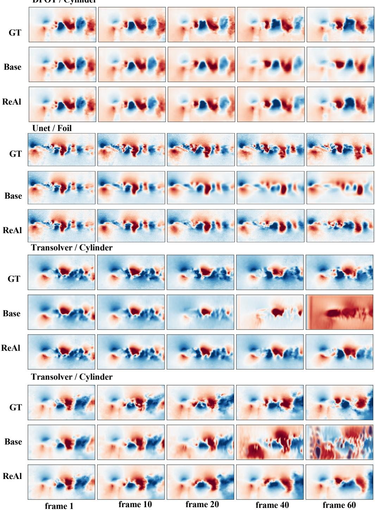  
Figure 7: More visualizations on the RealPDEBench Real2Real setting. Our ReAl can correct the generation trajectory of the Base model.

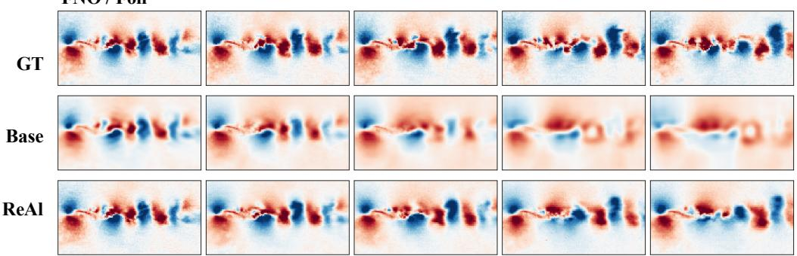

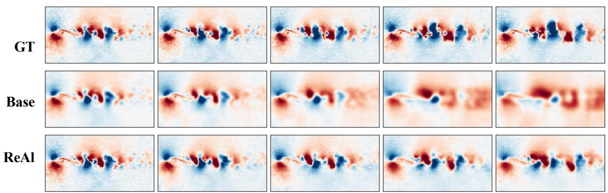

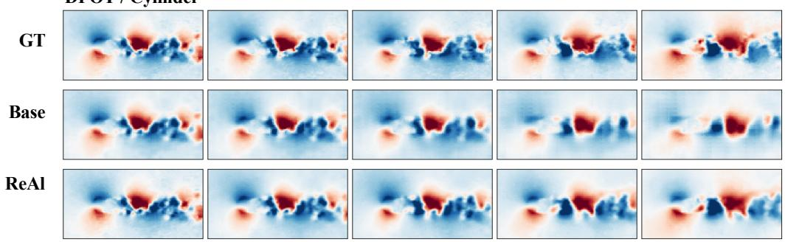

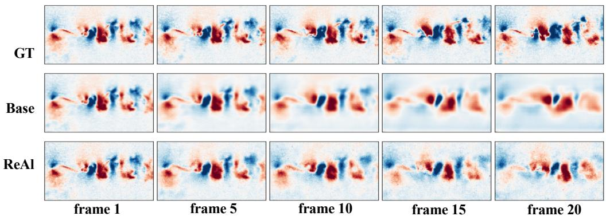  
Figure 8: Visualizations on the RealPDEBench Sim2Real setting. Compared with Real2Real, Sim2Real involves a substantially larger distribution shift, making autoregressive rollouts more susceptible to error accumulation and long-horizon divergence. We therefore visualize predicted Frames 1, 5, 10, 15, and 20, which cover the informative stage before catastrophic rollout failure. Our ReAl can rectify the generation trajectory of the Base model.