# Reinforcement Learning via Advantage Guidance

Zhiyuan Zhou, Sergey Levine

UC Berkeley

Abstract — Reinforcement learning (RL) holds the promise of learning a policy that can outperform what is shown in the data. However, in practice, such systems sufer from instability and hyperparameter sensitivity. In contrast, supervised learning provides a stable and scalable training objective, but is fundamentally limited by the quality of the demonstrated behavior. In this paper, we ask whether we can perform policy optimization with something as simple and stable as supervised learning but as performant as RL. Unfortunately, naïvely training the policy with supervised learning and conditioning on future rewards or advantages typically underperform dedicated RL methods. We introduce a new policy extraction method, Advantage Guidance, that retains the simple supervised learning structure with advantage conditioning while outperforming prior RL methods through efective conditional training and contrastive difusion guidance during sampling. We show that Advantage Guidance can significantly improve a model’s ability to respond to conditional advantage signals, and the contrastive guidance during sampling can use the learned advantage-conditioned policy to target the KL-regularized optimal policy. Empirically, we find that Advantage Guidance significantly outperforms prior state-of-the-art RL methods on 26 long-horizon, sparse reward tasks across datasets with varying degrees of optimality. Code: github.com/zhouzypaul/advantage-guidance

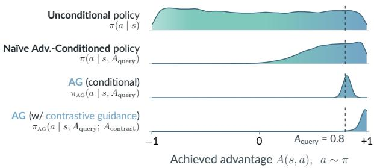

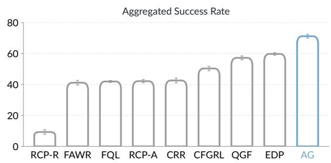  
Figure 1: We introduce a new RL method, Advantage Guidance (AG), that uses a simple supervised learning objective with advantage conditioning while outperforming prior RL methods through efective conditional training and contrastive difusion guidance during sampling. Left: Naïve advantage-conditioned policies often fail to match the requested advantage, producing actions whose advantages vary widely and frequently fall below the requested value. We call this the advantage alignment problem. Our approach (AG) significantly improves advantage alignment, and our contrastive guidance formulation further enables advantage maximization rather than matching a prespecified value, as desired for policy extraction. Right: Our method significantly outperforms baselines on 26 long-horizon sparse-reward tasks across datasets with varying degrees of optimality.

## 1. Introduction

Reinforcement learning (RL) holds the promise of improving policy performance beyond what is shown in the data, and can in theory outperform imitation learning under suitable conditions [46, 30]. However, RL algorithms sufer from lots of instability and hyperparameter sensitivity issues in practice [49, 17, 22], especially over of-policy or ofline data. Imitation learning, on the other hand, has been shown to be stable and scalable for policy training with modern generative modeling techniques like difusion and flow matching. This raises the question: can we perform policy training with something as simple and stable as imitation learning, but as performant as RL?

To achieve the stability of imitation learning, one might be tempted to directly apply the supervisedlearning loss function, training the policy to maximize the likelihood of actions seen in the data. Previous works have explored accomplishing this with conditional, filtered, or weighted supervised learning [13]. One set of methods, which we will refer to as advantage-conditioned methods [28, 2, 18, 42], resorts to training a policy conditioned on advantage values, which estimate how “good” actions are. During inference, the policy is queried with a high advantage to generate “good” actions.

Unfortunately, such naïve advantage-conditioned policies typically underperform dedicated RL methods (see Figure 1). This is in part because advantage-conditioning does not generally result in a policy that always favors actions with higher advantages as RL policies do: the resulting policy is restricted to the queried advantage level, and this restricts the degree of policy improvement. Moreover, we find it dificult to train a policy to respond to advantage conditioning in the first place: the policy often cannot match the requested advantage (see Figure 1), and can ignore the conditioning altogether and revert to unconditional imitation.

In this work, our goal is to train a policy with the simple and stable supervised learning objective conditional on continuous advantage estimates, while enabling the policy to generate actions that maximize advantage. To accomplish this, we first derive a difusion guidance formulation we call contrastive guidance for sampling at test time, which can target actions that maximize the advantage under a KL behavior constraint. Then, to efectively train a flow-matching conditional policy that responds to the conditional values, we re-parameterize the conditional policy as a residual flow on top of a reference unconditional flow field. We also propose an action imagination scheme: we use “imagined actions” sampled from the unconditional policy, and their advantage estimates, to train the advantage-conditioned policy under a broader action distribution for each state.

The resulting algorithm, Advantage Guidance, significantly improves the policy’s ability to respond to advantage inputs, and can target the KL-regularized optimal policy during sampling. Across 26 long-horizon, sparse reward tasks with both play-style and demonstration datasets in the ofline RL setting, Advantage Guidance outperforms prior strong RL algorithms.

## 2. Related Work

Ofline RL and policy extraction. Ofline RL aims to learn policies that outperform the behavior represented in a fixed dataset. Prior works focus on learning value functions that mitigate erroneous extrapolation [3, 19, 27, 29, 54], as well as policy extraction from that value function [5, 16, 20, 34, 39, 47, 53]. However, many prior policy extraction methods can be dificult to apply in practice due to instability and hyperparameter sensitivity. Another line of work, which closely relates to ours, circumvents this instability by converting the policy training objective to an imitation learning loss via advantage, reward, or return conditioning [28, 6, 13, 45], data filtering [6, 52, 9], and loss weighting [39, 41, 35]. We specifically study advantage conditioning, which avoids instability of loss-weighting, uses the full dataset for generalization, and has lower variance than return conditioning. Existing advantage conditioning methods condition on continuous values [28, 18, 42] or binarized labels [2, 48], and during inference query with a fixed high advantage value, which may fall outside the training distribution, or learn an extra model to choose a high in-support query [28, 18]. In contrast, our method uses a form of contrastive difusion guidance to maximize advantage without risking out-of-support advantage queries or needing additional models. In addition, we find that previous methods struggle to respond to advantage inputs, and we introduce residual parameterization and action imagination training schemes to improve the policy’s responsiveness to advantages.

Flow and difusion policies for RL. Difusion and flow matching have been widely studied for parameterizing the policy in RL [43, 11, 56, 8, 26, 7, 58]. Using these iterative denoising methods is challenging because leveraging the action gradient requires backpropagating through a multi-step denoising process [51, 21, 12, 57, 50, 33], which can be expensive and unstable in practice [58, 38]. Previous works avoid this unstable backpropagation process by treating each denoising step as an action in the environment [4, 43], which blows up the problem horizon, or approximating the multi-step policy with single-step models [38, 7, 24], which sufers from approximation errors and limited expressivity. Another line of work avoids backpropagation entirely, instead directly guiding the iterative sampling process using critic gradient [58] or classifier-free guidance (CFG) [15, 14]. Like the latter, our approach avoids critic gradients, which are dificult to estimate for high-dimensional or partially noised actions. Most similar to our work is CFGRL [15], which applies CFG between an unconditional policy trained on the entire dataset and another “filtered policy” trained on the positive-advantage subset. Our approach instead trains on the entire dataset conditioned on continuous advantage values, and uses a form of contrastive guidance during sampling. Empirically, we find that CFGRL usually underperforms in practice because its binary filtering criterion discards information on action quality.

## 3. Preliminaries and Background

KL-regularized RL. We characterize the environment with state space ${ \mathcal { S } } ,$ , action space ${ \mathcal { A } } ,$ a transition function $p ( s ^ { \prime } | s , a ) : \mathcal { S } \times \mathcal { A }  \Delta ( \mathcal { S } )$ , and a reward function $r ( s ) :  { S } \to \mathbb { R }$ . A policy $\pi ( a \mid s )$ ${ \cal S }  \Delta ( { \cal A } )$ is a mapping from state to an action distribution, and value functions $V ^ { \pi } ( s )$ and $Q ^ { \pi } ( s , a )$ characterize the expected future return under a policy $\pi .$ . The advantage $A ^ { \pi } ( s , a ) = Q ^ { \pi } ( s , a ) - V ^ { \pi } ( s )$ measures how much better action $a$ is than following π at state $s .$ . The KL-regularized RL objective is $\begin{array} { r } { J ( \pi ) = \mathbb { E } _ { \tau } \left[ \sum _ { t } \gamma ^ { t } r ( s _ { t } , a _ { t } ) \right] - \beta \mathbb { E } _ { s \sim p ^ { \pi } ( s ) } \big [ D _ { \mathrm { K L } } ( \pi ( \cdot \mid s ) \| \hat { \pi } ( \cdot \mid s ) ) \big ] } \end{array}$ , where $\beta$ controls regularization toward the reference policy πˆ. The KL regularizer prevents the policy from exploiting Q-values, especially in ofline RL. It is well-known [10, 1, 39] that this objective under fixed-state has a closed form solution:

$$
\pi _ { \mathrm { K L } } ^ { * } ( \boldsymbol { a } \mid \boldsymbol { s } ) \propto \hat { \pi } ( \boldsymbol { a } \mid \boldsymbol { s } ) \cdot \exp ( A ( \boldsymbol { s } , \boldsymbol { a } ) / \beta ) ,\tag{1}
$$

which “tilts” the reference distribution to exponentially favor high advantage actions. We set this as the policy-extraction target distribution we want to achieve.

Advantage conditioned policies. The main idea for advantage-conditioned methods is straightforward: first, compute the advantage estimate $A ( s , a )$ for each $( s , a )$ transition in the data via a learned value function or Monte Carlo sampling; then, train a policy $\pi ( a \mid s , A ( s , a ) )$ to predict actions given their advantage values; finally, query the policy with some specified target value $A _ { \mathrm { { q u e r y } } }$ . Intuitively, this associates action quality with advantage values, allowing high-advantage queries to elicit good actions. This results in the policy $\pi ( a \mid s , A _ { \mathrm { q u e r y } } ) \propto \hat { \pi } ( a \mid s ) \cdot { \bf 1 } \left[ \mid A ^ { \hat { \pi } } ( s , a ) - A _ { \mathrm { q e u r y } } \right. < \epsilon ]$ where $0 < \epsilon \ll 1$ This can be undesirable because $\pi ( { a } | { s } , A _ { \mathrm { q e u r y } } )$ only incentivizes actions with advantage $A _ { \mathrm { q e u r y } }$ , but actually discourages actions with $A > A _ { \mathrm { q e u r y } }$ , unlike Equation (1). An excessively high $A _ { \mathrm { { q u e r y } } }$ can place it outside the training distribution and result in bad actions.

Classifier free guidance. Difusion and flow matching are generative models that transform noise into samples x through an iterative denoising process $p _ { t } ( x _ { t } )$ . We use flow-matching in this paper for simplicity. The denoising direction is closely related to the score function $\nabla _ { x } \log { p _ { t } ( x _ { t } ) }$ , which difusion models learn directly and flow-matching models recover under appropriate transformations [44, 32]. Importantly, modifying the score during sampling allows us to guide the denoising process toward a desired distribution, such as one that favors higher-advantage actions. For a generative model $p ( x )$ with conditional labels $y ,$ classifier free guidance (CFG) [23] modifies the sampling at timestep t to instead use score $\nabla _ { x } \log p _ { t } ( x _ { t } ) + w \left[ \nabla _ { x } \log p _ { t } ( x _ { t } \mid y ) - \nabla _ { x } \log p _ { t } ( x _ { t } ) \right] = \nabla _ { x } \log \left[ p _ { t } ( x _ { t } ) p _ { t } ( y \mid x _ { t } ) ^ { w } \right] .$ , where $w > 0$ is a guidance weight. For generated clean samples, this tilts the generated distribution to $p ( x ) \exp ( w \log p ( y \mid x ) )$ . Intuitively, this generates samples that maximize the probability of having a specific value of $y .$ Frans et al. [15] showed that CFG can be used to achieve policy improvement in RL when $p _ { t } ( x _ { t } )$ is the policy and the conditional variable $y$ is binary $y \in \{ 0 , 1 \}$ and $p ( y = 1 \mid A ( s , a ) )$ ) is a non-negative and monotonic increasing function of $A ( s , a )$

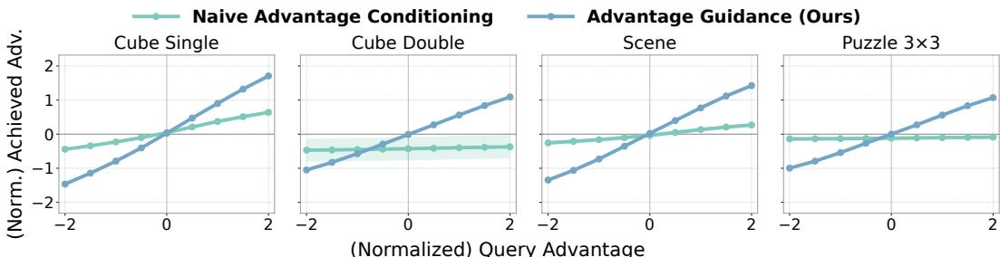  
Figure 2: Naïve advantage conditioned policy sufers from the advantage alignment problem, generating actions whose advantages don’t align with the requested value. 5 tasks per domain.

## 4. Analysis of CFG for Advantage Conditioned Policies

Since CFG can induce policy improvement [15], one might wonder whether we can apply it to policies conditioned on continuous advantages to sample from our target, the KL-constrained optimal policy $\pi _ { \mathrm { K L } } ^ { * }$ in Equation (1). In this section, we derive the solution of CFG on an advantage conditioned policy and show that it does not achieve this target.

Difusion (and under some transformations flow matching) learn the score function, and so we can analyze the score function space directly. The score of the target distribution $\pi _ { \mathrm { K L } } ^ { * }$ in Equation (1) is

$$
\begin{array} { r } { \nabla _ { a } \log \pi _ { \mathrm { K L } } ^ { * } ( a \mid s ) = \nabla _ { a } \log \left[ \hat { \pi } ( a \mid s ) \exp ( A ( s , a ) / \beta ) \right] . } \end{array}\tag{2}
$$

Next, we will derive the score function when we perform CFG sampling on an advantage conditioned policy. Let us denote the conditional policy as $\pi ( \boldsymbol { a } \mid s , y )$ , where $y \sim Y$ is the conditional random variable. For simplicity, assume it has Gaussian likelihood: $Y \mid s , a \sim \mathcal { N } ( A ( s , a ) , \sigma _ { y } ^ { 2 } )$ and log $\begin{array} { r } { p _ { Y } ( y ~ \vert ~ A ( s , a ) ) = - \frac { ( y - A ( s , a ) ) ^ { 2 } } { 2 \sigma _ { \eta } ^ { 2 } } - \frac { 1 } { 2 } \log ( 2 \pi \sigma _ { y } ^ { 2 } ) } \end{array}$ . We will denote the score of the conditional and unconditional policy as $\overset { \cdot } { \boldsymbol { g } _ { y } } = \nabla _ { a } \log \pi ( \boldsymbol { a } \mid \boldsymbol { s } , \boldsymbol { y } )$ and $\boldsymbol { g } = \nabla _ { a } \log \hat { \pi } ( \boldsymbol { a } \mid \boldsymbol { s } )$ . Bayes rule gives: $\begin{array} { r } { g _ { y } - g = \nabla _ { a } \log \left[ \frac { p _ { Y } ( y | A ( s , a ) ) \hat { \pi } ( a | s ) } { p ( y | s ) } \right] - \nabla _ { a } \log \hat { \pi } ( a \mid s ) = \nabla _ { a } \left[ - \frac { ( y - A ( s , a ) ) ^ { 2 } } { 2 \sigma _ { y } ^ { 2 } } \right] } \end{array}$ . Consequently, the score when sampling with CFG at guidance weight w is

$$
g + w ( g _ { y } - g ) = \nabla _ { a } \log \left[ \hat { \pi } ( a \mid s ) \exp \left( - \frac { w ( y - A ( s , a ) ) ^ { 2 } } { 2 \sigma _ { y } ^ { 2 } } \right) \right] .\tag{3}
$$

This is generally not the same as the score of the desired tilted distribution in Equation (2). Intuitively, sampling with CFG induces a distribution that favors actions that match the target advantage value, and penalizes deviations above and below it; it does not always favor high-advantage actions as in Equation (2). Higher CFG weights more strongly favor matching the target advantage.

## 5. Advantage Alignment Problem of Naïve Conditioned Policies

While sampling with CFG does not necessarily produce actions that maximize the advantage, we might imagine that conditioning on a suficiently high target advantage can still yield a good policy that is an improvement over ${ \hat { \pi } } ( a \mid s )$ . By corollary, advantage conditioned policies should also enjoy this benefit because they equate to the special case of CFG sampling with guidance weight $w = 1$ . For simplicity, we focus our analysis on this special case, analyzing advantage-conditioned policies to understand whether they can efectively adapt to conditioning and generate high-advantage actions.

To measure how well a policy responds to the advantage signal, we define advantage alignment as the extent to which the achieved advantage of a policy action matches the advantage used to query the conditional policy $( i . e . , \ A _ { \mathrm { q u e r y } } \ \mathrm { v s . } \ A ( s , \pi ( \cdot \ | \ s , A _ { \mathrm { q u e r y } } ) )$ . Intuitively, if a conditional policy responds properly to advantage inputs, it should be advantage aligned: actions generated conditioned on high advantage should have high advantages, and vice versa. Figure 2 shows the advantage alignment on 20 diferent OGBench [37] tasks across 4 diferent domains, and the advantages shown are normalized using the mean and variance of the advantages of 32 actions sampled from the same state. A naïve advantage-conditioned policy $\pi ( a \mid s , A )$ , which we implement following RCP-A [28], responds very weakly to advantage inputs, often generating actions that have the same advantages even when requested with diferent values, especially on hard long-horizon tasks. When queried with a high advantage, it often generates actions whose advantages fall below the requested value. We refer to this as the advantage alignment problem. And as we will show in Section $\mathrm { A . 4 }$ , using a more expressive policy architecture such as a transformer does not solve this problem, and misalignment is also reflected in policy performance when using diferent $A _ { \mathrm { { q u e r y } } }$ (see Section A.3). In comparison, our method Advantage Guidance (which we will introduce later in Section 6) is substantially more responsive to advantage conditioning, with the resulting actions exhibiting achieved advantage values that closely align with requested advantages.

To gain a mechanistic understanding of the optimization process, we investigate (1) how the gradient of the policy loss responds to advantage conditioning, and (2) how strongly the output actions respond to diferent conditional signals. First, we compare the gradient of the policy loss conditioned on the ground truth versus random advantage values. We plot their cosine similarity in Figure 3 (left), and find that naïve advantage-conditioned policy has gradient cosine similarity close to 1. This suggests that the loss is largely insensitive to advantage labels, leading the policy to ignore them. So does the

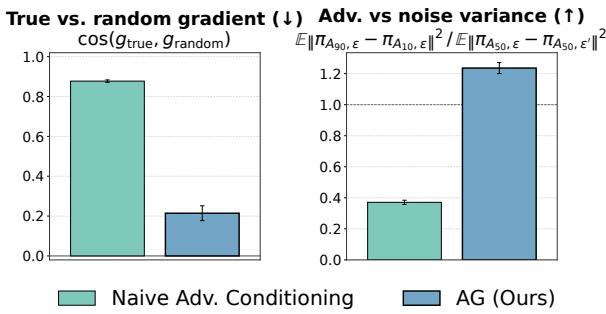  
Figure 3: Naïve advantage conditioned policies often ignore advantage inputs. Averaged over 20 OGBench tasks.

policy respond to any conditioning at all, or does it just ignore the advantage? To investigate, we compare the sensitivity of generated actions to advantage inputs and initial flow noise. We measure $\frac { \mathbb { E } \| \pi ( a | s , A _ { 9 0 } , \epsilon ) - \pi ( a | s , A _ { 1 0 } , \epsilon ) \| ^ { 2 } } { \mathbb { E } \| \pi ( a | s , A _ { 5 0 } , \epsilon ) - \pi ( a | , s , A _ { 5 0 } , \epsilon ^ { \prime } ) \| ^ { 2 } }$ , where $A _ { n }$ is the n-th percentile advantage for state s and $\epsilon , \epsilon ^ { \prime }$ are diferent initial noises. Figure 3 (right) shows that varying the advantage changes the naïve agent’s actions by less than half the efect of sampling noise, whereas our method’s response exceeds it.

The analysis above shows that the policy network largely ignores the advantage value , efectively regressing to an unconditional policy $\pi ( a \mid s )$ . In the next section, we will present solutions to this challenge and show that our method can significantly improve advantage alignment.

## 6. Advantage Guidance

In this section, we introduce our proposed method, Advantage Guidance, an advantage-conditioned policy extraction method that improves advantage alignment and can target the KL-constrained optimal policy through guidance. We first derive a guidance formulation we term contrastive guidance that uses a policy conditioned on continuous advantage values to target $\pi _ { \mathrm { K L } } ^ { * } ( a \mid s ) \propto { \hat { \pi } } ( a \mid s ) \exp ( A ( s , a ) / \beta )$ Then, we introduce practical techniques during training to improve advantage alignment, including reparameterizing the conditional policy as a residual flow over an unconditional flow field and training on multiple imagined actions per state.

## 6.1. Contrastive Guidance for Advantage Maximization

First, we aim to derive a sampling technique based on difusion guidance that can enable the policy to generate advantage-maximizing actions rather than matching a prespecified value. Our target is the KL-regularized optimal policy $\pi _ { \mathrm { K L } } ^ { * }$ , which maximizes advantage under KL constraint to ${ \hat { \pi } } ( a \mid s )$

Recall that for flow and difusion policies, we can analyze the score function directly, and the score of our target distribution $\pi _ { \mathrm { K L } } ^ { * }$ is in Equation (2). Following Section 4, we denote the conditional policy as $\pi ( \boldsymbol { a } \mid s , y )$ where $y \sim Y$ is the conditional random variable with likelihood $p _ { Y } ( y \mid A )$

Remark 1 (Contrastive Guidance.). Assume $p _ { Y }$ belongs to exponential family $p _ { Y } ( y \mid A ) =$ $h ( y ) \exp { ( T ( y ) A - F ( A ) ) }$ where $h ( y ) \geq 0$ and $F ( A )$ is a log-partitionfunction. The action score of the KL-regularized optimal policy $\pi _ { \mathrm { K L } } ^ { * } ( a \mid s ) \propto { \hat { \pi } } ( a \mid s ) \exp ( A ( s , a ) / \beta )$ matches

$$
\nabla _ { a } \log \widehat { \pi } ( a \mid s ) + w \left[ \nabla _ { a } \log \pi ( a \mid s , y _ { + } ) - \nabla _ { a } \log \pi ( a \mid s , y _ { - } ) \right]\tag{4}
$$

if some fixed w, $y _ { + } , y _ { - } \in \mathbb { R }$ satisfy $1 / \beta = w [ T ( y _ { + } ) - T ( y _ { - } ) ]$

We provide a formalization and proof of this claim in Section $\mathrm { A . 1 }$ . In other words, if we sample according to Equation (4), which is easily derived with the score of the conditional and unconditional policy, we can directly match the score of the desired exponentially-tilted distribution. This is akin to performing difusion guidance with guidance weight w and guidance term $\nabla _ { a } \log \pi ( a \ |$ $s , y _ { + } ) - \nabla _ { a } \log \pi ( a \mid s , y _ { - } )$ . Since the guidance term contains the score diference of a contrastive pair $( y _ { + } , y _ { - } )$ , we call this contrastive guidance.

Remark 2 (Advantage Maximization.). $I f \beta > 0$ (which is ensured $i f T ( y _ { + } ) > T ( y _ { - } )$ and $w > 0 )$ the tilted policy $\pi _ { \mathrm { K L } } ^ { * } ( a \mid s ) \propto \hat { \pi } ( a \mid s ) \exp ( A ( s , a ) / \beta )$ is the solution to the KL-constrained advantage maximization problem arg $\begin{array} { r } { \operatorname* { m a x } _ { \pi ( \cdot | s ) } \left\{ \mathbb { E } _ { a \sim \pi ( \cdot | s ) } [ A ( s , a ) ] - \beta D _ { \mathrm { K L } } ( \pi ( \cdot \mid s ) \parallel \hat { \pi } ( \cdot \mid s ) ) \right\} } \end{array}$

This follows directly from Remark 1 and prior work [10, 1, 39]. Thus, with a positive guidance weight $w > 0$ and $T ( y _ { + } ) > T ( y _ { - } )$ , the target of contrastive guidance induces advantage maximization, rather than matching a fixed value. The contrastive labels $y _ { + } , y _ { - }$ and the guidance weight w control the maximization degree together: a higher $w [ T ( y _ { + } ) - T ( y _ { - } ) ]$ leads to weaker constraint and stronger advantage maximization.

Practical Implementation. In practice, we can choose a simple exponential family for the conditional variable Y, the Gaussian distribution. In other words, we choose $Y \mid s , a \sim \mathcal { N } ( A ( s , a ) , \sigma _ { y } ^ { 2 } )$ , which corresponds to $\begin{array} { r } { h ( y ) = \frac { 1 } { \sqrt { 2 \pi } \sigma _ { y } } \exp ( - \frac { y ^ { 2 } } { 2 \sigma _ { y } ^ { 2 } } ) , T ( y ) = \frac { y } { \sigma _ { y } ^ { 2 } } , F ( A ) = \frac { A ^ { 2 } } { 2 \sigma _ { y } ^ { 2 } } } \end{array}$ . For $y _ { + } > y _ { - }$ , we automatically have $T ( y _ { + } ) > T ( y _ { - } )$ and we can choose guidance weight $\begin{array} { r } { w = \frac { \sigma _ { y } ^ { 2 } } { \beta ( y _ { + } - y _ { - } ) } > 0 } \end{array}$ to give the desired tilt in Equation (1).

## 6.2. Residual Parameterization for Conditional Policy

While contrastive guidance can target the KL-regularized optimal policy in theory, it makes an implicit assumption that the conditional policy is advantage-aligned with $y _ { + }$ and $y .$ . Therefore, we focus next on training techniques that can improve advantage alignment. Recall that we found in Section 5 that naïve advantage conditioned policies often ignore advantage inputs and largely optimize the policy loss based on state and initial noise alone. In other words, the policy is minimizing the loss for the advantage-conditional policy by learning to minimize the unconditional loss. This motivates an approach that separates out the components that are not conditioned on advantage, and leaves the conditional policy to focus on the advantage input. In Advantage Guidance, we propose to parameterize the conditional policy as a residual flow $v _ { \theta }$ to the flow field of an unconditional reference policy $v _ { \hat { \pi } } ( a \mid s )$ . Specifically, both policies are instantiated as flow-matching networks, where the model learns a velocity field conditioned on a partially noised action $x _ { t } .$ , along with the noise scale $t ,$ state $s ,$ and conditioning variable $y .$ . The residual parameterization in velocity space is:

$$
\begin{array} { r } { v _ { \pi } ( x _ { t } , t , s , y ) = v _ { \pi } ( x _ { t } , t , s ) + v _ { \theta } ( x _ { t } , t , s , y ) . } \end{array}\tag{5}
$$

The training loss for the conditional policy is:

$$
\mathcal { L } ( \theta ) = \mathbb { E } _ { s , a \sim \mathcal { D } _ { \mathrm { a u g } } } \big [ | | v _ { \hat { \pi } } ( s , x _ { t } , t ) + v _ { \theta } ( s , x _ { t } , y , t ) - ( a - \epsilon ) | | ^ { 2 } \big ] \quad \mathrm { w h e r e ~ } x _ { t } = ( 1 - t ) \epsilon + t a .\tag{6}
$$

The noise scale $t \sim U [ 0 , 1 ]$ and $\epsilon \sim \mathcal { N } ( 0 , 1 )$ is Gaussian noise. The unconditional reference flow policy $\hat { \pi }$ is trained to minimize regular flow-matching loss $\mathbb { E } _ { s , a \sim D } \left\lceil | | v _ { \hat { \pi } } ( s , x _ { t } , t ) - ( x - \epsilon ) | | ^ { 2 } \right\rceil$ . With this parameterization, the reference policy ${ \hat { \pi } } ( a \mid s )$ minimizes the advantage-independent loss, therefore encouraging the residual $v _ { \theta }$ to focus on minimizing $\mathcal { L } ( \boldsymbol { \theta } )$ based on conditional input $y$

Algorithm 1 Advantage Guidance (AG)   
Training Sampling   
Input: dataset D, advantage $A ( s , a )$ , K, advantage label std $\sigma _ { y }$ Input: state s, trained velocities $v _ { \hat { \pi } } , v _ { \theta }$   
while not converged do conditional query pair $y _ { + } > y _ { - } ,$   
$( s , a ) \sim \mathcal { D } , \epsilon \sim \mathcal { N } ( 0 , I ) , t \sim \mathcal { U } ( 0 , 1 )$ guidance weight w, steps T   
Train ref. policy πˆ with $\mathcal { L } _ { \mathrm { B C } } = \| v _ { \hat { \pi } } - ( a - \epsilon ) \| _ { 2 } ^ { 2 }$ $x _ { 0 } \sim \mathcal { N } ( 0 , I )$   
$a _ { 0 }  a ; \quad a _ { i } \sim \hat { \pi } ( \cdot \mid s ) , \quad i = 1 , \ldots , K$ ◀ action imagination for $n = 0 , \ldots , T - 1$ do   
$A _ { i }  A ( s , a _ { i } ) , i = 0 , . . . , K$ $t \gets n / T$   
$\tilde { A } _ { i } \gets ( A _ { i } - \mathrm { m e a n } ( A _ { 0 : K } ) ) / \sqrt { \mathrm { v a r } ( A _ { 0 : K } ) + \delta }$ ◀ adv. norm. ▼ contrastive guidance   
$y _ { i } \sim \mathcal { N } ( \tilde { A } _ { i } , \sigma _ { y } ^ { 2 } ) , i = 0 , . . . , K$ ◀ Gaussian conditional var. $v  v _ { \hat { \pi } } + w [ v _ { \theta } ( y _ { + } ) - v _ { \theta } ( y _ { - } ) ]$   
K   
$\Delta \theta \gets \nabla _ { \theta } \sum _ { \cdot } ^ { \wedge } \| v _ { \hat { \pi } } + v _ { \theta } ( y _ { i } ) - ( a _ { i } - \epsilon ) \| _ { 2 } ^ { 2 }$ ◀ residual param. $\boldsymbol { x } _ { n + 1 } \gets \boldsymbol { x } _ { n } + \frac { 1 } { T } \boldsymbol { v }$   
i=0   
end while end for   
return $v _ { \hat { \pi } } , v _ { \theta }$ return $a = x _ { T }$   
Velocity-field arguments are abbreviated above: $v _ { \hat { \pi } } = v _ { \hat { \pi } } ( x _ { t } , t , s )$ and $v _ { \theta } ( y ) = v _ { \theta } ( x _ { t } , t , s , y )$

## 6.3. Action Imagination for Counterfactual Supervision

Beyond optimization dynamics, learning an advantage-conditioned policy presents a more fundamental challenge: the dataset typically contains only one action for any given state, especially in continuous state spaces. As a result, the policy receives little direct supervision on how actions should change as requested advantages vary. We address this lack of counterfactual supervision with action imagination: for each state-action pair $( s , a _ { d } )$ in the dataset, we augment the training distribution for the conditional policy with K additional actions on state s sampled from some proposal distribution:

$$
{ \mathcal { D } } _ { \mathrm { a u g } } = \bigcup _ { ( s , a _ { d } ) \in { \mathcal { D } } } \left\{ \left( s , a _ { i } , A ( s , a _ { i } ) \right) \right\} _ { i = 0 } ^ { K } , \qquad a _ { 0 } = a _ { d } , \quad a _ { i } \sim \pi _ { p } ( \cdot \mid s ) { \mathrm { ~ f o r ~ } } i = 1 , \dots , K .
$$

One convenient solution is to set the proposal distribution as the reference unconditional policy: $\pi _ { p } = \hat { \pi }$ As we will show in Section 7, training with residual parameterization and action imagination drastically improves advantage alignment and policy performance, especially on long horizon tasks.

## 6.4. Implementation Details

Advantage Guidance is an RL policy extraction algorithm based on advantage-conditioned training and contrastive guidance during sampling. It is agnostic to how the advantage estimates are derived. For simplicity, in this paper, we train value functions $Q ( s , a )$ and $V ( s )$ using IQL [27], and calculate advantage as $A ( s , a ) = Q ( s , a ) - V ( s )$ Algorithm 1 shows a summary of the training and sampling procedure of Advantage Guidance. During training, we standardize advantages separately for each state using $\tilde { A } ( s , a _ { i } ) = ( A ( s , a _ { i } ) - \mu _ { s } ) / \sqrt { \sigma _ { s } ^ { 2 } + \delta } ,$ where $\begin{array} { r } { \mu _ { s } = \frac { 1 } { K + 1 } \sum _ { j = 0 } ^ { K } A ( s , a _ { j } ) } \end{array}$ and $\begin{array} { r } { \sigma _ { s } ^ { 2 } = \frac { 1 } { K + 1 } \sum _ { j = 0 } ^ { K } ( A ( s , a _ { j } ) - \mu _ { s } ) ^ { 2 } } \end{array}$ , with dataset action $a _ { 0 } = a _ { d } .$ imagined actions $\scriptstyle a _ { i = 1 , \ldots , K }$ , and $\delta > 0$ ensuring numerical stability. Then, we condition the policy on $\tilde { A }$ using AdaLN [55], which adaptively scales and shifts hidden representations at each layer.

## 7. Experiments

We conduct experiments to analyze the empirical efectiveness of Advantage Guidance on a range of long-horizon, sparse reward manipulation tasks. Concretely, we study the following research questions: (1) How well does Advantage Guidance perform compared to prior RL methods on datasets with varying degrees of optimality? (2) Do residual parameterization and action imagination improve advantage alignment and policy performance? (3) Does contrastive guidance improve policy performance compared to CFG or no guidance? Additionally, we conduct further ablation experiments in Section A.2. All detailed results are documented in Section A.10.

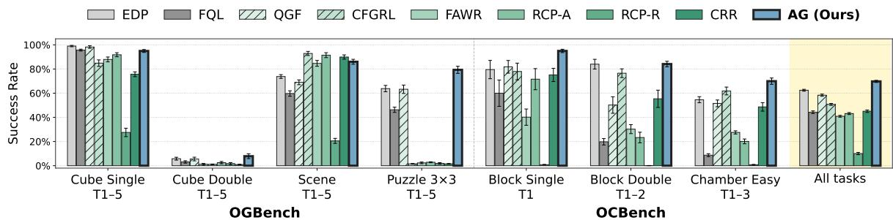  
Figure 4: Ofline RL performance on OGBench (20 tasks) and OCBench (6 tasks) with 10 seeds: Advantage Guidance (blue) outperforms all previous methods, including strong actor-critic methods (grey), supervised-learning-based methods (green), and difusion guidance methods (shaded green).

Experimental Setup. We evaluate all methods in the ofline RL setting with 20 tasks from OG-Bench [37] and 6 tasks from OCBench [36]. OGBench ofers a suite of long-horizon challenging manipulation tasks, and OCBench is a recently proposed extension of OGBench that provides a more realistic action distribution meant to emulate the statistical properties of real-world human demonstrations. In particular, the two benchmarks difer substantially in their ofline dataset composition. OGBench is a standard ofline RL benchmark with play-style datasets generated by scripted behaviors pursuing random goals, often yielding highly suboptimal trajectories for the task objective. OCBench ofers demonstration-based datasets, consisting of trajectories generated by near-expert policies with high success rates on the task objective. Compared to play-style datasets, these demonstrations cover narrower states and predominantly near-optimal actions, making it more challenging for ofline RL because extrapolation errors are harder to avoid. However, such data more closely resembles real-world robotics datasets, and OCBench’s design to emulate human demonstration statistics makes it particularly relevant. We use cube-single-T{1-5}, cube-double-T{1-5}, scene-T{1-5}, puzzle-3x3-T{1-5} from OGBench and lite tasks block-single-T1, block-double-T{1-2}, chamber-easy-T{1-3} from OCBench, all with sparse rewards. In addition, we follow the action chunking setting [31], where the higher-dimensional actions make the action distribution more complex and therefore more challenging.

Baselines. We compare Advantage Guidance against a representative set of strong flow-matching RL baselines, grouped into three categories: (1) actor critic methods train a parameterized actor to maximize the critic $Q ( s , a )$ subject to behavioral constraints. FQL [38] distills a multi-step flow policy into a single-step policy to avoid backpropagation through time, while EDP [24] approximates the multi-step integration with a single large Euler step. (2) Supervised-learning-based methods formulate policy optimization as a conditional, filtered, or weighted supervised learning problem. CRR [52] trains a behavior cloning policy on the subset of data with positive advantage; FAWR is an extension of AWR [39] to flow policies by weighting the flow-matching loss with exponentiated advantages. RCP-R and RCP-A [28] train a policy conditioned on the return-to-go and advantage estimate, respectively. (3) Difusion guidance methods steer the denoising process toward high-value actions at inference time. QGF [58] guides a behavior cloning policy using an approximation of the critic gradient $\nabla _ { a } Q ( s , a )$ at partially noised actions. CFGRL [15] applies CFG between a policy trained on the full dataset and a policy trained on the positive-advantage subset. Section A.6 provides a more detailed description of each method. To ensure fair comparison among all the policy extraction methods, we use the same value function for all. For simplicity, use the IQL [27] Q and V functions, and use $A ( s , a ) = Q ( s , a ) - V ( s )$

## 7.1. How Does Advantage Guidance Compare with Prior Methods?

While we expected the main benefit of Advantage Guidance to be its simplicity, in practice we found that it actually outperforms much more sophisticated RL methods. Figure 4 compares the performance of

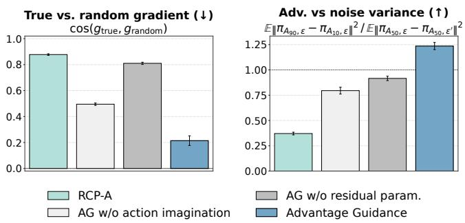

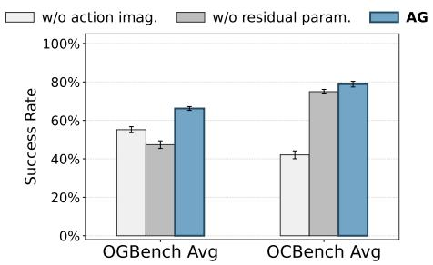  
Figure 6: Efect of residual parameterization and action imagination on advantage alignment: both improve gradient sensitivity and output variance on 20 OGBench tasks.  
Figure 7: Ablation of residual parameterization and action imagination training: both improve policy performance across OGBench and OCBench.

Advantage Guidance against baselines. Overall, Advantage Guidance significantly outperforms previous methods on both play-style datasets from OGBench and demonstration-based datasets from OCBench. In particular, we find that previous supervised-learning-based methods perform poorly compared to strong actor critic methods such as EDP. The performance gap is especially large on challenging long horizon tasks such as puzzle-3x3 and block-double. In comparison, Advantage Guidance significantly outperforms these baselines, including strong actor critic methods such as EDP and FQL. Advantage Guidance also significantly outperforms previous difusion guidance methods: compared to CFGRL, Advantage Guidance can utilize continuous advantage signals for denser supervision, and can target the KL-regularized optimal policy with contrastive guidance; compared to QGF, Advantage Guidance doesn’t rely on explicit Q-gradients in high-dimensional action spaces, which can be unstable or inaccurate.

Best-of-N sampling. Prior work has shown that when additional test-time compute is available, best-of-N (BFN) sampling is an expensive but efective method to improve flow policies [58, 20]. BFN samples multiple actions from a reference BC policy and chooses the action with the highest Q-value. However, even with a small number of samples such as N = 4, BFN is much more expensive due to the sampling process (see Figure 23). Regardless, we compare against this strong baseline in Figure 5 with diferent values of N. On OGBench, Advantage Guidance significantly outperforms BFN at low values of N despite using less test-time compute, but eventually slightly underperforms BFN with large enough N, which also outperforms all prior methods in Figure 4. On OCBench, however, Advantage Guidance is significantly better even with large N. This suggests that while BFN can be quite efective on play-style datasets, it is less competitive on more realistic demonstration-based datasets, even with suficiently large N.

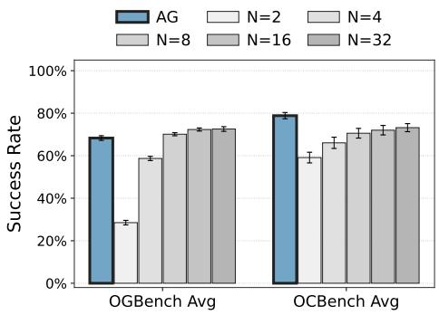  
Figure 5: Comparison with best-of-N sampling. Advantage Guidance outperforms BFN at small N on OGBench and consistently on OCBench, despite using much less test-time compute.

## 7.2. Does AG Training Improve Advantage Alignment and Policy Performance?

We analyze whether the residual parameterization and the action imagination training scheme introduced in Section 6 improve advantage alignment and policy performance. We first plot in Figure 6 the two metrics introduced in Section 5 that measure how much a conditional policy responds to advantage conditioning: the gradient similarity between true and random gradients and the advantage-noise variance ratio. Figure 6 shows that both the residual parameterization and action imagination improve advantage alignment, and combining both does even better. Figure 7 shows that such increased alignment translates to better policy performance, especially on hard long horizon tasks such as puzzle-3x3. We also ablate the efect of diferent numbers of imagined actions in Figure 9 in Section A.2, showing that increasing K can increase performance but will plateus after $K = 7$

## 7.3. Does contrastive guidance improve performance over CFG or no guidance?

We showed in Section 6.1 that contrastive guidance can target the KL-regularized optimal policy and always favor high-advantage actions. Here, we empirically compare contrastive guidance with other sampling methods. Specifically, we compare performance of the same AG-trained policy when sampled with (1) contrastive guidance, (2) CFG, and (3) just querying the conditional policy. For contrastive guidance, we use fixed $( y _ { + } , y _ { - } )$ per benchmark, while we tune the best conditional values per-domain per benchmark for the latter two to make them as competitive as possible. Figure 8 shows that contrastive guidance performs similarly to CFG and pure conditional policy on OGBench, but significantly improves performance on OCBench. It is not entirely surprising that all three methods can perform well: while CFG and pure conditional

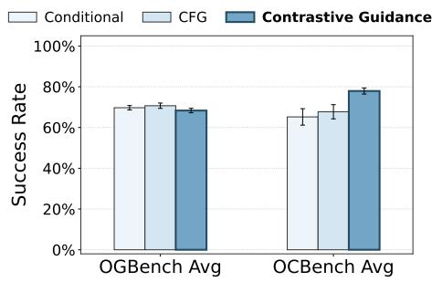  
Figure 8: Ablation of sampling method for Advantage Guidance. Contrastive guidance significantly outperforms CFG and no guidance on 6 OCBench tasks.

policy can only match a target advantage value instead of maximizing advantage, conditioning an advantage-aligned policy on a high-enough advantage should have a similar maximizing efect. However, as observed on OCBench, conditional policies and standard CFG may perform poorly when high query advantages lie outside the training distribution, a common issue in demonstration-based datasets. In this regime, contrastive guidance is crucial for advantage maximization. See Section A.5 for more discussions. Furthermore, all methods only perform well if the conditional policy is advantage aligned (such as AG here); using an unaligned policy such as RCP-A leads to substantially worse performance (see Figure 4).

## 8. Discussions

We demonstrated in this paper that Advantage Guidance can outperform more complex RL methods with a simple supervised learning objective with advantage conditioning and contrastive difusion guidance during inference. Our work serves as a step towards simple, stable, yet performant of-policy RL algorithms. There are several promising directions for future research. First, our implementation uses a straightforward advantage estimate. While we find this to be empirically efective, a natural next step is to explore whether more intricate advantage estimates improve policy performance, and how policy extraction can be robust in case of noisy advantage estimates. Second, our approach uses contrastive guidance to maximize advantage during inference time, but too large a guidance weight usually lead to a decline in performance. Developing techniques to stably utilize larger guidance weights can further improve the performance of Advantage Guidance. Finally, it would be interesting to explore Advantage Guidance in (ofline-to-)online RL settings.

## 9. Acknowledgments

This research was partly supported by ONR N00014-25-1-2060 and AFOSR FA9550-22-1-0273. We would like to thank Andy Peng and Charles Xu for helpful discussions and early ideation, and Seohong Park for feedback on early drafts of the paper. This research used the Savio computational cluster resource provided by the Berkeley Research Computing program at UC Berkeley.

## References

[1] Abbas Abdolmaleki, Jost Tobias Springenberg, Yuval Tassa, Remi Munos, Nicolas Heess, and Martin Riedmiller. Maximum a posteriori policy optimisation. In International Conference on Learning Representations, 2018.

[2] Ali Amin, Raichelle Aniceto, Ashwin Balakrishna, Kevin Black, Ken Conley, Grace Connors, James Darpinian, Karan Dhabalia, Jared DiCarlo, Danny Driess, et al. $\pi _ { 0 . 6 } ^ { * } \colon$ a vla that learns from experience. arXiv preprint arXiv:2511.14759, 2025.

[3] Gaon An, Seungyong Moon, Jang-Hyun Kim, and Hyun Oh Song. Uncertainty-based ofline reinforcement learning with diversified q-ensemble. Advances in neural information processing systems, 34:7436–7447, 2021.

[4] Kevin Black, Michael Janner, Yilun Du, Ilya Kostrikov, and Sergey Levine. Training difusion models with reinforcement learning. arXiv preprint arXiv:2305.13301, 2023.

[5] Huayu Chen, Cheng Lu, Chengyang Ying, Hang Su, and Jun Zhu. Ofline reinforcement learning via high-fidelity generative behavior modeling. arXiv preprint arXiv:2209.14548, 2022.

[6] Lili Chen, Kevin Lu, Aravind Rajeswaran, Kimin Lee, Aditya Grover, Misha Laskin, Pieter Abbeel, Aravind Srinivas, and Igor Mordatch. Decision transformer: Reinforcement learning via sequence modeling. Advances in neural information processing systems, 34, 2021.

[7] Tianyi Chen, Haitong Ma, Na Li, Kai Wang, and Bo Dai. One-step flow policy mirror descent. arXiv preprint arXiv:2507.23675, 2025.

[8] Tianyu Chen, Zhendong Wang, and Mingyuan Zhou. Difusion policies creating a trust region for ofline reinforcement learning. Advances in Neural Information Processing Systems, 37: 50098–50125, 2024.

[9] Xinyue Chen, Zijian Zhou, Zheng Wang, Che Wang, Yanqiu Wu, and Keith Ross. Bail: Bestaction imitation learning for batch deep reinforcement learning. Advances in Neural Information Processing Systems, 33:18353–18363, 2020.

[10] Peter Dayan and Geofrey E Hinton. Feudal reinforcement learning. Advances in neural information processing systems, 5, 1992.

[11] Shutong Ding, Ke Hu, Zhenhao Zhang, Kan Ren, Weinan Zhang, Jingyi Yu, Jingya Wang, and Ye Shi. Difusion-based reinforcement learning via q-weighted variational policy optimization. Advances in Neural Information Processing Systems, 37:53945–53968, 2024.

[12] Zihan Ding and Chi Jin. Consistency models as a rich and eficient policy class for reinforcement learning. arXiv preprint arXiv:2309.16984, 2023.

[13] Scott Emmons, Benjamin Eysenbach, Ilya Kostrikov, and Sergey Levine. Rvs: What is essential for ofline rl via supervised learning? arXiv preprint arXiv:2112.10751, 2021.

[14] Daniele Fofano, Arvid Eriksson, David Broman, Karl H Johansson, and Alexandre Proutiere. Advantage-guided difusion for model-based reinforcement learning. arXiv preprint arXiv:2604.09035, 2026.

[15] Kevin Frans, Seohong Park, Pieter Abbeel, and Sergey Levine. Difusion guidance is a controllable policy improvement operator. arXiv preprint arXiv:2505.23458, 2025.

[16] Scott Fujimoto and Shixiang Shane Gu. A minimalist approach to ofline reinforcement learning. Advances in neural information processing systems, 34:20132–20145, 2021.

[17] Scott Fujimoto, Herke Hoof, and David Meger. Addressing function approximation error in actor-critic methods. In International conference on machine learning, pages 1587–1596. PMLR, 2018.

[18] Chen-Xiao Gao, Chenyang Wu, Mingjun Cao, Rui Kong, Zongzhang Zhang, and Yang Yu. Act: Empowering decision transformer with dynamic programming via advantage conditioning. In Proceedings ofthe AAAI Conference on Artificial Intelligence, volume 38, pages 12127–12135, 2024.

[19] Divyansh Garg, Joey Hejna, Matthieu Geist, and Stefano Ermon. Extreme q-learning: Maxent rl without entropy. arXiv preprint arXiv:2301.02328, 2023.

[20] Philippe Hansen-Estruch, Ilya Kostrikov, Michael Janner, Jakub Grudzien Kuba, and Sergey Levine. IDQL: Implicit Q-learning as an actor-critic method with difusion policies. arXiv preprint arXiv:2304.10573, 2023.

[21] Longxiang He, Li Shen, Linrui Zhang, Junbo Tan, and Xueqian Wang. Difcps: Difusion model based constrained policy search for ofline reinforcement learning. arXiv preprint arXiv:2310.05333, 2023.

[22] Peter Henderson, Riashat Islam, Philip Bachman, Joelle Pineau, Doina Precup, and David Meger. Deep reinforcement learning that matters. In Proceedings ofthe AAAI conference on artificial intelligence, volume 32, 2018.

[23] Jonathan Ho and Tim Salimans. Classifier-free difusion guidance. arXiv preprint arXiv:2207.12598, 2022.

[24] Bingyi Kang, Xiao Ma, Chao Du, Tianyu Pang, and Shuicheng Yan. Eficient difusion policies for ofline reinforcement learning. Advances in Neural Information Processing Systems, 36: 67195–67212, 2023.

[25] Diederik Kingma and Ruiqi Gao. Understanding difusion objectives as the elbo with simple data augmentation. In A. Oh, T. Naumann, A. Globerson, K. Saenko, M. Hardt, and S. Levine, editors, Advances in Neural Information Processing Systems, volume 36, pages 65484–65516, 2023.

[26] Prajwal Koirala and Cody Fleming. Flow-based single-step completion for eficient and expressive policy learning. arXiv preprint arXiv:2506.21427, 2025.

[27] Ilya Kostrikov, Ashvin Nair, and Sergey Levine. Ofline reinforcement learning with implicit Q-learning. arXiv preprint arXiv:2110.06169, 2021.

[28] Aviral Kumar, Xue Bin Peng, and Sergey Levine. Reward-conditioned policies. arXiv preprint arXiv:1912.13465, 2019.

[29] Aviral Kumar, Aurick Zhou, George Tucker, and Sergey Levine. Conservative Q-learning for ofline reinforcement learning. Advances in Neural Information Processing Systems, 33: 1179–1191, 2020.

[30] Aviral Kumar, Joey Hong, Anikait Singh, and Sergey Levine. When should we prefer ofline reinforcement learning over behavioral cloning? arXiv preprint arXiv:2204.05618, 2022.

[31] Qiyang Li, Zhiyuan Zhou, and Sergey Levine. Reinforcement learning with action chunking. arXiv preprint arXiv:2507.07969, 2025.

[32] Yaron Lipman, Ricky TQ Chen, Heli Ben-Hamu, Maximilian Nickel, and Matt Le. Flow matching for generative modeling. arXiv preprint arXiv:2210.02747, 2022.

[33] Lei Lv, Yunfei Li, Yu Luo, Fuchun Sun, Tao Kong, Jiafeng Xu, and Xiao Ma. Flow-based policy for online reinforcement learning. arXiv preprint arXiv:2506.12811, 2025.

[34] Ashvin Nair, Abhishek Gupta, Murtaza Dalal, and Sergey Levine. Awac: Accelerating online reinforcement learning with ofline datasets. arXiv preprint arXiv:2006.09359, 2020.

[35] Gerhard Neumann and Jan Peters. Fitted q-iteration by advantage weighted regression. Advances in neural information processing systems, 21, 2008.

[36] Seohong Park and Sergey Levine. Behavioral Cloning Mystery. ArXiv, abs/2610.07056, 2026.

[37] Seohong Park, Kevin Frans, Benjamin Eysenbach, and Sergey Levine. Ogbench: Benchmarking ofline goal-conditioned rl. arXiv preprint arXiv:2410.20092, 2024.

[38] Seohong Park, Qiyang Li, and Sergey Levine. Flow Q-learning. arXiv preprint arXiv:2502.02538, 2025.

[39] Xue Bin Peng, Aviral Kumar, Grace Zhang, and Sergey Levine. Advantage-weighted regression: Simple and scalable of-policy reinforcement learning. arXiv preprint arXiv:1910.00177, 2019.

[40] Ethan Perez, Florian Strub, Harm De Vries, Vincent Dumoulin, and Aaron Courville. Film: Visual reasoning with a general conditioning layer. In Proceedings ofthe AAAI conference on artificial intelligence, volume 32, 2018.

[41] Jan Peters and Stefan Schaal. Reinforcement learning by reward-weighted regression for operational space control. In Proceedings of the 24th international conference on Machine learning, pages 745–750, 2007.

[42] Yunpeng Qing, Shunyu Liu, Jingyuan Cong, Kaixuan Chen, Yihe Zhou, and Mingli Song. A2po: Towards efective ofline reinforcement learning from an advantage-aware perspective. Advances in Neural Information Processing Systems, 37:29064–29090, 2024.

[43] Allen Z Ren, Justin Lidard, Lars L Ankile, Anthony Simeonov, Pulkit Agrawal, Anirudha Majumdar, Benjamin Burchfiel, Hongkai Dai, and Max Simchowitz. Difusion policy policy optimization. arXiv preprint arXiv:2409.00588, 2024.

[44] Yang Song, Jascha Sohl-Dickstein, Diederik P Kingma, Abhishek Kumar, Stefano Ermon, and Ben Poole. Score-based generative modeling through stochastic diferential equations. arXiv preprint arXiv:2011.13456, 2020.

[45] Rupesh Kumar Srivastava, Pranav Shyam, Filipe Mutz, Wojciech Jaśkowski, and Jürgen Schmidhuber. Training agents using upside-down reinforcement learning. arXiv preprint arXiv:1912.02877, 2019.

[46] Richard S Sutton and Andrew G Barto. Reinforcement learning: An introduction. MIT press, 2018.

[47] Denis Tarasov, Vladislav Kurenkov, Alexander Nikulin, and Sergey Kolesnikov. Revisiting the minimalist approach to ofline reinforcement learning. Advances in Neural Information Processing Systems, 36, 2024.

[48] NeoteAI Team, Fudan TEAI Team, et al. n\_0-vtla: Scaling vision-tactile-language-action model with latent tactile tokens. arXiv preprint arXiv:2607.23782, 2026.

[49] John Tsitsiklis and Benjamin Van Roy. Analysis of temporal-difference learning with function approximation. Advances in neural information processing systems, 9, 1996.

[50] Yinuo Wang, Likun Wang, Yuxuan Jiang, Wenjun Zou, Tong Liu, Xujie Song, Wenxuan Wang, Liming Xiao, Jiang Wu, Jingliang Duan, et al. Difusion actor-critic with entropy regulator. Advances in Neural Information Processing Systems, 37:54183–54204, 2024.

[51] Zhendong Wang, Jonathan J Hunt, and Mingyuan Zhou. Difusion policies as an expressive policy class for ofline reinforcement learning. arXiv preprint arXiv:2208.06193, 2022.

[52] Ziyu Wang, Alexander Novikov, Konrad Zolna, Josh S Merel, Jost Tobias Springenberg, Scott E Reed, Bobak Shahriari, Noah Siegel, Caglar Gulcehre, Nicolas Heess, et al. Critic regularized regression. Advances in Neural Information Processing Systems, 33:7768–7778, 2020.

[53] Yifan Wu, George Tucker, and Ofir Nachum. Behavior regularized ofline reinforcement learning. arXiv preprint arXiv:1911.11361, 2019.

[54] Haoran Xu, Li Jiang, Jianxiong Li, Zhuoran Yang, Zhaoran Wang, Victor Wai Kin Chan, and Xianyuan Zhan. Ofline rl with no ood actions: In-sample learning via implicit value regularization. arXiv preprint arXiv:2303.15810, 2023.

[55] Jingjing Xu, Xu Sun, Zhiyuan Zhang, Guangxiang Zhao, and Junyang Lin. Understanding and improving layer normalization. Advances in neural information processing systems, 32, 2019.

[56] Shuchen Xue, Chongjian Ge, Shilong Zhang, Yichen Li, and Zhi-Ming Ma. Advantage weighted matching: Aligning rl with pretraining in difusion models. arXiv preprint arXiv:2509.25050, 2025.

[57] Ruoqi Zhang, Ziwei Luo, Jens Sjölund, Thomas B Schön, and Per Mattsson. Entropy-regularized difusion policy with q-ensembles for ofline reinforcement learning. Advances in neural information processing systems, 37:98871–98897, 2024.

[58] Zhiyuan Zhou, Andy Peng, Charles Xu, Qiyang Li, Tobias Springenberg, Kevin Frans, and Sergey Levine. Test-time gradient guidance of flow policies in reinforcement learning. arXiv preprint arXiv:2606.11087, 2026.

## A. Appendix

A.1. Contrastive Guidance Theoretical Guarantee.

Theorem 1 (Contrastive guidance). Let πˆ be a reference policy and $\pi ( \boldsymbol { a } \mid s , y )$ be the conditional policy, where the conditional random variable Y has likelihood

$$
p _ { Y } ( y \mid A ) = h ( y ) \exp \left( T ( y ) A - F ( A ) \right) , \qquad F ( A ) = \log \int h ( y ) e ^ { T ( y ) A } d y ,\tag{7}
$$

where $h ( y ) \geq 0$ . For fixed $w , y _ { + } , y .$ − satisfying $0 < h ( y _ { \pm } ) < \infty , | T ( y _ { \pm } ) | < \infty ,$ , the policy $\pi _ { \mathrm { K L } } ^ { * } ( a \mid s ) \propto \hat { \pi } ( a \mid s ) e ^ { A ( s , a ) / \beta }$ satisfies

$$
\begin{array} { r } { \nabla _ { a } \log \pi _ { \mathrm { K L } } ^ { * } ( a \mid s ) = \nabla _ { a } \log \widehat { \pi } ( a \mid s ) + w \left[ \nabla _ { a } \log \pi ( a \mid s , y _ { + } ) - \nabla _ { a } \log \pi ( a \mid s , y _ { - } ) \right] . } \end{array}\tag{8}
$$

Proof. By Bayes’ rule, we have

$$
\pi ( a \mid s , y ) = { \frac { \hat { \pi } ( a \mid s ) p _ { Y } ( y \mid A ( s , a ) ) } { p _ { Y } ( y \mid s ) } } ,\tag{9}
$$

where $\begin{array} { r } { p _ { Y } ( y \mid s ) = \int _ { \mathcal { A } } \hat { \pi } ( a ^ { \prime } \mid s ) p _ { Y } ( y \mid A ( s , a ^ { \prime } ) ) } \end{array}$ $d a ^ { \prime }$ is the marginal distribution of $Y .$ . Taking the ratio of the two conditional policies gives

$$
\log { \frac { \pi ( a \mid s , y _ { + } ) } { \pi ( a \mid s , y _ { - } ) } } = \log { \frac { p _ { Y } ( y _ { + } \mid A ( s , a ) ) } { p _ { Y } ( y _ { - } \mid A ( s , a ) ) } } + \log { \frac { p _ { Y } ( y _ { - } \mid s ) } { p _ { Y } ( y _ { + } \mid s ) } }\tag{10}
$$

$$
= \left[ T ( y _ { + } ) - T ( y _ { - } ) \right] A ( s , a ) + \log \frac { h ( y _ { + } ) } { h ( y _ { - } ) } + \log \frac { p _ { Y } ( y _ { - } \mid s ) } { p _ { Y } ( y _ { + } \mid s ) } ,\tag{11}
$$

where the log-normalizer $F ( A ( s , a ) )$ cancels out. Since the last two terms are independent of $^ { a , }$ diferentiating yields

$$
\nabla _ { a } \log \pi ( a \mid s , y _ { + } ) - \nabla _ { a } \log \pi ( a \mid s , y _ { - } ) = \left[ T ( y _ { + } ) - T ( y _ { - } ) \right] \nabla _ { a } A ( s , a ) .\tag{12}
$$

Using $\beta ^ { - 1 } = w [ T ( y _ { + } ) - T ( y _ { - } ) ]$ , we therefore obtain

$$
\nabla _ { a } \log \widehat { \pi } ( a \mid s ) + w \left[ \nabla _ { a } \log \pi ( a \mid s , y _ { + } ) - \nabla _ { a } \log \pi ( a \mid s , y _ { - } ) \right]\tag{13}
$$

$$
= \nabla _ { a } \log \hat { \pi } ( a \mid s ) + { \frac { 1 } { \beta } } \nabla _ { a } A ( s , a )\tag{14}
$$

$$
= \nabla _ { a } \log \left( \frac { \hat { \pi } ( a \mid s ) e ^ { A ( s , a ) / \beta } } { Z _ { \beta } ( s ) } \right)\tag{15}
$$

$$
\begin{array} { r } { \ b = \nabla _ { a } \log \pi _ { \mathrm { K L } } ^ { * } ( a \mid s ) , } \end{array}\tag{16}
$$

We note that the result above characterizes the desired policy through its clean-action score. For sampling with contrastive guidance, we extend it to intermediate denoising steps as a practical approximation, following standard classifier free guidance [23].

## A.2. Additional Advantage Guidance Ablation Experiments

Action imagination. Figure 9 shows the ablation of using diferent numbers of imagined actions for Advantage Guidance. For each, the conditional policy is trained on $K + 1$ actions per state, with K imagined actions and 1 dataset action. As described in Section 6.4, the advantages are also normalized with the mean and variance of these $K + 1$ actions. Figure 9 shows that having a very small K such as $K = 3$ hurts performance, and having more imagined actions helps, though performance plateaus after roughly $K = 7$

Advantage Normalization. Figure 10 shows the ablation of using diferent methods of advantage normalization. We consider three diferent types of normalization methods that normalize with the mean and variance with $\tilde { A } ( s , a _ { i } ) = ( A ( s , a _ { i } ) - \mu ) / \sqrt { \sigma ^ { 2 } + \delta }$ , and each method calculates the mean and variance statistics diferently:

1. Per-state norm (Ours): as described in Section 6.4, we calculate mean and variance per-state using K imagined action together with 1 dataset action on the same state:

$$
\mu _ { s } = \frac { 1 } { K + 1 } \sum _ { j = 0 } ^ { K } A ( s , a _ { j } ) , \qquad \sigma _ { s } ^ { 2 } = \frac { 1 } { K + 1 } \sum _ { j = 0 } ^ { K } \left( A ( s , a _ { j } ) - \mu _ { s } \right) ^ { 2 } ,
$$

where $a _ { 0 } = a _ { d }$ is the dataset action and $a _ { 1 } , \dots , a _ { K }$ are imagined actions.

2. Per-batch norm: we calculate the mean and variance across the current minibatch of advantages

$$
\mu _ { \mathcal { B } } = \frac { 1 } { B } \sum _ { i = 1 } ^ { B } A ( s _ { i } , a _ { i } ) , \qquad \sigma _ { \mathcal { B } } ^ { 2 } = \frac { 1 } { B } \sum _ { i = 1 } ^ { B } \left( A ( s _ { i } , a _ { i } ) - \mu _ { \mathcal { B } } \right) ^ { 2 } .
$$

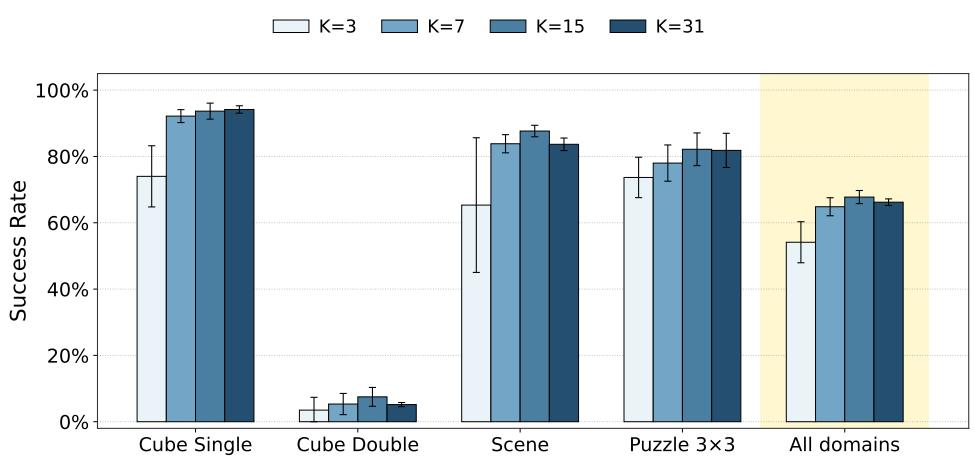  
Figure 9: Ablating the number of imagined actions, K, used for training the conditional policy in Advantage Guidance. A small K underperforms larger values, but performance quickly plateaus. Averaged over 5 tasks per domain and 4 seeds.

3. Dataset-level norm: we calculate the mean and variance across the entire dataset:

$$
\mu _ { \mathcal { D } } = \frac { 1 } { N } \sum _ { i = 1 } ^ { N } A ( s _ { i } , a _ { i } ) , \qquad \sigma _ { \mathcal { D } } ^ { 2 } = \frac { 1 } { N } \sum _ { i = 1 } ^ { N } \left( A ( s _ { i } , a _ { i } ) - \mu _ { \mathcal { D } } \right) ^ { 2 } .
$$

To only ablate the efect of normalization, the diferent normalization methods all train the conditional policy with action augmentation at $K = 3 1$ and only difer in how the advantages are normalized. Figure 10 shows that our per-state normalization scheme ofers a big advantage over other normalization schemes.

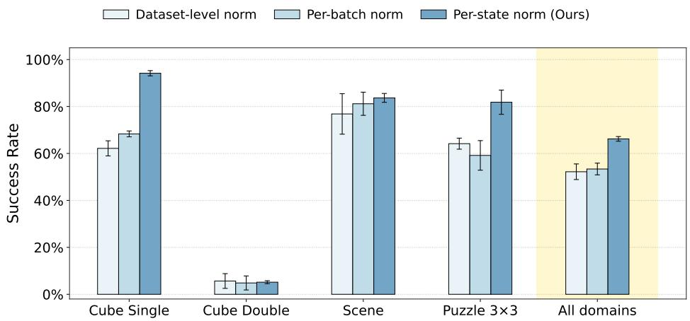  
Figure 10: Ablating diferent advantage normalization schemes: our per-state advantage normalization outperforms batch-level and dataset-level normalization. Averaged over 5 tasks per domain and 4 seeds.

Contrastive guidance conditions and guidance weight. Additionally, we measure how the contrastive conditions $( y _ { + } , y _ { - } )$ pair and the guidance weight w afect policy performance. Figure 11 shows the performance with 6 diferent contrastive pairs at each guidance weight and at the best guidance weight. With the best guidance weight $w ,$ , diferent contrastive conditions perform similarly. This aligns with our derivation in Section 6.1, which shows that the optimality of the sampled action is determined by the product $w ( y _ { + } - y _ { - } )$ , and so in practice it’s suficient to tune only one.

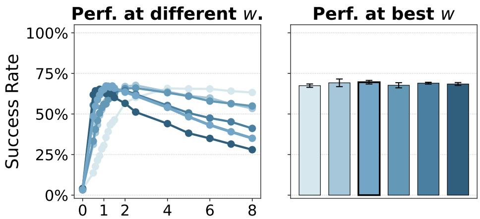  
Figure 11: Sensitivity to contrastive conditions and guidance weight: each contrastive condition performs similarly given the best guidance weight for that condition.

Advantage label standard deviation. Figure 12 ablates diferent values of standard deviation we use to sample the advantage label $Y \mid s , a \sim N ( A ( s , a ) , \sigma _ { y } ^ { 2 } )$ . To plot the performance, we use contrastive pair $( y _ { + } , y _ { - } ) = ( 2 , 0 )$ for all variations, and pick the best guidance weight for each variation on each domain according to our hyperparameter selection scheme in Section $_ { \mathrm { A . 8 } }$ . The results show that diferent values of $\sigma _ { y } ^ { 2 }$ result in roughly similar levels of performance. This is perhaps not so surprising given that we showed in Section 6.1 the label standard deviation, guidance weight, and contrastive pair together determine the advantage tilt: $\begin{array} { r } { \beta = \frac { \sigma _ { y } ^ { 2 } } { w ( y _ { + } - y _ { - } ) } } \end{array}$ . As a result, using diferent $\sigma _ { y }$ does not have a significant efect on performance as long as the guidance weight w is changed accordingly as well. This is similar to the finding in Figure 11. We also note that while our derivation in Section 6.1 require strictly $\sigma _ { y } > 0 , \sigma _ { y } = 0$ works well in practice.

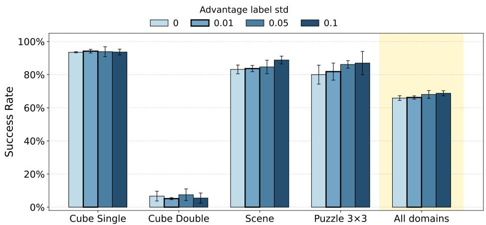  
Figure 12: Sensitivity to diferent advantage label standard deviation: performance is not sensitive to the label standard deviations as long as the best guidance weight is picked. Averaged over 5 tasks per domain and 4 seeds.

## A.3. Empirical Evaluation of Naïve Advantage Conditioned Policy RCP-A

Section 5 showed that a naïve advantage conditioned policy such as RCP-A sufers from the advantage alignment problem. We empirically evaluate that here, evaluating RCP-A on 20 OGBench tasks when queried with diferent advantage values. As described in Section ${ \mathrm { A . 6 } } ,$ , RCP-A models the distribution of advantage value over the dataset by modeling it as a Gaussian distribution and learning its mean $\mu$ and variance $\sigma ^ { 2 }$ . During inference, RCP-A queries with advantage $\mu + k \sigma$ , which is k standard deviations above the mean dataset advantage. While the original paper [28] always set $k = 1$ , we experiment with diferent k values during inference and plot the result in Figure 13. The results show that diferent query values has efectively no impact on performance, which corresponds with our empirical analysis in Section 5.

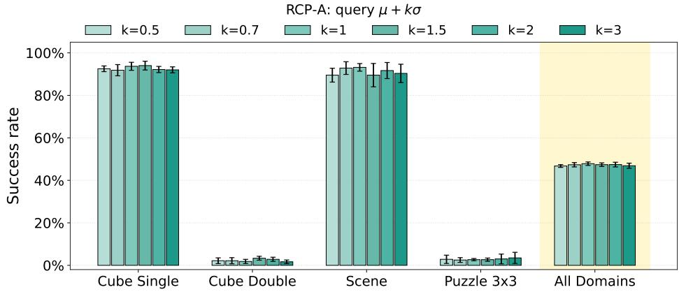  
Figure 13: Naïve advantage conditioned policy RCP-A has the same performance across 20 OGBench tasks (5 tasks per domain) when queried with diferent advantage values. Averaged over 4 seeds.

## A.4. Does A More Expressive Architecture Help with Advantage Alignment?

In this section, we investigate whether we can improve advantage alignment, and in turn policy performance, of naïve advantage conditioning by using a more expressive conditional policy architecture. Specifically, we experiment with using a transformer architecture to ingest the conditional advantage. We compare RCP-A, which uses a FiLM-like architecture that uses the advantage input to modulate the hidden states at every layer of the policy network, to a variant that instead uses a transformer to handle conditional inputs. We represent each action position in the $H = 5$ action chunk with a separate token. These action tokens, together with an advantage token, an observation token, and a flow-time token, are processed jointly through self-attention. Each contextualized action token is then projected directly to the velocity vector for its corresponding action position. We use four transformer blocks with model width 256, eight attention heads (32 dimensions per head), and feed-forward width 1024. The FiLM RCP-A actor has approximately 1.39M parameters, while the transformer actor has approximately 3.23M parameters. We tune the learning rate smaller (1e  4) for the transformer version to prevent overfitting.

We plot the performance comparison between RCP-A and its transformer variant, as well as Advantage Guidance, in Figure 14. Figure 14 (left) shows that using a transformer is not significantly better in terms of advantage alignment: while the transformer policy output varies more when advantage input is changed, the policy gradient is still invariant to advantage inputs. In comparison, Advantage Guidance is much more responsive to diferent advantage inputs. Figure 14 (right) plots the policy performance on OGBench. Overall, using a transformer does not afect policy performance much, and even slightly underperforms the original RCP-A agent. This shows that there is no free lunch: we cannot expect to improve advantage alignment by simply swapping in a transformer policy backBFNe, and the residual parameterization and action imagination training schemes are critical.

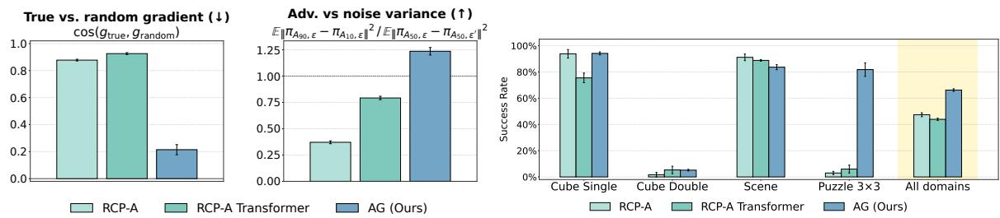  
Figure 14: Using a transformer for the policy architecture does not significantly improve advantage alignment (left), and does not improve policy performance overall on OGBench (right).

## A.5. Analysis of Pure Conditional Sampling with Advantage Guidance

In Section 7.3 we compared Advantage Guidance using diferent sampling schemes. In Figure 15, we plot the performance of Advantage Guidance with pure conditional sampling on diferent environments using diferent query advantages. On OGBench (top row), high query advantages leads to some performance decline, and experiences a sharp decline in puzzle-3x3, the longest horizon task. On OCBench, all tasks experience a sharp drop in performance at high advantage values. This shows that high advantage value is likely out of the training distribution on OCBench where the ofline dataset is demonstration-based and therefore more narrow. puzzle-3x3 could also sufer from the same issue because its state-action coverage is relatively smaller given its longer horizon for the same amount of ofline transitions as other OGBench tasks.

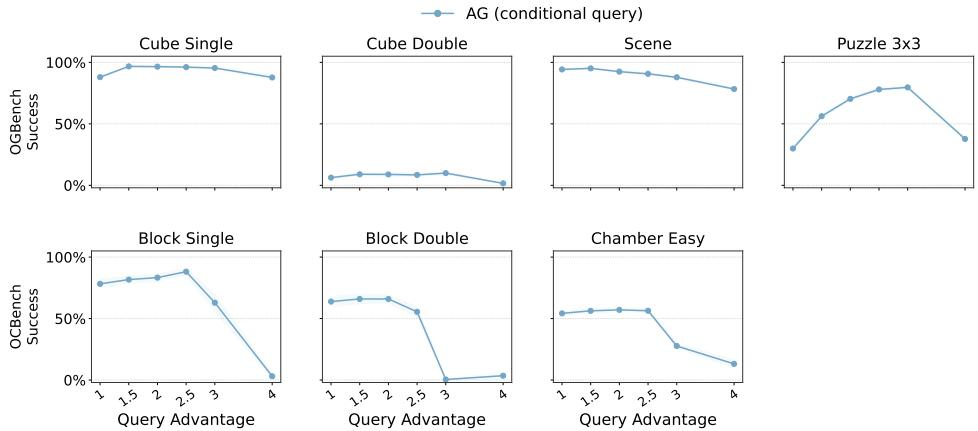  
Figure 15: Pure conditional sampling of Advantage Guidance: querying with large advantage values leads to a sharp performance drop on OCBench and hard long horizon task puzzle-3x3. Averaged over diferent tasks in the same domain with 10 seeds.

## A.6. Description of Baseline Methods

We describe in detail the diferent categories of baseline methods. While some methods are implemented as Gaussian policies or difusion policies in the original paper, we implement the flow-matching variant for all methods for fair comparison.

For all the agents below, we will assume that noise $\epsilon \sim \mathcal { N } ( 0 , I )$ , time $t \sim \mathcal { U } ( 0 , 1 )$ , and the expectations of training losses are taken over $( s , a ) \sim \mathcal { D }$ unless otherwise specified.

## (1) Actor-critic methods

FQL [38] learns a distilled one-step policy $\pi _ { \omega }$ to maximize the critic, avoiding the need to take action gradient through the multi-step denoising process with backpropagation through time. Specifically,

policy extraction with FQL requires learning two actors, a multi-step BC actor $\pi _ { \theta } ,$ and a one-step policy $\pi _ { \omega }$ . The BC actor is trained to minimize the standard flow matching loss E $\left[ | | v _ { \theta } ( x _ { t } , s , t ) - ( a - \epsilon ) | | ^ { 2 } \right]$ while the one-step actor is trained to minimize:

$$
\begin{array} { r } { \mathbb { E } \left[ - Q _ { \phi } ( s , a ^ { \pi } ) + \alpha \left. a ^ { \pi } - \mathrm { O D E } ( v _ { \theta } ( s , \epsilon ) ) \right. _ { 2 } ^ { 2 } \right] \quad \mathrm { w h e r e ~ } a ^ { \pi } = v _ { \omega } ( s , \epsilon ) . } \end{array}\tag{17}
$$

$\mathrm { O D E } ( \cdot )$ is the Euler integration process, and α is a coeficient that controls the behavior regularization strength.

EDP [24] optimizes a multi-step flow policy $\pi _ { \theta }$ to maximize the critic using a one-Euler-step approximation of the full denoising process, avoiding the full backpropagation through time. Specifically, given $x _ { t } = ( 1 - t ) \epsilon + t a . $ , we approximate the full denoising process with the one-Euler step integration $\hat { a } _ { 1 } ( x _ { t } ) = x _ { t } + ( 1 - t ) v _ { \theta } ( x _ { t } , s , t )$ , and train the policy to maximize Q-values subject to a behavior constraint:

$$
\mathcal { L } _ { \mathrm { E D P } } ( \theta ) = \mathbb { E } \left[ - Q _ { \phi } ( s , \hat { a } _ { 1 } ( x _ { t } ) ) + \alpha \left. v _ { \theta } ( x _ { t } , s , t ) - ( a - \epsilon ) \right. _ { 2 } ^ { 2 } \right] .\tag{18}
$$

The coeficient α controls the behavior regularization strength. During training, the action gradient passes through the one-step action approximation and is taken with respect to $x _ { t }$

## (2) Supervised-learning-based methods

CRR [52] uses the advantage estimates to filter the actions used for policy training. We adopt its binary-weight variant, training the flow policy only on dataset actions with positive estimated advantages:

$$
\mathcal { L } _ { \mathrm { C R R } } ( \theta ) = \mathbb { E } \left[ \mathbf { 1 } \{ A ( s , a ) > 0 \} \| v _ { \theta } ( x _ { t } , s , t ) - ( a - \epsilon ) \| _ { 2 } ^ { 2 } \right] .\tag{19}
$$

This corresponds to behavior cloning on the positive-advantage subset.

FAWR is a baseline we construct by extending advantage weighted regression (AWR) [39] to flowmatching policies. AWR is introduced for Gaussian policies, where the log likelihood of each action is weighted by its exponentiated advantage. Unfortunately, this is not readily extendable to flow policies because the likelihood of difusion and flow policies cannot be evaluated exactly. However, since difusion (and under some constraints flow matching) optimize a lower bound on the log-likelihood [25], we can optimize the lower bound of an AWR objective by directly using the flow matching loss to substitute the action log likelihood. Specifically, we weight each dataset action’s flow-matching loss by its exponentiated advantage:

$$
\mathcal { L } _ { \mathrm { F A W R } } ( \theta ) = \mathbb { E } \left[ \exp \left( \frac { A ( s , a ) } { \beta } \right) \| v _ { \theta } ( x _ { t } , s , t ) - ( a - \epsilon ) \| _ { 2 } ^ { 2 } \right] .\tag{20}
$$

The temperature $\beta > 0$ controls how strongly training favors high-advantage actions. In practice, we clip $\exp \bigl ( \frac { A ( s , a ) } { \beta } \bigr )$ to have max value 100.

RCP-R and RCP-A [28] train policies conditioned on an estimated return-to-go (RCP-R) and advantage (RCP-A). While the original implementation of both RCP-A and RCP-R use Gaussian policies, we instantiate both with flow policies. Specifically, for a conditional signal y (advantage or return-to-go), we optimize policy $\pi _ { \theta } ( a \mid s , y )$ with:

$$
\mathcal { L } _ { \mathrm { R C P } } ( \theta ) = \mathbb { E } \left[ \| v _ { \theta } ( x _ { t } , s , t , y ) - ( a - \epsilon ) \| _ { 2 } ^ { 2 } \right] .\tag{21}
$$

While the original RCP-R implementation estimates the return-to-go from $( s , a )$ using Monte Carlo estimation, we directly use the lower variance estimate $Q ( s , a )$ to maintain comparability with other methods. For RCP-A, we estimate the advantage as $A ( s , a ) = Q ( s , a ) - V ( s )$ . For both methods, the conditioning variable modulates the policy network’s hidden features through FiLM [40], which applies multiplicative interactions of the hidden features and the conditional variable at every layer. Following Kumar et al. [28], we estimate the mean $\mu _ { y }$ and variance $\sigma _ { y } ^ { 2 }$ of the conditioning variable using a running average, and, at inference time, query the policy with $y _ { \mathrm { q u e r y } } = \mu _ { y } + k \sigma _ { y }$ . The original paper always use $k = 1$ , whereas we sweep over diferent k values.

## (3) Difusion guidance methods

QGF [58] is a test-time RL method that trains a critic and a BC flow policy with standard flow matching loss and optimizes actions solely at test time with critic gradients guidance during sampling. The main idea is to guide the action towards high-value directions at each denoising step using the critic’s action gradient. To estimate the critic gradient at partially noised action $x _ { t } ,$ QGF uses a single large Euler integration step to approximate the clean action and evaluate the critic gradient at this approximation ${ \hat { a } } .$ Specifically, QGF uses the following velocity:

$$
\begin{array} { c } { \hat { a } = x _ { t } + ( 1 - t ) v _ { \hat { \pi } } ( x _ { t } , s , t ) , } \\ { v _ { \mathrm { Q G F } } ( x _ { t } , s , t ) = v _ { \hat { \pi } } ( x _ { t } , s , t ) + w ~ \nabla _ { a } Q ( s , a ) | _ { a = \hat { a } } . } \end{array}\tag{22}
$$

Here w controls the guidance strength. QGF omits the Jacobian of the one-step approximation, using the critic gradient directly at aˆ. This is akin to classifier guidance of the policy using the Q-function as a classifier.

CFGRL [15] applies classifier-free guidance between an unconditional policy trained on the full dataset and a policy conditioned on positive advantage. CFGRL trains two policies: a conditional policy $\pi ( \boldsymbol { a } \mid s , o )$ , where $o \in \{ 0 , 1 \}$ is a binary random variable that indicates optimality $( i . e . , o = 1$ corresponds to optimal), and an unconditional policy $\pi ( a \mid s )$ . Both policies are trained with flow matching. Following the original implementation, we equate the unconditional policy $\pi ( a \mid s )$ with the conditional $\pi ( a \mid s , o = 0 )$ ; optimality is defined as $A ( s , a ) = Q ( s , a ) - V ( s ) > 0$ and $\pi ( a \mid s , o = 1 )$ is trained only on data with positive advantage estimates. Conceptually, this is the same as training one unconditional policy on the whole dataset and another “filtered” policy on the positive-advantage subset. During inference, CFGRL integrates:

$$
v _ { \mathrm { C F G R L } } ( x _ { t } , s , t ) = v _ { \hat { \pi } } ( x _ { t } , s , t ) + w \left[ v _ { + } ( x _ { t } , s , t ) - v _ { \hat { \pi } } ( x _ { t } , s , t ) \right] .\tag{23}
$$

The CFG weight w controls the contribution of the positive-advantage policy.

## With additional test-time compute:

Best-of-N (BFN) performs best-of-N sampling of a base behavior cloning policy $\hat { \pi }$ trained with the flow matching objective. Specifically, given a critic $Q ( s , a )$ , BFN selects action

$$
a = \underset { a _ { 1 } , \cdots , a _ { N } \sim \hat { \pi } } { \arg \operatorname* { m a x } } Q ( s , a _ { i } ) .\tag{24}
$$

## A.7. Critic Training Details

As described in Section 7, we follow the action chunking setting and learn both actors that produce action chunks and critics that are conditioned on action chunks.

Our method is agnostic to how the advantage estimate is derived. For simplicity, in this paper we train value functions with IQL [27] and derive the advantage function $A ( s , a ) = Q ( s , a ) - V ( s )$ . The IQL objective is as follows:

$$
\mathcal { L } _ { Q } ( \theta ) = \mathbb { E } _ { ( s _ { t } , a _ { t : t + h } , r _ { t : t + h } , s _ { t + h } ) \sim \mathcal { D } } \Big [ \big ( Q _ { \theta } ( s _ { t } , a _ { t : t + h } ) - ( \sum _ { t ^ { \prime } = t } ^ { t + h - 1 } [ \gamma ^ { t ^ { \prime } - t } r _ { t } ^ { \prime } ] + \gamma ^ { h } V _ { \hat { \psi } } ( s _ { t + h } ) \big ) ^ { 2 } \Big ] ,\tag{25}
$$

$$
\mathcal { L } _ { V } ( \psi ) = \mathbb { E } _ { ( s _ { t } , a _ { t : t + h } ) \sim \mathcal { D } } \Big [ L _ { 2 } ^ { \tau } \big ( Q _ { \bar { \theta } } ( s _ { t } , a _ { t : t + h } ) - V _ { \psi } ( s _ { t } ) \big ) \Big ] ,\tag{26}
$$

where $L _ { 2 } ^ { \tau } ( u ) = | \tau - { \bf 1 } ( u < 0 ) | u ^ { 2 }$ is the expectile loss with expectile τ , and $\bar { \theta } , \bar { \psi }$ are the target networks computed with EMA. We train all IQL state-action value functions with an ensemble of $2 Q ( s , a )$ and aggregate them by taking the minimum.

## A.8. Hyperparameter and Tuning Details

The main results in Figure 4 were run with 10 random seeds, and all ablation studies were run with 4 random seeds unless otherwise specified. All error bars report the 95% confidence interval.

Hyperparameter tunning. For each method, including Advantage Guidance and all baseline methods, we tune the task-specific hyperparameter per domain in the ranges specified in Table 4. We tune hyperparameters with 4 seeds, and re-run the experiments with 10 new seeds using the chosen hyperparameter to report performance. Specifically, on OGBench, each domain contains 5 similar tasks of increasing hardness. We therefore tune hyperparameters per domain on tasks 2 and 4 only, and use the picked hyperparameter for all 5 tasks on that domain. Tunning on task 2 and 4 represents an average performance on that domain since task 1 to 5 gradually increases in dificulty. On OCBench, there are diferent numbers of tasks available per domain, and diferent tasks in the domain can be very diferent. Therefore, we tune the hyperparameter per-task per domain in OCBench. The resulting hyperparameters we use are documented in Table 3.

Common hyperparameters. For all methods, we use shared hyperparemters in Table 1. We use a small critic network size for all OGBench tasks because we find it uniformly improves performance for our and baseline methods (see Figure 16). We did not tune the critic size on OCBench.

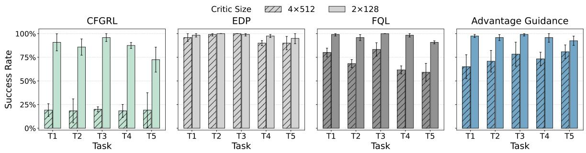  
Figure 16: Comparison of two critic sizes on cube-single in OGBench on four diferent methods. $2 \times 1 2 8$ significantly outperforms $4 \times 5 1 2$ nearly for all methods, suggesting that the commonly used $4 \times 5 1 2$ architecture sufers from critic overfitting.

AG hyperparameters. For Advantage Guidance, we use the same value per benchmark for $\sigma _ { y } ,$ and the same $y _ { + } , y _ { - } , K$ universally (see Table 2). This is because solely tunning the guidance weight is suficient: we can observe this from the theoretical derivation in Section 6.1, and we also empirically observe this in our ablation studies in Figure 12 and Figure 11. We use these hyperprameters for Advantage Guidance in all experiments unless otherwise specified. We use $\sigma _ { y } = 0 . 1$ on OGBench instead of 0.01 because Figure 12 shows it to be slightly more performant, though the advantage is tiny. We did not tune $\sigma _ { y }$ on OCBench.

## A.9. Tasks and Environment Details

We use all the available task for each domain in two of the benchmarks. OCBench ofers diferent numbers of tasks per domain, ranging from 1 to 3. OGBench tasks all have ofline datasets with 1M transitions. OCBench block single and chamber easy has 10k ofline transitions, while block double has 30k transitions.

<table><tr><td>Hyperparameter</td><td>OGBench</td><td>OCBench</td></tr><tr><td>Batch size</td><td>256</td><td>1024</td></tr><tr><td>Discount factor γ</td><td>0.99</td><td>0.999</td></tr><tr><td>IQL expectile τ</td><td>0.9</td><td>0.5</td></tr><tr><td>Critic ensemble size</td><td>2</td><td>2</td></tr><tr><td>Critic aggregation method</td><td>min</td><td>min</td></tr><tr><td>Target-network update rate</td><td>0.005</td><td>0.005</td></tr><tr><td>Action chunk horizon H</td><td>5</td><td>3</td></tr><tr><td>Flow integration / denoising steps</td><td>10</td><td>10</td></tr><tr><td>Actor hidden dimensions</td><td>[512, 512, 512, 512]</td><td>[1024, 1024, 1024, 1024]</td></tr><tr><td>Critic/value hidden dimensions</td><td>[128, 128]</td><td>[1024, 1024, 1024, 1024]</td></tr><tr><td>Actor / Critic Learning rate</td><td> $3 \times 1 0 ^ { - 4 }$ </td><td> $1 \times 1 0 ^ { - 4 }$ </td></tr><tr><td>Optimizer</td><td>Adam</td><td>Adam</td></tr><tr><td>Offline training steps</td><td> $5 \times 1 0 ^ { 5 }$ </td><td> $1 \times 1 0 ^ { 6 } ( 1 \times 1 0 ^ { 5 }$  for AG on Block Single)</td></tr><tr><td>Evaluation episodes</td><td>30</td><td>500</td></tr></table>

Table 1: Common hyperparameters used for the OGBench and OCBench experiments in Figure 4.

<table><tr><td>Hyperparameter</td><td>OGBench</td><td>OCBench</td></tr><tr><td>Positive condition  $y _ { + }$ </td><td>1</td><td>1</td></tr><tr><td>Negative condition  $y _ { - }$ </td><td>-1</td><td>-1</td></tr><tr><td>Advantage label standard deviation  $\sigma _ { y }$ </td><td>0.1</td><td>0.01</td></tr><tr><td>Number of Imagined Actions K</td><td>7</td><td>7</td></tr></table>

Table 2: Common hyperparameters for Advantage Guidance. As shown in Figure 12 and Figure 11, diferent values of $y _ { + } , y _ { - } , \sigma _ { y }$ hyperparameters lead to very similar results. We therefore fix these parameters across tasks on the same benchmark and only tune the guidance weight for Advantage Guidance.

<table><tr><td>Suite</td><td>Domain</td><td> $\mathbf { E D P } \left( \alpha _ { \mathrm { E D P } } \right)$ </td><td> $\mathbf { F Q L } \left( \alpha _ { \mathrm { F Q L } } \right)$ </td><td> $\mathbf { Q G F } \left( w _ { \mathrm { Q G F } } \right)$ </td><td> $\mathbf { C F G R L } \left( w _ { \mathrm { C F G R L } } \right)$ </td><td>FAWR (β)</td><td>RCP-A (k)</td><td>RCP-R (k)</td><td>CRR AG (w)</td></tr><tr><td>OGBench</td><td>Cube Single</td><td>100</td><td>1000</td><td>0.08</td><td>2</td><td>0.3</td><td>1</td><td>1 一</td><td>1</td></tr><tr><td>OGBench</td><td>Cube Double</td><td>10</td><td>100</td><td>0.16</td><td>2</td><td>0.3</td><td>1</td><td>1</td><td>1.5</td></tr><tr><td>OGBench</td><td>Scene</td><td>30</td><td>300</td><td>0.16</td><td>2</td><td>10</td><td>1</td><td>1 一</td><td>1</td></tr><tr><td>OGBench</td><td>Puzzle 3×3</td><td>30</td><td>300</td><td>0.16</td><td>3</td><td>0.3</td><td>1</td><td>1 一</td><td>2.5</td></tr><tr><td>OCBench</td><td>Block Single</td><td>1</td><td>300</td><td>0.02</td><td>10</td><td>3</td><td>1</td><td>1 一</td><td>1.5</td></tr><tr><td>OCBench</td><td>Block Double</td><td>(1,1)</td><td>(100,100)</td><td>(0.32,0.32)</td><td>(15,15)</td><td>(3,0.3)</td><td>1</td><td>1 一</td><td>(3, 4)</td></tr><tr><td>OCBench</td><td>Chamber Easy</td><td>(1,1,10)</td><td>(100, 100, 100)</td><td>(0.32, 0.32,0.32)</td><td>(5, 15, 10)</td><td>(1,1,1)</td><td>1</td><td>1 一</td><td>(4, 3, 2)</td></tr></table>

Table 3: Domain-specific hyperparameters used for OGBench and OCBench results in Figure 4. For OCBench, parenthesized values are ordered by task number. For example, (3, 4) denotes the values used for Tasks 1 and 2 of Block Double. A dash indicates that the method has no tuned domain-specific hyperparameter.

<table><tr><td>Method</td><td>Hyperparameter</td><td>Tunning Range</td></tr><tr><td>EDP</td><td>BC coefficient αEDP</td><td>OGBench: {10, 30, 100, 300}; OCBench: {1, 10}</td></tr><tr><td>FQL</td><td>BC coefficient αFQL</td><td>{100, 300, 1000}</td></tr><tr><td>QGF</td><td>Guidance weight w</td><td>{0, 0.002, 0.004, 0.01, 0.02, 0.04, 0.08, 0.16, 0.32}</td></tr><tr><td>CFGRL</td><td>Guidance weight w</td><td>OGBench: {0, 0.5, 1, 2, 3, 5, 10, 15}; OCBench: {0, 0.5, 1, 1.5, 2, 3, 5, 10, 15}</td></tr><tr><td>FAWR</td><td>Inverse temperature β</td><td>OGBench: {0.3, 1, 3, 10}; OCBench: {0.3, 1, 3}</td></tr><tr><td>RCP-A</td><td>inference std multiplier k</td><td>OGBench: {0.5, 0.7, 1, 1.5, 2, 3}; OCBench: {1}</td></tr><tr><td>AG (Ours)</td><td>Guidance weight w</td><td>OGBench: {0, 0.75, 1, 1.25, 1.5, 2, 2.5, 4}; OCBench: {0, 0.5, 1, 1.5, 2, 3, 4}</td></tr></table>

Table 4: Hyperparameter ranges for OGBench and OCBench experiments.

## A.10. Detailed Results

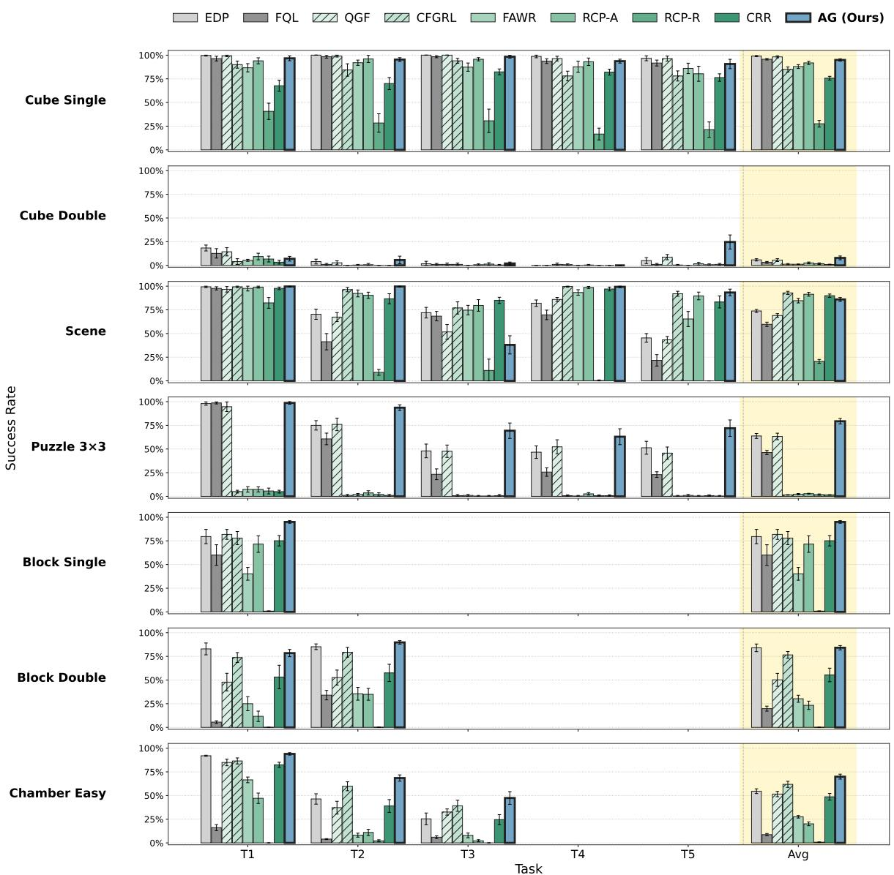  
Figure 17: Task breakdown of Figure 4: Comparing Advantage Guidance against prior methods in ofline RL setting on 20 OGBench tasks and 6 OCBench tasks. Averaged over 10 random seeds. See exact plotted numbers in Table 5.

<table><tr><td>Environment</td><td>Task</td><td>EDP</td><td>FQL</td><td>QGF</td><td>CFGRL</td><td>FAWR</td><td>RCP-A</td><td>RCP-R</td><td>CRR</td><td>AG</td></tr><tr><td rowspan="6">Cube Single</td><td>T1</td><td>99.7 ± 0.7</td><td>96.3 ± 2.5</td><td>99.3 ± 0.9</td><td> $9 0 . 0 \pm 3 . 8$ </td><td>86.7 ± 4.4</td><td>94.0 ± 3.2</td><td>40.7 ± 8.6</td><td>67.7 ±5.8</td><td>96.7±2.6</td></tr><tr><td>T2</td><td>100.0 ± 0.0</td><td> ${ \bf 9 8 . 3 \pm 1 . 5 }$ </td><td> ${ \bf 9 9 . 0 \pm 1 . 0 }$ </td><td> $8 4 . 3 \pm 6 . 5$ </td><td> $9 2 . 0 \pm 2 . 8 \ 9 6 . 0 \pm 3 . 7$ </td><td></td><td> $2 8 . 3 \pm 9 . 8$ </td><td>70.0 ± 6.4</td><td>95.3 ± 2.0</td></tr><tr><td>T3</td><td>100.0 ± 0.0</td><td>98.3 ± 1.1</td><td> ${ \bf 1 0 0 . 0 \pm 0 . 0 }$ </td><td> $9 4 . 0 \pm 2 . 5$ </td><td></td><td></td><td>87.3 ± 4.3 95.7 ± 1.7 30.7 ± 12.4</td><td>82.3 ± 3.1</td><td>98.3±1.5</td></tr><tr><td>T4</td><td> ${ \bf 9 8 . 7 \pm 1 . 4 }$ </td><td>93.7 ± 2.5</td><td> ${ \bf 9 6 . 3 \pm 2 . 5 }$ </td><td> $7 8 . 0 \pm 5 . 1$ </td><td>87.7± 5.8</td><td>93.0 ± 4.0</td><td>16.7 ± 6.2</td><td>82.0 ± 3.1</td><td>93.7±2.1</td></tr><tr><td>T5</td><td>96.7 ± 2.6</td><td>91.7 ± 3.1</td><td> ${ \bf 9 6 . 3 \pm 2 . 7 }$ </td><td> $7 8 . 0 \pm 5 . 4$ </td><td>86.0 ± 5.5</td><td>80.3 ± 7.9</td><td>21.3 ± 8.1</td><td>76.3 ± 4.0</td><td>90.7±4.9</td></tr><tr><td>Avg</td><td>99.0 ± 0.6</td><td>95.7 ± 0.8</td><td>98.2 ± 1.0</td><td>84.9 ± 2.7</td><td>87.9 ± 2.0</td><td>91.8 ± 1.7</td><td>27.5 ± 3.5</td><td>75.7 ± 2.0</td><td>94.9 ± 1.2</td></tr><tr><td rowspan="6">Cube Double</td><td>T1</td><td>18.3 ± 3.1</td><td>12.7 ± 4.9</td><td> $1 4 . 3 \pm 4 . 4$ </td><td> $4 . 0 \pm 3 . 0$ </td><td> $5 . 3 \pm 1 . 1$ </td><td>9.3 ± 3.5</td><td>6.7 ± 3.1</td><td>3.3 ± 1.9</td><td>7.0±2.5</td></tr><tr><td>T2</td><td>4.0 ± 2.5</td><td>1.0 ± 1.0</td><td> $2 . 7 \pm 2 . 1$ </td><td> $0 . 0 \pm 0 . 0$ </td><td>0.3 ± 0.7</td><td>0.7 ± 1.3</td><td>0.0 ± 0.0</td><td>0.0 ± 0.0</td><td>5.7±4.0</td></tr><tr><td>T3</td><td>1.7 ± 2.6</td><td>1.0 ± 1.0</td><td> $1 . 0 \pm 1 . 4$ </td><td>1.0 ± 1.4</td><td>0.0 ± 0.0</td><td>0.7 ± 0.9</td><td>1.3 ± 1.4</td><td>0.3 ± 0.7</td><td>2.0 ± 1.4</td></tr><tr><td>T4</td><td>0.0 ± 0.0</td><td>0.0 ± 0.0</td><td> ${ \bf 1 . 0 \pm 1 . 4 }$ </td><td>0.7 ± 0.9</td><td>0.0 ± 0.0</td><td>0.3 ± 0.7</td><td>0.0 ± 0.0</td><td>0.0 ± 0.0</td><td>0.0 ± 0.0</td></tr><tr><td>T5</td><td>5.0 ± 3.1</td><td>1.0 ± 1.0</td><td> $8 . 7 \pm 2 . 8$ </td><td>0.3 ± 0.7</td><td>0.0 ± 0.0</td><td>1.7 ± 1.5</td><td>0.7 ± 0.9</td><td>1.0 ± 1.0</td><td>24.7±7.4</td></tr><tr><td>Avg</td><td>5.8 ± 1.2</td><td>3.1 ± 1.0</td><td>5.5 ± 1.5</td><td>1.2 ± 0.7</td><td>1.1 ± 0.3</td><td>2.5 ± 1.0</td><td>1.7 ± 0.9</td><td>0.9 ± 0.3</td><td>7.9 ± 2.0</td></tr><tr><td rowspan="6">Scene</td><td>T1</td><td>99.3 ± 0.9</td><td>97.7 ± 1.7</td><td>96.7 ± 2.9</td><td>99.3 ± 0.9</td><td></td><td>97.7±2.8 99.0±1.0</td><td>82.3 ± 5.7</td><td>97.7±1.4</td><td>99.7 ± 0.7</td></tr><tr><td>T2</td><td>70.3 ± 5.4</td><td>41.3 ± 8.6</td><td>67.3 ± 4.8</td><td>96.3 ± 2.3</td><td>92.3 ± 3.7</td><td>90.3 ± 3.3</td><td>9.0 ± 3.1</td><td>86.7 ± 5.3</td><td>99.7 ± 0.7</td></tr><tr><td>T3</td><td>72.0 ± 5.6</td><td>68.3 ± 5.0</td><td>51.7 ± 7.8</td><td>77.0 ± 6.4</td><td>74.7 ± 5.1</td><td></td><td>79.7 ± 6.1 11.0 ± 12.0</td><td>85.0 ± 3.3</td><td>38.0 ±9.6</td></tr><tr><td>T4</td><td>82.0 ± 3.4</td><td>69.7 ± 5.0</td><td>86.0 ± 2.1</td><td>99.7 ± 0.7</td><td>93.3 ± 2.9</td><td>98.7 ± 1.1</td><td>0.3 ± 0.7</td><td>97.0 ± 2.1</td><td>99.3 ± 0.9</td></tr><tr><td>T5</td><td>45.3 ± 4.6</td><td>21.7 ± 6.0</td><td>43.3 ± 3.5 92.0 ± 2.6</td><td></td><td>65.3 ± 8.0 89.7 ± 4.1</td><td></td><td>0.0 ± 0.0</td><td>83.3 ± 6.3</td><td>93.3 ± 3.5</td></tr><tr><td>Avg</td><td>73.8 ± 1.5</td><td>59.7 ± 2.3</td><td>69.0 ± 2.0 92.9 ± 1.7</td><td></td><td>84.7 ± 2.4 91.5 ± 2.0</td><td></td><td>20.5 ± 2.1</td><td>89.9 ± 1.7</td><td>86.0±2.0</td></tr><tr><td rowspan="6">Puzzle 3 × 3</td><td>T1</td><td>98.0 ± 1.7</td><td>98.7 ± 1.1</td><td> ${ \bf 9 4 . 7 \pm 5 . 1 }$ </td><td> $5 . 0 \pm 1 . 5$ </td><td>7.3 ± 2.9</td><td>7.3 ± 2.7</td><td>5.7 ± 3.1</td><td>5.0 ± 1.5</td><td>98.7±1.4</td></tr><tr><td>T2</td><td>75.0 ± 5.0</td><td>60.7 ± 6.1</td><td> $7 6 . 0 \pm 6 . 6$ </td><td> $1 . 0 \pm 1 . 0$ </td><td>2.0 ± 1.1</td><td>3.7 ± 2.3</td><td>2.0 ± 1.7</td><td>1.0 ± 1.0</td><td>93.7 ± 3.0</td></tr><tr><td>T3</td><td>48.0 ± 7.2</td><td>23.3 ± 5.7</td><td> $4 7 . 7 \pm 6 . 5$ </td><td> $0 . 7 \pm 1 . 3$ </td><td> $1 . 0 \pm 1 . 0$ </td><td>0.3 ± 0.7</td><td> $0 . 3 \pm 0 . 7$ </td><td>0.7 ± 1.3</td><td>69.3± 8.1</td></tr><tr><td>T4</td><td>46.7 ± 6.6</td><td>25.7 ± 4.5</td><td> $5 2 . 3 \pm 7 . 4$ </td><td> $0 . 7 \pm 0 . 9$ </td><td> $0 . 3 \pm 0 . 7$ </td><td>2.7 ± 1.3</td><td> $0 . 7 \pm 0 . 9$ </td><td>0.7 ± 0.9</td><td>63.0 ± 8.4</td></tr><tr><td>T5</td><td>51.3 ± 6.8</td><td> $2 3 . 0 \pm 3 . 0$ </td><td> $4 5 . 7 \pm 6 . 5$ </td><td> $0 . 3 \pm 0 . 7$ </td><td> $1 . 0 \pm 1 . 0$ </td><td> $0 . 3 \pm 0 . 7$ </td><td> $0 . 7 \pm 0 . 9$ </td><td>0.3 ± 0.7</td><td>72.0±8.7</td></tr><tr><td>Avg</td><td>63.8 ± 2.6</td><td> $4 6 . 3 \pm 2 . 2$ </td><td> $6 3 . 3 \pm 3 . 5$ </td><td> $1 . 5 \pm 0 . 3$ </td><td> $2 . 3 \pm 0 . 7$ </td><td> $2 . 9 \pm 0 . 4$ </td><td> $1 . 9 \pm 0 . 7$ </td><td>1.5 ± 0.3</td><td>79.3± 2.9</td></tr><tr><td rowspan="2">Block Single</td><td>T1</td><td>79.5 ± 7.6 60.0 ± 10.9</td><td></td><td> $8 1 . 8 \pm 5 . 2$ </td><td> $7 7 . 9 \pm 6 . 9$ </td><td> $4 0 . 2 \pm 6 . 7$ </td><td>71.6 ± 8.7</td><td> $0 . 8 \pm 0 . 3$ </td><td>75.1 ± 5.5</td><td>95.0 ± 1.4</td></tr><tr><td>Avg</td><td> $7 9 . 5 \pm 7 . 6 \ 6 0 . 0 \pm 1 0 . 9$ </td><td></td><td> $8 1 . 8 \pm 5 . 2$ </td><td> $7 7 . 9 \pm 6 . 9$ </td><td> $4 0 . 2 \pm 6 . 7$ </td><td>71.6 ± 8.7</td><td> $0 . 8 \pm 0 . 3$ </td><td>75.1 ± 5.5</td><td> ${ \bf 9 5 . 0 \pm 1 . 4 }$ </td></tr><tr><td rowspan="3">Block Double</td><td>T1</td><td> ${ \bf 8 2 . 9 \pm 6 . 3 }$ </td><td> $5 . 6 \pm 1 . 4$ </td><td> $4 7 . 8 \pm 9 . 3$ </td><td> $7 3 . 7 \pm 5 . 2$ </td><td> $2 5 . 0 \pm 7 . 4$ </td><td>11.7 ± 5.5</td><td> $0 . 0 \pm 0 . 1$ </td><td>53.2 ± 12.5</td><td> $7 8 . 5 \pm 3 . 8$ </td></tr><tr><td>T2</td><td> $8 5 . 2 \pm 3 . 0$ </td><td> $3 4 . 0 \pm 5 . 0$ </td><td> $5 2 . 6 \pm 7 . 9$ </td><td> $7 9 . 3 \pm 5 . 2$ </td><td> $3 5 . 5 \pm 6 . 8$ </td><td>34.9 ± 6.2</td><td> $0 . 1 \pm 0 . 2$ </td><td>57.5 ± 9.1</td><td>89.8±1.9</td></tr><tr><td>Avg</td><td> ${ \bf 8 4 . 0 \pm 4 . 0 }$ </td><td> $1 9 . 8 \pm 2 . 6$ </td><td> $5 0 . 2 \pm 6 . 8$ </td><td> $7 6 . 5 \pm 3 . 6$ </td><td> $3 0 . 3 \pm 3 . 7$ </td><td> $2 3 . 3 \pm 4 . 4$ </td><td> $0 . 1 \pm 0 . 1$ </td><td>55.4 ± 7.2</td><td>84.1 ± 2.3</td></tr><tr><td rowspan="4">Chamber Easy</td><td>T1</td><td> ${ \bf 9 2 . 0 \pm 0 . 6 }$ </td><td> $1 6 . 1 \pm 3 . 2$ </td><td> $8 4 . 9 \pm 3 . 5$ </td><td> $8 6 . 5 \pm 3 . 2$ </td><td> $6 6 . 5 \pm 3 . 0$ </td><td> $4 7 . 1 \pm 5 . 5$ </td><td> $0 . 0 \pm 0 . 0$ </td><td>82.4 ± 2.7</td><td>94.0 ± 1.3</td></tr><tr><td>T2</td><td> $4 6 . 4 \pm 5 . 5$ </td><td> $4 . 0 \pm 0 . 5$ </td><td> $3 7 . 2 \pm 6 . 8$ </td><td> $5 9 . 8 \pm 4 . 7$ </td><td> $8 . 2 \pm 2 . 1$ </td><td> $1 1 . 0 \pm 3 . 2$ </td><td> $2 . 2 \pm 1 . 1$ </td><td>39.0 ± 6.8</td><td>68  $, . 5 \pm 3 . 3$ </td></tr><tr><td>T3</td><td> $2 5 . 4 \pm 6 . 2$ </td><td> $6 . 0 \pm 1 . 5$ </td><td> $3 2 . 6 \pm 3 . 3$ </td><td> $3 9 . 2 \pm 5 . 9$ </td><td> $7 . 9 \pm 2 . 5$ </td><td> $2 . 2 \pm 1 . 1$ </td><td> $0 . 0 \pm 0 . 0$ </td><td> $2 4 . 6 \pm 5 . 3$ </td><td>47  $. 4 \pm 6 . 7$ </td></tr><tr><td> $\mathbf { A v } \mathbf { g }$ </td><td> $5 4 . 6 \pm 2 . 5$ </td><td>8.7 ± 1.2</td><td>51.6 ± 2.8</td><td>61.8 ± 3.2</td><td> $2 7 . 5 \pm 1 . 3$ </td><td>20.1 ± 2.0</td><td> $0 . 7 \pm 0 . 4$ </td><td> $4 8 . 7 \pm 3 . 5$ </td><td>70.0 ± 2.6</td></tr></table>

Table 5: Numeric details of Figure 17. Results report mean 95% confidence intervals across 10 random seeds. Bold entries indicate means at least 95% of the best mean in each comparison group.

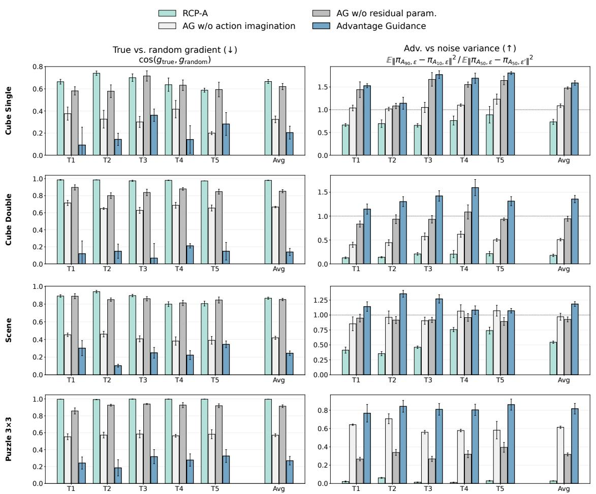  
Figure 18: Task breakdown of Figure 6: Comparing (1) gradient similarity between gradient of policy loss conditioned on true and random advantage values and (2) the variance of policy output conditioned on diferent advantage values or initial noise.

AG BFN N=2 BFN N=4 BFN N=8 BFN N=16 BFN N=32  
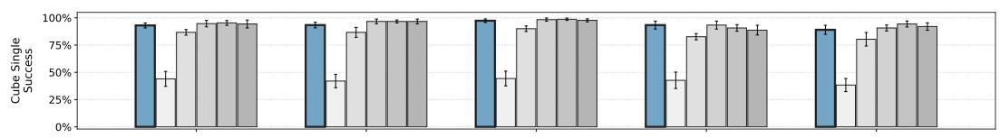

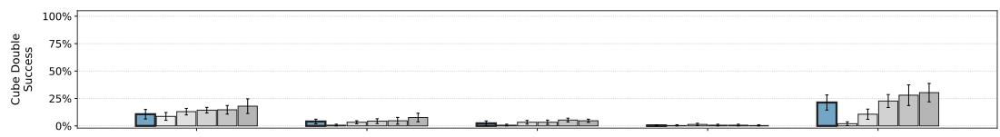

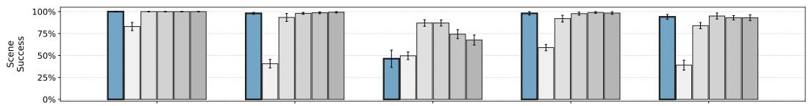

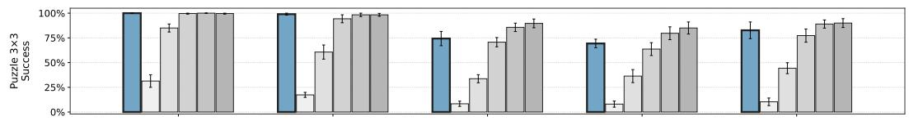

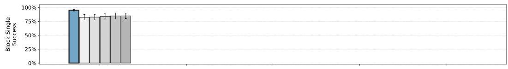

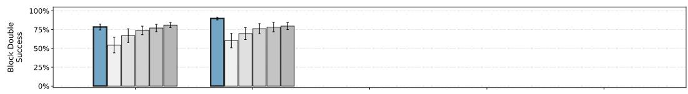

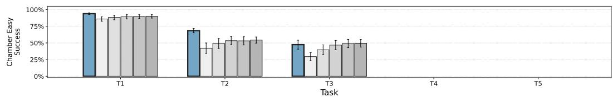  
Figure 19: Task breakdown of Figure 5, comparing Advantage Guidance with best-of-N (BFN) sampling at diferent values of N on OGBench and OCBench. Averaged over 10 random seeds.

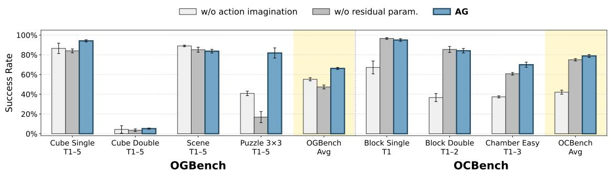  
Figure 20: Domain breakdown of Figure 7: ablation of residual parameterization and action imagination.

(y+, y-) (0.5, 0) (1, 0) (2, 0) (0.5, −0.5) (1, −1) (2, −2)  
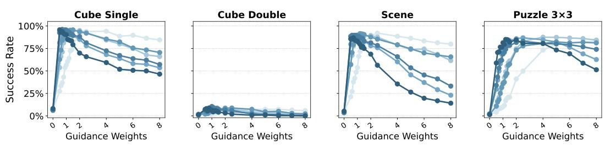  
(y+, y-) (0.5, 0) (1, 0) (2, 0) (0.5, −0.5) (1, −1) (2, −2)

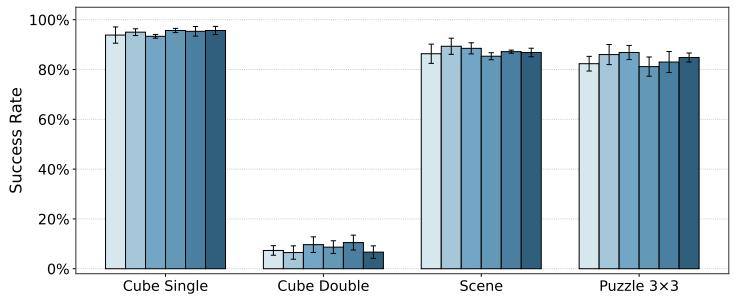  
Figure 21: Task breakdown of Figure 11: sensitivity to contrastive condition pair $( y _ { + } , y _ { - } )$ and guidance weight w. Top: Performance at diferent guidance weights. Bottom: Performance at best guidance weight.

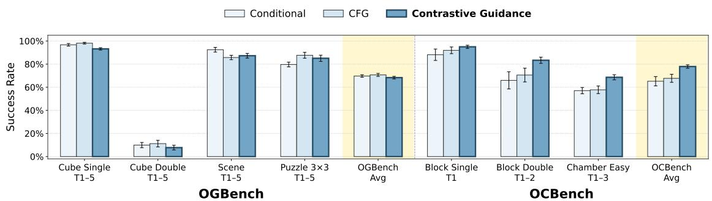  
Figure 22: Domain breakdown of Figure 8: Ablation of sampling method for Advantage Guidance. 10 random seeds.

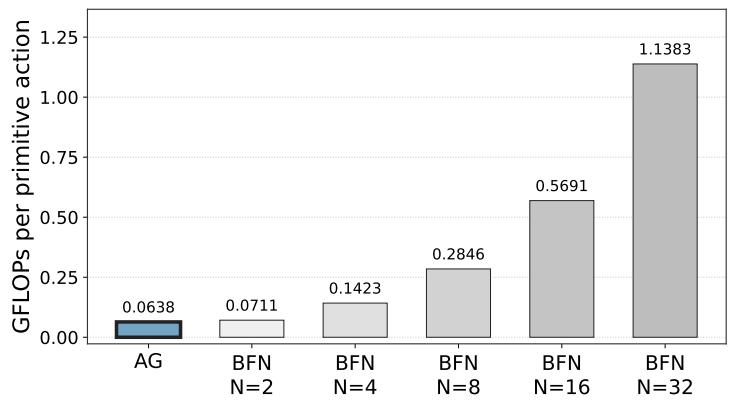  
Figure 23: Compute Cost of BFN agents. The result is measured in terms of FLOPs per primitive action in the action chunk, and is averaged over OGBench and OCBench environments.

## A.11. Additional Results

Higher discount. Figure 4 shows that all methods perform poorly in long-horizon sparse reward cube-double tasks from OGBench. Here, we experiment whether a higher discount factor can improve performance. In Figure 24, we use $\gamma = 0 . 9 9 9$ instead of 0.99, and find that all agents benefit from a larger discount. QGF and Advantage Guidance in particular benefit the most, and both significantly outperform the other baseline methods.

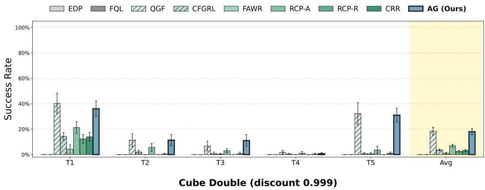  
Figure 24: Ofline RL performance on cube-double with discount factor 0.999.