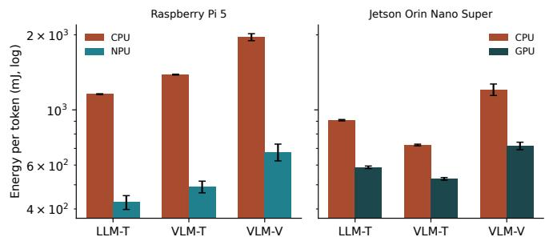
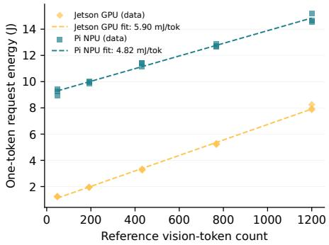
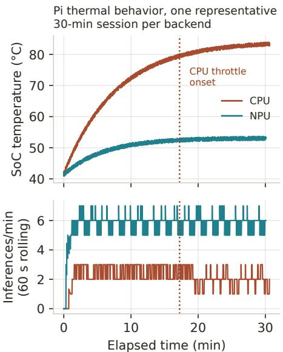
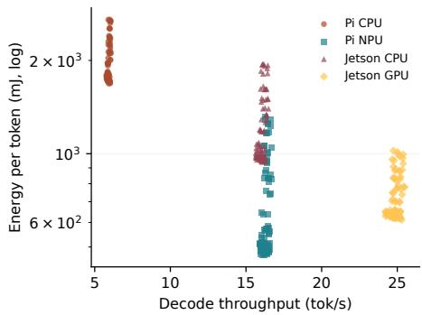
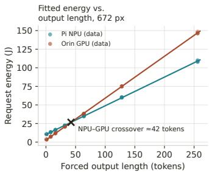
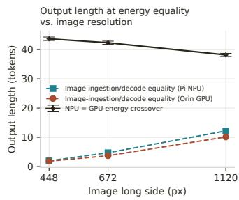
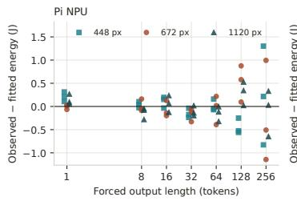
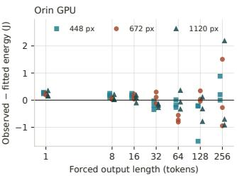
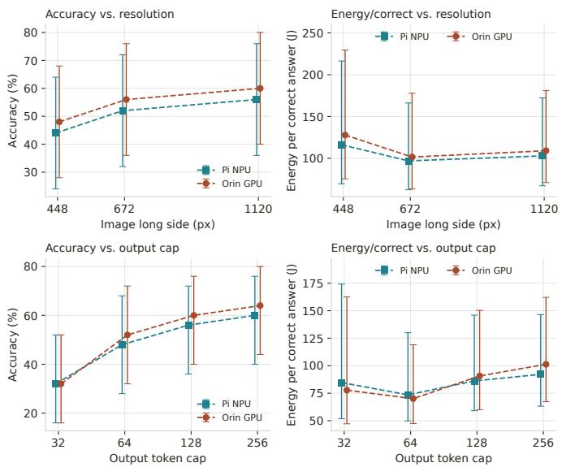

# Seeing at the Edge: Energy Characterization of Vision-Language Model Inference on Edge Platforms

Junlin Liao1,\*, Harshit Kondle2,\*, Di Liu3, and Zonghua Gu1

1Hofstra University, Hempstead, NY, USA

2Bridgewater-Raritan High School, Bridgewater, NJ, USA

3Norwegian University of Science and Technology, Trondheim, Norway

Abstract—Vision-language models (VLMs) are moving onto edge devices, but little is known about how much energy they draw on single-board computers with NPU or GPU accelerators, or where that energy goes. We measure total-system energy, latency, and thermal behavior of Qwen2-VL-2B-Instruct and its text-only sibling on a Raspberry Pi 5 with a Hailo-10H NPU and on a Jetson Orin Nano Super, on both CPU and accelerator, and separate the fixed energy of each request from the energy that grows with output length. Because the accelerators use different quantization and serving software, we compare deployment stacks rather than silicon. Three findings stand out. First, NPU offloading makes the Pi a much more efficient VLM platform: it cuts energy per generated token by about two-thirds, leaves the host CPU largely free, and avoids the thermal throttling that the CPU backend reaches in sustained use. Second, an image adds both fixed and per-token energy, but at typical response lengths generating the answer costs far more than processing the image. Third, the Jetson GPU favors short responses through its lower fixed cost per request, whereas the Pi NPU favors longer ones through its lower cost per output token; their energy curves cross near 40 output tokens.

Index Terms—edge AI, vision-language models, energy measurement, NPU, Raspberry Pi, Hailo-10H, embedded inference

## I. INTRODUCTION

Multimodal foundation models [1] are moving from the cloud to the edge [2]. Applications such as home monitoring, assistive robotics, retail analytics, and field inspection increasingly require a camera-equipped device to understand what it sees, not merely detect objects, under tight energy, thermal, and privacy budgets. A new generation of accelerator HATs brings generative-AI-capable NPUs to commodity single-board computers (SBCs): the Raspberry Pi AI HAT+ 2 pairs the Raspberry Pi 5 with the Hailo-10H, a 40-TOPS NPU with 8 GB of dedicated DRAM that can host LLMs and VLMs entirely on-accelerator [3].

Battery-powered and passively cooled devices may struggle to sustain multi-watt CPU inference, yet published energy data for multimodal inference on these platforms remain scarce. Edge-LLM-Bench [4] characterized text-only LLM inference on the Pi 5 + Hailo-10H and named VLM workloads as an open problem. Zhan et al. [5] profiled on-device VLM energy on GPU-class hardware and found decode-dominated energy (86–97%). We instead measure request-level energy at the input of complete SBC systems. We ask how energy and latency differ across Pi-CPU, Pi-NPU, Orin-CPU, and Orin-GPU, how much energy an image adds to a request, and how output length changes the NPU–GPU comparison. An INA228 power monitor [6], [7] in series with the Pi’s 5 V and the Jetson’s 19 V inputs measures a paired workload, Qwen2-VL-2B-Instruct and Qwen2-1.5B-Instruct [1], [8], on all four paths under a protocol that extends Edge-LLM-Bench to multimodal prompts.

Our decode-dominance result agrees with Zhan et al. [5], and the host-liberation benefit that Edge-LLM-Bench [4] reported for text carries over to multimodal workloads. The main new analysis separates fixed request energy from energy that grows with output length and uses the two terms to explain where the NPU and GPU stacks cross. The Hailo and llama.cpp paths differ in quantization, compiler, runtime, and serving software, so we compare deployed stacks (Section III-B). The CPU and GPU paths share byte-identical Q4 K M GGUF weights and llama-server, so their comparison is the closest this study comes to a hardware-only contrast.

We make three contributions:

• We quantify the fixed and output-dependent energy costs of image-conditioned inference with an image/no-image ablation, a one-token proxy, a vision-token sweep, and a fixedoutput-length experiment (Sections V-C–V-E and V-I).

• We compare four edge deployment paths under host contention and sustained operation, and estimate the NPU– GPU request-energy crossover in a controlled fixed-output probe (Sections V-A–V-I).

• We examine the quality–energy trade-off across image resolutions and output caps with deterministic grading (Section V-J).

## II. RELATED WORK

LLM benchmarking and energy on edge devices. MLPerf [9] standardized inference benchmarking before generative workloads; since then, MELTing point [10] ran quantized LLMs on smartphones and Jetson-class devices, MobileAIBench [11] and PalmBench [12] covered task quality, latency, and resource use on mobile platforms, Dhar et al. [13] and Lu et al. [14] profiled edge memory/compute limits, Samsi et al. [15] established datacenter-scale LLM energy methodology, and surveys [16] identify energy transparency as a persistent gap. MELODI [17] finds that response length and hardware strongly predict LLM inference energy, while prompt-complexity features have comparatively weak associations. We extend this output-length perspective to multimodal inference on NPU-equipped SBCs, separating imageattributable fixed energy from marginal decode energy.

Tummalapalli et al. [18] find that thermal and memorybandwidth constraints, rather than peak compute, dominate sustained 1.5B-model inference across mobile, NPU, and GPU platforms including the Pi 5 + Hailo-10H, and Edge-LLM-Bench [4] benchmarked text-only LLMs on the identical Pi platform; neither measures multimodal inference. Zhan et al. [5] gave the energy anatomy of VLM inference on GPU-class hardware (RTX 3070, Orin NX; rail-level, clocks pinned): power as a model fingerprint, decode dominance, output length as the controlling variable, and $a \leq 1 0 \%$ bound on visual-token-pruning savings. We instead measure totalsystem energy on IoT-class SBCs under DVFS defaults, add NPU and CPU cells, and decompose by modality condition rather than by phase, yielding the deployed marginal cost of image conditioning, which their visual-token bound does not address.

Dataflow NPUs. Generative performance on dataflow NPUs is strongly stack-dependent and not predicted by nominal TOPS: vendor figures favor the Hailo-10H over the Pi CPU for Qwen2-1.5B decode [19], whereas independent measurements and Edge-LLM-Bench report the opposite ordering [4], [20] (Section VI). These conflicts motivate measuring all paths under a common protocol with hardware-integrated measurement.

Efficient inference and edge VLMs. Systems such as T-MAC [21] optimize the text path, quality–energy studies focus on quantized LLMs [22], and edge-oriented VLMs reduce model size and visual-token budgets [23]; Qwen2-VL’s dynamic resolution makes image resolution an explicit deployment variable [1]. Existing mobile multimodal benchmarks do not report hardware-integrated total-system energy on NPUequipped SBCs. We measure it jointly with task quality and latency.

## III. BACKGROUND AND PLATFORM

## A. Raspberry Pi 5 and AI HAT+ 2

The Raspberry Pi 5 (BCM2712, 4×Cortex-A76 @ 2.4 GHz, 8 GB LPDDR4X) hosts the AI HAT+ 2, whose Hailo-10H delivers ≈40 TOPS (INT4) with 8 GB of dedicated LPDDR4X over PCIe Gen 3 [3]. Unlike the Hailo-8, it supports generative workloads through HailoRT and its GenAI serving interfaces (a REST-style text serving layer and a Python API for multimodal models) [24]. Our harness sends the NPU both text and image requests through an Ollama-style /api/chat client interface (Section IV).

## B. Workload pair

Qwen2-VL-2B-Instruct combines a 675M-parameter vision encoder with a 1.5B-parameter Qwen2 language model [1], and Qwen2-1.5B-Instruct shares its decoder design (GQA, SwiGLU, tokenizer family) [8], minimizing confounding from model family and scale while enabling comparison between image-conditioned inference, VLM inference without an image, and a closely matched text-only reference; instruction tuning, multimodal positional encoding, quantization, and compiled graphs still differ, so we read VLM–LLM differences as model-level comparisons. The vision encoder processes the image once during prefill, after which decoding proceeds autoregressively over the fused representation. Qwen2-VL uses dynamic resolution, so vision-token count grows with image pixel count [1]. On the NPU both models run as Hailo-compiled W4A8 HEF binaries through the Hailo GenAI serving path; on the CPU and GPU both run as Q4 K M GGUF served directly by llama.cpp llama-server [25]. This asymmetry follows from each platform’s toolchain. Throughout, “Pi-NPU” denotes the complete Hailo-10H + HailoRT 4.21 + W4A8 HEF stack and “Orin-GPU” the Orin Nano GPU + llama-server CUDA build + Q4 K M GGUF stack (analogously Pi-CPU and Orin-CPU). Energy and accuracy differences are properties of these stacks.

## C. Inference phases

Generative inference divides into prefill (ingestion of the full input context, including, for VLMs, the vision encoder pass and multimodal projection) and decode (sequential generation of output tokens). Prefill is compute-parallel and, for VLMs, vision-heavy; decode is memory-bandwidth-bound and dominates wall time for long outputs.

## IV. MEASUREMENT SETUP

## A. Instrumentation

An Adafruit INA228 breakout [7] in series with the Pi’s 5 V board input captures host, DRAM, accelerator, and peripheral energy jointly; on the Jetson the same INA228 moves to the 19 V barrel input and remains the source of every reported Joule. Its on-chip accumulator integrates power in hardware at the conversion cadence, immune to host sampling jitter, and a 50-Hz software sampler provides cross-validation traces. Each trial records accumulated energy, mean power, duration, mean bus voltage and current, I2C errors, and a validity flag (positive energy delta, no I2C errors, bus voltage within 4.7– 5.5 V on the Pi or 17.0–21.0 V on the Jetson, ≥2 accumulator samples, and hardware/software agreement within 10% at ≥80% sampling coverage). Idle-baseline power is recorded per resident-daemon state. Request energy is the difference of two accumulator reads bracketing request construction, submission, and the complete non-streaming response, so it includes client-side API handling and localhost transport. Client wall time, measured inside the request call, is 14–23 ms shorter than this hardware window (means 21 ms on the Pi and 16 ms on the Jetson GPU stack); idle subtraction (Eq. 3) uses the hardware window. The Jetson’s on-module INA3221 rails (tegrastats) are logged as telemetry only: they exclude carrier-board, fan, and regulator losses and under-report input power by up to ∼50% before calibration (±3% after [26]). In a side-by-side check (10 prompts/backend), VDD\_IN read 0.757× (GPU) and 0.754× (CPU) of INA228 input power (CV 1.2%/1.0%).

Measurement uncertainty. We did not calibrate against a traceable reference load. The 15 mΩ shunt has 0.1% tolerance [7], and the INA228 specifies ±0.05% gain error, ±1 µV shunt offset, ±20 $\mathrm { p p m } / \mathrm { ^ { \circ } C }$ gain drift, a ±0.5% oscillator setting the accumulator time base, and 1.0%-of-full-scale energy accuracy (all max) [6]. Both platforms use the same breakout, shunt, SHUNT\_CAL value, and driver configuration (averaging 16, other settings at defaults), so the proportional terms (shunt, gain, oscillator) cancel to first order in withinplatform and Pi/Jetson ratios but not in absolute Joules. Of the remaining terms, shunt offset (≈67 µA, <0.01% of the ≈1.3/0.7 A load currents), gain drift (≤0.02% per $1 0 ^ { \circ } \mathrm { C } )$ , and bus-voltage offset (±1.0 mV typical, ≈0.02% of a 5-V and ≈0.005% of a 19-V reading) are small. Because VBUS is sensed on the supply side of the shunt [7], shunt dissipation is included in the measured energy (≈0.4% of Pi-NPU versus ≈0.06% of Orin-GPU input power), biasing Pi energy upward by ≈0.3 points; sense-to-board wiring loss was not measured. These estimates explain why shared errors cancel. A calibrated bound on total uncertainty would require a common-load calibration: a programmable load at 5 and 19 V over the observed currents, referenced to a calibrated meter.

## B. Prompt suite

We adopt the Edge-LLM-Bench protocol [4]: 30 prompts— 10 short factual questions (10–30 input tokens), 10 medium instruction-following tasks (50–100), and 10 long multi-turn interactions (150–300)—with a fixed 256-token output cap and near-deterministic decoding (temperature 0.01). For every text prompt we construct a paired vision-language variant: the VLM receives an image plus an instruction referencing it, while the LLM receives the same task with the scene described in text, and image content matches the description exactly (e.g., a street photo with precisely four cars pairs with “a street scene shows three parked cars and one moving car”). Long prompts are scripted multi-turn conversations with fixed assistant turns, so input token counts are deterministic. Only the final response is generated and measured.

## C. Execution conditions and protocol

On each platform we run the three conditions (VLM-V, VLM-T, and LLM-T) on the CPU and on the accelerator. llama-server’s OpenAI-compatible interface drives the CPU and CUDA backends, and an Ollama-style /api/chat client drives the NPU for both text and image requests. Clientobserved wall time, measured the same way for every backend, is the primary latency metric. Backend-reported prefill and decode fields are secondary, and generated-token counts are verified by offline tokenization. A probe records each endpoint’s reported timing fields and software versions. Across forced output lengths, the decode rate implied by the wall-time slope matches the backend-reported rate within 0.2% (e.g., 17.46 vs. 17.48 tok/s on the NPU and 25.57 vs. 25.58 tok/s on the GPU at 672 px). For a one-token request, wall time exceeds the reported prefill by 0.12 s (NPU) and 0.08 s (GPU), about one decode step plus request handling. The Hailo path does not report whether its prefill time includes vision encoding, so cross-stack prefill comparisons are approximate.

Measurements run in sequential blocks, one per backend×condition cell: on the Pi the three NPU blocks precede the three CPU blocks, and on the Jetson the GPU blocks precede the CPU blocks. Within a block, prompts follow a fixed shuffled order (the same in every block). Each prompt gets one discarded warm-up request with an unrelated prompt on the same model and modality (a failed warm-up aborts the block), followed by three consecutive measured trials. Each trial starts only once the SoC is below $6 0 ^ { \circ } \mathrm { C } ,$ , and the pre-trial temperature is logged. The common threshold standardizes the initial thermal state on both platforms. Ambient is ${ \approx } 2 0 { } ^ { \circ } \mathrm { C }$ , with the official active cooler on the Pi and the developer-kit fan on the Jetson, both powered through the measured input. Hosts run headless over SSH. Host CPU utilization (from /proc/stat deltas over all cores, averaged within each request) and peak memory are logged at 1 Hz. A preflight check verifies the image SHA-256 registry and prompt token counts and runs a one-token inference on every backend×modality.

Session-level controls. The CPU and GPU llama-server processes start and stop with each block, so trials exclude model-load cost and the warm-up absorbs first-request effects. The Hailo daemon stays resident for the whole Pi campaign (one HEF at a time, selected per request by model name, which is why the NPU LLM and VLM idle states differ), so the Pi-CPU baseline is CPU execution on the HAT-equipped system with the daemon running. Idle baselines are measured once per daemon state, before the first block. Every llama-server request sets cache\_prompt=false, and a fail-closed guard rejects any measured request whose reported prompt-evaluation token count falls below the prompt length, the signature of a prefix-cache hit. The NPU endpoint has no cache-disable field, so the guard is its main check. Its requests carry no context between them. Background load is visible in the per-trial host CPU logs.

Statistical analysis. Repeated trials of one prompt are not independent, and CPU/NPU measurements are paired by prompt, so the prompt is the unit of analysis: we average repetitions per prompt and test differences with paired ttests over the 30 prompt-level means, Holm-corrected across 15 hypotheses (three modalities × five metrics: decode rate, energy per token, mean power, prefill time, and energy per inference), with 95% CIs, $d _ { z }$ effect sizes, and Wilcoxon signed-rank tests as a distribution-free check. Figure error bars are 95% CIs across prompt-level means.

## D. Three-condition modality ablation

We run (i) LLM-T, the textualized-scene prompt on Qwen2- 1.5B; (ii) VLM-T, the identical vision prompt on Qwen2-VL-2B without the image; and (iii) VLM-V, the same prompt with the image. The image contrast $\Delta E _ { \mathrm { v i s u a l } } = E ( \mathrm { V L M - V } ) -$ E(VLM-T) (likewise $\Delta t _ { \mathrm { v i s u a l } } )$ compares the same model, prompt, and decoding settings with and without the image. This marginal image-conditioning cost covers image loading and preprocessing, vision encoding, projection, visual-token prefill, request overhead, and any change in output length. VLM-T is a control for the deployed VLM: its instruction refers to an image the model does not receive and may draw a “no image” reply. VLM-T response texts were not kept, so we report input tokens, generated tokens, and termination reasons instead (Table III) and rely on the one-token and fixed-length experiments for the cleaner estimates of image cost. LLM-T serves as a reference: besides the model differences above, its prompt contains an experimenter-written scene description, so perception has already been done outside the measured energy.

## E. One-token proxy and vision-token scaling

Each prompt is also run with generation capped at one token, giving the one-token request energy $E _ { \mathrm { o n e } }$ (request handling, image decoding, tokenization, and one decode step). This campaign repeats the 30-prompt, three-condition, twobackend design with three measured repetitions per cell (540 requests per platform, excluding warm-ups) as separate runs after the full-length blocks. With full-run energy $E _ { \mathrm { f u l l } } , \left( E _ { \mathrm { f u l l } } - \right.$ $E _ { \mathrm { o n e } } ) / ( N - 1 )$ estimates the average energy per additional output token. Because the two runs are separate executions at different times, this is a noisy paired contrast, and negative differences are kept and flagged. The VLM-V−VLM-T onetoken difference is the marginal image-conditioning energy of a one-token request, i.e., the fixed term $\alpha _ { b }$ of Section V-I plus one step of the decode-slope difference. For scaling, we sweep one image/prompt pair over long-side resolutions of 224–1120 px and, separately, attach 0/1/2 copies of the same image at fixed resolution. Vision-token counts follow the model’s smart-resize rule, cross-checked against the Hugging Face processor.

Fixed-length probe. A follow-up run (Aug. 9) holds one medium prompt (M01) and its image fixed and forces output lengths of 1, 8, 16, 32, 64, 128, and 256 tokens, three consecutive trials each, on the Pi-NPU and Orin-GPU stacks (VLM-V at 448, 672, and 1120 px; VLM-T and LLM-T once; 21 trials per path). Length is forced with max\_tokens=N plus ignore\_eos on llama-server and num\_predict=N with an empty stop list on the NPU endpoint. All 210 trials reached the target length (finish reason “length”), and none was retried or excluded. Lengths run in increasing order after one discarded 8-token warm-up with an unrelated prompt, and each trial starts below $6 0 ^ { \circ } \mathrm { C } .$ . Energy is regressed on achieved length by ordinary least squares.

## F. Quality–energy protocol

Ground truth follows from the suite’s controlled content (Section IV-B): staged photos match their text descriptions, and generated document and chart images encode the same values as the text variants, including a planted arithmetic error (a \$3.06 tax line whose correct 9% value is \$3.42) whose detection is itself graded. An answer key with tolerant alternatives grades responses deterministically by regex and numeric extraction. Twenty-five of the 30 prompts have objective answers (counts, colors, sign text, JSON fields, rankings, unit prices, arithmetic, root causes) and form the accuracy denominator. The five fully generative long prompts are checked for format only. A prompt counts as correct only if every required component matches, by majority vote (at least two of three trials) in the three-repeat native pass and on the single response in the sweeps. In this dataset all three repetitions of every gradable prompt received the same grade in every cell, so grading each trial separately gives identical values and no conclusion depends on the majority vote. Energy per correct answer sums the mean request energy of each gradable prompt and divides by the number C of correct prompts:

$$
E _ { \mathrm { c o r r e c t } } = \frac { 1 } { C } \sum _ { i = 1 } ^ { 2 5 } { \bar { E } } _ { i } , \qquad \bar { E } _ { i } = \frac { 1 } { 3 } \sum _ { j = 1 } ^ { 3 } E _ { i j } .\tag{1}
$$

This normalizes energy per benchmark prompt. In the singlerun sweeps, $\bar { E } _ { i }$ is the energy of the single response. Two single-run sweeps on the accelerated cells vary image resolution (long side 448/672/1120 px, output cap 256) and output cap (32/64/128/256 tokens, native-resolution images; resized images use Lanczos resampling and JPEG quality 90), the deployment-side counterpart of the output-length lever studied by Zhan et al. [5]. Their intervals resample the 25 gradable prompts (2000 draws) and so reflect prompt sampling only.

Interference and thermal protocols. Following [4], stress-ng (matrixprod; four workers on the Pi, six on the Jetson) saturates the host CPUs during inference on VLM-V prompts S01, M01, and L01 (three trials each, isolated and then under stress), and both inference and stressworkload throughput are recorded. For each backend, three 30-minute sustained sessions (alternating backends with 5 min of cooling, looping over the ten medium VLM-V prompts, starting at $4 1 { - } 4 4 ^ { \circ } \mathrm { C }$ on the Pi and $4 5 { - } 4 9 ^ { \circ } \mathrm { C }$ on the Jetson) log power, temperature, clock frequency (vcgencmd measure\_clock arm on the Pi, sysfs cpufreq on the Jetson), and completions at 1 Hz. Pi throttling is read from the hardware vcgencmd get\_throttled flag; no reliable Jetson throttling flag was available, so we report Jetson temperatures and clocks. Table I summarizes the testbed.

## V. RESULTS

Most results come from one measurement occasion per platform (Aug. 8, 2026), with the Jetson’s MAXN SUPER mode verified; the fixed-length probe (Section V-I) ran on Aug. 9 under the same protocol and power mode. Each platform contributes 540 ablation and 540 one-token trials, idle baselines, resolution and image-count sweeps, contention runs, and three 30-minute thermal sessions per backend. The Jetson adds the INA228-versus-tegrastats cross-check. All perrequest trials pass the validity gate (accumulator/software disagreement mean 2.67%, max 4.77%; no I2C errors or zerotoken responses). The Pi and Jetson GGUF and mmproj files are byte-identical (SHA-256).

TABLE I: Testbed configuration
<table><tr><td colspan="2">Component Configuration</td></tr><tr><td>SBC1 NPU</td><td>Raspberry Pi 5 Model B Rev 1.1, BCM2712, 4× A76 @ 2.4 GHz, 8 GB AI HAT+ 2 (Hailo-10H, 40 TOPS, 8 GB, PCIe Gen 3) NPU stack HailoRT 4.21.0 (hailort 4.21.0-1, Hailo-10H firmware 4.21.0), Hailo</td></tr><tr><td></td><td>GenAI serving path (Ollama-compatible / api/ chat) CPU stack llama.cpp release b9412 (commit 7c4e9e0) 11ama-server; launch: 4</td></tr><tr><td></td><td>threads, ctx-size 4096</td></tr><tr><td>OS</td><td>Debian GNU/Linux 12 (bookworm), Raspberry Pi OS 64-bit NVIDIA Jetson Orin Nano Developer Kit (8 GB), Ubuntu 22.04.5 LTS</td></tr><tr><td>SBC2</td><td>(JetPack 6.2, L4T R36.4.3), MAXN SUPER mode (nvpmodel mode 2, verified), schedutil CPU governor, jet son_clocks not applied, unpinned GPU/EMC frequency ranges; CUDA 12.6.11, cuDNN 9.3.0, TensorRT 10.3.0; kernel 5.15.148-tegra</td></tr><tr><td>SW stacks</td><td>same llama.cpp release b9412: CPU-only build (4 threads) and CUDA build (compute capability 8.7, all layers offloaded)</td></tr><tr><td>VLM</td><td>Qwen2-VL-2B-Instruct: W4A8 HEF (Pi NPU); Q4_K_M GGUF + F16 multimodal projector (Pi CPU and Orin CPU/GPU, 1lama-server) Qwen2-1.5B-Instruct: W4A8 HEF (Pi NPU); Q4_K_M GGUF (Pi CPU</td></tr></table>

TABLE II: Raspberry Pi main benchmark: mean per-condition results over 30 prompts × 3 trials (prompt-level means; 95% CIs). Energy/token is a mean of per-prompt ratios, not total energy over total tokens.
<table><tr><td>Metric</td><td>CPU LLM-T</td><td>CPU VLM-V</td><td>NPU LLM-T</td><td>NPU VLM-V</td></tr><tr><td>Mean power (W)</td><td>8.66 (±0.10)</td><td>9.22 (±0.05)</td><td>5.97 (±0.04)</td><td>6.56 (±0.03)</td></tr><tr><td>Energy/token (mJ)</td><td>1156 (±7)</td><td>1959 (±115)</td><td>425 (±50)</td><td>676 (±96)</td></tr><tr><td>Energy/inference (J)</td><td>135.3 (±34.7)</td><td>211.6 (±49.0)</td><td>39.6 (±8.5)</td><td>64.2 (±12.3)</td></tr><tr><td>Wall time (s)</td><td>15.35 (±3.88)</td><td>22.75 (±5.22)</td><td>6.55 (±1.38)</td><td>9.72 (±1.83)</td></tr><tr><td>Prefill time (s)</td><td>0.803 (±0.182)</td><td>2.659 (±0.164)</td><td>1.424 (±0.019)</td><td>2.325 (±0.031)</td></tr><tr><td>Decode rate (tok/s)</td><td>8.07 (±0.02)</td><td>5.92 (±0.02)</td><td>22.33 (±0.08)</td><td>16.31 (±0.05)</td></tr><tr><td>Host CPU (%)</td><td>98.6 (±0.8)</td><td>97.9 (±1.1)</td><td>16.8 (±0.2)</td><td>16.8 (±0.2)</td></tr></table>

## A. Headline energy and throughput

NPU offloading reduces VLM energy per generated token by 65.5% (1959→676 mJ; LLM: 63.2%, 1156→425 mJ) and mean power by 28.9% (9.22→6.56 W), while decoding 2.75× faster and finishing 2.34× sooner end-to-end. All 15 paired CPU-vs-NPU contrasts remained significant after Holm correction (adjusted $\begin{array} { r l r } { p } & { { } < } & { 0 . 0 0 1 } \end{array}$ ; minimum $| d _ { z } | ~ = ~ 0 . 8 5 ,$ n = 30 prompts), and Wilcoxon signed-rank tests agree in direction and significance. Idle floors range from 4.02 W (no llama-server running; Hailo daemon resident) to 4.57 W (NPU VLM stack resident). Subtracting them (Eq. 3) raises the offloading benefit from 65.5% (gross) to 80.4%.

## B. Per-category behavior

For VLM-V, energy per token falls with prompt length on both backends (short→long: 2340→1751 mJ on CPU, −25%; 998→495 mJ on NPU, −50%) as fixed per-request and per-image costs are amortized over longer generations. LLM-T shows a mild rise on CPU (+3%, 1143→1173 mJ, within noise) and a sharp fall on NPU (−45%, 587→323 mJ): amortization is strongest where per-request fixed costs are largest. The VLM-vs-LLM energy ratio contracts from 2.05× (short) to 1.49× (long) on CPU and from 1.70× to 1.53× on NPU. The ratio is largest in the short category, where fixed request costs are least amortized.

  
Fig. 1: Energy per generated token by backend and condition (prompt-level means, 95% CI error bars, log scale). Threecondition modality ablation on the Pi (left) and Jetson (right). The LLM-T→VLM-T step is positive on the Pi but negative on the Jetson, whereas image conditioning (VLM-T→VLM-V) increases energy on every backend.

TABLE III: Per-condition request diagnostics (natural suite; prompt-level means over 30 prompts × 3 trials). Stop reasons: end of sequence (EOS), 256-token cap, or other.
<table><tr><td>Stack</td><td>Cond.</td><td>Text in</td><td>Visual in</td><td>Generated</td><td>EOS/cap/other (%)</td></tr><tr><td>Pi-CPU</td><td>LLM-T</td><td>125</td><td>0</td><td>117</td><td>97/3/0</td></tr><tr><td></td><td>VLM-T</td><td>101</td><td>0</td><td>135</td><td>93/7/0</td></tr><tr><td></td><td>VLM-V</td><td>101</td><td>1204</td><td>118</td><td>97/3/0</td></tr><tr><td>Pi-NPU</td><td>LLM-T</td><td>125</td><td>0</td><td>113</td><td>97/3/0</td></tr><tr><td></td><td>VLM-T</td><td>101</td><td>0</td><td>128</td><td>93/7/0</td></tr><tr><td></td><td>VLM-V</td><td>101</td><td>1204</td><td>119</td><td>97/3/0</td></tr><tr><td>Orin-CPU</td><td>LLM-T</td><td>125</td><td>0</td><td>117</td><td>97/3/0</td></tr><tr><td></td><td>VLM-T</td><td>101</td><td>0</td><td>134</td><td>93/7/0</td></tr><tr><td></td><td>VLM-V</td><td>101</td><td>1204</td><td>120</td><td>97/3/0</td></tr><tr><td>Orin-GPU LLM-T</td><td></td><td>125</td><td>0</td><td>116</td><td>97/3/0</td></tr><tr><td></td><td>VLM-T</td><td>101</td><td>0</td><td>137</td><td>93/7/0</td></tr><tr><td></td><td>VLM-V</td><td>101</td><td>1204</td><td>119</td><td>97/3/0</td></tr></table>

Visual-in is the API-reported prompt-token difference between VLM-V and VLM-T for the same prompt (suite mean 1204; 1120–1288 across prompts; the reported counts are identical on all four stacks).

## C. Modality ablation

On the Pi, adding an image (VLM-T→VLM-V) increased energy per token by 574±120 mJ on CPU (+41%) and 185± 48 mJ on NPU (+38%); the LLM-T→VLM-T step was 229±7 and 66 ± 10 mJ (+20%/+15%; mean paired differences with 95% CIs, n = 30 prompts).

## D. One-token request decomposition

VLM-T did not terminate earlier than VLM-V (128–135 vs. 118–119 generated tokens on the Pi; Table III), so the one-token VLM-V−VLM-T contrast is the cleaner imageattributable fixed-energy proxy. One-token request energy accounts for 11.8% (CPU) and 24.1% (NPU) of per-inference VLM-V energy on average. The marginal image-conditioning energy is 18.64 J per image on the Pi CPU but only 6.54 J on the NPU, a 2.85× reduction (Orin: 18.42 J on the CPU versus 7.40 J on the GPU), smaller than the 3.29× fullrun energy-per-inference ratio: offloading benefits ingestion less than proportionately. For both text-only conditions the NPU’s one-token cost exceeds the CPU’s (LLM-T 8.69 vs. 7.15 J; VLM-T 8.93 vs. 6.29 J), so the cross-backend ordering of request overhead differs from the decode-phase ordering. The proxy overestimates pure prefill by one decode step plus request overhead. No negative decode-energy differences occurred on either backend.

  
Fig. 2: One-token request energy vs. reference vision-token count (computed by the Qwen reference processor after preprocessing; level means, 3 trials/level, linear fits). The Orin GPU and Pi NPU slopes (5.90 and 4.82 mJ/token, respectively) are within 1.22× of each other.

## E. Vision-token energy scaling

One-token request energy increased near-linearly with reference-processor vision-token count across 224–1120 px (48–1200 vision tokens) on both accelerated paths: 5.90 mJ/vision-token on the Orin GPU $\begin{array} { l l l } { { ( R ^ { 2 } } } & { { = } } & { { 0 . 9 9 7 4 ) } } \end{array}$ and 4.82 mJ/vision-token on the Pi NPU $( R ^ { 2 } ~ = ~ 0 . 9 9 0 6 )$ Reducing the long side from 1120 to 448 px reduced total one-token request energy by ≈4.1× (Orin GPU) and 1.5× (Pi NPU). The smaller NPU factor reflects that stack’s large non-image base cost (Section V-I), not a weaker dependence on image size, since the two slopes are within 1.22×. At every swept resolution, the API-reported prompt-token count on both accelerated stacks equals the reference vision-token count plus a constant 34 text/template tokens (e.g., 1234 vs. 1200 at 1120 px). A 0/1/2-image sweep was directionally consistent: each additional image added 2.19 J on the NPU and 2.45 J on the GPU.

## F. Host contention

On the Pi, saturating all four Cortex-A76 cores with stress-ng cut CPU-only VLM decode throughput by 45.4% and raised energy per token by 110.5%, versus 12.3% and 37.3% with NPU offload. stress-ng in turn kept only 52.3% of its isolated bogo-ops/s alongside CPU inference, but 95.1% alongside NPU inference. The contention runs did not record clock frequency, so this reduction combines scheduling and any frequency effects. The Jetson (six workers) shows the same pattern: CPU-backend decode −41.5% (E/tok +97.6%)

  
Fig. 3: Pi CPU vs. NPU temperature over one representative 30-minute session per backend (of 3 replicated sessions each; full ranges in Section V-G), with a marker at the CPU’s throttle onset (≈17 min in this session) and the aligned inference completion rate (requests/min, 60-s rolling window) below.

versus GPU-backend −8.3% (+24.2%). Mean host CPU utilization during inference is 87–99% for the CPU backends versus 17% (Pi NPU) and 3% (Orin GPU), extending the host-liberation finding of Edge-LLM-Bench [4] to multimodal workloads.

## G. Sustained thermal behavior

On the Jetson (three sessions per backend, MAXN SUPER verified), both backends plateau below $6 5 ^ { \circ } \mathrm { C }$ (CPU 60.2– $6 2 . 2 ^ { \circ } \mathrm { C } .$ , peak $6 2 . 9 ^ { \circ } \mathrm { C } .$ , mean power 13.5 W; GPU 62.3– $6 4 . 2 ^ { \circ } \mathrm { C } ,$ peak $6 5 . 0 ^ { \circ } \mathrm { C } .$ mean power 14.4 W), with real DVFS activity (ARM clock 729.6–1510.4 MHz, GPU clock 816– 1020 MHz).

On the Pi, the CPU backend plateaus at $8 3 . 0 { - } 8 4 . 9 ^ { \circ } \mathrm { C }$ (peak $8 5 . 9 ^ { \circ } \mathrm { C } )$ , within $1 ^ { \circ } \mathrm { C }$ of the throttle threshold, and sets the hardware throttle flag (throttle\_status 0x80008) in all three sessions. Throttle onset occurs 14–17 min into the sessions; afterwards the mean ARM clock falls to 1930– 2007 MHz (dips to 1500 MHz, of 2400 MHz), and the recorded decode rate falls from 5.74–5.89 tok/s in the first five minutes to 4.37–4.46 tok/s in the last five (−23.8% to −24.3%). The NPU backend plateaus at $5 3 . 0 { - } 5 5 . 0 ^ { \circ } \mathrm { C }$ (peak $5 5 . 6 ^ { \circ } \mathrm { C } .$ , mean power 6.7 W), stays at 2400 MHz, never sets a throttle flag, and its decode rate is essentially unchanged over the session $( - 0 . 2 \% \ \mathrm { t o } \ + 0 . 3 \% )$ . Under identical ambient conditions, the CPU backend thus runs at its thermal ceiling while the NPU backend keeps ${ > } 3 0 ^ { \circ } \mathrm { C }$ of headroom (Fig. 3).

## H. Cross-platform comparison: Jetson Orin Nano Super

Table IV compares the four deployment stacks under the matched protocol. Decode throughput follows Orin GPU > Pi NPU ≈ Orin CPU ≫ Pi CPU (24.9/16.3/16.1/5.9 tok/s).

TABLE IV: Cross-platform comparison (VLM-V; promptlevel means, campaigns matched by prompt; energy/token is a mean of per-prompt ratios as in Table II). Bold marks the better value where the direction is unambiguous; †: difference not significant (Section V-H).
<table><tr><td></td><td>Pi CPU</td><td>Pi NPU</td><td>Orin CPU</td><td>Orin GPU</td></tr><tr><td>Mean power (W)</td><td>9.22</td><td>6.56</td><td>12.97</td><td>13.50</td></tr><tr><td>Energy/token (mJ)</td><td>1959</td><td>676†</td><td>1206</td><td>717†</td></tr><tr><td>Energy/inference (J)</td><td>211.6</td><td>64.2</td><td>123.8</td><td>77.6</td></tr><tr><td>Decode (tok/s)</td><td>5.92</td><td>16.31</td><td>16.05</td><td>24.88</td></tr><tr><td>Wall time (s)</td><td>22.75</td><td>9.72</td><td>9.41</td><td>5.58</td></tr><tr><td>Prefill (s)</td><td>2.659</td><td>2.325</td><td>1.882</td><td>0.741</td></tr><tr><td>1-token image cost, marginal (J)</td><td>18.64</td><td>6.54</td><td>18.42</td><td>7.40</td></tr><tr><td>LLM-T energy/token (mJ)</td><td>1156</td><td>425</td><td>909</td><td>588</td></tr><tr><td>Host CPU (%)</td><td>97.9</td><td>16.8</td><td>97.0</td><td>3.0</td></tr><tr><td>Idle floor, baseline daemon state (W)</td><td colspan="2">4.02</td><td colspan="2">5.70</td></tr></table>

  
Fig. 4: Cross-platform throughput–energy trade-off for imageconditioned VLM inference (VLM-V). Each point is one prompt’s mean over three trials (30 points per stack). The Pi-NPU and Orin-GPU stacks have similar mean per-prompt energy per token, and the Orin-GPU stack decodes faster. Which stack uses less energy depends on output length (Section V-I). Logarithmic energy axis.

The Orin-GPU stack decodes 1.53× faster than the Pi-NPU stack and completes requests 1.74× sooner. Mean per-prompt energy per generated token was similar for the two accelerator stacks (676 vs. 717 mJ): the prompt-paired difference is −40 mJ (95% CI $[ - 9 2 , + 1 1 ]$ mJ, $p = 0 . 1 2 )$ , so neither stack has a demonstrably lower mean. The comparison does depend on response length: per-token energy favors the Orin-GPU stack by 1.15× on short prompts but the Pi-NPU stack by 1.21× and 1.28× on medium and long prompts.

## I. Image-ingestion/decode and platform crossovers

To separate fixed request cost from marginal decode cost, we hold one prompt and image fixed at each of three resolutions, force output lengths of 1, 8, 16, 32, 64, 128, and 256 tokens (21 hardware-valid trials per fitted path), and fit $E _ { b } ( R , N ) = A _ { b } ( R ) + \beta _ { b } ( R ) N$ for backend $b ,$ resolution R, and achieved output length N, where $A _ { b } ( R )$ is the complete VLM-image request intercept and $\beta _ { b } ( R )$ the marginal decode energy per output token. With the matching VLM-T fit, the intercept splits into a non-image base and an image-attributable

term:

$$
\underbrace { E _ { b } ( R , N ) } _ { \mathrm { r e q u e s t \ e n e r g y } } = \underbrace { A _ { b , \mathrm { V L M - T } } } _ { \mathrm { b a s e \ ( n o n - i m a g e ) } } + \underbrace { \alpha _ { b } ( R ) } _ { \mathrm { i m a g e - a t t r i b u t a b l e } } + \underbrace { \beta _ { b } ( R ) N } _ { \mathrm { d e c o d e } }\tag{2}
$$

with $A _ { b } ( R ) = A _ { b , \mathrm { V L M - T } } + \alpha _ { b } ( R )$ (Table V; $R ^ { 2 } \geq 0 . 9 9 9 7$ for all eight VLM-V and VLM-T fits, no output-length mismatches). Here the base term is the fitted non-image request intercept, including fixed prompt-processing and serving costs, α the fixed energy attributable to adding an image at resolution R, and $\beta$ the marginal energy per output token (the VLM-V slope).

Image conditioning raises the decode slope. The VLM-V slope exceeds the VLM-T slope $( \beta _ { b , \mathrm { V L M - T } } = 3 6 1$ mJ/token on the Pi NPU and 549 mJ/token on the Orin GPU) by $\Delta \beta _ { b } ( R )$ of 22.6 [18.8, 26.3], 24.4 [21.1, 28.6], and 42.9 [40.9, 44.7] mJ/token on the Pi NPU and 6.9 [3.0, 10.6], 14.1 [9.1, 19.6], and 33.6 [27.7, 40.2] mJ/token on the Orin GPU at 448, 672, and 1120 px (bootstrap 95% CIs), consistent with decoding over a longer multimodal context. The image/noimage energy difference at output length N is therefore $\alpha _ { b } ( R ) + \Delta \beta _ { b } ( R ) N \colon$ α is its fixed part, and the slope increment counts toward both the image-attributable and the decode energy. At N = 120 the difference is 3.5, 4.7, and 10.1 J on the Pi NPU and 1.8, 3.8, and 9.9 J on the Orin GPU (448/672/1120 px), of which the slope term contributes 51– 78% and 41–45%, respectively.

Across image long sides of 448–1120 px, the Orin-GPU stack’s fixed request intercept is 51–81% lower than the Pi-NPU stack’s (1.71–6.59 J versus 9.23–13.41 J), whereas the Pi-NPU stack’s marginal decode cost is 30–31.5% lower (384– 404 versus 556–583 mJ per output token; $\beta _ { \mathrm { N P U } } / \beta _ { \mathrm { G P U } } ~ =$ 0.685–0.694, with non-overlapping bootstrap 95% CIs at every resolution). The intercept gap does not come from image ingestion: the Orin-GPU stack’s α is slightly higher at every resolution (−0.3 to −1.0 J difference), and its advantage lies in the non-image base term (0.70 vs. 8.49 J, a 7.8 J gap at every resolution).

Controlled-probe crossover. Equating the fitted lines gives $N _ { \mathrm { N P U = G P U } } ( R ) = ( A _ { \mathrm { N P U } } ( R ) - A _ { \mathrm { G P U } } ( R ) ) / ( \beta _ { \mathrm { G P U } } ( R ) -$ $\beta _ { \mathrm { N P U } } ( R ) ) \colon$ about 44, 42, and 38 output tokens at 448, 672, and 1120 px (bootstrap 95% CIs in Table V; stratified by target length, 2000 draws). This crossover comes from one prompt/image pair per resolution. As a consistency check on the natural suite, we fit a two-point energy line per prompt i and stack b from the mean one-token and full-run VLM-V energies, $\hat { \beta } _ { i b } = ( \bar { E } _ { i b } ^ { \mathrm { f u l l } } - \bar { E } _ { i b } ^ { \mathrm { o n e } } ) / ( \bar { N } _ { i b } ^ { \mathrm { f u l l } } - 1 )$ and $\hat { A } _ { i b } = \bar { E } _ { i b } ^ { \mathrm { o n e } } - \hat { \beta } _ { i b } ,$ and solve $\hat { N } _ { i } ~ = ~ ( \hat { A } _ { i , \mathrm { N P U } } - \hat { A } _ { i , \mathrm { G P U } } ) / ( \hat { \beta } _ { i , \mathrm { G P U } } - \hat { \beta } _ { i , \mathrm { N P U } } )$ . All 30 prompts give positive crossovers $( \hat { \beta } _ { \mathrm { G P U } } > \hat { \beta } _ { \mathrm { N P U } }$ for every prompt), with a median of 40 tokens (IQR 36–46, range 33– 55), around the probe’s 38–44 tokens. Below the crossover the Orin-GPU stack uses less energy because of its lower fixed cost; above it the Pi-NPU stack uses less because of its lower marginal cost. This matches the natural-suite reversal (Section V-H): short-category responses average 27.8/27.7 generated tokens on the Pi-NPU/Orin-GPU stacks, below the crossover, while medium (130.1/128.5) and long (200.3/201.0) responses lie well above it. Fig. 5 plots the fitted lines (left) and both crossover quantities (right).

  
Fig. 5: Left: fitted total request energy versus forced output length at 672 px, with the cross-platform NPU=GPU energy crossover marked. Right: two distinct output-length equalities versus image resolution. Squares and circles show the within-backend length at which image-attributable fixed energy equals autoregressive decode energy. Diamonds show the cross-platform length at which total NPU and GPU request energy are equal. Error bars denote the bootstrap 95% CI for the cross-platform crossover.

Image-ingestion/decode equality. Within one stack, the fixed image energy equals the decode energy of the imageconditioned request at $N _ { b } ^ { * } ( R ) = \alpha _ { b } ( R ) / \beta _ { b } ( R ) \colon 1 . 9 4 , 4 . 7 2 .$ and 12.18 tokens on the Pi NPU and 1.82, 3.70, and 10.12 on the Orin GPU at 448, 672, and 1120 px. Including the slope increment, at 120 tokens, the typical response length in our suite (Table III), the no-image decode energy (43.4 J on the Pi NPU, 65.9 J on the Orin GPU) is 4.3–12.5× and 6.6–35.8× the image/no-image difference, so decode energy dominates on both accelerator stacks, consistent with Zhan et al.’s “seeing” versus “speaking” framing [5]. The two crossover quantities answer different questions: $N _ { b } ^ { * }$ compares fixed image energy with decode energy within one stack and rises from about 2 to 12 tokens with resolution, whereas $N _ { \mathrm { { N P U = G P U } } }$ compares total request energy across stacks and stays near 38–44 tokens (Fig. 5, right). Across the factorial sweep, mean input power varied by less than 5% within each accelerated path (CV 1.17–3.06%), so request duration drives within-path energy variation.

Fit diagnostics. Fig. 6 plots observed minus fitted energy for the six VLM-V fits. On the Pi NPU, mean residuals at each target length are at most 0.52 J and 2.2% of the fitted energy. On the Orin GPU they are at most 0.70 J, but largest in relative terms at short lengths (up to 11.7% at one token and 2.9% at eight tokens) and positive at one token in all three fits (+0.22 to +0.26 J): the line slightly under-predicts single-token requests. At 5.6–5.8 tokens per joule of intercept gap, an intercept bias of this size would shift the crossover by roughly 1.4 tokens, more than the bootstrap half-widths (about 0.6 tokens), which therefore reflect trial-resampling uncertainty only.

  
Fig. 6: Observed minus fitted request energy for the fixedlength VLM-V fits (ordinary least squares on achieved length; 21 trials per fit) on the Pi NPU (left) and Orin GPU (right) at three image resolutions; markers are offset horizontally within each length for legibility.

## J. Exploratory quality–energy evaluation

We compare accuracy and energy on the 25 gradable prompts in a three-repeat native pass on all four stacks and in single-run resolution and output-cap sweeps on the accelerators. Each sweep setting has one run per prompt, and accuracy moves in 4-point (one-prompt) steps, so the sweeps are exploratory.

In the native pass, the accelerator backends used less VLM energy per correct answer than their CPU counterparts: 92.1 versus 288.7 J on the Pi and 101.2 versus 173.1 J on the Jetson. VLM accuracy was 60% on the Pi CPU, Pi NPU, and Orin CPU and 64% on the Orin GPU; LLM-T accuracy was 76% on the first three paths and 80% on the Orin GPU. Each 4-point difference is a single prompt. LLM-T works from an experimenter-written scene description rather than the image.

In the single-run sweeps (Fig. 7), accuracy rose with both image resolution and output cap, whereas energy per correct answer was non-monotonic. Resolution: at 448/672/1120 px, accuracy was 48/56/60% (Jetson) and 44/52/56% (Pi), mean energy per inference 61.4/56.9/65.5 J and 51.1/50.4/57.6 J, and energy per correct answer 127.9/101.6/109.1 J and 116.2/97.0/102.9 J, lowest at 672 px on both platforms. That minimum is driven mainly by the number of correct prompts: on the Pi, mean energy per inference differs by only 1.4% between 448 and 672 px, while 13 versus 11 prompts were correct (Jetson: 14 versus 12). Output cap: at 32/64/128/256 tokens, accuracy was 32/52/60/64% (Jetson) and 32/48/56/60% (Pi), and energy per correct answer 77.8/70.1/90.7/101.3 J and 84.7/73.5/86.2/92.2 J, lowest at 64 tokens on both. Implied mean energy per inference (energy per correct answer × accuracy) rises monotonically with the cap (Pi: 27/35/48/55 J), while correct prompts rise from 8 to 12 (Pi) and from 8 to 13 (Jetson) between the 32- and 64-token caps, consistent with truncation of answers whose typical length is about 120 tokens (Table III).

Prompt-level bootstrap 95% intervals (Table VI; error bars in Fig. 7) overlap between adjacent settings; at 672 px, for example, Pi-NPU accuracy is 52% [32, 72] and energy per correct answer 97.0 J [62, 166]. The lowest observed values thus occur at 672 px and a 64-token cap. The 256-token Pi-NPU sweep point (92.2 J per correct answer) is a new run,

TABLE V: Fixed-length image-ingestion/decode and platform-crossover fits. A is the complete VLM-image request intercept, β is marginal decode energy (95% CI, bootstrap, in brackets), α is the fixed image-attributable energy $( \alpha = A _ { \mathrm { V L M - V } } - A _ { \mathrm { V L M - T } } )$ $N _ { \mathrm { i m g / d e c } } ^ { \ast } = \alpha / \beta$ is the output length where image-attributable fixed energy equals marginal decode energy, and $N _ { \mathrm { N P U = G P U } } ^ { \ast }$ is the cross-platform energy crossover (95% CI, trial-resampling bootstrap). All fits $R ^ { 2 } \ge 0 . 9 9 9 7 .$ $n = 2 1$ trials/path.
<table><tr><td rowspan="2"></td><td colspan="2">Pi NPU</td><td colspan="2">Orin GPU</td><td colspan="2"></td></tr><tr><td>Res. (px) A (J), α (J)</td><td>β [95% CI] (mJ/tok)</td><td>A (J), α (J)</td><td>β [95% CI] (mJ/tok)</td><td> $N _ { \mathrm { i m g / d e c } } ^ { \ast }$  (NPU/GPU, tok)</td><td> $N _ { \mathrm { N P U = G P U } } ^ { \ast }$  [95% CI] (tok)</td></tr><tr><td>448</td><td>9.23, 0.74</td><td>384 [380.2, 387.7]</td><td>1.71, 1.01</td><td>556 [554.5, 557.8]</td><td>1.94 / 1.82</td><td>43.7 [43.1, 44.3]</td></tr><tr><td>672</td><td>10.31, 1.82</td><td>386 [382.4, 389.8]</td><td>2.78, 2.09</td><td>563 [559.6, 568.2]</td><td>4.72 / 3.70</td><td>42.3 [41.8, 42.9]</td></tr><tr><td>1120</td><td>13.41, 4.92</td><td>404 [402.3, 405.8]</td><td>6.59, 5.90</td><td>583 [578.6, 589.9]</td><td>12.18 / 10.12</td><td>38.2 [37.6, 38.7]</td></tr></table>

Fig. 7: Exploratory quality–energy sweeps: accuracy and energy per correct answer vs. resolution (top) and output cap (bottom), Pi NPU and Orin GPU. Single run per setting on 25 gradable prompts; error bars are prompt-level bootstrap 95% intervals (markers offset horizontally for legibility).  
TABLE VI: Exploratory sweeps with prompt-level bootstrap 95% intervals (25 gradable prompts resampled with replacement, 2000 draws; single run per prompt and setting). Accuracy in %; energy per correct answer in J. The intervals capture prompt sampling only.
<table><tr><td rowspan="3">Setting</td><td colspan="2">Pi NPU</td><td colspan="2">Orin GPU</td></tr><tr><td>Accuracy</td><td>J/correct</td><td>Accuracy</td><td>J/correct</td></tr><tr><td>448 px 672 px 1120 px</td><td>44 [24, 64] 52 [32, 72] 56 [36, 76]</td><td>116.2 [70, 216] 97.0 [62, 166] 102.9 [67, 172]</td><td>48 [28, 68] 56 [36, 76] 60 [40, 80]</td><td>127.9 [76, 229] 101.6 [63, 178] 109.1 [71, 181]</td></tr><tr><td>32 tok 64 tok</td><td>32 [16, 52] 48 [28, 68]</td><td>84.7 [52, 174] 73.5 [50, 130]</td><td>32 [16, 52] 52 [32, 72]</td><td>77.8 [47, 162]</td></tr><tr><td>128 tok 256 tok</td><td>56 [36, 72] 60 [40, 76]</td><td>86.2 [59, 146] 92.2 [63, 146]</td><td>60 [40, 76]</td><td>70.1 [47, 119] 90.7 [60, 150]</td></tr></table>

separate from the native pass (92.1 J).

## VI. DISCUSSION

Comparison with the literature. Le and Durmaz Incel [4] measured CPU decode faster than NPU (12.7 vs. 7.8 tok/s for Qwen2-1.5B); our campaign reverses this ordering (8.1 vs.

22.3 tok/s, 2.77× paired). Third-party measurements report the CPU-faster ordering (9.72 vs. 7.05 tok/s for Qwen2.5-1.5B, decode only) [20] and vendor figures the NPU-faster result (9.45 tok/s for Qwen2-1.5B-Instruct) [19].

Idle-floor accounting. Gross energy $E _ { \mathrm { g r o s s } } ,$ our primary quantity, is what an always-on device draws from its supply. Idle-subtracted active energy is

$$
E _ { \mathrm { a c t i v e } } = E _ { \mathrm { g r o s s } } - P _ { \mathrm { i d l e } } \cdot t ,\tag{3}
$$

with $P _ { \mathrm { i d l e } }$ the matching resident-daemon idle power (Section $\mathrm { V } { \cdot } \mathrm { A } )$ and t the trial duration. For VLM-V this gives $E _ { \mathrm { a c t i v e } } / \mathrm { t o k } = 1 0 3 5$ mJ on the CPU (gross 1959) and 202 mJ on the NPU (gross 676): the NPU-vs-CPU reduction is 65.5% gross but 80.4% active, because idle power makes up a larger share of the NPU’s gross energy (≈70% vs. ≈47%). Both figures are valid, so energy reports should state which one they use.

Implications for deployment. (1) Vision-token scaling is near-linear on both accelerator stacks (≈5–6 mJ/token; CPU backends not swept), so resolution is a controllable ingestionenergy factor, but energy per correct answer had its lowest observed value at an interior resolution (Section V-J), so minimizing ingestion energy alone can move away from it. (2) The image-conditioning increment (+38–41% on the Pi, +36–67% on the Jetson) weighs most on short image queries (2.05× the text sibling on the Pi CPU). (3) Accelerator-stack choice depends on response length: mean per-token energy was similar, the Pi-NPU stack drew about half the input power (6.6 W vs. 13.0–13.5 W for the Jetson stacks), and the Orin-GPU stack decoded 1.53× faster and used less energy below the 38–44-token probe crossover. Offloading leaves ≈83% of the Pi’s host CPU free (NPU) and ≈97% of the Jetson’s (GPU), versus ≈1–13% under the CPU backends.

Limitations. The results cover one VLM family at one scale (2B), one unit of each platform, and mostly one measurement occasion (the fixed-length probe was a separate follow-up run). Unit-to-unit variation in SoC leakage, DRAM, and supply efficiency, other model families and sizes, and other toolchain versions could shift the fitted constants (α, β, A, crossover lengths, vision-token slopes), which describe these stacks on this occasion. Conditions ran in sequential blocks, so slow drifts are not randomized across them, and our intervals cover prompt-level variation only. Quantization and serving differences prevent attributing energy or accuracy differences to silicon. The image cost includes more than the vision encoder; the Hailo path accepts only complete image+text requests, so the encoder cannot be run on its own there. Grading is automatic (regex and numeric extraction) and was not checked by human raters on every response, so unconventional but correct answers may be misclassified. Absolute Joules are uncalibrated, and the crossover rests on one prompt/image probe plus the natural-suite consistency check.

## VII. CONCLUSION

We characterized total-system energy, latency, and thermal behavior of VLM inference on a Raspberry Pi 5 with a Hailo-10H NPU and on a Jetson Orin Nano Super. Three findings stand out:

• NPU offloading improves Pi deployment efficiency. Relative to the Pi CPU backend, the Pi-NPU stack reduces VLM energy per generated token by 65.5% (1959→676 mJ) and mean power by 28.9% and raises decode throughput 2.75×; across three 30-minute sessions it never sets the throttle flag that the CPU backend sets in every session, and it runs ${ \approx } 3 0 { } ^ { \circ } \mathrm { C }$ cooler.

• An image adds fixed and per-token energy, but decode dominates at typical response lengths. Adding an image raises energy per token by 36–67%, and one-token energy grows near-linearly with vision-token count (4.82– 5.90 mJ/token; $R ^ { 2 } ~ \geq ~ 0 . 9 9 )$ . In the fixed-length probe, decode energy exceeds the fixed image energy beyond ≈2– 12 output tokens. At the typical ≈120 tokens, the noimage decode term is 4–36× the whole image/no-image increment.

• The NPU and GPU stacks favor different response lengths. Mean per-token energy was similar (676 vs. 717 mJ), while the Orin-GPU stack decoded 1.53× faster. The Orin-GPU stack’s 51–81% lower fixed request intercept and the Pi-NPU stack’s 30–31.5% lower marginal decode cost explain the length-dependent reversal, with the probe crossover near 38–44 output tokens.

For edge VLMs, the better accelerator stack therefore depends on response length, while on the Pi, NPU offloading improves energy, throughput, contention resilience, and thermal headroom together. An exploratory single-run sweep found the lowest energy per correct answer at an intermediate image resolution (672 px) and output cap (64 tokens). Natural next steps are encoder-level energy on stacks that expose the vision encoder, other model families and sizes, and repeated quality sweeps to test the 672-px and 64-token minima.

## REFERENCES

[1] P. Wang et al., “Qwen2-VL: Enhancing vision-language model’s perception of the world at any resolution,” arXiv preprint arXiv:2409.12191, 2024.

[2] J. Huang, Z. Deng, and Z. Gu, “Scheduling and resource orchestration for Multi-DNN edge intelligence: A survey of real-time embedded AI systems,” Preprint, 2026.

[3] Raspberry Pi Ltd., “Introducing the Raspberry Pi AI HAT+ 2: Generative AI on Raspberry Pi 5,” https://www.raspberrypi.com/news/introducing -the-raspberry-pi-ai-hat-plus-2-generative-ai-on-raspberry-pi-5/, 2026.

[4] D. V. Le and O. Durmaz Incel, “Edge-LLM-Bench: Characterising LLM¨ inference on Raspberry Pi 5 with Hailo-10H NPU acceleration,” in Proc. 24th Annu. Int. Conf. Mobile Syst., Appl., Services Workshops (MobiSys Workshops). ACM, 2026, pp. 44–50.

[5] J. Zhan, H. Shen, M. Guo, Z. Huang, and T. He, “Seeing is free, speaking is not: Uncovering the true energy bottleneck in edge VLM inference,” arXiv preprint arXiv:2607.09520, 2026.

[6] Texas Instruments, “INA228 85-V, 20-bit, ultra-precise power/energy/charge monitor with I2C interface,” Datasheet, Rev. A, https://www.ti.com/lit/ds/symlink/ina228.pdf, 2022.

[7] Adafruit Industries, “Adafruit INA228 I2C power monitor,” https://lear n.adafruit.com/adafruit-ina228-i2c-power-monitor, accessed: Jul. 13, 2026.

[8] A. Yang et al., “Qwen2 technical report,” arXiv preprint arXiv:2407.10671, 2024.

[9] V. J. Reddi et al., “MLPerf inference benchmark,” in Proc. ACM/IEEE 47th Annual Int. Symp. on Computer Architecture (ISCA), 2020, pp. 446–459.

[10] S. Laskaridis, K. Katevas, L. Minto, and H. Haddadi, “MELTing point: Mobile evaluation of language transformers,” in Proc. 30th Annual Int. Conf. on Mobile Computing and Networking (MobiCom). ACM, 2024, arXiv:2403.12844.

[11] R. Murthy et al., “MobileAIBench: Benchmarking LLMs and LMMs for on-device use cases,” arXiv preprint arXiv:2406.10290, 2024.

[12] Y. Li et al., “PalmBench: A comprehensive benchmark of compressed large language models on mobile platforms,” in Proc. Int. Conf. on Learning Representations (ICLR), 2025, arXiv:2410.05315.

[13] N. Dhar, B. Deng, D. Lo, X. Wu, L. Zhao, and K. Suo, “An empirical analysis and resource footprint study of deploying large language models on edge devices,” in Proc. ACM Southeast Conference (ACMSE). ACM, 2024.

[14] Z. Lu et al., “Small language models: Survey, measurements, and insights,” arXiv preprint arXiv:2409.15790, 2024.

[15] S. Samsi et al., “From words to watts: Benchmarking the energy costs of large language model inference,” in Proc. IEEE High Performance Extreme Computing Conf. (HPEC). IEEE, 2023, arXiv:2310.03003.

[16] G. Qu, Q. Chen, W. Wei, Z. Lin, X. Chen, and K. Huang, “Mobile edge intelligence for large language models: A contemporary survey,” IEEE Communications Surveys & Tutorials, 2025, arXiv:2407.18921.

[17] E. J. Husom, A. Goknil, L. K. Shar, and S. Sen, “The price of prompting: Profiling energy use in large language models inference,” arXiv preprint arXiv:2407.16893, 2024.

[18] P. Tummalapalli, S. Arayakandy, R. Pal, and K. Kundan, “LLM inference at the edge: Mobile, NPU, and GPU performance efficiency tradeoffs under sustained load,” arXiv preprint arXiv:2603.23640, 2026.

[19] Hailo Technologies, “Bringing generative AI to the edge: LLM on Hailo-10H,” https://hailo.ai/blog/bringing-generative-ai-to-the-edge-llm-on-h ailo-10h/, 2026.

[20] ai-local-lab, “Examining the TOPS myth: NPU nominal ratings do not predict local LLM speed (in Japanese),” https://ai-local-lab.com/article s/local-ai-tops-myth/, 2026, accessed: Aug. 2, 2026.

[21] J. Wei et al., “T-MAC: CPU renaissance via table lookup for low-bit LLM deployment on edge,” in Proc. 20th European Conf. on Computer Systems (EuroSys). ACM, 2025, arXiv:2407.00088.

[22] E. J. Husom et al., “Sustainable LLM inference for edge AI: Evaluating quantized LLMs for energy efficiency, output accuracy, and inference latency,” arXiv preprint arXiv:2504.03360, 2025.

[23] X. Chu et al., “MobileVLM: A fast, strong and open vision language assistant for mobile devices,” arXiv preprint arXiv:2312.16886, 2023.

[24] Hailo Technologies, “Hailo model zoo GenAI,” https://github.com/hai lo-ai/hailo model zoo genai, accessed: Jul. 13, 2026.

[25] G. Gerganov and llama.cpp contributors, “llama.cpp: LLM inference in C/C++ (llama-server),” https://github.com/ggml- org/llama.cpp, accessed: Jul. 13, 2026.

[26] N. Shalavi, A. Khoshsirat, M. Stellini, A. Zanella, and M. Rossi, “Accurate calibration of power measurements from internal power sensors on NVIDIA Jetson devices,” in Proc. IEEE Int. Conf. on Edge Computing and Communications (EDGE), 2023, arXiv:2306.13107.