# SpectrumQuant: Spectrum Alignment for LLM Quantization

Dwaipayan Haldar∗   
Indian Institute of Science   
Bengaluru-560012, Karnataka, India   
dwaipayanh@iisc.ac.in   
Indranil Patra∗   
Indian Institute of Science   
Bengaluru-560012, Karnataka, India   
indranilp@iisc.ac.in   
Azhar Yousuf∗   
Indian Institute of Science   
Bengaluru-560012, Karnataka, India   
azharyousuf@iisc.ac.in

Chandra Sekhar Seelamantula Indian Institute of Science Bengaluru-560012, Karnataka, India css@iisc.ac.in

## Abstract

Orthogonal transforms have emerged as an efective tool for low-bit quantization of large language models (LLMs), as they reshape activation distributions without changing the underlying model function. Existing approaches typically rely either on fixed data-agnostic transforms, such as Hadamard rotations, or on calibration-time optimization of learned rotations. We study rotation selection from first principles and show that maximizing covariance leads to spectral alignment and provides a principled criterion for constructing quantizationfriendly orthogonal transforms. Based on this insight, we propose SpectrumQuant, a closed-form rotation method that estimates activation covariance from calibration data and uses it to construct a covariance-aware orthogonal transform for post-training quantization. Our formulation characterizes quantization-friendly rotations as compositions of alignment and mixing components, while recovering Hadamard matrices as a special case. Interestingly, a class of butterfly matrices belongs to this category. In the realm of LLM quantization, SpectrumQuant bridges the gap between data-agnostic structured rotations and learned rotations, providing an efective and eficient data-aware alternative for post-training quantization. Experiments on Llama and Mistral models show that SpectrumQuant is competitive with state-of-the-art rotation strategies while requiring less than one-third of the GPU memory and significantly less time than learned rotations approaches like SpinQuant and DartQuant.

## 1 Introduction

Large language models (LLMs) have demonstrated exceptional proficiency across a broad range of natural language processing applications, driving rapid growth in model scale. While this scaling has enabled strong capabilities, it has also created a major deployment bottleneck due to the high cost of inference. To improve inference eficiency, a variety of approaches have been explored, including pruning, distillation, and quantization (Han et al., 2016; Hinton et al., 2015; Ma et al., 2023; Yao et al., 2022). Among these, post-training quantization (PTQ) is particularly attractive because it reduces memory usage and inference cost by mapping weights and activations to low-precision representations, without requiring expensive retraining or fine-tuning. However, activation outliers remain a fundamental obstacle to accurate low-bit quantization in LLMs. Because a small number of extreme values can dominate the activation dynamic range, they substantially degrade low-bit quantization accuracy, motivating methods that explicitly reshape activations into more quantization-friendly representations.

Activation quantization is typically more challenging than weight quantization in LLMs because extreme outliers can substantially distort the quantization range and degrade low-bit accuracy. Addressing this challenge, previous work has proposed several outlier-mitigation techniques, including mixed-precision models (Zhao et al., 2024) and shifting the quantization burden from activations to weights (Lin et al., 2024; Xiao et al., 2023). Very recently, rotation-based methods have proved to be a particularly efective approach (Chee et al., 2023; Tseng et al., 2024). Such methods rely on rotational invariance, which allows rotation matrices to be integrated into nearby weights without altering the original network outputs. The resulting rotated basis disperses outlier magnitude across dimensions, leading to smoother activations and improved quantizability (Ashkboos et al., 2024; Liu et al., 2025; Shao et al., 2026).

Despite the empirical efectiveness of rotation-based quantization, current methods exhibit a clear trade-of. Fixed rotations such as the Hadamard transform (Chee et al., 2023; Ashkboos et al., 2024; Tseng et al., 2024) are simple as well as eficient, but data-agnostic: they apply the same transform to every model, even though activation outliers difer across models and layers. On the other hand, learned rotations (Hu et al., 2025; Liu et al., 2025; Shao et al., 2026; Xu et al., 2026) adapt to the activation statistics of each model, but they rely on iterative optimization, which is computationally expensive and lacks theoretical guarantees. Nevertheless, learned rotation approaches require specialized procedures to enforce orthogonality constraints, and the underlying search-based approximation does not assure convergence to a global optimum. Additionally, such learned rotations introduce a substantial calibration cost in terms of memory and time requirement. Calibration costs are dificult to reconcile with the practical appeal of post-training quantization, whose main advantage lies in enabling fast and lightweight deployment.

To address this gap, we propose SpectrumQuant, a data-aware and mathematically grounded approach to LLM post training quantization. Instead than relying on either data-agnostic rotations or empirically learned rotations with no theoretical guarantees, SpectrumQuant derives quantization-friendly orthogonal transforms from first principles via a well-motivated covariance-based objective. The resulting formulation yields a closed-form hybrid rotation that combines a Hadamard backbone (mixing component) with an adaptive (alignment) component estimated from calibration data. Experiments across multiple prominent LLM architectures demonstrate that the proposed transform dramatically reduces the calibration costs while yielding on-par quantization performance.

Our main contributions are two-fold:

• We formulate a novel and theoretically well-motivated covariance-based objective for rotation design and derive a closed-form family of hybrid orthogonal transforms that unifies fixed or dataindependent structured rotations and data-dependent alignment within a single framework, which we use for LLM PTQ.

• The proposed method SpectrumQuant delivers high accuracy while reducing the calibration cost by a significant margin. For instance, for the 70B model, SpectrumQuant completes calibration in 43 minutes on a single A6000 GPU with pre-saved activations. It achieves a 21× speedup in total calibration time and a 9.8× reduction in memory usage relative to the state-of-the-art (SOTA) methods like SpinQuant(Liu et al., 2025) while giving on-par or better accuracy. Notably, SpectrumQuant can also be calibrated eficiently on CPU unlike prior learned rotation methods.

## 2 Related Work

Existing work reports both orthogonal and non-orthogonal transforms for post-training LLM quantization.   
Below we present a concise description of both these methods.

## 2.1 Non-orthogonal Transforms

Existing scaling-based transforms such as SmoothQuant (Xiao et al., 2023) address activation outliers by shifting the outliers from activations to weights, reducing activation quantization errors. OmniQuant (Shao et al., 2024) proposes learnable weight clipping and uses block-wise error minimization to fine-tune quantization errors. Although these methods reduce activation quantization errors, they shift the dificulty to weight quantization, creating problems in the presence of extreme activation outliers. Very recent methods, such as WUSH (Chen et al., 2026) and CAT (Federici et al., 2026), focus on weight and activation quantization as a pair to reduce the quantization error. However, unlike orthogonal transforms, any non-orthogonal transform is not invariant to RMSNorm computation, which requires online matrix multiplication and introduce additional inference overhead depending on the implementation. Details about the implementation can be found in Section 5.

## 2.2 Rotation-based Transforms

Among rotation-based quantization approaches, QuIP (Chee et al., 2023) proposes incoherent processing for reducing the impact of outliers in both the weight and activation spaces. As an extension, QuIP# (Tseng et al., 2024) improves speed by using random Hadamard transforms. Building on these methods, which are primarily meant for weight-only quantization, QuaRot (Ashkboos et al., 2024) extends it to activation and KV-cache quantization, relying purely on random Hadamard rotations and incoherence processing to reduce outliers.

SpinQuant (Liu et al., 2025) demonstrates that certain random rotations significantly outperform others during LLM quantization, and introduces a method that optimizes rotation matrices to maximize network accuracy. Similar to SpinQuant, OSTQuant (Hu et al., 2025) treats the rotation along with scaling matrices as network parameters and fine-tunes them in an end-to-end fashion, resulting in the transformations becoming non-orthogonal. In contrast, DartQuant (Shao et al., 2026) optimizes orthogonal rotations through a calibration-time loss, making it a calibration-based alternative rather than an end-to-end fine-tuned one. ButterflyQuant (Xu et al., 2026) trains to find the parameters of butterfly matrices rather than to reduce calibration cost. In a nutshell, the existing orthogonal rotation methods can be broadly divided into two classes: data-agnostic random transforms, such as Hadamard-based approaches (Chee et al., 2023; Ashkboos et al., 2024; Tseng et al., 2024), and data-dependent optimized transforms, either through end-to-end fine-tuning as in SpinQuant or through calibration-time loss optimization as in DartQuant. In contrast to these methods, COAT (Patra et al.) introduces upon a correlation-aware orthogonal transform and demonstrates application to LLM quantization. The proposed SpectrumQuant strikes a balance by adopting a first-principles approach to seek a data-aware orthogonal transform and constructing it in closed-form from calibration statistics, without iterative optimization. A qualitative characterization of diferent LLM quantization methods is given in Table 1.

Table 1: Qualitative characterization of diferent LLM quantization methods.
<table><tr><td></td><td>Data-Agnostic Rotation (QuaRot, QuIP#)</td><td>Learned Rotation (SpinQuant, OSTQuant)</td><td>Calibration-Optimized Rotation (DartQuant, ButterflyQuant)</td><td>Non-Orthogonal Transform (SmoothQuant, WUSH, CAT)</td><td>SpectrumQuant (Ours)</td></tr><tr><td>Closed-form</td><td>√</td><td>X</td><td>X</td><td></td><td></td></tr><tr><td>Data-aware</td><td>X</td><td></td><td></td><td></td><td></td></tr><tr><td>Zero inference overhead</td><td></td><td></td><td></td><td>X</td><td></td></tr></table>

## 3 Motivation

SpectrumQuant is directly motivated by the following open question in the field of rotation-based quantization (Liu et al., 2025): given an activation distribution with known outlier axes and magnitudes, can a closed-form solution for the optimal rotation matrix that evenly distributes magnitude across diferent axes be derived?

It turns out that starting from a covariancemaximization objective leads to a principled derivation of the optimal rotation matrix for this task. The initial intuition for the covariance-maximization approach came from a toy example in the two-dimensional case as depicted in Figure 1. Under shared-scale quantization, the step size is dictated by the highest-variance coordinate, so a low-variance coordinate is coarsely binned and its values collapse to zero; ideally, the data should therefore have equal variance in both coordinates, that is, its principal axis should lie along the $4 5 ^ { \circ }$ (or, equivalently, 135°) line. Since a 2D Hadamard matrix is a reflection across the $2 2 . 5 ^ { \circ }$ line1, it tranforms a principal axis at angle $\varphi$ to $4 5 ^ { \circ } - \varphi ;$ it thus achieves the ideal $4 5 ^ { \circ }$ alignment only if the data is already axis-aligned $( \varphi = 0 ^ { \circ } )$ , which motivates first aligning the data with $U ,$ which is the eigenbasis of the covariance matrix, or simply the Karhunen–Loève Transform (KLT) (Fleury et al., 1997). This justifies the use of U as the alignment component before applying the Hadamard transform, resulting in a perfect $4 5 ^ { \circ }$ mixing. This is exactly the idea behind SpectrumQuant, which is a quantization-friendly transform that consists of an

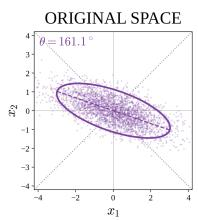  
(a) R = I

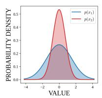

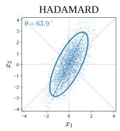  
(b) R = H

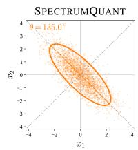  
(c) R = UH

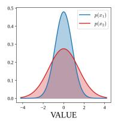

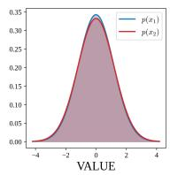  
Figure 1: Geometric intuition for covariance-aware rotation design. The top row shows the original distribution, a fixed Hadamard rotation, and the proposed hybrid rotation transform, while the bottom row shows the corresponding marginals.

alignment component and a mixing component. Our intuition is further supported with the analysis that covariance-maximization over the Stiefel manifold yields a variance-equalizing transform in SpectrumQuant that turns out to be optimal for quantization under a shared scale (see Section 4.3, particularly equation 4.16 and equation 4.17).

## 4 Method

In this section, we propose the SpectrumQuant transform using a first-principles approach, yielding a closedform expression of the optimal transform. This closed-form formulation distinguishes SpectrumQuant from existing methods, which are either data-agnostic or fully trained using gradient descent.

## 4.1 Covariance Maximization

Under the standard assumption that the data $\ b { X } \in \mathbb { R } ^ { n \times d }$ is mean-centred, the sample covariance matrix is given by $\Sigma : = { \scriptstyle { \frac { 1 } { n } } } X ^ { \top } X$ . For a orthogonal matrix $Q \in \mathbb { R } ^ { d \times d }$ , consider the transformation $Y = X Q$ . Because $Q$ is an orthogonal matrix, it preserves the zero mean of the data. Then, the covariance matrix $\Sigma _ { Y } ( Q )$ of the transformed data $\mathbf { Y }$ is given by

$$
\Sigma _ { Y } ( Q ) : = \frac { 1 } { n } Y ^ { \top } Y = Q ^ { \top } \left( \frac { 1 } { n } X ^ { \top } X \right) Q = Q ^ { \top } \Sigma Q ,\tag{4.1}
$$

1The normalized Hadamard matrix $\begin{array} { r } { H _ { 2 } = \frac { 1 } { \sqrt { 2 } } \left\lceil \begin{array} { r r } { 1 } & { 1 } \\ { 1 } & { - 1 } \end{array} \right\rceil } \end{array}$ has the form of a reflection matrix $\begin{array} { r l r } { \lceil \cos 2 \alpha } & { { } } & { \sin 2 \alpha \rceil } \\ { \sin 2 \alpha } & { { } } & { - \cos 2 \alpha \rceil } \end{array}$ with $2 \alpha = 4 5 ^ { \circ }$ that ${ \mathrm { i s } } ,$ a reflection across the line through the origin at angle $\alpha = 2 2 . 5 ^ { \circ }$ . A reflection across the line at angle α maps a direction at angle $\varphi$ to the direction at angle $2 \alpha - \varphi = 4 5 ^ { \circ } - \varphi$ . Hence an axis-aligned principal axis is mapped to $4 5 ^ { \circ } ~ ( \mathrm { f o r } ~ \varphi = 0 ^ { \circ } )$ or to $4 5 ^ { \circ } \equiv 1 3 5 ^ { \circ } ~ ( { \mathrm { f o r ~ } } \varphi = 9 0 ^ { \circ } )$ , whereas any other φ yields an angle diferent from 45◦ and 135◦.

where $Q ^ { \top }$ denotes the transpose of $Q .$ Since our goal is to maximize the of-diagonal elements of the matrix $\Sigma _ { Y } ( Q ) = Q ^ { \top } \Sigma Q$ , we take into consideration the following optimization problem:

$$
J ( \pmb { Q } ) = \operatorname* { m a x } _ { \pmb { Q } } \left( \sum _ { i \neq j } \left( \pmb { \Sigma } _ { \pmb { Y } } ( \pmb { Q } ) \right) _ { i j } ^ { 2 } \right) , \quad \mathrm { s u b j e c t ~ t o } \quad \pmb { Q } ^ { \top } \pmb { Q } = \pmb { I } ,\tag{4.2}
$$

where $\pmb { I } \in \mathbb { R } ^ { d \times d }$ denotes the identity matrix. We convert the above maximization problem into a minimization one by invoking invariance of the Frobenius norm to orthogonal transformations. Denote $\| \Sigma _ { Y } ( Q ) \| _ { \mathrm { F } }$ as the Frobenius norm of the covariance matrix $\Sigma _ { Y } ( Q )$ , then

$$
\left. \Sigma _ { Y } ( Q ) \right. _ { \mathrm { F } } ^ { 2 } = \sum _ { i , j } \left( \Sigma _ { Y } ( Q ) \right) _ { i j } ^ { 2 } = \sum _ { i \neq j } \left( \Sigma _ { Y } ( Q ) \right) _ { i j } ^ { 2 } + \sum _ { i } \left( \Sigma _ { Y } ( Q ) \right) _ { i i } ^ { 2 } .\tag{4.3}
$$

Consequently, it follows that the optimization problem in equation 4.2 can be recast in the following fashion:

$$
\boxed  J \left( Q \right) = \operatorname* { m a x } _ { Q } \left( \left\| \Sigma _ { Y } ( Q ) \right\| _ { \mathrm { F } } ^ { 2 } - \sum _ { i } \left( \Sigma _ { Y } ( Q ) \right) _ { i i } ^ { 2 } \right) = \operatorname* { m i n } _ { Q } \left( \sum _ { i } \left( \Sigma _ { Y } ( Q ) \right) _ { i i } ^ { 2 } \right) , \quad Q ^ { \top } Q = I \left| \Sigma _ { Y } ( Q ) \right| _ { \mathrm { F } } ^ { 2 } ,\tag{4.4}
$$

The last equation follows because the term $\| \Sigma _ { Y } ( Q ) \| _ { \mathrm { F } } ^ { 2 }$ is just a constant and has no efect on the optimization, which allows us to write $J ( Q )$ from equation 4.2 solely as a minimization problem. The fact that $\| \Sigma _ { Y } ( Q ) \| _ { \mathrm { F } } ^ { 2 }$ is actually a constant can simply be verified by writing the Frobenius norm in terms of the trace as $\left. \Sigma _ { Y } ( Q ) \right. _ { \mathrm { F } } ^ { 2 } =$ $T r \left( \Sigma _ { Y } ( Q ) ^ { \top } \Sigma _ { Y } ( Q ) \right)$ and then invoking cyclic property of the trace operator. Hence, equation 4.4 serves as the desired minimization problem equivalent to the maximization problem in equation 4.2.

## 4.2 Construction of Solution

In this section, we first solve the optimization problem $J ( Q )$ formulated in equation 4.4. We show that the desired solution corresponds to a variance-equalizing orthogonal transform. Additionally, from our construction, we show that such a family of variance-equalizing orthogonal transforms exists.

Proposition 4.1. The minimization problem given in equation $4 . 4$ has a lower bound, and that is attained $i f$ and only $i f$ the diagonal elements of $\Sigma _ { Y } ( Q )$ are all equal and equal to the average trace of the same covariance matrix $\Sigma$

Proof. To solve the minimization problem $\begin{array} { r } { J ( \pmb { Q } ) = \mathrm { m i n } _ { \pmb { Q } } \left( \sum _ { i } \left( \pmb { \Sigma } _ { \pmb { Y } } ( \pmb { Q } ) \right) _ { i i } ^ { 2 } \right) , \quad \pmb { Q } ^ { \top } \pmb { Q } = \pmb { I } , } \end{array}$ we need to lower bound the sum $\textstyle \sum _ { i } \left( \sum _ { Y } ( Q ) \right) _ { i i } ^ { 2 }$ . Recall that for any $\pmb { \alpha } ~ = ~ ( \alpha _ { 1 } , \alpha _ { 2 } , \alpha _ { 3 } , \ldots , \alpha _ { d } ) ~ \in ~ \mathbb { R } ^ { d }$ and $\beta \ =$ $( \beta _ { 1 } , \beta _ { 2 } , \beta _ { 3 } , \ldots , \beta _ { d } ) \in \mathbb { R } ^ { d }$ , the Cauchy-Schwarz inequality asserts that $\begin{array} { r } { \left( \sum _ { i = 1 } ^ { d } \alpha _ { i } \beta _ { i } \right) ^ { 2 } \leq \left( \sum _ { i = 1 } ^ { d } \alpha _ { i } ^ { 2 } \right) \left( \sum _ { i = 1 } ^ { d } \beta _ { i } ^ { 2 } \right) } \end{array}$ with the equality if and only if α and $\beta$ are scalar multiples of each other, that is, $\alpha = \kappa \beta$ , for some scalar κ. In particular, if $\beta = ( 1 , 1 , 1 , \dots , 1 ) \in  { \mathbb { R } } ^ { d }$ , we have the following useful inequality: $\begin{array} { r } { \left( \sum _ { i = 1 } ^ { d } \alpha _ { i } \right) ^ { 2 } \leq d \left( \sum _ { i = 1 } ^ { d } \alpha _ { i } ^ { 2 } \right) } \end{array}$ with the equality if and only if $\alpha _ { 1 } = \alpha _ { 2 } = \alpha _ { 3 } = \cdot \cdot \cdot = \alpha _ { d }$ . Accordingly, as a consequence of this inequality, we have that

$$
\sum _ { i = 1 } ^ { d } \left( \Sigma _ { Y } ( \pmb { Q } ) \right) _ { i i } ^ { 2 } \geq \frac { 1 } { d } \left( \sum _ { i = 1 } ^ { d } \left( \Sigma _ { \pmb { Y } } ( \pmb { Q } ) \right) _ { i i } \right) ^ { 2 } ,\tag{4.5}
$$

with equality holding in inequality 4.5 if and only if the diagonal elements of $\Sigma _ { Y } ( Q )$ are all equal; that is, $\left( \Sigma _ { Y } ( Q ) \right) _ { 1 1 } = \left( \Sigma _ { Y } ( \bar { Q } ) \right) _ { 2 2 } = \left( \Sigma _ { Y } ( Q ) \right) _ { 3 3 } = \cdots = \left( \Sigma _ { Y } ( Q ) \right) _ { d d } .$ In other words, the minimum in equation 4.4 is achieved for a orthogonal matrix $Q$ satisfying the following:

$$
\frac { 1 } { d } \left( \sum _ { i = 1 } ^ { d } \left( \Sigma _ { Y } ( Q ) \right) _ { i i } \right) ^ { 2 } = \frac { 1 } { d } \Big ( d \left( \Sigma _ { Y } ( Q ) \right) _ { i i } \Big ) ^ { 2 } .\tag{4.6}
$$

Under the trace preservation property of orthogonal matrices, we have $\begin{array} { r } { \sum _ { i = 1 } ^ { d } \left( \Sigma _ { Y } ( Q ) \right) _ { i i } = { \cal T } r \left( Q ^ { \top } \Sigma Q \right) = } \end{array}$ $\begin{array} { r } { T r \left( \Sigma \right) = \sum _ { i = 1 } ^ { d } \lambda _ { i } } \end{array}$ , where $\lambda _ { i }$ is the i-th eigenvalue of the sample covariance matrix Σ. Thus for $i = 1 , 2 , 3 , \ldots , d ,$ equation 4.6 yields that problem equation 4.4 is optimized for a orthogonal matrix $Q$ satisfying the following:

$$
\frac { 1 } { d } \bigg ( d \left( \Sigma _ { Y } ( Q ) \right) _ { i i } \bigg ) ^ { 2 } = \frac { 1 } { d } \left( \sum _ { i = 1 } ^ { d } \lambda _ { i } \right) ^ { 2 } \quad \Longrightarrow \quad \left( \Sigma _ { Y } ( Q ) \right) _ { i i } = \frac { 1 } { d } \left( \sum _ { i = 1 } ^ { d } \lambda _ { i } \right) = \frac { T r \left( \Sigma \right) } { d } = \bar { \lambda } .\tag{4.7}
$$

That is, all diagonal elements of $\Sigma _ { Y } ( Q )$ are equal to the average trace of Σ. This completes the proof of Proposition 4.1. □

## 4.2.1 Family of Solutions

The proposed covariance maximization problem admits multiple solutions, not a unique one. This is quite evident by observing that the number of degrees of freedom in describing a d-dimensional orthogonal matrix $\mathrm { i s ^ { 2 } } \ d ( d - \mathrm { i } ) / 2$ . Moreover, in view of Proposition 4.1, we want our desired orthogonal matrix $Q$ to be such that covariance matrix $\Sigma _ { Y } ( Q ) : = Q ^ { \intercal }$ ΣQ has all the diagonal elements equal to $\bar { \lambda }$ (see equation 4.7). That is, we are setting d diagonal elements of $\Sigma _ { Y } ( Q )$ equal to $\bar { \lambda } ;$ however, because orthogonal transformations preserve the trace, fixing the first $d - 1$ elements to λ¯ automatically forces the d-th element to $\bar { \lambda } .$ Therefore, the total number of degrees of freedom in choosing the desired orthogonal matrix is $d ( d - 1 ) / 2 - ( d - 1 ) = ( d - 1 ) ( d - 2 ) / 2$

Furthermore, Proposition 4.1 only specifies the desired orthogonal matrix $Q .$ . It doesn’t give a procedure to construct one! Below, we pursue the construction of solutions of the form $Q = U V$ , where U is obtained from the eigen-decomposition of the sample covariance matrix $\pmb { \Sigma } = \pmb { U } \Lambda \pmb { U } ^ { \top }$ , with $\pmb { \Lambda } = \operatorname { d i a g } \left( \lambda _ { 1 } , \lambda _ { 2 } , \lambda _ { 3 } , . . . , \lambda _ { d } \right)$ being the diagonal matrix of the eigenvalues of $\Sigma ,$ , and V is an orthogonal matrix. Henceforth, we call U the alignment component and V the rotation or mixing component of $Q .$ Then, we observe that $\Sigma _ { Y } ( Q ) = { Q } ^ { \top } \Sigma { Q } = { V } ^ { \top } { U } ^ { \top } \Sigma { U } V = { V } ^ { \top } \Lambda { V }$ . Therefore, our task reduces to finding the appropriate V matrix in accordance with Proposition 4.1. We write

$$
\Sigma _ { \boldsymbol { Y } } ( \boldsymbol { Q } ) _ { i i } = \left( \boldsymbol { V } ^ { \top } \mathbf { A } \boldsymbol { V } \right) _ { i i } = \sum _ { k = 1 } ^ { d } \lambda _ { k } \boldsymbol { v } _ { k i } ^ { 2 } ,\tag{4.8}
$$

where $v _ { k i }$ denotes the $( k , i ) – \mathrm { t h }$ element of the orthogonal matrix V in the decomposition $Q = U V$ . From equation 4.7, we see that the optimal solution $Q = U V$ must satisfy that

$$
\sum _ { k = 1 } ^ { d } \lambda _ { k } v _ { k i } ^ { 2 } = \frac { 1 } { d } \left( \sum _ { i = 1 } ^ { d } \lambda _ { i } \right) .\tag{4.9}
$$

Hence, it follows that for every spectrum $\lambda _ { 1 } \geq \lambda _ { 2 } \geq \cdot \cdot \cdot \geq \lambda _ { d } \geq 0$ , the condition $v _ { k i } ^ { 2 } = 1 / d$ on the mixing component V ensures that equation 4.9 is satisfied by our orthogonal transform $Q = U V$ . Formally, we have the following proposition:

Proposition 4.2. Given any orthogonal matrix V , the following statement are equivalent:

(i) For every spectrum $\lambda _ { 1 } \geq \lambda _ { 2 } \geq \cdot \cdot \cdot \geq \lambda _ { d } \geq 0$ , the matrix V satisfies

$$
\sum _ { k = 1 } ^ { d } \lambda _ { k } v _ { k i } ^ { 2 } = \frac { 1 } { d } \left( \sum _ { i = 1 } ^ { d } \lambda _ { i } \right) = \overline { { { \lambda } } } , \qquad f o r \ a l l \qquad i = 1 , 2 , 3 , \cdots , d .\tag{4.10}
$$

(ii) The $( k , i ) \ – t h$ element of the orthogonal matrix V obeys $v _ { k i } ^ { 2 } = 1 / d ,$ for all $k , i = 1 , 2 , 3 , \cdots , d .$

Proof. We begin by proving the assertion $( i ) \implies ( i i )$ . Since equation 4.10 holds for any admissible spectrum, we can choose a spectrum that consists of m number of 1 elements and $d - m$ number of 0 elements as follows:

$$
( \lambda _ { 1 } , \lambda _ { 2 } , \cdot \cdot \cdot , \lambda _ { d } ) = ( \underbrace { 1 , 1 , \cdot \cdot \cdot , 1 } _ { m } , \underbrace { 0 , 0 , \cdots \ , 0 } _ { d - m } ) .
$$

From equation 4.10, under this particular choice of the spectrum with $m = 1$ , we get $v _ { 1 i } ^ { 2 } = 1 / d$ . Similarly, for any $m ,$ we would get

$$
S _ { i } ( m ) = \sum _ { k = 1 } ^ { m } v _ { k i } ^ { 2 } = { \frac { m } { d } } \quad \Longrightarrow \quad S _ { i } ( m ) - S _ { i } ( m - 1 ) = v _ { m i } ^ { 2 } = { \frac { 1 } { d } } , \qquad m = 1 , 2 , \ldots , d .
$$

The assertion $( i i ) \implies ( i )$ is straightforward. If $v _ { k i } ^ { 2 } = 1 / d$ for all $k = 1 , 2 , 3 , \ldots , d$ and any particular $i = 1 , 2 , 3 , \ldots , d .$ , then we observe that

$$
\sum _ { k = 1 } ^ { d } \lambda _ { k } v _ { k i } ^ { 2 } = \frac { 1 } { d } \left( \sum _ { i = 1 } ^ { d } \lambda _ { i } \right) = \overline { { { \lambda } } }
$$

holds for every spectrum $\lambda _ { 1 } \geq \lambda _ { 2 } \geq \cdot \cdot \cdot \geq \lambda _ { d } \geq 0$ . This completes the proof of Proposition 4.2. □

## 4.2.2 Hadamard Solutions

The class of Hadamard matrices3 constitutes a simple and elegant family of solutions to our covariance maximization problem in equation 4.4. From Proposition 4.2, we infer that a necessary and suficient condition for an orthogonal matrix V to be admissible as a mixing component in the decomposition $Q = U V$ of the optimal solution is that its $( k , i ) – \mathrm { t h }$ element $v _ { k i }$ satisfies $v _ { k i } ^ { 2 } = 1 / d$ , where $k , i = 1 , 2 , 3 , \ldots , d .$ Therefore, any orthogonal matrix with entries as $\pm 1 / \sqrt { d }$ serves as our desired mixing component in $Q = U V$ . Interestingly, such a class of matrices is just the family of Hadamard matrices. However, as there is no single construction that yields a Hadamard matrix of any order, several approaches have been proposed for constructing such matrices in diferent dimensions, including Sylvester’s construction (for powerof-2 dimensions), Kronecker products, etc. The class of butterfly matrices is a more general framework for constructing Hadamard matri-

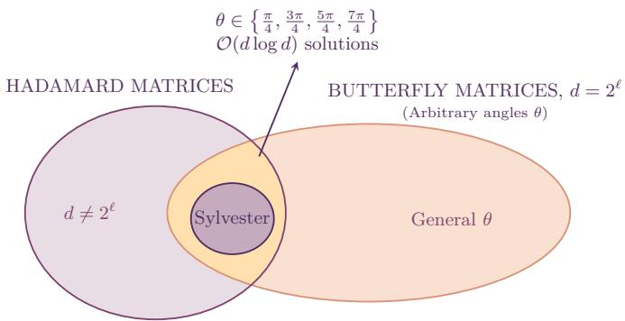  
Figure 2: Structure of the solution space of the mixing component V in our solution $Q = U V$ . By Proposition 4.2, the data-independent mixing components are exactly the normalized Hadamard matrices. Butterflies with angles in $\{ \pi / 4 , 3 \pi / 4 , 5 \pi / 4 , 7 \pi / 4 \}$ are a subset of solutions; this subset admits ${ \mathcal { O } } ( d \log d )$ multiplications and contains the Sylvester-Hadamard matrix.

ces that subsumes Sylvester-Hadamard matrices (Dao et al., 2019; Trogdon, 2019), as depicted in Figure 2.

In Sylvester’s construction of Hadamard matrices $H _ { 2 ^ { \ell } }$ , where $\ell = 0 , 1 , 2 , 3 , \ldots$ , we have $H _ { 1 } = [ 1 ] , H _ { 2 } =$ $\frac { 1 } { \sqrt { 2 } } \left[ \begin{array} { r r } { 1 } & { 1 } \\ { 1 } & { - 1 } \end{array} \right]$ and $H _ { 2 ^ { \ell } } = { \frac { 1 } { \sqrt { 2 } } } \left( H _ { 2 } \otimes H _ { 2 ^ { \ell - 1 } } \right)$ , where $\ell = 2 , 3 , \ldots$ . and $\otimes$ denotes the Kronecker product.

Such a class of matrices is subsumed by the family of butterfly matrices obtained via the "butterfly computations" (Dao et al., 2019; Trogdon, 2019). A butterfly computation is a kind of mixing operation which takes two inputs $x _ { i }$ and $x _ { j }$ and gives two outputs $y _ { i } = x _ { i } + \omega y _ { j }$ and $y _ { j } = x _ { i } - \omega y _ { j }$ , where $\omega$ is some appropriate twiddle factor. The computation draws its name from the fact that in the data-flow diagram for this pair of operations, lines cross and resemble the wings of a butterfly. A general butterfly matrix $B \in \mathbb { R } ^ { d \times d }$ is expressed as a sparse hierarchical factorization:

$$
B = \left( \prod _ { i = 1 } ^ { \log _ { 2 } d } B _ { i } ^ { \top } \right) ^ { \top }\tag{4.11}
$$

where each $\mathbf { \delta } _ { B _ { i } }$ is a sparse orthogonal matrix consisting of $d / 2$ independent Givens rotations $G ( \theta )$ as defined by

$$
\begin{array} { r } { G ( \theta ) = \left[ \begin{array} { r r } { \cos \theta } & { { } - \sin \theta } \\ { \sin \theta } & { \cos \theta } \end{array} \right] } \end{array}\tag{4.12}
$$

or their reflection counterparts $\left[ \begin{array} { l l } { \cos \theta } & { \sin \theta } \\ { \sin \theta - \cos \theta } \end{array} \right]$

Explicitly, we have that

$$
B _ { i } = P _ { i } D _ { i } P _ { i } ^ { \top } , \quad \mathrm { w i t h } \quad D _ { i } = \mathrm { d i a g } \big ( G ( \theta _ { i _ { 1 } } ) , G ( \theta _ { i _ { 2 } } ) , \ldots , G ( \theta _ { i _ { d / 2 } } ) \big ) ,\tag{4.13}
$$

where $P _ { i }$ is a permutation matrix determining the butterfly connectivity pattern by pairing indices at stage $i = 1 , 2 , \ldots , \log _ { 2 } d .$ Crucially, the choice of index pairings across stages is not unique: while the standard dyadic stride pattern, that is, pairing indices separated by stride $2 ^ { i - 1 }$ at stage $i ,$ represents a canonical choice, any sequence of stage permutations $\left\{ P _ { i } \right\} _ { i = 1 } ^ { \log _ { 2 } d }$ whose pairing rules allow every index/channel to interact with every other index/channel yields a valid butterfly matrix. Note that, while the block-diagonal matrix of Givens rotations diag $\big ( G ( \theta _ { i _ { 1 } } ) , G ( \theta _ { i _ { 2 } } ) , \dots , G ( \theta _ { i _ { d / 2 } } ) \big )$ can only apply 2D rotations to adjacent indices/channels like $( 1 , 2 ) , ( 3 , 4 ) , \ldots , ( d - 3 , d - 2 ) , ( d - 1 , d )$ , the permutation matrices $P _ { i }$ and $P _ { i } ^ { \top }$ play a structural role. The matrix $P _ { i }$ does reshufling so that pairs separated by a stride pattern at stage i are moved into adjacent positions $( 2 m - 1 , 2 m ) , m = 1 , 2 , 3 , \ldots , d / 2$ , to be amenable to the action of the block-diagonal matrix of Givens rotations $\mathbf { \nabla } D _ { i }$

It can be shown that by choosing the angle of rotation in each of the Givens blocks as $\theta \in \mathsf { \Gamma }$ $\{ \pi / 4 , 3 \pi / 4 , 5 \pi / 4 , 7 \pi / 4 \}$ , any butterfly matrix from equation 4.11 satisfies the variance equalization criterion in equation 4.7. For any fixed evaluation at $\pi / 4 , 3 \pi / 4 , 5 \pi / 4 , 7 \pi / 4$ , the butterfly matrix yields a matrix with entries $\pm { \frac { 1 } { ( { \sqrt { 2 } } ) ^ { \log _ { 2 } d } } }$ . For $d = 2 ^ { \ell }$ , the $( k , i )$ -th element of the butterfly matrix is $\begin{array} { r } { b _ { k i } : = \pm \frac { 1 } { ( \sqrt { 2 } ) ^ { \mathrm { l o g } _ { 2 } d } } = \pm \frac { 1 } { ( \sqrt { 2 } ) ^ { \ell } } = \pm \frac { 1 } { \sqrt { d } } . } \end{array}$ Any such butterfly matrix satisfies:

$$
\left( \Sigma _ { Y } ( Q ) \right) _ { i i } = \sum _ { k = 1 } ^ { d } \lambda _ { k } b _ { k i } ^ { 2 } = \sum _ { k = 1 } ^ { d } \lambda _ { k } \left( \frac { 1 } { \sqrt { d } } \right) ^ { 2 } = \sum _ { k = 1 } ^ { d } \frac { \lambda _ { k } } { d } = \overline { { { \lambda } } } .\tag{4.14}
$$

This shows that each such butterfly matrix ofers a solution to our final optimization problem from equation 4.4 in the sense that we can choose the desired matrix $Q = U V$ simply as $Q = U B$

Moreover, using the fact that the Kronecker product of any two Hadamard matrices is again a Hadamard matrix, it is possible to construct more general Hadamard matrices . For instance, if $H _ { m }$ is a Hadamard matrix of some known dimension m (Sloane, 2024), then we can construct another Hadamard matrix of dimension $d = 2 ^ { \ell } m$ via the Kronecker product as $\pmb { H } _ { d } = \pmb { H } _ { 2 ^ { \ell } } \otimes \pmb { H } _ { m }$ . Analogously, if $B _ { 2 ^ { \ell } }$ is a butterfly matrix of order $2 ^ { \ell }$ with angles in $\{ \pi / 4 , 3 \pi / 4 , 5 \pi / 4 , 7 \pi / 4 \}$ , then $\pmb { { B } } _ { d } = \pmb { { B } } _ { 2 ^ { \ell } } \otimes \pmb { { H } } _ { m }$ is a (mixed-radix) butterfly matrix of dimension $d = 2 ^ { \ell } m$ that is again a Hadamard matrix. In both cases, we can apply the matrix in $\mathcal { O } ( d \log 2 ^ { n } + d m )$ operations without forming the Kronecker product.

## 4.3 Optimal Rotation Under Shared-Scale Quantization

Theoretically, it can be shown that among all orthogonal rotations, the total quantization error under shared-scale quantization is minimized if and only if the rotation equalises per-coordinate variance. It is pertinent to mention that the shared-scale quantization regime is used by all the modern quantization methods where a single scale is applied per quantization group. Each quantization group is assigned a single dynamic range $A = c \sqrt { \sigma _ { m a x } ^ { 2 } ( Q ) }$ , where $\sigma _ { m a x } ^ { 2 } ( Q ) = \operatorname* { m a x } _ { 1 \leq i \leq d } ( \Sigma _ { Y } ( Q ) ) _ { i i }$ with c as a constant determined by the desired coverage probability and is independent of both the transformation $Q$ and the coordinate $i = 1 , 2 , \dots , d$ (for instance, as used for the 99% coverage rule, the constant c is specified as $c = 3 )$ . We consider the b bit scalar uniform quantizer $q ( x )$ with step-size $\textstyle \Delta = { \frac { 2 A } { 2 ^ { b } } }$ . The resulting quantization noise variance is $\sigma _ { q } ^ { 2 } = \Delta ^ { 2 } / 1 2$ under the standard high-rate approximation. Since the scale is shared across all coordinates, every coordinate incurs identical noise power:

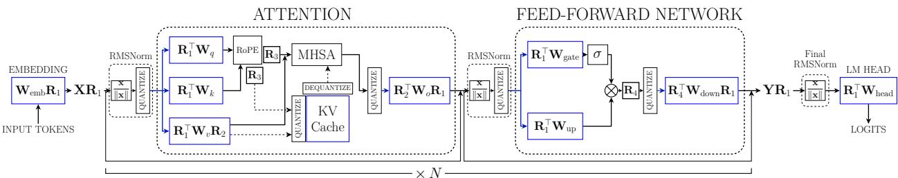  
Figure 3: Placement of the rotations $\scriptstyle { R _ { 1 } }$ to $\mathbf { { \cal R } } _ { 4 }$ in a Transformer block. Operations outlined in black are in FP16 and those outlined in blue are in $\operatorname { I N T 4 } ;$ dashed lines indicate read and write operation to the KV cache.

$$
\sigma _ { q _ { i } } ^ { 2 } = \frac { \Delta ^ { 2 } } { 1 2 } = \frac { 1 } { 1 2 } \left( \frac { 4 c ^ { 2 } \sigma _ { m a x } ^ { 2 } ( Q ) } { 2 ^ { 2 b } } \right) = \frac { c ^ { 2 } } { 3 } 2 ^ { - 2 b } \sigma _ { m a x } ^ { 2 } ( Q ) = c _ { 0 } \sigma _ { m a x } ^ { 2 } ( Q ) 2 ^ { - 2 b } ,\tag{4.15}
$$

for all $i = 1 , 2 , 3 , \ldots , d ,$ where $c _ { 0 } = c ^ { 2 } / 3$ . Accordingly, the total distortion is given by

$$
\varepsilon ( Q ) = \sum _ { i = 1 } ^ { d } \sigma _ { q _ { i } } ^ { 2 } = d c _ { 0 } \sigma _ { m a x } ^ { 2 } ( Q ) 2 ^ { - 2 b } .\tag{4.16}
$$

Now, observe that

$$
\sigma _ { m a x } ^ { 2 } ( Q ) = \operatorname* { m a x } _ { 1 \leq i \leq d } ( \Sigma _ { Y } ( Q ) ) _ { i i } \geq \frac { \sum _ { i = 1 } ^ { d } ( \Sigma _ { Y } ( Q ) ) _ { i i } } { d } = \frac { T r \left( \Sigma _ { Y } ( Q ) \right) } { d } = \frac { T r \left( \Sigma \right) } { d } = \overline { { \lambda } } .\tag{4.17}
$$

Therefore, it follows that $\varepsilon ( Q ) \geq d c _ { 0 } \overline { { { \lambda } } } 2 ^ { - 2 b }$ with equality if and only if the diagonal elements of $\Sigma _ { Y } ( Q )$ are all equal: $\left( \Sigma _ { Y } ( Q ) \right) _ { 1 1 } = \left( \Sigma _ { Y } ( Q ) \right) _ { 2 2 } = \left( \Sigma _ { Y } ( Q ) \right) _ { 3 3 } = \cdot \cdot \cdot = \left( \Sigma _ { Y } ( Q ) \right) _ { d d } .$ Hence, we conclude that among all orthogonal rotations, the total quantization error $\overset { \vartriangle } { \boldsymbol { \varepsilon } } ( Q )$ is minimized if and only if the rotation equalizes the marginal variances. Experiments with gaussian distributed data is given in Appendix C.

## 5 Experiments

The Transformer architecture, common in LLMs, is composed of multi-head self-attention and feedforward network modules. Following the standard notations, denote the output of a layer as $Y : = X W$ , with $\pmb { X } \in \mathbb { R } ^ { d _ { i n } \times d }$ as the input activation, and $W \in \mathbb { R } ^ { d \times d _ { o u t } }$ as the weight matrix. Based on rotational invariance, an orthogonal transformation $\pmb { R } \in \mathbb { R } ^ { C _ { i n } \times C _ { i n } }$ is inserted into the linear layer without altering the output, yielding $\pmb { Y } = \pmb { X } \pmb { R } \pmb { R } ^ { \top } \pmb { W } = ( \pmb { X } \pmb { R } ) ( \pmb { R } ^ { \top } \pmb { W } )$ . We can commute R with RMSNorm block since for a orthogonal matrix $R M S N o r m ( X R ) = R M S N o r m ( X ) R$ . Thus, we can combine R with the previous weight matrix and $\pmb { R } ^ { \top }$ with the weight matrix of the current layer. Consequently, the activations are transformed without incurring any additional inference cost.

Without altering the output of the model, we can insert four orthogonal matrices $R _ { 1 } , R _ { 2 } , R _ { 3 } , R _ { 4 }$ within the Transformer block as in Fig. 3 (adapted from (Liu et al., 2025)). Multiplying $R _ { 1 } ^ { \top }$ on the left side of $W _ { q } .$ $W _ { k } , W _ { v } , W _ { u p } , W _ { g a t e }$ , and $R _ { 1 }$ on the right side of $W _ { o }$ and $W _ { d o w n }$ , an equivalent transformation is achieved.

The rotation $R _ { 2 }$ is inserted in-between $W _ { v }$ and $W _ { o } .$ , whereas $R _ { 3 }$ is put between the rotated encodings of Query and $K e y ;$ , and $\mathbf { { \cal R } } _ { 4 }$ can be inserted before $W _ { d o w n }$ . Finally, $W _ { e m b }$ is multiplied on the right by $\scriptstyle { R _ { 1 } }$ , and $R _ { 1 } ^ { \top }$ is multiplied on the left of $W _ { h e a d } ,$ completing all equivalent transformations. This inference framework follows the rotational transformation framework used in the other baselines SpinQuant (Liu et al., 2025) and DartQaunt (Shao et al., 2026).

## 5.1 Implementation Details

Rotations $\scriptstyle { R _ { 1 } }$ and $R _ { 2 }$ are calibrated using SpectrumQuant with the random Sylvester-Hadamard matrix (H) and random $4 5 ^ { \circ }$ butterfly matrix (B) as the mixing component (that is, $Q = U H$ and UB as calibrated matrices). $R _ { 3 }$ and $\mathbf { { \cal R } } _ { 4 }$ are left online as random Hadamard matrices, as is the case with other baselines. Since $\scriptstyle { R _ { 1 } }$ acts as a single global rotation on the residual stream, U is calibrated once per model from activations pooled across all layers. Our orthogonal matrices are computed ofline from activation covariance statistics estimated on 128 WikiText2 calibration samples using the Welford algorithm (Welford, 1962) (Chan et al., 1983), which provides a numerically stable unbiased online covariance estimator. Detailed algorithm is given in Appendix A.

## 5.2 Main Results

We evaluate SpectrumQuant on Llamafamily models, including Llama-2 (7B, 13B, and 70B) (Touvron et al., 2023), Llama-3 (8B) and Mistral-family models, Mistral 7B v0.3 (Jiang et al., 2023). We report perplexity (PPL) on WikiText2 (Merity et al., 2016), C4 (Rafel et al., 2020), and PTB (Marcus et al., 1993), and further measure zero-shot performance on eight downstream tasks: WinoGrande (Sakaguchi et al., 2021), SIQA (Sap et al., 2019), PIQA (Bisk et al., 2020), Open-BookQA (Mihaylov et al., 2018), LAM BADA (Radford et al., 2019), HellaSwag (Zellers et al., 2019), ARC-E, and ARC-C (Boratko et al., 2018).

Table 2: Comparison of calibration cost. SpectrumQuant requires less than one-tenth the memory of SpinQuant and less than onesixth the memory of $\mathrm { D a r t Q }$ uant at 70B scale, while also being the fastest to calibrate across all model sizes.
<table><tr><td>Cost</td><td>Method</td><td>7B</td><td>13B</td><td>70B</td></tr><tr><td rowspan="2">GPU hour (h)</td><td>SpinQuant</td><td>0.41</td><td>0.84</td><td>46.40</td></tr><tr><td>DartQuant</td><td>0.32</td><td>0.57</td><td>3.74</td></tr><tr><td></td><td>SpectrumQuant</td><td>0.26</td><td>0.35</td><td>2.25</td></tr><tr><td rowspan="2">Mem (GiB)</td><td>SpinQuant</td><td>18.23</td><td>32.21</td><td>218.72</td></tr><tr><td>DartQuant</td><td>15.79</td><td>27.80</td><td>128.21</td></tr><tr><td></td><td>SpectrumQuant</td><td>4.51</td><td>7.05</td><td>22.42</td></tr></table>

We compare our method with existing rotation-based quantization methods, including Hadamard rotations in QuaRot (Ashkboos et al., 2024), end-to-end learned rotations in SpinQuant (Liu et al., 2025) and DartQuant (Shao et al., 2026). In our implementation, we quantize weights with GPTQ (Frantar et al., 2023) under the standard setup using 128 WikiText2 calibration samples, each of length 2048, and quantize activations with per-token asymmetric quantization.

A comparison of rotation matrix computation time and memory cost of SpinQuant and SpectrumQuant on an Nvidia A6000 GPU server is shown in Table 2. SpectrumQuant is a simple calibration method, which has a significant reduction in compute cost across various models. For the 70B model, after pre-saving activations, SpectrumQuant completes calibration in 43 minutes on a single GPU and can also calibrate on CPU in 51 minutes, achieving a speedup of 21× in calibration and 9.8× in memory usage compared to SpinQuant. While DartQuant calibration time is relatively low, with only 10 epochs, calibration memory requirement is significantly higher. All competing baseline models are reproduced from their publicly available codebases.

Table 3 compares our 4-bit weight, activation and KV cache method against FloatingPoint, QuaRot, SpinQuant and DartQuant on three WikiText-style PPL evaluations and the average accuracy over eight zero-shot commonsense reasoning tasks. Across all five LLM architectures, our approach matches or outperforms SpinQuant on all five models, with the clearest gains on Llama-2 7B and Llama-3 8B and on par with DartQuant on four of five models, with DartQuant ahead on Llama-2 7B. In our SpectrumQuant implementation, we have demonstrated that all the solutions obtained in Section 4.2.1 perform almost equally, which further solidifies our theoretical contribution. In fact, our theoretical results also eloquently explain why butterfly or Hadamard matrices are efective as the mixing component for quantization theory.

Table 3: Comparison of average PPL across three datasets and average accuracy on eight zero-shot commonsense reasoning tasks (0-shot), over 5 seeds, under W4-A4-KV4 quantization. SpectrumQuant matches or outperforms SpinQuant on all five models and shows no statistically significant diference from DartQuant on four of five models, while being constructed without iterative optimization. Detailed results are in Appendix B.
<table><tr><td rowspan="2">Method</td><td colspan="2">Llama-2 7B</td><td colspan="2">Llama-2 13B</td><td colspan="2">Llama-3 8B</td><td colspan="2">Mistral 7B</td><td colspan="2">Llama-2 70B</td></tr><tr><td>PPL↓</td><td>0-shot↑</td><td>PPL↓</td><td>0-shot↑</td><td>PPL↓</td><td>0-shot↑</td><td>PPL↓</td><td>0-shot↑</td><td>PPL↓</td><td>0-shot↑</td></tr><tr><td>FP16</td><td>16.88</td><td>61.16</td><td>20.85</td><td>64.28</td><td>8.92</td><td>66.04</td><td>17.04</td><td>67.74</td><td>11.09</td><td>69.53</td></tr><tr><td>QuaRot</td><td>25.57±1.22</td><td>59.73±0.36</td><td>24.64±0.45</td><td>63.34±0.38</td><td>12.10±0.13</td><td>59.70±0.61</td><td>20.11±0.42</td><td>64.37±0.21</td><td>11.68±0.14</td><td>68.66±0.36</td></tr><tr><td>SpinQuant</td><td>22.92±0.67</td><td>59.23±0.54</td><td>24.93±0.88</td><td>63.19±0.50</td><td>11.67±0.09</td><td>61.36±0.44</td><td>19.50±0.26</td><td>65.18±0.18</td><td>12.26±0.14</td><td>68.58±0.50</td></tr><tr><td>DartQuant</td><td>20.46±0.20</td><td>60.99±0.43</td><td>24.47±0.60</td><td>64.30±0.14</td><td>10.95±0.05</td><td>62.74±0.35</td><td>18.73±0.3065.34±0.28</td><td></td><td>12.00±0.08</td><td>68.87±0.42</td></tr><tr><td>SpectrumQuant (UH)</td><td>21.50±0.46</td><td>60.06±0.32</td><td>24.53±0.56 63.71±0.58</td><td></td><td></td><td></td><td>10.99±0.12 62.57±0.5018.77±0.17 65.45±0.34</td><td></td><td>12.00±0.11</td><td>68.94±0.54</td></tr><tr><td>SpectrumQuant (UB)</td><td>21.44±1.03</td><td>60.29±0.26</td><td></td><td></td><td></td><td></td><td>23.89±0.54 64.12±0.65 10.95±0.08 62.84±0.20 18.98±0.18 65.34±0.35 11.74±0.11</td><td></td><td></td><td>68.62±0.37</td></tr></table>

Compared to QuaRot, our method reduces PPL by 16.1% on Llama-2 7B 3.6% on Llama-2 13B, 9.5% on Llama-3 8B and 5.6% on Mistral-v0.3 7B on an average while improving zero-shot accuracy by 0.96 percentage points on Llama-2 7B, 0.78 percentage points on Llama-2 13B, 3.14 percentage points on Llama-3 8B, 1.17 percentage points on Mistral-v0.3 7B, 0.3 percentage points on Llama-2 70B on an average. QuaRot uses Hadamard matrix for all of $R _ { 1 } , R _ { 2 } , R _ { 3 }$ and $\mathbf { { \cal R } } _ { 4 }$ . We have also shown that our closed-form solution is consistently better than the Hadamard in Section 5.4.3 in terms of Mean Squared quantization Error (MSE).

## 5.3 Inference Cost Analysis

Due to the commutativity of the RMSNorm block and an orthogonal transform, rotations can be absorbed into the weights in the LLM architecture, requiring essentially the same inference cost for all these rotation matrices as the baseline without rotation. To validate this argument, we took all the quantized models and ran them on a local MacBook Air M4. Table 4 demonstrates that the inference cost of all the models is essentially the same as that of the no-transform regime since the rotation matrices are taken into the weights.

Table 4: Real-time inference cost measurement of Llama-3 8B on MacBook Air M4. All rotation-based methods including SpectrumQuant show no statistically significant diference in inference throughput compared to the no-transform baseline, confirming that the rotation matrices are fully absorbed into the weights with zero additional inference cost.
<table><tr><td></td><td>No Transform (Baseline)</td><td>SpinQuant</td><td>DartQuant</td><td>SpectrumQuant</td></tr><tr><td>Decode Tokens/sec ↑</td><td>18.330</td><td>18.337</td><td>18.246</td><td>18.397</td></tr><tr><td>Decode ms/Token↓</td><td>54.6</td><td>54.5</td><td>54.8</td><td>54.4</td></tr></table>

## 5.4 Ablation Studies

To better understand the contribution of each component of our proposed method, we conduct some ablation studies below.

## 5.4.1 Calibration with different datasets

To study sensitivity of the calibration-data, we construct SpectrumQuant using WikiText2, PTB, and C4 samples and evaluate the resulting quantized models. As shown in Table 5 below, the results are broadly consistent across calibration datasets for both Llama-2 7B and Mistral 7B v0.3, suggesting that SpectrumQuant is robust to the choice of calibration data.

Table 5: Comparison of PPL of SpectrumQuant across various calibration datasets for 5 seeds. SpectrumQuant shows no statistically significant diference across calibration datasets for Mistral 7B v0.3, and remains competitive across all choices for Llama-2 7B, suggesting the method is generally robust to calibration data selection.
<table><tr><td>Model</td><td>Dataset</td><td> $\mathrm { W i k i T e x t 2 }$ </td><td>PTB</td><td>C4</td></tr><tr><td rowspan="3">Llama-2 7B</td><td>WikiText2</td><td> $6 . 2 8 { \scriptstyle \pm 0 . 0 6 }$ </td><td> $4 9 . 8 6 _ { \pm 1 . 3 1 }$ </td><td> $8 . 3 7 _ { \pm 0 . 0 6 }$ </td></tr><tr><td>PTB</td><td> $6 . 2 3 1 _ { \pm 0 . 0 2 9 }$ </td><td> $4 4 . 9 5 _ { \pm 1 . 4 2 }$ </td><td> $8 . 3 9 2 _ { \pm 0 . 0 6 6 }$ </td></tr><tr><td>C4</td><td> $6 . 2 8 2 _ { \pm 0 . 0 4 1 }$ </td><td> $4 6 . 9 0 { \scriptstyle \pm 0 . 6 5 }$ </td><td> $8 . 4 3 8 _ { \pm 0 . 0 6 0 }$ </td></tr><tr><td rowspan="3">Mistral 7B v0.3</td><td>WikiText2</td><td> $5 . 6 7 _ { \pm 0 . 0 1 }$ </td><td> $4 1 . 6 4 _ { \pm 0 . 5 0 }$ </td><td> $9 . 0 0 { \scriptstyle \pm 0 . 0 0 }$ </td></tr><tr><td>PTB</td><td> $5 . 7 3 5 { \scriptstyle \pm 0 . 0 1 4 }$ </td><td> $4 0 . 5 1 { \scriptstyle \pm 0 . 6 3 }$ </td><td> $9 . 0 1 6 _ { \pm 0 . 0 2 7 }$ </td></tr><tr><td>C4</td><td> $5 . 7 0 1 { \scriptstyle \pm 0 . 0 1 0 }$ </td><td> $4 2 . 5 6 _ { \pm 1 . 2 1 }$ </td><td> $8 . 9 8 3 _ { \pm 0 . 0 1 5 }$ </td></tr></table>

## 5.4.2 Calibration with different sample sizes

To study sensitivity to the sample size of the calibration data, we took diferent numbers of samples from the WikiText2 Dataset for the Llama-2 7B model and analyzed the PPL scores. As shown in Table 6 below, the results are broadly consistent across the choice of number of calibration samples, suggesting that SpectrumQuant is robust to the choice of sample size. By default, in the rest of the paper, we have used the sample size of 128, consistent with the other calibrated methods like SpinQuant and DartQuant.

Table 6: PPL comparison of SpectrumQuant across sample sizes for Llama-2 7B. SpectrumQuant shows no statistically significant diference in performance from 64 to 256 calibration samples, suggesting that the dominant covariance structure is reliably captured even at modest sample counts.
<table><tr><td>No. of Samples</td><td>WikiText2</td><td>PTB</td><td>C4</td><td>Avg. PPL↓</td></tr><tr><td>64</td><td> $6 . 1 6 9 _ { \pm 0 . 0 3 3 }$ </td><td> $4 9 . 0 7 _ { \pm 2 . 2 4 }$ </td><td> $8 . 3 9 3 _ { \pm 0 . 0 6 5 }$ </td><td> $2 1 . 2 1 { \scriptstyle \pm 0 . 7 6 }$ </td></tr><tr><td>128</td><td> $6 . 2 8 _ { \pm 0 . 0 6 }$ </td><td> $4 9 . 8 6 _ { \pm 1 . 3 1 }$ </td><td> $8 . 3 7 _ { \pm 0 . 0 6 }$ </td><td> $2 1 . 5 0 { \scriptstyle \pm 0 . 4 6 }$ </td></tr><tr><td>256</td><td> $6 . 1 8 8 _ { \pm 0 . 0 3 8 }$ </td><td> $5 0 . 2 2 _ { \pm 2 . 1 2 }$ </td><td> $8 . 4 2 9 _ { \pm 0 . 0 2 3 }$ </td><td> $2 1 . 6 1 _ { \pm 0 . 7 2 }$ </td></tr></table>

## 5.4.3 Comparison with Hadamard case

Figure 4 shows the MSE due to quantization across diferent latent dimensions of the LLM architecture. This is shown for layer 10 of the Llama-2 7B model. We can see that projections $( q / k / v / o , g a t e / u p )$ in our case have lower MSE than those in the Hadamard case. For down proj, both competing methods use the same $\mathbf { { \cal R } } _ { 4 }$ matrix. On average, we have 2% less MSE than Hadamard across almost all layers. Appendix D shows the MSE for many more layers. The improvement is observed in both intermediate and deeper layers, suggesting SpectrumQuant remain stable across network depths and projection types.

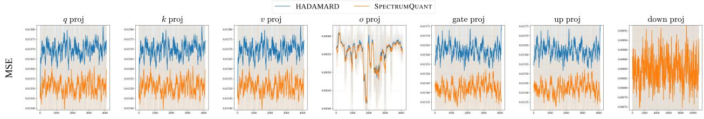  
LATENT DIMENSION INDEX  
Figure 4: Comparison of mean squared quantization error across hidden dimensions for diferent projection activations in Llama-2 7B at layers 10.

## 5.4.4 Butterfly as a replacement for Hadamard matrix

Throughout the literature, the Hadamard matrix is considered the default for $R _ { 3 } , R _ { 4 }$ , but as per our analysis, any Butterfly, as in 4.13, will have the equalizing property, and any butterfly multiplication is of the order $\mathcal { O } ( N \log N )$ , which implies that we can replace the matrix used during the online multiplication and will still have results in the on-par results with similar inference cost. To test this hypothesis, we replaced $R _ { 3 } , R _ { 4 }$ in diferent LLM architectures with random butterfly instead of random Hadamard. Table 7 gives the PPL and $0 - \mathrm { s h o t } ^ { 8 }$ for diferent models with $Q = U B$ as the calibrated $R _ { 1 } , R _ { 2 }$ and B as $R _ { 3 } , R _ { 4 }$ . The performance is within the same statistical boundary as our methods in Table 3.

Table 7: PPL and average accuracy for Zero-shot commonsense reasoning task with calibrated $R _ { 1 } , R _ { 2 }$ as UB and $R _ { 3 } , R _ { 4 }$ as random butterfly matrices. Replacing the standard Hadamard matrices in R3 and R4 with random butterfly matrices shows no statistically significant diference in results, confirming that any member of the butterfly family is a valid mixing component as predicted by our theory.
<table><tr><td>Model</td><td>WikiText2 ↓</td><td>PTB↓</td><td>C4↓</td><td>Avg. PPL ↓</td><td> $\mathrm { 0 { - s h o t } ^ { 8 } \uparrow }$ </td></tr><tr><td>Llama-2 7B</td><td> $6 . 2 1 _ { \pm 0 . 0 4 }$ </td><td> $4 9 . 9 3 _ { \pm 1 . 0 0 }$ </td><td> $8 . 4 9 _ { \pm 0 . 1 0 }$ </td><td> $2 1 . 5 4 { \scriptstyle \pm 0 . 3 8 }$ </td><td> $6 0 . 2 6 _ { \pm 0 . 4 6 }$ </td></tr><tr><td>Llama-3 8B</td><td> $7 . 7 4 _ { \pm 0 . 0 6 }$ </td><td> $1 3 . 3 4 { \scriptstyle \pm 0 . 0 7 }$ </td><td> $1 2 . 5 7 { \scriptstyle \pm 0 . 0 9 }$ </td><td> $1 1 . 2 2 _ { \pm 0 . 0 7 }$ </td><td> $6 2 . 8 5 { \scriptstyle \pm 0 . 7 4 }$ </td></tr><tr><td>Mistral  $\mathrm { 7 B \ v 0 . 3 }$ </td><td> $5 . 6 6 _ { \pm 0 . 0 2 }$ </td><td> $4 3 . 0 3 { \scriptstyle \pm 1 . 2 0 }$ </td><td> $9 . 0 1 _ { \pm 0 . 0 1 }$ </td><td> $1 9 . 2 3 _ { \pm 0 . 4 1 }$ </td><td> $6 4 . 5 6 { \scriptstyle \pm 0 . 3 0 }$ </td></tr></table>

## 6 Conclusion

We presented SpectrumQuant, a principled framework for post-training quantization of LLMs. Starting from a first-principles objective over the Stiefel manifold, we derived a closed-form solution for covariance maximization, leading to variance equalization. Our analysis reveals a family of optimal rotations for faithful LLM quantization, and also serves as a justification to the efectiveness of the Hadamard and Butterfly rotations in the LLM quantization literarure. Empirical results across diverse LLMs showed consistent gains over purely data-agnostic baselines while being competitive with end-to-end learned baselines.

## References

Saleh Ashkboos, Amirkeivan Mohtashami, Maximilian L Croci, Bo Li, Pashmina Cameron, Martin Jaggi, Dan Alistarh, Torsten Hoefler, and James Hensman. Quarot: Outlier-free 4-bit inference in rotated LLMs. Advances in Neural Information Processing Systems, 37:100213–100240, 2024.

Yonatan Bisk, Rowan Zellers, Jianfeng Gao, Yejin Choi, et al. Piqa: Reasoning about physical commonsense in natural language. In Proceedings of the AAAI conference on artificial intelligence, volume 34, pp. 7432–7439, 2020.

Michael Boratko, Harshit Padigela, Divyendra Mikkilineni, Pritish Yuvraj, Rajarshi Das, Andrew McCallum, Maria Chang, Achille Fokoue-Nkoutche, Pavan Kapanipathi, Nicholas Mattei, et al. A systematic classification of knowledge, reasoning, and context within the arc dataset. In Proceedings of the Workshop on Machine Reading for Question Answering, pp. 60–70, 2018.

Tony F. Chan, Gene H. Golub, and Randall J. LeVeque. Algorithms for computing the sample variance: Analysis and recommendations. The American Statistician, 37:242–247, 1983. URL https: //api.semanticscholar.org/CorpusID:3593421.

Jerry Chee, Yaohui Cai, Volodymyr Kuleshov, and Christopher De Sa. QuIP: 2-bit quantization of large language models with guarantees. In Thirty-seventh Conference on Neural Information Processing Systems, 2023. URL https://openreview.net/forum?id=xrk9g5vcXR.

Jiale Chen, Vage Egiazarian, Roberto L. Castro, Torsten Hoefler, and Dan Alistarh. Wush: Near-optimal adaptive transforms for llm quantization, 2026. URL https://arxiv.org/abs/2512.00956.

Tri Dao, Albert Gu, Matthew Eichhorn, Atri Rudra, and Christopher Ré. Learning fast algorithms for linear transforms using butterfly factorizations. In International conference on machine learning, pp. 1517–1527. PMLR, 2019.

Marco Federici, Boris van Breugel, Paul Whatmough, and Markus Nagel. Dissecting quantization error: A concentration-alignment perspective, 2026. URL https://arxiv.org/abs/2603.04359.

Martin Fleury, Andy C. Downton, and Adrian F. Clark. Karhünen-loève transform: An exercise in simple image-processing parallel pipelines. In Proceedings of the Third International Euro-Par Conference on Parallel Processing, Euro-Par ’97, pp. 815–819, Berlin, Heidelberg, 1997. Springer-Verlag. ISBN 3540634401.

Elias Frantar, Saleh Ashkboos, Torsten Hoefler, and Dan Alistarh. Gptq: Accurate post-training quantization for generative pre-trained transformers, 2023. URL https://arxiv.org/abs/2210.17323.

Song Han, Huizi Mao, and William J. Dally. Deep compression: Compressing deep neural networks with pruning, trained quantization and hufman coding, 2016. URL https://arxiv.org/abs/1510.00149.

Geofrey Hinton, Oriol Vinyals, and Jef Dean. Distilling the knowledge in a neural network, 2015. URL https://arxiv.org/abs/1503.02531.

Xing Hu, Yuan Cheng, Dawei Yang, Zukang Xu, Zhihang Yuan, Jiangyong Yu, Chen Xu, Zhe Jiang, and Sifan Zhou. Ostquant: Refining large language model quantization with orthogonal and scaling transformations for better distribution fitting, 2025. URL https://arxiv.org/abs/2501.13987.

Albert Q. Jiang, Alexandre Sablayrolles, Arthur Mensch, Chris Bamford, Devendra Singh Chaplot, Diego de las Casas, Florian Bressand, Gianna Lengyel, Guillaume Lample, Lucile Saulnier, Lélio Renard Lavaud, Marie-Anne Lachaux, Pierre Stock, Teven Le Scao, Thibaut Lavril, Thomas Wang, Timothée Lacroix, and William El Sayed. Mistral 7b. CoRR, abs/2310.06825, 2023. URL https://arxiv.org/abs/2310.06825.

Ji Lin, Jiaming Tang, Haotian Tang, Shang Yang, Wei-Ming Chen, Wei-Chen Wang, Guangxuan Xiao, Xingyu Dang, Chuang Gan, and Song Han. Awq: Activation-aware weight quantization for on-device LLM compression and acceleration. Proceedings of machine learning and systems, 6:87–100, 2024.

Zechun Liu, Changsheng Zhao, Igor Fedorov, Bilge Soran, Dhruv Choudhary, Raghuraman Krishnamoorthi, Vikas Chandra, Yuandong Tian, and Tijmen Blankevoort. Spinquant: LLM quantization with learned rotations. In International Conference on Learning Representations, volume 2025, pp. 92009–92032, 2025.

Xinyin Ma, Gongfan Fang, and Xinchao Wang. LLM-pruner: On the structural pruning of large language models. Advances in neural information processing systems, 36:21702–21720, 2023.

Mitch Marcus, Beatrice Santorini, and Mary Ann Marcinkiewicz. Building a large annotated corpus of english: The penn treebank. Computational linguistics, 19(2):313–330, 1993.

Stephen Merity, Caiming Xiong, James Bradbury, and Richard Socher. Pointer sentinel mixture models, 2016. URL https://arxiv.org/abs/1609.07843.

Todor Mihaylov, Peter Clark, Tushar Khot, and Ashish Sabharwal. Can a suit of armor conduct electricity? a new dataset for open book question answering. In Proceedings of the 2018 conference on empirical methods in natural language processing, pp. 2381–2391, 2018.

Indranil Patra, Azhar Yousuf, Manu Mathew, and Chandra Sekhar Seelamantula. Coat: Correlation-aware orthogonal transform for llm quantization. In AdaptFM: Resource-Adaptive Foundation Model Inference.

Alec Radford, Jefrey Wu, Rewon Child, David Luan, Dario Amodei, and Ilya Sutskever. Language models are unsupervised multitask learners. OpenAI, 2019. URL https://cdn.openai.com/ better-language-models/language\_models\_are\_unsupervised\_multitask\_learners.pdf. Accessed: 2024-11-15.

Colin Rafel, Noam Shazeer, Adam Roberts, Katherine Lee, Sharan Narang, Michael Matena, Yanqi Zhou, Wei Li, and Peter J Liu. Exploring the limits of transfer learning with a unified text-to-text transformer. Journal of machine learning research, 21(140):1–67, 2020.

Keisuke Sakaguchi, Ronan Le Bras, Chandra Bhagavatula, and Yejin Choi. Winogrande: An adversarial winograd schema challenge at scale. Communications of the ACM, 64(9):99–106, 2021.

Maarten Sap, Hannah Rashkin, Derek Chen, Ronan Le Bras, and Yejin Choi. Social iqa: Commonsense reasoning about social interactions. In Proceedings of the 2019 conference on empirical methods in natural language processing and the 9th international joint conference on natural language processing (EMNLP-IJCNLP), pp. 4463–4473, 2019.

Wenqi Shao, Mengzhao Chen, Zhaoyang Zhang, Peng Xu, Lirui Zhao, Zhiqian Li, Kaipeng Zhang, Gao Peng, Yu Qiao, and Ping Luo. Omniquant: Omnidirectionally calibrated quantization for large language models. In International Conference on Learning Representations, volume 2024, pp. 45472–45496, 2024.

Yuantian Shao, Yuanteng Chen, Peisong Wang, Jianlin Yu, Jing Lin, Yiwu Yao, Zhihui Wei, and Jian Cheng. Dartquant: Eficient rotational distribution calibration for LLM quantization. In The Thirty-ninth Annual Conference on Neural Information Processing Systems, 2026. URL https://openreview.net/forum?id= LfcfwlLCHM.

Sloane. A library of hadamard matrices. http://neilsloane.com/hadamard/, 2024. Accessed: 2026-06-10.

Hugo Touvron, Thibaut Lavril, Gautier Izacard, Xavier Martinet, Marie-Anne Lachaux, Timothée Lacroix, Baptiste Rozière, Naman Goyal, Eric Hambro, Faisal Azhar, et al. Llama: Open and eficient foundation language models. arXiv preprint arXiv:2302.13971, 2023.

Thomas Trogdon. On spectral and numerical properties of random butterfly matrices. Applied Mathematics Letters, 95:48–58, 2019.

Albert Tseng, Jerry Chee, Qingyao Sun, Volodymyr Kuleshov, and Christopher De Sa. QuIP\$\#\$: Even better LLM quantization with hadamard incoherence and lattice codebooks. In Forty-first International Conference on Machine Learning, 2024. URL https://openreview.net/forum?id=9BrydUVcoe.

B. P. Welford. Note on a method for calculating corrected sums of squares and products. Technometrics, 4 (3):419–420, 1962. doi: 10.1080/00401706.1962.10490022. URL https://www.tandfonline.com/doi/abs/ 10.1080/00401706.1962.10490022.

Guangxuan Xiao, Ji Lin, Mickael Seznec, Hao Wu, Julien Demouth, and Song Han. Smoothquant: Accurate and eficient post-training quantization for large language models. In International conference on machine learning, pp. 38087–38099. PMLR, 2023.

Bingxin Xu, Zhen Dong, Oussama Elachqar, and Yuzhang Shang. Butterflyquant: Ultra-low-bit llm quantization through learnable orthogonal butterfly transforms, 2026. URL https://arxiv.org/abs/ 2509.09679.

Zhewei Yao, Reza Yazdani Aminabadi, Minjia Zhang, Xiaoxia Wu, Conglong Li, and Yuxiong He. Zeroquant: Eficient and afordable post-training quantization for large-scale transformers. Advances in neural information processing systems, 35:27168–27183, 2022.

Rowan Zellers, Ari Holtzman, Yonatan Bisk, Ali Farhadi, and Yejin Choi. Hellaswag: Can a machine really finish your sentence? In Proceedings of the 57th annual meeting of the association for computational linguistics, pp. 4791–4800, 2019.

Yilong Zhao, Chien-Yu Lin, Kan Zhu, Zihao Ye, Lequn Chen, Size Zheng, Luis Ceze, Arvind Krishnamurthy, Tianqi Chen, and Baris Kasikci. Atom: Low-bit quantization for eficient and accurate LLM serving. Proceedings of Machine Learning and Systems, 6:196–209, 2024.

## Appendix

For the sake of brevity, we only presented a summary of our experimental outcomes in the main paper. A detailed per-task comparison of the obtained results is presented in this section. In our experiments, we evaluate SpectrumQuant and the baselines on Llama-family models, including Llama-2 (7B, 13B, and 70B) (Touvron et al., 2023), Llama-3 (8B) and Mistral-family models, Mistral 7B v0.3 (Jiang et al., 2023).

## A Welford Algorithm for Covariance Estimation

Our orthogonal matrices are computed ofline from activation covariance statistics estimated on the same 128 WikiText2 calibration samples using the Welford algorithm (Welford, 1962) (Chan et al., 1983) below:

Algorithm 1 Welford covariance estimation for calibration activations   
Require: Calibration samples $\{ x _ { t } \} _ { t = 1 } ^ { N }$ , where $x _ { t } \in \mathbb { R } ^ { d }$   
Ensure: Mean $\pmb { \mu } \in \mathbb { R } ^ { d }$ and covariance estimate $\mathbf { \widehat { \boldsymbol { \Sigma } } } \in \mathbb { R } ^ { d \times d }$   
1: $n \gets 0$   
2: $\pmb { \mu }  \mathbf { 0 }$   
3: $M _ { 2 } \gets \mathbf { 0 } _ { d \times d }$   
4: for $t = 1$ to N do   
5: $n \gets n + 1$   
6: $\delta \gets x _ { t } - \mu$   
7: $\mu  \mu + \delta / n$   
8: $\delta ^ { \prime } \gets x _ { t } - \mu$   
9: $M _ { 2 } \gets M _ { 2 } ^ { ' } + { \delta { \delta ^ { \prime } } ^ { \top } }$   
10: end for   
11: $\Sigma  M _ { 2 } / ( N - 1 )$   
12: return $\mu , \Sigma$

## B Detailed Results Pertaining to Table 3

This section reports perplexity on each of the three evaluation corpora and accuracy on each of the eight commonsense benchmarks, for both the Llama and Mistral families. Interestingly, all our experiments suggest that the proposed SpectrumQuant shows statistically similar performance across diferent settings of the mixing component V in the underlying transformation $\mathbf { } _ { Q : = U V }$ . This shows that our empirical outcomes are consistent with the theoretical claims about SpectrumQuant. Furthermore, it is observed that SpectrumQuant outperforms both the baselines QuaRot and SpinQuant across diferent metrics. Additionally, SpectrumQuant outcomes show no statistically significant diference from DartQuant, despite being constructed entirely without iterative optimization and at a fraction of the calibration memory cost.

Table 8: Perplexity of each method on WikiText2, PTB and C4 for Llama-2 7B. The two SpectrumQuant variants (UH, UB) are statistically indistinguishable from each other on every dataset and lie between QuaRot and DartQuant, indicating that the choice of mixing component does not afect performance.
<table><tr><td>Bits (W-A-KV)</td><td>Method</td><td>Wiki</td><td>PTB</td><td>C4</td><td>Avg ↓</td></tr><tr><td>16</td><td>Full Precision</td><td>5.47</td><td>37.91</td><td>7.26</td><td>16.88</td></tr><tr><td rowspan="3">4-4-4</td><td>QuaRot</td><td> $6 . 2 1 _ { \pm 0 . 0 1 }$ </td><td> $6 2 . 0 5 { \scriptstyle \pm 3 . 6 8 }$ </td><td> $8 . 4 5 _ { \pm 0 . 0 1 }$ </td><td> $2 5 . 5 7 { \scriptstyle \pm 1 . 2 2 }$ </td></tr><tr><td>SpinQuant</td><td> $6 . 4 9 _ { \pm 0 . 0 4 }$ </td><td> $5 3 . 5 0 { \scriptstyle \pm 1 . 9 2 }$ </td><td> $8 . 7 7 _ { \pm 0 . 1 0 }$ </td><td> $2 2 . 9 2 _ { \pm 0 . 6 7 }$ </td></tr><tr><td>DartQuant</td><td> $6 . 1 0 { \scriptstyle \pm 0 . 0 2 }$ </td><td> $4 7 . 1 7 { \scriptstyle \pm 0 . 5 9 }$ </td><td> $8 . 1 1 _ { \pm 0 . 0 2 }$ </td><td> $2 0 . 4 6 _ { \pm 0 . 2 0 }$ </td></tr><tr><td rowspan="2"></td><td>SpectrumQuant (UH)</td><td> $6 . 2 8 _ { \pm 0 . 0 6 }$ </td><td> $4 9 . 8 6 _ { \pm 1 . 3 1 }$ </td><td> $8 . 3 7 _ { \pm 0 . 0 6 }$ </td><td> $2 1 . 5 0 { \scriptstyle \pm 0 . 4 6 }$ </td></tr><tr><td>SpectrumQuant (UB)</td><td> $6 . 1 8 _ { \pm 0 . 0 7 }$ </td><td> $4 9 . 6 9 _ { \pm 2 . 9 6 }$ </td><td> $8 . 4 4 _ { \pm 0 . 0 7 }$ </td><td> $2 1 . 4 4 _ { \pm 1 . 0 3 }$ </td></tr></table>

Table 9: Accuracy on each of the eight commonsense benchmarks for Llama-2 7B, evaluated without in-context examples. In average accuracy, both SpectrumQuant variants (UH, UB) are statistically indistinguishable from DartQuant and ahead of SpinQuant.
<table><tr><td>Bits (W-A-KV)</td><td>Method</td><td>WG</td><td>SIQA</td><td>PIQA</td><td>OBQA</td><td>LAMB</td><td>HS</td><td>ARC-E</td><td>ARC-C</td><td> $\mathrm { A v g ~ \uparrow }$ </td></tr><tr><td>16</td><td>Full Precision</td><td>69.06</td><td>46.16</td><td>79.05</td><td>44.20</td><td>73.90</td><td>76.02</td><td>74.54</td><td>46.33</td><td>63.66</td></tr><tr><td rowspan="4">4-4-4</td><td>QuaRot</td><td> $6 6 . 1 7 _ { \pm 0 . 2 8 }$ </td><td> $4 4 . 6 6 _ { \pm 0 . 6 2 }$ </td><td> $7 6 . 6 1 _ { \pm 0 . 4 4 }$ </td><td> $3 9 . 1 2 _ { \pm 0 . 9 8 }$ </td><td> $6 9 . 3 7 { \scriptstyle \pm 0 . 6 0 }$ </td><td> $7 2 . 6 1 _ { \pm 0 . 3 7 }$ </td><td> $6 8 . 0 1 _ { \pm 1 . 1 7 }$ </td><td> $4 1 . 3 0 { \scriptstyle \pm 1 . 3 2 }$ </td><td> $5 9 . 7 3 _ { \pm 0 . 3 6 }$ </td></tr><tr><td>SpinQuant</td><td> $6 5 . 3 5 { \scriptstyle \pm 1 . 2 7 }$ </td><td> $4 3 . 6 4 _ { \pm 0 . 3 3 }$ </td><td> $\underline { { 7 6 . 3 6 } } { \scriptstyle \pm 0 . 7 1 }$ </td><td> $3 9 . 5 2 _ { \pm 2 . 0 5 }$ </td><td> $6 8 . 2 7 _ { \pm 0 . 8 5 }$ </td><td> $7 1 . 4 5 { \scriptstyle \pm 0 . 9 0 }$ </td><td> $6 8 . 2 5 { \scriptstyle \pm 1 . 0 5 }$ </td><td> $4 0 . 9 9 { \scriptstyle \pm 1 . 3 5 }$ </td><td> $5 9 . 2 3 _ { \pm 0 . 5 4 }$ </td></tr><tr><td>DartQuant</td><td> $6 7 . 4 4 _ { \pm 0 . 4 6 }$ </td><td> $4 5 . 1 2 _ { \pm 0 . 7 4 }$ </td><td> $7 7 . 2 0 { \scriptstyle \pm 0 . 4 3 }$ </td><td> $4 1 . 0 4 _ { \pm 1 . 6 9 }$ </td><td> $7 1 . 1 7 _ { \pm 0 . 3 6 }$ </td><td> $7 2 . 9 8 _ { \pm 0 . 2 5 }$ </td><td> $7 0 . 0 9 { \scriptstyle \pm 1 . 1 1 }$ </td><td> $4 2 . 9 2 _ { \pm 0 . 9 9 }$ </td><td> $6 0 . 9 9 _ { \pm 0 . 4 3 }$ </td></tr><tr><td>SpectrumQuant (UH)</td><td> $6 6 . 9 9 _ { \pm 0 . 7 1 }$  </td><td> $4 4 . 1 1 _ { \pm 1 . 0 7 }$  </td><td> $7 7 . 1 0 { \scriptstyle \pm 0 . 6 4 }$  </td><td> $3 9 . 2 4 { \scriptstyle \pm 1 . 0 0 }$ </td><td> $7 0 . 4 6 _ { \pm 0 . 6 0 }$ </td><td> $7 2 . 1 0 _ { \pm 0 . 4 3 }$  </td><td> $6 8 . 7 6 _ { \pm 1 . 3 4 }$  </td><td> $4 1 . 6 7 _ { \pm 1 . 3 0 }$ </td><td> $6 0 . 0 6 _ { \pm 0 . 3 2 }$ </td></tr><tr><td></td><td>SpectrumQuant (UB)</td><td> $6 6 . 5 3 { \scriptstyle \pm 0 . 6 5 }$ </td><td> $4 3 . 6 2 _ { \pm 0 . 6 2 }$ </td><td> $7 7 . 1 3 _ { \pm 0 . 4 1 }$ </td><td> $4 0 . 3 2 _ { \pm 0 . 2 7 }$ </td><td> $7 0 . 2 4 { \scriptstyle \pm 0 . 7 1 }$ </td><td> $7 2 . 3 8 _ { \pm 0 . 2 5 }$ </td><td> $6 9 . 6 4 { \scriptstyle \pm 1 . 0 7 }$ </td><td> $4 2 . 4 6 _ { \pm 0 . 7 9 }$ </td><td> $6 0 . 2 9 _ { \pm 0 . 2 6 }$ </td></tr></table>

Table 10: Perplexity of each method on WikiText2, PTB and C4 for Llama-2 13B. SpectrumQuant (UB) attains the lowest average perplexity of all methods, and both variants (UH, UB) improve on QuaRot and SpinQuant.
<table><tr><td>Bits (W-A-KV)</td><td>Method</td><td>Wiki</td><td>PTB</td><td>C4</td><td>Avg ↓</td></tr><tr><td>16</td><td>Full Precision</td><td>4.88</td><td>50.94</td><td>6.73</td><td>20.85</td></tr><tr><td rowspan="3">4-4-4</td><td>QuaRot</td><td> $5 . 4 9 _ { \pm 0 . 0 1 }$ </td><td> $6 0 . 7 9 { \scriptstyle \pm 1 . 3 3 }$ </td><td> $7 . 6 4 _ { \pm 0 . 0 1 }$ </td><td> $2 4 . 6 4 _ { \pm 0 . 4 5 }$ </td></tr><tr><td>SpinQuant</td><td> $5 . 6 1 _ { \pm 0 . 0 2 }$ </td><td> $6 1 . 3 9 { \scriptstyle \pm 2 . 6 2 }$ </td><td> $7 . 7 8 _ { \pm 0 . 0 2 }$ </td><td> $2 4 . 9 3 { \scriptstyle \pm 0 . 8 8 }$ </td></tr><tr><td>DartQuant</td><td> $5 . 4 0 { \scriptstyle \pm 0 . 0 1 }$ </td><td> $6 0 . 6 4 { \scriptstyle \pm 1 . 7 9 }$ </td><td> $7 . 3 7 _ { \pm 0 . 0 1 }$ </td><td> $2 4 . 4 7 _ { \pm 0 . 6 0 }$ </td></tr><tr><td rowspan="2"></td><td>SpectrumQuant (UH)</td><td> $5 . 5 4 _ { \pm 0 . 0 4 }$ </td><td> $6 0 . 4 8 { \scriptstyle \pm 1 . 7 0 }$ </td><td> $7 . 5 8 _ { \pm 0 . 0 5 }$ </td><td> $2 4 . 5 3 { \scriptstyle \pm 0 . 5 6 }$ </td></tr><tr><td>SpectrumQuant (UB)</td><td> $5 . 4 4 _ { \pm 0 . 0 1 }$ </td><td> $5 8 . 6 2 _ { \pm 1 . 6 3 }$ </td><td> $7 . 6 0 { \scriptstyle \pm 0 . 0 3 }$ </td><td> $2 3 . 8 9 _ { \pm 0 . 5 4 }$ </td></tr></table>

Table 11: Accuracy on each of the eight commonsense benchmarks for Llama-2 13B, evaluated without in-context examples. SpectrumQuant (UB) matches DartQuant in average accuracy within statistical error, without any iterative optimization and at a small fraction of its calibration memory.
<table><tr><td>Bits (W-A-KV)</td><td>Method</td><td>WG</td><td>SIQA</td><td>PIQA</td><td>OBQA</td><td>LAMB</td><td>HS</td><td>ARC-E</td><td>ARC-C</td><td> $\mathrm { A v g ~ \uparrow }$ </td></tr><tr><td>16</td><td>Full Precision</td><td>72.14</td><td>47.39</td><td>80.52</td><td>45.20</td><td>76.73</td><td>79.38</td><td>77.44</td><td>49.15</td><td>65.99</td></tr><tr><td rowspan="4">4-4-4</td><td>QuaRot</td><td> $7 0 . 0 2 _ { \pm 0 . 4 2 }$ </td><td> $4 5 . 7 7 { \scriptstyle \pm 0 . 5 2 }$ </td><td> $7 8 . 7 1 { \scriptstyle \pm 0 . 9 0 }$ </td><td> $4 3 . 9 2 _ { \pm 1 . 1 9 }$ </td><td> $7 2 . 9 7 _ { \pm 0 . 6 0 }$ </td><td> $7 6 . 2 9 _ { \pm 0 . 6 0 }$ </td><td> $7 3 . 2 8 _ { \pm 0 . 9 5 }$ </td><td> $4 5 . 7 4 _ { \pm 0 . 8 1 }$ </td><td> $6 3 . 3 4 { \scriptstyle \pm 0 . 3 8 }$ </td></tr><tr><td>SpinQuant</td><td> $6 9 . 3 6 _ { \pm 0 . 9 3 }$ </td><td> $4 5 . 6 5 { \scriptstyle \pm 0 . 9 4 }$ </td><td> $7 8 . 7 0 { \scriptstyle \pm 0 . 6 8 }$ </td><td> $4 3 . 9 2 _ { \pm 0 . 6 6 }$ </td><td> $7 2 . 9 8 _ { \pm 1 . 2 5 }$ </td><td> $7 6 . 0 5 { \scriptstyle \pm 0 . 3 8 }$ </td><td> $7 2 . 9 7 _ { \pm 1 . 2 4 }$ </td><td> $4 5 . 9 0 _ { \pm 0 . 4 5 }$ </td><td> $6 3 . 1 9 _ { \pm 0 . 5 0 }$ </td></tr><tr><td>DartQuant</td><td> $7 0 . 4 0 { \scriptstyle \pm 1 . 0 9 }$ </td><td> $4 5 . 9 2 _ { \pm 0 . 2 1 }$ </td><td> $7 9 . 0 5 { \scriptstyle \pm 0 . 5 6 }$ </td><td> $4 4 . 4 8 { \scriptstyle \pm 1 . 5 8 }$ </td><td> $7 5 . 2 8 { \scriptstyle \pm 0 . 5 9 }$ </td><td> $7 7 . 0 9 { \scriptstyle \pm 0 . 2 4 }$ </td><td> $7 4 . 6 6 { \scriptstyle \pm 1 . 2 3 }$ </td><td> $4 7 . 4 8 { \scriptstyle \pm 1 . 2 0 }$ </td><td> $6 4 . 3 0 { \scriptstyle \pm 0 . 1 4 }$ </td></tr><tr><td>SpectrumQuant (UH)</td><td> $7 0 . 4 8 _ { \pm 1 . 0 7 }$ </td><td> $4 5 . 0 5 { \scriptstyle \pm 0 . 5 4 }$ </td><td> $7 9 . 0 9 { \scriptstyle \pm 0 . 4 6 }$ </td><td> $4 3 . 6 4 _ { \pm 1 . 0 0 }$ </td><td> $7 4 . 7 7 { \scriptstyle \pm 1 . 3 2 }$ </td><td> $7 6 . 4 6 _ { \pm 0 . 4 9 }$ </td><td> $7 4 . 1 6 _ { \pm 1 . 4 5 }$ </td><td> $4 6 . 0 1 _ { \pm 1 . 1 5 }$ </td><td> $6 3 . 7 1 { \scriptstyle \pm 0 . 5 8 }$ </td></tr><tr><td></td><td>SpectrumQuant (UB)</td><td> $7 1 . 0 0 { \scriptstyle \pm 0 . 9 0 }$ </td><td> $4 6 . 1 9 _ { \pm 0 . 6 7 }$ </td><td> $7 9 . 4 3 _ { \pm 0 . 4 3 }$ </td><td> $4 4 . 0 8 _ { \pm 1 . 8 1 }$ </td><td> $7 4 . 6 8 _ { \pm 0 . 3 2 }$ </td><td> $7 6 . 3 2 _ { \pm 0 . 4 2 }$ </td><td> $7 4 . 3 7 { \scriptstyle \pm 1 . 1 0 }$ </td><td> $4 6 . 8 8 _ { \pm 1 . 3 2 }$ </td><td> $6 4 . 1 2 _ { \pm 0 . 6 5 }$ </td></tr></table>

Table 12: Perplexity of each method on WikiText2, PTB and C4 for Llama-3 8B. Both SpectrumQuant variants (UH, UB) match DartQuant in average perplexity within statistical error and improve on QuaRot and SpinQuant.
<table><tr><td>Bits (W-A-KV)</td><td>Method</td><td>Wiki</td><td>PTB</td><td>C4</td><td>Avg ↓</td></tr><tr><td>16</td><td>Full Precision</td><td>6.14</td><td>11.18</td><td>9.45</td><td>8.92</td></tr><tr><td rowspan="3">4-4-4</td><td>QuaRot</td><td> $8 . 2 9 _ { \pm 0 . 0 9 }$ </td><td> $1 4 . 4 8 _ { \pm 0 . 2 1 }$ </td><td> $1 3 . 5 4 _ { \pm 0 . 1 0 }$ </td><td> $1 2 . 1 0 { \scriptstyle \pm 0 . 1 3 }$ </td></tr><tr><td>SpinQuant</td><td> $8 . 1 2 _ { \pm 0 . 1 0 }$ </td><td> $1 3 . 6 9 _ { \pm 0 . 0 9 }$ </td><td> $1 3 . 1 9 _ { \pm 0 . 1 4 }$ </td><td> $1 1 . 6 7 _ { \pm 0 . 0 9 }$ </td></tr><tr><td>DartQuant</td><td> $7 . 5 2 _ { \pm 0 . 0 3 }$ </td><td> $1 3 . 1 7 _ { \pm 0 . 0 7 }$ </td><td> $1 2 . 1 6 _ { \pm 0 . 0 6 }$ </td><td> $1 0 . 9 5 { \scriptstyle \pm 0 . 0 5 }$ </td></tr><tr><td rowspan="2"></td><td>SpectrumQuant (UH)</td><td> $7 . 6 6 _ { \pm 0 . 0 6 }$ </td><td> $1 2 . 9 6 _ { \pm 0 . 1 5 }$ </td><td> $1 2 . 3 4 { \scriptstyle \pm 0 . 1 4 }$ </td><td> $1 0 . 9 9 _ { \pm 0 . 1 2 }$ </td></tr><tr><td>SpectrumQuant (UB)</td><td> $7 . 5 8 _ { \pm 0 . 0 4 }$ </td><td> $1 2 . 9 8 _ { \pm 0 . 1 1 }$ </td><td> $1 2 . 2 8 _ { \pm 0 . 1 1 }$ </td><td> $1 0 . 9 5 _ { \pm 0 . 0 8 }$ </td></tr></table>

Table 13: Accuracy on each of the eight commonsense benchmarks for Llama-3 8B, evaluated without in-context examples. Both SpectrumQuant variants (UH, UB) match DartQuant in average accuracy within statistical error and exceed SpinQuant on every individual benchmark, while requiring far less calibration memory.
<table><tr><td>Bits (W-A-KV)</td><td>Method</td><td>WG</td><td>SIQA</td><td>PIQA</td><td>OBQA</td><td>LAMB</td><td>HS</td><td>ARC-E</td><td>ARC-C</td><td> $\mathrm { A v g ~ \uparrow }$ </td></tr><tr><td>16</td><td>Full Precision</td><td>73.32</td><td>47.19</td><td>80.96</td><td>45.00</td><td>75.63</td><td>79.14</td><td>77.82</td><td>53.24</td><td>66.54</td></tr><tr><td rowspan="4">4-4-4</td><td>QuaRot</td><td> $6 7 . 0 1 _ { \pm 0 . 9 0 }$ </td><td> $4 3 . 8 8 _ { \pm 0 . 7 6 }$ </td><td> $7 4 . 9 4 _ { \pm 0 . 4 9 }$ </td><td> $4 0 . 1 2 _ { \pm 0 . 5 9 }$ </td><td> $6 6 . 1 1 _ { \pm 1 . 1 6 }$ </td><td> $7 3 . 0 3 { \scriptstyle \pm 0 . 4 8 }$ </td><td> $6 8 . 8 6 _ { \pm 2 . 6 9 }$ </td><td> $4 3 . 6 0 { \scriptstyle \pm 1 . 7 2 }$ </td><td> $5 9 . 7 0 { \scriptstyle \pm 0 . 6 1 }$ </td></tr><tr><td>SpinQuant</td><td> $6 8 . 5 9 { \scriptstyle \pm 1 . 1 4 }$ </td><td> $4 4 . 6 5 { \scriptstyle \pm 0 . 8 9 }$ </td><td> $7 5 . 8 8 { \scriptstyle \pm 1 . 3 8 }$ </td><td> $4 1 . 0 4 { \scriptstyle \pm 0 . 7 1 }$ </td><td> $6 8 . 5 7 { \scriptstyle \pm 1 . 8 3 }$ </td><td> $7 3 . 5 9 { \scriptstyle \pm 0 . 7 2 }$ </td><td> $7 2 . 4 1 { \scriptstyle \pm 1 . 1 8 }$ </td><td> $4 6 . 1 8 { \scriptstyle \pm 1 . 1 9 }$ </td><td> $6 1 . 3 6 { \scriptstyle \pm 0 . 4 4 }$ </td></tr><tr><td>DartQuant</td><td> $6 9 . 4 1 _ { \pm 0 . 9 8 }$ </td><td> $4 5 . 1 7 _ { \pm 0 . 5 7 }$ </td><td> $7 6 . 9 7 _ { \pm 0 . 4 2 }$ </td><td> $4 2 . 8 4 _ { \pm 1 . 2 7 }$ </td><td> $7 0 . 0 0 { \scriptstyle \pm 0 . 6 2 }$ </td><td> $7 5 . 3 8 _ { \pm 0 . 4 2 }$ </td><td> $7 3 . 9 3 { \scriptstyle \pm 0 . 5 8 }$ </td><td> $4 8 . 2 1 _ { \pm 0 . 3 4 }$ </td><td> $6 2 . 7 4 { \scriptstyle \pm 0 . 3 5 }$ </td></tr><tr><td>SpectrumQuant (UH)</td><td> $7 0 . 1 0 { \scriptstyle \pm 0 . 8 4 }$  </td><td> $4 5 . 5 4 _ { \pm 1 . 0 4 }$  </td><td> $7 6 . 2 2 _ { \pm 1 . 0 9 }$  </td><td> $4 1 . 6 8 _ { \pm 0 . 7 2 }$ </td><td> $7 1 . 2 1 { \scriptstyle \pm 1 . 3 1 }$ </td><td> $7 5 . 2 6 _ { \pm 0 . 4 7 }$ </td><td> $7 3 . 0 7 _ { \pm 1 . 2 2 }$ </td><td> $4 7 . 4 4 _ { \pm 0 . 8 9 }$ </td><td> $6 2 . 5 7 { \scriptstyle \pm 0 . 5 0 }$ </td></tr><tr><td></td><td>SpectrumQuant (UB)</td><td> $6 9 . 5 7 _ { \pm 0 . 5 5 }$ </td><td> $4 5 . 3 0 { \scriptstyle \pm 0 . 6 3 }$ </td><td> $7 7 . 4 5 { \scriptstyle \pm 0 . 6 3 }$ </td><td> $4 2 . 3 6 _ { \pm 1 . 4 8 }$ </td><td> $7 1 . 3 4 { \scriptstyle \pm 1 . 0 9 }$ </td><td> $7 5 . 1 2 _ { \pm 0 . 2 7 }$ </td><td> $7 3 . 5 0 { \scriptstyle \pm 1 . 1 3 }$ </td><td> $4 8 . 0 7 _ { \pm 0 . 8 4 }$ </td><td> $6 2 . 8 4 _ { \pm 0 . 2 0 }$ </td></tr></table>

Table 14: Perplexity of each method on WikiText2, PTB and C4 for Mistral 7B v0.3. SpectrumQuant (UH) matches DartQuant within statistical error on all three datasets, showing that the closed-form alignment carries over to a model family beyond Llama.
<table><tr><td>Bits (W-A-KV)</td><td>Method</td><td>Wiki</td><td>PTB</td><td>C4</td><td>Avg ↓</td></tr><tr><td>16</td><td>Full Precision</td><td>5.32</td><td>37.34</td><td>8.48</td><td>17.04</td></tr><tr><td rowspan="3">4-4-4</td><td>QuaRot</td><td> $5 . 8 2 _ { \pm 0 . 0 2 }$ </td><td> $4 5 . 2 7 _ { \pm 1 . 4 9 }$ </td><td> $9 . 2 5 _ { \pm 0 . 0 1 }$ </td><td> $2 0 . 1 1 _ { \pm 0 . 4 2 }$ </td></tr><tr><td>SpinQuant</td><td> $5 . 7 6 _ { \pm 0 . 0 1 }$ </td><td> $4 3 . 5 3 { \scriptstyle \pm 0 . 7 7 }$ </td><td> $9 . 2 0 _ { \pm 0 . 0 2 }$ </td><td> $1 9 . 5 0 { \scriptstyle \pm 0 . 2 6 }$ </td></tr><tr><td>DartQuant</td><td> $5 . 6 7 _ { \pm 0 . 0 1 }$ </td><td> $4 1 . 5 0 { \scriptstyle \pm 0 . 9 0 }$ </td><td> $9 . 0 2 _ { \pm 0 . 0 0 }$ </td><td> $1 8 . 7 3 { \scriptstyle \pm 0 . 3 0 }$ </td></tr><tr><td rowspan="2"></td><td>SpectrumQuant (UH)</td><td> $5 . 6 7 _ { \pm 0 . 0 1 }$ </td><td> $4 1 . 6 4 { \scriptstyle \pm 0 . 5 0 }$ </td><td> $9 . 0 0 { \scriptstyle \pm 0 . 0 0 }$ </td><td> $1 8 . 7 7 { \scriptstyle \pm 0 . 1 7 }$ </td></tr><tr><td>SpectrumQuant (UB)</td><td> $5 . 6 7 _ { \pm 0 . 0 1 }$ </td><td> $4 2 . 2 7 _ { \pm 0 . 5 3 }$ </td><td> $9 . 0 1 _ { \pm 0 . 0 1 }$ </td><td> $1 8 . 9 8 _ { \pm 0 . 1 8 }$ </td></tr></table>

Table 15: Accuracy on each of the eight commonsense benchmarks for Mistral 7B v0.3, evaluated without in-context examples. SpectrumQuant (UH) achieves the highest average accuracy of all methods, statistically tied with DartQuant, further supporting generalization across architectures.
<table><tr><td>Bits (W-A-KV)</td><td>Method</td><td>WG</td><td>SIQA</td><td>PIQA</td><td>OBQA</td><td>LAMB</td><td>HS</td><td>ARC-E</td><td>ARC-C</td><td> $\mathrm { A v g ~ \uparrow }$ </td></tr><tr><td>16</td><td>Full Precision</td><td>74.74</td><td>47.65</td><td>82.05</td><td>47.60</td><td>75.00</td><td>80.67</td><td>80.01</td><td>54.18</td><td>67.74</td></tr><tr><td rowspan="4">4-4-4</td><td>QuaRot</td><td> $7 0 . 5 6 _ { \pm 0 . 5 6 }$ </td><td> $4 5 . 2 4 _ { \pm 0 . 5 9 }$ </td><td> $7 9 . 7 5 { \scriptstyle \pm 0 . 5 0 }$ </td><td> $4 4 . 2 0 _ { \pm 0 . 7 6 }$ </td><td> $7 1 . 9 6 _ { \pm 0 . 3 2 }$ </td><td> $7 7 . 9 8 _ { \pm 0 . 3 4 }$ </td><td> $7 6 . 0 3 _ { \pm 0 . 4 0 }$ </td><td> $4 9 . 2 3 _ { \pm 0 . 9 2 }$ </td><td> $6 4 . 3 7 _ { \pm 0 . 2 1 }$ </td></tr><tr><td>SpinQuant</td><td> $7 2 . 0 4 { \scriptstyle \pm 0 . 7 3 }$ </td><td> $4 5 . 6 6 { \scriptstyle \pm 1 . 0 2 }$ </td><td> $8 0 . 1 3 { \scriptstyle \pm 0 . 4 5 }$ </td><td> $4 4 . 6 8 { \scriptstyle \pm 1 . 1 2 }$ </td><td> $7 3 . 6 0 { \scriptstyle \pm 0 . 3 6 }$ </td><td>78.31±0.42</td><td> $7 6 . 7 9 2 0 . 6 7$ </td><td> $5 0 . 2 1 { \scriptstyle \pm 1 . 2 5 }$ </td><td> $6 5 . 1 8 { \scriptstyle \pm 0 . 1 8 }$ </td></tr><tr><td>DartQuant</td><td> $7 1 . 6 3 _ { \pm 0 . 6 7 }$ </td><td> $4 5 . 6 4 _ { \pm 0 . 5 0 }$ </td><td> $8 0 . 6 0 { \scriptstyle \pm 0 . 7 0 }$ </td><td> $4 5 . 8 8 _ { \pm 1 . 1 4 }$ </td><td> $7 2 . 9 0 { \scriptstyle \pm 0 . 2 8 }$ </td><td> $7 8 . 7 6 _ { \pm 0 . 2 8 }$ </td><td> $7 7 . 0 8 _ { \pm 0 . 3 6 }$ </td><td> $5 0 . 2 6 _ { \pm 0 . 8 9 }$ </td><td> $6 5 . 3 4 { \scriptstyle \pm 0 . 2 8 }$ </td></tr><tr><td>SpectrumQuant (UH)</td><td> $7 2 . 6 3 { \scriptstyle \pm 0 . 8 8 }$  </td><td> $4 6 . 0 3 _ { \pm 0 . 2 0 }$  </td><td> $8 0 . 9 1 _ { \pm 0 . 3 7 }$  </td><td> $4 4 . 3 6 _ { \pm 1 . 2 8 }$ </td><td> $7 3 . 3 2 _ { \pm 1 . 1 1 }$ </td><td> $7 8 . 6 8 _ { \pm 0 . 4 4 }$ </td><td> $7 7 . 0 2 _ { \pm 0 . 5 4 }$  </td><td> $5 0 . 6 6 _ { \pm 0 . 8 0 }$ </td><td> $6 5 . 4 5 { \scriptstyle \pm 0 . 3 4 }$ </td></tr><tr><td></td><td>SpectrumQuant (UB)</td><td> $7 2 . 7 1 { \scriptstyle \pm 0 . 7 2 }$ </td><td> $4 6 . 1 9 _ { \pm 0 . 9 3 }$ </td><td> $8 0 . 6 4 { \scriptstyle \pm 0 . 4 0 }$ </td><td> $4 4 . 2 8 _ { \pm 0 . 6 7 }$ </td><td> $7 3 . 2 3 { \scriptstyle \pm 0 . 1 8 }$ </td><td> $7 8 . 3 5 { \scriptstyle \pm 0 . 4 3 }$ </td><td> $7 7 . 1 7 _ { \pm 1 . 0 8 }$ </td><td> $5 0 . 1 7 { \scriptstyle \pm 0 . 5 6 }$ </td><td> $6 5 . 3 4 { \scriptstyle \pm 0 . 3 5 }$ </td></tr></table>

Table 16: Perplexity of each method on WikiText2, PTB and C4 for Llama-2 70B. At this scale, both SpectrumQuant variants (UH, UB) match or improve on DartQuant in average perplexity, while using less than one-sixth of its calibration memory and finishing calibration in under 43 minutes on one GPU with pre-saved activations.
<table><tr><td>Bits (W-A-KV)</td><td>Method</td><td>Wiki</td><td>PTB</td><td>C4</td><td>Avg ↓</td></tr><tr><td>16</td><td>Full Precision</td><td>3.32</td><td>24.25</td><td>5.71</td><td>11.09</td></tr><tr><td rowspan="3">4-4-4</td><td>QuaRot</td><td> $3 . 8 0 2 _ { \pm 0 . 0 0 8 }$ </td><td> $2 5 . 1 0 { \scriptstyle \pm 0 . 4 4 }$ </td><td> $6 . 1 2 6 { \scriptstyle \pm 0 . 0 0 8 }$ </td><td> $1 1 . 6 8 _ { \pm 0 . 1 4 }$ </td></tr><tr><td>SpinQuant</td><td> $3 . 7 3 9 _ { \pm 0 . 0 1 6 }$ </td><td> $2 6 . 9 2 _ { \pm 0 . 3 9 }$ </td><td> $6 . 1 0 7 _ { \pm 0 . 0 2 6 }$ </td><td> $1 2 . 2 6 _ { \pm 0 . 1 4 }$ </td></tr><tr><td>DartQuant</td><td> $3 . 6 0 2 _ { \pm 0 . 0 0 4 }$ </td><td> $2 6 . 3 9 _ { \pm 0 . 2 4 }$ </td><td> $6 . 0 0 2 _ { \pm 0 . 0 0 7 }$ </td><td> $1 2 . 0 0 { \scriptstyle \pm 0 . 0 8 }$ </td></tr><tr><td rowspan="3"></td><td>SpectrumQuant (UH)</td><td> $3 . 6 3 9 _ { \pm 0 . 0 3 5 }$ </td><td> $2 6 . 3 4 { \scriptstyle \pm 0 . 3 4 }$ </td><td> $6 . 0 1 9 _ { \pm 0 . 0 1 3 }$ </td><td> $1 2 . 0 0 { \scriptstyle \pm 0 . 1 1 }$ </td></tr><tr><td>SpectrumQuant (UB)</td><td> $3 . 6 8 6 _ { \pm 0 . 0 2 0 }$ </td><td> $2 5 . 5 2 2 _ { \pm 0 . 3 2 1 }$ </td><td> $6 . 0 1 9 _ { \pm 0 . 0 1 2 }$ </td><td> $1 1 . 7 4 _ { \pm 0 . 1 1 }$ </td></tr><tr><td></td><td></td><td></td><td></td><td></td></tr></table>

Table 17: Accuracy on each of the eight commonsense benchmarks for Llama-2 70B, evaluated without in-context examples. SpectrumQuant (UH) obtains the highest average accuracy of all methods, statistically tied with DartQuant, with calibration completed on a single GPU in under 43 minutes with pre-saved activations.
<table><tr><td>Bits (W-A-KV)</td><td>Method</td><td>WG</td><td>SIQA</td><td>PIQA</td><td>OBQA</td><td>LAMB</td><td>HS</td><td>ARC-E</td><td>ARC-C</td><td> $\mathrm { A v g ~ \uparrow }$ </td></tr><tr><td>16</td><td>Full Precision</td><td>77.98</td><td>49.13</td><td>82.75</td><td>48.80</td><td>79.58</td><td>83.80</td><td>81.02</td><td>57.51</td><td>69.53</td></tr><tr><td rowspan="4">4-4-4</td><td>QuaRot</td><td> $7 7 . 3 8 _ { \pm 0 . 5 7 }$ </td><td> $4 7 . 9 4 _ { \pm 0 . 5 7 }$ </td><td> $8 1 . 7 0 { \scriptstyle \pm 0 . 4 8 }$ </td><td> $4 7 . 7 6 _ { \pm 0 . 6 2 }$ </td><td> $7 8 . 6 5 { \scriptstyle \pm 0 . 5 6 }$ </td><td> $8 2 . 3 0 { \scriptstyle \pm 0 . 2 3 }$ </td><td> $7 8 . 8 8 _ { \pm 0 . 8 2 }$ </td><td> $5 4 . 6 6 { \scriptstyle \pm 0 . 6 8 }$ </td><td> $6 8 . 6 6 _ { \pm 0 . 3 6 }$ </td></tr><tr><td>SpinQuant</td><td> $7 7 . 5 8 { \scriptstyle \pm 0 . 4 8 }$ </td><td> $4 8 . 5 5 { \scriptstyle \pm 0 . 8 8 }$ </td><td>82.01±0.49</td><td>46.47±0.81</td><td> $7 8 . 7 0 { \scriptstyle \pm 0 . 2 5 }$ </td><td> $8 2 . 5 4 { \scriptstyle \pm 0 . 2 4 }$ </td><td> $7 8 . 8 7 { \scriptstyle \pm 0 . 9 9 }$ </td><td> $5 3 . 9 0 { \scriptstyle \pm 1 . 3 3 }$ </td><td> $6 8 . 5 8 { \scriptstyle \pm 0 . 5 0 }$ </td></tr><tr><td>DartQuant</td><td> $7 7 . 3 5 { \scriptstyle \pm 0 . 8 1 }$ </td><td> $4 8 . 3 7 _ { \pm 0 . 4 6 }$ </td><td> $8 1 . 7 0 { \scriptstyle \pm 0 . 4 2 }$ </td><td> $4 7 . 7 6 _ { \pm 0 . 9 3 }$ </td><td> $7 8 . 9 6 _ { \pm 0 . 5 3 }$ </td><td> $8 3 . 0 7 _ { \pm 0 . 1 2 }$ </td><td> $7 8 . 6 8 _ { \pm 0 . 8 6 }$ </td><td> $5 5 . 0 5 { \scriptstyle \pm 1 . 1 7 }$ </td><td> $6 8 . 8 7 _ { \pm 0 . 4 2 }$ </td></tr><tr><td>SpectrumQuant (UH)</td><td> $7 8 . 1 5 { \scriptstyle \pm 0 . 8 6 }$ </td><td> $4 8 . 4 3 _ { \pm 0 . 8 3 }$ </td><td> $8 1 . 6 5 { \scriptstyle \pm 0 . 6 3 }$ </td><td> $4 7 . 0 4 { \scriptstyle \pm 1 . 3 7 }$ </td><td> $7 8 . 9 1 _ { \pm 0 . 5 5 }$ </td><td> $8 2 . 6 4 { \scriptstyle \pm 0 . 1 9 }$ </td><td> $7 9 . 3 6 _ { \pm 0 . 9 2 }$ </td><td> $5 5 . 3 2 _ { \pm 2 . 0 9 }$ </td><td> $6 8 . 9 4 { \scriptstyle \pm 0 . 5 4 }$ </td></tr><tr><td></td><td>SpectrumQuant (UB)</td><td> $7 7 . 7 0 { \scriptstyle \pm 0 . 7 3 }$ </td><td> $4 8 . 2 2 _ { \pm 0 . 5 3 }$ </td><td>81.88±0.69</td><td> $4 7 . 6 0 _ { \pm 1 . 0 3 }$ </td><td> $7 8 . 9 6 _ { \pm 0 . 2 0 }$ </td><td> $8 2 . 4 3 _ { \pm 0 . 2 1 }$ </td><td> $7 8 . 4 0 { \scriptstyle \pm 0 . 9 8 }$ </td><td> $5 3 . 8 0 { \scriptstyle \pm 1 . 1 9 }$ </td><td> $6 8 . 6 2 _ { \pm 0 . 3 7 }$ </td></tr></table>

## C Experiments on Gaussian distributed data

We consider a synthetic multivariate Gaussian experiment to isolate the efect of rotation on quantization distortion. Specifically, we construct a covariance matrix $\pmb { \Sigma } = \pmb { U } \pmb { \Lambda } \pmb { U } ^ { \top } \in \mathbb { R } ^ { d \times d }$ , where $d = 4 0 9 6$ , U is a random orthogonal matrix, and Λ is diagonal with exponentially decaying eigenvalues. We then draw 10,000 samples from $\pmb { X } \sim \mathcal { N } ( \mathbf { 0 } , \pmb { \Sigma } )$ , and compare three quantization pipelines: direct quantization in the original basis, quantization after a Hadamard transform, and quantization after the proposed rotation $Q = U H$ . For each bit-width, we uniformly quantize the transformed samples, reconstruct them back to the original space when needed, and report the resulting mean squared reconstruction error.

A key detail in this experiment is the quantizer calibration rule. For a b-bit uniform quantizer with dynamic range A, the quantization step size is $\Delta = 2 A / 2 ^ { b }$ , so a smaller range directly yields a smaller step size and typically lower MSE. In the transformed cases, the range is chosen from the transformed sample statistics as $A = 3 { \sqrt { \operatorname* { m a x } _ { i } { \widehat { \operatorname* { V a r } } } } } ( z _ { i } )$ (from the percentile theorem, 99% of values lie within this range) where z denotes the corresponding transformed vector. Therefore, a transform that better reduces the worst-coordinate variance also receives a smaller quantization step, which is precisely why the proposed rotation achieves lower distortion in this Gaussian setting. A can also be chosen according to the AbsMax scaler quantizer, where $A = \| X \| _ { \infty }$ for the symmetric case. The distortion across bit widths is shown in Figure 5.

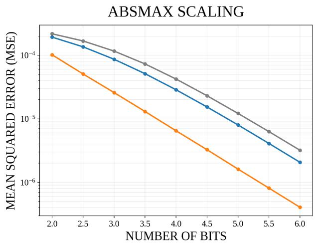

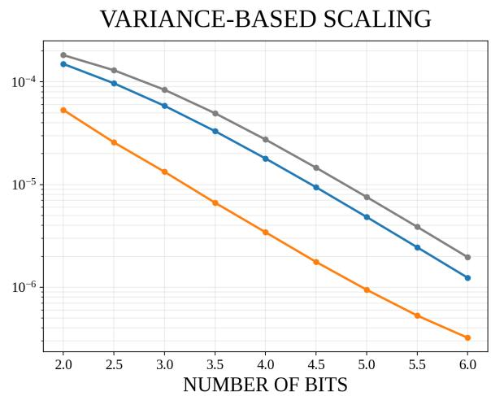  
Figure 5: Quantization distortion across bit widths in a synthetic multivariate Gaussian experiment under two scale calibration rules. The left panel uses AbsMax scaling, $A = \| X \| _ { \infty }$ , and the right panel uses a variance-based scale, $A = 3 { \sqrt { \operatorname* { m a x } _ { i } { \widehat { \operatorname* { V a r } } } ( z _ { i } ) } }$

## D Comparison of Layerwise Quantization Error

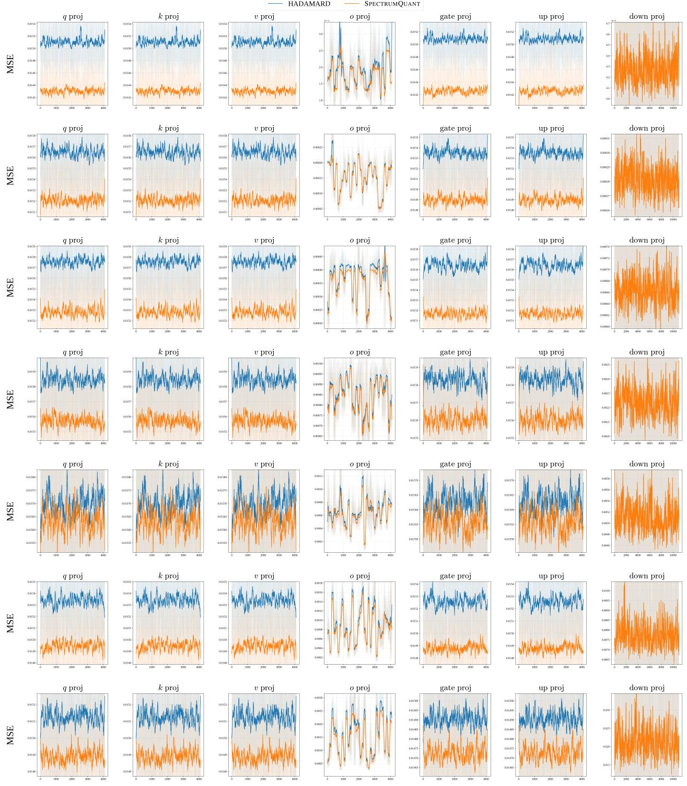  
LATENT DIMENSION INDEX

Figure 6: Comparison of mean squared quantization error across hidden dimensions for diferent projection activations in Llama-2 7B at layers 2,5,8,15,21,27,30 from top to bottom.