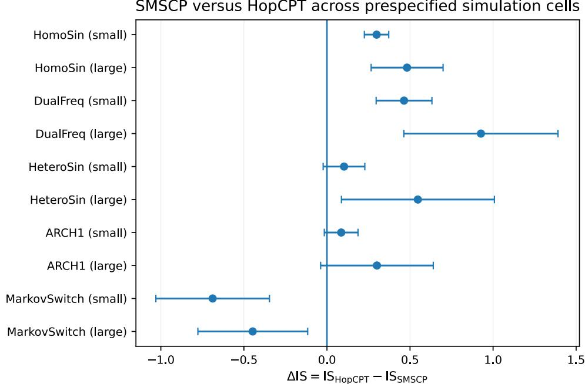

# State-Matched Sequence Conformal Prediction

Ruihang Hana and Li-Hsiang Lina

a Department of Mathematics and Statistics, Georgia State University, Atlanta, GA 30303

## Abstract

Sequential conformal prediction needs to decide which past errors should calibrate uncertainty for the current target. Recency and online error feedback are useful when recent observations remain relevant, but the recent past can be a poor reference when comparable states recur at nonadjacent times, with the recurrence pattern generally unknown. We propose State-Matched Sequence Conformal Prediction (SMSCP), which constructs an explicit one-sided local-linear state from pre-target information, uses state similarity to select a matched reference set of past calibration scores, and then applies the ordinary unweighted conformal order statistic. In contrast to existing approaches, SMSCP uses state similarity to identify calibration observations relevant to the target score quantile. This motivates a theoretical analysis of whether nearby states have comparable target score quantiles under temporal dependence. We establish control of the resulting conformal cutof and characterize predictive information not captured by the chosen state. Simulations show that state matching is most efective when score-relevant states recur across nonadjacent times, while revealing settings in which its advantage weakens or reverses. Across solar irradiance and bike-demand benchmarks, SMSCP improves interval score over recency, weighted, adaptive, and HopCPT comparators, and achieves coverage closer to the nominal 0.90 level than ResCP on five of six benchmarks.

Keywords: Conformal prediction; Time series; Uncertainty quantification

## 1 Introduction

Conformal prediction provides a framework for quantifying predictive uncertainty with finite-sample guarantees under exchangeability (Vovk et al., 2005; Shafer and Vovk, 2008). Standard split conformal and related sample-splitting methods operate in exchangeable or independence-type settings (Papadopoulos et al., 2002; Lei et al., 2018; Romano et al., 2019), with cross-fitting and jackknife-style refinements (Barber et al., 2021). Another line localizes or weights calibration to handle covariate heterogeneity or distribution shift, including covariate-shift weighting (Tibshirani et al., 2019), localized conformal methods (Guan, 2023), and weighted conformal methods beyond exact exchangeability (Barber et al., 2023). These approaches establish that calibration relevance need not be uniform across observations.

Sequential conformal prediction raises a diferent question: which past observations are relevant for the current target? Early work on conformal inference under temporal dependence establishes validity under mixing and related dependence conditions (Chernozhukov et al., 2018, 2021). Rolling and online methods such as EnbPI (Xu and Xie, 2021) and adaptive conformal inference (Gibbs and Candès, 2021; Zafran et al., 2022) address this question primarily through temporal recency or online recalibration. Temporal closeness can be a poor relevance signal, while similar observed features at diferent times need not imply similar target score quantiles. StaLoP (Han and Lin, 2026) uses target-local state similarity to borrow historical panels for mean-function estimation, whereas SMSCP uses pre-target state similarity to select residual scores for conformal prediction intervals.

Recent sequential conformal methods move beyond pure temporal recency by identifying historical observations that are relevant to the current prediction. HopCPT, ResCP, and RCCP retrieve or reweight past residuals using similarity in observed or learned representations (Auer et al., 2023; Neglia et al., 2026; Jin et al., 2026), while SPCI and KOWCPI model residual quantiles using residual-history information (Xu and Xie, 2023; Lee et al., 2025). Such approaches rely on the representation being suficiently informative that similar contexts imply

similar residual behavior. This can be restrictive when similar observed contexts correspond to diferent residual regimes. SMSCP instead makes relevance explicitly target-specific by asking whether pre-target states imply comparable target-score quantiles. These distinctions motivate State-Matched Sequence Conformal Prediction (SM SCP). SMSCP makes relevance explicit through a pre-target state: it constructs an interpretable one-sided local-linear state summarizing the recent trajectory relative to pre-target inputs, performs hard Mahalanobis matching, and then applies the ordinary unweighted conformal order statistic to the matched reference set. The distinction is not localization itself or the mere use of a state, but where state similarity enters calibration: it determines reference-set membership without changing the backbone predictor, score definition, or conformal quantile rule. The matched reference set is directly inspectable, and the state coordinates summarize local response level and slopes with respect to the chosen pre-targe inputs. SMSCP treats conformal calibration as a state-matching problem: select a reference set whose states are comparable to that of the target, then apply the ordinary conformal rule on that set. The method is modular: it modifies the calibration reference set, not the backbone predictor, score definition, or conformal quantile rule. The local-linear construction is one transparent implementation of this principle; the theory below treats the resulting pre-target state abstractly. Because the matched reference set is target-dependent, classical global exchangeability does not directly characterize SMSCP. Formally, let $q ( z )$ denote the conditional (1 − α) score quantile indexed by state. Under state–quantile relevance, uniform local concentration over the target-dependent neighborhoods under temporal dependence, and local quantile regularity, we bound the cutof error by a state-matching term, a sampling-under-dependence term, and a finite-k order-statistic term. We then compare $q ( Z _ { t } )$ with the full-history target quantile through an explicit state-information discrepancy, which isolates predictive information not captured by the chosen state. The main theorem therefore first controls estimation of the

state-indexed target $q ( Z _ { t } )$ ; predictive conditional validity relative to the full pre-target history additionally requires this discrepancy to vanish. Standard mixing conditions enter only as suficient conditions for the required local concentration, rather than as the form of the main result. The theory does not require matched scores to be exchangeable or to share their entire conditional distribution.

Empirically, SMSCP gains are clearest when score-relevant states recur; they weaken when the state misses relevant information or switching is abrupt. On real data, SMSCP has lower mean interval score than recency, weighted, adaptive, and HopCPT comparators; against ResCP, its coverage estimate is closer to nominal 0.90 on five of six benchmarks, whereas ResCP has lower mean interval score on all six. We therefore do not claim universal dominance.

Our contributions are threefold:

1. We formulate sequential conformal calibration as a state-matching problem, using interpretable pre-target states to define relevance beyond temporal recency.

2. We propose a modular state-matched conformal algorithm that uses state similarity only to select a matched reference set and then applies the ordinary unweighted conformal order statistic without changing the predictor, score, or conformal quantile rule.

3. We provide quantile-targeted theory and mechanism-isolating experiments. The theory decomposes cutof error into a state-matching term, a sampling-under-dependence term, and a finite-k order-statistic term, while the state-information discrepancy quantifies predictive information omitted by the chosen state. The experiments use recency controls together with favorable, mixed, and boundary settings to probe when state matching helps and when it does not.

## 2 Method

## 2.1 Problem setup

We observe a time-ordered sequence $\{ Y _ { t } \} _ { t = 1 } ^ { T }$ and construct prediction intervals for sequential target times at nominal coverage 1 − α. SMSCP constructs an explicit one-sided local-linear pre-target state and uses state similarity to identify past calibration points that are relevant to the current target score quantile. The formal state–quantile relevance condition is stated in Section 3.

Let $\hat { \mu } _ { t }$ denote a point predictor of $Y _ { t }$ obtained using only observations available before time t. The nonconformity score is

$$
R _ { t } = | Y _ { t } - \hat { \mu } _ { t } | .\tag{1}
$$

For a target time t, let

$$
{ \mathcal { T } } _ { \mathrm { r a w } } ( t ) = \{ t - n _ { \mathrm { c a l } } , \dots , t - 1 \}\tag{2}
$$

denote the rolling candidate window. The eligible calibration pool ${ \mathcal { T } } _ { \mathrm { c a l } } ( t ) \subseteq { \mathcal { T } } _ { \mathrm { r a w } } ( t )$ contains the indices for which the required pre-target predictor, state, and any prespecified applicationlevel eligibility condition are available. Write $n _ { t } = | \mathcal { I } _ { \mathrm { c a l } } ( t ) |$ . When all required quantities are available, ${ \mathcal { T } } _ { \mathrm { c a l } } ( t ) = { \mathcal { T } } _ { \mathrm { r a w } } ( t )$ . Since conformal calibration is performed on the scores $\{ R _ { t } \}$ , the key task is to identify past calibration points that are informative for the current target score quantile.

## 2.2 State construction

For each time point $s ,$ let $X _ { s } \in \mathbb { R } ^ { p }$ be a pre-target input vector constructed from observations available before $Y _ { s } .$ such as time index, recent lags, covariates, or local summaries of the recent past. The choice of $X _ { s }$ is application-specific, while SMSCP uses the same one-sided local-linear state construction below.

For a fixed history length h, we define the SMSCP state by local-linear coeficients (Fan and Gijbels, 1996). The coeficients give an interpretable, one-sided summary of local response level and slopes with respect to the chosen pre-target inputs. SMSCP uses the resulting local-linear state as an interpretable representation for calibration matching. The theory requires that nearby states imply similar target score quantiles; this state construction is one implementation of that principle and need not dominate direct matching on the original inputs in every setting. For analysis, Section 3 treats the resulting state $Z _ { s }$ abstractly. Appendix A.3 gives a suficient prediction-error scale model.

We construct the state as the one-sided local-linear coeficient vector

$$
Z _ { s } = \underset { \beta \in \mathbb { R } ^ { p + 1 } } { \arg \operatorname* { m i n } } \sum _ { r = s - h } ^ { s - 1 } \Bigg [ Y _ { r } - \beta _ { 0 } - \sum _ { j = 1 } ^ { p } \beta _ { j } ( X _ { r j } - X _ { s j } ) \Bigg ] ^ { 2 } .\tag{3}
$$

Here $X _ { s j }$ and $X _ { r j }$ denote the jth coordinates of $X _ { s }$ and $X _ { r }$ . The construction is one-sided: neither $Y _ { s }$ nor future observations enter the fit. In implementation, the local ofsets are standardized within the history window; this scaling is suppressed in (3) for notational clarity. The intercept summarizes the local response level, while the remaining coeficients summarize local slopes with respect to the pre-target inputs.

## 2.3 Conformal prediction based on matched states

At target time t, the target state is $Z _ { t }$ . We compare each calibration state $Z _ { s } , s \in \mathcal { T } _ { \mathrm { c a l } } ( t )$ ， with $Z _ { t }$ using the Mahalanobis distance

$$
d _ { s , t } = \sqrt { ( Z _ { s } - Z _ { t } ) ^ { \top } \widehat { \Sigma } _ { t } ^ { - 1 } ( Z _ { s } - Z _ { t } ) } ,\tag{4}
$$

where

$$
\widehat { \Sigma } _ { t } = \operatorname { C o v } \bigl ( \{ Z _ { s } : s \in \mathscr { T } _ { \mathrm { c a l } } ( t ) \} \bigr ) + \varepsilon I , \qquad \varepsilon > 0 .\tag{5}
$$

Here I is the $( p + 1 ) \times ( p + 1 )$ identity matrix. The Mahalanobis distance accounts for the scale and correlation of the state coordinates within the eligible calibration pool, and the regularization term εI ensures invertibility.

For a retained fraction $\rho \in ( 0 , 1 ]$ , define

$$
k _ { t } ( \rho ) = \mathrm { m i n } \{ \mathrm { m a x } ( k _ { \mathrm { m i n } } , \lfloor \rho n _ { t } \rfloor ) , n _ { t } \} ,\tag{6}
$$

where $k _ { \mathrm { m i n } }$ is a prespecified lower bound chosen so that the order statistic below is well defined. We form the matched reference set

$$
\mathcal { N } _ { t } ( \rho ) = \{ s \in \mathbb { Z } _ { \mathrm { c a l } } ( t ) : \mathrm { r a n k } ( d _ { s , t } ) \leq k _ { t } ( \rho ) \} ,\tag{7}
$$

where the rank is computed among $\{ d _ { s , t } : s \in \mathcal { T } _ { \mathrm { c a l } } ( t ) \}$ , with smaller distance corresponding to higher state similarity. Ties are broken deterministically so that $| \mathcal { N } _ { t } ( \rho ) | = k _ { t } ( \rho )$ . The candidate set $\mathcal { R }$ for $\rho$ is prespecified. When $\rho = 1$ , the procedure reduces to ordinary rolling conformal calibration over the eligible calibration pool.

The conformal cutof is

$$
\hat { q } _ { t } = R _ { ( m _ { t } ) } ^ { \mathcal { N } _ { t } ( \rho ) } , \qquad m _ { t } = \big \lceil ( k _ { t } ( \rho ) + 1 ) ( 1 - \alpha ) \big \rceil ,\tag{8}
$$

where $R _ { ( m _ { t } ) } ^ { { \cal N } _ { t } ( \rho ) }$ denotes the $m _ { t }$ th order statistic of the matched scores $\{ R _ { s } : s \in \mathcal { N } _ { t } ( \rho ) \}$ . The resulting prediction interval is

$$
\widehat { \mathcal { C } } _ { 1 - \alpha } ( t ) = [ \hat { \mu } _ { t } - \hat { q } _ { t } , ~ \hat { \mu } _ { t } + \hat { q } _ { t } ] .\tag{9}
$$

Thus SMSCP matches states, not estimated $q ( z )$ values, to form the reference set and then applies the ordinary unweighted conformal order statistic.

## 2.4 Hyperparameter selection

We tune the state-construction and matching parameters using the interval score, a proper scoring rule for prediction intervals (Gneiting and Raftery, 2007). It penalizes interval width together with the distance of observations falling below or above the interval. For an interval $[ L , U ]$ at nominal level $1 - \alpha$ , define

$$
\begin{array} { l } { \displaystyle \mathrm { I S } _ { \alpha } ( [ L , U ] , Y ) = ( U - L ) } \\ { \displaystyle \qquad + \frac { 2 } { \alpha } ( L - Y ) \mathbf { 1 } \{ Y < L \} } \\ { \displaystyle \qquad + \frac { 2 } { \alpha } ( Y - U ) \mathbf { 1 } \{ Y > U \} . } \end{array}\tag{10}
$$

We select $( h , \rho )$ by minimizing the mean interval score over a validation block $\mathcal { T } _ { \mathrm { v a l } }$ , where H and $\mathcal { R }$ are prespecified finite candidate grids:

$$
( h ^ { \star } , \rho ^ { \star } ) = \underset { ( h , \rho ) \in \mathcal { H } \times \mathcal { R } } { \arg \operatorname* { m i n } } \frac { 1 } { | \mathcal { T } _ { \mathrm { v a l } } | } \sum _ { t \in \mathcal { T } _ { \mathrm { v a l } } } \mathrm { I S } _ { \alpha } \big ( \widehat { \mathcal { C } } _ { 1 - \alpha } ^ { ( h , \rho ) } ( t ) , Y _ { t } \big ) .\tag{11}
$$

The selected pair $( h ^ { \star } , \rho ^ { \star } )$ is then fixed for final deployment. The history length h controls how locally the state is estimated. Smaller $\rho$ retains fewer, closer states, whereas larger $\rho$ uses more calibration scores while admitting more distant states. Algorithm 1 in Appendix A.7 summarizes the complete validation-and-deployment procedure.

## 3 Theoretical Properties of SMSCP

The deployed SMSCP procedure fixes $Z _ { t }$ as the one-sided local-linear state in Section 2.2, but the analysis treats the resulting state abstractly: nearby states should have similar target score quantiles. For the observed sequence of state–score pairs $\{ ( Z _ { s } , R _ { s } ) \}$ , the main theorem imposes no specific parametric time-series model, exchangeability condition, global stationarity of the observed sequence, or named mixing condition. Temporal dependence enters only through the uniform local concentration requirement stated below. The state-information discrepancy introduced later compares the state-indexed target score quantile with the target based on the full pre-target history. Accordingly, Theorem 1 is first a state-indexed cutof result; predictive conditional validity additionally depends on how much target-relevant information the chosen state omits.

The concentration events are understood uniformly over the finite tuning grid; $\mathrm { A p \mathrm { - } }$ pendix A.6 records the corresponding union-bound argument. For readability, we suppress the candidate index below and write $k = k _ { t } ( \rho )$

For each evaluation time t, let

$$
F _ { t } ( r \mid z ) = \operatorname* { P r } ( R _ { t } \le r \mid Z _ { t } = z )
$$

denote the conditional distribution function of the nonconformity score $R _ { t }$ given $Z _ { t } = z .$ and define its conditional (1 − α)-quantile by

$$
q _ { t } ( z ) = \operatorname* { i n f } \{ r : F _ { t } ( r \mid z ) \geq 1 - \alpha \} .
$$

Assumption 1 (State–quantile relevance). There exists a common state–quantile function q such that

$$
q _ { t } ( z ) = q ( z )
$$

for all relevant calibration and target times t and states z. Moreover, there exist $r _ { 0 } > 0$ $L _ { q } < \infty$ , and $\gamma \in ( 0 , 1 ]$ such that

$$
\begin{array} { r } { | q ( \boldsymbol { z } ) - q ( \boldsymbol { z } ^ { \prime } ) | \leq L _ { q } \| \boldsymbol { z } - \boldsymbol { z } ^ { \prime } \| _ { 2 } ^ { \gamma } , ~ } \\ { w h e n e v e r ~ \| \boldsymbol { z } - \boldsymbol { z } ^ { \prime } \| _ { 2 } \leq r _ { 0 } . } \end{array}\tag{12}
$$

Assumption 1 is the substantive state–quantile relevance condition: after conditioning on the constructed state, the target (1 − α) score quantile is stable across recurrent states and varies smoothly with state distance. It does not require the response to follow a local-linear model, nor does it require equality or total-variation closeness of the full conditional score distributions. Because time and recent history may enter $Z _ { t }$ , the common function q does not require the score quantile to be constant over calendar time. Appendix A.3 gives a suficient prediction-error scale model and an explicit failure mode for this condition.

Let $d _ { ( k ) , t }$ denote the kth smallest Mahalanobis distance in (4). Define

$$
r _ { t } ^ { \star } = \sqrt { \lambda _ { \operatorname* { m a x } } ( \widehat { \Sigma } _ { t } ) } d _ { ( k ) , t } .\tag{13}
$$

The matched reference set is contained in the Euclidean ball of radius $r _ { t } ^ { \star }$ around $Z _ { t }$ . Hence, whenever $r _ { t } ^ { \star } \leq r _ { 0 }$ 2

$$
| q ( z ) - q ( Z _ { t } ) | \leq L _ { q } ( r _ { t } ^ { \star } ) ^ { \gamma }
$$

for every state z in that reference set.

For any state neighborhood A, define

$$
\widehat { F } _ { t , A } ( x ) = \frac { \sum _ { s \in \mathbb { Z } _ { \mathrm { c a l } } ( t ) } \mathbf { 1 } \{ Z _ { s } \in A , \ R _ { s } \leq x \} } { \sum _ { s \in \mathbb { Z } _ { \mathrm { c a l } } ( t ) } \mathbf { 1 } \{ Z _ { s } \in A \} } ,
$$

and its population counterpart over the same eligible calibration pool by

$$
F _ { t , A } ( x ) = \frac { \sum _ { s \in \mathbb { Z } _ { \mathrm { c a l } } ( t ) } \operatorname* { P r } ( Z _ { s } \in A , \ R _ { s } \leq x ) } { \sum _ { s \in \mathbb { Z } _ { \mathrm { c a l } } ( t ) } \operatorname* { P r } ( Z _ { s } \in A ) } ,
$$

whenever the denominator is positive. Let A be the class of ellipsoids in $\mathbb { R } ^ { p + 1 }$ . The target-dependent Mahalanobis neighborhood used by SMSCP is an element of this fixed, finite-VC-dimensional class.

Assumption 2 (Uniform local concentration). For every fixed $\delta \in \mathsf { \Gamma } ( 0 , 1 )$ , there exists

$\eta _ { n _ { t } , k } ( \delta ) \ge 0$ such that, with probability at least $1 - \delta - o ( 1 )$ (1),

$$
\begin{array} { r l r } & { } & { \underset { \boldsymbol { A } \in \mathcal { A } : } { \operatorname* { s u p } } \left| \widehat { F } _ { t , \boldsymbol { A } } ( \boldsymbol { x } ) - F _ { t , \boldsymbol { A } } ( \boldsymbol { x } ) \right| } \\ & { } & { \sum _ { s \in \mathcal { T } _ { \mathrm { c a l } } ( t ) } \mathbf { 1 } \{ Z _ { s } \in \boldsymbol { A } \} \ge k } \\ & { } & \\ & { } & { \qquad \le \eta _ { n _ { t } , k } ( \delta ) . } \end{array}\tag{14}
$$

Along the asymptotic sequence of interest, $\eta _ { n _ { t } , k } ( \delta ) \to 0$

The uniformity in Assumption 2 is needed because the target state, Mahalanobis metric, and kth-nearest-state radius are data-dependent. The condition is stated at the empiricalprocess level rather than tied to one dependence model.

Assumption 3 (Local quantile regularity). There exist $u _ { 0 } ~ > ~ 0$ and $c _ { q } ~ > ~ 0$ such that, uniformly over the relevant evaluation times and states and for all $u \in [ 0 , u _ { 0 } ]$ 2

$$
\begin{array} { r } { F _ { t } ( q ( z ) + u \mid z ) \ge 1 - \alpha + c _ { q } u , } \\ { \quad } \\ { F _ { t } ( q ( z ) - u \mid z ) \le 1 - \alpha - c _ { q } u . } \end{array}\tag{15}
$$

Assumption 3 requires the conditional CDF to cross the target quantile at a nonvanishing local rate. It is used only to convert CDF error into quantile error. Appendix A.3 shows that the same prediction-error scale model used to motivate Assumption 1 also implies this condition under a standard positive-density requirement.

For the theoretical statements below, when $k < n _ { t }$ we assume the kth and $( k + 1 ) \mathrm { s t }$ Mahalanobis distances are distinct; this holds almost surely under continuous state laws. The deterministic tie rule in Section 2.3 remains the implementation rule for numerical ties.

Theorem 1 (State-matched cutof error). Suppose Assumptions $\begin{array} { r } { I , ~ \mathcal { Q } , } \end{array}$ and 3 hold. Then, whenever $r _ { t } ^ { \star } \leq r _ { 0 }$ and

$$
\eta _ { n _ { t } , k } ( \delta ) + \frac { 2 } { k } < \alpha , \qquad \frac { 1 } { c _ { q } } \left\{ \eta _ { n _ { t } , k } ( \delta ) + \frac { 2 } { k } \right\} \le u _ { 0 } ,
$$

with probability at least $1 - \delta - o ( 1 )$ ,

$$
| \hat { q } _ { t } - q ( Z _ { t } ) | \leq L _ { q } ( r _ { t } ^ { \star } ) ^ { \gamma } + \frac { 1 } { c _ { q } } \left\{ \eta _ { n  t , k } ( \delta ) + \frac { 2 } { k } \right\} .\tag{16}
$$

The bound separates three sources of error:

$$
\begin{array} { r l r } & { L _ { q } ( r _ { t } ^ { \star } ) ^ { \gamma } } & { \mathrm { ( s t a t e - m a t c h i n g ~ t e r m ) , } } \\ & { c _ { q } ^ { - 1 } \eta _ { n _ { t } , k } ( \delta ) } & { \mathrm { ( s a m p l i n g - u n d e r \mathrm { - } d e p e n d e n c e ~ t e r m ) , } } \\ & { \frac { 2 } { c _ { q } k } } & { \mathrm { ( f i n i t e - } k \mathrm { ~ o r d e r \mathrm { - } s t a t i s t i c ~ t e r m ) . } } \end{array}
$$

Smaller k can make the matched reference set more local, whereas larger k reduces the finite-k order-statistic term and typically stabilizes empirical quantile estimation. The additional small-perturbation conditions in Theorem 1 are technical requirements for controlling an empirical order statistic using only local regularity around the target quantile; they are not restrictions imposed by the algorithm.

The state need not contain all information in the full pre-target history. Let $\mathcal { F } _ { t - 1 }$ denote the information available before $Y _ { t }$ and define

$$
\begin{array} { r l } & { F _ { t } ^ { R } ( r ) = \operatorname* { P r } ( R _ { t } \leq r \mid \mathcal { F } _ { t - 1 } ) , } \\ & { ~ } \\ & { q _ { t } ^ { \star } = \operatorname* { i n f } \{ r : F _ { t } ^ { R } ( r ) \geq 1 - \alpha \} , } \end{array}
$$

together with the state-information discrepancy

$$
\Delta _ { t } = | q _ { t } ^ { \star } - q ( Z _ { t } ) | .\tag{17}
$$

Thus $\Delta _ { t }$ measures predictive information in the full pre-target history that is not captured by $Z _ { t }$ . By Theorem 1, on the same event,

$$
| \hat { q } _ { t } - q _ { t } ^ { \star } | \leq \Delta _ { t } + L _ { q } ( r _ { t } ^ { \star } ) ^ { \gamma } + \frac { 1 } { c _ { q } } \left\{ \eta _ { n _ { t } , k } ( \delta ) + \frac { 2 } { k } \right\} .\tag{18}
$$

Thus Theorem 1 controls estimation of $q ( Z _ { t } )$ , whereas approximation to the full-history target $q _ { t } ^ { \star }$ additionally depends on $\Delta _ { t }$

Corollary 1 (Asymptotic predictive conditional coverage). Suppose the conditions of Theorem 1 hold and, in addition, $F _ { t } ^ { R }$ is continuous at $q _ { t } ^ { \star }$ , so that $F _ { t } ^ { R } ( q _ { t } ^ { \star } ) = 1 - \alpha$ , and there exists a nondecreasing modulus ω such that, uniformly over the relevant evaluation times,

$$
| F _ { t } ^ { R } ( v ) - ( 1 - \alpha ) | \leq \omega ( | v - q _ { t } ^ { \star } | ) ,
$$

$$
\omega ( u )  0 \quad a s \ u \downarrow 0 .
$$

Because $\hat { q } _ { t }$ is $\mathcal { F } _ { t - 1 }$ -measurable, with probability at least $1 - \delta - o ( 1 )$

$$
\begin{array} { r l } & { \left| \operatorname* { P r } \Big \{ Y _ { t } \in \widehat { \mathcal { C } } _ { 1 - \alpha } ( t ) \mid \mathcal { F } _ { t - 1 } \Big \} - ( 1 - \alpha ) \right| } \\ & { \qquad \leq \omega \bigg ( \Delta _ { t } + L _ { q } ( r _ { t } ^ { \star } ) ^ { \gamma } + \displaystyle \frac { 1 } { c _ { q } } \left\{ \eta _ { n _ { t } , k } ( \delta ) + \frac { 2 } { k } \right\} \bigg ) . } \end{array}\tag{19}
$$

Hence predictive conditional coverage converges to the nominal level if

$$
\Delta _ { t } \to _ { p } 0 , \qquad r _ { t } ^ { \star } \to _ { p } 0 , \qquad \eta _ { n _ { t } , k } ( \delta ) \to 0 , \qquad k \to \infty .
$$

Under stationary absolute regularity (β-mixing), finite-VC empirical-process results provide one suficient condition for Assumption 2 under suitable mixing decay and suitable growth of k (Yu, 1994); see Appendix A.4. The appendix also records suficient conditions for state–quantile relevance, $\Delta _ { t } = 0$ , and shrinking matched neighborhoods.

## 4 Experiments

## 4.1 Setup

We evaluate SMSCP on simulation designs and two real-data benchmarks—solar irradiance and hourly bike demand—at nominal level $1 - \alpha = 0 . 9 0$ . The non-neural simulation panel uses B = 500 paired Monte Carlo replications for each of ten core cells formed by five designs and two chronological splits, (100, 100, 100, 100) and (300, 300, 300, 300), ordered as training history, validation, calibration, and test. Three additional simulation designs are evaluated under the large split.

Within the mechanism-controlled non-neural panel, all methods use the same nonanticipating 20-observation rolling lag-one-correlation predictor and the same nonconformity score $R _ { t } = | Y _ { t } - \hat { \mu } _ { t } |$ . At each target, the predictor estimates the lag-one correlation from the 20 most recent observed responses, clips the coeficient to [−0.99, 0.99], and multiplies the latest response by that coeficient. The separate HopCPT and ResCP comparisons use the same frozen point predictions and evaluation targets while retaining their method-specific calibration mechanisms. Thus diferences are not driven by refitting diferent point forecasters.

The pre-target inputs used to construct the state are application-specific. The periodic designs and solar benchmark use chronological trajectory information, autoregressive and exogenous designs use the corresponding lags or covariates, and the bike benchmark uses exact previous-day and previous-week counts. The state-matching and conformal calibration rules are otherwise unchanged across settings.

The non-neural comparator panel contains Rolling, Recent-k, Tuned-Recent, Tuned-NexCP (Barber et al., 2023), ACI-tuned (Gibbs and Candès, 2021), and ECI (Wu et al., 2025). Recent-k is the mechanism control: it uses the same eligible calibration pool, target-specific reference-set size, predictor, score, and ordinary conformal order statistic as SMSCP, but selects by recency rather than by state distance. Tuned-Recent independently tunes its retained fraction on the same chronological validation block. Tuned-NexCP independently tunes its decay parameter. ACI-tuned uses rolling conformal scores and updates its miscoverage level after each revealed outcome, with its learning rate selected by validation interval score; ECI independently tunes its learning rate. For SMSCP, the implementation searches $h \in \{ 5 , 7 , 9 , 1 1 , 1 3 \}$ and retained fractions $\rho \in \{ 0 . 0 5 , 0 . 0 8 , 0 . 1 0 , 0 . 1 5 , 0 . 2 0 , 0 . 2 5 , 0 . 3 3 , 0 . 4 0 , 0 . 5 0 , 1 \}$ , with $k _ { \mathrm { m i n } } = 1 0$ and $k _ { t } ( \rho )$ defined in (6). All tuning is performed once on the chronological validation block and the selected hyperparameters are then fixed throughout test evaluation. In particular, $\rho = 1$ includes the rolling calibration special case in the SMSCP search space.

HopCPT (Auer et al., 2023) is evaluated separately as the learned-retrieval comparator. Its simulation comparison uses 50 independent data realizations with three fixed neural initializations per realization, rather than the B = 500 protocol of the non-neural panel, so we report it separately instead of mixing estimates from diferent Monte Carlo samples in the same table. The three initialization-level results are averaged within each realization, and paired Monte Carlo inference is then performed across the 50 independent data realizations. We use 3000 training epochs, matching the published HopCPT experiment configuration.

ResCP (Neglia et al., 2026) is evaluated separately on the real-data benchmarks using the same frozen point predictor, candidate window, and evaluation targets; implementation and inference details are in Appendix B.7.

We report empirical coverage, mean interval width, and mean interval score $\mathrm { I S } _ { \alpha }$ from (10). For paired comparisons we define $\Delta _ { \mathrm { I S } } = \mathrm { I S } _ { \mathrm { c o m p a r a t o r } } { - } \mathrm { I S } _ { \mathrm { S M S C P } }$ , so positive values favor SMSCP. Interval score jointly penalizes interval width and observations outside the interval, while reporting coverage and mean interval width separately makes the source of each diference explicit. Complete DGP and tuning details are given in Appendix C and Appendix B.

## 4.2 Simulation results

We focus on the setting SMSCP is designed to exploit: states with similar target score quantiles recur at nonadjacent times, temporal proximity is an imperfect relevance signal, and the chosen pre-target state captures that recurrence. Table 1 summarizes the non-neural panel.

The clearest gains occur in the recurrent periodic designs. In all four HomoSin and DualFreq cells, SMSCP has lower mean interval score than each of the six non-neural comparators, and every paired 95% Monte Carlo interval for $\Delta _ { \mathrm { I S } }$ is strictly positive. These gains are not driven by wider intervals: in all four cells, SMSCP produces narrower mean intervals while maintaining empirical coverage at or above the nominal level, although it is somewhat conservative in these recurrent designs. Relative to independently tuned recency, the interval-score gaps range from 0.217 to 0.573.

The remaining designs show where the advantage weakens. HeteroSin-small is mixed: Rolling has a slightly lower interval score, while the comparisons with Tuned-Recent, Tuned-NexCP, and ACI-tuned are unresolved; HeteroSin-large favors SMSCP in interval score but has slight undercoverage (0.898). In ARCH(1), although $Y _ { t - 1 } ^ { 2 }$ contains the conditional-volatility information, the SMSCP state is constructed by locally regressing the raw response on this input. Because $\mathbb { E } ( Y _ { t } \mid Y _ { t - 1 } ^ { 2 } ) = 0$ , the resulting level–slope state need not preserve the volatility scale relevant to the absolute prediction error. ARCH(1) therefore does not provide clean evidence for the proposed mechanism. Its small cell is mixed; although SMSCP has lower interval score than all non-neural comparators in the large cell, this gain is accompanied by undercoverage (0.889) and does not appear consistently across sample sizes or in the HopCPT comparison.

Abrupt switching gives a diferent failure mode. In MarkovSwitch, ECI reduces mean interval score relative to SMSCP by 0.380 in the small cell and 0.879 in the large cell. ACI-tuned also has lower interval score in the small cell by 0.040, but not in the large cell. Thus abrupt regime switching can favor online error-feedback or learned-retrieval methods, illustrating a setting in which smoothly recurring state similarity is not the dominant calibration mechanism.

Additional AR and covariate-driven designs in Appendix B.3 show little or no advantage for state matching when recency or directly observed predictive inputs already provide an adequate relevance signal.

Appendix Figure 1 gives the direct comparison with the learned-retrieval comparator. The same pattern appears: SMSCP is favored in both HomoSin cells, both DualFreq cells, and HeteroSin-large; HeteroSin-small and both ARCH(1) cells are unresolved; and HopCPT has lower interval score in both MarkovSwitch cells. In the four HomoSin/DualFreq cells, SMSCP again produces narrower intervals and lower interval score than HopCPT while maintaining empirical coverage at or above the nominal level, although it is somewhat conservative. Under MarkovSwitch, by contrast, HopCPT obtains lower interval score through substantially narrower intervals, while its empirical coverage is farther below the nominal 0.90 level. The comparison therefore identifies diferent settings rather than a uniformly better matching rule. Taken together, these numerical patterns are qualitatively consistent with the mechanisms highlighted by the theory rather than a direct numerical verification of its decomposition.

Table 1: Core non-neural simulation results at nominal $1 - \alpha = 0 . 9 0$ . The small (S) and large (L) splits are (100, 100, 100, 100) and (300, 300, 300, 300), respectively, with B = 500 paired Monte Carlo replications per cell. The first three numeric columns report SMSCP coverage, mean width, and mean interval score. The remaining columns report $\Delta _ { \mathrm { I S } } ~ =$ $\mathrm { I S _ { c o m p a r a t o r } - I S _ { S M S C P } ; }$ positive values favor SMSCP. Pointwise paired 95% Monte Carlo confidence intervals are reported in Appendix B.1.
<table><tr><td></td><td></td><td colspan="3">SMSCP absolute metrics</td><td colspan="6"> $\Delta _ { \mathrm { I S } }$  versus SMSCP</td></tr><tr><td>Design</td><td>Size</td><td>Cov.</td><td>Width</td><td>IS |</td><td>|Rolling</td><td>Recent-k</td><td>Tuned-Recent</td><td>Tuned-NexCP</td><td>ACI-tuned</td><td>ECI</td></tr><tr><td>HomoSin</td><td>S</td><td>0.928</td><td>2.727</td><td>2.946</td><td>+0.201</td><td>+0.339</td><td>+0.217</td><td>+0.203</td><td>+0.212</td><td>+0.611</td></tr><tr><td>HomoSin</td><td>L</td><td>0.933</td><td>2.625</td><td>2.817</td><td>+0.315</td><td>+0.414</td><td>+0.317</td><td>+0.317</td><td>+0.319</td><td>+0.527</td></tr><tr><td>DualFreq</td><td>S</td><td>0.930</td><td>3.312</td><td>3.555</td><td>+0.332</td><td>+0.486</td><td>+0.359</td><td>+0.337</td><td>+0.342</td><td>+0.680</td></tr><tr><td>DualFreq</td><td>L</td><td>0.939</td><td>3.160</td><td>3.340</td><td>+0.573</td><td>+0.718</td><td>+0.573</td><td>+0.575</td><td>+0.575</td><td>+0.770</td></tr><tr><td>HeteroSin</td><td>S</td><td>0.905</td><td>3.568</td><td>4.206</td><td>-0.019</td><td>+0.147</td><td>+0.006</td><td>-0.015</td><td>+0.005</td><td>+0.366</td></tr><tr><td>HeteroSin</td><td>L</td><td>0.898</td><td>3.385</td><td>4.044</td><td>+0.129</td><td>+0.183</td><td>+0.131</td><td>+0.131</td><td>+0.136</td><td>+0.434</td></tr><tr><td>ARCH(1)</td><td>S</td><td>0.894</td><td>2.997</td><td>4.126</td><td>-0.045</td><td>+0.090</td><td>+0.044</td><td>-0.046</td><td>-0.039</td><td>+0.358</td></tr><tr><td>ARCH(1)</td><td>L</td><td>0.889</td><td>2.852</td><td>4.127</td><td>+0.036</td><td>+0.154</td><td>+0.076</td><td>+0.035</td><td>+0.028</td><td>+0.143</td></tr><tr><td>MarkovSwitch</td><td>S</td><td>0.900</td><td>5.556</td><td>6.758</td><td>+0.045</td><td>+0.014</td><td>+0.020</td><td>+0.005</td><td>-0.040</td><td>-0.380</td></tr><tr><td>MarkovSwitch L</td><td></td><td>0.902</td><td>5.398</td><td>6.587</td><td>+0.236</td><td>+0.222</td><td>+0.224</td><td>+0.166</td><td>+0.056</td><td>-0.879</td></tr></table>

## 4.3 Real-data benchmark: solar irradiance

Solar irradiance tests whether state matching can select calibration scores more relevant than recency alone: nearby calendar times can have diferent local irradiance behavior, whereas distant points with similar pre-target states may have more comparable target score quantiles.

We evaluate SMSCP on five NSRDB stations (Sengupta et al., 2018) (Alachua, Phoenix, Seattle, Houston, and Minneapolis), each providing a full chronological half-hourly GHI series of length 52,608. The split is $( n _ { \mathrm { t r a i n } } , n _ { \mathrm { v a l } } , n _ { \mathrm { c a l } } , n _ { \mathrm { t e s t } } ) = ( 2 1 9 0 , 2 1 9 0 , 2 9 2 0 , 4 5 3 0 8 )$ . Evaluation is restricted to daylight test points defined by solar zenith angle below 90◦. State construction and point prediction are performed on the full chronological 30-minute series. For each daylight target, the rolling candidate window is formed first and then restricted to past daylight points with valid states to obtain the eligible calibration pool, preventing nighttime zero-irradiance observations from entering daylight calibration.

Table 2 shows a stable application-level pattern. SMSCP achieves lower interval score than each of the six non-neural comparators in the panel at all five stations; all 30 pointwise paired moving-block-bootstrap 95% intervals are strictly positive (Künsch, 1989). Its empirical coverage ranges from 0.909 to 0.920. The gain is not uniformly a width reduction: the coverage–width pattern difers by station, so coverage and width are interpreted separately rather than treating higher empirical coverage as inherently preferable.

The direct learned-retrieval comparison leads to the same station-level ordering. Across 50 HopCPT initializations on each fixed sequence, SMSCP has lower mean and median interval score at all five stations. HopCPT also shows appreciable initialization variability on several stations. All 50 initializations are included. These summaries describe initialization variability on the observed sequence, not repeated-sampling confidence intervals. ResCP results are reported jointly with Bike Sharing in Appendix B.7.

The original phase-level diagnostic in Appendix B.5 provides a more granular check. SMSCP has lower interval score than Rolling, Recent-k, Tuned-Recent, and Tuned-NexCP in all 20 station–phase combinations, and lower interval score than ECI in 16 of 20. The five stations are therefore treated as geographic replication within one solar application domain, not as evidence of broad multi-domain generalization.

## 4.4 Real-data benchmark: bike sharing

The UCI Bike Sharing benchmark (Fanaee-T, 2013) tests a diferent form of recurrence: hourly demand can return to similar daily and weekly conditions even when the most recent observations are not the most relevant reference points. We therefore use exact-calendar previous-day and previous-week counts as strictly pre-target state inputs. No weather variables are used; the exact state-input definition is given in Appendix B.6. Because the source series contains timestamp gaps, the two lags are matched by timestamp rather than by row ofset and are not imputed. All methods are evaluated on the same 4169 test targets for which the required daily and weekly lags and resulting state are available. Complete preprocessing, tuning, and inference details are given in Appendix B.6.

Table 2: Solar irradiance benchmark at nominal $1 - \alpha = 0 . 9 0$ . For the six non-neural comparators, $\Delta _ { \mathrm { I S } } = \mathrm { I S } _ { \mathrm { c o m p a r a t o r } } - \mathrm { I S } _ { \mathrm { S M S C P } }$ is the paired mean diference on the fixed station sequence; all 30 corresponding pointwise 7-day moving-block-bootstrap 95% intervals are strictly positive. The last two columns report the median and mean HopCPT-minus-SMSCP interval-score diferences across 50 neural initializations on the same fixed station sequence; this is initialization variability, not time-series sampling uncertainty. Width and interval score are in $\mathrm { W / m ^ { 2 } }$
<table><tr><td rowspan="2">Station</td><td colspan="3">SMSCP absolute metrics</td><td colspan="6">Non-neural  $\Delta _ { \mathrm { I S } }$ </td><td colspan="2">HopCPT  $\Delta _ { \mathrm { I S } }$ </td></tr><tr><td>Cov.</td><td>Width</td><td>IS</td><td>Rolling</td><td>Recent-k</td><td>Tuned-Recent</td><td>Tuned-NexCP</td><td>ACI-tuned</td><td></td><td>ECI | Median</td><td>Mean</td></tr><tr><td>Alachua</td><td>0.910</td><td>264.0</td><td>361.0</td><td>+32.7</td><td>+33.4</td><td>+32.7</td><td>+32.7</td><td>+30.4</td><td>+30.0</td><td>+30.9</td><td>+130.6</td></tr><tr><td>Phoenix</td><td>0.920</td><td>188.2</td><td>252.8</td><td>+31.5</td><td>+31.5</td><td>+31.5</td><td>+29.9</td><td>+30.4</td><td>+23.4</td><td>+21.1</td><td>+145.8</td></tr><tr><td>Seattle</td><td>0.914</td><td>208.4</td><td>286.2</td><td>+32.4</td><td>+27.3</td><td>+27.0</td><td>+22.9</td><td>+19.9</td><td>+19.1</td><td>+23.0</td><td>+29.2</td></tr><tr><td>Houston</td><td>0.914</td><td>249.3</td><td>332.9</td><td>+30.2</td><td>+31.7</td><td>+29.5</td><td>+30.2</td><td> $+ 2 8 . 7 \quad + 2 8 . 5 $ </td><td></td><td>+24.5</td><td> $+ 2 4 . 8$ </td></tr><tr><td>Minneapolis</td><td>0.909</td><td>214.3</td><td>295.6</td><td>+22.1</td><td>+19.7</td><td>+19.6</td><td>+17.5</td><td>+16.8</td><td>+13.1</td><td>+15.3</td><td>+45.2</td></tr></table>

The resulting coverage, mean interval width, and interval score are reported in Appendix Table 11. SMSCP attains coverage 0.894, mean width 326.4, and mean interval score 419.6. Relative to each of the six non-neural comparators in the panel, the paired 7-day moving-block-bootstrap interval for $\Delta _ { \mathrm { I S } }$ is strictly positive. The smallest gap among these comparisons is against ECI, $\Delta _ { \mathrm { I S } } = 1 9 9 . 5$ with 95% interval [190.1, 220.1].

HopCPT is evaluated with 50 neural initializations. For the sampling comparison, its metrics are averaged across initializations within each target before the same paired movingblock bootstrap is applied. HopCPT has mean coverage 0.870, width 317.5, and interval score 467.7, giving $\Delta _ { \mathrm { I S } } = 4 8 . 2$ (95% interval [31.0, 63.1]). Its mean interval is slightly narrower than SMSCP’s. On the same target set, SMSCP has lower mean interval score and its empirical coverage of 0.894 is closer to the nominal 0.90 level than HopCPT’s 0.870. Against ResCP, the SMSCP coverage point estimate is closer to nominal 0.90 on five of six benchmarks (Phoenix excepted), while ResCP has lower mean interval score on all six. This coverage comparison is descriptive; full metrics, paired intervals, and Bike 14-day sensitivity are in Appendix B.7.

## 5 Conclusion

We studied sequential conformal calibration as a target-score-quantile relevance problem. SMSCP matches past states using an explicit one-sided local-linear state and then applies the ordinary unweighted conformal order statistic. The theory separates cutof error into state matching, dependent sampling, and finite-k order-statistic terms; full-history predictive conditional validity additionally requires the state-information discrepancy $\Delta _ { t }$ to vanish. Experiments are qualitatively consistent with these mechanisms: gains are strongest when score-relevant states recur, weaken when recency or observed inputs sufice or the state omits relevant information, and can reverse under abrupt switching. On these benchmarks, ResCP exposes a coverage–interval-score trade-of. Thus, SMSCP provides a quantile-specific criterion for calibration relevance together with an explicit account of its limits.

## References

Andreas Auer, Martin Gauch, Daniel Klotz, and Sepp Hochreiter. Conformal prediction for time series with modern Hopfield networks. In Advances in Neural Information Processing Systems, volume 36, pages 56027–56074, 2023. doi: 10.52202/075280-2444.

Rina Foygel Barber, Emmanuel J. Candès, Aaditya Ramdas, and Ryan J. Tibshirani. Predictive inference with the jackknife+. The Annals of Statistics, 49(1):486–507, 2021. doi: 10.1214/20-AOS1965.

Rina Foygel Barber, Emmanuel J. Candès, Aaditya Ramdas, and Ryan J. Tibshirani. Conformal prediction beyond exchangeability. The Annals of Statistics, 51(2):816–845, 2023. doi: 10.1214/23-AOS2276.

Victor Chernozhukov, Kaspar Wüthrich, and Yinchu Zhu. Exact and robust conformal inference methods for predictive machine learning with dependent data. In Proceedings of the 31st Conference on Learning Theory, volume 75 of Proceedings of Machine Learning Research, pages 732–749. PMLR, 2018.

Victor Chernozhukov, Kaspar Wüthrich, and Yinchu Zhu. Distributional conformal prediction.

Proceedings of the National Academy of Sciences, 118(48):e2107794118, 2021. doi: 10.1073/ pnas.2107794118.

Jianqing Fan and Irene Gijbels. Local Polynomial Modelling and Its Applications, volume 66 of Monographs on Statistics and Applied Probability. Chapman & Hall, 1996.

Hadi Fanaee-T. Bike sharing. UCI Machine Learning Repository, 2013.

Isaac Gibbs and Emmanuel J. Candès. Adaptive conformal inference under distribution shift. In Advances in Neural Information Processing Systems, volume 34, pages 1660–1672, 2021.

Tilmann Gneiting and Adrian E. Raftery. Strictly proper scoring rules, prediction, and estimation. Journal of the American Statistical Association, 102(477):359–378, 2007. doi: 10.1198/016214506000001437.

Leying Guan. Localized conformal prediction: A generalized inference framework for conformal prediction. Biometrika, 110(1):33–50, 2023. doi: 10.1093/biomet/asac040.

Ruihang Han and Li-Hsiang Lin. Similarity-Based Prediction for Digital Twins: Panel Data, Theory, and Applications. arXiv preprint arXiv:2607.00128, 2026.

Sangjin Jin, Kangmin Kim, Junhyeong Lee, and Yongjae Lee. Retrieval-corrected conformal prediction for time series. arXiv preprint arXiv:2608.10553, 2026. Accepted at the 35th ACM International Conference on Information and Knowledge Management (CIKM ’26).

Hans R. Künsch. The jackknife and the bootstrap for general stationary observations. The Annals of Statistics, 17(3):1217–1241, 1989. doi: 10.1214/aos/1176347265.

Jonghyeok Lee, Chen Xu, and Yao Xie. Kernel-based optimally weighted conformal time-series prediction. In International Conference on Learning Representations, 2025.

Jing Lei, Max G’Sell, Alessandro Rinaldo, Ryan J. Tibshirani, and Larry Wasserman. Distribution-free predictive inference for regression. Journal of the American Statistical Association, 113(523):1094–1111, 2018. doi: 10.1080/01621459.2017.1307116.

Roberto Neglia, Andrea Cini, Michael Bronstein, and Filippo Maria Bianchi. ResCP: Reservoir conformal prediction for time series forecasting. In International Conference on Learning Representations, 2026.

Harris Papadopoulos, Kostas Proedrou, Volodya Vovk, and Alex Gammerman. Inductive confidence machines for regression. In Proceedings of the Thirteenth European Conference on Machine Learning, volume 2430 of Lecture Notes in Computer Science, pages 345–356. Springer, 2002. doi: 10.1007/3-540-36755-1\_29.

Yaniv Romano, Evan Patterson, and Emmanuel J. Candès. Conformalized quantile regression. In Advances in Neural Information Processing Systems, volume 32, pages 3543–3553, 2019.

Manajit Sengupta, Yu Xie, Anthony Lopez, Aron Habte, Galen Maclaurin, and James Shelby. The national solar radiation data base (NSRDB). Renewable and Sustainable Energy Reviews, 89:51–60, 2018. doi: 10.1016/j.rser.2018.03.003.

Glenn Shafer and Vladimir Vovk. A tutorial on conformal prediction. Journal of Machine Learning Research, 9:371–421, 2008.

Ryan J. Tibshirani, Rina Foygel Barber, Emmanuel J. Candès, and Aaditya Ramdas. Conformal prediction under covariate shift. In Advances in Neural Information Processing Systems, volume 32, pages 2530–2540, 2019.

Vladimir Vovk, Alexander Gammerman, and Glenn Shafer. Algorithmic Learning in a Random World. Springer, 2005. doi: 10.1007/b106715.

Junxi Wu, Dongjian Hu, Yajie Bao, Shu-Tao Xia, and Changliang Zou. Error-quantified conformal inference for time series. In International Conference on Learning Representations, 2025.

Chen Xu and Yao Xie. Conformal prediction interval for dynamic time-series. In Proceedings of the 38th International Conference on Machine Learning, volume 139 of Proceedings of Machine Learning Research, pages 11559–11569. PMLR, 2021.

Chen Xu and Yao Xie. Sequential predictive conformal inference for time series. In Proceedings of the 40th International Conference on Machine Learning, volume 202 of Proceedings of Machine Learning Research, pages 38707–38727. PMLR, 2023.

Bin Yu. Rates of convergence for empirical processes of stationary mixing sequences. The Annals of Probability, 22(1):94–116, 1994. doi: 10.1214/aop/1176988849.

Margaux Zafran, Olivier Féron, Yannig Goude, Julie Josse, and Aymeric Dieuleveut. Adaptive conformal predictions for time series. In Proceedings of the 39th International Conference on Machine Learning, volume 162 of Proceedings of Machine Learning Research, pages 25834–25866. PMLR, 2022.

## A Technical Conditions and Algorithmic Details for Section 3

This appendix summarizes the logic of Theorem 1 and Corollary 1, states suficient conditions for the main assumptions, and records the implementation algorithm. Detailed proofs are omitted from this preprint; the theorem and corollary statements and all reported numerical results are unchanged.

## A.1 Cutof bound: main argument

The selected Mahalanobis neighborhood is an element of the ellipsoid class in Assumption 2. State–quantile relevance bounds the diference between its member quantiles and $q ( Z _ { t } )$ ; uniform local concentration and quantile regularity transfer this bound to the empirical order statistic. The finite-k correction is at most $2 / k ,$ , as reflected in Theorem 1.

The condition $\eta _ { n _ { t } , k } ( \delta ) + 2 / k < \alpha$ is the finite-sample restriction needed when only local CDF regularity around the (1 − α) quantile is assumed. In particular, very small matched reference sets can place the conformal order statistic at or near the sample maximum, which cannot be controlled from local quantile behavior alone.

## A.2 Predictive coverage: main argument

Because the cutof is pre-target measurable, predictive conditional coverage is $F _ { t } ^ { R } ( \hat { q } _ { t } )$ . Combining the cutof bound with the state-information discrepancy $\Delta _ { t }$ and the modulus of continuity of $F _ { t } ^ { R }$ gives Corollary 1.

## A.3 A prediction-error scale model implying the state assumptions

The main theory is stated directly in terms of the score quantile because this is the minimal condition needed by SMSCP. The following result gives a concrete suficient model linking the constructed state to that quantile.

Proposition 1 (State-dependent prediction-error scale). Define the prediction error generated by the deployed point predictor as

$$
E _ { t } : = Y _ { t } - \hat { \mu } _ { t } .
$$

Suppose

$$
E _ { t } = \sigma ( Z _ { t } ) \xi _ { t } ,\tag{20}
$$

where $Z _ { t }$ and $\hat { \mu } _ { t }$ are available before $Y _ { t } , \sigma ( z ) > 0$ , and the conditional law of $| \xi _ { t } |$ given $Z _ { t } = z$ is a common distribution H for all relevant t and z. Let

$$
c _ { \alpha } = H ^ { - 1 } ( 1 - \alpha ) .
$$

Then

$$
q _ { t } ( z ) = q ( z ) = c _ { \alpha } \sigma ( z ) .\tag{21}
$$

Consequently, if

$$
| \sigma ( z ) - \sigma ( z ^ { \prime } ) | \leq L _ { \sigma } \| z - z ^ { \prime } \| _ { 2 } ^ { \gamma } ,
$$

then Assumption 1 holds with $L _ { q } = c _ { \alpha } L _ { \sigma }$

$H ,$ in addition, H has a density h satisfying $h ( u ) \geq h _ { 0 } > 0$ on a neighborhood $o f c _ { \alpha }$ and

$$
0 < \underline { { \sigma } } \le \sigma ( z ) \le \overline { { \sigma } } < \infty ,
$$

then Assumption 3 holds on a suficiently small uniform neighborhood of the target quantile with $c _ { q } = h _ { 0 } / \overline { { \sigma } }$

The score distribution under this model obeys $F _ { t } ( r \mid z ) = H \{ r / \sigma ( z ) \}$ ; the quantile and local density conclusions follow by rescaling. This is a suficient model, not an additional requirement for the main theorem.

The prediction errors in Proposition 1 need not be serially independent. If the stronger condition

$$
\mathcal { L } ( | \xi _ { t } | \mid \mathcal { F } _ { t - 1 } ) = H\tag{22}
$$

holds, then

$$
q _ { t } ^ { \star } = c _ { \alpha } \sigma ( Z _ { t } ) = q ( Z _ { t } ) , \qquad \Delta _ { t } = 0 .
$$

Thus serial correlation is compatible with the theory when it does not change the conditional magnitude quantile beyond what is captured by $Z _ { t }$ . For example, let $\xi _ { t } = S _ { t } U _ { t }$ , where $S _ { t } \in \{ - 1 , 1 \}$ is a persistent stationary Markov chain and $U _ { t } > 0$ is i.i.d. and independent of the sign process. Then $\xi _ { t }$ is serially correlated while $| \xi _ { t } | = U _ { t }$ , so (22) holds.

Conversely, if the conditional prediction-error scale contains predictable volatility information not represented by $Z _ { t } .$ , then $\Delta _ { t }$ need not vanish. In an ARCH/GARCH-type model, for example, the full-history quantile is proportional to the current conditional volatility. If the chosen state does not retain the history needed to determine that volatility, $q _ { t } ^ { \star }$ and $q ( Z _ { t } )$ generally difer. This is the failure mode measured explicitly by (17).

## A.4 A standard β-mixing route to uniform local concentration

Assumption 2 is intentionally stated without committing the main theorem to a particular time-series model. Here we record a standard suficient route based on existing empiricalprocess theory.

Write $n = | \mathcal { I } _ { \mathrm { c a l } } ( t ) |$ for the eligible calibration-pool size and let $W _ { s } = ( Z _ { s } , R _ { s } )$ . For a measurable set $C ,$ write

$$
\begin{array} { l } { { P _ { n } ( C ) = \displaystyle \frac { 1 } { n } \sum _ { s \in \mathbb { Z } _ { \mathrm { c a l } } ( t ) } \mathbf { 1 } \{ W _ { s } \in C \} } , } \\ { { P ( C ) = \operatorname* { P r } ( W _ { s } \in C ) . } } \end{array}
$$

where the latter does not depend on s under stationarity. Let $\mathcal { C }$ contain the sets

$$
\begin{array} { r l } & { \{ ( z , r ) : z \in A \} , } \\ & { } \\ & { \{ ( z , r ) : z \in A , \ r \leq x \} , \qquad A \in A , \ x \in \mathbb { R } . } \end{array}
$$

Because the state dimension is fixed, C has finite VC dimension.

Proposition 2 (A β-mixing suficient condition). Suppose $\{ W _ { s } \}$ is stationary and absolutely regular (β-mixing) under conditions that yield a uniform VC law of large numbers for C, as in Yu (1994). Write

$$
\zeta _ { n } = \operatorname* { s u p } _ { C \in { \mathcal C } } | P _ { n } ( C ) - P ( C ) | .
$$

$I f \zeta _ { n } = o _ { p } ( k / n )$ , then Assumption 2 holds with $\eta _ { n , k } = o _ { p } ( 1 )$

Uniform VC convergence controls the numerator and denominator of the local empirical CDF simultaneously. The lower bound $k / n$ on empirical neighborhood mass converts the uniform deviation $\zeta _ { n } = o _ { p } ( k / n )$ into the required local concentration. The dependence-specific VC law is the established result of Yu (1994).

The proposition is only a suficient example: the main theorem requires Assumption 2 itself and therefore also covers other dependence structures whenever the same local empirical concentration can be established.

## A.5 Primitive suficient condition for a shrinking matched radius

Uniform local concentration controls score estimation inside a selected neighborhood. A separate recurrence condition ensures that a neighborhood containing k calibration states can itself shrink.

Proposition 3 (Recurrence implies nearest-neighbor shrinkage). Let $d = p + 1$ be the state dimension. Suppose there exist $c _ { - } > 0$ and $r _ { 1 } > 0$ such that, uniformly over relevant target states z and all $0 < r \leq r _ { 1 }$ ，

$$
\frac { 1 } { n } \sum _ { s \in \mathcal { T } _ { \mathrm { c a l } } ( t ) } \mathrm { P r } \{ \| Z _ { s } - z \| _ { 2 } \leq r \} \geq c _ { - } r ^ { d } .\tag{23}
$$

Assume also that the ridge parameter $\varepsilon > 0$ in (5) is fixed, the uniform empirical-process deviation over state ellipsoids is $o _ { p } ( k / n ) , k / n \to 0$ , and

$$
\lambda _ { \operatorname* { m a x } } ( \widehat { \Sigma } _ { t } ) = O _ { p } ( 1 ) .
$$

Then

$$
\begin{array} { c } { { d _ { ( k ) , t } = O _ { p } \big \{ ( k / n ) ^ { 1 / d } \big \} , } } \\ { { { } } } \\ { { r _ { t } ^ { \star } = O _ { p } \big \{ ( k / n ) ^ { 1 / d } \big \}  _ { p } 0 . } } \end{array}\tag{24}
$$

The small-ball recurrence condition supplies order k historical states within a Euclidean radius of order $( k / n ) ^ { 1 / d }$ . The ridge-stabilized metric and concentration condition then imply the matched-radius rate in (24).

The small-ball condition (23) is the formal recurrence requirement used by the theory: locally around a relevant current state, the rolling historical pool must retain nonvanishing probability mass. Proposition 3 does not assert that this condition holds in every nonstationary sequence; it identifies the setting in which state matching can become increasingly local. The condition $k / n  0$ describes one suficient asymptotic regime, for example when $\rho _ { n } \to 0$ with $n \rho _ { n } \to \infty ;$ the fixed finite ρ-grids used in the experiments are finite-sample tuning devices and are not claimed to satisfy this particular regime.

## A.6 Finite-grid validation selection

No independence between the validation block and later observations is needed merely to account for selecting $( h , \rho )$ from the finite grid. Let $M = | { \mathcal { H } } \times { \mathcal { R } } |$ . If a candidatespecific high-probability statement holds with failure probability at most $\delta / M + o ( 1 )$ for each candidate, then a union bound gives a simultaneous event of probability at least $1 - \delta - o ( 1 )$ Any validation-selected pair $( h ^ { \star } , \rho ^ { \star } )$ therefore inherits the corresponding bound on that simultaneous event, provided the other conditions of the relevant theorem are satisfied for the selected pair. This is the uniformity convention used at the beginning of Section 3.

## A.7 Algorithmic summary

Algorithm 1: Validation-tuned state-matched sequence conformal prediction   
Input: Sequence $\{ Y _ { t } \} _ { t = 1 } ^ { T }$ , nominal level $\alpha ,$ rolling candidate-window length $n _ { \mathrm { c a l } } .$   
candidate grids H for h and R for $\rho$   
Output: Prediction intervals on the test block, or $\widehat { \mathcal { C } } _ { 1 - \alpha } ( T + 1 )$   
1 Split the sequence into training, validation, calibration, and test blocks   
2 Fit a point predictor using only pre-target information and compute scores $R _ { t }$ by (1)   
3 foreach $h \in \mathcal H$ do   
4 construct states $\{ Z _ { s } ^ { ( h ) } \}$ using (3)   
5 foreach $\rho \in \mathcal R$ do   
6 compute validation intervals by applying (2), (7), (8), and (9) on $\mathcal { T } _ { \mathrm { v a l } }$   
7 record the mean validation interval score using (10)   
8 select $( h ^ { \star } , \rho ^ { \star } )$ by (11)   
9 foreach target time t in the test block do   
10 apply (2), (7), (8), and (9) using $( h ^ { \star } , \rho ^ { \star } )$ and output ${ \widehat { \mathcal { C } } } _ { 1 - \alpha } ( t )$   
11 if the goal is a single final prediction then   
12 apply the same steps to $t = T + 1$ and output $\widehat { \mathcal { C } } _ { 1 - \alpha } ( T + 1 )$

## B Additional Experimental Results

The additional results below report the full empirical evaluation. The simulation results distinguish three settings: state matching helps when the constructed state captures recurrent score-relevant structure, adds little when recency already provides relevant calibration scores, and abrupt switching can favor online error-feedback or learned-retrieval methods. For ACI-tuned, the learning rate is selected from $\{ 0 . 0 0 0 5 , 0 . 0 0 1 , 0 . 0 0 2 , 0 . 0 0 5 , 0 . 0 1 , 0 . 0 2 , 0 . 0 5 \}$ by mean validation interval score, with ties broken toward the smaller value. At test start $\alpha _ { t }$ is reset to 0.10, clipped to [0.001, 0.30], and updated after observing the current outcome

according to

$$
\alpha _ { t + 1 } = \Pi _ { [ 0 . 0 0 1 , 0 . 3 0 ] } \left\{ \alpha _ { t } + \eta \left( 0 . 1 0 - { \bf 1 } \{ Y _ { t } \notin \widehat { \mathcal { C } } _ { t } ^ { \mathrm { A C I } } \} \right) \right\} .
$$

The real-data sections provide complete station-level solar results and the common-target Bike Sharing analysis.

## B.1 Complete core simulation results

Tables 3 and 4 report coverage, raw mean interval width, and mean interval score for every method in the B = 500 non-neural panel. Table 5 reports the paired interval-score diferences and their pointwise 95% Monte Carlo confidence intervals. These tables make the coverage–width source of each interval-score diference explicit.

The four HomoSin/DualFreq cells provide the clearest favorable settings: all six comparatorminus-SMSCP intervals are strictly positive, and the raw tables show narrower mean intervals while empirical coverage is maintained at or above the nominal level, with some conservativeness. HeteroSin-small is mixed, whereas HeteroSin-large favors SMSCP but has slight undercoverage. In ARCH(1), $Y _ { t - 1 } ^ { 2 }$ contains conditional-volatility information, but the rawresponse local-linear state need not preserve the volatility scale relevant to the absolute prediction error; the large-cell interval-score gain is accompanied by undercoverage and is not consistent across sample sizes or comparator classes. MarkovSwitch is the abrupt-switching boundary: ECI has lower interval score in both sample sizes.

## B.2 Direct learned-retrieval comparison

Table 6 reports the full HopCPT comparison, which tests whether explicit state matching remains competitive with the learned-retrieval comparator. Each cell uses 50 independent data realizations and three fixed HopCPT initializations. The three initialization-level results are averaged within each data realization before paired inference, so the inferential unit is the data realization rather than the neural seed.

Table 3: Complete non-neural core simulation results for the small split (100, 100, 100, 100), $B = 5 0 0$ , nominal $1 - \alpha = 0 . 9 0$
<table><tr><td>Design</td><td>Method</td><td>Coverage</td><td>Mean width</td><td>Mean  $\mathrm { I S } _ { \alpha }$ </td></tr><tr><td>HomoSin</td><td>SMSCP</td><td>0.928</td><td>2.727</td><td>2.946</td></tr><tr><td></td><td>Rolling</td><td>0.901</td><td>2.823</td><td>3.147</td></tr><tr><td></td><td>Recent-k</td><td>0.921</td><td>3.010</td><td>3.286</td></tr><tr><td></td><td>Tuned-Recent</td><td>0.903</td><td>2.843</td><td>3.163</td></tr><tr><td></td><td>Tuned-NexCP</td><td>0.904</td><td>2.836</td><td>3.149</td></tr><tr><td></td><td>ACI-tuned</td><td>0.902</td><td>2.834</td><td>3.159</td></tr><tr><td></td><td>ECI</td><td>0.899</td><td>3.128</td><td>3.558</td></tr><tr><td>DualFreq</td><td>SMSCP</td><td>0.930</td><td>3.312</td><td>3.555</td></tr><tr><td></td><td>Rolling</td><td>0.915</td><td>3.547</td><td>3.887</td></tr><tr><td></td><td>Recent-k</td><td>0.924</td><td>3.731</td><td>4.041</td></tr><tr><td></td><td>Tuned-Recent</td><td>0.917</td><td>3.576</td><td>3.915</td></tr><tr><td></td><td>Tuned-NexCP</td><td>0.917</td><td>3.563</td><td>3.892</td></tr><tr><td></td><td>ACI-tuned</td><td>0.913</td><td>3.545</td><td>3.897</td></tr><tr><td></td><td>ECI</td><td>0.905</td><td>3.792</td><td>4.235</td></tr><tr><td>HeteroSin</td><td>SMSCP</td><td>0.905</td><td>3.568</td><td>4.206</td></tr><tr><td></td><td>Rolling</td><td>0.901</td><td>3.505</td><td>4.187</td></tr><tr><td></td><td>Recent-k</td><td>0.912</td><td>3.736</td><td>4.353</td></tr><tr><td></td><td>Tuned-Recent</td><td>0.903</td><td>3.540</td><td>4.212</td></tr><tr><td></td><td>Tuned-NexCP</td><td>0.903</td><td>3.528</td><td>4.191</td></tr><tr><td></td><td>ACI-tuned</td><td>0.901</td><td>3.535</td><td>4.211</td></tr><tr><td></td><td>ECI</td><td>0.899</td><td>3.809</td><td>4.572</td></tr><tr><td>ARCH(1)</td><td>SMSCP</td><td>0.894</td><td>2.997</td><td>4.126</td></tr><tr><td></td><td>Rolling</td><td>0.900</td><td>2.935</td><td>4.081</td></tr><tr><td></td><td>Recent-k</td><td>0.902</td><td>3.173</td><td>4.216</td></tr><tr><td></td><td>Tuned-Recent</td><td>0.900</td><td>3.068</td><td>4.170</td></tr><tr><td></td><td>Tuned-NexCP</td><td>0.904</td><td>2.981</td><td>4.080</td></tr><tr><td></td><td>ACI-tuned</td><td>0.902</td><td>3.022</td><td>4.086</td></tr><tr><td></td><td>ECI</td><td>0.898</td><td>3.421</td><td>4.484</td></tr><tr><td>MarkovSwitch</td><td>SMSCP</td><td>0.900</td><td>5.556</td><td>6.758</td></tr><tr><td></td><td>Rolling</td><td>0.891</td><td>5.422</td><td>6.803</td></tr><tr><td></td><td>Recent-k</td><td>0.898</td><td>5.527</td><td>6.772</td></tr><tr><td></td><td>Tuned-Recent</td><td>0.898</td><td>5.518</td><td>6.778</td></tr><tr><td></td><td>Tuned-NexCP</td><td>0.898</td><td>5.501</td><td>6.763</td></tr><tr><td></td><td>ACI-tuned</td><td>0.900</td><td>5.510</td><td>6.718</td></tr><tr><td></td><td>ECI</td><td>0.899</td><td>5.163</td><td>6.379</td></tr></table>

All 1500 HopCPT fits are included. The learned method occasionally shows substantial initialization variability on particular data realizations. The comparison supports a narrower statement: explicit state matching is competitive with the learned-retrieval comparator when the state captures recurrent relevance, while abrupt switching can favor that comparator in interval score.

## B.3 Additional simulation designs

Table 7 reports the additional large-sample simulation panel. AR1 is a stationary reference where recency is already a strong relevance signal. WindowAR tests longer-memory lag structure, and CovARX tests observed exogenous covariates. Together they probe settings in which the relevant predictive information is carried by lags or observed covariates rather than by a recurring time trajectory.

Table 4: Complete non-neural core simulation results for the large split (300, 300, 300, 300), B = 500, nominal 1 − α = 0.90.
<table><tr><td>Design</td><td>Method</td><td>Coverage</td><td>Mean width</td><td>Mean  $\mathrm { I S } _ { \alpha }$ </td></tr><tr><td>HomoSin</td><td>SMSCP</td><td>0.933</td><td>2.625</td><td>2.817</td></tr><tr><td></td><td>Rolling</td><td>0.901</td><td>2.807</td><td>3.132</td></tr><tr><td></td><td>Recent-k</td><td>0.920</td><td>2.966</td><td>3.231</td></tr><tr><td></td><td>Tuned-Recent</td><td>0.901</td><td>2.809</td><td>3.133</td></tr><tr><td></td><td>Tuned-NexCP</td><td>0.902</td><td>2.815</td><td>3.134</td></tr><tr><td></td><td>ACI-tuned</td><td>0.902</td><td>2.813</td><td>3.135</td></tr><tr><td></td><td>ECI</td><td>0.900</td><td>2.957</td><td>3.344</td></tr><tr><td>DualFreq</td><td>SMSCP</td><td>0.939</td><td>3.160</td><td>3.340</td></tr><tr><td></td><td>Rolling</td><td>0.904</td><td>3.527</td><td>3.913</td></tr><tr><td></td><td>Recent-k</td><td>0.925</td><td>3.762</td><td>4.059</td></tr><tr><td></td><td>Tuned-Recent</td><td>0.904</td><td>3.529</td><td>3.914</td></tr><tr><td></td><td>Tuned-NexCP</td><td>0.905</td><td>3.536</td><td>3.916</td></tr><tr><td></td><td>ACI-tuned</td><td>0.904</td><td>3.530</td><td>3.916</td></tr><tr><td></td><td>ECI</td><td>0.901</td><td>3.664</td><td>4.111</td></tr><tr><td>HeteroSin</td><td>SMSCP</td><td>0.898</td><td>3.385</td><td>4.044</td></tr><tr><td></td><td>Rolling</td><td>0.900</td><td>3.474</td><td>4.173</td></tr><tr><td></td><td>Recent-k</td><td>0.906</td><td>3.567</td><td>4.227</td></tr><tr><td></td><td>Tuned-Recent</td><td>0.900</td><td>3.478</td><td>4.175</td></tr><tr><td></td><td>Tuned-NexCP</td><td>0.901</td><td>3.488</td><td>4.175</td></tr><tr><td></td><td>ACI-tuned</td><td>0.901</td><td>3.486</td><td>4.179</td></tr><tr><td></td><td>ECI</td><td>0.899</td><td>3.717</td><td>4.478</td></tr><tr><td>ARCH(1)</td><td>SMSCP</td><td>0.889</td><td>2.852</td><td>4.127</td></tr><tr><td></td><td>Rolling</td><td>0.900</td><td>2.906</td><td>4.163</td></tr><tr><td></td><td>Recent-k</td><td>0.902</td><td>3.105</td><td>4.281</td></tr><tr><td></td><td>Tuned-Recent</td><td>0.902</td><td>3.002</td><td>4.203</td></tr><tr><td></td><td>Tuned-NexCP</td><td>0.903</td><td>2.951</td><td>4.162</td></tr><tr><td></td><td>ACI-tuned</td><td>0.900</td><td>2.994</td><td>4.155</td></tr><tr><td></td><td>ECI</td><td>0.897</td><td>3.110</td><td>4.269</td></tr><tr><td>MarkovSwitch</td><td>SMSCP</td><td>0.902</td><td>5.398</td><td>6.587</td></tr><tr><td></td><td>Rolling</td><td>0.894</td><td>5.483</td><td>6.823</td></tr><tr><td></td><td>Recent-k</td><td>0.894</td><td>5.474</td><td>6.808</td></tr><tr><td></td><td>Tuned-Recent</td><td>0.900</td><td>5.583</td><td>6.811</td></tr><tr><td></td><td>Tuned-NexCP</td><td>0.902</td><td>5.550</td><td>6.752</td></tr><tr><td></td><td>ACI-tuned</td><td>0.900</td><td>5.440</td><td>6.643</td></tr><tr><td></td><td>ECI</td><td>0.898</td><td>4.561</td><td>5.708</td></tr></table>

The stationary AR1 comparison shows little incremental benefit from state matching: Tuned-Recent is essentially tied with SMSCP, while Rolling and Tuned-NexCP have slightly lower interval score. WindowAR is also close to the recency/weighted alternatives. ACItuned is essentially tied with SMSCP in AR1, has slightly higher interval score in WindowAR, and modestly lower interval score in CovARX. In CovARX, Rolling, Tuned-Recent, and Tuned-NexCP also have modestly lower interval score than SMSCP. These results support the intended scope restriction rather than a universal state-matching advantage.

Table 5: Paired interval-score comparisons for the core non-neural simulation panel. Each cell is $\Delta _ { \mathrm { I S } } = \mathrm { I S } _ { \mathrm { c o m p a r a t o r } } - \mathrm { I S } _ { \mathrm { S M S C P } }$ followed by its pointwise 95% paired Monte Carlo confidence interval. Positive values favor SMSCP.
<table><tr><td>Design</td><td>Size</td><td></td><td>Rolling</td><td>Recent-k</td><td></td><td>Tuned-Recent</td><td>Tuned-NexCP</td><td>ACI-tuned</td><td></td><td>ECI</td></tr><tr><td>HomoSin</td><td>S</td><td>+0.201</td><td>[+0.188,+0.213]</td><td>+0.339 [+0.325,+0.354]</td><td></td><td>+0.217 [+0.204,+0.230]</td><td>+0.203 [+0.191,+0.215]</td><td>+0.212 [+0.200,+0.225]</td><td>+0.611</td><td>[+0.574,+0.649]</td></tr><tr><td>HomoSin</td><td></td><td>+0.315</td><td>[+0.308,+0.323] +0.414</td><td>[+0.406,+0.422]</td><td></td><td>+0.317 [+0.309,+0.324]</td><td>+0.317 [+0.310,+0.324]</td><td>+0.319 [+0.311,+0.326]</td><td>+0.527</td><td>[+0.519,+0.535]</td></tr><tr><td>DualFreq</td><td></td><td>+0.332</td><td>[+0.315,+0.348]</td><td>+0.486 [+0.468,+0.504]</td><td>+0.359</td><td>[+0.342,+0.377]</td><td>+0.337 [+0.320,+0.353]</td><td>+0.342 [+0.325,+0.359]</td><td>+0.680</td><td>[+0.636,+0.724]</td></tr><tr><td>DualFreq</td><td></td><td>+0.573</td><td>[+0.565,+0.581]</td><td>+0.718 [+0.710,+0.726]</td><td>+0.573</td><td>[+0.565,+0.581]</td><td>+0.575 [+0.567,+0.584]</td><td>+0.575 [+0.567,+0.583]</td><td>+0.770</td><td>[+0.762,+0.779]</td></tr><tr><td>HeteroSin</td><td></td><td>-0.019 [-0.034,-0.003]</td><td>+0.147</td><td>[+0.128,+0.166]</td><td>+0.006</td><td>[-0.011,+0.023]</td><td>-0.015 [-0.031,+0.000]</td><td>+0.005 [-0.011,+0.022]</td><td>+0.366</td><td>[+0.330,+0.402]</td></tr><tr><td>HeteroSin</td><td></td><td>+0.129 [+0.121,+0.137]</td><td>+0.183</td><td>[+0.173,+0.192]</td><td>+0.131</td><td>[+0.124,+0.139]</td><td>+0.131 [+0.124,+0.139]</td><td>+0.136 [+0.128,+0.143]</td><td>+0.434</td><td>[+0.423,+0.444]</td></tr><tr><td>ARCH(1)</td><td>LSLSLS</td><td>-0.045 [-0.069,-0.021]</td><td>+0.090</td><td>[+0.060,+0.120]</td><td>+0.044</td><td>[+0.014,+0.073]</td><td>-0.046 [-0.070,-0.022]</td><td>-0.039 [-0.065,-0.014]</td><td>+0.358</td><td>[+0.293,+0.423]</td></tr><tr><td>ARCH(1)</td><td>L</td><td>+0.036</td><td>[+0.023,+0.048] +0.154</td><td>[+0.128,+0.181]</td><td></td><td>+0.076 [+0.061,+0.092]</td><td>+0.035 [+0.022,+0.047]</td><td>+0.028 [+0.006,+0.050]</td><td>+0.143 [</td><td>[+0.125,+0.160]</td></tr><tr><td>MarkovSwitch</td><td>S</td><td>+0.045</td><td>[+0.010,+0.080] +0.014</td><td>[-0.018,+0.046]</td><td>+0.020</td><td>[-0.015,+0.054]</td><td>+0.005 [-0.028,+0.037]</td><td>-0.040 [-0.071,-0.010]</td><td>-0.380</td><td>[-0.472,-0.287]</td></tr><tr><td>MarkovSwitch</td><td>L</td><td>+0.236 [+0.214,+0.258]</td><td>+0.222</td><td>[+0.200,+0.243]</td><td></td><td>+0.224 [+0.200,+0.248]</td><td>+0.166 [+0.146,+0.185]</td><td>+0.056 [+0.037,+0.076]</td><td></td><td>-0.879 [-0.922,-0.836]</td></tr></table>

Table 6: Direct simulation comparison with HopCPT. The final column is $\mathrm { I S } _ { \mathrm { H o p C P T } } - \mathrm { I S } _ { \mathrm { S M S C P } }$ with a pointwise 95% paired Monte Carlo confidence interval across 50 independent data realizations. The SMSCP metrics in this table are computed on the same 50 realizations used for the paired HopCPT comparison and therefore need not equal the B = 500 averages in Table 1.
<table><tr><td></td><td colspan="4">SMSCP</td><td colspan="3">HopCPT</td><td colspan="2"> $\Delta _ { \mathrm { I S } }$ </td><td>[95% CI]</td></tr><tr><td>Design</td><td>Size</td><td>Cov.</td><td>Width</td><td>IS</td><td>Cov.</td><td>Width</td><td>IS</td><td></td><td></td></tr><tr><td>HomoSin</td><td>S</td><td>0.928</td><td>2.704</td><td>2.919</td><td>0.886</td><td>2.786</td><td>3.218</td><td>+0.299</td><td>[+0.225,+0.372]</td></tr><tr><td>HomoSin</td><td>L</td><td>0.933</td><td>2.613</td><td>2.807</td><td>0.892</td><td>2.782</td><td>3.289</td><td>+0.482</td><td>[+0.266,+0.699]</td></tr><tr><td>DualFreq</td><td>S</td><td>0.927</td><td>3.297</td><td>3.549</td><td>0.899</td><td>3.497</td><td>4.013</td><td>+0.464</td><td>[+0.296,+0.632]</td></tr><tr><td>DualFreq</td><td>L</td><td>0.939</td><td>3.157</td><td>3.341</td><td>0.891</td><td>3.512</td><td>4.268</td><td>+0.927</td><td>[+0.463,+1.391]</td></tr><tr><td>HeteroSin</td><td>S</td><td>0.901</td><td>3.548</td><td>4.238</td><td>0.880</td><td>3.419</td><td>4.341</td><td></td><td>+0.103 [-0.023,+0.228]</td></tr><tr><td>HeteroSin</td><td>L</td><td>0.893</td><td>3.342</td><td>4.060</td><td>0.875</td><td>3.389</td><td>4.607</td><td></td><td>+0.547 [+0.087,+1.008]</td></tr><tr><td>ARCH(1)</td><td>S</td><td>0.892</td><td>3.047</td><td>4.236</td><td>0.881</td><td>2.878</td><td>4.321</td><td>+0.086</td><td>[-0.016,+0.187]</td></tr><tr><td>ARCH(1)</td><td>L</td><td>0.886</td><td>2.795</td><td>4.135</td><td>0.884</td><td>2.823</td><td>4.436</td><td>+0.301</td><td>[-0.038,+0.640]</td></tr><tr><td>MarkovSwitch</td><td>S</td><td>0.897</td><td>5.757</td><td>6.919</td><td>0.850</td><td>4.296</td><td>6.231</td><td>-0.688</td><td>[-1.030,-0.346]</td></tr><tr><td>MarkovSwitch</td><td>L</td><td>0.904</td><td>5.374</td><td>6.561</td><td>0.875</td><td>4.497</td><td>6.115</td><td></td><td>-0.447 [-0.777,-0.116]</td></tr></table>

## B.4 State-space versus feature-space matching

To isolate the efect of the constructed state itself, we compare State-k with Feature-k while holding fixed the eligible calibration pool, reference-set size, predictor, score, conformal order statistic, Mahalanobis metric, and covariance regularization. For WindowAR, Feature-k attains mean interval score 2.6282 versus 2.6439 for State-k, with paired Feature-minus-State diference −0.0156 (95% CI [−0.0190, −0.0122]). For CovARX, the corresponding mean interval scores are 2.2043 and 2.2205. Thus the constructed state is not universally superior to matching on the original features; it is one interpretable implementation of the matching principle whose value depends on whether nearby states imply comparable target score quantiles.

  
Figure 1: Direct comparison with HopCPT across the ten simulation cells. Points show $\Delta _ { \mathrm { I S } } = \mathrm { I S } _ { \mathrm { H o p C P T } } - \mathrm { I S } _ { \mathrm { S M S C P } }$ and bars show pointwise 95% paired Monte Carlo confidence intervals across 50 independent data realizations after averaging the three fixed HopCPT initializations within each realization. Positive values favor SMSCP.

## B.5 Solar benchmark: detailed results

The five solar stations form one application domain with geographic replication. Raw NSRDB files (Sengupta et al., 2018) are converted to full chronological 30-minute series, with reconstructed global horizontal irradiance $\mathrm { G H I } = \mathrm { D H I } + \mathrm { D N I } \operatorname* { m a x } \{ \cos ( \mathrm { z e n i t h } ) , 0 \}$ , and daylight defined by solar zenith angle below 90◦. The chronological split uses 2190 observations for the training-history block, 2190 for validation, 2920 for the rolling candidate-window length, and the remaining 45308 indices for the test tail. State construction and point prediction are performed on the full chronological sequence. At each daylight target, the rolling candidate window is formed first and then restricted to past daylight points with valid

Table 7: Additional simulation designs under the large split (300, 300, 300, 300) with $B = 5 0 0$ paired replications.
<table><tr><td>Design</td><td>Method</td><td>Coverage</td><td>Mean width</td><td>Mean  $\mathrm { I S } _ { \alpha }$ </td></tr><tr><td>AR1</td><td>SMSCP</td><td>0.899</td><td>3.524</td><td>4.460</td></tr><tr><td rowspan="11">WindowAR</td><td>Rolling</td><td>0.900</td><td>3.520</td><td>4.447</td></tr><tr><td>Recent-k</td><td>0.901</td><td>3.553</td><td>4.469</td></tr><tr><td>Tuned-Recent</td><td>0.900</td><td>3.535</td><td>4.458</td></tr><tr><td>Tuned-NexCP</td><td>0.902</td><td>3.551</td><td>4.450</td></tr><tr><td>ACI-tuned</td><td>0.901</td><td>3.550</td><td>4.463</td></tr><tr><td>ECI</td><td>0.898</td><td>3.618</td><td>4.546</td></tr><tr><td></td><td>SMSCP</td><td>0.892 2.063</td><td>2.644</td></tr><tr><td>Rolling Recent-k</td><td>0.900</td><td>2.104</td><td>2.645</td></tr><tr><td></td><td>0.901</td><td>2.136</td><td>2.666</td></tr><tr><td>Tuned-Recent</td><td>0.901</td><td>2.122</td><td>2.655</td></tr><tr><td>Tuned-NexCP</td><td>0.903</td><td>2.127</td><td>2.643</td></tr><tr><td rowspan="11">CovARX</td><td>ACI-tuned</td><td>0.900</td><td>2.120</td><td>2.651</td></tr><tr><td>ECI</td><td>0.898</td><td>2.184</td><td>2.733</td></tr><tr><td>SMSCP</td><td>0.905</td><td>1.792</td><td></td></tr><tr><td>Rolling</td><td>0.900</td><td>1.753</td><td>2.221 2.207</td></tr><tr><td>Recent-k</td><td>0.902</td><td>1.776</td><td>2.225</td></tr><tr><td>Tuned-Recent</td><td>0.901</td><td>1.761</td><td>2.212</td></tr><tr><td>Tuned-NexCP</td><td></td><td></td><td></td></tr><tr><td></td><td>0.903</td><td>1.766</td><td>2.208</td></tr><tr><td>ACI-tuned</td><td>0.901</td><td>1.758</td><td>2.213</td></tr><tr><td>ECI</td><td>0.897</td><td>1.762</td><td>2.213</td></tr><tr><td></td><td></td><td></td><td></td></tr></table>

states to obtain the eligible calibration pool.

The solar state is the same one-sided local-linear level–slope state used in the timeindex simulation designs. With $t _ { s }$ denoting the full chronological 30-minute index, $Y _ { s } =$ $\beta _ { 0 } + \beta _ { 1 } ( t _ { s } - t _ { t } )$ + error for $s \in [ t - h , t - 1 ]$ , with the ofset standardized as in the general state construction. The validation grid uses $h \in \{ 5 , 7 , 9 , 1 1 , 1 3 \}$ and retained fractions $\rho$ in the grid 0.05, 0.08, 0.10, 0.15, 0.20, 0.25, 0.33, 0.40, 0.50, and 1, with $k _ { \mathrm { m i n } } = 1 0$ . Tuned-Recent uses the same $\rho$ grid, Tuned-NexCP uses decay grid $\{ 0 . 9 0 , 0 . 9 5 , 0 . 9 7 , 0 . 9 8 , 0 . 9 9 , 0 . 9 9 5 , 1 \}$ , and ECI uses learning-rate grid {0.05, 0.10, 0.50, 1} with burn-in 100. Each hyperparameter is selected on the chronological validation block and then fixed on test.

A compact phase check gives the same qualitative conclusion without treating phases as independent datasets. Across the 20 station–phase combinations, SMSCP has lower interval score than Rolling in 20, Recent-k in 20, Tuned-Recent in 20, Tuned-NexCP in 20, and ECI in 16. This heterogeneity is why the main text describes station-specific coverage–width trade-ofs rather than uniform interval narrowing.

Table 8: Solar station-level absolute results for the non-neural panel. Width and interval score are in $\mathrm { W / m ^ { 2 } }$
<table><tr><td>Station</td><td>Method</td><td>Coverage</td><td>Mean width</td><td>Mean  $\mathrm { I S } _ { \alpha }$ </td><td> $n _ { \mathrm { e v a l } }$ </td></tr><tr><td>Alachua</td><td>SMSCP</td><td>0.910</td><td>264.0</td><td>361.0</td><td>22887</td></tr><tr><td></td><td>Rolling</td><td>0.900</td><td>266.9</td><td>393.7</td><td>22887</td></tr><tr><td></td><td>Recent-k</td><td>0.907</td><td>282.7</td><td>394.4</td><td>22887</td></tr><tr><td></td><td>Tuned-Recent</td><td>0.900</td><td>266.9</td><td>393.7</td><td>22887</td></tr><tr><td></td><td>Tuned-NexCP</td><td>0.900</td><td>266.9</td><td>393.7</td><td>22887</td></tr><tr><td></td><td>ACI-tuned</td><td>0.901</td><td>272.2</td><td>391.4</td><td>22887</td></tr><tr><td></td><td>ECI</td><td>0.897</td><td>274.5</td><td>391.0</td><td>22887</td></tr><tr><td>Phoenix</td><td>SMSCP</td><td>0.920</td><td>188.2</td><td>252.8</td><td>22938</td></tr><tr><td></td><td>Rolling</td><td>0.909</td><td>220.1</td><td>284.3</td><td>22938</td></tr><tr><td></td><td>Recent-k</td><td>0.905</td><td>224.9</td><td>284.3</td><td>22938</td></tr><tr><td></td><td>Tuned-Recent</td><td>0.909</td><td>220.1</td><td>284.3</td><td>22938</td></tr><tr><td></td><td>Tuned-NexCP</td><td>0.910</td><td>225.3</td><td>282.7</td><td>22938</td></tr><tr><td></td><td>ACI-tuned</td><td>0.900</td><td>226.0</td><td>283.3</td><td>22938</td></tr><tr><td></td><td>ECI</td><td>0.897</td><td>220.0</td><td>276.2</td><td>22938</td></tr><tr><td>Seattle</td><td>SMSCP</td><td>0.914</td><td>208.4</td><td>286.2</td><td>23110</td></tr><tr><td></td><td>Rolling</td><td>0.899</td><td>209.5</td><td>318.6</td><td>23110</td></tr><tr><td></td><td>Recent-k</td><td>0.905</td><td>213.5</td><td>313.5</td><td>23110</td></tr><tr><td></td><td>Tuned-Recent</td><td>0.902</td><td>207.2</td><td>313.2</td><td>23110</td></tr><tr><td></td><td>Tuned-NexCP</td><td>0.910</td><td>214.2</td><td>309.0</td><td>23110</td></tr><tr><td></td><td>ACI-tuned</td><td>0.901</td><td>217.5</td><td>306.1</td><td>23110</td></tr><tr><td>Houston</td><td>ECI</td><td>0.896</td><td>220.7</td><td>305.3</td><td>23110</td></tr><tr><td></td><td>SMSCP</td><td>0.914</td><td>249.3</td><td>332.9</td><td>22876</td></tr><tr><td></td><td>Rolling</td><td>0.901</td><td>245.8</td><td>363.1</td><td>22876</td></tr><tr><td></td><td>Recent-k</td><td>0.905</td><td>266.9</td><td>364.7</td><td>22876</td></tr><tr><td></td><td>Tuned-Recent</td><td>0.901</td><td>249.2</td><td>362.5</td><td>22876</td></tr><tr><td></td><td>Tuned-NexCP</td><td>0.901</td><td>245.8</td><td>363.1</td><td>22876</td></tr><tr><td></td><td>ACI-tuned</td><td>0.901</td><td>251.0</td><td>361.6</td><td>22876</td></tr><tr><td></td><td>ECI</td><td>0.896</td><td>267.5</td><td>361.5</td><td>22876</td></tr><tr><td>Minneapolis</td><td>SMSCP</td><td>0.909</td><td>214.3</td><td>295.6</td><td>23069</td></tr><tr><td></td><td>Rolling</td><td>0.897</td><td>212.9</td><td>317.7</td><td>23069</td></tr><tr><td></td><td>Recent-k</td><td>0.901</td><td>215.4</td><td>315.3</td><td>23069</td></tr><tr><td></td><td>Tuned-Recent</td><td>0.901</td><td>213.1</td><td>315.2</td><td>23069</td></tr><tr><td></td><td>Tuned-NexCP</td><td>0.906</td><td>215.1</td><td>313.1</td><td>23069</td></tr><tr><td></td><td>ACI-tuned</td><td>0.900</td><td>222.3</td><td>312.4</td><td>23069</td></tr><tr><td></td><td>ECI</td><td>0.897</td><td>214.3</td><td>308.7</td><td>23069</td></tr></table>

## B.6 Bike Sharing benchmark: detailed results

The UCI Bike Sharing hourly series (Fanaee-T, 2013) contains 17,379 chronologically ordered observations from 2011–2012, with total rental count cnt as the response. The source sequence is not perfectly regular: 75 adjacent timestamps are separated by more than one hour, with a maximum gap of 37 hours. We preserve the observed sequence, without inserting or deleting rows. The point predictor uses preceding observed responses, while state lags are defined by exact elapsed calendar time.

The chronological split uses 2160 observations for training history, 2160 for validation, 8760 for the calibration block, and the remaining tail for test evaluation. The analysis uses only the timestamp and rental count; weather and contemporaneous calendar covariates are not used. The state inputs are $X _ { t } = ( Y _ { t -  { 2 } { 4 } \mathrm { h } } , Y _ { t -  { 1 } { 6 }  { 8 } \mathrm { h } } )$ , where both entries must be available at the exact corresponding timestamps. Missing daily or weekly lags are not imputed. For a history length h, the three-dimensional state $Z _ { t } = ( \beta _ { 0 } , \beta _ { 1 } , \beta _ { 2 } )$ is obtained from

Table 9: Solar paired interval-score diferences. Each cell is comparator-minus-SMSCP mean interval score followed by the 7-day moving-block-bootstrap pointwise 95% interval based on 500 bootstrap replications. All 30 intervals are strictly positive.
<table><tr><td>Station</td><td colspan="2">Rolling</td><td colspan="2">Recent-k</td><td colspan="2">Tuned-Recent</td><td colspan="2">Tuned-NexCP ACI-tuned</td><td colspan="2">ECI</td></tr><tr><td>Alachua</td><td></td><td>+32.7 [+28.1,+37.2]</td><td></td><td>+33.4 [+28.8,+38.3]</td><td>+32.7 [+28.5,+36.9]</td><td></td><td>+32.7 [+28.4,+36.8]</td><td></td><td>+30.4 [+26.0,+35.0]</td><td>+30.0  $[ + 2 5 . 0 , + 3 4 . 8 ]$ </td></tr><tr><td>Phoenix</td><td></td><td>+31.5 [+28.7,+34.1]</td><td></td><td>+31.5 [+28.4,+34.6]</td><td>+31.5 [+28.5,+34.4]</td><td></td><td>+29.9 [+27.2,+32.5]</td><td></td><td>+30.4 [+27.1,+33.4]</td><td>+23.4  $\bar { | + 2 1 . 0 , + 2 5 . 7 | }$ </td></tr><tr><td>Seattle</td><td></td><td>+32.4 [+28.0,+37.8]</td><td></td><td>+27.3 [+21.6,+33.2]</td><td>+27.0 [+22.3,+32.2]</td><td></td><td>+22.9 [+17.9,+27.8]</td><td></td><td>+19.9 [+15.1,+24.9]</td><td>+19.1  $[ + 1 4 . 4 , + 2 3 . 4 ]$ </td></tr><tr><td>Houston</td><td></td><td>+30.2 [+26.0,+34.8]</td><td></td><td>+31.7 [+27.5,+36.5]</td><td>+29.5 [+25.6,+34.1]</td><td></td><td>+30.2 [+26.2,+34.6]</td><td></td><td>+28.7 [+24.9,+32.8]</td><td>+28.5  $\bar { [ + 2 4 . 0 , + 3 2 . 9 ] }$ </td></tr><tr><td>Minneapolis</td><td></td><td>+22.1 [+19.1,+25.0]</td><td></td><td>+19.7 [+16.2,+23.0]</td><td>+19.6 [+16.1,+22.8]</td><td></td><td>+17.5 [+14.1,+20.7]</td><td></td><td>+16.8 [+13.5,+20.0]</td><td>+13.1  $[ + 9 . 9 , + 1 6 . 3 ]$ </td></tr></table>

Table 10: Solar comparison with HopCPT across 50 neural initializations on each fixed station sequence. Mean and median refer to variability over initialization, not repeated time-series samples.
<table><tr><td colspan="4">SMSCP</td><td colspan="6">HopCPT across initializations</td></tr><tr><td>Station</td><td>Cov. Width</td><td></td><td>IS</td><td>Mean cov. Median cov. Mean width Median width</td><td></td><td></td><td></td><td>1 Mean IS Median IS</td><td></td></tr><tr><td>Alachua</td><td>0.910</td><td>264.0</td><td>361.0</td><td>0.844</td><td>0.898</td><td>244.8</td><td>261.0</td><td>491.6</td><td>391.9</td></tr><tr><td>Phoenix</td><td>0.920</td><td>188.2</td><td>252.8</td><td>0.849</td><td>0.901</td><td>196.0</td><td>205.9</td><td>398.6</td><td>273.9</td></tr><tr><td>Seattle</td><td>0.914</td><td>208.4</td><td>286.2</td><td>0.881</td><td>0.895</td><td>206.4</td><td>205.8</td><td>315.4</td><td>309.2</td></tr><tr><td>Houston</td><td>0.914</td><td>249.3</td><td>332.9</td><td>0.897</td><td>0.897</td><td>239.2</td><td>239.1</td><td>357.7</td><td>357.4</td></tr><tr><td>Minneapolis</td><td>0.909</td><td>214.3</td><td>295.6</td><td>0.867</td><td>0.894</td><td>200.2</td><td>206.1</td><td>340.8</td><td>310.9</td></tr></table>

$$
\begin{array} { r l } & { Y _ { s } = \beta _ { 0 } + \beta _ { 1 } \frac { Y _ { s - 2 4 \mathrm { h } } - Y _ { t - 2 4 \mathrm { h } } } { s _ { 1 } } } \\ & { \quad \quad + \beta _ { 2 } \frac { Y _ { s - 1 6 8 \mathrm { h } } - Y _ { t - 1 6 8 \mathrm { h } } } { s _ { 2 } } + \mathrm { e r r o r } , } \\ & { \quad \quad \quad s \in [ t - h , t - 1 ] . } \end{array}
$$

where $s _ { 1 }$ and $s _ { 2 }$ are the corresponding local empirical standard deviations with floor $1 0 ^ { - 4 }$ This state represents daily and weekly recurrence using only information available before the target.

The SMSCP validation grid uses $h \in \{ 5 , 7 , 9 , 1 1 , 1 3 \}$ and retained fractions $\rho$ in the grid 0.05, 0.08, 0.10, 0.15, 0.20, 0.25, 0.33, 0.40, 0.50, and 1, with $k _ { \mathrm { m i n } } = 1 0$ . Validation selects $h ^ { \star } = 7$ and $\rho ^ { \star } = 0 . 0 5$ . Tuned-Recent uses the same $\rho$ grid, Tuned-NexCP uses decay grid {0.90, 0.95, 0.97, 0.98, 0.99, 0.995, 1}, and ECI uses learning-rate grid {0.05, 0.10, 0.50, 1} with burn-in 100. For ACI-tuned, the update is run sequentially on the original 4299 valid test targets before restriction to the final 4169 common targets. HopCPT uses 50 neural initializations and 3000 training epochs.

Table 11: Bike Sharing benchmark on the common set of 4169 test targets at nominal $1 - \alpha = 0 . 9 0$ The first three columns report SMSCP absolute metrics. The remaining columns report $\Delta _ { \mathrm { I S } } = \mathrm { I S } _ { \mathrm { c o m p a r a t o r } } - \mathrm { I S } _ { \mathrm { S M S C P } }$ . For the seven comparators listed here, all corresponding pointwise paired 7-day moving-block-bootstrap 95% intervals are strictly positive; full absolute results and intervals are reported in Appendix B.6. HopCPT uses the targetwise mean over 50 neural initializations before time-series bootstrap inference.
<table><tr><td colspan="2">SMSCP absolute metrics </td><td colspan="8"> $\Delta _ { \mathrm { I S } }$  versus SMSCP</td></tr><tr><td>Cov. Width</td><td></td><td>IS | Rolling</td><td>Recent-k</td><td>Tuned-Recent</td><td>Tuned-NexCP</td><td>ACI-tuned</td><td>ECI</td><td>HopCPT</td></tr><tr><td>0.894</td><td>326.4</td><td>419.6 | +315.4</td><td></td><td>+284.7</td><td>+296.2</td><td>+276.3</td><td>+286.9</td><td>+199.5</td><td>+48.2</td></tr></table>

Table 12: Bike Sharing benchmark: absolute results on the common set of 4169 test targets. HopCPT metrics are averaged across 50 neural initializations within each target.
<table><tr><td>Method</td><td>Coverage</td><td>Mean width</td><td>Mean ISα</td></tr><tr><td>SMSCP</td><td>0.894</td><td>326.4</td><td>419.6</td></tr><tr><td>Rolling</td><td>0.868</td><td>397.3</td><td>734.9</td></tr><tr><td>Recent-k</td><td>0.907</td><td>502.4</td><td>704.3</td></tr><tr><td>Tuned-Recent</td><td>0.899</td><td>494.3</td><td>715.8</td></tr><tr><td>Tuned-NexCP</td><td>0.912</td><td>507.4</td><td>695.9</td></tr><tr><td>ACI-tuned</td><td>0.906</td><td>501.9</td><td>706.4</td></tr><tr><td>ECI</td><td>0.903</td><td>433.6</td><td>619.1</td></tr><tr><td>HopCPT</td><td>0.870</td><td>317.5</td><td>467.7</td></tr></table>

Exact-lag availability yields 4169 valid SMSCP test targets. All methods are restricted to this same target set for comparison. Table 12 reports absolute metrics.

For time-series sampling inference, HopCPT metrics are first averaged across the 50 initializations within each target. We then apply the same paired moving-block bootstrap (Künsch, 1989) to all method comparisons, using B = 500 replications and blocks spanning seven calendar days. Because the observed series contains timestamp gaps, the number of evaluated targets per seven-day block varies; the 4026 admissible starting blocks contain 101–168 common targets, with median 168. Table 13 reports the resulting pointwise 95% intervals.

Because the Bike state explicitly contains a previous-week input, we repeat the paired interval-score inference with blocks spanning 14 calendar days as a block-length sensitivity analysis. The 3859 admissible 14-day starting blocks contain 217–336 common targets, with median 336. We retain B = 500 bootstrap replications and the same random seed. The point estimates are unchanged because only the bootstrap block length is varied. Table 14 compares the 7-day intervals with the 14-day sensitivity intervals. All seven comparator intervals remain strictly positive.

Table 13: Bike Sharing paired 7-day moving-block-bootstrap comparisons, B = 500. Differences are comparator-minus-SMSCP on the same 4169 targets. Positive interval-score diferences favor SMSCP.
<table><tr><td rowspan=1 colspan=9>Comparator         ∆Coverage [95% CI]          ∆Width [95% CI]             $\Delta _ { \mathrm { I S } }$ [95% CI]</td></tr><tr><td rowspan=1 colspan=8>Rolling             -0.0261 [-0.0368,-0.0175]      +70.8 $\left[ + 4 4 . 3 , + 9 5 . 7 \right]$     +315.4 [</td><td rowspan=1 colspan=1>+302.3,+344.7]</td></tr><tr><td rowspan=1 colspan=6>Recent-k         +0.0127[+0.0024,+0.0227] +176.0</td><td rowspan=1 colspan=1> $\left[ + 1 6 3 . 8 , + 1 9 0 . 4 \right]$ </td><td rowspan=1 colspan=1>+284.7 [</td><td rowspan=1 colspan=1>+274.6,+306.4]</td></tr><tr><td rowspan=1 colspan=6>Tuned-Recent  +0.0048 [-0.0038,+0.0133]  +167.9 [+</td><td rowspan=1 colspan=2>145.2,+190.1] +296.2 [+</td><td rowspan=1 colspan=1>285.8,+312.8]</td></tr><tr><td rowspan=1 colspan=2>Tuned-NexCP</td><td rowspan=1 colspan=1>D</td><td rowspan=1 colspan=3>+0.0178 [+0.0089,+0.0297] +181.0 [+</td><td rowspan=1 colspan=2>168.2,+203.3] +276.3 [+</td><td rowspan=1 colspan=1>262.4,+304.5]</td></tr><tr><td rowspan=1 colspan=6>ACI-tuned      +0.0120 [+0.0029,+0.0232]  +175.5 [+</td><td rowspan=1 colspan=2>161.2,+192.3]+286.9 [+</td><td rowspan=1 colspan=1>277.7,+307.2]</td></tr><tr><td rowspan=1 colspan=4>ECI                +0.0091 [-</td><td rowspan=1 colspan=1>0.0005,+0.0233]</td><td rowspan=1 colspan=1>+107.2</td><td rowspan=1 colspan=2> $[ + 9 7 . 2 , + 1 2 6 . 2 ]$   +199.5 [+</td><td rowspan=1 colspan=1>190.1,+220.1]</td></tr><tr><td rowspan=1 colspan=4>HopCPT          -0.0244 [-</td><td rowspan=1 colspan=2>0.0327,-0.0156]        -8.9 [-</td><td rowspan=1 colspan=2>30.2,+11.3]        +48.2</td><td rowspan=1 colspan=1> $[ + 3 1 . 0 , + 6 3 . 1 ]$ </td></tr></table>

Table 14: Bike Sharing block-length sensitivity for paired interval-score comparisons. Diferences are comparator-minus-SMSCP on the same 4169 targets. The point estimate $\Delta _ { \mathrm { I S } }$ is unchanged across block lengths; only the moving-block-bootstrap 95% interval changes.
<table><tr><td>Comparator</td><td> $\Delta _ { \mathrm { I S } }$ </td><td>7-day 95% CI</td><td>14-day 95% CI</td></tr><tr><td>Rolling</td><td>+315.4</td><td>[+302.3,+344.7]</td><td>[+298.4,+348.1]</td></tr><tr><td>Recent-k</td><td>+284.7</td><td>[+274.6,+306.4]</td><td>[+274.2,+310.0]</td></tr><tr><td>Tuned-Recent</td><td>+296.2</td><td>[+285.8,+312.8]</td><td>[+284.9,+313.9]</td></tr><tr><td>Tuned-NexCP</td><td>+276.3</td><td>[+262.4,+304.5]</td><td>[+266.2,+307.5]</td></tr><tr><td>ACI-tuned</td><td>+286.9</td><td>[+277.7,+307.2]</td><td>[+276.3,+309.4]</td></tr><tr><td>ECI</td><td>+199.5</td><td>[+190.1,+220.1]</td><td>[+191.9,+220.6]</td></tr><tr><td>HopCPT</td><td>+48.2</td><td>[+31.0,+63.1]</td><td>[+26.4,+63.8]</td></tr></table>

HopCPT also exhibits material initialization variability on this fixed sequence. Across the 50 initializations, coverage has mean 0.870, standard deviation 0.029, and range [0.775, 0.934]; width has mean 317.5, standard deviation 63.1, and range [235.8, 519.4]; interval score has mean 467.7, median 443.0, standard deviation 85.3, and range [344.6, 652.6]. Sixteen initializations have lower interval score than SMSCP and 34 have higher interval score; 8 of 50 attain empirical coverage at least 0.90. These summaries describe initialization variability and are not time-series sampling confidence intervals.

Table 15: Real-data comparison with ResCP at nominal $1 - \alpha = 0 . 9 0$ . The last column reports $\Delta _ { \mathrm { I S } } = \mathrm { I S } _ { \mathrm { R e s C P } } - \mathrm { I S } _ { \mathrm { S M S C P } }$ with its pointwise paired 7-day moving-block-bootstrap 95% interval $( B = 5 0 0 )$ . Negative values indicate lower interval score for ResCP. Coverage entries are empirical point estimates and are interpreted relative to the nominal level. Width and interval score are in the response units of the corresponding dataset and should not be compared in magnitude across datasets.
<table><tr><td colspan="4">SMSCP</td><td colspan="3">ResCP</td><td rowspan="2"> $\Delta _ { \mathrm { I S } } ~ [ 9 5 \% \ \mathrm { C I } ]$ </td></tr><tr><td>Dataset</td><td>Cov. Width</td><td></td><td>IS</td><td>Cov.</td><td>Width</td><td>IS</td></tr><tr><td>Alachua</td><td>0.910</td><td>264.0</td><td>361.0</td><td>0.886</td><td>202.4</td><td>334.0</td><td>-27.0 [-31.9,-21.8]</td></tr><tr><td>Phoenix</td><td>0.920</td><td>188.2</td><td>252.8</td><td>0.883</td><td>90.8</td><td>188.5</td><td>-64.4 [-69.9,-58.4]</td></tr><tr><td>Seattle</td><td>0.914</td><td>208.4</td><td>286.2</td><td>0.885</td><td>142.8</td><td>242.5</td><td>-43.7 [-49.0,-38.9]</td></tr><tr><td>Houston</td><td>0.914</td><td>249.3</td><td>332.9</td><td>0.867</td><td>165.8</td><td>297.3</td><td>-35.7 [-41.6,-30.3]</td></tr><tr><td>Minneapolis</td><td>0.909</td><td>214.3</td><td>295.6</td><td>0.889</td><td>150.8</td><td>251.7</td><td>-43.9 [-48.2,-39.3]</td></tr><tr><td>Bike</td><td>0.894</td><td>326.4</td><td>419.6</td><td>0.937</td><td>218.0</td><td>252.5</td><td>-167.1 [-199.0,-146.3]</td></tr></table>

## B.7 ResCP real-data comparison

ResCP (Neglia et al., 2026) is evaluated separately on the real-data benchmarks as a reservoirstate comparator using a matched-information-set adaptation of the upstream reservoir and sampling procedure. The comparison uses the same frozen point predictor, chronological outer candidate window, and evaluation targets as the SMSCP benchmark, while retaining ResCP’s signed residuals, reservoir-state similarity weighting and sampling, and asymmetric interval construction. This is therefore an aligned end-to-end comparison rather than a claim of reproducing the upstream full forecasting pipeline exactly.

For Solar, profile selection is restricted to the three prespecified upstream Solar configurations (solar\_rnn, solar\_arima, and solar\_transformer) and is performed on the chronological validation block by mean interval score. Bike has no upstream Bike-specific profile, so it uses only the upstream generic configuration without dataset-specific profile search. For each benchmark, target-level coverage indicators, widths, and interval scores are averaged over three fixed ResCP random seeds (0, 1, 2) before paired time-series inference. The 7-day inference uses the same moving-block-bootstrap construction with B = 500 as the other real-data comparisons.

Table 16: Execution diagnostics from the simulation runs. HopCPT times are per neural initialization; SMSCP times are the median wall time for the full SMSCP path per data realization. These are not controlled cross-method runtime benchmarks.
<table><tr><td>Design</td><td>Size</td><td>SMSCP median sec.</td><td> $\mathrm { H o p C P T }$  median train+infer sec.</td><td>HopCPT train-time IQR</td></tr><tr><td>HomoSin</td><td>S</td><td>1.42</td><td>20.51</td><td>30.11</td></tr><tr><td>HomoSin</td><td>L</td><td>3.49</td><td>26.17</td><td>13.34</td></tr><tr><td>DualFreq</td><td>S</td><td>1.41</td><td>20.64</td><td>1.46</td></tr><tr><td>DualFreq</td><td>L</td><td>4.64</td><td>29.03</td><td>2.94</td></tr><tr><td>HeteroSin</td><td>S</td><td>1.06</td><td>18.55</td><td>4.42</td></tr><tr><td>HeteroSin</td><td>L</td><td>4.72</td><td>28.54</td><td>1.63</td></tr><tr><td>ARCH(1)</td><td>S</td><td>0.99</td><td>16.16</td><td>3.56</td></tr><tr><td>ARCH(1)</td><td>L</td><td>3.68</td><td>26.17</td><td>11.75</td></tr><tr><td>MarkovSwitch</td><td>S</td><td>0.97</td><td>15.49</td><td>9.46</td></tr><tr><td>MarkovSwitch</td><td>L</td><td>3.59</td><td>25.55</td><td>10.79</td></tr></table>

Using $\widehat { \mathrm { C o v } } - 0 . 9 0 |$ only as a descriptive measure of proximity to the nominal level, the SMSCP empirical coverage point estimate is closer at Alachua, Seattle, Houston, Minneapolis, and Bike, whereas ResCP is slightly closer at Phoenix. This is not a formal test of coveragecalibration error, and higher empirical coverage is not treated as inherently preferable. ResCP has lower mean interval score on all six benchmarks, and all six paired 7-day moving-blockbootstrap intervals for $\Delta _ { \mathrm { I S } }$ are strictly negative.

For Bike, repeating the ResCP interval-score comparison with 14-day blocks leaves the direction unchanged: $\Delta _ { \mathrm { I S } } = - 1 6 7 . 1$ with 95% interval [−207.5, −141.7], compared with [−199.0, −146.3] under the 7-day blocks. This sensitivity analysis changes only the bootstrap block length, not the point estimate.

## B.8 Computational diagnostics

Table 16 records execution diagnostics from the same simulation runs. The timers do not define a controlled hardware benchmark across all methods, so these values are not used to claim a universal runtime ranking. Their role is only to document the additional neural-training burden of the learned-retrieval comparator.

## C Data-Generating Processes

This appendix gives the complete specifications for the simulation designs in the simulation panel. All designs use the same rolling lag-one-correlation predictor based on the 20 most recent observed responses and the score $R _ { t } = | Y _ { t } - \hat { \mu } _ { t } |$ . Core designs use both the small split (100, 100, 100, 100) and large split (300, 300, 300, 300); the additional simulation designs are evaluated only under the large split. All non-neural cells use B = 500 paired Monte Carlo replications.

Throughout this appendix, local-linear ofsets are divided by their empirical standard deviation within the one-sided history window, with numerical floor $1 0 ^ { - 4 }$ . Ill-conditioned local least-squares systems fall back to the local response mean with zero slope coeficients. These are numerical implementation safeguards and do not use the target response.

## C.1 Core simulation designs

HomoSin. $Y _ { t } = 1 . 5 \sin ( t ) + 0 . 2 5 \varepsilon _ { t }$ , with $\varepsilon _ { t } \overset { \underset { \mathrm { i i d } } { } } { \sim } N ( 0 , 1 )$ . The time grid is the unit-spaced integer grid $t = 1 , \dots , T$ . The state input is chronological time, and $Z _ { t } = \left( \beta _ { 0 } , \beta _ { 1 } \right)$ is the one-sided local-linear level–slope summary fitted on $s \in [ t - h , t - 1 ]$ using the centered time ofset $s - t$

DualFreq. $Y _ { t } = 1 . 5 \sin ( t ) + 0 . 6 \sin ( \pi t / 1 . 5 ) + 0 . 2 \varepsilon _ { t }$ , where $\varepsilon _ { t } \overset { \mathrm { i i d } } { \sim } N ( 0 , 1 )$ . The state is the same strictly pre-target time-index level–slope state as in HomoSin. The unit-spaced time parameterization is used at both sample sizes.

HeteroSin. $Y _ { t } = 1 . 5 \sin ( t ) + \sigma ( t ) \varepsilon _ { t }$ , where $\sigma ( t ) = 0 . 2 5 \{ 1 + 2 . 5 \cos ^ { 2 } ( t ) \}$ and $\varepsilon _ { t } \overset { \mathrm { i i d } } { \sim } N ( 0 , 1 )$ The state is again the time-index level–slope state. Because the response scale varies with phase while the state is constructed from local response level and slope, the chosen time-index state captures the score-scale variation only partially in this design.

ARCH(1). $Y _ { t } = \varepsilon _ { t } \sqrt { 0 . 4 + 0 . 5 Y _ { t - 1 } ^ { 2 } }$ , with $\varepsilon _ { t } \overset { \mathrm { i i d } } { \sim } N ( 0 , 1 )$ . This is an ARCH(1), not a GARCH, process. The pre-target state input is $Y _ { t - 1 } ^ { 2 }$ . For $s \in [ t - h , t - 1 ]$ , the state $Z _ { t } = \left( \beta _ { 0 } , \beta _ { 1 } \right)$ is obtained from

$$
Y _ { s } = \beta _ { 0 } + \beta _ { 1 } \frac { Y _ { s - 1 } ^ { 2 } - Y _ { t - 1 } ^ { 2 } } { \hat { \sigma } _ { t } } + \mathrm { e r r o r } .
$$

Although $Y _ { t - 1 } ^ { 2 }$ contains the conditional-volatility information, the state is constructed by locally regressing the raw response on this input. Because $\mathbb { E } ( Y _ { s } \mid Y _ { s - 1 } ^ { 2 } ) = 0$ , the resulting level–slope state need not preserve the volatility scale relevant to the absolute prediction error. We therefore use ARCH(1) as a setting in which the chosen state can miss information relevant to the target score quantile.

MarkovSwitch. $Y _ { t } = \delta S _ { t } + \varepsilon _ { t }$ , with $\delta \ : = \ : 2$ and $\varepsilon _ { t } \stackrel { \mathrm { i i d } } { \sim } N ( 0 , 1 )$ , where $S _ { t } \in \{ 0 , 1 \}$ is a two-state Markov chain with $\operatorname* { P r } ( S _ { t } = S _ { t - 1 } ) = 0 . 9 5$ . The state input is $Y _ { t - 1 }$ and $Z _ { t } = \left( \beta _ { 0 } , \beta _ { 1 } \right)$ is constructed by

$$
Y _ { s } = \beta _ { 0 } + \beta _ { 1 } \frac { Y _ { s - 1 } - Y _ { t - 1 } } { \hat { \sigma } _ { t } } + \mathrm { e r r o r } , \qquad s \in [ t - h , t - 1 ] .
$$

This design creates abrupt transitions and serves as a boundary setting for state matching based on smoothly recurring states.

## C.2 Additional simulation designs

AR1. $Y _ { t } = 0 . 8 Y _ { t - 1 } + \varepsilon _ { t }$ , with $\varepsilon _ { t } \stackrel { \mathrm { i i d } } { \sim } N ( 0 , 1 )$ . The state input is $Y _ { t - 1 }$ and the level–slope state is constructed from centered lagged-response ofsets $( Y _ { s - 1 } - Y _ { t - 1 } ) / \hat { \sigma } _ { t }$ over the one-sided history window.

WindowAR. $Y _ { t } = 0 . 5 Y _ { t - 5 } - 0 . 3 Y _ { t - 6 } + 0 . 5 \varepsilon _ { t } ,$ with $\varepsilon _ { t } \stackrel { \mathrm { i i d } } { \sim } N ( 0 , 1 )$ The state input is $( Y _ { t - 5 } , Y _ { t - 6 } )$ , and the three-dimensional state $Z _ { t } = ( \beta _ { 0 } , \beta _ { 1 } , \beta _ { 2 } )$ is fitted by

$$
Y _ { s } = \beta _ { 0 } + \beta _ { 1 } \frac { Y _ { s - 5 } - Y _ { t - 5 } } { s _ { 1 } } + \beta _ { 2 } \frac { Y _ { s - 6 } - Y _ { t - 6 } } { s _ { 2 } } + \mathrm { e r r o r } ,
$$

where $s _ { 1 }$ and $s _ { 2 }$ are the corresponding local empirical standard deviations with floor $1 0 ^ { - 4 }$

CovARX. The exogenous inputs and response follow

$$
X _ { 1 , t } = 0 . 7 X _ { 1 , t - 1 } + 0 . 4 \sin ( 2 \pi t / 5 0 ) + \xi _ { 1 , t } ,
$$

$$
X _ { 2 , t } = 0 . 5 X _ { 2 , t - 1 } + 0 . 3 \cos ( 2 \pi t / 3 5 ) + \xi _ { 2 , t } ,
$$

$$
Y _ { t } = - 0 . 6 + 0 . 7 0 Y _ { t - 1 } - 0 . 1 5 Y _ { t - 2 } + 1 . 1 0 X _ { 1 , t } - 0 . 6 0 X _ { 2 , t } + \varepsilon _ { t } .
$$

Here $\xi _ { 1 , t } , \xi _ { 2 , t } \sim \ N ( 0 , 0 . 2 5 ^ { 2 } )$ and $\varepsilon _ { t } \sim  { N ( 0 , 0 . 2 0 ^ { 2 } ) }$ . The observed pre-target inputs are $( X _ { 1 , t } , X _ { 2 , t } )$ . The three-dimensional state is fitted from

$$
\begin{array} { l } { { \displaystyle Y _ { s } = \beta _ { 0 } + \beta _ { 1 } \frac { X _ { 1 , s } - X _ { 1 , t } } { s _ { 1 } } } } \\ { { \displaystyle \phantom { \frac { X _ { 2 , s } - X _ { 2 , t } } { s _ { 2 } } + \mathrm { e r r o r } } } } \\ { { \displaystyle s \in [ t - h , t - 1 ] . } } \end{array}
$$

The local scaling and numerical floor are as specified above.