# TANGO: RNA Topology and Geometry Co-Design

Tianmeng Hu1,2, Biao Luo3\*, Ke Li2\*

1University of Exeter 2Earlham Institute 3Central South University Email: tianmeng0824@gmail.com, biao.luo@hotmail.com, Ke.Li@earlham.ac.uk

## Abstract

Designing RNA sequences that satisfy target tertiary-structure objectives is an important problem in RNA engineering, with broad applications in synthetic biology and therapeutics. Existing 3D RNA design methods have made substantial progress, but they largely treat the target fold as a geometry-only objective. This is incomplete for RNA, whose functional folds are specified not only by tertiary geometry but also by secondary base-pairing topology. We therefore formulate RNA inverse design as a topology-and-geometry co-design problem and propose TANGO, a multi-objective multi-agent reinforcement learning framework for this task. TANGO adopts a staged curriculum: it first learns a topology-aware policy from secondary-structure targets, then transfers this policy to tertiary-structure targets to train a general co-design model, and finally applies frontier-guided fine-tuning to refine target-specific trade-ofs among secondary-structure fidelity, tertiary-structure fidelity, and sequence diversity. Experiments show that TANGO generates diverse and novel designs, improving tertiary- and secondary-structure performance by 18.3% and 52.7%, respectively, over the strongest baseline.

## 1 Introduction

RNA plays a central role in molecular biology. It participates in every stage of gene regulation, from transcription and processing to export, translation, and degradation [1–3]. Unlike DNA, RNA molecules are not static lines of code. They fold into complex secondary (2D) and tertiary (3D) structures in vivo. These structures are not merely passive geometries; they actively dictate biological traits. Computational RNA inverse design aims to generate sequences that satisfy specified structural objectives [4], and recent progress in deep learning has made tertiary-structure-based RNA design increasingly practical [5–9].

RNA design, however, difers from standard structure-conditioned protein design in a central way: an RNA fold is organized not only by 3D geometry but also by an explicit base-pairing topology. Local Watson-Crick and wobble interactions form stems, loops, junctions, and pseudoknots, providing a secondary-structure scafold for tertiary assembly [10]. Long-range and non-canonical interactions then stabilize particular 3D conformations within the topologically allowed ensemble [11–13]. Thus, neither secondary topology nor tertiary geometry alone fully specifies an RNA design objective: topology constrains the feasible fold space, while geometry determines the final spatial arrangement.

Existing 3D RNA design methods have made important progress by conditioning sequence generation on tertiary structures. Some also incorporate secondary-structure information as priors and constraints [7] or repair heuristics [5]. Nevertheless, topology fidelity is rarely treated as a first-class optimization and evaluation target jointly with tertiary-structure fidelity. This leaves a gap between what is optimized and what functional RNA design often requires: a generated sequence should not merely fold back to a geometrically similar structure, but should also recover the base-pairing organization that scafolds that fold. A detailed discussion of related work is provided in Appendix A.

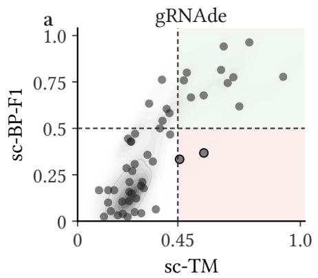

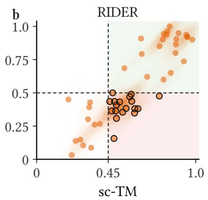

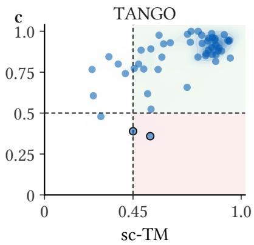  
Figure 1: RNA 3D inverse design requires joint topology and geometry fidelity. Each point denotes a designed sequence evaluated by fold-back self-consistency, with tertiary-structure fidelity measured by sc-TM and secondary-topology fidelity measured by sc-BP-F1. The upper-right region contains designs that satisfy both objectives. Existing 3D RNA design methods can produce geometry-consistent but topology-inconsistent designs, showing that tertiary similarity alone does not guarantee recovery of the target base-pairing topology. Conversely, topology preservation alone is insuficient for specifying the final tertiary fold.

This gap is not merely conceptual. As shown in Figure 1, strong tertiary-structure-based baselines can generate candidates with reasonable fold-back geometry but poor recovery of the target base pairs. Conversely, candidates that preserve much of the secondary topology may still fail to realize the desired 3D arrangement. These failure modes indicate that topology fidelity and geometry fidelity are complementary objectives rather than redundant metrics. They also suggest that RNA 3D inverse design should be evaluated as a co-design problem: a successful sequence should recover both the target tertiary geometry and the target base-pairing topology.

We therefore formulate RNA 3D inverse design as topology-and-geometry co-design. Given a target tertiary structure and its associated base-pairing topology, the goal is to generate sequences whose predicted folds match both. This objective is challenging for two reasons. First, base-paired positions are combinatorially coupled: changing one nucleotide may require a coordinated change at its pairing partner. Second, tertiary-structure rewards are delayed and sparse, because candidate sequences must be completed and folded before their 3D quality can be assessed. Although the sequence space contains 4L possibilities for length L, only a small subset is compatible with a target topology, and only a smaller subset of those sequences realizes the target tertiary geometry.

We propose TANGO, a multi-objective multi-agent reinforcement learning framework for RNA topology-and-geometry co-design. TANGO uses the target topology to decompose sequence generation into structural units: unpaired residues are designed individually, while paired positions are designed jointly. Multiple agents fill these units in parallel under a shared structural reward, reducing the efective decision horizon relative to nucleotide-by-nucleotide generation and enabling coordinated decisions over coupled base pairs. Training proceeds in three stages. First, topology-aware policy initialization learns sequence-construction patterns that satisfy secondary-structure scafolds. Second, geometry-conditioned training transfers this policy to tertiary-structure targets, allowing 3D information to adjust topology-compatible sequence decisions. Third, frontier-guided fine-tuning adapts the general policy to each target by directly improving the Pareto frontier over secondary-topology fidelity, tertiary-structure fidelity, and sequence diversity. Experiments on a curated PDB-derived benchmark show that TANGO improves tertiary fold-back fidelity by 18.3% and secondary-topology fidelity by 52.7% over the strongest baseline, while generating diverse non-native designs.

## 2 Problem Setup

RNA sequence, topology, and geometry. An RNA sequence is a length-L string $\boldsymbol { x } = ( x _ { 1 } , \dots , x _ { L } )$ over the alphabet $\mathcal { V } = \{ \mathtt { A } , \mathtt { U } , \mathtt { G } , \mathtt { C } \}$ . We represent the target secondary topology as $\mathcal { T } ^ { \star } = ( \mathcal { P } ^ { \star } , \mathcal { S } ^ { \star } )$ , where ${ \mathcal { P } } ^ { \star } \subseteq \{ ( p , q ) : 1 \leq p < q \leq L \}$ is the set of target base pairs and $S ^ { \star }$ is the set of unpaired positions. The same topology can be written in dot-bracket notation; pseudoknots correspond to crossing pairs in ${ \mathcal { P } } ^ { \star }$ and are represented with additional bracket types. Unless otherwise stated, ${ \mathcal { P } } ^ { \star }$ denotes the canonical and wobble base-pairing scafold of the target. Non-canonical tertiary contacts are not imposed as discrete pair actions, but are evaluated through the tertiary geometry objective.

The target tertiary structure is denoted by $\mathcal G ^ { \star }$ . We use a 3-bead coarse-grained representation [14], where each nucleotide is described by the Cartesian coordinates of the backbone atoms P and $\mathrm { C 4 ^ { \prime } }$ and an unlabeled glycosidic nitrogen bead (N1 for pyrimidines and N9 for purines in the source structure). The model receives geometric coordinates but not native nucleotide identities. This representation compactly captures backbone conformation and approximate base placement for tertiary-structure-conditioned design.

Forward oracles. Given a candidate sequence x, a tertiary-structure oracle $F _ { \mathrm { 3 D } }$ predicts a fold $\widehat { \mathcal { G } } ( x ) = F _ { \mathrm { 3 D } } ( x )$ . We distinguish two secondary-structure oracles. During topology-only initialization, we use a secondary folding oracle $\hat { \mathcal { T } } ^ { \mathrm { f o l d } } ( x ) = \bar { F } _ { \mathrm { 2 D } } ^ { \mathrm { f o l d } } ( x )$ , which predicts secondary structure directly from sequence. During geometry-conditioned training and evaluation, we derive secondary topology from the predicted tertiary structure: $\widehat { T } ^ { \mathrm { a n n } } ( x ) = A _ { \mathrm { 2 D } } ( F _ { \mathrm { 3 D } } ( x ) )$ , where $ { A _ { \mathrm { 2 D } } }$ is a 3D-to-2D annotation procedure such as DSSR [15]. This distinction lets the first stage learn from a cheaper topology objective, while later stages measure topology and geometry under the same fold-back structure.

Topology-and-geometry co-design. RNA 3D inverse design is commonly evaluated by tertiary fold-back fidelity. We instead formulate a co-design objective that requires both tertiary-structure fidelity and secondary-topology fidelity. For a completed sequence x, we define

$$
R _ { \mathrm { 3 D } } ( x ; \mathcal { G } ^ { \star } ) = \mathrm { T M } \Big ( \widehat { \mathcal { G } } ( x ) , \mathcal { G } ^ { \star } \Big ) ,\tag{1}
$$

and

$$
R _ { \mathrm { 2 D } } ( x ; T ^ { \star } ) = \mathrm { B P - F } 1 \Big ( \widehat { T } ^ { \mathrm { a n n } } ( x ) , T ^ { \star } \Big ) ,\tag{2}
$$

where TM-score measures global tertiary alignment and BP-F1 measures recovery of the target base pairs. A sequence is considered a co-design success when it satisfies both

$$
R _ { \mathrm { 3 D } } ( x ; \mathcal { G } ^ { \star } ) \geq \tau _ { \mathrm { 3 D } } , \qquad R _ { \mathrm { 2 D } } ( x ; \mathcal { T } ^ { \star } ) \geq \tau _ { \mathrm { 2 D } } .\tag{3}
$$

Unlike prior sequence–structure co-design [16], which jointly generates sequences and structures, our formulation designs RNA sequences to recover prescribed topology and geometry targets. Beyond finding a single high-scoring sequence, we seek a diverse set of candidates that achieve favorable trade-ofs among topology fidelity, geometry fidelity, and sequence novelty.

## 3 Method

TANGO is a cooperative reinforcement learning framework for RNA topology-and-geometry co-design. Given a target pair $( \mathcal G ^ { \star } , \mathcal T ^ { \star } )$ , TANGO generates RNA sequences by filling topology-derived structural units rather than individual nucleotides. Unpaired residues are designed as single-position units, while paired residues are designed jointly as paired units. This unit-level factorization exposes the base-pair couplings in the target topology and shortens the decision horizon.

Training proceeds in three stages. First, topology-aware initialization learns a policy for satisfying secondary-structure scafolds. Second, geometry-conditioned co-design transfers this policy to tertiarystructure targets by adding 3D geometric conditioning and optimizing a joint topology-and-geometry reward. Third, frontier-guided fine-tuning adapts the general policy to each target by improving the Pareto frontier over topology fidelity, geometry fidelity, and sequence diversity. Figure 2 illustrates the overall pipeline. Pseudocode is provided in Appendix B.

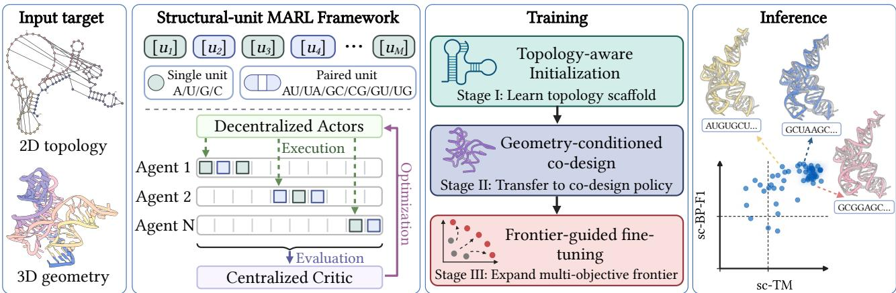  
Figure 2: Overview of TANGO. TANGO formulates RNA design as cooperative sequence generation over structural units and follows a three-stage training pipeline.

## 3.1 Structural-unit Cooperative Generation

Structural units. Given the target topology $\mathcal { T } ^ { \star } = ( \mathcal { P } ^ { \star } , \mathcal { S } ^ { \star } )$ , we construct an ordered list of structural units $\mathcal { U } ^ { \star } = ( u _ { 1 } , \ldots , u _ { M } )$ . Each unpaired position $p \in S ^ { \star }$ forms a single-position unit $u = \{ p \}$ , and each target base pair $( p , q ) \in { \mathcal { P } } ^ { \star }$ forms a paired unit $\boldsymbol { u } = \{ p , q \}$ . Crossing pairs from pseudoknots are handled identically because the representation is set-based rather than nested. The units cover the full sequence and assign each residue to exactly one unit.

The action space depends on the unit type:

$$
\begin{array} { r } { \mathcal { A } _ { \mathrm { s i n g l e } } = \{ \mathtt { A } , \mathtt { U } , \mathtt { G } , \mathtt { C } \} , \qquad \mathcal { A } _ { \mathrm { p a i r } } = \{ \mathtt { A U } , \mathtt { U A } , \mathtt { G C } , \mathtt { C G } , \mathtt { G U } , \mathtt { U G } \} . } \end{array}\tag{4}
$$

Thus, paired units are filled by coordinated canonical or wobble base-pair assignments. This action factorization encodes the explicit secondary scafold; non-canonical tertiary interactions are left to the 3D structural reward.

Multi-agent generation. The ordered unit list is split into N contiguous segments, one for each agent. Agent i maintains a cursor over its segment. At environment step t, every active agent observes its current unit, samples an action for that unit, writes the corresponding nucleotide assignment into the partial sequence, and advances its cursor. The episode terminates when all units have been assigned. Since up to N units are filled per step, the efective horizon is approximately ⌈M/N⌉ rather than M.

All agents share a single actor network with unit-type-specific output heads. A centralized critic observes a pooled representation of the full partial design state during training, while each agent acts from its local observation at inference time. We optimize the policy under centralized training and decentralized execution. A formal MARL formulation and the training objective are provided in Appendix C.

Topology-aware unit embeddings. For each residue position $p ,$ we embed the dot-bracket token and structural metadata $\pmb { r } _ { p } = E _ { \mathrm { r e s } } ( b _ { p } , \pmb { m } _ { p } )$ , where $\mathbf { \nabla } m _ { p }$ includes pairing status, normalized position, pairing distance, and pseudoknot indicators. A single-position unit $u _ { j } = \{ p \}$ receives embedding

$$
\begin{array} { r } { \pmb { e } _ { j } = { \cal E } _ { \mathrm { s i n g l e } } \left( [ \pmb { r } _ { p } , \pmb { m } _ { u _ { j } } ] \right) , } \end{array}\tag{5}
$$

and a paired unit $u _ { j } = \{ p , q \}$ receives embedding

$$
\begin{array} { r } { \pmb { e } _ { j } = E _ { \mathrm { p a i r } } \Big ( [ \pmb { r } _ { p } , \pmb { r } _ { q } , \pmb { r } _ { p } \odot \pmb { r } _ { q } , | \pmb { r } _ { p } - \pmb { r } _ { q } | , \pmb { m } _ { u _ { j } } ] \Big ) . } \end{array}\tag{6}
$$

The actor observation for agent i at step t is $o _ { t } ^ { i } = [ e _ { j _ { t } ^ { i } } , { \pmb q } _ { t , j _ { t } ^ { i } } , { \pmb c } _ { j _ { t } ^ { i } } ]$ , where $j _ { t } ^ { i }$ is the current unit index, $\mathbf { \Delta } q _ { t , j _ { t } ^ { i } }$ encodes the current assignment state of the unit, and $c _ { j _ { t } ^ { i } }$ is a local context vector obtained by mean pooling embeddings in a fixed window around $u _ { j _ { t } ^ { i } }$

## 3.2 Stage I: Topology-aware Initialization

The first stage trains the actor to construct sequences that satisfy target secondary topologies. After a complete sequence xT is generated, the topology-only oracle predicts $\hat { \mathcal { T } } ^ { \mathrm { f o l d } } ( x _ { T } ) \bar { = } \bar { F } _ { \mathrm { 2 D } } ^ { \mathrm { f o l d } } ( x _ { T } )$ . The terminal reward is

$$
R _ { \mathrm { t o p o } } ( x _ { T } ; \mathcal { T } ^ { \star } ) = \mathrm { B P - F } 1 \left( \widehat { \mathcal { T } } ^ { \mathrm { f o l d } } ( x _ { T } ) , \mathcal { T } ^ { \star } \right) + \beta _ { \mathrm { e x } } \mathbb { I } \left[ \widehat { \mathcal { T } } ^ { \mathrm { f o l d } } ( x _ { T } ) = \mathcal { T } ^ { \star } \right] .\tag{7}
$$

All agents receive this shared reward. The policy is trained by maximizing

$$
\operatorname* { m a x } _ { \theta _ { \mathrm { t o p o } } } \ { \mathbb E } _ { x _ { T } \sim \pi _ { \theta _ { \mathrm { t o p o } } } } \left[ R _ { \mathrm { t o p o } } ( x _ { T } ; { \mathcal T } ^ { \star } ) \right] .\tag{8}
$$

This stage learns coordinated nucleotide assignments for single and paired structural units, providing a scafolded initialization for subsequent 3D co-design.

## 3.3 Stage II: Geometry-conditioned Co-design

The second stage transfers the topology-aware policy to tertiary-structure targets. The structural units and action spaces remain unchanged, but each unit is augmented with geometric information in $\mathcal G ^ { \star }$

Geometry encoder. We encode the target tertiary structure with a GVP-GNN [17] over the 3-bead representation:

$$
\pmb { h } _ { 1 } ^ { \mathcal { G } } , \dotsc , \pmb { h } _ { L } ^ { \mathcal { G } } = E _ { \mathrm { G V P } } ( \mathcal { G } ^ { \star } ) .\tag{9}
$$

Residue-level embeddings are pooled into unit-level geometric embeddings. For a single-position unit $u _ { j } = \{ p \}$ , we set $\begin{array} { r } { g _ { j } = h _ { p } ^ { \mathcal { G } } } \end{array}$ . For a paired unit $u _ { j } = \{ p , q \}$ , we use

$$
\pmb { g } _ { j } = \frac { 1 } { 2 } \left( \pmb { h } _ { p } ^ { \mathcal { G } } + \pmb { h } _ { q } ^ { \mathcal { G } } \right) .\tag{10}
$$

A local 3D context vector is computed by pooling spatial neighbors of each unit:

$$
\begin{array} { r } { \boldsymbol { c } _ { j } ^ { \mathrm { 3 D } } = \mathrm { M e a n P o o l } \left( \{ \boldsymbol { g } _ { k } : k \in \mathcal { W } _ { \mathrm { 3 D } } ( j ) \} \right) . } \end{array}\tag{11}
$$

Geometry-conditioned policy. For agent i at unit $j _ { t } ^ { i } .$ , the geometry-conditioned observation is $o _ { t , \mathrm { g e o } } ^ { i } = [ o _ { t } ^ { i } , \pmb { g } _ { j _ { t } ^ { i } } , \pmb { c } _ { j _ { t } ^ { i } } ^ { \mathrm { 3 D } } ]$ . The actor is initialized from the topology-aware policy and augmented with two zero-initialized 3D-conditioned adapters. The final logits are

$$
\ell _ { i } = \ell _ { i } ^ { \mathrm { t o p o } } + \Delta \ell _ { i } ^ { \mathrm { F i L M } } + \Delta \ell _ { i } ^ { \mathrm { 3 D } } ,\tag{12}
$$

where $\ell _ { i } ^ { \mathrm { { t o p o } } }$ is the inherited topology-aware logit vector, $\Delta \ell _ { i } ^ { \mathrm { F i L M } }$ is produced by FiLM modulation of the hidden state using ${ \mathbf { \mathcal { g } } _ { j _ { t } ^ { \prime } } }$ , and $\Delta \ell _ { i } ^ { \mathrm { 3 D } }$ is a direct geometric correction. Zero initialization makes the transferred policy start near the topology-aware policy, so 3D conditioning initially acts as a small residual adjustment rather than overwriting the learned topology scafold.

Co-design reward. At the end of an episode, the completed sequence $x _ { T }$ is folded by the 3D oracle: $ { \widehat { \mathcal { G } } } ( x _ { T } ) = F _ { 3 \mathrm { D } } ( x _ { T } )$ and $\widehat { T } ^ { \mathrm { a n n } } ( x _ { T } ) = A _ { \mathrm { 2 D } } \big ( \widehat { \mathcal { G } } ( x _ { T } ) \big )$ . Based on Eqs. (1) and (2), we compute the Stage-II terminal reward as

$$
\begin{array} { r } { R _ { \mathrm { c o } } ( x _ { T } ) = R _ { \mathrm { 3 D } } ( x _ { T } ; \mathcal { G } ^ { \star } ) + \lambda _ { \mathrm { 2 D } } R _ { \mathrm { 2 D } } ( x _ { T } ; \mathcal { T } ^ { \star } ) - \lambda _ { \mathrm { v i o l } } \left[ \tau _ { \mathrm { 2 D } } - R _ { \mathrm { 2 D } } ( x _ { T } ; \mathcal { T } ^ { \star } ) \right] _ { + } . } \end{array}\tag{13}
$$

The positive $R _ { \mathrm { 2 D } }$ term encourages topology recovery, while the hinge penalty discourages geometryimproving updates that fall below the desired topology-fidelity threshold. This stage produces a general topology-and-geometry co-design policy.

## 3.4 Stage III: Frontier-guided Fine-tuning

The final stage performs target-wise policy adaptation. The trade-ofs among topology fidelity, geometric fidelity, and sequence diversity motivate a multi-objective reinforcement learning formulation [18–23], rather than optimization under a single fixed scalarization. TANGO therefore fine-tunes the policy to expand the target-specific Pareto frontier.

Archive and objective vectors. For each target $( \mathcal G ^ { \star } , \mathcal T ^ { \star } )$ , we maintain an archive of evaluated sequences, $\mathcal { H } _ { k } ^ { \star } = \{ { x } ^ { ( 1 ) } , \ldots , { x } ^ { ( K ) } \}$ , at fine-tuning iteration k. The archive is warm-started with candidates sampled from the Stage-II co-design policy. Each sequence is mapped to an objective vector. The default bi-objective setting uses

$$
\pmb { r } ( x ) = [ R _ { \mathrm { 2 D } } ( x ; \mathcal { T } ^ { \star } ) , R _ { \mathrm { 3 D } } ( x ; \mathcal { G } ^ { \star } ) ] .\tag{14}
$$

We also consider a diversity-aware tri-objective setting:

$$
{ \displaystyle r _ { \mathrm { d i v } } ( \boldsymbol { x } ) = [ R _ { \mathrm { 2 D } } ( \boldsymbol { x } ; \mathcal { T } ^ { \star } ) , R _ { \mathrm { 3 D } } ( \boldsymbol { x } ; \mathcal { G } ^ { \star } ) , R _ { \mathrm { d i v } } ( \boldsymbol { x } ; \mathcal { H } _ { k } ^ { \star } ) ] } ,\tag{15}
$$

where

$$
R _ { \mathrm { d i v } } ( x ; \mathcal { H } _ { k } ^ { \star } ) = \operatorname* { m i n } _ { x ^ { \prime } \in \mathcal { H } _ { k } ^ { \star } } \frac { 1 } { L } \sum _ { p = 1 } ^ { L } \mathbb { I } [ x _ { p } \neq x _ { p } ^ { \prime } ] .\tag{16}
$$

All objectives are normalized to [0, 1] with larger values preferred. Duplicate sequences receive zero diversity and are inserted into the archive only once.

A sequence x dominates y if it is no worse in every selected objective and strictly better in at least one. The non-dominated archive is $\mathcal { F } _ { k } ^ { \star } = \mathrm { N D } ( \mathcal { H } _ { k } ^ { \star } )$ .

Batch-level hypervolume reward. At iteration $k ,$ the current policy samples a batch of candidates $\mathcal { C } _ { k }$ . We evaluate their objective vectors and compute the post-batch frontier $\mathcal { P } _ { k } = \mathrm { N D } ( \mathcal { H } _ { k } ^ { \star } \cup \mathcal { C } _ { k } )$ . Let ${ \mathcal { R } } ( A ) = \{ r ( x ) : x \in A \}$ denote the set of objective vectors for a sequence set A. With reference point $r _ { \mathrm { r e f } }$ in the selected objective space, the frontier reward for candidate $x \in { \mathcal { C } } _ { k }$ is its exclusive hypervolume contribution:

$$
R _ { \mathrm { f r o n t } } ( x ) = \mathrm { H V } \left( \mathcal { R } ( \mathcal { P } _ { k } ) ; r _ { \mathrm { r e f } } \right) - \mathrm { H V } \left( \mathcal { R } \left( \mathrm { N D } \left( ( \mathcal { H } _ { k } ^ { \star } \cup \mathcal { C } _ { k } ) \setminus \{ x \} \right) \right) ; r _ { \mathrm { r e f } } \right) .\tag{17}
$$

The batch-level definition makes the reward independent of the order in which candidates are inserted into the archive. A candidate receives positive reward only if it expands the target-wise frontier. After reward computation, all evaluated candidates are added to the archive to form $\mathcal { H } _ { k + 1 } ^ { \star }$

Fine-tuning objective. Starting from the Stage-II co-design policy, we optimize

$$
\operatorname* { m a x } _ { \theta _ { \mathrm { f r o n t } } } \ { \mathbb E } _ { x _ { T } \sim \pi _ { \theta _ { \mathrm { f r o n t } } } } \left[ R _ { \mathrm { f r o n t } } ( x _ { T } ) \right] .\tag{18}
$$

The reward is terminal and shared across agents. The resulting policy is target-adapted: it is rewarded not for improving a fixed scalarized score, but for producing sequences that expand the achievable frontier of topology fidelity, geometry fidelity, and diversity.

## 4 Experimental Setup

Benchmark construction. We construct a topology-and-geometry co-design benchmark from experimentally resolved RNA structures in the PDB [24]. We retain single-chain RNA structures with resolution better than 4 Å, remove structures with chain breaks, and deduplicate targets by secondary topology. To make predictor-based fold-back evaluation meaningful, we refold each native sequence with both RhoFold [25] and AlphaFold3 [26], and retain only targets whose native sequence recovers the experimental fold with TM-score $\geq 0 . 4 5$ under both predictors, a threshold commonly used to indicate shared global RNA topology [27]. This filtering yields 1,213 targets. It reduces ambiguity in fold-back evaluation, but also biases the benchmark toward RNAs that current structure predictors can fold reasonably well.

We split targets by structural dissimilarity rather than random sequence-level partitioning. Specifically, we cluster targets by pairwise tertiary-structure similarity using k-medoids and choose held-out targets with the lowest nearest-neighbor similarity to the training set. The final test set contains 50 structurally remote targets, with mean nearest-neighbor similarity 0.34 and maximum nearest-neighbor similarity 0.42 to the training set. Among these targets, 44% contain pseudoknotted base pairs.

Evaluation protocol and metrics. We instantiate the co-design evaluation protocol defined in Section 2. Unless otherwise stated, main results use RhoFold as the fold-back oracle; cross-oracle experiments evaluate the same designed sequences with AlphaFold3. For each target, we first fold the native sequence with the selected oracle to obtain a predictor-specific reference structure. We then fold each designed sequence with the same oracle and compare the two predicted structures. This self-consistency protocol avoids mixing experimental structures and predictor-specific folds in the primary metric.

We report tertiary fidelity by self-consistency TM-score (sc-TM) and self-consistency RMSD (sc-RMSD). We report secondary-topology fidelity by extracting base pairs from the predicted designed structure with DSSR [15] and computing self-consistency base-pair F1 (sc-BP-F1) against the target topology. Our primary task-level metric is co-design success: a candidate is successful only if it satisfies both

$$
\mathrm { s c \mathrm { - } T M > \tau _ { 3 D } ~ \ a n d ~ \ s c \mathrm { - } B P \mathrm { - } F 1 > \tau _ { 2 D } . }\tag{19}
$$

We use $\tau _ { \mathrm { { 3 D } } } = 0 . 4 5$ and $\tau _ { \mathrm { { 2 D } } } = 0 . 5 0$ in the main experiments, and report threshold sensitivity in Appendix D.1. The co-design solved target rate is the fraction of test targets for which at least one generated candidate satisfies both thresholds.

Baselines and inference budget. We compare against recent 3D RNA inverse-design methods: gRNAde [6], RDesign [5], R3Design [28], RiboDiffusion [8], and RIDER [9]. All baselines are retrained on the same training split and evaluated on the same held-out targets. Each method generates K = 10 candidate sequences per target under its default sampling procedure.

Metrics and statistics. For continuous metrics, we first aggregate the K candidates for each target using mean-of-K, and then report mean ± standard deviation across targets. For success metrics, we report candidate-level success rate and target-level solved rate separately. For sc-TM, sc-BP-F1, and success rate, we compute p-values using a two-sided paired Wilcoxon signed-rank test over target-level scores, followed by Holm correction for multiple comparisons. For diversity metrics and success-conditioned novelty, where the set of valid targets can difer across methods, we use a two-sided Wilcoxon rank-sum test. For solved target rates, we use a two-proportion z-test.

## 5 Results

## 5.1 TANGO improves topology and geometry fidelity

We first evaluate whether TANGO improves RNA 3D inverse design under the co-design criterion defined in Section 4. Table 1 compares TANGO with five recent 3D RNA inverse-design methods: gRNAde, RDesign, R3Design, RiboDiffusion, and RIDER. All methods are trained on the same split and evaluated on the same structurally remote test targets.

TANGO achieves the strongest performance on both topology and geometry metrics. Relative to the strongest baseline, RIDER, TANGO improves sc-TM from 0.60 to 0.71 and sc-BP-F1 from 0.55 to 0.84, corresponding to relative gains of 18.3% and 52.7%, respectively. The improvement in sc-BP-F1 is central to our setting: the gain in tertiary fold-back fidelity is accompanied by substantially better recovery of the target base-pairing topology. TANGO also obtains the lowest sc-RMSD, indicating lower structural deviation after alignment.

Table 1: Structural design performance on the test set. Each method generates K = 10 candidates per target. Continuous metrics report mean ± standard deviation over target-level aggregated scores. Success denotes co-design success, defined as sc-TM > 0.45 and sc-BP-F1 > 0.50. Solved targets denotes the fraction of targets for which at least one candidate satisfies both thresholds. Threshold sensitivity is reported in Appendix D.1.
<table><tr><td>Method</td><td>sc-TM ↑</td><td> ${ \mathrm { s c } } { \mathrm { - B P } } { \mathrm { - F 1 ~ } } \uparrow$ </td><td>sc-RMSD ↓</td><td>Success rate ↑</td><td>Solved targets ↑</td></tr><tr><td>gRNAde</td><td> $0 . 3 2 \pm 0 . 1 2$ </td><td> $0 . 3 6 \pm 0 . 2 6$ </td><td> $3 . 5 4 \pm 1 . 0 0$ </td><td>0.17</td><td>38.00%</td></tr><tr><td>RDesign</td><td> $0 . 3 1 \pm 0 . 1 0$ </td><td> $0 . 3 1 \pm 0 . 2 1$ </td><td> $3 . 6 1 \pm 0 . 9 1$ </td><td>0.13</td><td>42.00%</td></tr><tr><td>R3Design</td><td> $0 . 3 5 \pm 0 . 1 4$ </td><td> $0 . 3 3 \pm 0 . 2 7$ </td><td> $3 . 4 7 \pm 1 . 0 3$ </td><td>0.21</td><td>50.00%</td></tr><tr><td>RiboDiffusion</td><td> $0 . 3 2 \pm 0 . 1 3$ </td><td> $0 . 3 0 \pm 0 . 2 5$ </td><td> $3 . 5 8 \pm 1 . 1 4$ </td><td>0.17</td><td>42.00%</td></tr><tr><td>RIDER</td><td> $0 . 6 0 \pm 0 . 1 3$ </td><td> $0 . 5 5 \pm 0 . 2 2$ </td><td> $2 . 9 4 \pm 1 . 2 6$ </td><td>0.49</td><td>60.00%</td></tr><tr><td>TANGO</td><td> ${ \bf 0 . 7 1 \pm 0 . 1 7 }$ </td><td> ${ \bf 0 . 8 4 \pm 0 . 1 5 }$ </td><td> ${ \bf 2 . 1 6 \pm 1 . 0 7 }$ </td><td>0.86</td><td>88.00%</td></tr></table>

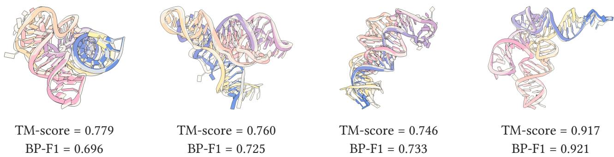  
Figure 3: Representative co-design successes for PDB targets 3IQP, 6WJS, 3UCU, and 3ADB. Gray denotes the target reference structure, and color denotes the fold-back structure of the designed sequence. All shown designs satisfy the joint co-design success criterion.

The joint success metrics provide the primary evidence for topology-and-geometry co-design. TANGO improves the co-design success rate from 0.49 to 0.86 and the solved target rate from 60.00% to 88.00% compared with RIDER. Because a successful candidate must satisfy both the geometry and topology thresholds, these results support our formulation of RNA 3D inverse design as a joint co-design problem rather than a geometry-only fold-back task. Representative co-design successes are shown in Figure 3.

## 5.2 Target-wise frontier-guided refinement expands the co-design frontier

We next isolate the contribution of the target-wise refinement stage. Figure 4(a) compares the stage-II policy before target-wise fine-tuning (TANGO-Base), the default bi-objective frontier-refined model (TANGO), and the diversity-aware tri-objective variant (TANGO-Div). Compared with TANGO-Base, TANGO improves sc-TM by 27.6% and sc-BP-F1 by 31.9%, indicating that the target-wise refinement stage contributes to both tertiary fold-back fidelity and secondary-topology recovery. The improvements in success rate and solved target rate further show that the refined policies place more candidates in the high-sc-BP-F1, high-sc-TM region, rather than improving only one objective.

Adding sequence diversity as an explicit objective increases diversity by 90.1% relative to TANGO-Base, while preserving competitive topology and geometry fidelity. Figure 4(b) summarizes the resulting multi-objective trade-ofs. The hypervolume increases from 0.031 for TANGO-Base to 0.170 for TANGO and 0.374 for TANGO-Div, indicating that frontier-guided refinement expands the set of useful target-specific candidates.

To test whether this gain is merely due to additional test-time sampling, Appendix D.2 compares against sampling-based re-ranking under the same candidate budget, and Appendix D.3 compares against fixed weighted-reward fine-tuning. These controls suggest that the improvement comes from optimizing the target-wise frontier, rather than only from selecting better samples from an unchanged policy or using a fixed scalarization of the objectives.

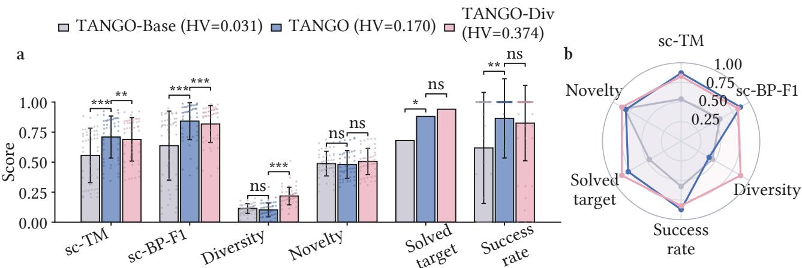  
Figure 4: Target-wise frontier-guided refinement. (a) Structural quality and sequence diversity for the stage-II policy (TANGO-Base), the bi-objective frontier-refined model (TANGO), and the diversity-aware tri-objective variant (TANGO-Div). (b) Multi-objective trade-of visualization between design quality and diversity. HV denotes the dominated hypervolume of each method’s Pareto frontier in the normalized objective space. Significance markers denote \* for $p < 0 . 0 5$ , \*\* for $p < 0 . 0 1$ , \*\*\* for $p < 0 . 0 0 1$ , and ns for not significant.

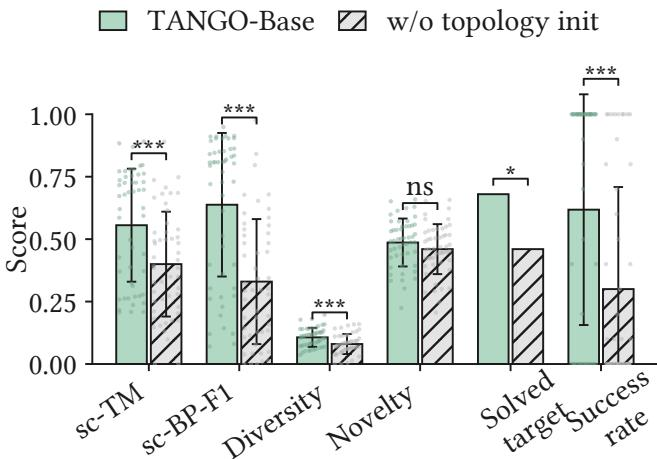  
Figure 5: Efect of topology-aware initialization. The ablated variant removes Stage-I topology pretraining and trains the geometry-conditioned policy from scratch, while keeping the structural-unit action space and model architecture unchanged. Significance is computed by paired target-level tests.

## 5.3 Topology-aware initialization provides a useful scafold for 3D design

Here we ablate the Stage-I topology-aware initialization by using the same structural-unit action space and geometry-conditioned architecture, but starting 3D co-design training without first learning to satisfy secondary-structure scafolds. Figure 5 shows that removing this initialization substantially degrades all primary co-design metrics. With topology-aware initialization, TANGO-Base achieves relative improvements of 38.9% in sc-TM, 93.3% in sc-BP-F1, and 106.0% in co-design success rate.

This ablation supports the curriculum design. Although Stage I optimizes only a secondary-topology objective, it improves both topology recovery and tertiary fold-back fidelity after 3D training.

This is consistent with the intuition that a topology-compatible initialization places the policy in a better exploration region for subsequent tertiary optimization, where fold-back rewards are less sparse and base-paired positions are already coordinated.

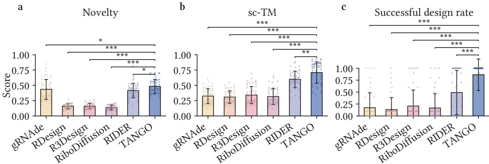  
Figure 6: Sequence novelty and design quality across methods. Novelty is measured as normalized Hamming distance to the native target sequence. Design quality is reported by sc-TM and co-design success rate, where success requires both topology and geometry thresholds.

## 5.4 TANGO generates non-native high-quality designs

We next examine whether high fold-back scores are achieved by recovering native-like sequences. Figure 6(a) reports sequence novelty, defined as the normalized Hamming distance between a designed sequence and the native sequence of the target. Figure 6(b) and Figure 6(c) report the corresponding sc-TM and co-design success rate, respectively. TANGO achieves the strongest combination of novelty and design quality among the compared methods: its generated sequences remain far from the native target sequences while maintaining the highest co-design success rate.

This result suggests that TANGO can identify non-native sequence solutions that preserve both target topology and tertiary geometry. However, distance-to-native alone does not rule out all forms of memorization or predictor-specific sequence bias; we therefore interpret this analysis as evidence of non-native design rather than as definitive proof of memorization-free generation.

## 5.5 Robustness across oracles and architectures

We finally stress-test whether the main conclusions depend on a single fold-back oracle or architecture choice.

First, Figure 7 evaluates the same TANGO-generated sequences under both RhoFold and AlphaFold3. The sc-TM and sc-BP-F1 scores remain comparable across the two predictors, suggesting that TANGO designs are not obvious artifacts of one fold-back oracle. This remains predictor-based validation rather than experimental folding validation.

Second, Appendix D.4 ablates the multi-agent architecture. Compared with a single-agent variant, the multi-agent policy improves both topology and geometry metrics, supporting the use of topology derived structural units and parallel cooperative generation for RNA co-design.

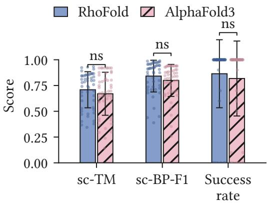  
Figure 7: Cross-oracle evaluation of the same TANGO designs using RhoFold and AlphaFold3. No AlphaFold3-based refinement is performed.

## 6 Conclusion

This work argues that RNA 3D inverse design should not be treated as a geometry-only fold-back problem. Because RNA tertiary structure is scafolded by base-pairing topology, useful designs should recover both the target 3D fold and the target secondary topology. We operationalize this view through TANGO, a curriculum MARL framework that designs topology-derived structural units, transfers a secondary-structure policy to geometry-conditioned co-design, and uses frontier-guided fine-tuning to improve target-wise trade-ofs among topology fidelity, geometry fidelity, and sequence diversity. Experiments demonstrated that TANGO improves fold-back geometry, topology recovery, and joint co-design success over recent 3D RNA design baselines.

Our results are computational and rely on structure-prediction oracles for fold-back evaluation. Extending the framework to richer RNA interaction classes, including non-canonical contacts, ligand bound RNAs, and protein–RNA complexes, and validating selected designs experimentally are important directions for future work.

## References

[1] Scott A. Strobel and Jesse C. Cochrane. RNA catalysis: Ribozymes, ribosomes, and riboswitches. Curr. Opin. Chem. Biol., 11(6):636–643, 2007.

[2] Alexander Serganov and Evgeny Nudler. A decade of riboswitches. Cell, 152(1–2):17–24, 2013.

[3] Jinsong Zhang, Yuhan Fei, Lei Sun, and Qiangfeng Clif Zhang. Advances and opportunities in RNA structure experimental determination and computational modeling. Nat. Methods, 19(10): 1193–1207, 2022.

[4] Alexander Churkin, Matan Drory Retwitzer, Vladimir Reinharz, Yann Ponty, Jérôme Waldispühl, and Danny Barash. Design of RNAs: Comparing programs for inverse RNA folding. Brief. Bioinform., 19(2):350–358, 2018.

[5] Cheng Tan, Yijie Zhang, Zhangyang Gao, Bozhen Hu, Siyuan Li, Zicheng Liu, and Stan Z. Li. RDesign: Hierarchical data-eficient representation learning for tertiary structure-based RNA design. In Proc. International Conference on Learning Representations, pages 10304–10333, 2024.

[6] Chaitanya K. Joshi, Arian R. Jamasb, Ramon Viñas, Charles Harris, Simon V. Mathis, Alex Morehead, Rishabh Anand, and Pietro Liò. gRNAde: Geometric deep learning for 3D RNA inverse design. In Proc. International Conference on Learning Representations, pages 10166–10191, 2025.

[7] Felix Wong, Dongchen He, Aarti Krishnan, Liang Hong, Alexander Z. Wang, Jiuming Wang, Zhihang Hu, Satotaka Omori, Alicia Li, Jiahua Rao, Qinze Yu, Wengong Jin, Tianqing Zhang, Katherine Ilia, Jack X. Chen, Shuangjia Zheng, Irwin King, Yu Li, and James J. Collins. Deep generative design of RNA aptamers using structural predictions. Nat. Comput. Sci., 4(11):829–839, 2024.

[8] Han Huang, Ziqian Lin, Dongchen He, Liang Hong, and Yu Li. RiboDifusion: Tertiary structurebased RNA inverse folding with generative difusion models. Bioinformatics, 40(Supplement 1): i347–i356, 2024.

[9] Tianmeng Hu, Yongzheng Cui, Biao Luo, and Ke Li. RIDER: 3D RNA inverse design with reinforcement learning-guided difusion. In Proc. International Conference on Learning Representations, 2026.

[10] Philippe Brion and Eric Westhof. Hierarchy and dynamics of RNA folding. Annu. Rev. Biophys. Biomol. Struct., 26(1):113–137, 1997.

[11] Samuel E. Butcher and Anna Marie Pyle. The molecular interactions that stabilize RNA tertiary structure: RNA motifs, patterns, and networks. Acc. Chem. Res., 44(12):1302–1311, 2011.

[12] Maximillian H. Bailor, Xiaoyan Sun, and Hashim M. Al-Hashimi. Topology links RNA secondary structure with global conformation, dynamics, and adaptation. Science, 327(5962):202–206, 2010.

[13] Anthony M. Mustoe, Charles L. Brooks III, and Hashim M. Al-Hashimi. Topological constraints are major determinants of tRNA tertiary structure and dynamics and provide basis for tertiary folding cooperativity. Nucleic Acids Res., 42(18):11792–11804, 2014.

[14] Wayne K. Dawson, Maciej Maciejczyk, Elzbieta J. Jankowska, and Janusz M. Bujnicki. Coarsegrained modeling of RNA 3D structure. Methods, 103:138–156, 2016.

[15] Xiang-Jun Lu, Harmen J. Bussemaker, and Wilma K. Olson. DSSR: An integrated software tool for dissecting the spatial structure of RNA. Nucleic Acids Res., 43(21):e142, 2015.

[16] Runze Ma, Zhongyue Zhang, Zichen Wang, Chenqing Hua, Jiahua Rao, Zhuomin Zhou, and Shuangjia Zheng. RiboFlow: Conditional de novo RNA co-design via synergistic flow matching. In Advances in Neural Information Processing Systems, volume 38, pages 69799–69831, 2025.

[17] Bowen Jing, Stephan Eismann, Patricia Suriana, Raphael John Lamarre Townshend, and Ron O. Dror. Learning from protein structure with geometric vector perceptrons. In Proc. International Conference on Learning Representations, 2021.

[18] D. M. Roijers, P. Vamplew, S. Whiteson, and R. Dazeley. A survey of multi-objective sequential decision-making. J. Artif. Intell. Res., 48:67–113, 2013.

[19] Tianmeng Hu, Biao Luo, Chunhua Yang, and Tingwen Huang. MO-MIX: Multi-objective multiagent cooperative decision-making with deep reinforcement learning. IEEE Trans. Pattern Anal. Mach. Intell., 45(10):12098–12112, 2023.

[20] Runzhe Yang, Xingyuan Sun, and Karthik Narasimhan. A generalized algorithm for multi-objective reinforcement learning and policy adaptation. In Advances in Neural Information Processing Systems, volume 32, 2019.

[21] Tianmeng Hu and Biao Luo. PA2D-MORL: Pareto ascent directional decomposition based multi-objective reinforcement learning. In Proc. AAAI Conf. Artif. Intell., volume 38, pages 12547–12555, 2024.

[22] Conor F. Hayes, Roxana Rădulescu, Eugenio Bargiacchi, Johan Källström, Matthew Macfarlane, Mathieu Reymond, Timothy Verstraeten, Luisa M. Zintgraf, Richard Dazeley, Fredrik Heintz, Enda Howley, Athirai A. Irissappane, Patrick Mannion, Ann Nowé, Gabriel Ramos, Marcello Restelli, Peter Vamplew, and Diederik M. Roijers. A practical guide to multi-objective reinforcement learning and planning. Auton. Agents Multi-Agent Syst., 36(1):26, 2022.

[23] Tianmeng Hu, Biao Luo, and Ke Li. Human-in-the-loop policy optimization for preference-based multi-objective reinforcement learning. In Proc. International Conference on Machine Learning, volume 306 of Proceedings of Machine Learning Research, pages 45520–45549, 2026.

[24] Helen M Berman, John Westbrook, Zukang Feng, Gary Gilliland, Talapady N Bhat, Helge Weissig, Ilya N Shindyalov, and Philip E Bourne. The protein data bank. Nucleic Acids Res., 28(1): 235–242, 2000.

[25] Tao Shen, Zhihang Hu, Siqi Sun, Di Liu, Felix Wong, Jiuming Wang, Jiayang Chen, Yixuan Wang, Liang Hong, Jin Xiao, Liangzhen Zheng, Tejas Krishnamoorthi, Irwin King, Sheng Wang, Peng Yin, James J. Collins, and Yu Li. Accurate RNA 3D structure prediction using a language model-based deep learning approach. Nat. Methods, 21(12):2287–2298, 2024.

[26] Josh Abramson, Jonas Adler, Jack Dunger, Richard Evans, Tim Green, Alexander Pritzel, Olaf Ronneberger, Lindsay Willmore, Andrew J. Ballard, Joshua Bambrick, Sebastian W. Bodenstein, David A. Evans, Chia-Chun Hung, Michael O’Neill, David Reiman, Kathryn Tunyasuvunakool, Zachary Wu, Akvil˙e Žemgulyt˙e, Eirini Arvaniti, Charles Beattie, Ottavia Bertolli, Alex Bridgland, Alexey Cherepanov, Miles Congreve, Alexander I. Cowen-Rivers, Andrew Cowie, Michael Figurnov, Fabian B. Fuchs, Hannah Gladman, Rishub Jain, Yousuf A. Khan, Caroline M. R. Low, Kuba Perlin, Anna Potapenko, Pascal Savy, Sukhdeep Singh, Adrian Stecula, Ashok Thillaisundaram, Catherine Tong, Sergei Yakneen, Ellen D. Zhong, Michal Zielinski, Augustin Žídek, Victor Bapst, Pushmeet Kohli, Max Jaderberg, Demis Hassabis, and John M. Jumper. Accurate structure prediction of biomolecular interactions with AlphaFold 3. Nature, 630(8016):493–500, 2024.

[27] Chengxin Zhang, Morgan Shine, Anna Marie Pyle, and Yang Zhang. US-align: Universal structure alignments of proteins, nucleic acids, and macromolecular complexes. Nat. Methods, 19(9): 1109–1115, 2022.

[28] Cheng Tan, Yijie Zhang, Zhangyang Gao, Hanqun Cao, Siyuan Li, Siqi Ma, Mathieu Blanchette, and Stan Z. Li. R3Design: Deep tertiary structure-based RNA sequence design and beyond. Brief. Bioinform., 26(1):bbae682, 2025.

[29] I. L. Hofacker, W. Fontana, P. F. Stadler, L. S. Bonhoefer, M. Tacker, and P. Schuster. Fast folding and comparison of RNA secondary structures. Monatsh. Chem., 125(2):167–188, 1994.

[30] Mirela Andronescu, Anthony P. Fejes, Frank Hutter, Holger H. Hoos, and Anne Condon. A new algorithm for RNA secondary structure design. J. Mol. Biol., 336(3):607–624, 2004.

[31] Anke Busch and Rolf Backofen. INFO-RNA—a fast approach to inverse RNA folding. Bioinformatics, 22(15):1823–1831, 2006.

[32] Robert Kleinkauf, Martin Mann, and Rolf Backofen. antaRNA: Ant colony-based RNA sequence design. Bioinformatics, 31(19):3114–3121, 2015.

[33] Akito Taneda. Multi-objective genetic algorithm for pseudoknotted RNA sequence design. Front. Genet., 3:36, 2012.

[34] Ali Esmaili-Taheri and Mohammad Ganjtabesh. ERD: A fast and reliable tool for RNA design including constraints. BMC Bioinform., 16(1):20, 2015.

[35] Nono S. C. Merleau and Matteo Smerlak. aRNAque: An evolutionary algorithm for inverse pseudoknotted RNA folding inspired by Lévy flights. BMC Bioinform., 23(1):335, 2022.

[36] Tianshuo Zhou, Ning Dai, Sizhen Li, Max Ward, David H. Mathews, and Liang Huang. RNA design via structure-aware multifrontier ensemble optimization. Bioinformatics, 39(Supplement 1):i563–i571, 2023.

[37] Peter Eastman, Jade Shi, Bharath Ramsundar, and Vijay S. Pande. Solving the RNA design problem with reinforcement learning. PLOS Comput. Biol., 14(6):e1006176, 2018.

[38] Frederic Runge, Danny Stoll, Stefan Falkner, and Frank Hutter. Learning to design RNA. In Proc. International Conference on Learning Representations, 2019.

[39] Frederic Runge, Jörg Franke, Daniel Fertmann, Rolf Backofen, and Frank Hutter. Partial RNA design. Bioinformatics, 40(Supplement 1):i437–i445, 2024.

[40] Tianmeng Hu, Biao Luo, and Ke Li. CocoRNA: Collective RNA design with cooperative multiagent reinforcement learning. In Proc. International Conference on Machine Learning, volume 306 of Proceedings of Machine Learning Research, pages 45495–45519, 2026.

[41] Julia Koehler Leman, Brian D. Weitzner, Steven M. Lewis, Jared Adolf-Bryfogle, Nawsad Alam, Rebecca F. Alford, Melanie Aprahamian, David Baker, Kyle A. Barlow, Patrick Barth, et al. Macromolecular modeling and design in Rosetta: Recent methods and frameworks. Nat. Methods, 17(7):665–680, 2020.

[42] Rubo Wang, Xingyu Gao, and Peilin Zhao. Geometric algebra-enhanced bayesian flow network for RNA inverse design. In The Thirty-Ninth Annual Conference on Neural Information Processing Systems, 2025.

[43] Ronny Lorenz, Stephan H. Bernhart, Christian Höner zu Siederdissen, Hakim Tafer, Christoph Flamm, Peter F. Stadler, and Ivo L. Hofacker. ViennaRNA package 2.0. Algorithms Mol. Biol., 6 (1):26, 2011.

[44] Stanislav Bellaousov, Jessica S. Reuter, Matthew G. Seetin, and David H. Mathews. RNAstructure: Web servers for RNA secondary structure prediction and analysis. Nucleic Acids Res., 41(W1): W471–W474, 2013.

[45] Jaswinder Singh, Jack Hanson, Kuldip Paliwal, and Yaoqi Zhou. RNA secondary structure prediction using an ensemble of two-dimensional deep neural networks and transfer learning. Nat. Commun., 10(1):5407, 2019.

[46] Laiyi Fu, Yingxin Cao, Jie Wu, Qinke Peng, Qing Nie, and Xiaohui Xie. UFold: Fast and accurate RNA secondary structure prediction with deep learning. Nucleic Acids Res., 50(3):e14, 2022.

[47] Shujun He, Rui Huang, Jill Townley, Rachael C. Kretsch, Thomas G. Karagianes, David B. T. Cox, Hamish Blair, Dmitry Penzar, Valeriy Vyaltsev, Elizaveta Aristova, et al. Ribonanza: Deep learning of RNA structure through dual crowdsourcing. bioRxiv, 2024. Preprint 2024.02.24.581671.

[48] Heng Yang, Renzhi Chen, and Ke Li. Bridging sequence-structure alignment in RNA foundation models. In Proc. AAAI Conf. Artif. Intell., pages 21929–21937, 2025.

[49] Ning Wang, Jiang Bian, Yuchen Li, Xuhong Li, Shahid Mumtaz, Linghe Kong, and Haoyi Xiong. Multi-purpose RNA language modelling with motif-aware pretraining and type-guided fine-tuning. Nat. Mach. Intell., 6(5):548–557, 2024.

[50] Rafael Josip Penić, Tin Vlašić, Roland G. Huber, Yue Wan, and Mile Šikić. RiNALMo: Generalpurpose RNA language models can generalize well on structure prediction tasks. Nat. Commun., 16(1):5671, 2025.

[51] Jiayang Chen, Zhihang Hu, Siqi Sun, Qingxiong Tan, Yixuan Wang, Qinze Yu, Licheng Zong, Liang Hong, Jin Xiao, Tao Shen, Irwin King, and Yu Li. Interpretable RNA foundation model from unannotated data for highly accurate RNA structure and function predictions. CoRR, abs/2204.00300, 2022.

[52] Yuan Li, Heng Yang, Renzhi Chen, and Ke Li. Understanding transfer learning of RNA foundation models on downstream tasks. In Proc. International Conference on Machine Learning, volume 306 of Proceedings of Machine Learning Research, pages 71724–71744, 2026.

[53] Mariusz Popenda, Marta Szachniuk, Maciej Antczak, Katarzyna J. Purzycka, Piotr Lukasiak, Natalia Bartol, Jacek Blazewicz, and Ryszard W. Adamiak. Automated 3D structure composition for large RNAs. Nucleic Acids Res., 40(14):e112, 2012.

[54] Wenkai Wang, Chenjie Feng, Renmin Han, Ziyi Wang, Lisha Ye, Zongyang Du, Hong Wei, Fa Zhang, Zhenling Peng, and Jianyi Yang. trRosettaRNA: Automated prediction of RNA 3D structure with transformer network. Nat. Commun., 14(1):7266, 2023.

[55] Yang Li, Chengxin Zhang, Chenjie Feng, Robin Pearce, P. Lydia Freddolino, and Yang Zhang. Integrating end-to-end learning with deep geometrical potentials for ab initio RNA structure prediction. Nat. Commun., 14(1):5745, 2023.

[56] Sumit Tarafder and Debswapna Bhattacharya. RNAbpFlow: Base pair-augmented SE(3) flow matching for conditional RNA 3D structure generation. Nat. Methods, 23(7):1349–1358, 2026.

[57] Daniel S Bernstein, Robert Givan, Neil Immerman, and Shlomo Zilberstein. The complexity of decentralized control of Markov decision processes. Mathematics of Operations Research, 27(4): 819–840, 2002.

[58] Ryan Lowe, Yi Wu, Aviv Tamar, Jean Harb, Pieter Abbeel, and Igor Mordatch. Multi-agent actor-critic for mixed cooperative-competitive environments. In Advances in Neural Information Processing Systems, volume 30, pages 6379–6390, 2017.

[59] Tianmeng Hu, Yongzheng Cui, Rui Tang, Biao Luo, and Ke Li. Beyond monotonicity: Revisiting factorization principles in multi-agent Q-learning. In Proc. AAAI Conf. Artif. Intell., volume 40, pages 21876–21884, 2026.

[60] Peter Sunehag, Guy Lever, Audrunas Gruslys, Wojciech Marian Czarnecki, Vinicius Zambaldi, Max Jaderberg, Marc Lanctot, Nicolas Sonnerat, Joel Z. Leibo, Karl Tuyls, and Thore Graepel. Value-decomposition networks for cooperative multi-agent learning based on team reward. In Proc. International Conference on Autonomous Agents and Multiagent Systems, pages 2085–2087, 2018.

[61] Yongzheng Cui, Biao Luo, Rui Tang, Chunhua Yang, and Weihua Gui. QMIP: Enhancing multiagent reinforcement learning coordination through macro intention prediction. IEEE Trans. Artif. Intell., 7(6):3346–3360, 2026.

[62] Tabish Rashid, Mikayel Samvelyan, Christian Schroeder de Witt, Gregory Farquhar, Jakob Foerster, and Shimon Whiteson. QMIX: Monotonic value function factorisation for deep multiagent reinforcement learning. In Proc. International Conference on Machine Learning, volume 80 of Proceedings of Machine Learning Research, pages 4295–4304, 2018.

[63] Rui Tang, Biao Luo, Yongzheng Cui, Bing-Chuan Wang, Wenfeng Hu, Wu Song, and Chunhua Yang. HMU: Heuristic memory utilization for multi-agent reinforcement learning. IEEE Trans. Cogn. Develop. Syst., pages 1–14, 2026. Early access.

[64] Jakob N. Foerster, Gregory Farquhar, Triantafyllos Afouras, Nantas Nardelli, and Shimon Whiteson. Counterfactual multi-agent policy gradients. In Proc. AAAI Conf. Artif. Intell., volume 32, pages 2974–2982, 2018.

[65] Rui Tang, Biao Luo, and Yongzheng Cui. Autonomous partner selection for cooperative multi-agent reinforcement learning. In Proc. AAAI Conf. Artif. Intell., volume 40, pages 25840–25848, 2026.

[66] Chao Yu, Akash Velu, Eugene Vinitsky, Jiaxuan Gao, Yu Wang, Alexandre Bayen, and Yi Wu. The surprising efectiveness of PPO in cooperative multi-agent games. In Advances in Neural Information Processing Systems, volume 35, pages 24611–24624, 2022.

[67] John Schulman, Philipp Moritz, Sergey Levine, Michael I. Jordan, and Pieter Abbeel. Highdimensional continuous control using generalized advantage estimation. In Proc. International Conference on Learning Representations, 2016.

[68] John Schulman, Filip Wolski, Prafulla Dhariwal, Alec Radford, and Oleg Klimov. Proximal policy optimization algorithms. CoRR, abs/1707.06347, 2017.

[69] Zhangyang Gao, Cheng Tan, Yijie Zhang, Xingran Chen, Lirong Wu, and Stan Z. Li. ProteinInvBench: Benchmarking protein inverse folding on diverse tasks, models, and metrics. In Advances in Neural Information Processing Systems, volume 36, pages 68207–68220, 2023.

[70] Mandy Yu Theng Lim, Chermaine Tan, Charannya Sozheesvari Subhramanyam, Shi Jie Teo, Louis DeFalco, Samuel Kevin Pasaribu, Chong Hui Koh, Dheeraj Rayamajhi, Jieying Chi, Shengnan Li, et al. A programmable ribozyme for RNA signal transduction. Nature Communications, 17:1428, 2026.

[71] James M Robson and Alexander A Green. Toehold-VISTA: a machine learning approach to decipher programmable RNA sensor-target interactions. Nucleic Acids Res., 54(4):gkag097, 2026.

[72] Mingyu Huang, Shasha Zhou, and Ke Li. Augmenting biological fitness prediction benchmarks with landscapes features from GraphFLA. In Advances in Neural Information Processing Systems, volume 38, 2025.

[73] Shasha Zhou, Mingyu Huang, and Ke Li. Position: Genomic model research must move beyond anecdotal evaluation of interpretability methods. In Proc. International Conference on Machine Learning, volume 306 of Proceedings of Machine Learning Research, pages 172974–172999, 2026.

## A Related Work and Positioning

RNA inverse design. Computational RNA inverse design seeks sequences that satisfy specified structural objectives. Early work primarily studied secondary-structure inverse folding, where the target is a dot-bracket topology. Local-search methods [29–31] iteratively modify sequences using folding feedback, metaheuristic approaches such as ant-colony optimization [32] and evolutionary algorithms [33–36] explore large combinatorial spaces, and reinforcement-learning methods [37–39] learn sequence-construction policies. CocoRNA [40] applies cooperative multi-agent reinforcement learning to secondary-structure inverse design by distributing sequence construction among agents trained with a centralized critic. Many widely used secondary-design methods are built for pseudoknotfree structures, although methods such as antaRNA [32] and aRNAque [35] support broader topology classes. These methods directly optimize secondary topology, but do not by themselves enforce the tertiary geometry required by many functional RNA folds.

Recent work has shifted toward tertiary-structure-based RNA design. Rosetta provides physicsbased fixed-backbone RNA design through energy modeling [41]. Deep learning methods further condition sequence generation on RNA 3D structure: graph neural networks [5, 6, 28] encode geometric structure, difusion models such as RiboDiffusion [8] learn conditional sequence distributions over 3D backbones, and Bayesian flow networks [42] provide another generative formulation. RIDER [9] is closest to our use of structural optimization, as it fine-tunes a generative model with reinforcement learning to improve 3D fold-back similarity.

Our work is complementary to these approaches. Existing 3D RNA design methods primarily condition on tertiary geometry and are often evaluated by native sequence recovery or tertiary fold-back fidelity. Some methods incorporate secondary-structure information as priors, constraints, or repair mechanisms; for example, RDesign uses extracted secondary structures with base-pair information to guide design [5]. However, topology fidelity has not been systematically formulated, optimized, and evaluated as a first-class objective jointly with tertiary-structure fidelity. TANGO addresses this gap by using the target topology to define structural-unit actions, initializing the policy on secondary-structure design, and refining candidates with multi-objective topology-and-geometry rewards.

RNA structure prediction as design oracles. RNA structure prediction is the forward problem complementary to inverse design. Secondary-structure predictors include thermodynamic models such as ViennaRNA [43] and RNAstructure [44], as well as deep learning models [45–47]. RNA foundation models [48–51] provide pretrained representations for structure-related tasks [52]. Tertiary-structure prediction has advanced from fragment assembly methods such as RNAComposer [53] to deep geometric predictors including trRosettaRNA [54], DRFold [55], RhoFold [25], and AlphaFold3 [26]. Related generative models such as RNAbpFlow [56] incorporate base-pairing conditions for RNA 3D structure generation.

In this work, structure predictors are used as fold-back oracles for evaluating designed sequences, not as the proposed design model itself. Because predictor-based evaluation can introduce oracle bias, our experiments report cross-oracle validation with both RhoFold and AlphaFold3.

## B Algorithm Pseudocode

This section provides pseudocode for the main algorithmic components of TANGO. We include three procedures: Algorithm 1 constructs structural units from the target topology, Algorithm 2 performs multi-agent sequence generation over these units, and Algorithm 3 summarizes the shared MARL training framework used across topology-aware initialization, topology-and-geometry co-design, and frontier-guided fine-tuning.

## B.1 Structural-unit Cooperative Generation

TANGO first converts the target topology into an ordered list of structural units, and then assigns these units to multiple agents for cooperative sequence generation. Algorithm 1 gives the pseudocode for constructing structural units from a target pair map.

Algorithm 1 TANGO: Constructing Structural Units   
Require: Pair map $m ^ { \star }$ for target topology $\mathcal { T } ^ { \star }$ , with $m _ { p } ^ { \star } = q$ for paired residues and $m _ { p } ^ { \star } = 0$ for   
unpaired residues   
Ensure: Ordered structural units $\mathcal { U } ^ { \star } = ( u _ { 1 } , \ldots , u _ { M } )$   
1: Initialize empty unit list $\mathcal { U } ^ { \star }$ and empty assigned set V   
2: for $p = 1$ to L do   
3: if $p \in \mathcal V$ then   
4: Continue   
5: end if   
6: if $m _ { p } ^ { \star } = q$ and $q > 0$ then   
7: if $p < q$ then   
8: Create paired unit $u = ( p , q )$   
9: Store paired-unit metadata   
10: Append u to $\mathcal { U } ^ { \star }$ and add $p , q$ to V   
11: end if   
12: else   
13: Create single-position unit $u = ( p )$   
14: Store single-unit metadata   
15: Append u to $\mathcal { U } ^ { \star }$ and add p to V   
16: end if   
17: end for   
18:   
19: return $\mathcal { U } ^ { \star }$

The resulting unit list is used as the action schedule for multi-agent rollout. As shown in Algorithm 2, each agent is responsible for generating the sequence for its assigned units, and the joint action at each step consists of the nucleotide choices made by all active agents. The rollout proceeds until all units are assigned, at which point a complete sequence is returned for reward evaluation.

## B.2 Multi-Agent Reinforcement Learning Framework

Let $s \in \{ \mathrm { I } , \mathrm { I I } , \mathrm { I I I } \}$ denote the training stage. We use $\mathcal { R } _ { s }$ to denote the stage-specific terminal reward: the topology-training reward for Stage I, the topology-and-geometry co-design reward for Stage II, and the frontier-guided reward for Stage III. All stages share the same structural-unit rollout interface and MAPPO update, while difering in the conditioning information and terminal reward construction. Algorithm 3 summarizes the overall training framework for TANGO.

In Stage I, $\mathcal { R } _ { s }$ is the topology-training reward. In Stage II, $\mathcal { R } _ { s }$ is the topology-and-geometry co-design reward. In Stage III, $\mathcal { R } _ { s }$ is the frontier-guided reward computed from the target-wise archive.

Algorithm 2 TANGO: Multi-Agent Structural-Unit Rollout   
Require: Structural units U⋆, actor π , number of agents N   
Ensure: Completed sequence xT and rollout trajectory τ   
1: Split U⋆ into N contiguous agent segments   
2: Initialize partial sequence x0, assignment mask, and one cursor per agent   
3: Initialize empty trajectory bufer τ   
4: for t = 0 to T − 1 do   
5: Initialize empty joint action map $\mathbf { } \mathbf { a } _ { t }$   
6: for each agent $i = 1 , \ldots , N$ do   
7: if agent i has no remaining unit then   
8: Mark agent i inactive   
9: else   
10: Build local observation $o _ { t } ^ { i }$ for the unit at agent $i \mathrm { \ ' } _ { \mathrm { S } }$ cursor   
11: if 3D conditions are available then   
12: Augment $o _ { t } ^ { i }$ with unit-level 3D information   
13: end if   
14: Sample $a _ { t } ^ { i } \sim \pi _ { \theta } ( \cdot \mid o _ { t } ^ { i } )$ using the corresponding unit-type head   
15: Store $a _ { t } ^ { i }$ in $\mathbf { } \mathbf { a } _ { t }$ and record rollout information in $\tau$   
16: end if   
17: end for   
18: Write active unit assignments from $\mathbf { } \mathbf { a } _ { t }$ into the partial sequence   
19: Advance cursors for active agents and update the assignment mask   
20: if all units are assigned then   
21: Break   
22: end if   
23: end for   
24:   
25: return completed sequence xT and trajectory τ

Algorithm 3 TANGO: Multi-Agent Reinforcement Learning Framework   
Require: Training stage s, actor π , centralized critic $V _ { \psi }$ , MAPPO hyperparameters   
Require: Training targets D, structure oracles when required, and stage-specific reward $\mathcal { R } _ { s }$   
Ensure: Updated policy parameters θ   
1: for each training update do   
2: Initialize rollout bufer B   
3: for each sampled target in D do   
4: Obtain target topology $\mathcal { T } ^ { \star }$ and construct $\mathcal { U } ^ { \star }$ using Algorithm 1   
5: Build stage-specific conditioning information, including 3D conditions when required   
6: Generate (xT, τ ) using Algorithm 2   
7: Compute terminal reward $r _ { T } = \mathcal { R } _ { s } ( x _ { T } ; \mathcal { G } ^ { \star } , T ^ { \star } )$   
8: Assign shared terminal reward $r _ { T }$ to active agent transitions in $\tau$   
9: Store τ in B   
10: end for   
11: Compute returns and GAE advantages using centralized critic $V _ { \psi }$   
12: Update $\pi _ { \theta }$ and $V _ { \psi }$ with MAPPO   
13: end for   
14:   
15: return θ

## C Reinforcement Learning Formulation

## C.1 Decentralized partially observable Markov decision process

We model structural-unit generation as a fully cooperative decentralized partially observable Markov decision process (Dec-POMDP) [57]. The process is denoted by

$$
\mathcal { M } = \langle \mathcal { N } , \mathcal { S } , \{ \mathcal { O } _ { i } \} _ { i = 1 } ^ { N } , \{ \mathcal { A } _ { i } \} _ { i = 1 } ^ { N } , P , O , r , \gamma \rangle .\tag{20}
$$

The tuple components are defined as follows:

$\mathcal { N } = \{ 1 , \dots , N \}$ is the set of cooperative agents;

$s$ is the global state space;

$\mathcal { O } _ { i }$ is the local observation space of agent i;

$\mathbf { \mathcal { A } } _ { i }$ is the action space of agent $i ;$

$P ( s ^ { \prime } \mid s , \pmb { a } )$ is the transition function under joint action $\pmb { a } = ( a ^ { 1 } , \ldots , a ^ { N } )$ ;

$O ( o ^ { 1 } , \dots , o ^ { N } \mid s ^ { \prime } , \pmb { a } )$ is the observation function;

$r ( s , { \pmb a } )$ is the shared reward function;

$\gamma \in [ 0 , 1 )$ is the discount factor.

At step t, let $\mathcal { T } _ { t } \subseteq \mathcal { N }$ denote the active agents whose assigned unit segments have not been completed. Each active agent $i \in \mathcal { T } _ { t }$ receives a local observation $o _ { t } ^ { i }$ and samples an action from the shared actor:

$$
a _ { t } ^ { i } \sim \pi _ { \theta } ( { \cdot } \mid o _ { t } ^ { i } ) .\tag{21}
$$

The joint policy factorizes over active agents as

$$
\pi _ { \boldsymbol { \theta } } ( \mathbf { a } _ { t } \mid \mathbf { o } _ { t } ) = \prod _ { i \in \mathcal { T } _ { t } } \pi _ { \boldsymbol { \theta } } ( a _ { t } ^ { i } \mid \boldsymbol { o } _ { t } ^ { i } ) ,\tag{22}
$$

where $\mathbf { } a _ { t } = \{ a _ { t } ^ { i } \} _ { i \in \mathcal { T } _ { t } }$ . The environment writes the selected single-position or paired-unit assignments into the partial sequence and then advances the active cursors. The transition is deterministic given the sampled joint action. All active agents receive the same reward $r _ { t }$

The objective is to learn a shared policy that maximizes the expected discounted return:

$$
J ( \pi _ { \theta } ) = \mathbb { E } _ { \pi _ { \theta } } \left[ \sum _ { t = 0 } ^ { T - 1 } \gamma ^ { t } r _ { t } \right] .\tag{23}
$$

In TANGO, rewards are terminal at the end of sequence generation. Stage I uses the topology-training reward, Stage II uses the topology-and-geometry co-design reward, and Stage III uses the frontier-guided reward. The rollout dynamics remain the same across stages; only the conditioning information and terminal reward construction change.

The global design state includes the target topology, the ordered structural-unit list, the current partial sequence, the assignment mask, all agent cursors, and the rollout progress. In Stage II and Stage III, the state also includes target 3D information. Each agent observes the unit at its cursor, the unit type, the current assignment state of that unit, and a local topology context. When 3D conditioning is used, the observation is augmented with the current unit’s 3D embedding and a pooled local 3D context. The episode ends when all structural units are assigned.

## C.2 Centralized training and decentralized execution

TANGO uses centralized training and decentralized execution (CTDE), a standard paradigm in cooperative MARL [58–66]. The actor is shared across agents and uses unit-type-specific output heads for singleposition and paired units. During execution, each agent acts only from its local observation. During training, a centralized critic receives a global critic state $s _ { t } ^ { \mathrm { c r i t } }$ constructed from the partial design state and outputs $V _ { \phi } ( s _ { t } ^ { \mathrm { c r i t } } )$ . This separation matches the RNA design problem: actions are local to structural units, but sequence quality is evaluated by a global structural objective.

For a rollout, we compute temporal-diference residuals and generalized advantage estimates (GAE) [67] as

$$
\delta _ { t } = r _ { t } + \gamma V _ { \phi } ( s _ { t + 1 } ^ { \mathrm { c r i t } } ) - V _ { \phi } ( s _ { t } ^ { \mathrm { c r i t } } ) , \qquad A _ { t } = \sum _ { \ell = 0 } ^ { T - t - 1 } ( \gamma \lambda _ { \mathrm { G A E } } ) ^ { \ell } \delta _ { t + \ell } .\tag{24}
$$

Because the reward is shared, the same advantage $A _ { t }$ is assigned to all active agent transitions at step t.

## C.3 MAPPO objective

Policy updates use the clipped MAPPO objective [66, 68]. Let $\theta _ { \mathrm { o l d } }$ denote the policy parameters before the update. For an active agent transition, the probability ratio is

$$
\rho _ { t } ^ { i } ( \theta ) = \frac { \pi _ { \theta } ( a _ { t } ^ { i } \mid o _ { t } ^ { i } ) } { \pi _ { \theta _ { \mathrm { o l d } } } ( a _ { t } ^ { i } \mid o _ { t } ^ { i } ) } .\tag{25}
$$

The actor objective is

$$
\mathcal { L } _ { \mathrm { a c t o r } } ( \theta ) = \mathbb { E } _ { t , i \in \mathcal { T } _ { t } } \left[ \operatorname* { m i n } \left( \rho _ { t } ^ { i } ( \theta ) A _ { t } , \operatorname { c l i p } ( \rho _ { t } ^ { i } ( \theta ) , 1 - \epsilon , 1 + \epsilon ) A _ { t } \right) \right] .\tag{26}
$$

The critic is trained to predict the target return $\hat { R } _ { t }$

$$
\mathcal { L } _ { \mathrm { v a l u e } } ( \phi ) = \mathbb { E } _ { t } \left[ \left( V _ { \phi } ( s _ { t } ^ { \mathrm { c r i t } } ) - \hat { R } _ { t } \right) ^ { 2 } \right] .\tag{27}
$$

The total loss minimized during training is

$$
\mathcal { L } ( \theta , \phi ) = - \mathcal { L } _ { \mathrm { a c t o r } } ( \theta ) + c _ { v } \mathcal { L } _ { \mathrm { v a l u e } } ( \phi ) - c _ { H } \mathcal { H } ( \pi _ { \theta } ) .\tag{28}
$$

The same MAPPO objective is used across topology-aware initialization, topology-and-geometry co-design, and frontier-guided fine-tuning.

## C.4 Efective horizon

Let M be the number of structural units in the target topology. A single-agent unit-by-unit policy requires M environment steps to complete the sequence. In contrast, TANGO splits the ordered unit list into N contiguous segments and lets agents act jointly. The rollout length is therefore the maximum segment length, approximately $\lceil M / N \rceil$ when the split is balanced. This shorter efective horizon reduces delayed rewards and improves temporal credit assignment, which is especially useful because structural rewards are obtained only after a complete sequence is generated.

## D Additional Results

In this section, we present additional experiments under various settings to further demonstrate the efectiveness and robustness of TANGO. Specifically, we include:

• sensitivity analysis of the success thresholds;

• comparison between Top-10 sampling and frontier-guided fine-tuning;

• comparison between frontier-guided fine-tuning and fixed weighted rewards;

• ablation of the cooperative multi-agent formulation.

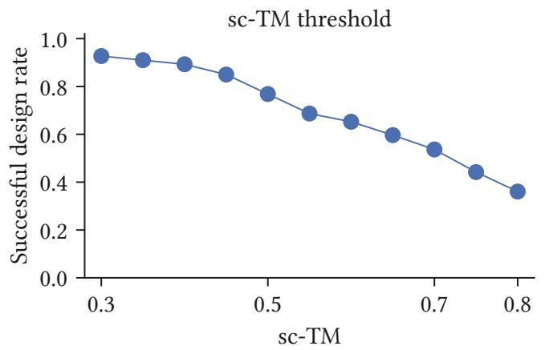

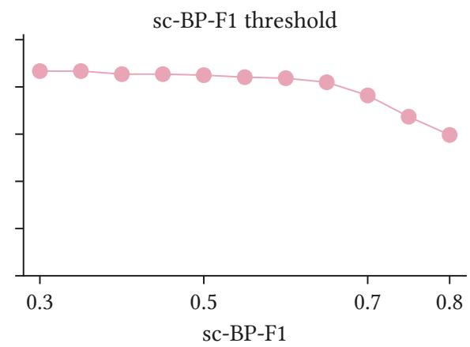  
Figure A1: Sensitivity of TANGO to the joint success criterion. Left: successful design rate when varying the sc-TM threshold while fixing $\mathrm { s c { - B P - F 1 > 0 . 5 0 } }$ . Right: successful design rate when varying the sc-BP-F1 threshold while fixing sc-TM > 0.45.

## D.1 Threshold Sensitivity

A TM-score above 0.45 is commonly used to indicate that two RNA structures share the same global topology [27]. We therefore use sc-TM > 0.45 as the tertiary-structure threshold in the main experiments, together with sc-BP-F1 > 0.50 to require secondary-structure consistency. Figure A1 further evaluates how sensitive the successful design rate is to these thresholds. As expected, the success rate decreases as either requirement becomes stricter. When the sc-TM threshold is increased from 0.30 to 0.80 with sc-BP-F1 fixed at 0.50, the successful design rate decreases by 61.3% relative to the loosest threshold setting. When the sc-BP-F1 threshold is increased from 0.30 to 0.80 with sc-TM fixed at 0.45, the rate decreases by 31.0%. These results show that joint success is sensitive to the required levels of both tertiary-structure and secondary-structure fidelity. Nevertheless, TANGO retains a substantial successful design rate under stricter criteria, supporting its robustness in generating high-quality RNA designs.

## D.2 Top 10 Sampling versus Frontier-guided Fine-tuning

Figure A2 compares frontier-guided fine-tuning with a Top-10 sampling strategy. We include TANGO-Base, an ablated variant without frontier-guided fine-tuning, and evaluate both its raw sampling performance and its Top-10 sampling performance. For each target, Top-10 sampling selects the 10 designs with the highest sc-TM from 30 sampled sequences. We also evaluate Top-10 sampling for the variant without topology-aware initialization.

The full TANGO model clearly outperforms all Top-10 sampling variants. Compared with TANGO-Base with Top-10 sampling, TANGO achieves relative improvements of 14.5% in sc-TM and 12.0% in sc-BP-F1. Compared with the Top-10 sampling variant without topology-aware initialization, TANGO achieves relative improvements of 51.1% in sc-TM and 100.0% in sc-BP-F1. This shows that the gains from TANGO cannot be explained by selecting better samples from a fixed policy.

Without policy optimization, Top-10 sampling still improves the raw policies, indicating that the sampled designs remain diverse enough for post-hoc selection to find stronger candidates. For TANGO-Base, Top-10 sampling improves sc-TM by 10.7% and sc-BP-F1 by 17.2% over raw sampling. For the variant without topology-aware initialization, it improves sc-TM by 17.5% and sc-BP-F1 by 27.3%. These results show that sampling and reranking can improve candidate selection, but frontier-guided fine-tuning is more efective because it improves the policy to generate higher-quality designs rather than only selecting from existing samples.

## D.3 Frontier-guided Fine-tuning versus Weighted Rewards

Figures A3 and A4 compare frontier-guided fine-tuning with fixed weighted reward alternatives. The 2D-heavy setting matches TANGO in sc-BP-F1 (0.84), but achieves lower sc-TM (0.61) and diversity

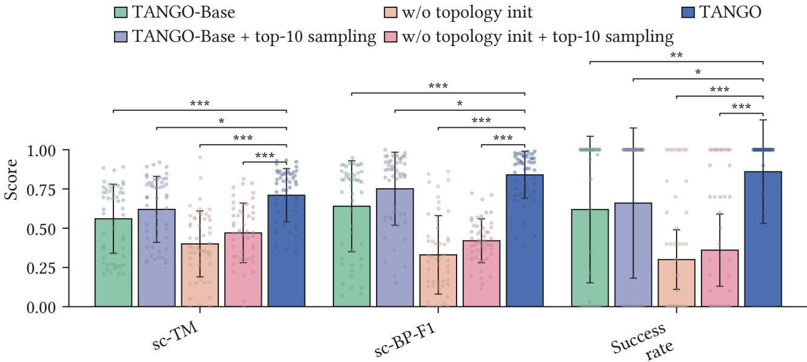  
Figure A2: Comparison between Top-10 sampling and frontier-guided fine-tuning. For each target, we sample sequences from 30 random seeds and select the 10 designs with the highest sc-TM for evaluation. We compare raw policies, their Top-10 sampling variants, and the full TANGO model. Bars show mean ± standard deviation across targets.

Weighted 2D-heavy Weighted balanced Weighted 3D-heavy TANGO-Div TANGO

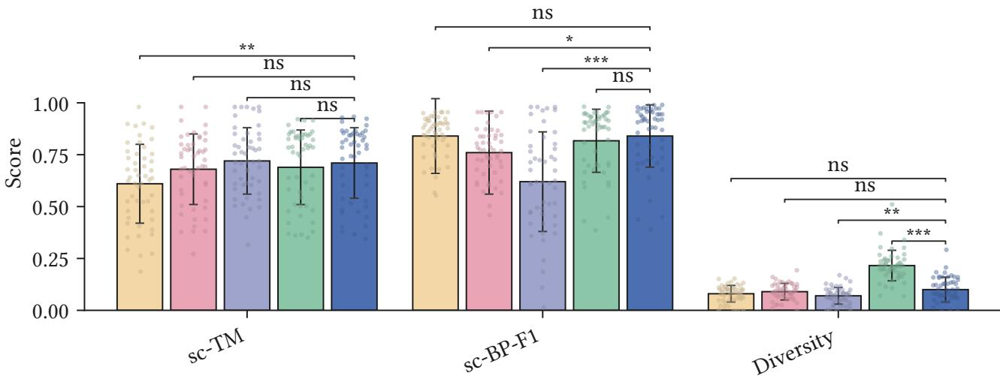  
Figure A3: Comparison between frontier-guided fine-tuning and fixed weighted reward alternatives. Three scalarized reward settings with diferent 2D/3D weights are compared with TANGO and TANGO-Div on sc-TM, sc-BP-F1, and sequence diversity. Bars show mean ± standard deviation across targets. Significance markers denote \* for $p < 0 . 0 5$ , \*\* for $p < 0 . 0 1$ , \*\*\* for $p < 0 . 0 0 1$ , and ns for not significant.

(0.08). Conversely, the 3D-heavy setting achieves slightly higher sc-TM (0.72), but reduces sc-BP-F1 to 0.62. These results show that fixed scalarization can bias optimization toward one structural objective at the expense of others. In contrast, TANGO maintains a stronger balance between topology and geometry, while TANGO-Div further increases diversity from 0.10 to 0.22 with only small decreases in sc-TM and sc-BP-F1. This supports the use of frontier-guided fine-tuning for target-wise multi-objective refinement without relying on manually chosen scalarization weights.

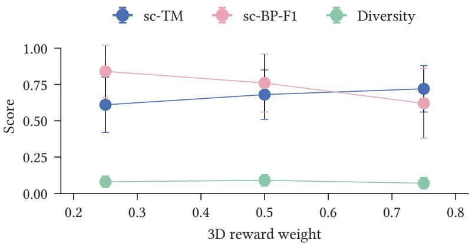  
Figure A4: Trade-ofs among multiple objectives under fixed weighted rewards. Changing the scalarization weights shifts the balance among 2D fidelity, 3D fidelity, and diversity, whereas frontier guided fine-tuning directly optimizes the target-wise trade-of frontier.

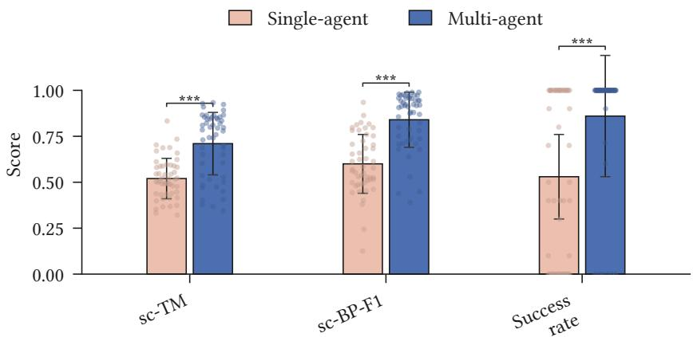  
Figure A5: Ablation of the cooperative multi-agent formulation. We compare the default multi-agent TANGO with a single-agent variant under the same training and evaluation protocol. Bars show mean ± standard deviation across held-out targets. Significance markers denote \* for $p < 0 . 0 5$ , \*\* for $p < 0 . 0 1$ , \*\*\* for $p < 0 . 0 0 1$ , and ns for not significant.

## D.4 Efect of the Cooperative Multi-agent Formulation

Figure A5 evaluates the efect of the cooperative multi-agent formulation by comparing TANGO with a single-agent variant. The multi-agent formulation consistently improves all metrics, increasing sc-TM from 0.52 to 0.71, sc-BP-F1 from 0.60 to 0.84, and success rate from 0.53 to 0.86. These correspond to relative improvements of 36.5%, 40.0%, and 62.3%, respectively. The results show that decomposing RNA sequence construction into coordinated local decisions benefits both tertiary-structure recovery and secondary-structure consistency.

## E Model Architecture

## E.1 Topology and Unit Encoders

The policy operates on structural units, while the first representation is constructed at the residue level. For residue $p ,$ the topology encoder embeds the dot-bracket token $b _ { p }$ and concatenates it with structural metadata $m _ { p } ,$ , including pairing status, normalized position, pairing distance, and pseudoknot-related indicators. The token vocabulary covers unpaired positions, standard parenthesis brackets, and additional bracket symbols used for pseudoknotted base pairs. The concatenated representation is mapped by an MLP to a residue-level topology embedding $h _ { p } ^ { \mathcal { T } } \in \mathbb { R } ^ { 2 5 6 }$

The unit encoder then converts residue embeddings into the structural-unit representation used by all agents. For a single-position unit $u _ { j } = \{ p \}$ , the input is $h _ { p } ^ { \mathcal { T } }$ together with unit metadata $m _ { u _ { j } } ,$ such as normalized position and local topology context. For a paired unit $u _ { j } = \{ p , q \}$ , the input contains $h _ { p } ^ { \mathcal { T } }$ $h _ { q } ^ { \mathcal { T } }$ , their elementwise product, their absolute diference, and pair-level metadata such as normalized pair distance, normalized endpoints, and pseudoknot/context indicators. Separate MLPs encode single and paired units into a shared 256-dimensional unit space. This design aligns the representation with the action granularity: paired residues are represented and assigned as one coupled decision rather than two independent nucleotide decisions.

A local topology context vector is computed for the current unit by mean pooling unit embeddings in a fixed local window around that unit. This context is used as local information for the actor. The centralized critic receives a separate global summary of the partial design state.

## E.2 Shared Actor with Unit-specific Heads

All agents share one actor. At a decision step, the actor input for an active agent is the current unit embedding, the assignment state of that unit, and the local topology context, corresponding to the observation $o _ { t } ^ { i } = [ e _ { j _ { t } ^ { i } } , { \pmb q } _ { t , j _ { t } ^ { i } } , { \pmb c } _ { j _ { t } ^ { i } } ]$ used in the main method. A shared MLP trunk maps this observation to a hidden representation.

The final action distribution is unit-specific. The single-unit head produces logits over {A, U, G, C}, and the paired-unit head produces logits over {AU, UA, GC, CG, GU, UG}. Agents with no remaining units are inactive at that step and do not contribute policy transitions.

## E.3 Centralized Critic

The critic is centralized during training. In the topology-aware initialization stage, it receives a pooled representation of the global partial design state, summarizing the target topology, current partial sequence, assignment mask, and rollout progress. In the topology-and-geometry co-design and frontier-guided fine-tuning stages, the critic additionally receives a pooled 3D target condition. The actor remains decentralized: at inference time, each active agent only uses its local observation and the shared actor parameters.

## E.4 3D Target Encoder

The target tertiary structure is represented with three beads per nucleotide: P, C4′, and the glycosidic nitrogen atom, N1 for pyrimidines and N9 for purines [14]. This coarse-grained representation preserves backbone geometry and approximate base placement while avoiding all-atom inputs.

TANGO uses a GVP-GNN encoder to map the target geometry to residue-level embeddings [17, 6]. The encoder constructs a spatial graph whose nodes are nucleotides and whose edges connect nearby residues in 3D space. Node and edge features contain scalar channels, such as distances and positional encodings, and vector channels, such as backbone directions and relative displacement vectors. Native nucleotide identities are not used as input features, preventing leakage from the target sequence. A GVP-GNN layer updates scalar-vector node features by aggregating messages from spatial neighbors:

$$
\begin{array} { r l } & { ( { m } _ { i } ^ { ( l ) } , \vec { m } _ { i } ^ { ( l ) } ) = \mathrm { A G G } _ { j \in \mathcal { N } ( i ) } \phi _ { \mathrm { m s g } } ^ { ( l ) } \left( ( s _ { i } ^ { ( l - 1 ) } , \vec { v } _ { i } ^ { ( l - 1 ) } ) , ( s _ { j } ^ { ( l - 1 ) } , \vec { v } _ { j } ^ { ( l - 1 ) } ) , ( e _ { i j } , \vec { e } _ { i j } ) \right) , } \\ & { \quad ( s _ { i } ^ { ( l ) } , \vec { v } _ { i } ^ { ( l ) } ) = \phi _ { \mathrm { u p d } } ^ { ( l ) } \left( ( s _ { i } ^ { ( l - 1 ) } , \vec { v } _ { i } ^ { ( l - 1 ) } ) , ( { m } _ { i } ^ { ( l ) } , \vec { m } _ { i } ^ { ( l ) } ) \right) . } \end{array}\tag{29}
$$

Here $\phi _ { \mathrm { m s g } } ^ { ( l ) }$ and $\phi _ { \mathrm { u p d } } ^ { ( l ) }$ 6), are GVP-based message and update functions. Scalar channels provide rotationinvariant quantities for the downstream policy, while vector channels allow the encoder to propagate orientation-dependent geometric information during message passing. The resulting residue-level geometric embeddings are used as conditioning signals for the structural-unit actor.

Residue-level geometric embeddings are pooled to match the structural units. A single-position unit inherits the embedding of its residue. A paired unit uses the mean of the two residue embeddings. We also compute a unit center from the target $\mathrm { C 4 ^ { \prime } }$ coordinates and build a unit-level 3D nearest-neighbor list. The local 3D context for a unit is the mean of the embeddings of its nearest neighboring units, using 15 nearest units in the reported configuration.

## E.5 Zero-initialized Geometry Adapters

The topology-and-geometry co-design stage initializes from the topology-aware actor and adds two 3D-conditioned paths. For unit uj, let ${ \pmb g } _ { j }$ denote the unit-level 3D embedding and $c _ { j } ^ { \mathrm { 3 D } }$ denote the local 3D context. We define the geometry condition as $d _ { j } ^ { \mathrm { 3 D } } = [ \pmb { g } _ { j } , \pmb { c } _ { j } ^ { \mathrm { 3 D } } ]$

The first 3D-conditioned path applies FiLM modulation to the inherited hidden state:

$$
\widetilde { z } _ { j } = \left( 1 + \gamma ( d _ { j } ^ { \mathrm { 3 D } } ) \right) \odot z _ { j } + \beta ( d _ { j } ^ { \mathrm { 3 D } } ) ,\tag{30}
$$

where $z _ { j }$ is the hidden representation produced by the topology-aware base path. The second path directly maps the topology-aware unit state together with the geometry condition through a small 3D-conditioned network. The final action logits are

$$
\ell _ { j } = \ell _ { j } ^ { \mathrm { b a s e } } + \Delta \ell _ { j } ^ { \mathrm { F i L M } } + \Delta \ell _ { j } ^ { \mathrm { 3 D } } .\tag{31}
$$

The last linear layers of both 3D-conditioned paths are initialized to zero. Therefore, at the beginning of topology-and-geometry co-design, the transferred policy is close to the topology-aware policy. Geometry conditioning can then gradually adjust topology-compatible sequence decisions toward the target tertiary structure.

## F Training Details

The three learning stages share the structural-unit rollout interface and the MAPPO update described in Appendix C. At the beginning of each episode, the target is parsed into ordered structural units, and cooperative agents fill these units until a complete candidate sequence is generated. The learning signal is assigned at the end of the episode. Stage I uses a topology-training reward, Stage II uses a topology-and-geometry co-design reward, and Stage III uses a frontier-guided reward based on target-wise multi-objective improvement.

Across stages, MAPPO uses discount factor $\gamma = 0 . 9 9 , \mathrm { G A E }$ parameter $\lambda _ { \mathrm { G A E } } = 0 . 9 5$ , PPO clip range 0.2, value coeficient 0.5, and gradient clipping at norm 5.0. Stage-specific rollout, optimization, and reward settings are summarized below. Protocol choices such as the fold-back oracle, structurealignment backend, and frontier objective set are described in prose when they define the training interface rather than scalar hyperparameters.

## F.1 Stage I Hyperparameters

Stage I trains the topology-aware policy on secondary-structure targets. After the agents generate a complete sequence, the secondary-structure oracle evaluates its agreement with the target secondary structure, and the resulting topology-training reward is shared by all agents. This stage teaches the policy to make base-pair-compatible structural-unit assignments before tertiary-structure conditioning is introduced. Training is performed on a server with one NVIDIA H100 GPU. The training takes approximately 5 hours, and inference for a single sample takes only a few seconds. The rollout and optimization settings are shown in Table A1.

## F.2 Stage II Hyperparameters

Stage II starts from the topology-aware policy and trains a topology-and-geometry co-design policy. For each completed sequence, we predict its tertiary structure with the fold-back oracle, align it to the target structure, and compute the TM-score as the 3D reward. The predicted tertiary structure is also annotated into a secondary structure, which is used to compute the BP-F1 topology reward. Following the main text, the Stage II co-design reward contains three terms: a 3D fidelity term, a 2D fidelity term, and a hinge penalty when the 2D fidelity falls below the target threshold:

$$
\begin{array} { r } { R _ { \mathrm { c o } } ( x _ { T } ; \mathcal { G } ^ { \star } , T ^ { \star } ) = R _ { 3 \mathrm { D } } ( x _ { T } ; \mathcal { G } ^ { \star } ) + \lambda _ { 2 \mathrm { D } } R _ { 2 \mathrm { D } } ( x _ { T } ; T ^ { \star } ) - \lambda _ { \mathrm { v i o l } } \operatorname* { m a x } \left( 0 , \tau _ { 2 \mathrm { D } } - R _ { 2 \mathrm { D } } ( x _ { T } ; T ^ { \star } ) \right) . } \end{array}\tag{32}
$$

Here $R _ { \mathrm { 3 D } }$ is measured by TM-score, and $R _ { \mathrm { 2 D } }$ is measured by BP-F1. RMSD is recorded for evaluation but is not used as a reward term. The rollout, optimization, and reward settings are shown in Table A2.

Table A1: Stage I rollout and optimization settings.
<table><tr><td>Setting</td><td>Value</td></tr><tr><td>Number of agents</td><td>4</td></tr><tr><td>Actor learning rate</td><td> $1 \times 1 0 ^ { - 4 }$ </td></tr><tr><td>Critic learning rate</td><td> $1 \times 1 0 ^ { - 4 }$ </td></tr><tr><td>Encoder learning-rate scale 0.3</td><td></td></tr><tr><td>Optimizer</td><td> $\mathrm { A d a m W }$ </td></tr><tr><td>Weight decay</td><td> $1 \times 1 0 ^ { - 4 }$ </td></tr><tr><td>Learning-rate decay floor</td><td>0.3</td></tr><tr><td>Buffer size</td><td>4096</td></tr><tr><td>Epochs per update</td><td>4</td></tr><tr><td>Minibatches per update</td><td>4</td></tr><tr><td>Entropy coefficient</td><td>0.01</td></tr></table>

Table A2: Stage II rollout, optimization, and co-design reward settings.
<table><tr><td>Setting</td><td>Value</td></tr><tr><td>Number of agents</td><td>4</td></tr><tr><td>Actor learning rate</td><td> $5 \times 1 0 ^ { - 4 }$ </td></tr><tr><td>Critic learning rate</td><td> $5 \times 1 0 ^ { - 4 }$ </td></tr><tr><td>Learning-rate decay floor</td><td>0.3</td></tr><tr><td>Buffer size</td><td>1024</td></tr><tr><td>Epochs per update</td><td>10</td></tr><tr><td>Minibatches per update</td><td>2</td></tr><tr><td>Entropy coefficient</td><td>0.01</td></tr><tr><td> $\lambda _ { \mathrm { 2 D } }$ </td><td>1.0</td></tr><tr><td> $\lambda _ { \mathrm { v i o l } }$ </td><td>2.0</td></tr><tr><td> $\tau _ { \mathrm { 2 D } }$ </td><td>0.4</td></tr></table>

Table A3: Stage III frontier-guided fine-tuning settings.
<table><tr><td>Setting</td><td>Value</td></tr><tr><td>Warm-start archive size 64</td><td></td></tr><tr><td>Actor learning rate</td><td> $1 \times 1 0 ^ { - 4 }$ </td></tr><tr><td>Critic learning rate</td><td> $1 \times 1 0 ^ { - 4 }$ </td></tr><tr><td>Buffer size</td><td> $1 0 2 4$ </td></tr><tr><td>Epochs per update</td><td>4</td></tr><tr><td>Minibatches per update 2</td><td></td></tr><tr><td>Entropy coefficient</td><td>0.02</td></tr></table>

## F.3 Stage III Hyperparameters

Stage III applies frontier-guided fine-tuning. For each target, we warm-start an archive with candidate sequences sampled from the co-design policy. During fine-tuning, each update samples complete candidate sequences, evaluates them with the same fold-back protocol, and assigns each trajectory a terminal reward given by its exclusive hypervolume contribution to the target-wise frontier. The default bi-objective frontier uses sc-BP-F1 and sc-TM, while the diversity-aware variant additionally includes sequence diversity. The fine-tuning settings are shown in Table A3.

## G Evaluation Metrics

## G.1 Fold-back Self-consistency Protocol

The main evaluation follows a fold-back self-consistency protocol. Let $ { F _ { \mathrm { 3 D } } }$ denote the selected tertiarystructure prediction oracle, and let $A _ { \mathrm { 2 D } }$ denote the 3D-to-2D annotation procedure. For a target with native sequence $x ^ { \star }$ , we define the reference tertiary structure and its associated secondary topology as

$$
\mathcal { G } ^ { \star } = F _ { \mathrm { 3 D } } ( x ^ { \star } ) , \qquad \mathcal { T } ^ { \star } = A _ { \mathrm { 2 D } } ( \mathcal { G } ^ { \star } ) .\tag{33}
$$

For a designed sequence $x ,$ we compute its fold-back tertiary structure and annotated secondary topology as

$$
\widehat { \mathcal { G } } ( x ) = F _ { \mathrm { 3 D } } ( x ) , \qquad \widehat { \mathcal { T } } ^ { \mathrm { a n n } } ( x ) = A _ { \mathrm { 2 D } } \left( \widehat { \mathcal { G } } ( x ) \right) .\tag{34}
$$

The designed sequence is evaluated by comparing $\widehat { \mathcal { G } } ( { \boldsymbol { x } } )$ with $\mathcal G ^ { \star }$ and ${ \widehat { T } } ^ { \mathrm { a n n } } ( x )$ with $\mathcal { T } ^ { \star }$ . This difers from directly comparing a predicted design structure with experimental coordinates. Since the reference and designed sequences are folded by the same oracle, the shared predictor-specific inductive bias is expected to cancel out in the structural similarity calculation [69]. We additionally report cross-oracle evaluation of TANGO designs in Figure $^ { 7 }$ to examine whether the observed trends remain consistent under an independent fold-back predictor.

## G.2 3D Self-consistency Metrics

We report tertiary-structure fidelity using sc-TM and sc-RMSD. The sc-TM score is the TM-score computed by USalign between the designed fold-back structure and the reference fold-back structure:

$$
\operatorname { s c - T M } ( x , x ^ { \star } ) = \operatorname { T M } \left( { \widehat { \mathcal { G } } } ( x ) , { \mathcal { G } } ^ { \star } \right) .\tag{35}
$$

TM-score is length-normalized and evaluates global fold similarity [27]. Given an aligned set of positions A with pairwise distances $d _ { i } .$ USalign computes TM-score using its standard length normalization:

$$
\mathrm { T M } = \operatorname* { m a x } \left[ \frac { 1 } { L _ { \mathrm { r e f } } } \sum _ { i \in \mathcal { A } } \frac { 1 } { 1 + \left( d _ { i } / d _ { 0 } ( L _ { \mathrm { r e f } } ) \right) ^ { 2 } } \right] .\tag{36}
$$

The sc-RMSD score is the RMSD over the aligned region after structural alignment:

$$
\mathrm { s c - R M S D } = \sqrt { \frac { 1 } { \left| \boldsymbol { A } \right| } \sum _ { i \in \boldsymbol { A } } d _ { i } ^ { 2 } } .\tag{37}
$$

Thus, sc-TM measures $\mathrm { g l }$ obal fold agreement, whereas sc-RMSD reflects geometric deviation within the aligned region.

## G.3 2D Self-consistency Metrics

Secondary-topology fidelity is measured by comparing the target topology $\mathcal { T } ^ { \star }$ with the annotated topology ${ \hat { \mathcal { T } } } ^ { \mathrm { a n n } } ( x )$ extracted from the designed fold-back structure. Let ${ \mathcal { P } } ^ { \star }$ denote the target base-pair set and let $\widehat { \mathcal { P } } ( x )$ denote the base-pair set extracted from ${ \widehat { T } } ^ { \mathrm { a n n } } ( x )$ . The self-consistent base-pair F1 score is

$$
\operatorname { s c - B P - F 1 } ( x , x ^ { \star } ) = { \frac { 2 | { \widehat { \mathcal { P } } } ( x ) \cap { \mathcal { P } } ^ { \star } | } { | { \widehat { \mathcal { P } } } ( x ) | + | { \mathcal { P } } ^ { \star } | } } .\tag{38}
$$

When both pair sets are empty, we define $\mathrm { s c { - } B P { - } F 1 { = } 1 } { \bmod { } }$ ; when only one pair set is empty, the score is 0.

## G.4 Target-level Aggregation

Each method generates multiple designs for each target. We first aggregate metrics within each target and then report averages across test targets. For sc-TM, sc-RMSD, and sc-BP-F1, we compute the target-level mean over sampled designs and then average over targets. A design is considered successful if it satisfies

$$
\mathrm { s c - T M } ( \boldsymbol { x } , \boldsymbol { x } ^ { \star } ) \geq \tau _ { \mathrm { 3 D } } , \qquad \mathrm { s c - B P - F 1 } ( \boldsymbol { x } , \boldsymbol { x } ^ { \star } ) \geq \tau _ { \mathrm { 2 D } } .\tag{39}
$$

The success rate reports the average fraction of sampled designs satisfying both thresholds. The solved target rate reports the fraction of test targets for which at least one sampled design satisfies both thresholds. Appendix D.1 evaluates how TANGO changes under alternative sc-TM and sc-BP-F1 thresholds. This target-level aggregation prevents targets with more valid sampled outputs from dominating the benchmark average.

## G.5 Novelty and Diversity

Sequence novelty is defined as the normalized Hamming distance between a designed sequence and the native sequence of the target:

$$
\mathrm { N o v e l t y } ( x , x ^ { \star } ) = \frac { 1 } { L } \sum _ { p = 1 } ^ { L } \mathbb { I } [ x _ { p } \neq x _ { p } ^ { \star } ] .\tag{40}
$$

For a target-level set of designed sequences $\mathcal { X } _ { t } = \{ x ^ { ( 1 ) } , \ldots , x ^ { ( m ) } \}$ with common length $L ,$ sequence diversity is the average pairwise normalized Hamming distance:

$$
\operatorname { D i v e r s i t y } ( \mathcal X _ { t } ) = \frac { 2 } { m ( m - 1 ) } \sum _ { 1 \le i < j \le m } \frac { 1 } { L } \sum _ { p = 1 } ^ { L } \mathbb { I } \left[ x _ { p } ^ { ( i ) } \neq x _ { p } ^ { ( j ) } \right] , \qquad m \ge 2 .\tag{41}
$$

When diversity is analyzed under structural success, $\mathcal { X } _ { t }$ is restricted to successful designs for that target, so that random failed sequences do not artificially inflate diversity.

## H Limitations and Broader Impact

Future Work and Limitations Key directions for future work include extending the framework to richer RNA interaction settings, including non-canonical contacts, ligand-bound RNAs, and protein– RNA complexes. In addition, selected designs could be tested experimentally to examine whether they fold and function as intended.

A common limitation of computational RNA design methods is their reliance on structure-prediction oracles for fold-back evaluation. Recent progress in RNA and biomolecular structure prediction has made these predictors increasingly accurate, and they have already been used as practical components in experimental RNA engineering pipelines [70, 71]. However, RNA structure prediction remains dificult due to RNA dynamics and limited high-quality data. Nevertheless, TANGO is not tied to a specific predictor, and our cross-oracle experiments show broadly consistent trends across diferent fold-back models. Future advances in RNA structure prediction are expected to further improve the reliability and practical utility of TANGO. Future evaluation could also consider dimensions beyond structural fidelity, including measures of biological function [72].

Broader Impact TANGO may contribute to synthetic biology, RNA-based therapeutics, and studies of gene regulation by improving the computational design of RNAs with desired structural properties. Such methods could support the engineering of functional RNA circuits, aptamers, and ribozymes. However, AI-driven biological sequence design also raises concerns about reliability, interpretabili $\mathrm { t y , }$ and experimental validation. Recent work on genomic models advocates systematic evaluation of explanations for consistency, faithfulness, and biological validity [73]. Such assessment will also be important when using model interpretations to guide RNA engineering.