# THE ACCURACY WELL: NONMONOTONE ACCURACYDYNAMICS AT VANISHING INITIALIZATION

Yaroslav Gusev   
Applied AI Institute   
Moscow, Russia   
i.gusev@applied-ai.ru   
Eugene Golikov   
Applied AI Institute   
Moscow, Russia   
e.golikov@applied-ai.ru   
Dmitry Yarotsky   
Applied AI Institute &   
Steklov Mathematical Institute of Russian Academy of Sciences   
Moscow, Russia   
yarotsky@gmail.com

## ABSTRACT

We study classification dynamics under small initialization and identify a pronounced non-monotone behavior of accuracy that we call the accuracy well: accuracy rises rapidly early in training, subsequently drops, and only much later recovers. We observe this phenomenon in deep linear networks, fully connected ReLU networks on MNIST, deep convolutional networks on CIFAR-10, and controlled synthetic tasks, across different losses and optimizers and in both training and test accuracy. We propose a three-stage explanation in terms of target-driven organization, a degeneracy bottleneck, and subsequent recruitment and recovery. We develop a rigorous theory of these dynamics for shallow and deep linear networks, showing in particular that high accuracy can emerge while the predictor and the change in loss remain asymptotically vanishing, before continued optimization causes accuracy to deteriorate. For a simple synthetic classification task, we prove an extreme instance in which accuracy asymptotically rises to 100%, collapses to 0, and later recovers permanently to 100%. Our results show that classification accuracy can reveal aspects of learning dynamics that are not captured by the training loss alone.

## 1 INTRODUCTION

Initialization scale can qualitatively change the dynamics of gradient-based learning. In suitable parameterizations and scalings, training can enter a lazy, kernel-like regime in which the nonlinear trajectory remains close to its linearization around initialization (Jacot et al., 2018; Chizat et al., 2019), whereas small or vanishing initialization can expose substantially richer evolution of the learned predictor (Woodworth et al., 2020). This regime has been studied from several comple mentary perspectives. In linear and homogeneous models it can produce sequential learning of spectral components, incremental low-rank structure, and saddle-to-saddle dynamics (Saxe et al., 2014; Gidel et al., 2019; Gissin et al., 2020; Jacot et al., 2021; Zhang et al., 2026); in nonlinear networks, substantial directional or feature organization can already occur before appreciable loss decay (Atanasov et al., 2022; Boursier et al., 2022; Min et al., 2024). Small initialization is therefore not merely a choice of scale: it can separate qualitatively different stages of learning that are compressed together at larger initialization.

In this paper we describe and analyze a small-initialization phenomenon that we call the accuracy well. We consider classification problems in which a model is trained from small initialization and follow its classification accuracy (i.e., the fraction of examples classified correctly) throughout training. At sufficiently small initialization, we repeatedly observe a pronounced non-monotone accuracy trajectory: it first rises rapidly, then significantly drops, and only much later recovers. We call the early rise an accuracy hill; together with the subsequent drop and recovery, it forms an accuracy well; see Figure 1. The phenomenon appears in deep linear networks, fully connected ReLU networks on MNIST, and deep convolutional networks on CIFAR-10, is visible in both training and test accuracy, persists across different losses and optimization methods, and disappears in several informative control settings.

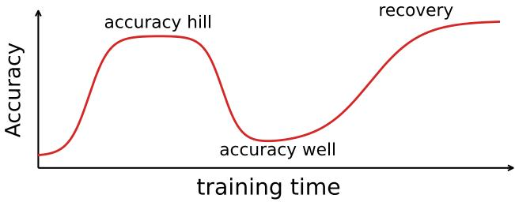  
Figure 1: Schematic accuracy well: non-monotone accuracy dynamics at small initialization.

Related non-monotone predictive phenomena include transient prediction-level effects arising from unequal spectral learning rates in deep linear networks (Saxe et al., 2019), example forgetting and subset-specific accuracy dynamics (Toneva et al., 2019; Schneider, 2025), as well as epoch-wise double descent, where the pronounced non-monotonicity is primarily observed in test or generalization performance (Nakkiran et al., 2020; Heckel & Yilmaz, 2021; Olmin & Lindsten, 2024). Existing theoretical accounts of these neighboring phenomena do not directly characterize the pronounced non-monotone evolution of the training accuracy studied here. We instead follow how the induced classifier and its class ordering evolve from small initialization, and develop rigorous results for the resulting sequence of early improvement, intermediate deterioration, and later recovery. To our knowledge, such dynamics have not previously been analyzed directly under full-batch training. Detailed connections to prior work are discussed in Appendix A.

## Our contributions.

• We systematically analyze the phenomenology of the accuracy well across linear and nonlinear models, including classification on MNIST, CIFAR-10, and controlled synthetic tasks; see Section 2.

• We propose a general heuristic explanation ofthe accuracy well in terms of a target-driven organization, a degeneracy bottleneck, and subsequent recruitment; see Section 3.

• We develop a rigorous theory ofthe accuracy well in shallow and deep linear networks. We obtain general results for classification dynamics under small initialization; see Section 4.

## 2 PHENOMENOLOGY

We first analyze the accuracy well empirically across a range of models and training settings. Figures 2 and 3 collect representative examples and controlled sweeps that reveal several recurring features of the phenomenon. Our aim is not to provide an exhaustive taxonomy of when an accuracy well occurs, but to identify the main empirical regularities that motivate our theoretical study.

Experimental settings and breadth of the phenomenon. We consider both standard imageclassification tasks and simple synthetic problems, using architectures ranging from fully connected linear and ReLU networks to a convolutional network. For natural data we use MNIST and CIFAR-10. As controlled synthetic tasks, we consider unary operations $f : [ p ]  [ p ]$ , where $[ p ] = \{ 1 , \dotsc , p \}$ , represented using one-hot inputs and outputs. We study random maps, where the values f(i) are chosen independently and uniformly, and permutations, where f is bijective. Across these different settings we repeatedly observe pronounced accuracy wells, while several controls show that the phenomenon is not universal. On MNIST, the accuracy-well pattern is also reproducible across five independent random seeds. On CIFAR-10, we also observe an accuracy well in a five-hidden-layer convolutional network. Experimental details and additional figures are given in Appendix C.

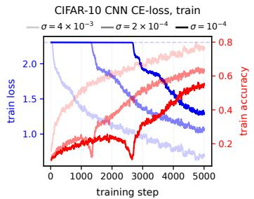

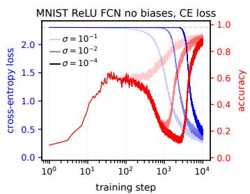

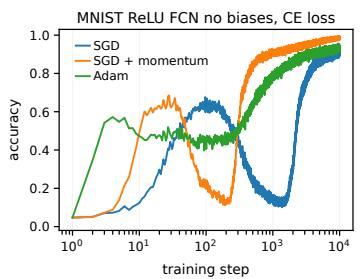

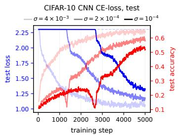

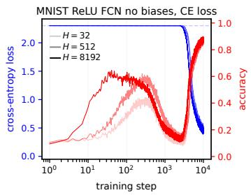

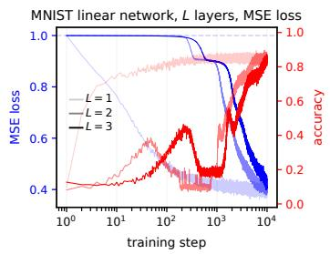

Figure 2: Accuracy-well phenomenology on CIFAR-10 and MNIST. Left: train and test dynamics of a two-hidden-layer CIFAR-10 CNN under an initialization-scale sweep. Middle: MNIST ReLU networks without biases under cross-entropy, varying initialization scale (top) and width (bottom). Right: optimizer comparison for the MNIST ReLU network (top) and a comparison of linear networks $f = \mathbf { \bar { W } } _ { L } \cdot \cdot \cdot \mathbf { W } _ { 1 }$ on MNIST with L = 1, 2, 3 (bottom).  
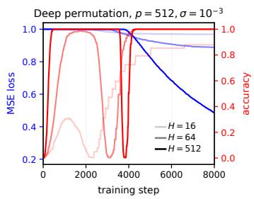

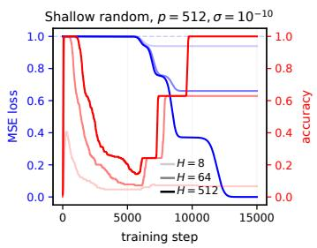

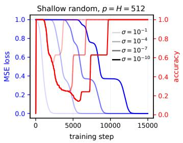  
Figure 3: Representative unary-operation experiments. Left: a deep linear network $( L = 3$ layers) trained on a permutation operation develops a pronounced accuracy well as width increases. Middle: a shallow network (L = 2 layers) trained on a random unary operation develops a well in which the early classifier can substantially outperform the late-time predictor. Right: decreasing the initialization scale σ separates the rise, collapse, and recovery over increasingly distinct time scales.

Relation to loss decay. A recurring pattern is that the early accuracy hill forms while the loss does not visibly change. The accuracy then starts to fall, and the low point of the well typically occurs around the time when the loss begins to decrease noticeably. This behavior is visible across several sweeps in Figures 2 and 3. Thus large changes in classification can happen before substantial loss optimization, while the deepest part of the well tends to align with the onset of loss decay.

Initialization scale. The most consistent control parameter is the initialization scale. At relatively large σ, accuracy typically evolves more monotonically, whereas decreasing σ progressively separates the early hill, the collapse, and the eventual recovery. This is especially clear in the top-middle panel of Figure 2 and the right panel of Figure 3, where the same qualitative phases become increasingly well separated in training time as σ decreases.

Small initialization is nevertheless not sufficient. The shallow permutation model remains free of a well at small initialization, while the directly optimized linear MNIST model (bottom-right panel of Figure 2) also exhibits monotone accuracy dynamics. Thus small initialization makes the well sharply visible in many settings, but does not by itself determine whether one occurs.

Model capacity. Increasing width generally strengthens the early classifier and deepens the resulting well. This is visible for MNIST in the bottom-middle panel of Figure 2 and in the width sweeps in the left and middle panels of Figure 3. We do not claim a universal width-scaling law, since the quantitative effect is visibly task- and architecture-dependent.

Loss, train–test behavior, and optimization. The well appears across different losses and optimizers. The unary experiments use mean-squared error, while CIFAR-10 and most MNIST experiments use cross-entropy. On CIFAR-10, train and test accuracy show closely aligned hills, collapses, and recoveries, so the phenomenon is not specific to either training or test accuracy. On MNIST, the well is present with SGD, SGD with momentum, and Adam, although the drop is smaller for Adam under the hyperparameters used here. A systematic optimizer comparison is beyond our scope.

Depth and target structure. Depth can qualitatively change accuracy dynamics even when the end-to-end function class is unchanged. The bottom-right panel of Figure 2 compares linear networks $f ( \mathbf { x } ) \ = \ \mathbf { W } _ { L } \cdot \cdot \cdot \mathbf { W } _ { 1 } \mathbf { x }$ trained on MNIST with $\bar { L \ = \ 1 , 2 , 3 }$ . All represent linear maps $\mathbb { R } ^ { 7 8 4 } \xrightarrow { \cdot } \dot { \mathbb { R } } ^ { 1 0 }$ and start from small initialization, but the deeper models $( L > 1 )$ develop pronounced accuracy wells while direct optimization $( L = 1 )$ does not.

Target structure also matters. For a two-layer linear network, a permutation target retains its early high accuracy, whereas a random unary target develops a pronounced well (Figure 3). At greater depth, however, even the permutation target can develop a well. Thus neither small initialization nor target structure alone determines the phenomenon; the depth matters as well. Additional architectural controls, including bias ablations, are reported in Appendix C.

Early versus late classifiers. The middle panel of Figure 3 shows a particularly striking effect: narrow random-unary networks can reach very high accuracy early in training but settle at substantially lower accuracy after much longer optimization of the MSE. Thus continued loss minimization does not necessarily improve classification accuracy: an early predictor can be a better classifier than a much later predictor with substantially smaller loss.

These observations raise the central question: what mechanism produces the accuracy well?

## 3 A HEURISTIC PICTURE OF THE ACCURACY WELL

We propose a three-stage picture for the accuracy well: target-driven organization, a degeneracy bottleneck, and recruitment and recovery. The first two stages occur on a microscopic scale: the classifier can reorganize substantially while the predictor remains small and the loss is nearly unchanged. The final recovery instead occurs on the macroscopic training scale, together with substantial growth of the predictor and loss decay.

Target-driven organization. The first stage can be understood from a local linearization of the initial dynamics, closely related to the picture underlying lazy learning (Jacot et al., 2018; Chizat et al., 2019). Here, however, we use this only as a short-time description suitable for illustrating the first stage. Subsequent learning may involve dynamics beyond this initial first-order behavior.

Consider a C-class model $f _ { \pmb \theta } : \mathbb R ^ { p }  \mathbb R ^ { C }$ , parametrized by $\pmb \theta \in \mathbb { R } ^ { d }$ , and stack its outputs and the corresponding ground-truth targets over the training set into $\mathbf { F } _ { \pmb { \theta } } , \mathbf { Y } \in \mathbb { R } ^ { N C }$ . For squared loss,

$$
\dot { \mathbf { F } } _ { \theta } = \mathbf { K } _ { \theta } \left( \mathbf { Y } - \mathbf { F } _ { \theta } \right) , \qquad \mathbf { K } _ { \theta } = \mathbf { J } _ { \theta } \mathbf { J } _ { \theta } ^ { \top } , \qquad \mathbf { J } _ { \theta } = \frac { \partial \mathbf { F } _ { \theta } } { \partial \theta } ,\tag{1}
$$

where $\mathbf { K } _ { \theta }$ is the empirical tangent kernel. If vanishing initialization makes $\mathbf { F } _ { \pmb { \theta } ( 0 ) }$ small, then over a sufficiently short initial interval the tangent kernel is approximately frozen to first order, and

$$
\mathbf F _ { \pmb \theta ( \tau ) } \approx \underbrace { \mathbf F _ { \pmb \theta ( 0 ) } } _ { \mathrm { i n i t i a l i z a t i o n ~ n o i s e } } + \underbrace { \tau \mathbf K _ { \pmb \theta ( 0 ) } \mathbf Y } _ { \mathrm { t a r g e t - d r i v e n ~ s i g n a l } } .\tag{2}
$$

Equation (2) suggests a simple competition during the first stage. The predictor initially contains a random contribution inherited from initialization, while training begins to build a coherent component aligned with the targets. At very early times the former may still dominate, but the target-driven component grows with τ. Increasing the width favors the target-driven component in this competition: initialization-dependent fluctuations are reduced by self-averaging, whereas the target-driven contribution adds coherently. Thus there can be an early window in which τ is already large enough for the target-driven signal to control the score ordering, but still small enough for the local linearized description above to remain accurate. In this window the predictor itself may remain microscopic— indeed, under vanishing initialization the tangent kernel and hence the target-driven signal may also vanish in absolute magnitude—yet the classifier can already achieve high accuracy while the loss has barely changed. Our linear theory in Section 4 makes this target-driven organization rigorous, with the precise near-origin dynamics depending on the model and depth. The same qualitative mechanism may also extend beyond squared loss.

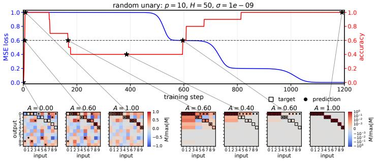

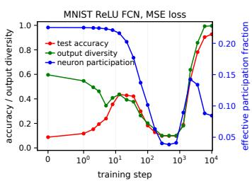  
Figure 4: Diagnostics of the proposed accuracy-well mechanism. Left: evolution of a two-layer linear network $\mathbf { M } = \mathbf { W } _ { 2 } \mathbf { W } _ { 1 }$ on a random unary operation. Snapshots of the normalized score matrix show how the model reorganizes along the accuracy-well trajectory. Notably, snapshots with the same accuracy $( A = 0 . 6 )$ have qualitatively different score-matrix structure. Right: test accuracy, effective hidden-neuron participation fraction, and output diversity in a one-hidden-layer ReLU network on MNIST. The participation fraction measures the effective fraction of hidden neurons contributing to class-dependent scores, while output diversity measures the effective fraction of output classes used by the predictions; see equations (897), (901) in Appendix C.2.

Degeneracy bottleneck. We associate the subsequent loss of accuracy with the predictor becoming temporarily degenerate while still remaining microscopic. We call this stage a degeneracy bottleneck. Its precise form is model-dependent. In two-layer linear networks, the predictor can be viewed as a sum of rank-one singular components whose microscopic growth rates may separate strongly. The dynamics can therefore become dominated by only a small subset of these components, possibly containing several equally dominant modes. If this dominant subset does not preserve the class ordering produced by their earlier combination, accuracy falls. This mechanism is visible in Figure 4 (left) and is made rigorous in Section 4.

For deeper linear networks, our rigorous result uses the stronger nondegeneracy assumption that the leading singular direction of the target is unique. Under generic Gaussian initialization, the first saddle escape is then asymptotically rank one, with the probability guarantees described in Section 4, by the result of Jacot et al. (2021). For nonlinear networks we do not claim an analogous spectral characterization and instead use degeneracy as an empirical diagnostic. In the one-hidden-layer ReLU experiment, both the effective hidden-neuron participation fraction and the output diversity decrease sharply near the bottom of the accuracy well; see Figure 4 (right) and Appendix C.2. Thus, across these settings, the bottleneck corresponds to a transient loss of predictive diversity, although the microscopic mechanism producing it need not be universal.

Recruitment and recovery. The final stage is qualitatively different from the first two. Recovery takes place on the macroscopic training scale, when the predictor grows substantially and the loss begins to decrease. At this stage, predictive structure that was suppressed or absent at the bottleneck can become dynamically relevant. We call this re-entry or emergence of complementary predictive structure recruitment. In linear models this corresponds to the progressive incorporation of additional singular modes, closely related to classical mode-learning and incremental-learning dynamics (Saxe et al., 2014). In nonlinear networks, the analogous phenomenon is naturally viewed in terms of feature learning: task-relevant features or directions can emerge progressively over training (Dandi et al., 2024). We use recruitment to emphasize specifically this recovery-side increase in predictive diversity.

Both panels of Figure 4 are consistent with this picture. In the linear network example, the score matrix regains a diverse, target-like structure as accuracy recovers. In the ReLU network, effective neuron participation and the output diversity rise again during the recovery stage. Thus the accuracy well separates two microscopic stages, target-driven organization and a degeneracy bottleneck, from a later macroscopic stage of recruitment and recovery.

## 4 ACCURACY DYNAMICS IN DEEP LINEAR NETWORKS UNDER VANISHING INITIALIZATION [APPENDIX B]

We now develop a rigorous realization of this picture in deep linear networks. Consider a C-class training set $\{ ( \bar { \mathbf { x } _ { i } } , \bar { \mathbf { y } _ { i } } ) \bar  \} _ { i = 1 } ^ { N }$ , with $\mathbf { x } _ { i } \in \mathbb { R } ^ { p } , \ \mathbf { y } _ { i } = \mathbf { e } _ { c _ { i } } \in \mathbb { R } ^ { C } , c _ { i } \in \{ 1 , \dots , C \}$ , and a linear classifier

$$
f ( \mathbf { x } ) = \mathbf { W } _ { L } \cdot \cdot \cdot \mathbf { W } _ { 1 } \mathbf { x } = \mathbf { M } \mathbf { x } .
$$

For $L \ \geq \ 2 ,$ , all hidden layers have width H: $\mathbf { W } _ { 1 } ~ \in ~ \mathbb { R } ^ { H \times p } , ~ \mathbf { W } _ { L } ~ \in ~ \mathbb { R } ^ { C \times H }$ , and ${ \bf W } _ { \ell } \in \mathbf { \Omega }$ $\mathbb { R } ^ { H \times H } , \overline { { 1 } } < \ell < L$ For $\dot { L } = 1$ , the end-to-end predictor $\mathbf { M } \in \mathbb { R } ^ { \overline { { C } } \times p }$ is optimized directly. The weights are initialized independently with ${ \mathcal { N } } ( 0 , \sigma ^ { 2 } )$ entries and trained by gradient flow on $\begin{array} { r } { \mathcal { L } ( \mathbf { M } ) = ( 2 N ) ^ { - 1 } \sum _ { i } \| \mathbf { M } \mathbf { x } _ { i } - \mathbf { y } _ { i } ^ { \star } \| _ { 2 } ^ { 2 } } \end{array}$ . Although cross-entropy is more common for classification, we use mean squared loss for analytical tractability.

Our main object is the training accuracy

$$
\mathcal { A } ( \mathbf { M } ) = \frac { 1 } { N } \sum _ { i = 1 } ^ { N } \mathbf { 1 } \bigg \{ ( \mathbf { M } \mathbf { x } _ { i } ) _ { c _ { i } } > \operatorname* { m a x } _ { c \neq c _ { i } } ( \mathbf { M } \mathbf { x } _ { i } ) _ { c } \bigg \} .\tag{3}
$$

We focus on small initialization limit, i.e. we first take $\sigma \downarrow 0 .$ followed by the appropriate largesystem limit; precise orders of limits are stated in the corresponding theorems. Throughout this section we assume isotropic input covariance $\begin{array} { r } { \frac { 1 } { N } \sum _ { i = 1 } ^ { N } \mathbf { x } _ { i } \mathbf { x } _ { i } ^ { \top } = \gamma \mathbf { I } _ { p } } \end{array}$ , and define the effective target

$$
\mathbf { T } = \frac { 1 } { N \gamma } \sum _ { i = 1 } ^ { N } \mathbf { y } _ { i } \mathbf { x } _ { i } ^ { \top } ,\tag{4}
$$

so the loss can be expressed as $\begin{array} { r } { \mathcal { L } ( \mathbf { M } ) = \frac { \gamma } { 2 } \| \mathbf { M } - \mathbf { T } \| _ { \mathrm { F } } ^ { 2 } + } \end{array}$ const. We will work with rescaled time $\tau = \gamma t$ throughout the section. We consider SVD and the truncated SVD, respectively:

$$
\mathbf T = \sum _ { j = 1 } ^ { r } s _ { j } \mathbf p _ { j } \mathbf q _ { j } ^ { \top } , \qquad s _ { 1 } \geq \cdots \geq s _ { r } > 0 , \qquad \mathbf T _ { k } : = \sum _ { j = 1 } ^ { k } s _ { j } \mathbf p _ { j } \mathbf q _ { j } ^ { \top } .\tag{5}
$$

Let $k _ { \star }$ be the multiplicity of the largest singular value, $s _ { 1 } = \cdot \cdot \cdot = s _ { k _ { \star } } > s _ { k _ { \star } + 1 } , s _ { r + 1 } : = 0 ,$ , so $\mathbf { T } _ { k _ { \parallel } }$ is the complete top singular component and is independent of the choice of singular-vector basis within the degenerate top subspace. We consider two accuracy levels:

$$
A _ { \mathbf { T } } : = { \cal { A } } ( { \mathbf { T } } ) , \qquad A _ { k _ { \star } } : = { \cal { A } } ( { \mathbf { T } } _ { k _ { \star } } ) .\tag{6}
$$

Note that both cases $A _ { \mathbf { T } } > A _ { k , }$ and $A _ { \mathbf { T } } < A _ { k , }$ are possible (see Section B.2), although the former is observed consistently across the standard image datasets in Table 2 in Appendix $\mathbf { B } . { \overset { \sim } { 2 } } .$ . For $L = 2 ,$ we show that the microscopic dynamics can pass from the classifier of T to that of $\mathbf { T } _ { k _ { \star } }$ . When $k _ { \star } = 1$ , this is the rank-one component $\mathbf { T } _ { 1 } \doteq s _ { 1 } \mathbf { p } _ { 1 } \mathbf { q } _ { 1 } ^ { \intercal }$ . Our $L \geq 3$ saddle-escape result requires this simple-leading-mode case, $k _ { \star } = 1$ . Table 1 in Appendix B summarizes the results and their precise regimes.

Direct linear model: ${ \cal L } = 1 \left[ { \bf B . 1 } \right]$ . We begin with direct optimization of the end-to-end predictor M. Its gradient-flow trajectory is explicit:

$$
\mathbf { M } ( \tau ) = e ^ { - \tau } \mathbf { M } ( 0 ) + ( 1 - e ^ { - \tau } ) \mathbf { T } .\tag{7}
$$

Thus $\mathbf { M } ( \tau )$ moves along the line segment from its initialization to the least-squares solution T. Along this trajectory, agreement with the classifier induced by T is monotone on every training

example: once $\mathbf { M } ( \tau )$ and T assign the same top-scoring class to an example, they continue to agree on that example at all later times (Lemma B.1). This yields a direct bound on any possible nonmonotonicity of the training accuracy.

Theorem 4.1 [B.3] (Accuracy well bound for $L = 1 )$ . Suppose that T has a unique top-scoring class on every training example and $\begin{array} { r } { \mathcal { A } ( \mathbf { T } ) = 1 - \varepsilon . } \end{array}$ . Then, for every $0 \leq \tau _ { 1 } \leq \tau _ { 2 }$

$$
\mathcal { A } ( \mathbf { M } ( \tau _ { 2 } ) ) \geq \mathcal { A } ( \mathbf { M } ( \tau _ { 1 } ) ) - \varepsilon .\tag{8}
$$

In particular, $i f \mathcal { A } ( \mathbf { T } ) = 1$ , then $\mathbf { \mathcal { A } } ( \mathbf { M } ( \tau ) )$ is monotone nondecreasing.

Furthermore, under vanishing initialization, any nontrivial classifier dynamics for $L = 1$ are confined to the microscopic regime. For $\mathbf { M } ( 0 ) = { \overset { \cdot } { \sigma } } \mathbf { Z } .$ , all classifier changes occur while $\Vert \mathbf { M } ( \tau ) \Vert _ { \mathrm { F } } =$ $O ( \sigma )$ , and by the time the classifier stabilizes only an $O ( \sigma )$ fraction of the total loss decrease from initialization to the least-squares solution has occurred (Theorem B.5). After this initial interval, the classifier agrees permanently with that of T. Thus the direct linear model provides a sharply constrained baseline. As we show next, factorized linear networks with $L \geq 2$ can exhibit qualitatively richer microscopic classifier dynamics, including a target-driven rise followed by a degeneracy bottleneck before the later macroscopic recovery.

Two-layer networks: $L = 2 \ [ \mathbf { B } . 2 ] .$ . We consider $\begin{array} { r } { \mathbf { M } = \mathbf { W } _ { 2 } \mathbf { W } _ { 1 } } \end{array}$ . Gradient flow satisfies

$$
\begin{array} { r } { \dot { \mathbf { W } } _ { 1 } = \mathbf { W } _ { 2 } ^ { \top } \mathbf { T } - \mathbf { W } _ { 2 } ^ { \top } \mathbf { W } _ { 2 } \mathbf { W } _ { 1 } , \qquad \dot { \mathbf { W } } _ { 2 } = \mathbf { T } \mathbf { W } _ { 1 } ^ { \top } - \mathbf { W } _ { 2 } \mathbf { W } _ { 1 } \mathbf { W } _ { 1 } ^ { \top } . } \end{array}\tag{9}
$$

The cubic terms vanish as $\sigma \downarrow 0$ on fixed time intervals, leaving a linear limiting dynamics. Integrating the linear limiting dynamics, consider the normalized mean predictor

$$
\overline { { \mathbf { M } } } ( \tau ) : = \operatorname* { l i m } _ { \sigma \downarrow 0 } H ^ { - 1 } \sigma ^ { - 2 } \mathbb { E } [ \mathbf { M } ( \tau ) ] = \sum _ { j = 1 } ^ { r } \sinh ( 2 s _ { j } \tau ) \mathbf { p } _ { j } \mathbf { q } _ { j } ^ { \intercal } ,\tag{10}
$$

At early times, $\overline { { { \bf M } } } ( \tau ) = 2 \tau { \bf T } + O ( \tau ^ { 3 } )$ , while finite width introduces initialization-dependent fluctuations. Schematically, at the level of individual classification scores,

$$
\begin{array} { r } { \mathbf { M } ( \tau ) \approx 2 H \sigma ^ { 2 } \tau \left[ \mathbf { T } + O _ { \mathbb { P } } \Big ( H ^ { - 1 / 2 } \tau ^ { - 1 } \Big ) + O ( \tau ^ { 2 } ) \right] . } \end{array}\tag{11}
$$

Thus, for sufficiently large width, there is an early regime in which $\tau$ is large enough for the targetdriven component to dominate the random fluctuations, yet small enough for the higher-order dynamical correction to remain negligible. We call a time in this regime $\tau _ { \mathrm { o r g } } .$ , the organization time; the predictor then induces the classifier of T, with accuracy $A _ { \mathbf { T } }$ , while remaining microscopic.

At later microscopic times, the factors sinh $( 2 s _ { j } \tau )$ increasingly favor the largest singular modes. Hence, at a suitable bottleneck time $\tau _ { \mathrm { b o t } } > \tau _ { \mathrm { o r g } }$

$$
\begin{array} { r } { \mathbf { M } ( \tau _ { \mathrm { b o t } } ) \approx H \sigma ^ { 2 } s _ { 1 } ^ { - 1 } \sinh ( 2 s _ { 1 } \tau _ { \mathrm { b o t } } ) \mathbf { T } _ { k _ { \star } } , } \end{array}\tag{12}
$$

with the slower modes and finite-width fluctuations negligible relative to the dominant block. The predictor therefore induces the classifier of $\mathbf { T } _ { k _ { \star } }$ , with accuracy $A _ { k , + }$ . Thus target-driven organization is followed by a rank $- k _ { \star }$ degeneracy bottleneck, while the predictor norm and loss change remain vanishing in the small-initialization limit. At later times the full gradient flow converges to $\mathbf { T } ,$ restoring the target classifier.

To make it rigorous, we consider a large-system sequence indexed by $H \to \infty$ , where $p , C ,$ , and $N$ may also depend on H and grow sufficiently mildly. We assume bounded input norms and $\| \mathbf { T } \| _ { \mathrm { o p } } .$ sufficient width $H \geq \mathrm { r a n k } ( \bar { \mathbf T } )$ , a nonvanishing spectral gap between the top singular block and the remaining modes, and decision margins of T and $\mathbf { T } _ { k }$ bounded away from zero. These uniform margin assumptions can be restrictive in growing-dimensional settings, particularly when the rank $k _ { \star }$ of the top singular block remains fixed; the more quantitative margin-dependent conditions underlying the result are stated in Appendix B.2.

Theorem 4.2 [B.11] (Three-stage accuracy dynamics for $L = 2 )$ There exist deterministic times $\tau _ { \mathrm { o r g } } < \tau _ { \mathrm { b o t } }$ , which may depend on $N , p , C , H$ and the dataset $\{ ( \mathbf { x } _ { i } , \mathbf { y } _ { i } ) \} _ { i = 1 } ^ { N }$ but not on σ or on the random initialization, such that, in the sequential limit σ ↓ 0 followed by $H \to \infty$

$$
\mathbb { P } ( A ( \mathbf { M } ( \tau _ { \mathrm { o r g } } ) ) = A _ { \mathbf { T } } , \ A ( \mathbf { M } ( \tau _ { \mathrm { b o t } } ) ) = A _ { k _ { \star } } ) \longrightarrow 1 .\tag{13}
$$

Moreover, for each fixed member of the sequence, almost surely as $\sigma \downarrow 0 ,$ , the entire trajectory up to the bottleneck time remains microscopic:

$$
\operatorname* { s u p } _ { 0 \leq \tau \leq \tau _ { \mathrm { b o t } } } \| { \bf M } ( \tau ) \| _ { \mathrm { o p } } \longrightarrow 0 , \qquad \operatorname* { s u p } _ { 0 \leq \tau \leq \tau _ { \mathrm { b o t } } } | \mathcal { L } ( \tau ) - \mathcal { L } ( 0 ) | \longrightarrow 0 .\tag{14}
$$

Whenever $A _ { \mathbf { T } } \ > \ A _ { k _ { \star } }$ , these stages establish an accuracy well: an early target-level classifier, a degeneracy bottleneck, and eventual permanent recovery.

Unary operations. We now specialize the two-layer model to a unary operation $f : [ p ]  [ p ] .$ represented by one-hot inputs and outputs: $N = C = p , \mathbf { x } _ { i } = \mathbf { e } _ { i } .$ , and ${ \bf y } _ { i } = { \bf e } _ { f ( i ) }$ . Let $n _ { c } : = | \{ i$ $f ( i ) = c \} |$ denote the occupancy of output c. Then

$$
\mathbf { T } = \sum _ { i = 1 } ^ { p } \mathbf { e } _ { f ( i ) } \mathbf { e } _ { i } ^ { \top } , \qquad \mathbf { T } \mathbf { e } _ { i } = \mathbf { e } _ { f ( i ) } , \qquad \mathbf { T } \mathbf { T } ^ { \top } = \mathrm { d i a g } \big ( n _ { 1 } , \ldots , n _ { p } \big ) .\tag{15}
$$

Thus T has perfect accuracy, and its nonzero singular values are exactly $\sqrt { n _ { c } }$ . The occupancy structure therefore determines the microscopic growth rates exactly.

Consider first a random unary operation, $f ( 1 ) , \dots , f ( p ) \overset { \mathrm { i i d } } { \sim } \mathrm { U n i f } [ p ]$ . The occupancies are asymptotically Poisson. This setting does not satisfy the nonvanishing decision-gap assumption for the top singular block in Theorem 4.2: on every submaximal occupancy fiber, $\mathbf { T } _ { k , \astrosun }$ vanishes and hence has zero decision margin. Consequently, the collapse is not visible in the mean predictor (10) alone: for every finite $\tau > 0 .$ , its nonzero entry in each column remains on the correct output, so its accuracy is still one. The bottleneck is instead a finite-width effect. Modes associated with larger occupancies grow faster, and on examples associated with slower modes the corresponding mean margin becomes asymptotically negligible relative to the dominant modes, allowing amplified finite-width fluctuations to determine the predicted class. As the problem size grows, this mechanism drives the bottleneck accuracy to zero; the detailed occupancy argument is given in Appendix B.2.

Theorem 4.3 [B.18] (Random unary operation). For every $\alpha > 0 ,$ , there exist deterministic times $\tau _ { \mathrm { o r g } } < \tau _ { \mathrm { b o t } }$ , which may depend on p and H, but not on $\sigma ,$ the random operation, or the random initialization, such that, in the sequential limit $\sigma \downarrow 0$ followed $b y p , H \to \infty$ with $H / p \to \alpha$

$$
\begin{array} { r } { A ( \mathbf { M } ( \tau _ { \mathrm { o r g } } ) ) \longrightarrow 1 , \qquad A ( \mathbf { M } ( \tau _ { \mathrm { b o t } } ) ) \longrightarrow 0 } \end{array}\tag{16}
$$

in probability. Moreover, for each fixed $p , H ,$ almost surely as $\sigma \downarrow 0 ,$ , the entire trajectory up to the bottleneck remains microscopic:

$$
\operatorname* { s u p } _ { 0 \leq \tau \leq \tau _ { \mathrm { b o t } } } \| { \bf M } ( \tau ) \| _ { \mathrm { o p } } \longrightarrow 0 , \qquad \operatorname* { s u p } _ { 0 \leq \tau \leq \tau _ { \mathrm { b o t } } } | \mathcal { L } ( \tau ) - \mathcal { L } ( 0 ) | \longrightarrow 0 .\tag{17}
$$

If, in addition, $\alpha > 1 - e ^ { - 1 }$ , then with probability tending to one over the random operation, for every fixed $\sigma > 0$ there almost surely exists a finite, possibly σ- and realization-dependent recovery time $\tau _ { \mathrm { r e c } } > \tau _ { \mathrm { b o t } }$ , such that

$$
\begin{array} { r } { A ( \mathbf { M } ( \tau ) ) = 1 \qquad f o r a l l \tau \geq \tau _ { \mathrm { r e c } } . } \end{array}\tag{18}
$$

The random-unary well is driven by heterogeneity of the output occupancies, which produces different singular values and hence different microscopic growth rates. It is therefore natural to ask what happens when this source of spectral separation is removed. A permutation provides the opposite extreme: $n _ { c } = 1$ for every $c ,$ so all singular values of T are equal to one. There is consequently no spectral hierarchy capable of producing the bottleneck above. In fact, the behavior is stronger: the accuracy is nondecreasing, with all correct-versus-incorrect margins increasing until perfect accuracy is reached and then retained permanently.

Theorem 4.4 [B.24] (Permutation operation: monotone accuracy). For every $\alpha > 0 ,$ , there exists a deterministic time $\tau _ { \mathrm { o r g } } ,$ , which may depend on p and H, but not on σ, the permutation, or the random initialization, such that, in the sequential limit σ ↓ 0 followed by $p , H \to \infty$ with $H / p \to \alpha$ with probability tending to one,

$$
\begin{array} { r l r } { A ( \mathbf { M } ( \tau ) ) } & { { } i s \ n o n d e c r e a s i n g f o r \ a l l \ \tau \geq 0 , } & { } & { A ( \mathbf { M } ( \tau ) ) = 1 \quad f o r \ a l l \ \tau \geq \tau _ { \mathrm { o r g } } . } \end{array}\tag{19}
$$

Moreover,for eachfixed $p , H$ , almost surely as $\sigma \downarrow 0 ;$

$$
\operatorname* { s u p } _ { 0 \leq \tau \leq \tau _ { \mathrm { o r g } } } \| { \bf M } ( \tau ) \| _ { \mathrm { o p } } \longrightarrow 0 , \qquad \operatorname* { s u p } _ { 0 \leq \tau \leq \tau _ { \mathrm { o r g } } } | \mathcal { L } ( \tau ) - \mathcal { L } ( 0 ) | \longrightarrow 0 .\tag{20}
$$

Thus heterogeneous occupancies produce a nearly complete accuracy well, whereas the flat spectrum of a permutation eliminates the bottleneck altogether. Remarkably, permanent perfect classification for a permutation holds even for $\alpha < 1$ , where rank $( \mathbf { M } ) \leq H < \dot { p } = \mathrm { r a n k } ( \dot { \mathbf { T } } )$ and exact fitting is impossible.

Deeper networks: $L \geq 3 \ : [ \mathbf { B } . 3 ] .$ . For generic Gaussian initialization, we combine the same targetdriven organization mechanism as for $L = 2$ with the rank-one saddle-escape result of Jacot et al. (2021). At an early stage, the predictor develops a coherent component aligned with the full target T, while finite-width fluctuations self-average, so the classifier of T emerges while the predictor norm and the change in loss remain asymptotically vanishing. At a later stage, when $s _ { 1 } ~ > ~ s _ { 2 }$ the trajectory escapes the initial rank-zero saddle through the leading rank-one singular component, producing the classifier of the leading rank-one component ${ \bf T } _ { 1 }$

To make this rigorous, we consider fixed $L \geq 3$ and a large-system sequence indexed by $H \to \infty$ We assume bounded input norms and $\| \mathbf { T } \| _ { \mathrm { o p } }$ , a nonvanishing decision margin for T, unique top-scoring classes for ${ \bf T } _ { 1 }$ on each finite problem, an isolated leading singular value $s _ { 1 } ~ > ~ s _ { 2 } ,$ and sufficiently mild growth of the problem dimensions: $p / H ~ = ~ { \bar { O } } ( 1 ) , { \bar { C } } / H ~ = ~ O ( 1 )$ , and $\log ^ { L - 1 } ( 2 N C H ) = o ( \sqrt { H } )$

Theorem 4.5 [B.29] (Target-driven organization and predictive bottleneck for $L \geq 3 )$ . Under the assumptions above, there exist times $\tau _ { \mathrm { o r g } } < \tau _ { \mathrm { b o t } }$ , where $\tau _ { \mathrm { b o t } }$ may depend on the initialization, such that the following holds. In the sequential limit σ $\tau \downarrow 0 f o l l$ owed by $\bar { H } \to \infty$ , with probability tending to onefor $L = 3 ,$ , and with asymptotic probability at least $1 / 2$ for $L > 3 ,$ , we have

$$
A ( \mathbf { M } ( \tau _ { \mathrm { o r g } } ) ) = A _ { \mathbf { T } } , \qquad A ( \mathbf { M } ( \tau _ { \mathrm { b o t } } ) ) = A _ { 1 } .\tag{21}
$$

Moreover, in the same sequential limit, uniformly for $0 \leq \tau \leq \tau _ { \mathrm { b o t } }$ , the predictor norm vanishes and the loss converges to its value at the zero predictor.

Spectral-mode recruitment and recovery under aligned initialization [B.3]. For generic Gaussian initialization, our theory rigorously establishes the first two stages—target-driven organization followed by a rank-one bottleneck—but recovery of the same trajectory remains open, since available convergence results do not exclude lower-rank limiting critical points (Bah et al., 2022; Nguegnang et al., 2024). To isolate the recovery mechanism, we therefore consider the spectrally aligned and balanced dynamics of Saxe et al. (2014), where

$$
{ \bf M } ( \tau ) = \sum _ { k = 1 } ^ { r } m _ { k } ( \tau ) { \bf p } _ { k } { \bf q } _ { k } ^ { \top } , \qquad \dot { m } _ { k } = L ( s _ { k } - m _ { k } ) m _ { k } ^ { 2 - 2 / L } .\tag{22}
$$

The leading mode can dominate transiently, producing the same low-rank bottleneck, but its growth slows as $m _ { 1 } \to s _ { 1 } ,$ , while the remaining modes are progressively recruited. Eventually $\mathbf { M } ( \tau ) { \bar { \mathbf { \tau } } }  \mathbf { T }$ and the target classifier is recovered permanently. Corollary B.30 makes this precise: whenever the aligned trajectory enters the leading-mode bottleneck, its accuracy equals $A _ { 1 }$ there and subsequently returns permanently to $A _ { \mathbf { T } }$ . Hence, if $A _ { \bf T } > A _ { 1 }$ , the aligned dynamics rigorously exhibit the bottleneck-and-recovery part of an accuracy well. Together with the generic-initialization result above, this establishes the three proposed stages in complementary rigorous settings, while a complete three-stage theorem for one generic Gaussian-initialized $L \geq \dot { 3 }$ trajectory remains open.

## 5 DISCUSSION

Accuracy need not mirror optimization progress. Training loss decreases monotonically under gradient flow, yet classification accuracy can follow a qualitatively different trajectory. We prove that a high-accuracy classifier can emerge while both the predictor and loss change remain microscopic, and can subsequently be destroyed by continued optimization before recovering. In the random-unary model this separation is extreme: accuracy rises asymptotically to 100%, collapses to 0, and later recovers permanently to 100%. Our deep-linear analysis therefore reveals predictive structure that appears before the familiar rank-one saddle escape and before appreciable progress in the optimized objective.

Limitations and future directions. Our rigorous analysis is restricted to linear networks, whereas the experiments show pronounced accuracy wells also in nonlinear models on MNIST and CIFAR-10. Even within linear networks, the pronounced well observed for deep permutation targets is not covered by our $L \geq 3$ theory, which assumes an isolated leading singular value. Understanding these flat-spectrum deep dynamics, identifying the mechanisms responsible for the well in nonlinear networks, and determining whether the organization–bottleneck–recruitment picture extends to broader architectures are natural directions for future work.

## AI USE STATEMENT

Generative AI tools were used extensively throughout this work to assist with research brainstorm ing, the development and refinement of theoretical ideas and hypotheses, mathematical derivations and proof development, the design and analysis of numerical experiments, interpretation of results, and literature search. They were also used to assist with experimental code, figure generation, and the drafting, revision, organization, and presentation of the manuscript.

All AI-assisted mathematical arguments were treated as provisional and were independently checked by the authors, including their assumptions, derivations, theorem statements, and proofs. AI-assisted code and numerical results were likewise inspected and validated, and references identified with the help of AI tools were checked against the original sources before inclusion. The authors reviewed all AI-assisted material and take full responsibility for the mathematical claims, experimental results, citations, and conclusions presented in this work.

## ACKNOWLEDGMENTS

The research was supported by the Russian Science Foundation grant No. 25-11-00355, https://rscf.ru/project/25-11-00355/.

## REFERENCES

Sanjeev Arora, Nadav Cohen, Noah Golowich, and Wei Hu. A convergence analysis of gradient descent for deep linear neural networks. In International Conference on Learning Representations, 2019.

Alexander Atanasov, Blake Bordelon, and Cengiz Pehlevan. Neural networks as kernel learners: The silent alignment effect. In International Conference on Learning Representations, 2022. URL https://openreview.net/forum?id=1NvflqAdoom.

Bubacarr Bah, Holger Rauhut, Ulrich Terstiege, and Michael Westdickenberg. Learning deep linear neural networks: Riemannian gradient flows and convergence to global minimizers. Information and Inference: A Journal of the IMA, 11(1):307–353, 2022. doi: 10.1093/imaiai/iaaa039.

Ioannis Bantzis, James B. Simon, and Arthur Jacot. Saddle-to-saddle dynamics in deep ReLU networks: Low-rank bias in the first saddle escape. In International Conference on Learning Representations, 2026.

Etienne Boursier and Nicolas Flammarion. Early alignment in two-layer networks training is a two-edged sword. Journal of Machine Learning Research, 26(183):1–75, 2025. URL https: //jmlr.org/papers/v26/24-1523.html.

Etienne Boursier, Loucas Pillaud-Vivien, and Nicolas Flammarion. Gradient flow dynamics of shallow ReLU networks for square loss and orthogonal inputs. In Advances in Neural Information Processing Systems, volume 35, 2022. URL https://proceedings.neurips.cc/paper\_files/paper/2022/hash/ 7eeb9af3eb1f48e29c05e8dd3342b286-Abstract-Conference.html.

Lena´ ¨ıc Chizat, Edouard Oyallon, and Francis Bach. On lazy training in differentiable programming. In Advances in Neural Information Processing Systems, volume 32, 2019. URL https://proceedings.neurips.cc/paper\_files/paper/2019/ hash/ae614c557843b1df326cb29c57225459-Abstract.html.

Hung-Hsu Chou, Carsten Gieshoff, Johannes Maly, and Holger Rauhut. Gradient descent for deep matrix factorization: Dynamics and implicit bias towards low rank. Applied and Computational Harmonic Analysis, 68:101595, 2024. doi: 10.1016/j.acha.2023.101595.

Yatin Dandi, Florent Krzakala, Bruno Loureiro, Luca Pesce, and Ludovic Stephan. How two-layer neural networks learn, one (giant) step at a time. Journal of Machine Learning Research, 25(349): 1–65, 2024.

Clementine C. J. Domin ´ e, Lukas Braun, James E. Fitzgerald, and Andrew M. Saxe. Exact learning ´ dynamics of deep linear networks with prior knowledge. Journal of Statistical Mechanics: Theory and Experiment, 2023(11):114004, 2023. doi: 10.1088/1742-5468/ad01b8.

Omer Elkabetz and Nadav Cohen. Continuous vs. discrete optimization of deep neural networks. In Advances in Neural Information Processing Systems, volume 34, pp. 4947–4960, 2021.

Gauthier Gidel, Francis Bach, and Simon Lacoste-Julien. Implicit regularization of discrete gradient dynamics in linear neural networks. In Advances in Neural Information Processing Systems, volume 32, 2019. URL https://arxiv.org/abs/1904.13262.

Daniel Gissin, Shai Shalev-Shwartz, and Amit Daniely. The implicit bias of depth: How incremental learning drives generalization. In International Conference on Learning Representations, 2020. URL https://openreview.net/forum?id=H1lj0nNFwB.

Reinhard Heckel and Fatih Furkan Yilmaz. Early stopping in deep networks: Double descent and how to eliminate it. In International Conference on Learning Representations, 2021. URL https://openreview.net/forum?id=tlV90jvZbw.

Arthur Jacot. Bottleneck structure in learned features: Low-dimension vs regularity tradeoff. In Advances in Neural Information Processing Systems, volume 36, 2023.

Arthur Jacot, Franck Gabriel, and Clement Hongler. Neural tangent kernel: Convergence and gener-´ alization in neural networks. In Advances in Neural Information Processing Systems, volume 31, 2018.

Arthur Jacot, Franc¸ois Ged, Berfin S¸ims¸ek, Clement Hongler, and Franck Gabriel. Saddle-to-saddle´ dynamics in deep linear networks: Small initialization training, symmetry, and sparsity. arXiv preprint arXiv:2106.15933, 2021.

Liwei Jiang, Yudong Chen, and Lijun Ding. Algorithmic regularization in model-free overparametrized asymmetric matrix factorization. SIAM Journal on Mathematics ofData Science, 5 (3):723–744, 2023. doi: 10.1137/22M1519833.

Dimitris Kalimeris, Gal Kaplun, Preetum Nakkiran, Benjamin Edelman, Tristan Yang, Boaz Barak, and Haofeng Zhang. SGD on neural networks learns functions of increasing complexity. In Advances in Neural Information Processing Systems, volume 32, 2019. URL https://proceedings.neurips.cc/paper/2019/hash/ b432f34c5a997c8e7c806a895ecc5e25-Abstract.html.

Alex Krizhevsky. Learning multiple layers of features from tiny images. Technical report, University of Toronto, 2009.

Akshay Kumar and Jarvis Haupt. Directional convergence near small initializations and saddles in two-homogeneous neural networks. Transactions on Machine Learning Research, 2024. URL https://openreview.net/forum?id=hfrPag75Y0.

Akshay Kumar and Jarvis Haupt. Towards understanding gradient flow dynamics of homogeneous neural networks beyond the origin. Journal ofMachine Learning Research, 26(269):1–83, 2025. URL https://jmlr.org/papers/v26/25-1089.html.

Zhiyuan Li, Yuping Luo, and Kaifeng Lyu. Towards resolving the implicit bias of gradient descent for matrix factorization: Greedy low-rank learning. In International Conference on Learning Representations, 2021.

James R. Lucas, Juhan Bae, Michael R. Zhang, Stanislav Fort, Richard Zemel, and Roger B. Grosse. On monotonic linear interpolation of neural network parameters. In Proceedings ofthe 38th Inter national Conference on Machine Learning, volume 139 of Proceedings ofMachine Learning Research, pp. 7168–7179. PMLR, 2021. URL https://proceedings.mlr.press/v139/ lucas21a.html.

Kaifeng Lyu, Jikai Jin, Zhiyuan Li, Simon S. Du, Jason D. Lee, and Wei Hu. Dichotomy of early and late phase implicit biases can provably induce grokking. In International Conference on Learning Representations, 2024. URL https://openreview.net/forum?id=XsHqr9dEGH.

Hartmut Maennel, Olivier Bousquet, and Sylvain Gelly. Gradient descent quantizes ReLU network features. arXiv preprint arXiv:1803.08367, 2018. URL https://arxiv.org/abs/1803. 08367.

Hancheng Min, Enrique Mallada, and Rene Vidal. Early neuron alignment in two-layer ReLU´ networks with small initialization. In International Conference on Learning Representations, 2024. URL https://openreview.net/forum?id=QibPzdVrRu.

Preetum Nakkiran, Gal Kaplun, Yamini Bansal, Tristan Yang, Boaz Barak, and Ilya Sutskever. Deep double descent: Where bigger models and more data hurt. In International Conference on Learning Representations, 2020. URL https://openreview.net/forum?id=B1g5sA4twr.

Gabin Maxime Nguegnang, Holger Rauhut, and Ulrich Terstiege. Convergence of gradient descent for learning linear neural networks. Advances in Continuous and Discrete Models, 2024(1):23, 2024. doi: 10.1186/s13662-023-03797-x.

Amanda Olmin and Fredrik Lindsten. Towards understanding epoch-wise double descent in twolayer linear neural networks. arXiv preprint arXiv:2407.09845, 2024. URL https://arxiv. org/abs/2407.09845.

Mohammad Pezeshki, Oumar Kaba, Yoshua Bengio, Aaron C. Courville, Doina Precup, and Guillaume Lajoie. Gradient starvation: A learning proclivity in neural networks. In Advances in Neural Information Processing Systems, volume 34, pp. 1256–1272, 2021.

Alethea Power, Yuri Burda, Harri Edwards, Igor Babuschkin, and Vedant Misra. Grokking: Generalization beyond overfitting on small algorithmic datasets. arXiv preprint arXiv:2201.02177, 2022. URL https://arxiv.org/abs/2201.02177.

Martin Raab and Angelika Steger. Balls into Bins—a simple and tight analysis. In Randomization and Approximation Techniques in Computer Science, volume 1518 of Lecture Notes in Computer Science, pp. 159–170. Springer, 1998. doi: 10.1007/3-540-49543-6 13.

Andrew M. Saxe, James L. McClelland, and Surya Ganguli. Exact solutions to the nonlinear dynamics of learning in deep linear neural networks. In International Conference on Learning Representations, 2014.

Andrew M. Saxe, James L. McClelland, and Surya Ganguli. A mathematical theory of semantic development in deep neural networks. Proceedings of the National Academy of Sciences, 116 (23):11537–11546, 2019. doi: 10.1073/pnas.1820226116.

Johannes Schneider. Learning in NN: From fitting most to fitting a few. Neural Computing and Applications, 37:23423–23446, 2025. doi: 10.1007/s00521-025-11528-4.

Mariya Toneva, Alessandro Sordoni, Remi Tachet des Combes, Adam Trischler, Yoshua Bengio, and Geoffrey J. Gordon. An empirical study of example forgetting during deep neural network learning. In International Conference on Learning Representations, 2019. URL https:// arxiv.org/abs/1812.05159.

Roman Vershynin. High-Dimensional Probability: An Introduction with Applications in Data Science. Cambridge University Press, 2 edition, 2026. doi: 10.1017/9781009490672.

Xiang Wang, Annie N. Wang, Mo Zhou, and Rong Ge. Plateau in monotonic linear interpolation— a “biased” view of loss landscape for deep networks. In International Conference on Learning Representations, 2023. URL https://openreview.net/forum?id=z289SIQOQna.

Blake Woodworth, Suriya Gunasekar, Jason D. Lee, Edward Moroshko, Pedro Savarese, Itay Golan, Daniel Soudry, and Nathan Srebro. Kernel and rich regimes in overparametrized models. In Proceedings of the Conference on Learning Theory, volume 125 of Proceedings ofMachine Learning Research, pp. 3635–3673, 2020. URL https://proceedings.mlr.press/v125/ woodworth20a.html.

Yedi Zhang, Andrew Saxe, and Peter E. Latham. Saddle-to-saddle dynamics explains a simplicity bias across neural network architectures. In International Conference on Learning Representations, 2026. URL https://openreview.net/forum?id=Vit5M0G5Gb.

## CONTENTS

1 Introduction 1   
2 Phenomenology 2   
3 A heuristic picture of the accuracy well 4   
Accuracy Dynamics in Deep Linear Networks under Vanishing Initialization 6   
5 Discussion 9   
A Related Work 15   
A.1 Small initialization and stagewise dynamics in linear networks 15   
A.2 Vanishing initialization and early feature dynamics beyond linear models 16   
A.3 Accuracy dynamics and neighboring non-monotone phenomena 17   
B Accuracy Dynamics in Deep Linear Networks under Vanishing Initialization 18   
B.1 Direct linear optimization: L = 1 19   
B.2 Two-layer linear networks: L = 2 25   
B.3 Deeper linear networks: L ≥ 3 . 86   
C Phenomenology and Experimental Details 109   
C.1 Controlled unary-operation experiments 110   
C.2 Accuracy wells in fully connected networks on MNIST 113   
C.3 Accuracy wells in a convolutional network on CIFAR-10 120

## A RELATED WORK

## A.1 SMALL INITIALIZATION AND STAGEWISE DYNAMICS IN LINEAR NETWORKS

Deep linear networks provide a classical setting in which gradient-based learning separates into distinct dynamical stages. In the spectrally aligned setting, Saxe et al. (2014) derive exact gradient-flow solutions in which different singular modes are learned on different time scales, producing plateaus and rapid transitions. Building on these dynamics, Saxe et al. (2019) show that unequal mode learning time scales can also produce non-monotone prediction-level behavior, including transient “illusory correlations” in which individual item–property predictions first strengthen and later reverse. This provides a particularly close precedent for the predictive effects studied here. More general exact analyses of two-layer linear networks extend this picture beyond specially aligned initializations and characterize the accompanying evolution of representations and alignment (Domine´ et al., 2023). These works establish spectral organization as a central description of deep-linear learning. We study a complementary question that is not captured by the spectral trajectories alone: how those dynamics organize the induced multiclass classifier. In particular, we show that an accurate class ordering can emerge at microscopic predictor scale, be destroyed by subsequent concen tration onto dominant spectral directions, and later recover as additional directions are recruited.

Small or infinitesimal initialization makes this stagewise structure particularly sharp. Gidel et al. (2019) show that vanishing-initialization two-layer linear network dynamics can successively approximate reduced-rank regression solutions of increasing rank, while Gissin et al. (2020) for malize incremental learning in deep linear networks and show that depth substantially relaxes the initialization-scale requirements needed for successive learning of increasingly complex solutions. In matrix factorization, Li et al. (2021) connect infinitesimal-initialization gradient flow to a greedy low-rank learning procedure. Related results show sequential recovery of principal components under small random initialization (Jiang et al., 2023), and Chou et al. (2024) rigorously identify intermediate time intervals in deep matrix factorization where the iterate has effective rank close to that of low-rank projections of the target. Thus, in linear and matrix-factorization settings, preferential growth of spectral components and passage through effectively low-rank predictors are wellestablished features of small-initialization dynamics.

Our results reveal a classifier-level stage that precedes this familiar spectral concentration. For deep linear networks, we show that sufficiently early microscopic dynamics can already produce the same classifier as the full least-squares target, i.e., the global minimizer of the end-to-end MSE objective, while both the predictor norm and the change in loss remain asymptotically vanishing. We refer to this early stage as target-driven organization. Subsequent dynamics can then concentrate onto a smaller set of dominant spectral directions and destroy this already formed class ordering. We refe to this transient loss of predictive diversity as a degeneracy bottleneck. In this sense, our results complement the incremental-learning literature by resolving the dynamics at the level of aggregate multiclass accuracy and by showing that spectral concentration can temporarily degrade a classifier that had already attained the accuracy of the full least-squares solution.

The saddle-to-saddle viewpoint provides another closely related description of small-initialization dynamics. For deep linear networks, Jacot et al. (2021) characterize the first escape from the rankzero saddle and conjecture a subsequent sequence of increasing-rank saddles. More recent work develops this picture across a broader class of neural architectures (Zhang et al., 2026). Our deeplinear result fits naturally into this framework but identifies an additional, earlier predictive stage. Before the leading rank-one mode governs the saddle escape, target-driven organization can already establish the classifier of the full target at microscopic scale. In our setting, the subsequent rank-one escape can therefore act as a degeneracy bottleneck, replacing an already accurate classifier by the classifier of the leading singular component. Thus, from the viewpoint of classification, escape from the origin need not mark the first emergence of useful predictive structure.

The final recovery stage raises a separate convergence question. In the two-layer case, available convergence theory implies that for almost every initialization gradient flow reaches a global minimizer (Bah et al., 2022). We use this endpoint result to turn the microscopic target-driven-organization– bottleneck transition into a complete rise–collapse–recovery trajectory: after spectral concentration degrades the classifier, the remaining target directions are eventually recovered and the full target classifier is restored permanently. At greater depth, gradient-flow convergence results identify a limiting predictor that is globally optimal within a manifold of some rank ${ \bf \bar { \Phi } } _ { { \bf k } , { \bf \Lambda } }$ but do not determine that limiting rank in general (Bah et al., 2022); an analogous limitation holds for gradient descent (Nguegnang et al., 2024). Accordingly, our generic $L \geq 3$ theory establishes target-driven organization and the subsequent degeneracy bottleneck, while the later recruitment-and-recovery mechanism is proved separately under the spectrally aligned dynamics of Saxe et al. (2014).

## A.2 VANISHING INITIALIZATION AND EARLY FEATURE DYNAMICS BEYOND LINEAR MODELS

Small initialization also plays a fundamental role in nonlinear networks. The lazy-training analysis of Chizat et al. (2019) and the kernel–rich regimes of Woodworth et al. (2020) show that initialization scale and parameterization can determine whether training remains close to a fixed linearization or instead develops substantial feature learning. Our use of vanishing initialization has a different emphasis. A small predictor norm does not by itself imply lazy dynamics; rather, we exploit the early small-output regime to resolve changes in class ordering that can occur while the predictor and the loss remain nearly unchanged.

A growing literature shows that substantial task-dependent organization can already occur in this early regime. Maennel et al. (2018) describe the tendency of ReLU neurons at small initialization to concentrate along a small set of data-dependent directions. Atanasov et al. (2022) identify silent alignment, in which the directional structure of the neural tangent kernel becomes increasingly adapted to the task before appreciable loss decay, and demonstrate related behavior in nonlinear networks. Rigorous analyses of shallow ReLU networks likewise establish early directional alignment and staged dynamics under small initialization and structured data assumptions (Boursier et al., 2022; Min et al., 2024). These results show that substantial task-dependent organization can emerge before ordinary loss convergence.

This behavior is closely related to what we call target-driven organization. Our emphasis, however, is on the classifier induced by this early structure. In our linear theory, target-driven organization can already establish the classifier of the full target while both the predictor and the loss change remain asymptotically vanishing. Subsequent dynamics can then temporarily destroy this class ordering rather than merely refine it. This distinction is also conceptually related to Boursier & Flammarion (2025), who show that early alignment can strongly restrict the represented directions and, in suitable settings, steer an overparameterized two-layer ReLU network toward a suboptimal stationary point rather than a global minimizer. Relatedly, Pezeshki et al. (2021) identify gradient starvation, in which optimization preferentially captures a subset of predictive features while other useful features remain underlearned. This feature imbalance is close in spirit to our degeneracy bottleneck, although the mechanisms and dynamical claims are distinct. A different notion of bottleneck appears in Jacot (2023), who show that large-depth nonlinear networks under norm regularization can favor low dimensional hidden representations. Their bottleneck is thus a structural property of intermediate feature representations, rather than the transient concentration of the end-to-end predictor studied here.

Recent work further shows that stagewise dynamics beyond the initial alignment phase are not specific to linear factorization. Kumar & Haupt (2024) show that, near small initialization, parameter directions align toward task-dependent limiting directions, and establish an analogous directional alignment phenomenon near certain structured saddles for two-homogeneous neural networks, while Kumar & Haupt (2025) follow homogeneous gradient flow beyond its escape from the origin and characterize, under suitable assumptions, the subsequent saddle reached by the trajectory. For deep ReLU networks, Bantzis et al. (2026) characterize optimal escape directions from the origin and show that they exhibit a pronounced low-rank bias in the deeper layers, motivating a corresponding saddle-to-saddle picture. Zhang et al. (2026) provide a broader account of progressively more complex saddle-to-saddle dynamics across several neural architectures.

Together, these works establish that directional selection, low-rank structural bias, and saddle to-saddle progression extend well beyond deep linear networks. Our organization–bottleneck– recruitment picture concerns a complementary classifier-level question: whether early target-driven organization produces a useful class ordering, whether subsequent concentration of the dynamics onto a smaller effective set of predictive directions can destroy that ordering, and whether later recruitment of additional directions can restore it. Our linear theory proves concrete instances of this mechanism. For the nonlinear networks studied experimentally here, we regard this broader interpretation as a hypothesis rather than a consequence of existing feature-alignment or saddle-to-saddle theory.

## A.3 ACCURACY DYNAMICS AND NEIGHBORING NON-MONOTONE PHENOMENA

Non-monotone classification behavior during training has several important precedents, although the observables and mechanisms considered in prior work differ from the aggregate training-accuracy dynamics studied here.

At the level of individual examples, Toneva et al. (2019) show that training examples can undergo forgetting events, changing from correct to incorrect classification during ordinary single-task training. This establishes that correctness need not evolve monotonically even when the training set and objective are fixed. Our object is different: rather than tracking individual examples, we study a coherent non-monotone trajectory of the aggregate classifier, in which a large fraction of the training set can become correctly classified, subsequently lose that classification, and later recover.

A closer analogue is provided by Schneider (2025). They show empirically that geometrically selected atypical subsets can lose accuracy during training and later recover, and analyze the associated competition between typical and atypical examples through their losses and learning dynamics. Their theoretical results do not establish a non-monotone trajectory of the aggregate top-one training accuracy itself. Our mechanism is also different: in our linear theory, target-driven organization can first establish the classifier of the full target at microscopic predictor scale, after which unequal growth of predictive directions can concentrate the predictor onto a smaller effective subspace and produce a degeneracy bottleneck. Thus the deterioration occurs through changes in the spectral composition of the predictor rather than through competition between different subsets of examples.

Another neighboring phenomenon is epoch-wise double descent, in which test or generalization error decreases, subsequently rises, and then decreases again as training proceeds (Nakkiran et al., 2020). Analytical accounts relate this behavior to different parts of the model being learned on different time scales (Heckel & Yilmaz, 2021). Particularly close mathematically is Olmin & Lindsten (2024), who analyze epoch-wise double descent in two-layer linear neural networks and derive necessary conditions for non-monotone generalization MSE from decoupled spectral-mode dynamics. These mechanisms are related to the unequal spectral growth that appears in our linear analysis, but the observables are different: epoch-wise double descent concerns generalization loss or error, whereas we follow top-one class ordering directly.

A complementary line of work studies monotonic linear interpolation (MLI), namely the behavior along the line segment connecting an initialization to a trained solution. Lucas et al. (2021) provide broad empirical evidence for monotonic loss interpolation and derive sufficient conditions under mean-squared error, while Wang et al. (2023) study both loss and accuracy along interpolation paths and emphasize the role of biases and extended plateaus. Our L = 1 analysis intersects this literature in a particularly rigid setting: under isotropic inputs, the actual gradient-flow trajectory in predictor space is itself exactly the line segment from the initialization to the least-squares predictor T, rather than a post-hoc interpolation between two parameter vectors. This exact structure allows us to resolve the classifier along the optimization trajectory itself. Agreement with the terminal leastsquares classifier evolves monotonically, which sharply constrains any possible accuracy well; when the terminal classifier is perfect, non-monotone accuracy is ruled out altogether. Under vanishing initialization, all remaining classifier changes are confined to the early microscopic regime in which the predictor and the loss have barely changed.

Related work on stagewise prediction provides another useful contrast. Kalimeris et al. (2019) find that the simple, approximately linear structure that explains SGD’s early predictions is largely retained as training subsequently acquires more complex structure. Our results establish the complementary possibility: an early classifier can already be highly accurate, yet continued optimization can temporarily destroy its class ordering before later recovery.

Grokking provides a particularly relevant neighboring example of widely separated predictive time scales. In grokking, training performance typically improves early while generalization emerges only much later (Power et al., 2022), and theoretical work has shown that such delayed transitions can be induced by distinct implicit biases operating at different stages of training (Lyu et al., 2024). The accuracy well differs in an important way: it contains an intermediate deterioration of the training classifier itself, and its early rise and collapse can both occur before substantial progress in the optimized loss. Thus the separation of time scales concerns the evolution of class ordering within the training dynamics, rather than only delayed generalization.

Table 1: Summary of the deep-linear accuracy theory. “Microscopic” means that the predictor norm and loss change vanish uniformly up to the stated time. Recovery statements are for fixed $\sigma > 0$
<table><tr><td></td><td>Depth Setting</td><td>Result</td></tr><tr><td> $L = 1$ </td><td>General</td><td> $\exists \tau _ { * } = O ( \sigma )$  such that  $\mathcal { A } ( \mathbf { M } ( \tau ) ) = A _ { \mathbf { T } }$  for all  $\tau \geq \tau _ { * }$  . Any accuracy draw- down is at most  $1 - A \mathbf { \hat { r } }$  . All classifier dynamics occur in a microscopic  $O ( \sigma )$  boundary layer.</td></tr><tr><td> $L = 2$ </td><td>General</td><td> $\mathrm { { A s } } \ \sigma \downarrow \ 0 ,$  then  $H  \infty , \exists \tau _ { \mathrm { o r g } } < \tau _ { \mathrm { b o t } }$  such that, with probability tending to  $\mathrm { o n e } , \mathcal { A } ( \mathbf { M } ( \tau _ { \mathrm { o r g } } ) ) = A _ { \mathbf { T } }$  and  $\mathcal { A } ( \mathbf { M } ( \tau _ { \mathrm { b o t } } ) ) = A _ { k _ { \star } }$  . The trajectory through τbot is microscopic; for fixed  $\sigma > 0 ,$  it eventually recovers permanently to  $A _ { \mathbf { T } }$ </td></tr><tr><td></td><td>Random unary,  $H / p \to \alpha$ </td><td> $\mathbf { A s } \ \sigma \downarrow 0 ,$  then  $p , H \to \infty , \exists \tau _ { \mathrm { o r g } } < \tau _ { \mathrm { b o t } }$  such that  $\mathcal { A } ( \mathbf { M } ( \tau _ { \mathrm { o r g } } ) )  1$  and  $\mathcal { A } ( \mathbf { M } ( \tau _ { \mathrm { b o t } } ) )  ($  ) in probability. The trajectory is microscopic through  $\pi _ { \mathrm { b o t } } .$  If  $\alpha > 1 - e ^ { - 1 }$  , fixed-σ recovery to 1 is permanent with probability tending to  $\textstyle \operatorname { o n e } .$ </td></tr><tr><td></td><td>Permutation,  $H / p \to \alpha$ </td><td> $\mathrm { A s } \sigma \downarrow 0 ,$  then  $p , H \to \infty$  , accuracy is nondecreasing with probability tending to one and reaches 1 during the microscopic regime, remaining 1 thereafter.</td></tr><tr><td> $L \geq 3$ </td><td> $\mathrm { G a u s s i a n } , s _ { 1 } > s _ { 2 }$ </td><td>As  $\sigma \downarrow 0 ,$  then  $H  \infty , \exists \tau _ { \mathrm { o r g } } < \pi _ { \mathrm { b o t } }$  such that  $\mathcal { A } ( \mathbf { M } ( \tau _ { \mathrm { o r g } } ) ) = A \mathbf { \tau }$  and  $\mathcal { A } ( \mathbf { M } ( \tau _ { \mathrm { b o t } } ) ) = A _ { 1 }$  . The trajectory through  $\scriptstyle { \mathcal { T } } _ { \mathrm { b o t } }$  is microscopic. The probability tends to 1 for  $L = 3 ,$  and is asymptotically at least  $1 / 2$  for  $L > 3 .$  Generic recovery remains open.</td></tr><tr><td></td><td></td><td>Spectrally aligned If a leading-mode bottleneck occurs, its accuracy is  $A _ { 1 } .$  Subsequent mode re- cruitment gives  $\mathbf { M } ( \tau )  \mathbf { T }$  , hence permanent recovery to  $A _ { \mathbf { T } } .$  Thus  $A _ { \bf T } > A _ { 1 }$  yields a bottleneck followed by recovery.</td></tr></table>

Thus our contribution is not the general observation that predictive quantities can evolve nonmonotonically; such behavior already appears, for example, in the illusory-correlation dynamics of Saxe et al. (2019), as well as in the neighboring phenomena discussed above. We identify a regime in which the aggregate training classifier undergoes a pronounced rise–collapse–recovery along the optimization trajectory on a fixed training set, with the first two stages occurring at microscopic predictor scale and essentially constant loss. Our linear theory further identifies a concrete mechanism for these stages: target-driven organization can first establish the class ordering of the full target, after which unequal spectral growth can produce a degeneracy bottleneck that destroys this ordering, followed eventually by recruitment and recovery. The direct $L = 1$ dynamics provide a complementary control: agreement with the terminal least-squares classifier is monotone, any accuracy drawdown is bounded by its terminal error, and all classifier changes under vanishing ini tialization are confined to an $O ( \sigma )$ boundary layer. Factorization therefore does not merely change the rate of approach to the same linear function class; it can enable qualitatively richer aggregate classifier trajectories that are impossible, or sharply restricted, under direct linear optimization.

## B ACCURACY DYNAMICS IN DEEP LINEAR NETWORKS UNDER VANISHING INITIALIZATION [MAIN SECTION 4]

This appendix develops the linear-network theory underlying the results in Section 4. We track both the mean-squared training loss and the classification accuracy along the learning trajectory, with particular emphasis on the latter. This joint perspective is important because substantial changes in classification accuracy can occur while the loss changes only negligibly. In particular, we ask how the parameterization depth of a linear predictor can change its accuracy dynamics, even though the realized function class remains linear.

We consider a supervised classification dataset

$$
\{ ( \mathbf { x } _ { i } , \mathbf { y } _ { i } ) \} _ { i = 1 } ^ { N } , \qquad \mathbf { x } _ { i } \in \mathbb { R } ^ { p } , \qquad \mathbf { y } _ { i } = \mathbf { e } _ { c _ { i } } \in \mathbb { R } ^ { C } , \qquad c _ { i } \in [ C ] ,
$$

where $\mathbf { e } _ { c _ { i } }$ is the one-hot vector corresponding to the correct class $c _ { i } .$ . A depth-L linear network has the form

$$
f ( \mathbf { x } ) = \mathbf { W } _ { L } \mathbf { W } _ { L - 1 } \cdot \cdot \cdot \mathbf { W } _ { 1 } \mathbf { x } = \mathbf { M } \mathbf { x } ,\tag{23}
$$

where

$$
\mathbf { M } = \mathbf { W } _ { L } \mathbf { W } _ { L - 1 } \cdot \cdot \cdot \mathbf { W } _ { 1 } \in \mathbb { R } ^ { C \times p }\tag{24}
$$

is the end-to-end predictor. The weights $\mathbf { W } _ { \ell }$ are trained by gradient flow on the mean-squared error

$$
\mathcal { L } = \frac { 1 } { 2 N } \sum _ { i = 1 } ^ { N } \| \mathbf { M } \mathbf { x } _ { i } - \mathbf { y } _ { i } \| _ { 2 } ^ { 2 } .\tag{25}
$$

Although cross-entropy loss is more common for classification problems, we use MSE for analytical tractability. Classification depends only on the ordering of the $C$ output scores. We consider the strict training accuracy

$$
\mathcal { A } ( \mathbf { M } ) = \frac { 1 } { N } \sum _ { i = 1 } ^ { N } \mathbf { 1 } \left\{ ( \mathbf { M } \mathbf { x } _ { i } ) _ { c _ { i } } > \operatorname* { m a x } _ { c \neq c _ { i } } ( \mathbf { M } \mathbf { x } _ { i } ) _ { c } \right\} ,\tag{26}
$$

so ties are counted as errors. Thus the loss and the accuracy probe very different aspects of the same trajectory: the loss depends on the magnitudes of the prediction errors, whereas the accuracy depends only on whether the correct score exceeds every competing score. At small initialization, these two observables can evolve on parametrically different scales. $\mathbf { A }$ predictor whose norm is still vanishingly small can already have nontrivial or even perfect accuracy, and subsequent changes in the relative strengths of its predictive components can alter the class ordering while producing little visible change in the loss.

Unless stated otherwise, the trainable weights are initialized independently with centered Gaussian entries of variance $\sigma ^ { 2 } .$ , and we are interested in the small-initialization regime $\sigma \downarrow 0 .$ . The end-to-end predictor $\mathbf { x } \mapsto$ Mx remains linear at every depth. However, for $L \geq 2$ with hidden width $H _ { \ast }$ , the factorization imposes $\mathrm { r a n k } ( \mathbf { M } ) \leq H ;$ hence the representable function class coincides with that of the direct $L = 1$ model whenever $H \geq \operatorname* { m i n } \{ p , C \}$ . Even when the representable function classes coincide, the gradient-flow dynamics depends strongly on how M is parameterized. We therefore separate three regimes. For $L = 1$ , the end-to-end matrix is optimized directly and the dynamics can be solved explicitly. For $L = 2$ , factorization already creates nontrivial microscopic spectral dynamics, which can be analyzed in considerable detail. For $L > 2$ , the dynamics is generally less tractable, but depth introduces an additional mechanism for strongly separating the growth of different predictive modes.

The two-layer case will be particularly important. Under isotropic inputs, its microscopic dynamics can be diagonalized in the singular coordinates of an effective target matrix. This separates two roles that will recur throughout the analysis: singular values determine the rates at which different modes are amplified, while singular vectors determine how those modes affect the classification margins. Unary-operation learning provides an especially tractable instance of this general theory: its target matrix has explicit singular vectors and singular values, allowing the spectral dynamics to be converted into precise statements about classification accuracy. This leads both to rigorous accuracy wells for heterogeneous unary targets and to a complementary monotonicity result for flat-spectrum permutation targets.

## B.1 DIRECT LINEAR OPTIMIZATION: $L = 1$

We first consider depth $L = 1$ , where the end-to-end matrix M is optimized directly. Assume that the empirical input second-moment matrix is isotropic,

$$
\mathbf { G } = \frac { 1 } { N } \sum _ { i = 1 } ^ { N } \mathbf { x } _ { i } \mathbf { x } _ { i } ^ { \top } = \gamma \mathbf { I } _ { p } , \qquad \gamma > 0 ,\tag{27}
$$

and define the effective target matrix

$$
\mathbf { T } = \frac { 1 } { N \gamma } \sum _ { i = 1 } ^ { N } \mathbf { y } _ { i } \mathbf { x } _ { i } ^ { \top } .\tag{28}
$$

Expanding the squared loss gives

$$
\begin{array} { l } { \displaystyle \mathcal { L } ( \mathbf { M } ) = \frac { 1 } { 2 N } \sum _ { i = 1 } ^ { N } \| \mathbf { M } \mathbf { x } _ { i } - \mathbf { y } _ { i } \| _ { 2 } ^ { 2 } } \\ { \displaystyle \quad = \frac { \gamma } { 2 } \| \mathbf { M } \| _ { \mathrm { F } } ^ { 2 } - \gamma \langle \mathbf { M } , \mathbf { T } \rangle _ { \mathrm { F } } + \mathcal { L } _ { \mathrm { c o n s t } } } \\ { \displaystyle \quad = \frac { \gamma } { 2 } \| \mathbf { M } - \mathbf { T } \| _ { \mathrm { F } } ^ { 2 } + \mathcal { L } ( \mathbf { T } ) , } \end{array}\tag{29}
$$

where the final term is independent of M. Thus T is the unique global minimizer of the squared loss over unconstrained linear predictors.

After the deterministic time rescaling

$$
\tau = \gamma t ,\tag{30}
$$

gradient flow satisfies

$$
\begin{array} { r } { \dot { \mathbf { M } } = \mathbf { T } - \mathbf { M } , \qquad \mathbf { M } ( \tau ) = e ^ { - \tau } \mathbf { M } ( 0 ) + ( 1 - e ^ { - \tau } ) \mathbf { T } . } \end{array}\tag{31}
$$

Equation (31) is the standard gradient-flow solution for least-squares regression. Under the isotropy assumption (27), the usual matrix-exponential trajectory reduces to a scalar interpolation between the initialization and the least-squares solution. Thus direct linear optimization moves the predictor along the line segment joining its initialization to the least-squares solution T.

While the gradient-flow solution itself is standard, its form under isotropy places the $L = 1$ dynamics in direct connection with the literature on monotonic linear interpolation (MLI) (Lucas et al., 2021; Wang et al., 2023). Here, however, the linear interpolation is not a post-hoc path between initialization and a trained model: equation (31) shows that it is the exact gradient-flow trajectory in predictor space. This additional structure allows us to obtain pointwise guarantees for the classifier itself, including quantitative control of both the depth and the time scale of any possible nonmonotone accuracy transient.

The convergence $\mathbf { M } ( \tau ) $ T alone is not sufficient to exclude nonmonotone accuracy dynamics. In particular, under vanishing initialization, a nonmonotone transient could in principle be confined to a correspondingly vanishing time scale. We therefore first identify a quantity whose dynamics are monotone at all times.

Suppose throughout this subsection that T has a unique top-scoring class on every training example, and define

$$
{ \widehat { c } } _ { i } = \arg \operatorname* { m a x } _ { c \in [ C ] } ( \mathbf { T x } _ { i } ) _ { c } .\tag{32}
$$

We measure agreement with the classifier induced by T by

$$
\operatorname { A g r } _ { \mathbf { T } } ( \mathbf { M } ) = \frac { 1 } { N } \sum _ { i = 1 } ^ { N } \mathbf { 1 } \left\{ ( \mathbf { M } \mathbf { x } _ { i } ) _ { \widehat { c } _ { i } } > \operatorname* { m a x } _ { c \neq \widehat { c } _ { i } } ( \mathbf { M } \mathbf { x } _ { i } ) _ { c } \right\} .\tag{33}
$$

As in the definition of training accuracy, ties are counted as disagreement.

Lemma B.1 (Monotone agreement with the least-squares classifier). For every training example i, once the classifier induced by $\mathbf { M } ( \tau )$ agrees with the classifier induced by T, this agreement is never subsequently lost. Consequently, for every $0 \leq \tau _ { 1 } \leq \tau _ { 2 }$

$$
\mathrm { A g r } _ { \mathbf { T } } ( \mathbf { M } ( \tau _ { 2 } ) ) \geq \mathrm { A g r } _ { \mathbf { T } } ( \mathbf { M } ( \tau _ { 1 } ) ) ,\tag{34}
$$

and

$$
\operatorname* { l i m } _ { \tau  \infty } \mathrm { A g r } _ { \mathbf { T } } ( \mathbf { M } ( \tau ) ) = 1 .\tag{35}
$$

Proof. Fix a training example i, and suppose that at some time $\tau _ { 1 }$ the classifier induced by M(τ1) agrees with that induced by T. Then, for every $c \neq \widehat { c } _ { i }$

$$
( \mathbf { M } ( \tau _ { 1 } ) \mathbf { x } _ { i } ) _ { \widehat { c } _ { i } } - ( \mathbf { M } ( \tau _ { 1 } ) \mathbf { x } _ { i } ) _ { c } > 0 .\tag{36}
$$

By the definition of $\widehat { c } _ { i }$

$$
( \mathbf { T } \mathbf { x } _ { i } ) _ { \widehat { c } _ { i } } - ( \mathbf { T } \mathbf { x } _ { i } ) _ { c } > 0 .\tag{37}
$$

□

For every $\tau _ { 2 } \geq \tau _ { 1 }$ , the semigroup property of (31) gives

$$
\mathbf { M } ( \tau _ { 2 } ) = e ^ { - ( \tau _ { 2 } - \tau _ { 1 } ) } \mathbf { M } ( \tau _ { 1 } ) + \left( 1 - e ^ { - ( \tau _ { 2 } - \tau _ { 1 } ) } \right) \mathbf { T } .\tag{38}
$$

Hence, for each $c \neq \widehat { c } _ { i }$

$$
\begin{array} { r l } & { ( \mathbf { M } ( \tau _ { 2 } ) \mathbf { x } _ { i } ) _ { \widehat { c } _ { i } } - ( \mathbf { M } ( \tau _ { 2 } ) \mathbf { x } _ { i } ) _ { c } } \\ & { \quad = e ^ { - ( \tau _ { 2 } - \tau _ { 1 } ) } \left[ ( \mathbf { M } ( \tau _ { 1 } ) \mathbf { x } _ { i } ) _ { \widehat { c } _ { i } } - ( \mathbf { M } ( \tau _ { 1 } ) \mathbf { x } _ { i } ) _ { c } \right] } \\ & { \quad \quad + \left( 1 - e ^ { - ( \tau _ { 2 } - \tau _ { 1 } ) } \right) \left[ ( \mathbf { T } \mathbf { x } _ { i } ) _ { \widehat { c } _ { i } } - ( \mathbf { T } \mathbf { x } _ { i } ) _ { c } \right] . } \end{array}\tag{39}
$$

The right-hand side is a convex combination of two strictly positive quantities and is therefore strictly positive. Thus, once agreement with T is achieved on example i, it persists for all later times. Summing the corresponding pointwise indicators proves (34).

Finally, $\mathbf { M } ( \tau )  \mathbf { T }$ as $\tau  \infty$ . Since T has a unique top-scoring class on every training example and the training set is finite, every example eventually has the same predicted class under $\mathbf { M } ( \tau )$ and T. This proves (35). □

The lemma shows that agreement with the terminal least-squares classifier evolves in only one direction: individual training examples may enter the agreement set, but can never leave it. In particular, full agreement is an absorbing state of the classifier dynamics.

Corollary B.2 (Permanent stabilization after full classifier agreement). Suppose that, at some time $\tau _ { 0 } \geq 0$

$$
\begin{array} { r } { \mathrm { A g r } _ { \mathbf { T } } ( \mathbf { M } ( \tau _ { 0 } ) ) = 1 . } \end{array}\tag{40}
$$

Then, for every $\tau \geq \tau _ { 0 }$

$$
\operatorname { A g r } _ { \mathbf { T } } ( \mathbf { M } ( \tau ) ) = 1 , \qquad \mathcal { A } ( \mathbf { M } ( \tau ) ) = \mathcal { A } ( \mathbf { T } ) .\tag{41}
$$

Thus, once the current classifier agrees with the least-squares classifier on every training example, its training accuracy has reached its terminal value and can never subsequently change.

Proof. By Lemma B.1, agreement with T on each individual training example, once achieved, is never lost. Hence $\mathrm { A g r } _ { \mathbf { T } } ( \bar { \mathbf { M } } ( \tau ) ) = 1$ for every $\tau \geq \tau _ { 0 }$ . The two classifiers therefore make the same prediction on every training example, which implies

$$
\mathcal { A } ( \mathbf { M } ( \tau ) ) = \mathcal { A } ( \mathbf { T } )\tag{42}
$$

for all $\tau \geq \tau _ { 0 }$

The preceding results show that agreement with the terminal least-squares classifier evolves monotonically along the trajectory. Training accuracy itself need not share this monotonicity, since the classifier induced by T may disagree with the ground-truth labels on some training examples. Nevertheless, monotone agreement with T provides direct control over how much the training accuracy can decrease.

Indeed, once the prediction on an example agrees with that of T, this prediction can never subsequently change away from the T-classifier. Therefore, any loss of correct predictions between two times can only be attributed to examples on which the terminal classifier T is itself incorrect. This observation yields the following quantitative bound on nonmonotone accuracy dynamics.

## Theorem B.3 [4.1] (Accuracy well bound under direct linear optimization).

Suppose that the least-squares predictor satisfies

$$
\begin{array} { r } { A ( \mathbf { T } ) = 1 - \varepsilon , \qquad 0 \leq \varepsilon \leq 1 . } \end{array}\tag{43}
$$

Then, for every pair of times $0 \leq \tau _ { 1 } \leq \tau _ { 2 }$

$$
\mathcal { A } ( \mathbf { M } ( \tau _ { 2 } ) ) \geq \mathcal { A } ( \mathbf { M } ( \tau _ { 1 } ) ) - \varepsilon .\tag{44}
$$

Equivalently,

$$
\operatorname* { s u p } _ { 0 \leq \tau _ { 1 } \leq \tau _ { 2 } } \left[ \mathcal { A } ( \mathbf { M } ( \tau _ { 1 } ) ) - \mathcal { A } ( \mathbf { M } ( \tau _ { 2 } ) ) \right] \leq \varepsilon .\tag{45}
$$

Thus any accuracy well along the $L = 1$ trajectory has depth at most the classification error of the terminal least-squares predictor.

□

Proof. Partition the training examples according to whether T classifies them correctly:

$$
\begin{array} { r l r } { \mathcal { G } _ { \mathbf { T } } = \left\{ i : \widehat { c } _ { i } = c _ { i } \right\} , } & { { } } & { \mathcal { B } _ { \mathbf { T } } = \left\{ i : \widehat { c } _ { i } \neq c _ { i } \right\} . } \end{array}\tag{46}
$$

By assumption,

$$
{ \frac { | { \mathcal { G } } _ { \mathbf { T } } | } { N } } = 1 - \varepsilon , \qquad { \frac { | \beta _ { \mathbf { T } } | } { N } } = \varepsilon .\tag{47}
$$

For an example $i \in \mathcal { G } _ { \mathbf { T } } .$ , agreement with the classifier of T is equivalent to correct classification, because $\widehat { c } _ { i } = c _ { i }$ . By Lemma B.1, if such an example is correct at time $\tau _ { 1 }$ , it remains correct at every later time $\tau _ { 2 } \geq \tau _ { 1 }$ . Therefore every correct-to-incorrect transition between $\tau _ { 1 }$ and $\tau _ { 2 }$ must occur on an example belonging to ${ \boldsymbol { B } } _ { \mathbf { T } }$

There are only

$$
| B _ { \mathbf { T } } | = \varepsilon N\tag{48}
$$

such examples. Hence at most εN correct predictions can be lost between $\tau _ { 1 }$ and $\tau _ { 2 }$ , and therefore

$$
N A ( \mathbf { M } ( \tau _ { 2 } ) ) \geq N A ( \mathbf { M } ( \tau _ { 1 } ) ) - \varepsilon N .\tag{49}
$$

This proves (44). Taking the supremum over $0 \leq \tau _ { 1 } \leq \tau _ { 2 }$ yields (45).

The perfect-classification case gives an especially strong consequence.

Corollary B.4 (Perfect least-squares classification excludes accuracy wells). If

$$
\begin{array} { r } { \mathcal { A } ( \mathbf { T } ) = 1 , } \end{array}\tag{50}
$$

then the training accuracy is monotone nondecreasing:

$$
0 \leq \tau _ { 1 } \leq \tau _ { 2 } \qquad \implies \qquad A ( \mathbf { M } ( \tau _ { 2 } ) ) \geq A ( \mathbf { M } ( \tau _ { 1 } ) ) .\tag{51}
$$

Consequently, direct $L = 1$ gradientflow cannot exhibit an accuracy well at any time scale.

Proof. The claim follows immediately from Theorem B.3 by setting $\varepsilon = 0$

The condition $\mathcal { A } ( \mathbf { T } ) = 1$ should not be identified with ordinary linear separability. Linear separability guarantees only the existence of some linear predictor whose predicted classes are correct on all training examples, whereas T is the particular least-squares minimizer selected by the $L = 1$ dynamics. A linearly separable dataset need not satisfy $\bar { \mathcal { A } ( \mathbf { T } ) } = 1$ . A stronger sufficient condition is exact linear realizability of the labels: if there exists a matrix M such that

$$
\mathbf { M } _ { * } \mathbf { x } _ { i } = \mathbf { y } _ { i } \qquad { \mathrm { f o r ~ e v e r y ~ } } i ,\tag{52}
$$

then the minimum squared loss is zero, so the least-squares solution also interpolates all labels and therefore satisfies $\bar { \mathcal { A } ( \mathbf { T } ) } = 1$

We next turn to the time scale of classifier stabilization in the vanishing-initialization regime. Fix an arbitrary matrix $\mathbf { Z } \in \mathbb { R } ^ { C \times p }$ and consider the coupled family

$$
{ \bf M } ^ { ( \sigma ) } ( 0 ) = \sigma { \bf Z } , \qquad \sigma > 0 .\tag{53}
$$

Thus $\sigma \downarrow 0$ changes only the scale of the initialization, while its direction is held fixed. In particular, the result applies to every fixed realization of the Gaussian initialization considered throughout the paper.

We show that the classifier reaches its terminal state on a vanishing time scale. Moreover, throughout this initial boundary layer the end-to-end predictor remains microscopic, and only a vanishing amount of squared-loss optimization has taken place.

Theorem B.5 (Boundary-layer stabilization under vanishing initialization). There exists a family of times $\tau _ { * } ^ { ( \sigma ) } = { \cal O } ( \sigma )$ as $\sigma \downarrow 0$ such that, for every $\tau \geq \tau _ { * } ^ { ( \sigma ) }$

$$
\operatorname { A g r } _ { \mathbf { T } } \left( \mathbf { M } ^ { ( \sigma ) } ( \tau ) \right) = 1 , \qquad \mathcal { A } \left( \mathbf { M } ^ { ( \sigma ) } ( \tau ) \right) = \mathcal { A } ( \mathbf { T } ) .\tag{54}
$$

Moreover,

$$
\operatorname* { s u p } _ { 0 \leq \tau \leq \tau _ { \ast } ^ { ( \sigma ) } } \left\| \mathbf { M } ^ { ( \sigma ) } ( \tau ) \right\| _ { \mathrm { F } } = O ( \sigma ) , \qquad \operatorname* { s u p } _ { 0 \leq \tau \leq \tau _ { \ast } ^ { ( \sigma ) } } \left\| \mathbf { M } ^ { ( \sigma ) } ( \tau ) - \mathbf { M } ^ { ( \sigma ) } ( 0 ) \right\| _ { \mathrm { F } } = O ( \sigma ) .\tag{55}
$$

At the stabilization time, only an asymptotically vanishing fraction of the available loss decrease has occurred:

$$
\frac { \mathcal { L } ( \mathbf { M } ^ { ( \sigma ) } ( 0 ) ) - \mathcal { L } ( \mathbf { M } ^ { ( \sigma ) } ( \tau _ { * } ^ { ( \sigma ) } ) ) } { \mathcal { L } ( \mathbf { M } ^ { ( \sigma ) } ( 0 ) ) - \mathcal { L } ( \mathbf { T } ) } = O ( \sigma ) ,\tag{56}
$$

and, in particular,

$$
\frac { \mathcal { L } ( \mathbf { M } ^ { ( \sigma ) } ( 0 ) ) - \mathcal { L } ( \mathbf { M } ^ { ( \sigma ) } ( \tau _ { * } ^ { ( \sigma ) } ) ) } { \mathcal { L } ( \mathbf { M } ^ { ( \sigma ) } ( 0 ) ) } = O ( \sigma ) .\tag{57}
$$

Thus all nontrivial accuracy dynamics are confined to an $O ( \sigma )$ boundary layer in the rescaled time τ , equivalently $O ( \sigma / \gamma )$ in the original gradient-flow time t.

Proof. We first construct a time by which the classifier agrees with T on every training example. For every example i and every competing class $c \neq { \widehat { c } } _ { i }$ , define the target margin and the corresponding initialization margin by

$$
\Delta _ { i c } = ( \mathbf { T } \mathbf { x } _ { i } ) _ { \widehat { c } _ { i } } - ( \mathbf { T } \mathbf { x } _ { i } ) _ { c } > 0 , \qquad \zeta _ { i c } = ( \mathbf { Z } \mathbf { x } _ { i } ) _ { \widehat { c } _ { i } } - ( \mathbf { Z } \mathbf { x } _ { i } ) _ { c } .\tag{58}
$$

The strict positivity of $\Delta _ { i c }$ follows from the assumed uniqueness of the top-scoring class under T. Using the explicit gradient-flow trajectory (31) together with the scaled initialization (53), the corresponding pairwise margin at time τ is

$$
\begin{array} { r l r } & { } & { \left( \mathbf { M } ^ { ( \sigma ) } ( \tau ) \mathbf { x } _ { i } \right) _ { \widehat { c } _ { i } } - \left( \mathbf { M } ^ { ( \sigma ) } ( \tau ) \mathbf { x } _ { i } \right) _ { c } } \\ & { } & { = \sigma e ^ { - \tau } \zeta _ { i c } + ( 1 - e ^ { - \tau } ) \Delta _ { i c } } \\ & { } & { = \sigma e ^ { - \tau } \left[ \zeta _ { i c } + \displaystyle \frac { e ^ { \tau } - 1 } { \sigma } \Delta _ { i c } \right] . } \end{array}\tag{59}
$$

This suggests introducing the fast time variable

$$
s ( \tau ) = \frac { e ^ { \tau } - 1 } { \sigma } .\tag{60}
$$

Since the prefactor $\sigma e ^ { - \tau }$ in (59) is strictly positive, the sign of the pairwise margin is determined by

$$
\zeta _ { i c } + s ( \tau ) \Delta _ { i c } .\tag{61}
$$

Because $\Delta _ { i c } > 0$ , this quantity increases linearly with the fast time s. We therefore define

$$
s _ { * } = 1 + \operatorname* { m a x } _ { 1 \leq i \leq N } \operatorname* { m a x } _ { c \neq \widehat { c } _ { i } } \left( - \frac { \zeta _ { i c } } { \Delta _ { i c } } \right) _ { + } ,\tag{62}
$$

where $( a ) _ { + } = \operatorname* { m a x } \{ a , 0 \}$ . The additive constant 1 ensures strict positivity, so that

$$
\zeta _ { i c } + s _ { * } \Delta _ { i c } > 0\tag{63}
$$

for every i and every $c \neq \widehat { c } _ { i }$

Choose

$$
\tau _ { * } ^ { ( \sigma ) } = \log ( 1 + \sigma s _ { * } ) .\tag{64}
$$

By the definition of the fast time,

$$
s ( \tau _ { * } ^ { ( \sigma ) } ) = s _ { * } .\tag{65}
$$

Hence all pairwise margins relative to the class $\widehat { c } _ { i }$ are strictly positive at $\tau _ { * } ^ { ( \sigma ) }$ , and therefore

$$
\operatorname { A g r } _ { \mathbf { T } } \left( \mathbf { M } ^ { \left( \sigma \right) } ( \tau _ { * } ^ { \left( \sigma \right) } ) \right) = 1 .\tag{66}
$$

The permanent-stabilization result in Corollary B.2 then implies that, for every $\tau \geq \tau _ { * } ^ { ( \sigma ) }$ ，

$$
\operatorname { A g r } _ { \mathbf { T } } \left( \mathbf { M } ^ { ( \sigma ) } ( \tau ) \right) = 1 , \qquad \mathcal { A } \left( \mathbf { M } ^ { ( \sigma ) } ( \tau ) \right) = \boldsymbol { A } ( \mathbf { T } ) .\tag{67}
$$

Moreover, $s _ { * }$ is finite and independent of σ, because $\mathbf { Z }$ is fixed and there are only finitely many pairs $( i , c )$ . Expanding the definition (64) therefore gives

$$
\tau _ { * } ^ { ( \sigma ) } = \sigma s _ { * } + { \cal O } ( \sigma ^ { 2 } ) = { \cal O } ( \sigma ) , \qquad \sigma \downarrow 0 .\tag{68}
$$

We next control the predictor throughout this boundary layer. Using the relation

$$
e ^ { \tau } = 1 + \sigma s ( \tau )\tag{69}
$$

in the explicit gradient-flow trajectory (31) gives the exact representation

$$
{ \bf M } ^ { ( \sigma ) } ( \tau ) = \frac { \sigma } { 1 + \sigma s ( \tau ) } \left[ { \bf Z } + s ( \tau ) { \bf T } \right] .\tag{70}
$$

Since $s ( \tau )$ is increasing, for $0 \leq \tau \leq \tau _ { * } ^ { ( \sigma ) }$ we have

$$
0 \leq s ( \tau ) \leq s _ { * } .\tag{71}
$$

Consequently,

$$
\begin{array} { r } { \left. \mathbf { M } ^ { ( \sigma ) } ( \tau ) \right. _ { \mathrm { F } } \leq \sigma \left( \lVert \mathbf { Z } \rVert _ { \mathrm { F } } + s _ { * } \lVert \mathbf { T } \rVert _ { \mathrm { F } } \right) , } \end{array}\tag{72}
$$

uniformly throughout the boundary layer. Hence

$$
\operatorname* { s u p } _ { 0 \leq \tau \leq \tau _ { * } ^ { ( \sigma ) } } \left\| \mathbf { M } ^ { ( \sigma ) } ( \tau ) \right\| _ { \mathrm { F } } = O ( \sigma ) .\tag{73}
$$

The same fast-time representation also gives

$$
{ \bf M } ^ { ( \sigma ) } ( \tau ) - { \bf M } ^ { ( \sigma ) } ( 0 ) = \frac { \sigma s ( \tau ) } { 1 + \sigma s ( \tau ) } \left( { \bf T } - \sigma { \bf Z } \right) .\tag{74}
$$

Because $0 \le s ( \tau ) \le s _ { * }$ and both T and Z are fixed, it follows that

$$
\operatorname* { s u p } _ { 0 \leq \tau \leq \tau _ { * } ^ { ( \sigma ) } } \left\| \mathbf { M } ^ { ( \sigma ) } ( \tau ) - \mathbf { M } ^ { ( \sigma ) } ( 0 ) \right\| _ { \mathrm { F } } = O ( \sigma ) .\tag{75}
$$

This proves the microscopic predictor bounds (55).

It remains to quantify the progress in squared loss. The explicit gradient-flow solution (31) implies the exact contraction toward the least-squares predictor

$$
{ \bf M } ^ { ( \sigma ) } ( \tau ) - { \bf T } = e ^ { - \tau } \left( { \bf M } ^ { ( \sigma ) } ( 0 ) - { \bf T } \right) .\tag{76}
$$

Combining this identity with the quadratic loss representation (29) gives

$$
\mathcal { L } ( \mathbf { M } ^ { ( \sigma ) } ( \tau ) ) - \mathcal { L } ( \mathbf { T } ) = e ^ { - 2 \tau } \left[ \mathcal { L } ( \mathbf { M } ^ { ( \sigma ) } ( 0 ) ) - \mathcal { L } ( \mathbf { T } ) \right] .\tag{77}
$$

Evaluating this identity at the stabilization time $\tau _ { * } ^ { ( \sigma ) }$ yields

$$
\begin{array} { r l } & { \frac { \mathcal { L } ( \mathbf { M } ^ { ( \sigma ) } ( 0 ) ) - \mathcal { L } ( \mathbf { M } ^ { ( \sigma ) } ( \tau _ { * } ^ { ( \sigma ) } ) ) } { \mathcal { L } ( \mathbf { M } ^ { ( \sigma ) } ( 0 ) ) - \mathcal { L } ( \mathbf { T } ) } } \\ & { \quad \quad = 1 - e ^ { - 2 \tau _ { * } ^ { ( \sigma ) } } = 1 - \frac { 1 } { ( 1 + \sigma s _ { * } ) ^ { 2 } } } \\ & { \quad \quad = 2 \sigma s _ { * } + O ( \sigma ^ { 2 } ) = O ( \sigma ) . } \end{array}\tag{78}
$$

This proves $( 5 6 ) ;$ in particular, only a vanishing fraction of the total available loss decrease has occurred by the time the classifier has stabilized.

Finally, because the labels are one-hot,

$$
\mathscr { L } ( \mathbf { 0 } ) = \frac { 1 } { 2 } .\tag{79}
$$

Since $\mathbf { M } ^ { ( \sigma ) } ( 0 ) = \sigma \mathbf { Z }$ with fixed Z,

$$
\mathcal { L } ( \mathbf { M } ^ { ( \sigma ) } ( 0 ) ) = \frac { 1 } { 2 } + O ( \sigma ) ,\tag{80}
$$

and hence the initial loss is bounded away from zero for all sufficiently small $\sigma$

Moreover, the quadratic loss representation (29) gives

$$
\mathcal { L } ( \mathbf { 0 } ) - \mathcal { L } ( \mathbf { T } ) = \frac { \gamma } { 2 } \| \mathbf { T } \| _ { \mathrm { F } } ^ { 2 } .\tag{81}
$$

The assumed unique top-scoring class under T implies $\mathbf { T } \neq \mathbf { 0 } ,$ so the right-hand side is strictly positive. Thus the total available loss decrease remains bounded as $\sigma \downarrow 0 ,$ while $( 7 8 )$ shows that an $O ( \sigma )$ fraction of it has occurred by $\tau _ { * } ^ { ( \sigma ) }$ . The absolute loss decrease is therefore $O ( \sigma )$ , and division by the initial loss yields

$$
\frac { \mathcal { L } ( \mathbf { M } ^ { ( \sigma ) } ( 0 ) ) - \mathcal { L } ( \mathbf { M } ^ { ( \sigma ) } ( \tau _ { * } ^ { ( \sigma ) } ) ) } { \mathcal { L } ( \mathbf { M } ^ { ( \sigma ) } ( 0 ) ) } = O ( \sigma ) ,\tag{82}
$$

which proves (57).

Combining Theorems B.3 and B.5 gives a quantitative description of every possible accuracy well under direct linear optimization. If $\bar { \mathcal { A } } ( \mathbf { T } ) = \bar { 1 } - \varepsilon$ , then any downward excursion of training accuracy has depth at most ε. Under the vanishing initialization ${ \bf M } ^ { ( \sigma ) } ( 0 ) = \sigma { \bf Z } .$ , all nontrivial classifier dynamics, including any such excursion, are confined to an $O ( \sigma )$ time interval in the rescaled time τ. Throughout this boundary layer the predictor remains at scale ${ \mathrm { \bar { \it O } } } ( \sigma )$ , while only an $O ( \sigma )$ fraction of the available loss decrease has occurred.

Thus the $L \ = \ 1$ dynamics are strongly constrained: agreement with the terminal least-squares classifier is monotone, the classifier reaches its terminal state on a vanishing time scale under vanishing initialization, and any possible decrease in training accuracy is controlled by the terminal classification error. In particular, if $\mathbf { \mathcal { A } } ( \mathbf { T } ) = 1$ , training accuracy is monotone and accuracy wells are impossible. We next show that factorized linear networks behave qualitatively differently: the end-to-end predictor no longer follows a direct convex interpolation toward T, and nonmonotone classifier dynamics can consequently arise.

## B.2 TWO-LAYER LINEAR NETWORKS: $L = 2$

For $L = 2$ , we write the network as1

$$
f _ { \mathbf { U } , \mathbf { V } } ( \mathbf { x } ) = \mathbf { V } ^ { \top } \mathbf { U } \mathbf { x } , \qquad \mathbf { U } \in \mathbb { R } ^ { H \times p } , \qquad \mathbf { V } \in \mathbb { R } ^ { H \times C } ,\tag{83}
$$

with end-to-end predictor

$$
\mathbf { M } = \mathbf { V } ^ { \top } \mathbf { U } \in \mathbb { R } ^ { C \times p } .\tag{84}
$$

We retain the same isotropic-input assumption as in the $L = 1$ analysis,

$$
\begin{array} { r } { \mathbf G = \gamma \mathbf I _ { p } , \qquad \gamma > 0 , } \end{array}\tag{85}
$$

and use the same effective target T defined in (28). As before, the empirical squared loss depends on the parameters only through the end-to-end predictor and can be written as

$$
\mathcal { L } ( \mathbf { U } , \mathbf { V } ) = \frac { \gamma } { 2 } \left. \mathbf { V } ^ { \top } \mathbf { U } - \mathbf { T } \right. _ { \mathrm { F } } ^ { 2 } + \mathcal { L } ( \mathbf { T } ) .\tag{86}
$$

Thus the objective as a function of the realized predictor M is exactly the same quadratic objective as for $L = 1$ . What changes is the parametrization: gradient flow now acts on the weights U and V, so the induced trajectory of the end-to-end predictor $\mathbf { M } = \mathbf { V } ^ { \top } \mathbf { U }$ need no longer follow the direct convex interpolation toward T found in (31).

As in the $L = 1$ analysis, we rescale gradient-flow time according to

$$
\tau = \gamma t .\tag{87}
$$

Throughout this subsection a dot denotes differentiation with respect to τ . The gradient flow dynamics of U and V are then

$$
\dot { \mathbf { U } } = \mathbf { V } \mathbf { T } - \mathbf { V } \mathbf { V } ^ { \top } \mathbf { U } , \qquad \dot { \mathbf { V } } = \mathbf { U } \mathbf { T } ^ { \top } - \mathbf { U } \mathbf { U } ^ { \top } \mathbf { V } .\tag{88}
$$

Let

$$
\mathbf { T } = \mathbf { P } \mathbf { A } \mathbf { Q } ^ { \top } = \sum _ { j = 1 } ^ { r } s _ { j } \mathbf { p } _ { j } \mathbf { q } _ { j } ^ { \top } , \qquad s _ { 1 } \geq \dots \geq s _ { r } > 0 , \qquad r = \mathrm { r a n k } ( \mathbf { T } ) ,\tag{89}
$$

be a compact singular-value decomposition. Let $k _ { \star }$ be the multiplicity of the largest singular value,

$$
s _ { 1 } = \cdot \cdot \cdot = s _ { k _ { \star } } > s _ { k _ { \star } + 1 } , \qquad s _ { r + 1 } : = 0 ,\tag{90}
$$

and define the complete top singular block

$$
\mathbf { T } _ { k _ { \star } } : = \sum _ { j = 1 } ^ { k _ { \star } } s _ { j } \mathbf { p } _ { j } \mathbf { q } _ { j } ^ { \top } .\tag{91}
$$

Because the entire singular subspace associated with $s _ { 1 }$ is retained, $\mathbf { T } _ { k , \pmb { \mathrm { ~ \textsc ~ { ~ T ~ } ~ } } }$ is independent of the choice of singular-vector basis within that subspace.

We will repeatedly use the two accuracy levels

$$
A _ { \mathbf { T } } : = { \cal { A } } ( { \mathbf { T } } ) , \qquad A _ { k _ { \star } } : = { \cal { A } } ( { \mathbf { T } } _ { k _ { \star } } ) .\tag{92}
$$

They describe the classifiers associated with the full effective target and with its complete top singular block. The analysis below identifies three stages of the $L = 2$ dynamics. In the sequential small-initialization and large-width limit, we first show that at an early organization time $\tau _ { \mathrm { o r g } }$ the network classifier agrees with that of T with probability tending to one. At a later bottleneck time τbot $> \tau _ { \mathrm { o r g } } ,$ spectral concentration instead makes the classifier agree with that of $\mathbf { T } _ { k _ { \star } }$ , again with probability tending to one. Finally, when $H \ \geq \ \mathrm { r a n k } ( \mathbf { T } )$ , the full Gaussian-initialized gradient flow converges almost surely to $\mathbf { T }$ at late times. Consequently, the relation between $A _ { \mathbf { T } }$ and $A _ { k }$ determines whether these three stages produce an accuracy well.

Ordering of the two accuracy levels. There is no universal ordering between $A _ { \mathbf { T } }$ and $A _ { k _ { \star } }$ . The truncated singular-value decomposition is optimal for matrix approximation in Frobenius or operator norm, but classification accuracy is determined by the ordering of class scores on individual examples. Consequently, subleading singular modes may either correct or spoil top-one decisions.

We give an explicit example in which $A _ { \mathbf { T } } < A _ { k _ { \star } }$ . Let $p = 2 , C = 3$ , and $N = 8$ , and take the isotropic inputs

$$
\begin{array} { r } { \mathbf { x } _ { j } = \sqrt { 2 } \left( \displaystyle \cos ( ( j - 1 ) \pi / 4 ) \right) , \qquad j = 1 , \dotsc , 8 . } \end{array}\tag{93}
$$

The eight vectors are the equally spaced points on a circle of radius ${ \sqrt { 2 } } ,$ , and therefore

$$
\frac 1 8 \sum _ { j = 1 } ^ { 8 } \mathbf { x } _ { j } \mathbf { x } _ { j } ^ { \top } = \mathbf { I } _ { 2 } .\tag{94}
$$

Assign the labels

$$
\big ( c _ { 1 } , \ldots , c _ { 8 } \big ) = \big ( 1 , 1 , 2 , 1 , 2 , 2 , 3 , 2 \big ) , \qquad \mathbf { y } _ { j } = \mathbf e _ { c _ { j } } .\tag{95}
$$

Using $\begin{array} { r } { \mathbf { T } = ( N \gamma ) ^ { - 1 } \sum _ { j } \mathbf { y } _ { j } \mathbf { x } _ { j } ^ { \intercal } } \end{array}$ , we obtain

$$
\mathbf { T } = \frac { 1 } { 8 } \left( \begin{array} { c c c } { \sqrt { 2 } } & { 2 } \\ { - \sqrt { 2 } } & { \sqrt { 2 } - 2 } \\ { 0 } & { - \sqrt { 2 } } \end{array} \right) .\tag{96}
$$

Indeed, the three rows are obtained by summing the inputs belonging to each class:

$$
\sum _ { j : c _ { j } = 1 } \mathbf { x } _ { j } = \left( { \sqrt [ { 2 } ] { 2 } } \right) , \qquad \sum _ { j : c _ { j } = 2 } \mathbf { x } _ { j } = \left( { \sqrt [ { - { \sqrt { 2 } } } ] { 2 } } \right) , \qquad \sum _ { j : c _ { j } = 3 } \mathbf { x } _ { j } = \left( { 0 \atop - { \sqrt { 2 } } } \right) .\tag{97}
$$

For this matrix,

$$
\mathbf { T } ^ { \top } \mathbf { T } = \frac { 1 } { 6 4 } \left( \begin{array} { c c } { 4 } & { 4 \sqrt { 2 } - 2 } \\ { 4 \sqrt { 2 } - 2 } & { 1 2 - 4 \sqrt { 2 } } \end{array} \right) ,\tag{98}
$$

Table 2: Accuracy of the full effective target and its complete top singular block on centered and whitened training data. In all cases $k _ { \star } = 1$
<table><tr><td>Dataset</td><td> $A _ { \mathbf { T } }$ </td><td> $A _ { k _ { \star } }$ </td><td> $A _ { \mathbf { T } } > A _ { k _ { \star } }$ </td></tr><tr><td>MNIST</td><td>0.859</td><td>0.209</td><td>Yes</td></tr><tr><td>Fashion-MNIST</td><td>0.831</td><td>0.200</td><td>Yes</td></tr><tr><td>KMNIST</td><td>0.770</td><td>0.196</td><td>Yes</td></tr><tr><td>CIFAR-10</td><td>0.487</td><td>0.180</td><td>Yes</td></tr><tr><td>CIFAR-100</td><td>0.442</td><td>0.019</td><td>Yes</td></tr></table>

whose two eigenvalues are

$$
s _ { 1 , 2 } ^ { 2 } = { \frac { 8 - 2 { \sqrt { 2 } } \pm 2 { \sqrt { 1 5 - 8 { \sqrt { 2 } } } } } { 6 4 } } .\tag{99}
$$

Thus

$$
s _ { 1 } \approx 0 . 3 7 5 2 4 , \qquad s _ { 2 } \approx 0 . 1 4 4 2 5 ,\tag{100}
$$

so the largest singular value is simple and $k _ { \star } = 1$

Evaluating $\mathbf { T } \mathbf { x } _ { j }$ on the eight training inputs gives the predicted classes

$$
( 1 , 1 , 1 , 2 , 2 , 2 , 3 , 3 ) .\tag{101}
$$

Comparing these predictions with (1, 1, 2, 1, 2, 2, 3, 2), the correctly classified examples are $j =$ 1, 2, 5, 6, 7. Hence

$$
A _ { \bf T } = \frac { 5 } { 8 } .\tag{102}
$$

The leading rank-one truncation is

$$
\begin{array} { r } { \mathbf { T } _ { 1 } = s _ { 1 } \mathbf { p } _ { 1 } \mathbf { q } _ { 1 } ^ { \top } \approx \left( \begin{array} { c c } { 0 . 1 8 0 4 6 } & { 0 . 2 4 7 3 1 } \\ { - 0 . 0 9 6 2 9 } & { - 0 . 1 3 1 9 6 } \\ { - 0 . 0 8 4 1 7 } & { - 0 . 1 1 5 3 6 } \end{array} \right) . } \end{array}\tag{103}
$$

Its predicted classes on the same eight inputs are

$$
( 1 , 1 , 1 , 1 , 2 , 2 , 2 , 2 ) .\tag{104}
$$

These are correct for $j = 1 , 2 , 4 , 5 , 6 , 8 .$ , and therefore

$$
A _ { k _ { \star } } = A _ { 1 } = { \frac { 6 } { 8 } } = { \frac { 3 } { 4 } } > A _ { \mathbf { T } } .\tag{105}
$$

Thus, in this example, adding the subleading singular component decreases classification accuracy even though it improves the matrix approximation to the full target.

The opposite ordering,

$$
A _ { \mathbf { T } } > A _ { k _ { \star } } ,\tag{106}
$$

is the one that produces the accuracy wells studied in this work. To verify that this ordering is not specific to the synthetic constructions below, we evaluate it on several standard image datasets afte centering and whitening the training inputs, so that the empirical covariance satisfies the isotropy assumption of our theory. The results are shown in Table 2. In all five datasets the largest singular value is simple, $k _ { \star } = 1$ , and we find $A _ { \mathbf { T } } > A _ { k , }$

Microscopic linearization. We now analyze the vanishing-initialization dynamics generated by the gradient flow (88). Write the initialization as

$$
{ \bf U } ^ { ( \sigma ) } ( 0 ) = \sigma { \bf A } , \qquad { \bf V } ^ { ( \sigma ) } ( 0 ) = \sigma { \bf B } ,\tag{107}
$$

where $\mathbf { A } \in \mathbb { R } ^ { H \times p }$ and $\mathbf { B } \in \mathbb { R } ^ { H \times C }$ are independent of $\sigma .$ Thus $\sigma$ controls only the initialization scale.

Define the normalized exact weights

$$
\widehat { \mathbf { U } } ^ { ( \sigma ) } = \frac { \mathbf { U } ^ { ( \sigma ) } } { \sigma } , \qquad \widehat { \mathbf { V } } ^ { ( \sigma ) } = \frac { \mathbf { V } ^ { ( \sigma ) } } { \sigma } .\tag{108}
$$

Substituting these variables into the exact gradient-flow equations (88) gives

$$
\begin{array} { r l } & { \dot { \widehat { \mathbf { U } } } ^ { ( \sigma ) } = \widehat { \mathbf { V } } ^ { ( \sigma ) } \mathbf { T } - \sigma ^ { 2 } \widehat { \mathbf { V } } ^ { ( \sigma ) } \widehat { \mathbf { V } } ^ { ( \sigma ) \top } \widehat { \mathbf { U } } ^ { ( \sigma ) } , } \\ & { \dot { \widehat { \mathbf { V } } } ^ { ( \sigma ) } = \widehat { \mathbf { U } } ^ { ( \sigma ) } \mathbf { T } ^ { \top } - \sigma ^ { 2 } \widehat { \mathbf { U } } ^ { ( \sigma ) } \widehat { \mathbf { U } } ^ { ( \sigma ) \top } \widehat { \mathbf { V } } ^ { ( \sigma ) } . } \end{array}\tag{109}
$$

The first term in each equation is linear in the normalized weights, whereas the nonlinear term generated by the factorization is explicitly suppressed by $\sigma ^ { 2 }$ . This suggests that, on every fixed time interval, the normalized dynamics converge as $\sigma \downarrow 0$ to the linear system

$$
\dot { \mathbf { U } } _ { 0 } = \mathbf { V } _ { 0 } \mathbf { T } , \qquad \dot { \mathbf { V } } _ { 0 } = \mathbf { U } _ { 0 } \mathbf { T } ^ { \top } , \qquad \mathbf { U } _ { 0 } ( 0 ) = \mathbf { A } , \qquad \mathbf { V } _ { 0 } ( 0 ) = \mathbf { B } .\tag{110}
$$

Here $\mathbf { \left( U _ { 0 } , V _ { 0 } \right) }$ denote the limiting normalized weights. The following theorem makes this approximation precise and shows that the corresponding end-to-end predictor and change in squared loss remain microscopic.

Theorem B.6 (Uniform microscopic linearization for two-layer linear networks). Fix $p , C , H$ , an effective target $\mathbf { T } \in \mathbb { R } ^ { C \times p } ;$ , a finite time horizon $\tau _ { 0 } < \infty ,$ , and matrices $\mathbf { A } \in \mathbb { R } ^ { H \times p }$ and $\dot { \mathbf { B } } \in \mathbb { R } ^ { H \times C }$ $\tilde { L e t } ( \mathbf { U } ^ { ( \sigma ) } , \tilde { \mathbf { V } } ^ { ( \sigma ) } )$ denote the exact gradient flow (88) with initialization (107), and let $\mathbf { ( U _ { 0 } , V _ { 0 } ) }$ solve the limiting linear system (110).

For every $\sigma > 0 ,$ , the exact gradient flow exists globally. Moreover, as $\sigma \downarrow 0 ,$ , the normalized weights converge uniformly on $[ 0 , \tau _ { 0 } ] .$

$$
\operatorname* { s u p } _ { 0 \leq \tau \leq \tau _ { 0 } } \left( \Big \| \widehat { \mathbf { U } } ^ { ( \sigma ) } ( \tau ) - \mathbf { U } _ { 0 } ( \tau ) \Big \| _ { \mathrm { F } } + \Big \| \widehat { \mathbf { V } } ^ { ( \sigma ) } ( \tau ) - \mathbf { V } _ { 0 } ( \tau ) \Big \| _ { \mathrm { F } } \right) \longrightarrow 0 .\tag{111}
$$

Define the limiting normalized predictor

$$
\mathbf { M } _ { 0 } ( \tau ) = \mathbf { V } _ { 0 } ( \tau ) ^ { \top } \mathbf { U } _ { 0 } ( \tau ) .\tag{112}
$$

Then

$$
\operatorname* { s u p } _ { 0 \leq \tau \leq \tau _ { 0 } } \left\| \frac { \mathbf { M } ^ { ( \sigma ) } ( \tau ) } { \sigma ^ { 2 } } - \mathbf { M } _ { 0 } ( \tau ) \right\| _ { \mathrm { F } } \longrightarrow 0 ,\tag{113}
$$

where $\mathbf { M } ^ { ( \sigma ) } = \mathbf { V } ^ { ( \sigma ) \top } \mathbf { U } ^ { ( \sigma ) }$

Furthermore, the unnormalized predictor satisfies

$$
\operatorname* { s u p } _ { 0 \leq \tau \leq \tau _ { 0 } } \left\| \mathbf { M } ^ { ( \sigma ) } ( \tau ) \right\| _ { \mathrm { o p } } = O ( \sigma ^ { 2 } ) ,\tag{114}
$$

and the change in squared loss obeys

$$
\operatorname* { s u p } _ { 0 \leq \tau \leq \tau _ { 0 } } \left. \mathcal { L } \left( \mathbf { U } ^ { ( \sigma ) } ( \tau ) , \mathbf { V } ^ { ( \sigma ) } ( \tau ) \right) - \mathcal { L } ( \mathbf { 0 } , \mathbf { 0 } ) \right. = O ( \sigma ^ { 2 } ) .\tag{115}
$$

The constants implicit in these estimates may depend on the fixed problem dimensions, target, initialization matrices, and time horizon.

Proof. Write

$$
{ \bf Z } ^ { ( \sigma ) } = \left( \widehat { \bf U } ^ { ( \sigma ) } , \widehat { \bf V } ^ { ( \sigma ) } \right) , \qquad { \bf Z } _ { 0 } = \left( { \bf U } _ { 0 } , { \bf V } _ { 0 } \right) ,\tag{116}
$$

and equip pairs of matrices with the norm

$$
\lVert ( \mathbf { X } , \mathbf { Y } ) \rVert ^ { 2 } = \lVert \mathbf { X } \rVert _ { \mathrm { F } } ^ { 2 } + \lVert \mathbf { Y } \rVert _ { \mathrm { F } } ^ { 2 } .\tag{117}
$$

Define the linear operator

$$
\mathcal { A } ( \mathbf { X } , \mathbf { Y } ) = \left( \mathbf { Y } \mathbf { T } , \mathbf { X } \mathbf { T } ^ { \top } \right)\tag{118}
$$

and the cubic map

$$
\mathcal { C } ( \mathbf { X } , \mathbf { Y } ) = \left( - \mathbf { Y } \mathbf { Y } ^ { \top } \mathbf { X } , - \mathbf { X } \mathbf { X } ^ { \top } \mathbf { Y } \right) .\tag{119}
$$

The normalized exact dynamics (109) and the limiting dynamics (110) become

$$
\dot { \bf Z } ^ { ( \sigma ) } = \mathcal { A } { \bf Z } ^ { ( \sigma ) } + \sigma ^ { 2 } \mathcal { C } \left( { \bf Z } ^ { ( \sigma ) } \right) , \qquad \dot { \bf Z } _ { 0 } = \mathcal { A } { \bf Z } _ { 0 } ,\tag{120}
$$

with the common initial condition

$$
\begin{array} { r } { { \bf Z } ^ { ( \sigma ) } ( 0 ) = { \bf Z } _ { 0 } ( 0 ) = ( { \bf A } , { \bf B } ) . } \end{array}\tag{121}
$$

Step 1: global existence and uniform bounds. The vector field of the exact normalized system in (120) is polynomial and hence locally Lipschitz. It therefore admits a unique solution on a maximal forward interval. We show that this interval is infinite.

Define the normalized factor energy

$$
S ^ { ( \sigma ) } ( \tau ) = \left\| \widehat { \mathbf { U } } ^ { ( \sigma ) } ( \tau ) \right\| _ { \mathrm { F } } ^ { 2 } + \left\| \widehat { \mathbf { V } } ^ { ( \sigma ) } ( \tau ) \right\| _ { \mathrm { F } } ^ { 2 } = \| \mathbf { Z } ^ { ( \sigma ) } ( \tau ) \| ^ { 2 } .\tag{122}
$$

Differentiating along the exact normalized flow gives

$$
\begin{array} { r l } & { \displaystyle \frac { d } { d \tau } S ^ { ( \sigma ) } ( \tau ) = 4 \left. \mathbf { T } , \widehat { \mathbf { V } } ^ { ( \sigma ) } ( \tau ) ^ { \top } \widehat { \mathbf { U } } ^ { ( \sigma ) } ( \tau ) \right. _ { \mathrm { F } } } \\ & { \qquad - 4 \sigma ^ { 2 } \left. \widehat { \mathbf { V } } ^ { ( \sigma ) } ( \tau ) ^ { \top } \widehat { \mathbf { U } } ^ { ( \sigma ) } ( \tau ) \right. _ { \mathrm { F } } ^ { 2 } } \\ & { \qquad \leq 4 \left. \mathbf { T } , \widehat { \mathbf { V } } ^ { ( \sigma ) } ( \tau ) ^ { \top } \widehat { \mathbf { U } } ^ { ( \sigma ) } ( \tau ) \right. _ { \mathrm { F } } \leq 2 s _ { \operatorname* { m a x } } S ^ { ( \sigma ) } ( \tau ) , } \end{array}\tag{123}
$$

where

$$
s _ { \operatorname* { m a x } } = \| \mathbf { T } \| _ { \mathrm { o p } } .\tag{124}
$$

The last inequality follows from

$$
\Big | \Big \langle \mathbf { T } , \widehat { \mathbf { V } } ^ { ( \sigma ) \top } \widehat { \mathbf { U } } ^ { ( \sigma ) } \Big \rangle _ { \mathrm { F } } \Big | \leq s _ { \operatorname* { m a x } } \big \| \widehat { \mathbf { U } } ^ { ( \sigma ) } \big \| _ { \mathrm { F } } \big \| \widehat { \mathbf { V } } ^ { ( \sigma ) } \big \| _ { \mathrm { F } } \leq \frac { s _ { \operatorname* { m a x } } } { 2 } S ^ { ( \sigma ) } .\tag{125}
$$

Gronwall’s inequality therefore yields

$$
S ^ { ( \sigma ) } ( \tau ) \leq e ^ { 2 s _ { \mathrm { m a x } } \tau } \left( \| \mathbf { A } \| _ { \mathrm { F } } ^ { 2 } + \| \mathbf { B } \| _ { \mathrm { F } } ^ { 2 } \right) .\tag{126}
$$

This estimate holds throughout the interval of existence and is finite on every bounded time interval. Thus the normalized weights cannot blow up in finite time. By the continuation theorem for finitedimensional locally Lipschitz ODEs, the exact normalized solution exists globally for every $\sigma > 0$

In particular, for any finite $\tau _ { 0 }$

$$
\operatorname* { s u p } _ { 0 \leq \tau \leq \tau _ { 0 } } \| \mathbf { Z } ^ { ( \sigma ) } ( \tau ) \| \leq e ^ { s _ { \operatorname* { m a x } } \tau _ { 0 } } \| ( \mathbf { A } , \mathbf { B } ) \| .\tag{127}
$$

Crucially, this bound is independent of σ.

Step 2: uniform convergence to the linearized dynamics. For every pair (X, Y),

$$
\begin{array} { r l } & { \| \boldsymbol { \mathcal { A } } ( \mathbf { X } , \mathbf { Y } ) \| ^ { 2 } = \| \mathbf { Y } \mathbf { T } \| _ { \mathrm { F } } ^ { 2 } + \| \mathbf { X } \mathbf { T } ^ { \top } \| _ { \mathrm { F } } ^ { 2 } } \\ & { \qquad \leq s _ { \mathrm { m a x } } ^ { 2 } \left( \| \mathbf { X } \| _ { \mathrm { F } } ^ { 2 } + \| \mathbf { Y } \| _ { \mathrm { F } } ^ { 2 } \right) . } \end{array}\tag{128}
$$

Consequently,

$$
\| A \| _ { \mathrm { o p } } \leq s _ { \operatorname* { m a x } } , \qquad \left\| e ^ { \tau \mathcal { A } } \right\| _ { \mathrm { o p } } \leq e ^ { s _ { \operatorname* { m a x } } \tau } , \qquad \tau \geq 0 .\tag{129}
$$

The cubic map satisfies

$$
\| { \mathcal { C } } ( \mathbf { Z } ) \| \leq \| \mathbf { Z } \| ^ { 3 } .\tag{130}
$$

Variation of constants gives

$$
\mathbf { Z } ^ { ( \sigma ) } ( \tau ) = e ^ { \tau \mathcal { A } } \mathbf { Z } ^ { ( \sigma ) } ( 0 ) + \sigma ^ { 2 } \int _ { 0 } ^ { \tau } e ^ { ( \tau - u ) \mathcal { A } } \mathcal { C } \left( \mathbf { Z } ^ { ( \sigma ) } ( u ) \right) d u .\tag{131}
$$

Since $\mathbf { Z } _ { 0 } ( \tau ) = e ^ { \tau \mathcal { A } } \mathbf { Z } _ { 0 } ( 0 )$ and the initial conditions coincide, we obtain

$$
\mathbf { Z } ^ { ( \sigma ) } ( \tau ) - \mathbf { Z } _ { 0 } ( \tau ) = \sigma ^ { 2 } \int _ { 0 } ^ { \tau } e ^ { ( \tau - u ) \mathcal { A } } \mathcal { C } \left( \mathbf { Z } ^ { ( \sigma ) } ( u ) \right) d u .\tag{132}
$$

By the energy estimate (126),

$$
\| \mathbf { Z } ^ { ( \sigma ) } ( u ) \| \leq e ^ { s _ { \operatorname* { m a x } } u } \| ( \mathbf { A } , \mathbf { B } ) \| .\tag{133}
$$

Combining this with the semigroup and cubic bounds gives

$$
\begin{array} { r l r } {  { \Big \| \mathbf { Z } ^ { ( \sigma ) } ( \tau ) - \mathbf { Z } _ { 0 } ( \tau ) \Big \| \leq \sigma ^ { 2 } \| ( \mathbf { A } , \mathbf { B } ) \| ^ { 3 } \int _ { 0 } ^ { \tau } e ^ { s _ { \operatorname* { m a x } } ( \tau - u ) } e ^ { 3 s _ { \operatorname* { m a x } } u } d u } } \\ & { } & { \leq \sigma ^ { 2 } \tau _ { 0 } e ^ { 3 s _ { \operatorname* { m a x } } \tau _ { 0 } } \| ( \mathbf { A } , \mathbf { B } ) \| ^ { 3 } } \end{array}\tag{134}
$$

for every $0 \leq \tau \leq \tau _ { 0 }$ . Hence

$$
\operatorname* { s u p } _ { 0 \leq \tau \leq \tau _ { 0 } } \left\| \mathbf { Z } ^ { ( \sigma ) } ( \tau ) - \mathbf { Z } _ { 0 } ( \tau ) \right\| = O ( \sigma ^ { 2 } ) .\tag{135}
$$

This proves (111).

Step 3: convergence and microscopicity of the predictor. By definition,

$$
\frac { \mathbf { M } ^ { ( \sigma ) } ( \tau ) } { \sigma ^ { 2 } } = \widehat { \mathbf { V } } ^ { ( \sigma ) } ( \tau ) ^ { \top } \widehat { \mathbf { U } } ^ { ( \sigma ) } ( \tau ) .\tag{136}
$$

To compare this predictor with its limiting counterpart $\mathbf { M } _ { 0 } = \mathbf { V } _ { 0 } ^ { \top } \mathbf { U } _ { 0 }$ , we add and subtract $\mathbf { V } _ { 0 } ^ { \top } \widehat { \mathbf { U } } ^ { ( \sigma ) }$

$$
\begin{array} { r l r } {  { \frac { \mathbf { M } ^ { ( \sigma ) } } { \sigma ^ { 2 } } - \mathbf { M } _ { 0 } = \widehat { \mathbf { V } } ^ { ( \sigma ) \top } \widehat { \mathbf { U } } ^ { ( \sigma ) } - { \mathbf { V } } _ { 0 } ^ { \top } { \mathbf { U } } _ { 0 } } } \\ & { } & { = ( \widehat { \mathbf { V } } ^ { ( \sigma ) } - { \mathbf { V } } _ { 0 } ) ^ { \top } \widehat { \mathbf { U } } ^ { ( \sigma ) } + { \mathbf { V } } _ { 0 } ^ { \top } ( \widehat { \mathbf { U } } ^ { ( \sigma ) } - { \mathbf { U } } _ { 0 } ) , } \end{array}\tag{137}
$$

where all quantities are evaluated at the same time τ. Applying the triangle inequality and submul tiplicativity of the Frobenius norm, we obtain

$$
\begin{array} { r } { \left. \frac { \mathbf { M } ^ { ( \sigma ) } ( \tau ) } { \sigma ^ { 2 } } - \mathbf { M } _ { 0 } ( \tau ) \right. _ { \mathrm { F } } \leq \left. \widehat { \mathbf { V } } ^ { ( \sigma ) } ( \tau ) - \mathbf { V } _ { 0 } ( \tau ) \right. _ { \mathrm { F } } \left. \widehat { \mathbf { U } } ^ { ( \sigma ) } ( \tau ) \right. _ { \mathrm { F } } } \\ { + \left. \mathbf { V } _ { 0 } ( \tau ) \right. _ { \mathrm { F } } \left. \widehat { \mathbf { U } } ^ { ( \sigma ) } ( \tau ) - \mathbf { U } _ { 0 } ( \tau ) \right. _ { \mathrm { F } } . } \end{array}\tag{138}
$$

Both terms on the right-hand side converge uniformly to zero as $\sigma \downarrow 0$ . Indeed, Step 2 established uniform convergence of each normalized factor to its limiting counterpart, while the energy estimate (127) provides a uniform bound on the exact normalized weights. The limiting weights are likewise bounded on the fixed interval [0, τ0]. Consequently, the normalized predictor converges uniformly to ${ { \bf { M } } _ { 0 } }$ , proving (113).

We next show that the unnormalized predictor remains microscopic throughout the interval $[ 0 , \tau _ { 0 } ]$ Recall that $\mathbf { M } ^ { ( \sigma ) } = \sigma ^ { 2 } \widehat { \mathbf { V } } ^ { ( \sigma ) \top } \widehat { \mathbf { U } } ^ { ( \sigma ) }$ . By submultiplicativity of the Frobenius norm and the inequality $2 a b \leq a ^ { 2 } + b ^ { 2 }$ , we have, at every time $\tau _ { \ast }$

$$
\begin{array} { r l } & { \| \mathbf { M } ^ { ( \sigma ) } ( \tau ) \| _ { \mathrm { F } } = \sigma ^ { 2 } \left\| \widehat { \mathbf { V } } ^ { ( \sigma ) } ( \tau ) ^ { \top } \widehat { \mathbf { U } } ^ { ( \sigma ) } ( \tau ) \right\| _ { \mathrm { F } } } \\ & { \qquad \leq \sigma ^ { 2 } \| \widehat { \mathbf { V } } ^ { ( \sigma ) } ( \tau ) \| _ { \mathrm { F } } \| \widehat { \mathbf { U } } ^ { ( \sigma ) } ( \tau ) \| _ { \mathrm { F } } } \\ & { \qquad \leq \frac { \sigma ^ { 2 } } { 2 } \left( \| \widehat { \mathbf { U } } ^ { ( \sigma ) } ( \tau ) \| _ { \mathrm { F } } ^ { 2 } + \| \widehat { \mathbf { V } } ^ { ( \sigma ) } ( \tau ) \| _ { \mathrm { F } } ^ { 2 } \right) = \frac { \sigma ^ { 2 } } { 2 } S ^ { ( \sigma ) } ( \tau ) . } \end{array}\tag{139}
$$

Thus the predictor norm is controlled directly by the normalized factor energy. Applying the uniform energy estimate (126), we obtain

$$
\operatorname* { s u p } _ { 0 \leq \tau \leq \tau _ { 0 } } \| \mathbf { M } ^ { ( \sigma ) } ( \tau ) \| _ { \mathrm { F } } \leq \frac { \sigma ^ { 2 } } { 2 } e ^ { 2 s _ { \mathrm { m a x } } \tau _ { 0 } } \left( \| \mathbf { A } \| _ { \mathrm { F } } ^ { 2 } + \| \mathbf { B } \| _ { \mathrm { F } } ^ { 2 } \right) = O ( \sigma ^ { 2 } ) .\tag{140}
$$

The constant in this bound is independent of $\sigma .$ , since the initialization matrices and the time horizon are fixed.

Finally, the operator norm is bounded by the Frobenius norm. Consequently,

$$
\operatorname* { s u p } _ { 0 \leq \tau \leq \tau _ { 0 } } \| \mathbf { M } ^ { ( \sigma ) } ( \tau ) \| _ { \mathrm { { o p } } } \leq \operatorname* { s u p } _ { 0 \leq \tau \leq \tau _ { 0 } } \| \mathbf { M } ^ { ( \sigma ) } ( \tau ) \| _ { \mathrm { F } } = O ( \sigma ^ { 2 } ) ,\tag{141}
$$

which proves (114). In particular, the entire predictor trajectory converges uniformly to zero on every fixed time interval as σ $\downarrow 0$

Step 4: microscopicity ofthe loss change. The quadratic loss representation (86) implies

$$
\mathcal { L } ( \mathbf { U } , \mathbf { V } ) - \mathcal { L } ( \mathbf { 0 } , \mathbf { 0 } ) = \gamma \left( \frac { 1 } { 2 } \| \mathbf { M } \| _ { \mathrm { F } } ^ { 2 } - \langle \mathbf { M } , \mathbf { T } \rangle _ { \mathrm { F } } \right) .\tag{142}
$$

Consequently,

$$
| \mathcal { L } ( \mathbf { U } , \mathbf { V } ) - \mathcal { L } ( \mathbf { 0 } , \mathbf { 0 } ) | \leq \gamma \left( \frac { 1 } { 2 } \| \mathbf { M } \| _ { \mathrm { F } } ^ { 2 } + \| \mathbf { M } \| _ { \mathrm { F } } \| \mathbf { T } \| _ { \mathrm { F } } \right) .\tag{143}
$$

Since $\begin{array} { r } { \operatorname* { s u p } _ { 0 < \tau < \tau _ { 0 } } \| \mathbf { M } ^ { ( \sigma ) } ( \tau ) \| _ { \mathrm { F } } = O ( \sigma ^ { 2 } ) } \end{array}$ and $\mathbf { T }$ is fixed, the right-hand side is uniformly $O ( \sigma ^ { 2 } )$ • This proves (115) and completes the proof. □

Scope of the microscopic approximation. The preceding theorem establishes convergence to the linearized dynamics on every fixed finite time interval as $\sigma \downarrow 0 ,$ with the problem dimensions held fixed. It does not establish uniform convergence on time scales that diverge as $\sigma \downarrow 0 .$ , such as $\tau \asymp \log ( 1 / \sigma )$ , where nonlinear effects may become significant. In the sequential small-initialization and large-system limit, the time horizon may depend on the problem dimensions, since these remain fixed during the inner $\sigma \downarrow 0$ limit.

We now specialize to the Gaussian initialization used throughout the subsequent analysis. Specifically, let $\overset { \bullet } { \mathbf { A } } \in \mathbb { R } ^ { H \times p }$ and $\mathbf { B } \in \mathbb { R } ^ { H \times C }$ have mutually independent standard Gaussian entries:

$$
A _ { h j } , B _ { h c } \overset { \mathrm { i i d } } { \sim } \mathcal { N } ( 0 , 1 ) .\tag{144}
$$

Together with (107), this corresponds to independent Gaussian initialization of the network weights with entrywise variance $\sigma ^ { 2 }$ . Since the preceding theorem holds for every fixed pair of finite initialization matrices, all its conclusions hold almost surely under this Gaussian initialization.

Explicit solution of the microscopic dynamics. We now solve the limiting linear system (110). Using the compact singular-value decomposition (89), define the coordinates of the limiting weights in the positive right and left singular subspaces by

$$
{ \bf X } _ { 0 } ( \tau ) = { \bf U } _ { 0 } ( \tau ) { \bf Q } , \qquad { \bf Y } _ { 0 } ( \tau ) = { \bf V } _ { 0 } ( \tau ) { \bf P } .\tag{145}
$$

The limiting equations then decouple across singular modes:

$$
\dot { \mathbf { X } } _ { 0 } = \mathbf { Y } _ { 0 } \mathbf { \Lambda } , \qquad \dot { \mathbf { Y } } _ { 0 } = \mathbf { X } _ { 0 } \mathbf { \Lambda } .\tag{146}
$$

The components orthogonal to the positive singular subspaces remain constant. Indeed, the SVD (89) implies $\mathbf { T } ( \mathbf { I } _ { p } - \mathbf { Q } \mathbf { \bar { Q } } ^ { \top } ) = 0$ and $\mathbf { T } ^ { \top } ( \mathbf { I } _ { C } - \bar { \mathbf { P } } \mathbf { P } ^ { \top } ) = \boldsymbol { 0 }$ . Multiplying the limiting equations (110) by the corresponding orthogonal projectors therefore gives

$$
\begin{array} { r } { \mathbf { U } _ { 0 } ( \tau ) \left( \mathbf { I } _ { p } - \mathbf { Q Q } ^ { \top } \right) = \mathbf { A } \left( \mathbf { I } _ { p } - \mathbf { Q Q } ^ { \top } \right) , } \\ { \mathbf { V } _ { 0 } ( \tau ) \left( \mathbf { I } _ { C } - \mathbf { P P } ^ { \top } \right) = \mathbf { B } \left( \mathbf { I } _ { C } - \mathbf { P P } ^ { \top } \right) . } \end{array}\tag{147}
$$

Adding and subtracting the equations (146) shows that ${ \bf X } _ { 0 } + { \bf Y } _ { 0 }$ and ${ \bf X } _ { 0 } - { \bf Y } _ { 0 }$ evolve independently, with growth rates Λ and −Λ, respectively. Define

$$
\mathbf { \Gamma } = \frac { \mathbf { A Q } + \mathbf { B P } } { \sqrt { 2 } } , \qquad \Xi = \frac { \mathbf { A Q } - \mathbf { B P } } { \sqrt { 2 } } .\tag{148}
$$

Then

$$
\begin{array} { l } { { \displaystyle { \bf X } _ { 0 } ( \tau ) = \frac { 1 } { \sqrt { 2 } } \left( { \bf { \Gamma } } { \cal { { r } } } ^ { \Lambda \tau } + \Xi e ^ { - \Lambda \tau } \right) , } } \\ { { \displaystyle { \bf Y } _ { 0 } ( \tau ) = \frac { 1 } { \sqrt { 2 } } \left( { \bf { \Gamma } } { \cal { { r } } } ^ { \Lambda \tau } - \Xi e ^ { - \Lambda \tau } \right) . } } \end{array}\tag{149}
$$

Thus each singular mode $j$ contains a growing branch proportional to $e ^ { s _ { j } \tau }$ and a decaying branch proportional to $e ^ { - s _ { j } \tau }$ . Different singular values therefore generate different microscopic growth rates.

Under the Gaussian initialization (144), multiplication by matrices with orthonormal columns preserves the standard Gaussian law. Hence AQ and BP are independent standard Gaussian matrices in $\mathbb { R } ^ { H \times r }$ . The transformation in (148) is orthogonal, so Γ and Ξ are likewise independent standard Gaussian matrices.

For later use, we record the corresponding predictor within the positive singular subspaces:

$$
\mathbf { N } _ { 0 } ( \tau ) = \mathbf { P } ^ { \top } \mathbf { M } _ { 0 } ( \tau ) \mathbf { Q } = \mathbf { Y } _ { 0 } ( \tau ) ^ { \top } \mathbf { X } _ { 0 } ( \tau ) .\tag{150}
$$

Writing

$$
{ \bf E } ( \tau ) = e ^ { { \bf \Lambda } \tau } , \qquad { \bf F } ( \tau ) = e ^ { - { \bf \Lambda } \tau } ,\tag{151}
$$

the explicit active-coordinate solution (149) gives

$$
\begin{array} { c } { { \displaystyle { \bf N } _ { 0 } ( \tau ) = \frac 1 2 \Big ( { \bf E } ( \tau ) { \bf \cal T } ^ { \top } { \bf \cal T } { \bf E } ( \tau ) + { \bf E } ( \tau ) { \bf \cal T } ^ { \top } \Xi { \bf F } ( \tau ) } } \\ { { - { \bf F } ( \tau ) \Xi ^ { \top } { \bf { \cal T } } { \bf E } ( \tau ) - { \bf F } ( \tau ) \Xi ^ { \top } \Xi { \bf F } ( \tau ) \Big ) . } } \end{array}\tag{152}
$$

This explicit random matrix process will be useful below when we analyze finite-width spectral interference.

Early target-driven organization and target accuracy. The microscopic linearization describes the predictor while its norm and the change in loss are still vanishing, but it does not by itself determine the induced classifier. We now show that, at a sufficiently early time, the linearized gradient-flow dynamics produces a mean predictor aligned with the full effective target T, while, for sufficiently large H, averaging over the hidden units suppresses the initialization-dependent fluctuations relative to this mean. Together, these two effects make the predictor agree with the classifier of T.

For each training example, let

$$
\widehat { c } _ { i } = \arg \operatorname* { m a x } _ { c \in [ C ] } ( \mathbf { T x } _ { i } ) _ { c }\tag{153}
$$

be the class predicted by T. We assume that this maximizer is unique for every i, and define the minimum decision gap

$$
\delta _ { \mathbf { T } } = \operatorname* { m i n } _ { 1 \leq i \leq N } \left[ ( \mathbf { T x } _ { i } ) _ { \widehat { c } _ { i } } - \operatorname* { m a x } _ { c \neq \widehat { c } _ { i } } ( \mathbf { T x } _ { i } ) _ { c } \right] > 0 .\tag{154}
$$

Recall that

$$
A _ { \mathbf { T } } = \mathcal { A } ( \mathbf { T } ) = \frac { 1 } { N } \sum _ { i = 1 } ^ { N } \mathbf { 1 } \{ \widehat { c } _ { i } = c _ { i } \} .\tag{155}
$$

Thus the result below concerns agreement with the classifier induced by T, whether or not that classifier has perfect accuracy.

We consider a sequence of problems indexed by $H  \infty .$ , allowing $p , C , N , \mathbf { T }$ , and the dataset to vary with H. Define

$$
R = \operatorname* { m a x } _ { 1 \leq i \leq N } \| { \bf x } _ { i } \| _ { 2 } , \qquad s = \| { \bf T } \| _ { \mathrm { o p } } , \qquad \ell = \log ( 2 N C H ) , \qquad \kappa = \frac { R s } { \delta _ { \bf T } } .\tag{156}
$$

The following theorem gives a sufficient width condition under which the limiting and exact predictors agree with the classifier of T on every training example.

Theorem B.7 (Early agreement with the target classifier). Suppose that

$$
\kappa ^ { 3 } \frac \ell { H } \xrightarrow [ H  \infty ] { } 0 .\tag{157}
$$

Then there exists a universal constant $K _ { 0 } > 0$ such that,for everyfixed $K > K _ { 0 } ,$ , at the time

$$
\tau _ { \mathrm { { o r g } } } = K \frac { R } { \delta _ { \mathrm { { T } } } } \sqrt { \frac { \ell } { H } } ,\tag{158}
$$

the limiting predictor ${ { \bf { M } } _ { 0 } }$ from Theorem B.6 satisfies

$$
\mathbb { P } ( \arg \operatorname* { m a x } _ { c \in [ C ] } ( \mathbf { M } _ { 0 } ( \tau _ { \mathrm { o r g } } ) \mathbf { x } _ { i } ) _ { c } = \widehat { c } _ { i } f o r e \nu e r y i ) \xrightarrow [ H  \infty ] { } 1 .\tag{159}
$$

Consequently,for the exact Gaussian-initialized gradientflow,

$$
\operatorname* { l i m } _ { H  \infty } \operatorname* { l i m } _ { \sigma \downarrow 0 } \operatorname* { i n f } _ { \mathbb { P } } ( \arg \operatorname* { m a x } _ { c \in [ C ] } ( \mathbf { M } ^ { ( \sigma ) } ( \tau _ { \mathrm { o r g } } ) \mathbf { x } _ { i } ) _ { c } = \widehat { c } _ { i } \quad f o r e \nu e r y i ) = 1 .\tag{160}
$$

In particular,

$$
\operatorname* { l i m } _ { H \to \infty } \operatorname* { l i m } _ { \sigma \downarrow 0 } \operatorname* { i n f } \mathbb { P } \left( A \big ( \mathbf { M } ^ { ( \sigma ) } ( \tau _ { \mathrm { o r g } } ) \big ) = A _ { \mathbf { T } } \right) = 1 .\tag{161}
$$

Moreover, for every fixed member of the large-system sequence, almost surely as $\sigma \downarrow 0$ , the entire trajectory up to the organization time remains microscopic:

$$
\operatorname* { s u p } _ { 0 \leq \tau \leq \tau _ { \mathrm { o r g } } } \left\| \mathbf { M } ^ { ( \sigma ) } ( \tau ) \right\| _ { \mathrm { o p } } \longrightarrow 0 , \qquad \operatorname* { s u p } _ { 0 \leq \tau \leq \tau _ { \mathrm { o r g } } } \left| \mathcal { L } \left( \mathbf { U } ^ { ( \sigma ) } ( \tau ) , \mathbf { V } ^ { ( \sigma ) } ( \tau ) \right) - \mathcal { L } ( \mathbf { 0 } , \mathbf { 0 } ) \right| \longrightarrow 0 .\tag{162}
$$

Proof. We first determine the mean predictor of the limiting linearized dynamics.

Step 1: mean microscopic predictor. Write the rows of the Gaussian initialization as

$$
\mathbf { A } = \left( \begin{array} { l } { \mathbf { a } _ { 1 } ^ { \top } } \\ { \vdots } \\ { \mathbf { a } _ { H } ^ { \top } } \end{array} \right) , \qquad \mathbf { B } = \left( \begin{array} { l } { \mathbf { b } _ { 1 } ^ { \top } } \\ { \vdots } \\ { \mathbf { b } _ { H } ^ { \top } } \end{array} \right) , \qquad \mathbf { a } _ { h } \sim \mathcal { N } ( \mathbf { 0 } , \mathbf { I } _ { p } ) , \qquad \mathbf { b } _ { h } \sim \mathcal { N } ( \mathbf { 0 } , \mathbf { I } _ { C } ) ,\tag{163}
$$

independently across h and between the two families. Likewise, denote the transposes of the rows of $\mathbf { U } _ { 0 } ( \tau )$ and $\mathbf { V } _ { 0 } ( \tau )$ by ${ \bf u } _ { h } ( \tau )$ and $\mathbf { v } _ { h } ( \tau )$ , respectively. The limiting linearized dynamics (110) decouple across hidden units:

$$
\begin{array} { r } { \dot { \mathbf { u } } _ { h } = \mathbf { T } ^ { \top } \mathbf { v } _ { h } , \qquad \dot { \mathbf { v } } _ { h } = \mathbf { T } \mathbf { u } _ { h } , \qquad \mathbf { u } _ { h } ( 0 ) = \mathbf { a } _ { h } , \qquad \mathbf { v } _ { h } ( 0 ) = \mathbf { b } _ { h } . } \end{array}\tag{164}
$$

Consequently, the limiting predictor is the sum of the contributions from individual hidden units:

$$
{ \mathbf M } _ { 0 } ( \tau ) = \sum _ { h = 1 } ^ { H } { \mathbf v } _ { h } ( \tau ) { \mathbf u } _ { h } ( \tau ) ^ { \top } .\tag{165}
$$

We compute its expectation using the explicit solution obtained in the preceding subsection. Recall that Γ and $\Xi .$ , defined in (148), are independent standard Gaussian matrices in $\breve { \mathbb { R } } ^ { H \times r }$ . Therefore,

$$
\mathbb { E } [ \Gamma ^ { \top } \Gamma ] = \mathbb { E } [ \Xi ^ { \top } \Xi ] = H \mathbf { I } _ { r } , \qquad \mathbb { E } [ \Gamma ^ { \top } \Xi ] = \mathbf { 0 } .\tag{166}
$$

Taking expectations in the explicit spectral predictor (152), the mixed terms vanish, and we obtain

$$
\begin{array} { l } { { \displaystyle \mathbb { E } [ { \bf N } _ { 0 } ( \tau ) ] = \frac { H } { 2 } \left( { \bf E } ( \tau ) ^ { 2 } - { \bf F } ( \tau ) ^ { 2 } \right) } \ ~ } \\ { { \displaystyle ~ = \frac { H } { 2 } \left( e ^ { 2 { \bf A } \tau } - e ^ { - 2 { \bf A } \tau } \right) } \ ~ } \\ { { \displaystyle ~ = H \sinh ( 2 { \bf A } \tau ) } , } \end{array}\tag{167}
$$

where the hyperbolic sine acts entrywise on the diagonal matrix $2 \Lambda \tau$ .

The components of the limiting weights orthogonal to the positive singular subspaces are given by (147). Under Gaussian initialization, these components are centered and independent of the active components, so their contributions to the mean predictor vanish. Thus $\begin{array} { r l } { \mathbb { E } [ { \bf M } _ { 0 } ( \tau ) ] } & { { } = } \end{array}$ $\mathbf { P } \mathbb { E } [ \mathbf { N } _ { 0 } ( \tau ) ] \mathbf { Q } ^ { \top }$

Since the hidden-unit contributions in (165) are independent and identically distributed, the preceding calculation also gives

$$
\mathbb { E } \left[ { \bf v } _ { h } ( \tau ) { \bf u } _ { h } ( \tau ) ^ { \top } \right] = { \bf P } \sinh ( 2 \Lambda \tau ) { \bf Q } ^ { \top } .\tag{168}
$$

We therefore define the normalized mean predictor by

$$
\overline { { \mathbf { M } } } ( \tau ) = \mathbf { P } \sinh ( 2 \mathbf { A } \tau ) \mathbf { Q } ^ { \top } = \sum _ { j = 1 } ^ { r } \sinh ( 2 s _ { j } \tau ) \mathbf { p } _ { j } \mathbf { q } _ { j } ^ { \top } .\tag{169}
$$

Summing the identical mean contributions of all H hidden units, we conclude that

$$
\mathbb { E } [ { \bf M } _ { 0 } ( \tau ) ] = H \overline { { { \bf M } } } ( \tau ) .\tag{170}
$$

For the concentration analysis below, it will also be convenient to express the dynamics of each hidden unit in block form. Introduce the symmetric matrix

$$
\begin{array} { r } { \mathbf { S } = \left( \mathbf { 0 } \quad \mathbf { T } ^ { \top } \right) . } \end{array}\tag{171}
$$

The single-unit system (164) then has the solution

$$
\begin{array} { r } { \left( \mathbf { u } _ { h } ( \tau ) \right) = e ^ { \tau \mathbf { S } } \left( \mathbf { a } _ { h } \right) . } \end{array}\tag{172}
$$

Step 2: early alignment ofthe mean predictor with T. For $z \geq 0$

$$
0 \leq \sinh z - z \leq \frac { z ^ { 3 } } { 6 } e ^ { z } .\tag{173}
$$

Using the singular-value decomposition of T and (169), we obtain

$$
\begin{array} { r l } & { \left\| { \bf { M } } ( \tau ) - 2 \tau { \bf { T } } \right\| _ { \mathrm { o p } } = \displaystyle \operatorname* { m a x } _ { 1 \leq j \leq r } \left| \sinh ( 2 s _ { j } \tau ) - 2 s _ { j } \tau \right| } \\ & { \qquad \leq \displaystyle \operatorname* { m a x } _ { 1 \leq j \leq r } \frac { ( 2 s _ { j } \tau ) ^ { 3 } } { 6 } e ^ { 2 s _ { j } \tau } } \\ & { \qquad \leq \frac { 4 } { 3 } s ^ { 3 } \tau ^ { 3 } e ^ { 2 s \tau } , } \end{array}\tag{174}
$$

where the equality follows from the orthonormality of the singular vectors, and the inequalities use (173) and $s _ { j } \leq s .$

For each training example i and each competing class $c \neq \widehat { c } _ { i }$ , define

$$
\mathbf { d } _ { i c } = \mathbf { e } _ { \widehat { c } _ { i } } - \mathbf { e } _ { c } , \qquad m _ { i c } = \mathbf { d } _ { i c } ^ { \top } \mathbf { T } \mathbf { x } _ { i } .\tag{175}
$$

The corresponding pairwise classification margin of the mean predictor is

$$
\mathbf { d } _ { i c } ^ { \top } \overline { { \mathbf { M } } } ( \tau ) \mathbf { x } _ { i } = \left( \overline { { \mathbf { M } } } ( \tau ) \mathbf { x } _ { i } \right) _ { \widehat { c } _ { i } } - \left( \overline { { \mathbf { M } } } ( \tau ) \mathbf { x } _ { i } \right) _ { c } .\tag{176}
$$

Thus, to show that the mean predictor agrees with the classifier of $\mathbf { T } ,$ it suffices to establish that this margin is strictly positive for every training example and every competing class.

By the definition of $\delta _ { \mathbf { T } }$ and the orthonormality of the standard basis vectors, respectively, we have

$$
m _ { i c } \ge \delta _ { \mathbf { T } } , \qquad \| \mathbf { d } _ { i c } \| _ { 2 } = \sqrt { 2 } .\tag{177}
$$

We now bound the pairwise margin of the mean predictor. The correction to the target-aligned term may have either sign, so we bound it from below using the operator norm:

$$
\begin{array} { r l } & { \mathbf { d } _ { i c } ^ { \top } \overline { { \mathbf { M } } } ( \tau ) \mathbf { x } _ { i } = \mathbf { d } _ { i c } ^ { \top } \left( 2 \tau \mathbf { T } \right) \mathbf { x } _ { i } + \mathbf { d } _ { i c } ^ { \top } \left( \overline { { \mathbf { M } } } ( \tau ) - 2 \tau \mathbf { T } \right) \mathbf { x } _ { i } } \\ & { \qquad \geq 2 \tau m _ { i c } - \| \mathbf { d } _ { i c } \| _ { 2 } \left\| \overline { { \mathbf { M } } } ( \tau ) - 2 \tau \mathbf { T } \right\| _ { \mathrm { o p } } \| \mathbf { x } _ { i } \| _ { 2 } } \\ & { \qquad \geq 2 \tau \delta _ { \mathbf { T } } - \frac { 4 \sqrt { 2 } } { 3 } R s ^ { 3 } \tau ^ { 3 } e ^ { 2 s \tau } . } \end{array}\tag{178}
$$

We now set $\tau = \tau _ { \mathrm { o r g } }$ . Since

$$
\delta _ { \mathbf { T } } \leq { \bf d } _ { i c } ^ { \top } { \bf T } { \bf x } _ { i } \leq \sqrt { 2 } R s ,\tag{179}
$$

we have

$$
\kappa = \frac { R s } { \delta _ { \bf T } } \geq \frac { 1 } { \sqrt { 2 } } .\tag{180}
$$

Together with the width condition (157) this implies

$$
\frac \ell { H } \xrightarrow [ H  \infty ] { } 0 .\tag{181}
$$

We first verify that the organization time is sufficiently small relative to the inverse singular-value scale. Indeed,

$$
( \kappa \sqrt { \frac { \ell } { H } } ) ^ { 3 } = ( \kappa ^ { 3 } \frac { \ell } { H } ) \sqrt { \frac { \ell } { H } } \xrightarrow [ H  \infty ] { } 0 ,\tag{182}
$$

because both factors on the right-hand side vanish. Consequently, recalling the definition of $\tau _ { \mathrm { o r g } }$ in (158), we obtain

$$
s \tau _ { \mathrm { o r g } } = K \kappa \sqrt { \frac { \ell } { H } } \xrightarrow [ H  \infty ] { } 0 ,\tag{183}
$$

since K is fixed independently of H.

We now show that the approximation error in the pairwise margin bound (178) is negligible compared with the leading target-aligned term. A $\mathbf { \nabla } _ { \tau } = \tau _ { \mathrm { o r g } } ,$ the ratio of the error scale to $\tau _ { \mathrm { o r g } } \delta _ { \mathbf { T } }$ is

$$
\frac { R s ^ { 3 } \tau _ { \mathrm { o r g } } ^ { 3 } e ^ { 2 s \tau _ { \mathrm { o r g } } } } { \tau _ { \mathrm { o r g } } \delta _ { \mathbf { T } } } = K ^ { 2 } \kappa ^ { 3 } \frac { \ell } { H } e ^ { 2 s \tau _ { \mathrm { o r g } } } \xrightarrow [ H  \infty ] { } 0 .\tag{184}
$$

Here the convergence follows from the width condition (157) and $s \tau _ { \mathrm { o r g } } \to 0$ , which ensures that the exponential factor tends to one.

Thus the correction to the target-aligned margin is asymptotically negligible. In particular, for all sufficiently large H, the bound (178) yields

$$
\mathbf { d } _ { i c } ^ { \top } \overline { { \mathbf { M } } } ( \tau _ { \mathrm { o r g } } ) \mathbf { x } _ { i } \geq 2 \tau _ { \mathrm { o r g } } \delta _ { \mathbf { T } } - \frac { 4 \sqrt { 2 } } { 3 } R s ^ { 3 } \tau _ { \mathrm { o r g } } ^ { 3 } e ^ { 2 s \tau _ { \mathrm { o r g } } } \geq \frac { 3 } { 2 } \tau _ { \mathrm { o r g } } \delta _ { \mathbf { T } } ,\tag{185}
$$

uniformly over all training examples i and competing classes c $\colon \neq { \widehat { c } } _ { i }$ . The fixed factor $3 / 2$ leaves a positive margin that will accommodate the initialization-dependent fluctuations in the next step.

Step 3: uniform concentration around the mean. We now show that the initialization-dependent fluctuations of ${ { \bf { M } } _ { 0 } }$ around its mean are sufficiently small to preserve the positive classification margins established in Step 2.

Fix a training example i and a competing class c $\neq { \widehat { c } } _ { i } .$ , and abbreviate $\mathbf { d } = \mathbf { d } _ { i c }$ and $\mathbf { x } = \mathbf { x } _ { i }$ . Recall that the limiting predictor is the sum of independent hidden-unit contributions, (165), and that its expectation is $H \overline { { \mathbf { M } } } ( \tau )$ . Thus the fluctuation of the pairwise classification margin around its mean can be written as

$$
\mathbf { d } ^ { \top } \left( \mathbf { M } _ { 0 } ( \tau ) - H \mathbf { \overline { { M } } } ( \tau ) \right) \mathbf { x } = \sum _ { h = 1 } ^ { H } Z _ { h } ,\tag{186}
$$

where

$$
Z _ { h } = \left( \mathbf { d } ^ { \top } \mathbf { v } _ { h } ( { \boldsymbol \tau } ) \right) \left( \mathbf { u } _ { h } ( { \boldsymbol \tau } ) ^ { \top } \mathbf { x } \right) - \mathbb { E } \left[ \left( \mathbf { d } ^ { \top } \mathbf { v } _ { h } ( { \boldsymbol \tau } ) \right) \left( \mathbf { u } _ { h } ( { \boldsymbol \tau } ) ^ { \top } \mathbf { x } \right) \right] .\tag{187}
$$

The variables $Z _ { h }$ are centered and independent because the Gaussian initializations are independent across hidden units and the limiting dynamics evolve independently for each unit.

To control these fluctuations, recall from (172) that the single-unit dynamics are obtained by applying $e ^ { \tau \mathbf { S } }$ to a standard Gaussian vector. Since S is symmetric and $\| \mathbf { S } \| _ { \mathrm { o p } } = s ,$ we have

$$
\| e ^ { \tau \mathbf { S } } \| _ { \mathrm { o p } } \leq e ^ { s \tau } .\tag{188}
$$

Consequently, the two scalar variables $\mathbf { d } ^ { \top } \mathbf { v } _ { h } ( \tau )$ and ${ \mathbf { u } } _ { h } ( \tau ) ^ { \top } { \mathbf { x } }$ are jointly centered Gaussian, with standard deviations bounded by $e ^ { s \tau } \lVert \mathbf { d } \rVert _ { 2 }$ and $e ^ { s \dot { \tau } } \| \mathbf { x } \| _ { 2 }$ , respectively.

The product of two centered Gaussian variables is sub-exponential, even when the variables are correlated, and the same holds after subtracting its expectation. Together with the preceding standard deviation bounds, this allows us to apply Bernstein’s inequality for independent centered subexponential variables (Vershynin, 2026, Lemma 2.8.6 and Theorem 2.9.1). Consequently, there exists a universal constant $C _ { 1 } > 0$ such that, for every $t \geq 1$

$$
\mathbb { P } \Bigg ( \left| { \bf d } ^ { \top } \left( { \bf M } _ { 0 } ( \tau ) - H \overline { { { \bf M } } } ( \tau ) \right) { \bf x } \right| > C _ { 1 } e ^ { 2 s \tau } R \left( \sqrt { H t } + t \right) \Bigg ) \leq 2 e ^ { - t } .\tag{189}
$$

We next make this concentration bound uniform over all training examples and competing classes. Taking $t = \ell = \log ( 2 N C H )$ and applying a union bound over the at most $N ( C ^ { \top } - 1 )$ pairwise comparisons, we obtain an event ${ \mathcal { E } } _ { H }$ satisfying

$$
\mathbb { P } ( \mathcal { E } _ { H } ^ { c } ) \le 2 N ( C - 1 ) e ^ { - \ell } \le \frac { 1 } { H } ,\tag{190}
$$

such that, on ${ \mathcal { E } } _ { H }$ , the fluctuations at the organization time obey

$$
\operatorname* { m a x } _ { 1 \leq i \leq N } \big \vert \mathbf { d } _ { i c } ^ { \top } \left( \mathbf { M } _ { 0 } ( \tau _ { \mathrm { o r g } } ) - H \mathbf { \overline { { M } } } ( \tau _ { \mathrm { o r g } } ) \right) \mathbf { x } _ { i } \big \vert \leq C _ { 1 } e ^ { 2 s \tau _ { \mathrm { o r g } } } R \left( \sqrt { H \ell } + \ell \right) .\tag{191}
$$

It remains to compare these random fluctuations with the positive deterministic margins obtained in Step 2. Recall that the latter are bounded below by $\overset { 3 } { 2 } H \tau _ { \mathrm { o r g } } \delta _ { \mathbf { T } }$ . By the definition of the organization time,

$$
H \tau _ { \mathrm { o r g } } \delta _ { \mathbf { T } } = K R \sqrt { H \ell } .\tag{192}
$$

Dividing the fluctuation bound by this reference signal scale gives

$$
\frac { C _ { 1 } e ^ { 2 s \tau _ { \mathrm { o r g } } } R \left( \sqrt { H \ell } + \ell \right) } { H \tau _ { \mathrm { o r g } } \delta _ { \mathbf { T } } } = \frac { C _ { 1 } } { K } e ^ { 2 s \tau _ { \mathrm { o r g } } } \left( 1 + \sqrt { \frac { \ell } { H } } \right) = \frac { C _ { 1 } } { K } + o ( 1 ) .\tag{193}
$$

Here we used the conclusions of Step 2 that $s \tau _ { \mathrm { o r g } } \to 0$ and $\ell / H \to 0$ , with K held fixed as $H \to \infty$

We can now choose the universal threshold $K _ { 0 }$ appearing in the theorem. Set $K _ { 0 } = 2 C _ { 1 }$ 1. For every fixed $K > K _ { 0 }$ , the preceding ratio is strictly smaller than $1 / 2$ for all sufficiently large H. Therefore, on ${ \mathcal { E } } _ { H }$

$$
\operatorname* { m a x } _ { 1 \leq i \leq N } \left. \mathbf { d } _ { i c } ^ { \top } \left( \mathbf { M } _ { 0 } ( \tau _ { \mathrm { o r g } } ) - H \overline { { \mathbf { M } } } ( \tau _ { \mathrm { o r g } } ) \right) \mathbf { x } _ { i } \right. \leq \frac { 1 } { 2 } H \tau _ { \mathrm { o r g } } \delta _ { \mathbf { T } } .\tag{194}
$$

Finally, combining this fluctuation bound with the deterministic margin bound (185), we obtain, simultaneously for every training example i and competing class $c \neq \widehat { c } _ { i }$

$$
\begin{array} { l } { { \displaystyle { \bf d } _ { i c } ^ { \top } { \bf M } _ { 0 } ( \tau _ { \mathrm { o r g } } ) { \bf x } _ { i } = H { \bf d } _ { i c } ^ { \top } \overline { { { \bf M } } } ( \tau _ { \mathrm { o r g } } ) { \bf x } _ { i } + { \bf d } _ { i c } ^ { \top } \left( { \bf M } _ { 0 } ( \tau _ { \mathrm { o r g } } ) - H \overline { { { \bf M } } } ( \tau _ { \mathrm { o r g } } ) \right) { \bf x } _ { i } } } \\ { { \displaystyle \mathrm {  ~ \geq ~ } \frac { 3 } { 2 } H \tau _ { \mathrm { o r g } } \delta _ { \bf T } - \frac { 1 } { 2 } H \tau _ { \mathrm { o r g } } \delta _ { \bf T } = H \tau _ { \mathrm { o r g } } \delta _ { \bf T } > 0 . } } \end{array}\tag{195}
$$

Thus, on ${ \mathcal { E } } _ { H }$ , every pairwise classification margin of $\mathbf { M } _ { 0 } ( \tau _ { \mathrm { o r g } } )$ is positive. Hence the limiting predictor agrees with the classifier of T on the entire training set. Since $\mathbb { P } ( \mathcal { E } _ { H } ) \ge 1 - 1 / H \to \mathrm { i }$ the desired classifier agreement holds with probability tending to one as $H \to \infty$

Step 4: transfer to the exact gradient flow. For each fixed member of the outer large-system sequence, $\tau _ { \mathrm { o r g } }$ is a fixed finite time during the inner limit $\sigma \downarrow 0$ . Hence Theorem B.6 gives

$$
{ \frac { { \bf M } ^ { ( \sigma ) } ( \tau _ { \mathrm { o r g } } ) } { \sigma ^ { 2 } } } \longrightarrow { \bf M } _ { 0 } ( \tau _ { \mathrm { o r g } } ) \qquad \mathrm { i n F r o b e n i u s ~ n o r m }\tag{196}
$$

almost surely as $\sigma \downarrow 0$

On the event established above, every relevant pairwise decision gap of $\mathbf { M } _ { 0 } ( \tau _ { \mathrm { o r g } } )$ is strictly positive. Since multiplying all scores by the positive scalar $\sigma ^ { 2 }$ does not change their ordering, convergence in (196) implies that, for all sufficiently small $\sigma ,$ the exact predictor makes the same prediction $\widehat { c } _ { i }$ on every training example. Taking the inner $\sigma \downarrow 0$ limit and then $H  \infty \mathrm { p r o v e s }$ (160) and (161).

Finally, for each fixed member of the large-system sequence, the organization time $\tau _ { \mathrm { o r g } }$ is finite and independent of σ. Applying Theorem B.6 on $[ 0 , \tau _ { \mathrm { o r g } } ]$ , the uniform predictor and loss estimates (114) and (115) directly yield (162). This completes the proof. □

The proof reveals how early organization emerges from the competition between a coherent targetaligned signal and initialization-dependent fluctuations. At the organization time, the reference signal scale is

$$
H \tau _ { \mathrm { o r g } } \delta _ { \mathbf { T } } = K R \sqrt { H \ell } , \qquad \ell = \log ( 2 N C H ) ,\tag{197}
$$

whereas the uniform fluctuation bound is at most $( C _ { 1 } + o ( 1 ) ) R \sqrt { H \ell }$ with probability tending to one. Thus, although both contributions have the same width dependence, choosing a sufficiently large fixed K ensures that the coherent signal dominates the fluctuations. Meanwhile, $s \tau _ { \mathrm { o r g } } \to 0 .$ so the mean predictor remains asymptotically proportional to the full target T, before substantial spectral reweighting takes place. This is the target-driven organization stage.

The width condition (157) has a simple interpretation when the normalized inverse decision margin $\kappa = R s / \delta \mathbf { _ { T } }$ remains bounded. In this case, it suffices that $\log ( N C H ) = o ( H )$ , which holds, in particular, when $N$ and $C$ grow at most polynomially with H. If additionally $\bar { R } / \delta _ { \mathbf { T } } = \Theta ( 1 )$ and $\bar { N } , C$ grow at most polynomially with $H ,$ the organization time satisfies

$$
\tau _ { \mathrm { o r g } } \asymp \sqrt { \frac { \log H } { H } } .\tag{198}
$$

Hence classifier agreement can emerge at a vanishing organization time, while, in the sequential small-initialization limit, the predictor norm and loss change remain vanishingly small.

Spectral concentration and the predictive bottleneck. The preceding theorem shows that the early linearized dynamics can reproduce the classifier of the full effective target T while both the end-to-end predictor norm and the change in loss vanish as $\sigma \downarrow 0 .$ . We now show that this targetdriven organization need not persist. Since singular modes with larger singular values grow faster, the microscopic mean predictor progressively concentrates onto the complete top singular block $\mathbf { T } _ { k _ { \star } }$ . Under suitable width and margin conditions, the finite-width predictor inherits the classifier of this block, producing the predictive bottleneck.

Recall from (169) that

$$
\overline { { \mathbf { M } } } ( \tau ) = \sum _ { j = 1 } ^ { r } \sinh ( 2 s _ { j } \tau ) \mathbf { p } _ { j } \mathbf { q } _ { j } ^ { \top } .\tag{199}
$$

We first record the deterministic concentration of this mean predictor.

Lemma B.8 (Spectral concentration onto the top singular block). Let $k _ { \star }$ be defined by (90), and set

$$
\rho _ { \star } ( \tau ) : = \frac { \sinh ( 2 s _ { k _ { \star } + 1 } \tau ) } { \sinh ( 2 s _ { 1 } \tau ) } , \qquad s _ { r + 1 } : = 0 .\tag{200}
$$

Then, for every $\tau > 0 _ { : }$

$$
\left\| \frac { \overline { { \mathbf { M } } } ( \tau ) } { \sinh ( 2 s _ { 1 } \tau ) } - \frac { \mathbf { T } _ { k _ { \star } } } { s _ { 1 } } \right\| _ { \mathrm { o p } } = \rho _ { \star } ( \tau ) .\tag{201}
$$

Equivalently,

$$
\left\| \frac { s _ { 1 } \overline { { \mathbf { M } } } ( \tau ) } { \sinh ( 2 s _ { 1 } \tau ) } - \mathbf { T } _ { k _ { \star } } \right\| _ { \mathrm { o p } } = s _ { 1 } \rho _ { \star } ( \tau ) .\tag{202}
$$

In particular,

$$
\rho _ { \star } ( \tau ) \xrightarrow [ \tau  \infty ] { } 0 ,\tag{203}
$$

and hence

$$
\frac { s _ { 1 } \overline { { \mathbf { M } } } ( \tau ) } { \sinh ( 2 s _ { 1 } \tau ) } \xrightarrow [ \tau \to \infty ] { } \mathbf { T } _ { k _ { \star } } \qquad i n o p e r a t o r n o r m .\tag{204}
$$

Proof. Since $s _ { 1 } = \cdots = s _ { k } ,$ , dividing (199) by sinh $( 2 s _ { 1 } \tau )$ gives

$$
\frac { \overline { { \mathbf { M } } } ( \tau ) } { \sinh ( 2 s _ { 1 } \tau ) } - \frac { \mathbf { T } _ { k _ { \star } } } { s _ { 1 } } = \sum _ { j = k _ { \star } + 1 } ^ { r } \frac { \sinh ( 2 s _ { j } \tau ) } { \sinh ( 2 s _ { 1 } \tau ) } \mathbf { p } _ { j } \mathbf { q } _ { j } ^ { \top } .\tag{205}
$$

The left and right singular vectors in the sum form orthonormal families, so the operator norm of the remainder equals its largest coefficient. Since $s _ { k _ { \star } + 1 } \geq s _ { j }$ for every $j > k _ { \star }$ , this coefficient is $\rho _ { \star } ( \tau )$ , proving (201). Multiplying by $s _ { 1 }$ gives (202).

By definition of $k _ { \star } , s _ { k _ { \star } + 1 } < s _ { 1 }$ whenever $k _ { \star } < r , \ s o \ \rho _ { \star } ( \tau )  0 \ .$ . If $k _ { \star } = r$ , then $s _ { k _ { \star } + 1 } = 0$ and $\rho _ { \star } ( \tau ) = 0$ identically. This proves the remaining statements. □

The lemma concerns the mean predictor. We next show that the finite-width microscopic predictor has the same classifier as $\mathbf { T } _ { k }$ at a suitable time. For each training example, define

$$
\boldsymbol { { \widehat { c } } } _ { i } ^ { ( \star ) } = \arg \operatorname* { m a x } _ { c \in [ C ] } ( \mathbf { T } _ { k , \star } \mathbf { x } _ { i } ) _ { c } ,\tag{206}
$$

and assume that the maximizer is unique for every i. Define the minimum decision gap

$$
\delta _ { k _ { \star } } = \operatorname* { m i n } _ { 1 \leq i \leq N } \left[ ( \mathbf { T } _ { k _ { \star } } \mathbf { x } _ { i } ) _ { \widehat { c } _ { i } ^ { ( \star ) } } - \operatorname* { m a x } _ { c \neq \widehat { c } _ { i } ^ { ( \star ) } } ( \mathbf { T } _ { k _ { \star } } \mathbf { x } _ { i } ) _ { c } \right] > 0 .\tag{207}
$$

Theorem B.9 (Microscopic top-block predictive bottleneck). Consider a large-system sequence indexed by $H  \infty ,$ and let $\tau _ { \mathrm { o r g } }$ be the early organization time from Theorem B.7. Suppose that there exists a sequence of finite bottleneck times $\tau _ { \mathrm { b o t } } = \tau _ { \mathrm { b o t } } ( H )$ such that, for all sufficiently large $H _ { i }$

$$
\tau _ { \mathrm { b o t } } > \tau _ { \mathrm { o r g } } , \qquad s _ { 1 } \tau _ { \mathrm { b o t } } \geq 1 ,\tag{208}
$$

and

$$
\frac { R s _ { 1 } } { \delta _ { k _ { \star } } } \rho _ { \star } ( \tau _ { \mathrm { b o t } } ) \xrightarrow [ H  \infty ] { } 0 , \qquad \frac { R s _ { 1 } } { \delta _ { k _ { \star } } } \sqrt { \frac { \ell } { H } } \xrightarrow [ H  \infty ] { } 0 ,\tag{209}
$$

where

$$
R = \operatorname* { m a x } _ { i } \| { \bf x } _ { i } \| _ { 2 } , \qquad \ell = \log ( 2 N C H ) .\tag{210}
$$

Then the limiting predictor satisfies

$$
\mathbb { P } ( \arg \operatorname* { m a x } _ { c \in [ C ] } ( \mathbf { M } _ { 0 } ( \tau _ { \mathrm { b o t } } ) \mathbf { x } _ { i } ) _ { c } = \widehat { c } _ { i } ^ { ( \star ) } f o r e \nu e r y i ) \xrightarrow [ H  \infty ] { } 1 .\tag{211}
$$

Consequently, for the exact Gaussian-initialized gradient flow,

$$
\operatorname* { l i m } _ { H  \infty } \operatorname* { l i m } _ { \sigma \downarrow 0 } \operatorname* { i n f } _ { \mathbb { P } } ( \arg \operatorname* { m a x } _ { c \in [ C ] } ( \mathbf { M } ^ { ( \sigma ) } ( \tau _ { \mathrm { b o t } } ) \mathbf { x } _ { i } ) _ { c } = \widehat { c } _ { i } ^ { ( \star ) } f o r e \nu e r y i ) = 1 .\tag{212}
$$

In particular,

$$
\operatorname* { l i m } _ { H  \infty } \operatorname* { l i m } _ { \sigma \downarrow 0 } \operatorname* { i n f } \mathbb { P } ( A \big ( \mathbf { M } ^ { ( \sigma ) } ( \tau _ { \mathrm { b o t } } ) \big ) = A _ { k _ { \star } } ) = 1 .\tag{213}
$$

Moreover, for each fixed member of the large-system sequence, almost surely as $\sigma \downarrow 0 ,$ , the entire trajectory up to the bottleneck time remains microscopic:

$$
\operatorname* { s u p } _ { 0 \leq \tau \leq \tau _ { \mathrm { b o t } } } \left\| \mathbf { M } ^ { ( \sigma ) } ( \tau ) \right\| _ { \mathrm { o p } } \longrightarrow 0 , \qquad \operatorname* { s u p } _ { 0 \leq \tau \leq \tau _ { \mathrm { b o t } } } \left| \mathcal { L } \left( \mathbf { U } ^ { ( \sigma ) } ( \tau ) , \mathbf { V } ^ { ( \sigma ) } ( \tau ) \right) - \mathcal { L } ( \mathbf { 0 } , \mathbf { 0 } ) \right| \longrightarrow 0 .\tag{214}
$$

Proof. We first establish that the mean predictor has the same classifier as $\mathbf { T } _ { k _ { \star } }$ at the bottleneck time. We then show that the initialization-dependent fluctuations are too small to alter any of these predictions.

Step 1: classification by the spectrally concentrated mean. For each training example i and each competing class $c \neq \widehat { c } _ { i } ^ { ( \star ) }$ , define

$$
{ \bf d } _ { i c } ^ { ( \star ) } = { \bf e } _ { \widehat { c } _ { i } ^ { ( \star ) } } - { \bf e } _ { c } .\tag{215}
$$

The quantity $( \mathbf { d } _ { i c } ^ { ( \star ) } ) ^ { \top } \overline { { \mathbf { M } } } ( \tau ) \mathbf { x } _ { i }$ is the corresponding pairwise classification margin of the mean predictor. By the definition of $\delta _ { k , * }$

$$
\begin{array} { r } { ( \mathbf { d } _ { i c } ^ { ( \star ) } ) ^ { \top } \mathbf { T } _ { k _ { \star } } \mathbf { x } _ { i } \ge \delta _ { k _ { \star } } , \qquad \| \mathbf { d } _ { i c } ^ { ( \star ) } \| _ { 2 } = \sqrt { 2 } . } \end{array}\tag{216}
$$

Denote the amplitude of the leading singular modes by

$$
a _ { \star } ( \tau ) = \sinh ( 2 s _ { 1 } \tau ) .\tag{217}
$$

By Lemma B.8, the mean predictor admits the decomposition

$$
\overline { { \mathbf { M } } } ( \tau ) = a _ { \star } ( \tau ) \left( \frac { \mathbf { T } _ { k _ { \star } } } { s _ { 1 } } + \mathbf { E } _ { \star } ( \tau ) \right) , \qquad \| \mathbf { E } _ { \star } ( \tau ) \| _ { \mathrm { o p } } = \rho _ { \star } ( \tau ) .\tag{218}
$$

The correction ${ \bf E } _ { \star } ( \tau )$ contains the contributions of the lower singular modes, normalized by the leading amplitude.

For every training example and competing class,

$$
\begin{array} { r l } & { ( \mathbf { d } _ { i c } ^ { ( \star ) } ) ^ { \top } \overline { { \mathbf { M } } } ( \tau ) \mathbf { x } _ { i } = a _ { \star } ( \tau ) \left( \frac { ( \mathbf { d } _ { i c } ^ { ( \star ) } ) ^ { \top } \mathbf { T } _ { k _ { \star } } \mathbf { x } _ { i } } { s _ { 1 } } + ( \mathbf { d } _ { i c } ^ { ( \star ) } ) ^ { \top } \mathbf { E } _ { \star } ( \tau ) \mathbf { x } _ { i } \right) } \\ & { \quad \quad \quad \geq a _ { \star } ( \tau ) \left( \frac { \delta _ { k _ { \star } } } { s _ { 1 } } - \sqrt { 2 } R \rho _ { \star } ( \tau ) \right) . } \end{array}\tag{219}
$$

The first condition in (209) implies that, for all sufficiently large H,

$$
\sqrt { 2 } R \rho _ { \star } ( \tau _ { \mathrm { b o t } } ) \leq \frac { \delta _ { k _ { \star } } } { 4 s _ { 1 } } .\tag{220}
$$

Therefore, at the bottleneck time,

$$
( \mathbf { d } _ { i c } ^ { ( \star ) } ) ^ { \top } \overline { { \mathbf { M } } } ( \tau _ { \mathrm { b o t } } ) \mathbf { x } _ { i } \geq \frac { 3 } { 4 } a _ { \star } ( \tau _ { \mathrm { b o t } } ) \frac { \delta _ { k _ { \star } } } { s _ { 1 } }\tag{221}
$$

uniformly over all training examples and competing classes. In particular, the mean predictor has the same classifier as $\mathbf { T } _ { k , \pmb { \imath } }$ , with strictly positive pairwise margins.

Step 2: uniform control ofthefinite-widthfluctuations. We now compare the random fluctuations of the limiting predictor with the positive deterministic margins obtained in Step 1.

Recall that

$$
\mathbb { E } [ { \bf M } _ { 0 } ( \tau ) ] = H \overline { { { \bf M } } } ( \tau ) .\tag{222}
$$

Thus, for any training example i and competing class $c \neq \widehat { c } _ { i } ^ { ( \star ) }$ , the random deviation of the pairwise margin from its expectation is

$$
( \mathbf { d } _ { i c } ^ { ( \star ) } ) ^ { \top } \left( \mathbf { M } _ { 0 } ( \tau ) - H \overline { { \mathbf { M } } } ( \tau ) \right) \mathbf { x } _ { i } .\tag{223}
$$

At the bottleneck time, define the maximum absolute fluctuation over all such comparisons by

$$
\mathsf { N } _ { H } : = \operatorname* { m a x } _ { 1 \leq i \leq N } \left. ( \mathbf { d } _ { i c } ^ { ( \star ) } ) ^ { \top } \left( \mathbf { M } _ { 0 } ( \tau _ { \mathrm { b o t } } ) - H \overline { { \mathbf { M } } } ( \tau _ { \mathrm { b o t } } ) \right) \mathbf { x } _ { i } \right. .\tag{224}
$$

Our goal is to show that $\mathsf { N } _ { H }$ is small compared with the deterministic top-block margin.

The concentration argument from Step 3 of the proof of Theorem B.7 applies without modification. Indeed, each pairwise fluctuation is a sum of independent centered hidden-unit contributions, each being a centered product of jointly Gaussian variables. The same sub-exponential Bernstein bound therefore applies with $s = s _ { 1 }$

Applying (189) at $\tau = \tau _ { \mathrm { b o t } }$ , taking $t = \ell = \log ( 2 N C H )$ , and using a union bound over the at most $N ( C - 1 )$ comparisons, we obtain an event $\mathcal { F } _ { H }$ satisfying

$$
\mathbb { P } ( \mathcal { F } _ { H } ^ { c } ) \le 2 N ( C - 1 ) e ^ { - \ell } \le \frac { 1 } { H } .\tag{225}
$$

On this event, the maximum fluctuation obeys

$$
\mathsf { N } _ { H } \leq C _ { 1 } e ^ { 2 s _ { 1 } \tau _ { \mathrm { b o t } } } R \left( \sqrt { H \ell } + \ell \right) ,\tag{226}
$$

where $C _ { 1 } > 0$ is a universal constant.

We must compare this estimate with the positive deterministic margin from Step 1. Since the expectation of ${ { \bf { M } } _ { 0 } }$ is $H \mathbf { \overline { { M } } }$ , equation (221) shows that the mean pairwise margins of $\mathbf { M } _ { 0 } ( \tau _ { \mathrm { b o t } } )$ are at least 3/4 times the deterministic scale

$$
\mathsf { S } _ { H } : = H a _ { \star } ( \tau _ { \mathrm { b o t } } ) \frac { \delta _ { k _ { \star } } } { s _ { 1 } } > 0 .\tag{227}
$$

Thus it suffices to prove that $\mathsf { N } _ { H } / \mathsf { S } _ { H } \to 0$ on events whose probabilities tend to one.

Using the definitions of $\mathsf { N } _ { H }$ and $\mathsf { S } _ { H }$ , the concentration estimate (226) gives, on $\mathcal { F } _ { H }$

$$
\begin{array} { r l r } {  { \frac { \mathsf { N } _ { H } } { \mathsf { S } _ { H } } \le \frac { C _ { 1 } e ^ { 2 s _ { 1 } \tau _ { \mathrm { b o t } } } R ( \sqrt { H \ell } + \ell ) } { H \sinh ( 2 s _ { 1 } \tau _ { \mathrm { b o t } } ) \delta _ { k \star } / s _ { 1 } } } } \\ & { } & { = C _ { 1 } \frac { e ^ { 2 s _ { 1 } \tau _ { \mathrm { b o t } } } } { \sinh ( 2 s _ { 1 } \tau _ { \mathrm { b o t } } ) } \frac { R s _ { 1 } } { \delta _ { k \star } } ( \sqrt { \frac { \ell } { H } } + \frac { \ell } { H } ) . } \end{array}\tag{228}
$$

The assumption $s _ { 1 } \tau _ { \mathrm { b o t } } \geq 1$ ensures that the exponential growth factor in the concentration estimate is comparable to the leading spectral amplitude:

$$
\frac { e ^ { 2 s _ { 1 } \tau _ { \mathrm { b o t } } } } { \sinh ( 2 s _ { 1 } \tau _ { \mathrm { b o t } } ) } = \frac { 2 } { 1 - e ^ { - 4 s _ { 1 } \tau _ { \mathrm { b o t } } } } \leq \frac { 2 } { 1 - e ^ { - 4 } } = : C _ { 2 } .\tag{229}
$$

Consequently, on $\mathcal { F } _ { H }$ ,

$$
\boxed { \frac { \mathsf { N } _ { H } } { \mathsf { S } _ { H } } \le C _ { 1 } C _ { 2 } \frac { R s _ { 1 } } { \delta _ { k _ { \star } } } \left( \sqrt { \frac { \ell } { H } } + \frac { \ell } { H } \right) . }\tag{230}
$$

We next verify that the right-hand side vanishes under the assumptions of the theorem. Since $\| \mathbf { T } _ { k _ { \star } } \| _ { \mathrm { o p } } = s _ { 1 }$ and each comparison vector has norm ${ \sqrt { 2 } } .$ , the definition of the decision gap gives

$$
\delta _ { k _ { \star } } \leq \sqrt { 2 } R s _ { 1 } , \qquad \frac { R s _ { 1 } } { \delta _ { k _ { \star } } } \geq \frac { 1 } { \sqrt { 2 } } .\tag{231}
$$

The second condition in (209) states that

$$
\frac { R s _ { 1 } } { \delta _ { k _ { \star } } } \sqrt { \frac { \ell } { H } } \longrightarrow 0 .\tag{232}
$$

Because $R s _ { 1 } / \delta _ { k }$ is bounded below by a positive constant, this condition also implies $\ell / H \to 0$ . In particular,

$$
\frac { R s _ { 1 } } { \delta _ { k _ { \star } } } \frac \ell { H } = \left( \frac { R s _ { 1 } } { \delta _ { k _ { \star } } } \sqrt { \frac \ell { H } } \right) \sqrt { \frac \ell { H } } \longrightarrow 0 .\tag{233}
$$

Hence the right-hand side of (230) converges to zero.

It follows that, for all sufficiently large H, on $\mathcal { F } _ { H }$

$$
{ \sf N } _ { H } \leq \frac { 1 } { 4 } { \sf S } _ { H } .\tag{234}
$$

We can now combine the deterministic mean-margin estimate with the fluctuation bound. For every training example i and every competing class $c \neq \widehat { c } _ { i } ^ { ( \star ) }$ , on $\mathcal { F } _ { H }$

$$
( \begin{array} { l } { ( { \bf d } _ { i c } ^ { ( \star ) } ) ^ { \top } { \bf M } _ { 0 } ( \tau _ { \mathrm { b o t } } ) { \bf x } _ { i } = H ( { \bf d } _ { i c } ^ { ( \star ) } ) ^ { \top } \overline { { { \bf M } } } ( \tau _ { \mathrm { b o t } } ) { \bf x } _ { i } + ( { \bf d } _ { i c } ^ { ( \star ) } ) ^ { \top } \left( { \bf M } _ { 0 } ( \tau _ { \mathrm { b o t } } ) - H \overline { { { \bf M } } } ( \tau _ { \mathrm { b o t } } ) \right) { \bf x } _ { i } } \\ { \geq \frac { 3 } { 4 } { \sf S } _ { H } - { \sf N } _ { H } \geq \frac { 1 } { 2 } { \sf S } _ { H } > 0 . \qquad } \end{array}\tag{235}
$$

Thus every pairwise margin of the limiting predictor is strictly positive relative to the class $\widehat { c } _ { i } ^ { ( \star ) }$ simultaneously for all training examples, on $\mathcal { F } _ { H }$ . Since $\mathbb { P } ( \mathcal { F } _ { H } ) \overset { \cdot } { \geq } 1 - 1 / H \to 1$ , the classifier of $\mathbf { M } _ { 0 } ( \tau _ { \mathrm { b o t } } )$ agrees with that of $\mathbf { T } _ { k , \pmb { \mathrm { \Omega } } }$ with probability tending to one. This proves (211).

Step 3: transfer to the exact gradientflow. Although $\tau _ { \mathrm { b o t } }$ may grow with H, it is a fixed finite time for every fixed member of the large-system sequence during the inner limit σ $\downarrow 0 .$

Theorem B.6, applied on $[ 0 , \tau _ { \mathrm { b o t } } ]$ , therefore gives

$$
\frac { \mathbf { M } ^ { ( \sigma ) } ( \tau _ { \mathrm { b o t } } ) } { \sigma ^ { 2 } } \xrightarrow [ \sigma \downarrow 0 ] { } \mathbf { M } _ { 0 } ( \tau _ { \mathrm { b o t } } ) \qquad \mathrm { a l m o s t ~ s u r e l y ~ i n ~ F r o b e n i u s ~ n o r m } .\tag{236}
$$

For all sufficiently large $H ,$ on the event $\mathcal { F } _ { H }$ , every pairwise margin of the limiting predictor is strictly positive by (235). Since the training set is finite for each fixed $H ,$ , the preceding convergence implies that, almost surely on $\mathcal { F } _ { H }$ , all corresponding margins of $\sigma ^ { - 2 } \mathbf { M } ^ { ( \sigma ) } ( \tau _ { \mathrm { b o t } } )$ are also strictly positive for every sufficiently small $\sigma .$

Multiplication by the positive scalar $\sigma ^ { - 2 }$ does not affect classification. Consequently, Fatou’s lemma gives

$$
\begin{array} { r l } & { \underset { \sigma \downarrow 0 } { \operatorname* { l i m } \operatorname* { i n f } } \ : \mathbb { P } \left( \mathrm { a r g } \underset { c \in [ C ] } { \operatorname* { m a x } } ( \mathbf { M } ^ { ( \sigma ) } ( \tau _ { \mathrm { b o t } } ) \mathbf { x } _ { i } ) _ { c } = \hat { c } _ { i } ^ { ( \star ) } \quad \mathrm { f o r } \mathrm { e v e r y } i \right) } \\ & { \qquad \geq \mathbb { P } ( \mathcal { F } _ { H } ) \geq 1 - \cfrac { 1 } { H } . } \end{array}\tag{237}
$$

Taking $H \to \infty$ proves (212). The accuracy statement (213) follows immediately.

Finally, for each fixed member of the sequence, the bottleneck time is finite and independent of $\sigma .$ Applying Theorem B.6 on $[ 0 , \tau _ { \mathrm { b o t } } ]$ , the uniform predictor and loss estimates (114) and (115) directly imply (214). This completes the proof. □

The two classifier regimes can be separated on explicit time scales when the problem geometry and the spectral gap below the top singular block remain controlled. Suppose that N and $\bar { C }$ grow at most polynomially with $H ,$ , and that

$$
R = O ( 1 ) , \qquad s _ { 1 } = O ( 1 ) , \qquad \delta _ { \mathbf { T } } ^ { - 1 } = O ( 1 ) , \qquad \delta _ { k _ { \star } } ^ { - 1 } = O ( 1 ) ,\tag{238}
$$

while, for some constant $\Delta > 0$

$$
s _ { 1 } - s _ { k _ { \star } + 1 } \geq \Delta\tag{239}
$$

uniformly along the large-system sequence.

Under these assumptions, $\ell = \Theta ( \log H )$ and the width condition of Theorem B.7 is satisfied. The early organization time therefore scales as

$$
\tau _ { \mathrm { o r g } } \asymp \sqrt { \frac { \log H } { H } } .\tag{240}
$$

For the bottleneck, we may choose

$$
\tau _ { \mathrm { b o t } } = \zeta \log H\tag{241}
$$

with any fixed $\zeta > 0$ . Indeed, the uniform spectral gap gives

$$
\rho _ { \star } ( \tau _ { \mathrm { b o t } } ) = e ^ { - 2 ( s _ { 1 } - s _ { k _ { \star } + 1 } ) \tau _ { \mathrm { b o t } } } \frac { 1 - e ^ { - 4 s _ { k _ { \star } + 1 } \tau _ { \mathrm { b o t } } } } { 1 - e ^ { - 4 s _ { 1 } \tau _ { \mathrm { b o t } } } } \leq H ^ { - 2 \zeta \Delta } \xrightarrow [ H  \infty ] { } 0 .\tag{242}
$$

Moreover, the second bottleneck condition holds because $R s _ { 1 } / \delta _ { k _ { \star } } = O ( 1 )$ and $\sqrt { \ell / H } \to 0$ . Since $s _ { 1 } \geq \Delta$ , we also have $s _ { 1 } \tau _ { \mathrm { b o t } } \geq 1$ for all sufficiently large H. Thus all conditions of Theorem B.9 are satisfied, with $\tau _ { \mathrm { o r g } } < \tau _ { \mathrm { b o t } }$

Consequently, the predictor first reproduces the classifier of the full target T, and at the later bottleneck time reproduces that of the complete top singular block $\mathbf { T } _ { k _ { \star } }$ . Combining the two theorems, these classifier agreements hold simultaneously with probability tending to one in the sequential limit $\sigma \downarrow 0$ followed by $H \to \infty$ . In particular,

$$
\boldsymbol { A } \Big ( \mathbf { M } ^ { ( \sigma ) } ( \tau _ { \mathrm { o r g } } ) \Big ) = \boldsymbol { A } _ { \mathbf { T } } , \qquad \boldsymbol { A } \Big ( \mathbf { M } ^ { ( \sigma ) } ( \tau _ { \mathrm { b o t } } ) \Big ) = \boldsymbol { A } _ { \boldsymbol { k } _ { \star } }\tag{243}
$$

with probability tending to one in this limit.

Hence an accuracy decrease between the two stages occurs precisely when

$$
A _ { \mathbf { T } } > A _ { k _ { \star } } .\tag{244}
$$

This ordering is a classification property of the dataset and target, rather than a consequence of the singular-value decomposition alone.

Recovery to the target classifier. The preceding results concern the microscopic smallinitialization regime: the classifier first agrees with the full effective target T, and at a later mi croscopic time spectral concentration makes it agree with the top singular block $\mathbf { T } _ { k _ { \star } }$ . We now leave the microscopic approximation and consider the full gradient flow at arbitrarily late times. In the realizable two-layer setting, the end-to-end predictor converges to T. The positive decision gap of T then implies permanent recovery of its classifier.

Proposition B.10 (Eventual recovery of the target classifier). Under the standing isotropy assumption $\mathbf { G } = \gamma \mathbf { I } _ { p } ,$ , suppose that

$$
H \geq \mathrm { r a n k } ( \mathbf { T } ) ,\tag{245}
$$

and that the effective target T has the strictly positive decision gap $\delta _ { \mathbf { T } }$ defined in (154). Then, for everyfixed $\sigma > 0 ,$ , the Gaussian-initialized gradientflow satisfies

$$
\mathbf { M } ^ { ( \sigma ) } ( \tau ) \xrightarrow [ \tau \to \infty ] { } \mathbf { T } \qquad a l m o s t s u r e l y i n F r o b e n i u s n o r m .\tag{246}
$$

Consequently, almost surely there exists afinite random time $\tau _ { \mathrm { r e c } } ^ { ( \sigma ) }$ such that

$$
\arg \operatorname* { m a x } _ { c \in [ C ] } \left( \mathbf { M } ^ { ( \sigma ) } ( \tau ) \mathbf { x } _ { i } \right) _ { c } = \widehat { c } _ { i } \qquad f o r e \nu e r y i a n d e \nu e r y \tau \geq \tau _ { \mathrm { r e c } } ^ { ( \sigma ) } .\tag{247}
$$

In particular,

$$
\boldsymbol { \mathcal { A } } \left( \mathbf { M } ^ { ( \sigma ) } ( \tau ) \right) = \boldsymbol { A _ { \mathbf { T } } } \qquad f o r e \nu e r y \ : \tau \geq \tau _ { \mathrm { r e c } } ^ { ( \sigma ) } .\tag{248}
$$

Proof. We first establish convergence of the end-to-end predictor to T. Recall that the input data matrix $\mathbf { X } \in \mathbb { R } ^ { p \times N }$ satisfies

$$
\mathbf { X } \mathbf { X } ^ { \top } = N \gamma \mathbf { I } _ { p }\tag{249}
$$

by the standing isotropy assumption. Since $\gamma > 0$ , the matrix $\mathbf { \mathbf { X X } ^ { \top } }$ has full rank.

We may therefore apply the global convergence result of Bah et al. (2022, Theorem 6.12(b)), which states that the gradient flow of a two-layer linear network converges to a global minimizer for almost every initialization. This result applies to our dynamics because they differ from the gradient flow of the unnormalized empirical squared loss only by a positive rescaling of time.

It remains to show that every global minimizer has end-to-end predictor T. Recall from (86) that

$$
\mathcal { L } ( \mathbf { U } , \mathbf { V } ) = \frac { \gamma } { 2 } \left. \mathbf { V } ^ { \top } \mathbf { U } - \mathbf { T } \right. _ { \mathrm { F } } ^ { 2 } + \mathcal { L } _ { \mathrm { c o n s t } } .\tag{250}
$$

The width condition $H \ \geq \ \mathrm { r a n k } ( \mathbf { T } )$ ensures that the network can represent T exactly, since every matrix of rank at most H admits a factorization of the form $\mathbf { V } ^ { \top } \hat { \mathbf { U } }$ with the prescribed weight dimensions. Consequently, the global minimum of (250) is $\mathcal { L } _ { \mathrm { c o n s t } }$ , attained precisely when

$$
\mathbf { V } ^ { \top } \mathbf { U } = \mathbf { T } .\tag{251}
$$

The convergence theorem applies outside a set of initializations of Lebesgue measure zero. For every fixed $\sigma > 0 ;$ , our Gaussian initialization has a density with respect to Lebesgue measure on the full parameter space, and therefore belongs to this exceptional set with probability zero. Since every global minimizer has end-to-end predictor T, we conclude that $\mathbf { M } ^ { ( \sigma ) } ( \tau )  \mathbf { T }$ in Frobenius norm almost surely as $\tau \to \infty$ , proving (246).

We now show that convergence of the predictor implies permanent recovery of the target classifier. As in the preceding classification arguments, for every training example i and competing class $c \neq$ $\widehat { c } _ { i }$ , the pairwise decision margin satisfies

$$
\begin{array} { r } { \mathbf { d } _ { i c } ^ { \top } \mathbf { M } \mathbf { x } _ { i } = \mathbf { d } _ { i c } ^ { \top } \mathbf { T } \mathbf { x } _ { i } + \mathbf { d } _ { i c } ^ { \top } ( \mathbf { M } - \mathbf { T } ) \mathbf { x } _ { i } } \\ { \geq \delta _ { \mathbf { T } } - \sqrt { 2 } R \Vert \mathbf { M } - \mathbf { T } \Vert _ { \mathrm { o p } } . } \end{array}\tag{252}
$$

Here we used the positive target decision gap, $\| \mathbf { d } _ { i c } \| _ { 2 } = \sqrt { 2 } .$ , and $\| \mathbf { x } _ { i } \| _ { 2 } \leq R$

Since convergence in Frobenius norm implies convergence in operator norm, almost surely there exists a finite random time $\tau _ { \mathrm { r e c } } ^ { ( \sigma ) }$ such that

$$
\Big \| \mathbf { M } ^ { ( \sigma ) } ( \tau ) - \mathbf { T } \Big \| _ { \mathrm { o p } } < \frac { \delta _ { \mathbf { T } } } { 2 \sqrt { 2 } R } \qquad \mathrm { f o r } \mathrm { e v e r y } \tau \geq \tau _ { \mathrm { r e c } } ^ { ( \sigma ) } .\tag{253}
$$

The preceding margin bound then gives

$$
\mathbf { d } _ { i c } ^ { \top } \mathbf { M } ^ { ( \sigma ) } ( \tau ) \mathbf { x } _ { i } > \frac { \delta _ { \mathbf { T } } } { 2 } > 0\tag{254}
$$

simultaneously for every training example and every competing class, at all such times.

Thus the exact predictor permanently agrees with the classifier of T after $\tau _ { \mathrm { r e c } } ^ { ( \sigma ) }$ , proving (247) and (248). □

Unlike the target-driven organization and the predictive bottleneck, recovery is not a statement about the microscopic limiting dynamics. For every fixed $\sigma > 0 .$ , Proposition B.10 concerns the full gradient flow as $\tau  \infty$ . In particular, the recovery time $\tau _ { \mathrm { r e c } } ^ { ( \sigma ) }$ may depend on σ and may diverge as $\sigma \downarrow 0 .$

We now combine the preceding results into a three-stage description. Consider a sequence of twolayer problems indexed by $H \to \infty$ , where $N , p , C ,$ , the dataset, and the effective target T may vary with H. Assume the standing isotropy condition and

$$
\begin{array} { r } { R : = \operatorname* { m a x } _ { i } \| { \bf x } _ { i } \| _ { 2 } = O ( 1 ) , \qquad \| { \bf T } \| _ { \mathrm { o p } } = O ( 1 ) , \qquad \log ( 2 N C H ) = o ( H ) , \qquad H \geq \mathrm { r a n k } ( { \bf T } ) . } \end{array}\tag{255}
$$

Suppose further that the top singular block is separated from the remaining modes by a uniform spectral gap

$$
s _ { 1 } - s _ { k _ { \star } + 1 } \geq \Delta > 0 ,\tag{256}
$$

where $\Delta$ is independent of H and $s _ { r + 1 } : = 0$ , and that both target decision gaps remain uniformly positive:

$$
\operatorname* { i n f } _ { H } \delta _ { \mathbf { T } } > 0 , \qquad \operatorname* { i n f } _ { H } \delta _ { k _ { \star } } > 0 .\tag{257}
$$

Theorem B.11 [4.2] (Three-stage accuracy dynamics for $L = 2 )$ . Under assumptions (255)– (257), there exist deterministic times $\tau _ { \mathrm { o r g } } < \tau _ { \mathrm { b o t } }$ , which may depend on $N , p , C ,$ , H and the dataset $\{ ( \mathbf { x } _ { i } , \mathbf { y } _ { i } ) \} _ { i = 1 } ^ { N }$ , but not on σ or the random initialization, such that

$$
\operatorname* { l i m } _ { H  \infty } \operatorname* { l i m } _ { \sigma \downarrow 0 } \operatorname* { i n f } _ { \mathbf { \mathcal { P } } } ( \boldsymbol { A } \big ( \mathbf { M } ^ { ( \sigma ) } ( \tau _ { \mathrm { o r g } } ) \big ) = \boldsymbol { A } _ { \mathbf { T } } , \boldsymbol { A } \big ( \mathbf { M } ^ { ( \sigma ) } ( \tau _ { \mathrm { b o t } } ) \big ) = \boldsymbol { A } _ { \boldsymbol { k } _ { \star } } ) = 1 .\tag{258}
$$

Moreover, for every fixed member of the large-system sequence, the entire trajectory up to the bottleneck time remains microscopic, almost surely as $\sigma \downarrow 0 .$

$$
\operatorname* { s u p } _ { 0 \leq \tau \leq \tau _ { \mathrm { b o t } } } \| \mathbf { M } ^ { ( \sigma ) } ( \tau ) \| _ { \mathrm { o p } } \xrightarrow [ \sigma \downarrow 0 ] { } 0 , \qquad \operatorname* { s u p } _ { 0 \leq \tau \leq \tau _ { \mathrm { b o t } } } | \mathcal { L } ( \tau ) - \mathcal { L } ( 0 ) | \xrightarrow [ \sigma \downarrow 0 ] { } 0 .\tag{259}
$$

For every fixed member of the sequence and every fixed $\sigma > 0 ,$ , almost surely there also exists a finite random time $\tau _ { \mathrm { r e c } } ^ { ( \sigma ) } > \tau _ { \mathrm { b o t } }$ such that

$$
\arg \operatorname* { m a x } _ { c \in [ C ] } \left( \mathbf { M } ^ { ( \sigma ) } ( \tau ) \mathbf { x } _ { i } \right) _ { c } = \widehat { c } _ { i } \qquad f o r e \nu e r y i a n d e \nu e r y \tau \geq \tau _ { \mathrm { r e c } } ^ { ( \sigma ) } .\tag{260}
$$

Consequently, the accuracy permanently equals AT after this time.

In particular, $i f A _ { \mathbf { T } } > A _ { k _ { \star } }$ for all sufficiently large H, then

$$
\operatorname* { l i m } _ { H \to \infty } \operatorname* { l i m i n f } _ { \sigma \downarrow 0 } \mathbb { P } \Big ( \boldsymbol { A } \big ( \mathbf { M } ^ { ( \sigma ) } ( \tau _ { \mathrm { o r g } } ) \big ) > \boldsymbol { A } \big ( \mathbf { M } ^ { ( \sigma ) } ( \tau _ { \mathrm { b o t } } ) \big ) \Big ) = 1 .\tag{261}
$$

Thus the predictor exhibits an early target-level classifier, a lower-accuracy bottleneck, and eventual permanent recovery.

Proof. We verify that the assumptions of the preceding organization and bottleneck theorems are satisfied, and then combine their conclusions with the recovery proposition.

First, recall that the early-organization theorem uses

$$
\ell = \log ( 2 N C H ) , \qquad \kappa = \frac { R \| \mathbf { T } \| _ { \mathrm { o p } } } { \delta _ { \mathbf { T } } } .\tag{262}
$$

The assumed bounds on $R , \| \mathbf { T } \| _ { \mathrm { o p } } ,$ and $\delta _ { \mathbf { T } } ^ { - 1 }$ imply $\kappa = O ( 1 )$ . Since $\ell = o ( H )$ , we have $\kappa ^ { 3 } \ell / H \to$ 0, as required by Theorem B.7. We may therefore fix any $K > K _ { 0 }$ and choose

$$
\tau _ { \mathrm { { o r g } } } = K \frac { R } { \delta _ { \mathrm { { T } } } } \sqrt { \frac { \ell } { H } } .\tag{263}
$$

The standing assumptions ensure that $\tau _ { \mathrm { { o r g } } } \xrightarrow [ H  \infty ] { } 0$ . At this time, Theorem B.7 guarantees agreement with the classifier of T, with probability tending to one in the sequential limit.

For the bottleneck, fix any $\zeta > 0$ and choose

$$
\tau _ { \mathrm { b o t } } = \zeta \log H .\tag{264}
$$

The uniform spectral gap $s _ { 1 } - s _ { k _ { \star } + 1 } \geq \Delta > 0$ implies $s _ { 1 } \geq \Delta$ . Hence $s _ { 1 } \tau _ { \mathrm { b o t } } \geq 1$ for all sufficiently large H.

Moreover, the spectral concentration ratio satisfies

$$
\begin{array} { l } { \rho _ { \star } ( \tau _ { \mathrm { b o t } } ) = e ^ { - 2 ( s _ { 1 } - s _ { k _ { \star } + 1 } ) \tau _ { \mathrm { b o t } } } \frac { 1 - e ^ { - 4 s _ { k _ { \star } + 1 } \tau _ { \mathrm { b o t } } } } { 1 - e ^ { - 4 s _ { 1 } \tau _ { \mathrm { b o t } } } } } \\ { \leq H ^ { - 2 \zeta \Delta } \xrightarrow [ H  \infty ] { } 0 , } \end{array}\tag{265}
$$

where the inequality uses $0 \le s _ { k + 1 } < s _ { 1 }$ . Together with $R s _ { 1 } / \delta _ { k _ { \star } } = O ( 1 )$ and $\ell / H \to 0$ , this verifies both conditions in (209). Furthermore, $\tau _ { \mathrm { o r g } }  0$ while $\tau _ { \mathrm { b o t } }  \infty ,$ , so $\tau _ { \mathrm { o r g } } < \tau _ { \mathrm { b o t } }$ for all sufficiently large $H$ . Thus Theorem B.9 applies and guarantees agreement with the classifier of $\mathbf { T } _ { k _ { \parallel } }$ at $\tau _ { \mathrm { b o t } }$

The two classifier-agreement events concern the same Gaussian initialization. Applying a union bound to their failure probabilities shows that both agreements hold simultaneously with probability tending to one in the sequential limit. This proves (258).

To establish the uniform microscopic behavior, note that $\tau _ { \mathrm { b o t } }$ , although potentially growing with H, is finite for each fixed member of the sequence. Theorem B.6, applied on $[ 0 , \tau _ { \mathrm { b o t } } ]$ ], therefore gives the uniform predictor-norm and loss limits in (259) almost surely as $\sigma \downarrow 0 .$

Finally, the width condition $H \ \geq \ \mathrm { r a n k } ( \mathbf { T } )$ and the positive decision gap $\delta _ { \mathbf { T } }$ allow us to apply Proposition B.10. For every fixed member of the sequence and every fixed $\sigma > 0$ , the exact gradient flow almost surely recovers the classifier of T permanently after some finite random time. Enlarging this time if necessary ensures $\tau _ { \mathrm { r e c } } ^ { ( \sigma ) } > \tau _ { \mathrm { b o t } }$ , proving the permanent recovery statement.

If $A _ { \mathbf { T } } { \mathbf \Omega } > A _ { k } ,$ for all sufficiently large H, the simultaneous classifier agreements imply a strict accuracy decrease from $\tau _ { \mathrm { o r g } } ~ \mathrm {  t o } ~ \tau _ { \mathrm { b o t } }$ , with probability tending to one in the sequential limit. This proves (261) and completes the proof. □

Unary-operation targets. We now specialize the two-layer theory to unary-operation learning. This setting is particularly tractable because the target matrix admits an explicit singular-value decomposition determined entirely by the output occupancies. Consequently, we can analyze the growth and competition of singular modes in detail and derive explicit classification-accuracy profiles, including cases where the general top-block margin assumptions are violated.

Let $f : [ p ]  [ p ]$ be a unary operation, and consider the dataset

$$
N = C = p , \qquad \mathbf { x } _ { i } = \mathbf { e } _ { i } , \qquad \mathbf { y } _ { i } = \mathbf { e } _ { f ( i ) } , \qquad i \in [ p ] ,\tag{266}
$$

where $\{ { \mathbf e } _ { i } \} _ { i = 1 } ^ { p }$ denotes the standard basis of $\mathbb { R } ^ { p }$ . This corresponds to learning the complete inputoutput table of $f ,$ with both inputs and outputs represented by one-hot vectors.

The empirical input covariance is

$$
\mathbf G = \frac { 1 } { p } \sum _ { i = 1 } ^ { p } \mathbf e _ { i } \mathbf e _ { i } ^ { \top } = \frac { 1 } { p } \mathbf I _ { p } ,\tag{267}
$$

so the isotropy parameter in (85) is

$$
\gamma = { \frac { 1 } { p } } .\tag{268}
$$

Since the inputs form the standard basis, the effective least-squares target is simply the matrix whose i-th column is the corresponding label vector:

$$
\mathbf { T } = { \frac { 1 } { N \gamma } } \sum _ { i = 1 } ^ { N } \mathbf { y } _ { i } \mathbf { x } _ { i } ^ { \top } = \sum _ { i = 1 } ^ { p } \mathbf { e } _ { f ( i ) } \mathbf { e } _ { i } ^ { \top } , \qquad T _ { c i } = { \bf 1 } \{ f ( i ) = c \} .\tag{269}
$$

By construction,

$$
\mathbf { T e } _ { i } = \mathbf { e } _ { f ( i ) }\tag{270}
$$

for every $i \in [ p ]$ . Thus T classifies every training example correctly. The correct class has score one, while every competing class has score zero, so

$$
A _ { \bf T } = 1 , \qquad \delta _ { \bf T } = 1 .\tag{271}
$$

As throughout the preceding two-layer analysis, time is expressed in the rescaled variable $\tau = \gamma t =$ $t / p$

To characterize the singular structure of T, for each output $c \in [ p ]$ define its fiber and occupancy by

$$
\begin{array} { r } { \mathcal { C } _ { c } = \{ i \in [ p ] : f ( i ) = c \} , \qquad n _ { c } = | \mathcal { C } _ { c } | , } \end{array}\tag{272}
$$

and let

$$
\mathcal { O } = \{ c \in [ p ] : n _ { c } > 0 \}\tag{273}
$$

be the set of occupied outputs. As we show next, these occupancies determine the entire nonzero singular spectrum of T, providing the basis for our subsequent analysis of spectral interference and accuracy dynamics.

Lemma B.12 (Singular structure of a unary target). For every $c \in { \mathcal { O } } ,$ , define

$$
\mathbf { p } _ { c } = \mathbf { e } _ { c } , \qquad \mathbf { q } _ { c } = { \frac { 1 } { \sqrt { n _ { c } } } } \sum _ { i \in \mathcal { C } _ { c } } \mathbf { e } _ { i } .\tag{274}
$$

Then

$$
\mathbf { T } = \sum _ { c \in \mathcal { O } } \sqrt { n _ { c } } \mathbf { p } _ { c } \mathbf { q } _ { c } ^ { \top }\tag{275}
$$

is a compact singular-value decomposition $o f \mathbf { T } .$ Consequently, the nonzero singular values are

$$
s _ { c } = \sqrt { n _ { c } } , \qquad c \in \mathcal { O } ,\tag{276}
$$

and

$$
\operatorname { r a n k } ( \mathbf { T } ) = | { \mathcal { O } } | .\tag{277}
$$

Proof. The vectors $\{ \mathbf { p } _ { c } \} _ { c \in { \mathcal { O } } }$ are distinct standard basis vectors and hence form an orthonormal family. The vectors $\{ \mathbf { q } _ { c } \} _ { c \in \mathcal { O } }$ are also orthonormal because the fibers $\{ \mathcal { C } _ { c } \} _ { c \in \mathcal { O } }$ are pairwise disjoint. Finally,

$$
\sum _ { c \in \mathcal { O } } \sqrt { n _ { c } } \mathbf { p } _ { c } \mathbf { q } _ { c } ^ { \top } = \sum _ { c \in \mathcal { O } } \mathbf { e } _ { c } \sum _ { i \in \mathcal { C } _ { c } } \mathbf { e } _ { i } ^ { \top } = \sum _ { i = 1 } ^ { p } \mathbf { e } _ { f ( i ) } \mathbf { e } _ { i } ^ { \top } = \mathbf { T } .\tag{278}
$$

Therefore (275) is a compact singular-value decomposition, and the stated singular values and rank follow immediately. □

At initialization, the classifier is at chance level. Indeed, fix $i \in [ p ]$ . Conditional on ${ \bf U } ^ { ( \sigma ) } ( 0 ) { \bf e } _ { i }$ , the $p$ scores

$$
\Big ( \mathbf { M } ^ { ( \sigma ) } ( 0 ) \mathbf { e } _ { i } \Big ) _ { c } = \Big ( \mathbf { V } ^ { ( \sigma ) } ( 0 ) ^ { \top } \mathbf { U } ^ { ( \sigma ) } ( 0 ) \mathbf { e } _ { i } \Big ) _ { c } , \qquad c \in [ p ] ,\tag{279}
$$

are independent and identically distributed centered Gaussian random variables. Their common variance is positive almost surely, so the maximizing class is almost surely unique and uniformly distributed on [p]. Consequently, for every $\sigma > 0$

$$
\mathbb { E } \left[ \mathcal { A } \left( \mathbf { M } ^ { ( \sigma ) } ( 0 ) \right) \right] = \frac { 1 } { p } .\tag{280}
$$

Therefore, for every fixed $\varepsilon > 0$ , Markov’s inequality gives

$$
\mathbb { P } \left( \mathcal { A } \left( \mathbf { M } ^ { ( \sigma ) } ( 0 ) \right) > \varepsilon \right) \leq \frac { 1 } { \varepsilon p } ,\tag{281}
$$

and hence

$$
\begin{array} { r } { \boldsymbol { \mathcal { A } } \left( \mathbf { M } ^ { ( \sigma ) } ( 0 ) \right) \longrightarrow 0 \qquad \mathrm { i n ~ p r o b a b i l i t y ~ a s } p \to \infty . } \end{array}\tag{282}
$$

Despite this vanishing initial accuracy, the early target-driven organization established above rapidly recovers the entire unary target classifier.

We consider a sequence of unary-operation problems with $p , H \to \infty$ , allowing the operation $f$ $[ p ]  [ p ]$ and its occupancies to vary along the sequence. Define the maximal output occupancy by

$$
n _ { \operatorname* { m a x } } = \operatorname* { m a x } _ { c \in [ p ] } n _ { c } .\tag{283}
$$

We assume that the width grows sufficiently rapidly relative to the maximal occupancy:

$$
n _ { \mathrm { m a x } } ^ { 3 / 2 } \frac { \log ( 2 p ^ { 2 } H ) } { H } \longrightarrow 0 .\tag{284}
$$

Under this condition, the general early-organization result yields the following conclusion.

Proposition B.13 (Early perfect classification for unary targets). There exists a universal constant $K _ { 0 } > 0$ such that, for every fixed $K > K _ { 0 } ,$ at the deterministic time

$$
\tau _ { \mathrm { o r g } } = K \sqrt { \frac { \log ( 2 p ^ { 2 } H ) } { H } } ,\tag{285}
$$

the exact gradientflow satisfies

$$
\operatorname* { l i m } _ { p , H  \infty } \operatorname* { l i m } _ { \sigma \downarrow 0 } \operatorname* { i n f } \mathbb { P } ( A ( \mathbf { M } ^ { ( \sigma ) } ( \tau _ { \mathrm { o r g } } ) ) = 1 ) = 1 .\tag{286}
$$

Moreover, for each fixed $p , H ,$ , almost surely as $\sigma \downarrow 0 ,$ , the entire trajectory up to $\tau _ { \mathrm { o r g } }$ remains microscopic:

$$
\operatorname* { s u p } _ { 0 \leq \tau \leq \tau _ { \mathrm { o r g } } } \left\| \mathbf { M } ^ { ( \sigma ) } ( \tau ) \right\| _ { \mathrm { o p } } \longrightarrow 0 ,\tag{287}
$$

and

$$
\operatorname* { s u p } _ { 0 \leq \tau \leq \tau _ { \mathrm { o r g } } } \left. \mathcal { L } \left( \mathbf { U } ^ { ( \sigma ) } ( \tau ) , \mathbf { V } ^ { ( \sigma ) } ( \tau ) \right) - \mathcal { L } \left( \mathbf { U } ^ { ( \sigma ) } ( 0 ) , \mathbf { V } ^ { ( \sigma ) } ( 0 ) \right) \right. \longrightarrow 0 .\tag{288}
$$

Thus perfect accuracy is reached within an interval throughout which the predictor norm and the change in loss vanish in the small-initialization limit.

Proof. We prove the proposition by specializing Theorem B.7 to the unary-operation dataset.

Since the inputs are standard basis vectors, their maximal norm is $R = 1$ . Moreover, as established in (271), the effective target T perfectly classifies all training examples with decision gap $\delta _ { \mathbf { T } } = 1 .$ , so $A _ { \mathbf { T } } = 1$ . The explicit singular-value decomposition from Lemma B.12 also gives $\| \mathbf { T } \| _ { \mathrm { o p } } = { \sqrt { n _ { \mathrm { m a x } } } } .$ Consequently, the parameters controlling the early-organization theorem specialize to

$$
\kappa = { \frac { R \| \mathbf { T } \| _ { \mathrm { o p } } } { \delta _ { \mathbf { T } } } } = { \sqrt { n _ { \operatorname* { m a x } } } } , \qquad \ell = \log ( 2 N C H ) = \log ( 2 p ^ { 2 } H ) .\tag{289}
$$

In particular, the sufficient width condition of Theorem B.7 becomes

$$
\kappa ^ { 3 } \frac { \ell } { H } = n _ { \mathrm { m a x } } ^ { 3 / 2 } \frac { \log ( 2 p ^ { 2 } H ) } { H } \longrightarrow 0 ,\tag{290}
$$

which holds by our assumption (284).

The organization time prescribed by Theorem B.7 is

$$
K \frac { R } { \delta _ { \mathbf { T } } } \sqrt { \frac { \ell } { H } } = K \sqrt { \frac { \log ( 2 p ^ { 2 } H ) } { H } } = \tau _ { \mathrm { o r g } } ,\tag{291}
$$

exactly as defined in (285). Since $A _ { \mathbf { T } } = 1$ , Theorem B.7 therefore guarantees perfect classification at this time with probability tending to one in the sequential limit σ ↓ 0 followed by $p , H \to \infty$ This proves (286).

Finally, for each fixed $p , H ,$ , the organization time $\tau _ { \mathrm { o r g } }$ is finite and independent of $\sigma .$ . We may therefore apply Theorem B.6 on the entire interval $[ 0 , \overline { { \tau } } _ { \mathrm { o r g } } ]$ . Its uniform small-initialization conclusions imply that the predictor norm and the change in loss vanish uniformly throughout this interval, almost surely as $\sigma \downarrow 0 .$ . This establishes the claimed microscopic behavior and completes the proof. □

Combining the initial accuracy calculation (282) with Proposition B.13, the unary model therefore has asymptotically vanishing accuracy at initialization but reaches perfect accuracy at $\tau _ { \mathrm { o r g } } ,$ entirely within the microscopic, asymptotically constant-loss phase.

What happens after the early perfect-classification stage is more subtle. To relate the unary geometry to the general two-layer theory, define the set of outputs with maximal occupancy by

$$
\mathcal { O } _ { \operatorname* { m a x } } = \{ c \in \mathcal { O } : n _ { c } = n _ { \operatorname* { m a x } } \} .\tag{292}
$$

By Lemma B.12, the largest singular value is

$$
s _ { 1 } = \sqrt { n _ { \mathrm { m a x } } } , \qquad k _ { \star } = | \mathcal { O } _ { \mathrm { m a x } } | ,\tag{293}
$$

and the complete top singular block from (91) is

$$
\begin{array} { l } { \mathbf { T } _ { k _ { \star } } = \displaystyle \sum _ { c \in \mathcal { O } _ { \operatorname* { m a x } } } \sqrt { n _ { \operatorname* { m a x } } } \mathbf { p } _ { c } \mathbf { q } _ { c } ^ { \top } } \\ { = \displaystyle \sum _ { c \in \mathcal { O } _ { \operatorname* { m a x } } } \mathbf { e } _ { c } \sum _ { i \in \mathcal { C } _ { c } } \mathbf { e } _ { i } ^ { \top } . } \end{array}\tag{294}
$$

If the occupied outputs have heterogeneous occupancies, then there exists $c \in \mathcal { O } \setminus \mathcal { O } _ { \operatorname* { m a x } }$ . For every $i \in \mathcal { C } _ { c }$

$$
\mathbf { T } _ { k _ { \star } } \mathbf { e } _ { i } = \mathbf { 0 } .\tag{295}
$$

Thus all output scores of $\mathbf { T } _ { k } .$ are tied on every submaximal fiber, and its minimum decision gap is zero:

$$
\delta _ { k _ { \star } } = 0 .\tag{296}
$$

Consequently, Theorem B.9 does not determine the classifier on these examples. In the opposite case, when all occupied outputs have the same occupancy, the entire nonzero singular spectrum is flat and

$$
k _ { \star } = \mathrm { r a n k } ( { \mathbf T } ) , \qquad { \mathbf T } _ { k _ { \star } } = { \mathbf T } ,\tag{297}
$$

so deterministic concentration onto the top singular block does not alter the classifier at all.

Unary targets therefore expose a classification-degenerate case of the general spectral picture. For heterogeneous occupancies, the top singular block has zero decision margin on all submaximal fibers, so its classifier is not uniquely determined there. Importantly, the deterministic mean predictor itself continues to classify every example correctly at every positive time. Nevertheless, the singular values $s _ { c } = \sqrt { n _ { c } }$ grow at different microscopic rates, allowing random finite-width crossmode contributions associated with faster modes to eventually overwhelm the slower correct modes. We analyze this spectral interference next.

Heterogeneous unary targets: spectral interference. We now investigate how the perfect classifier established in Proposition B.13 can subsequently lose accuracy. The mechanism arises from the different growth rates of singular modes associated with heterogeneous output occupancies.

Under the microscopic dynamics, the correct classification score is reinforced by the singular mode associated with the target output, while incorrect scores also receive random contributions from other singular modes. When a competing output has a larger occupancy, its associated mode grows faster and can eventually overwhelm the correct score through finite-width fluctuations. We show below that this spectral interference produces classification transitions on logarithmic time scales.

We first consider a sequence of unary targets with a fixed number $\kappa \geq 2$ of distinct positive occupancy levels

$$
1 \leq m _ { 1 } < \cdot \cdot \cdot < m _ { K } ,\tag{298}
$$

and suppose that every occupied output belongs to one of the strata

$$
\mathcal { O } _ { k } = \{ c \in [ p ] : n _ { c } = m _ { k } \} , \qquad k \in [ K ] .\tag{299}
$$

Thus all outputs within the k-th stratum share the singular value $\sqrt { m _ { k } }$ . We assume that, as $p , H \to$ $\infty .$

$$
\frac { H } { p } \longrightarrow \alpha \in ( 0 , \infty ) , \qquad \frac { | { \mathcal O } _ { k } | } { p } \longrightarrow \rho _ { k } \in ( 0 , \infty ) , \qquad k \in [ K ] .\tag{300}
$$

In particular, each stratum contains an extensive number of output classes.

The competition between the correct singular mode and the faster-growing modes leads to occupancy-dependent interference thresholds. For $k < \kappa$ , define

$$
\zeta _ { k } = \frac { 1 } { 2 ( \sqrt { m _ { K } } - \sqrt { m _ { k } } ) } , \qquad \zeta _ { K } = + \infty .\tag{301}
$$

The following lemma establishes these thresholds rigorously using the explicit microscopic dynamics.

Lemma B.14 (Spectral interference and degeneracy bottleneck). Under the assumptions (300), fix $\zeta > 0$ and let $\tau _ { \zeta } = \zeta \log H$ . Then, with probability tending to one as p, $H  \infty ,$ the following statements hold simultaneouslyfor all relevant training examples:

1. For every $c \in { \mathcal { O } } \kappa$ and $i \in \mathcal { C } _ { c }$ , the correct output c has strictly the largest classification score. Thus the maximal-occupancy stratum remains correctly classified at every fixed logarithmic time scale.

2. For every $k < \mathcal { K } , c \in \mathcal { O } _ { k } ,$ , and $i \in \mathcal { C } _ { c } ,$ , the correct output c has strictly the largest score $i f$ $\zeta < \zeta _ { k } . \ : I f \zeta \geq \zeta _ { k } ,$ the predicted output instead belongs to the maximal-occupancy stratum:

$$
\arg \operatorname* { m a x } _ { r \in [ p ] } \left( \mathbf { M } _ { 0 } ( \tau _ { \zeta } ) \mathbf { e } _ { i } \right) _ { r } \in \mathcal { O } _ { K } .\tag{302}
$$

In particular, these examples are misclassified at and above their interference threshold $\zeta _ { k }$

Consequently, for every fixed $\zeta \geq \zeta \kappa _ { - 1 }$ , all predicted outputs belong to ${ \mathcal { O } } _ { \kappa }$ with probability tending to one.

Proof. Proof strategy. We first solve the microscopic dynamics in the singular basis of the unary target and derive explicit expressions for all classification scores. We then establish uniform Gaussian estimates that distinguish the correct diagonal scores, of leading order H, from the random cross-mode contributions, of order $\sqrt { H \log p }$ before their exponential growth factors are included. Comparing these contributions proves correct classification below the interference thresholds. For the converse, we exploit the extensive maximal-occupancy stratum: its many independent singular modes guarantee a sufficiently large positive interference term for every lower-occupancy class, including exactly at the critical threshold. We then show that this term dominates all scores outside the maximal-occupancy stratum, establishing the degeneracy bottleneck.

Classification scores in the singular basis. Recall that $\mathbf { U } _ { 0 } ( \tau )$ and ${ \bf V } _ { 0 } ( \tau )$ solve (110), with independent standard Gaussian initial matrices A, B as in (144).

By Lemma B.12, each occupied output $c \in { \mathcal { O } }$ corresponds to a singular mode with singular value $s _ { c } = \sqrt { n _ { c } }$ , right singular vector $\mathbf { q } _ { c } ,$ and left singular vector $\mathbf { e } _ { c }$ . Define

$$
\gamma _ { c } = \frac { { \bf A } { \bf q } _ { c } + { \bf B } { \bf e } _ { c } } { \sqrt { 2 } } , \qquad \xi _ { c } = \frac { { \bf A } { \bf q } _ { c } - { \bf B } { \bf e } _ { c } } { \sqrt { 2 } } .\tag{303}
$$

The orthonormality of the singular vectors and Gaussianity of the initialization imply that $\{ \gamma _ { c } , \pmb { \xi } _ { c } \} _ { c \in \mathcal { O } }$ are mutually independent standard Gaussian vectors in $\mathbb { R } ^ { H }$

Projecting the linearized dynamics onto the singular vectors, and using $\mathbf { T q } _ { c } = s _ { c } \mathbf { e } _ { c }$ c and $\mathbf { T } ^ { \top } \mathbf { e } _ { c } =$ $s _ { c } \mathbf { q } _ { c } ,$ , gives

$$
\frac { d } { d \tau } \left( \mathbf { U } _ { 0 } \mathbf { q } _ { c } \pm \mathbf { V } _ { 0 } \mathbf { e } _ { c } \right) = \pm s _ { c } \left( \mathbf { U } _ { 0 } \mathbf { q } _ { c } \pm \mathbf { V } _ { 0 } \mathbf { e } _ { c } \right) .\tag{304}
$$

Solving these decoupled equations with the Gaussian initial conditions yields

$$
\begin{array} { r } { \mathbf { U } _ { 0 } ( \tau ) \mathbf { q } _ { c } = \frac { e ^ { s _ { c } \tau } \gamma _ { c } + e ^ { - s _ { c } \tau } \pmb { \xi } _ { c } } { \sqrt { 2 } } , } \\ { \mathbf { V } _ { 0 } ( \tau ) \mathbf { e } _ { c } = \frac { e ^ { s _ { c } \tau } \gamma _ { c } - e ^ { - s _ { c } \tau } \pmb { \xi } _ { c } } { \sqrt { 2 } } . } \end{array}\tag{305}
$$

Thus every active singular mode contains an exponentially growing and an exponentially decaying Gaussian component.

Fix an input $i \in \mathcal { C } _ { c } ,$ so that its correct output is $c = f ( i )$ . Decompose the input as

$$
{ \bf e } _ { i } = { \frac { { \bf q } _ { c } } { \sqrt { n _ { c } } } } + { \bf h } _ { i } , \qquad { \bf h } _ { i } = { \bf e } _ { i } - { \frac { { \bf q } _ { c } } { \sqrt { n _ { c } } } } .\tag{306}
$$

Since ${ \bf T e } _ { i } = { \bf e } _ { c }$ and $\mathbf { T q } _ { c } = { \sqrt { n _ { c } } } \mathbf { e } _ { c }$ , we have $\mathbf { h } _ { i } \in$ ker T. The nullspace component therefore remains constant:

$$
{ { \bf U } _ { 0 } } ( \tau ) { \bf e } _ { i } = \frac { { \bf U } _ { 0 } ( \tau ) { \bf q } _ { c } } { \sqrt { n _ { c } } } + { \bf A } { \bf h } _ { i } .\tag{307}
$$

For an occupied output $r \in \mathcal { O }$ , the classification score consequently satisfies

$$
( \mathbf { M } _ { 0 } ( \tau ) \mathbf { e } _ { i } ) _ { r } = \left( \mathbf { V } _ { 0 } ( \tau ) \mathbf { e } _ { r } \right) ^ { \top } \mathbf { U } _ { 0 } ( \tau ) \mathbf { e } _ { i } = \frac { \left( \mathbf { V } _ { 0 } ( \tau ) \mathbf { e } _ { r } \right) ^ { \top } \mathbf { U } _ { 0 } ( \tau ) \mathbf { q } _ { c } } { \sqrt { n _ { c } } } + \left( \mathbf { V } _ { 0 } ( \tau ) \mathbf { e } _ { r } \right) ^ { \top } \mathbf { A } \mathbf { h } _ { i } .\tag{308}
$$

The first contribution involves interactions between active singular modes, while the second comes from the input’s nullspace component.

Substituting (305) gives the explicit expression

$$
\begin{array} { c } { { ( { \bf M } _ { 0 } ( \tau ) { \bf e } _ { i } ) _ { r } = \displaystyle \frac { 1 } { 2 \sqrt { n _ { c } } } \Big ( e ^ { ( s _ { r } + s _ { c } ) \tau } \gamma _ { r } ^ { \top } \gamma _ { c } + e ^ { ( s _ { r } - s _ { c } ) \tau } \gamma _ { r } ^ { \top } \pmb { \xi } _ { c } } } \\ { { - e ^ { ( s _ { c } - s _ { r } ) \tau } { \pmb \xi } _ { r } ^ { \top } \gamma _ { c } - e ^ { - ( s _ { r } + s _ { c } ) \tau } { \pmb \xi } _ { r } ^ { \top } { \pmb \xi } _ { c } \Big ) } } \\ { { + \left( { \bf V } _ { 0 } ( \tau ) { \bf e } _ { r } \right) ^ { \top } { \bf A } { \bf h } _ { i } . } } \end{array}\tag{309}
$$

For $r \neq c ,$ this contains cross-mode contributions whose leading exponential growth rate is $s _ { r } + s _ { c }$ For the correct output $r = c ,$ the two mixed terms cancel exactly, giving

$$
( \mathbf { M } _ { 0 } ( \tau ) \mathbf { e } _ { i } ) _ { c } = \frac { 1 } { 2 \sqrt { n _ { c } } } \left( e ^ { 2 s _ { c } \tau } \| \gamma _ { c } \| _ { 2 } ^ { 2 } - e ^ { - 2 s _ { c } \tau } \| \pmb { \xi } _ { c } \| _ { 2 } ^ { 2 } \right) + \left( \mathbf { V } _ { 0 } ( \tau ) \mathbf { e } _ { c } \right) ^ { \top } \mathbf { A } \mathbf { h } _ { i } .\tag{310}
$$

Finally, if $r \not \in \mathcal { O }$ , then $\mathbf { T } ^ { \top } \mathbf { e } _ { r } \ : = \ : \mathbf { 0 }$ . The linearized equation $\dot { \mathbf { V } } _ { 0 } = \mathbf { U } _ { 0 } \mathbf { T } ^ { \top }$ therefore implies $\mathbf { V } _ { 0 } ( \tau ) \mathbf { e } _ { r } = \mathbf { B } \mathbf { e } _ { r }$ . Using the input decomposition and (305), we obtain

$$
( \mathbf { M } _ { 0 } ( \tau ) \mathbf { e } _ { i } ) _ { r } = ( \mathbf { B } \mathbf { e } _ { r } ) ^ { \top } \mathbf { U } _ { 0 } ( \tau ) \mathbf { e } _ { i } = ( \mathbf { B } \mathbf { e } _ { r } ) ^ { \top } \left( \frac { e ^ { s _ { c } \tau } \gamma _ { c } + e ^ { - s _ { c } \tau } \pmb { \xi } _ { c } } { \sqrt { 2 n _ { c } } } + \mathbf { A } \mathbf { h } _ { i } \right) .\tag{311}
$$

Unlike an occupied competitor, an unoccupied output has no exponentially growing output-side mode. Its score therefore contains at most the growth factor $e ^ { s _ { c } \tau }$

Uniform Gaussian estimates. We now establish estimates that hold simultaneously over all training examples and competing outputs. The key distinction is between squared Gaussian norms, which concentrate around H, and inner products of independent Gaussian vectors, which have typical size $\sqrt { H }$ . Uniform control introduces an additional factor ${ \sqrt { \log p } }$

Since there are at most p occupied outputs, concentration of the $\chi _ { H } ^ { 2 }$ distribution and a union bound give

$$
\operatorname* { m a x } _ { c \in \mathcal { O } } \left| \frac { \| \gamma _ { c } \| _ { 2 } ^ { 2 } } { H } - 1 \right| + \operatorname* { m a x } _ { c \in \mathcal { O } } \left| \frac { \| \pmb { \xi } _ { c } \| _ { 2 } ^ { 2 } } { H } - 1 \right| = O _ { \mathbb { P } } \left( \sqrt { \frac { \log p } { H } } \right) = o _ { \mathbb { P } } ( 1 ) .\tag{312}
$$

Here and below we use $H / p \to \alpha \in ( 0 , \infty )$ , so that $H \asymp p$ and $\log p / H \to 0$

To control the cross-mode terms, recall that products of independent centered Gaussian variables are sub-exponential. Bernstein’s inequality (Vershynin, 2026, Theorem 2.9.1) therefore gives, for independent centered Gaussian vectors g, $\check { \mathbf { h } } \in \mathbb { R } ^ { H }$ whose covariance matrices are bounded by ${ \mathbf { I } } _ { H }$

$$
\mathbb { P } \left( \left| \mathbf { g } ^ { \mathsf { T } } \mathbf { h } \right| > C \left( { \sqrt { H u } } + u \right) \right) \leq 2 e ^ { - u } , \qquad u \geq 1 ,\tag{313}
$$

with a universal constant $C > 0$

In (309), each incorrect occupied score involves four inner products between independent Gaussian vectors associated with distinct outputs $r \neq c ,$ . There are at most $4 p ( p - 1 )$ such products. Applying (313) with $u = 4 \log p$ and taking a union bound yields

$$
\operatorname* { m a x } _ { \boldsymbol { r } , \boldsymbol { c } \in \mathcal { O } } \operatorname* { m a x } _ { \mathbf { a } \in \{ \gamma _ { r } , \xi _ { r } \} } | \mathbf { a } ^ { \top } \mathbf { b } | = O _ { \mathbb { P } } \left( { \sqrt { H \log p } } \right) .\tag{314}
$$

Indeed, the union-bound failure probability is at most $8 p ^ { - 2 }$ for a sufficiently large constant in the implicit bound. Independence between different input-output pairs is not required.

We also control the nullspace contributions. Since $\mathbf { h } _ { i } \perp \mathbf { q } _ { r }$ for every occupied output $r ,$ Gaussianity implies that $\mathbf { A } \mathbf { h } _ { i }$ is independent of $\{ \gamma _ { r } , \pmb { \xi } _ { r } \} _ { r \in \mathcal { O } }$ . Moreover, $\| \bar { \mathbf h _ { i } } \| _ { 2 } ^ { 2 } = \bar { 1 } - 1 / \bar { n _ { f ( i ) } } \le 1$ , so $\mathrm { C o v } ( \mathbf { A } \mathbf { h } _ { i } ) \preceq \mathbf { I } _ { H }$

For each occupied output $r ,$ the explicit solution (305) gives

$$
e ^ { - s _ { r } \tau } \mathbf { V } _ { 0 } ( \tau ) \mathbf { e } _ { r } = \frac { \gamma _ { r } - e ^ { - 2 s _ { r } \tau } \pmb { \xi } _ { r } } { \sqrt { 2 } } .\tag{315}
$$

For every $\tau \geq 0$ , this is a centered Gaussian vector with covariance $( 1 + e ^ { - 4 s _ { r } \tau } ) \mathbf { I } _ { H } / 2 \preceq \mathbf { I } _ { H }$ . It is independent of $\mathbf { A } \mathbf { h } _ { i }$

Thus Bernstein’s inequality (313) and a union bound over at most $p ^ { 2 }$ input-output pairs give

$$
\operatorname* { m a x } _ { r \in \mathcal { O } } e ^ { - s _ { r } \tau _ { \zeta } } \left| \left( \mathbf { V } _ { 0 } ( \tau _ { \zeta } ) \mathbf { e } _ { r } \right) ^ { \top } \mathbf { A } \mathbf { h } _ { i } \right| = O _ { \mathbb { P } } \left( \sqrt { H \log p } \right) .\tag{316}
$$

For unoccupied outputs, the Gaussian vector Ber is independent of ${ \bf U } _ { 0 } ( \tau ) { \bf e } _ { i }$ . To apply the same bound, we verify that the rescaled hidden representation has bounded covariance. For $i \in \mathcal { C } _ { c } ,$ , (307) and (305) give

$$
\mathrm { C o v } \left( e ^ { - s _ { c } \tau } \mathbf { U } _ { 0 } ( \tau ) \mathbf { e } _ { i } \right) = \left[ \frac { 1 + e ^ { - 4 s _ { c } \tau } } { 2 n _ { c } } + \left( 1 - \frac { 1 } { n _ { c } } \right) e ^ { - 2 s _ { c } \tau } \right] \mathbf { I } _ { H } \preceq \mathbf { I } _ { H } .\tag{317}
$$

Here the active and nullspace components are independent, and the covariance bound holds for all $\tau \geq 0$

Applying (313) to the independent vectors $\mathbf { B } \mathbf { e } _ { r }$ and $e ^ { - s _ { c } \tau _ { \zeta } } \mathbf { U } _ { 0 } ( \tau _ { \zeta } ) \mathbf { e } _ { i } .$ , followed by a union bound, yields

$$
\operatorname* { m a x } _ { i \in [ p ] } e ^ { - s _ { f ( i ) } \tau _ { \zeta } } \left. \left( \mathbf { M } _ { 0 } ( \tau _ { \zeta } ) \mathbf { e } _ { i } \right) _ { r } \right. = O _ { \mathbb { P } } \left( \sqrt { H \log p } \right) .\tag{318}
$$

These uniform estimates will be used both to establish the interference thresholds and to identify the predicted outputs after the transitions.

Correct classification below the threshold. Fix $k \in [ K ]$ , and write $s = \sqrt { m _ { k } }$ and $s _ { * } = \sqrt { m \kappa }$ Consider any $c \in { \mathcal { O } } _ { k }$ and $i \in \mathcal { C } _ { c } ,$ so that $s _ { c } = s$

We first normalize the correct score by its leading scale $H e ^ { 2 s \tau _ { \zeta } } / ( 2 s )$ . From (310),

$$
\frac { 2 s } { H e ^ { 2 s \tau _ { \zeta } } } \left( \mathbf { M } _ { 0 } ( \tau _ { \zeta } ) \mathbf { e } _ { i } \right) _ { c } = \frac { \| \gamma _ { c } \| _ { 2 } ^ { 2 } } { H } - e ^ { - 4 s \tau _ { \zeta } } \frac { \| \pmb { \xi } _ { c } \| _ { 2 } ^ { 2 } } { H } + \frac { 2 s } { H e ^ { 2 s \tau _ { \zeta } } } \left( \mathbf { V } _ { 0 } ( \tau _ { \zeta } ) \mathbf { e } _ { c } \right) ^ { \top } \mathbf { A } \mathbf { h } _ { i } .\tag{319}
$$

By the uniform norm estimate (312), the first term converges to one uniformly. The second vanishes as $H  \infty$ , since $e ^ { - 4 s \tau _ { \zeta } } = H ^ { - 4 s \zeta }  0$ . Finally, the nullspace bound (316) shows that the third term is uniformly $O _ { \mathbb { P } } ( \sqrt { \log p / H } e ^ { - s \tau _ { \zeta } } ) = o _ { \mathbb { P } } ( 1 )$

Consequently,

$$
\operatorname* { m a x } _ { \stackrel { c \in \mathcal { O } _ { k } } { i \in \mathcal { C } _ { c } } } \bigg | \frac { 2 s } { H e ^ { 2 s \tau _ { \zeta } } } \big ( \mathbf { M } _ { 0 } ( \tau _ { \zeta } ) { \mathbf { e } } _ { i } \big ) _ { c } - 1 \bigg | = o _ { \mathbb { P } } ( 1 ) .\tag{320}
$$

In particular, every correct score in the k-th stratum is positive and asymptotic to $H e ^ { 2 s \tau _ { \zeta } } / ( 2 s )$ uniformly with probability tending to one.

We next consider incorrect occupied outputs $r \in \mathcal { O } \setminus \{ c \}$ . By (309), all four exponential factors are bounded by $e ^ { ( s _ { r } + s ) \tau _ { \zeta } }$ . Using the cross-mode estimate (314) and the nullspace estimate (316), we obtain

$$
\operatorname* { m a x } _ { \boldsymbol { c } \in \mathcal { O } _ { k } , \ i \in \mathcal { C } _ { c } } e ^ { - ( s _ { r } + s ) \tau _ { \zeta } } \left. \left( \mathbf { M } _ { 0 } ( \tau _ { \zeta } ) \mathbf { e } _ { i } \right) _ { r } \right. = O _ { \mathbb { P } } \left( \sqrt { H \log p } \right) .\tag{321}
$$

Here the nullspace contribution is included because its growth factor is at most $e ^ { s _ { r } \tau _ { \zeta } }$ , which is no larger than $e ^ { ( s _ { r } ^ { - } + s ) \tau _ { \zeta } }$

Since $s _ { r } \leq s _ { * }$ , dividing by the leading correct-score scale gives

$$
\operatorname* { m a x } _ { \substack { c \in \mathcal { O } _ { k } , i \in \mathcal { C } _ { c } } } \frac { \left| ( \mathbf { M } _ { 0 } ( \tau _ { \zeta } ) \mathbf { e } _ { i } ) _ { r } \right| } { \frac { H } { 2 s } e ^ { 2 s \tau _ { \zeta } } } = O _ { \mathbb { P } } \left( \sqrt { \frac { \log p } { H } } e ^ { ( s _ { * } - s ) \tau _ { \zeta } } \right) = O _ { \mathbb { P } } \left( \sqrt { \log H } H ^ { - 1 / 2 + \zeta ( s _ { * } - s ) } \right) .\tag{322}
$$

For $k < \kappa$ , the exponent of H is strictly negative precisely when

$$
\zeta < \frac { 1 } { 2 ( s _ { * } - s ) } = \zeta _ { k } .\tag{323}
$$

Thus every incorrect occupied score is negligible relative to the correct score below the threshold.

For unoccupied outputs, the uniform estimate (318) similarly implies

$$
\operatorname* { m a x } _ { c \in { \mathcal { O } _ { k } , i \in \mathcal { C } _ { c } } } \frac { \big | \big ( \mathbf { M } _ { 0 } ( \tau _ { \zeta } ) { \bf e } _ { i } \big ) _ { r } \big | } { \frac { H } { 2 s } e ^ { 2 s \tau _ { \zeta } } } = O _ { \mathbb { P } } \left( \sqrt { \log H } H ^ { - 1 / 2 - s \zeta } \right) = o _ { \mathbb { P } } ( 1 ) .\tag{324}
$$

Unlike occupied competitors, unoccupied outputs are therefore negligible at every fixed $\zeta > 0$

Combining these bounds with (320), we conclude that all examples in the k-th stratum are correctly classified with probability tending to one whenever $\zeta < \zeta _ { k }$

For $k = \kappa$ , we have $s = s _ { * }$ , so the bound (322) is $O _ { \mathbb { P } } ( { \sqrt { \log H / H } } )$ . Hence the maximal-occupancy stratum remains correctly classified for every fixed $\zeta > 0 .$ . Since K is fixed, a union bound makes these conclusions simultaneous across all strata. This proves the correct-classification claims of the lemma.

Degeneracy at and above the threshold. Fix $k < \kappa$ , and retain $s = \sqrt { m _ { k } }$ and $s _ { * } = \sqrt { m \kappa }$ . Define their positive spectral gap by

$$
\Delta _ { k } = s _ { * } - s = \sqrt { m _ { K } } - \sqrt { m _ { k } } > 0 .\tag{325}
$$

We show that, whenever $\zeta \geq \zeta _ { k }$ , each correct output $c \in \mathcal { O } _ { k }$ has a competitor in ${ \mathcal { O } } _ { \kappa }$ whose score exceeds every score outside ${ \mathcal { O } } _ { \kappa }$ , simultaneously for all $i \in \mathcal { C } _ { c }$

For $c \in \mathcal { O } _ { k } , i \in \mathcal { C } _ { c } ,$ and $r \in { \mathcal { O } } \kappa$ , the leading term in (309) is proportional to $e ^ { ( s _ { * } + s ) \tau _ { \zeta } } \gamma _ { r } ^ { \top } \gamma _ { c } .$ To verify that the remaining terms cannot cancel a sufficiently positive leading contribution, we use the previously established estimates.

Indeed, after factoring out $e ^ { ( s _ { * } + s ) \tau _ { \zeta } }$ , the other three cross-mode terms carry additional factors $e ^ { - 2 s \tau _ { \zeta } } , e ^ { - 2 s _ { * } \tau _ { \zeta } }$ , and $\bar { e } ^ { - 2 ( s _ { * } + s ) \tau _ { \zeta } }$ , respectively. The nullspace term has an additional factor $e ^ { - s \tau _ { \zeta } }$ by $( 3 1 6 )$ . Therefore, combining (314) and (316) gives

$$
\operatorname* { m a x } _ { c \in \mathcal { O } _ { k } , i \in \mathcal { C } _ { c } } \left| \frac { 2 s \left( \mathbf { M } _ { 0 } ( \tau _ { \zeta } ) \mathbf { e } _ { i } \right) _ { r } } { \sqrt { H } e ^ { ( s _ { * } + s ) \tau _ { \zeta } } } - \frac { \gamma _ { r } ^ { \top } \gamma _ { c } } { \sqrt { H } } \right| = O _ { \mathbb { P } } \left( \sqrt { \log H } H ^ { - s \zeta } \right) = o _ { \mathbb { P } } ( 1 ) .\tag{326}
$$

Here $s \geq 1$ and $\zeta > 0$ are fixed. Crucially, this estimate is uniform over all competitors $r \in { \mathcal { O } } \kappa$ including those selected according to the initialization.

We now establish the existence of a sufficiently positive interference term. Fix $c \in \mathcal { O } _ { k }$ . Since $k < \kappa$ , the Gaussian vectors $\{ \gamma _ { r } \} _ { r \in { \mathcal { O } } \kappa }$ are independent of $\gamma _ { c }$ and of one another. Conditional on $\gamma _ { c } ,$

$$
\left\{ \frac { \gamma _ { r } ^ { \top } \gamma _ { c } } { \| \gamma _ { c } \| _ { 2 } } \right\} _ { r \in \mathcal { O } _ { \kappa } } \Bigg | \gamma _ { c } \overset { \mathrm { i i d } } { \sim } \mathcal { N } ( 0 , 1 ) .\tag{327}
$$

By the extensive-stratum assumption and $H / p \to \alpha ,$

$$
\frac { | { \mathcal { O } } _ { \kappa } | } { H } \longrightarrow \frac { \rho _ { \kappa } } { \alpha } > 0 .\tag{328}
$$

Thus every correct class in the k-th stratum has $\Theta ( H )$ independent candidate competitors. Moreover, (312) implies that $\| \gamma _ { c } \| _ { 2 } \ge \sqrt { H } / 2$ simultaneously for all $c \in \mathcal { O } _ { k }$ with probability tending to one.

Fix an arbitrary constant $L > 0$ . Conditional on any $\gamma _ { c }$ satisfying this norm bound, each competitor has probability at least $\overline { { \Phi } } ( 2 L ) > 0$ of satisfying $\gamma _ { r } ^ { \top } \gamma _ { c } \geq L \sqrt { H }$ , where $\overline { { \Phi } }$ denotes the standard Gaussian upper-tail function.

Conditional independence and a union bound over at most $p$ correct outputs give

$$
\begin{array} { r l r } {  { \mathbb { P } \bigg ( \exists c \in { \mathcal O } _ { k } : \operatorname* { m a x } _ { r \in { \mathcal O } _ { \kappa } } \gamma _ { r } ^ { \top } \gamma _ { c } < L \sqrt { H } \bigg ) } } \\ & { } & { \leq \mathbb { P } ( \operatorname* { m i n } _ { c \in { \mathcal O } _ { k } } \| \gamma _ { c } \| _ { 2 } < \frac { \sqrt { H } } { 2 } ) + p ( 1 - \overline { { \Phi } } ( 2 L ) ) ^ { | { \mathcal O } _ { \kappa } | } \longrightarrow 0 . } \end{array}\tag{329}
$$

The first probability vanishes by (312); the second decays exponentially in H because $| { \mathcal { O } } _ { \kappa } | \asymp H$ and $p = O ( H )$ .

Consequently, with probability tending to one, every $c \in \mathcal { O } _ { k }$ admits a competitor $r ( c ) \in { \mathcal { O } } \kappa$ satisfying

$$
\gamma _ { r ( c ) } ^ { \top } \gamma _ { c } \geq L \sqrt { H } .\tag{330}
$$

The constant $L > 0$ can be chosen arbitrarily large, provided it does not depend on $H .$

Applying the uniform remainder estimate (326) to these selected competitors gives

$$
\operatorname* { m i n } _ { c \in \mathcal { O } _ { k } } \frac { 2 s \left( \mathbf { M } _ { 0 } ( \tau _ { \zeta } ) \mathbf { e } _ { i } \right) _ { r ( c ) } } { \sqrt { H } e ^ { ( s _ { * } + s ) \tau _ { \zeta } } } \geq L - o _ { \mathbb { P } } ( 1 ) .\tag{331}
$$

Meanwhile, the uniform correct-score estimate (320) shows that

$$
\operatorname* { m a x } _ { c \in \mathcal { O } _ { k } } \left| \frac { 2 s \left( \mathbf { M } _ { 0 } ( \tau _ { \zeta } ) \mathbf { e } _ { i } \right) _ { c } } { H e ^ { 2 s \tau _ { \zeta } } } - 1 \right| = o _ { \mathbb { P } } ( 1 ) .\tag{332}
$$

In particular, all correct scores are positive with probability tending to one.

Comparing the two score scales, we obtain

$$
\operatorname* { m i n } _ { c \in \mathcal { O } _ { k } } \frac { ( \mathbf { M } _ { 0 } ( \tau _ { \zeta } ) \mathbf { e } _ { i } ) _ { r ( c ) } } { ( \mathbf { M } _ { 0 } ( \tau _ { \zeta } ) \mathbf { e } _ { i } ) _ { c } } \geq \left( L - o _ { \mathbb { P } } ( 1 ) \right) \frac { e ^ { ( s _ { * } - s ) \tau _ { \zeta } } } { \sqrt { H } } = \left( L - o _ { \mathbb { P } } ( 1 ) \right) H ^ { - 1 / 2 + \zeta \Delta _ { k } } .\tag{333}
$$

$\mathrm { I f } ~ \zeta > \zeta _ { k } = 1 / ( 2 \Delta _ { k } )$ , the exponent $- 1 / 2 + \zeta \Delta _ { k }$ is positive, so the lower bound diverges for any fixed $L > 0 .$ . At the critical value $\zeta = \zeta _ { k }$ , the power of H equals zero, but the preceding construction works for every fixed $L > 0$ . Choosing $L > 1$ makes the lower bound in (333) strictly larger than one with probability tending to one. Thus the selected maximal-occupancy competitor defeats the correct output whenever $\zeta \geq \zeta _ { k }$

It remains to show that no other output outside ${ \mathcal { O } } _ { \kappa }$ can defeat this competitor. First consider an incorrect occupied output $r \in { \mathcal { O } } \backslash { \mathcal { O } } _ { \kappa } ,$ with $r \neq c .$ . Since all such outputs satisfy $s _ { r } \leq \sqrt { m \kappa _ { - 1 } } < s _ { * }$ the uniform incorrect-score bound (321) implies

$$
\operatorname* { m a x } _ { \substack { r \in \mathcal O \backslash \mathcal O \kappa , \ r \neq c } } \frac { 2 s \left| ( \mathbf M _ { 0 } ( \tau _ { \zeta } ) { \mathbf e } _ { i } ) _ { r } \right| } { \sqrt { H } e ^ { ( s _ { * } + s ) \tau _ { \zeta } } } = O _ { \mathbb P } \left( \sqrt { \log H } H ^ { - \zeta ( s _ { * } - \sqrt { m \kappa - 1 } ) } \right) = o _ { \mathbb P } ( 1 ) .\tag{334}
$$

The strict inequality $s _ { * } > \sqrt { m \kappa _ { - 1 } }$ ensures that the right-hand side vanishes for every fixed $\zeta > 0$ For unoccupied outputs, applying (318) with the same normalization gives

$$
\operatorname* { m a x } _ { c \in \mathcal { O } _ { k } , i \in \mathcal { C } _ { c } } \frac { 2 s \left| ( \mathbf { M } _ { 0 } ( \tau _ { \zeta } ) \mathbf { e } _ { i } ) _ { r } \right| } { \sqrt { H } e ^ { ( s _ { * } + s ) \tau _ { \zeta } } } = O _ { \mathbb { P } } \left( \sqrt { \log H } H ^ { - s _ { * } \zeta } \right) = o _ { \mathbb { P } } ( 1 ) .\tag{335}
$$

Thus all incorrect scores outside ${ \mathcal { O } } _ { \kappa }$ are negligible relative to the maximal-stratum interference scale.

On the other hand, for any fixed $L > 1$ , the selected competitor $r ( c ) \in \mathcal { O } \kappa$ has normalized score at least $L - o _ { \mathbb { P } } ( 1 )$ , uniformly over all examples in the k-th stratum. Together with (333), (334), and (335), this shows that, whenever $\zeta \geq \zeta _ { k }$ , the selected competitor has strictly larger score than every output outside ${ \mathcal { O } } _ { \kappa }$ , with probability tending to one.

Consequently, the predicted output belongs to ${ \mathcal { O } } _ { \kappa }$ for every example in the k-th stratum. Since $c \notin { \mathcal { O } } _ { K }$ , these examples are necessarily misclassified.

Finally, the interference thresholds satisfy $\zeta _ { 1 } < \cdots < \zeta _ { K - 1 }$ . For every fixed $\zeta \geq \zeta \kappa _ { - 1 }$ , the degeneracy conclusion applies to all submaximal strata, while examples in ${ \mathcal { O } } _ { \kappa }$ remain correctly classified by the first part of the proof. Hence all predicted outputs belong to ${ \mathcal { O } } _ { \kappa }$ with probability tending to one. Since K is fixed, the conclusions hold simultaneously across all strata by a union bound. This completes the proof. □

The stratum-wise transitions established in Lemma B.14 yield an explicit microscopic accuracy profile. To express it, define

$$
\pi _ { k } = m _ { k } \rho _ { k } , \qquad k \in [ { \cal K } ] .\tag{336}
$$

Since each output in $\mathcal { O } _ { k }$ is the correct class for exactly $m _ { k }$ inputs, $\pi _ { k }$ is the asymptotic fraction of training examples belonging to the k-th stratum. In particular, $\textstyle \sum _ { k = 1 } ^ { K } \pi _ { k } = 1$

Theorem B.15 (Accuracy profile for heterogeneous unary targets). Under the assumptions (300), the limiting accuracy profile is

$$
\mathcal { A } _ { \mathrm { i n t } } ( \zeta ) = \pi _ { \mathcal { K } } + \sum _ { k = 1 } ^ { \mathcal { K } - 1 } \pi _ { k } \mathbf { 1 } \{ \zeta < \zeta _ { k } \} .\tag{337}
$$

For every fixed $\zeta > 0 ,$

$$
\begin{array} { r } { \mathcal { A } \left( \mathbf { M } _ { 0 } ( \zeta \log H ) \right) \xrightarrow [ p , H \to \infty ] { \mathbb { P } } \mathcal { A } _ { \mathrm { i n t } } ( \zeta ) . } \end{array}\tag{338}
$$

Moreover, for the exact gradient flow,

$$
\begin{array} { r l } { \mathcal { A } \left( \mathbf { M } ^ { ( \sigma ) } ( \zeta \log H ) \right) \longrightarrow \mathcal { A } _ { \mathrm { i n t } } ( \zeta ) } \end{array}\tag{339}
$$

in probability in the sequential limit $\sigma \downarrow 0$ followed by p, $H \to \infty$

Proof. By Lemma B.14, for every fixed $\zeta > 0$ , with probability tending to one as $p , H \to \infty ,$ all examples in the k-th stratum are correctly classified if $\bar { k } = \mathcal { K }$ or $\zeta < \zeta _ { k }$ , and misclassified otherwise. Since each output in $\mathcal { O } _ { k }$ is the target of exactly $m _ { k }$ training examples, the fraction of examples belonging to this stratum satisfies

$$
\frac { m _ { k } | \mathcal { O } _ { k } | } { p } \xrightarrow [ p , H  \infty ] { } m _ { k } \rho _ { k } = \pi _ { k } .\tag{340}
$$

Summing the fractions of correctly classified examples over the $\kappa$ strata, which is fixed, gives the profile (337) and establishes (338).

We now transfer this result to the exact gradient flow. Fix $p , H$ and $\zeta > 0$ , so that $\tau _ { \zeta } = \zeta \log H$ is finite. By Theorem B.6,

$$
\frac { \mathbf { M } ^ { ( \sigma ) } ( \tau _ { \zeta } ) } { \sigma ^ { 2 } } \xrightarrow [ \sigma \downarrow 0 ] { \mathrm { a . s . } } \mathbf { M } _ { 0 } ( \tau _ { \zeta } ) \qquad \mathrm { i n F r o b e n i u s ~ n o r m } .\tag{341}
$$

For fixed $p , H$ , the linearized predictor has no classification ties almost surely. Indeed, the linearized flow is an invertible linear transformation of the Gaussian initial matrices (A, B). Consequently, $( \mathbf { U } _ { 0 } ( \tau _ { \zeta } ) , \mathbf { V } _ { 0 } ( \tau _ { \zeta } ) )$ has a nondegenerate Gaussian distribution. For any input i and distinct outputs $r , c ,$ the score difference

$$
\begin{array} { r l } & { ( \mathbf { M } _ { 0 } ( \tau _ { \zeta } ) \mathbf { e } _ { i } ) _ { r } - ( \mathbf { M } _ { 0 } ( \tau _ { \zeta } ) \mathbf { e } _ { i } ) _ { c } } \\ & { = ( \mathbf { V } _ { 0 } ( \tau _ { \zeta } ) ( \mathbf { e } _ { r } - \mathbf { e } _ { c } ) ) ^ { \top } \mathbf { U } _ { 0 } ( \tau _ { \zeta } ) \mathbf { e } _ { i } } \end{array}\tag{342}
$$

is a nonzero polynomial in these Gaussian variables and therefore vanishes with probability zero. Since there are finitely many input-output pairs, all classification scores are pairwise distinct almost surely.

The almost-sure convergence (341) therefore preserves all score comparisons for sufficiently small $\sigma .$ Since multiplication by $\sigma ^ { 2 } > 0$ does not change the predicted class, we obtain

$$
\begin{array} { r } { \mathcal { A } \left( \mathbf { M } ^ { ( \sigma ) } ( \tau _ { \zeta } ) \right) \xrightarrow [ \sigma \downarrow 0 ] { \mathrm { a . s . } } \mathcal { A } \left( \mathbf { M } _ { 0 } ( \tau _ { \zeta } ) \right) . } \end{array}\tag{343}
$$

Taking the subsequent large-system limit and using (338) proves (339).

Theorem B.15, together with Lemma B.14, establishes a microscopic accuracy staircase accompanied by a degeneracy of the classifier. Following the initial perfect-accuracy stage, examples from lower-occupancy strata lose correct classification before those from higher-occupancy strata. At each interference threshold $\zeta _ { k }$ , the corresponding examples become misclassified into the maximaloccupancy stratum ${ \mathcal { O } } _ { \kappa }$ , while examples belonging to ${ \mathcal { O } } _ { \kappa }$ remain correctly classified. After the final transition, all predicted outputs belong to ${ \mathcal { O } } _ { \kappa }$ , and the limiting accuracy equals $\pi _ { K } .$

Crucially, this degeneracy is driven by finite-width cross-mode fluctuations rather than the deterministic mean predictor, which correctly classifies every unary input at all positive times. The dominant singular block has zero classification margin on submaximal fibers, allowing fluctuations from faster-growing modes to overwhelm their correct scores. Thus the accuracy bottleneck reflects a collapse of the predicted label set toward the maximally occupied outputs, even though the mean predictor retains the correct classification structure.

Indeed, taking expectations in the explicit classification-score formulas (309)–(311), we obtain, for every $i \in \mathcal { C } _ { c }$

$$
\mathbb { E } \left[ \mathbf { M } _ { 0 } ( \tau ) \mathbf { e } _ { i } \right] = \frac { H } { \sqrt { n _ { c } } } \sinh ( 2 \sqrt { n _ { c } } \tau ) \mathbf { e } _ { c } .\tag{344}
$$

Thus the mean microscopic predictor correctly classifies every unary input for all $\tau > 0$ , despite the degeneracy of individual realizations.

Random unary targets. We now draw the unary target itself at random:

$$
f ( 1 ) , \ldots , f ( p ) \overset { \mathrm { i i d } } { \sim } \mathrm { U n i f } [ p ] , \qquad \frac { H } { p } \longrightarrow \alpha \in ( 0 , \infty ) .\tag{345}
$$

The occupancies $\{ n _ { c } \} _ { c = 1 } ^ { p }$ then follow the classical balls-into-bins model with $p$ balls and $p$ bins. For $m \geq 0 ,$ , let

$$
N _ { m } = | \{ c \in [ p ] : n _ { c } = m \} |\tag{346}
$$

be the number of outputs with occupancy m.

Lemma B.16 (Occupancy statistics of a random unary target). For every fixed integer m $\geq 0$

$$
\frac { N _ { m } } { p } \longrightarrow \frac { e ^ { - 1 } } { m ! } \qquad i n p r o b a b i l i t y .\tag{347}
$$

Consequently, for every fixed m $\geq 1$ , the fraction of training examples whose target output has occupancy m satisfies

$$
\frac { m N _ { m } } { p } \stackrel { \mathbb { P } } {  } \pi _ { m } : = \frac { e ^ { - 1 } } { ( m - 1 ) ! } .\tag{348}
$$

Moreover,

$$
\frac { \ r a n \mathbf { k ( T ) } } { p } \longrightarrow 1 - e ^ { - 1 } \qquad i n p r o b a b i l i t y ,\tag{349}
$$

and

$$
n _ { \mathrm { m a x } } = O _ { \mathbb { P } } \left( { \frac { \log p } { \log \log p } } \right) .\tag{350}
$$

Proof. For each fixed $m \geq 0 ,$ , the expected occupancy count satisfies

$$
\frac { \mathbb { E } [ N _ { m } ] } { p } = \binom { p } { m } \left( \frac { 1 } { p } \right) ^ { m } \left( 1 - \frac { 1 } { p } \right) ^ { p - m } \xrightarrow [ p \to \infty ] { } \frac { e ^ { - 1 } } { m ! } .\tag{351}
$$

Moreover, $N _ { m }$ is a function of the $p$ independent random variables $f ( 1 ) , \ldots , f ( p )$ . Changing a single value $f ( i )$ decreases the occupancy of one output by one and increases that of another by one. Consequently, at most two outputs can change their contribution to $N _ { m } .$ , so the total change in $N _ { m }$ is bounded by two.

McDiarmid’s bounded-differences inequality therefore gives, for every $\varepsilon > 0$

$$
\mathbb { P } \left( \left| \frac { N _ { m } } { p } - \frac { \mathbb { E } [ N _ { m } ] } { p } \right| > \varepsilon \right) \le 2 \exp \left( - \frac { \varepsilon ^ { 2 } p } { 2 } \right) \underset { p \to \infty } { \longrightarrow } 0 .\tag{352}
$$

Together with the convergence of $\mathbb { E } [ N _ { m } ] / p ,$ , this proves (347). Equation (348) follows immediately from (347) by multiplying by m.

By Lemma B.12, and since $N _ { 0 } = p - | \mathcal { O } |$ , we have

$$
\mathrm { r a n k } ( { \bf T } ) = \lvert \mathcal { O } \rvert = p - N _ { 0 } .\tag{353}
$$

So (349) follows from (347) with $m = 0$

The maximum-load estimate (350) is a classical balls-into-bins result; see Raab & Steger (1998).

The random unary model first exhibits the early target-driven organization established for general unary operations. Indeed, Lemma B.16 implies that

$$
n _ { \mathrm { m a x } } ^ { 3 / 2 } { \frac { \log ( 2 p ^ { 2 } H ) } { H } } \longrightarrow 0 \qquad \mathrm { i n ~ p r o b a b i l i t y } .\tag{354}
$$

Consequently, Proposition B.13 applies with probability tending to one over the random target. At the organization time $\tau _ { \mathrm { o r g } } = K \sqrt { \log ( 2 p ^ { 2 } H ) / H }$ , for sufficiently large fixed $K ,$ , the exact gradient flow achieves perfect classification in the sequential small-initialization and large-system limit.

We now investigate the subsequent loss of this perfect accuracy. Unlike the finite-stratum setting considered above, random unary targets have a growing number of distinct occupancy levels, so the preceding staircase result cannot be applied directly. Instead, we isolate the interference mechanism that requires only an extensive collection of faster-growing singular modes. For $m \geq 0$ , write

$$
{ \mathcal { O } } ^ { ( m ) } = \{ c \in [ p ] : n _ { c } = m \} .\tag{355}
$$

Lemma B.17 (Interference from an extensive faster stratum). Fix integers $1 \leq m < n$ , and consider a sequence of unary targets satisfying

$$
\frac { H } { p } \longrightarrow \alpha \in ( 0 , \infty ) , \qquad \frac { | { \mathcal { O } } ^ { ( n ) } | } { p } \longrightarrow \rho _ { n } > 0 .\tag{356}
$$

Fix

$$
\zeta \geq \frac { 1 } { 2 ( \sqrt { n } - \sqrt { m } ) }\tag{357}
$$

and let

$$
\tau = \zeta \log H .\tag{358}
$$

Then, with probability tending to one as p, $H  \infty ,$ every training example $i \in \mathcal { C } _ { c }$ with $c \in { \mathcal { O } } ^ { ( m ) }$ satisfies

$$
\operatorname* { m a x } _ { r \in \mathcal { O } ^ { ( n ) } } \left( \mathbf { M } _ { 0 } ( \tau ) \mathbf { e } _ { i } \right) _ { r } > \left( \mathbf { M } _ { 0 } ( \tau ) \mathbf { e } _ { i } \right) _ { c } .\tag{359}
$$

In particular, all such examples are misclassified by the microscopic predictor ${ { \bf { M } } _ { 0 } }$

The same conclusions hold for the exact gradient flow with probability tending to one in the sequential limit σ ↓ 0followed by $p , H \to \infty$

Proof. Write $s = { \sqrt { m } } , s ^ { \prime } = { \sqrt { n } }$ , and $\tau = \zeta \log H$ . We adapt the interference argument from Lemma B.14, replacing its maximal-occupancy stratum by ${ \mathcal { O } } ^ { ( n ) }$

First, the explicit cross-mode score formula (309), together with the uniform cross-mode Gaussian bound (314) and the uniform nullspace bound (316), gives

$$
\operatorname* { m a x } _ { c \in { \mathcal { O } } ^ { ( m ) } , i \in { \mathcal { C } } _ { c } } \left| \frac { 2 s ( \mathbf { M } _ { 0 } ( \tau ) \mathbf { e } _ { i } ) _ { r } } { \sqrt { H } e ^ { ( s ^ { \prime } + s ) \tau } } - \frac { \gamma _ { r } ^ { \top } \gamma _ { c } } { \sqrt { H } } \right| = O _ { \mathbb { P } } \left( \sqrt { \log p } H ^ { - s \zeta } \right) = o _ { \mathbb { P } } ( 1 ) .\tag{360}
$$

This is the same estimate as (326). Indeed, after factoring out the leading exponential $e ^ { ( s ^ { \prime } + s ) \tau }$ , the three subleading cross-mode terms in (309) carry the factors $e ^ { - 2 s \tau } , e ^ { - 2 s ^ { \prime } \tau }$ , and $e ^ { - 2 ( s + s ^ { \prime } ) \tau }$ , while the nullspace term is suppressed by $e ^ { - s \tau }$ . The stated bound follows because $s ^ { \prime } > s \geq 1$

Next, the uniform correct-score asymptotic (320), derived from the diagonal-score formula (310), the Gaussian norm concentration (312), and the nullspace bound $( 3 1 6 )$ , applies unchanged to the fixed occupancy level m. Thus, uniformly over $c \in \mathcal { O } ^ { ( \bar { m } ) }$ and $i \in \mathcal { C } _ { c } .$

$$
( \mathbf { M } _ { 0 } ( \tau ) \mathbf { e } _ { i } ) _ { c } = \frac { H } { 2 s } e ^ { 2 s \tau } \left( 1 + o _ { \mathbb { P } } ( 1 ) \right) .\tag{361}
$$

It remains to find a sufficiently positive interfering score. Since $m < n$ , the Gaussian vectors $\gamma _ { c }$ and $\{ \gamma _ { r } \} _ { r \in \mathcal { O } ^ { ( n ) } }$ are independent, by their construction in (303). Consequently, the conditional Gaussian identity (327) applies with ${ \mathcal { O } } ^ { ( n ) }$ in place of the maximal stratum.

Moreover, assumption (356) implies

$$
\frac { | { \mathcal { O } } ^ { ( n ) } | } { H } \longrightarrow \frac { \rho _ { n } } { \alpha } > 0 .\tag{362}
$$

We therefore have $\Theta ( H )$ independent competitors. The conditional Gaussian maximum argument established in (329), using the uniform norm concentration (312), shows that, for any fixed $\bar { L } > 1$ with probability tending to one every $c \in \mathcal { O } ^ { ( m ) }$ admits $r ( c ) \in \mathcal { O } ^ { ( n ) }$ satisfying

$$
\gamma _ { r ( c ) } ^ { \top } \gamma _ { c } \geq L \sqrt { H } .\tag{363}
$$

Combining this inequality with the uniform remainder estimate (360) and the correct-score asymptotic (361), we obtain, exactly as in the interference-ratio comparison (333),

$$
\operatorname* { m i n } _ { c \in { \mathcal { O } } _ { c } ^ { ( m ) } } \frac { ( \mathbf { M } _ { 0 } ( \tau ) \mathbf { e } _ { i } ) _ { r ( c ) } } { ( \mathbf { M } _ { 0 } ( \tau ) \mathbf { e } _ { i } ) _ { c } } \geq \left( L - o _ { \mathbb { P } } ( 1 ) \right) H ^ { - 1 / 2 + \zeta ( s ^ { \prime } - s ) } .\tag{364}
$$

Under (357), the exponent is nonnegative. Hence the right-hand side is strictly greater than one with probability tending to one, including at equality, since $\bar { L } > 1$ . This proves (359).

Finally, for each fixed $p , H ,$ , the time (358) is finite. The normalized predictor convergence in Theorem B.6 therefore transfers all strict score inequalities to the exact gradient flow for sufficiently small σ. Taking the sequential limits proves the remaining assertion. □

We can now combine the early target-driven organization with the random occupancy statistics and the interference mechanism to obtain the random-unary accuracy dynamics.

Theorem B.18 [4.3] (Random unary operation). Consider the random unary model (345). For every $\alpha \in ( 0 , \infty )$ , there exist deterministic times

$$
\tau _ { \mathrm { o r g } } < \tau _ { \mathrm { b o t } } ,\tag{365}
$$

which may depend on $p , H ,$ but not on $\sigma ,$ , the random target, or the random initialization, such that, in the sequential limit $\sigma \downarrow 0$ followed by $p , H \to \infty$ with $H / p \to \alpha ,$

$$
\boldsymbol { A } \left( \mathbf { M } ^ { ( \sigma ) } ( 0 ) \right) \longrightarrow 0 , \qquad \boldsymbol { A } \left( \mathbf { M } ^ { ( \sigma ) } ( \tau _ { \mathrm { o r g } } ) \right) \longrightarrow 1 , \qquad \boldsymbol { A } \left( \mathbf { M } ^ { ( \sigma ) } ( \tau _ { \mathrm { b o t } } ) \right) \longrightarrow 0\tag{366}
$$

in probability.

The organization time may be chosen as

$$
\tau _ { \mathrm { o r g } } = K \sqrt { \frac { \log ( 2 p ^ { 2 } H ) } { H } }\tag{367}
$$

for any sufficiently largefixed universal constant $K .$

Moreover, for each fixed $p ,$ H and fixed realization of the random target, almost surely over the Gaussian initialization as $\sigma \downarrow 0 ,$ , the entire trajectory up to the bottleneck remains microscopic:

$$
\operatorname* { s u p } _ { 0 \leq \tau \leq \tau _ { \mathrm { p o t } } } \left\| \mathbf { M } ^ { ( \sigma ) } ( \tau ) \right\| _ { \mathrm { o p } } \longrightarrow 0 , \qquad \operatorname* { s u p } _ { 0 \leq \tau \leq \tau _ { \mathrm { p o t } } } \left| \mathcal { L } \left( \mathbf { U } ^ { ( \sigma ) } ( \tau ) , \mathbf { V } ^ { ( \sigma ) } ( \tau ) \right) - \mathcal { L } \left( \mathbf { U } ^ { ( \sigma ) } ( 0 ) , \mathbf { V } ^ { ( \sigma ) } ( 0 ) \right) \right| \longrightarrow 0 .\tag{368}
$$

If, in addition,

$$
\alpha > 1 - e ^ { - 1 } ,\tag{369}
$$

then

$$
\mathbb { P } _ { f } \left( H \geq \mathrm { r a n k } ( \mathbf { T } ) \right) \longrightarrow 1 ,\tag{370}
$$

where $\mathbb { P } _ { f }$ denotes probability over the random target.

On this realizability event, for every fixed $\sigma > 0$ , almost surely over the Gaussian initialization, there exists afinite, possibly σ- and realization-dependent recovery time $\tau _ { \mathrm { r e c } } ^ { ( \sigma ) } > \tau _ { \mathrm { b o t } }$ such that

$$
\mathcal { A } \left( \mathbf { M } ^ { ( \sigma ) } ( \tau ) \right) = 1 \qquad f o r e v e r y \tau \geq \tau _ { \mathrm { r e c } } ^ { ( \sigma ) } .\tag{371}
$$

Proof. The initial-accuracy statement in (366) follows from earlier calculation (282).

Early target-driven organization. By the random occupancy statistics in Lemma B.16, the maximal occupancy satisfies

$$
n _ { \mathrm { m a x } } = O _ { \mathbb { P } } \left( { \frac { \log p } { \log \log p } } \right) .\tag{372}
$$

Since $H / p \to \alpha \in ( 0 , \infty )$ , this implies

$$
n _ { \mathrm { m a x } } ^ { 3 / 2 } { \frac { \log ( 2 p ^ { 2 } H ) } { H } } \longrightarrow 0 \qquad \mathrm { i n ~ p r o b a b i l i t y } .\tag{373}
$$

Thus the width condition of Proposition B.13 holds with probability tending to one over the random target.

Applying that proposition with the deterministic organization time

$$
\tau _ { \mathrm { o r g } } = K \sqrt { \frac { \log ( 2 p ^ { 2 } H ) } { H } } ,\tag{374}
$$

where K is any sufficiently large fixed universal constant, we obtain

$$
\mathcal { A } \left( \mathbf { M } ^ { ( \sigma ) } ( \tau _ { \mathrm { o r g } } ) \right) \longrightarrow 1\tag{375}
$$

in probability in the sequential limit $\sigma \downarrow 0$ followed by $p , H \to \infty$ . Moreover,

$$
\tau _ { \mathrm { o r g } } \longrightarrow 0 .\tag{376}
$$

Microscopic accuracy bottleneck. We show that the deterministic choice

$$
\tau _ { \mathrm { b o t } } = \log H\tag{377}
$$

satisfies the required vanishing-accuracy conclusion.

Fix an arbitrary integer $J \ge 1$ . We first establish misclassification of all examples whose target output has occupancy at most J.

Choose the fixed faster occupancy level

$$
n = 4 J .\tag{378}
$$

By the Poisson occupancy law (347),

$$
\frac { | { \cal O } ^ { ( 4 J ) } | } { p } = \frac { N _ { 4 J } } { p } \longrightarrow \frac { e ^ { - 1 } } { ( 4 J ) ! } > 0 \qquad \mathrm { i n ~ p r o b a b i l i t y } .\tag{379}
$$

Therefore, with probability tending to one over the random target, the occupancy-4J stratum contains a positive fraction of all outputs.

For every $1 \leq m \leq J ,$ , we have

$$
{ \sqrt { 4 J } } - { \sqrt { m } } \geq { \sqrt { J } } \geq 1 .\tag{380}
$$

Consequently,

$$
1 > { \frac { 1 } { 2 ( { \sqrt { 4 J } } - { \sqrt { m } } ) } } .\tag{381}
$$

Thus the interference threshold (357) is satisfied with $\zeta = 1$ for every occupancy $1 \leq m \leq J .$

Conditioning on the random target, Lemma B.17 therefore implies that, at time $\tau _ { \mathrm { b o t } } = \log H .$ , every training example whose target output has occupancy $1 \leq m \leq J$ is misclassified with probability tending to one in the sequential limit.

Indeed, the conditional Gaussian estimates in that lemma are uniform over target configurations for which the chosen faster stratum contains at least a fixed positive fraction of the outputs. By (379), this condition holds with probability tending to one over the random target. Since J is fixed, a union bound makes the misclassification conclusions simultaneous for all $1 \leq m \leq J$

On this high-probability event, only examples whose target output has occupancy greater than J can be correctly classified. Therefore,

$$
\boldsymbol { \mathcal { A } } \left( \mathbf { M } ^ { ( \sigma ) } ( \tau _ { \mathrm { b o t } } ) \right) \le \frac { 1 } { p } \sum _ { m > J } m \boldsymbol { N } _ { m } .\tag{382}
$$

Since every input belongs to exactly one occupied fiber,

$$
\sum _ { m \geq 1 } m N _ { m } = p .\tag{383}
$$

Using the size-biased occupancy convergence (348), we obtain, for every fixed $^ { J , }$

$$
\begin{array} { c } { { \displaystyle { \frac { 1 } { p } } \sum _ { m > J } m N _ { m } = 1 - \sum _ { m = 1 } ^ { J } { \frac { m N _ { m } } { p } } } } \\ { { \longrightarrow 1 - e ^ { - 1 } \sum _ { m = 1 } ^ { J } { \frac { 1 } { ( m - 1 ) ! } } = e ^ { - 1 } \sum _ { j = J } ^ { \infty } { \frac { 1 } { j ! } } = : r _ { J } } } \end{array}\tag{384}
$$

in probability.

The limiting tail mass satisfies

$$
r _ { J } \longrightarrow 0 \qquad \mathrm { a s } ~ J \longrightarrow \infty .\tag{385}
$$

Now fix any $\varepsilon > 0$ . Choose a sufficiently large but fixed J such that $r _ { J } < \varepsilon / 2$ . The misclassification result for occupancies $1 \leq m \leq J ,$ , together with the tail convergence (384), then gives

$$
\operatorname* { l i m } _ { p , H  \infty } \operatorname* { l i m } _ { \sigma \downarrow 0 } \mathrm { s u p } \mathbb { P } ( \boldsymbol { A } ( \mathbf { M } ^ { ( \sigma ) } ( \log H ) ) > \varepsilon ) = 0 .\tag{386}
$$

Since $\varepsilon > 0$ was arbitrary, this proves

$$
\mathcal { A } \left( \mathbf { M } ^ { ( \sigma ) } ( \tau _ { \mathrm { b o t } } ) \right) \longrightarrow 0\tag{387}
$$

in probability in the claimed sequential limit.

Finally,

$$
\tau _ { \mathrm { b o t } } = \log H \longrightarrow \infty ,\tag{388}
$$

whereas $\tau _ { \mathrm { o r g } }  0$ by (376). Hence

$$
\tau _ { \mathrm { o r g } } < \tau _ { \mathrm { b o t } }\tag{389}
$$

for all sufficiently large $p , H$

Uniformly microscopic dynamics and flat loss. Fix $p , H$ and a realization of the random target. Although $\tau _ { \mathrm { b o t } } = \log H$ diverges in the large-system limit, it is a finite deterministic time during the inner limit $\sigma \downarrow 0 .$

Theorem B.6 establishes uniform convergence of the normalized exact predictor to the linearized microscopic predictor on every fixed finite time interval. Applying it on $[ \bar { 0 } , \tau _ { \mathrm { b o t } } ]$ gives

$$
\operatorname* { s u p } _ { 0 \leq \tau \leq \tau _ { \mathrm { b o t } } } \left\| \sigma ^ { - 2 } \mathbf { M } ^ { ( \sigma ) } ( \tau ) - \mathbf { M } _ { 0 } ( \tau ) \right\| _ { \mathrm { o p } } \longrightarrow 0\tag{390}
$$

almost surely as σ $\downarrow 0 .$

For fixed $p , H ,$ the microscopic trajectory ${ \bf { M } } _ { 0 } ( \tau )$ is continuous on the compact interval $[ 0 , \tau _ { \mathrm { b o t } } ]$ and therefore has bounded operator norm. Multiplying (390) by $\sigma ^ { 2 }$ consequently yields

$$
\operatorname* { s u p } _ { 0 \leq \tau \leq \tau _ { \mathrm { b o t } } } \left\| \mathbf { M } ^ { ( \sigma ) } ( \tau ) \right\| _ { \mathrm { o p } } \longrightarrow 0\tag{391}
$$

almost surely.

The squared-loss functional depends continuously on the predictor M. For fixed $p , H ,$ , convergence in operator norm implies convergence in Frobenius norm. Thus (391) also gives

$$
\operatorname* { s u p } _ { 0 \leq \tau \leq \tau _ { \mathrm { b o t } } } \left. \mathcal { L } \left( \mathbf { U } ^ { ( \sigma ) } ( \tau ) , \mathbf { V } ^ { ( \sigma ) } ( \tau ) \right) - \mathcal { L } \left( \mathbf { U } ^ { ( \sigma ) } ( 0 ) , \mathbf { V } ^ { ( \sigma ) } ( 0 ) \right) \right. \longrightarrow 0\tag{392}
$$

almost surely as $\sigma \downarrow 0 .$

Together, (391) and (392) establish (368) over the entire interval $[ 0 , \tau _ { \mathrm { b o t } } ]$

Final recovery. By the rank asymptotic (349) from Lemma B.16,

$$
{ \frac { \mathrm { r a n k } ( \mathbf { T } ) } { p } } \longrightarrow 1 - e ^ { - 1 } \qquad { \mathrm { i n ~ p r o b a b i l i t y } } .\tag{393}
$$

Suppose $\alpha > 1 - e ^ { - 1 }$ , as required by (369). Choose $\varepsilon > 0$ such that

$$
1 - e ^ { - 1 } + \varepsilon < \alpha .\tag{394}
$$

Since $H / p \to \alpha$ , the rank convergence (393) implies

$$
\mathbb { P } _ { f } \left( H \geq \mathrm { r a n k } ( \mathbf { T } ) \right) \longrightarrow 1 .\tag{395}
$$

This proves (370).

Every unary target has decision gap $\delta _ { \mathbf { T } } = 1$ . On the realizability event (395), Proposition B.10 therefore applies. For every fixed $\sigma > 0$ , almost surely over the Gaussian initialization, the exact gradient flow eventually induces the classifier of T permanently.

Since $\begin{array} { r } { \mathcal { A } ( \mathbf { T } ) = 1 } \end{array}$ , there exists a finite random recovery time after which the training accuracy remains equal to one. Enlarging this time if necessary, we may choose

$$
\tau _ { \mathrm { r e c } } ^ { ( \sigma ) } > \tau _ { \mathrm { b o t } } .\tag{396}
$$

This proves (371) and completes the proof.

The theorem separates two distinct roles of width. Any fixed $\alpha > 0$ is sufficient for the microscopic target-driven organization and the subsequent interference-induced collapse: the classifier first becomes perfect and later loses essentially all accuracy while both the predictor and the change in loss remain microscopic in the small-initialization limit. The stronger condition $\alpha > 1 - e ^ { - 1 }$ is needed only for permanent late-time recovery, because it makes the random unary target realizable with probability tending to one.

Permutation targets: permanent perfect accuracy. We finally consider unary targets given by permutations $f : [ p ]  [ p ]$ . Every output then has occupancy one:

$$
\begin{array} { r } { n _ { c } = 1 , \qquad c \in [ p ] . } \end{array}\tag{397}
$$

By Lemma B.12, the target has rank p and a completely flat singular spectrum:

$$
s _ { 1 } = \cdot \cdot \cdot = s _ { p } = 1 , \qquad k _ { \star } = p , \qquad \mathbf { T } _ { k _ { \star } } = \mathbf { T } .\tag{398}
$$

Thus the top singular block coincides with the full target, and the faster-mode interference responsible for the accuracy collapse of heterogeneous unary targets is absent. We will prove that, in this case, training accuracy is asymptotically nondecreasing and reaches one permanently, even when $H < p$ and exact target fitting is impossible.

We first reduce an arbitrary permutation to the identity. Let $\mathbf { P } _ { f } \in \mathbb { R } ^ { p \times p }$ denote its permutation matrix:

$$
\mathbf { T } = \mathbf { P } _ { f } , \qquad \mathbf { P } _ { f } \mathbf { e } _ { i } = \mathbf { e } _ { f ( i ) } .\tag{399}
$$

Define the transformed output factor and predictor by

$$
\begin{array} { r } { \widetilde { \mathbf { V } } = \mathbf { V } \mathbf { P } _ { f } , \qquad \widetilde { \mathbf { M } } = \widetilde { \mathbf { V } } ^ { \top } \mathbf { U } = \mathbf { P } _ { f } ^ { \top } \mathbf { M } . } \end{array}\tag{400}
$$

Orthogonality of $\mathbf { P } _ { f }$ gives

$$
\lVert \mathbf { M } - \mathbf { P } _ { f } \rVert _ { \mathrm { F } } = \lVert \widetilde { \mathbf { M } } - \mathbf { I } _ { p } \rVert _ { \mathrm { F } } .\tag{401}
$$

This transformation preserves the gradient-flow equations and training accuracy, while isotropic Gaussian initialization is invariant under the output permutation. It therefore suffices to consider

$$
\mathbf { T } = \mathbf { I } _ { p } .\tag{402}
$$

For the identity target, the gradient flow becomes

$$
\begin{array} { r } { \dot { \mathbf { U } } = \mathbf { V } ( \mathbf { I } _ { p } - \mathbf { V } ^ { \top } \mathbf { U } ) , \qquad \dot { \mathbf { V } } = \mathbf { U } ( \mathbf { I } _ { p } - \mathbf { U } ^ { \top } \mathbf { V } ) . } \end{array}\tag{403}
$$

Introduce the symmetric and antisymmetric factor combinations

$$
\mathbf { W } _ { + } = \frac { \mathbf { U } + \mathbf { V } } { 2 } , \qquad \mathbf { W } _ { - } = \frac { \mathbf { U } - \mathbf { V } } { 2 } .\tag{404}
$$

Under Gaussian initialization,

$$
{ \bf U } ^ { ( \sigma ) } ( 0 ) = \sigma { \bf A } , \qquad { \bf V } ^ { ( \sigma ) } ( 0 ) = \sigma { \bf B } ,\tag{405}
$$

where $\mathbf { A } , \mathbf { B } \in \mathbb { R } ^ { H \times p }$ are independent standard Gaussian matrices, define $\mathbf { X } = ( \mathbf { A } + \mathbf { B } ) / \sqrt { 2 }$ and $\mathbf { Y } = ( \mathbf { A } - \mathbf { B } ) / \sqrt { 2 }$ . Then X, Y are independent standard Gaussian matrices and

$$
{ \bf W } _ { + } ^ { ( \sigma ) } ( 0 ) = \frac { \sigma } { \sqrt { 2 } } { \bf X } , \qquad { \bf W } _ { - } ^ { ( \sigma ) } ( 0 ) = \frac { \sigma } { \sqrt { 2 } } { \bf Y } .\tag{406}
$$

For the identity target, their columns are precisely the growing and decaying Gaussian mode vectors $\gamma _ { c } , \pmb { \xi } _ { c }$ defined in (303).

The linearized dynamics satisfy

$$
\begin{array} { r } { \dot { \mathbf { W } } _ { + } = \mathbf { W } _ { + } , \qquad \dot { \mathbf { W } } _ { - } = - \mathbf { W } _ { - } , } \end{array}\tag{407}
$$

so the symmetric component grows exponentially while the antisymmetric component decays. We use the growing scale

$$
\varepsilon = \frac { H \sigma ^ { 2 } } { 2 } , \qquad q ( \tau ) = \varepsilon e ^ { 2 \tau }\tag{408}
$$

to distinguish the early approximately linear regime $q \ll 1$ from the subsequent nonlinear evolution. Suppose

$$
\frac { H } { p } \longrightarrow \alpha \in ( 0 , \infty ) .\tag{409}
$$

Since $n _ { \mathrm { m a x } } = 1$ , the width condition of Proposition B.13 holds for every $\alpha > 0$ . Hence, in the sequential small-initialization and large-system limit, perfect classification is achieved at

$$
\tau _ { \mathrm { o r g } } = K \sqrt { \frac { \log ( 2 p ^ { 2 } H ) } { H } } ,\tag{410}
$$

for any sufficiently large fixed universal constant K. This occurs while the predictor and loss change remain vanishing throughout $[ 0 , \tau _ { \mathrm { o r g } } ]$ . Moreover, for each fixed $p , H$

$$
q ( \tau _ { \mathrm { o r g } } ) = \frac { H \sigma ^ { 2 } } { 2 } e ^ { 2 \tau _ { \mathrm { o r g } } } \longrightarrow 0 \qquad \mathrm { a s } \ \sigma \downarrow 0 .\tag{411}
$$

Thus perfect accuracy emerges inside the small-q regime.

To establish permanent perfect accuracy, we combine two controls: strict growth of all correct-class margins in the small-q regime, and uniform approximation of the later trajectory by an explicit balanced solution with positive classification margins.

We begin with the Gaussian geometry of the initialization. Define the normalized Gram matrices

$$
\mathbf { G } _ { + } = { \frac { \mathbf { X } ^ { \top } \mathbf { X } } { H } } , \qquad \mathbf { G } _ { - } = { \frac { \mathbf { Y } ^ { \top } \mathbf { Y } } { H } } , \qquad \mathbf { G } _ { \pm } = { \frac { \mathbf { X } ^ { \top } \mathbf { Y } } { H } } .\tag{412}
$$

Lemma B.19 (Gaussian initialization geometry). Under the aspect-ratio assumption (409), there exist a constant $C _ { \alpha } < \infty$ and a deterministic sequence

$$
\eta _ { p } = C _ { \alpha } \sqrt { \frac { \log p } { H } } \longrightarrow 0\tag{413}
$$

such that, with probability tending to one,

$$
\operatorname* { m a x } _ { i \in [ p ] } | ( \mathbf { G } _ { + } ) _ { i i } - 1 | \leq \eta _ { p } , \qquad \operatorname* { m a x } _ { i \in [ p ] } | ( \mathbf { G } _ { - } ) _ { i i } - 1 | \leq \eta _ { p } ,\tag{414}
$$

and

$$
\operatorname* { m a x } _ { i \neq j } | ( \mathbf { G } _ { + } ) _ { i j } | \leq \eta _ { p } , \qquad \operatorname* { m a x } _ { i \neq j } | ( \mathbf { G } _ { - } ) _ { i j } | \leq \eta _ { p } , \qquad \operatorname* { m a x } _ { i , j } | ( \mathbf { G } _ { \pm } ) _ { i j } | \leq \eta _ { p } .\tag{415}
$$

Moreover,

$$
{ \frac { \| \mathbf { X } \| _ { \mathrm { o p } } } { \sqrt { H } } } + { \frac { \| \mathbf { Y } \| _ { \mathrm { o p } } } { \sqrt { H } } } \leq C _ { \alpha }\tag{416}
$$

with probability tending to one. In particular, after increasing $C _ { \alpha }$ if necessary,

$$
\| \mathbf { G } _ { + } \| _ { \mathrm { o p } } + \| \mathbf { G } _ { - } \| _ { \mathrm { o p } } + \| \mathbf { G } _ { \pm } \| _ { \mathrm { o p } } \leq C _ { \alpha } ^ { 2 }\tag{417}
$$

with probability tending to one.

Proof. For the identity target, the columns of X and Y coincide with the independent standard Gaussian mode vectors $\gamma _ { c }$ and $\xi _ { c }$ defined in (303).

We first establish the entrywise Gram bounds. For a standard Gaussian vector $\mathbf { g } \in \mathbb { R } ^ { H }$ , the squared norm satisfies

$$
\| \mathbf { g } \| _ { 2 } ^ { 2 } - H = \sum _ { h = 1 } ^ { H } ( g _ { h } ^ { 2 } - 1 ) .\tag{418}
$$

The summands $g _ { h } ^ { 2 } \mathrm { ~ - ~ } 1$ are independent, centered, and sub-exponential, since squares of Gaussian variables are sub-exponential and centering preserves this property. We may therefore apply Bernstein’s inequality for independent centered sub-exponential variables (Vershynin, 2026, Lemma 2.8.6 and Theorem 2.9.1) to obtain

$$
\mathbb { P } \left( \left| \frac { \| \mathbf { g } \| _ { 2 } ^ { 2 } } { H } - 1 \right| > t \right) \leq 2 e ^ { - c H t ^ { 2 } } , \qquad 0 < t < 1 ,\tag{419}
$$

for a universal constant $c > 0 .$ . Applying this bound to the $2 p$ columns of X, Y, followed by a union bound, establishes the diagonal estimates (414) with $\eta _ { p } = C _ { \alpha } \sqrt { \log p / H }$ for a sufficiently large constant $C _ { \alpha }$ . This is the same argument used to establish (312).

For the off-diagonal entries, products of independent Gaussian coordinates are likewise centered and sub-exponential. Applying the same Bernstein inequality, as quantified in (313), with $u = 4 \log p$ followed by a union bound over $O ( p ^ { 2 } )$ pairs, gives

$$
\operatorname* { m a x } _ { \mathbf { a } , \mathbf { b } \ \operatorname { c o l u m n s } \mathbf { \Lambda } _ { \mathbf { a } \neq \mathbf { b } } \mathbf { \Lambda } _ { \mathbf { Y } } } | \mathbf { a } ^ { \top } \mathbf { b } | = O _ { \mathbb { P } } \left( { \sqrt { H \log p } } \right) .\tag{420}
$$

This recovers the cross-mode estimate (314) and additionally includes the same-index mixed products between columns of X and Y, which are also independent. Consequently, (415) holds with the same $\eta _ { p }$ , after increasing $C _ { \alpha }$ if necessary.

For the operator norms, the standard Gaussian matrix estimate gives

$$
\mathbb { P } \left( \| \mathbf { X } \| _ { \mathrm { o p } } > \sqrt { H } + \sqrt { p } + u \right) \le e ^ { - u ^ { 2 } / 2 } , \qquad u \ge 0 ,\tag{421}
$$

and the same estimate holds for $\mathbf { Y } .$ . Taking $u = { \sqrt { H } }$ and using $p / H \to \alpha ^ { - 1 }$ proves (416) with probability tending to one.

Finally, by the definitions of the Gram matrices (412) and submultiplicativity of the operator norm,

$$
\begin{array} { r } { \| \mathbf { G } _ { + } \| _ { \mathrm { o p } } + \| \mathbf { G } _ { - } \| _ { \mathrm { o p } } + \| \mathbf { G } _ { \pm } \| _ { \mathrm { o p } } \leq \frac { \| \mathbf { X } \| _ { \mathrm { o p } } ^ { 2 } + \| \mathbf { Y } \| _ { \mathrm { o p } } ^ { 2 } + \| \mathbf { X } \| _ { \mathrm { o p } } \| \mathbf { Y } \| _ { \mathrm { o p } } } { H } } \\ { \leq \left( \frac { \| \mathbf { X } \| _ { \mathrm { o p } } + \| \mathbf { Y } \| _ { \mathrm { o p } } } { \sqrt { H } } \right) ^ { 2 } \leq C _ { \alpha } ^ { 2 } . } \end{array}\tag{422}
$$

This establishes (417) and completes the proof.

The Gaussian geometry established above ensures that the Gram matrices $\mathbf { G } _ { + }$ and G have diagonal entries close to one and uniformly small off-diagonal entries. We now show that, in a fixed small-q regime, the derivative of the predictor is governed by these matrices, with nonlinear corrections of order $q ^ { 2 }$ . Consequently, all correct-class margins increase simultaneously.

Lemma B.20 (Small-q margin monotonicity). Consider the identity target $\mathbf { T } = \mathbf { I } _ { p }$ along a largesystem sequence

$$
p , H \longrightarrow \infty , \qquad { \frac { H } { p } } \longrightarrow \alpha \in ( 0 , \infty ) .\tag{423}
$$

There exists a constant

$$
q _ { \mathrm { s m } } = q _ { \mathrm { s m } } ( \alpha ) > 0\tag{424}
$$

and events $\mathcal { E } _ { p , H }$ , depending only on the Gaussian matrices X, Y, such that

$$
\mathbb { P } ( \mathcal { E } _ { p , H } ) \longrightarrow 1 .\tag{425}
$$

On $\mathcal { E } _ { p , H } ,$ , for all sufficiently large p, H, the following holds simultaneously for every $\sigma > 0$ satisfying

$$
\varepsilon = { \frac { H \sigma ^ { 2 } } { 2 } } \leq q _ { \mathrm { s m } } .\tag{426}
$$

For every $i \in [ p ]$ and c ̸= $i ,$ define the correct-versus-incorrect classification margin

$$
\Delta _ { c i } ( \tau ) = M _ { i i } ^ { ( \sigma ) } ( \tau ) - M _ { c i } ^ { ( \sigma ) } ( \tau ) .\tag{427}
$$

Then

$$
\frac { d } { d \tau } \Delta _ { c i } ( \tau ) \geq q ( \tau ) > 0\tag{428}
$$

simultaneously for all $i \in [ p ] , c \neq i ,$ , and all $\tau \geq 0$ satisfying

$$
q ( \tau ) = \varepsilon e ^ { 2 \tau } \leq q _ { \mathrm { s m } } .\tag{429}
$$

Consequently, the training accuracy

$$
\tau \longmapsto \mathcal { A } \big ( \mathbf { M } ^ { ( \sigma ) } ( \tau ) \big )\tag{430}
$$

is nondecreasing throughout the interval on which $q ( \tau ) \leq q _ { \mathrm { s m } }$

Proof. Proof strategy. We compare the exact factor dynamics with their linearization around the origin throughout the small-q regime. The linearized dynamics yield a predictor whose correctclass margins have strictly positive derivatives, because the Gaussian Gram matrices are diagonally dominant entrywise. We show that the nonlinear corrections to the factors are $O ( q ^ { 3 / 2 } )$ , which produces an $O ( q ^ { 2 } )$ error in the predictor derivative. Since the leading margin derivatives are of order $q ,$ these corrections cannot change their sign when $q$ is sufficiently small. All estimates will be uniform over the admissible initialization scales and times.

We work on the high-probability event $\mathcal { E } _ { p , H }$ supplied by Lemma B.19. For all sufficiently large $p , H$ , this event satisfies

$$
\eta _ { p } \leq \frac { 1 } { 8 } , \qquad \frac { \| \mathbf { X } \| _ { \mathrm { o p } } } { \sqrt { H } } + \frac { \| \mathbf { Y } \| _ { \mathrm { o p } } } { \sqrt { H } } \leq C ,\tag{431}
$$

where $C = C _ { \alpha } < \infty$ . Throughout the proof, we suppress the superscript (σ) on the exact trajectory.   
Step 1: approximation ofthefactors.

Recall the symmetric and antisymmetric factor combinations (404). Define the corresponding parts of the predictor by

$$
\mathbf { M } _ { \mathrm { s } } = { \frac { \mathbf { M } + \mathbf { M } ^ { \top } } { 2 } } , \qquad \mathbf { M } _ { \mathrm { a } } = { \frac { \mathbf { M } ^ { \top } - \mathbf { M } } { 2 } } .\tag{432}
$$

The identity-target flow (403) then becomes

$$
\dot { \mathbf { W } } _ { + } = \mathbf { W } _ { + } - \mathbf { W } _ { + } \mathbf { M } _ { \mathrm { s } } - \mathbf { W } _ { - } \mathbf { M } _ { \mathrm { a } } ,\tag{433}
$$

and

$$
\dot { \mathbf { W } } _ { - } = - \mathbf { W } _ { - } + \mathbf { W } _ { + } \mathbf { M } _ { \mathrm { a } } + \mathbf { W } _ { - } \mathbf { M } _ { \mathrm { s } } .\tag{434}
$$

Set

$$
w ( \tau ) = \lVert \mathbf { W } _ { + } ( \tau ) \rVert _ { \mathrm { o p } } + \lVert \mathbf { W } _ { - } ( \tau ) \rVert _ { \mathrm { o p } } .\tag{435}
$$

Since

$$
\| \mathbf { M } _ { \mathrm { s } } \| _ { \mathrm { o p } } , \| \mathbf { M } _ { \mathrm { a } } \| _ { \mathrm { o p } } \leq \| \mathbf { M } \| _ { \mathrm { o p } } \leq w ( \tau ) ^ { 2 } ,\tag{436}
$$

the nonlinear terms in each of (433) and (434) have operator norm at most $w ( \tau ) ^ { 3 }$

We now compare the exact factors with the solutions of their linearized dynamics around the origin. Dropping the nonlinear terms in (433) and (434) gives the decoupled linear system (407). Denote its solutions by $\overline { { \mathbf { W } } } _ { + } ( \tau )$ and $\overline { { \mathbf { W } } } _ { - } ( \tau )$ , with the same initial conditions as the exact factors.

Solving these linear equations and using the Gaussian initialization (406), we obtain

$$
\begin{array} { l } { { \overline { { { \bf W } } } _ { + } ( \tau ) = e ^ { \tau } { \bf W } _ { + } ( 0 ) = \displaystyle \frac { \sigma e ^ { \tau } } { \sqrt { 2 } } { \bf X } = \sqrt { \displaystyle \frac { q ( \tau ) } { H } } { \bf X } , } } \\ { { \overline { { { \bf W } } } _ { - } ( \tau ) = e ^ { - \tau } { \bf W } _ { - } ( 0 ) = \displaystyle \frac { \sigma e ^ { - \tau } } { \sqrt { 2 } } { \bf Y } = \sqrt { \displaystyle \frac { r ( \tau ) } { H } } { \bf Y } , } } \end{array}\tag{437}
$$

where $q ( \tau ) = \varepsilon e ^ { 2 \tau }$ was defined in (408), and we have introduced the analogous decaying scale

$$
r ( \tau ) = \varepsilon e ^ { - 2 \tau } \leq q ( \tau ) , \qquad \tau \geq 0 .\tag{438}
$$

Thus q and r characterize the growing and decaying components of the linearized dynamics, respectively.

We now use a bootstrap argument to control the exact factors throughout the small-q regime. The idea is to assume temporarily that their norms remain of order ${ \sqrt { q } } .$ , use this assumption to bound the nonlinear corrections to the linearized trajectories, and then show that the resulting estimates improve the original assumption.

First, the Gaussian operator-norm bound (431) and the linearized solutions (437) give

$$
\| \overline { { \mathbf { W } } } _ { + } ( \tau ) \| _ { \mathrm { o p } } + \| \overline { { \mathbf { W } } } _ { - } ( \tau ) \| _ { \mathrm { o p } } \leq C \sqrt { q ( \tau ) } .\tag{439}
$$

We aim to establish the analogous bound for the exact factors,

$$
w ( \tau ) \leq D \sqrt { q ( \tau ) } , \qquad D = 2 C ,\tag{440}
$$

whenever $q ( \tau ) \leq q _ { \mathrm { s m } } .$ , for a sufficiently small constant $q _ { \mathrm { s m } } > 0 .$

To this end, suppose temporarily that (440) holds for every $0 \leq u \leq \tau$ . By the cubic bound on the nonlinear terms in (433) and (434), their operator norms are then bounded by $D ^ { 3 } q ( u ) ^ { 3 / 2 }$ . Applying

variation of constants to these equations and subtracting the linearized solutions (437) therefore yields

$$
\begin{array} { l } { \displaystyle \left\| \mathbf { W } _ { + } ( \tau ) - \overline { { \mathbf { W } } } _ { + } ( \tau ) \right\| _ { \mathrm { o p } } \leq D ^ { 3 } \int _ { 0 } ^ { \tau } e ^ { \tau - u } q ( u ) ^ { 3 / 2 } d u } \\ { \displaystyle \leq \frac { D ^ { 3 } } { 2 } q ( \tau ) ^ { 3 / 2 } , } \end{array}\tag{441}
$$

and similarly

$$
\begin{array} { l } { \displaystyle \left\| \mathbf { W } _ { - } ( \tau ) - \overline { { \mathbf { W } } } _ { - } ( \tau ) \right\| _ { \mathrm { o p } } \leq D ^ { 3 } \displaystyle \int _ { 0 } ^ { \tau } e ^ { - ( \tau - u ) } q ( u ) ^ { 3 / 2 } d u } \\ { \leq \frac { D ^ { 3 } } { 4 } q ( \tau ) ^ { 3 / 2 } . } \end{array}\tag{442}
$$

Here the integrals were evaluated using $q ( u ) = \varepsilon e ^ { 2 u }$ , as defined in (408).

Combining these error estimates with the linearized bound (439) gives

$$
w ( \tau ) \leq C \sqrt { q ( \tau ) } + \frac { 3 D ^ { 3 } } { 4 } q ( \tau ) ^ { 3 / 2 } .\tag{443}
$$

Since $D = 2 C$ , choosing

$$
q _ { \mathrm { s m } } \leq { \frac { 1 } { 1 2 C ^ { 2 } } }\tag{444}
$$

ensures that, whenever $q ( \tau ) \leq q _ { \mathrm { s m } }$ , the right-hand side is at most ${ \textstyle \frac { 3 } { 2 } } C _ { \textstyle \sqrt { q ( \tau ) } }$ , strictly smaller than the assumed upper bound $D \sqrt { q ( \tau ) }$

Thus the bootstrap assumption implies a strictly stronger estimate. Moreover, the initial bound holds strictly, since (431) gives $r ( 0 ) \leq C \sqrt { \varepsilon }$ . By continuity and a first-exit argument, (440) therefore holds throughout the interval $q ( \tau ) \leq q _ { \mathrm { s m } }$ . The exact gradient flow exists globally by Theorem B.6.

Having closed the bootstrap, we conclude that the factor approximation errors (441) and (442) are $O ( q ^ { 3 / \bar { 2 } } )$ ) throughout this interval, uniformly over all admissible initialization scales σ.

Step 2: approximation ofthe predictor derivative.

We next transfer the factor estimates to the derivative of the end-to-end predictor. Differentiating $\mathbf { M } = \mathbf { V } ^ { \top } \mathbf { U }$ along (403) gives

$$
\begin{array} { r l } & { \dot { \mathbf { M } } = ( \mathbf { I } _ { p } - \mathbf { M } ) \mathbf { U } ^ { \top } \mathbf { U } + \mathbf { V } ^ { \top } \mathbf { V } ( \mathbf { I } _ { p } - \mathbf { M } ) } \\ & { \quad \quad = 2 \mathbf { W } _ { + } ^ { \top } \mathbf { W } _ { + } + 2 \mathbf { W } _ { - } ^ { \top } \mathbf { W } _ { - } - \mathbf { M } \mathbf { U } ^ { \top } \mathbf { U } - \mathbf { V } ^ { \top } \mathbf { V } \mathbf { M } . } \end{array}\tag{445}
$$

The leading terms are quadratic in the factors. By submultiplicativity,

$$
\begin{array} { r l } & { \left\| \mathbf { W } _ { \pm } ^ { \top } \mathbf { W } _ { \pm } - \overline { { \mathbf { W } } } _ { \pm } ^ { \top } \overline { { \mathbf { W } } } _ { \pm } \right\| _ { \mathrm { o p } } } \\ & { \qquad \leq \left( \| \mathbf { W } _ { \pm } \| _ { \mathrm { o p } } + \| \overline { { \mathbf { W } } } _ { \pm } \| _ { \mathrm { o p } } \right) \left\| \mathbf { W } _ { \pm } - \overline { { \mathbf { W } } } _ { \pm } \right\| _ { \mathrm { o p } } . } \end{array}\tag{446}
$$

The factor bounds (439) and (440), together with the $O ( q ^ { 3 / 2 } )$ errors (441) and (442), therefore yield

$$
\sum _ { \nu \in \{ + , - \} } \left. \mathbf { W } _ { \nu } ^ { \top } \mathbf { W } _ { \nu } - \overline { { \mathbf { W } } } _ { \nu } ^ { \top } \overline { { \mathbf { W } } } _ { \nu } \right. _ { \mathrm { o p } } \leq \frac { 3 } { 4 } ( D + C ) D ^ { 3 } q ^ { 2 } .\tag{447}
$$

Moreover, (440) implies $\| \mathbf { U } \| _ { \mathrm { o p } } , \| \mathbf { V } \| _ { \mathrm { o p } } \leq D { \sqrt { q } } .$ . Thus the explicitly nonlinear terms in (445) satisfy

$$
\begin{array} { r } { \left\| \mathbf { M } \mathbf { U } ^ { \top } \mathbf { U } + \mathbf { V } ^ { \top } \mathbf { V } \mathbf { M } \right\| _ { \mathrm { o p } } \leq 2 D ^ { 4 } q ^ { 2 } . } \end{array}\tag{448}
$$

Finally, the linearized factors in (437) satisfy

$$
2 \overline { { \mathbf { W } } } _ { + } ^ { \top } \overline { { \mathbf { W } } } _ { + } = 2 q \mathbf { G } _ { + } , \qquad 2 \overline { { \mathbf { W } } } _ { - } ^ { \top } \overline { { \mathbf { W } } } _ { - } = 2 r \mathbf { G } _ { - } .\tag{449}
$$

Combining these identities with (445) and the error estimates above, we arrive at

$$
\begin{array} { r } { \dot { \mathbf { M } } = 2 q \mathbf { G } _ { + } + 2 r \mathbf { G } _ { - } + \mathbf { E } , \qquad \| \mathbf { E } \| _ { \mathrm { o p } } \leq C _ { 1 } q ^ { 2 } , } \end{array}\tag{450}
$$

where

$$
C _ { 1 } = { \frac { 3 } { 2 } } ( D + C ) D ^ { 3 } + 2 D ^ { 4 } < \infty\tag{451}
$$

depends only on α.

Thus the predictor derivative is approximated by the derivative of the linearized predictor, with a uniform $\scriptstyle { \dot { O } } ( q ^ { 2 } )$ error. This is the main estimate needed for monotonicity.

Step 3: strict growth of classification margins.

Fix $i \in [ p ]$ and $c \neq i .$ By the margin definition (427) and the predictor derivative (450),

$$
\begin{array} { r l } & { \dot { \Delta } _ { c i } = 2 q \left[ ( { \bf G } _ { + } ) _ { i i } - ( { \bf G } _ { + } ) _ { c i } \right] } \\ & { \quad \quad \quad + 2 r \left[ ( { \bf G } _ { - } ) _ { i i } - ( { \bf G } _ { - } ) _ { c i } \right] + ( { \bf e } _ { i } - { \bf e } _ { c } ) ^ { \top } { \bf E } { \bf e } _ { i } . } \end{array}\tag{452}
$$

The Gaussian geometry estimates (414) and (415) imply, on $\mathcal { E } _ { p , H }$

$$
( \mathbf { G } _ { \nu } ) _ { i i } - ( \mathbf { G } _ { \nu } ) _ { c i } \geq 1 - 2 \eta _ { p } \geq \frac { 3 } { 4 } , \qquad \nu \in \{ + , - \} .\tag{453}
$$

Thus both leading contributions to (452) are nonnegative, and the first is at least $3 q / 2$

The nonlinear error satisfies

$$
\left| ( \mathbf { e } _ { i } - \mathbf { e } _ { c } ) ^ { \top } \mathbf { E } \mathbf { e } _ { i } \right| \leq \sqrt { 2 } \left\| \mathbf { E } \right\| _ { \mathrm { o p } } \leq \sqrt { 2 } C _ { 1 } q ^ { 2 } .\tag{454}
$$

Consequently,

$$
\dot { \Delta } _ { c i } ( \tau ) \geq \frac { 3 } { 2 } q ( \tau ) - \sqrt { 2 } C _ { 1 } q ( \tau ) ^ { 2 } .\tag{455}
$$

We choose $q _ { \mathrm { s m } }$ sufficiently small that, in addition to (444),

$$
\sqrt { 2 } C _ { 1 } q _ { \mathrm { s m } } \leq \frac { 1 } { 2 } .\tag{456}
$$

Then

$$
\dot { \Delta } _ { c i } ( \tau ) \geq q ( \tau ) > 0 \qquad \mathrm { w h e n e v e r } q ( \tau ) \leq q _ { \mathrm { s m } } ,\tag{457}
$$

simultaneously for every $i \in [ p ]$ and $c \neq i .$

All estimates hold on the same event $\mathcal { E } _ { p , H }$ , independently of $\sigma .$ . Hence they apply simultaneously to every initialization scale satisfying (426), and the probability of this event tends to one by Lemma B.19.

Since every correct-versus-incorrect margin is strictly increasing, an example that is correctly classified cannot subsequently become misclassified while $q \ \leq \ q _ { \mathrm { s m } }$ . Therefore training accuracy is nondecreasing throughout the small-q interval. This proves (430) and completes the proof. □

Lemma B.21 (Early microscopic organization and small-q persistence). Consider the identity target $\mathbf { T } = \mathbf { I } _ { p }$ along a large-system sequence p, $H \to \infty$ with $H / p \to \alpha \in ( 0 , \infty )$ ). Let

$$
\delta = q _ { \mathrm { s m } } ( \alpha ) > 0\tag{458}
$$

be the constantfrom Lemma B.20, and define the endpoint ofthe small-q interval by

$$
\tau _ { \sigma } ( \delta ) = \frac 1 2 \log \frac \delta \varepsilon , \qquad \varepsilon = \frac { H \sigma ^ { 2 } } 2 .\tag{459}
$$

Let

$$
\tau _ { \mathrm { o r g } } = K \sqrt { \frac { \log ( 2 p ^ { 2 } H ) } { H } } ,\tag{460}
$$

where K is a sufficiently large universal constant.

For each fixed $p , H ,$ , we have

$$
\tau _ { \mathrm { { o r g } } } < \tau _ { \sigma } ( \delta )\tag{461}
$$

for all sufficiently small $\sigma .$ Moreover, in the sequential limit $\sigma \downarrow 0$ followed by $p , H \to \infty ,$ , with probability tending to one, the training accuracy is nondecreasing throughout

$$
0 \leq \tau \leq \tau _ { \sigma } ( \delta ) ,\tag{462}
$$

and satisfies

$$
\begin{array} { r } { \boldsymbol { \mathcal { A } } \big ( \mathbf { M } ^ { ( \sigma ) } ( \tau ) \big ) = 1 \qquad \mathit { f o r e } \nu e r y \tau _ { \mathrm { o r g } } \leq \tau \leq \tau _ { \sigma } ( \delta ) . } \end{array}\tag{463}
$$

Furthermore, for every fixed $p , H ,$ the predictor remains microscopic throughout the organization interval:

$$
\operatorname* { s u p } _ { 0 \leq \tau \leq \tau _ { \mathrm { o r g } } } \left\| \mathbf { M } ^ { ( \sigma ) } ( \tau ) \right\| _ { \mathrm { o p } } \longrightarrow 0 \qquad a s \sigma \downarrow 0 ,\tag{464}
$$

and the corresponding loss change vanishes uniformly:

$$
\operatorname* { s u p } _ { 0 \leq \tau \leq \tau _ { \mathrm { o r g } } } \left. \mathcal { L } \left( \mathbf { U } ^ { ( \sigma ) } ( \tau ) , \mathbf { V } ^ { ( \sigma ) } ( \tau ) \right) - \mathcal { L } \left( \mathbf { U } ^ { ( \sigma ) } ( 0 ) , \mathbf { V } ^ { ( \sigma ) } ( 0 ) \right) \right. \longrightarrow 0 .\tag{465}
$$

The last two convergences hold almost surely with respect to the Gaussian initialization.

Proof. We combine the small-q monotonicity result with the earlier perfect-classification proposition.

First, for each fixed $p , H$ , the organization time $\tau _ { \mathrm { o r g } }$ is finite and independent of σ. By (408),

$$
q ( \tau _ { \mathrm { o r g } } ) = \frac { H \sigma ^ { 2 } } { 2 } e ^ { 2 \tau _ { \mathrm { o r g } } } \longrightarrow 0 \qquad \mathrm { a s } \ \sigma \downarrow 0 .\tag{466}
$$

Since $\delta > 0 _ { : }$ , this implies $\tau _ { \mathrm { { o r g } } } < \tau _ { \sigma } ( \delta )$ for all sufficiently small $\sigma ,$ proving (461).

On the high-probability event of Lemma B.20, the margin estimate (428) holds simultaneously for all classes, admissible initialization scales, and times satisfying $q ( \tau ) \leq \delta .$ . Since $q ( \tau )$ is increasing, this condition is equivalent to $0 \leq \tau \leq \tau _ { \sigma } ( \delta )$ . Hence training accuracy is nondecreasing throughout (462).

Next, since $n _ { \mathrm { m a x } } = 1$ , the width condition in Proposition B.13 is satisfied under the assumed aspectratio scaling. That proposition implies that, for sufficiently large universal K,

$$
\mathbb { P } \left( \boldsymbol { \mathcal { A } } \big ( \mathbf { M } ^ { ( \sigma ) } ( \tau _ { \mathrm { o r g } } ) \big ) = 1 \right) \longrightarrow 1\tag{467}
$$

in the prescribed sequential limit.

On the intersection of this event with the small-q monotonicity event, accuracy equals one at $\tau _ { \mathrm { o r g } }$ and cannot subsequently decrease before $\tau _ { \sigma } ( \delta )$ . This proves (463). Both events have probability tending to one, so their intersection does as well.

Finally, for each fixed p, H, apply Theorem B.6 on the finite interval $[ 0 , \tau _ { \mathrm { o r g } } ]$ . The uniform predictor estimate (114) directly yields (464). Likewise, the uniform loss estimate (115), applied also at $\tau = 0$ J, gives (465). This completes the proof. □

The preceding two lemmas establish that, with probability tending to one, training accuracy is nondecreasing throughout the small-q regime, reaches one at the microscopic organization time $\tau _ { \mathrm { o r g } }$ , and remains perfect until $q ( \tau ) = q _ { \mathrm { s m } }$ . However, these results do not exclude a subsequent deterioration of the classifier. On longer timescales, the nonlinear terms in the gradient flow become significant, and the small-q approximation no longer applies. To establish permanent perfect accuracy, we must therefore control the trajectory beyond this regime, including at arbitrarily late times.

The key observation is that, near the origin, the antisymmetric component W− is a decaying direction, whereas the symmetric component $\mathbf { W } _ { + }$ grows. This suggests that, after shifting time to keep the growing scale q fixed as $\sigma \downarrow 0 .$ , the dynamics should approach the balanced submanifold $\mathbf { U } = \mathbf { \bar { V } }$ On this submanifold, the gradient flow admits an explicit solution. Writing

$$
\mathbf { C } = { \frac { 1 } { H } } \mathbf { X } ^ { \top } \mathbf { X } ,\tag{468}
$$

its predictor is

$$
\mathbf { M } _ { \mathrm { b a l } } ( q ) = q \mathbf { C } \left( \mathbf { I } _ { p } + q \mathbf { C } \right) ^ { - 1 } , \qquad q > 0 .\tag{469}
$$

The following lemma makes this limiting description rigorous. Crucially, the convergence is uniform not only on compact q-intervals but over the entire tail $q \ge \delta > 0$ . This stronger conclusion will allow us to rule out a classification collapse at arbitrarily late times.

Lemma B.22 (Global reduction to the balanced trajectory). Fix $p , H \in \mathbb { N }$ and fixed matrices X, $\mathbf { Y } \in \mathbb { R } ^ { H \times p }$ , with

$$
\operatorname { r a n k } ( \mathbf { X } ) = \operatorname* { m i n } \{ H , p \} .\tag{470}
$$

For each $\sigma > 0 _ { : }$ , initialize

$$
{ \bf U } ^ { ( \sigma ) } ( 0 ) = \frac { \sigma } { \sqrt { 2 } } \left( { \bf X } + { \bf Y } \right) , \qquad { \bf V } ^ { ( \sigma ) } ( 0 ) = \frac { \sigma } { \sqrt { 2 } } \left( { \bf X } - { \bf Y } \right) ,\tag{471}
$$

and let

$$
\mathbf { M } ^ { ( \sigma ) } ( \tau ) = \mathbf { V } ^ { ( \sigma ) } ( \tau ) ^ { \top } \mathbf { U } ^ { ( \sigma ) } ( \tau )\tag{472}
$$

evolve under the identity-target flow (403).

Set

$$
\varepsilon = \frac { H \sigma ^ { 2 } } { 2 } , \qquad \tau _ { \sigma } ( q ) = \frac 1 2 \log \frac { q } { \varepsilon } , \qquad q \geq \varepsilon ,\tag{473}
$$

and define the predictor in q-coordinates by

$$
\widehat { \mathbf { M } } _ { \sigma } ( q ) = \mathbf { M } ^ { ( \sigma ) } \left( \tau _ { \sigma } ( q ) \right) .\tag{474}
$$

Then, for every fixed $\delta > 0$

$$
\operatorname* { l i m } _ { \sigma \downarrow 0 } \operatorname* { s u p } _ { q \geq \delta } \left\| \widehat { \mathbf { M } } _ { \sigma } ( q ) - \mathbf { M } _ { \mathrm { b a l } } ( q ) \right\| _ { \mathrm { F } } = 0 .\tag{475}
$$

Consequently,

$$
\operatorname* { l i m } _ { \sigma \downarrow 0 } \operatorname* { s u p } _ { q \geq \delta } \left\| \widehat { \mathbf { M } } _ { \sigma } ( q ) - \mathbf { M } _ { \mathrm { b a l } } ( q ) \right\| _ { \mathrm { m a x } } = 0 .\tag{476}
$$

Here the suprema are understoodfor sufficiently small σ such that $\varepsilon < \delta .$

Since a standard Gaussian $H \times p$ matrix has rank min $\{ H , p \}$ almost surely, the conclusion applies almost surely to the Gaussian initialization considered above.

Proof. Proof strategy. We establish the uniform approximation in three steps. First, we identify an explicit trajectory on the invariant balanced submanifold $\mathbf { U } = \mathbf { V }$ . Second, we show that the exact trajectory approaches this balanced solution on every compact q-interval bounded away from zero. This is achieved by matching the two trajectories at a vanishing intermediate scale and propagating the resulting approximation using Gronwall’s inequality. Finally, we extend the approximation to arbitrarily late times. For this, we establish a local gradient inequality near the limiting balanced equilibrium, which ensures that trajectories entering a sufficiently small neighborhood remain close to it forever. The last step is essential because convergence on compact q-intervals alone does not imply uniform convergence over the entire infinite-time tail.

Throughout the proof, $p , H , \mathbf { X } , \mathbf { Y }$ are fixed. Constants in the estimates may depend on these quantities but are independent of σ.

Step 1: the balanced reference trajectory.

We first establish global existence of the exact gradient flow. For the identity target, the loss is

$$
\mathcal { L } ( \mathbf { U } , \mathbf { V } ) = \frac { 1 } { 2 p } \left\| \mathbf { V } ^ { \top } \mathbf { U } - \mathbf { I } _ { p } \right\| _ { \mathrm { F } } ^ { 2 } .\tag{477}
$$

The dynamics (403) are gradient flow for this loss in rescaled time:

$$
\dot { \mathbf { U } } = - p \nabla _ { \mathbf { U } } \mathcal { L } , \qquad \dot { \mathbf { V } } = - p \nabla _ { \mathbf { V } } \mathcal { L } .\tag{478}
$$

Consequently,

$$
\frac { d } { d \tau } \mathcal { L } = - p \left( \| \nabla _ { \mathbf { U } } \mathcal { L } \| _ { \mathrm { F } } ^ { 2 } + \| \nabla _ { \mathbf { V } } \mathcal { L } \| _ { \mathrm { F } } ^ { 2 } \right) \leq 0 .\tag{479}
$$

Since the loss is nonincreasing, the predictor $\mathbf { M } = \mathbf { V } ^ { \top } \mathbf { U }$ remains bounded in Frobenius norm on the maximal existence interval.

To control the factors themselves, recall that the balance difference

$$
\mathbf { D } = \mathbf { U } \mathbf { U } ^ { \top } - \mathbf { V } \mathbf { V } ^ { \top }\tag{480}
$$

is conserved along gradient flow. Indeed, differentiating both factor Gram matrices using (403) gives

$$
\begin{array} { l } { { \displaystyle \frac { d } { d \tau } ( \mathbf { U } \mathbf { U } ^ { \top } ) = \mathbf { V } ( \mathbf { I } _ { p } - \mathbf { M } ) \mathbf { U } ^ { \top } + \mathbf { U } ( \mathbf { I } _ { p } - \mathbf { M } ^ { \top } ) \mathbf { V } ^ { \top } } } \\ { { \displaystyle \qquad = \frac { d } { d \tau } ( \mathbf { V } \mathbf { V } ^ { \top } ) } . } \end{array}\tag{481}
$$

Writing $\mathbf { G } _ { U } = \mathbf { U } \mathbf { U } ^ { \top }$ and $\mathbf { G } _ { V } = \mathbf { V } \mathbf { V } ^ { \top }$ , we obtain

$$
\begin{array} { r l } & { \| \mathbf { G } _ { U } + \mathbf { G } _ { V } \| _ { \mathrm { F } } ^ { 2 } = \| \mathbf { G } _ { U } - \mathbf { G } _ { V } \| _ { \mathrm { F } } ^ { 2 } + 4 \operatorname { T r } ( \mathbf { G } _ { U } \mathbf { G } _ { V } ) } \\ & { \qquad = \| \mathbf { D } \| _ { \mathrm { F } } ^ { 2 } + 4 \| \mathbf { M } \| _ { \mathrm { F } } ^ { 2 } . } \end{array}\tag{482}
$$

The right-hand side is bounded by conservation of D and dissipation of the loss. Since ${ \bf G } _ { U } , { \bf G } _ { V } \succeq$ 0,

$$
\begin{array} { r l } & { \| \mathbf { U } \| _ { \mathrm { F } } ^ { 2 } + \| \mathbf { V } \| _ { \mathrm { F } } ^ { 2 } = \operatorname { T r } ( \mathbf { G } _ { U } + \mathbf { G } _ { V } ) } \\ & { \qquad \leq \sqrt { H } \| \mathbf { G } _ { U } + \mathbf { G } _ { V } \| _ { \mathrm { F } } . } \end{array}\tag{483}
$$

Thus both factors remain bounded, and the standard continuation theorem for finite-dimensional ODEs rules out finite-time blow-up. The exact gradient flow therefore exists for all $\tau \geq 0$

We now identify the balanced reference trajectory. The submanifold

$$
\mathbf { U } = \mathbf { V } = \mathbf { W }\tag{484}
$$

is invariant under the identity-target dynamics (403). Indeed, substituting $\mathbf { U } = \mathbf { V } = \mathbf { W }$ into both factor equations gives the same evolution:

$$
\begin{array} { r } { \dot { \mathbf { W } } = \mathbf { W } \left( \mathbf { I } _ { p } - \mathbf { W } ^ { \top } \mathbf { W } \right) . } \end{array}\tag{485}
$$

Since the growing scale q defined in (408) satisfies

$$
\frac { d q } { d \tau } = 2 q ,\tag{486}
$$

the balanced dynamics in q-coordinates become

$$
2 q \frac { d \mathbf { W } } { d q } = \mathbf { W } \left( \mathbf { I } _ { p } - \mathbf { W } ^ { \top } \mathbf { W } \right) .\tag{487}
$$

We claim that an explicit solution of this equation is

$$
{ \bf W } _ { * } ( q ) = \sqrt { \frac { q } { H } } { \bf X } \left( { \bf I } _ { p } + q { \bf C } \right) ^ { - 1 / 2 } ,\tag{488}
$$

where $\mathbf { C } = \mathbf { X } ^ { \top } \mathbf { X } / H$ was defined in (468). To verify this, first note that C commutes with its matrix functions, so

$$
\begin{array} { r l } & { \mathbf { W } _ { * } ( q ) ^ { \top } \mathbf { W } _ { * } ( q ) = ( \mathbf { I } _ { p } + q \mathbf { C } ) ^ { - 1 / 2 } q \mathbf { C } ( \mathbf { I } _ { p } + q \mathbf { C } ) ^ { - 1 / 2 } } \\ & { \phantom { \frac { 1 } { 1 } } = q \mathbf { C } ( \mathbf { I } _ { p } + q \mathbf { C } ) ^ { - 1 } \phantom { \frac { 1 } { 1 } } } \\ & { \phantom { \frac { 1 } { 1 } } = \mathbf { M } _ { \mathrm { b a l } } ( q ) , } \end{array}\tag{489}
$$

recovering the balanced predictor (469).

Next, differentiating (488) with respect to q gives

$$
\begin{array} { r l } & { 2 q \frac { d \mathbf { W } _ { * } } { d q } = \mathbf { W } _ { * } - \mathbf { W } _ { * } q \mathbf { C } ( \mathbf { I } _ { p } + q \mathbf { C } ) ^ { - 1 } } \\ & { ~ = \mathbf { W } _ { * } \left( \mathbf { I } _ { p } - \mathbf { M } _ { \mathrm { b a l } } ( q ) \right) } \\ & { ~ = \mathbf { W } _ { * } \left( \mathbf { I } _ { p } - \mathbf { W } _ { * } ^ { \top } \mathbf { W } _ { * } \right) . } \end{array}\tag{490}
$$

Thus $\mathbf { W } _ { * } ( q )$ solves the balanced factor equation (487), and $( \mathbf { W } _ { * } ( q ) , \mathbf { W } _ { * } ( q ) )$ defines an exact trajectory of the original gradient flow restricted to the balanced submanifold.

Finally, using the expansion

$$
( \mathbf { I } _ { p } + q \mathbf { C } ) ^ { - 1 / 2 } = \mathbf { I } _ { p } - \frac { q } { 2 } \mathbf { C } + O ( q ^ { 2 } ) , \qquad q \downarrow 0 ,\tag{491}
$$

we obtain

$$
{ \bf W } _ { * } ( q ) = \sqrt { \frac { q } { H } } { \bf X } + O ( q ^ { 3 / 2 } ) .\tag{492}
$$

The leading term coincides exactly with the growing symmetric linearized factor $\overline { { \mathbf { W } } } _ { + } ( \tau )$ in (437), after expressing that solution in terms of $q \stackrel { \_ } { = } \varepsilon e ^ { 2 \tau }$ . Thus the balanced trajectory has precisely the small-q behavior selected by the growing linearized mode. In the next step, we make this connection rigorous by proving convergence of the exact factors to the balanced trajectory.

Step 2: convergence on compact q-intervals.

We now show that the exact factors converge to the balanced trajectory on every compact interval $0 < \delta \leq q \leq Q < \infty$ , after expressing both trajectories in terms of the growing scale $q .$

Recall from (473) that $\begin{array} { r } { \tau _ { \sigma } ( q ) = \frac { 1 } { 2 } \log ( q / \varepsilon ) } \end{array}$ is the inverse of $q ( \tau ) = \varepsilon e ^ { 2 \tau }$ . Since $\varepsilon = H \sigma ^ { 2 } / 2$ , we may write

$$
\tau _ { \sigma } ( q ) = \log \frac { 1 } { \sigma } + \frac { 1 } { 2 } \log \frac { 2 q } { H } .\tag{493}
$$

Thus, for each fixed $q > 0 ,$ , the corresponding observation time diverges as $\sigma \downarrow 0$ . The purpose of this reparametrization is to follow the nonlinear evolution on the timescale $\tau \sim \log ( 1 / \sigma )$ , where the growing component becomes order one.

Importantly, differences between observation times at two fixed scales are independent of $\sigma { : }$

$$
\tau _ { \sigma } ( q _ { 2 } ) - \tau _ { \sigma } ( q _ { 1 } ) = \frac { 1 } { 2 } \log \frac { q _ { 2 } } { q _ { 1 } } .\tag{494}
$$

This identity will allow us to apply Gronwall’s inequality directly to trajectories expressed in $q -$ coordinates.

We proceed in three parts: control the exact dynamics at small $q ,$ match them to the balanced trajectory at a vanishing intermediate scale, and propagate the comparison to arbitrary fixed q-intervals.

Small-q control of the exact dynamics.

Introduce the stacked factor variable

$$
\mathbf { Z } = { \binom { \mathbf { U } } { \mathbf { V } } } .\tag{495}
$$

The identity-target flow (403) can be written as

$$
\begin{array} { r } { \dot { \mathbf { Z } } = \mathcal { A } \mathbf { Z } + \mathcal { N } ( \mathbf { Z } ) , \qquad \mathcal { A } = \left( \begin{array} { c c } { \mathbf { 0 } } & { \mathbf { I } _ { H } } \\ { \mathbf { I } _ { H } } & { \mathbf { 0 } } \end{array} \right) , } \end{array}\tag{496}
$$

where

$$
\mathcal { N } ( \mathbf { Z } ) = - \left( \mathbf { \boldsymbol { U } } \mathbf { \boldsymbol { M } } \right) , \qquad \mathbf { \boldsymbol { M } } = \mathbf { \boldsymbol { V } } ^ { \top } \mathbf { \boldsymbol { U } } .\tag{497}
$$

The nonlinearity is cubic, so there exists $K _ { 0 } < \infty$ such that

$$
\| \mathcal { N } ( \mathbf { Z } ) \| _ { \mathrm { F } } \leq K _ { 0 } \| \mathbf { Z } \| _ { \mathrm { F } } ^ { 3 } .\tag{498}
$$

Moreover, since $\mathcal { A }$ is symmetric with eigenvalues +1 and −1,

$$
\| e ^ { \tau \mathcal { A } } \| _ { \mathrm { o p } } = e ^ { \tau } , \qquad \tau \geq 0 .\tag{499}
$$

We first establish a uniform bound on the exact factors while $q$ is sufficiently small. Set

$$
z ( \tau ) = \| \mathbf { Z } ( \tau ) \| _ { \mathrm { F } } .\tag{500}
$$

Variation of constants in (496), together with (498) and (499), gives

$$
z ( \tau ) \leq e ^ { \tau } z ( 0 ) + K _ { 0 } \int _ { 0 } ^ { \tau } e ^ { \tau - u } z ( u ) ^ { 3 } d u .\tag{501}
$$

By the initialization (471),

$$
z ( 0 ) = c _ { 0 } \sqrt { \varepsilon } , \qquad c _ { 0 } ^ { 2 } = \frac { 2 } { H } \left( \| \mathbf { X } \| _ { \mathrm { F } } ^ { 2 } + \| \mathbf { Y } \| _ { \mathrm { F } } ^ { 2 } \right) .\tag{502}
$$

We apply a bootstrap argument. Define the rescaled factor norm

$$
\begin{array} { r } { a ( \tau ) = e ^ { - \tau } z ( \tau ) . } \end{array}\tag{503}
$$

Dividing (501) by $e ^ { \tau }$ yields

$$
a ( \tau ) \leq z ( 0 ) + K _ { 0 } \int _ { 0 } ^ { \tau } e ^ { 2 u } a ( u ) ^ { 3 } d u .\tag{504}
$$

Suppose temporarily that $a ( u ) \leq 2 z ( 0 )$ for every $0 \leq u \leq \tau$ . Then

$$
\begin{array} { c l l } { { { \displaystyle K _ { 0 } \int _ { 0 } ^ { \tau } e ^ { 2 u } a ( u ) ^ { 3 } d u \le 8 K _ { 0 } z ( 0 ) ^ { 3 } \int _ { 0 } ^ { \tau } e ^ { 2 u } d u } } } \\ { { { } } } \\ { { { } } } \\ { { { } } } \end{array} \nonumber\tag{505}
$$

where we used $z ( 0 ) ^ { 2 } = c _ { 0 } ^ { 2 } \varepsilon$ and $q ( \tau ) = \varepsilon e ^ { 2 \tau }$

Choose a fixed $q _ { \mathrm { l o c } } > 0$ , depending only on the fixed p, H, X, Y, such that

$$
4 K _ { 0 } c _ { 0 } ^ { 2 } q _ { \mathrm { l o c } } < \frac { 1 } { 2 } .\tag{506}
$$

Whenever $q ( \tau ) \leq q _ { \mathrm { l o c } } .$ , the bootstrap assumption therefore implies

$$
a ( \tau ) \leq \frac { 3 } { 2 } z ( 0 ) < 2 z ( 0 ) .\tag{507}
$$

To close the bootstrap, suppose that $a ( \tau )$ reaches $2 z ( 0 )$ for the first time before $q = q _ { \mathrm { l o c } } .$ . On the entire interval preceding this first hitting time, the bootstrap assumption holds, so (507) applies at the hitting time itself. This contradicts $a ( \tau ) = 2 z ( 0 )$ . Since $a ( 0 ) = z ( 0 ) < 2 z ( 0 )$ , such a first hitting time cannot exist.

Consequently,

$$
z ( \tau ) \leq 2 e ^ { \tau } z ( 0 ) = 2 c _ { 0 } { \sqrt { q ( \tau ) } } \qquad { \mathrm { w h e n e v e r ~ } } q ( \tau ) \leq q _ { \mathrm { l o c } } .\tag{508}
$$

The global existence established in Step 1 ensures that this interval is fully covered.

Substituting this bound back into the variation-of-constants formula gives

$$
\begin{array} { r l } & { \left\| \mathbf Z ( \tau ) - e ^ { \tau \mathcal { A } } \mathbf Z ( 0 ) \right\| _ { \mathrm { F } } } \\ & { \qquad \leq 8 K _ { 0 } c _ { 0 } ^ { 3 } \displaystyle \int _ { 0 } ^ { \tau } e ^ { \tau - u } q ( u ) ^ { 3 / 2 } d u } \\ & { \qquad \leq 4 K _ { 0 } c _ { 0 } ^ { 3 } q ( \tau ) ^ { 3 / 2 } . } \end{array}\tag{509}
$$

Thus the exact factors differ from their linearized evolution by $O ( q ^ { 3 / 2 } )$ throughout the small-q interval.

## Matching at an intermediate scale.

We next compare the exact factors with the balanced solution $\mathbf { W } _ { * } ( q )$ from (488).

Recall that the symmetric and antisymmetric linearized factors are given by (437). Combining them using (404) and expressing the result in q-coordinates gives

$$
{ \bf U } _ { \mathrm { l i n } } ( q ) = \sqrt { \frac { q } { H } } { \bf X } + \frac { \varepsilon } { \sqrt { q H } } { \bf Y } ,\tag{510}
$$

and

$$
{ \bf V } _ { \mathrm { l i n } } ( q ) = \sqrt { \frac { q } { H } } { \bf X } - \frac { \varepsilon } { \sqrt { q H } } { \bf Y } .\tag{511}
$$

The first term in each expression is the growing symmetric mode, whereas the second is the decaying antisymmetric mode.

We choose the intermediate scale

$$
q _ { 0 } = { \sqrt { \varepsilon } } .\tag{512}
$$

For sufficiently small $\sigma ,$ it satisfies $\varepsilon < q _ { 0 } < q _ { \mathrm { l o c } }$ . Moreover, $q _ { 0 } \downarrow 0$ , while

$$
\tau _ { \sigma } ( q _ { 0 } ) = { \frac { 1 } { 4 } } \log { \frac { 1 } { \varepsilon } } \longrightarrow \infty \qquad \mathrm { a s } \sigma \downarrow 0 .\tag{513}
$$

Thus the matching takes place at a time that diverges as initialization vanishes, but while the growing factor amplitude is still small.

Define the stacked balanced trajectory by

$$
\begin{array} { r } { \mathbf { Z } _ { * } ( q ) = \binom { \mathbf { W } _ { * } ( q ) } { \mathbf { W } _ { * } ( q ) } , } \end{array}\tag{514}
$$

and measure the factor discrepancy by

$$
E _ { \sigma } ( q ) = \left. \left( \mathbf { U } ^ { ( \sigma ) } ( \tau _ { \sigma } ( q ) ) \right) - \mathbf { Z } _ { * } ( q ) \right. _ { \mathrm { F } } .\tag{515}
$$

At $q = q _ { 0 }$ , the nonlinear approximation error (509) is ${ \cal O } ( q _ { 0 } ^ { 3 / 2 } ) = { \cal O } ( \varepsilon ^ { 3 / 4 } )$ . The antisymmetric contributions in (510) and (511) have Frobenius norm

$$
\frac { \varepsilon } { \sqrt { q _ { 0 } H } } \| { \bf Y } \| _ { \mathrm { F } } = O ( \varepsilon ^ { 3 / 4 } ) .\tag{516}
$$

Finally, the balanced small-q expansion (492) shows that $\mathbf { W } _ { * } ( q _ { 0 } )$ differs from the common growing term $\sqrt { q _ { 0 } / H } \mathbf { X }$ by $O ( \varepsilon ^ { 3 / 4 } )$ ).

By the triangle inequality, these three estimates give

$$
E _ { \sigma } ( q _ { 0 } ) = { \cal O } ( \varepsilon ^ { 3 / 4 } ) .\tag{517}
$$

Thus, at the intermediate scale $q _ { 0 }$ , the exact and balanced factors are already close.

Propagation to a fixed positive scale.

We now propagate this approximation from $q _ { 0 } \downarrow 0$ to the fixed scale $q _ { \mathrm { l o c } } > 0$

Let $\mathcal { F } ( \mathbf { Z } )$ denote the polynomial vector field in (496). Its derivative at the origin is A, whose operator norm equals one. Since the remaining terms are cubic, there exists a neighborhood of the origin in which $\scriptstyle { \dot { \mathcal { F } } }$ is 2-Lipschitz.

By decreasing $q _ { \mathrm { l o c } } .$ , if necessary, the exact factor bound (508) and the balanced factor formula (488) ensure that both trajectories remain in this neighborhood whenever $q \leq q _ { \mathrm { l o c } }$ . Consequently, their difference satisfies the usual Gronwall estimate

$$
E _ { \sigma } ( q ) \leq E _ { \sigma } ( q _ { 0 } ) \exp \left( 2 [ \tau _ { \sigma } ( q ) - \tau _ { \sigma } ( q _ { 0 } ) ] \right) , \qquad q _ { 0 } \leq q \leq q _ { \mathrm { l o c } } .\tag{518}
$$

Using the time-difference identity (494), this becomes

$$
E _ { \sigma } ( q ) \leq E _ { \sigma } ( q _ { 0 } ) \frac { q } { q _ { 0 } } , \qquad q _ { 0 } \leq q \leq q _ { \mathrm { l o c } } .\tag{519}
$$

In particular, by (517),

$$
E _ { \sigma } ( q _ { \mathrm { l o c } } ) \le { \cal O } ( \varepsilon ^ { 3 / 4 } ) { \frac { q _ { \mathrm { l o c } } } { \sqrt { \varepsilon } } } = { \cal O } ( \varepsilon ^ { 1 / 4 } ) \longrightarrow 0 .\tag{520}
$$

This establishes convergence at the fixed positive scale $q _ { \mathrm { l o c } }$

Propagation over arbitrary compact intervals.

It remains to extend the approximation beyond $q _ { \mathrm { l o c } }$ , where the factor dynamics need no longer be close to their linearization.

Fix any finite $Q \ > \ q _ { \mathrm { l o c } }$ . The balanced trajectory ${ \mathbf { Z } } _ { * } ( { q } )$ is continuous on $[ q _ { \mathrm { l o c } } , Q ]$ , and hence bounded. Choose

$$
R _ { Q } = 1 + \operatorname* { s u p } _ { q _ { \mathrm { l o c } } \leq q \leq Q } \| { \bf Z } _ { * } ( q ) \| _ { \mathrm { F } } .\tag{521}
$$

Since the vector field $\mathcal { F }$ is polynomial, it is Lipschitz on the closed ball of radius $R _ { Q }$ . Let $L _ { Q } < \infty$ be a corresponding Lipschitz constant.

We first show that, for sufficiently small $\sigma ,$ , the exact trajectory remains within a fixed neighborhood of the balanced trajectory on $[ q _ { \mathrm { l o c } } , Q ]$ ]. This preliminary bound ensures that a common Lipschitz constant applies throughout the interval. We will then use Gronwall’s inequality to obtain the stronger conclusion that the distance between the trajectories converges uniformly to zero.

By (520), we have $E _ { \sigma } ( q _ { \mathrm { l o c } } ) ~  ~ 0$ . Suppose, for contradiction, that for arbitrarily small $\sigma _ { : }$ , the distance $E _ { \sigma } ( q )$ reaches one somewhere on $[ q _ { \mathrm { l o c } } , Q ]$ . Let $q _ { * }$ be the first such point:

$$
E _ { \sigma } ( q _ { * } ) = 1 .\tag{522}
$$

Up to $q _ { * } ,$ both trajectories lie in the ball of radius $R _ { Q }$ , where the vector field is $L _ { Q } { \mathrm { - L i p s c h i t z } }$ Gronwall’s inequality and the time-difference identity (494) therefore give

$$
\begin{array} { r l } & { 1 = E _ { \sigma } ( q _ { * } ) \leq E _ { \sigma } ( q _ { \mathrm { l o c } } ) \exp \left( L _ { Q } [ \tau _ { \sigma } ( q _ { * } ) - \tau _ { \sigma } ( q _ { \mathrm { l o c } } ) ] \right) } \\ & { \qquad = E _ { \sigma } ( q _ { \mathrm { l o c } } ) \left( \frac { q _ { * } } { q _ { \mathrm { l o c } } } \right) ^ { L _ { Q } / 2 } } \\ & { \qquad \leq E _ { \sigma } ( q _ { \mathrm { l o c } } ) \left( \frac { Q } { q _ { \mathrm { l o c } } } \right) ^ { L _ { Q } / 2 } . } \end{array}\tag{523}
$$

The last expression tends to zero as $\sigma \downarrow 0 ,$ since $Q , q _ { \mathrm { l o c } }$ , and $L _ { Q }$ are fixed. For sufficiently small $\sigma _ { \mathrm { { : } } }$ this contradicts the left-hand side being one.

Hence no first exit occurs, and both trajectories remain in the region where the Lipschitz bound is valid throughout $[ q _ { \mathrm { l o c } } , Q ]$ . We may therefore apply the same Gronwall estimate on the entire interval, obtaining

$$
\begin{array} { c } { { \displaystyle \operatorname* { s u p } _ { q _ { \mathrm { l o c } } \leq q \leq Q } E _ { \sigma } ( q ) \leq E _ { \sigma } ( q _ { \mathrm { l o c } } ) \left( \frac { Q } { q _ { \mathrm { l o c } } } \right) ^ { L _ { Q } / 2 } } } \\ { { = O ( \varepsilon ^ { 1 / 4 } ) \longrightarrow 0 , } } \end{array}\tag{524}
$$

where we used (520).

We now combine this estimate with the earlier small-q comparison. Fix arbitrary $0 < \delta < Q < \infty ;$ we may enlarge Q if necessary so that $Q \ > \ q _ { \mathrm { l o c } }$ . For sufficiently small $\sigma _ { \mathrm { { : } } }$ , the matching scale $q _ { 0 } = \sqrt { \varepsilon }$ satisfies $q _ { 0 } < \delta$

If $\delta < q _ { \mathrm { l o c } }$ , the small-q Gronwall bound (519) implies

$$
\operatorname* { s u p } _ { \delta \leq q \leq q _ { \mathrm { l o c } } } E _ { \sigma } ( q ) \leq E _ { \sigma } ( q _ { 0 } ) \frac { q _ { \mathrm { l o c } } } { q _ { 0 } } = O ( \varepsilon ^ { 1 / 4 } ) .\tag{525}
$$

The remaining interval is controlled by (524). If $\delta \geq q _ { \mathrm { l o c } } .$ , the latter estimate alone suffices.

$$
\operatorname* { s u p } _ { \delta \leq q \leq Q } E _ { \sigma } ( q ) \longrightarrow 0 \qquad \mathrm { a s } \sigma \downarrow 0 .\tag{526}
$$

Finally, we transfer factor convergence to predictor convergence. By (474), (515), and (489), the difference between the predictors is a difference of products of the corresponding factors. In particular,

$$
\begin{array} { r l } & { \left. \widehat { \mathbf { M } } _ { \sigma } ( q ) - \mathbf { M } _ { \mathrm { b a l } } ( q ) \right. _ { \mathrm { F } } } \\ & { \quad \leq \left. \mathbf { V } ^ { ( \sigma ) } ( \tau _ { \sigma } ( q ) ) - \mathbf { W } _ { * } ( q ) \right. _ { \mathrm { F } } \left. \mathbf { U } ^ { ( \sigma ) } ( \tau _ { \sigma } ( q ) ) \right. _ { \mathrm { F } } } \\ & { \quad \quad + \left. \mathbf { W } _ { * } ( q ) \right. _ { \mathrm { F } } \left. \mathbf { U } ^ { ( \sigma ) } ( \tau _ { \sigma } ( q ) ) - \mathbf { W } _ { * } ( q ) \right. _ { \mathrm { F } } . } \end{array}\tag{527}
$$

The balanced factors are bounded on $[ \delta , Q ]$ , and the exact factors are uniformly bounded there for sufficiently small σ by (526). Therefore

$$
\operatorname* { s u p } _ { \delta \leq q \leq Q } \left\| \widehat { \mathbf { M } } _ { \sigma } ( q ) - \mathbf { M } _ { \mathrm { b a l } } ( q ) \right\| _ { \mathrm { F } } \longrightarrow 0 .\tag{528}
$$

This completes the proof of convergence on arbitrary compact q-intervals bounded away from zero. The remaining step is to extend this approximation uniformly to $q \to \infty$

Step 3: uniform control ofthe infinite-time tail.

Step 2 establishes convergence to the balanced trajectory uniformly on every fixed compact interval $[ \delta , Q ]$ , as stated in (526). However, the required smallness of σ may depend on $Q .$ Consequently, this result alone does not exclude a departure from the balanced trajectory at scales $q = q _ { \sigma } $ ∞ as $\sigma \downarrow 0$

To establish convergence uniformly over the entire infinite-time tail, we exploit the fact that the balanced trajectory approaches a global minimizer of the loss. We will prove local stability near this limiting equilibrium: once the exact trajectory enters a sufficiently small neighborhood, it cannot subsequently depart from it.

We first identify the limiting equilibrium. Let

$$
r = \operatorname* { m i n } \{ H , p \} ,\tag{529}
$$

and take a compact singular-value decomposition

$$
\mathbf { X } = \mathbf { L } \pmb { \Sigma } \mathbf { R } ^ { \top } ,\tag{530}
$$

where $\mathbf { L } \in \mathbb { R } ^ { H \times r }$ and $\mathbf { R } \in \mathbb { R } ^ { p \times r }$ have orthonormal columns, and $\pmb { \Sigma } \in \mathbb { R } ^ { r \times r }$ is positive diagonal.   
The positivity of its diagonal entries follows from the full-rank assumption (470).

Substituting this decomposition into the balanced factor formula (488) gives

$$
\mathbf { W } _ { * } ( q ) = \mathbf { L } \operatorname { d i a g } \left( \frac { \sqrt { q / H } \Sigma _ { k k } } { \sqrt { 1 + ( q / H ) \Sigma _ { k k } ^ { 2 } } } \right) _ { k = 1 } ^ { r } \mathbf { R } ^ { \top } .\tag{531}
$$

Since every diagonal coefficient tends to one,

$$
\mathbf { W } _ { * } ( q ) \longrightarrow \mathbf { W } _ { \infty } : = \mathbf { L R } ^ { \top } \qquad { \mathrm { a s ~ } } q \to \infty .\tag{532}
$$

Consequently, by (489),

$$
\begin{array} { r } { \mathbf { M } _ { \mathrm { b a l } } ( q ) \longrightarrow \mathbf { P } _ { X } : = \mathbf { W } _ { \infty } ^ { \top } \mathbf { W } _ { \infty } = \mathbf { R } \mathbf { R } ^ { \top } . } \end{array}\tag{533}
$$

Thus $\mathbf { P } _ { X }$ is the orthogonal projector onto the row space of X. When $H \geq p ,$ , this projector equals $\mathbf { I } _ { p } ;$ when $H < p ,$ it has rank H. In both cases, all r singular values of $\mathbf { W } _ { \infty }$ are equal to one.

Local stability of the limiting equilibrium.

We now establish the following property: for every $\eta > 0$ , there exists $\rho > 0$ such that, if at some time $\tau _ { 0 } .$

$$
\| \mathbf { U } ( \tau _ { 0 } ) - \mathbf { W } _ { \infty } \| _ { \mathrm { F } } + \| \mathbf { V } ( \tau _ { 0 } ) - \mathbf { W } _ { \infty } \| _ { \mathrm { F } } < \rho ,\tag{534}
$$

then

$$
\| \mathbf { V } ( \tau ) ^ { \top } \mathbf { U } ( \tau ) - \mathbf { P } _ { X } \| _ { \mathrm { F } } < \eta \qquad { \mathrm { f o r ~ e v e r y ~ } } \tau \geq \tau _ { 0 } .\tag{535}
$$

Our approach is to establish a local gradient inequality near $( \mathbf { W } _ { \infty } , \mathbf { W } _ { \infty } )$ . Although the gradient determines the instantaneous speed of the factors, the loss dissipation rate depends on its squared norm. A lower bound on the gradient relative to the remaining excess loss therefore yields an upper bound on the total distance traveled by the factors. We will use this bound to prevent the trajectory from leaving a sufficiently small neighborhood.

Recall the identity-target loss (477). Since the predictor $\textbf { M } = \textbf { V } ^ { \top } \textbf { U }$ has rank at most $r =$ min $\{ H , p \}$ , the minimum achievable loss is

$$
{ \mathcal { L } } _ { \operatorname* { m i n } } = { \frac { p - r } { 2 p } } .\tag{536}
$$

Indeed, the optimal rank-r approximation to $\mathbf { I } _ { p }$ has squared Frobenius error $p - r$ . By (533), the limiting balanced factors attain this minimum:

$$
\begin{array} { r } { \mathcal { L } ( \mathbf { W } _ { \infty } , \mathbf { W } _ { \infty } ) = \mathcal { L } _ { \operatorname* { m i n } } . } \end{array}\tag{537}
$$

We next establish the local gradient inequality. Here $\nabla \mathcal { L }$ denotes the full gradient with respect to both factor matrices, equipped with the joint Frobenius norm

$$
\begin{array} { r } { \| \nabla \mathcal { L } \| ^ { 2 } = \| \nabla _ { \mathbf { U } } \mathcal { L } \| _ { \mathrm { F } } ^ { 2 } + \| \nabla _ { \mathbf { V } } \mathcal { L } \| _ { \mathrm { F } } ^ { 2 } . } \end{array}\tag{538}
$$

The partial gradients are

$$
\nabla _ { \mathbf { U } } \mathcal { L } = \frac { 1 } { p } \mathbf { V } ( \mathbf { M } - \mathbf { I } _ { p } ) , \qquad \nabla _ { \mathbf { V } } \mathcal { L } = \frac { 1 } { p } \mathbf { U } ( \mathbf { M } ^ { \top } - \mathbf { I } _ { p } ) .\tag{539}
$$

We will show that, in a sufficiently small neighborhood of $( \mathbf { W } _ { \infty } , \mathbf { W } _ { \infty } )$

$$
\| \nabla \mathcal { L } \| ^ { 2 } \geq \frac { 1 } { 2 p } \left( \mathcal { L } - \mathcal { L } _ { \operatorname* { m i n } } \right) .\tag{540}
$$

It suffices to establish this lower bound for $\| \nabla _ { \mathbf { U } } \mathcal { L } \| _ { \mathrm { F } } ^ { 2 }$ , since the full squared gradient norm contains this term and the additional nonnegative contribution $\| \nabla \mathbf { v } \mathcal { L } \| _ { \mathrm { F } } ^ { 2 }$

We treat the overcomplete and undercomplete regimes separately.

Case $H \geq p .$

In this case, $\mathbf { W } _ { \infty }$ has full column rank, with all singular values equal to one. Consequently, by continuity of singular values, in a sufficiently small neighborhood of $\mathbf { W } _ { \infty }$ , the matrix V also has full column rank and satisfies

$$
s _ { \mathrm { m i n } } ( \mathbf { V } ) \geq \frac { 1 } { 2 } ,\tag{541}
$$

where $s _ { \mathrm { m i n } }$ denotes the smallest singular value.

Using (539), we obtain

$$
\begin{array} { l } { \displaystyle | | \nabla _ { \mathbf { U } } \mathcal { L } | | _ { \mathrm { F } } ^ { 2 } = \frac { 1 } { p ^ { 2 } } | | \mathbf { V } ( \mathbf { M } - \mathbf { I } _ { p } ) | | _ { \mathrm { F } } ^ { 2 } } \\ { \displaystyle \quad \geq \frac { s _ { \operatorname* { m i n } } ( \mathbf { V } ) ^ { 2 } } { p ^ { 2 } } | | \mathbf { M } - \mathbf { I } _ { p } | | _ { \mathrm { F } } ^ { 2 } } \\ { \displaystyle \quad = \frac { 2 s _ { \operatorname* { m i n } } ( \mathbf { V } ) ^ { 2 } } { p } ( \mathcal { L } - \mathcal { L } _ { \operatorname* { m i n } } ) } \\ { \displaystyle \quad \geq \frac { 1 } { 2 p } ( \mathcal { L } - \mathcal { L } _ { \operatorname* { m i n } } ) , } \end{array}\tag{542}
$$

where $\mathcal { L } _ { \mathrm { m i n } } = 0$ for $H \geq p$ . This proves (540) in the overcomplete regime.

Case $H < p .$

Here $\mathbf { W } _ { \infty }$ has full row rank, with all H singular values equal to one. Thus, in a sufficiently small neighborhood, V remains full row rank and satisfies

$$
s _ { \mathrm { m i n } } ( \mathbf { V } ) \geq \frac { 1 } { 2 } .\tag{543}
$$

Define the orthogonal projector onto the row space of $\mathbf { V } ;$

$$
\mathbf { P } _ { V } = \mathbf { V } ^ { \top } ( \mathbf { V } \mathbf { V } ^ { \top } ) ^ { - 1 } \mathbf { V } .\tag{544}
$$

Since $\mathbf { M } = \mathbf { V } ^ { \top } \mathbf { U }$ , we have $\mathbf P _ { V } \mathbf M = \mathbf M$ . Therefore $\mathbf { M } - \mathbf { P } _ { V }$ has all its columns in the row space of $\mathbf { V } _ { \mathrm { \Omega } }$ whereas $\mathbf { I } _ { p } - \mathbf { P } _ { V }$ has all its columns in the orthogonal complement of that space. These two matrices are thus orthogonal in the Frobenius inner product.

Using

$$
\mathbf { M } - \mathbf { I } _ { p } = \left( \mathbf { M } - \mathbf { P } _ { V } \right) - \big ( \mathbf { I } _ { p } - \mathbf { P } _ { V } \big ) ,\tag{545}
$$

we obtain

$$
\begin{array} { c } { \| \mathbf { M } - \mathbf { I } _ { p } \| _ { \mathrm { F } } ^ { 2 } = \| \mathbf { M } - \mathbf { P } _ { V } \| _ { \mathrm { F } } ^ { 2 } + \| \mathbf { I } _ { p } - \mathbf { P } _ { V } \| _ { \mathrm { F } } ^ { 2 } } \\ { = \| \mathbf { M } - \mathbf { P } _ { V } \| _ { \mathrm { F } } ^ { 2 } + p - H . } \end{array}\tag{546}
$$

The last equality uses the fact that $\mathbf { I } _ { p } - \mathbf { P } _ { V }$ is an orthogonal projector of rank $p - H$

Since $\mathcal { L } _ { \mathrm { m i n } } = ( p - H ) / ( 2 p )$ , the decomposition gives

$$
\mathcal { L } - \mathcal { L } _ { \operatorname* { m i n } } = \frac { 1 } { 2 p } \| \mathbf { M } - \mathbf { P } _ { V } \| _ { \mathrm { F } } ^ { 2 } .\tag{547}
$$

Furthermore, $\mathbf { V } \big ( \mathbf { I } _ { p } - \mathbf { P } _ { V } \big ) = 0$ , so (539) yields

$$
\nabla _ { \mathbf { U } } \mathcal { L } = \frac { 1 } { p } \mathbf { V } ( \mathbf { M } - \mathbf { P } _ { V } ) .\tag{548}
$$

Every column of $\mathbf { M } - \mathbf { P } _ { V }$ belongs to the row space of V. On this subspace, multiplication by V has smallest singular value $s _ { \operatorname* { m i n } } ( \bar { \mathbf V } )$ ). Therefore,

$$
\begin{array} { r l } { \| \nabla _ { \mathbf { U } } \mathcal { L } \| _ { \mathrm { F } } ^ { 2 } \geq \frac { s _ { \operatorname* { m i n } } ( \mathbf { V } ) ^ { 2 } } { p ^ { 2 } } \| \mathbf { M } - \mathbf { P } _ { V } \| _ { \mathrm { F } } ^ { 2 } } & { } \\ { = \frac { 2 s _ { \operatorname* { m i n } } ( \mathbf { V } ) ^ { 2 } } { p } ( \mathcal { L } - \mathcal { L } _ { \mathrm { m i n } } ) } & { } \\ { \geq \frac { 1 } { 2 p } ( \mathcal { L } - \mathcal { L } _ { \mathrm { m i n } } ) . } \end{array}\tag{549}
$$

This proves (540) also when $H < p .$

Thus, in both dimension regimes, the full gradient satisfies the local inequality (540) in a sufficiently small neighborhood of $( \mathbf { W } _ { \infty } , \mathbf { W } _ { \infty } )$

Stability from the gradient inequality.

We now use (540) to establish the stability property (535). The key observation is that the gradient inequality controls the total distance traveled by the factors, not merely the decrease of the loss.

Recall the stacked factor variable Z from (495), and define

$$
{ \bf Z } _ { \infty } = \left( \begin{array} { c c } { { \bf W _ { \infty } } } \\ { { \bf W _ { \infty } } } \end{array} \right) .\tag{550}
$$

We use the joint Frobenius norm

$$
\left\| \mathbf { Z } \right\| _ { \mathrm { F } } ^ { 2 } = \left\| \mathbf { U } \right\| _ { \mathrm { F } } ^ { 2 } + \left\| \mathbf { V } \right\| _ { \mathrm { F } } ^ { 2 } .\tag{551}
$$

Define the nonnegative excess loss along the trajectory by

$$
e ( \tau ) = \mathcal { L } ( \mathbf { Z } ( \tau ) ) - \mathcal { L } _ { \operatorname* { m i n } } .\tag{552}
$$

By the rescaled gradient-flow identity (478),

$$
\dot { \mathbf { Z } } = - p \nabla \mathcal { L } ( \mathbf { Z } ) .\tag{553}
$$

Consequently,

$$
\dot { e } ( \tau ) = - p \| \nabla \mathcal { L } ( \mathbf { Z } ( \tau ) ) \| ^ { 2 } \leq 0 .\tag{554}
$$

On the neighborhood where (540) holds, we also have

$$
\| \nabla \mathcal { L } ( \mathbf { Z } ( \tau ) ) \| \geq \sqrt { \frac { e ( \tau ) } { 2 p } } .\tag{555}
$$

Combining these estimates, whenever $e ( \tau ) > 0$

$$
\begin{array} { r l r } {  { - \frac { d } { d \tau } \sqrt { e ( \tau ) } = \frac { p \| \nabla \mathcal { L } ( \mathbf { Z } ( \tau ) ) \| ^ { 2 } } { 2 \sqrt { e ( \tau ) } } } } \\ & { } & { \geq \frac { p \| \nabla \mathcal { L } ( \mathbf { Z } ( \tau ) ) \| } { 2 \sqrt { 2 p } } = \frac { \| \dot { \mathbf { Z } } ( \tau ) \| _ { \mathrm { F } } } { 2 \sqrt { 2 p } } . } \end{array}\tag{556}
$$

Integrating over $[ \tau _ { 0 } , \tau ]$ gives

$$
\begin{array} { r l r } {  { \int _ { \tau _ { 0 } } ^ { \tau } \| \dot { \mathbf { Z } } ( u ) \| _ { \mathrm { F } } d u \leq 2 \sqrt { 2 p } ( \sqrt { e ( \tau _ { 0 } ) } - \sqrt { e ( \tau ) } ) } } \\ & { } & { \leq 2 \sqrt { 2 p } \sqrt { e ( \tau _ { 0 } ) } . } \end{array}\tag{557}
$$

If the excess loss reaches zero, the trajectory reaches a global minimizer and becomes stationary, so the bound remains valid by continuity.

Crucially, the right-hand side is independent of the final time $\tau$ . Thus, as long as the local gradient inequality applies, the total subsequent displacement of the factors is bounded solely in terms of their excess loss at $\tau _ { 0 }$

We now use this bound to prove local stability. Fix an arbitrary tolerance $\eta > 0$ . Since the gradient inequality holds near $\mathbf { Z } _ { \infty } ,$ , and since the predictor map $( \mathbf { U } , \dot { \mathbf { V } } ) \mapsto \mathbf { V } ^ { \top } \mathbf { U }$ is continuous with value $\mathbf { P } _ { X }$ at $\mathbf { Z } _ { \infty } .$ , we may choose $R > 0$ such that throughout the ball

$$
\| \mathbf { Z } - \mathbf { Z } _ { \infty } \| _ { \mathrm { F } } < R ,\tag{558}
$$

both (540) and

$$
\| \mathbf { V } ^ { \top } \mathbf { U } - \mathbf { P } _ { X } \| _ { \mathrm { F } } < \eta\tag{559}
$$

hold.

Next, recall from (537) that the excess loss vanishes at $\mathbf { Z } _ { \infty }$ . By continuity of the loss, we can therefore choose $0 < \rho < R / 2$ sufficiently small that

$$
\| \mathbf { Z } - \mathbf { Z } _ { \infty } \| _ { \mathrm { F } } < \rho \quad \Longrightarrow \quad 2 \sqrt { 2 p } \sqrt { \mathcal { L } ( \mathbf { Z } ) - \mathcal { L } _ { \operatorname* { m i n } } } < \frac { R } { 2 } .\tag{560}
$$

Suppose now that the exact trajectory satisfies (534) at some time $\tau _ { 0 } .$ . Since the joint Frobenius distance is bounded by the sum of the two factor distances, this places $\mathbf { Z } ( \tau _ { 0 } )$ inside the smaller ball of radius $\rho .$

We claim that the trajectory remains inside the larger ball of radius R for all subsequent times. Indeed, suppose for contradiction that there exists a first exit time $\tau _ { * } ~ > ~ \tau _ { 0 }$ , at which $\| \mathbf { Z } ( \tau _ { * } ) -$ $\mathbf { Z } _ { \infty } \| _ { \mathrm { F } } = { \dot { R } } .$ . Before this time, the trajectory stays inside the larger ball, so the local gradient inequality holds and the path-length estimate (557) applies. By continuity, it also applies at the first exit time. Therefore,

$$
\begin{array} { l } { \displaystyle \| { \mathbf Z } ( \tau _ { * } ) - { \mathbf Z } _ { \infty } \| _ { \mathrm { F } } \leq \| { \mathbf Z } ( \tau _ { 0 } ) - { \mathbf Z } _ { \infty } \| _ { \mathrm { F } } + \int _ { \tau _ { 0 } } ^ { \tau _ { * } } \| \dot { { \mathbf Z } } ( u ) \| _ { \mathrm { F } } d u } \\ { \displaystyle < \rho + \frac { R } { 2 } < R . } \end{array}\tag{561}
$$

This contradicts the definition of $\tau _ { * }$ . Hence no first exit can occur.

Since global existence was established in Step 1, the trajectory remains inside the larger ball for every $\tau \geq \tau _ { 0 }$ . The predictor estimate (559) then holds at all subsequent times, proving (535).

Completion of the uniform tail comparison.

We now combine the compact-interval convergence from Step 2 with the local stability property established above. The key point is that local stability applies only near the limiting equilibrium $( \mathbf { W } _ { \infty } , \mathbf { W } _ { \infty } )$ . For an arbitrary fixed $\delta > 0$ , the balanced trajectory at $q = \delta$ need not be close to this equilibrium, so we cannot apply local stability starting directly from $q = \delta$

Instead, we will choose a sufficiently large but fixed $Q ,$ where the balanced trajectory is close to its limiting equilibrium. The compact-interval convergence from Step 2 will then imply that the exact trajectory is also close to this equilibrium at $q = Q$ . Local stability will control all later times, while Step 2 will control the remaining interval $[ \delta , Q ]$

Fix $\delta > 0$ and an arbitrary tolerance $\eta > 0$ . Let $\rho > 0$ be the stability radius in (534) corresponding to the predictor tolerance $\eta / 3 .$ . Thus, once the sum of the two factor distances from $\mathbf { W } _ { \infty }$ is smaller than $\rho ,$ the predictor remains within $\eta / 3$ of $\mathbf { P } _ { X }$ for all subsequent times, by (535).

We first choose the point at which this stability argument will begin. By the convergence of the balanced factors (532), we can choose a finite $\dot { Q } > \operatorname* { m a x } \{ \delta , q _ { \mathrm { l o c } } \}$ sufficiently large that

$$
2 \| \mathbf { W } _ { * } ( Q ) - \mathbf { W } _ { \infty } \| _ { \mathrm { F } } < \frac { \rho } { 2 } .\tag{562}
$$

Increasing Q further if necessary, the balanced predictor limit (533) also ensures

$$
\operatorname* { s u p } _ { q \geq Q } \| \mathbf { M } _ { \mathrm { b a l } } ( q ) - \mathbf { P } _ { X } \| _ { \mathrm { F } } < \frac { \eta } { 3 } .\tag{563}
$$

Importantly, Q depends on the fixed matrices X, Y and the chosen tolerances, but not on $\sigma .$

We next show that the exact trajectory enters the stability neighborhood at this fixed Q. Recall the factor discrepancy $E _ { \sigma } ( q )$ defined in (515). The compact-interval convergence (526) implies, in particular, that

$$
E _ { \sigma } ( Q ) \longrightarrow 0 \qquad \mathrm { a s } \sigma \downarrow 0 .\tag{564}
$$

Since $Q$ and $\rho$ are fixed independently of $\sigma _ { : }$ , we may take σ sufficiently small that

$$
E _ { \sigma } ( Q ) < { \frac { \rho } { 2 \sqrt { 2 } } } .\tag{565}
$$

At time $\tau _ { \sigma } ( Q )$ , the exact factors are therefore close to $\mathbf { W } _ { \infty }$ . Indeed, inserting the balanced factors W∗(Q) and applying the triangle inequality gives

$$
\begin{array} { r l } & { \| \mathbf { U } ^ { ( \sigma ) } ( \tau _ { \sigma } ( Q ) ) - \mathbf { W } _ { \infty } \| _ { \mathrm { F } } + \| \mathbf { V } ^ { ( \sigma ) } ( \tau _ { \sigma } ( Q ) ) - \mathbf { W } _ { \infty } \| _ { \mathrm { F } } } \\ & { \quad \leq \| \mathbf { U } ^ { ( \sigma ) } ( \tau _ { \sigma } ( Q ) ) - \mathbf { W } _ { * } ( Q ) \| _ { \mathrm { F } } } \\ & { \quad \quad + \| \mathbf { V } ^ { ( \sigma ) } ( \tau _ { \sigma } ( Q ) ) - \mathbf { W } _ { * } ( Q ) \| _ { \mathrm { F } } + 2 \| \mathbf { W } _ { * } ( Q ) - \mathbf { W } _ { \infty } \| _ { \mathrm { F } } } \\ & { \quad \leq \sqrt { 2 } E _ { \sigma } ( Q ) + 2 \| \mathbf { W } _ { * } ( Q ) - \mathbf { W } _ { \infty } \| _ { \mathrm { F } } } \\ & { \quad \quad < \frac { \rho } { 2 } + \frac { \rho } { 2 } = \rho . } \end{array}\tag{566}
$$

Here the second inequality is Cauchy–Schwarz, relating the sum of the two factor errors to their joint Frobenius norm.

The two contributions in (566) are controlled differently: the balanced factor distance is made small by choosing Q large, whereas the exact-to-balanced discrepancy $E _ { \sigma } ( Q )$ is made small by subsequently choosing σ small. This establishes the entry condition (534) at time $\tau _ { \sigma } ( Q )$

We may now apply the local stability property (535). It guarantees that the exact predictor remains close to $\mathbf { P } _ { X }$ for every subsequent time, including arbitrarily late times:

$$
\operatorname* { s u p } _ { q \geq Q } \left\| \widehat { \mathbf { M } } _ { \sigma } ( q ) - \mathbf { P } _ { X } \right\| _ { \mathrm { F } } \leq \frac { \eta } { 3 } .\tag{567}
$$

The balanced predictor is also close to $\mathbf { P } _ { X }$ throughout this tail, by (563). Hence the triangle inequality yields

$$
\begin{array} { r l } {  { \operatorname* { s u p } _ { q \geq Q } \| \widehat { \mathbf { M } } _ { \sigma } ( q ) - \mathbf { M } _ { \mathrm { b a l } } ( q ) \| _ { \mathrm { F } } } } \\ & { \leq \operatorname* { s u p } _ { q \geq Q } \| \widehat { \mathbf { M } } _ { \sigma } ( q ) - \mathbf { P } _ { X } \| _ { \mathrm { F } } + \operatorname* { s u p } _ { q \geq Q } \| \mathbf { M } _ { \mathrm { b a l } } ( q ) - \mathbf { P } _ { X } \| _ { \mathrm { F } } } \\ & { \leq \frac { 2 \eta } { 3 } < \eta . } \end{array}\tag{568}
$$

Unlike the compact-interval estimates in Step 2, this bound holds uniformly over the entire infinite interval [Q, ∞). It is precisely here that local stability provides additional control.

It remains to treat the interval $[ \delta , Q ]$ , which is not covered by the stability argument. Indeed, on this interval the balanced trajectory need not be close to $\mathbf { P } _ { X }$ , so the preceding comparison through the limiting equilibrium would not suffice.

However, Q is fixed and finite. Therefore the compact-interval predictor convergence established in Step 2, (528), applies:

$$
\operatorname* { s u p } _ { \delta \leq q \leq Q } \left\| \widehat { \mathbf { M } } _ { \sigma } ( q ) - \mathbf { M } _ { \mathrm { b a l } } ( q ) \right\| _ { \mathrm { F } } \longrightarrow 0 \qquad \mathrm { a s } \sigma \downarrow 0 .\tag{569}
$$

Thus, by decreasing $\sigma$ further if necessary, we can make this supremum smaller than $\eta ,$ while preserving all the preceding estimates on $[ Q , \infty )$ .

Combining the two intervals, we conclude that for every $\delta > 0$ and $\eta > 0$ , there exists $\sigma _ { 0 } > 0$ such that for all $0 < \sigma < \sigma _ { 0 }$

$$
\begin{array} { r l } & { \underset { q \geq \delta } { \operatorname* { s u p } } \left. \widehat { \mathbf { M } } _ { \sigma } ( q ) - \mathbf { M } _ { \mathrm { b a l } } ( q ) \right. _ { \mathrm { F } } } \\ & { \quad = \operatorname* { m a x } \left\{ \underset { \delta \leq q \leq Q } { \operatorname* { s u p } } \left. \widehat { \mathbf { M } } _ { \sigma } ( q ) - \mathbf { M } _ { \mathrm { b a l } } ( q ) \right. _ { \mathrm { F } } , \underset { q \geq Q } { \operatorname* { s u p } } \left. \widehat { \mathbf { M } } _ { \sigma } ( q ) - \mathbf { M } _ { \mathrm { b a l } } ( q ) \right. _ { \mathrm { F } } \right\} < \eta . } \end{array}\tag{570}
$$

Since $\eta > 0$ was arbitrary, this proves the uniform convergence (475).

Finally, the elementary inequality

$$
\| \mathbf { A } \| _ { \operatorname* { m a x } } \leq \| \mathbf { A } \| _ { \mathrm { F } }\tag{571}
$$

implies (476), completing the proof.

□

The global balanced reduction (476) shows that, for fixed $p , H$ , the exact predictor converges uniformly to $\mathbf { M } _ { \mathrm { b a l } } ( q )$ over $q \geq \delta$ as $\sigma \downarrow 0 .$ . To transfer perfect classification from this reference trajectory to the exact dynamics, we need a classification margin that remains positive uniformly in q and does not vanish as $p , H \to \infty$ . Together with the earlier small-q monotonicity and organization results, such a margin will establish permanent perfect accuracy.

The required margin cannot be deduced from closeness of C to the identity: when $H / p$ approaches a finite positive constant, its eigenvalues need not be close to one, and C may even be rank-deficient. Instead, we exploit the orthogonal invariance of the Gaussian ensemble. Conditional on the eigenvalues of $\mathbf { C } ,$ , its eigenvectors have an isotropic orientation. This implies that, for each fixed $q ,$ the diagonal entries of $\mathbf { M } _ { \mathrm { b a l } } ( q )$ concentrate around their common average, while the off-diagonal entries are small.

To make these estimates uniform over the entire unbounded range $q \geq \delta ,$ , we use the monotonicity of $\mathbf { M } _ { \mathrm { b a l } } ( q )$ in the positive-semidefinite order, together with a finite grid constructed from its normal ized trace. Finally, we show that the average diagonal entry is bounded away from zero uniformly for $q \geq \delta .$ . These properties yield the following positive classification margin.

Lemma B.23 (Uniform accuracy margin of the balanced trajectory). Let p, $H \to \infty$ with

$$
\frac { H } { p } \longrightarrow \alpha \in ( 0 , \infty ) .\tag{572}
$$

Let $\mathbf { X } \in \mathbb { R } ^ { H \times p }$ have independent standard Gaussian entries, and define

$$
\mathbf { C } = { \frac { 1 } { H } } \mathbf { X } ^ { \top } \mathbf { X } , \qquad \mathbf { M } _ { \mathrm { b a l } } ( q ) = q \mathbf { C } ( \mathbf { I } _ { p } + q \mathbf { C } ) ^ { - 1 } .\tag{573}
$$

For every fixed $\delta > 0 ,$ , there exists a constant $c _ { \alpha , \delta } > 0 _ { ; }$ , depending only on α and $\delta ,$ such that, with probability tending to one as $p , H \to \infty$

$$
\operatorname* { i n f } _ { q \geq \delta } \operatorname* { m i n } _ { i \in [ p ] } \operatorname* { m i n } _ { c \in [ p ] \setminus \{ i \} } \big [ ( \mathbf { M } _ { \mathrm { b a l } } ( q ) ) _ { i i } - ( \mathbf { M } _ { \mathrm { b a l } } ( q ) ) _ { c i } \big ] \geq c _ { \alpha , \delta } .\tag{574}
$$

In particular, with probability tending to one, $\mathbf { M } _ { \mathrm { b a l } } ( q )$ achieves perfect classification simultaneously for all p canonical-basis inputs and every $q \geq \delta .$

Proof. We prove the result in three steps. First, we show that the normalized trace of $\mathbf { M } _ { \mathrm { b a l } } ( q )$ which is its average diagonal entry, is bounded away from zero uniformly for $q \geq \delta$ . Second, we use orthogonal invariance of the Gaussian Gram matrix to show that, uniformly in $q ,$ all diagonal entries are close to this average and all off-diagonal entries are small. Finally, these two properties give a positive classification margin.

The main technical point is uniformity over the unbounded interval $q \in [ 0 , \infty )$ ). For each fixed $q ,$ entrywise concentration follows from concentration of quadratic forms of Haar vectors. To extend this estimate to all q simultaneously, we exploit the monotonicity of $\mathbf { M } _ { \mathrm { b a l } } ( q )$ in the positive-semidefinite order. This allows us to construct a finite grid on $[ 0 , \infty ]$ , with successive increments of the normal ized trace uniformly small. Concentration on this grid then controls the entire trajectory.

Step 1: a positive lower bound on the average diagonal.

By orthogonal invariance of the Gaussian Wishart law, we may write

$$
\mathbf { C } = \mathbf { O } \mathbf { \Lambda } \mathbf { O } ^ { \top } , \qquad \mathbf { \Lambda } \mathbf { \Lambda } \mathbf { N } = \mathrm { d i a g } ( \lambda _ { 1 } , \ldots , \lambda _ { p } ) , \qquad 0 \leq \lambda _ { 1 } \leq \cdots \leq \lambda _ { p } ,\tag{575}
$$

where, conditional on the ordered eigenvalues, O is Haar distributed on the orthogonal group and independent of Λ. If $H < p ,$ an independent Haar basis may be chosen inside the nullspace corresponding to the repeated zero eigenvalue.

For $q \geq 0 ,$ , define

$$
d _ { j } ( q ) = \frac { q \lambda _ { j } } { 1 + q \lambda _ { j } } , \qquad \overline { { { d } } } ( q ) = \frac { 1 } { p } \sum _ { j = 1 } ^ { p } d _ { j } ( q ) = \frac { 1 } { p } \operatorname { T r } \mathbf { M } _ { \mathrm { b a l } } ( q ) .\tag{576}
$$

Then

$$
\mathbf { M } _ { \mathrm { b a l } } ( \ v q ) = \mathbf { O } \mathrm { d i a g } \big ( d _ { 1 } ( \ v q ) , \dots , d _ { p } ( \ v q ) \big ) \mathbf { O } ^ { \top } .\tag{577}
$$

Since $0 \leq d _ { j } ( q ) \leq 1$ and each $d _ { j } ( q )$ is nondecreasing in $q ,$ we have

$$
\mathbf { 0 } \preceq \mathbf { M } _ { \mathrm { b a l } } ( q _ { 1 } ) \preceq \mathbf { M } _ { \mathrm { b a l } } ( q _ { 2 } ) \preceq \mathbf { I } _ { p } , \qquad 0 \leq q _ { 1 } \leq q _ { 2 } .\tag{578}
$$

In particular, $\overline { { d } } ( q )$ is continuous, nondecreasing, and takes values in $[ 0 , 1 ]$

By Lemma B.19, there exists $L _ { \alpha } < \infty$ , depending only on α, such that with probability tending to one,

$$
\| \mathbf { C } \| _ { \mathrm { o p } } \leq L _ { \alpha } , \qquad { \frac { 1 } { p } } \mathrm { T r } \mathbf { C } \geq { \frac { 1 } { 2 } } .\tag{579}
$$

Indeed, $\| { \bf C } \| _ { \mathrm { o p } } = \| { \bf X } \| _ { \mathrm { o p } } ^ { 2 } / H$ , and the trace estimate follows from concentration of the normalized diagonal Gram entries.

On this event, for every $q \geq \delta$

$$
\begin{array} { l } { \displaystyle \overline { d } ( \boldsymbol q ) \ge \overline { d } ( \delta ) = \frac 1 p \sum _ { j = 1 } ^ { p } \frac { \delta \lambda _ { j } } { 1 + \delta \lambda _ { j } } } \\ { \displaystyle \ge \frac { \delta } { 1 + \delta L _ { \alpha } } \frac 1 p \sum _ { j = 1 } ^ { p } \lambda _ { j } } \\ { \displaystyle \ge \frac { \delta } { 2 ( 1 + \delta L _ { \alpha } ) } = : m _ { \alpha , \delta } > 0 . } \end{array}\tag{580}
$$

Thus the average diagonal entry is uniformly positive throughout $q \geq \delta .$

Step 2: uniform concentration of individual entries.

We next establish that the diagonal entries of $\mathbf { M } _ { \mathrm { b a l } } ( q )$ are uniformly close to their common average, while all off-diagonal entries are uniformly small:

$$
\operatorname* { s u p } _ { q \geq 0 } \left[ \operatorname* { m a x } _ { i } \left| ( \mathbf { M } _ { \mathrm { b a l } } ( q ) ) _ { i i } - \overline { { d } } ( q ) \right| + \operatorname* { m a x } _ { i \neq c } \left| ( \mathbf { M } _ { \mathrm { b a l } } ( q ) ) _ { c i } \right| \right] = o _ { \mathbb { P } } ( 1 ) .\tag{581}
$$

The proof proceeds by first controlling quadratic forms of $\mathbf { M } _ { \mathrm { b a l } } ( q )$ at a fixed $q ,$ using concentration on the sphere. The difficulty is then to obtain a single high-probability event on which these bounds hold simultaneously for every $q \geq 0$

To overcome this difficulty, we construct a finite grid in $q ,$ but measure its spacing through the normalized trace $\overline { { d } } ( q )$ , rather than through q itself. This distinction is important: although q ranges over an unbounded interval, $\overline { { d } } ( q )$ is nondecreasing and bounded between zero and one. We can therefore choose only $O ( 1 / \omega _ { p } )$ grid points so that the trace increases by at most $\omega _ { p }$ between consecutive points, including the final interval extending to $q = \infty$

We will first establish concentration at all grid points by a union bound. The positive-semidefinite monotonicity (578) will then allow us to control every intermediate $q$ by the two neighboring grid points. Finally, we choose particular unit vectors whose quadratic forms determine the individual matrix entries.

## Concentration ofquadraticforms.

We use concentration of Lipschitz functions on the sphere; see Vershynin (2026, Theorem 5.1.3 and Exercise 5.5). Specifically, if z is uniformly distributed on $\mathbb { S } ^ { p - 1 }$ and D is a deterministic diagonal matrix with entries in [0, 1], then there exists a universal constant $c > 0$ such that for every $0 < t < 1$

$$
\mathbb { P } \left( \left| \mathbf { z } ^ { \top } \mathbf { D } \mathbf { z } - \frac { 1 } { p } \operatorname { T r } \mathbf { D } \right| > t \right) \leq 4 e ^ { - c p t ^ { 2 } } .\tag{582}
$$

Indeed, the function $f ( \mathbf { z } ) = \mathbf { z } ^ { \top }$ Dz is 2-Lipschitz on the unit sphere, since for unit vectors z, w,

$$
| f ( \mathbf { z } ) - f ( \mathbf { w } ) | = | ( \mathbf { z } - \mathbf { w } ) ^ { \top } \mathbf { D } ( \mathbf { z } + \mathbf { w } ) | \leq 2 \| \mathbf { z } - \mathbf { w } \| _ { 2 } .\tag{583}
$$

Moreover, rotational symmetry gives

$$
\mathbb { E } f ( \mathbf { z } ) = \frac { 1 } { p } \operatorname { T r } \mathbf { D } .\tag{584}
$$

Thus spherical concentration yields (582), after adjusting the universal constant.

Recall the spectral representation (577). Conditional on $\mathbf { \Lambda } _ { \mathbf { \Lambda } }$ the eigenvector matrix O may be chosen Haar-distributed on $\bar { O } ( p )$ , meaning uniformly distributed over orthogonal matrices. In particular, for every fixed unit vector $\mathbf { v } \in \mathbb { R } ^ { p }$ , the vector $\mathbf { \bar { o } } ^ { \top } \mathbf { v }$ is uniformly distributed on $\mathbb { S } ^ { p - 1 }$ , independently of Λ.

Writing

$$
\mathbf { D } ( q ) = \mathrm { d i a g } \big ( d _ { 1 } ( q ) , \dots , d _ { p } ( q ) \big ) ,\tag{585}
$$

we have

$$
\mathbf { v } ^ { \top } \mathbf { M } _ { \mathrm { b a l } } ( q ) \mathbf { v } = \mathbf { v } ^ { \top } \mathbf { O } \mathbf { D } ( q ) \mathbf { O } ^ { \top } \mathbf { v } = ( \mathbf { O } ^ { \top } \mathbf { v } ) ^ { \top } \mathbf { D } ( q ) ( \mathbf { O } ^ { \top } \mathbf { v } ) .\tag{586}
$$

Conditional on the eigenvalues, $ { \mathbf { D } } ( q )$ is deterministic, its diagonal entries lie in [0, 1], and

$$
\frac { 1 } { p } \operatorname { T r } \mathbf { D } ( q ) = \overline { { d } } ( q ) .\tag{587}
$$

Therefore (582) implies, for every fixed $q \geq 0$ and every fixed unit vector $\mathbf { v } ,$

$$
\mathbb { P } (  \mathbf { v } ^ { \top } \mathbf { M } _ { \mathrm { b a l } } ( q ) \mathbf { v } - \overline { { d } } ( q )  > t  \mathbf { \delta }  \leq 4 e ^ { - c p t ^ { 2 } } .\tag{588}
$$

We will also use this estimate at the limiting point $q = \infty$ . By the spectral formula (576),

$$
d _ { j } ( \infty ) : = \operatorname* { l i m } _ { q \to \infty } d _ { j } ( q ) = \mathbf { 1 } _ { \{ \lambda _ { j } > 0 \} } .\tag{589}
$$

Thus $\mathbf { M } _ { \mathrm { b a l } } ( \infty )$ denotes the spectral limit $\mathbf { P } _ { X }$ from (533). Its spectral weights also belong to [0, 1], so (588) continues to hold at $q = \infty$

## Construction ofthe trace-adapted grid.

Set

$$
\omega _ { p } = K { \sqrt { \frac { \log p } { p } } } ,\tag{590}
$$

where $K > 0$ is a sufficiently large universal constant. For large p, we have $0 < \omega _ { p } < 1$ and $\omega _ { p }  0$ as $p  \infty$

We now construct a grid adapted to the growth of $\overline { { d } } ( q )$ . Since each $d _ { j } ( q )$ is continuous and nondecreasing, the same is true of $\overline { { d } } ( q )$ . Moreover,

$$
\overline { { d } } ( 0 ) = 0 , \qquad \overline { { d } } ( \infty ) : = \operatorname* { l i m } _ { q \to \infty } \overline { { d } } ( q ) = \frac { \mathrm { r a n k } ( \mathbf { C } ) } { p } \leq 1 .\tag{591}
$$

For the Gaussian matrix under consideration, ran $\operatorname { k } ( \mathbf { C } ) = \operatorname* { m i n } \{ H , p \}$ almost surely. In particular, $\overline { { d } } ( \infty ) > 0$ , and $\overline { { d } } ( q )$ is strictly increasing for finite $q \geq 0$

Let

$$
N = \left\lceil \frac { \overline { d } ( \infty ) } { \omega _ { p } } \right\rceil .\tag{592}
$$

For $k = 1 , \ldots , N - 1$ , choose the unique finite $q _ { k } > 0$ satisfying

$$
\begin{array} { r } { \overline { d } ( q _ { k } ) = k \omega _ { p } . } \end{array}\tag{593}
$$

Such points exist because

$$
k \omega _ { p } < \overline { { d } } ( \infty ) , \qquad 1 \leq k \leq N - 1 ,\tag{594}
$$

and $\overline { { d } } ( q )$ is continuous and strictly increasing from zero to its limit.

Finally, set

$$
q _ { 0 } = 0 , q _ { N } = \infty .\tag{595}
$$

We obtain the grid

$$
0 = q _ { 0 } < q _ { 1 } < \cdots < q _ { N - 1 } < q _ { N } = \infty .\tag{596}
$$

By construction,

$$
0 \leq \overline { { d } } ( q _ { k + 1 } ) - \overline { { d } } ( q _ { k } ) \leq \omega _ { p } , \qquad 0 \leq k < N .\tag{597}
$$

Indeed, the increment is exactly $\omega _ { p }$ for $k < N - 1$ , while the last increment satisfies

$$
\overline { d } ( \infty ) - \overline { d } ( q _ { N - 1 } ) = \overline { d } ( \infty ) - ( N - 1 ) \omega _ { p } \leq \omega _ { p } ,\tag{598}
$$

by the definition of N.

Importantly, we do not require the differences $q _ { k + 1 } - q _ { k }$ to be small, or even finite. We require only that the normalized trace change by at most $\omega _ { p }$ over each interval. In particular, although the last interval $[ q _ { N - 1 } , \infty )$ is unbounded, the total increase of $\overline { { d } } ( q )$ over that interval is at most $\omega _ { p }$

Furthermore,

$$
N \leq \left\lceil { \frac { 1 } { \omega _ { p } } } \right\rceil ,\tag{599}
$$

because $\overline { { d } } ( \infty ) \leq 1$ . Thus the grid contains only $O ( 1 / \omega _ { p } )$ points, independently of the range of $q .$

Importantly, the grid depends only on the eigenvalues Λ, through the function $\overline { { d } } ( q )$ . It does not depend on the eigenvector matrix O. Therefore, conditional on $\Lambda .$ , the grid points are deterministic, and the concentration estimate (588) applies to each of them.

Controlling matrix entries through quadraticforms.

Before applying the concentration estimate simultaneously at the grid points, we specify which quadratic forms need to be controlled.

The estimate (588) concerns a quantity of the form $\mathbf { v } ^ { \top } \mathbf { M } _ { \mathrm { b a l } } ( q ) \mathbf { v } .$ , where v is a unit vector. Our goal, however, concerns individual matrix entries. We therefore choose vectors whose quadratic forms directly determine those entries.

For a diagonal entry, the choice is immediate: taking $\mathbf { v } = \mathbf { e } _ { i }$ , where $\mathbf { e } _ { i }$ is the i-th standard coordinate vector, gives

$$
\mathbf { e } _ { i } ^ { \top } \mathbf { M } _ { \mathrm { b a l } } ( q ) \mathbf { e } _ { i } = ( \mathbf { M } _ { \mathrm { b a l } } ( q ) ) _ { i i } .\tag{600}
$$

For an off-diagonal entry with $i \neq c ,$ we use the two unit vectors

$$
{ \bf v } _ { + } ^ { ( i , c ) } = \frac { { \bf e } _ { i } + { \bf e } _ { c } } { \sqrt { 2 } } , \qquad { \bf v } _ { - } ^ { ( i , c ) } = \frac { { \bf e } _ { i } - { \bf e } _ { c } } { \sqrt { 2 } } .\tag{601}
$$

Since $\mathbf { M } _ { \mathrm { b a l } } ( q )$ is symmetric, expanding their quadratic forms gives

$$
\begin{array} { r l r } & { } & { ( { \bf v } _ { + } ^ { ( i , c ) } ) ^ { \top } { \bf M } _ { \mathrm { b a l } } ( q ) { \bf v } _ { + } ^ { ( i , c ) } = \frac { 1 } { 2 } \left[ M _ { i i } ( q ) + M _ { c c } ( q ) + 2 M _ { c i } ( q ) \right] , } \\ & { } & { ( { \bf v } _ { - } ^ { ( i , c ) } ) ^ { \top } { \bf M } _ { \mathrm { b a l } } ( q ) { \bf v } _ { - } ^ { ( i , c ) } = \frac { 1 } { 2 } \left[ M _ { i i } ( q ) + M _ { c c } ( q ) - 2 M _ { c i } ( q ) \right] , } \end{array}\tag{602}
$$

where $M _ { i j } ( q )$ abbreviates $( \mathbf { M } _ { \mathrm { b a l } } ( q ) ) _ { i j }$ in these two identities.

Subtracting these expressions cancels the diagonal terms and isolates the off-diagonal entry:

$$
( \mathbf { M } _ { \mathrm { b a l } } ( q ) ) _ { c i } = \frac { 1 } { 2 } \left[ ( \mathbf { v } _ { + } ^ { ( i , c ) } ) ^ { \top } \mathbf { M } _ { \mathrm { b a l } } ( q ) \mathbf { v } _ { + } ^ { ( i , c ) } - ( \mathbf { v } _ { - } ^ { ( i , c ) } ) ^ { \top } \mathbf { M } _ { \mathrm { b a l } } ( q ) \mathbf { v } _ { - } ^ { ( i , c ) } \right] .\tag{603}
$$

This elementary identity is the polarization identity for symmetric bilinear forms.

Consequently, it is sufficient to control quadratic forms for the finite set

$$
\mathcal { V } _ { p } = \{ \mathbf { e } _ { i } : i \in [ p ] \} \cup \left\{ \frac { \mathbf { e } _ { i } + \mathbf { e } _ { c } } { \sqrt { 2 } } , \frac { \mathbf { e } _ { i } - \mathbf { e } _ { c } } { \sqrt { 2 } } : 1 \leq i < c \leq p \right\} .\tag{604}
$$

This set contains exactly

$$
p + 2 { \binom { p } { 2 } } = p ^ { 2 }\tag{605}
$$

unit vectors.

The significance of this choice is that a uniform concentration estimate for $\mathbf { v } ^ { \top } \mathbf { M } _ { \mathrm { b a l } } ( q ) \cdot$ v over $\mathbf { v } \in \mathcal { V } _ { p }$ will imply uniform control of every matrix entry, without requiring a separate concentration theorem for off-diagonal entries.

Concentration simultaneously at all grid points.

Conditional on Λ, both the grid $\{ q _ { 0 } , \ldots , q _ { N } \}$ and the test-vector set $\nu _ { p }$ are deterministic. We may therefore apply (588) with $t = \omega _ { p }$ to each pair $( q _ { k } , \mathbf { v } )$

The concentration inequality does not require these quadratic forms to be independent. A union bound gives

$$
\mathbb { P } ( \operatorname* { m a x } _ { 0 \leq k \leq N } | \mathbf { v } ^ { \top } \mathbf { M } _ { \mathrm { b a l } } ( q _ { k } ) \mathbf { v } - \overline { { d } } ( q _ { k } ) | > \omega _ { p } | \mathbf { A } ) \leq 4 p ^ { 2 } ( \lceil \frac { 1 } { \omega _ { p } } \rceil + 1 ) e ^ { - c p \omega _ { p } ^ { 2 } } .\tag{606}
$$

Here we used $| \gamma _ { p } | = p ^ { 2 }$ and the grid-size bound (599).

Since

$$
p \omega _ { p } ^ { 2 } = K ^ { 2 } \log p ,\tag{607}
$$

the exponential factor equals $p ^ { - c K ^ { 2 } }$ , whereas the number of tests grows only polynomially in $p .$ Hence, by choosing K sufficiently large, the right-hand side of (606) tends to zero.

This bound is uniform over Λ, so it remains valid after averaging over the eigenvalues. We conclude that, with probability tending to one, the inequalities

$$
\begin{array} { r } { | \mathbf { v } ^ { \top } \mathbf { M } _ { \mathrm { b a l } } ( q _ { k } ) \mathbf { v } - \overline { { d } } ( q _ { k } ) | \leq \omega _ { p } } \end{array}\tag{608}
$$

hold simultaneously for every grid point $q _ { k }$ and every test vector $\mathbf { v } \in \mathcal { V } _ { p }$

Extension from the grid to every $q \geq 0 ,$

We now explain why concentration at these finitely many points controls the entire continuous and unbounded trajectory.

Fix any $q \geq 0$ . There is a grid interval $[ q _ { k } , q _ { k + 1 } ]$ containing $q ;$ the final interval is understood to be $\left[ q _ { N - 1 } , \infty \right)$ . Fix also any $\mathbf { v } \in \mathcal { V } _ { p }$

By the positive-semidefinite monotonicity (578),

$$
\mathbf { v } ^ { \top } \mathbf { M } _ { \mathrm { b a l } } ( q _ { k } ) \mathbf { v } \leq \mathbf { v } ^ { \top } \mathbf { M } _ { \mathrm { b a l } } ( q ) \mathbf { v } \leq \mathbf { v } ^ { \top } \mathbf { M } _ { \mathrm { b a l } } ( q _ { k + 1 } ) \mathbf { v } .\tag{609}
$$

The same inequalities hold when $q _ { k + 1 } = \infty ,$ , using the limiting matrix $\mathbf { M } _ { \mathrm { b a l } } ( \infty )$

On the high-probability event established above, the upper endpoint satisfies

$$
\mathbf { v } ^ { \top } \mathbf { M } _ { \mathrm { b a l } } ( q _ { k + 1 } ) \mathbf { v } \leq \overline { { d } } ( q _ { k + 1 } ) + \omega _ { p } .\tag{610}
$$

Combining this with (609) and subtracting $\overline { { d } } ( q )$ , we obtain

$$
\begin{array} { r l } & { \mathbf { v } ^ { \top } \mathbf { M } _ { \mathrm { b a l } } ( q ) \mathbf { v } - \overline { { d } } ( q ) \leq \overline { { d } } ( q _ { k + 1 } ) - \overline { { d } } ( q ) + \omega _ { p } } \\ & { \qquad \leq \overline { { d } } ( q _ { k + 1 } ) - \overline { { d } } ( q _ { k } ) + \omega _ { p } \leq 2 \omega _ { p } . } \end{array}\tag{611}
$$

The last inequality follows from the trace-grid construction (597).

Combining the upper bound and a similar lower bound,

$$
\begin{array} { r } { \left| \mathbf { v } ^ { \top } \mathbf { M } _ { \mathrm { b a l } } ( q ) \mathbf { v } - \overline { { d } } ( q ) \right| \leq 2 \omega _ { p } . } \end{array}\tag{612}
$$

This conclusion holds for every $q \geq 0$ and every $\mathbf { v } \in \mathcal { V } _ { p }$ on the same high-probability event. In particular, no new probabilistic estimate is needed between grid points: the extension is entirely deterministic.

The argument also explains why the infinite endpoint is harmless. Although q can increase arbitrarily far on the final interval, the entire variation of $\overline { { d } } ( q )$ over that interval is at most $\omega _ { p }$ , and the quadratic forms are trapped between their values at its two endpoints.

Uniform bounds on diagonal and off-diagonal entries.

We now return to the matrix entries. Taking $\mathbf { v } = \mathbf { e } _ { i }$ in (612) immediately yields

$$
\operatorname* { s u p } _ { q \geq 0 } \operatorname* { m a x } _ { i } \left| ( \mathbf { M } _ { \mathrm { b a l } } ( q ) ) _ { i i } - \overline { { d } } ( q ) \right| \leq 2 \omega _ { p } .\tag{613}
$$

For off-diagonal entries, recall the vectors $\mathbf { v } _ { + } ^ { ( i , c ) }$ and the polarization identity (603). Writing the difference of the two quadratic forms after subtracting their common reference value $\overline { { d } } ( q )$ , we obtain

$$
\begin{array} { r l } & { | ( \mathbf { M } _ { \mathrm { b a l } } ( q ) ) _ { c i } | } \\ & { \quad \leq \displaystyle \frac { 1 } { 2 } \left| ( \mathbf { v } _ { + } ^ { ( i , c ) } ) ^ { \top } \mathbf { M } _ { \mathrm { b a l } } ( q ) \mathbf { v } _ { + } ^ { ( i , c ) } - \overline { { d } } ( q ) \right| } \\ & { \quad \quad + \displaystyle \frac { 1 } { 2 } \left| ( \mathbf { v } _ { - } ^ { ( i , c ) } ) ^ { \top } \mathbf { M } _ { \mathrm { b a l } } ( q ) \mathbf { v } _ { - } ^ { ( i , c ) } - \overline { { d } } ( q ) \right| \leq 2 \omega _ { p } , } \end{array}\tag{614}
$$

where the last inequality uses (612) for both test vectors. Consequently,

$$
\operatorname* { s u p } _ { q \geq 0 } \operatorname* { m a x } _ { i \neq c } | ( \mathbf { M } _ { \mathrm { b a l } } ( q ) ) _ { c i } | \leq 2 \omega _ { p } .\tag{615}
$$

The bounds (613) and (615) hold simultaneously on a single event whose probability tends to one. Since $\omega _ { p } = K \sqrt { \log p / p } \to 0 ,$ , their sum is at most $4 \omega _ { p } ~ = ~ o ( 1 )$ . This establishes (581) and completes Step 2.

Step 3: conclusion of the uniform margin bound.

The spectral bounds (579) and the uniform concentration event from Step 2 each hold with probability tending to one, and hence so does their intersection.

On this intersection, for every $q \geq \delta ,$ , every $i \in [ p ]$ , and every $c \neq i ,$

$$
\begin{array} { r } { ( \mathbf { M } _ { \mathrm { b a l } } ( q ) ) _ { i i } - ( \mathbf { M } _ { \mathrm { b a l } } ( q ) ) _ { c i } \geq \overline { d } ( q ) - 4 \omega _ { p } } \\ { \geq m _ { \alpha , \delta } - 4 \omega _ { p } . } \end{array}\tag{616}
$$

The first inequality follows from (613) and (615), and the second from (580).

Since $m _ { \alpha , \delta } > 0$ is independent of p, H and $\omega _ { p }  0$ , for all sufficiently large $p , H$

$$
m _ { \alpha , \delta } - 4 \omega _ { p } \geq \frac { m _ { \alpha , \delta } } { 2 } .\tag{617}
$$

Thus we may take

$$
c _ { \alpha , \delta } = \frac { m _ { \alpha , \delta } } { 2 } = \frac { \delta } { 4 ( 1 + \delta L _ { \alpha } ) } > 0 .\tag{618}
$$

This proves (574).

Since the correct-class score exceeds every incorrect-class score by a strictly positive amount, the balanced predictor achieves perfect training accuracy simultaneously for every $q \geq \delta ,$ completing the proof. □

We can now combine the early-time analysis with the global balanced reduction to establish permanent perfect classification for permutation targets.

The two arguments control complementary parts of the training trajectory. Lemma B.21 shows that accuracy is nondecreasing in the small-q regime and reaches one at the microscopic organization time. On the other hand, Lemmas B.22 and B.23 show that, after vanishing initialization, the exact predictor remains uniformly close to a reference trajectory with a strictly positive classification margin for every $q \ge \delta > 0$

Crucially, we may choose $\delta$ strictly below the small-q threshold $q _ { \mathrm { s m } }$ . The two controls then overlap, ensuring that perfect accuracy persists through the transition from the early approximately linear dynamics to the nonlinear balanced regime, and at every subsequent time.

Theorem B.24 [4.4] (Permutation target: monotone accuracy and permanent perfect classification).

Let $f : [ p ]  [ p ]$ be any permutation, and consider the two-layer linear gradient flow with Gaussian initialization ofscale σ. Suppose that

$$
\frac { H } { p } \longrightarrow \alpha \in ( 0 , \infty )\tag{619}
$$

as $p , H \to \infty$ . Define the organization time

$$
\tau _ { \mathrm { o r g } } = K \sqrt { \frac { \log ( 2 p ^ { 2 } H ) } { H } } ,\tag{620}
$$

where K is a sufficiently large universal constant.

Then, in the sequential limit $\sigma \downarrow 0$ followed by $p , H \to \infty$ with $H / p \to \alpha$ , the training accuracy is nondecreasing throughout the entire gradient-flow trajectory, with probability tending to one:

$$
\mathbb { P } \left( \boldsymbol { A } \big ( \mathbf { M } ^ { ( \sigma ) } ( \tau _ { 1 } ) \big ) \leq \boldsymbol { A } \big ( \mathbf { M } ^ { ( \sigma ) } ( \tau _ { 2 } ) \big ) \quad f o r a l l 0 \leq \tau _ { 1 } \leq \tau _ { 2 } \right) \longrightarrow 1 .\tag{621}
$$

Moreover, perfect accuracy is attained by $\tau _ { \mathrm { o r g } }$ and persists permanently:

$$
\mathbb { P } \left( \boldsymbol { A } \big ( \mathbf { M } ^ { ( \sigma ) } ( \tau ) \big ) = 1 \quad f o r a l l \tau \geq \tau _ { \mathrm { o r g } } \right) \longrightarrow 1 .\tag{622}
$$

The organization stage is microscopic in predictor space. More precisely, for every fixed $p , H ,$ as $\sigma \downarrow 0 ;$

$$
\operatorname* { s u p } _ { 0 \leq \tau \leq \tau _ { \mathrm { o r g } } } \left\| \mathbf { M } ^ { ( \sigma ) } ( \tau ) \right\| _ { \mathrm { o p } } \longrightarrow 0 ,\tag{623}
$$

and

$$
\begin{array} { r l } & { \underset { 0 \leq \tau \leq \tau _ { \mathrm { o r g } } } { \operatorname* { s u p } } \left| \mathcal { L } \left( \mathbf { U } ^ { ( \sigma ) } ( \tau ) , \mathbf { V } ^ { ( \sigma ) } ( \tau ) \right) \right. } \\ & { \qquad \left. - \mathcal { L } \left( \mathbf { U } ^ { ( \sigma ) } ( 0 ) , \mathbf { V } ^ { ( \sigma ) } ( 0 ) \right) \right| \longrightarrow 0 . } \end{array}\tag{624}
$$

These two limits hold almost surely when the Gaussian matrices underlying the initialization are heldfixed as $\sigma \downarrow 0$

Finally, the initial training accuracy satisfies

$$
\mathcal { A } \left( \mathbf { M } ^ { ( \sigma ) } ( 0 ) \right) \longrightarrow 0\tag{625}
$$

in probability as $p , H \to \infty ,$ , independently of the positive initialization scale σ.

Thus, permutation targets exhibit a microscopic rise from vanishing to perfect training accuracy, while the subsequent nonlinear evolution preserves perfect classification for all time.

Proof. By the permutation reduction preceding (402), it suffices to consider the identity target $\mathbf { T } =$ $\mathbf { I } _ { p } .$

Fix

$$
\delta = \frac { 1 } { 2 } q _ { \mathrm { s m } } ( \alpha ) > 0 , \qquad \tau _ { \sigma } ( \delta ) = \frac { 1 } { 2 } \log \frac { \delta } { H \sigma ^ { 2 } / 2 } ,\tag{626}
$$

where $q _ { \mathrm { s m } } ( \alpha )$ is the small-q threshold from Lemma B.20. We show that the early-time and late-time classification guarantees overlap, thereby covering the entire trajectory.

Early organization and small-q monotonicity.

By Lemma B.20, with probability tending to one as $p , H \to \infty ,$ , every classification margin

$$
\Delta _ { c i } ( \tau ) = M _ { i i } ( \tau ) - M _ { c i } ( \tau ) , \qquad c \neq i ,\tag{627}
$$

is strictly increasing whenever $q ( \tau ) \leq q _ { \mathrm { s m } } ( \alpha )$ . In particular, training accuracy is nondecreasing throughout this regime.

Moreover, since permutation targets have $n _ { \mathrm { m a x } } = 1$ , Proposition B.13 guarantees perfect accuracy $\mathrm { a t } \ \tau _ { \mathrm { o r g } } ,$ with probability tending to one in the prescribed sequential limit.

For every fixed $p , H$

$$
q ( \tau _ { \mathrm { o r g } } ) = \frac { H \sigma ^ { 2 } } { 2 } e ^ { 2 \tau _ { \mathrm { o r g } } } \longrightarrow 0 \qquad \mathrm { a s } \ \sigma \downarrow 0 .\tag{628}
$$

Thus, for sufficiently small σ,

$$
\tau _ { \mathrm { o r g } } < \tau _ { \sigma } ( \delta ) < \tau _ { \sigma } ( q _ { \mathrm { s m } } ) .\tag{629}
$$

Consequently, on the intersection of the early-perfect and small-q monotonicity events, accuracy is nondecreasing from initialization and remains equal to one throughout

$$
\tau _ { \mathrm { o r g } } \leq \tau \leq \tau \sigma ( q _ { \mathrm { s m } } ) .\tag{630}
$$

Permanent accuracy in the balanced regime.

By Lemma B.23, there exists $c _ { \alpha , \delta } > 0$ , depending only on $\alpha , \delta ,$ , such that, with probability tending to one as $p , H \to \infty$

$$
( \mathbf { M } _ { \mathrm { b a l } } ( q ) ) _ { i i } - ( \mathbf { M } _ { \mathrm { b a l } } ( q ) ) _ { c i } \geq c _ { \alpha , \delta }\tag{631}
$$

simultaneously for all $q \ge \delta , i \in [ p ]$ , and $c \neq i .$

Since a standard Gaussian $\mathbf { X } \in \mathbb { R } ^ { H \times p }$ has rank min $\{ H , p \}$ almost surely, Lemma B.22 applies for each fixed $p , H$ . In particular,

$$
\operatorname* { s u p } _ { q \geq \delta } \left\| \widehat { \mathbf { M } } _ { \sigma } ( q ) - \mathbf { M } _ { \mathrm { b a l } } ( q ) \right\| _ { \mathrm { m a x } } \longrightarrow 0 \qquad \mathrm { a s } \sigma \downarrow 0\tag{632}
$$

almost surely.

Therefore, on the balanced-margin event, for sufficiently small $\sigma ,$ the supremum in (632) is smaller than $c _ { \alpha , \delta } / 4$ . For every $q \geq \delta$ and $c \neq i ,$ , the exact classification margin then satisfies

$$
\begin{array} { r l r } {  { ( \widehat { \mathbf { M } } _ { \sigma } ( q ) ) _ { i i } - ( \widehat { \mathbf { M } } _ { \sigma } ( q ) ) _ { c i } } } \\ & { } & { \geq ( \mathbf { M } _ { \mathrm { b a l } } ( q ) ) _ { i i } - ( \mathbf { M } _ { \mathrm { b a l } } ( q ) ) _ { c i } - 2 \| \widehat { \mathbf { M } } _ { \sigma } ( q ) - \mathbf { M } _ { \mathrm { b a l } } ( q ) \| _ { \operatorname* { m a x } } \geq \frac { c _ { \alpha , \delta } } { 2 } > 0 . } \end{array}\tag{633}
$$

Hence the exact predictor has perfect accuracy for every

$$
\tau \geq \tau _ { \sigma } ( \delta ) .\tag{634}
$$

Conclusion and order of limits.

The small-q argument controls accuracy up to $\tau _ { \sigma } ( q _ { \mathrm { s m } } )$ , whereas the balanced reduction guarantees perfect accuracy from $\tau _ { \sigma } ( \delta )$ onward. Since $\delta < q _ { \mathrm { s m } } ,$ these intervals overlap. Thus, whenever the preceding high-probability events hold, accuracy is nondecreasing for all $\tau \geq 0$ and equals one for all $\tau \geq \tau _ { \mathrm { o r g } }$

To justify the probability statements, observe that the small-q and balanced-margin events have probabilities tending to one as $p , H \to \infty$ , independently of $\sigma .$ For each fixed $p , H ,$ , the balancedreduction error vanishes almost surely as $\sigma \downarrow 0$ Combining these facts with the early-perfect guarantee by a union bound, and taking $\sigma \downarrow 0$ before $p , H \to \infty$ , proves (621) and (622).

Finally, for fixed $p , H ,$ , the interval $[ 0 , \tau _ { \mathrm { o r g } } ]$ has finite length independent of $\sigma .$ The microscopic linearization result (114) of the Theorem B.6 implies that the predictor converges uniformly to zero on this interval, while (115) gives uniform vanishing of its loss variation. This proves (623) and (624). The initial-accuracy statement (625) follows from (282). □

The permanence result is particularly informative in the undercomplete regime

$$
0 < \alpha < 1 .\tag{635}
$$

Here

$$
\operatorname { r a n k } ( \mathbf { T } ) = p > H ,\tag{636}
$$

so the identity target cannot be represented exactly by an end-to-end matrix $\mathbf { V } ^ { \top } \mathbf { U }$ of rank at most H. Nevertheless, the theorem shows that perfect classification is reached microscopically and then maintained for all later training times.

In the vanishing-initialization limit, the balanced trajectory converges to the orthogonal projector onto the row space of X,

$$
\mathbf { P } _ { X } = \mathbf { X } ^ { \top } \left( \mathbf { X } \mathbf { X } ^ { \top } \right) ^ { - 1 } \mathbf { X } ,\tag{637}
$$

which satisfies

$$
\left\| \mathbf { I } _ { p } - \mathbf { P } _ { X } \right\| _ { \mathrm { F } } ^ { 2 } = p - H .\tag{638}
$$

For the unary identity target,

$$
\mathcal { L } ( \mathbf { M } ) = \frac { 1 } { 2 p } \left\| \mathbf { M } - \mathbf { I } _ { p } \right\| _ { \mathrm { F } } ^ { 2 } .\tag{639}
$$

For every fixed $p , H$ with $H < p ,$ the global balanced reduction therefore implies

$$
\operatorname* { l i m } _ { \sigma \downarrow 0 } \operatorname* { l i m } _ { \tau  \infty } \operatorname* { s u p } _ { \tau } \bigg \vert \mathcal { L } ( \mathbf { M } ^ { ( \sigma ) } ( \tau ) ) - \frac { p - H } { 2 p } \bigg \vert = 0 .\tag{640}
$$

Taking the large-system limit afterward with $H / p \to \alpha < 1$ gives

$$
\frac { p - H } { 2 p } \longrightarrow \frac { 1 - \alpha } { 2 } .\tag{641}
$$

Thus perfect classification does not require convergence to the least-squares target itself: in the undercomplete regime, a nonvanishing least-squares error remains even though the training accuracy is permanently equal to one.

## B.3 DEEPER LINEAR NETWORKS: $L \geq 3$

We now turn to depths $L \geq 3 .$ . In contrast to the two-layer case, the leading near-origin dynamics are already nonlinear, and escape from vanishing initialization occurs on a diverging time scale. Nevertheless, the same qualitative separation between target-driven organization and a later predictive bottleneck persists. On the first near-origin scale, the normalized dynamics develop a coherent component in the direction of the full target T, so that the target classifier can emerge while the end-to-end predictor remains microscopic and the loss is asymptotically unchanged.

This distinction is important when relating our picture to the saddle-escape analysis of Jacot et al. (2021). From the viewpoint of the loss and the parameter-scale escape from the rank-zero saddle, the width-one trajectory identified there is the first nontrivial escape dynamics. For classification, however, nontrivial behavior appears strictly earlier: the predictor can already reorganize enough to recover the classifier of the full target while remaining microscopic and producing a vanishing change in loss.

At a later scale, when the largest singular value of T is simple,

$$
s _ { 1 } > s _ { 2 } ,\tag{642}
$$

we use Jacot et al. (2021, Theorem 2) to show that the first escape from the origin is asymptotically governed by a width-one trajectory aligned with the leading singular mode. In our accuracy-based picture, this escape is therefore not the first stage of the dynamics, but rather the subsequent degeneracy bottleneck.

Recovery of the same Gaussian-initialized trajectory is not known in the generality needed here for $L \geq 3 .$ . We therefore treat the first two stages rigorously and return at the end of the subsection to a spectrally aligned setting in which recruitment of the remaining modes and final recovery can be followed exactly.

Near-origin dynamics. We retain the isotropic setting and the rescaled time

$$
\tau = \gamma t ,\tag{643}
$$

so that, up to an additive constant, the loss is

$$
\mathcal { L } = \frac { \gamma } { 2 } \left. \mathbf { M } - \mathbf { T } \right. _ { \mathrm { F } } ^ { 2 } , \qquad \mathbf { M } = \mathbf { W } _ { L } \cdot \cdot \cdot \mathbf { W } _ { 1 } .\tag{644}
$$

For simplicity, all hidden layers have width H:

$$
\mathbf { W } _ { 1 } \in \mathbb { R } ^ { H \times p } , \qquad \mathbf { W } _ { \ell } \in \mathbb { R } ^ { H \times H } , \quad 2 \leq \ell \leq L - 1 , \qquad \mathbf { W } _ { L } \in \mathbb { R } ^ { C \times H } .\tag{645}
$$

For $b \geq a ,$ , write

$$
\mathbf { W } _ { b : a } = \mathbf { W } _ { b } \mathbf { W } _ { b - 1 } \cdot \cdot \cdot \mathbf { W } _ { a } ,\tag{646}
$$

with the natural identity convention for empty products. Gradient flow in the rescaled time is

$$
\dot { \mathbf { W } } _ { \ell } = \mathbf { W } _ { L : \ell + 1 } ^ { \top } \left( \mathbf { T } - \mathbf { M } \right) \mathbf { W } _ { \ell - 1 : 1 } ^ { \top } , \qquad \ell = 1 , \dots , L .\tag{647}
$$

We initialize

$$
{ \bf W } _ { \ell } ( 0 ) = \sigma { \bf G } _ { \ell } , \qquad \ell = 1 , \ldots , L ,\tag{648}
$$

where all entries of $\mathbf { G } _ { 1 } , \ldots , \mathbf { G } _ { L }$ are independent standard Gaussian variables. For $L \geq 3 ,$ the righthand side of $( 6 4 7 )$ is of order $\sigma ^ { L - 1 }$ near the origin. Since the factors themselves have size $O ( \sigma )$ the first $O ( 1 )$ evolution of their normalized values occurs on the diverging physical-time scale

$$
s = \sigma ^ { L - 2 } \tau .\tag{649}
$$

Define normalized factors by

$$
{ \bf W } _ { \ell } ( \tau ) = \sigma { \bf Z } _ { \ell } ^ { ( \sigma ) } ( s ) , \qquad s = \sigma ^ { L - 2 } \tau ,\tag{650}
$$

and let

$$
\begin{array} { r } { \boldsymbol { \Pi } ^ { ( \sigma ) } ( s ) = \mathbf { Z } _ { L } ^ { ( \sigma ) } ( s ) \cdot \cdot \cdot \mathbf { Z } _ { 1 } ^ { ( \sigma ) } ( s ) . } \end{array}\tag{651}
$$

Substitution into (647) gives the exact normalized dynamics

$$
\frac { d \mathbf { Z } _ { \ell } ^ { ( \sigma ) } } { d s } = \left( \mathbf { Z } _ { L : \ell + 1 } ^ { ( \sigma ) } \right) ^ { \top } \left( \mathbf { T } - \sigma ^ { L } \mathbf { I } ^ { ( \sigma ) } \right) \left( \mathbf { Z } _ { \ell - 1 : 1 } ^ { ( \sigma ) } \right) ^ { \top } , \qquad \mathbf { Z } _ { \ell } ^ { ( \sigma ) } ( 0 ) = \mathbf { G } _ { \ell } .\tag{652}
$$

Hence, unlike for $L = 2$ , the vanishing-initialization limit is already a nonlinear dynamical system:

$$
\frac { d \mathbf Z _ { \ell } } { d s } = \mathbf Z _ { L : \ell + 1 } ^ { \top } \mathbf T \mathbf Z _ { \ell - 1 : 1 } ^ { \top } , \qquad \mathbf Z _ { \ell } ( 0 ) = \mathbf G _ { \ell } .\tag{653}
$$

We refer to (653) as the homogeneous near-origin flow. Unlike the exact gradient flow, this homogeneous system may exhibit finite-time blow-up for $L \geq 3 ,$ , since its vector field is superlinear in the factors. The following lemma therefore justifies the near-origin approximation on compact intervals strictly preceding the maximal existence time of the homogeneous system. This restriction will not affect our subsequent organization result, which takes place on a short initial interval where existence is guaranteed.

Lemma B.25 (Near-origin reduction for $L \geq 3 )$ . Fix p, C, H, L, the target T, and a realization of $\mathbf { G } _ { 1 } , \ldots , \mathbf { G } _ { L }$ . Let $( \mathbf { Z } _ { 1 } , \dots , \mathbf { Z } _ { L } )$ be the maximal solution of (653), with maximal forward existence time $s _ { * } \in ( 0 , \infty ]$ . Then, for every $S < s _ { * }$

$$
\operatorname* { m a x } _ { 1 \leq \ell \leq L } \operatorname* { s u p } _ { 0 \leq s \leq S } \left\| \mathbf { Z } _ { \ell } ^ { ( \sigma ) } ( s ) - \mathbf { Z } _ { \ell } ( s ) \right\| _ { \mathrm { F } } \longrightarrow 0 \qquad a s \sigma \downarrow 0 .\tag{654}
$$

Consequently,

$$
\operatorname* { s u p } _ { 0 \leq s \leq S } \left\| \frac { \mathbf { M } ^ { ( \sigma ) } \left( s / \sigma ^ { L - 2 } \right) } { \sigma ^ { L } } - \mathbf { Z } _ { L } ( s ) \cdot \cdot \cdot \mathbf { Z } _ { 1 } ( s ) \right\| _ { \mathrm { F } } \longrightarrow 0 .\tag{655}
$$

In particular,

$$
\operatorname* { s u p } _ { 0 \leq s \leq S } \left\| \mathbf { M } ^ { ( \sigma ) } \left( s / \sigma ^ { L - 2 } \right) \right\| _ { \mathrm { F } } = O ( \sigma ^ { L } ) ,\tag{656}
$$

and

$$
\operatorname* { s u p } _ { 0 \leq s \leq S } \left. \mathcal { L } \left( \mathbf { M } ^ { ( \sigma ) } \left( s / \sigma ^ { L - 2 } \right) \right) - \mathcal { L } \left( \mathbf { M } ^ { ( \sigma ) } ( 0 ) \right) \right. \longrightarrow 0 .\tag{657}
$$

Proof. The proof is based on continuous dependence of ODE solutions on their vector fields. The exact normalized dynamics (652) differ from the homogeneous system (653) by terms of order $\sigma ^ { L }$ We show that this perturbation produces a vanishing difference between the two trajectories on every compact interval on which the homogeneous solution exists.

The main point is that the vector fields are polynomial and therefore only locally Lipschitz. We first restrict attention to a bounded neighborhood of the homogeneous trajectory and use Gronwall’s inequality to control the difference there. A first-exit argument then guarantees that the perturbed trajectory remains in this neighborhood throughout the prescribed interval.

Step 1: comparison of the two normalized flows.

Collect the normalized factors into

$$
\mathcal { Z } = ( \mathbf { Z } _ { 1 } , \ldots , \mathbf { Z } _ { L } ) , \qquad \| \mathcal { Z } \| = \operatorname* { m a x } _ { 1 \leq \ell \leq L } \| \mathbf { Z } _ { \ell } \| _ { \mathrm { F } } .\tag{658}
$$

Denote the vector fields of the exact normalized system and its homogeneous limit by $F _ { \sigma }$ and $F _ { 0 }$ respectively:

$$
\frac { d \mathcal { Z } ^ { ( \sigma ) } } { d s } = F _ { \sigma } ( \mathcal { Z } ^ { ( \sigma ) } ) , \qquad \frac { d \mathcal { Z } } { d s } = F _ { 0 } ( \mathcal { Z } ) .\tag{659}
$$

Both systems have the same initial condition,

$$
\mathscr { Z } ^ { ( \sigma ) } ( 0 ) = \mathcal { Z } ( 0 ) = ( \mathbf { G } _ { 1 } , \dots , \mathbf { G } _ { L } ) .\tag{660}
$$

Fix any $S \ : < s _ { * }$ . By definition of the maximal existence time, the homogeneous solution is welldefined and continuous on [0, S]. Consequently,

$$
R _ { 0 } : = \operatorname* { s u p } _ { 0 \leq s \leq S } \| { \mathcal { Z } } ( s ) \| < \infty .\tag{661}
$$

Choose $R > R _ { 0 } + 1$ and consider the ball

$$
\| { \mathcal { Z } } \| \leq R .\tag{662}
$$

Since $F _ { 0 }$ is a polynomial vector field, it is Lipschitz on this bounded ball. Thus there exists $K _ { R } < \infty$ such that

$$
\| F _ { 0 } ( \mathcal { Z } ) - F _ { 0 } ( \widetilde { \mathcal { Z } } ) \| \le K _ { R } \| \mathcal { Z } - \widetilde { \mathcal { Z } } \|\tag{663}
$$

whenever both arguments belong to the ball.

Moreover, comparing (652) and (653), we see that their vector fields differ only through the term involving $\sigma ^ { L } \mathbf { I I } ^ { ( \sigma ) }$ . Each component of this difference is $\sigma ^ { L }$ times a product containing $2 L - 1$ normalized factors. Therefore, on the same bounded ball, there exists $C _ { R } < \infty$ , independent of sufficiently small σ, such that

$$
\operatorname* { s u p } _ { \| \mathcal { Z } \| \le R } \| F _ { \sigma } ( \mathcal { Z } ) - F _ { 0 } ( \mathcal { Z } ) \| \le C _ { R } \sigma ^ { L } .\tag{664}
$$

These two estimates provide the ingredients for controlling the difference between the trajectories, provided that both remain inside the chosen ball.

Step 2: Gronwall estimate andfirst-exit argument.

Define the trajectory difference

$$
E _ { \sigma } ( s ) = \| \mathcal { Z } ^ { ( \sigma ) } ( s ) - \mathcal { Z } ( s ) \| .\tag{665}
$$

Let $s _ { \sigma }$ be the first time in [0, S] at which $E _ { \sigma } ( s ) = 1$ , or set $s _ { \sigma } = S$ if no such time exists.

By construction,

$$
E _ { \sigma } ( s ) \leq 1 \qquad { \mathrm { f o r } } 0 \leq s \leq s _ { \sigma } .\tag{666}
$$

Hence, throughout this interval,

$$
\begin{array} { r l } { \| \mathcal { Z } ^ { ( \sigma ) } ( s ) \| \le \| \mathcal { Z } ( s ) \| + E _ { \sigma } ( s ) } & { } \\ { \le R _ { 0 } + 1 < R . } \end{array}\tag{667}
$$

Thus both trajectories remain in the region where (663) and (664) apply.

Subtracting the integral equations for the two trajectories, and using their identical initial conditions, gives

$$
\begin{array} { l } { \displaystyle { E _ { \sigma } ( s ) \leq \int _ { 0 } ^ { s } \left\| F _ { \sigma } \left( \mathcal { Z } ^ { ( \sigma ) } ( u ) \right) - F _ { 0 } \left( \mathcal { Z } ( u ) \right) \right\| d u } } \\ { \displaystyle { \qquad \leq \int _ { 0 } ^ { s } \left[ K _ { R } E _ { \sigma } ( u ) + C _ { R } \sigma ^ { L } \right] d u , \qquad 0 \leq s \leq s _ { \sigma } . } } \end{array}\tag{668}
$$

Here we added and subtracted $F _ { 0 } ( \mathcal { Z } ^ { ( \sigma ) } ( u ) )$ , then applied the Lipschitz and vector-field perturbation bounds.

The integral form of Gronwall’s inequality therefore yields

$$
\operatorname* { s u p } _ { 0 \leq s \leq s _ { \sigma } } E _ { \sigma } ( s ) \leq C _ { R } \sigma ^ { L } \frac { e ^ { K _ { R } S } - 1 } { K _ { R } } ,\tag{669}
$$

where the fraction is interpreted as S when $K _ { R } = 0$

Since R and S are fixed, the right-hand side tends to zero as σ $\downarrow 0$ . In particular, it is strictly smaller than one for all sufficiently small σ.

But if the first-exit time occurred at or before S, we would have $E _ { \sigma } ( s _ { \sigma } ) = 1$ , contradicting (669).   
Therefore no first exit occurs on [0, S].

It follows that, for sufficiently small σ, the exact normalized solution exists throughout [0, S] and

$$
\operatorname* { s u p } _ { 0 \leq s \leq S } \| \mathcal { Z } ^ { ( \sigma ) } ( s ) - \mathcal { Z } ( s ) \| \leq C _ { R } \sigma ^ { L } \frac { e ^ { K _ { R } S } - 1 } { K _ { R } } \longrightarrow 0 .\tag{670}
$$

This proves (654).

Notice that no global existence assumption on the homogeneous system was needed: the comparison takes place entirely within the compact interval [0, S], where its solution is known to remain bounded.

Step 3: convergence ofthe predictor and microscopicity ofthe loss.

By the normalization (650), the exact end-to-end predictor satisfies

$$
\mathbf { M } ^ { ( \sigma ) } \left( \frac { s } { \sigma ^ { L - 2 } } \right) = \sigma ^ { L } \mathbf { Z } _ { L } ^ { ( \sigma ) } ( s ) \cdot \cdot \cdot \mathbf { Z } _ { 1 } ^ { ( \sigma ) } ( s ) .\tag{671}
$$

The factor convergence established in Step 2 is uniform on [0, S]. Since all factors are uniformly bounded on this interval, continuity of matrix multiplication gives

$$
\operatorname* { s u p } _ { 0 \leq s \leq S } \left\| \mathbf { Z } _ { L } ^ { ( \sigma ) } ( s ) \cdot \cdot \cdot \mathbf { Z } _ { 1 } ^ { ( \sigma ) } ( s ) - \mathbf { Z } _ { L } ( s ) \cdot \cdot \cdot \mathbf { Z } _ { 1 } ( s ) \right\| _ { \mathrm { F } } \longrightarrow 0 .\tag{672}
$$

This proves (655).

Furthermore, the normalized product remains uniformly bounded on [0, S]. Consequently,

$$
\operatorname* { s u p } _ { 0 \leq s \leq S } \left. \mathbf { M } ^ { ( \sigma ) } \left( \frac { s } { \sigma ^ { L - 2 } } \right) \right. _ { \mathrm { F } } = O ( \sigma ^ { L } ) ,\tag{673}
$$

which establishes (656). Thus the entire trajectory on the corresponding original-time interval $[ 0 , S / \sigma ^ { L - 2 } ]$ remains microscopic in predictor space.

Finally, recall that

$$
\mathcal { L } ( \mathbf { M } ) = \frac { \gamma } { 2 } \| \mathbf { M } - \mathbf { T } \| _ { \mathrm { F } } ^ { 2 } .\tag{674}
$$

For any two predictors $\mathbf { M } , \mathbf { M } _ { 0 } .$ , expanding the squared norms gives

$$
\mathcal { L } ( \mathbf { M } ) - \mathcal { L } ( \mathbf { M } _ { 0 } ) = - \gamma \langle \mathbf { T } , \mathbf { M } - \mathbf { M } _ { 0 } \rangle _ { \mathrm { F } } + \frac { \gamma } { 2 } \left( \Vert \mathbf { M } \Vert _ { \mathrm { F } } ^ { 2 } - \Vert \mathbf { M } _ { 0 } \Vert _ { \mathrm { F } } ^ { 2 } \right) .\tag{675}
$$

Taking

$$
{ \bf M } = { \bf M } ^ { ( \sigma ) } \left( \frac { s } { \sigma ^ { L - 2 } } \right) , \qquad { \bf M } _ { 0 } = { \bf M } ^ { ( \sigma ) } ( 0 ) ,\tag{676}
$$

we know from (656) that both matrices have Frobenius norm $O ( \sigma ^ { L } )$ , uniformly over $s \in [ 0 , S ]$ Because $\gamma$ and T are fixed, Cauchy–Schwarz in (675) therefore gives

$$
\operatorname* { s u p } _ { 0 \leq s \leq S } \left. \mathcal { L } \left( \mathbf { M } ^ { ( \sigma ) } \left( \frac { s } { \sigma ^ { L - 2 } } \right) \right) - \mathcal { L } \left( \mathbf { M } ^ { ( \sigma ) } ( 0 ) \right) \right. = O ( \sigma ^ { L } ) \longrightarrow 0 .\tag{677}
$$

This proves (657) and completes the proof.

Thus vanishing initialization separates the near-origin evolution into two scales. The original factors remain of size $O ( \sigma )$ , and the end-to-end predictor remains microscopic, $\mathbf { M } = O ( \sigma ^ { L } )$ , while the normalized factors undergo a nontrivial nonlinear evolution on the slow time $s = \sigma ^ { \prime } \ – \ ^ { 2 } \tau$ . We next show that, at large width, the first classifier selected by this homogeneous flow is governed by the full target T.

Target-driven organization. We now show that the homogeneous near-origin dynamics can recover the classifier induced by the full target T, before the first rank-one escape from the origin. The mechanism is a competition between the initial random predictor and a coherent target-directed drift generated by gradient flow.

Although the width-normalized initial end-to-end product is centered, its first derivative with respect to the width-rescaled time has expectation LT. At large width, both the initial normalized product and the fluctuations of this derivative become small when evaluated on individual training-set score comparisons. Consequently, after a short evolution of the normalized dynamics, the target-directed contribution dominates the random fluctuations. The resulting classifier agrees with that of the full target, even though the original end-to-end predictor remains microscopic and the loss has changed by a vanishing amount.

To analyze this early evolution, we introduce a second rescaling that absorbs the natural width dependence of the homogeneous system. Define

$$
u = H ^ { ( L - 2 ) / 2 } s = H ^ { ( L - 2 ) / 2 } \sigma ^ { L - 2 } \tau , \qquad \overline { { \mathbf { Z } } } _ { \ell } ( u ) = \frac { 1 } { \sqrt { H } } \mathbf { Z } _ { \ell } ( s ) .\tag{678}
$$

In these variables, the homogeneous flow (653) becomes

$$
\frac { d \overline { { \mathbf { Z } } } _ { \ell } } { d u } = \overline { { \mathbf { Z } } } _ { L : \ell + 1 } ^ { \top } \mathbf { T } \overline { { \mathbf { Z } } } _ { \ell - 1 : 1 } ^ { \top } , \qquad \overline { { \mathbf { Z } } } _ { \ell } ( 0 ) = \overline { { \mathbf { G } } } _ { \ell } : = \frac { 1 } { \sqrt { H } } \mathbf { G } _ { \ell } .\tag{679}
$$

We denote its end-to-end predictor by

$$
\overline { { \Pi } } ( u ) = \overline { { \mathbf { Z } } } _ { L } ( u ) \cdot \cdot \cdot \overline { { \mathbf { Z } } } _ { 1 } ( u ) .\tag{680}
$$

For every fixed $H ,$ the near-origin reduction of Lemma B.25 implies

$$
\frac { { \bf M } ^ { ( \sigma ) } \left( \sigma ^ { - ( L - 2 ) } H ^ { - ( L - 2 ) / 2 } u \right) } { \sigma ^ { L } H ^ { L / 2 } } \longrightarrow \overline { { { \Pi } } } ( u ) \qquad \mathrm { a s } \sigma \downarrow 0 ,\tag{681}
$$

uniformly on compact intervals where the homogeneous flow exists. The normalization $\sigma ^ { L } H ^ { L / 2 }$ is positive and therefore does not affect classification. In particular, strict score margins of $\overline { { \Pi } } ( u )$ transfer to the exact gradient flow for sufficiently small initialization.

For each training example $\mathbf { x } _ { i }$ , let

$$
{ \widehat { c } } _ { i } = \arg \operatorname* { m a x } _ { c \in \left[ C \right] } \left( \mathbf { T x } _ { i } \right) _ { c }\tag{682}
$$

be the class predicted by the full target. We assume that these maximizers are unique and define the minimum target decision gap and maximum input norm by

$$
\delta _ { \mathbf { T } } = \operatorname* { m i n } _ { i } \operatorname* { m i n } _ { c \neq \hat { c } _ { i } } \left[ \left( \mathbf { T } \mathbf { x } _ { i } \right) _ { \hat { c } _ { i } } - \left( \mathbf { T } \mathbf { x } _ { i } \right) _ { c } \right] , \quad \quad R = \operatorname* { m a x } _ { i } \| \mathbf { x } _ { i } \| _ { 2 } .\tag{683}
$$

The following theorem establishes that, under a nonvanishing target decision gap, the exact gradient flow recovers all target predictions while remaining microscopic throughout the organization interval.

Theorem B.26 (Target-driven organization for $L \ \geq \ 3 )$ . Fix the depth $L \ \geq \ 3 ,$ , and consider a sequence ofproblems indexed by the hidden width $H  \infty .$ . Suppose that

$$
\frac { p } { H } = O ( 1 ) , \qquad \frac { C } { H } = O ( 1 ) , \qquad R = O ( 1 ) , \qquad \| \mathbf { T } \| _ { \mathrm { o p } } = O ( 1 ) , \qquad \delta _ { \mathbf { T } } \geq \delta _ { 0 } > 0 .\tag{684}
$$

Here $\delta _ { 0 }$ is independent of H.

Define

$$
\ell _ { H } = \log ( 2 N C H )\tag{685}
$$

and assume that

$$
\frac { \ell _ { H } ^ { L - 1 } } { \sqrt { H } } \longrightarrow 0 .\tag{686}
$$

Choose a deterministic sequence bH → ∞ sufficiently slowly that

$$
u _ { \mathrm { o r g } } : = b _ { H } \frac { \ell _ { H } ^ { L / 2 } } { \sqrt { H } } \longrightarrow 0 .\tag{687}
$$

Then there exist events $\mathcal { E } _ { H } ,$ , depending only on the Gaussian initialization, such that

$$
\mathbb { P } ( \mathcal { E } _ { H } ) \longrightarrow 1 \qquad a s H \longrightarrow \infty ,\tag{688}
$$

and,for all sufficiently large H, on $\mathcal { E } _ { H } ,$ , the homogeneousflow (679) exists throughout $[ 0 , u _ { \mathrm { o r g } } ]$ and satisfies

$$
\arg \operatorname* { m a x } _ { c \in [ C ] } \left( \overline { { \Pi } } ( u _ { \mathrm { o r g } } ) \mathbf { x } _ { i } \right) _ { c } = \widehat { c } _ { i } \qquad f o r e \nu e r y i .\tag{689}
$$

Thus the homogeneous predictor at $u _ { \mathrm { o r g } }$ induces exactly the same classifier as the full target T on the training set.

Now couple the exact gradient flows for different initialization scales by

$$
\mathbf { W } _ { \ell } ^ { ( \sigma ) } ( 0 ) = \sigma \mathbf { G } _ { \ell } , \qquad \ell = 1 , \ldots , L ,\tag{690}
$$

and define the corresponding organization time in the rescaled gradient-flow variable τ by

$$
\tau _ { \mathrm { o r g } } ^ { ( \sigma , H ) } = \sigma ^ { - ( L - 2 ) } H ^ { - ( L - 2 ) / 2 } u _ { \mathrm { o r g } } .\tag{691}
$$

For every sufficiently large H and every realization in ${ \mathcal { E } } _ { H }$ , the exact gradient flow satisfies, for all sufficiently small $\sigma > 0$

$$
\arg \operatorname* { m a x } _ { c \in \left[ C \right] } \left( \mathbf { M } ^ { \left( \sigma \right) } \left( \tau _ { \mathrm { o r g } } ^ { \left( \sigma , H \right) } \right) \mathbf { x } _ { i } \right) _ { c } = \widehat { c } _ { i } \qquad f o r e \nu e r y i .\tag{692}
$$

Consequently,

$$
\begin{array} { r } { \boldsymbol { \mathcal { A } } \left( \mathbf { M } ^ { ( \sigma ) } \left( \tau _ { \mathrm { o r g } } ^ { ( \sigma , H ) } \right) \right) = \boldsymbol { A } _ { \mathbf { T } } : = \boldsymbol { \mathcal { A } } ( \mathbf { T } ) . } \end{array}\tag{693}
$$

Moreover, the entire organization interval is microscopic. For every fixed sufficiently large H and every realization in ${ \mathcal { E } } _ { H }$

$$
\operatorname* { s u p } _ { 0 \leq \tau \leq \tau _ { \mathrm { o r g } } ^ { ( \sigma , H ) } } \left\| \mathbf { M } ^ { ( \sigma ) } ( \tau ) \right\| _ { \mathrm { F } } \longrightarrow 0 \qquad a s \sigma \downarrow 0 ,\tag{694}
$$

and

$$
\operatorname* { s u p } _ { 0 \leq \tau \leq \tau _ { \mathrm { o r g } } ^ { ( \sigma , H ) } } \left. \mathcal { L } \left( \mathbf { M } ^ { ( \sigma ) } ( \tau ) \right) - \mathcal { L } \left( \mathbf { M } ^ { ( \sigma ) } ( 0 ) \right) \right. \longrightarrow 0 .\tag{695}
$$

Equivalently,for everyfixed $\varepsilon > 0$

$$
\begin{array} { r l } & { \underset { H  \infty } { \operatorname* { l i m } } \underset { \sigma \downarrow 0 } { \operatorname* { l i m } } \mathrm { i n f } \mathbb { P } \Bigg ( \underset { c \in [ C ] } { \arg \operatorname* { m a x } } ( \mathbf { M } ^ { ( \sigma ) } ( \tau _ { \mathrm { o r g } } ^ { ( \sigma , H ) } ) \mathbf { x } _ { i } ) _ { c } = \widehat { c } _ { i } \quad f o r e \nu e r y i , } \\ & { \qquad \underset { 0 \leq \tau \leq \tau _ { \mathrm { o r g } } ^ { ( \sigma , H ) } } { \operatorname* { s u p } }  \mathbf { M } ^ { ( \sigma ) } ( \tau )  _ { \mathrm { F } } < \varepsilon , } \\ & { \qquad \underset { 0 \leq \tau \leq \tau _ { \mathrm { o r g } } ^ { ( \sigma , H ) } } { \operatorname* { s u p } }  \mathcal { L } ( \mathbf { M } ^ { ( \sigma ) } ( \tau ) ) - \mathcal { L } ( \mathbf { M } ^ { ( \sigma ) } ( 0 ) )  < \varepsilon \Bigg ) = 1 . } \end{array}\tag{696}
$$

Hence, in the sequential limit $\sigma \downarrow$ 0 followed by $H  \infty ,$ , the gradient flow reaches the classifier of the full target while the end-to-end predictor remains microscopic and the loss remains asymptotically unchanged throughout the preceding organization stage.

Proof. The proof is based on a short-time expansion of the homogeneous predictor $\overline { { \mathbf { I I } } } ( u )$ . The key observation is the decomposition

$$
\overline { { \mathbf { \Pi } } } ( u ) = \underbrace { \overline { { \mathbf { \Pi } } } ( 0 ) } _ { \mathrm { r a n d o m ~ i n i t i a l i z a t i o n } } + \underbrace { u L \mathbf { T } } _ { \mathrm { c o h e r e n t ~ t a r g e t ~ d i f f } } + \underbrace { u \left( \overline { { \mathbf { \Pi } } } ^ { \prime } ( 0 ) - L \mathbf { T } \right) } _ { \mathrm { d r i f t ~ f l u c t u a t i o n s } } + \underbrace { \mathcal { R } ( u ) } _ { \mathrm { n o n l i n e a r ~ r e m a i n d e r } } ,\tag{697}
$$

where $\textstyle \mathcal { R } ( u )$ is the second-order Taylor remainder. We will show that, on a high-probability event,

$$
\Vert \pmb { \mathcal { R } } ( u ) \Vert _ { \mathrm { o p } } \leq C u ^ { 2 }\tag{698}
$$

on a sufficiently short interval, with a constant C independent of the width H.

The four terms in (697) play different roles. The initial predictor is random and centered, whereas the expected first-order drift is LT. We will show that, at large width, the initial random scores are of order $\ell _ { H } ^ { L / 2 } / \sqrt { H }$ , while fluctuations of the first-order drift vanish on every training-set score comparison.

The organization time

$$
u _ { \mathrm { o r g } } = b _ { H } \frac { \ell _ { H } ^ { L / 2 } } { \sqrt { H } }\tag{699}
$$

is chosen to satisfy two requirements. Since $b _ { H } \ \to \ \infty$ , the coherent drift dominates the initial random scores. At the same time, $u _ { \mathrm { o r g } }  0$ , so the nonlinear remainder is negligible compared with the first-order contribution.

To make this argument precise, for every training example i and competing class $c \neq \widehat { c } _ { i }$ , define

$$
\mathbf { d } _ { i c } = \mathbf { e } _ { \widehat { c } _ { i } } - \mathbf { e } _ { c } .\tag{700}
$$

Then $\mathbf { d } _ { i c } ^ { \top } \overline { { \Pi } } ( u ) \mathbf { x } _ { i }$ is the difference between the score assigned to the target-predicted class and that assigned to class c. By definition of the target decision gap,

$$
\| \mathbf { d } _ { i c } \| _ { 2 } = \sqrt { 2 } , \qquad \mathbf { d } _ { i c } ^ { \top } \mathbf { T } \mathbf { x } _ { i } \geq \delta _ { \mathbf { T } } \geq \delta _ { 0 } .\tag{701}
$$

Our main goal is to establish

$$
\mathbf { d } _ { i c } ^ { \top } \overline { { \mathbf { I I } } } ( u _ { \mathrm { o r g } } ) \mathbf { x } _ { i } = L u _ { \mathrm { o r g } } \mathbf { d } _ { i c } ^ { \top } \mathbf { T x } _ { i } + o ( u _ { \mathrm { o r g } } )\tag{702}
$$

uniformly over all training examples and competing classes, on events whose probability tends to one. The positive target decision gap will then give

$$
\mathbf { d } _ { i c } ^ { \top } \overline { { \Pi } } ( u _ { \mathrm { o r g } } ) \mathbf { x } _ { i } > 0\tag{703}
$$

simultaneously for every i and $c \neq { \widehat { c } } _ { i }$ . This proves that the homogeneous predictor induces the classifier of the full target.

Finally, we will transfer this conclusion to the exact gradient flow using Lemma B.25 and prove that the entire organization interval remains microscopic, with asymptotically vanishing loss variation.

Step 1: the expected first-order drift is LT.

Define

$$
\overline { { { \bf { I I } } } } _ { 0 } : = \overline { { { \bf { I I } } } } ( 0 ) = \overline { { { \bf { G } } } } _ { L } \cdot \cdot \cdot \overline { { { \bf { G } } } } _ { 1 } , \qquad \overline { { { \bf { I I } } } } _ { 1 } : = \left. \frac { d \overline { { { \bf { I } } } } } { d u } \right| _ { u = 0 } .\tag{704}
$$

Differentiating the end-to-end product $\overline { { \mathbf { I I } } } ( u )$ one factor at a time and substituting the homogeneous flow (679) gives

$$
\overline { { \mathbf { I I } } } _ { 1 } = \sum _ { \ell = 1 } ^ { L } \left( \overline { { \mathbf { G } } } _ { L : \ell + 1 } \overline { { \mathbf { G } } } _ { L : \ell + 1 } ^ { \top } \right) \mathbf { T } \left( \overline { { \mathbf { G } } } _ { \ell - 1 : 1 } ^ { \top } \overline { { \mathbf { G } } } _ { \ell - 1 : 1 } \right) ,\tag{705}
$$

with empty products interpreted as identity matrices of the appropriate dimensions.

Each summand contains two Gram matrices, one on either side of T. Since these matrices involve disjoint groups of Gaussian layers, they are independent. Moreover, each normalized Gaussian layer preserves squared norms in expectation. Successive conditioning therefore yields

$$
\begin{array} { r } { \mathbb E \left[ \overline { { \mathbf G } } _ { L : \ell + 1 } \overline { { \mathbf G } } _ { L : \ell + 1 } ^ { \top } \right] = \mathbf I _ { C } , \qquad \mathbb E \left[ \overline { { \mathbf G } } _ { \ell - 1 : 1 } ^ { \top } \overline { { \mathbf G } } _ { \ell - 1 : 1 } \right] = \mathbf I _ { p } . } \end{array}\tag{706}
$$

By independence, the expectation of each summand in (705) is exactly T. Since there are $L$ summands,

$$
\mathbb { E } \overline { { \mathbf { I I } } } _ { 1 } = L \mathbf { T } .\tag{707}
$$

Thus gradient flow generates a coherent first-order component in the direction of the full target. We next show that, when evaluated on training-set score comparisons, this component concentrates around its expectation and eventually dominates the initial random predictor.

## Step 2: concentration ofthe initial predictor and thefirst-order drift.

The main technical ingredient is a concentration estimate for scalar bilinear forms of Gaussian product Gram matrices. Importantly, we do not need these Gram matrices to converge to the identity in operator norm. We only need to control their action on particular vectors appearing in the score comparisons.

A Gaussian-chain estimate.

Fix an integer $m \geq 1$ . Let

$$
\mathbf { X } _ { 1 } \in \mathbb { R } ^ { H \times d } , \qquad \mathbf { X } _ { j } \in \mathbb { R } ^ { H \times H } , \quad 2 \leq j \leq m ,\tag{708}
$$

be independent matrices with entries distributed as $\mathcal { N } ( 0 , 1 / H )$ , and define

$$
\mathbf { B } _ { m } = \mathbf { X } _ { m } \cdot \cdot \cdot \mathbf { X } _ { 1 } .\tag{709}
$$

We claim that for any deterministic $\mathbf { u } , \mathbf { v } \in \mathbb { R } ^ { d }$

$$
\mathbb { E } \left| \mathbf { u } ^ { \top } \left( \mathbf { B } _ { m } ^ { \top } \mathbf { B } _ { m } - \mathbf { I } _ { d } \right) \mathbf { v } \right| ^ { 2 } \leq \frac { C _ { m } } { H } \| \mathbf { u } \| _ { 2 } ^ { 2 } \| \mathbf { v } \| _ { 2 } ^ { 2 } ,\tag{710}
$$

where $C _ { m } < \infty$ depends only on m.

To prove this estimate, propagate the test vectors through the Gaussian chain:

$$
\begin{array} { r } { { \bf z } _ { 0 } = { \bf u } , \qquad { \bf w } _ { 0 } = { \bf v } , \qquad { \bf z } _ { j } = { \bf X } _ { j } { \bf z } _ { j - 1 } , \qquad { \bf w } _ { j } = { \bf X } _ { j } { \bf w } _ { j - 1 } . } \end{array}\tag{711}
$$

Let

$$
S _ { j } = \mathbf { z } _ { j } ^ { \top } \mathbf { w } _ { j } .\tag{712}
$$

Conditional on the vectors entering layer $j ,$ , the Gaussian second-moment identity gives

$$
\begin{array} { r } { \mathbb { E } \left[ S _ { j } \mid \mathbf { z } _ { j - 1 } , \mathbf { w } _ { j - 1 } \right] = S _ { j - 1 } . } \end{array}\tag{713}
$$

Thus $( S _ { j } ) _ { j = 0 } ^ { m }$ is a martingale: each Gaussian layer preserves the inner product in expectation.

The Gaussian fourth-moment identity gives its conditional variance,

$$
\operatorname { V a r } \left( S _ { j } \mid \mathbf { z } _ { j - 1 } , \mathbf { w } _ { j - 1 } \right) = { \frac { 1 } { H } } \left( \Vert \mathbf { z } _ { j - 1 } \Vert _ { 2 } ^ { 2 } \Vert \mathbf { w } _ { j - 1 } \Vert _ { 2 } ^ { 2 } + S _ { j - 1 } ^ { 2 } \right) .\tag{714}
$$

To control this variance, observe that for every deterministic vector $\mathbf { z } ,$

$$
\mathbb { E } [ \lVert \mathbf { X } _ { j } \mathbf { z } \rVert _ { 2 } ^ { 4 } ] \mathbf { z } ] = ( 1 + \frac { 2 } { H } ) \lVert \mathbf { z } \rVert _ { 2 } ^ { 4 } .\tag{715}
$$

Indeed, conditionally on $\mathbf { z } ,$ the squared norm $\| \mathbf { X } _ { j } \mathbf { z } \| _ { 2 } ^ { 2 }$ has the distribution $\| \mathbf { z } \| _ { 2 } ^ { 2 } \chi _ { H } ^ { 2 } / H$

Since the number of layers m is fixed, iteration gives

$$
\operatorname* { m a x } _ { 0 \leq j \leq m } \mathbb { E } \| { \mathbf z } _ { j } \| _ { 2 } ^ { 4 } \leq C _ { m } \| { \mathbf u } \| _ { 2 } ^ { 4 } , \qquad \operatorname* { m a x } _ { 0 \leq j \leq m } \mathbb { E } \| { \mathbf w } _ { j } \| _ { 2 } ^ { 4 } \leq C _ { m } \| { \mathbf v } \| _ { 2 } ^ { 4 } .\tag{716}
$$

Martingale increments are orthogonal in $L ^ { 2 }$ . Using the conditional variance formula, Cauchy– Schwarz, and the fourth-moment bounds above, we obtain

$$
\begin{array} { r l } {  { \mathbb { E } \vert S _ { m } - S _ { 0 } \vert ^ { 2 } = \sum _ { j = 1 } ^ { m } \mathbb { E } \mathrm { V a r } ( S _ { j } \ \vert \ \mathbf { z } _ { j - 1 } , \mathbf { w } _ { j - 1 } ) } \quad } & { { } } \\ { \leq \frac { C _ { m } } { H } \Vert \mathbf { u } \Vert _ { 2 } ^ { 2 } \Vert \mathbf { v } \Vert _ { 2 } ^ { 2 } . } \end{array}\tag{717}
$$

Finally,

$$
S _ { m } - S _ { 0 } = \mathbf { u } ^ { \top } \left( \mathbf { B } _ { m } ^ { \top } \mathbf { B } _ { m } - \mathbf { I } _ { d } \right) \mathbf { v } ,\tag{718}
$$

which proves (710).

Thus a product of finitely many normalized Gaussian matrices preserves any fixed bilinear form up to an $L ^ { \bar { 2 } }$ -error of order $\dot { H } ^ { - 1 / 2 }$

Fluctuations of the first-order drift.

For each layer index ℓ, define

$$
\mathbf { L } _ { \ell } = \overline { { \mathbf { G } } } _ { L : \ell + 1 } \overline { { \mathbf { G } } } _ { L : \ell + 1 } ^ { \top } , \qquad \mathbf { R } _ { \ell } = \overline { { \mathbf { G } } } _ { \ell - 1 : 1 } ^ { \top } \overline { { \mathbf { G } } } _ { \ell - 1 : 1 } .\tag{719}
$$

Then

$$
\overline { { \mathbf { I I } } } _ { 1 } = \sum _ { \ell = 1 } ^ { L } \mathbf { L } _ { \ell } \mathbf { T R } _ { \ell } .\tag{720}
$$

The Gaussian-chain estimate applies directly to $\mathbf { R } _ { \ell } .$ and to $\mathbf { L } _ { \ell }$ after transposing the corresponding Gaussian product. Empty products contribute identity matrices and have zero fluctuations.

Consequently, for deterministic vectors of appropriate dimensions,

$$
\mathbb { E } \left| { \bf u } ^ { \top } ( { \bf L } _ { \ell } - { \bf I } _ { C } ) { \bf v } \right| ^ { 2 } \leq \frac { C _ { L } } { H } \| { \bf u } \| _ { 2 } ^ { 2 } \| { \bf v } \| _ { 2 } ^ { 2 } ,\tag{721}
$$

and

$$
\mathbb { E } \left| \mathbf { u } ^ { \top } ( \mathbf { R } _ { \ell } - \mathbf { I } _ { p } ) \mathbf { v } \right| ^ { 2 } \leq \frac { C _ { L } } { H } \| \mathbf { u } \| _ { 2 } ^ { 2 } \| \mathbf { v } \| _ { 2 } ^ { 2 } .\tag{722}
$$

We also require a second-moment bound for the vector $\mathbf { R } _ { \ell } \mathbf { x } .$ Applying (722) coordinatewise gives

$$
\begin{array} { r l } & { \displaystyle \mathbb { E } \left\| ( { \mathbf { R } } _ { \ell } - { \mathbf { I } } _ { p } ) { \mathbf { x } } \right\| _ { 2 } ^ { 2 } = \sum _ { j = 1 } ^ { p } \mathbb { E } \left| { \mathbf { e } } _ { j } ^ { \top } ( { \mathbf { R } } _ { \ell } - { \mathbf { I } } _ { p } ) { \mathbf { x } } \right| ^ { 2 } } \\ & { \qquad \leq C _ { L } \displaystyle \frac { p } { H } \| { \mathbf { x } } \| _ { 2 } ^ { 2 } . } \end{array}\tag{723}
$$

Since $p / H = O ( 1 )$ , it follows that

$$
\begin{array} { r } { \mathbb { E } \| \mathbf { R } _ { \ell } \mathbf { x } \| _ { 2 } ^ { 2 } \leq C _ { L } \| \mathbf { x } \| _ { 2 } ^ { 2 } , } \end{array}\tag{724}
$$

where the constant may also depend on the uniform upper bound for $p / H$

Now fix deterministic vectors $\mathbf { a } ~ \in ~ \mathbb { R } ^ { C }$ and $\textbf { x } \in \ \mathbb { R } ^ { p }$ . For each summand of $\overline { { \mathbf { I I } } } _ { 1 }$ , we have the decomposition

$$
\mathbf { L } _ { \ell } \mathbf { T } \mathbf { R } _ { \ell } - \mathbf { T } = ( \mathbf { L } _ { \ell } - \mathbf { I } _ { C } ) \mathbf { T } \mathbf { R } _ { \ell } + \mathbf { T } ( \mathbf { R } _ { \ell } - \mathbf { I } _ { p } ) .\tag{725}
$$

The left and right Gram matrices are independent. We may therefore condition on $\mathbf { R } _ { \ell }$ when estimating the first term. Using (721) and (724), we obtain

$$
\begin{array} { r l r } {  { \mathbb { E } | { \mathbf { a } } ^ { \top } ( { \mathbf { L } } _ { \ell } - { \mathbf { I } } _ { C } ) { \mathbf { T } } { \mathbf { R } } _ { \ell } { \mathbf { x } } | ^ { 2 } } } \\ & { } & { \leq \frac { C _ { L } } { H } \| { \mathbf { a } } \| _ { 2 } ^ { 2 } { \mathbb { E } } \| { \mathbf { T } } { \mathbf { R } } _ { \ell } { \mathbf { x } } \| _ { 2 } ^ { 2 } } \\ & { } & { \leq \frac { C _ { L } } { H } \| { \mathbf { a } } \| _ { 2 } ^ { 2 } \| { \mathbf { T } } \| _ { \mathrm { o p } } ^ { 2 } \| { \mathbf { x } } \| _ { 2 } ^ { 2 } . } \end{array}\tag{726}
$$

Likewise, (722) gives

$$
\mathbb { E } \left| \mathbf { a } ^ { \top } \mathbf { T } ( \mathbf { R } _ { \ell } - \mathbf { I } _ { p } ) \mathbf { x } \right| ^ { 2 } \leq \frac { C _ { L } } { H } \| \mathbf { a } \| _ { 2 } ^ { 2 } \| \mathbf { T } \| _ { \mathrm { o p } } ^ { 2 } \| \mathbf { x } \| _ { 2 } ^ { 2 } .\tag{727}
$$

Since L is fixed, summing the L contributions to $\overline { { \Pi } } _ { 1 } - L \mathbf { T }$ and using the triangle inequality in $L ^ { 2 }$ yields

$$
\left\| \mathbf { a } ^ { \top } ( \overline { { \Pi } } _ { 1 } - L \mathbf { T } ) \mathbf { x } \right\| _ { L ^ { 2 } } \leq \frac { C _ { L } } { \sqrt { H } } \| \mathbf { a } \| _ { 2 } \| \mathbf { T } \| _ { \mathrm { o p } } \| \mathbf { x } \| _ { 2 } .\tag{728}
$$

Thus, for any fixed pair of test vectors, the first-order drift concentrates around LT.

## Fluctuations of the initial predictor.

The initial predictor $\overline { { \mathbf { I I } } } _ { 0 }$ is a product of independent centered Gaussian matrices. Repeated conditioning through the layers gives

$$
\mathbb { E } \left| \mathbf { a } ^ { \top } \overline { { \mathbf { I I } } } _ { 0 } \mathbf { x } \right| ^ { 2 } = \frac { 1 } { H } \| \mathbf { a } \| _ { 2 } ^ { 2 } \| \mathbf { x } \| _ { 2 } ^ { 2 } .\tag{729}
$$

We now have $L ^ { 2 } .$ -estimates for both the initial predictor and the fluctuations of its first-order drift. To control all training-set score comparisons simultaneously, we upgrade these estimates using Gaussian hypercontractivity.

Uniform concentration over score comparisons.

The scalar random variables a $\Gamma \overline { { \mathbf { I I } } } _ { 0 } \mathbf { x }$ and a ${ \bf \Pi } ^ { \top } ( \overline { { \bfPi } } _ { 1 } - L { \bf T } ) { \bf x }$ are polynomials in independent standard Gaussian variables, of degrees at most L and $2 L - 2 ,$ , respectively.

Gaussian hypercontractivity gives, for any Gaussian polynomial F of degree at most $d ,$

$$
\| F \| _ { L ^ { q } } \leq ( q - 1 ) ^ { d / 2 } \| F \| _ { L ^ { 2 } } , \qquad q \geq 2 .\tag{730}
$$

In our setting, this yields

$$
\left\| \mathbf { a } ^ { \top } \overline { { \mathbf { I I } } } _ { 0 } \mathbf { x } \right\| _ { L ^ { q } } \leq ( q - 1 ) ^ { L / 2 } \left\| \mathbf { a } ^ { \top } \overline { { \mathbf { I I } } } _ { 0 } \mathbf { x } \right\| _ { L ^ { 2 } } ,\tag{731}
$$

and

$$
\begin{array} { r } { \left\| { \mathbf { a } } ^ { \top } ( \overline { { \mathbf { H } } } _ { 1 } - L { \mathbf { T } } ) { \mathbf { x } } \right\| _ { L ^ { q } } \leq ( q - 1 ) ^ { L - 1 } \left\| { \mathbf { a } } ^ { \top } ( \overline { { \mathbf { H } } } _ { 1 } - L { \mathbf { T } } ) { \mathbf { x } } \right\| _ { L ^ { 2 } } . } \end{array}\tag{732}
$$

There are at most $N C$ training-set score comparisons. We choose the moment order

$$
q _ { H } = \operatorname * { m a x } \{ 2 , 2 \ell _ { H } \} , \qquad \ell _ { H } = \log ( 2 N C H ) .\tag{733}
$$

This logarithmic moment order allows us to take a union bound over all comparisons while retaining an $H ^ { - 1 / 2 }$ concentration rate, up to logarithmic factors.

Indeed, Markov’s inequality gives

$$
\begin{array} { r } { \mathbb { P } \left( | F | > e \| F \| _ { L ^ { q _ { H } } } \right) \leq e ^ { - q _ { H } } . } \end{array}\tag{734}
$$

Combining this with (729), (728), and the hypercontractive estimates, then taking a union bound, shows that, with probability tending to one,

$$
\operatorname* { m a x } _ { i } \operatorname* { m a x } _ { c \neq \widehat { c } _ { i } } \big | \mathbf { d } _ { i c } ^ { \top } \overline { { \Pi } } _ { 0 } \mathbf { x } _ { i } \big | \leq C _ { L } R \frac { \ell _ { H } ^ { L / 2 } } { \sqrt { H } } ,\tag{735}
$$

and

$$
\operatorname* { m a x } _ { i } \operatorname* { m a x } _ { c \neq \widehat { c } _ { i } } \left| \mathbf { d } _ { i c } ^ { \top } ( \overline { { \mathbf { H } } } _ { 1 } - L \mathbf { T } ) \mathbf { x } _ { i } \right| \leq C _ { L } R \| \mathbf { T } \| _ { \mathrm { o p } } \frac { \ell _ { H } ^ { L - 1 } } { \sqrt { H } } .\tag{736}
$$

The constants depend only on the fixed depth and the uniform aspect-ratio bounds.

The joint failure probability is at most

$$
2 N C e ^ { - q _ { H } } \le 2 N C e ^ { - 2 \ell _ { H } } = \frac { 1 } { 2 N C H ^ { 2 } } \longrightarrow 0 .\tag{737}
$$

By (686), the right-hand side of (736) tends to zero.

We have therefore proved that the random initial scores are uniformly of order $\ell _ { H } ^ { L / 2 } / \sqrt { H }$ , and that the first-order drift converges to LT on all training-set score comparisons.

Step 3: uniform control ofthe nonlinear remainder.

We next justify the short-time Taylor expansion in (697) with a remainder bound independent of H. Under the assumptions $p / H = O ( 1 )$ ) and $C / H = O ( 1 )$ , standard Gaussian operator-norm bounds imply that there exists a deterministic constant $K _ { G } < \infty$ such that

$$
\mathbb { P } \left( \operatorname* { m a x } _ { 1 \leq \ell \leq L } \| \overline { { \mathbf { G } } } _ { \ell } \| _ { \mathrm { o p } } \leq K _ { G } \right) \longrightarrow 1 .\tag{738}
$$

We work on this event.

Because L is fixed and $\| \mathbf { T } \| _ { \mathrm { o p } } = O ( 1 )$ , the homogeneous vector field is uniformly bounded whenever all factor operator norms are bounded. In particular, while

$$
\operatorname* { m a x } _ { \ell } \| \overline { { \mathbf { Z } } } _ { \ell } ( u ) \| _ { \mathrm { o p } } \leq 2 K _ { G } ,\tag{739}
$$

the factor equations imply

$$
\left\| \frac { d \overline { { \mathbf { Z } } } _ { \ell } } { d u } \right\| _ { \mathrm { o p } } \leq ( 2 K _ { G } ) ^ { L - 1 } \| \mathbf { T } \| _ { \mathrm { o p } } .\tag{740}
$$

The right-hand side is bounded independently of H. A first-exit argument therefore gives a constant $u _ { 0 } > 0 ,$ , independent of H, such that the homogeneous flow exists on $[ 0 , u _ { 0 } ]$ and

$$
\operatorname* { m a x } _ { \boldsymbol { \ell } } \operatorname* { s u p } _ { 0 \leq u \leq u _ { 0 } } \| \overline { { \mathbf { Z } } } _ { \boldsymbol { \ell } } ( u ) \| _ { \mathrm { o p } } \leq 2 K _ { G } .\tag{741}
$$

Integrating the derivative bound also gives

$$
\| \overline { { \mathbf { Z } } } \boldsymbol { \ell } ( u ) - \overline { { \mathbf { G } } } \boldsymbol { \ell } \| _ { \mathrm { o p } } \le K _ { 1 } u , \qquad 0 \le u \le u _ { 0 } ,\tag{742}
$$

for a constant $K _ { 1 } < \infty$ independent of H.

Differentiating $\overline { { \Pi } } ( u )$ expresses $\overline { { \Pi } } ^ { \prime } ( u )$ as a polynomial in the normalized factors and one copy of T. Since the factor operator norms remain uniformly bounded on $[ 0 , u _ { 0 } ]$ , this expression is Lipschitz in the factors, with a constant independent of the width.

Using (742), we therefore obtain

$$
\Vert \overline { { \mathbf { I } } } ^ { \prime } ( u ) - \overline { { \mathbf { I } } } _ { 1 } \Vert _ { \mathrm { o p } } \leq K _ { 2 } u , \qquad 0 \leq u \leq u _ { 0 } ,\tag{743}
$$

for some $K _ { 2 } < \infty$ independent of H.

Integrating this estimate gives

$$
\overline { { \boldsymbol { \Pi } } } ( u ) = \overline { { \boldsymbol { \Pi } } } _ { 0 } + u \overline { { \boldsymbol { \Pi } } } _ { 1 } + \mathcal { R } ( u ) , \qquad \| \mathcal { R } ( u ) \| _ { \mathrm { o p } } \leq \frac { K _ { 2 } } { 2 } u ^ { 2 } .\tag{744}
$$

This establishes the remainder bound announced at the beginning of the proof.

Finally, since $u _ { \mathrm { o r g } } \to 0$ , we have $u _ { \mathrm { o r g } } < u _ { 0 }$ for all sufficiently large H. Thus the homogeneous flow exists throughout the organization interval, and the Taylor expansion applies at $u = u _ { \mathrm { o r g } } .$

Step 4: the target-directed drift determines the classifier.

Let ${ \mathcal { E } } _ { H }$ be the intersection of the operator-norm event (738) and the two uniform concentration events (735) and (736). The preceding estimates imply

$$
\mathbb { P } ( \mathcal { E } _ { H } ) \longrightarrow 1 .\tag{745}
$$

Fix a realization in ${ \mathcal { E } } _ { H }$ , a training example i, and a competing class c ̸= $\widehat { c } _ { i }$ .

Using the Taylor expansion (744), and adding and subtracting $L u _ { \mathrm { o r g } } \mathbf { T } _ { : }$ , we obtain

$$
\begin{array} { r l } & { \mathbf { d } _ { i c } ^ { \top } \overline { { \mathbf { I } } } ( u _ { \mathrm { o r g } } ) \mathbf { x } _ { i } = L u _ { \mathrm { o r g } } \mathbf { d } _ { i c } ^ { \top } \mathbf { T } \mathbf { x } _ { i } + \mathbf { d } _ { i c } ^ { \top } \overline { { \mathbf { I } } } _ { 0 } \mathbf { x } _ { i } } \\ & { \qquad + u _ { \mathrm { o r g } } \mathbf { d } _ { i c } ^ { \top } ( \overline { { \mathbf { I } } } _ { 1 } - L \mathbf { T } ) \mathbf { x } _ { i } + \mathbf { d } _ { i c } ^ { \top } \mathbf { \mathcal { R } } ( u _ { \mathrm { o r g } } ) \mathbf { x } _ { i } . } \end{array}\tag{746}
$$

We now compare the three error terms with the target-directed contribution.

First, the target term satisfies

$$
L u _ { \mathrm { o r g } } \mathbf { d } _ { i c } ^ { \top } \mathbf { T x } _ { i } \geq L \delta _ { 0 } u _ { \mathrm { o r g } } .\tag{747}
$$

Second, the initial random score is negligible compared with $u _ { \mathrm { o r g } } .$ . Indeed, by (735) and the definition of $u _ { \mathrm { o r g } }$

$$
\frac { 1 } { u _ { \mathrm { o r g } } } \operatorname* { m a x } _ { i } \operatorname* { m a x } _ { c \neq \widehat { c } _ { i } } \left| \mathbf { d } _ { i c } ^ { \top } \widehat { \Pi } _ { 0 } \mathbf { x } _ { i } \right| \leq \frac { C _ { L } R } { b _ { H } } \longrightarrow 0 .\tag{748}
$$

This is precisely where $b _ { H } \to \infty$ is used.

Third, the first-order drift fluctuations vanish uniformly:

$$
\operatorname* { m a x } _ { i } \operatorname* { m a x } _ { c \neq \widehat { c } _ { i } } \left| \mathbf { d } _ { i c } ^ { \top } ( \overline { { \Pi } } _ { 1 } - L \mathbf { T } ) \mathbf { x } _ { i } \right| \leq C _ { L } R \| \mathbf { T } \| _ { \mathrm { o p } } \frac { \ell _ { H } ^ { L - 1 } } { \sqrt { H } } \longrightarrow 0 .\tag{749}
$$

Here we use (686).

Finally, the nonlinear remainder is quadratic in $u _ { \mathrm { o r g } }$ . Using (744) and the bounds on $\| \mathbf { d } _ { i c } \| _ { 2 }$ and $\| \mathbf { x } _ { i } \| _ { 2 }$ , we have

$$
\begin{array} { r l r } {  { \big | \mathbf { d } _ { i c } ^ { \top } \pmb { \mathcal { R } } ( u _ { \mathrm { o r g } } ) \mathbf { x } _ { i } \big | \le \| \mathbf { d } _ { i c } \| _ { 2 } \| \mathbf { x } _ { i } \| _ { 2 } \| \pmb { \mathcal { R } } ( u _ { \mathrm { o r g } } ) \| _ { \mathrm { o p } } } } \\ & { } & { \le \frac { K _ { 2 } R } { \sqrt { 2 } } u _ { \mathrm { o r g } } ^ { 2 } = o ( u _ { \mathrm { o r g } } ) . \qquad } \end{array}\tag{750}
$$

Combining these estimates with (746) establishes (702), uniformly over all training examples and competing classes, on ${ \mathcal { E } } _ { H }$

In particular,

$$
\mathbf { d } _ { i c } ^ { \top } \overline { { \mathbf { \Pi } } } ( u _ { \mathrm { o r g } } ) \mathbf { x } _ { i } \geq L \delta _ { 0 } u _ { \mathrm { o r g } } - o ( u _ { \mathrm { o r g } } ) > 0\tag{751}
$$

for all sufficiently large H, simultaneously for all i and $c \neq \widehat { c } _ { i }$

Every target-class score therefore exceeds all competing scores. This proves (689): the homogeneous predictor at $u _ { \mathrm { o r g } }$ induces exactly the same classifier as T.

## Step 5: transfer to the exact gradient flow and uniform microscopicity.

The preceding steps establish the classification result for the homogeneous system. We now transfer it to the exact gradient flow with small but positive initialization scale σ.

Recall the corresponding homogeneous slow time

$$
s _ { \mathrm { o r g } } = H ^ { - ( L - 2 ) / 2 } u _ { \mathrm { o r g } } .\tag{752}
$$

On ${ \mathcal { E } } _ { H }$ , Step 3 guarantees that the width-normalized homogeneous flow exists on $[ 0 , u _ { 0 } ]$ . Since $u _ { \mathrm { o r g } } ~ < ~ u _ { 0 }$ for all sufficiently large H, the original homogeneous flow (653) exists on a compact interval containing $[ 0 , s _ { \mathrm { o r g } } ]$

For every fixed sufficiently large H and every realization in ${ \mathcal { E } } _ { H }$ , we may therefore apply Lemma B.25. Converting between the s- and u-rescalings gives

$$
\operatorname* { s u p } _ { 0 \leq u \leq u _ { \mathrm { o r g } } } \left\| \frac { \mathbf { M } ^ { ( \sigma ) } \left( \sigma ^ { - ( L - 2 ) } H ^ { - ( L - 2 ) / 2 } u \right) } { \sigma ^ { L } H ^ { L / 2 } } - \overline { { \Pi } } ( u ) \right\| _ { \mathrm { F } } \longrightarrow 0 \qquad \mathrm { a s ~ } \sigma \downarrow 0 .\tag{753}
$$

In particular, at $u = u _ { \mathrm { o r g } }$ , the normalized exact predictor converges to $\overline { { \Pi } } ( u _ { \mathrm { o r g } } )$ . By (751), all score comparisons of the limiting predictor are strictly positive. Since the training set and the number of classes are finite at fixed ${ \bar { H } } .$ , these strict inequalities persist for all sufficiently small σ.

Multiplication by the positive scalar $\sigma ^ { L } H ^ { L / 2 }$ does not affect predicted classes. Consequently,

$$
\arg \operatorname* { m a x } _ { c \in \left[ C \right] } \left( \mathbf { M } ^ { \left( \sigma \right) } \left( \tau _ { \mathrm { o r g } } ^ { \left( \sigma , H \right) } \right) \mathbf { x } _ { i } \right) _ { c } = \widehat { c } _ { i } \qquad \mathrm { f o r ~ e v e r y ~ } i .\tag{754}
$$

This proves (692) and (693).

It remains to establish microscopicity and vanishing loss variation uniformly over the entire organization interval.

By Step 3, the homogeneous factors are bounded on $[ 0 , u _ { \mathrm { o r g } } ]$ . Their product $\overline { { \mathbf { I I } } } ( u )$ is therefore bounded on this interval. For fixed H, the uniform convergence (753) then implies

$$
\operatorname* { s u p } _ { 0 \leq \tau \leq \tau _ { \mathrm { o r g } } ^ { ( \sigma , H ) } } \Vert \mathbf { M } ^ { ( \sigma ) } ( \tau ) \Vert _ { \mathrm { F } } = O ( \sigma ^ { L } ) \longrightarrow 0 \qquad \mathrm { a s } \ \sigma \ \downarrow \ 0 .\tag{755}
$$

The implicit constant may depend on the fixed problem and initialization realization, but not on σ. This proves that the entire organization interval remains microscopic, rather than only its endpoint. Finally, recall that

$$
\mathcal { L } ( \mathbf { M } ) = \frac { \gamma } { 2 } \| \mathbf { M } - \mathbf { T } \| _ { \mathrm { F } } ^ { 2 } .\tag{756}
$$

Writing $\mathbf { M } _ { 0 } = \mathbf { M } ^ { ( \sigma ) } ( 0 )$ , the difference in loss satisfies

$$
\mathcal { L } ( \mathbf { M } ) - \mathcal { L } ( \mathbf { M } _ { 0 } ) = - \gamma \left. \mathbf { T } , \mathbf { M } - \mathbf { M } _ { 0 } \right. _ { \mathrm { F } } + \frac { \gamma } { 2 } \left( \| \mathbf { M } \| _ { \mathrm { F } } ^ { 2 } - \| \mathbf { M } _ { 0 } \| _ { \mathrm { F } } ^ { 2 } \right) .\tag{757}
$$

By (755), both $\mathbf { M } ^ { ( \sigma ) } ( \tau )$ and ${ { \bf { M } } _ { 0 } }$ have Frobenius norm $O ( \sigma ^ { L } )$ , uniformly for $0 \leq \tau \leq \tau _ { \mathrm { o r g } } ^ { ( \sigma , H ) }$ . Since γ and T are fixed in the inner limit, Cauchy–Schwarz yields

$$
\operatorname* { s u p } _ { 0 \leq \tau \leq \tau _ { \mathrm { o r g } } ^ { ( \sigma , H ) } } \Big | \mathcal { L } \left( \mathbf { M } ^ { ( \sigma ) } ( \tau ) \right) - \mathcal { L } \left( \mathbf { M } ^ { ( \sigma ) } ( 0 ) \right) \Big | = O ( \sigma ^ { L } ) \longrightarrow 0 .\tag{758}
$$

This establishes (695).

We have thus shown that, on ${ \mathcal { E } } _ { H }$ , the exact gradient flow recovers the target classifier at $\tau _ { \mathrm { o r g } } ^ { ( \sigma , H ) }$ for all sufficiently small $\sigma ,$ , while both microscopicity conclusions hold uniformly over the preceding organization interval.

Since $\mathbb { P } ( \mathcal { E } _ { H } )  1$ , taking first $\sigma \downarrow 0$ at fixed H and then $H $ ∞ establishes (696) and completes the proof. □

The theorem identifies a stage of the dynamics that is invisible at the level of macroscopic loss escape. Starting from the centered random end-to-end product, the homogeneous gradient flow generates a coherent target-directed component, and large width suppresses the competing initialization fluctuations sufficiently for this component to determine all training predictions. Consequently, the classifier induced by the full target can emerge strictly before the rank-one escape from the origin.

Rank-one escape and the predictive bottleneck. The target-driven organization established above occurs while the end-to-end predictor is still microscopic. We now consider the subsequent escape from the rank-zero saddle, using the results of Jacot et al. (2021). Their analysis shows that, under a simple leading singular value, gradient flow initialized at vanishing scale first escapes along a balanced rank-one direction determined by the leading singular component of the target.

For our purposes, we do not need to characterize the full escape trajectory. It suffices to identify the end-to-end predictor when the parameter norm first reaches a small prescribed radius. This formulation will also allow us to control the entire trajectory preceding the predictive bottleneck.

After the time rescaling used throughout this section, the end-to-end objective is

$$
\mathcal { C } ( \mathbf { M } ) = \frac { 1 } { 2 } \| \mathbf { M } - \mathbf { T } \| _ { \mathrm { F } } ^ { 2 } , \qquad \nabla \mathcal { C } ( \mathbf { 0 } ) = - \mathbf { T } .\tag{759}
$$

Write the singular value decomposition of the target as

$$
\mathbf { T } = \sum _ { k = 1 } ^ { r } s _ { k } \mathbf { p } _ { k } \mathbf { q } _ { k } ^ { \top } , \qquad s _ { 1 } > s _ { 2 } ,\tag{760}
$$

where $s _ { 2 } : = 0 \mathrm { i f } r = 1$ . Define the leading singular direction

$$
\mathbf { D } _ { 1 } = \mathbf { p } _ { 1 } \mathbf { q } _ { 1 } ^ { \top }\tag{761}
$$

and the rank-one truncated target

$$
\mathbf { T } _ { 1 } = s _ { 1 } \mathbf { D } _ { 1 } .\tag{762}
$$

The condition $s _ { 1 } > s _ { 2 }$ ensures that the optimal first escape direction is unique up to hidden-layer orthogonal transformations.

Proposition B.27 (First rank-one escape). Fix $L \ \geq \ 3 ,$ the dimensions $p , C , H$ , and a target T satisfying (760). Couple the Gaussian initializationsfor all $\sigma > 0$ by

$$
\mathbf { W } _ { \ell } ^ { ( \sigma ) } ( 0 ) = \sigma \mathbf { G } _ { \ell } , \qquad \ell = 1 , \ldots , L ,\tag{763}
$$

where the matrices $\mathbf { G } _ { \ell }$ have independent standard Gaussian entries.

There exists an event ${ \mathcal { E } } _ { \mathrm { e s c } } ,$ depending only on the Gaussian initialization, such that

$$
\mathbb { P } ( \mathcal { E } _ { \mathrm { e s c } } ) = 1 \quad i f L = 3 , \qquad \mathbb { P } ( \mathcal { E } _ { \mathrm { e s c } } ) \geq \frac { 1 } { 2 } \quad i f L > 3 .\tag{764}
$$

Define the Euclidean norm of the network parameters by

$$
\Vert \pmb { \theta } ^ { ( \sigma ) } ( \tau ) \Vert _ { 2 } ^ { 2 } = \sum _ { \ell = 1 } ^ { L } \Vert \mathbf { W } _ { \ell } ^ { ( \sigma ) } ( \tau ) \Vert _ { \mathrm { F } } ^ { 2 } .\tag{765}
$$

There exists $\rho _ { 0 } > 0$ such that, for every fixed $\rho \in ( 0 , \rho _ { 0 } )$ , the first hitting time

$$
\tau _ { \rho } ^ { ( \sigma ) } = \operatorname* { i n f } \left. \tau \geq 0 : \| \pmb { \theta } ^ { ( \sigma ) } ( \tau ) \| _ { 2 } = \rho \right.\tag{766}
$$

isfinitefor all sufficiently small σ on ${ \mathcal E } _ { \mathrm { e s c } } ,$ and

$$
{ \bf M } ^ { ( \sigma ) } \left( \tau _ { \rho } ^ { ( \sigma ) } \right) \longrightarrow \left( \frac { \rho } { \sqrt { L } } \right) ^ { L } { \bf D } _ { 1 } \qquad a s \sigma \downarrow 0 .\tag{767}
$$

In particular, the predictor at the first escape from a sufficiently small parameter-space neighborhood converges to a positive multiple ofthe rank-one truncated target $\bar { \mathbf { T } } _ { 1 }$

Proof. We apply Jacot et al. (2021, Theorem 2) to the objective (759). Its gradient at the origin is −T, whose largest singular value is simple by assumption.

Let $\theta ^ { ( \sigma ) } ( \tau )$ denote the collection of all network weights. The cited theorem states that, on an event ${ \mathcal E } _ { \mathrm { e s c } }$ with probability (764), there exist escape times $\tau _ { \mathrm { e s c } } ^ { ( \sigma ) }  \infty$ , a width-one gradient-flow trajectory $\theta ^ { * } ( t )$ , and hidden-layer orthogonal transformations such that

$$
\pmb { \theta } ^ { ( \sigma ) } \left( \tau _ { \mathrm { e s c } } ^ { ( \sigma ) } + t \right) \longrightarrow \pmb { \theta } ^ { * } ( t ) \qquad \mathrm { a s } \sigma \downarrow 0 ,\tag{768}
$$

for every fixed $t \in \mathbb { R }$ , after embedding the width-one trajectory into the original width-H network and applying the corresponding orthogonal transformations.

Here t is time measured relative to the escape time, rather than the original training time τ. The limiting trajectory approaches the rank-zero saddle only in backward time:

$$
\operatorname* { l i m } _ { t  - \infty } \pmb { \theta } ^ { * } ( t ) = \mathbf { 0 } .\tag{769}
$$

It is nonzero at every finite time.

We now identify this limiting trajectory in our setting. The fact that the escape trajectory has width one does not, by itself, imply alignment with the leading singular vectors of T. We establish this alignment using an invariant submanifold of the exact gradient flow and the uniqueness of the optimal escape path.

Let $\mathbf { e } _ { 1 } \in \mathbb { R } ^ { H }$ be the first standard basis vector. Consider the spectrally aligned rank-one configurations

$$
\begin{array} { r l } & { \mathbf { W } _ { 1 } ( t ) = \alpha _ { 1 } ( t ) \mathbf { e } _ { 1 } \mathbf { q } _ { 1 } ^ { \top } , } \\ & { \mathbf { W } _ { \ell } ( t ) = \alpha _ { \ell } ( t ) \mathbf { e } _ { 1 } \mathbf { e } _ { 1 } ^ { \top } , \qquad 2 \le \ell \le L - 1 , } \\ & { \mathbf { W } _ { L } ( t ) = \alpha _ { L } ( t ) \mathbf { p } _ { 1 } \mathbf { e } _ { 1 } ^ { \top } . } \end{array}\tag{770}
$$

Their end-to-end predictor is

$$
\mathbf { M } ( t ) = m ( t ) \mathbf { D } _ { 1 } , \qquad m ( t ) = \prod _ { \ell = 1 } ^ { L } \alpha _ { \ell } ( t ) .\tag{771}
$$

We first verify that this family is invariant under the exact gradient flow. For the objective ${ \mathcal { C } } ( \mathbf { M } ) =$ $\begin{array} { r l r } {  { \frac { 1 } { 2 } \| \mathbf { M } - \mathbf { T } \| _ { \mathrm { F } } ^ { 2 } } } \end{array}$ , the factor dynamics satisfy

$$
\begin{array} { r } { \dot { \mathbf { W } } _ { \ell } = \left( \mathbf { W } _ { L } \cdots \mathbf { W } _ { \ell + 1 } \right) ^ { \top } \left( \mathbf { T } - \mathbf { M } \right) \left( \mathbf { W } _ { \ell - 1 } \cdots \mathbf { W } _ { 1 } \right) ^ { \top } , } \end{array}\tag{772}
$$

with empty products interpreted as identity matrices. Since

$$
{ \bf T } { \bf q } _ { 1 } = s _ { 1 } { \bf p } _ { 1 } , \qquad { \bf T } ^ { \top } { \bf p } _ { 1 } = s _ { 1 } { \bf q } _ { 1 } ,\tag{773}
$$

substitution of (770) shows that the vector field preserves the displayed input, output, and hidden directions. The dynamics reduce exactly to

$$
\dot { \alpha } _ { \ell } = \left( s _ { 1 } - \prod _ { j = 1 } ^ { L } \alpha _ { j } \right) \prod _ { j = 1 } ^ { L } \alpha _ { j } , \qquad \ell = 1 , \ldots , L .\tag{774}
$$

Thus spectral alignment is preserved at every time, not merely to leading order near the origin.

Moreover, deep-linear gradient flow preserves the adjacent-layer imbalance quantities

$$
\mathbf { W } _ { \ell + 1 } ^ { \top } \mathbf { W } _ { \ell + 1 } - \mathbf { W } _ { \ell } \mathbf { W } _ { \ell } ^ { \top } .\tag{775}
$$

Within the aligned family, these invariants reduce to the differences $\alpha _ { \ell + 1 } ^ { 2 } - \alpha _ { \ell } ^ { 2 }$ . An escape trajectory approaching the origin as $t \to - \infty$ must therefore be balanced. For the optimal escape direction, the scalar factors can be chosen positive by hidden-layer orthogonal transformations, so the balanced trajectory satisfies

$$
\alpha _ { 1 } ( t ) = \cdot \cdot \cdot = \alpha _ { L } ( t ) = a ( t ) > 0 .\tag{776}
$$

Equation (774) then becomes

$$
\dot { a } = ( s _ { 1 } - a ^ { L } ) a ^ { L - 1 } .\tag{777}
$$

This equation admits a positive trajectory with $0 < a ( t ) < s _ { 1 } ^ { 1 / L }$ and $a ( t ) \to 0 { \mathrm { ~ a s ~ } } t \to - \infty$ . Its backward-time asymptotics are

$$
a ( t ) \sim \left( ( L - 2 ) s _ { 1 } ( - t ) \right) ^ { - 1 / ( L - 2 ) } , \qquad t \to - \infty .\tag{778}
$$

Hence this aligned trajectory escapes the origin at the optimal rate, along the balanced leadingsingular direction.

To identify it with the limiting trajectory provided by Jacot et al. (2021, Theorem 2), we use the uniqueness of optimal escape paths established in the proof of that theorem, through their Theorem 5. When $s _ { 1 } ~ > ~ s _ { 2 }$ , the optimal escape direction of the homogeneous leading-order dynamics is unique up to hidden-layer orthogonal transformations. The uniqueness correspondence for fast escape paths then identifies the limiting trajectory of the full objective with the spectrally aligned trajectory constructed above, up to these transformations and a translation of time. In particular, alignment holds along the entire limiting escape trajectory.

Consequently, writing ${ \pmb \theta } ^ { * } ( t )$ for the limiting path, its end-to-end predictor and parameter norm satisfy

$$
\mathbf { M } ^ { * } ( t ) = a ( t ) ^ { L } \mathbf { D } _ { 1 } , \qquad \| \pmb { \theta } ^ { * } ( t ) \| _ { 2 } ^ { 2 } = L a ( t ) ^ { 2 } .\tag{779}
$$

It remains to relate this limiting path to our first hitting time. In the proof of Jacot et al. (2021, Theorem 2), the escape time is constructed as the first time the parameter trajectory reaches a sufficiently small fixed radius; see Proposition 21 of that work. In particular, their construction allows the shifted time origin to be chosen at the first hitting time $\tau _ { \rho } ^ { ( \sigma ) }$ , for every sufficiently small fixed $\rho > 0$

With this choice,

$$
\lVert \pmb { \theta } ^ { * } ( 0 ) \rVert _ { 2 } = \rho .\tag{780}
$$

Indeed, the exact trajectory has norm $\rho$ at the first hitting time, and the parameter convergence above preserves this equality in the limit.

By balance,

$$
a ( 0 ) = { \frac { \rho } { \sqrt { L } } } .\tag{781}
$$

Hence the corresponding limiting end-to-end predictor is

$$
\mathbf { M } ^ { * } ( 0 ) = \left( \frac { \rho } { \sqrt { L } } \right) ^ { L } \mathbf { D } _ { 1 } .\tag{782}
$$

Finally, hidden-layer orthogonal transformations preserve the end-to-end predictor. Taking the product of the convergent factors at shifted time $t = 0$ therefore gives

$$
{ \bf M } ^ { ( \sigma ) } \left( \tau _ { \rho } ^ { ( \sigma ) } \right) \longrightarrow \left( \frac { \rho } { \sqrt L } \right) ^ { L } { \bf D } _ { 1 } , \qquad \sigma \downarrow 0 .\tag{783}
$$

This proves (767) and completes the proof.

The rank-one escape has an immediate consequence for classification. Recall the leading singular direction $\mathbf { D } _ { 1 }$ and the rank-one truncated target ${ \bf T } _ { 1 } = s _ { 1 } { \bf D } _ { 1 }$ , defined in (761) and (762). Since $s _ { 1 } > 0$ , these matrices induce the same classifier. We denote its accuracy by

$$
A _ { 1 } = A ( \mathbf { D } _ { 1 } ) = A ( \mathbf { T } _ { 1 } ) .\tag{784}
$$

To ensure that convergence of predictors implies agreement of their classifiers, we assume that D has a unique top-scoring class on every training example. Specifically, define

$$
\hat { c } _ { i } ^ { ( 1 ) } = \arg \operatorname* { m a x } _ { c \in [ C ] } ( \mathbf { D } _ { 1 } \mathbf { x } _ { i } ) _ { c }\tag{785}
$$

and the minimum decision gap

$$
\delta _ { 1 , H } = \underset { i } { \mathrm { m i n } } \ \underset { c \neq \hat { c } _ { i } ^ { ( 1 ) } } { \mathrm { m i n } } \left[ ( \mathbf D _ { 1 } \mathbf x _ { i } ) _ { \hat { c } _ { i } ^ { ( 1 ) } } - ( \mathbf D _ { 1 } \mathbf x _ { i } ) _ { c } \right] > 0 .\tag{786}
$$

Unlike the target decision gap in the organization theorem, $\delta _ { 1 , H }$ need not be bounded away from zero uniformly in $H$ . This is because the initialization scale σ tends to zero at fixed H before the large-system limit.

The following theorem shows that the first rank-one escape produces a predictive bottleneck whose accuracy is $A _ { 1 } .$ , while the entire preceding trajectory remains microscopic and its loss stays asymptotically unchanged.

Theorem B.28 (Predictive bottleneck for $L  \geq 3 )$ . Fix $L \geq 3$ and consider a sequence offinite problems indexed by H, satisfying the simple-leading-singular-value condition (760). Assume that, for every member of the sequence, the leading direction $\mathbf { D } _ { 1 }$ has a unique top-scoring class on every training example.

For the Gaussian initializations coupled as in (763), there exist deterministic radii $\rho _ { H } > 0 ,$ , with $\rho _ { H } \to 0 ,$ , and corresponding realization-dependent bottleneck times $\tau _ { \mathrm { b o t } } ^ { ( \sigma , H ) }$ such that,for everyfixed

ε > 0,

$$
\begin{array} { r l } & { \underset { H  \infty } { \operatorname* { l i m } } \underset { \sigma \downarrow 0 } { \operatorname* { i n f } } \operatorname* { l i m } \underset { \mathbf { \theta } } { \operatorname* { i n f } } \mathbb { P } \Bigg ( A ( \mathbf { M } ^ { ( \sigma ) } ( \tau _ { \mathrm { b o t } } ^ { ( \sigma , H ) } ) ) = A _ { 1 } , } \\ & { \underset { 0 \leq \tau \leq \tau _ { \mathrm { b o t } } ^ { ( \sigma , H ) } } { \operatorname* { s u p } } \Vert \mathbf { M } ^ { ( \sigma ) } ( \tau ) \Vert _ { \mathrm { F } } < \varepsilon , } \\ & { \underset { \mathbf { \theta } \leq \tau \leq \tau _ { \mathrm { b o t } } ^ { ( \sigma , H ) } } { \operatorname* { s u p } }  \mathcal { L } ( \mathbf { M } ^ { ( \sigma ) } ( \tau ) ) - \mathcal { L } ( \mathbf { 0 } )  < \varepsilon \Bigg ) \geq \pi _ { L } , } \end{array}\tag{787}
$$

where

$$
\pi _ { L } = { \left\{ \begin{array} { l l } { 1 , } & { L = 3 , } \\ { { \frac { 1 } { 2 } } , } & { L > 3 . } \end{array} \right. }\tag{788}
$$

Thus, with asymptotic probability at least $\pi _ { L } ,$ gradient flow reaches the classifier of the leading singular mode while the end-to-end predictor and the change in loss remain asymptotically vanishing throughout the preceding trajectory.

Proof. The proof combines the first-hit convergence of Proposition B.27 with a deterministic bound on the predictor before the first hitting time. Loss monotonicity will then allow us to control the entire preceding loss trajectory using only its initial and final values.

Step 1: choosing a microscopic escape radius.

Fix H, and write $\gamma = \gamma _ { H } ~ > ~ 0$ and $s _ { 1 } = s _ { 1 , H } > 0$ . Let $\rho _ { 0 , H } > 0$ be the radius supplied by Proposition B.27.

We choose a deterministic amplitude

$$
a _ { H } = \operatorname* { m i n } \left\{ \frac { s _ { 1 } } { 2 } , \frac { 1 } { H } , \frac { 1 } { H \gamma ( 1 + s _ { 1 } ) } , \left( \frac { \rho _ { 0 , H } } { 2 \sqrt { L } } \right) ^ { L } \right\} .\tag{789}
$$

This choice ensures

$$
0 < a _ { H } < s _ { 1 } , \qquad a _ { H } \longrightarrow 0 ,\tag{790}
$$

as well as

$$
\gamma a _ { H } s _ { 1 } \leq \frac { 1 } { H } , \qquad \gamma a _ { H } ^ { 2 } \leq \frac { 1 } { H } .\tag{791}
$$

The first property will make the predictor microscopic; the last two bounds will control the loss even if γ or $s _ { 1 }$ depend on $H$

Define the associated parameter-space radius

$$
\rho _ { H } = { \sqrt { L } } a _ { H } ^ { 1 / L } .\tag{792}
$$

By construction,

$$
0 < \rho _ { H } < \rho _ { 0 , H } , \qquad \rho _ { H } \longrightarrow 0 .\tag{793}
$$

Let ${ \mathcal E } _ { \mathrm { e s c } }$ be the escape event from Proposition B.27. On this event, for sufficiently small $\sigma ,$ define

$$
\begin{array} { r } { \tau _ { \mathrm { b o t } } ^ { ( \sigma , H ) } = \operatorname* { i n f } \left\{ \tau \geq 0 : \| \pmb { \theta } ^ { ( \sigma ) } ( \tau ) \| _ { 2 } = \rho _ { H } \right\} . } \end{array}\tag{794}
$$

For realizations where this hitting time is not defined, we set $\tau _ { \mathrm { b o t } } ^ { ( \sigma , H ) } = 0$

The first-escape proposition gives, on ${ \mathcal E } _ { \mathrm { e s c } }$

$$
{ \bf M } ^ { ( \sigma ) } \left( \tau _ { \mathrm { b o t } } ^ { ( \sigma , H ) } \right) \longrightarrow a _ { H } { \bf D } _ { 1 } \qquad \mathrm { a s } \sigma \downarrow 0 .\tag{795}
$$

Step 2: classification at the bottleneck.

Since $a _ { H } > 0$ , the limiting predictor $a _ { H } { \bf D } _ { 1 }$ induces exactly the same classifier as ${ \bf T } _ { 1 }$ . More precisely, its score margins satisfy

$$
\begin{array} { r l } & { \left( a _ { H } \mathbf { D } _ { 1 } \mathbf { x } _ { i } \right) _ { \widehat { c } _ { i } ^ { ( 1 ) } } - \left( a _ { H } \mathbf { D } _ { 1 } \mathbf { x } _ { i } \right) _ { c } } \\ & { \qquad \geq a _ { H } \delta _ { 1 , H } > 0 , \qquad c \neq \widehat { c } _ { i } ^ { ( 1 ) } . } \end{array}\tag{796}
$$

At fixed $H ,$ there are finitely many training examples and score comparisons. Thus convergence in (795) and the strictly positive limiting margins imply that, on ${ \mathcal E } _ { \mathrm { e s c } }$ , for all sufficiently small σ,

$$
\begin{array} { r } { \mathcal { A } \left( \mathbf { M } ^ { ( \sigma ) } \left( \tau _ { \mathrm { b o t } } ^ { ( \sigma , H ) } \right) \right) = A _ { 1 } . } \end{array}\tag{797}
$$

No uniform lower bound on $\delta _ { 1 , H }$ is needed.

Step 3: microscopicity before the bottleneck.

For each fixed H, the coupled initialization satisfies

$$
\| \pmb { \theta } ^ { ( \sigma ) } ( 0 ) \| _ { 2 } = \sigma \left( \sum _ { \ell = 1 } ^ { L } \| \mathbf { G } _ { \ell } \| _ { \mathrm { F } } ^ { 2 } \right) ^ { 1 / 2 } \longrightarrow 0 .\tag{798}
$$

Hence, for all sufficiently small $\sigma ,$ the initial parameters lie inside the sphere of radius $\rho _ { H }$

By definition of the first hitting time, on ${ \mathcal E } _ { \mathrm { e s c } }$

$$
\| \pmb \theta ^ { ( \sigma ) } ( \tau ) \| _ { 2 } \le \rho _ { H } , \qquad 0 \le \tau \le \tau _ { \mathrm { b o t } } ^ { ( \sigma , H ) } .\tag{799}
$$

Submultiplicativity of the Frobenius norm and the arithmetic–geometric mean inequality therefore give

$$
\begin{array} { r l } {  { \| \mathbf { M } ^ { ( \sigma ) } ( \tau ) \| _ { \mathrm { F } } \le \displaystyle \prod _ { \ell = 1 } ^ { L } \| \mathbf { W } _ { \ell } ^ { ( \sigma ) } ( \tau ) \| _ { \mathrm { F } } } } \\ & { \le ( \displaystyle \frac { 1 } { L } \sum _ { \ell = 1 } ^ { L } \| \mathbf { W } _ { \ell } ^ { ( \sigma ) } ( \tau ) \| _ { \mathrm { F } } ^ { 2 } ) ^ { L / 2 } } \\ & { \le ( \frac { \rho _ { H } } { \sqrt { L } } ) ^ { L } = a _ { H } . } \end{array}\tag{800}
$$

Consequently,

$$
\operatorname* { s u p } _ { 0 \leq \tau \leq \tau _ { \mathrm { b o t } } ^ { ( \sigma , H ) } } \Vert \mathbf { M } ^ { ( \sigma ) } ( \tau ) \Vert _ { \mathrm { F } } \leq a _ { H } \longrightarrow 0 \qquad \mathrm { a s ~ } H  \infty .\tag{801}
$$

Importantly, this bound holds for the entire trajectory preceding the first hitting time, without requiring any further information about the intermediate gradient-flow dynamics.

Step 4: uniform flatness of the loss.

By definition of the leading singular direction,

$$
\| { \bf D } _ { 1 } \| _ { \mathrm { F } } = 1 , \qquad \langle { \bf T } , { \bf D } _ { 1 } \rangle _ { \mathrm { F } } = s _ { 1 } .\tag{802}
$$

Therefore the limiting bottleneck predictor has loss

$$
\begin{array} { l } { { \displaystyle \mathcal { L } ( a _ { H } { \bf D } _ { 1 } ) - \mathcal { L } ( { \bf 0 } ) = \frac { \gamma } { 2 } \left( \| { \bf T } - a _ { H } { \bf D } _ { 1 } \| _ { \mathrm { F } } ^ { 2 } - \| { \bf T } \| _ { \mathrm { F } } ^ { 2 } \right) } } \\ { ~ = - \gamma a _ { H } s _ { 1 } + \frac { \gamma } { 2 } a _ { H } ^ { 2 } . } \end{array}\tag{803}
$$

Using (791), we obtain

$$
| { \mathcal { L } } ( a _ { H } \mathbf { D } _ { 1 } ) - { \mathcal { L } } ( \mathbf { 0 } ) | \leq { \frac { 3 } { 2 H } } \longrightarrow 0 .\tag{804}
$$

For fixed H, the predictor convergence (795) and continuity of the loss imply

$$
\mathcal { L } \left( \mathbf { M } ^ { ( \sigma ) } \left( \tau _ { \mathrm { b o t } } ^ { ( \sigma , H ) } \right) \right) \longrightarrow \mathcal { L } ( a _ { H } \mathbf { D } _ { 1 } )\tag{805}
$$

as σ $\cdot \downarrow 0 ,$ on ${ \mathcal E } _ { \mathrm { e s c } }$ . Similarly, since $\mathbf { M } ^ { ( \sigma ) } ( 0 ) = \sigma ^ { L } \mathbf { G } _ { L } \cdot \cdot \cdot \mathbf { G } _ { 1 }  \mathbf { 0 }$

$$
\mathcal { L } \left( \mathbf { M } ^ { ( \sigma ) } ( 0 ) \right) \longrightarrow \mathcal { L } ( \mathbf { 0 } ) .\tag{806}
$$

Finally, gradient flow makes the loss nonincreasing. Hence, throughout the interval preceding the bottleneck,

$$
\mathcal { L } \left( \mathbf { M } ^ { ( \sigma ) } \left( \tau _ { \mathrm { b o t } } ^ { ( \sigma , H ) } \right) \right) \leq \mathcal { L } \left( \mathbf { M } ^ { ( \sigma ) } ( \tau ) \right) \leq \mathcal { L } \left( \mathbf { M } ^ { ( \sigma ) } ( 0 ) \right) .\tag{807}
$$

It follows that

$$
\begin{array} { r l } & { \underset { 0 \leq \tau \leq \tau _ { \mathrm { b o t } } ^ { ( \sigma , H ) } } { \operatorname* { s u p } } \left| \mathcal { L } \left( \mathbf { M } ^ { ( \sigma ) } ( \tau ) \right) - \mathcal { L } ( \mathbf { 0 } ) \right| } \\ & { \qquad \leq \operatorname* { m a x } \Bigg \{ \left| \mathcal { L } \left( \mathbf { M } ^ { ( \sigma ) } ( 0 ) \right) - \mathcal { L } ( \mathbf { 0 } ) \right| , \left| \mathcal { L } \left( \mathbf { M } ^ { ( \sigma ) } \left( \tau _ { \mathrm { b o t } } ^ { ( \sigma , H ) } \right) \right) - \mathcal { L } ( \mathbf { 0 } ) \right| \Bigg \} . } \end{array}\tag{808}
$$

The right-hand side is asymptotically bounded by $3 / ( 2 H )$ after taking $\sigma \downarrow 0$ at fixed $H$ , on ${ \mathcal { E } } _ { \mathrm { e s c } } .$ . It therefore vanishes in the subsequent limit $H \to \infty$

We have established all three conclusions of (787) on the escape event, for sufficiently small σ and sufficiently large H. By Proposition B.27,

$$
\mathbb { P } ( \mathcal { E } _ { \mathrm { e s c } } ) \geq \pi _ { L } .\tag{809}
$$

Taking first $\sigma \downarrow 0$ and then $H \to \infty$ proves the claimed probability bound.

The preceding results can now be combined to describe the first two stages of the accuracy dynamics. Theorem B.26 establishes an early stage in which the classifier agrees with the full target, whereas Theorem B.28 identifies a later stage governed by its leading rank-one singular component.

We show that these stages occur in the stated temporal order and that the predictor and loss remain microscopic throughout. The only depth-dependent qualification is the probability guarantee inherited from the saddle-escape result of Jacot et al. (2021).

Theorem B.29 [4.5] (Target-driven organization and predictive bottleneck for $L \geq 3 )$

Fix $L \geq 3 ,$ , and consider the coupled Gaussian initialization (763). Suppose that the assumptions of Theorem B.26 and Theorem B.28 hold. In particular, the target has a simple largest singular value $s _ { 1 } ~ > ~ s _ { 2 } ,$ , and its leading singular direction $\mathbf { D } _ { 1 }$ has a unique top-scoring class on every training example.

Recall the accuracies

$$
A _ { \mathbf { T } } = { \mathcal { A } } ( \mathbf { T } ) , \qquad A _ { 1 } = { \mathcal { A } } ( \mathbf { T } _ { 1 } ) = { \mathcal { A } } ( \mathbf { D } _ { 1 } ) ,\tag{810}
$$

where $\mathbf { T } _ { 1 } = s _ { 1 } \mathbf { D } _ { 1 }$

$L e t \tau _ { \mathrm { o r g } } ^ { ( \sigma , H ) }$ be the deterministic organization timefrom Theorem B.26. Then there exist initializationdependent bottleneck times $\tau _ { \mathrm { b o t } } ^ { ( \sigma , H ) }$ such that,for everyfixed $\varepsilon > 0 ,$

$$
\begin{array} { r l } & { \underset { H  \infty } { \operatorname* { l i m } \operatorname* { i n f } } \underset { \sigma ; 0 } { \operatorname* { l i m } } \mathrm { f l e } \Bigg ( 0 < \tau _ { \mathrm { o r g } } ^ { ( \sigma , H ) } < \tau _ { \mathrm { b o t } } ^ { ( \sigma , H ) } , } \\ & { \qquad A ( \mathbf { M } ^ { ( \sigma ) } ( \tau _ { \mathrm { o r g } } ^ { ( \sigma , H ) } ) ) = A \mathbf { T } , } \\ & { \qquad A ( \mathbf { M } ^ { ( \sigma ) } ( \tau _ { \mathrm { b o t } } ^ { ( \sigma , H ) } ) ) = A _ { 1 } , } \\ & { \qquad \underset { 0 \leq \tau \leq \tau _ { \mathrm { b o t } } ^ { ( \sigma , H ) } } { \operatorname* { s u p } } \underset { 0 \leq t \leq \tau _ { \mathrm { b o t } } ^ { ( \sigma , H ) } } { \Vert \mathbf { M } ^ { ( \sigma ) } ( \tau ) \Vert _ { \mathrm { F } } } < \varepsilon , } \\ & { \qquad \underset { 0 \leq \tau \leq \tau _ { \mathrm { b o t } } ^ { ( \sigma , H ) } } { \operatorname* { s u p } } \Big | \mathcal { L } ( \mathbf { M } ^ { ( \sigma ) } ( \tau ) ) - \mathcal { L } ( \mathbf { 0 } ) \Big | < \varepsilon \Bigg ) \geq \pi _ { L } , } \end{array}\tag{811}
$$

where

$$
\pi _ { L } = { \left\{ \begin{array} { l l } { 1 , } & { L = 3 , } \\ { { \frac { 1 } { 2 } } , } & { L > 3 . } \end{array} \right. }\tag{812}
$$

In particular, if

$$
A _ { \mathbf { T } } > A _ { 1 } ,\tag{813}
$$

then the trajectory reaches the classifier of the full target before entering a bottleneck with strictly smaller accuracy. Both stages occur while the predictor remains microscopic and the loss stays asymptotically equal to that ofthe zero predictor.

This conclusion holds with probability tending to one for $L = 3 .$ , and with asymptotic probability at least 1/2for $L > 3$

Proof. The two preceding theorems establish the respective accuracy statements and microscopicity bounds. It remains to show that organization occurs before the bottleneck, and that the two stages occur simultaneously with the claimed probability.

We first establish the time ordering. Let $\mathcal { E } _ { H } ^ { \mathrm { o r g } }$ be the high-probability event from Theorem B.26, and let $\mathcal { E } _ { \mathrm { e s c } , H }$ be the escape event from Proposition B.27. By the preceding results,

$$
\mathbb { P } ( \mathcal { E } _ { H } ^ { \mathrm { o r g } } ) \longrightarrow 1 , \qquad \mathbb { P } ( \mathcal { E } _ { \mathrm { e s c } , H } ) \ge \pi _ { L } .\tag{814}
$$

Fix a sufficiently large H and a realization in $\mathcal { E } _ { H } ^ { \mathrm { o r g } }$ . Recall that the homogeneous slow time corresponding to organization is

$$
s _ { \mathrm { o r g } } = H ^ { - ( L - 2 ) / 2 } u _ { \mathrm { o r g } } .\tag{815}
$$

The proof of Theorem B.26 shows that the homogeneous flow exists on an interval containing $[ 0 , s _ { \mathrm { o r g } } ]$

We may therefore apply Lemma B.25. In particular, the normalized factors $\mathbf { Z } _ { \boldsymbol { \ell } } ^ { ( \sigma ) } ( s )$ remain uniformly bounded on $[ 0 , s _ { \mathrm { o r g } } ]$ as $\sigma \downarrow 0$

Recalling the normalization $\mathbf { W } _ { \ell } ^ { ( \sigma ) } ( \tau ) = \sigma \mathbf { Z } _ { \ell } ^ { ( \sigma ) } ( s )$ , with $s = \sigma ^ { L - 2 } \tau$ , we obtain

$$
\begin{array} { r l } & { \displaystyle \operatorname* { s u p } _ { 0 \leq \tau \leq \tau _ { \mathrm { o r g } } ^ { ( \boldsymbol { \sigma } , H ) } } \| \pmb { \theta } ^ { ( \boldsymbol { \sigma } ) } ( \tau ) \| _ { 2 } } \\ & { \displaystyle = \boldsymbol { \sigma } \operatorname* { s u p } _ { 0 \leq s \leq s _ { \mathrm { o r g } } } \left( \sum _ { \ell = 1 } ^ { L } \| \mathbf { Z } _ { \ell } ^ { ( \boldsymbol { \sigma } ) } ( s ) \| _ { \mathrm { F } } ^ { 2 } \right) ^ { 1 / 2 } } \\ & { \displaystyle = O ( \boldsymbol { \sigma } ) \longrightarrow 0 . } \end{array}\tag{816}
$$

Here H is fixed, and the implicit constant may depend on the initialization realization.

Now recall that the bottleneck time is defined as the first time the parameter norm reaches the deterministic radius $\rho _ { H } > 0$ from Theorem B.28:

$$
\tau _ { \mathrm { b o t } } ^ { ( \sigma , H ) } = \operatorname* { i n f } \left\{ \tau \geq 0 : \| \pmb { \theta } ^ { ( \sigma ) } ( \tau ) \| _ { 2 } = \rho _ { H } \right\}\tag{817}
$$

on the escape event.

At fixed H, the radius $\rho _ { H }$ is positive and independent of $\sigma .$ Thus (816) implies that, for all sufficiently small σ, the parameter trajectory remains strictly inside this sphere throughout the organization interval.

Consequently, on $\mathcal { E } _ { H } ^ { \mathrm { o r g } } \cap \mathcal { E } _ { \mathrm { e s c } , H }$ , the first hitting time must satisfy

$$
0 < \tau _ { \mathrm { o r g } } ^ { ( \sigma , H ) } < \tau _ { \mathrm { b o t } } ^ { ( \sigma , H ) }\tag{818}
$$

for all sufficiently small $\sigma .$

We next collect the remaining conclusions. On $\mathcal { E } _ { H } ^ { \mathrm { o r g } }$ , Theorem B.26 guarantees, for sufficiently small $\sigma ,$

$$
\begin{array} { r } { \mathcal { A } \left( \mathbf { M } ^ { ( \sigma ) } \left( \tau _ { \mathrm { o r g } } ^ { ( \sigma , H ) } \right) \right) = \cal { A } _ { \mathbf { T } } . } \end{array}\tag{819}
$$

Similarly, on $\mathcal { E } _ { \mathrm { e s c } , H }$ , Theorem B.28 gives

$$
\begin{array} { r } { \mathcal { A } \left( \mathbf { M } ^ { ( \sigma ) } \left( \tau _ { \mathrm { b o t } } ^ { ( \sigma , H ) } \right) \right) = A _ { 1 } . } \end{array}\tag{820}
$$

The same bottleneck theorem supplies the uniform bound (see (801))

$$
\operatorname* { s u p } _ { 0 \leq \tau \leq \tau _ { \mathrm { b o t } } ^ { ( \sigma , H ) } } \Vert \mathbf { M } ^ { ( \sigma ) } ( \tau ) \Vert _ { \mathrm { F } } \leq a _ { H } , \qquad a _ { H } \longrightarrow 0 \quad \mathrm { a s ~ } H \to \infty ,\tag{821}
$$

for all sufficiently small $\sigma$ on the escape event.

Furthermore, its proof establishes (see (804))

$$
\operatorname* { l i m } _ { \boldsymbol { \sigma } \downarrow 0 } \operatorname* { s u p } _ { 0 \leq \tau \leq \tau _ { \mathrm { b o t } } ^ { ( \boldsymbol { \sigma } , H ) } } \left. \mathcal { L } \left( \mathbf { M } ^ { ( \boldsymbol { \sigma } ) } ( \tau ) \right) - \mathcal { L } ( \mathbf { 0 } ) \right. \leq \frac { 3 } { 2 H } .\tag{822}
$$

Thus, for every fixed $\varepsilon > 0 ,$ , both uniform microscopicity and flatness hold for all sufficiently large H and then all sufficiently small $\sigma ,$ on the escape event.

It remains to combine the probabilities. Define the simultaneous good event

$$
\mathcal E _ { H } ^ { \mathrm { j o i n t } } = \mathcal E _ { H } ^ { \mathrm { o r g } } \cap \mathcal E _ { \mathrm { e s c } , H } .\tag{823}
$$

No independence between these events is required. By the union bound,

$$
\begin{array} { r l } & { \mathbb { P } ( \mathcal { E } _ { H } ^ { \mathrm { j o i n t } } ) \geq \mathbb { P } ( \mathcal { E } _ { \mathrm { e s c } , H } ) - \mathbb { P } ( ( \mathcal { E } _ { H } ^ { \mathrm { o r g } } ) ^ { c } ) } \\ & { \qquad \geq \pi _ { L } - o ( 1 ) . } \end{array}\tag{824}
$$

For every fixed sufficiently large H and every realization in $\mathcal { E } _ { H } ^ { \mathrm { j o i n t } }$ , all the required statements hold simultaneously for sufficiently small $\sigma ,$ with the threshold allowed to depend on the realization.

Therefore, taking first the limit $\sigma \downarrow 0$ at fixed H, and then $H \to \infty$ , yields (811).

Recovery: open generically, explicit under spectral alignment. Theorem B.29 establishes the first two stages of the accuracy dynamics for Gaussian initialization: early target-driven organization followed by the rank-one predictive bottleneck. It does not establish recovery of the same Gaussianinitialized trajectory. For $\bar { L } \geq 3$ , global convergence of unregularized deep matrix factorization from the multivariate vanishing-Gaussian initialization considered here is not established in the generality required for such a conclusion.

For gradient flow, Bah et al. (2022) prove convergence to a critical point and show that, for almost every initialization, the limiting end-to-end matrix is a global minimizer of the loss restricted to the manifold of matrices of some rank k. For $L = 2$ , the limiting rank can be shown to be maximal, yielding global convergence. For $L \geq 3$ , however, their argument does not determine the limiting rank and therefore does not establish convergence to the unrestricted global minimizer. An analogous limitation arises in the analysis of gradient descent by Nguegnang et al. (2024).

Global convergence has been established under stronger or more restrictive assumptions. For gradient descent, Arora et al. (2019) obtain linear convergence under approximate balance and a positive deficiency margin, requiring the initial loss to lie below that of any rank-deficient solution. For gradient flow, the deep-linear convergence result used by Elkabetz & Cohen (2021) concerns scalar regression with balanced initialization. These results do not establish global convergence for the general multivariate, unregularized vanishing-Gaussian gradient flow studied here.

The missing recovery mechanism is closely related to the saddle-to-saddle picture proposed by Jacot et al. (2021). After the rigorously established first escape analyzed above, they conjecture that the vanishing-initialization trajectory successively visits critical points of increasing rank,

$$
0 \longrightarrow 1 \longrightarrow 2 \longrightarrow \cdots ,\tag{825}
$$

eventually reaching a global minimizer. In our setting, subsequent escapes would correspond to the recruitment of singular modes absent from the rank-one bottleneck and could provide the missing recovery mechanism for the Gaussian trajectory. This increasing-rank scenario, however, is not established in the required generality.

The mechanism can nevertheless be followed exactly in the classical spectrally aligned setting of Saxe et al. (2014). We use a balanced specialization of their invariant manifold, adapted to our notation and isotropic-input setting. Consider a target with singular value decomposition

$$
\mathbf { T } = \sum _ { k = 1 } ^ { r } s _ { k } \mathbf { p } _ { k } \mathbf { q } _ { k } ^ { \top } , \qquad s _ { k } > 0 ,\tag{826}
$$

and define its left and right singular-vector bases by

$$
{ \bf P } = \left( { \bf p } _ { 1 } , \ldots , { \bf p } _ { r } \right) , \qquad { \bf Q } = \left( { \bf q } _ { 1 } , \ldots , { \bf q } _ { r } \right) .\tag{827}
$$

For $H \geq r ,$ choose $\mathbf { B } \in \mathbb { R } ^ { H \times r }$ with orthonormal columns,

$$
\mathbf { B } ^ { \top } \mathbf { B } = \mathbf { I } _ { r } .\tag{828}
$$

Initialize the network on the balanced, spectrally aligned manifold by setting

$$
\mathbf { W } _ { 1 } ( 0 ) = \mathbf { B } \mathbf { A } ( 0 ) \mathbf { Q } ^ { \top } ,\tag{829}
$$

$$
\mathbf { W } _ { \ell } ( 0 ) = \mathbf { B } \mathbf { A } ( 0 ) \mathbf { B } ^ { \top } , \qquad 2 \leq \ell \leq L - 1 ,\tag{830}
$$

and

$$
\mathbf { W } _ { L } ( 0 ) = \mathbf { P A } ( 0 ) \mathbf { B } ^ { \top } ,\tag{831}
$$

where

$$
{ \bf A } ( 0 ) = \mathrm { d i a g } \left( a _ { 1 } ( 0 ) , \ldots , a _ { r } ( 0 ) \right) , \qquad a _ { k } ( 0 ) > 0 .\tag{832}
$$

This manifold is invariant under gradient flow (Saxe et al., 2014). The singular directions remain fixed, and the end-to-end predictor takes the form

$$
{ \bf M } ( \tau ) = \sum _ { k = 1 } ^ { r } m _ { k } ( \tau ) { \bf p } _ { k } { \bf q } _ { k } ^ { \top } , \qquad m _ { k } ( \tau ) = a _ { k } ( \tau ) ^ { L } .\tag{833}
$$

Substituting the aligned factorization into the gradient-flow equations shows that the modes evolve independently:

$$
\begin{array} { r } { \dot { m } _ { k } = L ( s _ { k } - m _ { k } ) m _ { k } ^ { 2 - 2 / L } . } \end{array}\tag{834}
$$

Equation (834) makes the competition between singular modes explicit. Their relative growth rates satisfy

$$
\frac { d } { d \tau } \log m _ { k } = L \bigl ( s _ { k } - m _ { k } \bigr ) m _ { k } ^ { ( L - 2 ) / L } .\tag{835}
$$

For $L \geq 3 ,$ modes that are already larger can enjoy a multiplicative growth advantage near the origin, while larger target singular values provide an additional advantage. Consequently, the leading mode may separate strongly from the remaining modes, producing an approximate rank-one predictive bottleneck.

Such dominance, when it occurs, cannot prevent eventual recovery. As a mode approaches its target value, the residual $s _ { k } \mathrm { ~ - ~ } m _ { k }$ vanishes and its growth slows. Subleading modes that remain below their target values continue to grow. More generally, the scalar dynamics guarantee that every strictly positive mode converges to its target value, regardless of whether it starts above or below that value. Thus the full target is eventually reconstructed.

Corollary B.30 (Permanent classification recovery in the aligned regime). Consider the aligned balanced initialization (829)–(831), with $a _ { k } ( 0 ) ~ > ~ 0$ for every k. Suppose that both T and its leading singular component

$$
\mathbf { T } _ { 1 } = s _ { 1 } \mathbf { p } _ { 1 } \mathbf { q } _ { 1 } ^ { \top }\tag{836}
$$

have unique top-scoring classes on every training example. Define

$$
A _ { \mathbf { T } } = { \mathcal { A } } ( { \mathbf { T } } ) , \qquad A _ { 1 } = { \mathcal { A } } ( { \mathbf { T } } _ { 1 } ) ,\tag{837}
$$

let $\delta _ { 1 } > 0$ be the minimum decision gap of ${ \bf T } _ { 1 }$ , and set

$$
R = \operatorname* { m a x } _ { i } \| \mathbf { x } _ { i } \| _ { 2 } .\tag{838}
$$

Suppose that, at some time $\tau _ { \mathrm { b o t } }$ , the leading mode dominates the remaining modes in the sense that

$$
\operatorname* { m a x } _ { k \ge 2 } m _ { k } ( \tau _ { \mathrm { b o t } } ) < \frac { \delta _ { 1 } } { 2 \sqrt { 2 } R s _ { 1 } } m _ { 1 } ( \tau _ { \mathrm { b o t } } ) ,\tag{839}
$$

where the maximum is interpreted as 0 when $r = 1$ . Then

$$
\begin{array} { r } { \mathcal { A } \left( \mathbf { M } ( \tau _ { \mathrm { b o t } } ) \right) = \mathit { A } _ { 1 } . } \end{array}\tag{840}
$$

Moreover,

$$
{ \bf M } ( \tau { \bf \Delta } ) \longrightarrow { \bf T } \qquad a s \tau  \infty ,\tag{841}
$$

and consequently there exists afinite time $\tau _ { \mathrm { r e c } } > \tau _ { \mathrm { b o t } }$ such that

$$
\boldsymbol { A } \left( \mathbf { M } ( \tau ) \right) = \boldsymbol { A } _ { \mathbf { T } } \qquad f o r e \nu e r y \tau \geq \tau _ { \mathrm { r e c } } .\tag{842}
$$

Thus, whenever

$$
A _ { \bf T } > A _ { 1 } ,\tag{843}
$$

an aligned trajectory that enters the leading-mode predictive bottleneck subsequently recovers $p e r { - }$ manently to the target accuracy.

Proof. We first show that the dominance condition makes the classifier agree with that of the leading singular component. We then use the independent mode dynamics to establish convergence to the full target and permanent recovery of its classifier.

Classification at the bottleneck.

By invariance of the aligned manifold,

$$
\mathbf { M } ( \tau ) = \sum _ { k = 1 } ^ { r } m _ { k } ( \tau ) \mathbf { p } _ { k } \mathbf { q } _ { k } ^ { \top } .\tag{844}
$$

At the proposed bottleneck time, decompose the predictor into its leading mode and the remaining components:

$$
\mathbf { M } ( \tau _ { \mathrm { b o t } } ) = \frac { m _ { 1 } ( \tau _ { \mathrm { b o t } } ) } { s _ { 1 } } \mathbf { T } _ { 1 } + \mathbf { E } ,\tag{845}
$$

where

$$
\mathbf { E } = \sum _ { k = 2 } ^ { r } m _ { k } ( \tau _ { \mathrm { b o t } } ) \mathbf { p } _ { k } \mathbf { q } _ { k } ^ { \top } .\tag{846}
$$

Because the singular directions are orthonormal,

$$
\| \mathbf { E } \| _ { \mathrm { o p } } = \operatorname* { m a x } _ { k \geq 2 } m _ { k } ( \tau _ { \mathrm { b o t } } ) ,\tag{847}
$$

with the right-hand side equal to zero when $r = 1$

For each example, let

$$
\boldsymbol { \widehat { c } } _ { i } ^ { ( 1 ) } = \arg \operatorname* { m a x } _ { c \in [ C ] } ( \mathbf { T } _ { 1 } \mathbf { x } _ { i } ) _ { c } .\tag{848}
$$

For any competing class $c \neq \widehat { c } _ { i } ^ { ( 1 ) }$ , we obtain

$$
\begin{array} { r l } & { \left( \mathbf { e } _ { \hat { c } _ { i } ^ { ( 1 ) } } - \mathbf { e } _ { c } \right) ^ { \top } \mathbf { M } ( \tau _ { \mathrm { b o t } } ) \mathbf { x } _ { i } = \frac { m _ { 1 } \left( \tau _ { \mathrm { b o t } } \right) } { s _ { 1 } } \left( \mathbf { e } _ { \hat { c } _ { i } ^ { ( 1 ) } } - \mathbf { e } _ { c } \right) ^ { \top } \mathbf { T } _ { 1 } \mathbf { x } _ { i } + \left( \mathbf { e } _ { \hat { c } _ { i } ^ { ( 1 ) } } - \mathbf { e } _ { c } \right) ^ { \top } \mathbf { E } \mathbf { x } _ { i } } \\ & { \qquad \geq \frac { m _ { 1 } \left( \tau _ { \mathrm { b o t } } \right) } { s _ { 1 } } \delta _ { 1 } - \sqrt { 2 } R \| \mathbf { E } \| _ { \mathrm { o p } } } \\ & { \qquad > \frac { m _ { 1 } \left( \tau _ { \mathrm { b o t } } \right) } { 2 s _ { 1 } } \delta _ { 1 } > 0 . } \end{array}\tag{849}
$$

The last inequality follows from (839). Thus every score comparison agrees with that of ${ \bf T } _ { 1 }$ , proving (840).

Convergence and permanent recovery.

Each mode satisfies (834). Because $m _ { k } ( 0 ) > 0$ , its amplitude remains positive, and

$$
\mathrm { s i g n } ( \dot { m } _ { k } ) = \mathrm { s i g n } ( s _ { k } - m _ { k } ) .\tag{850}
$$

Therefore each mode moves monotonically toward $s _ { k }$ , increasing if initially below its target value and decreasing if initially above it.

The scalar ODE is locally Lipschitz on $( 0 , \infty )$ , and $s _ { k }$ is an equilibrium. Consequently, a trajectory cannot cross $s _ { k }$ . It remains between its initial value and $s _ { k } ,$ and hence has a finite positive limit.

If this limit were different from $s _ { k } ,$ , the right-hand side of (834) would remain bounded away from zero, contradicting convergence. Therefore,

$$
m _ { k } ( \tau ) \longrightarrow s _ { k } \qquad \mathrm { f o r e v e r y } \ k .\tag{851}
$$

Since the singular directions are fixed and orthonormal, we have the exact identity

$$
\| { \bf M } ( \tau ) - { \bf T } \| _ { \mathrm { o p } } = \operatorname* { m a x } _ { 1 \leq k \leq r } | m _ { k } ( \tau ) - s _ { k } | \longrightarrow 0 .\tag{852}
$$

This proves (841).

It remains to translate predictor convergence into permanent classification recovery. Since T has a unique top-scoring class on each example, define

$$
\widehat { c } _ { i } ^ { T } = \arg \operatorname* { m a x } _ { c \in [ C ] } ( \mathbf { T x } _ { i } ) _ { c }\tag{853}
$$

and its minimum decision gap

$$
\delta _ { \mathbf { T } } = \operatorname* { m i n } _ { i } \operatorname* { m i n } _ { c \neq \hat { c } _ { i } ^ { T } } \left[ ( \mathbf { T } \mathbf { x } _ { i } ) _ { \hat { c } _ { i } ^ { T } } - ( \mathbf { T } \mathbf { x } _ { i } ) _ { c } \right] > 0 .\tag{854}
$$

Because the training set is finite, this minimum is strictly positive.

For every example and competing class, the perturbation of its target score margin is bounded by

$$
\begin{array} { r l } & { \left| \left( { \bf e } _ { \hat { c } _ { i } ^ { T } } - { \bf e } _ { c } \right) ^ { \top } ( { \bf M } ( \tau ) - { \bf T } ) { \bf x } _ { i } \right| } \\ & { \quad \quad \quad \leq \sqrt { 2 } R \Vert { \bf M } ( \tau ) - { \bf T } \Vert _ { \mathrm { o p } } . } \end{array}\tag{855}
$$

Hence all target score margins remain positive whenever

$$
\| \mathbf { M } ( \tau ) - \mathbf { T } \| _ { \mathrm { o p } } < \frac { \delta _ { \mathbf { T } } } { 2 \sqrt { 2 } R } .\tag{856}
$$

Since $\| \mathbf { M } ( \tau ) - \mathbf { T } \| _ { \mathrm { o p } } \to 0$ , this inequality holds for every sufficiently large τ. We may therefore choose a finite $\tau _ { \mathrm { r e c } } > \tau _ { \mathrm { b o t } }$ such that the classifier agrees with that of T for all $\tau \geq \tau _ { \mathrm { r e c } } .$ , proving (842). □

The aligned result should not be interpreted as completing Theorem B.29 for the same Gaussianinitialized trajectory. Rather, it isolates the recruitment and recovery mechanism in a setting where the singular modes can be followed exactly. The aligned dynamics guarantee eventual reconstruction of the full target, while the appearance of an intermediate rank-one predictive bottleneck depends on the relative mode amplitudes.

This picture is consistent with the saddle-to-saddle scenario of Jacot et al. (2021): depth can amplify differences between initially weak modes and create a low-rank predictive bottleneck; as the leading mode approaches saturation, modes that remain below their target strengths continue evolving, eventually restoring the full target and its classifier.

## C PHENOMENOLOGY AND EXPERIMENTAL DETAILS

This appendix provides the experimental details and additional controls underlying the phenomenological observations of Section 2. We organize the experiments from the most controlled setting to progressively more conventional learning problems. Appendix C.1 studies unary-operation learning, where the target structure and the factorization can be varied directly. Appendix C.2 then moves to MNIST and tests the dependence of the well on initialization scale, width, loss, biases, factorization depth, and optimization method. Finally, Appendix C.3 considers a convolutional network on CIFAR-10 and compares both training and test dynamics.

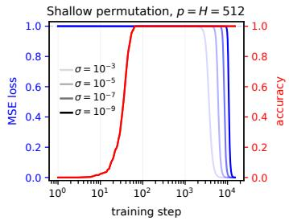

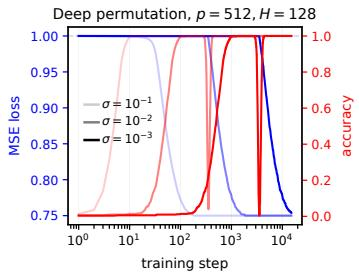

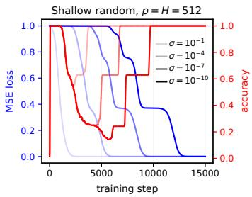

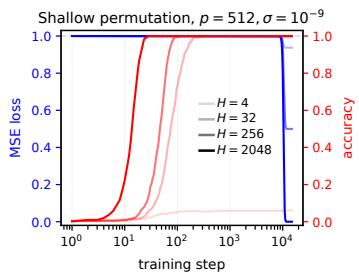

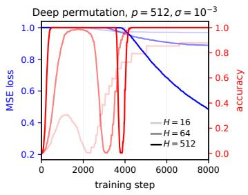

  
Figure 5: Controlled unary-operation experiments. Columns correspond to the shallow permutation model (left), the three-factor permutation model (middle), and the shallow model on an iid random unary target (right). The top row varies the initialization scale $\sigma ;$ the bottom row varies the hidden width H. Darker curves denote smaller σ in the top row and larger H in the bottom row. Blue curves show full-population MSE and red curves show training accuracy. The shallow permutation model reaches high accuracy while the loss remains near its initial value, without developing a well. Changing to the three-factor parameterization produces a pronounced well for the same flatspectrum target, while a heterogeneous random unary target produces a well already in the shallow model, consistently with the heterogeneous-spectrum mechanism analyzed theoretically.

Figures 2 and 3 show representative examples in the main text. The figures below provide the corresponding broader sweeps and controls. Our aim here is therefore not to repeat the phenomenological discussion of Section 2, but to document the experimental setups and make clear which comparisons support the empirical conclusions used in the paper.

## C.1 CONTROLLED UNARY-OPERATION EXPERIMENTS

The unary setting provides the cleanest controlled experiments because the target geometry and the factorization can be modified independently. We consider three settings. First, a shallow factorization trained on a permutation target gives a flat-spectrum control for which the rigorous theory predicts no well. Second, we keep the same permutation target but use a three-factor parameteriza tion, testing whether a well can occur without target spectral heterogeneity. Third, we return to the shallow factorization but replace the permutation by an iid random unary target, restoring the heterogeneous target spectrum analyzed in Appendix B.2. For each setting we vary both initialization scale and hidden width.

Setup, optimization, and measurement. Unless stated otherwise, our unary experiments use $p =$ 512 inputs and $p = 5 1 2$ output classes and train on the complete operation table. There is therefore no train–test split and no minibatch sampling. We optimize

$$
\mathcal { L } _ { \mathbf { T } } ( \mathbf { M } ) = \frac { 1 } { p } \| \mathbf { M } - \mathbf { T } \| _ { \mathrm { F } } ^ { 2 } .\tag{857}
$$

Full-batch gradient descent is implemented using torch.optim.SGD with zero momentum and zero weight decay.

The implementation stores examples as columns: for input $i ,$

$$
\mathbf { T } _ { c i } = \mathbf { 1 } \{ f ( i ) = c \} .\tag{858}
$$

This is the same target convention as in Section 4. The prediction for input i is obtained by taking the largest entry of column i.

Every unary run contains 15,000 parameter updates, with loss and top-one accuracy recorded throughout optimization.

The shallow permutation and shallow random-unary experiments use learning rate

$$
\eta _ { \mathrm { s h a l l o w } } = 0 . 5 ,\tag{859}
$$

whereas the three-factor permutation experiments use

$$
\eta _ { \mathrm { d e e p } } = 5 0 .\tag{860}
$$

The learning rates were chosen separately for the two parameterizations. Accordingly, the shallowversus-deep permutation comparison should be read as showing that the flat-spectrum target can exhibit a well under a deeper factorized optimization dynamics, rather than as a matched learningrate depth ablation.

Initialization. We use fan-in-normalized Gaussian initialization multiplied by a global scale σ. For the shallow model

$$
\mathbf { M } = \mathbf { U } ^ { \top } \mathbf { V } , \qquad \mathbf { U } , \mathbf { V } \in \mathbb { R } ^ { H \times p } ,\tag{861}
$$

the entries are initialized as

$$
{ \bf V } _ { h i } ( 0 ) \sim { \mathcal N } \bigg ( 0 , \frac { \sigma ^ { 2 } } { p } \bigg ) , \qquad { \bf U } _ { h c } ( 0 ) \sim { \mathcal N } \bigg ( 0 , \frac { \sigma ^ { 2 } } { H } \bigg ) .\tag{862}
$$

For the deeper model

$$
\mathbf { M } = \mathbf { U } ^ { \top } \mathbf { W } \mathbf { V } , \qquad \mathbf { W } \in \mathbb { R } ^ { H \times H } ,\tag{863}
$$

we additionally use

$$
{ \bf W } _ { h k } ( 0 ) \sim \mathcal { N } \bigg ( 0 , \frac { \sigma ^ { 2 } } { H } \bigg ) ,\tag{864}
$$

while U and V retain the scalings in (862). There is no additional factor of $1 / H$ in the forward map. This normalization is useful for the width sweeps because the leading scale of the initial predictor is independent of $H \colon$

$$
\mathbb { E } [ \mathbf { M } _ { c i } ( 0 ) ^ { 2 } ] = \frac { \sigma ^ { 4 } } { p } \qquad \mathrm { f o r ~ } \mathbf { M } = \mathbf { U } ^ { \top } \mathbf { V } ,\tag{865}
$$

and

$$
\mathbb { E } [ \mathbf { M } _ { c i } ( 0 ) ^ { 2 } ] = \frac { \sigma ^ { 6 } } { p } \qquad \mathrm { f o r ~ \mathbf { M } = \mathbf { U } ^ \top \mathbf { W } \mathbf { V } . }\tag{866}
$$

Thus varying H changes the latent dimension without simultaneously introducing an explicit growth of the initial logit scale.

This initialization differs from the unnormalized Gaussian initialization used in the rigorous unary theory. The experiments should therefore be viewed as finite-width qualitative tests of the same phenomenology rather than direct finite-p evaluations of the asymptotic formulas.

Sweep parameters and random seeds. The same permutation target is used in all permutation experiments. It is generated once using PyTorch seed 0. For the shallow permutation width sweep we fix $\sigma = 1 0 ^ { - 9 }$ and use $H \in \{ 4 , 3 2 , \bar { 2 } 5 \dot { 6 } , 2 0 4 8 \}$ , with initialization seed 1. For the corresponding initialization sweep we fix $H = 5 1 2$ , use $\sigma \in \{ 1 0 ^ { - 3 } , 1 0 ^ { - 5 } , 1 0 ^ { - 7 } , 1 0 ^ { - 9 } \}$ , and use initialization seed 100. The same seed is reset for every value of $\sigma ,$ , so the same underlying Gaussian tensors are rescaled rather than independently resampled.

For the three-factor permutation model, the width sweep fixes $\sigma = 1 0 ^ { - 3 }$ , uses $H \in \{ 1 6 , 6 4 , 5 1 2 \}$ and uses initialization seed 200. The initialization sweep fixes $\begin{array} { r c l } { H } & { = } & { 1 2 8 . } \end{array}$ , uses $\sigma \in$ $\{ 1 0 ^ { - 1 } , 1 0 ^ { - 2 } , 1 0 ^ { - 3 } \}$ , and uses initialization seed 300, again rescaling the same underlying Gaussian realization across the sweep. All of these runs contain 15,000 updates; for visual clarity, the plotted three-factor width panel displays the first 8,000 steps.

For the random-unary experiments, the target is sampled independently as

$$
f ( i ) \stackrel { \mathrm { i i d } } { \sim } \mathrm { U n i f } ( [ p ] )\tag{867}
$$

using target seed 1000. The particular realization used in the figures has exactly 328 occupied output classes, and hence $\operatorname { r a n k } ( T ) = 3 2 8$ . The same target is used in both random-unary sweeps. The initialization seed is 2000 throughout. The initialization sweep fixes $H = 5 1 2$ and uses $\sigma \in$ $\{ 1 0 ^ { - 1 } , 1 0 ^ { - 4 } , 1 0 ^ { - 7 } , 1 0 ^ { - 1 0 } \}$ ; the width sweep fixes $\sigma = 1 0 ^ { - 1 0 }$ and uses $H \in \{ 8 , 6 4 , 5 1 2 \}$

Shallow permutation: microscopic classification without a well. The left column of Figure $^ { 5 }$ gives the flat-spectrum control. Decreasing σ strongly postpones the macroscopic decrease of the MSE, while the early classification transition changes much less. For sufficiently small initialization there is therefore a long interval in which accuracy is already perfect while the loss remains close to its zero-predictor value. Nevertheless, none of the displayed shallow permutation trajectories develops an accuracy well: once perfect classification is reached, it is retained. This is the finite width analogue of the behavior proved in Theorem 4.4.

The width sweep also illustrates the distinction between matrix fitting and classification. The permutation target has rank 512, whereas the predictor $\mathbf { U } ^ { \top } \mathbf { V }$ has rank at most H. Hence the $H = 4 , 3 2 .$ and 256 runs cannot fit the target matrix exactly, but can nevertheless attain perfect top-one accuracy (except for the $H = 4 ~ \mathrm { r u n } )$ . Increasing width makes the early classifier form more rapidly and eventually removes the rank obstruction to exact matrix fitting.

Three-factor permutation: a well without target spectral heterogeneity. The middle column keeps exactly the same permutation target but changes the parameterization to $\mathbf { M } = \mathbf { U } ^ { \top } \mathbf { W } \mathbf { V }$ The behavior is qualitatively different. At the larger initialization, accuracy evolves comparatively monotonically, whereas sufficiently small initialization reveals a pronounced high–low–high trajectory. The width sweep shows the complementary dependence on latent dimension: wider models develop a stronger early classifier and a more pronounced subsequent nonmonotonicity.

Because the permutation target has a flat positive spectrum, the heterogeneous-spectrum interference mechanism proved in Appendix B.2 cannot operate here in its original form. The experiment therefore demonstrates that target spectral heterogeneity is not necessary for an accuracy well once the parameterization is changed. This is qualitatively consistent with the broader bottleneck picture of Section 3.

Random unary target: heterogeneous spectra in the shallow model. The right column returns to $\mathbf { M } = \mathbf { U } ^ { \top } \mathbf { V }$ but replaces the permutation by the random target (867). Sufficiently small initialization produces a clear early accuracy hill followed by a substantial well. In the realizable $H = 5 1 2$ runs, accuracy later recovers to one. The stagewise form of the trajectory is qualitatively consistent with the occupancy-dependent spectral dynamics analyzed in Appendix B.2.

The width sweep also exposes behavior outside the realizable regime. Since the realized target has rank 328, the $\bar { H } = 8$ and $H = 6 4$ runs cannot fit it exactly. These narrow networks reach very high accuracy during the early stage but settle at substantially lower accuracy after much longer MSE optimization. Thus reduction of the optimized Frobenius error can destroy class-ordering information that supported a better intermediate classifier. The $H = 5 1 2$ model is realizable and eventually recovers perfect accuracy.

Evolution of the score matrix. To visualize the mechanism underlying the random-unary well more directly, Figure 4 (left) repeats the shallow experiment in a small system with $p = 1 0 , H = 5 0$ and $\sigma \ : = \ : 1 \dot { 0 } ^ { - 9 }$ , using full-batch gradient descent with learning rate 0.1. The output labels are permuted in decreasing order of target occupancy, and the inputs are grouped by their target output for visualization. At selected points along the trajectory we display the end-to-end score matrix

$$
\mathbf { M } ( t ) = \mathbf { U } ( t ) ^ { \top } \mathbf { V } ( t ) ,\tag{868}
$$

normalized separately at each time by

$$
\widetilde { \mathbf { M } } ( t ) = \frac { \mathbf { M } ( t ) } { \operatorname* { m a x } _ { c , i } | \mathbf { M } _ { c i } ( t ) | } .\tag{869}
$$

Squares indicate the target output and dots the current prediction for each input. The snapshots include three states with the same accuracy $A \ : = \ : 0 . 6$ , taken respectively before the early peak, during the subsequent decline, and during recovery. They show that equal classification accuracy can correspond to qualitatively different score-matrix structures at different stages of the well. The last four snapshots use a symmetric logarithmic color scale to make weaker score components visible.

Taken together, the unary experiments provide two complementary departures from the shallow permutation control. A well appears after changing the factorized dynamics while keeping the target spectrum flat, and it also appears after changing to a heterogeneous target while keeping the shallow factorization. Across these settings, decreasing initialization separates the microscopic accuracy dynamics from macroscopic loss decay, while increasing width generally strengthens the early classifier.

## C.2 ACCURACY WELLS IN FULLY CONNECTED NETWORKS ON MNIST

The unary experiments allow unusually direct control of the target geometry and factorization. We next ask which aspects of the accuracy-well phenomenology persist in a standard multiclass classification problem. We use MNIST to examine the effects of initialization scale, width, loss, architectural biases, factorization depth, optimization method, and random seed. We additionally use saved checkpoints from one fixed trajectory to probe how the participation of individual hidden neurons changes through the accuracy hill, well, and recovery.

Dataset and common training protocol. We use the standard MNIST training set of 60,000 grayscale $2 8 \times 2 8$ images from ten classes. Pixel values are divided by 255 and each image is flattened to

$$
x \in \mathbb { R } ^ { 7 8 4 } .\tag{870}
$$

We apply no additional centering, normalization, or data augmentation. The MNIST test set is not used for optimization or model selection. It is used only for the post-hoc checkpoint diagnostics described below.

Unless stated otherwise, models are trained for 10,000 minibatch updates with batch size

$$
B = 1 0 2 4 ,\tag{871}
$$

using plain SGD with learning rate

$$
\eta = 0 . 0 0 5 ,\tag{872}
$$

zero momentum, zero weight decay, and no learning-rate schedule. Minibatches are obtained from random permutations of the full training set. Consecutive blocks of 1024 examples are used; when fewer than 1024 examples remain, the remainder is discarded and a new random permutation is generated.

Loss and top-one accuracy are evaluated on the current minibatch immediately before the corresponding parameter update. Unless explicitly identified as test accuracy, the curves therefore report minibatch training quantities.

The random streams are controlled across experimental conditions. For the main sweeps, the global PyTorch and NumPy seed is 1, the default weight-initialization seed is 1234, and the minibatchpermutation seed is 5678. The minibatch generator is reset for every run, so different experimental conditions see the same minibatch sequence. Within an initialization-scale sweep of a fixed architecture, the initialization generator is also reset for every value of σ, so that the same underlying Gaussian realization is merely rescaled. The experiments were run in single precision on an NVIDIA Tesla P100-PCIE-16GB GPU.

ReLU model, initialization, and losses. Our nonlinear model is a one-hidden-layer ReLU network

$$
f _ { \theta } ( x ) = W _ { 2 } \operatorname { R e L U } ( W _ { 1 } x + b _ { 1 } ) + b _ { 2 } , \qquad W _ { 1 } \in \mathbb { R } ^ { H \times 7 8 4 } , \qquad W _ { 2 } \in \mathbb { R } ^ { 1 0 \times H } .\tag{873}
$$

Depending on the experiment, either bias, both biases, or neither bias is included. Whenever present, a bias is trainable and initialized at zero.

The weights use fan-in-normalized Gaussian initialization,

$$
( W _ { 1 } ) _ { h i } ( 0 ) \sim { \cal N } \bigg ( 0 , { \frac { \sigma ^ { 2 } } { 7 8 4 } } \bigg ) , \qquad ( W _ { 2 } ) _ { c h } ( 0 ) \sim { \cal N } \bigg ( 0 , { \frac { \sigma ^ { 2 } } { H } } \bigg ) .\tag{874}
$$

For the squared-loss experiments, the target for an example of class $y$ is the one-hot vector $e _ { y }$ , and we optimize

$$
\mathcal { L } _ { \mathrm { M S E } } = \frac { 1 } { B } \sum _ { i = 1 } ^ { B } \left. f _ { \theta } ( x _ { i } ) - e _ { y _ { i } } \right. _ { 2 } ^ { 2 } .\tag{875}
$$

With this normalization, the zero predictor has loss one.

For the cross-entropy experiments we use

$$
\mathcal { L } _ { \mathrm { C E } } = - \frac { 1 } { B } \sum _ { i = 1 } ^ { B } \log \frac { \exp f _ { \theta , y _ { i } } ( x _ { i } ) } { \sum _ { c = 1 } ^ { 1 0 } \exp f _ { \theta , c } ( x _ { i } ) } .\tag{876}
$$

The corresponding zero-logit value is log 10.

Architectural sensitivity: hidden and output biases. We first use squared loss to test how the location of a trainable bias affects the phenomenon. We compare four architectures:

<table><tr><td>Architecture</td><td>hidden bias  $b _ { 1 }$ </td><td>output bias  $b _ { 2 }$ </td></tr><tr><td>No biases</td><td>absent</td><td>absent</td></tr><tr><td>Hidden bias only</td><td>present</td><td>absent</td></tr><tr><td>Output bias only</td><td>absent</td><td>present</td></tr><tr><td>Hidden and output biases</td><td>present</td><td>present</td></tr></table>

Apart from the specified biases, the architectures use the same weight initialization, loss, minibatch sequence, and optimization protocol.

For each architecture we perform an initialization-scale sweep with

$$
H = 8 1 9 2 , \qquad \sigma \in \{ 1 0 ^ { - 1 } , 1 0 ^ { - 2 } , 1 0 ^ { - 4 } \} ,\tag{877}
$$

and a width sweep with

$$
\sigma = 1 0 ^ { - 4 } , \qquad H \in \{ 3 2 , 5 1 2 , 8 1 9 2 \} .\tag{878}
$$

The full sweeps are shown in Figures $^ 6$ and 7. A direct four-way comparison at $H = 8 1 9 2$ and $\sigma = 1 0 ^ { - 4 }$ is shown in the right panel of Figure 9.

The distinction between hidden and output biases is robust across the two sweeps. Adding a hidden bias leaves the characteristic early hill and subsequent drop largely intact. A directly trainable classwise output bias, by contrast, suppresses the early hill and removes the pronounced well. Adding a hidden bias together with the output bias does not restore the effect. Thus the relevant architectural observation is not that biases in general remove the well; rather, the location at which a bias enters the predictor matters.

The initialization sweeps also reproduce the strong dependence on initialization scale seen in the controlled unary experiments. For the architectures that exhibit a well, decreasing σ makes substantial accuracy evolution visible while the MSE remains close to its zero-predictor baseline. The width sweeps show that the strength and timing of the early classifier also depend on capacity.

Changing the objective: cross-entropy. We next keep the bias-free ReLU architecture and replace squared loss by cross-entropy. The training protocol remains 10,000 SGD updates with $\eta = 0 . 0 0 5$ and batch size 1024. The initialization sweep fixes

$$
H = 8 1 9 2 , \qquad \sigma \in \{ 1 0 ^ { - 1 } , 1 0 ^ { - 2 } , 1 0 ^ { - 4 } \} ,\tag{879}
$$

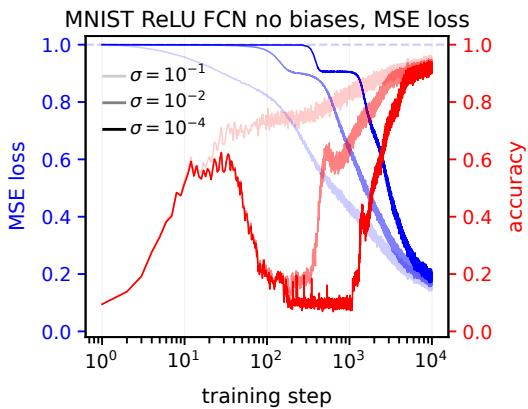

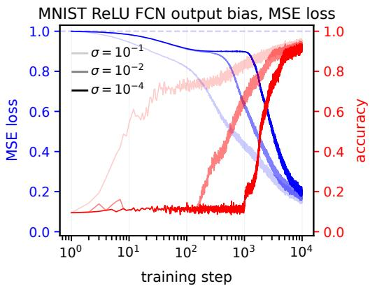

MNIST ReLU FCN hidden bias, MSE loss  
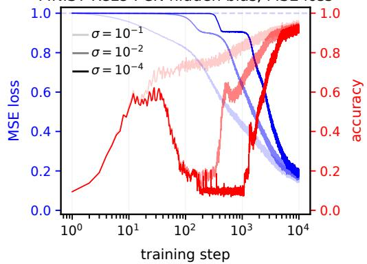

MNIST ReLU FCN with biases, MSE loss  
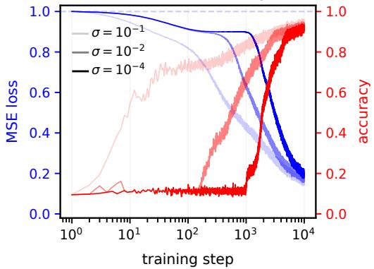  
Figure 6: Initialization-scale sweeps for the MNIST ReLU bias ablation under squared loss. Columns distinguish the absence (left) and presence (right) of an output bias, while rows distinguish the absence (top) and presence (bottom) of a hidden bias. All panels use $H \ = \ 8 1 9 2$ and $\sigma \in$ $\{ 1 0 ^ { - 1 } , 1 0 ^ { - 2 } , 1 \dot { 0 } ^ { - 4 } \}$ , with darker curves denoting smaller initialization. Blue curves show minibatch MSE and red curves show minibatch top-one accuracy. Without an output bias, sufficiently small initialization produces a pronounced accuracy well regardless of whether a hidden bias is present. Introducing an output bias suppresses the pronounced well in both corresponding architectures.

while the width sweep fixes

$$
\sigma = 1 0 ^ { - 4 } , \qquad H \in \{ 3 2 , 5 1 2 , 8 1 9 2 \} .\tag{880}
$$

The two sweeps are shown in the middle column of Figure 2.

The same qualitative accuracy well persists under cross-entropy. At smaller initialization, accuracy rises substantially before the cross-entropy has moved far from its zero-logit value, then falls before the later high-accuracy state is reached. Increasing width changes the timing and prominence of the early classifier while preserving the nonmonotone trajectory. Thus the phenomenon is not tied to the one-hot squared objective used in the unary experiments.

Robustness to random seed. To verify that the observed cross-entropy trajectory is not a peculiarity of one initialization or one minibatch ordering, we repeat the bias-free ReLU experiment for five independent random seeds. We fix

$$
H = 8 1 9 2 , \qquad \sigma = 1 0 ^ { - 4 } , \qquad \eta = 0 . 0 0 5 , \qquad B = 1 0 2 4 ,\tag{881}
$$

and train for 10,000 SGD updates with cross-entropy. The five runs use seeds 0, 1, 2, 3, 4; for each run both the Gaussian initialization and the minibatch-permutation stream are changed. Thus this experiment probes robustness to the two principal stochastic ingredients of the training procedure rather than varying only the initial weights.

The resulting accuracy curves are shown in the left panel of Figure 9. All five runs display the same qualitative sequence: an early accuracy hill, a substantial subsequent drop, and a late sharp recovery.

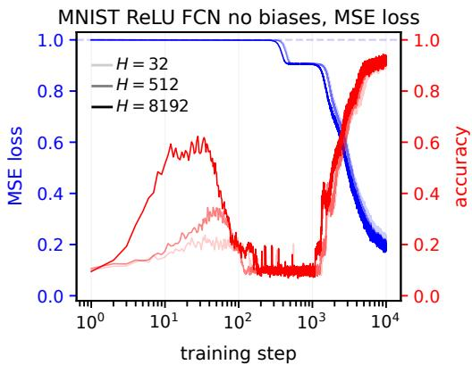

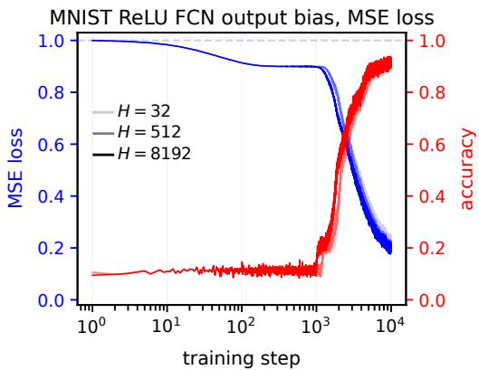  
MNIST ReLU FCN with biases, MSE loss

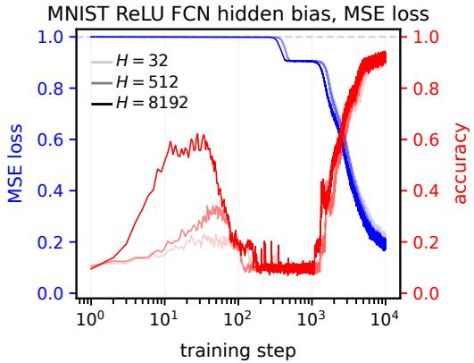

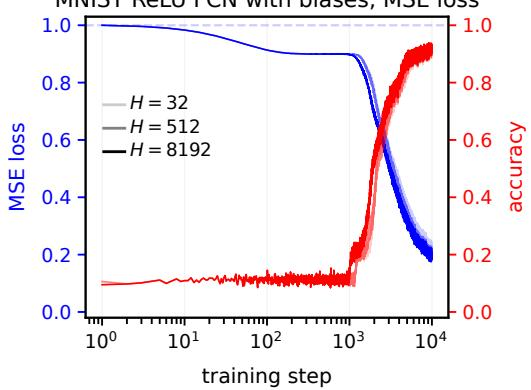  
Figure 7: Width sweeps for the MNIST ReLU bias ablation under squared loss. The panel arrangement is the same as in Figure 6. All runs use $\sigma = 1 0 ^ { - 4 }$ and $H \in \{ 3 2 , 5 1 2 , 8 1 9 2 \}$ , with darker curves denoting larger width. The no-bias and hidden-bias-only networks exhibit pronounced nonmonotone accuracy trajectories, whereas architectures containing an output bias do not develop a comparably pronounced well.

The location and height of the early maximum vary moderately across seeds, but the existence and approximate timing of the well are highly reproducible.

Parameterization versus small initialization: linear controls. The next experiments isolate the role of factorization from nonlinear activation functions. We consider depth-L linear networks

$$
f _ { \theta } ( x ) = W _ { L } W _ { L - 1 } \cdot \cdot \cdot W _ { 1 } x\tag{882}
$$

without biases. The architectures are

$$
7 8 4 \to 1 0 \quad ( L = 1 ) , \qquad 7 8 4 \to H \to 1 0 \quad ( L = 2 ) , \qquad 7 8 4 \to H \to H \to 1 0 \quad ( L = 3 ) ,\tag{883}
$$

with $H = 5 1 2$ for $L \geq 2$ . Every layer is initialized independently with

$$
( W _ { k } ) _ { i j } ( 0 ) \sim \mathcal { N } \bigg ( 0 , \frac { \sigma ^ { 2 } } { d _ { k - 1 } } \bigg ) ,\tag{884}
$$

where $d _ { k - 1 }$ is the input dimension of layer k. Independent layer-wise Gaussian draws are generated using successive seeds $1 2 3 4 + k$

The depth comparison uses

$$
L \in \{ 1 , 2 , 3 \} , \qquad \eta = 0 . 0 0 5 , \qquad B = 1 0 2 4 , \qquad 1 0 , 0 0 0 \mathrm { u p d a t e s } ,\tag{885}
$$

with depth-dependent initialization scales

$$
\sigma _ { L = 1 } = 1 0 ^ { - 9 } , \qquad \sigma _ { L = 2 } = 1 0 ^ { - 3 } , \qquad \sigma _ { L = 3 } = 1 0 ^ { - 1 } .\tag{886}
$$

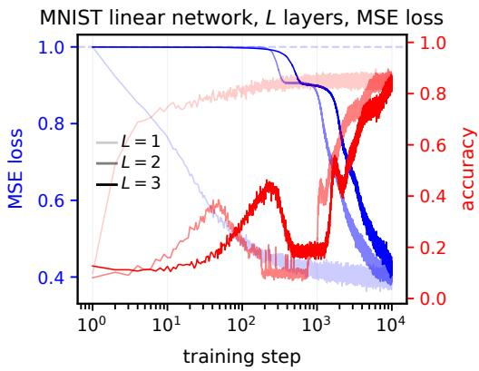

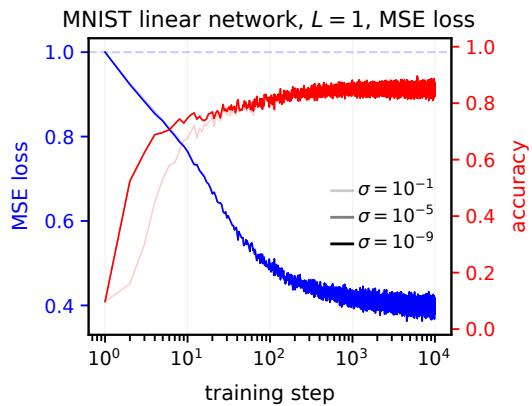  
Figure 8: Linear-network controls on MNIST under squared loss. $L e f t { \mathrm { : } }$ comparison of the direct $L = 1$ model with two- and three-factor parameterizations $L = 2 , 3 .$ using $\bar { \sigma } _ { L = 1 } = 1 0 ^ { - 9 }$ $\sigma _ { L = 2 } = 1 0 ^ { - 3 }$ , and $\sigma _ { L = 3 } = 1 0 ^ { - 1 }$ . Although all three parameterizations represent the same class of end-to-end linear maps, the factorized models develop pronounced accuracy wells while the direct model has much simpler accuracy dynamics. $R i g h t \colon$ initialization-scale sweep for the direct classifier with $\sigma \in \{ 1 0 ^ { - 1 } , 1 0 ^ { \div 5 } , 1 0 ^ { - 9 } \}$ . Even when the direct model is initialized extremely close to zero, its accuracy evolves comparatively monotonically and does not develop the pronounced well observed in the factorized models. Blue curves show minibatch MSE and red curves show minibatch top-one accuracy.

The scales are chosen so that the dynamics of each parameterization is clearly resolved within the common optimization horizon. Since the initialization scale changes with depth, this comparison is intended as a qualitative parameterization comparison rather than as a depth-scaling law at fixed σ.

Importantly, all three architectures represent the same class of end-to-end functions: each defines a linear map from $\mathbb { R } ^ { 7 8 4 }$ to $\mathbb { R } ^ { 1 0 }$ . Because $H = 5 1 2 > 1 0$ , the factorized models do not suffer an endto-end rank restriction relative to the direct $L = 1$ classifier. The principal difference is therefore the parameterization of the linear map and the gradient dynamics that this parameterization induces.

As a complementary control, we fix the direct $L = 1$ model and vary only its initialization scale:

$$
\begin{array} { r l r } { W _ { c i } ( 0 ) \sim \mathcal { N } \bigg ( 0 , \frac { \sigma ^ { 2 } } { 7 8 4 } \bigg ) , } & { { } } & { \sigma \in \{ 1 0 ^ { - 1 } , 1 0 ^ { - 5 } , 1 0 ^ { - 9 } \} . } \end{array}\tag{887}
$$

These runs again use learning rate 0.005, batch size 1024, and 10,000 updates.

The left panel of Figure 8 shows that changing the parameterization can qualitatively alter the accuracy dynamics. Both factorized models develop an early hill, subsequent deterioration, and later recovery, despite having exactly the same end-to-end function class as the direct linear classifier. The effect therefore does not require a nonlinear activation or additional representational power.

The right panel provides the complementary control. We keep the direct $L = 1$ parameterization fixed and reduce the initialization scale from $1 0 ^ { - 1 } ~ \mathrm { t o } ~ 1 0 ^ { - 9 }$ . Despite this eight-order-of-magnitude change, the direct classifier does not develop the pronounced hill–well–recovery trajectory seen in the factorized models. In particular, the two smallest initializations produce very similar dynamics. Thus small initialization alone is not sufficient to generate an accuracy well in this setting; the factorized parameterization qualitatively changes the optimization dynamics.

Optimizer robustness. We next test the sensitivity of the phenomenon to the optimization method. We use the bias-free ReLU network with cross-entropy,

$$
H = 1 0 2 4 , \qquad \sigma = 1 0 ^ { - 4 } , \qquad B = 1 0 2 4 ,\tag{888}
$$

and train for 10,000 updates. The optimizer configurations are

<table><tr><td>Optimizer</td><td></td><td>Learning rate Additional parameters</td></tr><tr><td>SGD</td><td> $1 0 ^ { - 2 }$ </td><td>momentum = 0</td></tr><tr><td>SGD with momentum</td><td> $1 0 ^ { - 2 }$ </td><td>momentum = 0.9</td></tr><tr><td>Adam</td><td> $1 0 ^ { - 5 }$ </td><td> $\beta _ { 1 } = 0 . 9 , \ \beta _ { 2 } = 0 . 9 9 9 , \ \epsilon = 1 0 ^ { - 8 }$ </td></tr></table>

All three runs use zero weight decay and matched initialization and minibatch streams. The momentum run uses standard PyTorch SGD momentum, while the Adam run uses the standard $\mathrm { P y } .$ Torch values of $\beta _ { 1 } , \beta _ { 2 }$ , and ϵ. The resulting accuracy trajectories are shown in the top-right panel of Figure 2.

A pronounced well appears for both SGD variants, and nonmonotone accuracy is also visible under Adam, although the drop is substantially shallower for the Adam hyperparameters used here. Because the three optimizers use different learning rates, this experiment is best viewed as evidence that the phenomenon is not specific to plain SGD rather than as a quantitative optimizer comparison.

Neuron participation and output diversity through the well. The preceding experiments establish the phenomenology but do not by themselves probe the internal reorganization associated with the proposed target-driven organization–degeneracy bottleneck–recruitment picture. We therefore analyze two complementary diagnostics along one fixed bias-free ReLU trajectory trained with squared loss,

$$
H = 8 1 9 2 , \qquad \sigma = 1 0 ^ { - 4 } , \qquad \eta = 0 . 0 0 5 , \qquad B = 1 0 2 4 .\tag{889}
$$

The model is trained for 10,000 updates, and checkpoints are saved at 20 approximately logarithmically spaced times,

$$
\begin{array} { r l } & { t \in \{ 0 , 1 , 2 , 3 , 5 , 8 , 1 3 , 2 2 , 3 6 , 6 0 , 1 0 0 , 1 6 7 , 2 7 8 , 4 6 4 , 7 7 4 , } \\ & { \qquad 1 2 9 2 , 2 1 5 4 , 3 5 9 4 , 5 9 9 5 , 1 0 0 0 0 \} . } \end{array}\tag{890}
$$

For this diagnostic run we use initialization seed 0 and a separately seeded minibatch stream. All quantities below are evaluated post hoc on the full MNIST test set of 10,000 examples and do not affect training.

We first quantify how broadly the class-dependent score contribution is distributed across hidden neurons. Write the bias-free network as

$$
f _ { \theta } ( x ) = \sum _ { h = 1 } ^ { H } v _ { h } \phi ( w _ { h } ^ { \top } x ) , \qquad \phi ( z ) = \mathrm { m a x } \{ z , 0 \} ,\tag{891}
$$

where $v _ { h } \in \mathbb { R } ^ { C }$ , with $C = 1 0 .$ , is the output-weight vector associated with hidden neuron h. For each neuron, define its class-conditional mean activation

$$
a _ { h } ( c ) = \frac { 1 } { N _ { c } } \sum _ { i : y _ { i } = c } \phi ( w _ { h } ^ { \top } x _ { i } ) , \qquad c = 1 , \dots , C ,\tag{892}
$$

where $N _ { c }$ is the number of test examples of class $c ,$ and let $a _ { h } \in \mathbb { R } ^ { C }$ denote the vector with entries $a _ { h } ( c )$

A component of $v _ { h }$ proportional to the all-ones vector shifts all output logits equally and therefore cannot affect their ordering. We remove this classification-irrelevant direction by defining

$$
\widetilde { v } _ { h } = v _ { h } - \frac { \mathbf { 1 } ^ { \top } v _ { h } } { C } \mathbf { 1 } .\tag{893}
$$

The corresponding contribution of neuron h to the centered class-conditional score matrix is

$$
\widetilde { B } _ { h } = a _ { h } \widetilde { v } _ { h } ^ { \top } \in \mathbb { R } ^ { C \times C } .\tag{894}
$$

We associate to neuron h the contribution energy

$$
\begin{array} { r } { e _ { h } = \| \widetilde { B } _ { h } \| _ { \mathrm { F } } ^ { 2 } = \| a _ { h } \| _ { 2 } ^ { 2 } \| \widetilde { v } _ { h } \| _ { 2 } ^ { 2 } . } \end{array}\tag{895}
$$

This measures the magnitude of the neuron’s contribution to class-dependent score differences; it does not assume that the contribution is individually aligned with the correct classifier.

We quantify the spread of this contribution over the hidden layer using the participation ratio

$$
N _ { \mathrm { e f f } } = \frac { \left( \sum _ { h = 1 } ^ { H } e _ { h } \right) ^ { 2 } } { \sum _ { h = 1 } ^ { H } e _ { h } ^ { 2 } } ,\tag{896}
$$

and report the normalized effective participation fraction

$$
\rho _ { \mathrm { e f f } } = \frac { N _ { \mathrm { e f f } } } { H } .\tag{897}
$$

Whenever the total contribution energy is nonzero, $1 / H \le \rho _ { \mathrm { e f f } } \le 1$ . A larger value means that class-dependent score contribution is distributed over a larger effective fraction of the hidden layer, whereas a smaller value indicates concentration onto fewer neurons. Importantly, $\rho _ { \mathrm { e f f } }$ measures concentration of contribution magnitudes rather than their correctness or mutual coherence, and is therefore interpreted jointly with classification accuracy.

As a complementary function-space diagnostic, we measure how broadly the network uses the available output classes. At checkpoint $t ,$ let

$$
{ \widehat { y } } _ { i } ( t ) = \arg \operatorname* { m a x } _ { c } f _ { \theta ( t ) , c } ( x _ { i } )\tag{898}
$$

be the predicted class of test example i, and define the marginal predicted-class frequencies

$$
p _ { c } ( t ) = \frac { 1 } { N _ { \mathrm { t e s t } } } \sum _ { i = 1 } ^ { N _ { \mathrm { t e s t } } } \mathbf { 1 } \{ \widehat { y } _ { i } ( t ) = c \} , \qquad c = 1 , \ldots , C .\tag{899}
$$

We define the effective number of used output classes by the participation ratio

$$
C _ { \mathrm { e f f } } ( t ) = \frac { 1 } { \sum _ { c = 1 } ^ { C } p _ { c } ( t ) ^ { 2 } } ,\tag{900}
$$

and normalize it by the total number of classes,

$$
\rho _ { \mathrm { o u t } } ( t ) = \frac { C _ { \mathrm { e f f } } ( t ) } { C } = \frac { 1 } { C \sum _ { c = 1 } ^ { C } p _ { c } ( t ) ^ { 2 } } .\tag{901}
$$

We refer to $\rho _ { \mathrm { o u t } }$ as the output diversity. It lies between $1 / C$ and 1. Uniform use of all $C$ output classes gives $\rho _ { \mathrm { o u t } } = 1$ , while complete collapse onto a single predicted class gives $\rho _ { \mathrm { o u t } } = 1 / C$ More generally, approximately uniform use of only k classes gives $\rho _ { \mathrm { o u t } } \approx k / C$ . Unlike accuracy, output diversity does not measure whether predictions are correct: a classifier may distribute its predictions evenly across classes while assigning the wrong label to every example. It therefore supplies information complementary to accuracy.

The right panel of Figure 4 shows full-test accuracy, the hidden-neuron participation fraction $\rho _ { \mathrm { e f f } }$ and the output diversity $\rho _ { \mathrm { o u t } }$ at the saved checkpoints. The three quantities reveal a structured sequence consistent with the heuristic picture of Section 3. During the initial target-driven organization, accuracy rises while output predictions remain distributed across several classes and the classdependent score contribution is spread over a relatively large effective fraction of the hidden layer. As the trajectory enters the accuracy well, both diagnostics collapse: $\rho _ { \mathrm { e f f } }$ falls sharply, showing that the centered class-dependent score contribution becomes concentrated on a much smaller effective subset of hidden neurons, while $\rho _ { \mathrm { o u t } }$ approaches its minimum value $1 / C _ { : }$ , indicating that predictions themselves become concentrated onto very few output classes. Thus the accuracy minimum coincides with a bottleneck both in hidden-unit participation and in the diversity of the resulting classifier outputs.

The recovery stage reverses both forms of degeneracy. Output diversity rises rapidly toward one as the classifier begins to use the full set of output classes again. Hidden-neuron participation also rebounds, indicating renewed involvement of additional components of the hidden layer, although it does not return to its initial value. Accuracy rises concurrently to its final high level. This simultaneous restoration of output diversity and partial increase in neuronal participation is consistent with the recruitment stage of the heuristic picture.

The two diagnostics probe different aspects of the same transition. $\rho _ { \mathrm { e f f } }$ is a parameterizationdependent measure of how class-dependent score contribution is distributed across hidden neurons, whereas $\rho _ { \mathrm { o u t } }$ is a purely functional statistic describing the marginal diversity of the classifier’s predictions. Their simultaneous collapse near the bottom of the well therefore gives more specific evidence for a transient degeneracy bottleneck than accuracy alone.

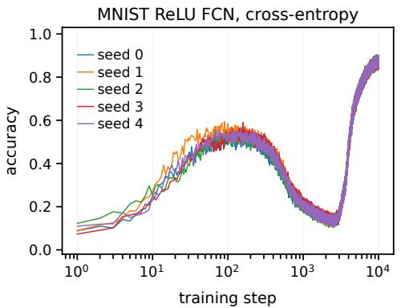

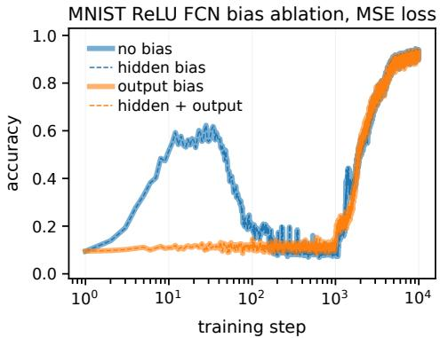  
Figure 9: Robustness and bias ablation for the MNIST accuracy well. Left: seed robustness for the bias-free ReLU network trained with cross-entropy at $H = 8 1 9 2 , \sigma = 1 0 ^ { - 4 }$ , showing raw minibatch accuracy trajectories for five independent initializations and minibatch streams. All five runs exhibit the same hill–well–recovery pattern. $R i g h t \colon$ four-way bias ablation under squared loss at $H = 8 1 9 2 , \sigma = 1 0 ^ { - 4 }$ . The pronounced well is preserved with no bias or a hidden bias alone, but is suppressed when an output bias is present.

Taken together, the MNIST experiments show that the accuracy well persists across two losses, a wide range of widths, multiple random seeds, and several optimization methods, while remaining sensitive to parameterization. A class-wise output bias suppresses the pronounced well, whereas a hidden bias does not; factorizing a linear classifier can create a strong well without changing its end-to-end function class, while simply shrinking the initialization of the direct classifier does not.

The checkpoint diagnostics provide a complementary mechanistic observation. As the early classifier deteriorates, class-dependent score contribution becomes sharply concentrated onto a smaller effective subset of hidden neurons, while the marginal distribution of predicted labels simultaneously collapses onto very few output classes. Both forms of degeneracy are reversed during recovery: output diversity rapidly approaches its maximum and hidden participation partially rebounds as accuracy rises. This gives quantitative support for the heuristic picture developed in Section 3, while leaving open the precise nonlinear dynamics responsible for the bottleneck.

## C.3 ACCURACY WELLS IN A CONVOLUTIONAL NETWORK ON CIFAR-10

The controlled experiments above establish the accuracy-well phenomenon in analytically tractable matrix-factorization models and in fully connected networks on MNIST. We next ask whether the same qualitative dynamics remain visible in a more conventional nonlinear architecture trained on natural images. To this end, we train a simple two-hidden-layer convolutional neural network on CIFAR-10 (Krizhevsky, 2009). Our objective is not to optimize benchmark performance, but rather to test for the phenomenon in a minimal genuinely convolutional setting. We therefore omit pooling, normalization layers, residual connections, dropout, and data augmentation, and study separately the dependence on initialization scale and model capacity. We record both training and held-out test dynamics.

Architecture and data preprocessing. We use the standard CIFAR-10 train–test split, consisting of 50,000 training and 10,000 test RGB images of spatial resolution $3 2 \times 3 2$ from ten classes. The dataset is loaded through the Hugging Face $\mathtt { { u o f t - c s / c i f a r 1 0 } }$ interface. Pixel intensities are first divided by 255 and subsequently normalized channelwise using

$$
\mu = ( 0 . 4 9 1 4 , 0 . 4 8 2 2 , 0 . 4 4 6 5 ) , \qquad s = ( 0 . 2 4 7 0 , 0 . 2 4 3 5 , 0 . 2 6 1 6 ) .\tag{902}
$$

No data augmentation is applied.

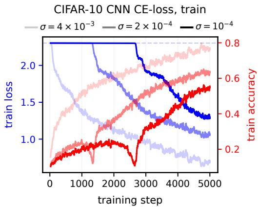

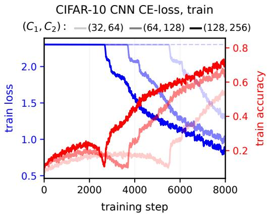

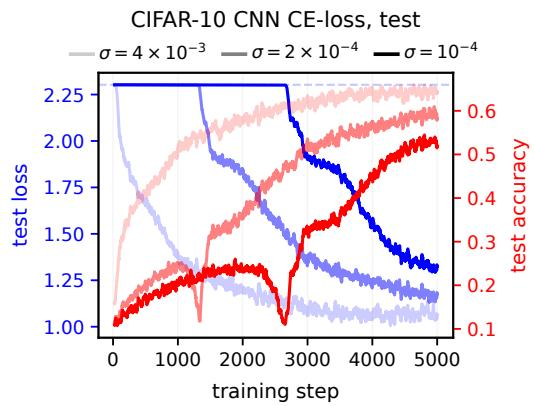

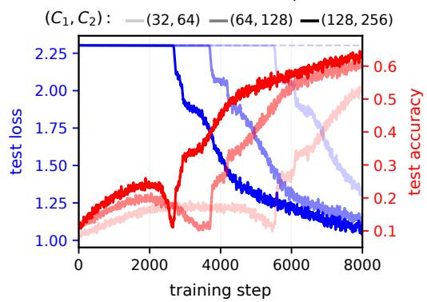  
Figure 10: Accuracy-well dynamics in a two-hidden-layer CNN on CIFAR-10. Columns correspond to the initialization-scale sweep (left) and the model-capacity sweep (right), while rows show training dynamics (top) and held-out test dynamics (bottom). In the left column, the channel widths are fixed to $( C _ { 1 } , C _ { 2 } ) ^ { - } = ( 1 2 8 , 2 5 6 )$ , and darker curves correspond to smaller initialization scale $\sigma .$ In the right column, $\sigma = 1 0 ^ { - 4 }$ is fixed, and darker curves correspond to larger channel widths. Blue curves show cross-entropy loss and red curves show top-one accuracy. The horizontal dashed blue line denotes the zero-logit cross-entropy log 10. Each displayed trajectory is a 25-step moving average of the corresponding per-minibatch measurements. Small initialization exposes a pronounced early accuracy hill followed by an accuracy well, with substantial accuracy dynamics occurring while the cross-entropy remains close to its zero-logit value. In the capacity sweep, larger models form a stronger early classifier and undergo an earlier and more pronounced hill–well–recovery trajectory. The corresponding held-out test curves closely reproduce the qualitative training dynamics.

The network consists of two convolutional hidden layers followed by a fully-connected classifier:

$$
h _ { 1 } ( x ) = \mathrm { R e L U } \Bigl ( \mathrm { C o n v } _ { 3 \times 3 } ^ { 3 \to C _ { 1 } } ( x ) \Bigr ) ,\tag{903}
$$

$$
h _ { 2 } ( x ) = \mathrm { R e L U } \Bigl ( \mathrm { C o n v } _ { 3 \times 3 } ^ { C _ { 1 } \to C _ { 2 } } ( h _ { 1 } ( x ) ) \Bigr ) ,\tag{904}
$$

and

$$
f _ { \theta } ( x ) = W _ { \mathrm { o u t } } { \mathrm { v e c } } ( h _ { 2 } ( x ) ) , \qquad W _ { \mathrm { o u t } } \in \mathbb { R } ^ { 1 0 \times ( 3 2 \cdot 3 2 \cdot C _ { 2 } ) } .\tag{905}
$$

Both convolutions have kernel size $3 \times 3 ,$ , stride one, and padding one, so the spatial resolution remains $3 2 \times 3 2$ through both convolutional layers. All convolutional and fully-connected layers are bias-free. The model contains no pooling, batch normalization, dropout, or residual connections.

Optimization and initialization. We minimize the mean cross-entropy loss using plain minibatch SGD with fixed learning rate

$$
\eta = 0 . 0 2 5 ,\tag{906}
$$

batch size 128, zero momentum, and zero weight decay. No learning-rate schedule is used.

Every scalar entry of each convolutional and fully-connected weight tensor is initialized independently according to

$$
\theta _ { j } ( 0 ) \sim \mathcal { N } ( 0 , \sigma ^ { 2 } ) .\tag{907}
$$

Thus, in these experiments, σ denotes a common entrywise standard deviation and is not divided by the fan-in of the corresponding layer. This choice deliberately differs from the parameterizations used in the preceding unary and MNIST experiments and therefore provides an additional robustness test: the CIFAR-10 experiments ask whether the accuracy-well phenomenology persists under a substantially different initialization convention rather than being tied to one particular normalization.

Measurement protocol and reproducibility. At every optimization step, the implementation draws one training minibatch and one test minibatch, each containing 128 examples. Separate shuffled streams are used for the two splits. Training loss and accuracy and test loss and accuracy are all evaluated at the same parameter state, immediately before the SGD update. Only the training cross-entropy is differentiated and used to update the parameters; the test data therefore play no role in optimization.

Within each epoch, a fresh random permutation of the corresponding split is generated and divided into complete minibatches of size 128; an incomplete remainder is omitted before a new permutation is generated. Loss and accuracy are stored at every optimization step. The curves in Figure 10 show 25-step moving averages of these per-minibatch measurements.

We match the pseudorandom streams across experimental conditions. The global seed is 1, the dedicated initialization generator uses seed 123, and the training and test permutation generators use seeds 456 and 789, respectively. The initialization generator is reset at the beginning of each run. Consequently, within the fixed-architecture initialization-scale sweep, the same underlying Gaussian realization is multiplied by the different values of σ. The training and test data streams are likewise reset for every run, so corresponding conditions encounter the same sequences of minibatch indices. Each curve displayed in Figure 10 corresponds to one run with these fixed seeds.

Initialization-scale sweep. We first fix the architecture to

$$
( C _ { 1 } , C _ { 2 } ) = ( 1 2 8 , 2 5 6 )\tag{908}
$$

and train for 5,000 SGD updates using

$$
\sigma \in \left\{ 4 \times 1 0 ^ { - 3 } , 2 \times 1 0 ^ { - 4 } , 1 0 ^ { - 4 } \right\} .\tag{909}
$$

The left column of Figure 10 shows that decreasing the initialization scale progressively separates the early accuracy dynamics from the macroscopic decay of the cross-entropy.

For the largest initialization, $\sigma = 4 \times 1 0 ^ { - 3 }$ , the cross-entropy begins decreasing almost immediately and the accuracy increases without a pronounced accuracy well. At the two smaller initialization scales, the behavior is qualitatively different. The loss remains close to the zero-logit value

$$
\mathcal { L } _ { 0 } = \log 1 0 ,\tag{910}
$$

for an extended interval, even though accuracy has already risen appreciably above chance.

The separation is clearest for $\sigma = 1 0 ^ { - 4 }$ While the loss is still essentially on its initial plateau, the accuracy first rises from chance and forms a clear early hill. It then drops sharply back toward chance before recovering again as the cross-entropy enters its macroscopic descent. Thus, the nonmonotonicity is already present in a regime in which the continuous training objective changes very little: useful class-ordering information is formed and subsequently degraded before conventional loss-based learning becomes macroscopically visible.

Reducing σ also delays the characteristic transitions. The accuracy well occurs earlier for $\sigma =$ $2 \times 1 0 ^ { - \tilde { 4 } }$ and later for $\sigma = 1 0 ^ { - 4 }$ , consistently with the general role of small initialization in opening a longer microscopic dynamical regime.

The held-out trajectories in the bottom-left panel show the same qualitative behavior at closely corresponding training times. In particular, for small initialization, test accuracy also develops an early hill, subsequently collapses, and later recovers. Hence the transient early predictor is not merely fitting the minibatches used for the SGD updates: it already captures class-dependent structure that generalizes to unseen CIFAR-10 examples.

Model-capacity sweep. We next fix

$$
\sigma = 1 0 ^ { - 4 }\tag{911}
$$

and vary the convolutional channel widths according to

$$
( C _ { 1 } , C _ { 2 } ) \in \{ ( 3 2 , 6 4 ) , ( 6 4 , 1 2 8 ) , ( 1 2 8 , 2 5 6 ) \} .\tag{912}
$$

Each condition is trained for 10,000 SGD updates. To focus on the transient regime of interest, the right column of Figure 10 displays the first 8,000 updates.

The capacity sweep shows a strong systematic dependence of the transient dynamics on model size. The largest network, $( C _ { 1 } , C _ { 2 } ) = \bar { ( } 1 \dot { 2 } 8 , 2 5 6 )$ , forms the strongest early classifier and undergoes the earliest pronounced accuracy well. The intermediate network develops a lower early hill and makes the corresponding transition later, while the smallest network forms the weakest early classifier and remains in the microscopic regime for considerably longer. Nonmonotone structure is nevertheless visible throughout the family. The same ordering and approximately the same transition times appear in the held-out test trajectories.

The capacity sweep is not intended as a controlled infinite-width scaling limit. Because the same entrywise initialization variance $\sigma ^ { 2 }$ is used while $C _ { 1 }$ and $C _ { 2 }$ vary, changing the channel widths also changes aggregate activation and initialization statistics. Accordingly, the experiment does not isolate width while holding all other initialization statistics fixed. Its empirical conclusion is instead that, within this family of increasingly large CNNs under a fixed entrywise initialization convention, greater model capacity is associated with a stronger early classifier, an earlier transition, and a more pronounced hill–well–recovery trajectory.

This parametrization difference is also useful from the broader phenomenological perspective. The preceding unary and MNIST experiments and the present CNN experiment use different initialization conventions, yet closely related accuracy-well dynamics are observed across these settings. The CIFAR-10 results therefore provide evidence that the phenomenon persists across substantially different parameterizations; we do not, of course, claim invariance under arbitrary choices of parametrization.

Additional deep convolutional experiment. As an additional architectural stress test, we also consider a substantially deeper convolutional network with five hidden convolutional layers followed by a fully connected output layer. We use

$$
( C _ { 1 } , C _ { 2 } , C _ { 3 } , C _ { 4 } , C _ { 5 } ) = ( 2 5 6 , 2 5 6 , 2 5 6 , 2 5 6 , 2 5 6 ) ,\tag{913}
$$

with a ReLU nonlinearity after every convolution. As in the preceding CNN experiments, all convolutions have $3 \times 3$ kernels, stride one, padding one, and no biases, pooling, normalization layers, dropout, or residual connections. We retain the same CIFAR-10 preprocessing, minibatch size 128, SGD learning rate $\eta = 0 . 0 2 5$ , and train–test measurement protocol described above. All weight entries are initialized independently from

$$
{ \mathcal { N } } ( 0 , \sigma ^ { 2 } ) , \qquad \sigma = 8 \times 1 0 ^ { - 3 } ,\tag{914}
$$

and the network is trained for 2,000 SGD updates. Figure 11 shows the resulting training and heldout test trajectories. Despite the considerable increase in depth relative to the two-convolution architecture considered above, the dynamics remain strongly structured at small initialization: accuracy begins to improve while the network is still close to the zero-logit regime, and the corresponding training and test trajectories evolve on closely related timescales. This additional experiment therefore shows that the qualitative separation between early predictive dynamics and macroscopic loss evolution is not restricted to the shallow convolutional architecture used in the parameter sweeps above.

Summary. The CIFAR-10 experiments extend the observed accuracy-well phenomenology to a nonlinear convolutional architecture trained on natural images. At sufficiently small initialization, the CNN exhibits the characteristic sequence

$$
\mathrm { c h a n c e } \longrightarrow \mathrm { e a r l y ~ a c c u r a c y ~ h i l l } \longrightarrow \mathrm { a c c u r a c y ~ w e l l } \longrightarrow \mathrm { r e c o v e r y } ,\tag{915}
$$

with substantial hill–well dynamics occurring while the cross-entropy remains close to its zerologit value. Smaller initialization separates the microscopic accuracy dynamics more clearly from macroscopic loss decay, while the capacity sweep shows that larger models in the tested family form a stronger early classifier and traverse the subsequent transition earlier. The close correspondence between training and held-out trajectories further shows that the transient classifier already generalizes beyond the optimization minibatches.

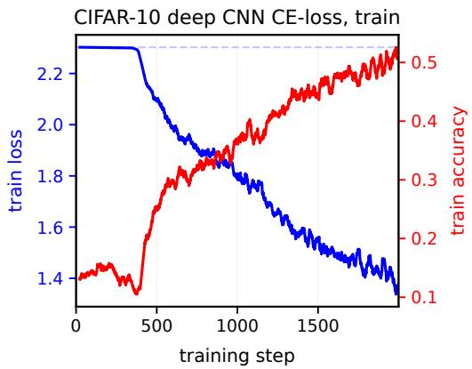

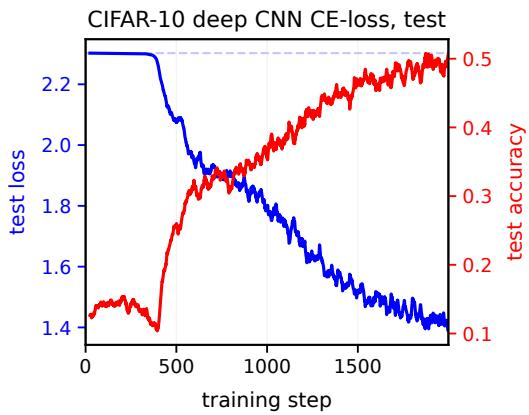  
Figure 11: Dynamics of a deeper convolutional network on CIFAR-10. Training trajectories are shown on the left and held-out test trajectories on the right. The network has five convolutional hidden layers with $( C _ { 1 } , \dots , C _ { 5 } ) = ( 2 5 6 , 2 5 6 , 2 5 6 , 2 5 6 , 2 5 6 )$ , followed by a fully connected tenclass output layer. All weights use entrywise Gaussian initialization with $\sigma \stackrel { \cdot } { = } 8 { \times } 1 0 ^ { - 3 }$ ; optimization uses minibatch SGD with learning rate 0.025 and batch size 128. Blue curves show cross-entropy loss and red curves show top-one accuracy; the horizontal dashed blue line denotes the zero-logit cross-entropy log 10. Curves are 25-step moving averages of the per-minibatch measurements.

We do not infer from these experiments that the internal mechanism producing the CNN accuracy well is identical to the spectral mechanism proved for the unary targets. Rather, the results show that the same qualitative nonmonotone accuracy dynamics survive substantial changes in architecture, dataset, loss function, stochastic optimization, and initialization parametrization, supporting the broader phenomenological picture developed in this work.