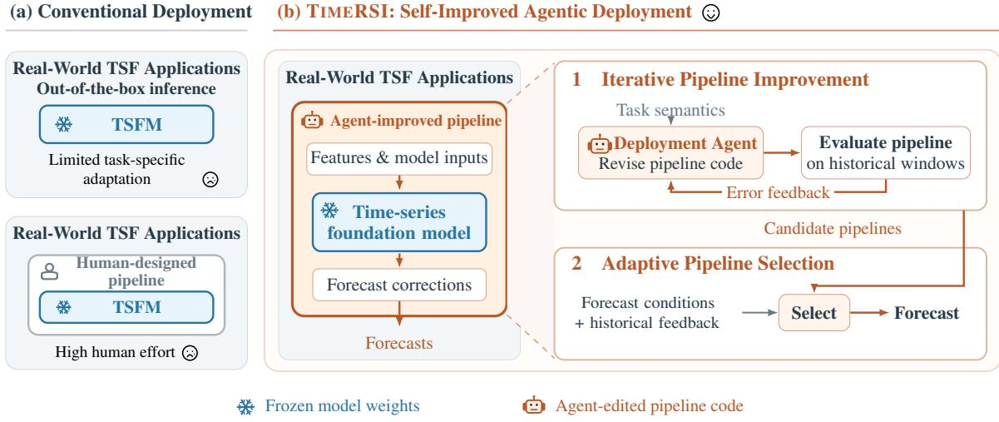
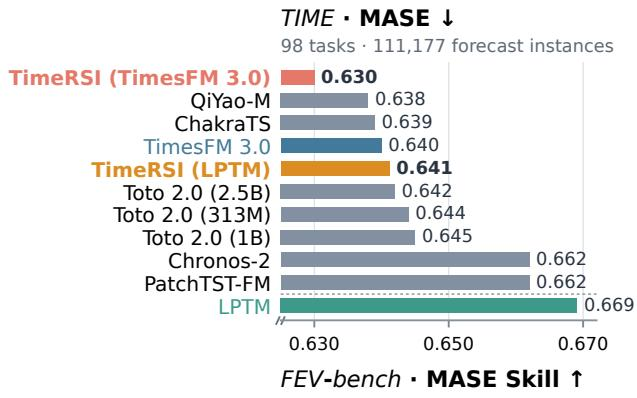
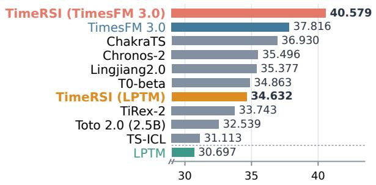
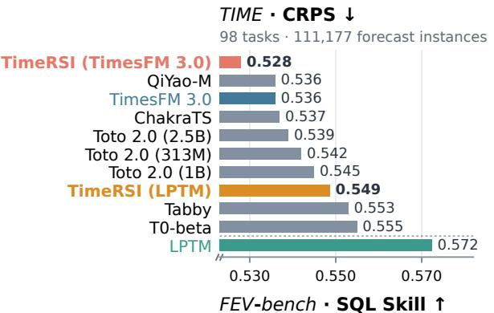
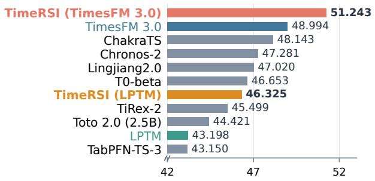
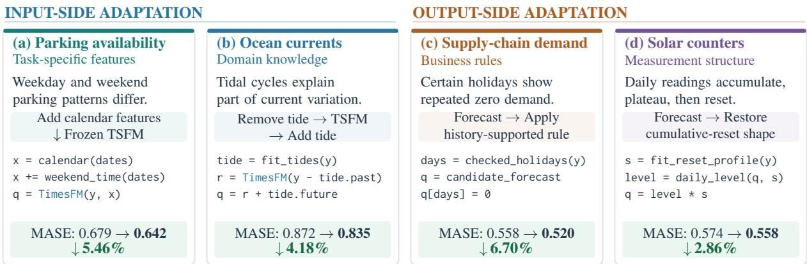

# TIMERSI: Towards Self-Improved Agentic Deployment for Time-Series Foundation Models

Haoxin Liu1\* Deqing Fu2 Lucheng Fu1 Yiqiao Jin1

Rushi Qiang1 Harshavardhan Kamarthi1,3 B. Aditya Prakash1,3\*

1Georgia Institute of Technology 2University of Southern California 3Samay AI

## Abstract

Time-series foundation models provide strong zero-shot forecast, but deployment for realworld applications still requires task-specific designs for model inputs and outputs. Direct inference can leave domain knowledge and recurring forecast errors unaddressed, while tailored pipelines require substantial human expertise and effort. We introduce TIMERSI, a self-improving agentic deployment system around frozen forecasting models. A coding agent translates task descriptions into executable pipeline changes. It tests each revision on historical forecasting windows and uses observed errors to guide subsequent revisions. During deployment, an adaptive selector chooses among the resulting pipelines using completed forecasts under similar conditions. Across 198 tasks on TIME and FEVbench, TIMERSI outperforms all submissions on six point and probabilistic forecasting metrics. Controlled comparisons support the value of feedback-guided revision over non-iterative pipeline search. Further experiments verify the generalization with different coding agents and forecasting models. Code is available at https: //github.com/haoxin1998/TimeRSI.

## 1 Introduction

Time-series foundation models (TSFMs) provide strong forecasts on new datasets without taskspecific weight updates (Das et al., 2024; Ansari et al., 2024; Woo et al., 2024). In real-world timeseries forecasting (TSF), effective deployment still depends on how task knowledge shapes the model’s inputs and outputs. For example, recurring holiday closures can inform demand forecasts, while known tidal cycles can guide ocean-current forecasts. Turning this knowledge into a deployment pipeline around the model still requires substantial human expertise and effort.

Code agents based on large language models (LLMs) offer a way to automate pipeline development through program generation and evaluation (Jiang et al., 2025; Fu et al., 2026). Two challenges arise in forecasting. First, a plausible change may not improve accuracy. Calendar information, for instance, can enter through model inputs or a separate predictor, and these choices can yield different results. Historical forecast errors help evaluate and refine such decisions. Second, a pipeline that performs well on average may be less suitable as forecasting conditions change.

We introduce TIMERSI, which applies recursive self-improvement (RSI) to deployment pipelines around frozen TSFMs (Fig. 1). Our central idea is to use task knowledge to guide what to try and forecasting feedback to guide how to revise and use each pipeline. The agent edits input transformations, features, and forecast corrections while keeping the foundation model’s weights fixed.

Specifically, TIMERSI combines two stages. Iterative pipeline improvement evaluates code revisions on historical forecasting windows and returns errors to the agent for further revision. A separate set of later historical windows identifies candidates for deployment. Adaptive pipeline selection then chooses among these candidates for each new forecast using their performance under similar historical conditions.

We evaluate TIMERSI on TIME and FEV-bench (Qiao et al., 2026; Shchur et al., 2026), covering 198 tasks. TIMERSI achieves the best scores among all existing submissions across six point and probabilistic forecasting metrics. Ablations show that our iterative deployment improvement outperforms non-iterative pipeline search with the same number of candidates. Further experiments show gains with different coding agents and TSFMs, while case studies illustrate how task knowledge becomes effective deployment code.

Related work. Beyond direct deployment of foundation time-series models (Kamarthi and

  
Fig. 1: From conventional to self-improved TSFM deployment. (a) Direct inference leaves task-specific adaptation to the user, while tailored pipelines require human design and revision. (b) TIMERSI automates pipeline improvement through task-aware code edits and historical forecasting feedback, then selects among the resulting pipelines for each new forecast. The TSFM remains frozen.

Prakash, 2024; Das et al., 2024; Woo et al., 2024; Ansari et al., 2024), we study agentic deployment for realistic applications via recursive selfimprovement (RSI) (Lee et al., 2026; Srikanth et al., 2026). See App. A for additional related work.

## 2 TIMERSI: Self-Improved Deployment for Time-Series Foundation Models

TIMERSI automates two deployment decisions: how to improve a task-specific pipeline and which pipeline to use for a new forecast. A code agent develops pipelines through repeated execution, evaluation, and revision. An adaptive selector chooses among them using past outcomes under similar forecasting conditions. The TSFM’s weights remain fixed in both stages.

Formally, let $x _ { t }$ contain the observed history and known covariates at forecast origin t, and let m describe the task, variable meanings, and sampling frequency. A pipeline p uses a frozen model $F _ { \theta }$ to forecast the next H steps as $\widehat { y } _ { t + 1 : t + H } =$ $p ( F _ { \theta } , x _ { t } ; m )$ . The agent improves $p ,$ while the backbone parameters θ remain fixed.

The agent writes Python code across four stages: preprocessing, feature construction, context selection, and post-processing. On the input side, it can transform observations, encode task knowledge as additional variables, and choose which histories or variable groups the TSFM receives. On the output side, it can combine forecasts, fit auxiliary predictors, and correct systematic errors. This action space lets the agent translate task information into executable changes to the model’s inputs and outputs. App. B gives the programming interface.

Iterative Pipeline Improvement The outcome of a new forecast is not yet known, so TIMERSI uses completed historical windows to evaluate pipeline changes. For each window, the system supplies the history and known covariates at its forecast origin, runs the candidate, and scores its predictions for the following H steps. Earlier windows form an adaptation set for iterative code revision; later windows form a selection set for choosing the deployment candidates.

The loop starts from direct TSFM inference as the reference pipeline. In each iteration, the agent uses the task description and earlier results to propose and implement a code revision. The system executes it on the adaptation windows and returns forecasting scores, window-level errors, and execution logs. The agent inspects this feedback to decide whether to refine its approach, combine useful changes, or try a different one. All earlier code and evaluation records remain accessible, so later revisions can build on successful ideas and address errors observed in previous attempts. Task semantics guide what to try, while execution feedback guides what to change next.

After the search budget is exhausted, the system evaluates the resulting candidates on the later selection windows. It retains the highest-ranked pipelines together with the reference to form a deployment set P. This set provides several taskspecific strategies for subsequent forecasts.

  
Fig. 2: TIMERSI ranks first among the compared submissions across six reported metrics on TIME and FEV-bench. Labels name the frozen backbone of TIMERSI; LPTM (Kamarthi and Prakash, 2024) is appended below the dashed line when outside the top ten. See App. E for metrics including WQL Skill and WAPE Skill, and full results of more methods.

Adaptive Pipeline Selection A pipeline that performs well on average may not be the best choice for every future window. TIMERSI therefore selects a pipeline for each target variable at each new forecast origin. The selector describes the current conditions using numerical features of the recent history and reference forecast, including level changes, recent trends, and forecast shape. It retrieves similar completed windows and compares how the retained pipelines performed on them.

For a given target, let $\mathcal { N } _ { t }$ denote the retrieved windows whose outcomes are fully observed by t. Each window s receives a similarity-based weight $w _ { t , s } .$ Let $\ell ( p , s )$ be the error of pipeline p on window s relative to the reference. The selector chooses the pipeline with the lowest weighted historical error, $\begin{array} { r } { \dot { p _ { t } ^ { * } } = \arg \operatorname* { m i n } _ { p \in \mathcal { P } } \frac { \sum _ { s \in \mathcal { N } _ { t } } w _ { t , s } \overline { { \ell } } ( p , s ) } { \sum _ { s \in \mathcal { N } _ { t } } w _ { t , s } } } \end{array}$ The selected pipeline supplies the full forecast horizon and all quantiles for that target. App. C specifies the features, weights, and loss.

At each origin, TIMERSI runs and records forecasts from every retained pipeline. Once a window is complete, the system adds each pipeline’s errors to its feedback history and uses them to inform subsequent choices. Pipeline code remains fixed during this stage, while selection adapts as new outcomes arrive. Thus, iterative revision improves the available strategies, and adaptive selection determines when to use them.

## 3 Experiments

Data and Metrics. We evaluate all 98 tasks of TIME (Qiao et al., 2026) and all 100 tasks of FEVbench (Shchur et al., 2026), covering 111,177 and 235,039 forecast instances, respectively. Each instance is a series–window–target combination. Our default configuration pairs TimesFM 3.0 with Claude Code (Claude Fable 5). Following TIME, we report normalized mean absolute scaled error (MASE) and continuous ranked probability score (CRPS), where lower is better. Following FEVbench, we report Skill Scores for MASE, scaled quantile loss (SQL), weighted quantile loss (WQL), and weighted absolute percentage error (WAPE), where higher is better. See App. E for metric definitions and protocol details.

Baselines. We compare with published results from all 32 submissions on TIME and 31 on FEVbench, covering foundation models, supervised forecasters, and statistical methods. Major baselines include TimesFM 3.0 (Google) (Das et al., 2024), Chronos-2 (Amazon) (Ansari et al., 2025), Toto 2.0 (Datadog) (Khwaja et al., 2026), QiYao-

Fig. 3: Agentic deployment examples via TIMERSI. The agent adds calendar features for parking, separates tidal patterns for ocean currents, applies holiday rules for supply-chain demand, and restores daily accumulation and reset patterns for solar counters. These agentic deployments reduce MASE by 2.86–6.70% over direct TimesFM 3.0.
<table><tr><td></td><td colspan="2">TIME: normalized errors</td><td colspan="2">FEV-bench: skill scores (%)</td></tr><tr><td>Method</td><td>MASE↓</td><td>CRPS↓</td><td>SQL Skill ↑</td><td>MASE Skill ↑</td></tr><tr><td>Direct TimesFM 3.0</td><td>0.640</td><td>0.536</td><td>48.984</td><td>37.786</td></tr><tr><td>Non-Iterative Search for Deployment</td><td>0.650X</td><td>0.549 X</td><td>42.832 X</td><td>30.509 X</td></tr><tr><td>TiMERSI Deployment</td><td>0.630√</td><td>0.528√</td><td>51.243√</td><td>40.579√</td></tr></table>

Tab. 1: Ablation of iterative deployment improvement. With the same number of candidate pipelines, non-iterative search without feedback-guided revision underperforms direct TimesFM 3.0 inference, while TIMERSI improves performance on both benchmarks.

M (Huawei) (Cheng et al., 2026), and TiRex-2 (NXAI) (Podest et al., 2026).

Main results. TIMERSI achieves the best scores on both benchmarks across all six reported metrics (Fig. 2). Relative to direct inference with the same frozen TimesFM 3.0, it reduces MASE by 1.52% and CRPS by 1.61% on TIME. On FEV-bench, it raises MASE Skill by 2.79 percentage points and SQL Skill by 2.26 points. App. E gives the full comparisons, including WQL and WAPE Skill. These results show that improving the deployment pipeline can improve forecasting accuracy without updating the foundation model.

Ablation. Feedback-guided revision improves deployment. We compare TIMERSI with Non-Iterative Search, which proposes the same number of candidate pipelines and selects among them without feedback-guided revision (Tab. 1). Noniterative search underperforms direct inference on both benchmarks, whereas TIMERSI improves it. These results support revising pipelines based on forecast errors, rather than only proposing and selecting candidates.

Generalization. Effective across coding agents and TSFMs. The gains extend beyond our default components (Tab. 8). With TimesFM 3.0 fixed, Antigravity (Gemini 3.8 Flash) reaches normalized MASE/CRPS of 0.637/0.532, outperforming the compared external submissions on TIME. With Claude Code fixed, TIMERSI reduces MASE/CRPS from 0.662/0.556 to 0.647/0.545 for Chronos-2 and from 0.669/0.572 to 0.641/0.549 for LPTM, whose FEV-bench MASE/SQL Skill also rises from 30.70/43.20 to 34.63/46.33 (Fig. 2). The Claude Code–TimesFM 3.0 combination achieves better results, consistent with the advantages of more advanced coding agents and TSFMs.

Case studies. The agent translates task knowledge into pipeline changes (Fig. 3): calendar features for parking, tidal decomposition for ocean currents, history-supported holiday corrections for demand, and daily-reset shape corrections for solar counters. The resulting pipelines reduce task-level MASE by 2.86–6.70%. The parking case also illustrates feedback-guided revision: after a calendarpredictor blend increases historical error, the agent switches to calendar inputs and adds weekend–time interactions. Feedback thus guides changes in strategy, not just parameter tuning. App. D provides full traces and additional examples.

## 4 Conclusion

We introduce TIMERSI to automate task-specific deployment through iterative pipeline improvement and adaptive selection around frozen TSFMs. On TIME and FEV-bench, TIMERSI ranks first across six forecasting metrics compared with competitive external submissions.

## Limitations

TIMERSI relies on clear task and variable descriptions to connect numerical patterns with domain knowledge. Besides, gains on historical windows do not guarantee gains on future forecasts. This highlights the open problem, i.e., distribution shift, in time-series forecasting (Liu et al., 2024a; Kim et al., 2025).

## Acknowledgements

This paper was supported in part by the NSF (Expeditions CCF-1918770, CAREER IIS-2028586, Medium IIS-1955883, Medium IIS-2403240, Medium IIS-2106961), NIH (1R01HL184139), CDC MInD program, Meta, and Dolby faculty gifts.

## References

Lakshya A Agrawal, Shangyin Tan, Dilara Soylu, Noah Ziems, Rishi Khare, Krista Opsahl-Ong, Arnav Singhvi, Herumb Shandilya, Michael J Ryan, Meng Jiang, Christopher Potts, Koushik Sen, Alex Dimakis, Ion Stoica, Dan Klein, Matei Zaharia, and Omar Khattab. 2026. Gepa: Reflective prompt evolution can outperform reinforcement learning. In International Conference on Learning Representations, volume 2026, pages 8479–8565.

Abdul Fatir Ansari, Oleksandr Shchur, Jaris Küken, Andreas Auer, Boran Han, Pedro Mercado, Syama Sundar Rangapuram, Huibin Shen, Lorenzo Stella, Xiyuan Zhang, Mononito Goswami, Shubham Kapoor, Danielle C. Maddix, Pablo Guerron, Tony Hu, Junming Yin, Nick Erickson, Prateek Mutalik Desai, Hao Wang, and 4 others. 2025. Chronos-2: From univariate to universal forecasting. Preprint, arXiv:2510.15821.

Abdul Fatir Ansari, Lorenzo Stella, Caner Turkmen, Xiyuan Zhang, Pedro Mercado, Huibin Shen, Oleksandr Shchur, Syama Sundar Rangapuram, Sebastian Pineda Arango, Shubham Kapoor, Jasper Zschiegner, Danielle C. Maddix, Hao Wang, Michael W. Mahoney, Kari Torkkola, Andrew Gordon Wilson, Michael Bohlke-Schneider, and Yuyang Wang. 2024. Chronos: Learning the language of time series. Preprint, arXiv:2403.07815.

Jun Shern Chan, Neil Chowdhury, Oliver Jaffe, James Aung, Dane Sherburn, Evan Mays, Giulio Starace, Kevin Liu, Leon Maksin, Tejal Patwardhan, Aleksander Madry, and Lilian Weng. 2025. Mle-bench: Evaluating machine learning agents on machine learning engineering. In International Conference on Learning Representations, volume 2025, pages 50466–50494.

Hanyin Cheng, Linfeng Wang, Zhengbo Qu, Yang Shu, Zhongwen Rao, Meng Wang, Yijie Li, Xin Jiang, Bin Yang, and Chenjuan Guo. 2026. Qiyao-m: Multimodal time series foundation model with role-aware modeling of endogenous and exogenous modalities. Preprint, arXiv:2609.34842.

Abhimanyu Das, Weihao Kong, Rajat Sen, and Yichen Zhou. 2024. A decoder-only foundation model for time-series forecasting. In Proceedings of the 41st International Conference on Machine Learning, volume 235 of Proceedings of Machine Learning Research, pages 10148–10167. PMLR.

Deqing Fu, Huangyuan Su, Rajat Sen, Taman Narayan, Sujay Sanghavi, Abhimanyu Das, and Weihao Kong. 2026. Tabfm-auto: Self-evolving pipelines for tabular foundation models. Preprint, arXiv:2609.37989.

Qian Huang, Jian Vora, Percy Liang, and Jure Leskovec. 2024. MLAgentBench: Evaluating language agents on machine learning experimentation. In Proceedings of the 41st International Conference on Machine Learning, volume 235 of Proceedings of Machine Learning Research, pages 20271–20309. PMLR.

Zhengyao Jiang, Dominik Schmidt, Dhruv Srikanth, Dixing Xu, Ian Kaplan, Deniss Jacenko, and Yuxiang Wu. 2025. Aide: Ai-driven exploration in the space of code. Preprint, arXiv:2502.13138.

Harshavardhan Kamarthi and B. Aditya Prakash. 2024. Large pre-trained time series models for crossdomain time series analysis tasks. In Advances in Neural Information Processing Systems, volume 37, pages 56190–56214. Curran Associates, Inc.

Emaad Khwaja, Chris Lettieri, Gerald Woo, Eden Belouadah, Marc Cenac, Guillaume Jarry, Enguerrand Paquin, Xunyi Zhao, Viktoriya Zhukov, Othmane Abou-Amal, Chenghao Liu, Ameet Talwalkar, and David Asker. 2026. Toto 2.0: Time series forecasting enters the scaling era. Preprint, arXiv:2605.20119.

Jongseon Kim, Hyungjoon Kim, HyunGi Kim, Dongjun Lee, and Sungroh Yoon. 2025. A comprehensive survey of deep learning for time series forecasting: architectural diversity and open challenges. Artificial Intelligence Review, 58(7):216.

Yoonho Lee, Roshen Nair, Qizheng Zhang, Kangwook Lee, Omar Khattab, and Chelsea Finn. 2026. Metaharness: End-to-end optimization of model harnesses. Preprint, arXiv:2603.28052.

Haoxin Liu, Harshavardhan Kamarthi, Lingkai Kong, Zhiyuan Zhao, Chao Zhang, and B. Aditya

Prakash. 2024a. Time-series forecasting for out-ofdistribution generalization using invariant learning. In Proceedings ofthe 41st International Conference on Machine Learning, volume 235 of Proceedings ofMachine Learning Research, pages 31312–31325. PMLR.

Haoxin Liu, Chenghao Liu, and B. Aditya Prakash. 2025. A picture is worth a thousand numbers: Enabling LLMs reason about time series via visualization. In Proceedings ofthe 2025 Conference ofthe Nations ofthe Americas Chapter ofthe Association for Computational Linguistics: Human Language Technologies (Volume 1: Long Papers), pages 7486– 7518, Albuquerque, New Mexico. Association for Computational Linguistics.

Haoxin Liu, Shangqing Xu, Zhiyuan Zhao, Lingkai Kong, Harshavardhan Kamarthi, Aditya B. Sasanur, Megha Sharma, Jiaming Cui, Qingsong Wen, Chao Zhang, and B. Aditya Prakash. 2024b. Time-mmd: Multi-domain multimodal dataset for time series analysis. In Advances in Neural Information Processing Systems, volume 37, pages 77888–77933. Curran Associates, Inc.

Haoxin Liu, Zhiyuan Zhao, Jindong Wang, Harshavardhan Kamarthi, and B. Aditya Prakash. 2024c. LST-Prompt: Large language models as zero-shot time series forecasters by long-short-term prompting. In Findings ofthe Associationfor Computational Linguistics: ACL 2024, pages 7832–7840, Bangkok, Thailand. Association for Computational Linguistics.

Haoxin Liu, Yichen Zhou, Rajat Sen, B. Aditya Prakash, and Abhimanyu Das. 2026a. Rethinking multimodal time-series forecasting evaluation. In Proceedings of the 43rd International Conference on Machine Learning, volume 306 of Proceedings of Machine Learning Research, pages 80183–80283. PMLR.

Zewen Liu, Zhan Shi, Yisi Sang, Bing He, Minhua Lin, Tianxin Wei, Dakuo Wang, Benoit Dumoulin, Wei Jin, and Hanqing Lu. 2026b. Adaptive auto-harness: Sustained self-improvement for agentic system deployment on open-ended task streams. Preprint, arXiv:2606.01770.

Aman Madaan, Niket Tandon, Prakhar Gupta, Skyler Hallinan, Luyu Gao, Sarah Wiegreffe, Uri Alon, Nouha Dziri, Shrimai Prabhumoye, Yiming Yang, Shashank Gupta, Bodhisattwa Prasad Majumder, Katherine Hermann, Sean Welleck, Amir Yazdanbakhsh, and Peter Clark. 2023. Self-refine: Iterative refinement with self-feedback. In Advances in Neural Information Processing Systems, volume 36, pages 46534–46594. Curran Associates, Inc.

Patrick Podest, Marco Pichler, Elias Bürger, Levente Zó- lyomi, Bernhard Voggenberger, Wilhelm Berghammer, Daniel Klotz, Sebastian Böck, Günter Klambauer, and Sepp Hochreiter. 2026. Tirex-2: Generalizing tirex to multivariate data and streaming. Preprint, arXiv:2607.01204.

Zhongzheng Qiao, Sheng Pan, Anni Wang, Viktoriya Zhukova, Yong Liu, Xudong Jiang, Qingsong Wen, Mingsheng Long, Ming Jin, and Chenghao Liu. 2026. It’s time: Towards the next generation of time series forecasting benchmarks. Preprint, arXiv:2602.12147.

Oleksandr Shchur, Abdul Fatir Ansari, Caner Turkmen, Lorenzo Stella, Nick Erickson, Pablo Guerron, Michael Bohlke-Schneider, and Yuyang Wang. 2026. fev-bench: A realistic benchmark for time series forecasting. Preprint, arXiv:2509.26468.

Noah Shinn, Federico Cassano, Ashwin Gopinath, Karthik Narasimhan, and Shunyu Yao. 2023. Reflexion: language agents with verbal reinforcement learning. In Advances in Neural Information Processing Systems, volume 36, pages 8634–8652. Curran Associates, Inc.

Dhruv Srikanth, Bingchen Zhao, Dixing Xu, Yuxiang Wu, and Zhengyao Jiang. 2026. Recursive self-improvement of ai research agents. Preprint, arXiv:2609.26457.

Gerald Woo, Chenghao Liu, Akshat Kumar, Caiming Xiong, Silvio Savarese, and Doyen Sahoo. 2024. Unified training of universal time series forecasting transformers. In Proceedings of the 41st International Conference on Machine Learning, volume 235 of Proceedings of Machine Learning Research, pages 53140–53164. PMLR.

## A Additional Related Work

Pretrained forecasting models. TimesFM (Das et al., 2024), Chronos (Ansari et al., 2024), and Moirai (Woo et al., 2024) learn from diverse numerical series to support forecasting on new datasets. LPTM (Kamarthi and Prakash, 2024) studies adaptive segmentation during pretraining for crossdomain time-series analysis. These works develop the numerical backbone. TIMERSI addresses a complementary question: how can an agent adapt the deployment pipeline around an existing backbone while keeping its weights fixed?

Semantics and temporal generalization. LST-Prompt (Liu et al., 2024c) studies structured prompting for time-series forecasting. VL-Time (Liu et al., 2025) uses visual representations to support language-guided time-series reasoning. Time-MMD (Liu et al., 2024b) and TimesX (Liu et al., 2026a) provide benchmarks connecting numerical series with textual context. These studies motivate using information beyond raw target values; our agent turns task information into executable pipeline changes. FOIL (Liu et al., 2024a) addresses out-of-distribution forecasting through invariant learning. Rather than learning invariant backbone representations, TIMERSI uses completed forecasts to choose among candidate pipelines.

Agent improvement. Self-Refine (Madaan et al., 2023) alternates generation, self-feedback, and revision. Reflexion (Shinn et al., 2023) carries verbal reflections from task feedback into later attempts. GEPA (Agrawal et al., 2026) evolves prompts using execution traces and reflective feedback. Adaptive Auto-Harness (Liu et al., 2026b) combines harness evolution and task-wise routing on openended streams. TIMERSI focuses on executable pipelines around a frozen numerical forecaster. It separates historical code search from deployment selection, where completed forecast windows supply the new feedback.

Machine learning engineering agents. MLAgentBench (Huang et al., 2024) evaluates agents that read and write files, execute experiments, and inspect outputs. MLE-bench (Chan et al., 2025) assesses model development and experimentation on machine learning competitions. AIDE (Jiang et al., 2025) searches over code solutions, while TabFM-Auto (Fu et al., 2026) focuses pipeline search around a frozen tabular model. Our design shares the code–execution–feedback pattern, but couples pipeline adaptation with chronological feedback and strategy selection for repeated forecasting.

## B Pipeline Interface

Four functions pass prepared data and state between pipeline stages. The first, preprocess, receives the observed history and task description and returns prepared data and local state. engineer constructs variables from these inputs. select\_context creates one or more forecasting cases, specifying the histories and variable groups supplied to the foundation model. postprocess maps model outputs back to the target scale and returns point and quantile forecasts in the original target units. State is local to the current invocation. It can hold fitted transforms or auxiliary predictors derived from the available history. During deployment, these components may be fitted again on newly available history while their code remains fixed.

The evaluator supplies the same chronological windows to all candidates. Candidate code receives no target values beyond each window’s origin. The agent can access the labels of the adaptation windows through evaluation feedback; these labels are not passed to the pipeline as prediction inputs. Later selection feedback is used by the system only after code search finishes. All four functions and their evaluation records are retained so the agent can inspect earlier attempts.

## C Historical Selection Details

The reference configuration describes each target using up to 96 recent observations and the reference median forecast. Its six features are: the latest value relative to the recent median; the mean of the last eight observations relative to the mean of the earlier half of the recent history; the first forecast relative to the latest observation; the mean forecast relative to the recent median; the standard deviation across the forecast horizon; and the last forecast relative to the first. Each feature is scaled by the recent historical standard deviation, with a small floor for nearly constant series.

At a new origin, the selector first filters out windows whose outcomes are not yet complete. It uses records for the current item when at least three distinct origins are available; otherwise it pools the available records. For each target, it standardizes the feature coordinates using the historical feature standard deviations, floored at 0.25. Distance is the mean squared difference in these coordinates. The selector retrieves up to 12 nearest records and gives each an initial weight of $1 / ( 1 + d )$ , where d is this distance. Weights are then normalized within each origin before applying the weighted-error selection rule.

For each candidate and historical window, the loss is its mean absolute scaled error (MASE) divided by the reference MASE, with a denominator floor of $1 0 ^ { - 8 }$ . MASE divides mean absolute forecast error by the mean absolute seasonal difference in the history available at that origin. Candidate ranking before deployment uses mean selectionwindow MASE, with the quantile score as a tiebreaker. The portable configuration retains three ranked candidates plus the reference if it is not already among them. Initial feedback comes from the completed adaptation and selection windows; subsequent completed forecasts extend this history. With no available feedback, the selector uses the reference pipeline.

## D Discovered Deployment Strategies

These cases illustrate task-specific features, domain-informed representations, business rules, measurement structure, and auxiliary predictors. Tab. 2 compares seven example tasks with direct inference using the same frozen TimesFM 3.0 backbone. Each test score covers all official windows and targets of its task. Historical adaptation and selection scores are reported separately; the selected examples do not represent the aggregate benchmark result.

## D.1 Supply Chain: Learning When Demand Is Zero

A holiday can break an otherwise regular weekly pattern. On July 4, 2024, in the first official forecast window of Supply\_Chain\_Customer, the first customer’s observed order count is zero. The direct model’s median forecast is 195.23; TIMERSI’s is zero.

The agent writes a date-based correction rather than a general low-demand threshold. It checks past observations on July 4, Thanksgiving, Christmas, and New Year’s Day. For each target, the correction requires at least four past holiday observations, of which at least 80% must be zero.

When this condition holds, it sets all nine forecast quantiles to zero on the relevant holiday. Thus, a calendar hypothesis becomes a rule supported by that target’s history.

The agent also tests corrections for the day after a holiday. Historical feedback leads it to restrict this adjustment to the day after July 4 rather than applying it to dates such as Black Friday. Further revisions align the normalized forecast shapes of orders, pieces, and revenue for the same customer. Tab. 3 shows all six revisions in this search. The main adaptation gain comes from the first holidayaware correction; later edits refine it.

The task contains 36 targets and 12 windows of 30 days. On the four relevant holiday dates, all 144 target values are zero; direct inference predicts nonzero values, while TIMERSI predicts zero. Across all dates and targets, the complete pipeline reduces MASE by 6.70%, including its other corrections.

## D.2 Parking: Revising How the Model Uses the Calendar

The task predicts available parking spaces every 15 minutes for the next week. Calendar information can describe more than a change in average availability: the daily pattern may also differ between weekdays and weekends. The agent explores both using a separate calendar predictor and supplying calendar features to TimesFM.

Tab. 4 shows all six evaluated revisions. The first calendar-predictor blend increases adaptation error. The agent then removes its contribution and builds known-future calendar inputs instead. The selected program contains 22 features: daily and weekly sine and cosine terms, weekend and Saturday indicators, and weekend–time-of-day interactions. Features cover both historical and future timestamps. The program includes a periodic feature only when the history spans at least 1.5 of its cycles.

The chosen pipeline keeps the calendar predictor’s output weight at zero: the improvement comes from a program that supplies new inputs to the frozen model. On the full test task of 354 car parks, MASE falls from 0.678730 to 0.641658 and CRPS from 0.046609 to 0.044105. The trace shows feedback changing the agent’s approach, while separate historical selection determines which resulting program is deployed.

<table><tr><td rowspan="2"></td><td colspan="3">Test MASE↓</td><td colspan="2">Relative error reduction</td></tr><tr><td>Horizon</td><td>Direct</td><td>TIMERSI</td><td>MASE</td><td>CRPS</td></tr><tr><td>Task Supply chain</td><td>30 days</td><td>0.557750</td><td>0.520378</td><td>6.70%</td><td>6.76%</td></tr><tr><td>Parking availability</td><td>1 week</td><td>0.678730</td><td>0.641658</td><td>5.46%</td><td>5.37%</td></tr><tr><td>Ocean currents</td><td>72 hours</td><td>0.871531</td><td>0.835129</td><td>4.18%</td><td>0.64%</td></tr><tr><td>Solar counters</td><td>72 hours</td><td>0.574087</td><td>0.557693</td><td>2.86%</td><td>2.66%</td></tr><tr><td>Auto-production seasonal factor</td><td>12 months</td><td>0.756537</td><td>0.233980</td><td>69.07%</td><td>66.37%</td></tr><tr><td>COVÍD reports</td><td>30 days</td><td>3.138536</td><td>2.890121</td><td>7.91%</td><td>15.62%</td></tr><tr><td>Atmospheric variables</td><td>24 hours</td><td>0.476581</td><td>0.466005</td><td>2.22%</td><td>1.22%</td></tr></table>

Tab. 2: Different tasks lead to different deployment programs. Complete-task test scores for the selected examples. Relative reductions compare TIMERSI with direct TimesFM inference. The auto-production case uses an agent-written specialist for point forecasts and the foundation model for distributional information.

<table><tr><td>Revision</td><td>MASE↓</td></tr><tr><td>Starting pipeline</td><td>0.522271</td></tr><tr><td>1. Holiday and weekday corrections</td><td>0.489970</td></tr><tr><td>2. Post-holiday adjustment</td><td>0.490036</td></tr><tr><td>3. Align related forecast shapes</td><td>0.489901</td></tr><tr><td>4. Stronger post-holiday adjustment</td><td>0.489933</td></tr><tr><td>5. Restrict adjustment to July 5</td><td>0.489834</td></tr><tr><td>6. Refine shape alignment</td><td>0.489810</td></tr></table>

Tab. 3: Supply-chain revisions evaluated on the same adaptation windows. The starting pipeline already contains earlier adaptations; its score is not the directinference baseline.
<table><tr><td>Revision</td><td>Adaptation</td><td>Selection</td></tr><tr><td>Direct TimesFM</td><td>0.9421</td><td>0.6142</td></tr><tr><td>1. Calendar-expert blend</td><td>0.9578</td><td>0.6171</td></tr><tr><td>2. Calendar inputs</td><td>0.9208</td><td>0.6038</td></tr><tr><td>3. History-length condition</td><td>0.9208</td><td>0.6038</td></tr><tr><td>4. Weekend-time features</td><td>0.9268</td><td>0.6010</td></tr><tr><td>5. Median and range edits</td><td>0.9208</td><td>0.6038</td></tr><tr><td>6. Fewer calendar inputs</td><td>0.9152</td><td>0.6021</td></tr></table>

Tab. 4: Parking MASE on adaptation and separate selection windows; lower is better. Adaptation uses three origins and selection uses five, each with 32 car parks. Comparisons are within columns. Revision 4 is deployed, rather than the last revision or the adaptation winner.

## D.3 Ocean Currents: Using Tidal Knowledge in Model Inputs

In current\_velocity/10T/long, the agent uses known tidal periods to separate predictable oscillations from the remaining signal. Its program includes tidal constituents such as M2 (12.42 hours) and K1 (23.93 hours). It selects constituents whose frequencies can be distinguished over the available history and fits their amplitudes and phases for each target. Before applying the decomposition, a historical backtest checks whether the tidal fit improves on a constant-mean predictor.

The program subtracts the fitted tidal component from the history, supplies the residual to TimesFM, and adds the extrapolated component back to the point and quantile forecasts. Thus, domain knowledge changes the model’s numerical input rather than only adding a textual description. The selected pipeline reduces MASE from 0.871531 to 0.835129 (4.18%) and CRPS from 0.278207 to 0.276433 (0.64%). These scores cover ten series, six variables, and five official windows, each forecasting 432 ten-minute steps (72 hours).

weekend = np.where(dow >= 5, 1., -1.)   
for k in $( 1 , 2 , 3 ) :$   
phase = 2 \* np.pi \* k \* tod   
rows += [weekend \* np.sin(phase),   
weekend \* np.cos(phase)]  
Fig. 4: Calendar interactions in the generated program. The core feature code, condensed for readability. Here, tod is the fraction of a day and dow ranges from Monday (0) to Sunday (6). These features cover both history and forecast dates.

## D.4 Solar: Respecting a Daily-Reset Pattern

In Australia\_Solar, the agent identifies a pattern consistent with a daily-reset counter: values rise within the day, reach a plateau, and reset. This observed structure motivates a different correction from one designed for instantaneous power.

The program estimates a normalized daily profile s(h) from the previous 28 valid days. For each forecast day and quantile, it fits a level T to the model output and reconstructs the path as $T s ( h )$ The correction preserves the historical daily shape and reset while using the model forecast to set the level.

The agent also explores daily-total experts and seasonal profiles. Separate historical selection favors the simpler shape projection. The selected pipeline reduces MASE by 2.86% and CRPS by 2.66% across three targets and 35 official windows, each covering 72 hours.

## D.5 Auto Production: Building a Calendar-Aware Specialist

The official task Auto\_Production\_SF/M/short contains the monthly seasonal-factor series RSF\_AutoProduction, not vehicle production counts. The agent builds on a calendar-aware predictor and explores holiday interactions, monthspecific trends, and reversible seasonal transformations. It uses historical forecasts to choose a smoothing rate for each month, then shrinks these choices toward a common default.

The resulting specialist supplies the point forecast. TimesFM’s quantile deviations and historical forecast errors inform the predictive distribution. This case illustrates the broader action space of deployment code: the agent can fit an auxiliary predictor, not only add input features.

Across all five 12-month test windows, MASE falls from 0.756537 for direct inference to 0.233980 for TIMERSI, a 69.07% reduction. The pipeline used to start the final search already achieves 0.313005; the six further revisions reduce its test MASE by 25.25%. These comparisons distinguish the complete deployment gain from the additional gain of that search.

## D.6 COVID Reports: Revising an Overextended Trend

A plausible first idea need not be the best program. On ECDC\_COVID, the agent starts with a reversible logarithmic transformation, but adaptation MASE increases from 3.9173 to 4.1816. It then examines past forecast errors and finds overly strong upward extrapolation in the cases it inspects.

The next revision blends the model with a damped trend predictor, lowering adaptation MASE to 2.9624. Further edits handle isolated reporting spikes and repeated values at the end of the history. The agent also tests shorter context and adjusts positive trend damping according to how long the recent growth has lasted. Tab. 5 gives the complete six-revision trace.

The selected pipeline gives equal weight to the model and the auxiliary predictor in log space. Across nine countries and five 30-day test windows, it reduces task-level MASE by 7.91% and CRPS by 15.62%. These are aggregate gains across the task, not improvements in every country or window.

<table><tr><td>Revision</td><td>Adaptation</td><td>Selection</td></tr><tr><td>Direct TimesFM</td><td>3.9173</td><td>5.0403</td></tr><tr><td>1. Log transformation</td><td>4.1816</td><td>4.2079</td></tr><tr><td>2. Damped trend blend</td><td>2.9624</td><td>3.8822</td></tr><tr><td>3. Repeated-value handling</td><td>2.7920</td><td>4.1122</td></tr><tr><td>4. Shorter context</td><td>2.7604</td><td>4.1589</td></tr><tr><td>5. Growth-duration damping</td><td>2.7252</td><td>4.1114</td></tr><tr><td>6. Milder damping and blend</td><td>2.8398</td><td>3.7878</td></tr></table>

Tab. 5: COVID-report MASE on separate historical sets. Selection favors revision 6, which uses milder damping, over revision 5, which has the lowest adaptation error.

## D.7 Atmospheric Variables: Separating the Daily Cycle

NE\_China\_Wind forecasts four atmospheric variables, including wind components, geopotential height, and temperature. The agent fits daily harmonics in overlapping historical segments, allowing their amplitudes to change over time. It subtracts the estimated cycle, lets TimesFM forecast the remaining signal, and restores the future cycle afterward.

The transformation is reversible and fitted from the available history. The selected program reduces MASE by 2.22% across all four variables and 30 official 24-hour windows.

## E Benchmark Protocol and Full Results

Evaluation scope. TIME provides 98 dataset– frequency–horizon tasks from 50 datasets, covering 111,177 forecast instances. FEV-bench provides 100 tasks; our results cover all 1,308 specified forecast windows and 235,039 forecast instances. One instance is one series–window–target combination. We follow the released task definitions, including their target columns, sampling frequencies, horizons, forecast origins, and seasonal periods. All target variables and test windows contribute to each task’s score. Available covariates retain their official roles: past-only covariates stop at the forecast origin, while known-future covariates may extend across the horizon.

Pipeline configuration. The default backbone is TimesFM 3.0. Its weights stay fixed throughout search and deployment. Our default code agent is Claude Code (Claude Fable 5). The frozen candidate archive also includes programs developed with Claude Opus 5. Agents can use task and variable descriptions, timestamps, observed values, and available covariates. The editable stages are listed in App. B; the historical selector is specified in App. C. Predictions contain nine quantiles, at levels 0.1, 0.2, . . . , 0.9; the median supplies the point forecast.

TIME: normalized errors  
FEV-bench: Skill Score (%)
<table><tr><td>Method</td><td>MASE↓</td><td>CRPS↓</td><td>Method</td><td>MASE↑</td><td>SQL↑</td></tr><tr><td>TIMERSI</td><td>0.630</td><td>0.528</td><td>TIMERSI</td><td>40.579</td><td>51.243</td></tr><tr><td>QiYao-M</td><td>0.638</td><td>0.536</td><td>TimesFM 3.0</td><td>37.816</td><td>48.994</td></tr><tr><td>ChakraTS</td><td>0.639</td><td>0.537</td><td>ChakraTS</td><td>36.930</td><td>48.143</td></tr><tr><td>TimesFM 3.0</td><td>0.640</td><td>0.536</td><td>Chronos-2</td><td>35.496</td><td>47.281</td></tr><tr><td>Toto 2.0 (2.5B)</td><td>0.642</td><td>0.539</td><td>Lingjiang2.0</td><td>35.377</td><td>47.020</td></tr><tr><td>Toto 2.0 (313M)</td><td>0.644</td><td>0.542</td><td>T0-beta</td><td>34.863</td><td>46.653</td></tr><tr><td>Toto 2.0 (1B)</td><td>0.645</td><td>0.545</td><td>TiRex-2</td><td>33.743</td><td>45.499</td></tr><tr><td>PatchTST-FM-Extended</td><td>0.662</td><td>0.557</td><td>Toto 2.0 (2.5B)</td><td>32.539</td><td>44.421</td></tr><tr><td>Chronos-2</td><td>0.662</td><td>0.556</td><td>TabPFN-TS-3</td><td>30.562</td><td>43.150</td></tr><tr><td>T0-beta</td><td>0.665</td><td>0.555</td><td>TS-ICL</td><td>31.113</td><td>43.115</td></tr><tr><td>Tabby</td><td>0.668</td><td>0.553</td><td>Toto 2.0 (22M)</td><td>30.609</td><td>42.907</td></tr><tr><td>TimesFM 2.5</td><td>0.669</td><td>0.567</td><td>TiRex</td><td>30.012</td><td>42.576</td></tr><tr><td>OmniScient</td><td>0.669</td><td>0.562</td><td>TimesFM 2.5</td><td>30.198</td><td>42.201</td></tr><tr><td>Toto 2.0 (22M)</td><td>0.670</td><td>0.562</td><td>TabPFN-TS</td><td>29.834</td><td>41.487</td></tr><tr><td>PatchTST-FM-R1</td><td>0.671</td><td>0.564</td><td>CITRAS-FM</td><td>29.329</td><td>41.178</td></tr><tr><td>Tabby-Pretrain</td><td>0.678</td><td>0.566</td><td>Toto 1.0</td><td>28.233</td><td>40.755</td></tr><tr><td>TiRex</td><td>0.683</td><td>0.573</td><td>FlowState</td><td>27.830</td><td>39.911</td></tr><tr><td>Toto 2.0 (4M)</td><td>0.691</td><td>0.582</td><td>Moirai 2.0</td><td>27.225</td><td>39.314</td></tr><tr><td>TS-ICL</td><td>0.694</td><td>0.581</td><td>Chronos-Bolt</td><td>26.515</td><td>38.893</td></tr><tr><td>Toto</td><td>0.698</td><td>0.584</td><td>Sundial-Base</td><td>24.746</td><td>33.423</td></tr><tr><td>Eidos</td><td>0.700</td><td>0.587</td><td>TFT</td><td>20.479</td><td>32.179</td></tr><tr><td>Timer-S1</td><td>0.702</td><td>0.589</td><td>PatchTST</td><td>18.365</td><td>30.089</td></tr><tr><td>Moirai 2.0</td><td>0.703</td><td>0.588</td><td>DeepAR</td><td>17.521</td><td>29.084</td></tr><tr><td>TimesFM 2.0</td><td>0.718</td><td>0.620</td><td>CatBoost</td><td>23.692</td><td>22.998</td></tr><tr><td>Chronos-Bolt</td><td>0.733</td><td>0.620</td><td>AutoARIMA</td><td>11.626</td><td>21.304</td></tr><tr><td>Kairos</td><td>0.739</td><td>0.644</td><td>LightGBM</td><td>21.692</td><td>20.979</td></tr><tr><td>sundial_base</td><td>0.758</td><td>0.663</td><td>Stat. Ensemble</td><td>16.443</td><td>20.655</td></tr><tr><td>Fracast-0</td><td>0.768</td><td>0.649</td><td>AutoTheta</td><td>10.988</td><td>5.457</td></tr><tr><td>litespecformer</td><td>0.787</td><td>0.653</td><td>Seasonal Naive</td><td>0.000</td><td>0.000</td></tr><tr><td>TimesFM 1.0</td><td>0.788</td><td>0.689</td><td>AutoETS</td><td>2.259</td><td>-26.819</td></tr><tr><td>visiontspp_base</td><td>0.805</td><td>0.671</td><td>Naive</td><td>-16.674</td><td>-45.399</td></tr><tr><td>Moirai_base</td><td>0.826</td><td>0.666</td><td>Drift</td><td>-18.139</td><td>-45.776</td></tr><tr><td>seasonal_naive</td><td>1.000</td><td>1.000</td><td></td><td></td><td></td></tr></table>

Tab. 6: Full public-result comparison. All visible methods in the captured snapshot. Bold marks TIMERSI. TIME values are normalized errors; FEV-bench values are Skill Scores. TIME includes the accepted entry; the FEV-bench TIMERSI row is the submitted, not yet merged result. Rows are ordered by TIME MASE and FEV-bench SQL Skill.

Agent search budget. The default loop allows up to six iterations, with one candidate pipeline evaluated per iteration. Claude Code uses high reasoning effort (–effort high), with a maximum of 256 agent turns and a 90-minute timeout per search session.

Chronological feedback. Historical adaptation windows provide code-search feedback, and a separate later block evaluates candidates. At deployment, only windows whose entire outcome has arrived can supply selection feedback. The forecast being evaluated cannot supply its own target values to the pipeline or selector. Fixed code may fit auxiliary predictors to the history available at the current origin. This is task-adapted deployment with a frozen backbone, rather than a claim of zeroshot operation for the whole system.

Point forecasting: MASE. Consider one target and forecast origin. Let $x _ { 1 : L }$ be its observed history, $y _ { 1 : H }$ its future outcomes, and $q _ { \tau , h }$ its forecast at quantile level $\tau$ and lead h. The point forecast is $g _ { 0 . 5 , h }$ . With seasonal period s, the historical scale and mean absolute scaled error are

$$
a _ { s } = \frac { 1 } { L - s } \sum _ { \ell = s + 1 } ^ { L } | x _ { \ell } - x _ { \ell - s } | ,\tag{1}
$$

$$
\mathrm { M A S E } = \frac { 1 } { H a _ { s } } \sum _ { h = 1 } ^ { H } | y _ { h } - q _ { 0 . 5 , h } | .\tag{2}
$$

Lower is better. The seasonal scale makes errors comparable across targets with different units.

Probabilistic forecasting: SQL and CRPS. Let $\mathcal { Q } = \{ 0 . 1 , 0 . 2 , \hdots , 0 . 9 \}$ . Define the doubled quantile loss as

$$
L _ { \tau } ( y , q ) = 2 { \big ( } \tau - \mathbf { 1 } [ y < q ] { \big ) } ( y - q ) .\tag{3}
$$

FEV-bench’s scaled quantile loss divides by the historical seasonal scale:

$$
\mathrm { S Q L } = \frac { \sum _ { \tau \in \mathcal { Q } } \sum _ { h = 1 } ^ { H } L _ { \tau } ( y _ { h } , q _ { \tau , h } ) } { | \mathcal { Q } | H a _ { s } } .\tag{4}
$$

TIME reports a quantile approximation to the continuous ranked probability score (CRPS), normalized by the target magnitude. Its implementation uses mean weighted quantile loss:

$$
\mathrm { C R P S } _ { \mathrm { T I M E } } = \frac { \sum _ { \tau \in \mathcal { Q } } \sum _ { h = 1 } ^ { H } L _ { \tau } ( y _ { h } , q _ { \tau , h } ) } { | \mathcal { Q } | \sum _ { h = 1 } ^ { H } | y _ { h } | } .\tag{5}
$$

Both are lower-is-better. The distinction is the denominator: SQL uses past seasonal differences; TIME’s CRPS uses the magnitude of the outcomes being scored. We use the official evaluators to aggregate over series, targets, and windows, retaining their handling of missing values and undefined scales.

TIME aggregation. Let $E _ { i , m }$ be the official tasklevel error for metric m and $B _ { i , m }$ the corresponding Seasonal Naive error. Define $r _ { i , m } = E _ { i , m } / B _ { i , m } .$ TIME reports

$$
R _ { m } = \exp \left( \frac { 1 } { N } \sum _ { i = 1 } ^ { N } \log r _ { i , m } \right) , \quad N = 9 8 .\tag{6}
$$

Lower is better and Seasonal Naive scores 1. The public TIME table displays three decimal places. Tab. 6 preserves that precision, while Tab. 7 uses our saved full-precision aggregates.

FEV-bench aggregation. Using the same taskrelative error notation, FEV-bench reports the Skill Score $S _ { m }$ :

$$
S _ { m } = 1 0 0 \left[ 1 - \exp \left( \frac { 1 } { N } \sum _ { i = 1 } ^ { N } \log \tilde { r } _ { i , m } \right) \right] ,\tag{7}
$$

where N = 100 and rei,m min(100, max(0.01, ri,m)). Higher is better; 0 matches Seasonal Naive. We retain the official missing-result and pretraining-overlap handling: missing results use Seasonal Naive and flagged pretraining overlap uses Chronos-Bolt. Models marked hidden in the public metadata are omitted, matching the leaderboard’s display policy.

Baseline sources. The public comparison includes TimesFM (Das et al., 2024), Chronos-2 (Ansari et al., 2025), Toto 2.0 (Khwaja et al.,

<table><tr><td>Metric</td><td>Direct</td><td>TIMERSI</td><td>Gain</td></tr><tr><td></td><td colspan="3">TIME: normalized error ↓</td></tr><tr><td>MASE</td><td>0.639759</td><td>0.630011</td><td>1.52%</td></tr><tr><td>CRPS</td><td>0.536328</td><td>0.527713</td><td>1.61%</td></tr><tr><td></td><td colspan="3">FEV-bench: Skill Score (%) ↑</td></tr><tr><td>MASE</td><td>37.786</td><td>40.579</td><td>4.49%</td></tr><tr><td>SQL</td><td>48.984</td><td>51.243</td><td>4.43%</td></tr></table>

Tab. 7: Paired comparison with direct inference. The reference uses our environment and the same backbone. Gain denotes relative error reduction. For FEV-bench it is computed from 100 − Skill. The public FEV TimesFM row differs slightly from this local reference.

2026), QiYao-M (Cheng et al., 2026), and TiRex-2 (Podest et al., 2026). These citations identify the model families; the exact released versions are named in Tab. 6. API and release-only entries, such as ChakraTS, follow the official model cards and benchmark release records (Qiao et al., 2026; Shchur et al., 2026). We use their published scores, rather than rerunning or retuning their configurations.

Comparison scope. Public baseline scores use the October 10, 2026 snapshot of both benchmarks. They include pretrained forecasters and, where available, task-trained and statistical methods. The comparison uses their published configurations, not a common compute budget. TIME has accepted our entry; the FEV-bench table adds our pending submission to the public baseline files. Tab. 7 separately compares TIMERSI with direct inference in our environment.

Generalization across agents and TSFMs. We report additional TIME configurations in Tab. 8. The agent comparison uses TimesFM 3.0 with Claude Code (Claude Fable 5) or Antigravity (Gemini 3.8 Flash). The backbone comparison uses Claude Code (Claude Fable 5) to evaluate TIMERSI with Chronos-2 and LPTM against direct inference with the same backbone. Scores use the same normalized MASE and CRPS metrics as the main comparison and are reported to three decimal places. On all 100 FEV-bench tasks, TIMERSI with LPTM reaches SQL, MASE, WQL, and WAPE Skill Scores of 46.33%, 34.63%, 50.96%, and 38.58%, compared with 43.20%, 30.70%, 47.60%, and 34.18% for direct LPTM inference. These experiments evaluate the framework with different components.

<table><tr><td>Configuration</td><td>MASE↓</td><td>CRPS↓</td></tr><tr><td>TimesFM 3.0 backbone</td><td></td><td></td></tr><tr><td>Direct inference</td><td>0.640</td><td>0.536</td></tr><tr><td>TIMERSI: Claude Code</td><td>0.630</td><td>0.528</td></tr><tr><td>TIMERSI: Antigravity</td><td>0.637</td><td>0.532</td></tr><tr><td>Chronos-2 backbone</td><td></td><td></td></tr><tr><td>Direct inference</td><td>0.662</td><td>0.556</td></tr><tr><td>TIMERSI: Claude Code</td><td>0.647</td><td>0.545</td></tr><tr><td>LPTM backbone</td><td></td><td></td></tr><tr><td>Direct inference</td><td>0.669</td><td>0.572</td></tr><tr><td>TIMERSI: Claude Code</td><td>0.641</td><td>0.549</td></tr></table>

Tab. 8: Deployment gains across coding agents and TSFMs. Normalized errors on all 98 TIME tasks. Claude Code uses Claude Fable 5; Antigravity uses Gemini 3.8 Flash. Bold marks the best scores within each backbone group.

## E.1 Additional FEV-bench Metrics

Tab. 9 gives the complete comparison across the four FEV-bench metrics. TIMERSI ranks first in each, including WQL Skill of 55.759% and WAPE Skill of 44.788%.

Metric definitions. For one target variable in a forecast window, let i index series and h index future time steps. Using the quantile loss $L _ { \tau }$ and levels Q defined above, weighted quantile loss is

$$
\mathrm { W Q L } = \frac { \sum _ { \tau \in \mathcal { Q } } \sum _ { i , h } L _ { \tau } ( y _ { i , h } , q _ { \tau , i , h } ) } { \left| \mathcal { Q } \right| \sum _ { i , h } \left| y _ { i , h } \right| } .\tag{8}
$$

Weighted absolute percentage error uses the point forecast $\widehat { y } _ { i , h }$ :

$$
\mathrm { W A P E } = \frac { \sum _ { i , h } \left| y _ { i , h } - \widehat { y _ { i , h } } \right| } { \sum _ { i , h } \left| y _ { i , h } \right| } .\tag{9}
$$

The official evaluator averages scores over target variables and forecast windows. Lower raw WQL and WAPE are better; their Skill Scores follow Eq. 7, with higher values indicating better performance relative to Seasonal Naive. We apply the same missing-result, pretraining-overlap, and visibility rules as for SQL and MASE.

## F Use of AI Assistants

AI assistants were used to refine language, improve manuscript organization, and support coding and experimental workflows. The authors guided the research and take responsibility for the study design, methodological choices, reported results, and final manuscript.

<table><tr><td>Method</td><td>SQL Skill ↑</td><td>MASE Skill ↑</td><td>WQL Skill ↑</td><td>WAPE Skill ↑</td></tr><tr><td>TIMERSI</td><td>51.243</td><td>40.579</td><td>55.759</td><td>44.788</td></tr><tr><td>TimesFM 3.0</td><td>48.994</td><td>37.816</td><td>53.278</td><td>41.656</td></tr><tr><td>ChakraTS</td><td>48.143</td><td>36.930</td><td>52.440</td><td>40.576</td></tr><tr><td>Chronos-2</td><td>47.281</td><td>35.496</td><td>51.520</td><td>39.410</td></tr><tr><td>Lingjiang2.0</td><td>47.020</td><td>35.377</td><td>51.457</td><td>39.229</td></tr><tr><td>T0-beta</td><td>46.653</td><td>34.863</td><td>50.827</td><td>38.318</td></tr><tr><td>TiRex-2</td><td>45.499</td><td>33.743</td><td>49.542</td><td>37.014</td></tr><tr><td>Toto 2.0 (2.5B)</td><td>44.421</td><td>32.539</td><td>49.217</td><td>36.655</td></tr><tr><td>TabPFN-TS-3</td><td>43.150</td><td>30.562</td><td>48.824</td><td>35.887</td></tr><tr><td>TS-ICL</td><td>43.115</td><td>31.113</td><td>47.233</td><td>34.312</td></tr><tr><td>Toto 2.0 (22M)</td><td>42.907</td><td>30.609</td><td>47.668</td><td>34.553</td></tr><tr><td>TiRex</td><td>42.576</td><td>30.012</td><td>46.666</td><td>33.560</td></tr><tr><td>TimesFM 2.5</td><td>42.201</td><td>30.198</td><td>46.726</td><td>33.719</td></tr><tr><td>TabPFN-TS</td><td>41.487</td><td>29.834</td><td>46.646</td><td>34.853</td></tr><tr><td>CITRAS-FM</td><td>41.178</td><td>29.329</td><td>45.997</td><td>33.229</td></tr><tr><td>Toto 1.0</td><td>40.755</td><td>28.233</td><td>45.021</td><td>31.521</td></tr><tr><td>FlowState</td><td>39.911</td><td>27.830</td><td>46.006</td><td>33.122</td></tr><tr><td>Moirai 2.0</td><td>39.314</td><td>27.225</td><td>43.852</td><td>30.624</td></tr><tr><td>Chronos-Bolt</td><td>38.893</td><td>26.515</td><td>43.187</td><td>29.770</td></tr><tr><td>Sundial-Base</td><td>33.423</td><td>24.746</td><td>37.437</td><td>27.263</td></tr><tr><td>TFT PatchTST</td><td>32.179</td><td>20.479</td><td>34.969</td><td>22.701</td></tr><tr><td></td><td>30.089</td><td>18.365</td><td>34.333</td><td>21.454</td></tr><tr><td>DeepAR</td><td>29.084</td><td>17.521</td><td>32.580</td><td>20.002</td></tr><tr><td>CatBoost AutoARIMA</td><td>22.998</td><td>23.692</td><td>26.618</td><td>25.514</td></tr><tr><td></td><td>21.304</td><td>11.626</td><td>24.478</td><td>13.599</td></tr><tr><td>LightGBM</td><td>20.979</td><td>21.692</td><td>24.360</td><td>23.221</td></tr><tr><td>Stat. Ensemble</td><td>20.655</td><td>16.443</td><td>22.373</td><td>19.454</td></tr><tr><td>AutoTheta</td><td>5.457</td><td>10.988</td><td>7.846</td><td>13.795</td></tr><tr><td>Seasonal Naive</td><td>0.000</td><td>0.000</td><td>0.000</td><td>0.000</td></tr><tr><td>AutoETS</td><td>-26.819</td><td>2.259</td><td>-27.027</td><td>4.329 -6.111</td></tr><tr><td>Naive</td><td>-45.399</td><td>-16.674</td><td>-39.121</td><td></td></tr><tr><td>Drift</td><td>-45.776</td><td>-18.139</td><td>-40.059</td><td>-8.605</td></tr></table>

Tab. 9: Full FEV-bench comparison across four metrics. Skill Scores (%; higher is better) cover all 100 tasks. We include all 31 publicly visible baselines and our submitted result. Rows are ordered by SQL Skill; bold marks the best score in each column.