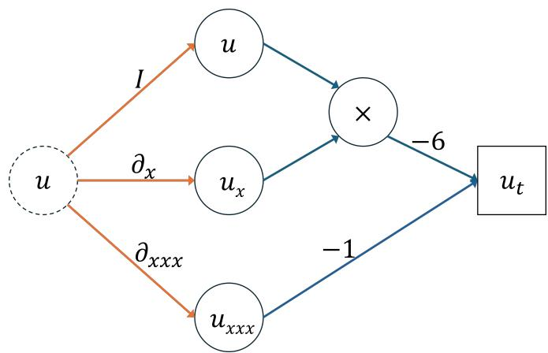
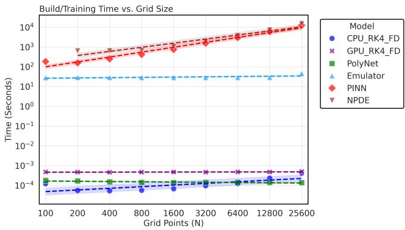
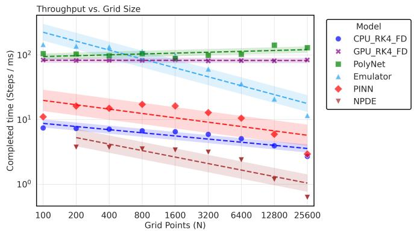
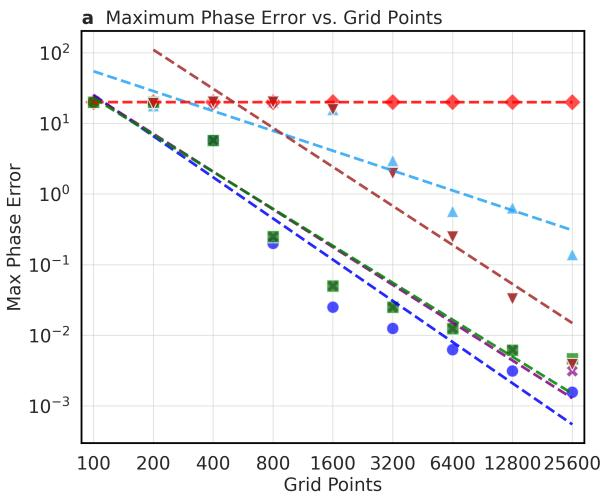
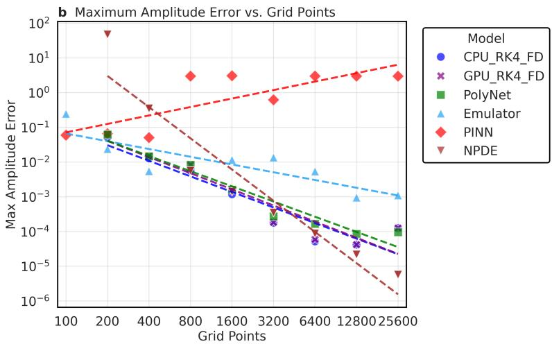
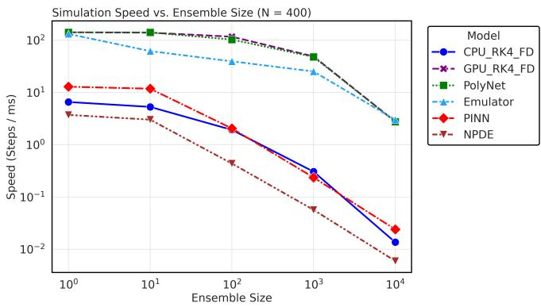
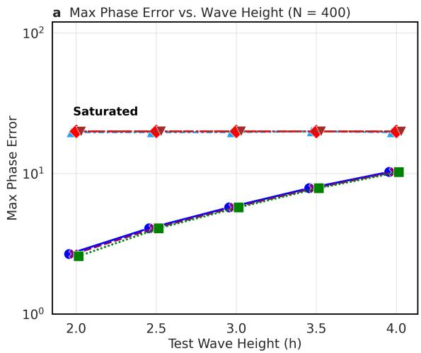
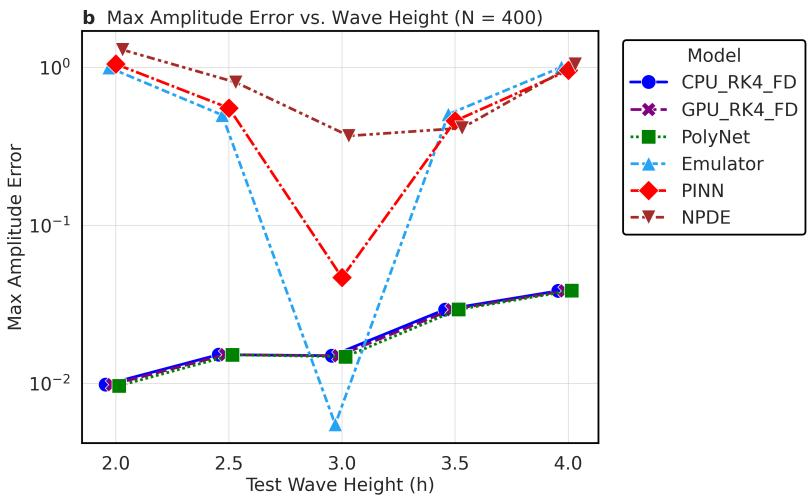

# The Physics Is the Network: Fast, Training-Free Neural Emulation

Luka Todorovic∗

Department of Mathematics and Department of Statistics, University of Michigan, Ann Arbor, MI

Kaushal Gianchandan

NASA Postdoctoral Program Fellow, NASA Goddard Institute for Space Studies, New York, NY

Sai Ravela†

Department of Earth, Atmospheric, and Planetary Sciences,

Massachusetts Institute of Technology, Cambridge, MA

(Dated: October 15, 2026)

Neural emulation need not require learning a substitute for known physics. We investigate PolyNets that couple a continuous-time neural representation of polynomial dynamics with a simple recurrent network for discrete-time integration. When the governing coeficients are known, the resulting tensor graph requires no training and preserves the prescribed numerical scheme while enabling eficient hardware execution and parallel simulation. Using the one-dimensional Korteweg–de Vries equation, we compare PolyNet with CPU and GPU finite-diference Runge–Kutta solvers and three trained neural models: a state-map emulator, a physics-informed predictor, and a learnedtendency integrator. Analytical soliton solutions provide a reference for amplitude and phase errors across grid resolutions, 106 dispersively scaled time steps, ensembles of up to 104 trajectories, and varying initial amplitudes. PolyNet achieves accuracy comparable to the numerical solvers, including at amplitudes outside the learned models’ training conditions. It combines this fidelity with high GPU throughput, approximately constant over the tested resolution range, and favorable ensemble scaling.

## I. INTRODUCTION

Learning physical dynamics and executing them through a neural network are diferent tasks. When governing equations are known, their mathematical structure can determine the network architecture [1], avoiding the need to infer from trajectories what is already prescribed by the physics. For systems with polynomial nonlinearities, this distinction is concrete: products and weighted sums can represent the governing interactions directly, while recurrent operations implement numerical time integration [1]. Neural computation can therefore serve not only as a framework for approximating physical evolution, but also as a computational realization of the equations themselves. The resulting opportunity is to exploit neural execution without introducing a learned approximation to the dynamics.

Neural approaches to emulation difer fundamentally in what they approximate. An emulator learns a discrete mapping between successive states [2]. A neural diferential-equation model [3] instead learns the temporal tendency, which is integrated to advance the solution. Physics-informed neural networks incorporate governing equations into training through diferential constraints on the predicted evolution [4]. These approaches provide flexibility, but their performance depends on both the numerical procedure and the learned representation. In an autoregressive simulation, prediction errors become inputs to subsequent predictions; accuracy over long integrations is therefore a separate requirement from accuracy on individual training examples. Likewise, reproducing trajectories within a training distribution does not establish fidelity under changes in initial conditions. Evaluating a learned simulator consequently requires considering training cost, accumulated error, and generalization alongside execution speed.

PolyNets provide an alternative in which the governing structure is prescribed rather than learned [1]. Trautner and Ravela (2019) constructed these networks us ing multiplicative nodes to represent polynomial nonlin earities and weighted additive connections to combine their contributions. When the governing coeficients are known, the network requires no training. They also developed recurrent neural circuits for Runge–Kutta and Adams–Bashforth–Moulton integration, bringing tendency evaluation and time advancement into a single neu ral computation. They call this neural integration.

Their experiments with the Lorenz system demonstrated correspondence between neural and conventional numerical integration, with floating-point discrepancies amplified by the chaotic dynamics. The relevant equiva lence is to the numerical algorithm—not to an exact solution of the continuous equations. An equation-derived PolyNet retains the approximation inherent in the chosen numerical scheme while avoiding the additional error associated with learning the governing tendency.

That equivalence establishes expected numerical fidelity; the physics and its numerical realization were trivial neural circuits, but not a computational advantage. Trautner and Ravela proposed that tensor-based neu ral execution could exploit specialized hardware, particularly for ensembles of independently evolving systems, while leaving its performance for partial diferential equations untested. The practical question is whether this representation can preserve the accuracy of an established numerical scheme while improving its execution at increasing spatial resolution and ensemble size. Answering it requires comparison not only with trained neural models, but also with conventional GPU solvers: acceleration relative to a CPU implementation alone cannot establish the advantage of a particular neural architecture.

Thus, the computational pathway involves neural integration of the diferential operator and its numerical integration as a tensor graph on neural hardware, GPUs, or TPUs, at native speeds.

Here, we examine this question using the onedimensional Korteweg–de Vries (KdV) equation. Its balance between nonlinear advection and dispersion supports soliton solutions that provide an analytical reference for assessing errors in wave amplitude and phase. These quantities test distinct but coupled aspects of numerical fidelity. An amplitude error distorts the wave profile and, because propagation speed depends on amplitude, can also produce an accumulating position error. Meanwhile, resolving the dispersive term requires increasingly small time steps as the spatial grid is refined, raising the cost of explicit integration. KdV thus permits a controlled comparison in which numerical error can be measured directly and computational demands increased systematically. Independent soliton trajectories provide an ensemble benchmark, while variations in initial amplitude test whether trained models reproduce the governing evolution beyond the conditions represented in their training data.

We compare six implementations: CPU and GPU finite-diference fourth-order Runge–Kutta (RK4), an equation-derived PolyNet, a learned state-map Emulator, a physics-informed state-map predictor, and a learnedtendency neural PDE model. The tests measure throughput, accuracy, ensemble scaling, and performance under changed soliton heights over prescribed fixed-step workloads.

The results show that PolyNet combines the accuracy of the corresponding finite-diference Runge–Kutta scheme with competitive GPU throughput, favorable ensemble scaling, and no training requirement. Although the emulator executes faster at coarse grids, PolyNet achieves higher throughput at the finest grid tested while retaining numerical fidelity over long integrations. It also maintains agreement with its numerical counterpart as the initial wave amplitude changes, whereas the trained models exhibit substantially larger errors. These findings demonstrate that neural acceleration need not depend on learning a substitute for known dynamics. For the polynomial system examined here, prescribing the governing operations within the network provides a route to eficient simulation that preserves the numerical model rather than approximating it anew.

Section II reviews equation-derived neural integration and learned physical emulators. Section III presents the six implementations, followed by the KdV benchmark and numerical comparisons. The discussion and conclusions summarize the scope of the results. Appendices A and B derive the time-step scaling and expected amplitude and phase error behavior.

## II. RELATED WORK

Equation-derived neural computation. Trautner and Ravela [1] showed that a polynomial vector field can be represented by a network of product nodes and additive connections whose weights are fixed by the governing coeficients. Their recurrent neural integration circuits implement explicit Runge–Kutta and Adams–Bashforth– Moulton methods and were tested on the Lorenz system. The central distinction is between exact representation of the semidiscrete polynomial tendency and the numerical approximation introduced by spatial discretization and time stepping. The present work extends that construction to a PDE benchmark and measures execution costs, accuracy, and ensemble throughput.

Learned diferential equations and physicsinformed models. Neural ODEs learn a statedependent tendency and integrate it numerically [3]; physics-informed neural networks penalize violations of prescribed diferential equations during training [4]. These methods difer from PolyNet because their representation or coeficients are optimized from data. They are valuable when the governing dynamics are unknown or require inferred closures, but introduce trainingdependent errors absent from an exactly prescribed polynomial tendency.

Learned PDE solution operators. Fourier neural operators [5], message-passing PDE solvers [6], and related neural emulators learn spatial or temporal evolution maps. Their performance can be sensitive to res olution, rollout duration, and distribution shift. These approaches are not interchangeable with the equationderived construction: one learns an approximation to an evolution operator, while the other compiles an available numerical operator into a tensor graph. The benchmark here compares those computational choices rather than proposing a new diferential equation or time integrator.

Numerical reference and error analysis. Classical RK methods and finite-diference truncation analysis provide the appropriate baseline for evaluating a prescribed neural integrator [7, 8]. The KdV soliton family provides an analytical real-line reference [9, 10]. Appendices A and B use these standard tools to explain the implemented dispersive step and the height-dependent error trends without treating an empirical scaling as a theorem.

## III. INTEGRATION METHODS

We use two classical integration methods and four ‘neural’ integration methods to solve the one-dimensional Korteweg-De Vries (1D KdV) equation. Each method is evaluated on four criteria: speed, accuracy, ensemble size, and generalization.

At each resolution $N = 1 0 0 \cdot 2 ^ { n } ( n = 0 , \ldots , 8 )$ , we use $\Delta x = 4 0 / N$ and $\Delta t \simeq ( \Delta x ) ^ { 3 } / 6 ,$ equivalent to the operator-normalized dispersive number $\Delta t \| D _ { 3 } \| _ { \infty } \simeq 0 . 5$ (Appendix A). The fixed-step benchmark advances $1 0 ^ { 6 }$ steps at each resolution. We compare setup/training time, throughput, and maximum sampled peak amplitude and phase errors, as well as ensembles of up to $\mathrm { \bar { 1 } 0 ^ { 4 } }$ trajectories and a height sweep $h = 2 , 2 . 5 , 3 , 3 . 5 , 4 .$ These are fixed-step-count comparisons; the physical horizon varies with N. For the learned models, training uses analytical soliton states at $h \ = \ 3 ;$ the $h \neq 3$ height sweep tests withheld amplitudes within the same analytical family. Next, we briefly describe each integration method.

## A. Classical Integration Methods

## 1. Fourth-order Runge-Kutta integration on a CPU

The CPU solver applies periodic centered finite diferences to $u _ { x }$ and $u _ { x x x }$ and advances the resulting semidiscrete KdV system by four-stage RK4. The same spatial operators define the prescribed PolyNet tendency. The CPU implementation supplies the direct numerical reference for assessing diferences caused by the tensor-graph execution.

## 2. RK4 integration on a GPU

Like the CPU implementation, the GPU implementation uses finite diferences to estimate the spatial derivatives $( u _ { x } \operatorname { a n d } u _ { x x x } )$ and RK4 to advance the solution by a time step dt. This provides a numerical baseline for comparing the neural integrators with the same integration scheme as the CPU executed on a GPU.

## B. Neural Integrators

## 1. PolyNet

PolyNet constructs the spatially discretized tendency $F _ { N } ( U ) = - 6 U \odot D _ { 1 } U - D _ { 3 } U$ from fixed linear operators and componentwise multiplication. This is a degree-two polynomial in the discrete state $U ;$ hence its polynomial representation is exact for the prescribed semidiscrete vector field when the coeficients are known [1]. Time advancement is the full four-stage RK4 map $\bar { U } ^ { n + 1 } =$ $\mathcal { R } _ { \Delta t } [ F _ { N } ] ( U ^ { n } )$ , not a single composition of an integrator with one tendency evaluation. While this tensor-graph implementation requires no training, its discretization and floating-point errors remain.

## 2. Emulator Neural Network

The Emulator is a convolutional neural state-map predictor $\widehat { U } ^ { n + 1 } = E _ { \theta } ( \widehat { U } ^ { n } )$ , trained on analytical solitarywave examples with mean-squared-error loss and Adam optimization. The current implementation uses three hidden convolutional layers with 64 channels. The predicted field is fed back autoregressively. Training uses Gaussian input noise with standard deviation 0.02. Training pairs are generated from the analytical soliton at $h = 3 ;$ the held-out amplitudes in Fig. 6 test generalization within the same solution family. Unlike PolyNet, this model learns the state transition rather than prescribing the KdV tendency [5, 6].

## 3. Physics-Informed Neural Network (PINN)

The PINN is a discrete-time convolutional state-map predictor, $\widehat { U } ^ { n + 1 } = P _ { \theta } ( \widehat { U } ^ { n } )$ . It is trained using a onestep analytical target, a physics reference generated by a spectral RK4 KdV step, and a spatial-gradient target, with an additional eight-step autoregressive rollout loss activated after 500 epochs. Its objective is

$$
\begin{array} { r } { \pmb { \mathcal { L } } = \pmb { \mathcal { L } } _ { \mathrm { M S E } } + \pmb { \mathcal { L } } _ { \mathrm { P h y s } } + 0 . 1 \pmb { \mathcal { L } } _ { \mathrm { G r a d } } + \lambda _ { R } \pmb { \mathcal { L } } _ { \mathrm { R o l l } } , } \end{array}\tag{1}
$$

where $\mathcal { L } _ { \mathrm { M S E } }$ compares the one-step prediction with the analytical soliton, $\mathcal { L } _ { \mathrm { P h y s } }$ compares it with the spectral RK4 teacher step, and $\dot { \mathcal { L } } _ { \mathrm { G r a d } }$ compares spatial derivatives of the prediction and analytical target. The rollout loss averages prediction errors over eight recursively predicted states against the analytical soliton trajectory. The roll out weight is $\lambda _ { R } = 0$ through the first 500 training epochs and $\lambda _ { R } ~ = ~ 1$ thereafter. Thus analytical solutions are used in training at $h = 3 ;$ ; the evaluation at other heights tests out-of-training-amplitude generalization, not inde pendence from the analytical solution family.

## 4. Neural PDE

The neural PDE model learns a grid-state tendency $F _ { \theta } ( U ) ~ \approx ~ \partial _ { t } U$ and advances it with RK4: $\widehat { U } ^ { n + 1 } =$ $\mathcal { R } _ { \Delta t } [ F _ { \theta } ] ( \widehat { U } ^ { n } )$ . After spatial discretization, this is a neural ODE on the discrete state [3]. Training uses a trajectory target with 60 sampled states at relative times $0 , \Delta t , \ldots , 5 9 \Delta t$ , generated from the analytical soliton at $h = 3$ . The learned tendency is integrated during training, whereas the JAX rollout evaluates it four times per RK4 step.

## C. Implementation Framework

The CPU solver uses NumPy [11], while the GPU solver and PolyNet use JAX [12] to compile the spatial operators and RK4 time stepping. The Emulator, PINN, and NPDE are trained in PyTorch [13], then evaluated in JAX using the trained weights. The Emulator and PINN predict the next state directly; the NPDE predicts the tendency, which is integrated using RK4. Thus, all GPU methods use a common execution framework. TensorFlow is not used in these experiments.

## IV. 1D KORTEWEG-DE VRIES EQUATION

We recall that the 1D KdV equation is given by:

$$
u _ { t } + 6 u u _ { x } + u _ { x x x } = 0 ,\tag{2}
$$

where $u ( x , t )$ denotes the solution field. The balance between nonlinear advection and dispersion in this equation supports soliton solutions: localized waves that propagate at constant speed without changing shape. For real values of x, an exact single-soliton solution is:

$$
u ( x , t ) = \frac { c } { 2 } \mathrm { s e c h } ^ { 2 } \left[ \frac { \sqrt { c } } { 2 } ( x - c t - x _ { 0 } ) \right] ,\tag{3}
$$

where $c > 0$ is the propagation speed, $x _ { 0 }$ is the initial peak position, and $\textit { h } = \textit { c } / 2$ is the wave height. This known evolution provides a reference for assessing how well an integration method preserves the wave’s shape and motion.

For explicit methods such as RK4, resolving the dispersive term requires smaller time steps as the spatial grid is refined, increasing the cost of integration. Faithful soliton propagation also requires preserving both the wave profile and its position. Amplitude errors distort the wave height, whereas phase errors displace the wave from its expected location. Because soliton speed depends on amplitude, an amplitude error can also contribute to an accumulating position error. Controlling both errors is therefore necessary to predict the wave’s trajectory over long integration times.

The simulations use the length-40 periodic grid $[ - 2 0 , 2 0 )$ , with $\Delta x = 4 0 / N$ . The solitary-wave formula is exact on the real line; on the finite periodic grid it is used as a wrapped analytical reference, with finite-domain effects to be distinguished from numerical integration error [9, 10].

The cost of integration becomes especially relevant when many independent trajectories must be computed. Ensembles of single-soliton simulations provide a controlled setting for examining how efectively each method uses parallel computation and how simulation speed changes as the number of trajectories increases.

What is noticeably unique about the methods emulating the solutions to this equation is that, of the six, the

  
FIG. 1. PolyNet graph for the semidiscrete KdV tendency, $F _ { N } ( U ) = - 6 U \odot D _ { 1 } U - D _ { 3 } U$ . Linear derivative branches and a componentwise product implement the prescribed physics. The four-stage recurrent RK4 time integrator is not shown.

PolyNet is the only neural integration method that directly implements the KdV equation into its architecture. As seen in Figure 1, rather than the neural architecture being a black-box method that may (PINN) or may not (Emulator, NPDE) be informed by the physics of the KdV soliton solutions, the PolyNet’s architecture contains the deterministic equation as a feature of it, treating each neuron as a specific nonlinear operator rather than the general nonlinear activation functions of the classical neural methods (Emulator, PINN, NPDE).

The spatial coordinate is used directly on a domain of length $L = 4 0 ;$ no 2π-to-40 transformation is applied to the governing coeficients. Appendix A gives the corresponding resolution-dependent time-step derivation.

## A. Speed

For each spatial resolution, we measured the computation time for 1000 blocks of 1000 time steps. Computation speed was calculated as $1 0 0 0 / T _ { \mathrm { m e d i a n } }$ , where $T _ { \mathrm { m e d i a n } }$ is the median block integration time in milliseconds, yielding speed in steps/ms. Additionally, we recorded the training time for training-based models and compilation time for models that do not require training at each spatial resolution. Figure 2 shows that the training-based models add substantial runtime when compared to the non-trained methods. In particular, the PINN and the NPDE require longer training times than the Emulator. The PINN combines one-step analytical supervision, a spectral RK4 teacher, spatial-gradient matching, and an eight-step rollout loss. In contrast, the NPDE trains a learned tendency against a multistep trajectory through numerical integration. The Emulator instead learns directly from input–output pairs. We note that PolyNet is a neural integration method that requires no training, so its setup cost consists only of code compilation. Its compilation time is comparable to that of the classical

integration methods.

Figure 3 compares measured steady-state throughput. The Emulator is fastest at coarse grids, while PolyNet and the conventional GPU finite-diference RK4 implementation maintain approximately level throughput across the tested range. These measurements demonstrate competitive GPU execution of the equationderived graph; they do not isolate an intrinsic neuralhardware advantage or demonstrate training-induced sparsification.

  
FIG. 2. Training time for the three learned models and setup time for CPU finite-diference RK4, GPU finite-diference RK4, and PolyNet versus grid size N. The unsuccessful NPDE configuration at $N = 1 0 0$ is omitted. Shading around log–log fits includes an imposed minimum display width and should not be interpreted as a confidence interval.

  
FIG. 3. Time-step throughput versus grid size N. Each timed block advances 1000 steps; throughput in steps/ms is $1 0 0 0 / T _ { \mathrm { m e d i a n } } ,$ where $T _ { \mathrm { m e d i a n } }$ is the median block duration in milliseconds. Shading around log–log fits includes an imposed minimum display width and is not a confidence interval.

## B. Accuracy

At each resolution, we report maximum sampled phase and amplitude diferences relative to the solitarywave reference (Fig. 4). PolyNet closely follows the corresponding CPU finite-diference RK4 errors. The trained models show more variable performance, and the amplitude-error ranking is not uniform across all grid sizes. The fixed $1 0 ^ { 6 } \mathrm { - s t e p }$ workload uses the resolutiondependent dispersive time step of Appendix A; this is not a fixed-physical-time convergence experiment.

## C. Ensemble

Figure 5 compares the rate of advancing batched time steps at $N ~ = ~ 4 0 0$ for 1 to $1 0 ^ { 4 }$ independent solitons. PolyNet and conventional GPU finite-diference RK4 closely track one another and lead over most tested batch sizes. This rate is distinct from aggregate trajectory-step throughput, which multiplies by ensemble size. The results support the utility of structured GPU computation for ensembles, without establishing a universal scaling law.

## D. Generalization

A known limitation of training-based methods is the poor ability to generalize beyond the domain of the training data [14–16]. In particular, these methods struggle with accurate extrapolation in physical modeling and often tend to converge to solutions encountered during training. What is unique about the PolyNet, however, is that expressing governing equations with known coefficients does not require any training. In the case when the coeficients are unknown, the network is trained on the solution to estimate the unknown coeficients and not to capture the features of the solution itself. This makes a PolyNet generalizable in the same way as the classical non-training-based methods.

Figure 6 varies the initial height from $h = 2$ to $h = 4$ at fixed $N ~ = ~ 4 0 0$ with $h \ = \ 3$ the learned models training height. PolyNet follows the prescribed numerical solvers, whereas the trained models exhibit sub stantial phase error even near the training height. Increasing errors for the numerical solvers are expected as taller solitons become narrower; Appendix B derives a conditional leading-order amplitude and speed error of $O ( h ^ { 2 } \Delta x ^ { 2 } )$ and an accumulated unwrapped phase error of $O ( h ^ { 2 } \Delta x ^ { 2 } t )$ . The plotted periodic phase metric saturates at $L / 2 = 2 0$

## V. SUMMARY & DISCUSSION

The six-way comparison separates equation-derived neural execution from learned state-map and tendency emulation. PolyNet reproduces the accuracy characteristics of its prescribed finite-diference RK4 scheme without training and achieves throughput competitive with a conventional GPU implementation. The Emulator is faster on coarse grids, while the GPU finite-diference method and PolyNet lead the ensemble comparison over most tested sizes. These results support equation-derived tensor computation; they do not establish that neural representation alone outperforms an equivalently compiled numerical graph.

  
FIG. 4. Maximum sampled absolute (a) phase and (b) amplitude errors against the analytical solitary-wave reference versus grid size $N ,$ over ${ 1 0 } ^ { 6 }$ steps at the prescribed resolution-dependent dispersive time step. Unsuccessful GPU finite-diference RK4 configurations at $N = 1 0 0$ and $N = 2 0 0$ are omitted.

  
FIG. 5. Median batch-step throughput $\mathrm { ( s t e p s / m s ) }$ versus the number of independent soliton trajectories at $N = 4 0 0$ . Each batch step advances the entire ensemble; aggregate trajectorystep throughput is the plotted value multiplied by ensemble size.

PolyNet and the conventional finite-diference solvers retain coherent soliton propagation across the tested height range. The learned models exhibit larger phase errors, although their amplitude-error rankings vary with resolution and height. The height dependence of numerical errors is consistent with the conditional leading-order scaling derived in Appendix B.

The practical advantage is architectural: the prescribed polynomial tendency and recurrent RK4 update execute within a compiled tensor graph without fitting a surrogate to the soliton trajectories. This preserves the chosen numerical method, including its discretization and stability limitations, while reserving learning for dynamics or coeficients that are not known.

The 1D setting is a limitation of the present study. Future work should examine more complex multidimensional dynamics and compare PolyNet with classical GPU numerical methods and learned neural emulators. Applications to dynamical Earth systems and large-scale chaotic dynamics would also help assess its performance beyond the present setting. In particular, applying PolyNet to the shallow-water equations would provide a test of its accuracy, throughput, and scalability for these dynamics.

## VI. CONCLUSIONS

For the known polynomial semi-discrete KdV dynamics tested here, a training-free PolyNet provides a neural tensor-graph realization of prescribed finite-diference RK4 integration. Its numerical fidelity is comparable to that of the corresponding classical scheme, and its GPU throughput is competitive over the tested grids and ensembles. This demonstrates that neural emulation need not require learning a surrogate when the governing polynomial vector field is available; it does not eliminate the value of learned models for unknown, unresolved, or nonpolynomial dynamics. In ongoing work, we apply this approach to 2D turbulence and shallow water equations.

## ACKNOWLEDGMENTS

This material is based in part upon work supported by the Bangkok Bank, Schmidt Sciences, Community Jameel for Jameel Observatory CREWSnet, and by the MIT Climate Grand Challenges. Luka Todorovic acknowledges the MIT Summer Research Program (MSRP)

  
FIG. 6. Maximum sampled absolute (a) phase and (b) amplitude errors versus initial soliton height $h ,$ for $N = 4 0 0$ and ${ 1 0 } ^ { 6 }$ integration steps. The neural models were trained at $h = 3$ using analytical soliton targets; other heights were held out. Periodic phase separation is bounded by $L / 2 = 2 0$ , explaining the saturated phase-error curves.

for sponsoring this work. Kaushal Gianchandani’s research was supported by an appointment to the NASA Postdoctoral Program at NASA Goddard Institute for Space Studies from the NASA Astrobiology Program, administered by Oak Ridge Associated Universities, under contract with NASA. The authors acknowledge the use of ChatGPT (OpenAI) and Grammarly to assist with drafting, revising, and editing the manuscript. The authors retain full responsibility for the content, accuracy, and integrity of the work, including its ideas, analyses, interpretations, and conclusions.

(A3)

## Appendix A: Dispersive time-step selection and linear stability

(A1)

The operator-norm and RK4 stability calculation below follows standard finite-diference and Runge–Kutta stability analysis [7, 8, 17]. The specific stencil and timestep prefactor are those used in the archived implementation, rather than values taken from these references.

$$
k _ { m } = \frac { 2 \pi m } { L } , \qquad \omega _ { m } = - k _ { m } ^ { 3 } .\tag{A2}
$$

## 1. Dispersive scaling

$$
u _ { t } + 6 u u _ { x } + u _ { x x x } = 0 ,
$$

For the nondimensional Korteweg–de Vries equation,

ub e $\exp [ \mathrm { i } ( k _ { m } x - \omega _ { m } t ) ]$ gives

we use a uniform periodic grid on $[ - L / 2 , L / 2 )$ with $L =$ 40,

$$
x _ { j } = - \frac { L } { 2 } + j \Delta x , \qquad \Delta x = \frac { L } { N } = \frac { 4 0 } { N } ,
$$

The highest resolved wavenumbers scale as $( \Delta x ) ^ { - 1 }$ so their characteristic dispersive time scales as $( \Delta x ) ^ { 3 }$ Maintaining a fixed dimensionless time increment for these modes therefore requires $\Delta t \propto ( \Delta x ) ^ { 3 }$ The admissible prefactor depends on the spatial discretization and time integrator, rather than on the domain length alone.

where $j = 0 , \ldots , N - 1$ . In the linear dispersive equation $u _ { t } + u _ { x x x } = 0 $ , substituting a Fourier mode $u \_ =$

## 2. Implemented time step and its normalization

The implementation prescribes a resolution-dependent table of base time steps satisfying $\Delta t _ { \mathrm { b a s e } } \simeq ( \Delta x ) ^ { 3 } / 3$ and multiplies each entry by 0.5. Consequently, the time step used at each resolution is

$$
\Delta t = 0 . 5 \Delta t _ { \mathrm { b a s e } } \simeq \frac { ( \Delta x ) ^ { 3 } } { 6 } = \frac { 1 } { 6 } \left( \frac { 4 0 } { N } \right) ^ { 3 } .\tag{A4}
$$

Here ≃ accounts for rounding of the tabulated values. The time step is fixed within each run, not adjusted adaptively as the solution evolves. Doubling N reduces $\Delta t$ by approximately a factor of eight.

The implemented centered third-derivative operator is

$$
( D _ { 3 } U ) _ { j } = \frac { U _ { j + 2 } - 2 U _ { j + 1 } + 2 U _ { j - 1 } - U _ { j - 2 } } { 2 ( \Delta x ) ^ { 3 } } ,\tag{A5}
$$

with indices taken modulo N. Its induced matrix infinity norm is the maximum absolute row sum,

$$
\| D _ { 3 } \| _ { \infty } = \frac { 1 + 2 + 2 + 1 } { 2 ( \Delta x ) ^ { 3 } } = \frac { 3 } { ( \Delta x ) ^ { 3 } } .\tag{A6}
$$

Thus two explicit normalizations of the prescribed time step are

$$
C _ { \mathrm { d i s p } } \equiv \frac { \Delta t } { ( \Delta x ) ^ { 3 } } \simeq \frac { 1 } { 6 } ,\tag{A7}
$$

$$
C _ { \mathrm { o p } } \equiv \Delta t \| D _ { 3 } \| _ { \infty } = 3 C _ { \mathrm { d i s p } } \simeq 0 . 5 .\tag{A8}
$$

The values $1 / 6$ and 0.5 therefore describe the same timestep choice under diferent normalizations. The operatornorm identity characterizes the prescribed table; it neither determines the prefactor from the continuous equation nor identifies a sharp stability limit.

## 3. RK4 stability for the linear dispersive operator

For a discrete Fourier mode $U _ { j } = \exp ( \mathrm { i } j \theta )$ , with $\theta =$ $2 \pi m / N$ , the symbol of Eq. (A5) is

$$
\widehat { D } _ { 3 } ( \theta ) = - \frac { 2 \mathrm { i } \sin \theta ( 1 - \cos \theta ) } { ( \Delta x ) ^ { 3 } } .\tag{A9}
$$

The eigenvalues $\lambda _ { m }$ of the linear evolution operator $- D _ { 3 }$ are purely imaginary. Maximizing 2| sin $\theta ( 1 - \cos \theta ) |$ over θ gives $3 { \sqrt { 3 } } / 2$ , attained at cos $\theta = - 1 / 2 ,$ , and hence

$$
\operatorname* { m a x } _ { m } | \lambda _ { m } | \leq \frac { 3 \sqrt { 3 } } { 2 ( \Delta x ) ^ { 3 } } .\tag{A10}
$$

The inequality allows for the fact that a finite grid need not contain the maximizing wavenumber.

The classical fourth-order Runge–Kutta method has stability polynomial

$$
R ( z ) = 1 + z + { \frac { z ^ { 2 } } { 2 } } + { \frac { z ^ { 3 } } { 6 } } + { \frac { z ^ { 4 } } { 2 4 } } .\tag{A11}
$$

For real $y ,$ direct substitution yields

$$
| R ( \mathrm { i } y ) | ^ { 2 } = 1 - \frac { y ^ { 6 } } { 7 2 } + \frac { y ^ { 8 } } { 5 7 6 } = 1 + \frac { y ^ { 6 } ( y ^ { 2 } - 8 ) } { 5 7 6 } .\tag{A12}
$$

Thus $| R ( \mathrm { i } y ) | \le 1$ for $| y | \leq 2 { \sqrt { 2 } } .$ . Because the periodic diference operator is diagonalized by the discrete Fourier transform, combining this interval with Eq. (A10) gives the suficient bound

$$
\Delta t \leq \frac { 4 \sqrt { 2 } } { 3 \sqrt { 3 } } ( \Delta x ) ^ { 3 } \approx 1 . 0 8 9 \left( \Delta x \right) ^ { 3 }\tag{A13}
$$

for linear $\ell ^ { 2 }$ stability of the isolated dispersive problem. For the nominal choice $\Delta t = ( \Delta x ) ^ { 3 } / 6$

$$
\Delta t \operatorname* { m a x } _ { m } \left| \lambda _ { m } \right| \leq \frac { \sqrt { 3 } } { 4 } \approx 0 . 4 3 3 < 2 \sqrt { 2 } ,\tag{A14}
$$

so the prescribed steps lie well within this linear dispersive stability bound. This estimate applies to the stated periodic finite-diference operator and RK4; it does not by itself establish stability of the full nonlinear KdV calculation or of a learned evolution map.

## Appendix B: Amplitude and phase error scaling

The soliton parameterization follows the classical KdV literature [9, 10]; the Taylor expansions use standard centered-diference truncation analysis [17, 18]. The conditional height-scaling argument is derived here and should not be attributed to those references as a proved error law.

Figure 6 varies the initial soliton height while holding the spatial grid, time step, and number of integration steps fixed. Here we derive leading-order error estimates for the common centered finite-diference discretization used by the classical integrators and $\mathrm { P o l y N e t }$ . The estimates describe the regime in which spatial truncation error dominates and the numerical solution remains a small perturbation of a coherently translating soliton. They are not unconditional error bounds for arbitrary integration times or for the trained neural models.

## 1. Height-dependent spatial truncation error

Writing the soliton in terms of its height $h = c / 2$ gives

$$
U _ { h } ( x , t ) = h \mathrm { ~ s e c h } ^ { 2 } \left[ \kappa ( x - 2 h t - x _ { 0 } ) \right] , \qquad \kappa = \sqrt { h / 2 } .\tag{B1}
$$

Its speed is $c = 2 h$ , and its characteristic width is $\ell =$ $\kappa ^ { - 1 } = \sqrt { 2 / h }$ . Thus a taller soliton is also narrower and is resolved by fewer grid points when $\Delta x$ is held fixed. With $f ( \eta ) = \mathrm { s e c h } ^ { 2 } \eta$

$$
\partial _ { x } ^ { m } U _ { h } = h \kappa ^ { m } f ^ { ( m ) } \left[ \kappa ( x - 2 h t - x _ { 0 } ) \right] .\tag{B2}
$$

Consequently, the dimensionless parameter controlling the leading spatial error is

$$
\epsilon _ { x } = ( \kappa \Delta x ) ^ { 2 } = \frac { h ( \Delta x ) ^ { 2 } } { 2 } .\tag{B3}
$$

For smooth resolved profiles, Taylor expansion of the implemented centered stencils yields

$$
D _ { 1 } U = U _ { x } + \frac { ( \Delta x ) ^ { 2 } } { 6 } U _ { x x x } + O ( ( \Delta x ) ^ { 4 } ) ,\tag{B4}
$$

$$
D _ { 3 } U = U _ { x x x } + \frac { ( \Delta x ) ^ { 2 } } { 4 } U _ { x x x x x } + O ( ( \Delta x ) ^ { 4 } ) .\tag{B5}
$$

The discrete tendency $F _ { \Delta x } [ U ] = - 6 U D _ { 1 } U - D _ { 3 } U$ therefore difers from $F [ U ] = - 6 U \bar { U } _ { x } - U _ { x x x }$ by

$$
F _ { \Delta x } [ U ] - F [ U ] = - ( \Delta x ) ^ { 2 } \left( U U _ { x x x } + \frac { 1 } { 4 } U _ { x x x x x } \right) + O ( ( \Delta x ) ^ { 4 } ) .\tag{B6}
$$

For $U = U _ { h }$ , each leading physical tendency scales as $h ^ { 5 / 2 }$ , whereas the leading defect scales as $( \Delta x ) ^ { 2 } h ^ { 7 / 2 }$ The relative spatial perturbation is therefore $\dot { O } ( h ( \Delta x ) ^ { 2 } )$ equivalently $O ( \epsilon _ { x } )$ .

## 2. Amplitude bias and accumulating phase error

The soliton’s characteristic evolution time is $\tau _ { s } \sim$ $\ell / c \sim h ^ { - 3 / 2 }$ . A tendency defect of size $O ( ( \Delta x ) ^ { 2 } h ^ { 7 / 2 } )$ acting over this time has magnitude $O ( ( \Delta x ) ^ { 2 } h ^ { 2 } )$ . In a stable near-soliton regime with a bounded shape adjustment, this motivates the amplitude-error estimate

$$
E _ { A } \sim K _ { A } h ^ { 2 } ( \Delta x ) ^ { 2 } .\tag{B7}
$$

Likewise, a relative speed perturbation of order $\epsilon _ { x }$ gives

$$
| \delta c | \sim K _ { \phi } h ^ { 2 } ( \Delta x ) ^ { 2 } .\tag{B8}
$$

The coeficients $K _ { A }$ and $K _ { \phi }$ are not determined by this scaling argument. They depend on the numerical scheme and the response of the soliton to its perturbation; the estimates assume that this response has comparable leading-order coeficients over the height range.

Let $X _ { \mathrm { n u m } } ( t )$ be the unwrapped numerical peak position and define $\delta X ( t ) = X _ { \mathrm { n u m } } ( t ) - ( x _ { 0 } + 2 h t )$ . For an initially aligned wave,

$$
\delta X ( t ) = \int _ { 0 } ^ { t } \delta c ( s ) d s .\tag{B9}
$$

A persistent, approximately constant speed bias thus produces

$$
E _ { \phi } ^ { \mathrm { u n w r a p p e d } } ( t ) \sim K _ { \phi } h ^ { 2 } ( \Delta x ) ^ { 2 } t .\tag{B10}
$$

Hence a small bounded amplitude or shape error can coexist with a phase error that grows with integration time. No corresponding linear-in-time growth of amplitude error is implied by Eq. (B7).

For a perturbation confined to the exact soliton family, the amplitude–speed relation additionally gives $\delta c = 2 \delta h$ Its amplitude-induced phase contribution is then

$$
\delta X _ { A } ( t ) = 2 \int _ { 0 } ^ { t } \delta h ( s ) d s .\tag{B11}
$$

A constant signed amplitude bias $\delta h ~ = ~ a$ produces $| \delta X _ { A } ( t ) | = 2 | \dot { a } | t$ If instead the signed amplitude bias drifts as $\delta h ( t ) = \alpha t$ , its phase contribution is $\delta X _ { A } ( t ) =$ $\alpha t ^ { 2 }$ . These conditional relations do not identify the full numerical speed error with twice the measured peak error: discrete dispersion and non-soliton shape changes can also contribute to phase drift.

## 3. Interpretation of the height sweep and periodic saturation

For Figure 6, $L ~ = ~ 4 0$ and $N \ = \ 4 0 0 .$ , so $\begin{array} { r l } { \Delta x } & { { } = } \end{array}$ 0.1. The common prescribed time step is approximately

$1 . 6 6 6 6 5 \times 1 0 ^ { - 4 } ; 1 0 ^ { 6 }$ steps therefore correspond to $T \simeq$ 166.67 for every initial height in this figure. In the regime described above, the leading-order estimates at this fixed horizon are

$$
\boxed { E _ { A } ( h ) \propto h ^ { 2 } , \qquad E _ { \phi } ^ { \mathrm { u n w r a p p e d } } ( h ; T ) \propto h ^ { 2 } . }\tag{B12}
$$

Thus doubling the initial height suggests approximately four times as much amplitude error and unsaturated phase error, rather than height-independent accuracy. This is an expected discretization trend, not a fitted law or a statement that each measured point must follow an exact power law. Because the classical finite-diference integrators and PolyNet evaluate the same spatial tendency and RK4 scheme, the same leading-order argument applies to each of them.

The phase diagnostic uses the shortest distance between peaks on the periodic domain. In terms of unwrapped displacement, its ideal continuous-time form is

$$
e _ { \phi } ( t ) = \operatorname* { m i n } _ { m \in \mathbb { Z } } \left| \delta X ( t ) - m L \right| \leq \frac { L } { 2 } = 2 0 .\tag{B13}
$$

For constant speed bias, exact initial alignment, and continuous-time evaluation, the running maximum is

$$
\operatorname* { m a x } _ { 0 \leq t \leq T } e _ { \phi } ( t ) = \operatorname* { m i n } \left( | \delta c | T , \frac { L } { 2 } \right) .\tag{B14}
$$

The code evaluates errors at sampled times, so its maximum can approach this ceiling without attaining it exactly. A speed bias of about $2 0 / T \simeq 0 . 1 2$ is suficient to reach a half-domain separation within the Figure 6 horizon under this constant-bias model. Individual wrapped errors need not plateau: it is their running maximum that saturates. The plateau labeled “Saturated” therefore reflects the phase metric’s ceiling and does not establish that the underlying unwrapped phase error has ceased to grow.

These estimates explain the expected height dependence of the prescribed numerical methods and the periodic phase ceiling. They do not determine the errors of the trained Emulator, PINN, or NPDE, whose learned representations may introduce additional amplitude, shape, and speed biases. In particular, a small amplitude error near the training height $h = 3$ does not ensure accurate phase over a long rollout.

[1] M. Trautner and S. Ravela, Neural integration of continuous dynamics, arXiv preprint arXiv:1911.10309 (2019), arXiv:1911.10309 [cs.LG].

[2] T. Qin, K. Wu, and D. Xiu, Data-driven governing equations approximation using deep neural networks, Journal of Computational Physics 395, 620 (2019).

[3] R. T. Q. Chen, Y. Rubanova, J. Bettencourt, and D. Duvenaud, Neural ordinary diferential equations, Advances in Neural Information Processing Systems 31 (2018).

[4] M. Raissi, P. Perdikaris, and G. E. Karniadakis, Physicsinformed neural networks: A deep learning framework for solving forward and inverse problems involving nonlinear partial diferential equations, Journal of Computational Physics 378, 686 (2019).

[5] Z. Li, N. Kovachki, K. Azizzadenesheli, B. Liu, K. Bhattacharya, A. Stuart, and A. Anandkumar, Fourier neural operator for parametric partial diferential equations, International Conference on Learning Representations (2021), arXiv:2010.08895.

[6] J. Brandstetter, D. Worrall, and M. Welling, Message passing neural pde solvers, in International Conference on Learning Representations (2022) arXiv:2202.03376.

[7] J. C. Butcher, Numerical Methods for Ordinary Diferential Equations, 2nd ed. (Wiley, 2008).

[8] W. Hundsdorfer and J. G. Verwer, Numerical Solution of Time-Dependent Advection-Difusion-Reaction Equations (Springer, 2003).

[9] N. J. Zabusky and M. D. Kruskal, Interaction of solitons in a collisionless plasma and the recurrence of initial states, Physical Review Letters 15, 240 (1965).

[10] P. G. Drazin and R. S. Johnson, Solitons: An Introduction (Cambridge University Press, 1989).

[11] C. R. Harris, K. J. Millman, S. J. van der Walt, R. Gommers, P. Virtanen, D. Cournapeau, E. Wieser,

J. Taylor, S. Berg, N. J. Smith, R. Kern, M. Picus, S. Hoyer, M. H. van Kerkwijk, M. Brett, A. Haldane, J. Fern´andez del R´ıo, M. Wiebe, P. Peterson, P. G´erard-Marchant, K. Sheppard, T. Reddy, W. Weckesser, H. Abbasi, C. Gohlke, and T. E. Oliphant, Array programming with NumPy, Nature 585, 357 (2020).

[12] J. Bradbury, R. Frostig, P. Hawkins, M. J. Johnson, Y. Katariya, C. Leary, D. Maclaurin, G. Necula, A. Paszke, J. VanderPlas, S. Wanderman-Milne, and Q. Zhang, JAX: Composable transformations of Python+NumPy programs, Software repository (2018).

[13] A. Paszke, S. Gross, F. Massa, A. Lerer, J. Bradbury, G. Chanan, T. Killeen, Z. Lin, N. Gimelshein, L. Antiga, A. Desmaison, A. K¨opf, E. Yang, Z. DeVito, M. Raison, A. Tejani, S. Chilamkurthy, B. Steiner, L. Fang, J. Bai, and S. Chintala, PyTorch: An imperative style, highperformance deep learning library, in Advances in Neural Information Processing Systems, Vol. 32 (Curran Associates, Inc., 2019).

[14] A. Kassai Koupai, J. Mifsut Benet, Y. Yin, J.-N. Vittaut, and P. Gallinari, Boosting generalization in parametric pde neural solvers through adaptive conditioning, Advances in Neural Information Processing Systems 37 (2024).

[15] Y. Sun, Solver-integrated adversarial attacking and training of neural operators, arXiv:2510.18989 (2025).

[16] Z. Wei, C. C. Ooi, J. C. Wong, A. Gupta, P.-H. Chiu, and Y.-S. Ong, Out-of-distribution generalization for neural physics solvers, arXiv:2601.19091 (2026).

[17] R. J. LeVeque, Finite Diference Methods for Ordinary and Partial Diferential Equations: Steady-State and Time-Dependent Problems (SIAM, 2007).

[18] B. Fornberg, Generation of finite diference formulas on arbitrarily spaced grids, Mathematics of Computation 51, 699 (1988).