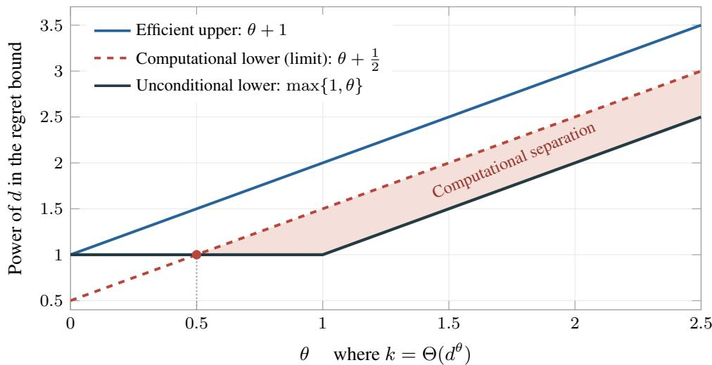
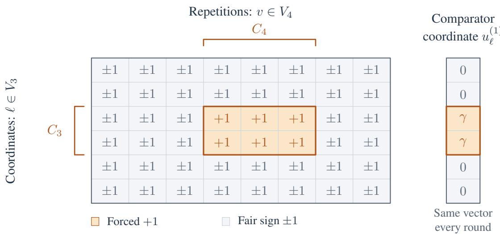
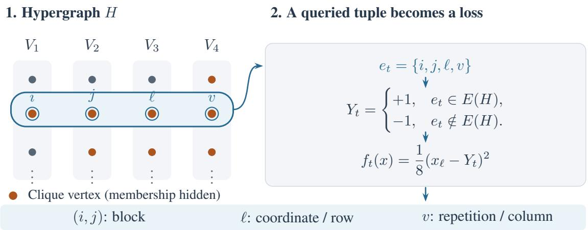
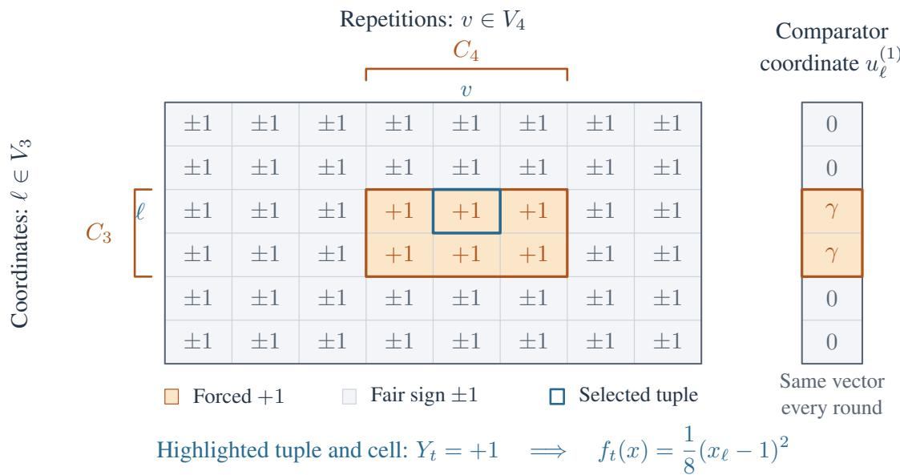

# Tracking a Small Set of Experts in Online Convex Optimization

Angelos Assos1

Anand Brahmbhatt1

Elad Hazan1,2

aa2279@princeton.edu

ab7728@princeton.edu

ehazan@princeton.edu

1Princeton University 2Google DeepMind Princeton

## Abstract

For the fundamental problem of prediction from expert advice, Freund asked whether one could compete with a comparator that switches k times among only m experts. For a discrete set of experts, this problem was resolved by Bousquet and Warmuth (2002), who gave an efficient algorithm with optimal regret matching the information-theoretic limit.

We study the analogous problem in online convex optimization, where the action space is continuous. An inefficient algorithm can be derived by discretizing the action space and applying the Bousquet– Warmuth algorithm, giving regret of $\widetilde { \mathcal { O } } ( m d + k )$ , while the best known efficient algorithm for this problem has regret $\widetilde { \mathcal { O } } ( d k )$ e. We show that this computational inefficiency is inherent, establishing a eseparation between the information-theoretic and polynomial-time regret achievable for this problem. Specifically, under the hypergraphic planted-clique conjecture, we show that for every polynomial-time algorithm there exist instances for which it incurs at least $( k \sqrt { d } ) ^ { 1 - o ( 1 ) }$ regret.

Keywords: Online convex optimization, tracking regret, exp-concavity, computational lower bounds, planted clique.

## 1 Introduction

On each round t of an online learning problem, a learner  chooses a decision $x _ { t }$ from a set $\kappa ,$ observes a loss function $f _ { t }$ , and incurs $f _ { t } ( x _ { t } )$ . Its regret against a comparator path $u _ { 1 : T } \in K ^ { T }$ is

$$
\mathsf { R e g } _ { T } ( \boldsymbol { \mathcal { A } } ; \boldsymbol { u } _ { 1 : T } ) : = \sum _ { t = 1 } ^ { T } f _ { t } ( \boldsymbol { x } _ { t } ) - \sum _ { t = 1 } ^ { T } f _ { t } ( \boldsymbol { u } _ { t } ) .
$$

External regret compares the learner with the best fixed decision in hindsight, restricting the comparator to a constant path. This benchmark is well understood, with upper and lower bounds characterizing the achievable rates in standard online learning settings (Hazan, 2023). In a changing environment, however, a fixed decision may be too weak a benchmark. Dynamic regret allows the comparator to change over time, but sublinear regret is impossible in general when these changes are unrestricted.

A natural intermediate benchmark, introduced by Bousquet and Warmuth (2002) for prediction from a finite set of N experts, is to compete with a comparator that switches at most k times among at most m distinct experts. When $m \ll k ,$ , the comparator repeatedly returns to the same small set, raising the question of whether the learner can exploit this recurrence. Under log loss, the worst-case information-theoretic regret lower bound is of order

$$
\underbrace { m \log ( N / m ) } _ { \mathrm { i d e n t i f y t h e ~ p o o l ~ } } + \underbrace { k \log m } _ { \mathrm { c h o o s e ~ w i t h i n t h e ~ p o o l ~ } } + \underbrace { k \log ( T / k ) } _ { \mathrm { l o c a t e t h e ~ s w i t c h e s } }
$$

in the regime $2 \leq m \ll N$ and $m \ll k \ll T$ . There are $\binom { N } { m }$ choices for the pool of experts and $\binom { T - 1 } { k }$ choices for the switch locations among the $T - 1$ gaps between consecutive rounds; within the pool, there are m choices for the initial expert and $m - 1$ choices at each switch. Multiplying gives $\binom { N } { m } m ( \stackrel { \cdot } { m } - 1 ) ^ { k } \binom { T - 1 } { k }$ possible descriptions of a comparator, whose logarithm gives the order of the information-theoretic lower bound above (Bousquet and Warmuth, 2002, Section 4.4). Surprisingly, Bousquet and Warmuth show that an efficient algorithm can attain a matching upper bound for mixable losses, up to loss-dependent constants and additional logarithmic terms.

We study the analogous problem in online convex optimization (OCO), where $\mathcal { K } \subseteq \mathbb { R } ^ { d }$ is a continuous convex decision set and the losses $f _ { t }$ are convex. For constant m and Lipschitz exp-concave losses on a bounded domain, discretizing the domain and applying the Bousquet–Warmuth algorithm gives regret $\widetilde O ( d + k )$ . We make this reduction precise in Section 1.2. However, the discretization can contain exponentially emany points in $d ,$ making this implementation computationally inefficient. On the other hand, polynomialtime algorithms achieve ${ \ddot { O } } ( d k )$ regret for $k \geq 1$ (Theorem 4.4). These bounds leave open the best achievable edependence on d and k under polynomial-time computation. We therefore ask:

What is the best regret rate a computationally efficient algorithm can achieve in this setting?

## 1.1 Overview of Our Results

Our main contribution is a conditional separation between information-theoretic regret and the regret achievable by polynomial-time algorithms, even when the comparator uses only two distinct points.

Computational lower bound. Assuming hypergraphic planted-clique hardness for every fixed order $r \geq 4$ Theorem 5.2 rules out polynomial-time $\widetilde { \cal O } ( k ^ { a } d ^ { b } )$ expected regret along $k = \Theta ( d ^ { \theta } )$ whenever $\theta a + b < \theta + 1 / 2$ for fixed rational $\theta > 0$ and fixed $a , b \geq 0$ . In particular, no such guarantee holds for all $( k , d )$ if $a < 1$ or $b < 1 / 2$ , by taking θ sufficiently large or small, respectively. This holds even for $m = 2$ and bounded 1-exp-concave rank-one quadratics on the Euclidean unit ball, with $T = { \mathrm { p o l y } } ( d )$ . Figure 1 illustrates the computational separation for $\theta > 1 / 2$

Efficient upper bounds. Standard adaptive-regret methods give ${ \widetilde O } ( k )$ regret for strongly convex losses (Theorem 4.3) and $\widetilde O ( d k )$ eregret for exp-concave losses (Theorem 4.4). A gap remains between our compu etational lower bound and the polynomial-time upper bounds in the exp-concave case, leaving the optimal polynomial-time rate open.

Table 1 summarizes the results across the three curvature regimes. For convex and strongly convex losses, efficient algorithms already attain the information-theoretically optimal dependence on $k ,$ , with matching lower bounds. For exp-concave losses, by contrast, recurrence creates a gap between the information-theoretic and efficiently achievable rates.

Table 1: Regret bounds for constant m $\geq 2$ and $k \geq 1$ , with loss and domain parameters fixed.
<table><tr><td>Loss class</td><td>Information-theoretic lower bound</td><td>Polynomial-time upper bound</td><td>Computational lower bound</td></tr><tr><td>Convex</td><td> $\Omega ( \sqrt { k T } ) [ 2 0 ] ^ { 1 }$ </td><td> $O ( \sqrt { k T } ) \ [ 2 0 ]$ </td><td></td></tr><tr><td>Strongly convex</td><td> $\Omega ( k ) ^ { 2 }$ </td><td> $\widetilde { O } ( k ) \ [ \mathrm { T h m . } 4 . 3 ]$ </td><td></td></tr><tr><td>Exp-concave</td><td> $\widetilde \Omega ( d + k ) \ [ 2 ]$ </td><td> $\widetilde { O } ( d k ) \ [ \mathrm { T h m . } \ 4 . 4 ]$ </td><td> $( k \sqrt { d } ) ^ { 1 - o ( 1 ) }$  [Thm. 5.2]</td></tr></table>

  
Figure 1: Regret exponents for $k = \Theta ( d ^ { \theta } )$ (fixed rational $\theta > 0 )$ , ignoring logarithmic factors. Theorem 5.2 conditionally rules out every fixed exponent below the dashed line. Shading marks the computational separation for $\theta > 1 / 2$

## 1.2 From Mixable Experts to Exp-Concave OCO

The Bousquet–Warmuth algorithm for a finite set of experts relies on mixability of losses. For an α-mixable prediction loss, expert predictions can be combined using probability weights $p _ { i }$ into a single prediction whose loss, for every outcome, is at most $- \alpha ^ { - 1 } \log \sum _ { i } p _ { i } e ^ { - \alpha \ell _ { i } }$ . Exp-concavity supplies precisely this property in the OCO setting, i.e. for any $v _ { 1 } , \dotsc , v _ { N } \in K$ and probability weights $p _ { 1 } , \ldots , p _ { N }$ , concavity of $e ^ { - \alpha f }$ gives

$$
f \left( \sum _ { i = 1 } ^ { N } p _ { i } v _ { i } \right) \leq - { \frac { 1 } { \alpha } } \log \left( \sum _ { i = 1 } ^ { N } p _ { i } e ^ { - \alpha f ( v _ { i } ) } \right) .
$$

To tackle the OCO problem, treat each point in a finite net of $\kappa$ as an expert. Assuming exp-concavity of the loss function, the inequality above allows the learner to run Bousquet–Warmuth by playing weighted averages of these points. For Lipschitz losses on a bounded domain, a sufficiently fine net has log $N =$ $O ( d \log T )$ and approximates every comparator with at most constant additional loss, without increasing its number of distinct points or switches.3 The Bousquet–Warmuth guarantee then gives $\tilde { O } ( m \log N + \bar { k } ) =$ $\widetilde { O } ( m d + k )$ eregret, with loss and domain parameters fixed. However, the net can be exponentially large in $d ,$ emaking this implementation inefficient.

## 1.3 Overview of the Hardness Reduction

We reduce hypergraphic planted-clique detection to online convex optimization. The hypergraphic plantedclique conjecture (Luo and Zhang, 2020) asserts that no polynomial-time algorithm can distinguish a random hypergraph on N vertices from one with a planted clique whose size is polynomially below $\sqrt { N }$ . We map the hypergraph to bounded exp-concave losses on the Euclidean unit ball.

We measure the learner’s cumulative gain over always playing the origin by $\begin{array} { r } { G = \sum _ { t = 1 } ^ { T } ( f _ { t } ( 0 ) - f _ { t } ( x _ { t } ) ) } \end{array}$ Under the planted model, the clique determines a reference sequence $u _ { 1 : T }$ that plays one fixed point on selected blocks and the origin elsewhere. This comparator uses only two distinct decisions and, with high probability, has a large advantage $\begin{array} { r } { \Delta = \sum _ { t = 1 } ^ { T } ( f _ { t } ( 0 ) - f _ { t } ( u _ { t } ) ) } \end{array}$ . The identity

$$
G = \Delta - \mathsf { R e g } _ { T } ( u _ { 1 : T } )
$$

then implies that sufficiently small expected regret forces a large expected gain. Under the null model, however, the labels are independent unbiased signs, making a large positive gain unlikely. Thus, sufficiently small regret would let us detect the planted clique through the learner’s observable gain. Section 5 gives the construction and formal argument.

## 2 Related Work

Tracking experts and long-term memory. Herbster and Warmuth (1998) introduced Fixed Share for comparator sequences with a bounded number of switches. For comparators that repeatedly return to a small pool of experts, a problem posed by Yoav Freund, Bousquet and Warmuth (2002) introduced mixing past posteriors to reuse information about previously successful experts. Extensions cover stateful experts, Bayesian formulations, mirror descent, and growing expert sets (Koolen and van Erven, 2010; Koolen et al., 2012; Cesa-Bianchi et al., 2012; Mourtada and Maillard, 2017). Zheng et al. (2019) resolved the question of Warmuth and Koolen (2014) on exploiting favorable stochastic structure and extended the framework to bandit feedback. Robinson and Herbster (2021) reduced the per-round cost of mixing-past-posteriors methods to linear, while Herbster et al. (2020) extended long-term memory to multitask learning and structured infinite RKHS classes.

Shifting and adaptive regret in OCO. A parallel literature studies changing comparators in continuous decision spaces without exploiting recurrence. Herbster and Warmuth (2001) studied shifting regret for online linear prediction, and György and Szepesvári (2016) developed an OCO framework measuring comparator complexity by deviation from prescribed dynamics. Adaptive regret requires low static regret on every time interval (Hazan and Seshadhri, 2009); Daniely et al. (2015) strengthened these guarantees to depend on interval length. Summing over a piecewise-constant comparator’s segments yields shifting-regret bounds, but pays the static learning cost on each segment. Pasteris et al. (2024) obtained optimal shifting regret for general convex OCO, while Yang et al. (2026) obtained logarithmic shifting regret for exp-concave and strongly convex OCO.

Static OCO and curvature. Online gradient descent achieves $O ( \sqrt { T } )$ static regret for general convex losses (Zinkevich, 2003). Strongly convex losses admit dimension-free O(log T) regret, while Online Newton Step achieves O(d log T) for exp-concave losses (Hazan et al., 2007). Consequently, relearning on every segment is inexpensive for strongly convex losses but incurs a dimension-dependent cost in the general exp-concave case. See Hazan (2023) for a treatment of static, adaptive, and dynamic regret in OCO.

Planted clique and average-case hardness. Planted clique is a classical source of average-case computational hardness. Alon et al. (1998) gave a polynomial-time spectral recovery algorithm above the $\sqrt { N }$ scale; Jerrum (1992) provided hardness evidence by analyzing the failure of the Metropolis process. Hazan and Krauthgamer (2011) used planted-clique hardness to show that finding an approximate Nash equilibrium with near-optimal social welfare is hard. Hypergraphic planted clique has been used to establish statistical– computational gaps in tensor estimation and clustering (Zhang and Xia, 2018; Luo and Zhang, 2022). Luo and Zhang (2020) formulated its average-case hardness conjecture and studied its relation to ordinary planted clique, while Brennan and Bresler (2020) developed related reductions based on planted-clique variants.

## 3 Preliminaries

Notation. We write $[ n ] = \{ 1 , \dots , n \}$ and use $\mathbf { 1 } \{ A \}$ for the indicator of an event A. The Euclidean inner product and norm are denoted by $\langle x , y \rangle$ and $\Vert { x } \Vert _ { 2 }$ , and $B _ { 2 } ^ { d } = \{ x \in \mathbb { R } ^ { d } : \| x \| _ { 2 } \leq 1 \}$ is the Euclidean unit ball. The notation $\widetilde O$ and $\widetilde \Omega$ suppresses polylogarithmic factors.

Online learning protocol. We consider online convex optimization over a nonempty compact convex set $\mathcal { K } \subseteq \mathbb { R } ^ { d }$ of diameter D. On round $t ,$ the learner chooses $x _ { t } \in \mathcal { K }$ based on previous rounds, after which a differentiable convex loss $f _ { t }$ is revealed and the learner incurs $f _ { t } ( x _ { t } )$ . The aim is to keep the cumulative loss close to that of a comparator whose decision may change over time.

We study this problem for exp-concave losses and, as a special case, strongly convex losses with bounded gradients. We state the definitions below.

Definition 3.1 (Exp-concavity). For $\alpha > 0$ , a function $f : { \mathcal { K } }  \mathbb { R }$ is α-exp-concave if $x \mapsto e ^ { - \alpha f ( x ) }$ is concave on $\kappa .$

Definition 3.2 (Strong convexity). For $\lambda > 0$ , a differentiable function $f : { \mathcal { K } }  \mathbb { R }$ is λ-strongly convex if, for every $x , y \in \kappa$

$$
f ( y ) \geq f ( x ) + \langle \nabla f ( x ) , y - x \rangle + { \frac { \lambda } { 2 } } \left\| y - x \right\| _ { 2 } ^ { 2 } .
$$

Our benchmark distinguishes the number of comparator switches from the number of distinct decisions, allowing us to capture recurrence.

Definition 3.3 (Comparator paths). A comparator path is a sequence $u _ { 1 : T } = ( u _ { 1 } , \ldots , u _ { T } ) \in K ^ { T }$ . Its number of switches and number of distinct points are, respectively,

$$
k ( u _ { 1 : T } ) : = \sum _ { t = 2 } ^ { T } \mathbf { 1 } \{ u _ { t } \neq u _ { t - 1 } \} , \qquad m ( u _ { 1 : T } ) : = | \{ u _ { 1 } , \dots , u _ { T } \} | .
$$

For integers $1 \leq m \leq T$ and $0 \leq k \leq T - 1$ , define the comparator class

$$
\mathcal { U } _ { m , k } ( \mathcal { K } ) : = \left\{ u _ { 1 : T } \in \mathcal { K } ^ { T } : m ( u _ { 1 : T } ) \leq m , \quad k ( u _ { 1 : T } ) \leq k \right\} .
$$

Thus $\mathcal { U } _ { m , k } ( { \boldsymbol { K } } )$ consists of paths that switch at most k times among at most m distinct points.

The learner is not given the comparator points or their switch times. We compare its cumulative loss with that of the best admissible comparator path in hindsight.

Definition 3.4 (Tracking regret). For an algorithm $\mathcal { A }$ that outputs decisions $\boldsymbol { x } _ { 1 : T } \in K ^ { T }$ and faces losses $f _ { 1 : T }$ the tracking regret with at most k switches and m distinct points is

$$
\mathsf { R e g } _ { T } ( \boldsymbol { A } ; \boldsymbol { m } , \boldsymbol { k } ) : = \sum _ { t = 1 } ^ { T } f _ { t } ( \boldsymbol { x } _ { t } ) - \operatorname* { m i n } _ { \boldsymbol { u } _ { 1 : T } \in \boldsymbol { U } _ { \boldsymbol { m } , \boldsymbol { k } } ( \boldsymbol { K } ) } \sum _ { t = 1 } ^ { T } f _ { t } ( \boldsymbol { u } _ { t } ) .
$$

For randomized learners, we consider $\mathbb { E } [ \mathsf { R e g } _ { T } ( A ; m , k ) ]$ , where the expectation is over the learner’s internal randomness for each fixed loss sequence. We seek learners with low tracking regret, and call a learner computationally efficient if its total running time is polynomial in $T , m$ , k and $d .$

We also define adaptive regret below, which will be useful for our analysis. Introduced by Hazan and Seshadhri (2009), it compares the learner with the best fixed decision on every time interval.

Definition 3.5 (Adaptive regret). For an algorithm  that outputs decisions $\boldsymbol { x } _ { 1 : T } \in \mathcal { K } ^ { T }$ and faces losses $f _ { 1 : T }$ the adaptive regret is

$$
{ \mathsf { A R e g } } _ { T } ( A ) : = \operatorname* { m a x } _ { 1 \leq r \leq s \leq T } \left\{ \sum _ { t = r } ^ { s } f _ { t } ( x _ { t } ) - \operatorname* { m i n } _ { u \in \mathcal K } \sum _ { t = r } ^ { s } f _ { t } ( u ) \right\} .
$$

## 4 Upper Bounds

We derive standard switching bounds from adaptive-regret guarantees. Follow-the-Leading-History (FLH) (Hazan and Seshadhri, 2009) combines restarted copies of a base learner using exponential weights and plays their weighted-average decision. Its pruned version gives the following guarantee; Appendix B describes the algorithm.

Theorem 4.1 (Hazan and Seshadhri, 2009). Suppose the losses are α-exp-concave on $\kappa .$ Given a deterministic base learner  with nonnegative, nondecreasing static-regret bound $R ( T )$ , pruned FLH produces an algorithm that maintains O(log T) active copies and satisfies

$$
\mathsf { A R e g } _ { T } ( A ) \leq O \big ( R ( T ) \log T + \alpha ^ { - 1 } \log ^ { 2 } T \big ) .
$$

The construction preserves oracle efficiency.

Adaptive regret bounds regret on each constant segment of a comparator. Summing over at most $k + 1$ segments gives the following switching bound, proved in Appendix B.1.

Corollary 4.2. Under the assumptions of Theorem 4.1, the algorithm  satisfies, for every $1 \leq m \leq T$ and $0 \leq k \leq T - 1$

$$
\mathsf { R e g } _ { T } ( \boldsymbol { A } ; m , k ) \le ( k + 1 ) \mathsf { A R e g } _ { T } ( \boldsymbol { A } ) \le O \bigl ( ( k + 1 ) \cdot \left[ R ( T ) \log T + \alpha ^ { - 1 } \log ^ { 2 } T \right] \bigr ) .
$$

The bound is independent of $m ,$ and the algorithm requires neither m nor k nor the switch times.

For strongly convex losses, using projected online gradient descent (OGD) as the base learner yields a dimension-free switching bound.

Theorem 4.3. Suppose every $f _ { t }$ is twice differentiable, λ-strongly convex, and G-Lipschitz on $\kappa .$ . There is a deterministic oracle-efficient algorithm  such that, for every $1 \leq m \leq T$ and $1 \leq k \leq T - 1$

$$
{ \mathsf { R e g } } _ { T } ( { \cal A } ; m , k ) \leq O \left( \frac { G ^ { 2 } } { \lambda } k \log ^ { 2 } T \right) .
$$

Proof. Hazan et al. (2007) show that projected online gradient descent, restarted with step sizes $\eta _ { t } = 1 / ( \lambda t )$ in its local time, has static regret

$$
R _ { \mathrm { O G D } } ( n ) \leq O \left( { \frac { G ^ { 2 } } { \lambda } } \log n \right) .
$$

Moreover, strong convexity and the gradient bound give

$$
\nabla ^ { 2 } f _ { t } ( x ) \succeq \lambda I \succeq \frac { \lambda } { G ^ { 2 } } \nabla f _ { t } ( x ) \nabla f _ { t } ( x ) ^ { \top } ,
$$

where for the RHS we used the Cauchy-Schwarz inequality, so each loss is $( \lambda / G ^ { 2 } )$ -exp-concave. Applying Corollary 4.2 with OGD as the base learner and $\alpha = \lambda / G ^ { 2 }$ gives the desired algorithm  and proves the bound for every m and k. □

The bound is independent of the number of distinct comparator points: strong convexity makes relearning after each switch inexpensive, without explicitly exploiting recurrence.

For general exp-concave losses, we instead use Online Newton Step (ONS). Its static-regret bound introduces a factor of $d ,$ which carries over to the switching guarantee.

Theorem 4.4. Suppose has Euclidean diameter at most $D ,$ and every loss $f _ { t }$ is α-exp-concave and G-Lipschitz on $\kappa .$ . There is a deterministic oracle-efficient algorithm such that,for every $1 \leq m \leq T$ and $1 \leq k \leq T - 1$

$$
{ \mathsf { R e g } } _ { T } ( A ; m , k ) \leq O \left( d \left( { \frac { 1 } { \alpha } } + G D \right) k \log ^ { 2 } T \right) .
$$

In particular, this is $O ( d k \log ^ { 2 } T )$ when $\alpha , G ,$ , and $D$ are constants.

Proof. The static-regret guarantee for ONS (Hazan et al., 2007) is

$$
R _ { \mathrm { O N S } } ( n ) \leq O \left( d \left( { \frac { 1 } { \alpha } } + G D \right) \log n \right) .\tag{1}
$$

Theorem 4.1, applied with ONS as the base learner, therefore gives an algorithm  satisfying

$$
\mathsf { A R e g } _ { T } ( \boldsymbol { \mathcal { A } } ) \leq O \left( d \left( \frac { 1 } { \alpha } + G D \right) \log ^ { 2 } T \right) ,\tag{2}
$$

where the aggregation term is absorbed using $d \geq 1$ . The switching bound follows from Corollary 4.2.

Both algorithms learn each constant segment separately, without amortizing the learning cost across recurring comparator values.

## 5 Computational Hardness for Exp-Concave Functions

As noted in the previous section, combining Follow-the-Leading-History with Online Newton Step gives an efficient algorithm with regret $\widetilde { \mathcal { O } } ( k d )$ against a comparator that switches at most k times. On the other ehand, discretizing the continuous decision set and applying the long-term-memory algorithm of Bousquet and Warmuth (2002) gives the regret $\widetilde { \mathcal { O } } ( m d + k )$ , but requires time exponential in the dimension. In this esection, we show that this computational gap is inherent, i.e. even when the comparator takes only $m = 2$ distinct values, no polynomial-time algorithm can attain $\widetilde { \mathcal { O } } ( m d + k )$ regret.

eOur lower bound is based on the hypergraphic planted-clique conjecture of Luo and Zhang (2020). Fix an integer $r \geq 2$ . Let $\mathsf { H } _ { 0 } ^ { ( r ) } ( N )$ denote the distribution over r-uniform hypergraphs on $[ N ]$ in which every r-subset of vertices is independently included as a hyperedge with probability $1 / 2$ . Under $\mathsf { H } _ { 1 } ^ { ( r ) } ( N , q )$ , we first sample from $\mathsf { H } _ { 0 } ^ { ( r ) } ( N )$ , choose a uniformly random set $C \subseteq [ N ]$ of size $q ,$ and then force every r-subset of C to be a hyperedge. We write $\mathbb { E } _ { 0 } , \mathrm { P r } _ { 0 }$ and $\mathbb { E } _ { 1 } , \mathrm { P r } _ { 1 }$ for expectation and probability under the $\mathsf { H } _ { 0 } ^ { ( r ) } ( N )$ and $\mathsf { H } _ { 1 } ^ { ( r ) } ( N , q )$ , respectively.

Conjecture 5.1 (r-HPC (Luo and Zhang, 2020)). $F i x \ r \ge 2$ and $\beta \in \left( 0 , 1 / 2 \right)$ , and let $q = \lfloor N ^ { \beta } \rfloor$ . There is no randomized polynomial-time test that, given H, outputs “null" on $H \sim \mathsf { H } _ { 0 } ^ { ( r ) } ( N )$ and “planted" on $H \sim \mathsf { H } _ { 1 } ^ { ( r ) } ( N , q )$ with probability tending to one in both cases as $N \to \infty$

Luo and Zhang (2020) formulate this conjecture for every fixed hyperedge order and clique sizes polynomially below the $\sqrt { N }$ scale. Our strongest lower bound is obtained by allowing the hyperedge order to vary over fixed constants.

Theorem 5.2 (Computational lower bound under r-HPC). Assume Conjecture 5.1 for every fixed $r \geq 4 .$ . For every fixed rational $\theta > 0$ and fixed a, $b \geq 0$ satisfying

$$
\theta a + b < \theta + { \frac { 1 } { 2 } } ,
$$

no randomized polynomial-time OCO algorithm can guarantee

$$
\mathbb { E } [ \mathsf { R e g } _ { T } ( A ; 2 , k ) ] = \widetilde { \mathcal { O } } ( k ^ { a } d ^ { b } )
$$

uniformly over instances with $k = \Theta ( d ^ { \theta } )$ . This holds evenfor bounded 1-exp-concave rank-one quadratic losses on $B _ { 2 } ^ { d } ,$ , with $T = { \mathrm { p o l y } } ( d )$ . In particular, this rules out any uniform guarantee $\widetilde { O } ( k ^ { a } d ^ { b } )$ over all $( k , d )$ whenever $a < 1 o r b < 1 / 2$ e, by choosing θ sufficiently large or sufficiently small, respectively.

The proof of Theorem 5.2 is deferred to Appendix A.4. To expose the main ideas of the reduction with minimal notation, we first prove the case $k = \Theta ( d )$ , corresponding to $\theta = 1$ , under the weaker assumption of 4-HPC alone. This rules out every polynomial-time expected-regret guarantee of the form $\widetilde { \mathcal { O } } ( k ^ { a } d ^ { b } )$ with $a + b < 3 / 2$ in this regime.

Theorem 5.3 (Computational lower bound under 4-HPC). Assume Conjecture $5 . I f o r r = 4 .$ . For every fixed $a , b \geq 0$ with $a + b < \frac { 3 } { 2 }$ , no randomized polynomial-time OCO algorithm can guarantee

$$
\mathbb { E } [ \mathsf { R e g } _ { T } ( A ; 2 , k ) ] = \widetilde { \mathcal { O } } ( k ^ { a } d ^ { b } )
$$

uniformly over instances with $k = \Theta ( d )$ . This holds even for bounded 1-exp-concave rank-one quadratic losses on $B _ { 2 } ^ { d } ,$ , with $T = { \mathrm { p o l y } } ( d )$

We first describe the reduction and establish three lemmas, then combine them to prove Theorem 5.3. Throughout, fix $\beta \in ( 1 / 3 , 1 / 2 ) , q = \lfloor N ^ { \beta } \rfloor$ , and $d = q ^ { 2 }$

Reduction construction. We reduce 4-HPC with planted-clique size q to OCO. The four hyperedge indices play different roles: two determine the comparator’s switching pattern, one indexes the OCO coordinates, and the fourth provides repeated observations of each coordinate. Partition $[ N ]$ deterministically as

$$
[ N ] = V _ { 1 } \sqcup V _ { 2 } \sqcup V _ { 3 } \sqcup V _ { 4 } ,
$$

with $| V _ { 3 } | = d$ and the remaining vertices split evenly among $V _ { 1 } , V _ { 2 } , V _ { 4 }$ . Since $d = o ( N )$ , we have $| V _ { 1 } | , | V _ { 2 } | , | V _ { 4 } | = \Theta ( N )$ . Identify the coordinates of $\mathbb { R } ^ { d }$ with $V _ { 3 }$ . For each $( i , j ) \in V _ { 1 } \times V _ { 2 }$ , create one block containing one round for every $( \ell , v ) \in V _ { 3 } \times V _ { 4 }$ . On this round let

$$
Y _ { i j \ell v } = \left\{ \begin{array} { l l } { + 1 , } & { \mathrm { i f ~ } \{ i , j , \ell , v \} \in E ( H ) , } \\ { - 1 , } & { \mathrm { o t h e r w i s e } , } \end{array} \right. \quad \quad f _ { i j \ell v } ( x ) = \frac { 1 } { 8 } ( x _ { \ell } - Y _ { i j \ell v } ) ^ { 2 } .
$$

Thus $T = \Theta ( N ^ { 3 } d )$ , and every queried hyperedge is distinct. Moreover,

$$
\nabla f ( x ) = \frac { x _ { \ell } - Y } { 4 } e _ { \ell } , \qquad \nabla ^ { 2 } f ( x ) = \frac { 1 } { 4 } e _ { \ell } e _ { \ell } ^ { \top } ,
$$

so

$$
\nabla ^ { 2 } f ( x ) - \nabla f ( x ) \nabla f ( x ) ^ { \top } = \frac { 4 - ( x _ { \ell } - Y ) ^ { 2 } } { 1 6 } e _ { \ell } e _ { \ell } ^ { \top } \succeq 0 .
$$

Hence the losses are 1-exp-concave on $B _ { 2 } ^ { d } { } _ { \cdot }$ , bounded in $[ 0 , 1 / 2 ]$ , with gradient norm at most $1 / 2 .$

Comparator and gain. Under the planted model, suppose $H \sim \mathsf { H } _ { 1 } ^ { ( 4 ) } ( N , q )$ with planted clique $C ,$ and write $C _ { s } = C \cap V _ { s }$ and $q _ { s } = | C _ { s } |$ . Define

$$
u ^ { ( 0 ) } = 0 , \qquad u ^ { ( 1 ) } = \gamma { \bf 1 } _ { C _ { 3 } } , \qquad \gamma = \frac { q } { 2 N } .
$$

Here $\mathbf { 1 } _ { C _ { 3 } } \in \mathbb { R } ^ { d }$ is the indicator vector with coordinate 1 for $\ell \in C _ { 3 }$ and 0 otherwise, so $u ^ { ( 1 ) }$ predicts $\gamma$ on clique coordinates and zero elsewhere. Both comparator points lie in $B _ { 2 } ^ { d }$ , since

$$
\| u ^ { ( 1 ) } \| _ { 2 } = \gamma \sqrt { q _ { 3 } } \leq \gamma \sqrt { d } = \frac { q ^ { 2 } } { 2 N } < 1 .
$$

Construct a comparator that takes the value $u ^ { ( 1 ) }$ on block $( i , j )$ whenever $( i , j ) \in C _ { 1 } \times C _ { 2 }$ , and takes the value $u ^ { ( 0 ) }$ otherwise. Figure 2 illustrates one such active block and its comparator.

$$
( i , j ) \in C _ { 1 } \times C _ { 2 }
$$

Figure 2: An active block $( i , j ) \in C _ { 1 } \times C _ { 2 }$ . Each cell $( \ell , v )$ is one round with loss $\begin{array} { r } { f _ { i j \ell v } ( x ) = \frac { 1 } { 8 } ( x _ { \ell } - Y _ { i j \ell v } ) ^ { 2 } } \end{array}$ The planted clique forces +1 labels on $C _ { 3 } \times C _ { 4 } ;$ ; the remaining labels are independent fair signs conditional on the clique. The fixed comparator vector (right) predicts $\gamma$ on $C _ { 3 }$ coordinates and zero elsewhere throughout the block. Hidden clique rows and columns are grouped only for visualization. See Figure 3 in Appendix C for the full hypergraph-to-loss construction.

Define the comparator’s advantage and the learner’s observable gain by

$$
\Delta = \sum _ { t = 1 } ^ { T } ( f _ { t } ( 0 ) - f _ { t } ( u _ { t } ) ) , \qquad G _ { t } = \sum _ { s = 1 } ^ { t } ( f _ { s } ( 0 ) - f _ { s } ( x _ { s } ) ) , \qquad G = G _ { T } .
$$

When applied to the learner’s gain, $\mathbb { E } _ { i }$ and $\mathrm { P r } _ { i }$ also include the learne $\mathbf { \ddot { s } }$ internal randomness.

We establish three lemmas used in the proof of Theorem 5.3. We first bound the comparator’s number of switches and its advantage over always playing the origin.

Lemma 5.4. Under H $\sim \mathsf { H } _ { 1 } ^ { ( 4 ) } ( N , q )$ , with probability $1 - o _ { N } ( 1 )$ , the above comparator $u _ { 1 : T }$ makes $O ( q ^ { 2 } )$ switches, and satisfies

$$
\Delta = \sum _ { t = 1 } ^ { T } \bigl ( f _ { t } ( 0 ) - f _ { t } ( u _ { t } ) \bigr ) \geq c \frac { q ^ { 7 } } { N ^ { 2 } } = : S _ { N }
$$

for some constant $c > 0 .$

Proofsketch. Only rounds with $( i , j , \ell ) \in C _ { 1 } \times C _ { 2 } \times C _ { 3 }$ contribute to $\Delta .$ . On every other round, the comparator predicts zero on the queried coordinate, so $f _ { t } ( u _ { t } ) = f _ { t } ( 0 ) = 1 / 8$ and the gain is zero. On a contributing round, the comparator predicts $\gamma$ . Splitting according to whether the fourth vertex lies in the clique, we obtain

$$
f _ { i j \ell v } ( 0 ) - f _ { i j \ell v } ( u ^ { ( 1 ) } ) = \frac { 1 } { 8 } \left( Y _ { i j \ell v } ^ { 2 } - ( \gamma - Y _ { i j \ell v } ) ^ { 2 } \right) = \left\{ \begin{array} { l l } { \displaystyle \frac { \gamma } { 4 } - \frac { \gamma ^ { 2 } } { 8 } , } & { v \in C _ { 4 } , } \\ { \displaystyle \frac { \gamma Y _ { i j \ell v } } { 4 } - \frac { \gamma ^ { 2 } } { 8 } , } & { v \in V _ { 4 } \setminus C _ { 4 } . } \end{array} \right.
$$

Conditional on $C ,$ the first case is deterministic, while the labels in the second case are independent unbiased signs. The quadratic penalty is paid in both cases. Collecting all deterministic terms therefore gives $\Delta = \mu _ { C } + Z _ { C }$ where

$$
\mu _ { C } : = \mathbb { E } [ \Delta \mid C ] = q _ { 1 } q _ { 2 } q _ { 3 } \left( { \frac { \gamma q _ { 4 } } { 4 } } - { \frac { \gamma ^ { 2 } | V _ { 4 } | } { 8 } } \right) , \qquad Z _ { C } = { \frac { \gamma } { 4 } } \sum _ { { i \in C _ { 1 } , j \in C _ { 2 } , \atop v \in V _ { 4 } \backslash C _ { 4 } } } Y _ { i j \ell v } .
$$

With probability $1 - o _ { N } ( 1 )$ , the clique intersections concentrate around their means $q | V _ { s } | / N \colon$ in particular, $q _ { 1 } , q _ { 2 } , q _ { 4 } = \Theta ( q ) , q _ { 3 } = \Theta ( q ^ { 3 } / N )$ , and $q _ { 4 } \geq q | V _ { 4 } | / ( 2 N ) = \gamma | V _ { 4 } |$ . Condition on such a clique. Since $\gamma = q / ( 2 N )$ and $| V _ { 4 } | = \Theta ( N )$ , the deterministic contribution satisfies

$$
\mu _ { C } \geq q _ { 1 } q _ { 2 } q _ { 3 } \frac { \gamma ^ { 2 } | V _ { 4 } | } { 8 } = \Omega \left( q ^ { 2 } \cdot \frac { q ^ { 3 } } { N } \cdot \frac { q ^ { 2 } } { N } \right) = \Omega \left( \frac { q ^ { 7 } } { N ^ { 2 } } \right) .
$$

Thus the positive contribution from forced hyperedges outweighs the quadratic penalties on all contributing rounds. The remaining term $Z _ { C }$ is a sum of

$$
q _ { 1 } q _ { 2 } q _ { 3 } ( | V _ { 4 } | - q _ { 4 } ) = O \bigg ( q ^ { 2 } \cdot \frac { q ^ { 3 } } { N } \cdot N \bigg ) = O ( q ^ { 5 } )
$$

independent, mean-zero random variables, each of magnitude $\gamma / 4$ . Its conditional standard deviation is therefore ${ \cal O } ( \gamma \sqrt { q ^ { 5 } } ) = { \cal O } ( q ^ { 7 / 2 } / N ) = o ( \mu _ { C } )$ . A standard Hoeffding bound therefore gives $\Delta \ge \mu _ { C } / 2 =$ $\Omega ( q ^ { 7 } / N ^ { 2 } )$ with high probability.

Finally, there are $q _ { 1 } q _ { 2 } = \Theta ( q ^ { 2 } )$ active blocks, throughout which the comparator stays at $u ^ { ( 1 ) }$ . Each active block contributes at most two switches: one on entry and one on exit. Consecutive active blocks require no switch between them, so the total number of switches is $O ( q ^ { 2 } )$ . Combining these bounds with the concentration of the clique intersections proves the claim. See Appendix A.1 for the detailed proof. □

The next two lemmas apply to both the present reduction and its generalization in Appendix A.4. Under the null model, each label remains an unbiased sign after the learner chooses its decision. The following lemma shows that large positive gains over the origin are exponentially unlikely, with a bound independent of the horizon. Its proof appears in Appendix A.2.

Lemma 5.5. Consider losses $\begin{array} { r } { f _ { t } ( x ) = \frac { 1 } { 8 } ( x _ { \ell _ { t } } - Y _ { t } ) ^ { 2 } } \end{array}$ on $B _ { 2 } ^ { d } ,$ , where each coordinate $\ell _ { t }$ isfixed before observing $Y _ { t }$ . If, under the null model, Yt is a fresh unbiased sign conditional on the learner’s history and current decision, then every randomized learner satisfies

$$
\mathbb { E } _ { 0 } [ e ^ { G } ] \leq 1 , \qquad \operatorname* { P r } _ { 0 } ( G \geq z ) \leq e ^ { - z } .
$$

The identity $G = \Delta - \mathsf { R e g } _ { T } ( A ; u _ { 1 : T } )$ shows that sufficiently small expected regret yields large expected learner gain on planted instances with substantial comparator advantage. The next lemma averages independent learner runs on the same loss sequence to turn this separation into a reliable polynomial-time test. Its proof appears in Appendix A.3.

Lemma 5.6. Suppose a polynomial-time reduction produces $T = \mathrm { p o l y } ( N )$ losses in $[ 0 , 1 / 2 ]$ , and let $S _ { N }  \infty$ be a known threshold. Assume $\mathbb { E } _ { 0 } [ e ^ { G } ] \le 1$ under the null model and that, with probability $1 - o _ { N } ( 1 )$ under the planted model, a comparator has advantage $\Delta \geq S _ { N }$ . A randomized polynomial-time learner with expected regret at most $S _ { N } / 4$ against that comparator on every instance in this event yields a randomized polynomial-time test distinguishing the models with probability $1 - o _ { N } ( 1 )$

We finally conclude with the proof of Theorem 5.3, which combines the above lemmas to give the desired lower bound.

Proof of Theorem 5.3. Suppose a randomized polynomial-time learner guarantees $\widetilde { \cal O } ( k ^ { a } d ^ { b } )$ expected regret uniformly over instances with $k = \Theta ( d )$ , for fixed $a , b \geq 0$ with $a + b < 3 / 2$ e. Choose $\varepsilon > 0$ such that $a + b < 3 / 2 - \varepsilon$ , and choose

$$
\beta \in \left( \operatorname* { m a x } \left\{ \frac { 1 } { 3 } , \frac { 1 } { 2 + \varepsilon } \right\} , \frac { 1 } { 2 } \right) .
$$

By Lemma $5 . 4 .$ , on its high-probability event the comparator uses two points and makes at most k switches, where k is a sufficiently large constant multiple of $q ^ { 2 }$ . Since $d = q ^ { 2 }$ and $q = \Theta ( N ^ { \beta } )$ , these instances satisfy $k = \Theta ( d )$ and $T = \Theta ( N ^ { 3 } d ) = \Theta ( d ^ { 1 + 3 / ( 2 \beta ) } )$ ). Thus the assumed guarantee applies and is $\widetilde { \cal O } ( d ^ { a + b } )$ ). Moreover, $N = \Theta \big ( d ^ { 1 / ( 2 \beta ) } \big )$ and $1 / \beta < 2 + \varepsilon$ give

$$
S _ { N } = c \frac { q ^ { 7 } } { N ^ { 2 } } = \Theta \left( d ^ { 7 / 2 - 1 / \beta } \right) , \qquad \frac { 7 } { 2 } - \frac { 1 } { \beta } > \frac { 3 } { 2 } - \varepsilon > a + b .
$$

Consequently, the assumed regret guarantee is $o ( S _ { N } )$ . For all sufficiently large N, it is at most $S _ { N } / 4$ Lemma 5.6 then yields a randomized polynomial-time test for $4 { \cdot } \mathrm { H P C }$ , contradicting Conjecture 5.1. □

## 6 Conclusion and Future Work

We studied online convex optimization against comparators that switch at most k times among m distinct decisions. Unrestricted algorithms achieve $\widetilde { O } ( m d + k )$ regret, whereas existing efficient methods achieve $\widetilde { O } ( k d )$ . Assuming $r { \mathrm { - H P C } }$ for every fixed $r \geq 4 .$ , we rule out randomized polynomial-time algorithms eguaranteeing ${ \cal \tilde { O } } ( k ^ { a } d ^ { b } )$ expected regret uniformly for $k = \Theta ( d ^ { \theta } )$ whenever $\theta > 0$ is fixed and rational and $a , b \geq 0$ eare fixed with $\theta a + b < \theta + 1 / 2$ , even for $m = 2$

An immediate question is to determine the optimal polynomial-time regret by closing the gap between our computational lower bound and the $\widetilde O ( k d )$ upper bound. A second direction is to characterize the curvature eand structural assumptions under which recurrence can be exploited efficiently. Strongly convex losses already admit dimension-free guarantees without exploiting recurrence. Understanding when recurrence yields additional improvements may clarify the computational limits of learning against recurring comparators in online convex optimization.

## AI Disclosure

GPT-6 Astra was used to explore lower bounds for the tracking-regret problem. In response to a prompt from one of the authors, the model proposed the central idea of a reduction from hypergraphic planted clique. The initial bound was weaker than the one presented here. Through further interaction with the model, the authors refined the argument and strengthened the bound to obtain the result in Theorems 5.3 and 5.2. The authors verified the correctness of the final result.

OpenAI Codex was also used to help revise the exposition and presentation of proofs. The authors take full responsibility for all content of the paper, including its correctness, originality, attribution, and citations.

## References

[1] Noga Alon, Michael Krivelevich, and Benny Sudakov. Finding a large hidden clique in a random graph. Random Structures & Algorithms, 13(3–4):457–466, 1998. doi: 10.1002/(SICI)1098-2418(199810/12) 13:3/4<457::AID-RSA14>3.0.CO;2-W.

[2] Olivier Bousquet and Manfred K. Warmuth. Tracking a small set of experts by mixing past posteriors. Journal ofMachine Learning Research, 3:363–396, 2002.

[3] Matthew Brennan and Guy Bresler. Reducibility and statistical-computational gaps from secret leakage. In Proceedings ofthe 33rd Conference on Learning Theory, volume 125 of Proceedings ofMachine Learning Research, pages 648–847. PMLR, 2020.

[4] Nicolò Cesa-Bianchi, Pierre Gaillard, Gábor Lugosi, and Gilles Stoltz. Mirror descent meets fixed share (and feels no regret). In Advances in Neural Information Processing Systems, volume 25, pages 989–997, 2012.

[5] Amit Daniely, Alon Gonen, and Shai Shalev-Shwartz. Strongly adaptive online learning. In Proceedings of the 32nd International Conference on Machine Learning, volume 37 of Proceedings ofMachine Learning Research, pages 1405–1411. PMLR, 2015.

[6] András György and Csaba Szepesvári. Shifting regret, mirror descent, and matrices. In Proceedings of the 33rd International Conference on Machine Learning, volume 48 of Proceedings of Machine Learning Research, pages 2943–2951. PMLR, 2016.

[7] Elad Hazan. Introduction to online convex optimization, 2023. URL https://arxiv.org/abs/ 1909.05207.

[8] Elad Hazan and Robert Krauthgamer. How hard is it to approximate the best nash equilibrium? SIAM Journal on Computing, 40(1):79–91, 2011. doi: 10.1137/090766991. URL https://epubs.siam. org/doi/10.1137/090766991.

[9] Elad Hazan and C. Seshadhri. Efficient learning algorithms for changing environments. In Proceedings ofthe 26th Annual International Conference on Machine Learning, pages 393–400, 2009. doi: 10.1145/ 1553374.1553425.

[10] Elad Hazan, Amit Agarwal, and Satyen Kale. Logarithmic regret algorithms for online convex optimization. Machine Learning, 69(2–3):169–192, 2007.

[11] Mark Herbster and Manfred K. Warmuth. Tracking the best expert. Machine Learning, 32(2):151–178, 1998. doi: 10.1023/A:1007424614876.

[12] Mark Herbster and Manfred K. Warmuth. Tracking the best linear predictor. Journal of Machine Learning Research, 1:281–309, 2001.

[13] Mark Herbster, Stephen Pasteris, and Lisa Tse. Online multitask learning with long-term memory. In Advances in Neural Information Processing Systems, volume 33, 2020.

[14] Mark Jerrum. Large cliques elude the metropolis process. Random Structures & Algorithms, 3(4): 347–359, 1992. doi: 10.1002/rsa.3240030402.

[15] Wouter M. Koolen and Tim van Erven. Freezing and sleeping: Tracking experts that learn by evolving past posteriors, 2010.

[16] Wouter M. Koolen, Dmitry Adamskiy, and Manfred K. Warmuth. Putting bayes to sleep. In Advances in Neural Information Processing Systems, volume 25, pages 135–143, 2012.

[17] Yuetian Luo and Anru R. Zhang. Open problem: Average-case hardness of hypergraphic planted clique detection. In Proceedings of the 33rd Conference on Learning Theory, volume 125 of Proceedings of Machine Learning Research, pages 3852–3856. PMLR, 2020.

[18] Yuetian Luo and Anru R. Zhang. Tensor clustering with planted structures: Statistical optimality and computational limits. The Annals ofStatistics, 50(1):584–613, 2022. doi: 10.1214/21-AOS2123.

[19] Jaouad Mourtada and Odalric-Ambrym Maillard. Efficient tracking of a growing number of experts. In Proceedings ofthe 28th International Conference on Algorithmic Learning Theory, volume 76 of Proceedings of Machine Learning Research, pages 517–539. PMLR, 2017.

[20] Stephen Pasteris, Chris Hicks, Vasilios Mavroudis, and Mark Herbster. Online convex optimisation: The optimal switching regret for all segmentations simultaneously. In Advances in Neural Information Processing Systems, volume 37, pages 78278–78298, 2024. doi: 10.52202/079017-2488.

[21] James Robinson and Mark Herbster. Improved regret bounds for tracking experts with memory. In Advances in Neural Information Processing Systems, volume 34, pages 7625–7636, 2021.

[22] Manfred K. Warmuth and Wouter M. Koolen. Open problem: Shifting experts on easy data. In Proceedings of the 27th Conference on Learning Theory, volume 35 of Proceedings of Machine Learning Research, pages 1295–1298. PMLR, 2014.

[23] Wenhao Yang, Yibo Wang, Yuanyu Wan, and Lijun Zhang. Logarithmic switching regret for online convex optimization. In Proceedings ofthe 43rd International Conference on Machine Learning, 2026. To appear.

[24] Anru R. Zhang and Dong Xia. Tensor SVD: Statistical and computational limits. IEEE Transactions on Information Theory, 64(11):7311–7338, 2018. doi: 10.1109/TIT.2018.2841377.

[25] Kai Zheng, Haipeng Luo, Ilias Diakonikolas, and Liwei Wang. Equipping experts/bandits with longterm memory. In Advances in Neural Information Processing Systems, volume 32, pages 5927–5937, 2019.

[26] Martin Zinkevich. Online convex programming and generalized infinitesimal gradient ascent. In Proceedings of the 20th International Conference on Machine Learning, pages 928–936, 2003.

## A Proofs and Generalization of the Hardness Reduction

We first give the full proofs of Lemmas 5.4–5.6, then extend the construction to prove Theorem 5.2.

## A.1 Proof of Lemma 5.4

We give an expanded proof of the planted-signal lemma for the four-uniform construction. The argument has two sources of randomness: the choice of the planted clique, which determines how many useful blocks and coordinates there are, and the unforced hyperedges, which determine the fluctuations of the comparator’s gain.

Proof. Recall that $q = \lfloor N ^ { \beta } \rfloor$ with $\beta \in ( 1 / 3 , 1 / 2 ) , d = q ^ { 2 }$ , and

$$
| V _ { 3 } | = d , \qquad | V _ { 1 } | , | V _ { 2 } | , | V _ { 4 } | = \Theta ( N ) .
$$

The planted clique $C$ is a uniformly random q-subset of [N]. Write $C _ { s } = C \cap V _ { s }$ and $q _ { s } = | C _ { s } |$ for $s \in [ 4 ]$ The comparator uses the two points

$$
u ^ { ( 0 ) } = 0 , \qquad u ^ { ( 1 ) } = \gamma { \bf 1 } _ { C _ { 3 } } , \qquad \gamma = \frac { q } { 2 N } .
$$

It plays $u ^ { ( 1 ) }$ throughout block $( i , j )$ if $( i , j ) \in C _ { 1 } \times C _ { 2 }$ , and plays $u ^ { ( 0 ) }$ throughout every other block. We call the former blocks active.

Step 1: Concentration of the clique intersections. For each $s \in [ 4 ]$ , the variable $q _ { s }$ is hypergeometric, with mean

$$
\mu _ { s } : = \mathbb { E } [ q _ { s } ] = \frac { q | V _ { s } | } { N } .
$$

Indeed, each vertex of $V _ { s }$ belongs to the uniformly chosen clique with probability $q / N$ . The multiplicative Chernoff bound for sampling without replacement gives

$$
\operatorname* { P r } ( q _ { s } < \mu _ { s } / 2 ) \leq e ^ { - \mu _ { s } / 8 } , \qquad \operatorname* { P r } ( q _ { s } > 2 \mu _ { s } ) \leq e ^ { - \mu _ { s } / 3 } .
$$

Define the event

$$
\mathcal { E } : = \left\{ \frac { q | V _ { s } | } { 2 N } \leq q _ { s } \leq \frac { 2 q | V _ { s } | } { N } \mathrm { { f o r } \ e v e r y \ } s \in [ 4 ] \right\} .
$$

A union bound, which does not require the four intersection sizes to be independent, yields

$$
\operatorname* { P r } ( \mathcal { E } ^ { c } ) \leq 2 \sum _ { s = 1 } ^ { 4 } e ^ { - \mu _ { s } / 8 } \leq 8 e ^ { - \operatorname* { m i n } _ { s } \mu _ { s } / 8 } = o _ { \cal N } ( 1 ) .
$$

To justify the last equality, the means for $s = 1 , 2 ,$ , 4 are $\Theta ( q )$ , while

$$
\mu _ { 3 } = \frac { q d } { N } = \frac { q ^ { 3 } } { N } = \Theta ( N ^ { 3 \beta - 1 } ) \longrightarrow \infty .
$$

Thus every mean tends to infinity. This explains the assumption $\beta > 1 / 3 $ it ensures concentration even for the smaller coordinate part $V _ { 3 }$

For the next steps, fix any clique C satisfying . All expectations and probabilities conditional on $C$ are over the remaining randomness of the hypergraph. On this event,

$$
q _ { 1 } , q _ { 2 } , q _ { 4 } = \Theta ( q ) , q _ { 3 } = \Theta \biggl ( \frac { q ^ { 3 } } { N } \biggr ) .
$$

The constants in these estimates can be chosen uniformly over all such cliques.

Step 2: Feasibility and number of switches. The origin is feasible, and the other point satisfies

$$
\| u ^ { ( 1 ) } \| _ { 2 } = \gamma \sqrt { q _ { 3 } } \leq \gamma \sqrt { d } = \frac { q ^ { 2 } } { 2 N } \longrightarrow 0 ,
$$

where the limit uses $\beta < 1 / 2$ . Hence both points lie in $B _ { 2 } ^ { d }$ for sufficiently large $N .$

There are exactly $q _ { 1 } q _ { 2 } = \Theta ( q ^ { 2 } )$ active blocks. The comparator is constant within each block, so a switch can occur only at a block boundary. Each active block can account for at most two switches, one on entering it and one on leaving it. Consecutive active blocks require no switch between them. Consequently, the total number of switches is at most $2 q _ { 1 } q _ { 2 } = O ( q ^ { 2 } )$ . In fact, this upper bound holds for every clique, since $q _ { 1 } , q _ { 2 } \leq q .$

Step 3: Gain for a fixed active block and coordinate. Outside active blocks, the comparator equals the origin and its gain is zero. On an active block, a round with $\ell \not \in C _ { 3 }$ also has zero gain, because $u _ { \ell } ^ { ( 1 ) } = 0$ and the loss depends only on coordinate ℓ. Thus only triples $( i , j , \ell ) \in C _ { 1 } \times C _ { 2 } \times C _ { 3 }$ contribute to

$$
\Delta = \sum _ { t = 1 } ^ { T } \bigl ( f _ { t } ( 0 ) - f _ { t } ( u _ { t } ) \bigr ) .
$$

Fix one such triple. For every $v \in V _ { 4 }$ , expanding the square gives

$$
\begin{array} { l } { { f _ { i j \ell v } ( 0 ) - f _ { i j \ell v } ( u ^ { ( 1 ) } ) = \displaystyle \frac { 1 } { 8 } \left( Y _ { i j \ell v } ^ { 2 } - ( \gamma - Y _ { i j \ell v } ) ^ { 2 } \right) } } \\ { { \displaystyle ~ = \frac { \gamma Y _ { i j \ell v } } { 4 } - \displaystyle \frac { \gamma ^ { 2 } } { 8 } . } } \end{array}
$$

If $v \in C _ { 4 }$ , all four vertices lie in $C ,$ so the hyperedge is forced to be present and $Y _ { i j \ell v } = 1$ . If v $\notin C _ { 4 }$ , the hyperedge is not forced; conditional on $C ,$ its label is an unbiased sign. Therefore

$$
\mathbb { E } [ Y _ { i j \ell v } \mid C ] = { \left\{ \begin{array} { l l } { 1 , } & { v \in C _ { 4 } , } \\ { 0 , } & { v \not \in C _ { 4 } . } \end{array} \right. }
$$

Summing over the $| V _ { 4 } |$ rounds for this triple, we obtain

$$
\begin{array} { r l } & { \mathbb { E } \left[ \displaystyle \sum _ { v \in V _ { 4 } } \left( f _ { i j \ell v } ( 0 ) - f _ { i j \ell v } ( u ^ { ( 1 ) } ) \right) \bigg | C \right] = \frac { \gamma q _ { 4 } } { 4 } - \frac { \gamma ^ { 2 } | V _ { 4 } | } { 8 } } \\ & { \qquad \geq \frac { \gamma ^ { 2 } | V _ { 4 } | } { 8 } } \\ & { \qquad = \frac { q ^ { 2 } | V _ { 4 } | } { 3 2 N ^ { 2 } } = \Omega \left( \frac { q ^ { 2 } } { N } \right) . } \end{array}
$$

The inequality follows from $q _ { 4 } \geq q | V _ { 4 } | / ( 2 N ) = \gamma | V _ { 4 } |$ , which holds on . The positive bias from the forced hyperedges therefore outweighs the quadratic penalty paid on all rounds. This is a statement about the sum in expectation; an individual round with label 1 has negative gain.

Step 4: Total expected gain. There are

$$
M _ { C } : = q _ { 1 } q _ { 2 } q _ { 3 } = \Theta ( q ^ { 2 } ) \Theta \biggl ( \frac { q ^ { 3 } } { N } \biggr ) = \Theta \biggl ( \frac { q ^ { 5 } } { N } \biggr )
$$

contributing triples. By linearity of expectation,

$$
\begin{array} { r } { \mu _ { C } : = \operatorname { \mathbb { E } } [ \Delta \mid C ] = M _ { C } \left( \frac { \gamma q _ { 4 } } { 4 } - \frac { \gamma ^ { 2 } | V _ { 4 } | } { 8 } \right) } \\ { \geq M _ { C } \frac { q ^ { 2 } | V _ { 4 } | } { 3 2 N ^ { 2 } } \geq c _ { 0 } \frac { q ^ { 7 } } { N ^ { 2 } } } \end{array}
$$

for a constant $c _ { 0 } > 0$ independent of N and of the clique satisfying $\mathcal { E } .$ . In particular, the power $q ^ { 7 } / N ^ { 2 }$ comes from multiplying the number of active blocks, the number of clique coordinates, and the expected gain for each such pair:

$$
\underbrace { \Theta ( q ^ { 2 } ) } _ { \mathrm { a c t i v e \ b l o c k s } } \underbrace { \Theta ( q ^ { 3 } / N ) } _ { \mathrm { c l i q u e \ c o o r d i n a t e s \ g a i n \ p e r \ p a i r } } \underbrace { \Omega ( q ^ { 2 } / N ) } _ { \mathrm { g a i n \ p e r \ p a i r } } = \Omega \left( \frac { q ^ { 7 } } { N ^ { 2 } } \right) .
$$

Step 5: Concentration of the total gain. It remains to show that the realized gain is unlikely to fall far below its conditional mean. Define

$$
\begin{array} { r } { \mathcal { T } _ { C } : = C _ { 1 } \times C _ { 2 } \times C _ { 3 } \times ( V _ { 4 } \setminus C _ { 4 } ) , \qquad n _ { C } : = | \mathcal { T } _ { C } | . } \end{array}
$$

Conditional on $C ,$ both the gain from forced edges and all quadratic penalty terms are deterministic. Hence

$$
\Delta - \mu _ { C } = \sum _ { ( i , j , \ell , v ) \in \mathcal { T } _ { C } } \frac { \gamma Y _ { i j \ell v } } { 4 } .
$$

Every summand has mean zero and takes values in $\{ - \gamma / 4 , \gamma / 4 \}$ . These summands are independent conditional on $C \colon$ they correspond to unforced hyperedges, and distinct tuples give distinct hyperedges because the four partition parts are disjoint. Their number satisfies

$$
n _ { C } = M _ { C } ( | V _ { 4 } | - q _ { 4 } ) \leq M _ { C } | V _ { 4 } | = O ( q ^ { 5 } ) .
$$

When $n _ { C } > 0$ , Hoeffding’s inequality gives, for every $a > 0$

$$
\operatorname* { P r } ( \Delta - \mu _ { C } \le - a \mid C ) \le \exp \left( - \frac { 2 a ^ { 2 } } { n _ { C } ( \gamma / 2 ) ^ { 2 } } \right) = \exp \left( - \frac { 8 a ^ { 2 } } { n _ { C } \gamma ^ { 2 } } \right) .
$$

The denominator uses the squared range length of each summand, which is $( \gamma / 2 ) ^ { 2 }$ . If $n _ { C } = 0$ , then $\Delta = \mu _ { C }$ deterministically and no concentration bound is needed

Choose $c = c _ { 0 } / 2$ and set $S _ { N } = c q ^ { 7 } / N ^ { 2 }$ . Since $\mu _ { C } \geq c _ { 0 } q ^ { 7 } / N ^ { 2 }$ , we have $S _ { N } \le \mu _ { C } / 2$ . Using $a = \mu _ { C } / 2$ in the preceding bound yields

$$
\begin{array} { r l } & { \operatorname* { P r } ( \Delta < S _ { N } \mid C ) \leq \operatorname* { P r } ( \Delta - \mu _ { C } \leq - \mu _ { C } / 2 \mid C ) } \\ & { \qquad \leq \exp \left( - \frac { 2 \mu _ { C } ^ { 2 } } { n _ { C } \gamma ^ { 2 } } \right) } \\ & { \qquad \leq \exp \left( - \Omega \left( \frac { ( q ^ { 7 } / N ^ { 2 } ) ^ { 2 } } { q ^ { 5 } ( q ^ { 2 } / N ^ { 2 } ) } \right) \right) } \\ & { \qquad = \exp \left( - \Omega \left( \frac { q ^ { 7 } } { N ^ { 2 } } \right) \right) = o _ { N } ( 1 ) . } \end{array}
$$

Here $\gamma ^ { 2 } = q ^ { 2 } / ( 4 N ^ { 2 } )$ , and $q ^ { 7 } / N ^ { 2 } = \Theta ( N ^ { 7 \beta - 2 } )  \infty$ because $\beta > 1 / 3$ . The bound is uniform over cliques satisfying $\mathcal { E } .$ Averaging over those cliques and adding the probability of $\mathcal { E } ^ { c }$ therefore gives

$$
\operatorname* { P r } ( \Delta < S _ { N } ) \leq \operatorname* { P r } ( { \mathcal { E } } ^ { c } ) + \exp \left( - \Omega \left( { \frac { q ^ { 7 } } { N ^ { 2 } } } \right) \right) = o _ { N } ( 1 ) .
$$

Together with feasibility and the switch bound, this proves Lemma 5.4.

## A.2 Proof of Lemma 5.5

We expand the exponential-moment argument, including the conditioning needed for a randomized learner. The key point is that each new label remains an unbiased sign after the learner has chosen its current decision, even though that decision may depend on all earlier labels.

Proof. Consider the losses

$$
f _ { t } ( x ) = \frac { 1 } { 8 } ( x _ { \ell _ { t } } - Y _ { t } ) ^ { 2 } ,
$$

and let $\mathcal { H } _ { t }$ be the information available just before $Y _ { t }$ is revealed, including the learner’s history, its current decision $x _ { t } ,$ , and the coordinate $\ell _ { t }$ . Thus $b _ { t } : = x _ { t , \ell _ { t } }$ is t-measurable. For a randomized learner, conditioning on $x _ { t }$ includes the outcome of its random choice for this round; we will average over that choice when taking unconditional expectations.

Under the hypothesis of the lemma,

$$
\operatorname* { P r } _ { 0 } ( Y _ { t } = 1 \mid { \mathcal { H } } _ { t } ) = \operatorname* { P r } _ { 0 } ( Y _ { t } = - 1 \mid { \mathcal { H } } _ { t } ) = { \frac { 1 } { 2 } } .
$$

In our reduction, this property follows from the independence of hyperedges under the null model and the fact that each round queries a previously unqueried hyperedge. In particular, observing past losses does not reveal the next label.

Step 1: Express the gain on one round. Since $Y _ { t } ^ { 2 } = 1$ , the origin has loss $f _ { t } ( 0 ) = 1 / 8$ . Expanding the square gives

$$
\begin{array} { l } { { \displaystyle g _ { t } : = f _ { t } ( 0 ) - f _ { t } ( x _ { t } ) = \frac { 1 } { 8 } \left( Y _ { t } ^ { 2 } - ( b _ { t } - Y _ { t } ) ^ { 2 } \right) } } \\ { { \displaystyle \qquad = \frac { b _ { t } Y _ { t } } { 4 } - \frac { b _ { t } ^ { 2 } } { 8 } . } } \end{array}
$$

Consequently,

$$
\mathbb { E } _ { 0 } [ g _ { t } \mid \mathcal { H } _ { t } ] = - \frac { b _ { t } ^ { 2 } } { 8 } \le 0 .
$$

The linear term is a mean-zero random reward, while the quadratic term is a deterministic penalty once the prediction has been chosen. Nonpositive expected gain alone does not give the desired exponential upper-tail bound, so we next control the exponential moment of $g _ { t }$

Step 2: Bound the conditional exponential moment. Averaging over the two equally likely values of $Y _ { t }$ yields

$$
\begin{array} { c } { { \mathbb { E } _ { 0 } [ e ^ { g _ { t } } \mid \mathcal { H } _ { t } ] = \displaystyle \frac { 1 } { 2 } e ^ { b _ { t } / 4 - b _ { t } ^ { 2 } / 8 } + \displaystyle \frac { 1 } { 2 } e ^ { - b _ { t } / 4 - b _ { t } ^ { 2 } / 8 } } } \\ { { = e ^ { - b _ { t } ^ { 2 } / 8 } \cosh ( b _ { t } / 4 ) , } } \end{array}
$$

where cosh $\mathbf { \boldsymbol { \mathrm { \varepsilon } } } _ { \mathrm { \varepsilon } } ( \boldsymbol { z } ) = ( e ^ { z } + e ^ { - z } ) / 2$ . For every real z,

$$
\cosh ( z ) = \sum _ { j = 0 } ^ { \infty } { \frac { z ^ { 2 j } } { ( 2 j ) ! } } \leq \sum _ { j = 0 } ^ { \infty } { \frac { ( z ^ { 2 } / 2 ) ^ { j } } { j ! } } = e ^ { z ^ { 2 } / 2 } .
$$

The termwise inequality uses $( 2 j ) ! \geq 2 ^ { j } j !$ and $z ^ { 2 j } \ge 0$ . Substituting $z = b _ { t } / 4$ gives

$$
\mathbb { E } _ { 0 } [ e ^ { g _ { t } } \mid \mathcal { H } _ { t } ] \le e ^ { - b _ { t } ^ { 2 } / 8 + b _ { t } ^ { 2 } / 3 2 } = e ^ { - 3 b _ { t } ^ { 2 } / 3 2 } \le 1 .
$$

This bound holds for every realized history and every current decision, so it allows arbitrary adaptive and randomized choices by the learner.

Step 3: Iterate the conditional bound. Define

$$
G _ { 0 } = 0 , \qquad G _ { t } = \sum _ { s = 1 } ^ { t } g _ { s } , \qquad G = G _ { T } .
$$

The accumulated gain $G _ { t - 1 }$ is known given $\mathcal { H } _ { t }$ . Since $G _ { t } = G _ { t - 1 } + g _ { t }$ , the tower property gives

$$
\begin{array} { r l } & { \mathbb { E } _ { 0 } [ e ^ { G _ { t } } ] = \mathbb { E } _ { 0 } \big [ \mathbb { E } _ { 0 } [ e ^ { G _ { t - 1 } } e ^ { g _ { t } } \mid \mathcal { H } _ { t } ] \big ] } \\ & { \quad \quad \quad = \mathbb { E } _ { 0 } \big [ e ^ { G _ { t - 1 } } \mathbb { E } _ { 0 } [ e ^ { g _ { t } } \mid \mathcal { H } _ { t } ] \big ] } \\ & { \quad \quad \quad \le \mathbb { E } _ { 0 } [ e ^ { G _ { t - 1 } } ] . } \end{array}
$$

Iterating this inequality from $t = T$ down to $t = 1$ yields

$$
\begin{array} { r } { \mathbb { E } _ { 0 } [ e ^ { G } ] \le \mathbb { E } _ { 0 } [ e ^ { G _ { T - 1 } } ] \le \cdots \le \mathbb { E } _ { 0 } [ e ^ { G _ { 0 } } ] = 1 . } \end{array}
$$

The gains $g _ { t }$ need not be independent, since the learner can adapt to previous outcomes. Conditioning at each round is what makes the iteration valid despite this dependence. All expectations are finite because the losses lie in $[ 0 , 1 / 2 ]$ and the horizon is finite.

Step 4: Derive the upper-tail bound. The exponential is increasing and $e ^ { G }$ is nonnegative. Markov’s inequality therefore gives, for every real z,

$$
\operatorname* { P r } _ { 0 } ( G \geq z ) = \operatorname* { P r } _ { 0 } ( e ^ { G } \geq e ^ { z } ) \leq \frac { \mathbb { E } _ { 0 } [ e ^ { G } ] } { e ^ { z } } \leq e ^ { - z } .
$$

In particular, for any $\delta \in ( 0 , 1 )$ , the probability that the learner gains at least $\log ( 1 / \delta )$ over the origin is at most $\delta ,$ independently of the horizon T. This proves both conclusions of Lemma 5.5. □

## A.3 Proof of Lemma 5.6

Proof. Let ${ \mathcal { E } } _ { N }$ be the planted event in the statement. For every fixed instance in ${ \mathcal { E } } _ { N }$ , the identity $G =$ $\Delta - \mathsf { R e g } _ { T } ( \mathcal { A } ; u _ { 1 : T } )$ gives $\mathbb { E } [ G ] \ge 3 S _ { N } / 4$ , where the expectation is over the learner’s randomness. Run $J = \lceil 6 4 T ^ { 2 } S _ { N } ^ { - 2 } \log N \rceil$ independent copies on the same loss sequence, and set $\begin{array} { r } { \overline { { G } } = J ^ { - 1 } \sum _ { i = 1 } ^ { J } G ^ { ( j ) } } \end{array}$ . Since each gain lies in $[ - T / 2 , T / 2 ]$ , Hoeffding’s inequality, applied to each fixed instance in ${ \mathcal { E } } _ { N }$ , gives

$$
\operatorname* { P r } _ { 1 } ( \overline { G } < S _ { N } / 2 \mid \mathcal { E } _ { N } ) \le \exp \left( - \frac { J S _ { N } ^ { 2 } } { 8 T ^ { 2 } } \right) \le N ^ { - 8 } .
$$

Under the null model, convexity of the exponential gives

$$
\mathbb { E } _ { 0 } [ e ^ { \overline { G } } ] \le \frac { 1 } { J } \sum _ { j = 1 } ^ { J } \mathbb { E } _ { 0 } [ e ^ { G ^ { ( j ) } } ] \le 1 , \qquad \operatorname* { P r } _ { 0 } ( \overline { G } \ge S _ { N } / 2 ) \le e ^ { - S _ { N } / 2 } = o _ { N } ( 1 ) ,
$$

where the probability bound follows from Markov’s inequality. Thus the test that outputs planted exactly when $\overline { { G } } \geq S _ { N } / 2$ succeeds with probability $1 - o _ { N } ( 1 )$ in both models. Since $S _ { N }  \infty$ and $T$ is polynomial in N, J is polynomially bounded, so the test runs in randomized polynomial time. □

## A.4 Generalized construction and proof of Theorem 5.2

We extend the construction for Theorem 5.3 to prove Theorem 5.2. As in the main text, we first describe the reduction and establish its planted-signal lemma, then combine it with the two general lemmas from the main text to prove the theorem. Throughout, fix positive integers $p , s ,$ , and set

$$
h = \left\lceil { \frac { s } { 2 } } \right\rceil + 1 , \qquad r = p + s + h .
$$

Fix $\beta \in \left( 1 / 3 , 1 / 2 \right)$ such that $\beta ( p + 3 s + 2 h ) > s + h$ . Such a choice is possible because $p { + } 3 s { + } 2 h > 2 ( s { + } h )$ .   
Let $q = \lfloor N ^ { \beta } \rfloor$ and $d = q ^ { 2 s }$ . The additional condition ensures that the planted advantage tends to infinity.

Reduction construction. We reduce r-HPC with planted-clique size $q$ to OCO. The $r$ hyperedge indices are divided into three groups: $p$ indices determine the comparator’s switching pattern, s indices jointly index the OCO coordinates, and h indices provide repeated observations of each coordinate. Partition $[ N ]$ deterministically as

$$
[ N ] = B _ { 1 } \sqcup \cdots \sqcup B _ { p } \sqcup D _ { 1 } \sqcup \cdots \sqcup D _ { s } \sqcup W _ { 1 } \sqcup \cdots \sqcup W _ { h } ,
$$

where $| D _ { j } | = q ^ { 2 }$ for every $j \in [ s ]$ , and split the remaining vertices evenly among the $B _ { a }$ and $W _ { c }$ . Since $q ^ { 2 } = o ( \dot { N } )$ and $p , s , h$ are fixed, $| B _ { a } | , | W _ { c } | = \Theta ( N )$

Identify the coordinates of $\mathbb { R } ^ { d }$ with $\Pi _ { i = 1 } ^ { s } D _ { i }$ whose cardinality is $q ^ { 2 s } = d .$ For each $\mathbf { i } = ( i _ { 1 } , \ldots , i _ { p } ) \in$ $\Pi _ { i = 1 } ^ { p } B _ { i }$ create one block containing one round for every $\begin{array} { l } { { \ell \ = \ ( \ell _ { 1 } , \dots , \ell _ { s } ) \ \in \ \prod _ { i = 1 } ^ { s } D _ { i } } } \end{array}$ and ${ \textbf { v } } =$ $( v _ { 1 } , \ldots , v _ { h } ) \in \prod _ { i = 1 } ^ { h } W _ { i }$ . On this round let

$$
Y _ { \mathrm { i } , \ell , \mathbf { v } } = \left\{ { \begin{array} { l l } { + 1 , } & { { \mathrm { i f ~ } } \{ i _ { 1 } , \dots , i _ { p } , \ell _ { 1 } , \dots , \ell _ { s } , v _ { 1 } , \dots , v _ { h } \} \in E ( H ) , } \\ { - 1 , } & { { \mathrm { o t h e r w i s e } } , } \end{array} } \right. , \qquad f _ { \mathrm { i } , \ell , \mathbf { v } } ( x ) = { \frac { 1 } { 8 } } \left( x _ { \ell } - Y _ { \mathrm { i } , \ell , \mathbf { v } } \right) ^ { 2 } .
$$

Since the partition sets are disjoint, each hyperedge queried by the construction uniquely determines the tuple $( \mathbf { i } , \pmb { \ell } , \mathbf { v } )$ , so every queried hyperedge is distinct. Thus $T = \Theta ( N ^ { p + h } d )$ . Moreover,

$$
\nabla f ( x ) = \frac { x _ { \ell } - Y } { 4 } e _ { \ell } , \qquad \nabla ^ { 2 } f ( x ) = \frac { 1 } { 4 } e _ { \ell } e _ { \ell } ^ { \top } ,
$$

so

$$
\nabla ^ { 2 } f ( x ) - \nabla f ( x ) \nabla f ( x ) ^ { \top } = \frac { 4 - ( x _ { \ell } - Y ) ^ { 2 } } { 1 6 } e _ { \ell } e _ { \ell } ^ { \top } \succeq 0 .
$$

Hence the losses are 1-exp-concave on $B _ { 2 } ^ { d }$ , bounded in $[ 0 , 1 / 2 ]$ , with gradient norm at most $1 / 2 .$

Comparator and gain. Now suppose $H \sim \mathsf { H } _ { 1 } ^ { ( r ) } ( N , q )$ with planted clique C. Define

$$
C _ { B _ { a } } : = C \cap B _ { a } , \qquad C _ { D _ { j } } : = C \cap D _ { j } , \qquad C _ { W _ { c } } : = C \cap W _ { c } ,
$$

and let $\begin{array} { r } { \mathcal { C } _ { D } : = \prod _ { i = 1 } ^ { s } C _ { D _ { i } } } \end{array}$ . Set

$$
u ^ { ( 0 ) } = 0 , \qquad u ^ { ( 1 ) } = \gamma { \bf 1 } _ { \mathcal C _ { D } } , \qquad \gamma = \left( \frac { q } { 2 N } \right) ^ { h } .
$$

Construct a comparator that takes the value $u ^ { ( 1 ) }$ on block i whenever $\textstyle \mathbf { i } \in \prod _ { i = 1 } ^ { p } C _ { B _ { i } }$ , and takes the value $u ^ { ( 0 ) }$ otherwise. Define the comparator’s advantage and the learner’s observable gain by

$$
\Delta = \sum _ { t = 1 } ^ { T } ( f _ { t } ( 0 ) - f _ { t } ( u _ { t } ) ) , \qquad G _ { t } = \sum _ { \tau = 1 } ^ { t } ( f _ { \tau } ( 0 ) - f _ { \tau } ( x _ { \tau } ) ) , \qquad G = G _ { T } .
$$

The following lemmas concern this construction. We first verify the comparator’s feasibility, switch count, and planted advantage.

Lemma A.1. Under $H \sim \mathsf { H } _ { 1 } ^ { ( r ) } ( N , q )$ , with probability $1 - o _ { N } ( 1 )$ , the comparator $u _ { 1 : T }$ takes values in $B _ { 2 } ^ { d }$ makes $O ( q ^ { p } )$ switches, and satisfies

$$
\Delta = \sum _ { t = 1 } ^ { T } \bigl ( f _ { t } ( 0 ) - f _ { t } ( u _ { t } ) \bigr ) \geq c \frac { q ^ { p + 3 s + 2 h } } { N ^ { s + h } } = : S _ { N }
$$

for some constant $c > 0 .$

Proof. Since $C$ is a uniformly random q-subset of $[ N ] , \mathbb { E } [ | C \cap V | ] = q | V | / N$ for each partition part $V .$ Thus, the expected sizes of $C _ { B _ { a } }$ and $C _ { W _ { c } }$ are $\Theta ( q )$ , and those of $C _ { D _ { j } }$ are $\Theta ( q ^ { 3 } / N ) \to \left( \right.$ because $\beta > 1 / 3$ A Chernoff bound therefore gives, with probability $1 - o _ { N } ( 1 )$

$$
{ \frac { q | V | } { 2 N } } \leq | C \cap V | \leq { \frac { 2 q | V | } { N } } \qquad { \mathrm { f o r ~ e v e r y ~ p a r t i t i o n ~ p a r t } } V .
$$

Condition on a clique $C$ satisfying this event. In particular, $| C _ { B _ { a } } | , | C _ { W _ { c } } | = \Theta ( q )$ and $| { \mathcal C } _ { D } | = \Theta ( q ^ { 3 s } / N ^ { s } )$ Moreover,

$$
\| u ^ { ( 1 ) } \| _ { 2 } ^ { 2 } = \gamma ^ { 2 } | \mathcal { C } _ { D } | \le 2 ^ { s - 2 h } \frac { q ^ { 2 h + 3 s } } { N ^ { 2 h + s } } \le N ^ { s / 2 - h } = o _ { N } ( 1 ) ,
$$

where $\beta < 1 / 2$ gives $q \leq N ^ { 1 / 2 }$ , and $h > s / 2$ . Thus both comparator points lie in $B _ { 2 } ^ { d }$ for sufficiently large $N .$ . There are $\prod _ { a = 1 } ^ { p } \left| C _ { B _ { a } } \right| = \Theta ( q ^ { p } )$ active blocks, so the comparator makes $O ( q ^ { p } )$ switches.

Outside active blocks the comparator is the origin, and outside $\mathcal { C } _ { D }$ its coordinates are zero. Thus only active block–planted-coordinate pairs contribute to $\Delta .$ . Write $\begin{array} { r } { { \mathcal { W } } = \prod _ { c = 1 } ^ { h } W _ { c } , M _ { W } = \prod _ { c = 1 } ^ { h } | C _ { W _ { c } } | } \end{array}$ , and $L _ { W } = | \mathcal { W } |$ . For each such pair $( \mathbf { i } , \ell )$

$$
\begin{array} { r l } & { \mathbb E \left[ \displaystyle \sum _ { \mathbf { v } \in \mathcal { W } } \left( f _ { \mathbf { i } , \ell , \mathbf { v } } ( 0 ) - f _ { \mathbf { i } , \ell , \mathbf { v } } ( u ^ { ( 1 ) } ) \right) \bigg | C \right] = \mathbb E \left[ \displaystyle \sum _ { \mathbf { v } \in \mathcal { W } } \left( \frac { \gamma Y _ { \mathbf { i } , \ell , \mathbf { v } } } 4 - \frac { \gamma ^ { 2 } } 8 \right) \bigg | C \right] } \\ & { \qquad = \displaystyle \frac { \gamma M _ { W } } 4 - \frac { \gamma ^ { 2 } L _ { W } } 8 \geq \frac { \gamma ^ { 2 } L _ { W } } 8 = \Omega \left( \displaystyle \frac { q ^ { 2 h } } { N ^ { h } } \right) , } \end{array}
$$

where the concentration event gives $M _ { W } \geq ( q / 2 N ) ^ { h } L _ { W } = \gamma L _ { W }$ . Since there are $\begin{array} { r l } { ( \prod _ { a = 1 } ^ { p } | C _ { B _ { a } } | ) | \mathcal { C } _ { D } | = } & { { } } \end{array}$ $\Theta ( q ^ { p + 3 s } / N ^ { s } )$ such pairs, some constant $c _ { 0 } > 0$ satisfies

$$
\mu _ { C } : = \mathbb { E } [ \Delta \mid C ] \geq c _ { 0 } { \frac { q ^ { p + 3 s + 2 h } } { N ^ { s + h } } } .
$$

Conditional on $C ,$ the random part of $\Delta$ is a sum of at most $O ( q ^ { p + 3 s } N ^ { h - s } )$ independent terms, each taking values in $\{ - \gamma / 4 , \gamma / 4 \}$ . Choose $c = c _ { 0 } / 2$ . Hoeffding’s inequality then gives

$$
\begin{array} { r } { \operatorname* { P r } \biggr ( \Delta < c \frac { q ^ { p + 3 s + 2 h } } { N ^ { s + h } } \bigg | C \biggr ) \leq \exp \left( - \Omega \left( \frac { ( q ^ { p + 3 s + 2 h } / N ^ { s + h } ) ^ { 2 } } { q ^ { p + 3 s } N ^ { h - s } \gamma ^ { 2 } } \right) \right) } \\ { = \exp \left( - \Omega \left( \frac { q ^ { p + 3 s + 2 h } } { N ^ { s + h } } \right) \right) = o _ { N } ( 1 ) . } \end{array}
$$

The final equality follows from $\beta > ( s + h ) / ( p + 3 s + 2 h )$ , which ensures $q ^ { p + 3 s + 2 h } / N ^ { s + h } \to \infty$ . Combining this with the concentration event proves the claim. □

The remaining steps use Lemmas 5.5 and 5.6 directly. The losses have the same coordinate-quadratic form, and distinct queried hyperedges give fresh unbiased signs under the null model. The planted event is supplied by Lemma $\mathsf { A } . 1 ;$ moreover, $S _ { N }  \infty$ by the condition on $\beta ,$ and the reduction has polynomial length and running time for fixed $p , s , h$

Proof of Theorem 5.2. Suppose a randomized polynomial-time learner guarantees $\widetilde { \cal O } ( k ^ { a } d ^ { b } )$ expected regret uniformly over instances with $k = \Theta ( d ^ { \theta } )$ , for a fixed rational $\theta > 0$ and fixed $a , b \geq 0$ satisfying $\theta a + b <$ $\theta + 1 / 2$ . Choose positive integers $p , s$ with $p / ( 2 s ) = \theta$ . Then the hypothesis gives

$$
p a + 2 s b = 2 s ( \theta a + b ) < 2 s ( \theta + 1 / 2 ) = p + s .
$$

Set $h = \lceil s / 2 \rceil + 1$ and $r = p + s + h \geq 4$ , and choose

$$
\beta \in \left( \operatorname* { m a x } \left\{ \frac { 1 } { 3 } , \frac { s + h } { p + 3 s + 2 h - p a - 2 s b } \right\} , \frac { 1 } { 2 } \right) .
$$

This interval is nonempty because $p + 3 s + 2 h - p a - 2 s b > 2 ( s + h )$ . It also satisfies the condition on $\beta$ used in the construction.

By Lemma A.1, on its high-probability event the comparator uses two points and makes at most k switches, where k is a sufficiently large constant multiple of $q ^ { p }$ . Since $d = q ^ { 2 s }$ , we have $k = \Theta ( d ^ { p / ( 2 s ) } ) = \Theta ( d ^ { \theta } )$ Moreover, $q = \Theta ( N ^ { \beta } )$ gives $T = \Theta ( N ^ { p + h } \bar { d } ) = \Theta ( d ^ { 1 + ( p + h ) / ( 2 s \beta ) } )$ , which is polynomial in d. Thus the assumed guarantee applies and is $\widetilde { { \cal O } } ( q ^ { p a + 2 s b } )$ , whereas

$$
S _ { N } = c \frac { q ^ { p + 3 s + 2 h } } { N ^ { s + h } } , \qquad \beta ( p + 3 s + 2 h - p a - 2 s b ) > s + h .
$$

Consequently, the assumed regret guarantee is $o ( S _ { N } )$ . For all sufficiently large N, it is at most $S _ { N } / 4$ Lemma 5.6 then yields a randomized polynomial-time test for $r { \mathrm { - H P C } }$ , contradicting Conjecture 5.1. □

## B Follow-the-Leading-History and the Switching Bound

We recall the pruned Follow-the-Leading-History (FLH) algorithm of Hazan and Seshadhri (2009), used in Theorem 4.1. Each expert $E _ { i }$ is a fresh copy of the base learner $B ,$ initialized at round i and trained only on subsequent losses.

Pruning schedule. Write $i = 2 ^ { v ( i ) } q$ with q odd, and set $L _ { i } = 2 ^ { v ( i ) + 2 } + 1$ . The active set on round t is

$$
S _ { t } = \{ i \in [ t ] : t \leq i + L _ { i } \} .
$$

Thus experts are discarded after their lifetimes expire. This schedule maintains ${ \cal O } ( \log T )$ active experts and satisfies

$$
S _ { t } \cap \left[ r , \left\lfloor { \frac { r + t } { 2 } } \right\rfloor \right] \neq \emptyset { \mathrm { ~ f o r ~ e v e r y ~ } } 1 \leq r \leq t .
$$

Exp-concavity controls the aggregation cost, while the pruning schedule provides interval coverage with logarithmic computational overhead. The resulting adaptive-regret bound is stated in Theorem 4.1.

Algorithm 1 Pruned Follow-the-Leading-History (FLH)   
1: Input: Base Learner ${ \overline { { B , } } }$ exp-concavity parameter $\alpha > 0 ,$ , horizon $\overline { { T } }$   
2: Initialize $E _ { 1 }  B , S _ { 1 }  \{ 1 \}$ , and $p _ { 1 } ^ { ( \mathrm { i } ) }  1$   
3: for $t = 1 , \dots , T$ do   
4: Obtain $\boldsymbol { x } _ { t } ^ { ( i ) }$ from each $E _ { i } , i \in S _ { t }$   
5: Play $\begin{array} { r } { x _ { t }  \sum _ { i \in S _ { t } } p _ { t } ^ { ( i ) } x _ { t } ^ { ( i ) } } \end{array}$   
6: Observe $f _ { t }$ and update every active $E _ { i }$   
7: if $t < T$ then   
8: Multiplicative update: For all $i \in S _ { t } .$   
$\widehat { p } _ { t + 1 } ^ { ( i ) } \gets \frac { p _ { t } ^ { ( i ) } e ^ { - \alpha f _ { t } ( x _ { t } ^ { ( i ) } ) } } { \sum _ { j \in S _ { t } } p _ { t } ^ { ( j ) } e ^ { - \alpha f _ { t } ( x _ { t } ^ { ( j ) } ) } } .$   
9: Addition: Initialize $E _ { t + 1 } \gets B$ and set   
$\widetilde { p } _ { t + 1 } ^ { ( t + 1 ) } \gets \frac { 1 } { t + 1 } , \qquad \widetilde { p } _ { t + 1 } ^ { ( i ) } \gets \frac { t } { t + 1 } \widehat { p } _ { t + 1 } ^ { ( i ) } \quad ( i \in S _ { t } ) .$   
10: Pruning: Set $S _ { t + 1 } \gets \{ i \in S _ { t } \cup \{ t + 1 \} : t + 1 \leq i + L _ { i } \}$   
11: Discard experts outside $S _ { t + 1 }$ and set   
$p _ { t + 1 } ^ { ( i ) }  \frac { \widetilde { p } _ { t + 1 } ^ { ( i ) } } { \sum _ { j \in S _ { t + 1 } } \widetilde { p } _ { t + 1 } ^ { ( j ) } } \quad ( i \in S _ { t + 1 } ) .$   
12: end if   
13: end for

## B.1 Proof of the Switching Corollary

Proof of Corollary 4.2. Fix any comparator path $u _ { 1 : T } \in \mathcal { U } _ { m , k } ( K )$ . Let $I _ { 1 } , \ldots , I _ { s }$ be its maximal constant segments, where $s \leq k + 1$ , and let $v _ { j }$ be its constant value on $I _ { j }$ . Since $v _ { j }$ is one possible fixed decision on $I _ { j }$ , the definition of adaptive regret gives

$$
\sum _ { t \in I _ { j } } \bigl ( f _ { t } ( x _ { t } ) - f _ { t } ( v _ { j } ) \bigr ) \leq \sum _ { t \in I _ { j } } f _ { t } ( x _ { t } ) - \operatorname* { m i n } _ { v \in { \mathcal { K } } } \sum _ { t \in I _ { j } } f _ { t } ( v ) \leq \mathsf { A R e g } _ { T } ( \mathcal { A } ) .
$$

Summing over the segments and considering the best comparator path in the set $\mathcal { U } _ { m , k } ( { \boldsymbol { K } } )$ gives the claimed bound. □

## C From a Hypergraph to an OCO Block

Figure 3 illustrates the four-uniform construction, tracing a tuple $( i , j , \ell , v )$ from the hypergraph to its quadratic loss and its position in an active OCO block.

3. Active block $( i , j ) \in C _ { 1 } \times C _ { 2 }$  

Figure 3: From a hypergraph to a loss sequence. Blue outlines link one queried four-vertex hyperedge to its cell in an OCO block. Orange vertices belong to the hidden clique, forcing +1 labels on $C _ { 3 } \times C _ { 4 } ;$ all remaining cells contain independent fair signs conditional on the clique. The comparator predicts $\gamma$ on $C _ { 3 }$ rows throughout the block. Only one hyperedge is drawn. Clique membership is shown for explanation, and the schematic grid groups clique rows and columns for visualization.

The positive bias on $C _ { 3 }$ rows makes predicting γ profitable in expectation. On an inactive block, where $( i , j ) \notin C _ { 1 } \times C _ { 2 }$ , all labels are unbiased and the comparator plays the origin.