# Training Language Models to Fail Gracefully

Daman Arora<sup>1</sup> Xuecheng Liu<sup>1</sup> Himanshu Gaurav Singh<sup>2</sup>   
Fahim Tajwar<sup>1</sup> Abitha Thankaraj<sup>1</sup> Ruslan Salakhutdinov<sup>1</sup> Haiwen Feng<sup>2</sup> Yuda Song<sup>1</sup> Andrea Zanette<sup>1</sup> <sup>1</sup>Carnegie Mellon University <sup>2</sup>UC Berkeley

## Abstract

Reinforcement learning makes language models better at solving tasks, but the same mechanism also rewards guessing. When success is the only way to earn reward, opting for a safe fallback is always worse than a long-shot attempt. When a wrong action can corrupt a database or ship broken code, that incentive can be costly. Therefore, we propose training models to fail gracefully: to preserve successful behavior whenever possible while learning to execute a safe fallback policy when acting would be unreliable. However, naively using policy gradients with intermediate reward for fallback behavior is brittle due to unfavorable optimization dynamics. We address this challenge with GracefulRL, which reshapes the optimization landscape to promote graceful failure. Importantly, this behavior emerges directly from outcome-level reward signals, without annotations specifying when to fall back or additional inference-time machinery such as a verifier. Across a range of tasks and scales, we train models that largely preserve their task-solving capability while selectively falling back when acting would be unreliable. More broadly, our results show that reinforcement learning can not only incentivize models to succeed, but also to reason about the limits of their capabilities and change course when they determine that success is out of reach.

## 1 Introduction

Large Language Models (LLMs) can now complete in minutes tasks that would take a person hours. They write and refactor code across whole repositories, produce long mathematical arguments, and act as agents that edit files and run commands on our behalf. Significant improvements in such capabilities can be attributed to Reinforcement learning (RL) in domains with verifiable rewards such as coding and mathematics, (Guo et al., 2025; OpenAI et al., 2026; Shao et al., 2024) where models are rewarded for successful task completion (Lambert et al., 2025; Luo et al., 2025).

These improvements are often measured by metrics such as accuracy or success rate, but these metrics say little about how the model behaves when it does not succeed. Models are imperfectly informed and computationally bounded during inference. Therefore, there always exist situations in which appropriate actions cannot be reliably determined. In such cases, reinforcement learning can incentivize guessing, as a strategy to maximize reward (Kalai et al., 2025), laying the burden of verification on the user. Someone needs to check the proof, review the pull request, and confirm what the agent actually did. This verification can be tedious and prone to errors, and when it fails, mistakes can propagate into consequential actions.

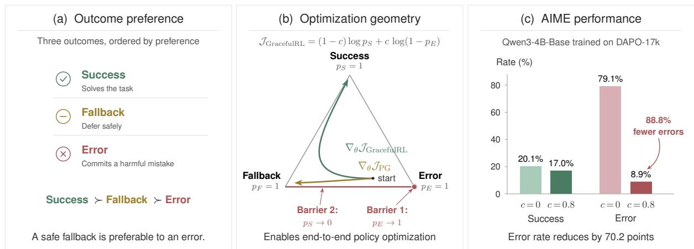

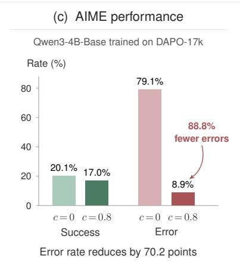  
Figure 1: Learning to fail gracefully. (a) GracefulRL augments standard RLVR with an explicit fallback behavior, ordered as Success ≻ Fallback ≻ Error. (b) Standard policy gradient (PG) can lose optimization signal near saturated policies. In contrast, the GracefulRL objective retains a non-vanishing gradient. (c) Using models trained with GracefulRL on the AIME benchmark, the most cautious model (c = 0.8) reduces the error rate from 79.1% to 8.9%, an 88.8% relative reduction, while success only drops by 3.1% compared to RL with binary rewards (c = 0).

Therefore, we want models that change course when success is unlikely. If they can solve a task reliably, they should. If they cannot, they should do something else: revert their changes, inform the user that they are stuck, or hand the task to a diferent model. We call this behaviour failing gracefully. Not only does graceful failure avoid harmful actions, it also helps build trust with users.

The naive way to train for this behavior is to reward success most, fallback second, and failure least. In principle, this should teach the model to keep trying when success is within reach and to fallback when it is not. Surprisingly, we find that learning this behavior with standard policy-gradient methods (Williams, 1992) and their derivatives (Shao et al., 2024) can be brittle. In the worst case, they can collapse to a model that always falls back and stops solving the task altogether (Section 3). We trace this failure to unfavorable optimization dynamics: the objective expresses the behavior we want, but the optimization process does not reliably produce it.

We introduce GracefulRL, a reinforcement learning approach designed to avoid this pathology. We modify the optimization landscape which lets us maintain pressure to solve the task, while simultaneously encouraging the model to fall back rather than making an error when success is unlikely. Crucially, the model learns when to fall back from its own interaction with the environment with no labels specifying which problems are too hard, and no separate uncertainty model or post-hoc decision rule at inference time.

Across navigation, mathematical reasoning, and multi-turn Minesweeper, GracefulRL learns selective fallback while preserving strong task performance. On AIME, it reduces the error rate from 79.1% to 8.9% while sacrificing only 3.1 percentage points of success relative to standard RL. In Minesweeper, it improves both sides of the tradeof, increasing success while reducing errors. Perhaps most strikingly, we find that the model verbalizes its decision making strategy in its chain-of-thought when its about to change course. Overall, our results suggest that reinforcement learning can not only improve a model’s task performance, but also shape it’s behavior when success is unlikely.

## 2 Problem Definition and Setup

Notation. Let $x \sim \mathcal { D }$ denote a task. A policy $\pi _ { \theta } ,$ parameterized by $\theta ,$ generates a sequence of actions $y = ( a _ { 1 } , \dots , a _ { T } ) \sim \pi _ { \theta } ( \cdot \mid x )$ , where $T \leq H$ for some horizon H. The sequence may consist of language-model tokens or actions in an interactive environment. In standard RLVR, a verifier/reward function f classifies each generated sequence as either a success or an error, $\mathrm { i . e . , } f ( x , y ) \in \{ \mathrm { S U C C E S S , E R R O R } \}$ . For a fixed task x, let $p _ { S } ( x ) = \mathbb { P } _ { y \sim \pi _ { \theta } ( \cdot | x ) } [ f ( x , y ) = \mathrm { S U C C E S S } ]$ Standard RLVR seeks policy parameters that maximize the average success probability over the task distribution, i.e., $\theta ^ { \star } \in$ arg max<sub>θ</sub> $\mathbb { E } _ { { x } \sim { \mathcal { D } } } [ p _ { S } ( x ) ]$ ]. For this, many diferent algorithms have been proposed (Schulman et al., 2017; Shao et al., 2024; Ahmadian et al., 2024; Tajwar et al., 2026).

Success, Fallback, and Error. In GracefulRL, we augment the outcome space for model trajectories with an explicit fallback option, such that $f ( x , y ) \in \{ \mathrm { S U C C E S S } , \mathrm { E R R O R } , \mathrm { F A L L B A C K } \}$ The fallback outcome represents a more favorable option compared to failing. It’s semantics would be environment specific: it may correspond to abstaining on a reasoning problem, restoring a database to a previous state, or handing of a task to a diferent model/sub-agent. We encode a preference ordering Success ≻ Fallback ≻ Error using the following ternary reward, where c controls how strongly errors are avoided relative to successes:

$$
r ( x , y ) = \left\{ \begin{array} { l l } { 1 , } & { f ( x , y ) = \mathrm { S U C C E S S } , } \\ { c , } & { f ( x , y ) = \mathrm { F A L L B A C K } , \qquad 0 < c < 1 . } \\ { 0 , } & { f ( x , y ) = \mathrm { E R R O R } , } \end{array} \right.
$$

Evaluating Graceful Failure. In order to evaluate the performance of a model we define success, fallback and error rates. Concretely, given a test distribution, $\mathcal { D } _ { \mathrm { t e s t } }$ , we define:

$$
\begin{array} { r l } & { \mathrm { S u c c e s s } \ @ 1 = \mathbb { P } _ { x \sim \mathcal { D } _ { \mathrm { t e s t } } , y \sim \pi _ { \theta } ( \cdot \vert x ) } [ f ( x , y ) = \mathrm { S U C C E S S } ] , } \\ & { \quad \mathrm { E r r o r @ 1 } = \mathbb { P } _ { x \sim \mathcal { D } _ { \mathrm { t e s t } } , y \sim \pi _ { \theta } ( \cdot \vert x ) } [ f ( x , y ) = \mathrm { E R R O R } ] . } \end{array}
$$

where Fallback@ 1 = 1 − Success@ 1 − Error@ 1. A method A Pareto-dominates a method B if it achieves a higher or equal Success@ 1 for a lower or equal Error@ 1 with a strict improvement in at least one metric.

## 3 The Challenge of Optimizing Fallback Behavior

A natural approach is to use the ternary reward in Section 2 in a policy-gradient algorithm which maximizes the expected reward, that is maximize $\mathcal { I } _ { \mathrm { P G } } ( x ) = p _ { S } ( x ) + c p _ { F } ( x )$ . Unfortunately, we find that this approach is highly sensitive to initialization and reward magnitude, necessitating tuning for every model and task combination. In the worst case, the policy can converge to a degenerate one that always executes the fallback with no task progress, or doesn’t learn to fallback at all.

Vanishing gradients near saturated policies. Why does such a natural objective exhibit this behavior? Formally, we show that this pathology emerges because the policy gradient vanishes when the policy approaches saturation. This implies that if the policy saturated on suboptimal outcomes during training, it can lead to poor convergence. We make a formal claim.

Under the regularity conditions mentioned in Appendix A, for all possible outcomes of the policy o ∈ {Success, Fallback, Error},

$$
p _ { o } \to 1 \quad \Rightarrow \quad \| \nabla _ { \theta } \mathcal { J } _ { \mathrm { P G } } ( x ) \| = O ( 1 - p _ { o } ( x ) ) .
$$

Intuitively, as the policy places nearly all of its probability on a single outcome, the gradient shrinks proportionally to the probability mass remaining on the other outcomes. Thus, once the policy becomes nearly deterministic, for example, always falling back, the gradient update required to move probability back toward success becomes vanishingly small. This result applies to standard softmax-parameterized policies, including auto-regressive language models, under a mild boundedness condition on the gradients of the logits. For a detailed exposition, refer to Appendix A.

## 4 Optimizing for Graceful Failure

This suggests that directly optimizing the objective of interest may not be the ideal decision, motivating the use of a surrogate objective with more favorable optimization properties. The distinction between the objective of interest and the objective used for optimization is ubiquitous in ML. In classification, for example, the quantity of interest is often the zero-one error, while training generally uses a cross entropy loss that generates more useful gradients (Zhang, 2004; Bartlett et al., 2006). In particular, assigning fallback an intermediate scalar reward and using the expected reward as the objective encodes the right behavior but says little about whether it is easy to optimize.

Section 3 shows that the expected-reward objective can provide a poor optimization landscape. A natural way to prevent either desirable event from becoming vanishingly unlikely is to maximize its log-probability. Now, consider the 2 events:

$$
E _ { 1 } : \{ { \mathrm { S U C C E S S } } \} \qquad E _ { 2 } : \neg \{ { \mathrm { E R R O R } } \}
$$

Note that ¬Error = {Success, Fallback}. We jointly maximize the log-probability of both events using a weighted sum:

$$
\mathcal { I } _ { \mathrm { G R a c e F U L R L } } = ( 1 - c ) \cdot \log \mathbb { P } ( E _ { 1 } ) + c \cdot \log \mathbb { P } ( E _ { 2 } ) = ( 1 - c ) \log p _ { S } ( x ) + c \log \left( 1 - p _ { E } ( x ) \right) .
$$

At $c = 0$ , the objective reduces to log $p _ { S } ( x )$ where only success matters and fallback and error are treated equivalently. $\mathrm { A t } ~ c = 1$ , it reduces to log $( 1 - p _ { E } ( x ) )$ : which avoids errors, and success and fallback are treated equivalently. When $0 < c < 1$ , we get an interpolation between these extremes.

A log-barrier perspective. This can be viewed as placing logarithmic barriers on two undesirable boundaries of the outcome simplex, $p _ { E }  1$ and $p _ { S }  0$ (see Figure $\mathbf { \tau } _ { 1 } ( \mathbf { b } ) )$ . Both terms in the objective diverge when $p _ { E }  1$ , whereas only the first diverges when $p _ { E } + p _ { F }  1$ The objective is maximized when $p _ { S }  1$ . In simpler words, this induces a natural ordering, where success is preferred over fallback which is in turn preferred over failure. Now, we make a formal claim.

## Proposition 2: Non-vanishing gradients near saturated policies [Proof: App. A]

Under the regularity and non-degeneracy assumptions in Appendix A, for either sub-optimal outcome $o \in \{ \mathrm { F A L L B A C K } , \mathrm { E R R O R } \}$ ,

$$
p _ { o } \to 1 \quad \Rightarrow \quad \| \nabla _ { \theta } \mathcal { J } _ { \mathrm { G R A C E F U L R L } } ( x ) \| = \Theta ( 1 ) .
$$

In words, even when the policy’s fallback or error probability gets high the gradient remains bounded away from zero, preserving a signal that can move the policy away from these degenerate solutions. Figure 2 illustrates the diferences between the methods. Standard policy gradient can get trapped near the fallback or error vertex when initialized with low success probability. Whereas, GracefulRL retains a recovery signal and moves toward higher success. When success is initially unlikely, it shifts probability from error to fallback before eventually moving toward success.

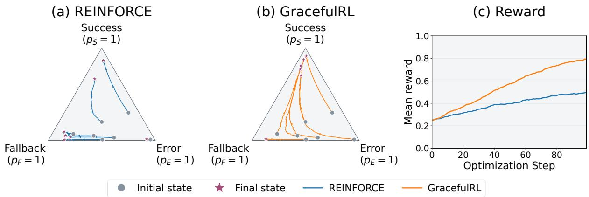  
Figure 2: A simple 3-class softmax policy. We use logits $z _ { S } , z _ { F }$ and $z _ { E }$ to create a policy $\pi = ( p _ { S } , p _ { F } , p _ { E } )$ = softmax $\left( z _ { S } , z _ { F } , z _ { E } \right)$ . (a) For initializations with low initial success probabilities, $\nabla _ { \boldsymbol { \theta } } \mathcal { J } _ { p \boldsymbol { g } }$ leads to traps near the fallback and error vertices $( p _ { F } = 1 , p _ { E } = 1 )$ , (b) however, $\nabla _ { \theta } \mathcal { I } _ { \mathrm { G R A C E F U L R I } }$ is more robust to initialization leading to higher success and (c) higher reward.

## 4.1 The GracefulRL algorithm

Conveniently, the objective derived above is the TailRL objective (Ramasubramanian et al., 2026) specialized to the ternary reward $r \in \{ 0 , c , 1 \}$ . While TailRL motivates the objective from a tail-likelihood and improving Best@ K perspective, we provide a re-interpretation through the log barrier perspective in Section 4, which highlights how the objective reshapes the loss landscape and prevents vanishing gradients. We make one change to the TailRL algorithm by adding a smoothing constant ϵ. A small $\epsilon > 0$ shrinks the large inversefrequency weights that arise when success or non-error trajectories are rare which could reduce variance at the cost of some bias. We discuss the efects of smoothing in Appendix Sections B, C.5 and D.4.

Algorithm 1 provides a reference implementation.

Algorithm 1: GracefulRL   
Require: Tasks $B ;$ rollouts $N ;$ policy $\pi _ { \boldsymbol { \theta } } ;$ verifier $f ;$   
fallback utility $c \in ( 0 , 1 )$ ; smoothing constant ϵ   
1: for each task $x \in B$ do   
2: Sample $y _ { 1 : N } \sim \pi _ { \theta } ( \cdot \mid x )$   
3: $f _ { n } \gets f ( x , y _ { n } ) \mathrm { ~ f o r ~ } n = 1 , \dots , N$   
4: $\begin{array} { r } { N _ { S } \gets \sum _ { n } \mathbf { 1 } \{ f _ { n } = \mathrm { S U C C E S S } \} } \end{array}$   
5: $\begin{array} { r } { N _ { F } \gets \sum _ { n } \mathbf { 1 } \{ f _ { n } = \mathrm { F A L L B A C K } \} } \end{array}$   
6: for $n = 1 , \ldots , N \ \mathbf { d o }$   
$a _ { n }  \frac { ( 1 - c ) \mathbf { 1 } \{ f _ { n } = \mathrm { S U C C E S S } \} } { N _ { S } + \epsilon }$   
7:   
$\mathbf { \mu } . \underline { { c } } \mathbf { 1 } \{ f _ { n } \neq \mathrm { E R R O R } \}$   
+   
$N _ { S } + N _ { F } + \epsilon$   
8: end for   
9: $\bar { a } \gets N ^ { - 1 } \sum _ { n } a _ { n }$   
10: $\begin{array} { r } { \widehat { g } ( x )  N ^ { - 1 } \sum _ { n } ( a _ { n } - \bar { a } ) \nabla _ { \theta } \log \pi _ { \theta } ( y _ { n } \mid x ) } \end{array}$   
11: end for   
12: return $\textstyle | B | ^ { - 1 } \sum _ { x \in B } { \widehat { g } } ( x )$

## 5 Experiments

Motivated by our theoretical insights, we study GracefulRL in three practical settings. Our first setting involves a maze navigation task with a small ResNet (He et al., 2016) policy. This gives us a compute-eficient setup that allows us to scale training steps and examine the efects of diferent hyperparameters. Next, we move to a relevant problem: training LLMs to abstain on mathematical reasoning problems. Here we test whether GracefulRL scales to more realistic scenarios and also test meaningful generalization across diferent domains. Finally, we design an experiment where an LLM has to make irreversible sequential decisions in the Minesweeper game, where we discover that training for graceful failure can sometimes improve task performance as well.

(a) SafeMaze

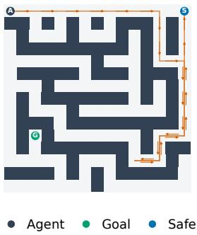

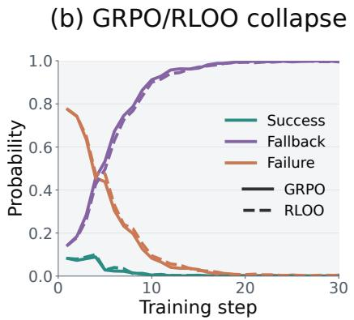

(c) Reliability frontier  
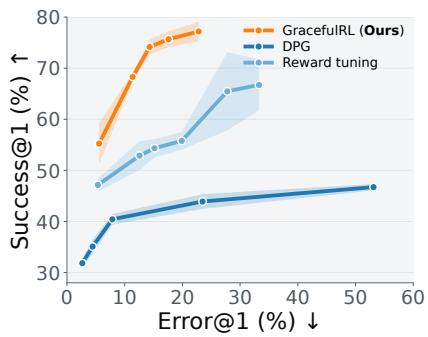  
Figure 3: (a) The SafeMaze task requires the agent to reach the Goal, but if it can’t, it should backtrack to Safe. (b) GRPO and RLOO can collapse to a degenerate policy $p _ { F } = 1$ that is, always going to the Safe square. (c) GracefulRL is robust and Pareto-dominates reward-tuning and DPG (across 3 seeds), achieving higher a Success@ 1 rate at a lower Error@ 1 rate.

## 5.1 SafeMaze: A Controlled Testbed

Environment. For our first experimental setting, we introduce SafeMaze, a maze navigation task where an agent can either reach the Goal, which counts as Success, or navigate to a designated Safe square, which counts as Fallback. Crucially, the Safe square is deliberately much easier to reach: it is connected to the start by an always-clear passage, whereas reaching the Goal requires solving the maze within 50 steps or less. The mazes are designed in a way that Goal is always reachable (see Figure 3 for an example). Hitting a wall or timing out counts as an Error. Thus, the agent faces exactly the tradeof of interest: pursue the harder task for the possibility of success, or take an easy and reliable fallback that avoids error but forgoes success. We use a 4M parameter, slightly pre-trained residual CNN as the policy here. More details are given in Appendix C.

## 5.1.1 Results on SafeMaze

Standard policy gradient methods are brittle. First, we train GRPO and RLOO on the SafeMaze task with a fixed value of the reward for reaching Safe, set to 0.4. We observe that, neither of these variants learn a meaningful policy. Within a few gradient steps, the policy reaches a 100% fallback rate and stops solving the task (Figure 3). In general, we observe that this behavior is highly sensitive to the fallback reward c. In Appendix C.2, using $c = 0 . 1$ for RLOO drives the fallback probability toward zero. At $c = 0 . 2$ , training retains some success but quickly plateaus. For every tested $c \geq 0 . 3$ , the policy rapidly collapses to the fallback-only solution. Thus, useful behavior only occurs in a narrow range of fallback rewards rather than emerging robustly from the desired reward ordering. Appendix C.6 shows that entropy bonuses also do not help in improving performance.

Comparing with other baselines. Next, we compare with two stronger baselines. We observe that a meaningful policy can be learnt with RLOO when the reward for Safe is lower than the success rate of the policy. Motivated by this at time step t, online reward tuning uses $c = \alpha \cdot { \widehat { p } } _ { S , t }$ where $\widehat { p } _ { S , t }$ denotes the online success rate. We also test Delightful Policy Gradient (DPG) (Osband, 2026) that modifies policy-gradient updates to mitigate trapping near deterministic sub-optimal policies (Mei and Osband, 2026). Figure 3 shows the reliability curve for each method after 20k training steps for diferent hyperparameters. We see a clear trend: GracefulRL converges to a higher Success@ 1 at lower Error@ 1 compared to the baselines. Thus, GracefulRL is robust to reward magnitudes unlike standard policy gradient and learns

(a) RLOO collapse  
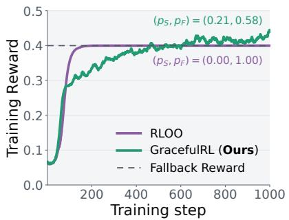

(b) Qwen3-1.7B-Base  
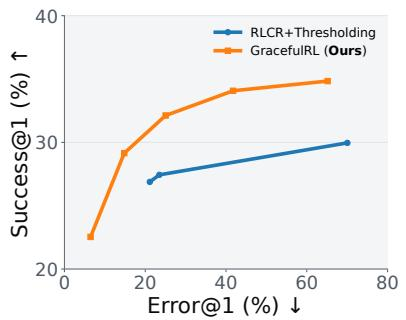

(c) Qwen3-4B-Base  
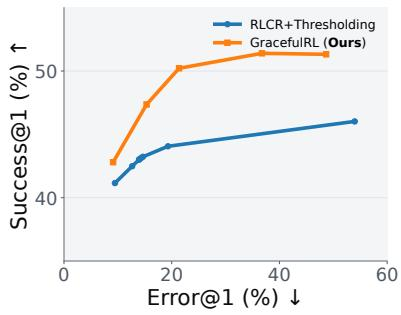  
Figure 4: (a) Training for abstention using standard policy gradient (RLOO) can converge to a policy that always abstains, while our method learns a meaningful policy. (b), (c) Reliability frontiers for the trained Qwen3-1.7B-Base and Qwen3-4B-Base models, comparing RLCR+Thresholding and GracefulRL. GracefulRL achieves a higher success rate at a lower error rate.

useful fallback behavior when uncertain.

Finally, we also investigate the interplay of various hyperparameters, specifically the role of the number of rollouts N, the fallback reward c, and the smoothing parameter ϵ in Appendix C.4 and Appendix C.5. We observe that performance improves with more rollouts N, particularly at higher values of $^ { c , }$ and also that a higher ϵ value gives higher reward at smaller compute budgets.

## 5.2 Language-Model RL for Mathematical Reasoning

Another important instance of graceful failure is abstention. We study this setting in mathematical reasoning, our first LLM testbed. Here, a model must make two decisions: how to solve a problem, and whether it should attempt a final answer at all. For problems within its capabilities, the model should reason through them and produce a solution. For problems beyond its current competence, however, continuing to reason toward a final answer can lead to a confident but incorrect prediction. A graceful model should instead recognize when its reasoning is unlikely to succeed and abstain. We therefore ask whether outcome-level RL can teach a language model not only to solve problems, but also to recognize when to stop trying. We first describe the experimental setup and the baseline.

RLCR+Thresholding baseline. We compare against Reinforcement Learning with Calibration Rewards (RLCR) (Damani et al., 2026), a recent uncertainty quantification approach, which trains language models for calibration. In RLCR, a model is trained to generate an answer and a confidence score $q \in [ 0 , 1 ]$ , and is then trained using a Brier-score based reward, that is, for a response y for prompt x, $r _ { \mathrm { R L C R } } = \mathbb { I } _ { \mathrm { c o r r e c t n e s s } } ( y , x ) - ( \mathbb { I } _ { \mathrm { c o r r e c t n e s s } } ( y , x ) - q ) ^ { 2 } \ ^ { 1 }$ . To obtain a policy that abstains, we use a test time threshold τ, where the model answers if confidence $q \geq \tau$ and abstains otherwise.

Conditioned training (ours). For GracefulRL, we jointly train a single model across five fallback utilities $c \in \{ 0 , 0 . 2 , 0 . 4 , 0 . 6 , 0 . 8 \}$ . We append a conditioning sufix to each problem indicating the desired degree of caution. For $c = 0$ , it reads “Be very optimistic and always attempt an answer, even if you are unsure,” while for $c = 0 . 8$ it reads “Be quite careful and avoid guessing.” The complete set appears in Appendix Table 3. During training, we mix examples from all five conditioning levels and optimize each using the corresponding value of $c ,$ where correct answers, abstentions, and incorrect answers correspond to the Success, Fallback, and Error outcomes, respectively.

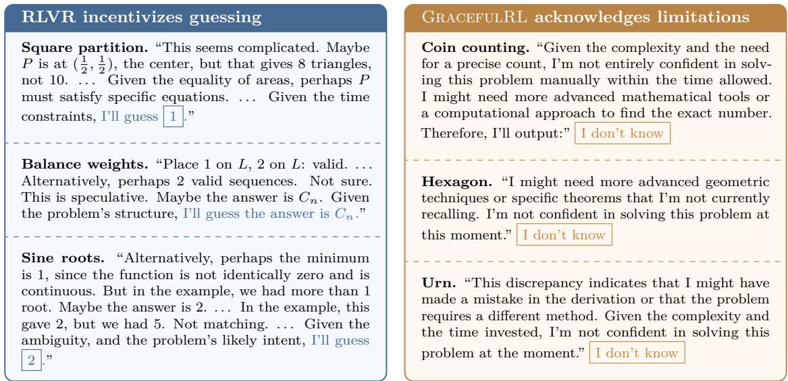  
Figure 5: Diferent behaviors under uncertainty. A model trained with RLVR has no incentive to acknowledge limitations, and guesses when uncertain. But a model trained with GracefulRL verbalizes and acknowledges its lack in capabilities. Full traces appear in Appendix D.9.

Training and evaluation. We train the Qwen3-1.7B-Base and Qwen3-4B-Base (Yang et al., 2025) models on the DAPO-Math-17K dataset (Yu et al., 2025) using on-policy RL for 1,500 steps and 1,000 steps respectively. For evaluation, we use MATH500 (Hendrycks et al., 2021), AIME 2024-2026, AMC 2022-2024, and JEEBench (numeric) (Arora et al., 2023). At test time, for RLCR, we sweep the threshold τ to trace its reliability curve, whereas for GracefulRL, we evaluate on each unique conditioning prompt, to measure the policy’s reliability. Details are given in Appendix D.

## 5.2.1 Results on Language-Model RL

Pareto-dominance over the baseline. From Figure 4 , our conditioned model consistently Pareto-dominates the baseline: it gets a higher success rate at a lower error rate across the entire frontier (Figure 4). The efect is especially strong on AIME for the 4B trained model (Figure 1), where the error rate is reduced from ∼ 79% to ∼ 9% while sacrificing only about 3% points of success compared to the c = 0 conditioning which corresponds to standard RLVR. We again note in Figure 4 that vanilla policy-gradient (RLOO) can collapse to a degenerate policy where for c = 0.4, the Qwen3-1.7B-Base model trained using RLOO converges to a degenerate policy which always abstains on the training dataset, while GracefulRL continues to improve and achieves a success rate of 21% with an abstention rate of 58% at the end of training. This mirrors our finding in the SafeMaze setting. An online reward-tuning baseline can also lose abstention behavior during training (Appendix D.8). We show additional results in Appendix Sections D.2 to D.5 and D.7.

Explicit verbalization in the CoT. Strikingly, CoT generated by the model trained with GracefulRL explicitly verbalizes notions of uncertainty and chooses to use the fallback when uncertain. Figure 5 show three illustrative ‘semantic’ patterns: hitting a time limit, being unable to recall a technique, and abstaining when it finds a mistake in its reasoning. In contrast, a standard RLVR-trained model<sup>2</sup> has no incentive to abstain and may continue with a speculative answer. Such guessing behavior is undesirable because it shifts the burden of verification onto the user. Moreover, signals that a model is guessing need not be verbalized, could be dificult to recognize, or expressed in a form/language that is hard to interpret. Therefore, explicitly training the model for fallback behavior provides a more robust strategy.

Out-of-distribution transfer. We evaluate our model trained on math problems on AbstentionBench (Kirichenko et al., 2025), which contains unknown, underspecified, and otherwise unanswerable questions from diverse domains such as History, MedicalQA, Geography and MoralQA. We find that the model retains its intended behavior. More cautious sufixes produce more fallbacks on questions that can’t be answered reliably, while optimistic sufixes attempt more responses. The average abstention $F _ { 1 }$ score rises from 0.472 at $c = 0 . 2$ to 0.677 at $c = 0 . 8$ outperforming the Qwen3-4B-Instruct-2507 model which scores 0.590 (Figure 6). This indicates hints of generalization to domains other than mathematical reasoning. Detailed results on the entire benchmark appear in Appendix D.10.

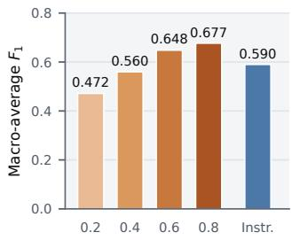  
Figure 6: Abstention $F _ { 1 } \mathbf { : }$ GracefulRL (orange), Instruct (blue).

## 5.3 Multi-Turn RL in Minesweeper

Finally, we use an LLM as an agent in a multi-turn Minesweeper

game (Tajwar et al., 2025). This setting gives us a testbed that involves a sequential decisionmaking environment with irreversible actions. The environment consists of a grid containing hidden mines and revealed cells which indicate the number of mines in their neighboring cells. At each step, the agent observes the current board state and selects a cell to reveal. The game has N turns and the rules are as follows:

1. Revealing a mine immediately ends the game with an Error.

2. Successfully revealing all non-mine cells by the end of the game, results in Success.

3. Avoiding mines but not revealing all non-mine squares by the end is a Fallback.

The Fallback behavior promotes conservative actions, even if it means giving up on completing the puzzle. Minesweeper pushes graceful failure beyond one-shot uncertainty estimation. The agent must repeatedly decide whether the available evidence justifies another action, with every move changing both the available information and the uncertainty of subsequent decisions. Consequently, methods such as RLCR or majority-vote thresholding, which attach confidence to a single generated answer, do not directly apply in this scenario. This makes Minesweeper a natural setting for end-to-end policy optimization from outcome-level rewards. We examine whether GracefulRL can teach the agent when to keep playing and when continued action is no longer worth the risk.

Training and Evaluation. We train Qwen3-4B-Instruct-2507 for 250 RL steps on puzzles requiring N = 8 steps to solve and evaluate on 500 held-out puzzles meant to be solved at a N = 12-turn budget. Appendix E specifies the board construction, training configuration, and evaluation protocol.

## 5.3.1 Results on Minesweeper

Graceful failure can (sometimes) improve task success. In the preceding settings, greater caution generally trades some success for fewer errors. However, in Minesweeper, varying c reveals a surprising finding: a fallback reward can also improve task success (Figure 7a). At $c = 0 . 5 $ , GracefulRL achieves 77.4% success and 6.0% error, improving both success rate and lowering error rate over MaxRL. We hypothesize that in this setting, learning a reliable fallback steers the model toward safer board states from which successful completion is more accessible. In this sense, the fallback reward may act as a form of reward shaping. RLOO with c = 0.5 collapses achieving neither successes nor errors mirroring our findings in the Sections 5.1 and 5.2.

<table><tr><td>Method</td><td>C</td><td>Success@ 1(↑)</td><td>Error@ 1(↓)</td></tr><tr><td>MaxRL</td><td>0</td><td>67.4</td><td>17.0</td></tr><tr><td>GracefulRL</td><td>0.25</td><td>66.0</td><td>13.4</td></tr><tr><td>GracefulRL</td><td>0.5</td><td>77.4</td><td>6.0</td></tr><tr><td>GracefulRL</td><td>0.75</td><td>73.6</td><td>5.6</td></tr><tr><td>RLOO</td><td>0.5</td><td>0.0†</td><td>0.0†</td></tr></table>

† Collapses to always taking the fallback action.

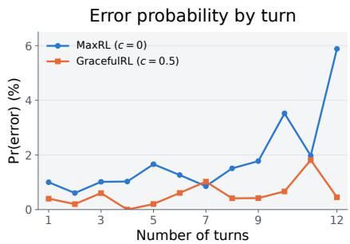  
Figure 7: Minesweeper results. (a) Success@ 1 and Error@ 1 rates after training the Qwen3-4B-Instruct-2507 model. In this setting, GracefulRL achieves a lower rate and higher performance compared to RL with no fallback option. (b) Probability of an error on each turn for MaxRL $( c = 0 )$ and GracefulRL $( c = 0 . 5 )$ . Number of errors significantly increase at the end of the game for MaxRL since the incentive to ‘play it safe’ reduces and risk taking moves ofer better expected return.

Errors concentrate late in the game. We also observe a striking pattern: for the MaxRL model (c = 0), errors become significantly more frequent in the latter half of the 12-turn game (Figure 7b). This behavior is consistent with the underlying incentive structure. As the game progresses and successful completion becomes less likely, a safe action that merely avoids failure receives no incentive, whereas a risky move retains some chance of producing a successful trajectory. The resulting incentive increasingly favors ‘gambling’ on low-probability success over preserving a safe state. In contrast, GracefulRL $( c = 0 . 5 )$ explicitly rewards safe fallback behavior, and the probability of error remains markedly lower near the end of the episode, including on the final turn.

## 6 Related Work

Policy-gradient optimization challenges. Vanishing gradients in policy gradients are well known, studied even in tabular MDPs (Agarwal et al., 2021). Mei et al. (2020) identify a “gravity well” induced by the softmax parameterization, leading to poor optimization while Li et al. (2021) further show that softmax PG methods can require exponentially many steps to converge. More recently, Razin et al. (2024) studied vanishing gradients in LLM RL finetuning showing that the gradient becomes small when the reward variance of the policy is small. Our analysis complements these results by studying a specific case with 3 outcomes where standard PG methods can get trapped near saturated outcomes. We further show that the GracefulRL objective avoids this pathology, retaining a non-vanishing optimization signal near such saturated solutions.

Likelihood-based objectives for RL. Recent work has explored replacing expected-reward objectives with likelihood-based objectives exemplified by MaxRL (Tajwar et al., 2026) and TailRL (Ramasubramanian et al., 2026). They show that these objectives admit an interpretation as a harmonically weighted combination of Best@ k objectives. We arrive at the same solution through an optimization perspective. We analyse how the logarithmic objective avoids gradient suppression near undesirable saturation which prevents a failure mode in expected reward maximization.

Uncertainty quantification for LLMs. Selective classification studies the tradeof between prediction risk and coverage (Chow, 1970; El-Yaniv and Wiener, 2010; Geifman and El-Yaniv, 2019; Liu et al., 2019). Recent work on LLM uncertainty and abstention has constructed specialized data to train refusal behavior (Zhang et al., 2024; Zhao et al., 2026), elicited verbalized confidence (Kadavath et al., 2022; Lin et al., 2022; Tian et al., 2023; Xiong et al., 2024), estimated uncertainty through repeated sampling (Manakul et al., 2023; Kang et al., 2025; Wang et al., 2023), combined multiple models at inference time (Stengel-Eskin et al., 2024), directly trained models for uncertainty quantification (Damani et al., 2026; Leng et al., 2025; Chandak et al., 2026), or introduced inference-time stopping rules that detect when continued reasoning is unlikely to help (Davidov et al., 2026). Our goal however is diferent: rather than estimating uncertainty, we aim to learn how the policy should act under uncertainty. This distinction becomes important in sequential decision-making settings, where uncertainty quantification is not enough: the fallback policy execution must also be a part of the policy itself and its learnt end-to-end. Moreover, our approach doesn’t require specialized datasets, is not LLM-specific, and naturally extends to multi-step interactions.

Learning abstention with RL. Some prior works try to use RL for abstention. For instance, Xu et al. (2024) use knowledge feedback to identify questions outside a model’s knowledge boundary and reward rejection on these examples. Wei et al. (2026), Pan et al. (2026), Ma et al. (2026), Wu et al. (2026) and Zhai et al. (2026) directly train for abstention using policy gradient style methods such as GRPO and PPO with and without heuristics such as reward tuning or modifying advantages. However, we show that this procedure can be brittle depending on the model and the task. We show that our approach is more robust and avoids issues associated with PG methods in a principled manner. Moreover, our formulation treats fallback as a general behavior rather than an LLM-specific refusal, allowing it to extend to sequential and non-language decision-making settings.

Safe and constrained reinforcement learning. Our work is also related to safe RL, which studies improving task performance while satisfying safety requirements or constraints (García and Fernández, 2015; Achiam et al., 2017). Other approaches intervene when an unsafe action is likely; for example, Recovery RL learns a separate recovery policy that takes control near constraint-violating regions (Thananjeyan et al., 2021). In contrast, we jointly learn task success and graceful fallback, without a secondary recovery policy intervening.

## 7 Conclusion and Limitations

We formulated graceful failure as an RL problem in which an agent must learn when to pursue task success and when to fall back safely. We showed that naively optimizing the expected reward can be brittle due to the underlying optimization dynamics. To address it, we introduced GracefulRL which provides a suitable landscape for optimization to succeed. Across the settings studied in this work, GracefulRL learns favorable tradeofs between task success and error, demonstrating that fallback behavior can be learned directly as part of the policy. However, our method is designed for online RL, and we have not studied its behavior under of-policy training. We also do not investigate settings involving coding agents or long horizon agentic training due to constraints on compute. Finally, specifying appropriate fallback behavior can be dificult and may difer substantially across domains. Defining graceful failure across diferent domains, deriving scaling laws for it, and evaluating its generalization to unseen tasks remains an important direction for future research.

## 8 Acknowledgements

We would like to thank Aarti Singh, Sachin Goyal, Pratyush Maini, Samuel Sokota, Jatin Prakash, Matan Shtepel, Zico Kolter, Gaurav Ghoshal and Bhavya Agrawalla for their feedback on the project and suggestions for improving the manuscript. DA is especially grateful to Yiding Jiang for their guidance on approach to research and for suggesting experimental choices that helped shape the work. This work used GH200 GPUs at DeltaAI through allocation CIS261151 and CIS250527 from the Advanced Cyberinfrastructure Coordination Ecosystem: Services &

Support (ACCESS) program, which is supported by U.S. National Science Foundation grants #2138259, #2138286, #2138307, #2137603, and #2138296. The authors also thank the CMU FLAME center and the CMU Babel Compute Cluster for additional compute support during the project. DA is supported by the National Science Foundation under Grants CCF-2106778 and DMS-2134080. YS thanks the support of the Two Sigma Fellowship. FT gratefully acknowledges the support of Qualcomm Innovation Fellowship and Bosch Research and Technology Center.

## References

Joshua Achiam, David Held, Aviv Tamar, and Pieter Abbeel. Constrained policy optimization. In Doina Precup and Yee Whye Teh, editors, Proceedings of the 34th International Conference on Machine Learning, volume 70 of Proceedings of Machine Learning Research, pages 22–31. PMLR, 06–11 Aug 2017. URL https://proceedings.mlr.press/v70/achiam17a.html.

Alekh Agarwal, Sham M. Kakade, Jason D. Lee, and Gaurav Mahajan. On the theory of policy gradient methods: Optimality, approximation, and distribution shift. Journal of Machine Learning Research, 22(98):1–76, 2021. URL http://jmlr.org/papers/v22/19-736.html.

Arash Ahmadian, Chris Cremer, Matthias Gallé, Marzieh Fadaee, Julia Kreutzer, Olivier Pietquin, Ahmet Üstün, and Sara Hooker. Back to basics: Revisiting REINFORCE-style optimization for learning from human feedback in LLMs. In Lun-Wei Ku, Andre Martins, and Vivek Srikumar, editors, Proceedings of the 62nd Annual Meeting of the Association for Computational Linguistics (Volume 1: Long Papers), pages 12248–12267, Bangkok, Thailand, August 2024. Association for Computational Linguistics. doi: 10.18653/v1/2024.acl-long.662. URL https://aclanthology.org/2024.acl-long.662/.

Zafarali Ahmed, Nicolas Le Roux, Mohammad Norouzi, and Dale Schuurmans. Understanding the impact of entropy on policy optimization. In Kamalika Chaudhuri and Ruslan Salakhutdinov, editors, Proceedings of the 36th International Conference on Machine Learning, volume 97 of Proceedings of Machine Learning Research, pages 151–160. PMLR, 09–15 Jun 2019. URL https://proceedings.mlr.press/v97/ahmed19a.html.

Daman Arora, Himanshu Singh, and Mausam. Have LLMs advanced enough? a challenging problem solving benchmark for large language models. In Houda Bouamor, Juan Pino, and Kalika Bali, editors, Proceedings of the 2023 Conference on Empirical Methods in Natural Language Processing, pages 7527–7543, Singapore, December 2023. Association for Computational Linguistics. doi: 10.18653/v1/2023.emnlp-main.468. URL https://aclanthology.org/2023.emnlp-main.468/.

Peter L Bartlett, Michael I Jordan, and Jon D McAulife. Convexity, classification, and risk bounds. Journal of the American Statistical Association, 101(473):138–156, 2006. doi: 10. 1198/016214505000000907. URL https://doi.org/10.1198/016214505000000907.

Nikhil Chandak, Shashwat Goel, Ameya Prabhu, Moritz Hardt, and Jonas Geiping. Scaling open-ended reasoning to predict the future, 2026. URL https://openreview.net/forum? id=fkYrply0w3.

C. Chow. On optimum recognition error and reject tradeof. IEEE Transactions on Information Theory, 16(1):41–46, 1970. doi: 10.1109/TIT.1970.1054406.

Mehul Damani, Isha Puri, Stewart Slocum, Idan Shenfeld, Leshem Choshen, Yoon Kim, and Jacob Andreas. Beyond binary rewards: Training LMs to reason about their uncertainty. In International Conference on Learning Representations, 2026. URL https://arxiv.org/abs/ 2507.16806.

Hen Davidov, Nachshon Cohen, Oren Kalinsky, Yaron Fairstein, Guy Kushilevitz, Ram Yazdi, and Patrick Rebeschini. Knowing when to quit: A principled framework for dynamic abstention in LLM reasoning. In Forty-third International Conference on Machine Learning, 2026. URL https://openreview.net/forum?id=R4fBnrKf3h.

Ran El-Yaniv and Yair Wiener. On the foundations of noise-free selective classification. Journal of Machine Learning Research, 11(53):1605–1641, 2010. URL http://jmlr.org/papers/v11/ el-yaniv10a.html.

Javier García and Fernando Fernández. A comprehensive survey on safe reinforcement learning. Journal of Machine Learning Research, 16(42):1437–1480, 2015. URL http://jmlr.org/ papers/v16/garcia15a.html.

Yonatan Geifman and Ran El-Yaniv. SelectiveNet: A deep neural network with an integrated reject option. In Kamalika Chaudhuri and Ruslan Salakhutdinov, editors, Proceedings of the 36th International Conference on Machine Learning, volume 97 of Proceedings of Machine Learning Research, pages 2151–2159. PMLR, 09–15 Jun 2019. URL https://proceedings. mlr.press/v97/geifman19a.html.

Daya Guo, Dejian Yang, Haowei Zhang, Junxiao Song, Peiyi Wang, Qihao Zhu, Runxin Xu, Ruoyu Zhang, and Shirong et al Ma. Deepseek-r1 incentivizes reasoning in llms through reinforcement learning. Nature, 645(8081):633–638, September 2025. ISSN 1476-4687. doi: 10.1038/s41586-025-09422-z. URL http://dx.doi.org/10.1038/s41586-025-09422-z.

Kaiming He, Xiangyu Zhang, Shaoqing Ren, and Jian Sun. Deep residual learning for image recognition. In Proceedings of the IEEE Conference on Computer Vision and Pattern Recognition (CVPR), June 2016.

Dan Hendrycks, Collin Burns, Saurav Kadavath, Akul Arora, Steven Basart, Eric Tang, Dawn Song, and Jacob Steinhardt. Measuring mathematical problem solving with the MATH dataset. In Thirty-fifth Conference on Neural Information Processing Systems Datasets and Benchmarks Track (Round 2), 2021. URL https://openreview.net/forum?id=7Bywt2mQsCe.

Saurav Kadavath, Tom Conerly, Amanda Askell, Tom Henighan, Dawn Drain, Ethan Perez, Nicholas Schiefer, Zac Hatfield-Dodds, Nova DasSarma, Eli Tran-Johnson, Scott Johnston, Sheer El-Showk, Andy Jones, Nelson Elhage, Tristan Hume, Anna Chen, Yuntao Bai, Sam Bowman, Stanislav Fort, Deep Ganguli, Danny Hernandez, Josh Jacobson, Jackson Kernion, Shauna Kravec, Liane Lovitt, Kamal Ndousse, Catherine Olsson, Sam Ringer, Dario Amodei, Tom Brown, Jack Clark, Nicholas Joseph, Ben Mann, Sam McCandlish, Chris Olah, and Jared Kaplan. Language models (mostly) know what they know, 2022. URL https://arxiv.org/ abs/2207.05221.

Adam Tauman Kalai, Ofir Nachum, Santosh S. Vempala, and Edwin Zhang. Why language models hallucinate, 2025. URL https://arxiv.org/abs/2509.04664.

Zhewei Kang, Xuandong Zhao, and Dawn Song. Scalable best-of-n selection for large language models via self-certainty. In The Thirty-ninth Annual Conference on Neural Information Processing Systems, 2025. URL https://openreview.net/forum?id=29FRqmVQK8.

Polina Kirichenko, Mark Ibrahim, Kamalika Chaudhuri, and Samuel J. Bell. Abstentionbench: Reasoning LLMs fail on unanswerable questions, 2025. URL https://arxiv.org/abs/2506. 09038.

Nathan Lambert, Jacob Morrison, Valentina Pyatkin, Shengyi Huang, Hamish Ivison, Faeze Brahman, Lester James Validad Miranda, Alisa Liu, Nouha Dziri, Xinxi Lyu, Yuling Gu,

Saumya Malik, Victoria Graf, Jena D. Hwang, Jiangjiang Yang, Ronan Le Bras, Oyvind Tafjord, Christopher Wilhelm, Luca Soldaini, Noah A. Smith, Yizhong Wang, Pradeep Dasigi, and Hannaneh Hajishirzi. Tulu 3: Pushing frontiers in open language model post-training. In Second Conference on Language Modeling, 2025. URL https://openreview.net/forum?id= i1uGbfHHpH.

Jixuan Leng, Chengsong Huang, Banghua Zhu, and Jiaxin Huang. Taming overconfidence in LLMs: Reward calibration in RLHF. In The Thirteenth International Conference on Learning Representations, 2025. URL https://openreview.net/forum?id=l0tg0jzsdL.

Gen Li, Yuting Wei, Yuejie Chi, Yuantao Gu, and Yuxin Chen. Softmax policy gradient methods can take exponential time to converge. In Mikhail Belkin and Samory Kpotufe, editors, Proceedings of Thirty Fourth Conference on Learning Theory, volume 134 of Proceedings of Machine Learning Research, pages 3107–3110. PMLR, 15–19 Aug 2021. URL https: //proceedings.mlr.press/v134/li21b.html.

Stephanie Lin, Jacob Hilton, and Owain Evans. Teaching models to express their uncertainty in words. Transactions on Machine Learning Research, 2022. ISSN 2835-8856. URL https: //openreview.net/forum?id=8s8K2UZGTZ.

Ziyin Liu, Zhikang Wang, Paul Pu Liang, Russ R Salakhutdinov, Louis-Philippe Morency, and Masahito Ueda. Deep gamblers: Learning to abstain with portfolio theory. In H. Wallach, H. Larochelle, A. Beygelzimer, F. d'Alché-Buc, E. Fox, and R. Garnett, editors, Advances in Neural Information Processing Systems, volume 32. Curran Associates, Inc., 2019. URL https://proceedings.neurips.cc/paper\_files/paper/2019/ file/0c4b1eeb45c90b52bfb9d07943d855ab-Paper.pdf.

Michael Luo, Sijun Tan, Roy Huang, Ameen Patel, Alpay Ariyak, Qingyang Wu, Xiaoxiang Shi, Rachel Xin, Colin Cai, Maurice Weber, Ce Zhang, Li Erran Li, Raluca Ada Popa, and Ion Stoica. Deepcoder: A fully open-source 14b coder at o3-mini level, 2025. Notion Blog.

Xinyu Ma, Ziyang Ding, Zhicong Luo, Chi Chen, Zonghao Guo, Derek F. Wong, Zhen Zhao, Xiaoyi Feng, and Maosong Sun. Karl: Knowledge-aware reasoning and reinforcement learning for knowledge-intensive visual grounding, 2026. URL https://arxiv.org/abs/2503.12797.

Potsawee Manakul, Adian Liusie, and Mark Gales. SelfcheckGPT: Zero-resource black-box hallucination detection for generative large language models. In The 2023 Conference on Empirical Methods in Natural Language Processing, 2023. URL https://openreview.net/ forum?id=RwzFNbJ3Ez.

Jincheng Mei and Ian Osband. Delightful gradients accelerate corner escape, 2026. URL https://arxiv.org/abs/2605.11908.

Jincheng Mei, Chenjun Xiao, Bo Dai, Lihong Li, Csaba Szepesvari, and Dale Schuurmans. Escaping the gravitational pull of softmax. In H. Larochelle, M. Ranzato, R. Hadsell, M.F. Balcan, and H. Lin, editors, Advances in Neural Information Processing Systems, volume 33, pages 21130–21140. Curran Associates, Inc., 2020. URL https://proceedings.neurips.cc/ paper\_files/paper/2020/file/f1cf2a082126bf02de0b307778ce73a7-Paper.pdf.

OpenAI, :, Aaron Jaech, Adam Kalai, Adam Lerer, Adam Richardson, Ahmed El-Kishky, Aiden Low, Alec Helyar, Aleksander Madry, Alex Beutel, Alex Carney, Alex Iftimie, Alex Karpenko, Alex Tachard Passos, and et. al Alexander Neitz. Openai o1 system card, 2026. URL https://arxiv.org/abs/2412.16720.

Ian Osband. Delightful policy gradient. Reinforcement Learning Journal, 7, 2026. URL https://arxiv.org/abs/2603.14608.

Muyu Pan, Shu Zhao, Nan Zhang, Philip Shin, Varun Parekh, Vijaykrishnan Narayanan, and Rui Zhang. Tiar: Trajectory-informed advantage reweighting for llm abstention learning, 2026. URL https://arxiv.org/abs/2605.25850.

Shrinivas Ramasubramanian, Daman Arora, Fahim Tajwar, Guanning Zeng, Qingyang Wu, Zhongzhu Zhou, Chenfeng Xu, Haiwen Feng, Yuda Song, Aarti Singh, Ruslan Salakhutdinov, J. Andrew Bagnell, Jef Schneider, and Andrea Zanette. Tail-likelihood reinforcement learning, 2026. URL https://arxiv.org/abs/2609.02987.

Noam Razin, Hattie Zhou, Omid Saremi, Vimal Thilak, Arwen Bradley, Preetum Nakkiran, Joshua M. Susskind, and Etai Littwin. Vanishing gradients in reinforcement finetuning of language models. In The Twelfth International Conference on Learning Representations, 2024. URL https://openreview.net/forum?id=IcVNBR7qZi.

John Schulman, Filip Wolski, Prafulla Dhariwal, Alec Radford, and Oleg Klimov. Proximal policy optimization algorithms, 2017. URL https://arxiv.org/abs/1707.06347.

Zhihong Shao, Peiyi Wang, Qihao Zhu, Runxin Xu, Junxiao Song, Xiao Bi, Haowei Zhang, Mingchuan Zhang, Y. K. Li, Y. Wu, and Daya Guo. Deepseekmath: Pushing the limits of mathematical reasoning in open language models, 2024. URL https://arxiv.org/abs/2402. 03300.

Guangming Sheng, Chi Zhang, Zilingfeng Ye, Xibin Wu, Wang Zhang, Ru Zhang, Yanghua Peng, Haibin Lin, and Chuan Wu. Hybridflow: A flexible and eficient rlhf framework. arXiv preprint arXiv: 2409.19256, 2024.

Guangming Sheng, Chi Zhang, Zilingfeng Ye, Xibin Wu, Wang Zhang, Ru Zhang, Yanghua Peng, Haibin Lin, and Chuan Wu. Hybridflow: A flexible and eficient rlhf framework. In Proceedings of the Twentieth European Conference on Computer Systems, EuroSys ’25, pages 1279–1297, New York, NY, USA, 2025. Association for Computing Machinery. ISBN 9798400711961. doi: 10.1145/3689031.3696075. URL https://doi.org/10.1145/3689031.3696075.

Elias Stengel-Eskin, Peter Hase, and Mohit Bansal. LACIE: Listener-aware finetuning for calibration in large language models. In The Thirty-eighth Annual Conference on Neural Information Processing Systems, 2024. URL https://openreview.net/forum?id=RnvgYd9RAh.

Fahim Tajwar, Yiding Jiang, Abitha Thankaraj, Sumaita Sadia Rahman, J Zico Kolter, Jef Schneider, and Russ Salakhutdinov. Training a generally curious agent. In Forty-second International Conference on Machine Learning, 2025. URL https://openreview.net/forum? id=UeB3Hdrhda.

Fahim Tajwar, Guanning Zeng, Yueer Zhou, Yuda Song, Daman Arora, Yiding Jiang, Jef Schneider, Ruslan Salakhutdinov, Haiwen Feng, and Andrea Zanette. Maximum likelihood reinforcement learning. In Forty-third International Conference on Machine Learning, 2026. URL https://openreview.net/forum?id=EeuLO2BjFN.

Miles Team. Miles: Enterprise-grade reinforcement learning for large-scale model post-training. https://github.com/radixark/miles, 2026.

Brijen Thananjeyan, Ashwin Balakrishna, Suraj Nair, Michael Luo, Krishnan Srinivasan, Minho Hwang, Joseph E. Gonzalez, Julian Ibarz, Chelsea Finn, and Ken Goldberg. Recovery rl: Safe reinforcement learning with learned recovery zones, 2021. URL https://arxiv.org/abs/ 2010.15920.

Katherine Tian, Eric Mitchell, Allan Zhou, Archit Sharma, Rafael Rafailov, Huaxiu Yao, Chelsea Finn, and Christopher Manning. Just ask for calibration: Strategies for eliciting

calibrated confidence scores from language models fine-tuned with human feedback. In Houda Bouamor, Juan Pino, and Kalika Bali, editors, Proceedings of the 2023 Conference on Empirical Methods in Natural Language Processing, pages 5433–5442, Singapore, December 2023. Association for Computational Linguistics. doi: 10.18653/v1/2023.emnlp-main.330. URL https://aclanthology.org/2023.emnlp-main.330/.

Xuezhi Wang, Jason Wei, Dale Schuurmans, Quoc Le, Ed H. Chi, Sharan Narang, Aakanksha Chowdhery, and Denny Zhou. Self-consistency improves chain of thought reasoning in language models. In The Eleventh International Conference on Learning Representations, 2023. URL https://openreview.net/forum?id=1PL1NIMMrw.

Zhepei Wei, Xiao Yang, Kai Sun, Jiaqi Wang, Rulin Shao, Jingxiang Chen, Mohammad Kachuee, Teja Gollapudi, Yiwei Liao, Nicolas SCHEFFER, Rakesh Wanga, Anuj Kumar, Yu Meng, Wen tau Yih, and Xin Luna Dong. TruthRL: Incentivizing truthful LLMs via reinforcement learning. In Forty-third International Conference on Machine Learning, 2026. URL https: //openreview.net/forum?id=TnJMJm3Fbi.

Ronald J. Williams. Simple Statistical Gradient-Following Algorithms for Connectionist Reinforcement Learning. Machine Learning, 8:229–256, 1992. doi: 10.1007/BF00992696. URL https://mlanthology.org/mlj/1992/williams1992mlj-simple/.

Jiayun Wu, Jiashuo Liu, Zhiyuan Zeng, Tianyang Zhan, Tianle Cai, and Wenhao Huang. Mitigating LLM hallucination via behaviorally calibrated reinforcement learning. In Agentic AI in the Wild: From Hallucinations to Reliable Autonomy, 2026. URL https://openreview. net/forum?id=r3ZZLYZTN0.

Miao Xiong, Zhiyuan Hu, Xinyang Lu, YIFEI LI, Jie Fu, Junxian He, and Bryan Hooi. Can LLMs express their uncertainty? an empirical evaluation of confidence elicitation in LLMs. In The Twelfth International Conference on Learning Representations, 2024. URL https: //openreview.net/forum?id=gjeQKFxFpZ.

Hongshen Xu, Zichen Zhu, Situo Zhang, Da Ma, Shuai Fan, Lu Chen, and Kai Yu. Rejection improves reliability: Training llms to refuse unknown questions using rl from knowledge feedback, 2024. URL https://arxiv.org/abs/2403.18349.

An Yang, Anfeng Li, Baosong Yang, Beichen Zhang, Binyuan Hui, Bo Zheng, Bowen Yu, Chang Gao, Chengen Huang, Chenxu Lv, Chujie Zheng, Dayiheng Liu, Fan Zhou, Fei Huang, Feng Hu, Hao Ge, Haoran Wei, Huan Lin, Jialong Tang, Jian Yang, Jianhong Tu, Jianwei Zhang, Jianxin Yang, Jiaxi Yang, Jing Zhou, Jingren Zhou, Junyang Lin, Kai Dang, Keqin Bao, Kexin Yang, Le Yu, Lianghao Deng, Mei Li, Mingfeng Xue, Mingze Li, Pei Zhang, Peng Wang, Qin Zhu, Rui Men, Ruize Gao, Shixuan Liu, Shuang Luo, Tianhao Li, Tianyi Tang, Wenbiao Yin, Xingzhang Ren, Xinyu Wang, Xinyu Zhang, Xuancheng Ren, Yang Fan, Yang Su, Yichang Zhang, Yinger Zhang, Yu Wan, Yuqiong Liu, Zekun Wang, Zeyu Cui, Zhenru Zhang, Zhipeng Zhou, and Zihan Qiu. Qwen3 technical report, 2025. URL https://arxiv.org/abs/2505.09388.

Qiying Yu, Zheng Zhang, Ruofei Zhu, Yufeng Yuan, Xiaochen Zuo, Yu Yue, Weinan Dai, Tiantian Fan, Gaohong Liu, Lingjun Liu, Xin Liu, Haibin Lin, Zhiqi Lin, Bole Ma, Guangming Sheng, Yuxuan Tong, Chi Zhang, Mofan Zhang, Wang Zhang, Hang Zhu, Jinhua Zhu, Jiaze Chen, Jiangjie Chen, Chengyi Wang, Hongli Yu, Yuxuan Song, Xiangpeng Wei, Hao Zhou, Jingjing Liu, Wei-Ying Ma, Ya-Qin Zhang, Lin Yan, Mu Qiao, Yonghui Wu, and Mingxuan Wang. DAPO: An open-source LLM reinforcement learning system at scale, 2025. URL https://arxiv.org/abs/2503.14476.

Haotian Zhai, Jingcheng Liang, and Dongyeop Kang. Abstain-r1: Calibrated abstention and post-refusal clarification via verifiable RL. In Maria Liakata, Viviane P. Moreira, Jiajun Zhang,

and David Jurgens, editors, Findings of the Association for Computational Linguistics: ACL 2026, pages 19674–19695, San Diego, California, United States, July 2026. Association for Computational Linguistics. ISBN 979-8-89176-395-1. doi: 10.18653/v1/2026.findings-acl.985. URL https://aclanthology.org/2026.findings-acl.985/.

Hanning Zhang, Shizhe Diao, Yong Lin, Yi Fung, Qing Lian, Xingyao Wang, Yangyi Chen, Heng Ji, and Tong Zhang. R-tuning: Instructing large language models to say ‘I don’t know’. In Kevin Duh, Helena Gomez, and Steven Bethard, editors, Proceedings of the 2024 Conference of the North American Chapter of the Association for Computational Linguistics: Human Language Technologies (Volume 1: Long Papers), pages 7113–7139, Mexico City, Mexico, June 2024. Association for Computational Linguistics. doi: 10.18653/v1/2024.naacl-long.394. URL https://aclanthology.org/2024.naacl-long.394/.

Tong Zhang. Statistical behavior and consistency of classification methods based on convex risk minimization. The Annals of Statistics, 32(1):56 – 85, 2004. doi: 10.1214/aos/1079120130. URL https://doi.org/10.1214/aos/1079120130.

Yibo Zhao, Jiapeng Zhu, Zichen Ding, and Xiang Li. Grace: Reinforcement learning for grounded response and abstention under contextual evidence, 2026. URL https://arxiv.org/abs/ 2601.04525.

## A Proof of the Results in Section 3

1. First, we fix terminology and show some simple identities which relate outcome probabilities to conditional score functions in Section A.1.

2. Second, we show that under a boundedness assumption on the logit gradients, a standard regularity condition, the conditional score functions are bounded in Section A.2.

3. Then, we show that this causes the gradient of the expected reward objective to vanish when the policy approaches saturation in Section A.3,

4. Finally, we show that under a non-degeneracy condition, the gradient of the log-barrier based objective does not vanish near sub-optimal saturation in Section A.4.

It is worth noting that our proofs are only for the population level gradients and not for stochastic estimators which we leave for future work.

## A.1 Setup

Throughout we fix a prompt x, a fallback reward of $c \in ( 0 , 1 )$ , and write $\mathcal { T } _ { o }$ for the set of trajectories whose outcome is $o \in \{ S , F , E \}$ (Success, Fallback, and Error respectively), and denote $p _ { o } ( \theta )$ for its probability under $\pi _ { \boldsymbol { \theta } } ( \cdot \mid x )$ . Next, we define the conditional score function.

$$
g _ { o } ( \theta ) : = \mathbb { E } _ { \tau \sim \pi _ { \theta } ( \cdot \vert x ) } \left[ \nabla _ { \theta } \log \pi _ { \theta } ( \tau \mid x ) \mid \tau \in \mathcal { T } _ { o } \right]
$$

Diferentiating $\begin{array} { r } { p _ { o } = \sum _ { \tau \in \mathcal { T } _ { o } } \pi _ { \theta } ( \tau \mid x ) } \end{array}$ and using $\nabla _ { \theta } \pi _ { \theta } = \pi _ { \theta } \nabla _ { \theta }$ log π<sub>θ</sub> gives

$$
\nabla _ { { \boldsymbol { \theta } } } p _ { o } ( { \boldsymbol { \theta } } ) = p _ { o } ( { \boldsymbol { \theta } } ) g _ { o } ( { \boldsymbol { \theta } } ) , \qquad { \boldsymbol { o } } \in \{ { \boldsymbol { S } } , { \boldsymbol { F } } , { \boldsymbol { E } } \} .\tag{1}
$$

It is also worth noting the following identity:

$$
\begin{array} { r l } & { \quad \nabla _ { \theta } ( p _ { S } + p _ { F } + p _ { E } ) = \nabla _ { \theta } ( 1 ) = 0 , } \\ { \Rightarrow \quad p _ { S } g _ { S } + p _ { F } g _ { F } + p _ { E } g _ { E } = 0 . } \end{array}\tag{2}
$$

Identity 1 shows that the gradient of an outcome probability is the probability of outcome $p _ { Y }$ times a direction $g _ { Y }$

Also, we define the softmax parameterization. We consider policies parameterized by softmax over a network producing logits $\boldsymbol { z } _ { \boldsymbol { \theta } } ( \boldsymbol { s } _ { t } ) \in \mathbb { R } ^ { | \boldsymbol { A } | }$ :

$$
\pi _ { \theta } ( a _ { t } \mid s _ { t } ) = \frac { \exp ( z _ { \theta } ( s _ { t } ) _ { a _ { t } } ) } { \sum _ { a ^ { \prime } \in \mathcal { A } } \exp ( z _ { \theta } ( s _ { t } ) _ { a ^ { \prime } } ) }
$$

Autoregressive language models are a special case where A is the vocabulary of the model and $s _ { t } = ( x , a _ { < t } )$ is the first t generated tokens along with the prompt. Next, we show that a common assumption of boundedness of logit gradients leads to boundedness of the conditional score function under the softmax parameterization.

## A.2 Bounded Conditional Scores

Assumption 1 (Bounded logit gradients). There exists a constant $B < \infty$ such that, for every $\theta \in \Theta$ , every state s, and every discrete action $a \in { \mathcal { A } }$

$$
\| \nabla _ { \theta } z _ { \theta } ( s ) _ { a } \| \leq B .
$$

Lemma 2 (Bounded conditional scores). Under Assumption 1, and writing $G : = 2 H B$

$$
\lVert g _ { o } ( { \boldsymbol { \theta } } ) \rVert \leq G , \qquad o \in \{ S , F , E \} ,\tag{3}
$$

for every $\theta \in \Theta$

Proof. For the softmax policy,

$$
\nabla _ { \theta } \log \pi _ { \theta } ( a \mid s ) = \nabla _ { \theta } z _ { \theta } ( s ) _ { a } - \sum _ { a ^ { \prime } \in \mathcal A } \pi _ { \theta } ( a ^ { \prime } \mid s ) \nabla _ { \theta } z _ { \theta } ( s ) _ { a ^ { \prime } } .
$$

The second term is a convex combination of vectors of norm at most $B { \mathrm { , } }$ , so it has norm at most $2 B$

$$
\Rightarrow \| \nabla _ { \theta } \log \pi _ { \theta } ( a \mid s ) \| \leq 2 B .
$$

Summing over an entire trajectory τ which is at most H steps,

$$
\begin{array} { r } { \| \nabla _ { \theta } \log \pi _ { \theta } ( \tau \mid x ) \| \le 2 H B = G . } \end{array}
$$

Each $g _ { Y }$ is a conditional expectation of these trajectory scores, hence a convex combination of vectors of norm at most G, which gives (3). □

## A.3 Policy Gradient Vanishes Near Saturation

First, we express the policy gradients in terms of the conditional scores. The objective function for policy gradient is the expected reward $p _ { S } + c p _ { F }$ . Using identity 1 we get

$$
\begin{array} { c } { { \mathcal { I } _ { \mathrm { p g } } ( x ) = p _ { S } + c p _ { F } , } } \\ { { \Rightarrow \nabla _ { \theta } \mathcal { I } _ { \mathrm { p g } } ( x ) = p _ { S } g _ { S } + c p _ { F } g _ { F } } } \end{array}\tag{4}
$$

Proposition 3 (Gradient suppression under fallback saturation). Suppose Assumption 1 holds. Then for every $\theta \in \Theta$ , and every outcome $o \in \{ \mathrm { S U C C E S S } , \mathrm { F A L L B A C K } , \mathrm { E R R O R } \}$ , as the policy saturates on any outcome, that is, when $p _ { o } \to 1$

$$
\begin{array} { r } { \| \nabla _ { { \boldsymbol { \theta } } } \mathcal { I } _ { \mathrm { p g } } ( { \boldsymbol { \theta } } ) \| \leq G \big ( 1 - p _ { o } ( { \boldsymbol { x } } ) \big ) , } \end{array}
$$

Proof. Under Assumption 1, the conditional scores satisfy $\| g _ { S } \| , \| g _ { F } \| , \| g _ { E } \| \leq G$ . We consider the three possible saturated outcomes separately.

If o = Error, then from Eq. 4,

$$
\begin{array} { r l } & { \| \nabla _ { \theta } \mathcal { J } _ { \mathrm { p g } } \| = \| p _ { S } g _ { S } + c p _ { F } g _ { F } \| } \\ & { \qquad \leq G ( p _ { S } + c p _ { F } ) } \\ & { \qquad \leq G ( p _ { S } + p _ { F } ) = G ( 1 - p _ { E } ) . } \end{array}
$$

If $o = { \mathrm { F a L L B A C K } }$ , using $p _ { F } g _ { F } = - p _ { S } g _ { S } - p _ { E } g _ { E }$ from (2) gives $\nabla _ { \theta } \mathcal { I } _ { \mathrm { p g } } = ( 1 - c ) p _ { S } g _ { S } - c p _ { E } g _ { E }$ Hence,

$$
\begin{array} { r l } & { \| \nabla _ { \theta } \mathcal { J } _ { \mathrm { p g } } \| \leq G \big ( ( 1 - c ) p _ { S } + c p _ { E } \big ) } \\ & { \qquad \leq G ( p _ { S } + p _ { E } ) = G ( 1 - p _ { F } ) . } \end{array}
$$

Finally, if o = Success, using $p _ { S } g _ { S } = - p _ { F } g _ { F } - p _ { E } g _ { E }$ from (2) gives $\nabla _ { \theta } \mathcal { I } _ { \mathrm { p g } } = - ( 1 -$ $c ) p _ { F } g _ { F } - p _ { E } g _ { E }$ , and therefore

$$
\begin{array} { r l } & { \| \nabla _ { \theta } \mathcal { J } _ { \mathrm { p g } } \| \leq G \big ( ( 1 - c ) p _ { F } + p _ { E } \big ) } \\ & { \qquad \leq G ( p _ { F } + p _ { E } ) = G ( 1 - p _ { S } ) . } \end{array}
$$

Thus, for any $o \in \{ \mathrm { S U C C E S S }$ , Fallback, Error}, $\| \nabla _ { \theta } \mathcal { T } _ { \mathrm { p g } } \| \leq G ( 1 - p _ { o } )$ , which goes to zero as $p _ { o } \to 1$ □

## A.4 Gradient of the log-barrier objective does not vanish

Assumption 4 (Non-degeneracy). There exist $\varepsilon , \delta _ { F } , \delta _ { E } > 0$ such that for all $\theta \in \Theta$

$$
p _ { F } ( \theta ) \geq 1 - \varepsilon \Rightarrow \| g _ { S } ( \theta ) \| \geq \delta _ { F } ,
$$

and

$$
p _ { E } ( \theta ) \geq 1 - \varepsilon \Rightarrow \operatorname* { i n f } _ { \lambda \in [ 1 - c , 1 ] } \| \lambda g s + ( 1 - \lambda ) g _ { F } \| \geq \delta _ { E }
$$

Intuitively, this assumption requires that, near a degenerate policy, there remains some parameter direction along which probability mass can be moved toward a better outcome. When the policy is almost entirely concentrated on Fallback, the success gradient must remain nonzero, so the model can still move probability mass toward Success. Similarly, when the policy is almost entirely concentrated on Error, the gradients associated with Success and Fallback must not cancel for any weighting induced by the objective.

Note that Assumption 4 does not change the implication of Proposition 3. That result is an upper bound on the policy-gradient norm and follows from Assumption 1 alone. The non-degeneracy condition is needed here only to obtain a lower bound on the log-barrier gradient.

First, we explain that this assumption is a reasonable one to make. Assumption 4 constrains the relevant score directions only near the two undesirable saturated policies. A single-step softmax policy illustrates why these directions need not vanish even when the corresponding outcomes are rare. Consider three possible actions, one for each outcome, with trainable logits $z = ( z _ { S } , z _ { F } , z _ { E } )$ and probabilities $p = \operatorname { s o f t m a x } ( z )$ . Since each outcome identifies a single action, its conditional score is

$$
g _ { Y } = \nabla _ { z } \log p _ { Y } = e _ { Y } - p , \qquad Y \in \{ S , F , E \} ,
$$

where $e _ { Y }$ is the corresponding standard basis vector. Near fallback saturation, $p  e _ { F }$ . Therefore,

$$
g _ { S } = e _ { S } - p \longrightarrow e _ { S } - e _ { F } , \qquad \| g _ { S } \| \longrightarrow \sqrt { 2 } .
$$

Thus, the score conditioned on success remains bounded away from zero even as success becomes arbitrarily unlikely. Similarly, near error saturation, $\boldsymbol { p } \to \boldsymbol { e } _ { E }$ . Then, for every $\lambda \in [ 0 , 1 ]$ , a convex combination of the success and fallback scores satisfies

$$
\lambda g _ { S } + ( 1 - \lambda ) g _ { F } \longrightarrow \lambda e _ { S } + ( 1 - \lambda ) e _ { F } - e _ { E } .
$$

The limiting squared norm for this is $\lambda ^ { 2 } + ( 1 - \lambda ) ^ { 2 } + 1$ , whose minimum over $\lambda \in [ 0 , 1 ]$ is $3 / 2$ Hence the second direction is also bounded away from zero. By continuity, positive constants $\delta _ { F }$ and $\delta _ { E }$ therefore exist in suficiently small neighborhoods of the two saturated policies. For a general parameterization, Assumption 4 requires that the logit Jacobian not annihilate these same directions.

Proposition 5 (The log-barrier objective retains a non-vanishing signal). Suppose Assumptions 1 and 4 hold, and let $c \in ( 0 , 1 )$ . For either suboptimal outcome $o \in \{ F , E \}$ , as the policy saturates on that outcome, i.e., as $p _ { o } ( x )  1$ ，

$$
\begin{array} { r } { \| \nabla _ { { \boldsymbol { \theta } } } \mathcal { T } _ { l o g } ( { \boldsymbol { \theta } } ) \| = \Theta ( 1 ) . } \end{array}
$$

Proof. We have

$$
\begin{array} { c } { { \mathcal { I } _ { l o g } = ( 1 - c ) \log p _ { s } + c \log ( 1 - p _ { E } ) } } \\ { { \Rightarrow \nabla _ { \theta } \mathcal { I } _ { l o g } = ( 1 - c ) g _ { S } - c \displaystyle \frac { p _ { E } } { 1 - p _ { E } } g _ { E } . } } \end{array}\tag{5}
$$

We consider the two saturated outcomes separately. First, suppose $p _ { F } \to 1$ . The second expression in (5) shows that the logarithm has cancelled the factor $p _ { S }$ , leaving the success direction with a constant coeficient. For $p _ { F }$ suficiently close to one, using the reverse triangle inequality,

$$
\begin{array} { c } { \displaystyle { \| \nabla _ { \theta } \mathcal { J } _ { l o g } \| \ge ( 1 - c ) \| g _ { S } \| - c \frac { p _ { E } } { 1 - p _ { E } } \| g _ { E } \| } } \\ { \displaystyle { \ge ( 1 - c ) \delta _ { F } - c G \frac { p _ { E } } { 1 - p _ { E } } , } } \end{array}\tag{6}
$$

but also by the triangle inequality,

$$
\| \nabla _ { \theta } \mathcal { I } _ { l o g } \| \le ( 1 - c ) G + c G \frac { p _ { E } } { 1 - p _ { E } } .\tag{7}
$$

Since $p _ { E } / ( 1 - p _ { E } ) \to 0$ when $p _ { F } \to 1$ these bounds imply

$$
\operatorname* { l i m } _ { p _ { F } \to 1 } \| \nabla _ { \theta } \mathcal { J } _ { \mathrm { l o g } } \| \ge ( 1 - c ) \delta _ { F } > 0 , \qquad \operatorname* { l i m } _ { p _ { F } \to 1 } \| \nabla _ { \theta } \mathcal { J } _ { \mathrm { l o g } } \| \le ( 1 - c ) G .
$$

Now, for the case when error is saturating, using identity 2, we get,

$$
\nabla _ { \theta } \mathcal { T } _ { l o g } = ( 1 - c ) g _ { S } - c \frac { p _ { E } } { 1 - p _ { E } } g _ { E }\tag{8}
$$

$$
= ( 1 - c ) g _ { S } + c \frac { p _ { S } g _ { S } + p _ { F } g _ { F } } { p _ { S } + p _ { F } }\tag{9}
$$

$$
= ( 1 - c + c \frac { p _ { S } } { p _ { S } + p _ { F } } ) g _ { S } + c \frac { p _ { F } } { p _ { F } + p _ { S } } g _ { F }\tag{10}
$$

To simplifying some notation, we define:

$$
\lambda _ { \theta } = \frac { p _ { S } } { p _ { S } + p _ { F } } \in [ 0 , 1 ] , \qquad \widetilde { \lambda } _ { \theta } = ( 1 - c ) + c \lambda _ { \theta } \in [ 1 - c , 1 ] .
$$

The first expression in (5) becomes

$$
\nabla _ { \theta } \mathcal { T } _ { l o g } = \widetilde { \lambda } _ { \theta } g _ { S } + ( 1 - \widetilde { \lambda } _ { \theta } ) g _ { F } .
$$

For $p _ { E }$ suficiently close to one, Assumption 4 and Lemma 2 therefore give

$$
\delta _ { E } \leq \| \nabla _ { \theta } \mathcal { T } _ { l o g } \| \leq \widetilde { \lambda } _ { \theta } \| g _ { S } \| + ( 1 - \widetilde { \lambda } _ { \theta } ) \| g _ { F } \| \leq G .
$$

Thus the gradient is bounded above and away from zero near either suboptimal saturated outcome. Hence, for $o \in \{ F , E \}$ ,

$$
\boxed { \| \nabla _ { \theta } \mathcal { J } _ { l o g } \| = \Theta ( 1 ) \quad \mathrm { a s ~ } p _ { o } \to 1 . }
$$

□

## B Efects of the ϵ parameter

The reciprocal weights in Algorithm 1 can have high variance when success or non-error trajectories are rare. At fixed N, small ϵ keeps the expected update close to the unsmoothed finite-rollout target; as N grows, its rescaled gradient approaches $\nabla _ { \boldsymbol { \theta } } \mathcal { J } _ { \mathrm { l o g } }$ . Larger ϵ shrinks and equalizes the denominators, reducing variance while introducing bias relative to the $\epsilon = 0$ update.

First, we prove that the bias is linear in the smoothing factor ϵ. Let us define $\hat { g } ( \epsilon )$ to be the stochastic gradient obtained from using Algorithm 1. Let us define its expected value as $g ( \epsilon )$ Then, we show the following:

Proposition 6. The bias introduced by smoothing, is linear in ϵ

$$
\lVert g ( \epsilon ) - g ( 0 ) \rVert = O ( \epsilon )\tag{11}
$$

First, we prove a lemma.

Lemma 7. Let $N _ { S } , N _ { F } , N _ { E }$ denote the numbers of success, fallback, and error samples among N rollouts, where $N = N _ { S } + N _ { F } + N _ { E }$ . Let $a _ { i , \epsilon }$ denote the centered advantage used by Algorithm 1 with smoothing parameter $\epsilon \geq 0$ . Then, for every rollout i,

$$
a _ { i , \epsilon } - a _ { i , 0 } = O ( \epsilon ) \qquad a s \ \epsilon \to 0 .
$$

Note that $a _ { i , \epsilon }$ is a random variable where the randomness is coming from the rollouts sampled from the policy, conditioned on $N _ { S } , N _ { F }$ , and $N _ { E }$

Proof. The centered advantage takes one of three forms depending on the outcome of rollout i:

$$
a _ { i , \epsilon } = \left\{ \begin{array} { l l } { \displaystyle \frac { ( 1 - c ) ( N _ { F } + N _ { E } ) } { N ( N _ { S } + \epsilon ) } + \frac { c N _ { E } } { N ( N _ { S } + N _ { F } + \epsilon ) } , } & { { o _ { i } = \mathrm { s U C C E s s } , } } \\ { \displaystyle - \frac { ( 1 - c ) N _ { S } } { N ( N _ { S } + \epsilon ) } + \frac { c N _ { E } } { N ( N _ { S } + N _ { F } + \epsilon ) } , } & { { o _ { i } = \mathrm { F A L L B A C K } , } } \\ { \displaystyle - \frac { ( 1 - c ) N _ { S } } { N ( N _ { S } + \epsilon ) } - \frac { c ( N _ { S } + N _ { F } ) } { N ( N _ { S } + N _ { F } + \epsilon ) } , } & { { o _ { i } = \mathrm { E R R O R } . } } \end{array} \right.
$$

Note that in the ratios above, a ratio is understood as 0 when it is of the $0 / 0$ form.

Then, for any integer $\begin{array} { r } { m \geq 1 , \frac { 1 } { m + \epsilon } - \frac { 1 } { m } = - \frac { \epsilon } { m ( m + \epsilon ) } = O ( \epsilon ) } \end{array}$ . Therefore, every nonzero term appearing in $a _ { i , \ast }$ <sub>ϵ</sub> changes by $O ( \epsilon )$ when ϵ is perturbed from 0 to ϵ. Since each centered advantage contains only finitely many such terms, $a _ { i , \epsilon } - a _ { i , 0 } = O ( \epsilon )$

Zero-count cases can also be handled this way. If $N _ { S } ~ = ~ 0$ , all terms proportional to $N _ { S } / ( N _ { S } + \epsilon )$ vanish. Likewise, if $N _ { S } + N _ { F } = 0$ , all terms proportional to $( N _ { S } + N _ { F } ) / ( N _ { S } + N _ { F } + \epsilon )$ vanish. Thus, for a fixed count configuration $( N _ { S } , N _ { F } , N _ { E } )$ , we have $a _ { i , \epsilon } - a _ { i , 0 } = O ( \epsilon )$ □

Proof. Now, we prove Proposition 6. First let us define the following conditional expectation:

$$
g _ { \epsilon } ( N _ { S } , N _ { F } , N _ { E } ) : = \mathbb { E } \left[ \frac { 1 } { N } \sum _ { i = 1 } ^ { N } a _ { i , \epsilon } s _ { i } \ \Bigg | \ N _ { S } , N _ { F } , N _ { E } \right] .
$$

From Assumption 1, we have that $\left\| s _ { i } \right\| \ \leq \ G ,$ , then for any fixed configuration of counts $( N _ { S } , N _ { F } , N _ { E } )$ we obtain:

$$
\begin{array} { r l } { \| g _ { \epsilon } ( N _ { S } , N _ { F } , N _ { E } ) - g _ { 0 } ( N _ { S } , N _ { F } , N _ { E } ) \| \le \mathbb { E } \left[ \cfrac { 1 } { N } \displaystyle \sum _ { i = 1 } ^ { N } | a _ { i , \epsilon } - a _ { i , 0 } | \| s _ { i } \| \bigg | N _ { S } , N _ { F } , N _ { E } \right] } & { } \\ { \le G \cdot \mathbb { E } \left[ \cfrac { 1 } { N } \displaystyle \sum _ { i = 1 } ^ { N } | a _ { i , \epsilon } - a _ { i , 0 } | \bigg | N _ { S } , N _ { F } , N _ { E } \right] = O ( \epsilon ) . } \end{array}
$$

Note that for fixed N, there are only finitely many possible count configurations $( N _ { S } , N _ { F } , N _ { E } )$ Therefore, by the law of total expectation,

$$
\| g _ { \epsilon } - g _ { 0 } \| = \left\| \sum _ { N _ { S } , N _ { F } , N _ { E } } \mathbb { P } ( N _ { S } , N _ { F } , N _ { E } ) \left[ g _ { \epsilon } ( N _ { S } , N _ { F } , N _ { E } ) - g _ { 0 } ( N _ { S } , N _ { F } , N _ { E } ) \right] \right\|\tag{12}
$$

$$
\begin{array} { r l } {  { \le \sum _ { N _ { S } , N _ { F } , N _ { E } } \operatorname { \mathbb { P } } ( N _ { S } , N _ { F } , N _ { E } ) \| g _ { \epsilon } ( N _ { S } , N _ { F } , N _ { E } ) - g _ { 0 } ( N _ { S } , N _ { F } , N _ { E } ) \| } \quad } & { } \\ & { \overset { N _ { S } , N _ { F } , N _ { E } } { N _ { S } + N _ { F } + N _ { E } = N } } \\ & { = O ( \epsilon ) . } \end{array}\tag{13}
$$

(14)

where the last step follows because each conditional term is $O ( \epsilon )$ and there are only finitely many count configurations. Thus, the smoothing parameter ϵ introduces only an $O ( \epsilon )$ bias in the expected gradient. □

If $V ( \epsilon )$ denotes the variance of the estimator as a function of ϵ and $V ^ { \prime } ( 0 ^ { + } ) < 0$ , then for suficiently small $\epsilon > 0$

$$
V ( \epsilon ) = V ( 0 ) + V ^ { \prime } ( 0 ^ { + } ) \epsilon + o ( \epsilon ) < V ( 0 ) .
$$

Since Proposition 6 gives $| g ( \epsilon ) - g ( 0 ) | = \mathcal { O } ( \epsilon )$ , the squared bias is only $\mathcal { O } ( \epsilon ^ { 2 } )$ . Therefore, for suficiently small $\epsilon > 0$ , the linear decrease in variance dominates the quadratic increase in squared bias, yielding lower MSE. Empirically, we also find that using a small nonzero ϵ improves performance when training using smaller amounts of compute budget.

(a) $c = 0 . 1 \colon p _ { F }  0$  
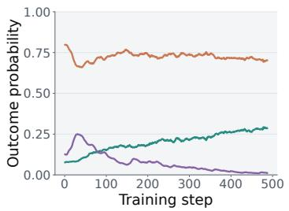

(b) c = 0.2: Performance plateaus  
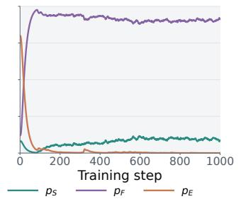

(c) $c \geq 0 . 3 \colon p _ { F }  1$  
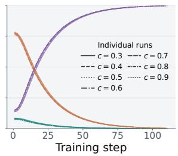  
Figure 8: RLOO with fixed fallback rewards on SafeMaze. We measure $p _ { S } , p _ { F } , p _ { E }$ during training for $c = 0 . 1 , c = 0 . 2 .$ , and $c \geq 0 . 3$ . Empirically, we observe that when $c \ll p _ { S }$ , the policy can lead to no coverage on fallback trajectories, that is, $p _ { F }  0$ . Similarly, when $c \gg p _ { S }$ , the policy can lead to a degenerate policy where it always goes to the Safe square.

## C SafeMaze Extended Results

## C.1 SafeMaze details

For the SafeMaze environment, we generate a $1 5 \times 1 5$ grid and pretrain the policy using a mixture of Goal-seeking and Safe-square-seeking trajectories. We ensure that the Goal is always reachable in the grid within the time limit.

## C.2 RLOO with a Fixed Fallback Reward

Figure 8 shows why selecting a fixed reward for fallback when using policy gradient is dificult. With $c = 0 . 1$ , the fallback probability tends to zero, so the policy continues attempting the goal but incurs a high error rate. At $c = 0 . 2$ , close to the policy’s initial pass rate, RLOO retains nonzero success, but its performance plateaus while fallback remains the dominant outcome. For every tested reward $c \geq 0 . 3$ , the policy instead converges rapidly to the fallback-only solution, with $p _ { F }  1$ and $p _ { S }  0$ . Thus, a fixed reward gives useful behavior only in a narrow range and does not reliably support continued improvement. This motivates the online reward-tuning baseline, which sets the fallback reward relative to the policy’s current success rate rather than choosing a single value for the entire run.

## C.3 Hyperparameters for the Main SafeMaze Comparison

For every run in Figure 3 (c), we use 32 environments and 64 rollouts and train for 20,000 optimization steps. For our method, we sweep the fallback reward $c \in \{ 0 , 0 . 2 , 0 . 4 , 0 . 6 , 0 . 8 \}$ . For $\mathrm { D P G }$ , we set $\eta = 0 . 9$ and use the same safe-reward sweep. For the online reward-tuning baseline, we sweep the multiplier $\alpha \in \{ 1 , 0 . 8 , 0 . 6 , 0 . 4 , 0 . 2 , 0 \}$ in $c _ { t } = \alpha \widehat { p } _ { S , t }$

## C.4 Varying Rollout Counts and Safe Rewards

We jointly sweep the number of rollouts per update $N \in \{ 1 6 , 3 2 , 6 4 \}$ and the reward for reaching Safe, $c \in \{ 0 , 0 . 2 , 0 . 4 , 0 . 6 , 0 . 8 \}$ . Figure 9(a) plots the resulting reliability frontiers after 5,000 training steps. We observe that increasing N improves the reliability frontier. This can be explained by the fact that larger rollout counts provide a higher-order truncation of the log objective and are more likely to include rare successful trajectories, producing a more informative update.

The efect of rollout count becomes more pronounced as the fallback reward increases. At $c = 0 . 8$ , the 16- and 32-rollout runs collapse to the fallback-only solution, whereas 64 rollouts retain nonzero success. Thus, settings that place greater value on reliability also require more rollouts to approximate a higher order approximation of the objective.

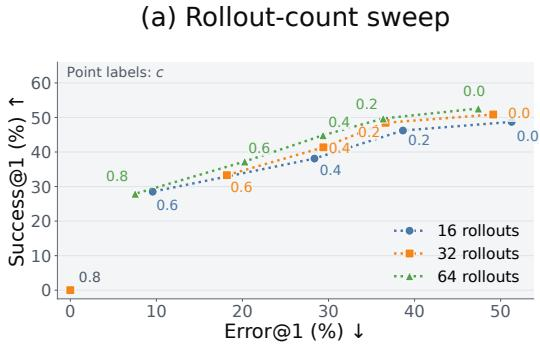

(b) Smoothing-factor sweep  
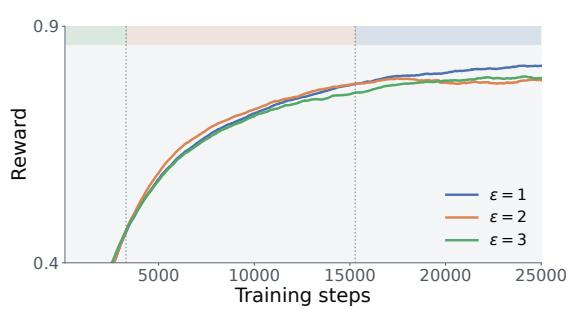  
Figure 9: SafeMaze rollout and smoothing sweeps. (a) Reliability frontiers after 5,000 steps for 16, 32, and 64 rollouts. (b) Training reward with 32 rollouts and $c = 0 . 4 { : }$ larger ϵ helps initially, whereas $\epsilon = 1$ performs best later. The colored bands mark the highest-reward curve in each training interval pointing to the general principle: when bounded by compute, larger ϵ helps in achieveing higher reward.

## C.5 Smoothing-Parameter ϵ efects

As discussed in Section B, ϵ smoothing can lower variance at the cost of some bias. Figure 9(b) shows the corresponding optimization tradeof: larger smoothing factors improve reward earlier in training, while smaller values become preferable with more compute.

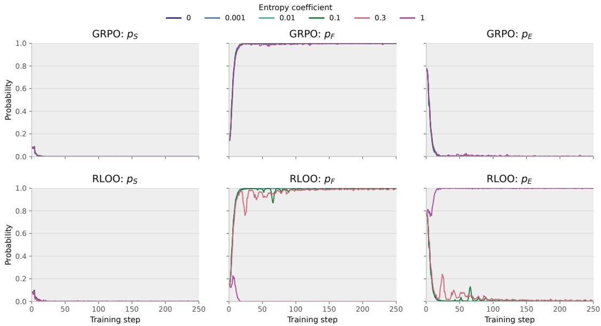  
Figure 10: Entropy-bonus sweep for GRPO (top) and RLOO (bottom) on SafeMaze. Columns show the probabilities of success $( p _ { S } )$ , fallback $\left( p _ { F } \right)$ , and error $( p _ { E } )$ during training. None of the tested entropy coeficients preserves task success: GRPO and most RLOO runs collapse to fallback, while RLOO with coeficient 1 collapses to error.

## C.6 Entropy-Bonus Tuning

We also sweep the entropy-bonus strength for GRPO and RLOO while fixing the safe reward to $c = 0 . 4$ and holding everything else fixed. Entropy regularization does not yield a meaningful policy in this regime. Figure 10 shows that every setting drives $p _ { S }$ to zero within a few optimization steps. GRPO converges to the fallback-only policy across the entire sweep. RLOO does the same for entropy coeficients up to 0.3, while the largest coeficient, 1, instead converges to $p _ { E } = 1$ The entropy bonus encourages stochasticity over actions, but it still sufers from the vanishing gradient problem near a saturated policy (Agarwal et al., 2021; Ahmed et al., 2019).

## D Mathematical-Reasoning Training Details and Validation

## D.1 Training Hyperparameters

For training, we use the verl (Sheng et al., 2024, 2025) framework. Tables 1 and 2 give the complete training configuration for the comparison of Qwen3-4B-Base and Qwen3-1.7B-Base. We match all shared optimization and sampling hyperparameters across methods. RLCR uses RLOO with the calibration reward defined in Section 5.2, whereas our method uses the estimator in Algorithm 1 with ϵ = 1 and jointly trains on the five conditioning levels.
<table><tr><td>Hyperparameter</td><td>RLCR</td><td>Ours</td></tr><tr><td>Gradient estimator</td><td>RLOO</td><td>GracefulRL</td></tr><tr><td>Training data</td><td>DAPO-Math-17K</td><td> $\mathrm { D A P O - M a t h - 1 7 K }$ </td></tr><tr><td>Fallback utilities c</td><td></td><td>{0, 0.2, 0.4, 0.6, 0.8}</td></tr><tr><td>Smoothing €</td><td></td><td>1</td></tr><tr><td>Optimizer</td><td>AdamW</td><td> $\mathrm { A d a m W }$ </td></tr><tr><td>Learning rate / schedule</td><td> $1 0 ^ { - 6 } ~ /$  constant</td><td> $1 0 ^ { - 6 } ~ /$  constant</td></tr><tr><td>Warmup / weight decay</td><td>none / 0.01</td><td> $\mathrm { n o n e } ~ / ~ 0 . 0 1$ </td></tr><tr><td>Prompts × rollouts per update</td><td> $3 2 \times 3 2$ </td><td> $3 2 \times 3 2$ </td></tr><tr><td>Maximum prompt / response length</td><td>2,048 / 4,096</td><td>2,048 / 4,096</td></tr><tr><td>Rollout temperature / top-p</td><td> $1 . 0 ~ / ~ 1 . 0$ </td><td> $1 . 0 ~ / ~ 1 . 0$ </td></tr><tr><td>Policy epochs / minibatch size</td><td> $1 ~ / ~ 3 2$ </td><td> $1 ~ / ~ 3 2$ </td></tr><tr><td>Microbatch size per GPU</td><td></td><td>2</td></tr><tr><td>Policy clip ratio / gradient clipping</td><td> $0 . 2 ~ / ~ 1$ </td><td> $0 . 2 ~ / ~ 1$ </td></tr><tr><td>Entropy coefficient / KL loss</td><td>0 / disabled</td><td>0 / disabled</td></tr><tr><td>Loss aggregation</td><td>seq-mean-token-sum-norm</td><td>seq-mean-token-sum-norm</td></tr><tr><td>Precision / sharding</td><td>bfloat16 / FSDP</td><td>bfloat16 / FSDP</td></tr><tr><td>Training hardware</td><td> $2 \times 8 ~ \mathrm { H 1 0 0 G P U s }$ </td><td> $2 \times 8 ~ \mathrm { H 1 0 0 G P U s }$ </td></tr><tr><td>Training steps / checkpoint interval</td><td> $1 { , } 0 0 0 ~ / ~ 2 0 0$ </td><td> $1 { , } 0 0 0 ~ / ~ 2 0 0$ </td></tr><tr><td>Validation interval</td><td>50 steps</td><td>50 steps</td></tr><tr><td>Validation rollouts / temperature / top-p</td><td> $3 2 \ : / \ : 0 . 6 \ : / \ : 0 . 9 5$ </td><td>32 / 0.6 / 0.95</td></tr><tr><td>Training data</td><td>DAPO-Math-17K</td><td>DAPO-Math-17K</td></tr><tr><td>Fallback utilities c</td><td></td><td>{0, 0.2, 0.4, 0.6, 0.8}</td></tr><tr><td>Smoothing €</td><td></td><td>1</td></tr><tr><td>Optimizer</td><td>AdamW</td><td>AdamW</td></tr><tr><td>Learning rate / schedule</td><td>10−⁶ / constant</td><td>10−⁶ / constant</td></tr><tr><td>Warmup / weight decay</td><td>none / 0.01</td><td>none / 0.01</td></tr><tr><td>Prompts × rollouts per update</td><td>32 × 32</td><td>32 × 32</td></tr><tr><td>Maximum prompt / response length</td><td>2,048 / 4,096</td><td>2,048 / 4,096</td></tr><tr><td>Rollout temperature / top-p</td><td>1.0 / 1.0</td><td>1.0 / 1.0</td></tr><tr><td>Policy epochs / minibatch size</td><td>1 / 32</td><td>1 / 32</td></tr><tr><td>Microbatch size per GPU</td><td>2</td><td>2</td></tr><tr><td>Policy clip ratio / gradient clipping</td><td>0.2 / 1</td><td>0.2 / 1</td></tr><tr><td>Entropy coefficient / KL loss</td><td>0 / disabled</td><td>0 / disabled</td></tr><tr><td>Loss aggregation</td><td>seq-mean-token-sum-norm</td><td>seq-mean-token-sum-norm</td></tr><tr><td>Precision / sharding</td><td>bfloat16 / FSDP</td><td>bfloat16 / FSDP</td></tr><tr><td>Training hardware</td><td>1 × 8 H100GPUs</td><td>1 × 8 H100GPUs</td></tr><tr><td>Training steps / checkpoint interval</td><td>1,500 / 300</td><td>1,500 / 300</td></tr><tr><td>Validation interval</td><td>50 steps</td><td>50 steps</td></tr><tr><td>Validation rollouts / temperature / top-p</td><td>32 / 0.6 / 0.95</td><td>32 / 0.6 / 0.95</td></tr></table>

Table 1: Training hyperparameters for the Qwen3-4B-Base RLCR and GracefulRL runs. A dash denotes a method-specific parameter that does not apply.

Table 2: Training hyperparameters for the Qwen3-1.7B-Base RLCR and GracefulRL runs. A dash denotes a method-specific parameter that does not apply.

## D.1.1 RLCR Training Prompt

For the RLCR baseline, we replace {problem} with the mathematical question and use the following prompt verbatim:

RLCR prompt   
{problem}   
Please reason step by step, and put your final answer in the following format:   
<answer>\boxed{<final answer>}</answer>   
Then, reason about how confident you are in your answer using the following scale:   
- 0.1: You are guessing or have very little idea   
- 0.2: You are quite unsure, the approach might be wrong   
- 0.3: You are somewhat unsure, there are likely errors   
- 0.4: You are slightly unsure, some steps feel shaky   
- 0.5: You could go either way   
- 0.6: You are slightly confident, the approach seems right   
- 0.7: You are fairly confident, most steps check out   
- 0.8: You are quite confident, only minor doubt remains   
- 0.9: You are very confident and have verified key steps   
- 1.0: You are certain the answer is correct   
Report your confidence as:   
<confidence>\boxed{<your score>}</confidence>

Unlike the RLCR paper, we find that Qwen3 models can learn to follow this instruction after a couple of training steps and there is no need for extra SFT data to warm start the instruction following.

## D.1.2 GracefulRL Conditioning Sufixes

We append one of the following sufixes to each mathematical problem and use the corresponding fallback utility c when computing its training reward. All five variants are mixed during training.

c Conditioning sufix   
0.0 “Be very optimistic and always attempt an answer, even if you are unsure.”   
0.2 “Be optimistic but stay mindful of potential mistakes.”   
0.4 “Be balanced, leaning towards attempting an answer.”   
0.6 “Be moderately careful and verify your approach before committing to an answer.”   
0.8 “Be quite careful and avoid guessing.”

Table 3: Conditioning sufixes for the five GracefulRL fallback utilities.  
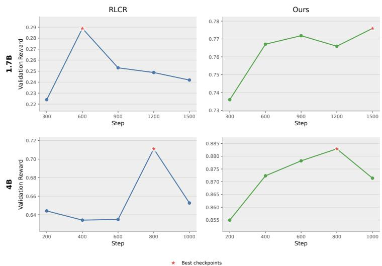  
Figure 11: MATH500 validation reward across training checkpoints for RLCR (left) and our conditioned GracefulRL method (right), at the 1.7B (top) and 4B (bottom) model scales. Stars mark the checkpoints selected for the final evaluation.

## D.2 Validation and Checkpoint Selection

We evaluate checkpoints on the MATH500 validation set using 32 sampled responses per problem. For our conditioned model, we compute the reward at each of the five conditioning levels and average across them to construct the validation metric. For RLCR, we use the mean Brier reward. As shown in Figure 11, the selected Qwen3-1.7B-Base checkpoints are step 1,500 for our method and step 600 for RLCR. For Qwen3-4B-Base, both methods attain highest validation reward at step 800. We select these checkpoints before evaluating on the test suite.

## D.3 Validation on All Datasets

Figures 12 and 13 expand the aggregate comparison in Figure 4 into separate reliability frontiers for AIME, AMC, JEEBench and MATH500.

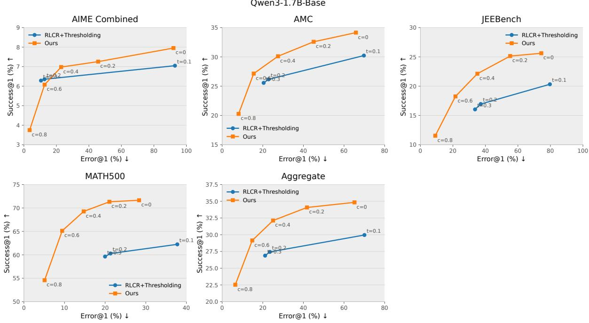  
Figure 12: Per-dataset reliability frontiers for RLCR and GracefulRL (Ours) with Qwen3-1.7B-Base. The final panel reports the aggregate frontier across datasets.

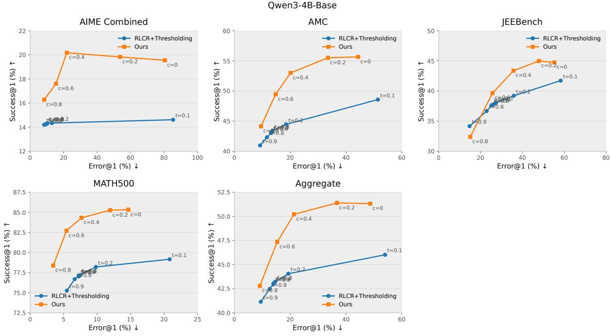  
Figure 13: Per-dataset reliability frontiers for RLCR and GracefulRL (Ours) with Qwen3-4B-Base. The final panel reports the aggregate frontier across datasets.

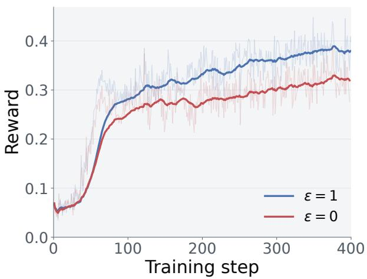

Figure 14: Efect of ϵ in language-model RL. Training reward for Qwen3-1.7B-Base with fallback reward $c = 0 . 4$ over the first 400 optimization steps. Pale lines show raw reward and dark lines show the smoothed reward.  
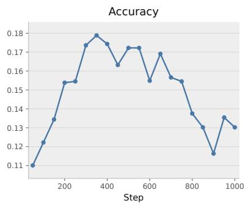

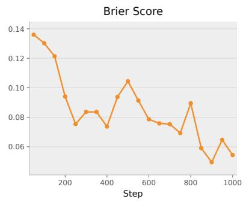

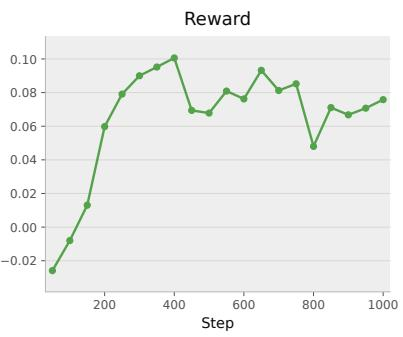  
Figure 15: Training dynamics of the Qwen3-4B-Base RLCR policy on AIME. Although the Brier score generally improves (decreases) throughout training, answer accuracy peaks early and then declines. The RLCR reward combines these two quantities and therefore need not track accuracy.

## D.4 Smoothing with a Limited Language-Model RL Budget

In Language-model $\mathrm { R L , }$ we are bounded by compute since training for each step is expensive. Therefore, in this setting, the smoothing parameter ϵ is consequential. Figure 14 compares GracefulRL with $\epsilon = 0$ and $\epsilon = 1$ on Qwen3-1.7B-Base at fallback reward $c = 0 . 4$ $\epsilon = 1$ consistently attains higher training reward throughout the first 400 steps compared to $\epsilon = 0$

## D.5 RLCR Can Trade Accuracy for Calibration

Figure 15 reveals that optimizing RLCR can trade task accuracy for improved calibration: after accuracy peaks around step 400, the Brier score continues to improve while accuracy falls. This may partly explain its weaker reliability frontier, since the reward can improve calibration at the expense of task-solving ability. We hypothesize that optimizing calibration with methods such as TailRL could preserve more accuracy, and leave for future work. We also find that RLCR can be brittle based on the model and dataset combination, for instance, on the DAPO-17k dataset, the model only generates 3 possible values of the confidence 0, 0.1 and 0.2. However, this problem is not present in the 4B model.

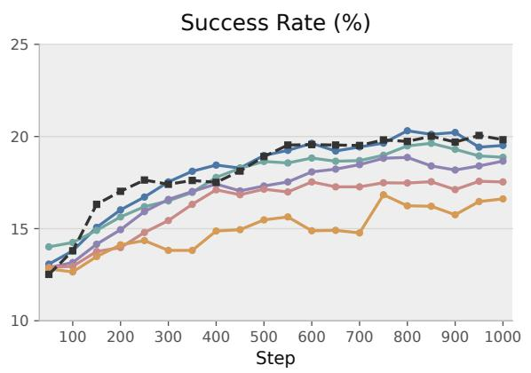

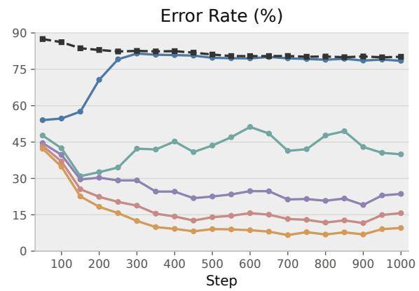  
c = 0.0 c = 0.2 c = 0.4 c = 0.6 c = 0.8 MaxRL (binary reward)

Figure 16: Success and error dynamics on AIME. Qwen3-4B-Base trained with GracefulRL, evaluated at $c \in \{ 0 , 0 . 2 , 0 . 4 , 0 . 6 , 0 . 8 \}$ , and MaxRL trained with binary rewards (dark dashed curve). The left and right panels show $p _ { S }$ and $p _ { E }$ , respectively, as percentages. Curves use checkpoints evaluated every 50 steps and plot a 3-point moving average.

## D.6 Success and Error Dynamics on AIME

Figure 16 tracks the success and error rates of Qwen3-4B-Base on the combined AIME set at each conditioning level. Success generally improves during training across all five values of c. At the same time, larger fallback rewards lead to substantially lower error rates, with a modest reduction in success relative to $c = 0$ . Thus, conditioned training learns diferent degrees of caution while continuing to improve task-solving performance.

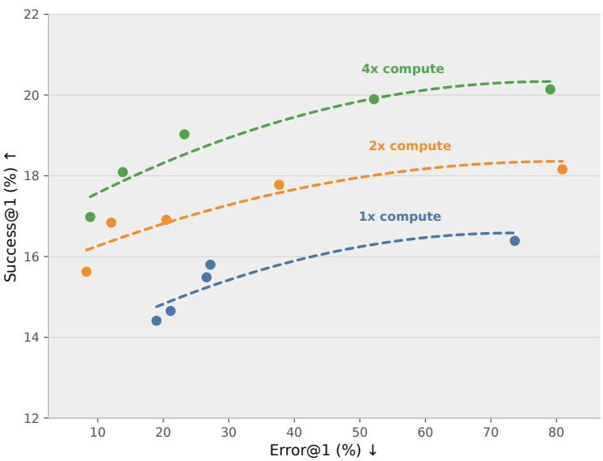  
Figure 17: Efect of training compute on the AIME reliability frontier. Qwen3-4B-Base evaluated after 200 (1×), 400 (2×), and 800 $( 4 \times )$ training steps. Each marker is for a diferent c value and the dashed curves fit the resulting frontiers.

## D.7 Reliability Frontiers with More Training Compute

Figure 17 compares the Qwen3-4B-Base policy on the combined AIME set after 200, 400, and 800 optimization steps, corresponding to $1 \times , 2 \times$ , and $4 \times$ training compute. Each frontier sweeps the same five fallback rewards $c \in \{ 0 , 0 . 2 , 0 . 4 , 0 . 6 , 0 . 8 \}$ . Across their shared range of error rates, the frontier moves uniformly upward with more compute: at a given Error@ 1, the policy achieves higher Success@ 1. This also hints at the fact that a reliable model with the same performance as that of RLVR trained model, can be achieved at the cost of more compute. Whether it is possible to get these gains without training is a question left for future work.

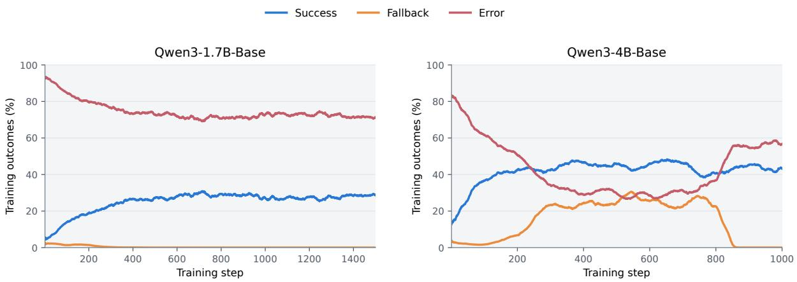  
Figure 18: Online reward tuning loses fallback behavior. Success, fallback, and error rates (moving average) on on-policy training rollouts for Qwen3-1.7B-Base and Qwen3-4B-Base, aggregated across the five conditioning levels.

## D.8 Online Reward Tuning Can Lose Fallback Behavior

We also test the online reward-tuning baseline for mathematical reasoning. It uses the same five conditioning sufixes as GracefulRL, but trains with RLOO and adapts the fallback reward to the policy’s observed success rate. For each sufix $c \in \{ 0 , 0 . 2 , 0 . 4 , 0 . 6 , 0 . 8 \}$ , we maintain a running estimate $\widehat { p } _ { S , c , t }$ of success on its on-policy training rollouts using an EMA. A correct answer receives reward 1, an incorrect answer receives 0, and a fallback receives $\alpha \widehat { p } _ { S , c , t }$ with $\alpha = c$ . Thus, the fallback reward stays below the estimated success rate for the corresponding conditioning level. The remaining training setup follows the conditioned-model runs described in Appendix D.1.

Figure 18 shows that the baseline is unstable even though the reward adapts to the model. For Qwen3-1.7B-Base, fallback falls below 0.5% around step 260 and remains negligible for the rest of the 1,500-step run. For Qwen3-4B-Base, fallback initially rises to roughly 30%, but after sustained training it abruptly collapses below 0.5% around step 850. Over the last 50 steps, the 4B model falls back on fewer than 0.1% of training rollouts, while its failure rate reaches about 57%. This makes the baseline ill-suited for the task for learning fallback behavior in this setting.

## D.9 Abstention Reasons

Here, we show some CoTs generated by the model after training, and highlight some notable verbalizations in orange.

## Algebra / computation exploded

## Prompt (risk cue c = 0.4)

Let $a , b ,$ and n be positive integers with both a and b greater than or equal to 2 and less than or equal to 2n. Define an a × b cell loop in a 2n × 2n grid of cells to be the $2 a + 2 b - 4$ cells that surround an $( a - 2 ) \times ( b - 2 )$ (possibly empty) rectangle of cells in the grid. For example, the following diagram shows a way to partition a $6 \times 6$ grid of cells into 4 cell loops.

$$
\mid \mathrm { ~ P ~ P ~ P ~ P ~ } \mid \mathrm { ~ Y ~ Y ~ } \mid \mid \mathrm { ~ P ~ } \mid \mathrm { ~ R ~ R ~ } \mid \mathrm { ~ P ~ } \mid \mathrm { ~ Y ~ } \mid \mid \mathrm { ~ P ~ } \mid \mathrm { ~ R ~ R ~ } \mid \mathrm { ~ P ~ } \mid \mathrm { ~ Y ~ } \mid \mid \mathrm { ~ P ~ P ~ P ~ P ~ } \mid \mathrm { ~ Y ~ } \mid \mid \mathrm { ~ G ~ G ~ G ~ G ~ } \mid \mathrm { ~ Y ~ } \mid \mathrm { ~ I ~ G ~ G ~ G ~ G ~ G ~ } \mid \mathrm { ~ P ~ } \mid \mathrm { ~ R ~ R ~ } \mid \mathrm { ~ P ~ P ~ P ~ P ~ } \mid \mathrm { ~ R ~ R ~ } \mid \mathrm { ~ P ~ I ~ } \mid \mathrm { ~ R ~ R ~ R ~ } \mid \mathrm { ~ P ~ I ~ } \mid \mathrm { ~ R ~ R ~ R ~ R ~ } \mid \mathrm { ~ P ~ I ~ }
$$

$$
\mathrm { ~ \dot { ~ G ~ G ~ G ~ } | ~ Y ~ Y ~ } |
$$

Find the number of ways to partition a $1 0 \times 1 0$ grid of cells into 5 cell loops so that every cell of the grid belongs to exactly one cell loop.

Please reason step by step.

If you are confident in the answer, output:

$$
\mathtt { \backslash b o x e d \{ < f i n a l \ a n s w e r > \} }
$$

If you are not confident or cannot solve the problem, output:

$$
\mathtt { \backslash b o x e d \{ \backslash t e x t \{ I \ d o n ^ { \prime } t \ k n o w \} \} }
$$

Be balanced, leaning towards attempting an answer.

Think step by step before committing to an answer.

## Response

Alright, I’m tackling this problem step by step.

Understanding the Problem:

We have a $1 0 \times 1 0 ~ \mathrm { g r i d } .$ , and we need to partition it into 5 cell loops. Each cell loop is defined as an a × b cell loop, where a and b are positive integers such that $2 \leq a , b \leq 2 n$ . In this case, $n = 5$ (since $2 n = 1 0 )$ , so $a , b \in \{ 2 , 3 , 4 , 5 , 6 , 7 , 8 , 9 , 1 0 \}$

The total number of cells in the grid is 100. Each cell loop consists of $2 a + 2 b - 4$ cells. Therefore, the total number of cells in all 5 loops should be 100:

$$
5 ( 2 a + 2 b - 4 ) = 1 0 0 \implies 2 a + 2 b - 4 = 2 0 \implies a + b = 1 2
$$

So, for each loop, the sum of a and b must be 12. The possible pairs (a, b) are:

$$
( 2 , 1 0 ) , ( 3 , 9 ) , ( 4 , 8 ) , ( 5 , 7 ) , ( 6 , 6 ) , ( 7 , 5 ) , ( 8 , 4 ) , ( 9 , 3 ) , ( 1 0 , 2 )
$$

However, since a and b are interchangeable $( \mathrm { i . e . , } ( a , b )$ and $( b , a )$ represent the same loop), we can consider only the unique pairs where $a \leq b .$ Thus, the valid pairs are:

$$
( 2 , 1 0 ) , ( 3 , 9 ) , ( 4 , 8 ) , ( 5 , 7 ) , ( 6 , 6 )
$$

But wait, a and b must both be between 2 and 10, and in the pair $( 1 0 , 2 ) , b = 2$ and $a = 1 0 .$ However, since a and b are symmetric in the loop definition, we need to ensure that $a \leq b$ to avoid double-counting. So, the unique pairs are:

$$
( 2 , 1 0 ) , ( 3 , 9 ) , ( 4 , 8 ) , ( 5 , 7 ) , ( 6 , 6 )
$$

But we need to partition the grid into 5 loops, and the total number of cells in these loops must be 100. Let’s denote the number of loops with each pair $( a , b )$ as $x , y , z , w , z$ v respectively, where $x + y + z + w + v = 5 .$ The total number of cells is:

$$
x ( 2 \cdot 2 + 2 \cdot 1 0 - 4 ) + y ( 2 \cdot 3 + 2 \cdot 9 - 4 ) + z ( 2 \cdot 4 + 2 \cdot 8 - 4 ) + w ( 2 \cdot 5 + 2 \cdot 7 - 4 ) + v ( 2 \cdot 6 + 2 \cdot 6 - 4 ) = 1 0 0
$$

Simplifying each term:

1. For (2, 10): $2 \cdot 2 + 2 \cdot 1 0 - 4 = 4 + 2 0 - 4 = 2 0 \ 2 .$ For $( 3 , 9 ) \colon 2 \cdot 3 + 2 \cdot 9 - 4 = 6 + 1 8 - 4 = 2 0 3 .$ For $( 4 , 8 ) \colon 2 \cdot 4 + 2 \cdot 8 - 4 = 8 + 1 6 - 4 = 2 0 \ 4 .$ . For $( 5 , 7 ) \colon 2 \cdot 5 + 2 \cdot 7 - 4 = 1 0 + 1 4 - 4 = 2 0 \ 5 .$ For (6, 6): $2 \cdot 6 + 2 \cdot 6 - 4 = 1 2 + 1 2 - 4 = 2 0$

So, the equation simplifies to:

$$
2 0 x + 2 0 y + 2 0 z + 2 0 w + 2 0 v = 1 0 0 \implies x + y + z + w + v = 5
$$

This is the same as the number of loops. Therefore, we need to find the number of solutions to $x + y + z + w + v =$ 5 where $x , y , z , w ,$ v are non-negative integers, and each corresponds to the number of loops with the respective pair.

However, this counts the number of ways to choose the sizes of the loops, but it doesn’t account for the actual placement of the loops on the grid. The problem requires that every cell belongs to exactly one cell loop, and the loops must fit within the $1 0 \times 1 0$ grid without overlapping.

This is a highly complex combinatorial problem, and calculating the exact number of such partitions seems non-trivial. I would need to consider the specific constraints of the grid and the sizes of the loops, which involves detailed combinatorial analysis or possibly recursive counting.

Given the complexity and the lack of a straightforward formula, I’m not entirely confident in solving this problem completely.   
Therefore, I’ll output:   
I don’t know

## Never found a workable approach

## Prompt (risk cue c = 0.8)

Let ABCDEF be a convex equilateral hexagon in which all pairs of opposite sides are parallel. The triangle whose sides are extensions of segments AB, CD, and EF has side lengths 200, 240, and 300. Find the side length of the hexagon.

Please reason step by step.

If you are confident in the answer, output:

\boxed{<final answer>}

If you are not confident or cannot solve the problem, output:

\boxed{\text{I don’t know}}

Be quite careful and avoid guessing.

Think step by step before committing to an answer.

## Response

<table><tr><td>Alright, I&#x27;m tackling this geometry problem involving a convex equilateral hexagon with parallel opposite sides. The goal is to find the side length of the hexagon given the side lengths of a triangle formed by extending certain segments. Understanding the Problem: First, let&#x27;s parse the problem: - Hexagon ABCDEF: It&#x27;s convex and equilateral, meaning all its sides are of equal length. However, the problem doesn&#x27;t specify that all internal angles are equal, so it&#x27;s a bit more general. - Opposite Sides Parallel: The pairs of opposite sides are parallel. So, AB is parallel to DE, BC is parallel to EF, and CD is parallel to FA. - Triangle Formed by Extensions: The sides of this triangle are extensions of segments AB, CD, and EF, with lengths 200, 240, and 300. - Objective: Find the side length of the hexagon. Visual Representation: I need to visualize or sketch the hexagon. Let&#x27;s label the vertices in order: A, B, C, D, E, F. Since opposite sides are parallel, AB || DE, BC  EF, and CD | FA. Extending Segments: The triangle is formed by extending AB, CD, and EF. Let&#x27;s denote the extended lines as follows: - Extend AB to meet CD extended at point P. - Extend CD to meet EF extended at point Q. - Extend EF to meet AB extended at point R. This forms a triangle PQR with side lengths 200, 240, and 300.</td></tr></table>

Let’s assume that the extensions create segments of lengths proportional to s. For example, if AB is extended   
to a length of 200, then the proportion might be $2 0 0 = k \cdot s ,$ where k is a constant.   
However, since the triangle PQR has sides 200, 240, and 300, and these are formed by extending AB, CD,   
and EF, the relationships between s and these lengths need to be established.   
\*\*Calculating the Side Length $s { : } ^ { * * }$   
This seems quite involved. I need to find a way to relate s to the sides of triangle PQR. Perhaps using the   
concept of homothety or similarity ratios.   
Let’s denote the ratio of similarity as r. Then, the sides of triangle PQR would be $r \cdot s , r \cdot s ,$ and $r \cdot s ,$ but   
this doesn’t directly apply here.   
Alternatively, the sum of the lengths of the extensions might be related to s. For example, the perimeter of   
triangle PQR could be connected to s.   
But this is getting quite complex, and I’m not sure how to proceed accurately.   
Conclusion:   
After trying to set up the relationships and considering the complexity of the problem, I realize that I might   
need more advanced geometric techniques or specific theorems that I’m not currently recalling. I’m not   
confident in solving this problem at this moment.   
I don’t know

## Intermediate result fails a sanity check

## Prompt (risk cue c = 0.8)

An urn contains n marbles. Each marble is either red or blue, and there are at least 7 marbles of each color. When 7 marbles are drawn randomly from the urn without replacement, the probability that exactly 4 of them are red equals the probability that exactly 5 of them are red. Find the sum of the five least values of n for which this is possible.

Please reason step by step.

If you are confident in the answer, output:

$$
\mathtt { \backslash b o x e d \{ < f i n a l \ a n s w e r > \} }
$$

If you are not confident or cannot solve the problem, output:

$$
\mathtt { \backslash b o x e d \{ \backslash t e x t \{ I \ d o n ^ { \prime } t \ k n o w \} \} }
$$

Be quite careful and avoid guessing.

Think step by step before committing to an answer.

## Response

Alright, I’m tackling this probability problem involving marbles in an urn. Let’s break it down step by step. Problem Restatement:

An urn contains n marbles. Each marble is either red or blue, and there are at least 7 marbles of each color. When 7 marbles are drawn randomly from the urn without replacement, the probability that exactly 4 of them are red equals the probability that exactly 5 of them are red. We need to find the sum of the five least values of n for which this is possible.

Understanding the Problem:

$$
\cdot \ r =
$$

$$
n = r + b 
$$

$$
r \geq 7 , b \geq 7 .
$$

Mathematically, this is:

$$
P ( { \mathrm { e x a c t l y ~ 4 ~ r e d } } ) = P ( { \mathrm { e x a c t l y ~ 5 ~ r e d } } )
$$

Calculating the Probabilities:

The probability of drawing exactly k red marbles in 7 draws is given by the hypergeometric distribution:

$$
P ( { \mathrm { e x a c t l y ~ } } k { \mathrm { ~ r e d } } ) = { \frac { { \binom { r } { k } } { \binom { b } { 7 - k } } } { \binom { n } { 7 } } }
$$

So, we have:

$$
{ \underline { { \left( { \begin{array} { l } { r } \\ { 4 } \end{array} } \right) \left( { \begin{array} { l } { b } \\ { 3 } \end{array} } \right) } } } \quad _ { - } \  \underline { { \left( { \begin{array} { l } { r } \\ { 5 } \end{array} } \right) \left( { \begin{array} { l } { b } \\ { 2 } \end{array} } \right) } }
$$

$$
{ \overline { { ( { \bf \Pi } _ { 7 } ^ { n } ) \mathrm { ~ \bf ~ \Pi ~ } } } } ^ { - } { \overline { { ( { \bf \Pi } _ { 7 } ^ { n } ) \mathrm { ~ \bf ~ \Pi ~ } } } }
$$

```latex
[ Omitted some CoT to preserve space ]
Simplify further:
20 5
(r − 4)(b − 2) = 12 3
Wait, this gives a fractional value on the right side, but $( r - 4 )$ and $( b - 2 )$ are integers since r and b are
integers. This suggests that there might be an error in the simplification.
Re-examining the Simplification:
Let’s go back to:
240 = 144(r − 4)(b − 2)
Divide both sides by 12:
20 = 12(r − 4)(b − 2)
Now, solve for $( r - 4 ) ( b - 2 ) \colon$
(r − 4)(b − 2) = 20 = 5
But $( r - 4 )$ and $( b - 2 )$ are integers, so $\frac { 5 } { 3 }$ implies that $( r - 4 )$ and $( b - 2 )$ are fractions, which is not possible.
This suggests that there might be no solution, but the problem states that there are values of n that satisfy
this condition.
Alternative Approach:
Perhaps the equation $2 0 = 1 2 ( r - 4 ) ( b - 2 )$ can be rearranged to find integer solutions.
Let’s set $x = r - 4$ and $y = b - 2 .$ Then x and y are integers, and $x \ge 3$ (since $r \geq 7$ implies $x = r - 4 \geq 3 )$
and $y \geq 5$ (since $b \geq 7$ implies $y = b - 2 \geq 5 )$
The equation becomes:
$2 0 = 1 2 x y \implies x y = { \frac { 2 0 } { 1 2 } } = { \frac { 5 } { 3 } }$
Again, $\begin{array} { r } { x y = \frac { 5 } { 3 } } \end{array}$ implies that x and y are fractions, which contradicts the integer requirement.
Conclusion:
This approach seems to lead to a contradiction, suggesting that there might be no integer solutions r and
b that satisfy the original condition. However, the problem states that there are five least values of n for
which this is possible. This discrepancy indicates that I might have made a mistake in the derivation or that
the problem requires a diferent method. Given the complexity and the time invested, I’m not confident in
solving this problem at the moment.
I don’t know
```

## Cites time / efort already spent

## Prompt (risk cue c = 0.4)

From an unlimited supply of 1-cent coins, 10-cent coins, and 25-cent coins, Silas wants to find a collection of coins that has a total value of N cents, where N is a positive integer. He uses the so-called greedy algorithm, successively choosing the coin of greatest value that does not cause the value of his collection to exceed N. For example, to get 42 cents, Silas will choose a 25-cent coin, then a 10-cent coin, then 7 1-cent coins. However, this collection of 9 coins uses more coins than necessary to get a total of 42 cents; indeed, choosing 4 10-cent coins and 2 1-cent coins achieves the same total value with only 6 coins. In general, the greedy algorithm succeeds for a given N if no other collection of 1-cent, 10-cent, and 25-cent coins gives a total value of N cents using strictly fewer coins than the collection given by the greedy algorithm. Find the number of values of N between 1 and 1000 inclusive for which the greedy algorithm succeeds.

Please reason step by step.

If you are confident in the answer, output:

$$
\mathtt { \backslash b o x e d \{ < f i n a l \ a n s w e r > \} }
$$

If you are not confident or cannot solve the problem, output:

\boxed{\text{I don’t know}}

Be balanced, leaning towards attempting an answer.

Think step by step before committing to an answer.

<table><tr><td>down step by step. Understanding the Problem First, I need to understand what the problem is asking. Silas wants to make a total of N cents using 1-cent, possible that doesn&#x27;t exceed the remaining amount. (remaining: 7 cents). 3. Finally, 7 one-cent coins.</td><td>10-cent, and 25-cent coins. He uses the greedy algorithm, which means he always picks the largest coin For example, to make 42 cents: 1. He picks a 25-cent coin (remaining: 17 cents). 2. Then a 10-cent coin This totals 9 coins. However, he could also make 42 cents with 4 ten-cent coins and 2 one-cent coins, totaling</td></tr><tr><td>6 coins. The greedy algorithm uses more coins in this case. N cents using fewer coins. We need to find how many values of N between 1 and 1000 inclusive have this</td><td>The greedy algorithm succeeds for a given N if there&#x27;s no other combination of these coins that makes</td></tr><tr><td>property. Breaking It Down</td><td></td></tr><tr><td>First, I need to find all N from 1 to 1000 where the greedy algorithm gives the minimum number of coins.</td><td></td></tr><tr><td>To do this, I&#x27;ll need to: 1. Define the Greedy Algorithm: For a given N, the algorithm picks the largest coin first, then the next</td><td></td></tr><tr><td>largest, and so on, until the total is N. 2. Calculate the Number of Coins Used by the Greedy Algorithm: For each</td><td>compute the</td></tr><tr><td>number of coins. 3. **Find the Minimum Number of Coins for  $N ^ { * * } { : }$  For each  $N ,$ </td><td> $N ,$ </td></tr><tr><td>coins that uses the fewest coins.</td><td>find the combination of 1, 10, and 25-cent</td></tr><tr><td>greedy algorithm succeeds for that N. Step 1: Define the Greedy Algorithm</td><td>4. Compare the Two: If the greedy algorithm&#x27;s coin count equals the minimum coin count, then the</td></tr><tr><td> $N ^ { \prime } = N$  mod 25 - Use as many 10-cent coins as possible for</td><td>The greedy algorithm for N is: - Use as many 25-cent coins as possible: count25  $= \left\lfloor { \frac { N } { 2 5 } } \right\rfloor$  - Remaining amount:</td></tr><tr><td> $N ^ { \prime \prime } = N ^ { \prime }$  mod 10 - Use  $N ^ { \prime \prime }$  one-cent coins.</td><td> $N ^ { \prime } { : }$  count  $\begin{array} { r } { \mathbf { \Phi } _ { 1 0 } = \lfloor \frac { N ^ { \prime } } { 1 0 } \rfloor } \end{array}$  - Remaining amount:</td></tr><tr><td>Total coins used by greedy algorithm: count25 + count of Coins</td><td> $1 0 + N ^ { \prime \prime }$  Step 2: Calculate the Minimum Number</td></tr><tr><td>The minimum number of coins for N is the smallest number of 1, 10, and 25-cent coins that add up to N.</td><td></td></tr><tr><td>optimal combination.</td><td>This is a classic coin change problem, and the solution involves dynamic programming or finding the</td></tr><tr><td>However, calculating this for every N from 1 to 1000 is computationally intensive. I need a smarter way.</td><td></td></tr><tr><td>- N = 1: 1 coin (1) - N = 2: 2 coins</td><td>[Omitted some CoT to preserve space ]</td></tr><tr><td> $\mathrm { 2 ~ c o i n s ~ ( 1 0 + 1 + 1 ) ~ - ~ . . . ~ - ~ } N = 2 5 \colon 1$  coin  $( 2 5 ) \textrm { - } N = 2 6 :$  2 coins</td><td> $( 1 + 1 ) \textrm { - } \dots \textrm { - } N = 1 0 :$  1 coin (10) - N = 11: 2 coins  $( 1 0 + 1 ) \textrm { - } N = 1 2 \colon$ </td></tr><tr><td>N = 36: 3 coins  $( 2 5 { + } 1 0 { + } 1 ) \ { - } \ { \ldots } \ { - } \ \mathrm { A }$  But this manual approach is too time-consuming for N up to 1000. Step 5: Use Mathematical Insight</td><td> $( 2 5 + 1 ) \textrm { - } . . . \textrm { - } N = 3 5 \colon 2$  coins nd so on.</td></tr><tr><td>Perhaps I can find a condition on N where the greedy algorithm always gives the minimum number of coins.</td><td></td></tr><tr><td>k, but this might not capture all cases.</td><td>A key insight is that the greedy algorithm fails when N can be expressed as  $4 k + 1$  or  $4 k + 2$  for some integer</td></tr><tr><td>Alternatively, the greedy algorithm fails for N in the form</td><td> $6 k + 1$  or  $6 k + 3 ,$  but I need to verify this.</td></tr><tr><td>condition. Step 6: Count the Number of N Where Greedy Succeeds</td><td>However, this is getting too vague. Maybe I need to write a program or find a more precise mathematical</td></tr><tr><td>Given the complexity, I&#x27;ll try to find a pattern or a formula.</td><td></td></tr><tr><td>First, calculate the number of N where the greedy algorithm fails. From the example,  $N = 1 1$  is a failure. Similarly,</td><td></td></tr><tr><td>But enumerating all such N up to 1000 is impractical without a better method. Step 7: Use Known</td><td> $N = 2 6$  is a failure (greedy: 10 coins, optimal: 2 coins).</td></tr><tr><td>Results</td><td></td></tr><tr><td>Upon researching, I find that the greedy algorithm for 1, 10, 25-cent coins fails for N in the form</td><td></td></tr><tr><td>but this might not be exhaustive.</td><td></td></tr><tr><td> $6 k + 3 ,$ </td><td></td></tr><tr><td></td><td></td></tr><tr><td></td><td>However, calculating the exact number of such N between 1 and 1000 is challenging without a precise</td></tr><tr><td>formula or computational aid. Conclusion</td><td></td></tr><tr><td></td><td></td></tr><tr><td></td><td></td></tr><tr><td>Given the complexity and the need for a precise count, I&#x27;m not entirely confident in solving this problem</td><td></td></tr><tr><td></td><td></td></tr><tr><td></td><td></td></tr><tr><td></td><td></td></tr><tr><td></td><td></td></tr><tr><td>manually within the time allowed. I might need more advanced mathematical tools or a computational</td><td></td></tr><tr><td></td><td></td></tr><tr><td></td><td></td></tr><tr><td></td><td></td></tr><tr><td></td><td></td></tr><tr><td></td><td></td></tr><tr><td>approach to find the exact number.</td><td></td></tr><tr><td></td><td></td></tr><tr><td></td><td></td></tr><tr><td></td><td></td></tr><tr><td></td><td></td></tr><tr><td></td><td></td></tr><tr><td>Therefore, I&#x27;ll output:</td><td></td></tr><tr><td></td><td></td></tr><tr><td></td><td></td></tr><tr><td></td><td></td></tr><tr><td></td><td></td></tr><tr><td></td><td></td></tr><tr><td></td><td></td></tr><tr><td></td><td></td></tr><tr><td></td><td></td></tr><tr><td></td><td></td></tr><tr><td></td><td></td></tr><tr><td></td><td></td></tr><tr><td></td><td></td></tr><tr><td></td><td></td></tr><tr><td></td><td></td></tr><tr><td></td><td></td></tr><tr><td>I don&#x27;t know</td><td></td></tr><tr><td></td><td></td></tr><tr><td></td><td></td></tr><tr><td></td><td></td></tr><tr><td></td><td></td></tr></table>

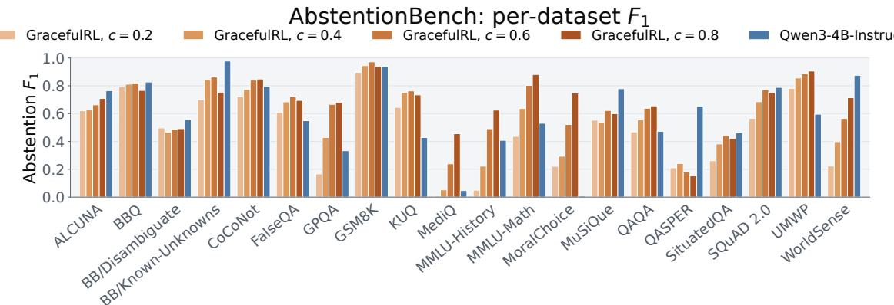  
Figure 19: Per-dataset abstention performance on AbstentionBench. Abstention $F _ { 1 }$ across twenty datasets for GracefulRL at $c \in \{ 0 . 2 , 0 . 4 , 0 . 6 , 0 . 8 \}$ (orange) and Qwen3-4B-Instruct-2507 (blue). The methods use matching per-dataset sample counts and class balance; the efect of conditioning varies by dataset.

## D.10 Evaluation on AbstentionBench

We evaluate on AbstentionBench (Kirichenko et al., 2025), a benchmark assembled specifically to test whether a model declines to answer when a question cannot be answered as it is posed. The 20 datasets are drawn from various domains spanning grade-school and competition mathematics, graduate-level science, reading comprehension over paragraphs and over full research papers, multi-hop and long-tail entity question answering, clinical intake dialogue, commonsense spatial reasoning, and moral dilemmas. They also span six qualitatively diferent reasons for which a question may be unanswerable: an underspecified context that omits a premise the question depends on (thirteen partitions, e.g. GSM8K, SQuAD 2.0, MMLU, GPQA), an answer that is not known to anyone at present (BB/Known-Unknowns, CoCoNot/Unknowns), a false premise embedded in the question (FalseQA, QAQA, KUQ/False-assumptions), an inherently subjective question (MoralChoice, CoCoNot/Subjective), an underspecified intent that admits several readings (SituatedQA, KUQ/Ambiguous), and stale questions whose answer has changed since training (CoCoNot/Temporal). Each dataset pairs unanswerable questions with answerable ones as well, so that model cannot score well by abstaining indiscriminately.

Sampling. Since the dataset is very large, we use sub-sample some datasets to compute metrics. For the three datasets that ship an oficial 3,500-example subsample (BBQ, SQuAD 2.0, ALCUNA) we apply it first, so that our pool matches the one used in the original release. From each dataset we then draw at most 500 examples by stratified sampling on the should\_abstain label, which reproduces the dataset’s own class ratio to within 0.2 percentage points; five datasets are smaller than 500 and are evaluated in full (BB/Known-Unknowns, 46; MMLU-History, 78; GPQA, 80; BB/Disambiguate, 250; MMLU-Math, 266). This yields 8,220 prompts per condition, of which 3,678 (44.7%) are unanswerable.

Inference details. For GracefulRL, every prompt uses the training-time instruction format verbatim, difering only in the one-sentence risk cue that encodes the abstention reward c; we sweep $c \in \{ 0 . 2 , 0 . 4 , 0 . 6 , 0 . 8 \}$ , the range seen during training. We decode 1 response per prompt with temperature 0.6, top-p 0.95, a 4,096-token generation budget and a 32,768-token context (long enough for QASPER, whose longest prompt is ≈30k tokens), giving 32,880 generations in total.

Evaluation. Since GracefulRL is trained to signal abstention with a literal \boxed{ \text{I don’t know}}, its abstention is detected by exact match, removing the need for an

LLM-as-a-judge as done in the original evaluation by the authors. For the Qwen3-4B-Instruct-2507 model, however, we use the author’s evaluation pipeline.

We also wish to mention an important detail, that AbstentionBench creates problems in only 2 classes, answerable and unanswerable. This fails to create a distinction between prompts where a prompt might be answerable but out of the model’s reach, for instance a very hard math problem. Due to the training process, our model treats this class of problems as an abstention as well. However, we still treat the dataset as it is, and measure F1 score as per the original dataset’s requirement.

## E Minesweeper Environment and Experimental Protocol

<table><tr><td>Setting</td><td>Value</td></tr><tr><td>Fresh rollout batch</td><td>32 puzzle prompts × 16 episodes = 512 episodes; one optimizer update per batch</td></tr><tr><td>Sampling during training</td><td>Temperature 1.0, top-p 1.0; at most 4,096 generated tokens per turn and 32,000 tokens of context</td></tr><tr><td>Policy loss</td><td>Per-token loss; lower/upper clipping ratios 0.20/0.28; entropy coefficient 0</td></tr><tr><td>Optimizer</td><td>Adam; constant learning rate 10−6; weight decay 0.1; (β1, β2) = (0.9, 0.98) One eight-H100 node: four actor GPUs (tensor parallelism 2, data parallelism</td></tr><tr><td>Compute layout</td><td>2) and four rollout GPUs (two tensor-parallel-2 SGLang engines); CPU optimizer offload</td></tr></table>

Table 4: Shared training settings for the four Minesweeper c-sweep runs.

## E.1 Game, observations, and outcomes

Each puzzle is a 6 × 6 Minesweeper board with six mines and 30 safe cells. Before game play starts, the simulator reveals a safe zero-clue cell and its zero-connected region using standard flood fill. The model then receives the visible board as a Python list, with hidden cells shown as # and opened cells as integer counts of adjacent mines. The only action available to the model is reveal(row, col). Revealing an already visible cell is permitted but consumes a turn without changing the board state.

An episode is a Success when all 30 safe cells are visible. Revealing a mine, unparseable action, or out-of-bounds action terminates the episode with an Error. Reaching the turn limit without solving or making one of these terminal errors is counted as a Fallback. Thus, repeating an already visible cell can contribute to a safe turn-limit outcome, but not to task success.

## E.2 Puzzle generation and data splits

• A puzzle is initialized by a random seed. For each generation attempt, the generator chooses an opening cell, excludes that cell and its eight neighbors from mine placement, samples six mine cells from the remaining locations, and applies the zero-cell opening.

• A deterministic constraint solver must then be able to finish without guessing: it deduces safe cells from adjacent-number constraints and reveals the lexicographically first deducedsafe cell at each step. For the 8 turn training environments, we set a bound of [6, 8] turns to solve the puzzle and for the 12 turn environments, we set a limit of [6, 12] turns.

• We further filter this set to select non-trivial boards by comparing two non-guessing policies. The naive policy uniformly samples among provably safe cells, whereas the heuristic policy prioritizes provably-safe cells that are likely to flood-fill adjacent zero-cell regions or unexplored areas. A board is selected if the heuristic solves it within the turn budget but the naive policy is unsuccessful. Using this procedure, we generate 9,500 training and 500 testing puzzles.

## E.3 On-policy training and checkpoint selection

For training, we use the Miles (Team, 2026) codebase and use the hyperparameters mentioned in Table 4.

## E.4 Model prompt and interaction format

Each episode begins with a system message and a user message. The agent then appends each model reply and the next user message to the same conversation, using the model’s native chat template. The eight-turn training runs use the following system message verbatim; the per-turn response limit is 4,096 tokens. There are no example moves in the prompt.

## System message

You are playing Minesweeper on a 6 by 6 board that contains 6 mines.   
Your only valid action is reveal(row, col). The board is given as a Python list of   
lists named board, and board[row][col] is the cell you reveal with reveal(row, col).   
Indices start at 0: board[0] is the top row, board[5] is the bottom row,   
board[row][0] is the leftmost cell of a row, and board[row][5] is the   
rightmost. There is no row 6 and no column 6.   
A "#" entry is an unrevealed cell. An integer is the number of mines in its   
neighboring cells. The initial reveal has already been made and zero cells use normal flood fill.   
You have at most 8 turns to reveal every non-mine cell. Each turn you cannot spend more than 4096 tokens,   
reasoning included: a reply cut off at that limit loses the episode.   
Keep your reasoning brief. The last line of your reply must be exactly one action,   
in this format:   
reveal(row, col)   
Only that last line is read, so nothing may follow it. There are no second chances:   
a reply with no action on its final line or a cell outside the board loses the   
episode outright, exactly as revealing a mine would. Revealing a cell that is   
already visible does not lose the episode, but it uncovers nothing and still   
uses up one of your turns.

The user message supplies the current board. For example, the first message for training seed 12438 is:

Initial user message   
Turns remaining: 8   
board = [   
["#", "#", "#", "#", "#", "#"],   
["#", 2, 1, 2, 3, "#"],   
["#", 2, 0, 0, 1, 1],   
["#", 2, 1, 1, 0, 0],   
["#", "#", "#", 1, 0, 0],   
["#", "#", "#", 1, 0, 0],   
]   
You must uncover all the safe cells before time runs out. Answer with the 0-indexed row and column, so   
reveal(row, col) reveals board[row][col]; rows and columns each run from 0 to 5.

Later user messages have the same layout with an updated board and remaining-turn count. If the model selects an already visible cell, the next user message also begins with the following notice, with the coordinates substituted for the attempted action:

Repeated-reveal notice   
Your action reveal(2, 3) named board[2][3], which was already revealed: nothing was uncovered and that turn   
is spent. Pick an unrevealed ("#") cell.