# W-JEPA: Wavelet Joint-Embedding Predictive Architecture for Wearable Activity Recognition

Yogesh Prabhu1, Loki Natarajan2, Jingjing Zou2,3,4,\*

University of California San Diego

A major challenge in wearable device activity recognition is the heterogeneity across datasets in sensor placement, channel count, sampling rate and subjects. Moreover, the motion patterns that distinguish activities often appear as subtle, scale-specific variations within otherwise similar waveforms. As a result, raw signals are often ambiguous, and models trained on them tend to rely on cues specific to a particular sensor setup or participant, which limits both cross-dataset transfer and generalization to unseen participants. Addressing this requires representations that preserve such activity-relevant, scale-specific variation. We introduce W-JEPA, a self-supervised framework that exploits the multiscale structure of inertial motion and leverages a joint-embedding predictive architecture, by organizing windows into a fixed grid of wavelet tokens indexed by scale, sensor axis, and time. These wavelet tokens help expose activity-specific detail within broadly similar raw signals, and serve as the units of masked latent prediction. W-JEPA predicts masked token representations supplied by an exponential-moving-average (EMA) target encoder. Because recovering a masked token requires relating motion at one scale and axis to motion at other scales and axes, the model learns the cross-scale, cross-axis structure of human movement. Across six wearable activity benchmarks, W-JEPA outperforms state-of-the-art methods under random-window splits and remains the strongest when subjects are held out, improving average macro-F1 by 8.7 percentage points over the strongest published baseline. These results indicate that physically grounded multiscale tokenization, combined together with latent predictive learning, provides a promising foundation for transferable representations of heterogeneous wearable inertial data.

Website: https://yogesh914.github.io/wjepa Code Repository: https://github.com/Yogesh914/wjepa Hugging Face: https://huggingface.co/zou-research-lab/wjepa

## 1. Introduction

Public wearable datasets provide substantial unlabeled recordings for learning representations of human motion, but they difer in sensor placement, channel count, sampling characteristics, participants, and activity vocabularies (Chen et al., 2021). A useful representation must therefore capture which activity is being performed, independent of how and on whom it was recorded. This is dificult because the information that separates activities is often small. Similar physical activities can produce nearly the same rhythmic, periodic pattern in raw sensor recordings and difer mainly in the finer temporal structure within each movement cycle (Kim et al., 2021; Tian et al., 2020). Because this detail is small relative to diferences in sensor setup and individual movement style, a model trained on raw signals can fit its training data using cues tied to the setup or to particular participants. Such cues support strong performance on familiar participants but may not carry over to people unseen during training. In our experiments, every method loses at least 14 points of average macro-F1 when evaluation moves from random windows to held-out participants (§4.1). Broad movement patterns and fine activity-specific detail, however, tend to occupy diferent timescales. A representation that separates motion by timescale can keep this detail from being masked by larger variation in the signal, while still allowing broad patterns to inform recognition.

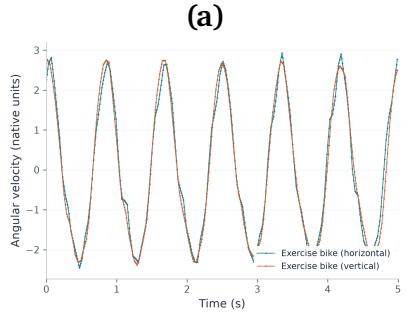

(b)  
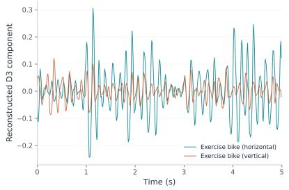

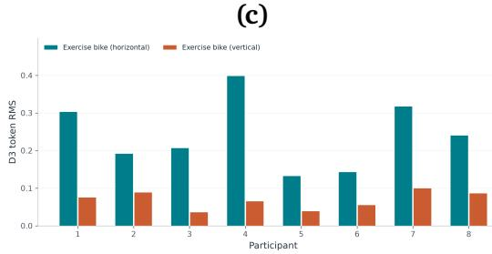  
Figure 1: Wavelet tokens reveal diferences between similar activity signals. (a) Sample window of horizontal and vertical exercise-bike cycling from a DSADS participant’s left leg gyroscope z-axis exhibit similar raw waveforms. (b) The reconstructed db4 $D _ { 3 }$ component reveals larger pronounced oscillations during horizontal cycling in this pair. (c) Mean RMS of the second $D _ { 3 }$ token across 59 windows per activity and participant, with higher values for horizontal cycling in all eight participants. More details appear in Appendix D.1.

Figure 1 shows an example of two labels from the DSADS dataset that are easy to confuse. Panel (a) shows horizontal and vertical exercise-bike cycling from the same participant. The two raw waveforms nearly overlap, with a Pearson correlation of 0.992. Their reconstructed $D _ { 3 }$ wavelet components, however, reveal pronounced oscillations during horizontal cycling (panel b). Across all eight participants, the $D _ { 3 }$ token has higher mean RMS for horizontal cycling than for vertical cycling (panel c). The information that separates the two activities is present in the signal and becomes visible once this scale is isolated. Self-supervised pretraining could learn such distinctions from unlabeled recordings, but masked-modeling approaches for wearables typically hide and predict raw temporal patches (Ryu et al., 2025; Noor & Baraka, 2026), which mix all timescales within each interval. This raises the question we study: how should the units of latent prediction be defined to preserve activity-specific detail while learning transferable motion representations from heterogeneous wearable signals?

We propose W-JEPA, which answers this question by using fixed wavelet tokens as the units of masked latent prediction. A discrete wavelet transform separates each sensor axis into localized components at individual timescales (Daubechies, 1992), and W-JEPA summarizes each resulting band with tokens indexed by scale, sensor axis, and time (Figure 2a). The tokenizer is fixed, meaning no part of it is fit to the pretraining datasets. Because all recordings are resampled to a common rate, each band covers the same nominal frequency range in every dataset, so a token at a given scale carries the same physical meaning across sensor setups. The token grid grows with the number of channels, and only a learned channel embedding depends on the sensor layout. Datasets with diferent layouts therefore share a common set of prediction units and difer only in how many channels they contribute.

During pretraining, a random subset of tokens is masked. A context encoder processes the visible tokens, and a predictor estimates the latent features that an EMA target encoder assigns to the masked positions (Figure 2b). Predicting in latent space means the model is not asked to reproduce raw sample values, whose amplitude and phase can vary with participant and sensor placement. Masks are drawn independently across channels and bands, so recovering a masked token encourages the model to relate motion at one scale on one axis to motion at other scales on other axes. Because each scale has its own tokens, fine activity-specific detail becomes a prediction target in its own right instead of a small component of a patch dominated by larger variation.

We evaluate W-JEPA on six wearable activity benchmarks. For each target dataset, we pretrain on the remaining five and fine-tune on two to six of its participants. W-JEPA achieves the highest mean accuracy and macro-F1 on every dataset under both subject-disjoint and random-window splits. With participants held out, its average macro-F1 is 80.6, a 12.1% relative improvement over the strongest published baseline at 71.9. The wavelet tokenizer accounts for most of this margin. Replacing it with raw temporal patches lowers average macro-F1 by 7.6 points under participant holdout, compared with 2.9 points under random windows. The tokenizer therefore contributes more than twice as much when test participants are unseen, consistent with wavelet tokens reducing reliance on participant-specific cues.

## Our contributions are as follows:

• Wavelet tokens as prediction units. A fixed tokenizer that maps each inertial window to tokens indexed by scale, sensor axis, and time. Each band covers the same frequency range in every dataset, and only a channel embedding depends on the sensor layout. Prior work uses wavelets as classification features, forecasting tokens, or reconstruction targets, W-JEPA uses wavelet tokens as units of masked latent prediction over multi-axis inertial data (§3.1).

• W-JEPA. A masked latent-prediction framework over these tokens. Masks are drawn independently across channels and bands, so predicting a masked token requires relating motion across scales and axes without reconstructing raw signal values (§3.2).

• Cross-dataset evaluation under participant holdout. With each target excluded from pretraining, W-JEPA outperforms eight baselines on six benchmarks under both subject-disjoint and random-window splits, and it loses the least performance when test participants are unseen (§4.1). Its lead holds when fine-tuning is restricted to wrist sensors (§4.3).

• Evidence that the wavelets matter. Replacing wavelet tokens with raw temporal patches lowers subject-disjoint macro-F1 on every dataset, especially when few training participants are available (§4.2). Without wavelet tokens, 41.5% of horizontal exercise-bike windows are classified as vertical cycling, compared with 0.8% with them (§4.2).

## 2. Related Work

Self-supervised pretraining for wearables has explored many training objectives, but the unit of prediction has received less attention. Existing units are either contiguous intervals of raw samples, which mix all motion scales, or codes learned from the pretraining data, whose meaning depends on that data. W-JEPA uses units that are fixed in advance and separated by scale. We review the work this choice builds on.

Wavelets for activity recognition. Wavelets separate nonstationary signals into components localized in both time and scale (Daubechies, 1992), whereas Fourier components, used for example in the adaptive spectral blocks of TSLANet (Eldele et al., 2024b), extend over the whole window. Wavelet energy features and wavelet inputs to convolutional networks have long been used for supervised activity recognition (Tian et al., 2020; Vuong et al., 2023). In forecasting, WaveToken quantizes wavelet coeficients into a vocabulary for autoregressive prediction (Masserano et al., 2024). In self-supervised pretraining, Thukral et al. (2026) reconstructs masked wavelet coeficients of PPG signals, which still requires reproducing coeficient values whose amplitudes vary across participants. These methods use wavelets as features, forecasting tokens, or reconstruction targets. To our knowledge, prior work has not used wavelets to define the units of masked latent prediction for multi-axis inertial data. Each token is addressed by scale, sensor axis, and time, so a mask can hide one scale on one axis while others stay visible, and the model predicts learned representations rather than coeficients.

Prediction units and targets in wearable self-supervision. Contrastive and bootstrap methods relate augmented views of a window (Eldele et al., 2021; Grill et al., 2020; Guo et al., 2024; Zhang et al., 2022). Their performance depends strongly on the choice of augmentation (Qian et al., 2022), which can remove the fine detail that separates similar activities. Masked modeling makes the unit explicit. Most wearable methods reconstruct masked sensor values or temporal patches (Zerveas et al., 2021; Haresamudram et al., 2020; Xu et al., 2021; Ryu et al., 2025), which requires reproducing amplitude and phase details that vary with participant and sensor placement. MoPFormer instead predicts codes from a learned vocabulary of motion primitives (Zhang et al., 2025), so its units depend on the pretraining data. Joint-embedding predictive architectures replace reconstruction with the prediction of learned representations (LeCun et al., 2022; Assran et al., 2023; Bardes et al., 2024) and have been extended to time series, skeletal actions, and EEG (Ennadir et al., 2025; Abdelfattah & Alahi, 2024; Guetschel et al., 2024). HAR-JEPA brings this idea to activity recognition with temporal-patch units (Noor & Baraka, 2026). Latent targets remove the burden of signal reconstruction, but temporal patches still mix all motion scales within each interval. W-JEPA keeps the latent target and replaces the unit with wavelet tokens indexed by scale, sensor axis, and time.

Generalization across datasets and participants. Diferences in sensor placement, device, sampling protocol, and participant behavior limit transfer in wearable activity recognition (Chen et al., 2021; Lu et al., 2023). Recent methods address this through physics-informed augmentation (Xu et al., 2023), hierarchical pretraining with augmentation (Hong et al., 2024), or alignment with language (Zhang et al., 2024; Ding et al., 2026). These methods change the training signal. W-JEPA changes the unit of representation, so that a token at a given scale covers the same frequency band in every dataset, and the two directions are complementary. Evaluation matters as well. Placing windows from the same participant in both training and test sets overstates performance (Hammerla & Plötz, 2015). We therefore treat participant-disjoint results as the primary evaluation, and we also exclude each target dataset from pretraining (§4.1).

## 3. Method

Figure 2 summarizes W-JEPA. Given an inertial window $\boldsymbol { x } \in \mathbb { R } ^ { C \times T }$ with C sensor channels (one per sensor axis) and T samples, a fixed wavelet tokenizer maps x to a grid of tokens indexed by channel, wavelet band, and time bin (§3.1). During pretraining, a random subset of channel–band token pairs are masked. A context encoder reads the visible tokens, a predictor estimates a latent target at each masked position, and an EMA target encoder computes those targets from the full token sequence. The encoders, predictor, and EMA update follow standard JEPA (LeCun et al., 2022; Assran et al., 2023; Bardes et al., 2024).

The tokenizer supplies the structured prediction space. As mentioned before, Figure 1 shows that detail bands expose fluctuations between hard to distinguish labels. Summarizing each wavelet band separately makes these finer details available to the encoder alongside lower-frequency signal components. Masked prediction can then use relationships among the visible scales, channels, and time bins. This is the motivation for the design; the tokenizer comparison in §4 evaluates its efect on recognition performance. The design choices follow from this view. W-JEPA’s changes lie in the tokenizer (§3.1) and in the masking scheme and objective (§3.2).

(b) Masked latent prediction  
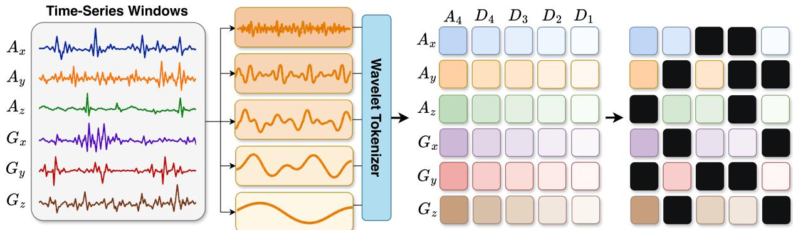

(a) Wavelet tokenization and masking  
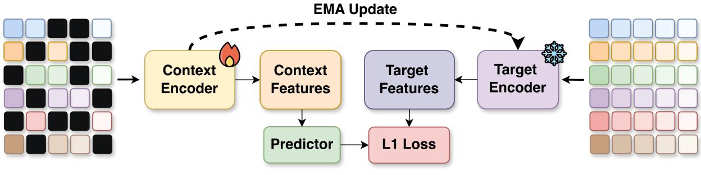  
Figure 2: W-JEPA. (a) Wavelet tokenization and masking. Rows are sensor channels and columns are wavelet bands $A _ { 4 } – D _ { 1 }$ , ordered from coarse to fine. Each channel and wavelet band combination produces two temporal tokens, shown as a single cell for clarity and masked together; black cells indicate masked token pairs. (b) Masked latent prediction. The predictor estimates representations at masked positions from visible-token context, with targets supplied by an EMA target encoder.

## 3.1. Wavelet tokenization

An inertial window can contain slow variations, rhythmic motion, and brief transients. A discrete wavelet transform separates these timescales while retaining temporal localization (Daubechies, 1992). Tokenizing along those bands means every token arrives with a physically meaningful address: a scale, a sensor axis, and a moment in time.

Channel and band axes. Let ${ \mathcal { C } } = \{ 1 , \ldots , C \}$ index the available sensor channels. Figure 2a illustrates the common six-channel case $\left\{ A _ { x } , A _ { y } , A _ { z } , G _ { x } , G _ { y } , G _ { z } \right\}$ , where A and G denote accelerometer and gyroscope channels. For every $c \in { \mathcal { C } }$ , a four-level Daubechies-4 discrete wavelet transform with reflective boundary extension produces four detail-coeficient sequences $d _ { c , 1 } , \ldots , d _ { c , 4 }$ and one approximation-coeficient sequence $a _ { c , 4 }$ (Wolter et al., 2024). We call these five sequences wavelet bands and index them from fine to coarse. The wavelet bands provide a fixed organization of the signal by timescale. Within each band, RMS summarizes coeficient magnitude, while the mean retains signed coeficient information. These statistics provide scale-specific descriptors for token construction.

Token construction. Each of the five coeficient sequences is divided into P contiguous bins of approximately equal length, so that every band yields the same number of bins regardless of how many coeficients it holds.

Let $q _ { c k b }$ hold the coeficients in bin $b \in \{ 1 , \ldots , P \}$ of band $k \in \{ 1 , \ldots , 5 \}$ for channel c. We summarize each bin by two statistics, its mean $\mu _ { c k b }$ and its RMS magnitude $r _ { c k b } \colon$

$$
\mu _ { c k b } = \frac { 1 } { \left| q _ { c k b } \right| } \sum _ { v \in q _ { c k b } } v , \qquad r _ { c k b } = \sqrt { \frac { 1 } { \left| q _ { c k b } \right| } \sum _ { v \in q _ { c k b } } v ^ { 2 } + 1 0 ^ { - 6 } } .\tag{1}
$$

Together, these summarize scale-specific signal magnitude and preserve signed coeficient information. We use $P = 2$ bins per band. A two-layer MLP $g : \mathbb { R } ^ { 2 } \to \mathbb { R } ^ { 3 8 4 }$ maps this pair to a content embedding, and learned embeddings of the channel, band, and bin indices supply the token’s address: $u _ { c k b } = g ( [ \mu _ { c k b } , r _ { c k b } ] ) + e _ { c } ^ { \mathrm { c h } } +$ $e _ { k } ^ { \mathrm { b a n d } } + e _ { b } ^ { \mathrm { b i n } }$ . Flattening the grid gives a sequence of $N = 5 C P$ tokens, in which each position corresponds to exactly one triple $\left( c , k , b \right)$ . Of the learned components in the token embedding, only $e _ { c } ^ { \mathrm { c h } }$ depends on the sensor layout, which is what makes the adaptation in downstream finetuning cheap.

## 3.2. Masked latent pretraining

W-JEPA masks after tokenization and predicts learned representations of the masked tokens. The latent targets allow the training objective to operate on features learned by the target encoder, with no raw-sample reconstruction term. For window i, let $\mathcal { M } _ { i }$ denote the masked token positions and $\nu _ { i }$ their visible complement.

Asynchronous paired-token masking. Each channel and wavelet-band combination produces two temporal tokens. We group these tokens into $G = N / 2$ disjoint pairs $\{ \mathcal { P } _ { g } \} _ { g = 1 } ^ { G }$ , where each pair contains the two tokens from the same channel and wavelet band. Given a mask ratio $\rho ,$ we uniformly sample a subset $S _ { i }$ of $\left| S _ { i } \right| = \left\lfloor \rho G \right\rfloor$ pairs, with a fresh draw per window, and mask both tokens in each selected pair, yielding $\begin{array} { r } { \mathcal { M } _ { i } = \bigcup _ { g \in \mathcal { S } _ { i } } \mathcal { P } _ { g } } \end{array}$ . Masking remains asynchronous across channels and bands: selecting one pair does not require masking other channels or bands. This preserves complementary information in the visible context and encourages the predictor to exploit dependencies across sensors, axes, and wavelet scales. MoCA similarly finds that independently masking sensor axes improves reconstruction pretraining relative to synchronized masking (Ryu et al., 2025). Within each pair, masking both temporal tokens prevents the predictor from relying on the other token from that same pair. Figure 2a illustrates our paired-token mask.

Objective. Let $p _ { i j } \in \mathbb { R } ^ { D }$ be the predictor output and $\bar { z } _ { i j } \in \mathbb { R } ^ { D }$ the normalized latent target at masked token position j. For batch size B, the prediction loss is

$$
\mathcal { L } _ { \mathrm { p r e d } } = \frac { 1 } { B } \sum _ { i = 1 } ^ { B } \frac { 1 } { | \mathcal { M } _ { i } | D } \sum _ { j \in \mathcal { M } _ { i } } \left\| p _ { i j } - \bar { z } _ { i j } \right\| _ { 1 } .\tag{2}
$$

To discourage representation collapse, we add the variance hinge from VICReg without its covariance term (Bardes et al., 2021). Let $\sigma _ { i r }$ be the sample standard deviation across predictions $\{ p _ { i j } : j \in \mathcal { M } _ { i } \}$ in feature coordinate r. We define

$$
\mathcal { L } _ { \mathrm { v a r } } = \frac { 1 } { B D } \sum _ { i = 1 } ^ { B } \sum _ { r = 1 } ^ { D } \operatorname* { m a x } ( 0 , 1 - \sigma _ { i r } ) , \qquad \mathcal { L } _ { \mathrm { p r e } } = \mathcal { L } _ { \mathrm { p r e d } } + 0 . 0 6 2 5 \mathcal { L } _ { \mathrm { v a r } } .\tag{3}
$$

The spread is computed within each window over its own masked positions, so the hinge asks that a single window’s predictions vary across scales and axes. In a diagnostic comparison, substituting SIGReg (Balestriero & LeCun, 2025) while holding the rest of the pipeline fixed costs accuracy (Appendix Table 6). For downstream fine-tuning, a target dataset with $C _ { \mathrm { t a r } }$ channels, the same tokenizer produces $N = 5 C _ { \mathrm { t a r } } P$ token positions. The target encoder and predictor are discarded, and the context encoder is fine-tuned end-to-end with a classification head on all available channels.

## 4. Experiments

We ask three questions. Does W-JEPA, pretrained on other datasets, recognize activities of participants unseen during fine-tuning? Does its advantage hold when the target sensor layout is restricted (§4.3)? And what do wavelet tokens contribute beyond the JEPA objective (§4.2)?

## 4.1. Main Results

Datasets and pretraining pool. We evaluate on PAMAP2 (Reiss, 2012; Reiss & Stricker, 2012), DSADS (Barshan & Altun, 2010; Altun et al., 2010), MHealth (Banos et al., 2014; 2015), RealWorld (Sztyler & Stuckenschmidt, 2016), UCI-HAR (Reyes-Ortiz et al., 2013; Anguita et al., 2013), and USC-HAD (Zhang & Sawchuk, 2012). Appendix A describes each dataset. For each target, the remaining five datasets form the unlabeled pretraining pool, matching MoPFormer’s setup (Zhang et al., 2025). Each source contributes the same six-channel view: the x, y, and z axes from one accelerometer and one gyroscope, while downstream fine-tuning uses all configured target channels. All recordings are resampled to 100 Hz and segmented into non-overlapping windows of T = 500 samples (5 seconds). We do not apply channel normalization.

Evaluation splits. Our primary evaluation uses subject-disjoint splits: all windows from a participant belong exclusively to either downstream fine-tuning or testing. The target dataset is also excluded from pretraining. For comparison, we evaluate all methods under a random-window protocol that assigns 20% of windows within each activity class to training and 80% to evaluation; this protocol can place the same participant in both partitions. We report accuracy and macro-F1 over five random seeds, with dataset averages weighted equally. Sample and participant counts for the subject-disjoint splits are given in Appendix Table 5.

Baselines. We compare with eight baselines, all re-run with the same preprocessing, splits, and seeds: BYOL (Grill et al., 2020) with the permutation-and-jitter (perm\_jit) and low-frequency-component (lfc) augmentations from Qian et al. (2022) and with temporal mixup (Eldele et al., 2024a); ModCL, a contrastive method guided by modality consistency (Guo et al., 2024); MoPFormer, which also pretrains across datasets (Zhang et al., 2025); CALANet, an eficient HAR architecture (Park et al., 2024); TSLANet, a general timeseries backbone (Eldele et al., 2024b); and HAR-JEPA, applies JEPA to wearable activity recognition (Noor & Baraka, 2026). W-JEPA (no wavelets), described in §4.2, isolates the tokenizer.

Results. Table 1 evaluates recognition on participants excluded from training and Table 2 reports the random-window evaluation. W-JEPA achieves the highest mean accuracy and macro-F1 on every dataset under both setups, although its margin varies by dataset. Comparing these tables shows how much randomwindow evaluation overstates performance on new people. TSLANet falls the most, while HAR-JEPA remains the strongest baseline. W-JEPA falls by the least of any method.

Table 1: Subject-disjoint comparison across six wearable activity recognition datasets. Results are averaged over five random seeds under the unified protocol of §4.
<table><tr><td>Method</td><td>Metric</td><td>PAMAP2</td><td>DSADS</td><td>MHealth</td><td>RealWorld</td><td>UCI-HAR</td><td>USC-HAD</td></tr><tr><td rowspan="2">BYOL + perm_jit</td><td>Acc.</td><td>65.65±3.68</td><td>64.66±5.59</td><td>57.70 ± 19.68</td><td>67.59 ± 0.53</td><td>74.49 ± 2.78</td><td>57.81 ± 3.15</td></tr><tr><td>F1</td><td>65.33±4.65</td><td>63.99±6.12</td><td>51.32 ± 20.57</td><td>62.99 ± 0.45</td><td>71.43±2.98</td><td>53.71 ± 2.69</td></tr><tr><td rowspan="2">BYOL + lfc</td><td>Acc.</td><td>72.01 ± 3.32</td><td>65.13 ± 3.27</td><td>73.10 ± 1.25</td><td>65.42 ± 1.37</td><td>77.36 ± 3.48</td><td>59.48 ± 3.70</td></tr><tr><td>F1</td><td>72.16 ± 3.56</td><td>63.79±4.64</td><td>73.46 ± 0.51</td><td>59.87±1.51</td><td>76.21 ± 3.76</td><td>57.63 ± 2.71</td></tr><tr><td rowspan="2">BYOL + Mixup</td><td>Acc.</td><td>72.94 ± 2.00</td><td>65.74±5.73</td><td>74.13 ± 3.41</td><td>64.31 ± 1.74</td><td>75.82±4.68</td><td>58.09 ±1.45</td></tr><tr><td>F1</td><td>73.30 ± 2.08</td><td>64.25±6.91</td><td>73.76±3.77</td><td>58.92±1.99</td><td>72.89±5.86</td><td>56.43 ±1.09</td></tr><tr><td rowspan="2">ModCL</td><td>Acc.</td><td>72.52±2.18</td><td>61.00 ± 1.55</td><td>69.53±5.47</td><td>66.25±2.64</td><td>81.35±5.43</td><td>55.75±5.69</td></tr><tr><td>F1</td><td>72.32± 2.79</td><td>59.83±2.03</td><td>68.16±6.12</td><td>64.92± 2.04</td><td>81.02±5.45</td><td>55.06±5.19</td></tr><tr><td rowspan="2">TSLANet</td><td>Acc.</td><td>65.85±1.08</td><td>70.03 ± 8.61</td><td>77.55 ± 3.00</td><td>57.95±1.88</td><td>80.19± 2.32</td><td>60.91 ± 1.53</td></tr><tr><td>F1</td><td>66.43± 1.27</td><td>68.48±9.20</td><td>76.82 ± 3.42</td><td>54.67±1.95</td><td>80.10 ± 2.33</td><td>57.40 ± 0.61</td></tr><tr><td rowspan="2">CALANet</td><td>Acc.</td><td>69.40 ± 2.34</td><td>63.16±5.53</td><td>86.37±2.26</td><td>64.51 ± 2.60</td><td>81.86±1.00</td><td>63.58±2.59</td></tr><tr><td>F1</td><td>69.11 ± 2.29</td><td>61.78±5.97</td><td>85.24±1.90</td><td>61.04 ± 2.87</td><td>81.38 ± 0.90</td><td>59.43 ± 1.96</td></tr><tr><td rowspan="2">MoPFormer</td><td>Acc.</td><td>72.43 ± 1.12</td><td>61.10±9.66</td><td>81.42 ±1.16</td><td>67.38± 2.74</td><td>80.93 ± 5.52</td><td>60.70±4.62</td></tr><tr><td>F1</td><td>69.40 ± 1.09</td><td>57.90 ± 10.76</td><td>81.23 ± 1.03</td><td>68.60 ± 3.41</td><td>78.16±6.43</td><td>58.76±4.04</td></tr><tr><td rowspan="2">HAR-JEPA</td><td>Acc. F1</td><td>61.08± 0.89</td><td>73.16± 0.98</td><td>87.38±1.89</td><td>64.94 ± 0.71</td><td>81.57 ± 1.31</td><td>61.03 ± 2.75</td></tr><tr><td></td><td>63.53 ± 0.76</td><td>73.59 ± 0.88</td><td>87.64±1.80</td><td>64.50 ± 0.89</td><td>81.99 ± 0.29</td><td>60.22 ± 1.17</td></tr><tr><td rowspan="2">W-JEPA (no wavelets)</td><td>Acc. F1</td><td>81.34± 0.61</td><td>70.00 ± 1.95</td><td>73.33 ± 2.13</td><td>71.06 ± 1.64</td><td>82.71 ± 3.40</td><td>59.49 ± 0.91</td></tr><tr><td></td><td>81.64±0.31</td><td>69.98±2.51</td><td>73.68±2.68</td><td>71.48 ± 1.00</td><td>82.00 ± 3.47</td><td>59.52±0.53</td></tr><tr><td rowspan="2">W-JEPA</td><td>Acc.</td><td>86.96 ± 0.62</td><td>82.87±1.49</td><td>89.68 ±1.09</td><td>80.04 ± 0.41</td><td>84.70 ± 1.94</td><td>64.35± 3.28</td></tr><tr><td>F1</td><td>87.19 ± 0.61</td><td>82.76±1.76</td><td>88.89±1.24</td><td>80.53 ± 1.10</td><td>83.97± 2.08</td><td>60.35±1.40</td></tr></table>

## 4.2. What the wavelet tokens contribute

Replacing wavelet tokens with raw patches. The variant W-JEPA (no wavelets) replaces the wavelet tokenizer with a conventional temporal-patch tokenizer while holding the remainder of the pipeline fixed. Each 500-sample channel is divided into ten consecutive 50-sample patches; the ordered, signed samples of a patch are embedded by an MLP of the same depth and width. With wavelet tokens, subject-disjoint macro-F1 is higher on all six datasets (Table 1). Two JEPAs that predict temporal-patch units, HAR-JEPA and W-JEPA (no wavelets), reach 71.9 and 73.1 average held-out macro-F1; replacing the patches with wavelet tokens raises W-JEPA to 80.6. This comparison supports the tokenizer as a useful design choice within W-JEPA.

Varying participant diversity. Figure 3 compares the tokenizers with 20% of participants held out for testing. This test cohort remains fixed as complete participants from the remaining pool are progressively added to the fine-tuning set. At matched training set sizes, W-JEPA generally outperforms the no wavelets variant, especially when few participants are available. The advantage persists across the displayed training set sizes on PAMAP2, DSADS, and MHealth, while RealWorld shows smaller and less consistent gains. With the test cohort fixed, the curves compare the benefit of adding training participants on the same evaluation population. They provide evidence that wavelet tokens improve performance under limited participant diversity.

Separating near-identical activities. We return to the example of the exercise-bike pair of Figure 1, where we further compare W-JEPA with and without wavelet tokenization on DSADS under the same subject-disjoint evaluation protocol, keeping pretraining, fine-tuning, and all other experimental settings fixed. (Figure 4). Without wavelets, 41.5% of horizontal-bike windows are classified as vertical-bike cycling; with wavelets, this falls to 0.8%, improving horizontal-bike recall while preserving vertical-bike recall; some errors shift to other activities. In the PCA projection of the learned representations, the two classes overlap without wavelets and are more separated with them. This is consistent with wavelet tokens exposing scale-specific diferences in Figure 1.

Table 2: Random-window comparison across six wearable activity recognition datasets. Results are averaged over five random seeds under the unified protocol of §4.
<table><tr><td>Method</td><td>Metric</td><td>PAMAP2</td><td>DSADS</td><td>MHealth</td><td>RealWorld</td><td>UCI-HAR</td><td>USC-HAD</td></tr><tr><td rowspan="2"> $\mathrm { \ B Y O L { \cdot } \ p e r m \ j i t { \cdot } }$ </td><td>Acc.</td><td> $8 4 . 0 6 \pm 8 . 2 6$ </td><td> $8 9 . 1 8 \pm 5 . 0 2$ </td><td> $8 5 . 4 9 \pm 7 . 6 6$ </td><td> $9 5 . 5 2 \pm 0 . 2 7$ </td><td> $7 7 . 6 5 \pm 3 . 8 0$ </td><td> $7 8 . 4 5 \pm 5 . 4 0$ </td></tr><tr><td>F1</td><td> $8 0 . 5 3 \pm 1 3 . 7 4$ </td><td> $8 8 . 7 3 \pm 5 . 4 5$ </td><td> $7 9 . 5 7 \pm 1 1 . 3 7$ </td><td> $9 5 . 6 0 \pm 0 . 4 0$ </td><td> $7 5 . 9 4 \pm 4 . 4 8$ </td><td> $7 3 . 4 3 \pm 6 . 0 8$ </td></tr><tr><td rowspan="2"> $\mathrm { B Y O L } + \mathrm { l f c }$ </td><td>Acc.</td><td> $9 0 . 8 2 \pm 1 . 2 0 $ </td><td> $9 6 . 7 1 \pm 0 . 1 4$ </td><td> $9 2 . 2 8 \pm 1 . 6 0$ </td><td> $9 6 . 1 1 \pm 0 . 3 4$ </td><td> $8 1 . 5 2 \pm 4 . 0 4$ </td><td> $8 2 . 8 5 \pm 1 . 2 0$ </td></tr><tr><td>F1</td><td> $9 0 . 6 6 \pm 1 . 4 5$ </td><td> $9 6 . 7 1 \pm 0 . 1 4$ </td><td> $9 1 . 4 1 \pm 1 . 7 6$ </td><td> $9 6 . 1 4 \pm 0 . 4 6$ </td><td> $8 0 . 4 3 \pm 4 . 7 6$ </td><td> $7 7 . 5 7 \pm 1 . 3 0$ </td></tr><tr><td rowspan="2">BYOL + Mixup</td><td>Acc.</td><td> $8 9 . 7 6 \pm 0 . 8 9$ </td><td> $9 7 . 0 0 \pm 0 . 5 2 $ </td><td> $9 2 . 0 9 \pm 1 . 3 6$ </td><td> $9 6 . 0 0 \pm 0 . 1 9$ </td><td> $8 1 . 6 6 \pm 3 . 6 7$ </td><td> $8 1 . 2 8 \pm 2 . 4 4$ </td></tr><tr><td>F1</td><td> $8 9 . 5 3 \pm 1 . 0 7$ </td><td> $9 6 . 9 7 \pm 0 . 5 2$ </td><td> $9 1 . 7 5 \pm 1 . 5 2$ </td><td> $9 6 . 0 0 \pm 0 . 2 0$ </td><td> $8 0 . 5 4 \pm 4 . 5 6$ </td><td> $7 5 . 8 8 \pm 3 . 3 4$ </td></tr><tr><td rowspan="2">ModCL</td><td>Acc.</td><td> $9 0 . 6 0 \pm 1 . 1 7$ </td><td> $9 6 . 6 0 \pm 2 . 4 8$ </td><td> $9 4 . 5 1 \pm 4 . 0 9$ </td><td> $9 5 . 3 7 \pm 0 . 8 7$ </td><td> $8 9 . 2 0 \pm 3 . 8 4$ </td><td> $8 4 . 5 4 \pm 3 . 3 9$ </td></tr><tr><td>F1</td><td>90.47 ± 1.11</td><td> $9 6 . 5 7 \pm 2 . 5 4$ </td><td> $9 2 . 7 0 \pm 5 . 5 3 $ </td><td> $9 5 . 4 2 \pm 0 . 8 7$ </td><td> $8 8 . 9 9 \pm 4 . 1 9$ </td><td> $8 1 . 0 6 \pm 3 . 0 8$ </td></tr><tr><td rowspan="2">TSLANet</td><td>Acc.</td><td>92.20 ± 0.58</td><td> $9 8 . 8 9 \pm 0 . 1 5$ </td><td> $9 7 . 1 2 \pm 1 . 2 9$ </td><td> $9 7 . 0 4 \pm 0 . 1 6$ </td><td> $8 5 . 5 8 \pm 8 . 3 0$ </td><td> $8 2 . 9 3 \pm 0 . 5 8$ </td></tr><tr><td>F1</td><td>92.16 ± 0.50</td><td> $9 8 . 8 7 \pm 0 . 1 6$ </td><td> $9 6 . 9 9 \pm 1 . 6 0$ </td><td>97.11 ± 0.18</td><td> $8 4 . 8 6 \pm 9 . 3 2$ </td><td> $8 4 . 2 8 \pm 0 . 6 0$ </td></tr><tr><td rowspan="2">CALANet</td><td>Acc.</td><td>84.60 ± 0.74</td><td>94.91 ± 0.11</td><td> $9 2 . 1 9 \pm 1 . 5 6$ </td><td> $9 3 . 6 6 \pm 0 . 3 5$ </td><td> $8 8 . 1 0 \pm 0 . 7 6$ </td><td> $7 7 . 6 1 \pm 1 . 4 9$ </td></tr><tr><td>F1</td><td>81.56 ± 1.00</td><td> $9 4 . 8 3 \pm 0 . 1 2$ </td><td> $9 0 . 6 6 \pm 1 . 9 2$ </td><td>91.51 ± 0.64</td><td> $8 7 . 5 6 \pm 0 . 8 5$ </td><td> $7 2 . 1 9 \pm 1 . 8 7$ </td></tr><tr><td rowspan="2">MoPFormer</td><td>Acc.</td><td> $9 0 . 6 4 \pm 0 . 5 2$ </td><td> $8 2 . 0 9 \pm 5 . 4 6$ </td><td> $9 7 . 1 5 \pm 1 . 2 0$ </td><td> $9 1 . 3 9 \pm 2 . 8 1$ </td><td> $8 3 . 3 7 \pm 7 . 1 8$ </td><td> $8 4 . 2 3 \pm 1 . 0 4$ </td></tr><tr><td>F1</td><td> $9 0 . 2 4 \pm 0 . 4 6$ </td><td> $7 9 . 4 4 \pm 6 . 5 8$ </td><td> $9 7 . 1 6 \pm 1 . 1 4$ </td><td> $9 2 . 1 3 \pm 2 . 3 2$ </td><td> $7 9 . 3 7 \pm 1 0 . 4 7$ </td><td> $8 0 . 6 4 \pm 1 . 1 1$ </td></tr><tr><td rowspan="2">HAR-JEPA</td><td>Acc.</td><td> $9 1 . 6 7 \pm 0 . 1 9$ </td><td> $9 7 . 8 8 \pm 0 . 0 5$ </td><td> $9 8 . 4 3 \pm 0 . 2 3$ </td><td> $9 5 . 2 4 \pm 0 . 1 0$ </td><td> $8 9 . 8 3 \pm 0 . 1 5$ </td><td> $8 6 . 5 6 \pm 0 . 2 1$ </td></tr><tr><td>F1</td><td> $9 1 . 9 6 \pm 0 . 2 0$ </td><td> $9 7 . 8 6 \pm 0 . 0 5$ </td><td> $9 8 . 5 4 \pm 0 . 2 1$ </td><td> $9 5 . 4 6 \pm 0 . 1 1$ </td><td> $9 0 . 1 4 \pm 0 . 1 4$ </td><td> $8 2 . 7 7 \pm 0 . 3 6$ </td></tr><tr><td rowspan="2">W-JEPA (no wavelets)</td><td>Acc.</td><td> $9 1 . 4 6 \pm 0 . 3 9$ </td><td> $9 6 . 9 4 \pm 0 . 1 5$ </td><td> $9 6 . 0 0 \pm 0 . 3 8$ </td><td> $9 6 . 7 1 \pm 0 . 1 6$ </td><td> $8 8 . 6 4 \pm 1 . 2 6 $ </td><td> $8 5 . 8 1 \pm 0 . 3 6$ </td></tr><tr><td>F1</td><td> $9 1 . 2 9 \pm 0 . 3 4$ </td><td> $9 6 . 9 4 \pm 0 . 1 6$ </td><td> $9 5 . 5 5 \pm 0 . 2 1$ </td><td> $9 6 . 5 5 \pm 0 . 1 3$ </td><td> $8 7 . 8 0 \pm 1 . 2 8 $ </td><td> $8 2 . 6 6 \pm 0 . 3 6$ </td></tr><tr><td rowspan="2">W-JEPA</td><td> $\operatorname { A c c . }$ </td><td> $9 3 . 7 5 \pm 0 . 2 2$ </td><td> ${ \bf 9 9 . 2 2 \pm 0 . 1 3 }$ </td><td> ${ \pm 9 9 . 2 8 \pm 0 . 3 5 }$ </td><td> ${ \bf 9 7 . 1 3 \pm 0 . 1 4 }$ </td><td> $9 2 . 9 1 \pm 1 . 2 3 $ </td><td> ${ \bf 8 8 . 5 4 \pm 0 . 3 5 }$ </td></tr><tr><td>F1</td><td> ${ \bf 9 3 . 7 9 \pm 0 . 2 1 }$ </td><td> ${ \bf 9 9 . 2 2 \pm 0 . 1 3 }$ </td><td> ${ \bf 9 9 . 1 8 \pm 0 . 1 9 }$ </td><td> ${ \pm 0 7 . 3 6 \pm 0 . 1 2 }$ </td><td> ${ \pm } 2 . 5 9 \pm 1 . 2 6$ </td><td> ${ \bf 8 6 . 5 2 \pm 0 . 3 3 }$ </td></tr></table>

Interpreting attention by timescale. Because every token carries a scale address, the fine-tuned encoder’s attention can be read by timescale, which a temporal-patch tokenizer does not allow. We measure the attention that tokens receive in the final encoder layer, averaged over heads and query positions and summed within each band, on held-out DSADS participants (Appendix D.2, Figure 6). On clean inputs, the coarse $A _ { 4 }$ band receives the largest share for most activities, whereas, $D _ { 1 } .$ , receives the largest share for running and jumping. We then add noise at increasing levels, measured against each channel’s training RMS. Attention shifts from $A _ { 4 }$ toward the detail bands: at 30% noise, $A _ { 4 }$ attention falls by 6.1% relative to clean inputs, while $D _ { 2 }$ and $D _ { 1 }$ rise by 11.1% and 9.4%. Over the same range, held-out accuracy and macro-F1 stay within about one point of their clean values (Appendix Table 7).

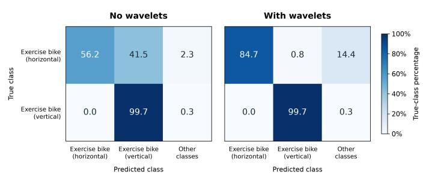

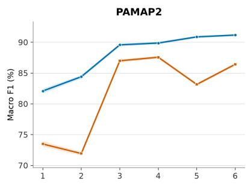

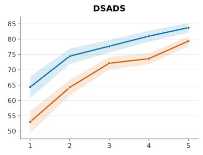

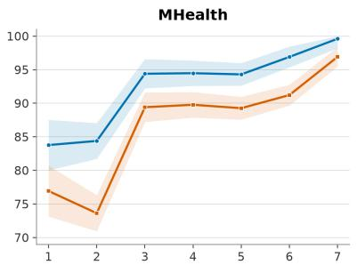

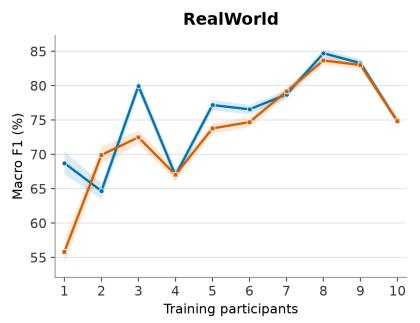

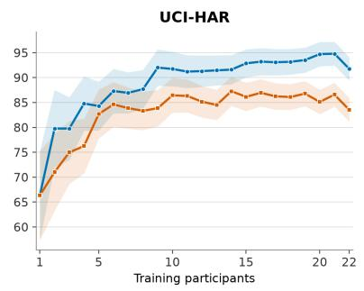

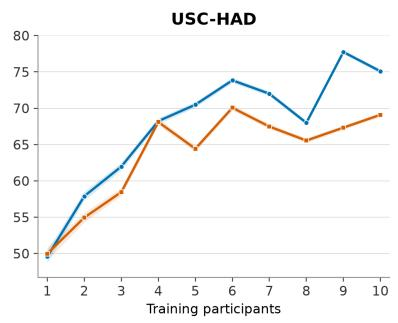

Figure 3: Subject-disjoint macro-F1 with wavelet tokens and learned temporal patches as training participants are added. A fixed 20% participant split is held out for testing, and training participants are drawn from the remaining pool.  
(a) Confusion between cycling activities  
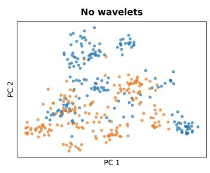

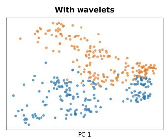  
(b) PCA of learned representations  
Figure 4: Each panel compares W-JEPA without and with wavelets. (a) Confusion matrices for cycling on a horizontal exercise bike and cycling on a vertical exercise bike, using percentages within each true class; predictions of other activities are “Other classes.” (b) 2D PCA projections of learned representations for the same two classes.

## 4.3. Ablation under restricted sensor settings

We evaluate a restricted setting in which downstream fine-tuning uses only wrist accelerometer and gyroscope channels: nine channels for PAMAP2 and six for MHealth. Pretraining follows the same protocol as in §4, using all datasets in the pretraining pool except the evaluation dataset. All other experimental settings are kept the same. We evaluate both random-window and subject-disjoint splits, using 20% of windows or participants, respectively, for training and the remaining 80% for evaluation. Each experiment uses five training seeds. Tables 3 and 4 report macro-F1 and accuracy under these restrictions. W-JEPA achieves the highest mean score on both metrics for both datasets under both split protocols. Scores are lower with participant holdout for every method, while W-JEPA retains its lead in mean performance when fine-tuning is restricted to wrist inertial signals.

Table 3: Restricted sensor ablation with random-window splits.
<table><tr><td rowspan="2">Method</td><td colspan="2">PAMAP2</td><td colspan="2">MHealth</td></tr><tr><td>F1</td><td> $\mathsf { A c c . }$ </td><td>F1</td><td>Acc.</td></tr><tr><td> $\mathrm { B Y O L } + \mathrm { p e r m \_ j i t }$ </td><td> $5 8 . 9 7 \pm 6 . 4 1$ </td><td> $6 7 . 3 2 \pm 3 . 7 5$ </td><td> $4 0 . 7 7 \pm 1 1 . 2 1$ </td><td> $4 8 . 5 0 \pm 6 . 0 7$ </td></tr><tr><td> $\mathrm { B Y O L } + \mathrm { l f c }$ </td><td> $7 7 . 8 5 \pm 1 . 1 3$ </td><td> $7 9 . 6 0 \pm 0 . 7 1$ </td><td> $4 9 . 6 3 \pm 3 . 1 9$ </td><td> $5 5 . 0 8 \pm 2 . 7 7$ </td></tr><tr><td> $\mathtt { B Y O L } + \mathtt { M i x u p }$ </td><td> $7 5 . 1 6 \pm 3 . 4 4$ </td><td> $7 8 . 2 8 \pm 2 . 0 3$ </td><td> $4 7 . 3 1 \pm 3 . 0 6$ </td><td> $5 2 . 7 6 \pm 4 . 0 3$ </td></tr><tr><td>ModCL</td><td> $7 5 . 9 9 \pm 5 . 8 4$ </td><td> $7 9 . 1 0 \pm 3 . 6 3$ </td><td> $7 2 . 8 4 \pm 4 . 6 7$ </td><td> $7 8 . 7 9 \pm 2 . 2 1$ </td></tr><tr><td>TSLANet</td><td> $8 7 . 6 3 \pm 0 . 3 5$ </td><td> $8 6 . 7 9 \pm 0 . 5 6$ </td><td> $7 7 . 5 4 \pm 2 . 2 9$ </td><td> $7 8 . 0 2 \pm 2 . 5 7$ </td></tr><tr><td>CALANet</td><td> $7 4 . 6 3 \pm 1 . 1 4$ </td><td> $7 8 . 1 1 \pm 0 . 5 8$ </td><td> $7 5 . 5 0 \pm 1 . 1 7$ </td><td> $7 7 . 6 0 \pm 1 . 2 0$ </td></tr><tr><td>MoPFormer HAR-JEPA</td><td> $8 5 . 1 4 \pm 0 . 3 8$   $8 5 . 9 6 \pm 0 . 2 6$ </td><td> $8 5 . 5 2 \pm 0 . 3 0$   $8 6 . 3 1 \pm 0 . 2 8$ </td><td> $8 8 . 8 1 \pm 0 . 6 7$   $9 0 . 9 1 \pm 0 . 8 8$ </td><td> $8 8 . 9 5 \pm 0 . 8 3$ </td></tr><tr><td></td><td></td><td></td><td></td><td> $9 0 . 6 7 \pm 0 . 8 8$ </td></tr><tr><td>W-JEPA (no wavelets) W-JEPA</td><td> $8 6 . 5 9 \pm 0 . 3 1$   ${ \bf 8 8 . 1 0 \pm 0 . 1 1 }$ </td><td> $8 6 . 5 4 \pm 0 . 2 8$   ${ \bf 8 8 . 0 9 \pm 0 . 1 4 }$ </td><td> $8 9 . 5 8 \pm 0 . 5 5$   $9 3 . 5 3 \pm 0 . 5 4$ </td><td> $9 0 . 4 7 \pm 0 . 6 3$   ${ \bf 9 4 . 2 2 \pm 0 . 7 6 }$ </td></tr></table>

Table 4: Restricted sensor ablation with subject-disjoint splits.
<table><tr><td rowspan="2">Method</td><td colspan="2">PAMAP2</td><td colspan="2">MHealth</td></tr><tr><td>F1</td><td> $\operatorname { A c c . }$ </td><td>F1</td><td> $\operatorname { A c c . }$ </td></tr><tr><td> $\mathrm { B Y O L } + \mathrm { p e r m \_ j i t }$ </td><td> $4 6 . 8 8 \pm 1 . 9 4$ </td><td> $5 0 . 2 3 \pm 4 . 1 0$ </td><td> $3 5 . 0 1 \pm 6 . 0 1$ </td><td> $4 0 . 8 7 \pm 3 . 4 2$ </td></tr><tr><td> $\mathrm { B Y O L } + \mathrm { l f c }$ </td><td> $4 8 . 5 7 \pm 1 . 5 4$ </td><td> $4 7 . 9 8 \pm 2 . 2 2$ </td><td> $3 9 . 0 8 \pm 1 . 1 0$ </td><td> $4 3 . 4 2 \pm 2 . 3 0$ </td></tr><tr><td> $\mathtt { B Y O L } + \mathtt { M i x u p }$ </td><td> $5 1 . 8 8 \pm 1 . 6 4$ </td><td> $5 2 . 0 6 \pm 2 . 4 6$ </td><td> $4 0 . 2 3 \pm 1 . 1 9$ </td><td> $4 4 . 0 8 \pm 2 . 7 7$ </td></tr><tr><td>ModCL</td><td> $6 1 . 7 1 \pm 1 . 6 6$ </td><td> $6 2 . 6 3 \pm 2 . 4 4$ </td><td> $5 1 . 2 6 \pm 6 . 2 9$ </td><td> $5 3 . 8 9 \pm 5 . 0 5$ </td></tr><tr><td>TSLANet</td><td> $6 3 . 0 7 \pm 3 . 2 9$ </td><td> $6 1 . 9 8 \pm 3 . 6 0$ </td><td> $5 9 . 2 4 \pm 2 . 9 7$ </td><td> $5 8 . 4 3 \pm 2 . 7 4$ </td></tr><tr><td>CALANet</td><td> $5 5 . 9 0 \pm 1 . 7 5$ </td><td> $5 5 . 1 4 \pm 1 . 6 3$ </td><td> $5 9 . 4 4 \pm 1 . 7 3$ </td><td> $6 1 . 6 3 \pm 1 . 5 8$ </td></tr><tr><td>MoPFormer</td><td> $5 8 . 7 1 \pm 0 . 5 1$ </td><td> $5 9 . 5 7 \pm 1 . 1 6$ </td><td> $6 6 . 1 7 \pm 3 . 2 6$ </td><td> $6 8 . 1 9 \pm 2 . 0 8$ </td></tr><tr><td>HAR-JEPA</td><td> $6 0 . 5 4 \pm 0 . 2 6$ </td><td> $6 1 . 5 7 \pm 0 . 3 2$ </td><td> $6 5 . 2 9 \pm 0 . 9 6$ </td><td> $6 6 . 3 9 \pm 1 . 0 9$ </td></tr><tr><td>W-JEPA (no wavelets) W-JEPA</td><td> $6 1 . 9 3 \pm 1 . 6 4$   ${ \bf 6 4 . 1 4 \pm 2 . 1 2 }$ </td><td> $6 2 . 1 6 \pm 1 . 7 7$   ${ \bf 6 4 . 2 5 \pm 1 . 1 6 }$ </td><td> $6 4 . 2 6 \pm 1 . 7 9$   ${ \bf 6 7 . 6 3 \pm 1 . 1 3 }$ </td><td> $6 4 . 7 7 \pm 0 . 9 2$   $6 9 . 4 5 \pm 2 . 6 2$ </td></tr></table>

## 5. Conclusion

We asked how the units of masked latent prediction should be defined for heterogeneous wearable data. W-JEPA organizes inertial windows into wavelet tokens indexed by scale, sensor channel axis, and time, and learns by predicting masked latent features. It outperforms the evaluated baselines, and loses the least when evaluating on unseen participants. Replacing wavelet tokens with temporal patches weakens performance and can increase confusion between similar activities. These results suggest that physically grounded multiscale tokenization and latent prediction together provide a promising foundation for transferable representations of heterogeneous wearable data.

## Acknowledgments

This work was supported by funding from the National Heart, Lung, and Blood Institute (NIH/NHLBI 1R01HL166802 and 1R01HL168535).

## References

Mohamed Abdelfattah and Alexandre Alahi. S-jepa: A joint embedding predictive architecture for skeletal action recognition. In European Conference on Computer Vision, pp. 367–384. Springer, 2024.

Kerem Altun, Billur Barshan, and Orkun Tunçel. Comparative study on classifying human activities with miniature inertial and magnetic sensors. Pattern Recognition, 43(10):3605–3620, 2010. ISSN 0031-3203. doi: https://doi.org/10.1016/j.patcog.2010.04.019. URL https://www.sciencedirect.com/science/article/ pii/S0031320310001950.

D. Anguita, Alessandro Ghio, L. Oneto, Xavier Parra, and Jorge Luis Reyes-Ortiz. A public domain dataset for human activity recognition using smartphones. In The European Symposium on Artificial Neural Networks, 2013. URL https://api.semanticscholar.org/CorpusID:6975432.

Mahmoud Assran, Quentin Duval, Ishan Misra, Piotr Bojanowski, Pascal Vincent, Michael Rabbat, Yann LeCun, and Nicolas Ballas. Self-supervised learning from images with a joint-embedding predictive architecture. In 2023 IEEE/CVF Conference on Computer Vision and Pattern Recognition (CVPR), pp. 15619–15629. IEEE, 2023.

Randall Balestriero and Yann LeCun. Lejepa: Provable and scalable self-supervised learning without the heuristics. arXiv preprint arXiv:2511.08544, 2025.

Oresti Banos, Rafael Garcia, and Alejandro Saez. MHEALTH. UCI Machine Learning Repository, 2014. DOI: https://doi.org/10.24432/C5TW22.

Oresti Banos, Claudia Villalonga, Rafael Garcia, Alejandro Saez, Miguel Damas, Juan A Holgado-Terriza, Sungyong Lee, Hector Pomares, and Ignacio Rojas. Design, implementation and validation of a novel open framework for agile development of mobile health applications. Biomedical engineering online, 14:1–20, 2015.

Adrien Bardes, Jean Ponce, and Yann LeCun. Vicreg: Variance-invariance-covariance regularization for self-supervised learning. arXiv preprint arXiv:2105.04906, 2021.

Adrien Bardes, Quentin Garrido, Jean Ponce, Xinlei Chen, Michael Rabbat, Yann LeCun, Mahmoud Assran, and Nicolas Ballas. Revisiting feature prediction for learning visual representations from video. arXiv preprint arXiv:2404.08471, 2024.

Billur Barshan and Kerem Altun. Daily and Sports Activities. UCI Machine Learning Repository, 2010. DOI: https://doi.org/10.24432/C5C59F.

Kaixuan Chen, Dalin Zhang, Lina Yao, Bin Guo, Zhiwen Yu, and Yunhao Liu. Deep learning for sensor-based human activity recognition: Overview, challenges, and opportunities. ACM Computing Surveys (CSUR), 54 (4):1–40, 2021.

Ingrid Daubechies. Ten lectures on wavelets. SIAM, 1992.

Zihan Ding, Liyu Zhang, and Xiaomin Ouyang. Halo: A heterogeneity-aware language-aligned imu foundation model for open-set human activity recognition, 2026. URL https://arxiv.org/abs/2608.27233.

Emadeldeen Eldele, Mohamed Ragab, Zhenghua Chen, Min Wu, Chee Keong Kwoh, Xiaoli Li, and Cuntai Guan. Time-series representation learning via temporal and contextual contrasting. arXiv preprint arXiv:2106.14112, 2021.

Emadeldeen Eldele, Mohamed Ragab, Zhenghua Chen, Min Wu, Chee-Keong Kwoh, and Xiaoli Li. Contrastive domain adaptation for time-series via temporal mixup. IEEE Transactions on Artificial Intelligence, 5(3): 1185–1194, 2024a. doi: 10.1109/TAI.2023.3293473.

Emadeldeen Eldele, Mohamed Ragab, Zhenghua Chen, Min Wu, and Xiaoli Li. TSLANet: rethinking transformers for time series representation learning. In Proceedings of the 41st International Conference on Machine Learning, ICML’24. JMLR.org, 2024b.

Sofiane Ennadir, Siavash Golkar, and Leopoldo Sarra. Joint embeddings go temporal. arXiv preprint arXiv:2509.25449, 2025.

Jean-Bastien Grill, Florian Strub, Florent Altché, Corentin Tallec, Pierre Richemond, Elena Buchatskaya, Carl Doersch, Bernardo Avila Pires, Zhaohan Guo, Mohammad Gheshlaghi Azar, et al. Bootstrap your own latent-a new approach to self-supervised learning. Advances in neural information processing systems, 33: 21271–21284, 2020.

Pierre Guetschel, Thomas Moreau, and Michael Tangermann. S-jepa: towards seamless cross-dataset transfer through dynamic spatial attention. arXiv preprint arXiv:2403.11772, 2024.

Changru Guo, Yingwei Zhang, Yiqiang Chen, Chenyang Xu, and Zhong Wang. Modality consistency-guided contrastive learning for wearable-based human activity recognition. IEEE Internet of Things Journal, 11 (12):21750–21762, 2024. doi: 10.1109/JIOT.2024.3379019.

Nils Y. Hammerla and Thomas Plötz. Let’s (not) stick together: pairwise similarity biases cross-validation in activity recognition. In Proceedings of the 2015 ACM International Joint Conference on Pervasive and Ubiquitous Computing, UbiComp ’15, pp. 1041–1051, New York, NY, USA, 2015. Association for Computing Machinery. ISBN 9781450335744. doi: 10.1145/2750858.2807551. URL https://doi.org/10.1145/2750 858.2807551.

Harish Haresamudram, Apoorva Beedu, Varun Agrawal, Patrick L. Grady, Irfan Essa, Judy Hofman, and Thomas Plötz. Masked reconstruction based self-supervision for human activity recognition. In Proceedings ofthe 2020 ACM International Symposium on Wearable Computers, ISWC ’20, pp. 45–49, New York, NY, USA, 2020. Association for Computing Machinery. ISBN 9781450380775. doi: 10.1145/3410531.3414306. URL https://doi.org/10.1145/3410531.3414306.

Zhiqing Hong, Zelong Li, Shuxin Zhong, Wenjun Lyu, Haotian Wang, Yi Ding, Tian He, and Desheng Zhang. Crosshar: Generalizing cross-dataset human activity recognition via hierarchical self-supervised pretraining. Proc. ACM Interact. Mob. Wearable Ubiquitous Technol., 8(2), May 2024. doi: 10.1145/3659597. URL https://doi.org/10.1145/3659597.

Hyejoo Kim, Hyeon-Joo Kim, Jinyoon Park, Jeh-Kwang Ryu, and Seung-Chan Kim. Recognition of fine-grained walking patterns using a smartwatch with deep attentive neural networks. Sensors, 21(19), 2021. ISSN 1424-8220. doi: 10.3390/s21196393. URL https://www.mdpi.com/1424-8220/21/19/6393.

Yann LeCun et al. A path towards autonomous machine intelligence version 0.9. 2, 2022-06-27. Open Review, 62(1):1–62, 2022.

Ilya Loshchilov and Frank Hutter. Decoupled weight decay regularization, 2019. URL https://arxiv.org/abs/ 1711.05101.

Wang Lu, Jindong Wang, Xinwei Sun, Yiqiang Chen, and Xing Xie. Out-of-distribution representation learning for time series classification, 2023. URL https://arxiv.org/abs/2209.07027.

Luca Masserano, Abdul Fatir Ansari, Boran Han, Xiyuan Zhang, Christos Faloutsos, Michael W Mahoney, An drew Gordon Wilson, Youngsuk Park, Syama Rangapuram, Danielle C Maddix, et al. Enhancing foundation models for time series forecasting via wavelet-based tokenization. arXiv preprint arXiv:2412.05244, 2024.

Mohd Halim Mohd Noor and Abdulrahman M. A. Baraka. Joint-embedding predictive architecture for sensor-based activity recognition, 2026. URL https://arxiv.org/abs/2607.16350.

Jaegyun Park, Dae-Won Kim, and Jaesung Lee. CALANet: Cheap all-layer aggregation for human activity recognition. In A. Globerson, L. Mackey, D. Belgrave, A. Fan, U. Paquet, J. Tomczak, and C. Zhang (eds.), Advances in Neural Information Processing Systems, volume 37, pp. 69419–69444. Curran Associates, Inc., 2024. URL https://proceedings.neurips.cc/paper\_files/paper/2024/file/8078e76f913e31b8467e85b4c0 f0d22b-Paper-Conference.pdf.

Hangwei Qian, Tian Tian, and Chunyan Miao. What makes good contrastive learning on small-scale wearable-based tasks? In Proceedings of the 28th ACM SIGKDD Conference on Knowledge Discovery and Data Mining, KDD ’22, pp. 3761–3771, New York, NY, USA, 2022. Association for Computing Machinery. ISBN 9781450393850. doi: 10.1145/3534678.3539134. URL https://doi.org/10.1145/3534678.3539134.

Attila Reiss. PAMAP2 Physical Activity Monitoring. UCI Machine Learning Repository, 2012. DOI: https://doi.org/10.24432/C5NW2H.

Attila Reiss and Didier Stricker. Introducing a new benchmarked dataset for activity monitoring. In 2012 16th International Symposium on Wearable Computers, pp. 108–109, 2012. doi: 10.1109/ISWC.2012.13.

Jorge Luis Reyes-Ortiz, Davide Anguita, Alessandro Ghio, Luca Oneto, and Xavier Parra. Human Activity Recognition Using Smartphones. UCI Machine Learning Repository, 2013. DOI: https://doi.org/10.24432/C54S4K.

Howon Ryu, Yuliang Chen, Yacun Wang, Andrea Z LaCroix, Chongzhi Di, Loki Natarajan, Yu Wang, and Jingjing Zou. Moca: Multi-modal cross-masked autoencoder for digital health measurements. arXiv preprint arXiv:2506.02260, 2025.

Timo Sztyler and Heiner Stuckenschmidt. On-body localization of wearable devices: An investigation of position-aware activity recognition. In 2016 IEEE International Conference on Pervasive Computing and Communications (PerCom), pp. 1–9, 2016. doi: 10.1109/PERCOM.2016.7456521.

Megha Thukral, Cyrus Tanade, Simon A. Lee, Juhyeon Lee, Hao Zhou, Keum San Chun, Migyeong Gwak, Viswam Nathan, Md Mahbubur Rahman, Li Zhu, Mehrab Bin Morshed, Subramaniam Venkatraman, and Sharanya Arcot Desai. Wavelet-driven masked multiscale reconstruction for ppg foundation models, 2026. URL https://arxiv.org/abs/2601.12215.

Yiming Tian, Jie Zhang, Jie Wang, Yanli Geng, and Xitai Wang. Robust human activity recognition using single accelerometer via wavelet energy spectrum features and ensemble feature selection. Systems Science & Control Engineering, 8(1):83–96, 2020.

Thi Hong Vuong, Tung Doan, and Atsuhiro Takasu. Deep wavelet convolutional neural networks for multimodal human activity recognition using wearable inertial sensors. Sensors, 23(24):9721, 2023.

Moritz Wolter, Felix Blanke, Jochen Garcke, and Charles Tapley Hoyt. ptwt-the pytorch wavelet toolbox. Journal of Machine Learning Research, 25(80):1–7, 2024.

Huatao Xu, Pengfei Zhou, Rui Tan, Mo Li, and Guobin Shen. Limu-bert: Unleashing the potential of unlabeled data for imu sensing applications. In Proceedings ofthe 19th ACM Conference on Embedded Networked Sensor Systems, SenSys ’21, pp. 220–233, New York, NY, USA, 2021. Association for Computing Machinery. ISBN 9781450390972. doi: 10.1145/3485730.3485937. URL https://doi.org/10.1145/3485730.3485937.

Huatao Xu, Pengfei Zhou, Rui Tan, and Mo Li. Practically adopting human activity recognition. In Proceedings of the 29th Annual International Conference on Mobile Computing and Networking, ACM MobiCom ’23, New York, NY, USA, 2023. Association for Computing Machinery. ISBN 9781450399906. doi: 10.1145/357036 1.3613299. URL https://doi.org/10.1145/3570361.3613299.

George Zerveas, Srideepika Jayaraman, Dhaval Patel, Anuradha Bhamidipaty, and Carsten Eickhof. A transformer-based framework for multivariate time series representation learning. In Proceedings of the 27th ACM SIGKDD conference on knowledge discovery & data mining, pp. 2114–2124, 2021.

Hao Zhang, Zhan Zhuang, Xuehao Wang, Xiaodong Yang, and Yu Zhang. Mopformer: Motion-primitive transformer for wearable-sensor activity recognition. In D. Belgrave, C. Zhang, H. Lin, R. Pascanu, P. Koniusz, M. Ghassemi, and N. Chen (eds.), Advances in Neural Information Processing Systems, volume 38, Main Conference, pp. 39334–39360. Curran Associates, Inc., 2025. doi: 10.52202/085713-1313. URL https://proceedings.neurips.cc/paper\_files/paper/2025/file/37ecb317d11004f77defbca54ef3b9 28-Paper-Conference.pdf.

Mi Zhang and Alexander A. Sawchuk. Usc-had: a daily activity dataset for ubiquitous activity recognition using wearable sensors. In Proceedings of the 2012 ACM Conference on Ubiquitous Computing, UbiComp ’12, pp. 1036–1043, New York, NY, USA, 2012. Association for Computing Machinery. ISBN 9781450312240. doi: 10.1145/2370216.2370438. URL https://doi.org/10.1145/2370216.2370438.

Xiang Zhang, Ziyuan Zhao, Theodoros Tsiligkaridis, and Marinka Zitnik. Self-supervised contrastive pretraining for time series via time-frequency consistency. Advances in neural information processing systems, 35:3988–4003, 2022.

Xiyuan Zhang, Diyan Teng, Ranak Roy Chowdhury, Shuheng Li, Dezhi Hong, Rajesh K. Gupta, and Jingbo Shang. Unimts: Unified pre-training for motion time series. In A. Globerson, L. Mackey, D. Belgrave, A. Fan, U. Paquet, J. Tomczak, and C. Zhang (eds.), Advances in Neural Information Processing Systems, volume 37, pp. 107469–107493. Curran Associates, Inc., 2024. doi: 10.52202/079017-3414. URL https://proceedings.neurips.cc/paper\_files/paper/2024/file/c290d4373c495b2cad0625d6288260f0-P aper-Conference.pdf.

## A. Datasets and Splits

Table 5: Dataset statistics for the subject-disjoint train/test splits. The number of samples corresponds to the number of segmented sensor windows used for training and testing.
<table><tr><td>Dataset</td><td>Train samples</td><td>Test samples</td><td>Train participants</td><td>Test participants</td></tr><tr><td>PAMAP2</td><td>835</td><td>2,998</td><td>2</td><td>7</td></tr><tr><td>DSADS</td><td>2,242</td><td>6,726</td><td>2</td><td>6</td></tr><tr><td>MHealth</td><td>267</td><td>1,068</td><td>2</td><td>8</td></tr><tr><td>RealWorld</td><td>2,551</td><td>10,209</td><td>3</td><td>12</td></tr><tr><td>UCI-HAR</td><td>486</td><td>1,946</td><td>6</td><td>24</td></tr><tr><td>USC-HAD</td><td>1,069</td><td>4,284</td><td>3</td><td>11</td></tr></table>

PAMAP2. The PAMAP2 Physical Activity Monitoring dataset contains recordings from nine participants wearing inertial measurement units on the dominant wrist, chest, and dominant ankle, together with a heart-rate monitor (Reiss, 2012; Reiss & Stricker, 2012). The inertial units record acceleration, angular velocity, and magnetic field at 100 Hz, while heart rate is sampled at approximately 9 Hz. The collection protocol specifies 12 activities spanning static postures, locomotion, household tasks, and exercise, including sitting, walking, cycling, vacuum cleaning, and rope jumping. Six additional optional activities bring the full release to 18 activity labels. These recordings capture both diferences among body locations and variation in how participants perform the same activity.

DSADS. The Daily and Sports Activities dataset contains 19 activities performed by eight participants, with five minutes recorded for each participant–activity pair (Barshan & Altun, 2010; Altun et al., 2010). Five sensor units on the torso, both arms, and both legs each provide three-axis acceleration, angular velocity, and magnetic field measurements at 25 Hz, yielding 45 sensor channels in the original release. Activities include sitting, lying, stair climbing, elevator travel, walking and running on a treadmill, cycling, rowing, jumping, and basketball. Participants perform the activities in their own style, introducing variation in movement speed and amplitude. The release divides each five-minute recording into 60 segments of five seconds each.

MHealth. The Mobile Health dataset records ten volunteers performing 12 physical activities using sensors attached to the chest, right wrist, and left ankle (Banos et al., 2014; 2015). Signals are acquired at 50 Hz and include acceleration, angular velocity, and magnetic field measurements; the chest device additionally records two ECG leads. The activity vocabulary covers static postures and movements with diferent body involvement and intensity, including standing, sitting, lying, walking, cycling, jogging, running, arm elevation, and knee bending. This combination provides examples of both localized limb movements and whole-body exercise. The original multimodal release supplies physiological measurements alongside the motion signals used to characterize these activities.

RealWorld. The RealWorld activity recognition dataset includes 15 participants and eight activities: walking, running or jogging, sitting, standing, lying, jumping, and ascending and descending stairs (Sztyler & Stuckenschmidt, 2016). Devices are worn at seven positions—the chest, forearm, head, shin, thigh, upper arm, and waist—with acceleration recorded at 50 Hz. The release also provides gyroscope, magnetic field,

GPS, light, and sound-level measurements. Each participant performs each activity for approximately ten minutes, except jumping, which lasts approximately 1.7 minutes because of the exertion involved. Devices are carried using everyday attachments such as pockets and armbands, providing variation in how activity signals are observed across body locations.

UCI-HAR. The Human Activity Recognition Using Smartphones dataset contains recordings from 30 volunteers aged 19–48 wearing a Samsung Galaxy S II smartphone at the waist (Reyes-Ortiz et al., 2013; Anguita et al., 2013). Its accelerometer and gyroscope record three-axis acceleration and angular velocity at 50 Hz during six activities: walking, ascending stairs, descending stairs, sitting, standing, and lying. The original benchmark distributes filtered inertial signals in 128-sample windows of 2.56 seconds with 50% overlap, together with engineered features, and assigns 70% of participants to training and 30% to testing. The results in this paper follow the common preprocessing and evaluation protocols described in §4; the original windowing and split describe the source benchmark.

USC-HAD. The University of Southern California Human Activity Dataset contains 14 participants performing 12 daily activities (Zhang & Sawchuk, 2012). A MotionNode device attached to the front of the right hip records three-axis acceleration and angular velocity at 100 Hz, providing six motion channels. The activities are walking forward, walking left, walking right, ascending stairs, descending stairs, running forward, jumping, sitting, standing, sleeping, and taking an elevator up or down. Each participant repeats each activity five times. The activity vocabulary distinguishes movement direction and includes both active motion and relatively stationary behaviors, providing a benchmark for recognizing daily activities from a single body location.

## B. Implementation Details

Pretraining and fine-tuning settings. We use P = 2 temporal bins per band and a mask ratio of = 0.65 under the sampling protocol in §3.2. Pretraining runs for 50 epochs with batch size 256; fine-tuning runs for 70 epochs with batch size 64. Both stages use AdamW with weight decay 0.05 (Loshchilov & Hutter, 2019).

Architecture. The encoder uses eight Transformer blocks of width 384; the predictor uses four blocks of width 192. Both have six attention heads, an MLP expansion ratio of four, GELU activations, and layer normalization before each sublayer and after the final block. Linear layers project features between these widths. Both use fixed sinusoidal position embeddings, and the predictor adds a learned mask token.

Learning rates and targets. Pretraining and fine-tuning learning rates are updated each epoch, with linear warmup from $1 0 ^ { - 6 }$ over eight and ten epochs, followed by cosine decay toward $1 0 ^ { - 6 }$ . The target encoder is initialized from the context encoder and kept in evaluation mode with gradients disabled. EMA updates occur after each optimizer step, with momentum increasing linearly from 0.998 toward 1.

Classification and channel adaptation. We flatten all encoder output tokens and apply layer normalization, dropout of 0.1, and a linear classifier. The classification loss is cross-entropy with label smoothing of 0.1. For six-channel targets, pretrained channel embeddings are reused by index. Otherwise, the entire channelembedding table is reinitialized using a truncated normal distribution $( \sigma = 0 . 0 2 )$ and learned during fine-tuning. All other compatible encoder weights are transferred, and fixed position embeddings are regenerated for the target token count.

## C. Additional Experiments

## C.1. Regularizer ablation

For W-JEPA (SIGReg) and W-JEPA (VICReg), we keep the model and pipeline unchanged, except that we replace the original variance regularizer with SIGReg (Balestriero & LeCun, 2025) or a VICReg-style variance– covariance regularizer, respectively. The JEPA prediction loss remains unchanged.  
Table 6: W-JEPA regularizer random-window split ablations, summarizes five seeds mean and standard deviation across the six benchmarks. Bold indicates the highest mean per metric, including ties.
<table><tr><td>Variant</td><td>Metric</td><td>PAMAP2</td><td>DSADS</td><td>MHealth</td><td>RealWorld</td><td>UCI-HAR</td><td>USC-HAD</td></tr><tr><td rowspan="2">W-JEPA (SIGReg)</td><td>Acc.</td><td> $9 3 . 6 2 \pm 0 . 0 7$ </td><td> $9 9 . 0 2 \pm 0 . 0 9$ </td><td> $9 9 . 2 3 \pm 0 . 2 7$ </td><td> $9 6 . 9 2 \pm 0 . 0 6$ </td><td> $8 9 . 7 4 \pm 0 . 3 0$ </td><td> $8 7 . 7 6 \pm 0 . 4 5$ </td></tr><tr><td>F1</td><td> $9 3 . 7 0 \pm 0 . 0 4$ </td><td> $9 9 . 0 1 \pm 0 . 1 0$ </td><td> ${ \pm } 9 9 . 2 2 \pm 0 . 2 4$ </td><td> $9 7 . 1 3 \pm 0 . 0 7$ </td><td> $8 9 . 3 9 \pm 0 . 2 9$ </td><td> $8 4 . 4 2 \pm 0 . 3 7$ </td></tr><tr><td rowspan="2">W-JEPA (VICReg)</td><td>Acc.</td><td> ${ \bf 9 3 . 7 7 \pm 0 . 2 0 }$ </td><td> $9 9 . 1 1 \pm 0 . 0 8$ </td><td> $9 8 . 9 7 \pm 0 . 5 7$ </td><td> ${ \bf 9 7 . 1 3 \pm 0 . 1 8 }$ </td><td> $9 0 . 6 6 \pm 0 . 8 7$ </td><td> $8 7 . 9 7 \pm 0 . 7 1$ </td></tr><tr><td>F1</td><td> ${ \pm } 0 3 . 8 2 \pm 0 . 2 2$ </td><td> $9 9 . 1 0 \pm 0 . 0 8$ </td><td> $9 9 . 0 4 \pm 0 . 5 3 $ </td><td> $9 7 . 3 3 \pm 0 . 1 4$ </td><td> $9 0 . 4 5 \pm 0 . 8 8$ </td><td> $8 4 . 7 5 \pm 0 . 6 2$ </td></tr><tr><td rowspan="2">W-JEPA</td><td>Acc.</td><td> $9 3 . 7 5 \pm 0 . 2 2$ </td><td> ${ \bf 9 9 . 2 2 \pm 0 . 1 3 }$ </td><td> ${ \pm } \mathbf { 9 . 2 8 \pm 0 . 3 5 }$ </td><td> ${ \bf 9 7 . 1 3 \pm 0 . 1 4 }$ </td><td> ${ \pm } 2 . 9 1 \pm 1 . 2 3 $ </td><td> ${ \bf 8 8 . 5 4 \pm 0 . 3 5 }$ </td></tr><tr><td>F1</td><td> $9 3 . 7 9 \pm 0 . 2 1$ </td><td> ${ \bf 9 9 . 2 2 \pm 0 . 1 3 }$ </td><td> $9 9 . 1 8 \pm 0 . 1 9$ </td><td> ${ \pm 0 7 . 3 6 \pm 0 . 1 2 }$ </td><td> ${ \pm } 2 . 5 9 \pm 1 . 2 6$ </td><td> ${ \bf 8 6 . 5 2 \pm 0 . 3 3 }$ </td></tr></table>

## C.2. UCI-HAR sensitivity study

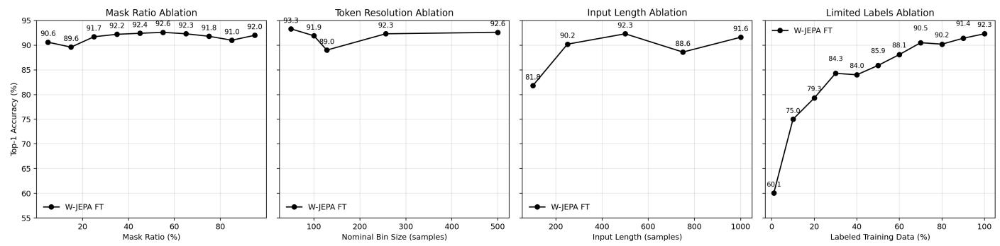  
Figure 5: One-factor-at-a-time sensitivity study on UCI-HAR. From left to right, the panels vary the fraction of token positions masked during pretraining, the number of temporal bins used to summarize each wavelet band (shown as the nominal input samples per bin), the input-window length, and the requested fraction of labeled fine-tuning windows. The shared baseline uses a 65% mask ratio, two bins per band, and 500-sample windows. Points report top-1 test accuracy from one run; nominal bin sizes are not literal wavelet receptive fields.

What is varied. The first three panels test sensitivity to pretraining and input-design choices, whereas the fourth tests label eficiency after the baseline pretraining run. The mask sweep covers 5–95% in tenpercentage-point increments. The temporal-bin sweep uses 1, 2, 4, 5, or 10 bins for each of the five wavelet bands, producing 30, 60, 120, 150, or 300 tokens for the six-channel input. Its horizontal coordinate is the nominal ratio of the 500-sample window to the number of bins. The input-length sweep uses 100, 250, 500, 750, or 1000 samples. The label sweep uses 1% and 10–100% of the training pool in ten-percentage-point increments. These experiments assess hyperparameter and data sensitivity; they do not test whether wavelets or the JEPA objective are necessary.

## D. Additional Analyses

## D.1. Exercise-bike example details

Signal and example selection. Figure 1 uses the left-leg gyroscope z-axis (LL\_zgyro) from DSADS. Panels (a) and (b) show horizontal and vertical exercise-bike cycling from WHAR subject 7, displayed as participant 8 in panel (c). The windows begin at 264.25 s in session 119 and 37.27 s in session 127, respectively. The raw Pearson correlation is 0.992. Signals are resampled from 25 to 100 Hz and divided into 500-sample windows that remain within session boundaries. No amplitude normalization or post-extraction time shifting is applied.

## D.2. Attention by timescale under input noise

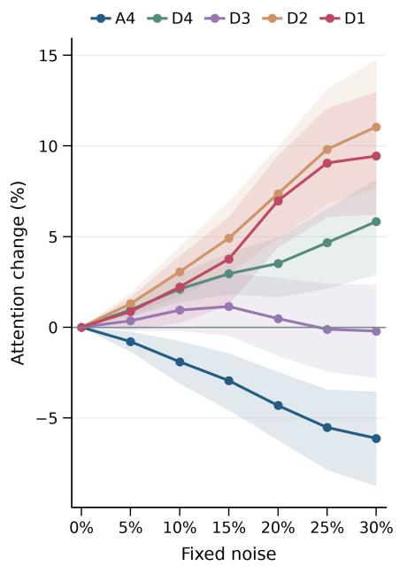

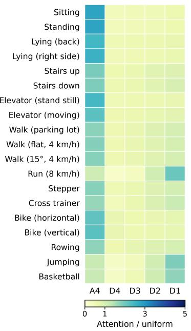

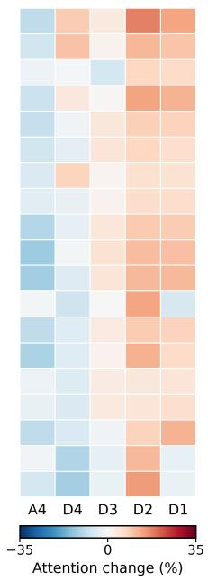  
Figure 6: Wavelet-scale attention on held-out DSADS participants. Left: relative attention change across noise doses across all activities; Middle: clean attention by activity relative to uniform allocation. Right: relative attention change by activity at 30% noise. All panels use the final encoder layer.

This section details the attention analysis summarized in §4.2. We examine how the fine-tuned encoder allocates attention across wavelet bands on held-out DSADS participants (Figure 6). Attention received by tokens in the final encoder layer (layer 8) is averaged over heads and query positions, then summed within each band. The middle heatmap divides each band’s attention by the uniform allocation of $1 / 5 ,$ so a value of 1 denotes uniform attention.

Added noise is measured against a fixed, training-derived per-channel dynamic RMS reference, and attention is averaged over three diferent randomly generated noises per window. Both change panels show $1 0 0 ( a _ { \mathrm { n o i s e } } -$ $a _ { 0 } ) / a _ { 0 }$ , calculated after aggregating attention within each band. Shaded area shows 95% bootstrap intervals for the mean attention change, estimated by resampling held-out participants while keeping their clean and noisy measurements paired.

Table 7: DSADS full-test performance under fixed input noise on a single seed. Nonzero doses report mean ± sample standard deviation across three noise realizations; clean inputs were evaluated once.
<table><tr><td rowspan="2">Noise (%)</td><td colspan="2">Held-out participants</td><td colspan="2">Random windows</td></tr><tr><td>Accuracy (%)1</td><td>Macro-F1 (%)</td><td>Accuracy (%)</td><td>Macro-F1 (%)</td></tr><tr><td>0</td><td>81.73</td><td>81.77</td><td>99.28</td><td>99.28</td></tr><tr><td>5</td><td> $8 1 . 6 5 \pm 0 . 0 2$ </td><td> $8 1 . 5 8 \pm 0 . 0 2$ </td><td> $9 9 . 2 2 \pm 0 . 0 1$ </td><td> $9 9 . 2 1 \pm 0 . 0 1$ </td></tr><tr><td>10</td><td> $8 1 . 8 7 \pm 0 . 0 3$ </td><td> $8 1 . 6 7 \pm 0 . 0 2$ </td><td> $9 9 . 0 5 \pm 0 . 0 4$ </td><td> $9 9 . 0 4 \pm 0 . 0 4$ </td></tr><tr><td>15</td><td> $8 1 . 1 4 \pm 0 . 0 7$ </td><td> $8 0 . 7 7 \pm 0 . 1 1$ </td><td> $9 8 . 9 0 \pm 0 . 0 2$ </td><td> $9 8 . 8 8 \pm 0 . 0 2$ </td></tr><tr><td>20</td><td> $8 1 . 0 0 \pm 0 . 0 5$ </td><td> $8 0 . 7 3 \pm 0 . 0 8$ </td><td> $9 8 . 6 6 \pm 0 . 0 4$ </td><td> $9 8 . 6 3 \pm 0 . 0 4$ </td></tr><tr><td>25</td><td> $8 1 . 7 2 \pm 0 . 1 1$ </td><td> $8 1 . 5 9 \pm 0 . 1 5$ </td><td> $9 8 . 0 3 \pm 0 . 0 3$ </td><td> $9 7 . 9 8 \pm 0 . 0 3$ </td></tr><tr><td>30</td><td> $8 1 . 7 7 \pm 0 . 2 1$ </td><td> $8 1 . 6 0 \pm 0 . 2 6$ </td><td> $9 7 . 1 4 \pm 0 . 0 9$ </td><td> $9 7 . 0 5 \pm 0 . 0 9$ </td></tr></table>

On clean inputs, $A _ { 4 }$ receives the largest attention share for the activities, whereas $D _ { 1 }$ receives the largest share for running and jumping. At 30% added noise, pooled $A _ { 4 }$ attention falls by 6.1% relative to clean inputs, while $D _ { 2 }$ and $D _ { 1 }$ rise by 11.1% and 9.4%.

Full-test performance remains largely intact across the tested noise levels (Table 7). At 30% noise, held-out accuracy rise slightly, while random-window accuracy and macro-F1 fall by about two points. Thus, the attention shift toward detail bands accompanies preserved classification performance under added noise. This is consistent with greater use of fine-scale tokens when classifying noisy inputs, although attention weights alone cannot establish that the shift causes the observed robustness.

Activity Standing Stairs Cycling Sitting Waist Bends Jogging Lying Arm Raises Running Walking Knee Bends Forward/Back Jumps

## D.3. Visualization of learned representations

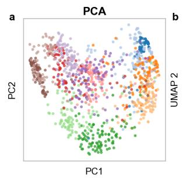

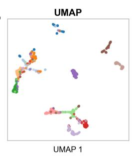

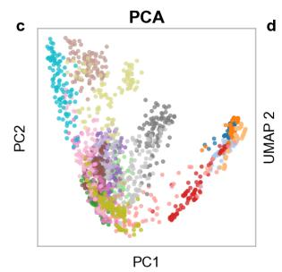

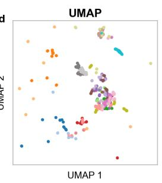

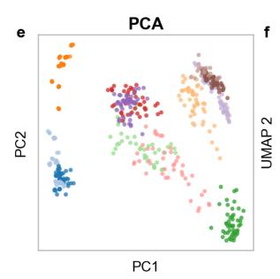

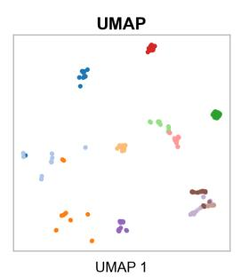

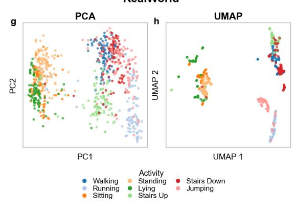

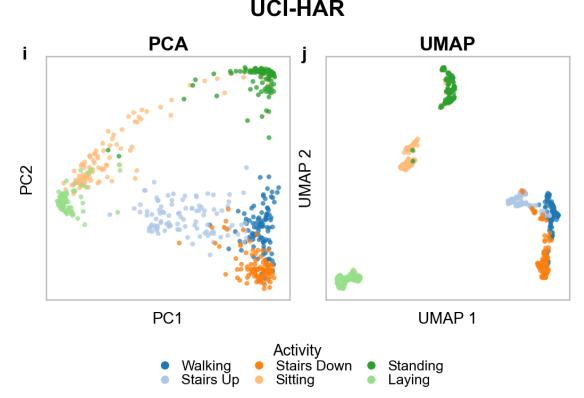

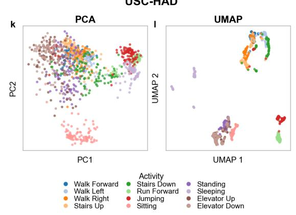  
Figure 7: PCA and UMAP projections of W-JEPA’s final-block representations across six human activity recognition datasets. Each point represents a test window, colored by activity class within each dataset.