# WHEN DOES DEPTH HELP? UNDERSTANDING LAYERWISE INFERENCE IN TABU-LAR FOUNDATION MODELS

Wenwen Gong1, Haotian Gu1, Zhen Yang2, Jiaying Ma1, Hanqing Zhang1 Zhongshen Wang1, Jingjun Wang1, Shouyi Xu1, Wei Wang3

1China Agricultural University 2Tsinghua University 3Nankai University

## ABSTRACT

Transformer-based tabular foundation models (TFMs) achieve state-of-the-art performance on small to medium-sized tabular prediction tasks while processing diverse inputs through a shared stack of layers. Recent layerwise analyses identify strong predictive performance in early TFM representations and substantial overlap in computation across layers. However, early predictive accessibility alone does not establish whether later layers are dispensable for every input, and aggregate accuracy can obscure which inputs benefit from additional computation. We study all 24 in-context-learning layers of TabPFN-3 across 272 classification datasets, combining representation geometry, prediction trajectories, truncation, and structural interventions, while also examining related representation dynamics in four additional TFMs. We uncover a pronounced expansion-compression trajectory, with stronger late dimensional contraction associated with larger increases in class-prototype separation. A targeted analysis of early-stabilizing samples shows that substantial representational changes persist after predicted classes stabilize, while locally ambiguous queries obtain larger accuracy gains from shallow to late layers than well-separated queries. Repeating a single pretrained block or perturbing layer order reduces predictive performance on average, constraining simple post-hoc substitutions in the frozen model. These findings distinguish predictive accessibility, class stability, and the benefits of continuing computation, supporting an input-dependent assessment of depthwise redundancy in TFMs.

## 1 INTRODUCTION

Tabular foundation models (TFMs) (Hollmann et al., 2023; 2025; Qu et al., 2025; Garg et al., 2025; Zhang et al., 2025b; Ma et al., 2025) use in-context learning to predict on new datasets from labeled support examples, without task-specific parameter updates. A single pretrained model processes tasks with different feature spaces and class structures through the same stack of in-context-learning layers. Understanding how much different inputs benefit from this depth is important for assessing computational redundancy and identifying opportunities to reduce inference cost while preserving prediction quality (Elbayad et al., 2020; Fan et al., 2020).

Recent layerwise analyses identify strong predictive performance in early TFM representations and substantial overlap in computation across layers (Balef et al., 2026). TabSwift (Liu & Ye, 2026) further demonstrates per-query early exiting and observes that deeper exits concentrate in ambiguous regions of representation space. These findings motivate examining what subsequent computation still contributes. Early predictive accessibility does not establish that later layers are dispensable for every input, and aggregate accuracy can obscure which inputs benefit from them.

Our layerwise evaluation of TabPFN-3 makes this distinction concrete. When queries are grouped by local class separation within each dataset, locally ambiguous groups show larger absolute accuracy gains from L9 to L23 on average than well-separated groups (Figure 1 (a)). Meanwhile, a targeted analysis of early-stabilizing samples shows that their representations continue to change substantially after their predicted classes stabilize, including pronounced late dimensional contraction (Figure 1 (b)). These observations highlight the need to distinguish predictive accessibility, class stability, and the accuracy gains from additional computation. They motivate our central question: When does later computation remain predictively useful, and how does its value vary across inputs?

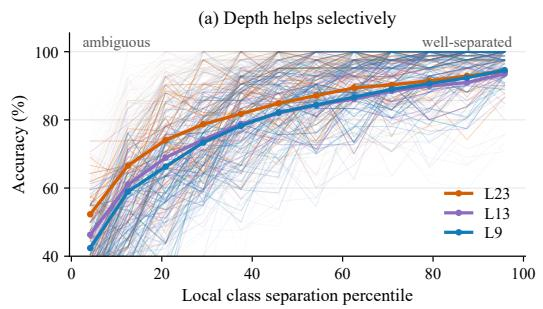

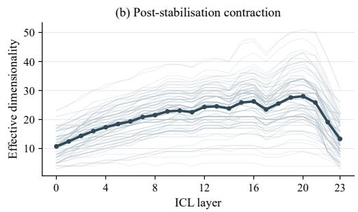  
Figure 1: Predictive accessibility, class stability, and the value of depth are distinct. (a) L9/L13/L23 accuracy vs. local class separation: ambiguous queries gain more from depth. (b) Effective dimensionality per layer for early-stabilizing queries: representations keep changing after the class stabilises, then contract sharply.

We study all 24 ICL layers of TabPFN-3 using 272 classification datasets from OpenML-CC18 (Bischl et al., 2019) and TALENT (Liu et al., 2025). We complement its native attention-based retrieval decoder (Grinsztajn et al., 2026) with layer-matched classifiers and decoder-independent probes, combining representation geometry, prediction trajectories, truncation, and structural interventions. We also examine related representation dynamics in four additional TFMs (Hollmann et al., 2025; Grinsztajn et al., 2025; Qu et al., 2025; 2026).

We find that TabPFN-3 representations follow a pronounced expansion-compression trajectory: early expansion is followed by a relatively stable middle regime and substantial reorganization near the output. Class-relevant information is readable at shallow depth, while class-prototype separation strengthens mainly at later layers. Across datasets, stronger late dimensional contraction is associated with greater increases in prototype separation. These findings distinguish the early availability of predictive information from the subsequent evolution of representation geometry.

At the task level, datasets with later prediction stabilization tend to incur larger accuracy losses under truncation. The overall depthwise accuracy gain also cannot be attributed entirely to mismatch with the final decoder: across 72 OpenML-CC18 tasks, accuracy increases from 82.2% at L2 to 85.6% at L23 when each layer is evaluated using its own fitted readout. Additional computation therefore retains predictive value beyond what is accessible through shallow representations under these readouts.

Finally, interventions show that the frozen model is sensitive to changes in its learned layer composition. Replacing distinct blocks with repeated applications of a single pretrained block, or perturbing their execution order, alters representation dynamics and reduces predictive performance on average. These results constrain simple post-hoc substitutions within the pretrained computation. Our findings support evaluating depthwise redundancy through input-dependent predictive gains alongside the accompanying representation dynamics, and motivate future work on adaptive-depth TFM inference.

## 2 RELATED WORK

Tabular Foundation Models. Tabular foundation models (TFMs) build on prior-data fitted networks (PFNs) to perform in-context learning without task-specific parameter updates (Müller et al., 2022). TabPFN-v1 performs ICL over row-level representations, whereas TabPFN-v2 moves to cell-level representations with alternating row- and feature-wise attention; TabPFN-2.5 largely retains this design while increasing depth and scaling to larger tables (Hollmann et al., 2023; 2025; Grinsztajn et al., 2025). In parallel, TabICL introduces a compression-then-ICL architecture that first constructs fixed-dimensional row representations, with TabICLv2 further extending this design through repeated feature grouping and target-aware representations (Qu et al., 2025; 2026). LimiX expands structured-data foundation modeling through joint conditional prediction and retrievalbased ensemble inference (Zhang et al., 2025a), while TabPFN-3 combines feature grouping and row compression in a three-stage architecture (Grinsztajn et al., 2026). Despite this architectural progress, mechanistic understanding of TFM inference remains limited. Existing studies have examined spectral adaptivity (Zheng et al., 2025), learned feature-space structure (Ye et al., 2025), intermediate-representation decodability (Hollmann et al., 2023), and layerwise predictive refinement and redundancy (Balef et al., 2026). Our work complements these studies by jointly examining representation geometry, sample-level prediction dynamics, and the functional role of depth.

Layerwise Analysis of Transformer Representations. Layerwise analysis has been widely used to trace how information and computation evolve across Transformer depth. Probing and tuned readouts characterize when task-relevant information becomes accessible (Alain & Bengio, 2017; Hewitt & Manning, 2019; Tenney et al., 2019; Rogers et al., 2020; Belinkov, 2022; Belrose et al., 2023), while representation-similarity and geometric analyses characterize how internal representations change across layers (Kornblith et al., 2019; Ansuini et al., 2019; Skean et al., 2025). Complementary intervention-based studies test whether individual layers or their ordering are functionally consequential (Lad et al., 2025; Sun et al., 2025). Most directly, Balef et al. (2026) identify early predictive accessibility, iterative refinement, and substantial depthwise redundancy in TFMs. We extend this layerwise perspective beyond predictive readability to characterize how geometry and individual prediction trajectories evolve, and whether later transformations retain functional value.

Views of Computation Across Depth. Depth has been interpreted as both iterative refinement and structured representation transformation. Residual networks can implement successive refinements of existing representations (Jastrzebski et al., 2018), whereas geometric studies report nontrivial depthwise changes in dimensionality and information structure (Ansuini et al., 2019; Skean et al., 2025). Related work on shared transformations and adaptive-depth inference further asks whether computation can be repeated, truncated, or selectively allocated across inputs (Dehghani et al., 2019; Lan et al., 2020; Elbayad et al., 2020; Xin et al., 2020; Zhou et al., 2020). These perspectives leave open whether TFM depth primarily reflects repetitive refinement or an ordered sequence of distinct, selectively useful transformations.

## 3 EXPERIMENTAL SETUP AND ANALYSIS FRAMEWORK

## 3.1 EXPERIMENTAL SETUP

Models. We use TabPFN-3 as the primary model for layerwise analysis (Grinsztajn et al., 2026). To assess cross-model generality, we additionally evaluate TabPFN-v2, TabPFN-2.5, TabICL, and TabICLv2 (Hollmann et al., 2025; Grinsztajn et al., 2025; Qu et al., 2025; 2026). Architectural details are provided in Appendix A.1, with cross-model results reported in Appendix C.

Datasets and Evaluation Protocol. We evaluate binary and multiclass classification on 72 tasks from OpenML-CC18 (Bischl et al., 2019) and 200 tasks from TALENT (Liu et al., 2025). We restrict the study to classification to maintain a common output space for analyzing layerwise prediction dynamics and representation geometry. All models use their standard preprocessing and inference pipelines. The layerwise representation-extraction protocol is detailed in Appendix A.2.

## 3.2 LAYERWISE ANALYSIS FRAMEWORK

Analysis framework. We analyze layerwise inference from three complementary perspectives: representation geometry, sample-dependent prediction dynamics, and the functional role of depth, building on prior layerwise probing, readout, and TFM analyses (Alain & Bengio, 2017; Belrose et al., 2023; Kornblith et al., 2019; Balef et al., 2026). For query i, we denote its hidden representation after layer ℓ by $h _ { i } ^ { ( \ell ) }$ and track its representation and prediction across depth. The representationextraction protocol is detailed in Appendix A.2.

Predictive readout. TabPFN-3 differs from earlier TabPFN variants in replacing the fixed-width classification head with an attention-based retrieval decoder (Grinsztajn et al., 2026). The decoder predicts directly from the relationship between query and support representations: support representations serve as keys, their one-hot labels as values, and query representations as queries. Because all 24 ICL layers preserve the same 512-dimensional hidden size and the decoder uses layer independent projections, we can apply the same pretrained model-native decoder at every depth to obtain a consistent predictive readout across layers. To control for possible mismatch between this decoder and intermediate representations, we complement the native readout with layer-matched readouts. Full decoder definitions and validation results are provided in Appendix E.1.

Representation and functional analyses. We characterize representation geometry using effective dimensionality (Ansuini et al., 2019), PCA displacement, linear CKA (Kornblith et al., 2019), and cosine similarity, capturing complementary aspects of dimensionality, movement, global structural similarity, and sample-wise directional alignment. We trace sample-level prediction trajectories and apply structural interventions to test when additional depth becomes functionally consequential (Lad et al., 2025; Sun et al., 2025; Balef et al., 2026). Metric definitions are provided in Appendix B, with supplementary prediction-dynamics and functional analyses in Appendices G and H, respectively.

## 4 EXPANSION–COMPRESSION EMERGES ACROSS DEPTH

## 4.1 REPRESENTATIONAL EXPANSION PRECEDES LATE COMPRESSION

We first examine how representation geometry evolves across depth. We measure this evolution using PCA-based effective dimensionality (ED) (Ansuini et al., 2019). For the centered query representation matrix $\widetilde H ^ { ( \ell ) } \in \mathbb { R } ^ { n \times d }$ with singular values $\sigma _ { 1 } \geq \sigma _ { 2 } \geq \cdot \cdot \cdot$ , we define

$$
\mathrm { E D } ( H ^ { ( \ell ) } ) = \operatorname* { m i n } \left\{ k : \frac { \sum _ { i = 1 } ^ { k } \sigma _ { i } ^ { 2 } } { \sum _ { i } \sigma _ { i } ^ { 2 } } \geq 0 . 9 \right\} .
$$

ED measures the number of principal directions required to explain most of the representation variance. Full details are provided in Appendix B.2.

Figure 2 reveals a pronounced non-monotonic trajectory. Effective dimensionality rises sharply at shallow depth, remains broadly elevated through the middle layers, and contracts near the output, with a brief local rebound preceding the final decline. We summarize these stages as expansion, plateau, and compression; L9 and L17 serve only as descriptive anchors for subsequent analyses.

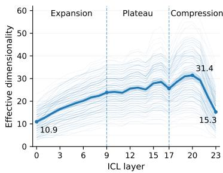

This pattern reveals a characteristic geometric trajectory: early layers broaden the effective representational space, whereas substantial contraction emerges only near the output. We refer to this trajectory as Expansion–Compression. The pattern persists across retained-variance thresholds, normalization and covariance controls, and nearby regime boundaries. Randomweight initialization produces a qualitatively different depthwise profile (Appendix E.3; Appendix D.1).

Figure 2: Representational expansion followed by late compression. Thin curves denote individual datasets and the thick curve denotes the dataset-level mean.

This late contraction occurs alongside continued representational change. We therefore next examine how strongly representations are reorganized within and across these regimes.

## 4.2 LATE COMPRESSION INVOLVES CONCENTRATED REORGANIZATION

The ED trajectory characterizes how broadly representation variance is distributed across depth. To quantify the strength of transformation within each regime, we complement ED with pairwise layer similarity, measured by linear CKA (Kornblith et al., 2019) and cosine similarity, together with adjacent-layer displacement in a shared PCA space. Metric details are provided in Appendix B.3.

Figure 3(a) reveals distinct depthwise transformation dynamics. During expansion, representations progressively depart from earlier layers. The plateau forms a pronounced high-similarity block across both nearby and distant layers, indicating relative mid-depth stabilization. Near the output, this block breaks down as the final layers increasingly diverge from the plateau representations.

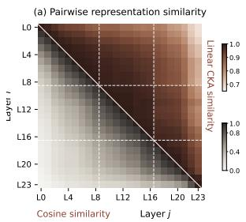

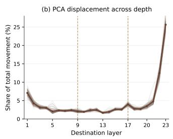

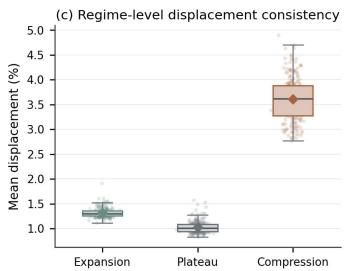  
Figure 3: Representation transformation dynamics across depth. (a) Mean pairwise layer similarity, with linear CKA above the diagonal and cosine similarity below. (b) Adjacent-layer displacement measured in a shared PCA basis. (c) Dataset-level displacement across the expansion, plateau, and compression regimes.

Representation displacement exhibits the same structure (Figure 3(b)). Layer-to-layer movement remains substantial during expansion, reaches its minimum through the plateau, and rises sharply again at late depth.The final layer transitions exhibit the largest concentration of PCA displacement, indicating intensified representational reorganization near the output. This concentration is consis tent across datasets, with displacement lowest during the plateau and highest in the compression regime (Figure 3(c)).

Late compression therefore coincides with a concentrated phase of geometric reorganization near the output. Representation transformation intensifies again after the mid-depth plateau, showing that substantial internal reorganization persists into the final layers.

## 4.3 EARLY PREDICTIVE ACCESSIBILITY PRECEDES CANDIDATE RESOLUTION

To characterize the decision structure associated with this late reorganization, we analyze the geometry among competing class candidates. For each support class c, we construct a layer-specific prototype $\mu _ { c } ^ { ( \ell ) }$ and compute its cosine similarity with query $i , s _ { i , c } ^ { ( \ell ) } = \cos ( h _ { i } ^ { ( \ell ) } , \mu _ { c } ^ { ( \ell ) } )$ . We quantify candidate competition by the margin between the two most similar class prototypes, $\Delta _ { i } ^ { ( \ell ) } = s _ { i , ( 1 ) } ^ { ( \ell ) } - s _ { i , ( 2 ) } ^ { ( \ell ) } { : }$ and use the rank of the correct-class prototype to measure alignment with the target class. The analysis covers all 105 multiclass datasets from OpenML-CC18 and TALENT. Full diagnostic details are provided in Appendix F.

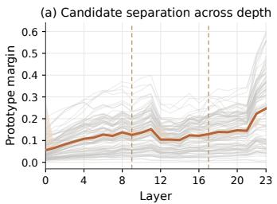

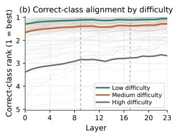

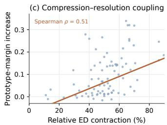  
Figure 4: Candidate separation strengthens at late depth. (a) Prototype margins remain small through the early and middle layers and widen most strongly near the output. (b) Correct-class alignment emerges earlier on easier tasks, whereas harder tasks retain candidate ambiguity deeper into the network. (c) Stronger late effective-dimensionality contraction is associated with larger increases in prototype margin.

Figure 4(a) shows that prototype margins remain small through the early and middle layers and widen most strongly near the output. Figure 4(b) reveals a corresponding progression in correct-class alignment: easier tasks establish favorable alignment earlier, whereas harder tasks retain candidate ambiguity deeper into the network.

Class-relevant information is already accessible well before strong candidate separation emerges. The attn@V probe exhibits strong linear class decodability by L2, whereas prototype margins widen primarily at later depth (Appendix F.3). Predictive accessibility therefore precedes strong geometric resolution among competing class candidates.

We next relate late candidate resolution to the compression identified in Section 4.1. For each dataset d, we define relative late compression as

$$
C _ { d } = \frac { \mathrm { E D } _ { d } ^ { ( 2 0 ) } - \mathrm { E D } _ { d } ^ { ( 2 3 ) } } { \mathrm { E D } _ { d } ^ { ( 2 0 ) } } ,
$$

and the corresponding increase in candidate separation as $R _ { d } = \Delta _ { d } ^ { ( 2 3 ) } - \Delta _ { d } ^ { ( 2 0 ) }$ . Figure 4(c) shows that datasets with stronger late compression exhibit larger increases in prototype margin. The same association persists across alternative specifications (Appendix F.4). Late dimensional contraction and candidate resolution therefore covary systematically across datasets.

These results separate predictive accessibility from geometric resolution. Class-relevant information becomes readable at shallow depth while competing candidates remain weakly separated. Near the output, concentrated reorganization and compression coincide with stronger candidate separation and target-aligned geometry. Predictive accessibility therefore precedes geometric resolution.

## 5 PREDICTIONS COMMIT AT DIFFERENT DEPTHS

## 5.1 PREDICTION COMMITMENT IS SAMPLE-DEPENDENT

Section 4.3 shows that predictive accessibility can precede geometric resolution. We next turn to the sample level and ask when the predicted class itself becomes stable. For sample i, we denote its layerwise prediction trajectory as $p _ { i } = ( \hat { y } _ { i } ^ { ( 0 ) } , \dots , \hat { y } _ { i } ^ { ( 2 3 ) } )$ and define the stabilization depth as the earliest layer after which the predicted class remains identical to the final-layer prediction: $s _ { i } =$ min $\{ \ell : \hat { y } _ { i } ^ { ( k ) } = \hat { y } _ { i } ^ { ( 2 3 ) } , \forall k \ge \ell \}$ . We use predictive commitment to denote this stabilization of class identity. The resulting stabilization depth s is a retrospective trajectory-level quantity. Confidence and representation geometry may continue to evolve after commitment.

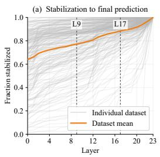

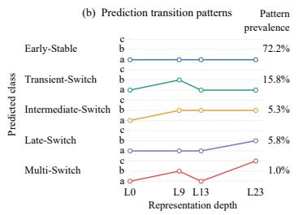

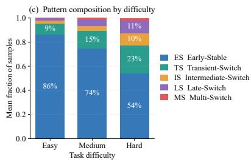  
Figure 5: Sample-level predictive commitment across depth. (a) Cumulative fraction of samples stabilized to the final prediction across layers, shown per dataset and in aggregate. (b) Five recurring prediction-transition patterns and their pooled prevalence. (c) Pattern composition across tertiles of chance-normalized task difficulty; statistical analyses use difficulty as a continuous variable.

Figure 5(a) reveals substantial heterogeneity in predictive commitment. Many predictions stabilize at shallow depth, while others continue to change through intermediate or late layers, with pronounced variation across datasets. Predictions therefore commit at markedly different depths.

Stabilization depth captures when a prediction becomes stable, while the preceding trajectory reveals how its class identity evolves before commitment. We characterize this trajectory using prediction identities at L9, L13, and L23 together with the total number of class transitions across all 24 layers, $\begin{array} { r } { n _ { \mathrm { c h g } , i } = \sum _ { \ell = 1 } ^ { 2 3 } \mathbb { I } \big [ \hat { y } _ { i } ^ { ( \ell ) } \neq \hat { y } _ { i } ^ { ( \ell - 1 ) } \big ] } \end{array}$ . Pattern assignment uses only the prediction trajectory and does not depend on ground-truth correctness. Full assignment rules are provided in Appendix G.1, with sensitivity to nearby representative-layer choices reported in Appendix G.3.

Figure 5(b) summarizes five recurring trajectory patterns. Early-Stable (ES) predictions reach the final predicted class early and remain there; Transient-Switch (TS) predictions temporarily depart from it before returning; Intermediate-Switch (IS) and Late-Switch (LS) predictions reach the final class at intermediate and late depth, respectively; and Multi-Switch (MS) predictions undergo repeated class changes. ES is dominant at 72.2%, followed by TS (15.8%), LS (5.8%), IS (5.3%), and MS (1.0%). Although early commitment is predominant, more than one quarter of samples exhibit non-early prediction dynamics. Similar pattern distributions are observed under dataset-level aggregation and nearby representative-layer choices (Appendices G.2–G.3).

Representation dynamics continue beyond early predictive commitment. Early-Stable samples have stabilized by L9, while their representations still exhibit the characteristic Expansion–Compression trajectory, including pronounced late reorganization (Appendix G.5). Predictive commitment can therefore precede substantial later representational transformation. More broadly, all samples traverse the same sequence of layers, while their predictions commit at substantially different depths.

## 5.2 COMMITMENT DEPTH TRACKS TASK DIFFICULTY AND LOCAL AMBIGUITY

Commitment depth varies systematically with task difficulty and local ambiguity. At the task level, we define model-relative, chance-normalized difficulty as

$$
D _ { d } = 1 - \frac { a _ { d } - 1 / C _ { d } } { 1 - 1 / C _ { d } } ,
$$

where $a _ { d }$ is final-layer accuracy and $C _ { d }$ is the number of classes. Harder tasks stabilize later on average, with a consistent association across alternative definitions of difficulty (Appendix G.4).

Correspondingly, Figure 5(c) shows a systematic shift from ES toward non-ES trajectories as task difficulty increases. At the sample level, we quantify local ambiguity using class separation in the input space:

$$
r _ { i } = \frac { d ( x _ { i } , \mathrm { N N _ { d i f f } } ) } { d ( x _ { i } , \mathrm { N N _ { s a m e } } ) } ,
$$

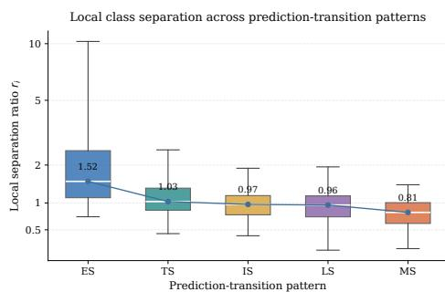

where $\mathrm { N N _ { s a m e } }$ and $\mathrm { N N } _ { \mathrm { d i f f } }$ denote the nearest sameand different-class neighbors, respectively. Smaller $r _ { i }$ indicates greater local ambiguity. Median separation decreases from 1.52 for ES to 0.81 for MS (Figure 6). Dataset-aware comparisons further show higher separation for ES than for every non-ES pattern in approximately 95% of shared datasets (Appendix G.6). For cross-dataset analyses, we convert $r _ { i }$ to a within-dataset local-separation percentile to place datasets with different raw distance scales on

Figure 6: Local class separation across prediction-transition patterns. Separation decreases from ES to MS, indicating local ambiguity for more dynamic trajectories.

a common reference. Lower percentiles correspond to more ambiguous samples, whereas higher percentiles indicate more clearly separated local neighborhoods.

Commitment depth therefore varies systematically across both tasks and samples. Harder tasks commit later on average, while locally ambiguous samples exhibit more dynamic prediction trajectories. Thus, inputs traversing the same network can differ substantially in how much depth is required before their predictions stabilize.

## 6 THE FUNCTIONAL VALUE OF DEPTH

## 6.1 ADDITIONAL DEPTH HAS SELECTIVE UTILITY

We next examine whether the heterogeneous commitment identified above is reflected in the functional value of additional computation at both the sample and task levels. Lower local-separation percentiles indicate greater ambiguity, whereas higher percentiles correspond to more clearly separated samples.

At the sample level, Figure 7(a) shows that depthwise benefit depends strongly on local ambiguity. Accuracy is already high at L9 for well-separated samples and changes only modestly toward L23, whereas the gap between shallow and final depth grows as local separation decreases. Locally am biguous inputs therefore obtain larger aggregate gains from additional computation. To distinguish aggregate depthwise gains from the fate of individual shallow predictions, we separately measure retention of shallow successes and rescue of shallow errors:

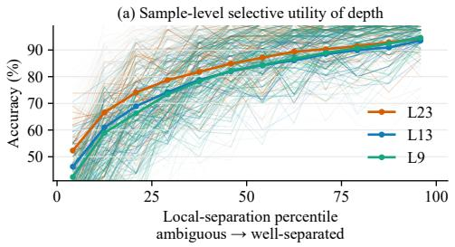

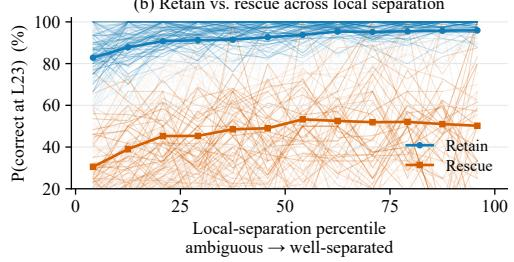

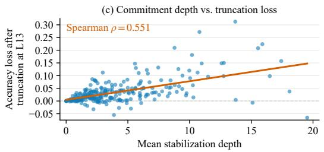

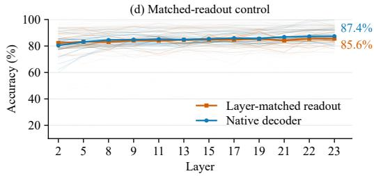  
Figure 7: Depth has selective utility across samples and tasks. (a) Accuracy at L9, L13, and L23 across within-dataset local-separation percentiles; locally ambiguous samples show larger gains with depth. (b) Retention of L9-correct predictions and rescue of L9 errors across local-separation percentiles; both increase with separation. (c) Mean stabilization depth is positively associated with L13 truncation loss. (d) Accuracy increases with depth under layer-matched readouts.

$$
\mathrm { R e t a i n } = P ( \hat { y } ^ { ( 2 3 ) } = y \mid \hat { y } ^ { ( 9 ) } = y ) , \qquad \mathrm { R e s c u e } = P ( \hat { y } ^ { ( 2 3 ) } = y \mid \hat { y } ^ { ( 9 ) } \neq y ) .
$$

Figure 7(b) shows that both retention and rescue increase with local separation. Thus, ambiguous groups show larger aggregate gains overall, even though errors already present at L9 are less frequently rescued. The same trends hold with L8 or L10 as the shallow reference (Appendix H.2).

The same selectivity appears at the task level. We define the loss from truncating inference at layer ℓ as $\Delta \operatorname { A c c } _ { d } ^ { ( \ell ) } = \operatorname { A c c } _ { d } ^ { \left( 2 3 \right) ^ { - } } - \operatorname { A c c } _ { d } ^ { ( \ell ) }$ . Using L13 as the representative truncation point, Figure 7(c) shows that datasets with later mean stabilization depth incur greater accuracy loss. The association remains positive for later truncation points and with balanced accuracy (Appendix H.1). Later-committing tasks are therefore more sensitive to truncation. The depthwise advantage also persists under depthspecific readouts. With independently trained layer-matched readouts, Figure 7(d) shows that accuracy increases from 82.2% at L2 to 85.6% at L23. Greater depth therefore remains predictively beneficial when each layer is evaluated through its own matched readout.

The functional value of depth is therefore selective: locally ambiguous samples obtain larger aggregate gains from additional computation, while later-committing tasks are more sensitive to truncation. Well-separated inputs, by contrast, gain comparatively little from the remaining layers.

## 6.2 LATER COMPUTATION IS ORDERED RATHER THAN REPETITIVE

We next characterize the structure of this later computation through interventions on the ICL stack, comparing repeated shared transformations with the sequence of distinct learned blocks.

Replacing the sequence of distinct ICL blocks with repeated applications of a shared block substantially weakens both late compression and class-discriminative growth (Figure 8(a)). The effectivedimensional compression ratio decreases from 2.85× to 1.05×, while the FDR gain decreases from 2.53 to 0.84. The repeated-block trajectory remains qualitatively distinct even after 24 applications (Figure 8(b)), with the same pattern observed for representative blocks selected from different stages (Appendix H.3).

These representational differences are accompanied by predictive differences. Figure 8(c) shows a positive average advantage for the original model under clean evaluation, label noise, feature perturbation, and reduced sample availability. Under 20% label noise, this advantage holds on every evaluated task (Appendix H.4). The learned sequence of distinct blocks therefore yields both the characteristic representation trajectory and stronger predictive behavior than repeated generic computation.

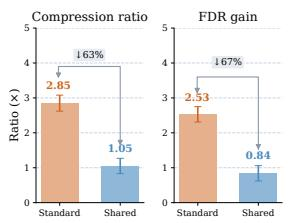  
(a)

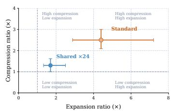  
(b)

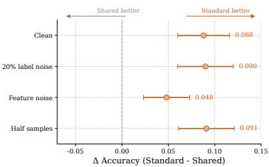  
(c)  
Figure 8: Shared-weight repetition produces a distinct depthwise trajectory. (a) Shared-weight repetition weakens compression and class-discriminative growth. (b) The repeated-block trajectory remains distinct at matched computational depth. (c) The full model retains a predictive advantage under perturbation.

A complementary intervention preserves the learned blocks while changing only their execution order. Shuffling or reversing the learned sequence largely removes the characteristic late compression in the representation trajectory (Figure 9(a)), while also reducing predictive performance on most evaluated tasks (Figure 9(b)). Because the learned transformations are preserved, this intervention isolates execution order as a functional component of depth.

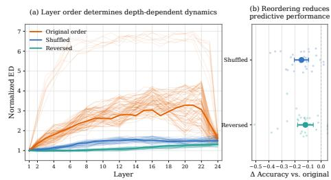

Later computation is therefore structured as an ordered sequence of distinct learned operations. Its representational and predictive effects depend on both transformation identity and execution order. This computation path is shared across inputs, while their resolution requirements vary substantially.

Figure 9: Layer order is functionally consequential. (a) Shuffling or reversing the learned sequence disrupts the depthwise representation dynamics. (b) Reordering reduces predictive performance on average.

## 7 CONCLUSION

Interpretation. Our study clarifies when later computation remains predictively useful and how its value varies across inputs. Class-relevant information becomes accessible at shallow depth, while representation geometry continues to evolve through an Expansion–Compression trajectory, with predictive accessibility preceding geometric resolution. At the sample level, predictions commit at substantially different depths, varying systematically with task difficulty and local ambiguity. This heterogeneity is reflected in the functional value of depth: locally ambiguous samples obtain larger aggregate gains from additional computation, later-committing tasks are more sensitive to truncation, and depthwise predictive gains remain under layer-matched readouts. Structural interventions further show that later computation depends on an ordered sequence of distinct learned transformations rather than generic repetition. These findings show that TFMs follow a shared computation path whose functional value varies substantially across inputs, motivating an input-dependent view of depthwise redundancy.

Limitations and Future Work. Our analysis focuses primarily on TabPFN-3 and classification, although complementary experiments reveal related representation dynamics in several additional TFMs. The strength and temporal organization of Expansion–Compression may vary across architectures and model scales. A practical early-exit mechanism will require reliable online signals that estimate whether additional computation is likely to alter or improve a prediction, rather than relying on the retrospective stabilization depth used in our analysis. Future work could investigate inference-time signals derived from prediction confidence, trajectory consistency, or representation geometry, and determine how reliably they identify inputs that benefit from continued computation. Extending these analyses to broader TFM architectures and regression settings is another impor tant direction, particularly because regression will require suitable continuous notions of predictive commitment rather than discrete class-identity stabilization.

## REPRODUCIBILITY STATEMENT

We have made every effort to ensure that the results presented in this paper are reproducible. The experimental setup, including the evaluated models, datasets, layerwise evaluation protocols, representation metrics, prediction analyses, and structural interventions, is described in detail in the main paper and appendices. We additionally provide the definitions of all major evaluation metrics, dataset-level aggregation procedures, statistical analyses, and robustness checks used throughout the study. The datasets used in our experiments are drawn from publicly available benchmark collections, including OpenML-CC18 and TALENT, enabling consistent and reproducible evaluation. Detailed descriptions of model architectures and layerwise representation extraction are provided in Appendix A, while Appendix B specifies the representation metrics and analytical procedures. Additional analyses of candidate geometry, prediction dynamics, truncation, matched readouts, sharedweight controls, data perturbations, and layer-order interventions are documented in the subsequent appendices. We believe these details provide sufficient information to facilitate replication and verification of our results.

## AI USE STATEMENT

Large language models (LLMs) were used to assist with the writing and polishing of the manuscript. Specifically, we used LLMs to refine language, improve readability, enhance clarity, and support sentence rephrasing, grammar checking, and the overall flow of the text. LLMs were also used for literature retrieval and discovery to help identify relevant prior work and reduce the risk of overlooking closely related studies. In addition, LLMs were used to support research ideation, primarily to refine the research questions. All AI-assisted outputs were reviewed and verified by the authors, who take full responsibility for the final content of the work.

## REFERENCES

Guillaume Alain and Yoshua Bengio. Understanding intermediate layers using linear classifier probes. In International Conference on Learning Representations, 2017.

Alessio Ansuini, Alessandro Laio, Jakob H. Macke, and Davide Zoccolan. Intrinsic dimension of data representations in deep neural networks. In Advances in Neural Information Processing Systems, volume 32, 2019.

Amir Rezaei Balef, Mykhailo Koshil, and Katharina Eggensperger. Is one layer enough? understanding inference dynamics in tabular foundation models. In Proceedings of the 43rd International Conference on Machine Learning, 2026. arXiv:2605.06510.

Yonatan Belinkov. Probing classifiers: Promises, shortcomings, and advances. Computational Linguistics, 48(1):207–219, 2022. doi: 10.1162/coli\_a\_00422.

Nora Belrose, Zach Furman, Logan Smith, Danny Halawi, Igor Ostrovsky, Lev McKinney, Stella Biderman, and Jacob Steinhardt. Eliciting latent predictions from transformers with the tuned lens, 2023.

Bernd Bischl, Giuseppe Casalicchio, Matthias Feurer, Pieter Gijsbers, Frank Hutter, Michel Lang, Rafael G. Mantovani, Jan N. van Rijn, and Joaquin Vanschoren. OpenML benchmarking suites. arXiv preprint arXiv:1708.03731, 2019.

Mostafa Dehghani, Stephan Gouws, Oriol Vinyals, Jakob Uszkoreit, and Lukasz Kaiser. Universal transformers. In International Conference on Learning Representations, 2019.

Maha Elbayad, Jiatao Gu, Edouard Grave, and Michael Auli. Depth-adaptive transformer. In International Conference on Learning Representations, 2020.

Angela Fan, Edouard Grave, and Armand Joulin. Reducing transformer depth on demand with structured dropout. In International Conference on Learning Representations, 2020.

Anurag Garg, Muhammad Ali, Noah Hollmann, Lennart Purucker, Samuel Müller, and Frank Hutter. Real-TabPFN: Improving tabular foundation models via continued pre-training with real-world data. arXiv preprint arXiv:2507.03971, 2025. doi: 10.48550/arXiv.2507.03971.

Léo Grinsztajn, Klemens Flöge, Oscar Key, Felix Birkel, Philipp Jund, Brendan Roof, Benjamin Jäger, Dominik Safaric, Simone Alessi, Adrian Hayler, Mihir Manium, Rosen Yu, Felix Jablonski, Shi Bin Hoo, Anurag Garg, Jake Robertson, Magnus Bühler, Vladyslav Moroshan, Lennart Purucker, Clara Cornu, Lilly Charlotte Wehrhahn, Alessandro Bonetto, Bernhard Schölkopf, Sauraj Gambhir, Noah Hollmann, and Frank Hutter. TabPFN-2.5: Advancing the state of the art in tabular foundation models, 2025.

Léo Grinsztajn, Klemens Flöge, Oscar Key, Felix Birkel, Philipp Jund, Brendan Roof, Mihir Manium, Shi Bin Hoo, Magnus Bühler, Anurag Garg, Dominik Safaric, Jake Robertson, Benjamin Jäger, Simone Alessi, Adrian Hayler, Vladyslav Moroshan, Lennart Purucker, Philipp Singer, Alan Arazi, Julien Siems, Jan Hendrik Metzen, Georg Grab, Nick Erickson, Siyuan Guo, Eliott Kalfon, Simon Bing, David Salinas, Clara Cornu, Lilly Charlotte Wehrhahn, Diana Kriuchkova, Kursat Kaya, Lydia Sidhoum, Marie Salmon, Jerry Chen, Madelon Hulsebos, Yann LeCun, Samuel Müller, Bernhard Schölkopf, Sauraj Gambhir, Noah Hollmann, and Frank Hutter. TabPFN-3: Technical report, 2026.

John Hewitt and Christopher D. Manning. A structural probe for finding syntax in word representations. In Proceedings ofNAACL-HLT, pp. 4129–4138, 2019. doi: 10.18653/v1/N19-1419.

Noah Hollmann, Samuel Müller, Katharina Eggensperger, and Frank Hutter. TabPFN: A transformer that solves small tabular classification problems in a second. In International Conference on Learning Representations, 2023. URL https://openreview.net/forum?id= cp5PvcI6w8\_.

Noah Hollmann, Samuel Müller, Lennart Purucker, Arjun Krishnakumar, Max Körfer, Shi Bin Hoo, Robin Tibor Schirrmeister, and Frank Hutter. Accurate predictions on small data with a tabular foundation model. Nature, 637(8045):319–326, 2025. doi: 10.1038/s41586-024-08328-6.

Stanislaw Jastrzebski, Devansh Arpit, Nicolas Ballas, Vikas Verma, Tong Che, and Yoshua Bengio. Residual connections encourage iterative inference. In International Conference on Learning Representations, 2018.

Simon Kornblith, Mohammad Norouzi, Honglak Lee, and Geoffrey Hinton. Similarity of neural network representations revisited. In Proceedings of the 36th International Conference on Machine Learning, volume 97 of Proceedings of Machine Learning Research, pp. 3519–3529. PMLR, 2019.

Vedang Lad, Jin Hwa Lee, Wes Gurnee, and Max Tegmark. The remarkable robustness of LLMs: Stages of inference? In Advances in Neural Information Processing Systems, volume 38, pp. 144216–144249, 2025. doi: 10.52202/085713-4332.

Zhenzhong Lan, Mingda Chen, Sebastian Goodman, Kevin Gimpel, Piyush Sharma, and Radu Soricut. ALBERT: A lite BERT for self-supervised learning of language representations. In International Conference on Learning Representations, 2020.

Si-Yang Liu and Han-Jia Ye. TabSwift: An efficient tabular foundation model with row-wise attention. In Proceedings of the 43rd International Conference on Machine Learning, volume 306 of Proceedings of Machine Learning Research, 2026.

Si-Yang Liu, Hao-Run Cai, Qi-Le Zhou, Huai-Hong Yin, Tao Zhou, Jun-Peng Jiang, and Han-Jia Ye. TALENT: A tabular analytics and learning toolbox. Journal ofMachine Learning Research, 26(226):1–16, 2025.

Junwei Ma, Valentin Thomas, Rasa Hosseinzadeh, Alex Labach, Jesse C. Cresswell, Keyvan Golestan, Guangwei Yu, Anthony L. Caterini, and Maksims Volkovs. TabDPT: Scaling tabular foundation models on real data. In Advances in Neural Information Processing Systems, volume 38, pp. 191387–191417, 2025. doi: 10.52202/085713-5748.

Samuel Müller, Noah Hollmann, Sebastian Pineda Arango, Josif Grabocka, and Frank Hutter. Transformers can do bayesian inference. In International Conference on Learning Representations, 2022. URL https://openreview.net/forum?id=KSugKcbNf9.

Jingang Qu, David Holzmüller, Gaël Varoquaux, and Marine Le Morvan. TabICL: A tabular foundation model for in-context learning on large data. In Proceedings of the 42nd International Conference on Machine Learning, volume 267 of Proceedings of Machine Learning Research, pp. 50817–50847. PMLR, 2025.

Jingang Qu, David Holzmüller, Gaël Varoquaux, and Marine Le Morvan. TabICLv2: A better, faster, scalable, and open tabular foundation model, 2026.

Anna Rogers, Olga Kovaleva, and Anna Rumshisky. A primer in BERTology: What we know about how BERT works. Transactions of the Association for Computational Linguistics, 8:842–866, 2020. doi: 10.1162/tacl\_a\_00349.

Oscar Skean, Md Rifat Arefin, Dan Zhao, Niket Nikul Patel, Jalal Naghiyev, Yann LeCun, and Ravid Shwartz-Ziv. Layer by layer: Uncovering hidden representations in language models. In Proceedings of the 42nd International Conference on Machine Learning, volume 267 of Proceedings of Machine Learning Research, pp. 55854–55875. PMLR, 2025.

Qi Sun, Marc Pickett, Aakash Kumar Nain, and Llion Jones. Transformer layers as painters. In Proceedings of the AAAI Conference on Artificial Intelligence, volume 39, pp. 25219–25227, 2025. doi: 10.1609/aaai.v39i24.34708.

Ian Tenney, Dipanjan Das, and Ellie Pavlick. BERT rediscovers the classical NLP pipeline. In Proceedings of the 57th Annual Meeting of the Association for Computational Linguistics, pp. 4593–4601, 2019. doi: 10.18653/v1/P19-1452.

Ji Xin, Raphael Tang, Jaejun Lee, Yaoliang Yu, and Jimmy Lin. DeeBERT: Dynamic early exiting for accelerating BERT inference. In Proceedings of the 58th Annual Meeting of the Association for Computational Linguistics, pp. 2246–2251, 2020. doi: 10.18653/v1/2020.acl-main.204.

Han-Jia Ye, Si-Yang Liu, and Wei-Lun Chao. A closer look at TabPFN v2: Understanding its strengths and extending its capabilities. In Advances in Neural Information Processing Systems, volume 38, pp. 150356–150388, 2025. doi: 10.52202/085713-4527.

Xingxuan Zhang, Gang Ren, Han Yu, Hao Yuan, Hui Wang, Jiansheng Li, Jiayun Wu, Lang Mo, Li Mao, Mingchao Hao, Ningbo Dai, Renzhe Xu, Shuyang Li, Tianyang Zhang, Yue He, Yuanrui Wang, Yunjia Zhang, Zijing Xu, Dongzhe Li, Fang Gao, Hao Zou, Jiandong Liu, Jiashuo Liu, Jiawei Xu, Kaijie Cheng, Kehan Li, Linjun Zhou, Qing Li, Shaohua Fan, Xiaoyu Lin, Xinyan Han, Xuanyue Li, Yan Lu, Yuan Xue, Yuanyuan Jiang, Zimu Wang, Zhenlei Wang, and Peng Cui. LimiX: Unleashing structured-data modeling capability for generalist intelligence, 2025a.

Xiyuan Zhang, Danielle Maddix Robinson, Junming Yin, Nick Erickson, Abdul Fatir Ansari, Boran Han, Shuai Zhang, Leman Akoglu, Christos Faloutsos, Michael W. Mahoney, Tony Hu, Huzefa Rangwala, George Karypis, and Yuyang (Bernie) Wang. Mitra: Mixed synthetic priors for enhancing tabular foundation models. In Advances in Neural Information Processing Systems, volume 38, pp. 17831–17876, 2025b. doi: 10.52202/085713-0535.

Jianqiao Zheng, Cameron Gordon, Yiping Ji, Hemanth Saratchandran, and Simon Lucey. From tables to signals: Revealing spectral adaptivity in TabPFN, 2025.

Wangchunshu Zhou, Canwen Xu, Tao Ge, Julian McAuley, Ke Xu, and Furu Wei. BERT loses patience: Fast and robust inference with early exit. In Advances in Neural Information Processing Systems, volume 33, pp. 18330–18341, 2020.

## A MODEL ARCHITECTURES AND LAYERWISE REPRESENTATION EXTRACTION

This appendix provides the architectural and representation-extraction details underlying our layerwise analyses. All empirical findings are reported in the corresponding main-text and supplementary analyses.

## A.1 MODEL ARCHITECTURES

Primary architecture. We use TabPFN-3 as the primary model for layerwise analysis (Grinsztajn et al., 2026). The pretrained model remains frozen throughout all representation and inference analyses.

TabPFN-3 maps heterogeneous tabular features into fixed-dimensional row representations before performing in-context learning over rows. Its architecture consists of three stages. Stage 1 performs column-wise feature-distribution embedding through three induced-attention blocks. Stage 2 aggregates feature information within each row using three transformer blocks and four learned CLS tokens. The resulting four 128-dimensional vectors are flattened into a 512-dimensional row representation. Stage 3 applies 24 in-context-learning transformer blocks. All layerwise analyses in this paper concern these 24 Stage-3 blocks.

Table 1: Architecture of TabPFN-3 used in the primary analysis. Layer indices L0–L23 refer exclusively to the 24 Stage-3 ICL blocks.
<table><tr><td>Component 1</td><td>Hyperparameter</td><td>Value</td></tr><tr><td></td><td>Stage 1: Feature-distribution embedding Base embedding dimension</td><td>128</td></tr><tr><td></td><td>Features per circular-shift group</td><td>3</td></tr><tr><td></td><td>Induced-attention blocks</td><td>3</td></tr><tr><td></td><td>Attention heads</td><td>8</td></tr><tr><td></td><td>Inducing points per column</td><td>128</td></tr><tr><td>Stage 2: Feature aggregation</td><td></td><td></td></tr><tr><td></td><td>Transformer blocks</td><td>3</td></tr><tr><td></td><td>Attention heads</td><td>8</td></tr><tr><td></td><td>CLS tokens per row</td><td>4</td></tr><tr><td></td><td>Positional encoding</td><td>RoPE</td></tr><tr><td></td><td>RoPE base</td><td>100,000</td></tr><tr><td>Stage 3: In-context learning</td><td></td><td></td></tr><tr><td></td><td>Row representation dimension</td><td>512</td></tr><tr><td></td><td>Transformer blocks</td><td>24</td></tr><tr><td></td><td>Query attention heads</td><td>8</td></tr><tr><td></td><td>KV heads for support rows</td><td>8</td></tr><tr><td></td><td>KV heads for query rows</td><td>1</td></tr><tr><td></td><td>Feed-forward expansion</td><td>2×</td></tr><tr><td>Classification decoder</td><td></td><td></td></tr><tr><td></td><td>Decoder type</td><td>Attention retrieval</td></tr><tr><td></td><td>Decoder heads</td><td>6</td></tr><tr><td></td><td>Head dimension</td><td>64</td></tr><tr><td></td><td>Pretraining class limit</td><td>160</td></tr></table>

TabPFN-3 uses RMSNorm throughout the network. Its classification decoder is an attention-based retrieval module: support representations serve as keys, their one-hot labels as values, and query representations as queries. The decoder operates on the 512-dimensional Stage-3 representations and provides the model-native predictive readout used in our layerwise analyses.

Cross-model architectures. To examine cross-model generality, we additionally consider TabPFN-v2, TabPFN-2.5, TabICL, and TabICLv2 (Hollmann et al., 2025; Grinsztajn et al., 2025; Qu et al., 2025; 2026). Table 2 summarizes the architectural properties most relevant to comparing their layerwise representations. All models are evaluated using their pretrained parameters without task-specific backbone fine-tuning.

Table 2: Architectures used in the cross-model analyses. “ICL depth” denotes the sequence of transformer blocks over which layerwise representations are analyzed. Parameter counts correspond to the classification models where available.
<table><tr><td>Model</td><td>Parameters</td><td>ICL depth</td><td>ICL dim.</td><td>Pre-ICL stages</td><td>Normalization</td></tr><tr><td>TabPFN-v2</td><td>7.24M</td><td>12</td><td>192</td><td>Alternating feature/item attention</td><td>Post-LN</td></tr><tr><td>TabPFN-2.5</td><td>10.72M</td><td>24</td><td>192</td><td>Alternating feature/item attention</td><td>Post-LN</td></tr><tr><td>TabPFN-3</td><td>53M</td><td>24</td><td>512</td><td>Column embedding + row aggregation</td><td>RMSNorm</td></tr><tr><td>TabICL</td><td>27.05M</td><td>12</td><td>512</td><td>TFcol (3) + TFrow (3)</td><td>Pre-LN</td></tr><tr><td>TabICLv2</td><td></td><td>12</td><td>512</td><td>TFcol (3) + TFrow (3)</td><td>Pre-LN</td></tr></table>

Table 3: Component-level architecture of TabPFN-v2 and TabPFN-2.5.
<table><tr><td>Component</td><td>TabPFN-v2</td><td>TabPFN-2.5</td></tr><tr><td>Total parameters</td><td>7,244,554</td><td>10,718,218</td></tr><tr><td>Feature encoder</td><td>768</td><td>1,152</td></tr><tr><td>Label encoder</td><td>576</td><td>576</td></tr><tr><td>Positional embedding</td><td>9,408</td><td>9,408</td></tr><tr><td>Transformer depth</td><td>12</td><td>24</td></tr><tr><td>Transformer-block parameters</td><td>7,077,888</td><td>10,616,832</td></tr><tr><td>Parameters per block</td><td>589,824</td><td>442,368</td></tr><tr><td>Feature-attention module</td><td>147,456</td><td>147,456</td></tr><tr><td>Item-attention module</td><td>147,456</td><td>147,456</td></tr><tr><td>MLP</td><td> $1 4 7 , 4 5 6 + 1 4 7 , 4 5 6$ </td><td>73,728 + 73,728</td></tr><tr><td>Decoder</td><td> $1 4 8 , 2 2 4 + 7 , 6 9 0$ </td><td> $7 4 , 1 1 2 + 3 , 8 5 0$ </td></tr></table>

TabPFN-v2 performs in-context computation through alternating attention over features and items. TabPFN-2.5 retains this representation strategy while increasing the transformer depth from 12 to 24 blocks. Their component-level architectures are summarized in Table 3.

TabICL. TabICL separates feature encoding from dataset-level in-context learning. A columnembedding module first processes individual features, followed by a row-interaction module and a 12-layer ICL predictor. Table 4 summarizes its component-level architecture.

TabICLv2. TabICLv2 follows a related compression-then-ICL organization while modifying feature grouping, target injection, and attention scaling. Features are repeatedly grouped through circular shifts (0, 1, 3), followed by a column-wise Set Transformer $( \mathrm { T } \bar { \mathrm { F } } _ { \mathrm { c o l } } )$ , a row-wise transformer $( \mathrm { T F } _ { \mathrm { r o w } } )$ , and a dataset-level ICL transformer $\mathrm { ( T F _ { i c l } ) }$ . Table 5 summarizes the architectural configuration.

The TabICLv2 paper does not report a single total parameter count for the classification model. We therefore leave the parameter count unspecified rather than infer an unreported value.

## A.2 LAYERWISE REPRESENTATION EXTRACTION

For TabPFN-3, we extract the output representation after each of the 24 Stage-3 ICL blocks. For a query set containing $n _ { q }$ examples, the post-block query representation matrix at depth ℓ is

$$
\begin{array} { r } { H _ { q } ^ { ( \ell ) } = \left[ h _ { q , 1 } ^ { ( \ell ) } , \ldots , h _ { q , n _ { q } } ^ { ( \ell ) } \right] ^ { \top } \in \mathbb { R } ^ { n _ { q } \times { 5 1 2 } } . } \end{array}
$$

Each layer is represented by the row-level residual-stream output after the corresponding ICL block. The preceding feature-distribution and feature-aggregation stages are excluded from the depth index. Consequently, L0 denotes the output of the first ICL block and L23 denotes the output of the twentyfourth and final ICL block.

Support and query representations are retained at every depth. Query representations form the primary object of the representation-geometry and sample-level analyses. Support representations are used when required for class-conditioned diagnostics and model-native decoding.

Table 4: Component-level architecture of TabICL.
<table><tr><td>Stage</td><td>Component</td><td>Parameters</td></tr><tr><td rowspan="9">Column embedder</td><td>Total</td><td>877,824</td></tr><tr><td>Input linear</td><td>256</td></tr><tr><td>Transformer blocks (3)</td><td>844,032</td></tr><tr><td>Each block</td><td>281,344</td></tr><tr><td>Attention 1</td><td>66,048 + 16,512</td></tr><tr><td>MLP 1</td><td>33,024 + 32,896</td></tr><tr><td>Attention 2</td><td>132,480 + 66,048</td></tr><tr><td>Output linear</td><td> $1 6 , 5 1 2 + 2 5 6$ </td></tr><tr><td>Total</td><td></td></tr><tr><td rowspan="5">Row interaction</td><td>Rotary embedding</td><td>398,216 8</td></tr><tr><td>Transformer blocks (3)</td><td>397,440</td></tr><tr><td>Each block</td><td>132,480</td></tr><tr><td>Attention</td><td></td></tr><tr><td></td><td>66,048 + 16,512</td></tr><tr><td rowspan="5">ICL predictor</td><td>Total</td><td>25,775,626</td></tr><tr><td>Transformer blocks (12)</td><td>25,233,408</td></tr><tr><td>Each block</td><td>2,102,784</td></tr><tr><td>Attention</td><td>1,050,624+ 262,656</td></tr><tr><td>MLP</td><td> $5 2 5 , 3 1 2 + 5 2 4 , 8 0 0$ </td></tr><tr><td>Prediction head</td><td>Linear decoder</td><td>535,562</td></tr><tr><td>Total model parameters</td><td></td><td>27,051,666</td></tr></table>

Table 5: Architecture of TabICLv2 used in the cross-model analysis.
<table><tr><td>Stage</td><td>Hyperparameter</td><td>Value</td></tr><tr><td rowspan="4"> $\mathrm { T F _ { c o l } }$ </td><td>Layers</td><td>3</td></tr><tr><td>Inducing vectors</td><td>128</td></tr><tr><td>Model dimension</td><td>128</td></tr><tr><td>Attention heads</td><td>8</td></tr><tr><td rowspan="4"> $\mathrm { T F } _ { \mathrm { r o w } }$ </td><td>Layers</td><td>3</td></tr><tr><td>Model dimension</td><td>128</td></tr><tr><td>Attention heads</td><td>8</td></tr><tr><td>CLS tokens</td><td>4</td></tr><tr><td rowspan="3"> $\mathrm { T F } _ { \mathrm { i c l } }$ </td><td>Layers</td><td>12</td></tr><tr><td>Model dimension</td><td>512</td></tr><tr><td>Attention heads</td><td>8</td></tr><tr><td rowspan="2">Target embedding</td><td>EmbedTAE</td><td>Lookup, 10 classes</td></tr><tr><td>EmbedicL</td><td>Lookup, 10 classes</td></tr><tr><td rowspan="2">Prediction head</td><td>Hidden dimension</td><td>1024</td></tr><tr><td>Output dimension</td><td>10</td></tr><tr><td rowspan="4">Other</td><td>LayerNorm</td><td>Pre-LN with bias</td></tr><tr><td>FFN expansion</td><td>2×</td></tr><tr><td>Activation</td><td>GELU</td></tr><tr><td>QASSMax MLP hidden dim.</td><td>64</td></tr></table>

For the cross-model analyses, we analogously extract the post-block representation after every block in each model’s dataset-level ICL sequence. Layer indices are therefore model-specific rather than matched by absolute index across architectures.

## B DEFINITIONS AND REPRESENTATION-SPACE MEASUREMENTS

This appendix formalizes the representation-space quantities used throughout our layerwise analyses. Unless otherwise specified, all measurements are computed independently within each dataset using the same set of query examples across layers. Cross-dataset aggregation is specified by the corresponding analysis.

We characterize representation geometry through complementary quantities: PCA-based effective dimensionality describes how representation variance is distributed across principal directions; shared-PCA displacement measures sample-wise movement across depth; linear CKA and cosine similarity quantify pairwise representational similarity; and the Fisher discriminant ratio measures label-conditioned class separation.

## B.1 NOTATION

For a dataset containing n query examples, let

$$
H ^ { ( \ell ) } = \left[ \stackrel { \textstyle \left( h _ { 1 } ^ { ( \ell ) } \right) ^ { \top } } { \vdots } \right] \in \mathbb { R } ^ { n \times d }\tag{1}
$$

denote the query representation matrix after layer ℓ, where $h _ { i } ^ { ( \ell ) } \in \mathbb { R } ^ { d }$ is the representation of query i. For TabPFN-3, $\ell \doteq \{ 0 , \ldots , 2 3 \}$ and $d = 5 1 \dot { 2 }$

We define the sample-centered representation matrix as

$$
\widetilde { H } ^ { ( \ell ) } = H ^ { ( \ell ) } - \mathbf { 1 } \big ( \bar { h } ^ { ( \ell ) } \big ) ^ { \top } , \qquad \bar { h } ^ { ( \ell ) } = \frac { 1 } { n } \sum _ { i = 1 } ^ { n } h _ { i } ^ { ( \ell ) } .\tag{2}
$$

All layerwise comparisons use matched query examples across depth.

## B.2 PCA-BASED EFFECTIVE DIMENSIONALITY

We quantify effective dimensionality using the number of principal components required to explain a fixed fraction of the representation variance. Let

$$
\sigma _ { 1 } ^ { ( \ell ) } \geq \sigma _ { 2 } ^ { ( \ell ) } \geq \cdots\tag{3}
$$

denote the singular values of the centered representation matrix $\widetilde { H } ^ { \left( \ell \right) }$

The PCA-based effective dimensionality is

$$
\mathrm { E D } \Big ( H ^ { ( \ell ) } \Big ) = \operatorname* { m i n } \left\{ k : \frac { \sum _ { j = 1 } ^ { k } \Big ( \sigma _ { j } ^ { ( \ell ) } \Big ) ^ { 2 } } { \sum _ { j } \Big ( \sigma _ { j } ^ { ( \ell ) } \Big ) ^ { 2 } } \geq 0 . 9 0 \right\} .\tag{4}
$$

A larger ED indicates that representation variance is distributed across a broader set of principal directions, whereas a smaller ED indicates greater concentration of variance in fewer directions. We use the term PCA-based effective dimensionality to emphasize that this quantity is defined from the variance spectrum rather than from a nonlinear manifold estimator.

The 90% retained-variance threshold is used throughout the primary analysis. Sensitivity to alternative thresholds is reported in the robustness analyses.

Expansion and compression ratios. To summarize the non-monotonic effective-dimensionality trajectory within each dataset, let

$$
\ell ^ { * } = \arg \operatorname* { m a x } _ { \ell } \mathrm { E D } \Big ( H ^ { ( \ell ) } \Big )\tag{5}
$$

denote a layer at which effective dimensionality reaches its maximum.

We define the expansion ratio as

$$
\rho _ { \mathrm { e x p } } = { \frac { \mathrm { E D } { \bigl ( } H ^ { ( \ell ^ { \ast } ) } { \bigr ) } } { \mathrm { E D } { \bigl ( } H ^ { ( 0 ) } { \bigr ) } } } ,\tag{6}
$$

and the compression ratio as

$$
\rho _ { \mathrm { c o m } } = { \frac { \mathrm { E D } { \bigl ( } H ^ { ( \ell ^ { * } ) } { \bigr ) } } { \mathrm { E D } { \bigl ( } H ^ { ( L ) } { \bigr ) } } } ,\tag{7}
$$

where L denotes the final analyzed layer, with $L = 2 3$ for TabPFN-3.

Thus, $\rho _ { \mathrm { e x p } }$ measures the increase from the initial representation to the maximum effective dimensionality reached across depth, whereas $\rho _ { \mathrm { c o m } }$ measures the subsequent contraction from that maximum to the final representation. Both quantities are computed from the complete layerwise trajectory within each dataset.

## B.3 REPRESENTATION DISPLACEMENT IN A SHARED PCA SPACE

Effective dimensionality characterizes the distribution of representation variance but does not quantify how far individual sample representations move across depth. We therefore measure adjacentlayer displacement in a shared PCA coordinate system.

For each dataset, we concatenate the query representations from all analyzed layers,

$$
H _ { \mathrm { j o i n t } } = \left[ \begin{array} { c } { H ^ { ( 0 ) } } \\ { H ^ { ( 1 ) } } \\ { \vdots } \\ { H ^ { ( L ) } } \end{array} \right] ,\tag{8}
$$

and fit PCA once to the resulting joint representation matrix.

We retain

$$
k _ { \mathrm { P C A } } = \operatorname* { m i n } ( 1 0 , d , n - 1 )\tag{9}
$$

principal directions. Let $P$ denote the resulting projection matrix and $\mu _ { \mathrm { j o i n t } }$ the mean of $H _ { \mathrm { j o i n t } }$ . The shared-PCA representation of query i at layer ℓ is

$$
z _ { i } ^ { ( \ell ) } = P ^ { \top } \left( h _ { i } ^ { ( \ell ) } - \mu _ { \mathrm { j o i n t } } \right) \in \mathbb { R } ^ { k _ { \mathrm { P C A } } } .\tag{10}
$$

Adjacent-layer displacement is defined as

$$
D _ { \mathrm { P C A } } ^ { ( \ell ) } = \frac { 1 } { n } \sum _ { i = 1 } ^ { n } \left. z _ { i } ^ { ( \ell + 1 ) } - z _ { i } ^ { ( \ell ) } \right. _ { 2 } , \qquad \ell = 0 , \dotsc , L - 1 .\tag{11}
$$

Using a single PCA basis places all layers in the same coordinate system and makes adjacent-layer movement directly comparable across depth.

To quantify where representation movement is concentrated, for a set of adjacent-layer transitions I we define

$$
R _ { \mathrm { d i s p } } ( \mathbb { Z } ) = \frac { \sum _ { \ell \in \mathbb { Z } } D _ { \mathrm { P C A } } ^ { ( \ell ) } } { \sum _ { \ell = 0 } ^ { L - 1 } D _ { \mathrm { P C A } } ^ { ( \ell ) } } .\tag{12}
$$

For the late-displacement statistic reported for TabPFN-3, I contains the final six adjacent-layer transitions. This quantity therefore measures the fraction of total depthwise representation movement concentrated near the output.

## B.4 PAIRWISE REPRESENTATION SIMILARITY

We characterize the similarity between representations at arbitrary layers ℓ and m using two complementary measures: linear centered kernel alignment and sample-wise cosine similarity.

Linear CKA. For centered representation matrices ${ \widetilde { H } } ^ { ( \ell ) }$ and $\widetilde { H } ^ { ( m ) }$ , linear CKA is

$$
\mathrm { C K A } \left( H ^ { ( \ell ) } , H ^ { ( m ) } \right) = \frac { \left\| \left( \widetilde { H } ^ { ( \ell ) } \right) ^ { \top } \widetilde { H } ^ { ( m ) } \right\| _ { F } ^ { 2 } } { \left\| \left( \widetilde { H } ^ { ( \ell ) } \right) ^ { \top } \widetilde { H } ^ { ( \ell ) } \right\| _ { F } \left\| \left( \widetilde { H } ^ { ( m ) } \right) ^ { \top } \widetilde { H } ^ { ( m ) } \right\| _ { F } } .\tag{13}
$$

Larger CKA indicates greater similarity in the global linear representational structure of the two layers.

Cosine similarity. For the same pair of layers, we compute the mean cosine similarity between corresponding query representations,

$$
S _ { \mathrm { c o s } } ^ { ( \ell , m ) } = \frac { 1 } { n } \sum _ { i = 1 } ^ { n } \frac { \left( h _ { i } ^ { ( \ell ) } \right) ^ { \top } h _ { i } ^ { ( m ) } } { \left\| h _ { i } ^ { ( \ell ) } \right\| _ { 2 } \left\| h _ { i } ^ { ( m ) } \right\| _ { 2 } } .\tag{14}
$$

This quantity measures sample-wise directional alignment independently of vector magnitude. Final-layer alignment is obtained as the special case $\bar { S } _ { \mathrm { c o s } } ^ { ( \ell , L ) }$

Linear CKA and cosine similarity are used jointly in the pairwise layer-similarity matrices: CKA characterizes similarity in global representational structure, while cosine similarity characterizes the directional alignment of corresponding sample representations.

## B.5 FISHER DISCRIMINANT RATIO

To quantify label-conditioned class separation, we compute the Fisher discriminant ratio (FDR) from query representations and query labels.

For class $c ,$ let $n _ { c }$ denote the number of query examples belonging to that class, $\mu _ { c } ^ { ( \ell ) }$ their mean representation at layer $\ell ,$ and $\mu ^ { ( \ell ) }$ the global query mean.

The between-class scatter matrix is

$$
S _ { b } ^ { ( \ell ) } = \sum _ { c } n _ { c } \left( \boldsymbol { \mu } _ { c } ^ { ( \ell ) } - \boldsymbol { \mu } ^ { ( \ell ) } \right) \left( \boldsymbol { \mu } _ { c } ^ { ( \ell ) } - \boldsymbol { \mu } ^ { ( \ell ) } \right) ^ { \top } ,\tag{15}
$$

and the within-class scatter matrix is

$$
S _ { w } ^ { ( \ell ) } = \sum _ { c } \sum _ { i : y _ { i } = c } \left( h _ { i } ^ { ( \ell ) } - \mu _ { c } ^ { ( \ell ) } \right) \left( h _ { i } ^ { ( \ell ) } - \mu _ { c } ^ { ( \ell ) } \right) ^ { \top } .\tag{16}
$$

We define

$$
\mathrm { F D R } ^ { ( \ell ) } = \frac { \mathrm { t r } \left( S _ { b } ^ { ( \ell ) } \right) } { \mathrm { t r } \left( S _ { w } ^ { ( \ell ) } \right) } .\tag{17}
$$

Larger FDR indicates greater between-class variation relative to within-class variation and therefore stronger geometric class separation. Query labels are used for this retrospective representation-space diagnostic.

In the structural-intervention analyses, FDR gain denotes the ratio between final- and initial-layer FDR, $\mathrm { F D R } ^ { ( L ) } / \mathrm { F D R } ^ { ( 0 ) }$

## B.6 REPRESENTATIVE ANALYTICAL LAYERS

All primary representation-space measurements are computed across the complete layerwise trajectory. For TabPFN-3, we use L9 and L17 as descriptive anchors for regime-level summaries. The corresponding transition intervals are L0–L9 for expansion, L9–L17 for the plateau, and L17–L23

Table 6: Representative TabPFN-3 layers used in subsequent analyses. The Expansion– Compression trajectory is characterized from the complete layerwise measurements; these depths serve as recurring analytical anchors.
<table><tr><td></td><td>Layer Role in subsequent analyses</td></tr><tr><td>L9</td><td>Early-depth anchor; end of the expansion summary interval</td></tr><tr><td>L13</td><td>Intermediate plateau anchor</td></tr><tr><td>L17</td><td>Late-depth anchor; start of the compression summary interval</td></tr><tr><td>L20</td><td>Late-depth anchor near the aggregate ED maximum</td></tr><tr><td>L23</td><td>Final-layer representation</td></tr></table>

for compression. These intervals summarize the aggregate effective-dimensionality trajectory rather than defining separate dataset-specific change points.

The late interval contains the local rebound near L20 followed by the pronounced contraction toward L23. Accordingly, L20 is used as a representative late-depth anchor near the aggregate effectivedimensionality maximum, while L23 denotes the final representation.

Several representative depths recur in subsequent analyses, as summarized in Table 6.

L9 and L13 are used as representative depths in the sample-level prediction-trajectory analyses.   
L13, L17, and L20 are additionally used as truncation points in the functional-depth experiments.   
Robustness to nearby representative-layer choices is evaluated separately.

## C CROSS-MODEL GENERALITY OF EXPANSION–COMPRESSION

The main analyses focus on TabPFN-3 because its 24-layer ICL stack provides a particularly clear setting in which to study depth-dependent representation dynamics. We next examine whether the broad Expansion–Compression pattern also appears in other pretrained tabular foundation models.

We consider four additional models: TabPFN-v2, TabPFN-2.5, TabICL, and TabICLv2. TabPFN-3 is omitted from the figures in this appendix because its representation trajectory is analyzed extensively in the main text. The purpose of the present analysis is instead to examine whether related geometric dynamics extend beyond the primary model.

Across the four auxiliary architectures, the cross-dataset mean effective-dimensionality trajectories exhibit the same broad qualitative ordering: effective dimensionality increases from its initial state, reaches an intermediate maximum, and subsequently decreases. The magnitude and tempo ral organization of this trajectory nevertheless differ substantially across models. We therefore use Expansion–Compression to describe this recurring representation-space pattern across the models examined here, while allowing its strength and temporal organization to remain architecture dependent.

## C.1 CROSS-MODEL EVALUATION PROTOCOL

For the trajectory comparison, we restrict the analysis to classification datasets for which all four auxiliary models have valid layerwise measurements. Within each dataset, the same evaluation examples are used across the compared representation measurements.

Architectural details of the individual models are reported in Appendix A.1, and all geometric quantities follow the definitions in Appendix B.

Because the models differ in both representation width and initial effective dimensionality, raw ED values are not directly comparable across architectures. For visualization, we therefore normalize effective dimensionality separately within each dataset–model pair by its first-layer value,

$$
\widehat { \mathrm { E D } } ^ { ( \ell ) } = \frac { \mathrm { E D } ( H ^ { ( \ell ) } ) } { \mathrm { E D } ( H ^ { ( 0 ) } ) } .\tag{18}
$$

Thus, every normalized trajectory begins at one, and values above one indicate expansion relative to that model’s own initial representation. This is not a min–max normalization. Consequently, ar-

(b)

(c)

(a)  
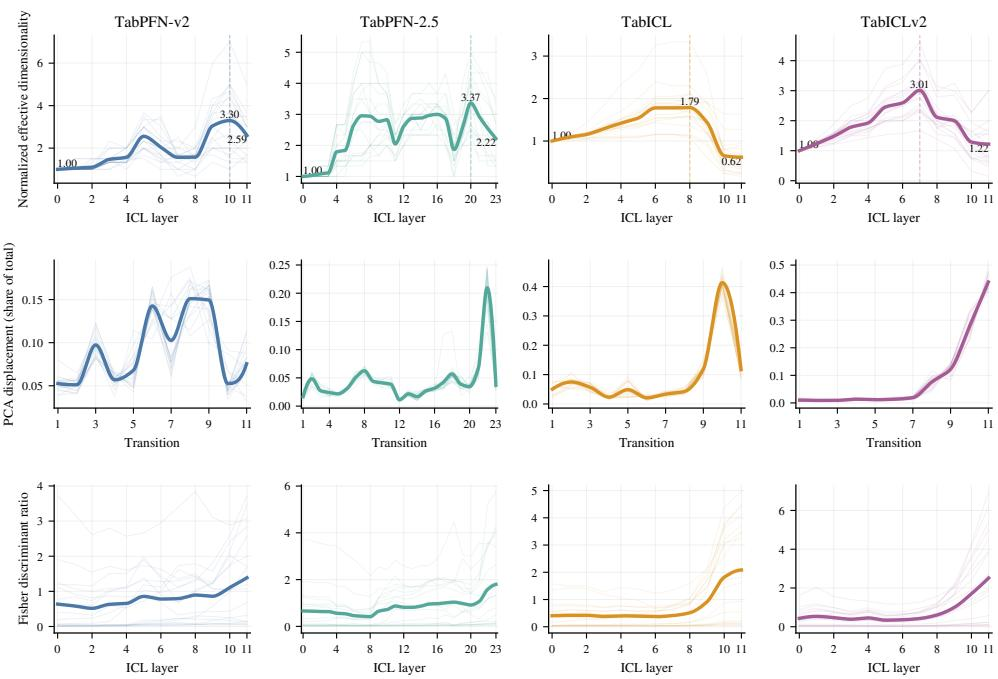  
Figure 10: Cross-model representation dynamics. Results are shown for TabPFN-v2, TabPFN-2.5, TabICL, and TabICLv2 on matched datasets. (a) Effective dimensionality normalized by the first-layer value within each dataset–model pair. (b) Adjacent-layer PCA displacement expressed as a fraction of the total trajectory displacement. (c) Fisher discriminant ratio across depth. Thin curves denote individual datasets and thick curves denote the cross-dataset mean. Mean curves are interpolated only for visual smoothness; all statistics use the original layerwise measurements. Peak annotations in panel (a) refer to the cross-dataset mean trajectories and therefore need not equal the mean within-dataset expansion ratios reported in Table 7.

chitectures can attain different normalized peak values when their representations undergo different relative amounts of expansion.

The expansion and compression ratios reported below are computed from the unnormalized withindataset ED trajectories using the definitions in Appendix B.2. For each dataset–model pair, the ratios are computed from its complete layerwise trajectory and are then averaged acros datasets. Because the layer attaining maximum ED can differ across datasets, the mean expansion ratio need not equal the maximum of the cross-dataset mean normalized trajectory.

Final normalized ED is likewise computed within each dataset–model pair before cross-dataset averaging. Expansion, compression, and final normalized ED are therefore averaged as separate datasetlevel quantities and need not satisfy an exact algebraic relation after aggregation.

For PCA displacement, each adjacent-layer displacement is divided by the total displacement of the corresponding dataset–model trajectory. This allows the temporal concentration of representation movement to be compared across architectures with different overall displacement scales.

The curves in Figure 10 show the original layerwise measurements together with a shape-preserving interpolation of their cross-dataset means for visualization. The interpolation affects only the rendering of the curves; all quantitative statistics are computed from the original discrete layer values.

## C.2 REPRESENTATION TRAJECTORIES ACROSS ARCHITECTURES

Figure 10 compares effective dimensionality, PCA displacement, and label-conditioned class separation across the four auxiliary models.

Table 7: Summary of cross-model representation dynamics. Expansion and compression ratios are first computed within each dataset and then averaged across matched datasets. Final ED denotes the final effective dimensionality normalized by the first-layer value and is likewise averaged from dataset-level values. Because these quantities are averaged independently, their cross-dataset means need not satisfy exact algebraic ratio identities. Late PCA reports the fraction of total PCA displacement occurring in the final quarter of layer transitions.
<table><tr><td>Model</td><td>Depth</td><td>Expansion</td><td>Compression</td><td>Final ED</td><td>Late PCA</td></tr><tr><td>TabPFN-v2</td><td>12</td><td>3.61×</td><td>1.43×</td><td>2.59</td><td>27.8%</td></tr><tr><td>TabPFN-2.5</td><td>24</td><td>3.87×</td><td>1.87×</td><td>2.22</td><td>44.4%</td></tr><tr><td>TabICL</td><td>12</td><td>1.82×</td><td>3.88×</td><td>0.62</td><td>64.9%</td></tr><tr><td>TabICLv2</td><td>12</td><td>3.01×</td><td>3.59×</td><td>1.22</td><td>83.8%</td></tr></table>

The normalized ED trajectories show that non-monotonic Expansion–Compression behavior is not restricted to TabPFN-3. All four auxiliary models reach an intermediate representation with higher effective dimensionality than their respective initial state.

The strength of expansion and subsequent compression nevertheless differs markedly across architectures. Table 7 summarizes these differences.

TabPFN-v2 and TabPFN-2.5 exhibit strong expansion but comparatively modest peak-to-final contraction. Their final representations therefore remain well above their initial effective dimensionality.

The two TabICL models exhibit a different organization. TabICL shows weaker expansion but much stronger subsequent contraction, ending below its initial normalized ED on average. TabICLv2 combines pronounced expansion with similarly strong late contraction.

The PCA displacement trajectories reinforce this distinction. Only 27.8% of the total displacement in TabPFN-v2 occurs in the final quarter of transitions, increasing to 44.4% for TabPFN-2.5. The corresponding fractions are substantially larger for TabICL (64.9%) and TabICLv2 (83.8%), indicating that representation movement is considerably more concentrated near the end of their ICL stacks.

The label-conditioned geometry follows a related but non-identical trajectory. FDR generally increases toward later depth, indicating stronger class separation in later representations, but the timing and magnitude of this increase differ across architectures. ED, displacement, and label-conditioned class separation therefore capture complementary aspects of the depthwise representation trajectory.

## C.3 PAIRWISE REPRESENTATION SIMILARITY

The preceding analysis characterizes how individual geometric statistics change with depth. We additionally examine the complete pairwise relationship between representations from different layers.

Figure 11 combines two complementary similarity measures. The upper triangular portion of each matrix reports linear CKA, which measures similarity in global relational structure, whereas the lower triangular portion reports mean cosine similarity, which measures directional alignment of corresponding representation vectors.

The similarity matrices reveal substantial architecture-dependent structure that is not visible from ED alone. TabPFN-v2 and TabPFN-2.5 exhibit pronounced block-like regions in which nearby groups of layers remain highly similar, separated by transitions with lower cross-block similarity. This pattern is especially visible in the CKA matrices.

TabICL and TabICLv2 show broader regions of high CKA similarity across depth. At the same time, their cosine similarity decreases more strongly between temporally distant layers. Thus, two layers can preserve a relatively similar global relational structure while their individual representation vectors undergo substantial directional reorientation.

The distinction between CKA and cosine similarity is therefore informative for interpreting representation change. High CKA can coexist with substantial directional reorientation of individual vectors, while reduced cosine similarity can occur without a comparable loss of global relational structure. The two measurements provide complementary views of the same depth-dependent trajectory.

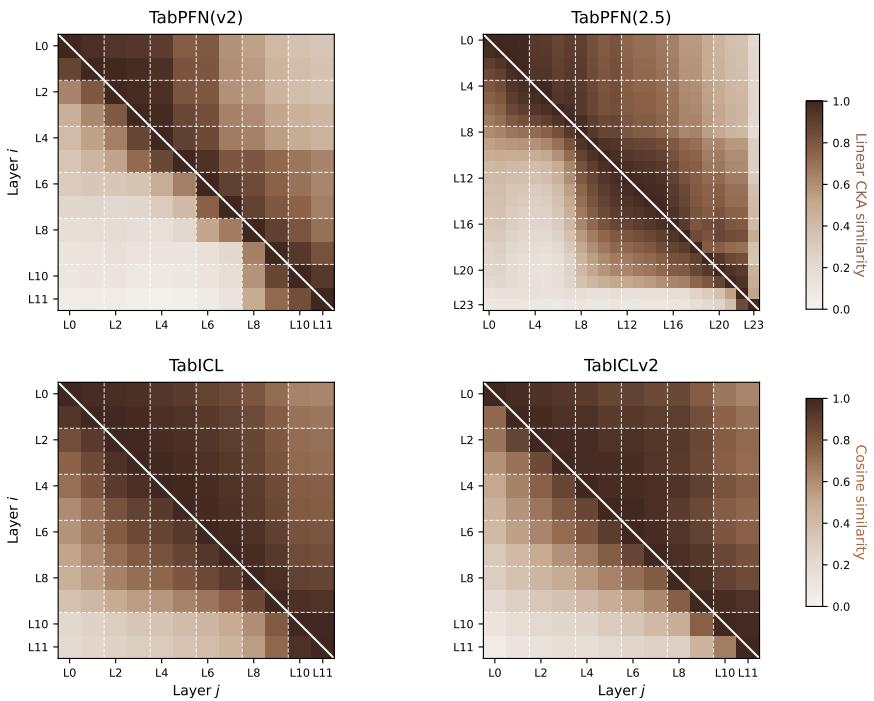  
Figure 11: Pairwise representation similarity across architectures. For each model, the upper triangular matrix reports mean linear CKA between every pair of layers, while the lower triangular matrix reports mean cosine similarity. Darker entries indicate greater similarity.

## C.4 SCOPE OF THE CROSS-MODEL EVIDENCE

Taken together, the cross-model results show that the Expansion–Compression pattern observed in the primary TabPFN-3 analysis is not unique to that architecture. Related non-monotonic ED trajectories are also present in TabPFN-v2, TabPFN-2.5, TabICL, and TabICLv2.

At the same time, the models differ substantially in expansion strength, compression strength, the temporal concentration of representation movement, and the continuity of their pairwise representation structure. The broad geometric pattern is therefore shared across the examined architectures, whereas its detailed organization is model dependent.

The present comparison does not isolate a single architectural determinant of these differences. Model depth, hidden dimension, attention organization, decoder design, and pretraining procedure vary jointly across the model families. Identifying which of these factors determines the precise form of the trajectory therefore remains separate from the cross-model generality established here.

Accordingly, the appropriate scope of the result is: the Expansion–Compression phenomenon extends beyond TabPFN-3 within the tabularfoundation models examined here, while its strength and temporal organization remain architecture dependent.

## D ARCHITECTURAL AND TRAINING CONTROLS

To characterize the conditions under which Expansion–Compression emerges, we conduct three complementary controls. We first randomize the learned weights of TabPFN-3 while preserving its architecture. We then vary computational depth within a lightweight TabPFN-style model while holding the model family and training objective fixed. Finally, we compare the resulting geometry with that of a conventionally supervised FT-Transformer. Together, these experiments separate the roles of learned parameterization, computational depth, and training paradigm in shaping the observed representation trajectory.

Table 8: Random-weight control for TabPFN-3. Each entry reports expansion ratio / compression ratio. The pretrained model exhibits substantial Expansion–Compression, whereas randomizing either the ICL stack or the complete model yields flat effective-dimensionality trajectories on the tested datasets.
<table><tr><td>Dataset</td><td>Pretrained</td><td>Randomized ICL blocks Fully randomized</td><td></td></tr><tr><td>vehicle</td><td> $4 . 0 0 \times / 2 . 3 3 \times$ </td><td> $1 . 0 0 \times / 1 . 0 0 \times$ </td><td> $1 . 0 0 \times / 1 . 0 0 \times$ </td></tr><tr><td>segment</td><td> $4 . 6 7 \times \dot { / } 2 . 3 3 \times$ </td><td> $1 . 0 0 \times \mathrm { ~ \ ' { / 1 . 0 0 } \times }$ </td><td> $1 . 0 0 \times \mathrm { ~ \ ' { / 1 . 0 0 } \times }$ </td></tr><tr><td>satimage</td><td> $7 . 5 0 \times / 3 . 3 3 \times$ </td><td> $1 . 0 0 \times \mathrm { ~ \ ' ~ } 1 . 0 0 \times$ </td><td> $1 . 0 0 \times \mathrm { ~ \ ' { / 1 . 0 0 } \times }$ </td></tr><tr><td>diabetes</td><td> $2 . 8 8 \times / 2 . 0 9 \times$ </td><td> $1 . 0 0 \times / 1 . 0 0 \times$ </td><td> $1 . 0 0 \times / 1 . 0 0 \times$ </td></tr></table>

Table 9: Controlled-depth experiment with nanoTabPFN. The three- and four-layer variants exhibit representation expansion without a subsequent compression phase, whereas the five-layer variant exhibits both expansion and compression.
<table><tr><td>Depth</td><td>ED trajectory</td><td>Expansion</td><td>Compression</td></tr><tr><td>3 layers</td><td> $1  2  2$ </td><td>2.00×</td><td>1.00×</td></tr><tr><td>4 layers</td><td> $1  1  2  2$ </td><td>2.00×</td><td>1.00×</td></tr><tr><td>5 layers</td><td> $1  2  2  2  1$ </td><td>2.00×</td><td>2.00×</td></tr></table>

## D.1 RANDOMIZED WEIGHTS DO NOT REPRODUCE THE LEARNED TRAJECTORY

We first isolate the contribution of learned parameterization in TabPFN-3. We evaluate the same architecture under three weight conditions: the original pretrained model, a model in which only the 24 ICL blocks are randomized while the surrounding embedding and decoder components remain pretrained, and a model in which all weights are randomized.

Table 8 reports the expansion and compression ratios defined in Appendix B.2.

The pretrained network exhibits substantial expansion followed by compression on every tested dataset. In contrast, both randomized conditions yield expansion and compression ratios of one, corresponding to flat effective-dimensionality trajectories.

Preserving the TabPFN-3 architecture while removing its learned parameterization therefore eliminates the observed non-monotonic trajectory in these controls. The Expansion–Compression profile is consequently tied to the learned transformations of the pretrained model rather than to the architecture alone.

## D.2 CONTROLLED DEPTH IN NANOTABPFN

The random-weight control establishes the importance of learned transformations but does not isolate how computational depth contributes to the trajectory. We therefore use nanoTabPFN, a lightweight trainable TabPFN-style model for which variants with different numbers of transformer layers can be trained under the same ICL objective.

We train variants with three, four, and five layers and examine their layerwise effectivedimensionality trajectories on synthetic data drawn from the training distribution. The model family, training objective, and evaluation procedure are held fixed while depth is varied.

Expansion is already present in the shallower variants: both the three- and four-layer models reach twice their initial effective dimensionality, but neither subsequently contracts. The five-layer model instead follows $1  2  2  2  1$ , returning to its initial effective dimensionality after reaching an expanded intermediate state.

Within this controlled setting, increasing depth changes whether the representation trajectory proceeds from expansion into compression. Representation expansion therefore emerges at relatively shallow depth, while additional computation can enable completion of the compression phase.

Table 10: Representation geometry in the supervised FT-Transformer control. The supervised model exhibits substantial effective-dimensionality contraction without the pronounced preceding expansion characteristic of the Expansion–Compression trajectory.
<table><tr><td>Measurement</td><td>FT-Transformer</td></tr><tr><td>Mean expansion ratio</td><td>1.11×</td></tr><tr><td>Mean compression ratio</td><td>2.33×</td></tr><tr><td>Characteristic trajectory</td><td>Predominantly contraction</td></tr></table>

## D.3 SUPERVISED FT-TRANSFORMER EXHIBITS CONTRACTION WITHOUT PRONOUNCED EXPANSION

We finally examine whether the same geometric organization appears in a conventionally supervised transformer for tabular data. We train an FT-Transformer consisting of a feature tokenizer and eight transformer encoder blocks with hidden dimension 64 and apply the same layerwise effectivedimensionality analysis to CC18 classification datasets.

Across these datasets, the mean expansion ratio is only 1.11×, whereas the mean compression ratio is 2.33×. The dominant geometric trend is therefore contraction, with only weak preceding expansion.

The supervised control therefore separates late contraction from the full Expansion–Compression profile. Substantial contraction can arise under conventional supervised transformer training, whereas the pronounced preceding expansion observed in the pretrained TFMs is largely absent in this control.

Taken together, the three controls delineate complementary properties of the observed trajectory. Learned parameterization is required to reproduce Expansion–Compression in TabPFN-3; additional depth enables the compression phase to emerge in the controlled nanoTabPFN setting; and the supervised FT-Transformer exhibits contraction without pronounced expansion. Within the models examined here, these results support interpreting Expansion–Compression as a learned, depth-dependent organization of ICL representations rather than an automatic consequence of transformer depth.

## E METHODOLOGICAL VALIDATION AND ROBUSTNESS

This appendix provides additional methodological validation for our layerwise analysis. We first establish why the native TabPFN-3 decoder can be used as a common readout of intermediate representations, and then separate native-decoder alignment from predictive information availability using layer-matched and decoder-independent probes. Finally, we report robustness checks for the geometric quantities underlying the Expansion–Compression analysis.

## E.1 VALIDATING THE NATIVE TABPFN-3 DECODER AS A LAYERWISE READOUT

Native many-class decoder. TabPFN-3 replaces the fixed-width classification head used in earlier TabPFN variants with an attention-based retrieval decoder (Grinsztajn et al., 2026). For classification, training-set representations act as keys, their corresponding one-hot labels act as values, and query representations act as queries. Prediction is therefore implemented as a learned soft nearestneighbor retrieval over the in-context support set.

Let $h _ { m , \mathbf { q } } ^ { ( \ell ) } \in \mathbb { R } ^ { 5 1 2 }$ denote the representation of query sample m after ICL layer ℓ, and let $h _ { n , \mathrm { s } } ^ { ( \ell ) } \in \mathbb { R } ^ { 5 1 2 }$ denote the corresponding representation of support sample n. For decoder head r, the projected query and key representations are

$$
\begin{array} { r } { \boldsymbol { q } _ { m } ^ { ( \ell , r ) } = \boldsymbol { W } _ { \boldsymbol { Q } } ^ { ( r ) } \boldsymbol { h } _ { m , \mathrm { q } } ^ { ( \ell ) } , } \end{array}\tag{19}
$$

$$
k _ { n } ^ { ( \ell , r ) } = W _ { K } ^ { ( r ) } h _ { n , \mathrm { s } } ^ { ( \ell ) } .\tag{20}
$$

For notational simplicity, we write the attention weights using the standard scaled dot-product form,

$$
\alpha _ { m , n } ^ { ( \ell , r ) } = \frac { \exp { \left( { q _ { m } ^ { ( \ell , r ) } } ^ { \top } k _ { n } ^ { ( \ell , r ) } / \sqrt { d _ { h } } \right) } } { \sum _ { j = 1 } ^ { N _ { \mathrm { s } } } \exp { \left( { q _ { m } ^ { ( \ell , r ) } } ^ { \top } k _ { j } ^ { ( \ell , r ) } / \sqrt { d _ { h } } \right) } } ,\tag{21}
$$

where the actual TabPFN-3 implementation additionally applies its pretrained QASSMax query scaling (Grinsztajn et al., 2026). For class c, the decoder aggregates the attention mass assigned to support samples of that class and averages it across heads,

$$
p _ { m , c } ^ { ( \ell ) } = \frac { 1 } { H } \sum _ { r = 1 } ^ { H } \sum _ { n : y _ { n } = c } \alpha _ { m , n } ^ { ( \ell , r ) } .\tag{22}
$$

The class logits are then

$$
z _ { m , c } ^ { ( \ell ) } = \log \left( \exp \left( p _ { m , c } ^ { ( \ell ) } \right) \right) .\tag{23}
$$

This is equivalent to the report’s description of a head-averaged, attention-weighted average of onehot labels, written explicitly in class-wise form. TabPFN-3 uses $H = 6$ decoder heads with head dimension $d _ { h } = 6 4$

Why the decoder is well-defined across depth. All 24 ICL layers preserve the same 512- dimensional hidden representation, and the decoder applies the same learned query and key projections independently of layer index. The native decoder is therefore dimensionally well-defined at every ICL layer and provides a fixed, model-native readout across depth. This does not imply a fixed decision boundary: both query and support representations evolve with ℓ, changing their relative geometry and the resulting attention weights.

Decoder-alignment concern. Dimensional compatibility does not imply that native-decoder performance measures all predictive information in an intermediate representation. Earlier layers may contain label-relevant information while remaining imperfectly aligned with the final decoder, motivating tuned or layer-specific readouts (Belrose et al., 2023; Balef et al., 2026). We therefore distinguish predictive decodability from native-decoder alignment.

## E.1.1 LAYER-MATCHED READOUT CONTROL

To control for decoder mismatch, we train an independent linear readout for each analyzed layer. Only query hidden states are used for this experiment: within each dataset, query examples are split 50/50 into probe-training and probe-evaluation subsets, and a separate classifier is fitted to $h _ { \mathbf { q } } ^ { ( \ell ) }$ for every layer ℓ. This procedure removes the requirement that an intermediate representation be aligned with the native decoder while preserving the amount of predictive information available at that layer.

We evaluate both the native decoder and the layer-matched readout on all OpenML-CC18 classification tasks. Figure 12 shows the dataset-level mean accuracy and negative log-likelihood (NLL); error bars denote 95% bootstrap confidence intervals obtained by resampling datasets.

Accuracy. At L2, the native decoder reaches 0.804 accuracy and the layer-matched readout reaches 0.822, indicating partial early-layer decoder misalignment. From L2 to L23, matchedreadout accuracy increases from 0.822 to 0.856 (+3.4 pp; 95% CI [+2.1, +4.8] pp), while native accuracy increases from 0.804 to 0.874 (+7.0 pp; 95% CI [+5.2, +8.9] pp). Thus, the overall depthwise accuracy increase is not explained by output-head mismatch alone.

Probability quality. Native-decoder NLL decreases from 0.490 at L2 to 0.284 at L23 $( \Delta \ =$ −0.205; 95% $\operatorname { C I } { [ - 0 . 2 5 9 , - 0 . 1 5 7 ] } )$ , whereas the matched-readout change is small and statistically unresolved $( \Delta = + 0 . 0 0 7 $ ; 95% CI $[ - 0 . 0 5 9 , + 0 . 0 7 7 ] )$ . We use NLL as a measure of probabilistic prediction quality rather than as a standalone measure of calibration.

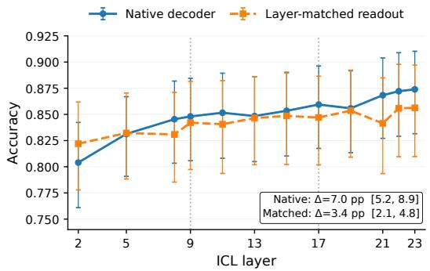

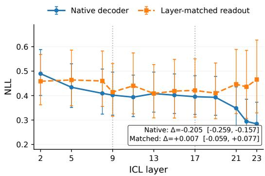  
Figure 12: Native-decoder and layer-matched readout performance across depth. Left: classification accuracy averaged over 72 OpenML-CC18 tasks. Right: negative log-likelihood. Error bars denote 95% bootstrap confidence intervals over datasets. Vertical dotted lines at L9 and L17 indicate representative analytical boundaries rather than estimated change points.

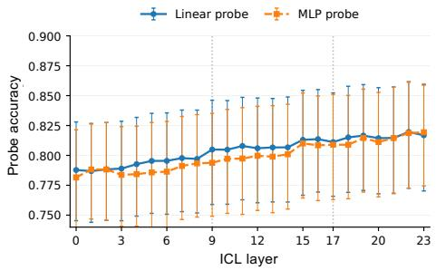

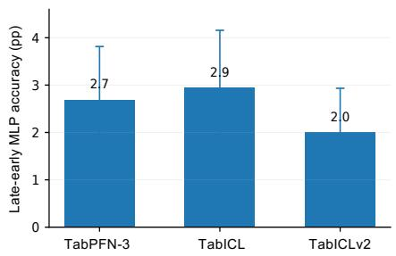  
Figure 13: Decoder-independent predictive decodability across depth. (a) Linear and capacitycontrolled MLP probe accuracy across the 24 ICL layers of TabPFN-3, averaged over 72 OpenML-CC18 tasks. Error bars denote 95% bootstrap confidence intervals over datasets; dotted vertical lines indicate the representative L9 and L17 analytical boundaries. (b) Change in MLP-probe accuracy from the first to the final third of the ICL layers for TabPFN-3, TabICL, and TabICLv2. Differences are computed within each dataset before aggregation, and error bars denote 95% bootstrap confidence intervals over the 72 tasks.

## E.2 DECODER-INDEPENDENT PROBE CONTROL

The matched-readout experiment controls specifically for alignment with TabPFN-3’s final decoder. We additionally perform a broader decoder-independent probing analysis to test whether the representation dynamics identified in the main paper persist without using the native decoder at all.

Following the general probing setup used in prior TFM analyses (Balef et al., 2026), we extract query hidden states from each layer and train both a linear classifier and a capacity-controlled MLP probe with hidden dimension 64. Because support rows explicitly incorporate in-context labels, only query representations are used as probe examples. For each dataset, query examples are divided equally into probe-training and probe-evaluation subsets. We report accuracy, NLL, and ECE. The experiment is run on all 72 OpenML-CC18 tasks for TabPFN-3, TabICL, and TabICLv2. Across the 72 tasks, all three tested models exhibit higher MLP-probe accuracy in later than in earlier layers:

Figure 13 shows an overall increase in decoder-independent predictive accuracy across depth in TabPFN-3, despite local fluctuations, together with positive late-over-early MLP differences for TabPFN-3, TabICL, and TabICLv2.

Table 11 summarizes the corresponding cross-model decoder-independent probe results.

For TabPFN-3, a phase-aligned analysis for the detailed geometric study further separates changes in effective dimensionality from changes in predictive decodability, as summarized in Table 12:

Table 11: Decoder-independent probing across the 72 OpenML-CC18 tasks. ∆ denotes the mean difference between the final and initial thirds of the layer sequence. “Positive” denotes the fraction of datasets with a positive MLP-accuracy difference.
<table><tr><td>Model</td><td>∆ MLP Acc.</td><td>Positive</td><td>ΔECE</td><td>∆ MLP NLL</td></tr><tr><td>TabPFN-3</td><td>+0.027</td><td>64%</td><td>-0.005</td><td>-0.056</td></tr><tr><td>TabICL</td><td>+0.029</td><td>66%</td><td>-0.017</td><td>-0.179</td></tr><tr><td>TabICLv2</td><td>+0.020</td><td>59%</td><td>-0.008</td><td>-0.104</td></tr></table>

Table 12: Phase-wise changes in effective dimensionality and decoder-independent probe performance for TabPFN-3. The phase boundaries are representative analytical boundaries derived from the aggregate ED trajectory.

<table><tr><td>Phase</td><td>∆ED</td><td>∆ Linear Acc.</td><td>∆ MLP Acc.</td><td>∆ MLP NLL</td></tr><tr><td>Expansion</td><td>+10.95</td><td>+0.0274</td><td>+0.0278</td><td>-0.291</td></tr><tr><td>Plateau</td><td>+0.95</td><td>+0.0093</td><td>+0.0150</td><td>-0.011</td></tr><tr><td>Compression</td><td>-10.55</td><td>-0.0040</td><td>+0.0045</td><td>+0.023</td></tr><tr><td>Full depth</td><td>+1.40</td><td>+0.0327</td><td>+0.0473</td><td>-0.279</td></tr></table>

Across the full depth of TabPFN-3, MLP-probe accuracy increases by 4.73 percentage points (95% $\begin{array} { r c l } { \mathrm { C I } } & { = } & { [ + \bar { 2 } . 1 , + 8 . 1 ] } \end{array}$ pp), while MLP-probe NLL decreases by 0.279 $( 9 5 \% \ \mathrm { \dot { C } I } \ =$ $[ - 0 . 4 6 2 , - 0 . 1 4 \dot { 4 } ] \cdot$ ). ED, by contrast, returns close to its initial magnitude after expanding and then compressing.

Within the compression regime, the MLP-accuracy change is small (+0.45 pp) and its bootstrap interval includes zero. Thus, the control does not establish a significant compression-phase increase in decodability; it shows that the large reduction in ED occurs without a corresponding loss of decoder-independent predictive performance.

## E.3 ROBUSTNESS OF THE GEOMETRIC ANALYSIS

We test the geometric analysis against ED-threshold choice, representation normalization, randomweight controls, representative phase boundaries, and PCA coordinate artifacts. For a layerwise ED trajectory, we define the expansion and compression ratios as

$$
\rho _ { \mathrm { e x p } } = \frac { \mathrm { m a x } _ { \ell } \mathrm { E D } ( H ^ { ( \ell ) } ) } { \mathrm { E D } ( H ^ { ( 0 ) } ) } , \qquad \rho _ { \mathrm { c o m } } = \frac { \mathrm { m a x } _ { \ell } \mathrm { E D } ( H ^ { ( \ell ) } ) } { \mathrm { E D } ( H ^ { ( L ) } ) } .\tag{24}
$$

Values substantially above one indicate expansion from the initial representation and subsequent compression toward the final representation, respectively.

Sensitivity to the ED threshold. Our primary definition of ED uses the minimum number of principal components required to explain 90% of the variance. To test whether the resulting trajectory depends on this choice, we recompute ED using variance thresholds of 80%, 85%, 90%, and 95% on OpenML-CC18 datasets. Table 13 reports the resulting expansion and compression ratios.

Across all four thresholds, the mean expansion ratio remains at least 2.40× and the mean compression ratio at least 1.84×; at least 95% of datasets satisfy each corresponding criterion.

Normalization control. Representation norms vary substantially across depth, raising the possibility that changes in ED could be induced by scale variation rather than by a change in the spectrum of representational degrees of freedom. We therefore recompute the complete ED trajectory after three transformations: row normalization, feature-wise standardization, and whitening. The experi ment is conducted on six datasets using the same layerwise analysis pipeline. Table 14 summarizes the resulting expansion and compression ratios.

Table 13: Sensitivity to the effective-dimensionality threshold. Expansion and compression remain pronounced across variance thresholds from 80% to 95%. The last two columns report the fraction of datasets satisfying $\rho _ { \mathrm { e x p } } > 1 . 5$ and $\rho _ { \mathrm { c o m } } > 1 . 3$ , respectively.
<table><tr><td>Threshold</td><td> $\rho _ { \mathrm { e x p } }$ </td><td> $\rho _ { \mathrm { c o m } }$ </td><td> $\mathrm { E x p . > 1 . 5 }$ </td><td> $\mathrm { C o m p . } > 1 . 3$ </td></tr><tr><td>80%</td><td>2.41×</td><td>2.80×</td><td>95%</td><td>100%</td></tr><tr><td>85%</td><td>2.40×</td><td>2.57×</td><td>95%</td><td>100%</td></tr><tr><td>90%</td><td>2.45×</td><td>2.24×</td><td>95%</td><td>95%</td></tr><tr><td>95%</td><td>2.54×</td><td>1.84×</td><td>100%</td><td>100%</td></tr></table>

Table 14: Effective-dimensionality robustness to representation normalization. The expansion– compression structure persists after removing sample-level norm, feature-wise scale, or covariance effects.

<table><tr><td>Representation</td><td>ρexp</td><td>ρcom</td></tr><tr><td>Raw</td><td>4.00×</td><td>2.41×</td></tr><tr><td>Row normalization</td><td>3.70×</td><td>2.35×</td></tr><tr><td>Column standardization</td><td>3.16×</td><td>1.69×</td></tr><tr><td>Whitening</td><td>4.00×</td><td>2.41×</td></tr></table>

All six tested datasets retain expansion and compression under every normalization control. Row normalization, in particular, leaves the ratios close to the raw values $( 3 . 7 0 \times / 2 . 3 5 \times$ versus 4.00 × /2.41×), showing that the late ED reduction is not explained by representation-norm growth alone.

Random-weight control. We next test whether expansion followed by compression arises automatically from repeatedly applying the TabPFN-3 architecture, independent of learned weights. On representative datasets, we compare the pretrained model with two controls: one in which only the ICL blocks are randomly reinitialized while the surrounding embedding and decoder components remain pretrained, and one in which all model weights are randomly initialized. For the pretrained model, the four datasets exhibit expansion ratios between 2.88× and 7.50× and compression ratios between 2.09× and 3.33×. In both randomized conditions, all four datasets instead yield

$$
\rho _ { \mathrm { e x p } } = \rho _ { \mathrm { c o m } } = 1 . 0 0 ,\tag{25}
$$

corresponding to essentially flat ED trajectories. On these four datasets, randomizing either the ICL blocks or all weights therefore removes the expansion–compression trajectory. This control is limited to the tested settings and is not a claim about arbitrary randomly initialized Transformers.

Robustness of the representative phase boundaries. L9 and L17 are representative analytical boundaries derived from the aggregate ED trajectory, not estimated change points. For the samplelevel trajectory analysis, we also replace the default (L9, L13) pair with (L8, L12), (L10, L14), (L9, L14), and (L8, L13); the qualitative trajectory structure is preserved under these nearby choices.

Joint-fit PCA displacement. PCA coordinates are identifiable only up to rotations and sign changes. Fitting PCA independently at each layer could therefore cause a change in coordinate basis to be mistaken for movement of the underlying representations. To avoid this artifact, our PCA-displacement analysis uses a single shared basis. We concatenate query representations from all 24 layers and fit PCA once, retaining

$$
k = \operatorname* { m i n } ( 1 0 , d , n - 1 )\tag{26}
$$

components. Every layer is then projected into this same coordinate system. $\mathrm { I f ~ } z _ { t } ^ { ( \ell ) }$ denotes the resulting projection of sample t at layer ℓ, adjacent-layer displacement is computed as

$$
d _ { \mathrm { P C A } } \left( H ^ { ( \ell ) } , H ^ { ( \ell + 1 ) } \right) = \mathbb { E } _ { t \in \mathcal { T } } \left[ \left. z _ { t } ^ { ( \ell + 1 ) } - z _ { t } ^ { ( \ell ) } \right. _ { 2 } \right] .\tag{27}
$$

Displacement is computed within each dataset before equal-weight cross-dataset aggregation. Using one shared PCA basis prevents independent layerwise basis rotations from contributing to the measured displacement.

## F CANDIDATE COMPETITION, EARLY READABILITY, AND LATE RESOLUTION

This appendix provides the full diagnostic analyses supporting Section 4.3. We first define the multiclass task pool and the prototype-based candidate measures used throughout the analysis, then report supplementary trajectories of candidate competition across depth, examine when class-relevant information becomes linearly readable from the attention-aggregated value stream, and finally quantify the coupling between late dimensional compression and candidate resolution.

## F.1 TASK POOL AND CANDIDATE DIAGNOSTICS

The analysis covers all 105 multiclass classification tasks used in the main-text candidate study, including 25 tasks from OpenML-CC18 and 80 tasks from TALENT. All tasks are evaluated with the same frozen TabPFN-3 model and the same layerwise representation-extraction protocol.

All diagnostic quantities are first computed at the query level, then averaged within each dataset, and finally aggregated across datasets with equal dataset weight, so that datasets with more query examples do not dominate the pooled statistics.

For the difficulty-stratified analysis in Figure 4(b), tasks are grouped according to final full-model classification accuracy. Tasks with final accuracy at least 90% are labeled Low difficulty, tasks with final accuracy between 70% and 90% are labeled Medium difficulty, and tasks below 70% are labeled High difficulty.

For each layer ℓ and support class c, we construct a layer-specific prototype by averaging the support representations belonging to that class:

$$
\mu _ { c } ^ { ( \ell ) } = \frac { 1 } { \left| S _ { c } \right| } \sum _ { n \in S _ { c } } h _ { n , \mathrm { s } } ^ { ( \ell ) } ,\tag{28}
$$

where $ { \boldsymbol { S } } _ { c }$ denotes the support samples of class c.

For each query $i ,$ we compute the cosine similarity between its layer-ℓ representation and every class prototype:

$$
s _ { i , c } ^ { ( \ell ) } = \cos \left( h _ { i } ^ { \left( \ell \right) } , \mu _ { c } ^ { ( \ell ) } \right) .\tag{29}
$$

Our primary measure of candidate separation is the margin between the two most similar class prototypes:

$$
\Delta _ { i } ^ { ( \ell ) } = s _ { i , ( 1 ) } ^ { ( \ell ) } - s _ { i , ( 2 ) } ^ { ( \ell ) } ,\tag{30}
$$

where $s _ { i , ( 1 ) } ^ { ( \ell ) } ~ \geq ~ s _ { i , ( 2 ) } ^ { ( \ell ) }$ are the largest and second-largest prototype similarities. A small margin indicates that the two leading class-aligned candidates remain closely matched, whereas a large margin indicates more decisive separation.

We additionally record the rank of the correct-class prototype and the correct-class top-rank rate, defined as the fraction of queries for which the correct prototype occupies rank one.

To characterize the broader similarity structure across all class-aligned candidates, we also retain two supplementary diagnostics. First, we convert the prototype similarities into a normalized candidate distribution

$$
\pi _ { i , c } ^ { ( \ell ) } = \frac { \exp ( s _ { i , c } ^ { ( \ell ) } ) } { \sum _ { c ^ { \prime } } \exp ( s _ { i , c ^ { \prime } } ^ { ( \ell ) } ) } ,\tag{31}
$$

and define the normalized candidate entropy

$$
\widetilde { \mathcal { H } } _ { i } ^ { ( \ell ) } = - \frac { \sum _ { c } \pi _ { i , c } ^ { ( \ell ) } \log \pi _ { i , c } ^ { ( \ell ) } } { \log C _ { i } } ,\tag{32}
$$

where $C _ { i }$ is the number of classes in the corresponding task.

Table 15: Candidate diagnostics across the 105 multiclass tasks. Entries are equal-weight dataset means. The final column counts tasks whose L23–L0 change matches the expected direction under candidate resolution.
<table><tr><td>Metric</td><td>L0</td><td>L9</td><td>L13</td><td>L17</td><td>L20</td><td>L23</td><td>Consistent</td></tr><tr><td>Normalized candidate entropy</td><td>.997</td><td>.994</td><td>.995</td><td>.993</td><td>.992</td><td>.978</td><td>104/105</td></tr><tr><td>Active candidate fraction</td><td>.932</td><td>.599</td><td>.486</td><td>.529</td><td>.465</td><td>.465</td><td>103/105</td></tr><tr><td>Prototype margin</td><td>.055</td><td>.125</td><td>.104</td><td>.129</td><td>.147</td><td>.247</td><td>104/105</td></tr><tr><td>Mean correct-class rank</td><td>2.082</td><td>1.753</td><td>1.803</td><td>1.727</td><td>1.689</td><td>1.645</td><td>104/105</td></tr><tr><td>Correct-class top-rank rate</td><td>.634</td><td>.731</td><td>.710</td><td>.729</td><td>.739</td><td>.770</td><td>104/105</td></tr></table>

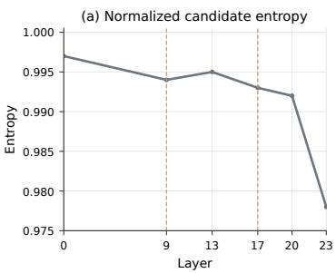

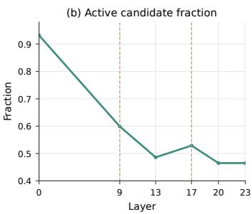

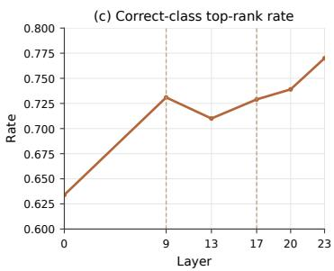  
Figure 14: Supplementary diagnostics of candidate structure across depth. (a) Normalized candidate entropy remains high through intermediate depth and decreases most visibly near the output. (b) The active candidate fraction contracts overall but shows a local rebound in the middle regime. (c) Correct-class top-rank rate improves overall, but its intermediate trajectory is non-monotonic. Dashed vertical lines mark the representative analytical boundaries at L9 and L17.

Second, we define the active candidate fraction

$$
A _ { i } ^ { ( \ell ) } = \frac { 1 } { C _ { i } } \sum _ { c } \mathbf { 1 } \Big [ s _ { i , c } ^ { ( \ell ) } > 0 . 6 \operatorname* { m a x } _ { c ^ { \prime } } s _ { i , c ^ { \prime } } ^ { ( \ell ) } \Big ] .\tag{33}
$$

This quantity measures the fraction of class prototypes that remain competitive under a fixed relativesimilarity threshold. These two quantities serve as supplementary consistency checks rather than the primary basis of the candidate-resolution conclusion.

## F.2 CANDIDATE COMPETITION ACROSS DEPTH

Table 15 summarizes the candidate diagnostics at representative layers.

Across tasks, the endpoint change from L0 to L23 is highly consistent with candidate resolution: normalized candidate entropy decreases, active candidate fraction decreases, prototype margin increases, mean correct-class rank improves, and correct-class top-rank rate increases. The intermediate-depth trajectories, however, are not strictly monotonic.

Prototype margin increases from 0.055 at L0 to 0.125 at L9, then decreases to 0.104 at L13 before increasing again and reaching 0.247 at L23. Similarly, the active candidate fraction decreases from 0.932 at L0 to 0.486 at L13, but rises to 0.529 at L17 before decreasing again. Intermediate depth is therefore characterized by persistent candidate competition together with local reorganization rather than by smooth monotonic separation.

Figure 14 visualizes the three supplementary diagnostics not shown directly in the main text. Candidate entropy remains close to its maximum through much of the network and drops most clearly near the output. The active candidate fraction contracts substantially at early depth but shows a local rebound in the middle layers. Correct-class top-rank rate also exhibits a mild mid-depth reversal before improving again toward L23. These observations reinforce the main text conclusion that candidate resolution is strongly depth-dependent but not smoothly monotonic.

The strongest candidate separation is concentrated near the output. Between L20 and L23, prototype margin increases from 0.147 to 0.247, while normalized candidate entropy decreases from 0.992 to

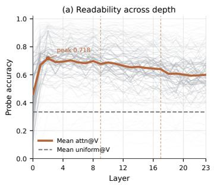

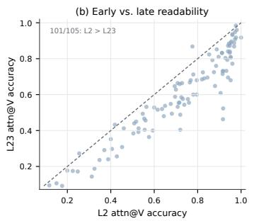

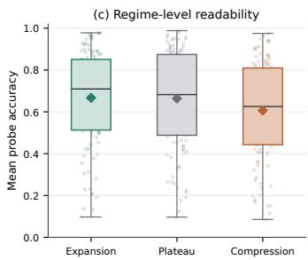  
Figure 15: Class information becomes linearly readable before candidate resolution is complete. (a) Mean attn@V probe accuracy across depth, with 95% bootstrap confidence intervals over datasets; uniform@V serves as a matched aggregation baseline. The mean attn@V trajectory peaks at L2. (b) Dataset-level comparison of attn@V readability at L2 and L23. Most datasets lie below the diagonal (101/105), indicating higher readability at L2 than at L23. (c) Distribution of mean probe accuracy across datasets within the Expansion, Plateau, and Compression regimes; diamonds indicate equal-weight dataset means.

0.978. This late-depth transition coincides with the late effective-dimensionality contraction and increased PCA displacement reported in Section 4.2. Candidate geometry therefore remains only partially resolved through intermediate depth and becomes substantially more decisive near the output.

The difficulty-stratified correct-class rank curves in Figure 4(b) provide a complementary view. Lower-difficulty tasks establish favorable correct-class alignment earlier, whereas higher-difficulty tasks retain worse correct-class ranks deeper into the network. Candidate ambiguity therefore varies with both depth and task difficulty.

## F.3 EARLY READABILITY OF THE ATTENTION-AGGREGATED VALUE STREAM

We next examine whether persistent candidate ambiguity reflects the absence of class-relevant information at shallow depth. To do so, we probe the attention-aggregated value representation at every layer.

For each layer, we train a linear probe on the value representation produced by learned attentionweighted aggregation, denoted attn@V. As a matched baseline, we apply the same readout to value representations aggregated with uniform attention weights, denoted uniform@V. This analysis asks when class-relevant information becomes linearly readable, rather than whether the probe reproduces the model’s native decision rule.

Figure 15(a) shows that linear readability emerges at shallow depth. Mean attn@V accuracy increases from 0.460 at L0 to 0.718 at L2, then gradually decreases to 0.600 at L23. The mean uniform@V baseline remains near 0.334 throughout. Class information is therefore highly linearly readable in the value stream well before candidate geometry reaches its strongest separation.

This early-readability pattern is also prevalent at the dataset level. Figure 15(b) compares attn@V accuracy at L2 and L23 for each of the 105 tasks. In 101 of 105 datasets, attn@V accuracy is higher at L2 than at L23. Figure 15(c) shows the same pattern after regime-wise aggregation. Mean readability is 0.667 in the expansion regime, 0.664 in the plateau regime, and 0.607 in the compression regime. Accordingly, 101 of 105 tasks satisfy Plateau > Compression, whereas no systematic ordering exists between Expansion and Plateau.

These results separate information availability from candidate resolution: class-relevant information becomes linearly readable early, while candidate geometry continues to reorganize and reaches its strongest separation substantially later.

## F.4 COUPLING LATE COMPRESSION TO CANDIDATE RESOLUTION

We next quantify whether the late geometric contraction identified in Section 4.2 systematically corresponds, across datasets, to the late increase in candidate separation.

Table 16: Summary statistics for attn@V readability across the 105 multiclass tasks. Unless otherwise stated, values are equal-weight dataset means.
<table><tr><td>Statistic</td><td>Value</td></tr><tr><td>L0 attn@V accuracy</td><td>.460</td></tr><tr><td>L2 attn@V accuracy</td><td>.718</td></tr><tr><td>L23 attn@V accuracy</td><td>.600</td></tr><tr><td>Mean uniform@V accuracy Expansion mean</td><td>.334</td></tr><tr><td>Plateau mean</td><td>.667 .664</td></tr><tr><td>Compression mean</td><td>.607</td></tr><tr><td>Tasks with  $\mathrm { L } 2 > \mathrm { L } 2 3$ </td><td>101/105</td></tr><tr><td>Tasks with Plateau &gt; Compression Tasks with Expansion  $>$  Compression</td><td>101/105</td></tr></table>

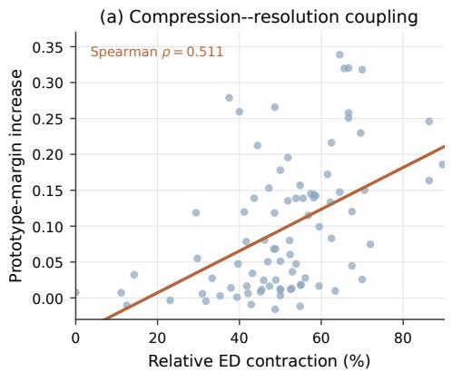

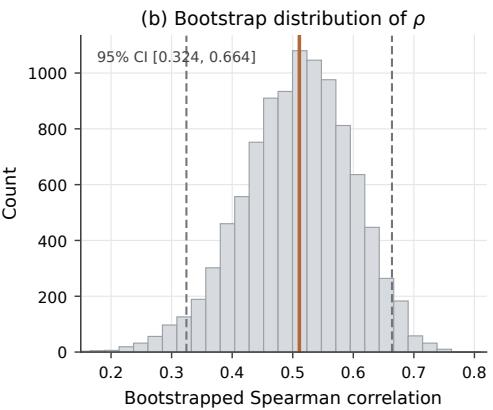  
Figure 16: Robustness of the compression–resolution relationship. (a) Relative effectivedimensionality contraction from L20 to L23 versus the corresponding increase in prototype margin across matched datasets. (b) Bootstrap distribution of the Spearman correlation. The solid line marks the observed correlation and dashed lines denote the 95% bootstrap confidence interval.

For datasets with both effective-dimensionality and prototype-margin measurements available over L20–L23, we define relative late compression as

$$
C _ { d } = \frac { \mathrm { E D } _ { d } ^ { ( 2 0 ) } - \mathrm { E D } _ { d } ^ { ( 2 3 ) } } { \mathrm { E D } _ { d } ^ { ( 2 0 ) } } ,\tag{34}
$$

and late candidate resolution as

$$
R _ { d } = \Delta _ { d } ^ { ( 2 3 ) } - \Delta _ { d } ^ { ( 2 0 ) } .\tag{35}
$$

Across all 105 datasets, stronger late compression is associated with larger late increases in prototype margin, with Spearman $\rho = \bar { 0 . 5 } 1 1 , p = \bar { 5 . } 8 5 \times 1 0 ^ { - 7 }$ , and bootstrap 95% CI [0.324, 0.664], as shown in Figure 16(a). Late compression and candidate separation therefore systematically covary across datasets.

The relationship remains stable under additional checks. In a leave-one-dataset-out recomputation, the Spearman correlation remains in the range [0.495, 0.546]. When the late margin increase is normalized by the L20 prototype margin, the association remains positive, with $\rho ~ = ~ 0 . 4 4 0$ and $p = 2 . 5 6 \times 1 0 ^ { - 5 }$ . The bootstrap distribution in Figure 16(b) is likewise concentrated above zero.

These analyses establish a systematic association between late compression and late candidate resolution across datasets; the analysis is correlational and does not identify a causal direction.

Table 17: Compression–resolution coupling and robustness checks.
<table><tr><td>Statistic</td><td>Value</td></tr><tr><td>Matched datasets</td><td>105</td></tr><tr><td>Analysis interval</td><td>L20-L23</td></tr><tr><td>Spearman  $\rho ( C _ { d } , R _ { d } )$ </td><td>.511</td></tr><tr><td>p-value</td><td>5.85 × 10−7</td></tr><tr><td>Bootstrap 95% CI</td><td>[.324, .664]</td></tr><tr><td>Leave-one-dataset-out ρ range</td><td>[.495, .546]</td></tr><tr><td>Relative-margin normalization  $\rho$ </td><td>.440</td></tr><tr><td>Relative-margin normalization p-value</td><td> $2 . 5 6 \times 1 0 ^ { - 5 }$ </td></tr></table>

## G SUPPLEMENTARY ANALYSES OF SAMPLE-LEVEL PREDICTIVE COMMITMENT

This appendix provides the definitions, aggregation details, and robustness analyses underlying the sample-level results in Sections 5.1–5.2. The prediction-trajectory analyses cover 272 datasets. All trajectory quantities are computed from the complete sequence of 24 native-decoder predictions rather than inferred from a small set of representative layers.

## G.1 STABILIZATION DEPTH AND PREDICTION-TRAJECTORY ASSIGNMENT

For sample i, let

$$
\mathbf { p } _ { i } = ( \hat { y } _ { i } ^ { ( 0 ) } , \dots , \hat { y } _ { i } ^ { ( 2 3 ) } )\tag{36}
$$

denote the full prediction trajectory. We define stabilization depth as

$$
s _ { i } = \operatorname* { m i n } \left\{ \ell : \hat { y } _ { i } ^ { ( k ) } = \hat { y } _ { i } ^ { ( 2 3 ) } , \forall k \geq \ell \right\} .\tag{37}
$$

Because the final layer always satisfies this condition, $s _ { i } \in [ 0 , 2 3 ]$ . Samples whose prediction equals the final class at every layer have $s _ { i } = 0$

We separately define the total number of adjacent-layer class transitions as

$$
n _ { \mathrm { c h g , } i } = \sum _ { \ell = 1 } ^ { 2 3 } \mathbb { I } \Big [ \hat { y } _ { i } ^ { ( \ell ) } \neq \hat { y } _ { i } ^ { ( \ell - 1 ) } \Big ] .\tag{38}
$$

The five-pattern taxonomy used in the main paper is label-free. With $p _ { i } ^ { ( \ell ) } = \hat { y } _ { i } ^ { ( \ell ) }$ , the assignment is

$$
\mathrm { P a t t e r n } ( i ) = \left\{ \begin{array} { l l } { \mathrm { E S , } \quad p _ { i } ^ { ( 9 ) } = p _ { i } ^ { ( 2 3 ) } \ \wedge \ n _ { \mathrm { c h g } , i } \leq 1 , } \\ { \mathrm { T S , } \quad p _ { i } ^ { ( 9 ) } = p _ { i } ^ { ( 2 3 ) } \ \wedge \ n _ { \mathrm { c h g } , i } > 1 , } \\ { \mathrm { I S , } \quad p _ { i } ^ { ( 9 ) } \neq p _ { i } ^ { ( 2 3 ) } \ \wedge \ p _ { i } ^ { ( 1 3 ) } = p _ { i } ^ { ( 2 3 ) } , } \\ { \mathrm { L S , } \quad p _ { i } ^ { ( 9 ) } = p _ { i } ^ { ( 1 3 ) } \neq p _ { i } ^ { ( 2 3 ) } , } \\ { \mathrm { M S , } \quad \mathrm { o t h e r w i s e . } } \end{array} \right.\tag{39}
$$

The conditions are mutually exclusive and exhaustive. Final correctness is not used anywhere in the five-pattern assignment. The trajectories shown in Figure 5(b) are schematic representatives. Pattern assignment uses $n _ { \mathrm { c h g } , i }$ from all 24 layers together with the representative predictions at L9, L13, and L23; L0 is shown only for visual context.

## G.2 AGGREGATION PROTOCOL AND PATTERN PREVALENCE

Figure 5(b) reports pooled prevalence across all 105,801 test samples. Dataset-level analyses instead assign equal weight to each of the 272 datasets. Table 19 shows that the two aggregation schemes yield similar central prevalences, indicating that the dominance of ES and the relative rarity of MS are also present under dataset-level aggregation.

Table 18: Five prediction-transition patterns. The rules are applied to the complete 24-layer trajectory and do not use the ground-truth label.
<table><tr><td></td><td>Pattern Representative form Assignment criterion</td><td></td></tr><tr><td>ES</td><td> $A \to A \to A \to A$ </td><td> $p ^ { ( 9 ) } = p ^ { ( 2 3 ) } , n _ { \mathrm { c h g } } \leq 1$ </td><td rowspan="4"></td></tr><tr><td>TS</td><td> $A \to B \to A \to A$ </td><td> $p ^ { ( 9 ) } = p ^ { ( 2 3 ) } , n _ { \mathrm { c h g } } > 1$ </td></tr><tr><td>IS</td><td> $A \to B \to B \to B$ </td><td> $\bar { p } ^ { ( 9 ) } \neq \bar { p } ^ { ( 2 3 ) } , p ^ { ( 1 \breve { 3 } ) } = p ^ { ( 2 3 ) }$ </td></tr><tr><td>LS</td><td> $A \to A \to A \to B$ </td><td> $p ^ { ( 9 ) } = p ^ { ( 1 3 ) } \neq p ^ { ( 2 3 ) }$ </td></tr><tr><td>MS</td><td> $A \to B \to A \to C$ </td><td> $_ \mathrm { o t h e r w i s e }$ </td></tr></table>

Table 19: Pattern prevalence under pooled and dataset-macro aggregation. Macro values are mean ± standard deviation across 272 datasets.
<table><tr><td>Pattern</td><td>Pooled samples</td><td>Dataset macro-average</td></tr><tr><td>ES</td><td>72.2%</td><td> $7 1 . 6 \% \pm 2 2 . 3 \%$ </td></tr><tr><td>TS</td><td>15.8%</td><td> $1 5 . 9 \% \pm 1 0 . 9 \%$ </td></tr><tr><td>IS</td><td>5.3%</td><td> $5 . 3 \% \pm 5 . 2 \%$ </td></tr><tr><td>LS</td><td>5.8%</td><td> $6 . 1 \% \pm 8 . 0 \%$ </td></tr><tr><td>MS</td><td>1.0%</td><td> $1 . 1 \% \pm 3 . 5 \%$ </td></tr></table>

For the difficulty visualization in Figure $5 ( \mathrm { c } )$ , we first compute chance-normalized difficulty continuously for every dataset and then divide datasets into equal-sized tertiles. Pattern fractions are averaged within each tertile with equal dataset weight. Table 20 gives the exact values underlying the stacked bars.

## G.3 ROBUSTNESS TO REPRESENTATIVE-LAYER CHOICE

Stabilization depth is computed from the full trajectory and therefore does not depend on L9 or L13. The discrete taxonomy uses these depths only to localize the timing of a transition. To test sensitivity to this choice, we recompute the five-pattern assignment after shifting the representative early/intermediate depths by one layer.

Table 21 shows that every pattern changes by less than one percentage point from the default prevalence under all tested alternatives. ES remains dominant, and the relative prevalence of the remaining categories is qualitatively stable.

## G.4 TASK-DIFFICULTY DEFINITION AND CLASS-IMBALANCE ROBUSTNESS

The main text defines model-relative task difficulty using chance-normalized final accuracy,

$$
D _ { d } ^ { \mathrm { c h a n c e } } = 1 - \frac { a _ { d } - 1 / C _ { d } } { 1 - 1 / C _ { d } } ,\tag{40}
$$

where $ { a _ { d } }$ is final-layer accuracy and $C _ { d }$ is the number of classes. This normalization removes the first-order dependence of raw accuracy on class count. All correlations treat difficulty as continuous; tertiles are used only for visualization.

Because $1 / C _ { d }$ is not an imbalance-aware baseline, we additionally test three alternative definitions: raw error $1 - a _ { d } .$ , balanced error $1 - \mathrm { B A } _ { d } .$ , and majority-normalized difficulty

$$
D _ { d } ^ { \mathrm { m a j } } = 1 - \frac { a _ { d } - b _ { d } } { 1 - b _ { d } } ,\tag{41}
$$

where $b _ { d }$ is the majority-class frequency in the evaluation split.

Table 22 and Figure 17 report the association of each measure with mean stabilization depth. The association remains positive under all four definitions. Its magnitude is strongest for raw and classcount-normalized difficulty and remains statistically resolved under both imbalance-aware alternatives.

Table 20: Pattern composition across chance-normalized difficulty tertiles. Tertiles are used only for visualization.
<table><tr><td>Difficulty</td><td>ES</td><td>TS</td><td>IS</td><td>LS</td><td>MS</td></tr><tr><td>Easy</td><td>86.3%</td><td>9.5%</td><td>2.1%</td><td>2.0%</td><td>0.2%</td></tr><tr><td>Medium</td><td>74.5%</td><td>15.0%</td><td>4.0%</td><td>5.4%</td><td>1.1%</td></tr><tr><td>Hard</td><td>54.2%</td><td>23.2%</td><td>9.8%</td><td>10.9%</td><td>1.9%</td></tr></table>

Table 21: Sensitivity of pooled pattern prevalence to representative layers. L23 is fixed as the final layer.
<table><tr><td>Representative depths</td><td>ES</td><td>TS</td><td>IS</td><td>LS</td><td>MS</td></tr><tr><td>Default</td><td>72.2%</td><td>15.8%</td><td>5.3%</td><td>5.8%</td><td>1.0%</td></tr><tr><td>L8, L12</td><td>72.1%</td><td>15.5%</td><td>4.9%</td><td>6.5%</td><td>1.1%</td></tr><tr><td>L10, L14</td><td>72.3%</td><td>16.7%</td><td>5.0%</td><td>5.0%</td><td>1.0%</td></tr><tr><td>L9, L14</td><td>72.2%</td><td>15.8%</td><td>6.1%</td><td>4.9%</td><td>1.1%</td></tr><tr><td>L8, L13</td><td>72.1%</td><td>15.5%</td><td>5.9%</td><td>5.5%</td><td>1.0%</td></tr></table>

## G.5 REPRESENTATION DYNAMICS AFTER EARLY PREDICTIVE COMMITMENT

The main representation analyses characterize geometry over the full set of query samples. We further examine whether substantial representation dynamics persist after predicted class identity has already stabilized. To this end, we repeat the geometric analysis after restricting the query set to Early-Stable (ES) samples.

Under the trajectory definition in Appendix G.1, an ES sample satisfies $p _ { i } ^ { ( 9 ) } = p _ { i } ^ { ( 2 3 ) }$ and $n _ { \mathrm { c h g } , i } \leq 1$ These conditions imply that its predicted class cannot change after L9: a departure from the L9 prediction followed by a return to the final prediction would require at least two additional class transitions. L9 therefore provides a common reference point after which all ES predictions have committed to their final class identity.

For this targeted analysis, we consider the 60 datasets with the highest ES prevalence, providing well-populated ES subsets for representation-space estimation. ES prevalence ranges from 88.2% to 100% across these datasets, corresponding to 23,737 ES queries among 25,426 evaluated samples. This analysis specifically characterizes post-commitment representation dynamics in datasets dominated by early predictive commitment.

For each dataset, we recompute effective dimensionality using only ES query representations while retaining the same definition and 90% variance threshold as in Appendix B.2. We additionally measure adjacent-layer representation displacement using the shared-PCA procedure defined in Appendix B.3.

Figure 18(a) shows that restricting the analysis to ES samples preserves the characteristic Expansion–Compression trajectory. Across the 60 datasets, mean ES-only effective dimensionality is 22.8 at L9, increases to 28.0 at L20, and then contracts to 13.3 at L23. In 58 of the 60 datasets, effective dimensionality rises above its L9 value at a later layer, and all 60 datasets exhibit a post-L9 dimensional maximum above their final-layer effective dimensionality.

The displacement analysis provides a complementary view (Figure 18(b)). Despite stable class identity, ES representations continue to move substantially after L9. Averaged at the dataset level, 69.2% of total adjacent-layer displacement occurs after L9, while the final six transitions alone account for 43.8%. Mean transition-wise displacement is also larger in the late regime than in the intermediate regime (5.47 versus 2.37), with this ordering observed in all 60 analyzed datasets.

These results separate predictive commitment from representational stasis. Even after predicted class identity has stabilized, ES representations continue to undergo substantial depth-dependent transformation, including further expansion, late reorganization, and final compression. Predictive commitment can therefore precede substantial later representational change.

Table 22: Robustness of the difficulty–commitment association. Bootstrap intervals resample datasets (5,000 replicates). Positive $\rho$ means harder datasets stabilize later on average.
<table><tr><td>Difficulty definition</td><td>n</td><td>Spearman ρ</td><td>95% bootstrap CI</td><td>p</td></tr><tr><td>Raw error</td><td>272</td><td>0.775</td><td>[0.702, 0.831]</td><td> $3 . 8 \times 1 0 ^ { - 5 2 }$ </td></tr><tr><td>Chance-normalized</td><td>272</td><td>0.694</td><td>[0.614, 0.761]</td><td> $8 . 2 \times 1 0 ^ { - 3 8 }$ </td></tr><tr><td>Balanced error</td><td>272</td><td>0.505</td><td>[0.389, 0.608]</td><td> $7 . 5 \times 1 0 ^ { - 1 8 }$ </td></tr><tr><td>Majority-normalized</td><td>272</td><td>0.361</td><td>[0.240, 0.469]</td><td> $3 . 1 \times 1 0 ^ { - 9 }$ </td></tr></table>

Task-difficulty association is robust to alternative definitions  
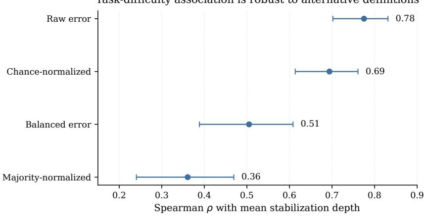  
Figure 17: Difficulty–commitment association under alternative task difficulty definitions. Points show Spearman correlations with mean stabilization depth; error bars are 95% dataset bootstrap intervals.

## G.6 LOCAL CLASS SEPARATION AND DATASET-AWARE STATISTICS

The local-topology analysis is performed in the preprocessed input feature space, not in a hidden representation. Numerical features follow the common training-fitted standardization used by the data pipeline, and categorical features use the same encoded input representation used by the topology analysis.

For each analyzed sample $x _ { i } ,$ , the diagnostic compares the nearest same-class and different-class distances,

$$
r _ { i } = \frac { d ( x _ { i } , \mathrm { N N _ { d i f f } } ) } { d ( x _ { i } , \mathrm { N N _ { s a m e } } ) } .\tag{42}
$$

Larger $r _ { i }$ indicates clearer local class separation. Class labels are used only to identify same- versus different-class neighbors for this retrospective diagnostic; they are not used by the five-pattern trajectory classifier.

The pooled medians shown in the main text are descriptive. Because samples are nested within datasets, we additionally perform dataset-aware inference. For each dataset and trajectory pattern, we first average the available sample-level separation ratios. Figure 19 shows the resulting distribution of dataset-level pattern means. ES has the largest median dataset-level separation, whereas MS has the smallest.

We further compare ES with each non-ES pattern only within datasets for which both estimates are available. Table 25 reports one-sided paired Wilcoxon tests with Holm correction across the four comparisons. ES has higher local separation in approximately 95% of shared datasets for every comparison, including MS. This dataset-aware analysis reproduces the pooled ordering without treating individual samples from the same dataset as independent experimental units.

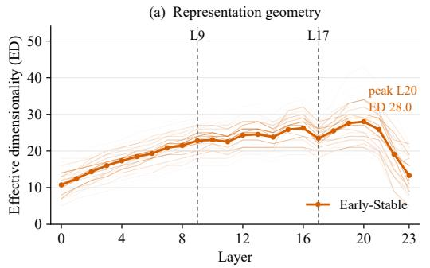

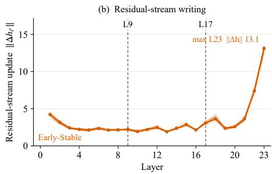  
Figure 18: Representation dynamics continue after predictive commitment. Results are computed using Early-Stable samples only; faded curves denote individual datasets and bold curves denote the dataset-level mean. (a) Effective dimensionality continues to increase after L9, rising from 22.8 at L9 to 28.0 at L20 before contracting to 13.3 at L23. (b) Representation movement remains substantial after L9 and is concentrated toward later depth.

Table 23: Summary of ES-only post-commitment representation dynamics. All statistics are computed after restricting the query representations to Early-Stable samples. Displacement fractions are first computed within each dataset and then macro-averaged across datasets.
<table><tr><td>Statistic</td><td>ES-only result</td></tr><tr><td>Analyzed datasets</td><td>60</td></tr><tr><td>ES queries</td><td>23,737</td></tr><tr><td>ES prevalence range</td><td>88.2-100%</td></tr><tr><td>Mean ED at L9</td><td>22.8</td></tr><tr><td>Mean ED at L20</td><td>28.0</td></tr><tr><td>Mean ED at L23</td><td>13.3</td></tr><tr><td>Datasets with ED increase after L9</td><td>58/60</td></tr><tr><td>Datasets with post-L9 contraction</td><td>60/60</td></tr><tr><td>Displacement occurring after L9 Displacement in final six transitions</td><td>69.2% 43.8%</td></tr></table>

Table 24: Local separation at sample and dataset levels. Sample entries report pooled median [IQR]. Dataset entries report the median [IQR] of within-dataset pattern means.
<table><tr><td>Pattern</td><td>Pooled median [IQR]</td><td>Datasets</td><td>Dataset median [IQR]</td></tr><tr><td>ES</td><td>1.52 [1.11, 2.50]</td><td>270</td><td>1.90 [1.34, 6.26]</td></tr><tr><td>TS</td><td>1.03 [0.85, 1.34]</td><td>263</td><td>1.15 [1.05, 1.39]</td></tr><tr><td>IS</td><td>0.97 [0.76, 1.16]</td><td>251</td><td>1.03 [0.96, 1.17]</td></tr><tr><td>LS</td><td>0.96 [0.72, 1.16]</td><td>251</td><td>1.04 [0.97, 1.17]</td></tr><tr><td>MS</td><td>0.81 [0.61, 1.01]</td><td>93</td><td>0.87 [0.71, 1.02]</td></tr></table>

Table 25: Dataset-aware paired comparisons of local separation. ∆ is the median within-dataset difference in mean separation ratio; p values use a one-sided paired Wilcoxon test with Holm correction.
<table><tr><td></td><td>Comparison Shared datasets Median ∆ ES higher</td><td></td><td></td><td>Holm p</td></tr><tr><td> $\mathrm { E S } > \mathrm { T S }$ </td><td>263</td><td>0.57</td><td>94.7%</td><td> $< 1 0 ^ { - 1 1 }$ </td></tr><tr><td> $\mathrm { E S } > \mathrm { I S }$ </td><td>251</td><td>0.78</td><td>96.5%</td><td> $< 1 0 ^ { - 1 1 }$ </td></tr><tr><td> $\mathrm { E S } > \mathrm { L S }$ </td><td>251</td><td>0.72</td><td>94.8%</td><td> $< 1 0 ^ { - 1 1 }$ </td></tr><tr><td> $\mathrm { E S } > \mathrm { M S }$ </td><td>93</td><td>0.86</td><td>94.5%</td><td> $< 1 0 ^ { - 1 1 }$ </td></tr></table>

## H SUPPLEMENTARY ANALYSES OF LATE-LAYER FUNCTIONAL VALUE

This appendix provides additional analyses supporting Section 6. We first examine the robustness of the relation between predictive commitment and truncation sensitivity across alternative truncation

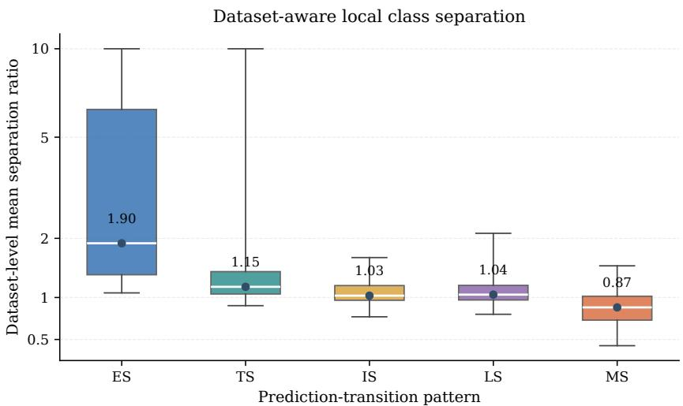  
Figure 19: Dataset-aware local class separation. Each box summarizes within-dataset mean separation ratios for one trajectory pattern. The vertical axis is log-compressed and values above 10 are clipped for display; all reported statistics use the uncapped ratios. Tick labels remain on the original ratio scale. Numbers below the axis indicate datasets containing a finite estimate for that pattern.

depths and evaluation metrics. We then test the stability of the retention–rescue analysis to the choice of shallow reference layer, followed by geometric, compute-matched, predictive, and layerorder controls for the functional role of later computation.

## H.1 ROBUSTNESS OF LATE-LAYER UTILITY

The main text examines whether tasks with later predictive commitment are more sensitive to removing subsequent computation. For dataset d, the accuracy loss induced by truncation at layer ℓ is defined as

$$
\Delta \mathrm { A c c } _ { d } ^ { ( \ell ) } = \mathrm { A c c } _ { d } ^ { ( 2 3 ) } - \mathrm { A c c } _ { d } ^ { ( \ell ) } .\tag{43}
$$

We repeat the analysis at L13, L17, and L20 and additionally replace accuracy with balanced accuracy to reduce sensitivity to class imbalance.

Table 26 shows that mean stabilization depth is positively associated with truncation loss under all six variants. The association is strongest for earlier truncation points, where a larger portion of the remaining computation is removed, and remains positive at L20.

Table 26: Robustness of the commitment–truncation association. Spearman correlations relate dataset-level mean stabilization depth to performance loss under truncation. Confidence intervals are obtained by dataset bootstrap.
<table><tr><td>Truncation metric</td><td> $\rho$  95% CI</td><td>p</td><td></td></tr><tr><td>Accuracy, L13</td><td>.551</td><td>[.443, .643]</td><td> $1 . 5 5 \times 1 0 ^ { - 2 1 }$ </td></tr><tr><td>Balanced accuracy, L13</td><td>.468</td><td>[.365, .561]</td><td> $3 . 2 5 \times 1 0 ^ { - 1 5 }$ </td></tr><tr><td>Accuracy, L17</td><td>.481</td><td>[.366, .583]</td><td> $3 . 9 5 \times 1 0 ^ { - 1 6 }$ </td></tr><tr><td>Balanced accuracy, L17</td><td>.408</td><td>[.300, .504]</td><td> $1 . 3 2 \times 1 0 ^ { - 1 1 }$ </td></tr><tr><td>Accuracy, L20</td><td>.344</td><td>[.220, .456]</td><td> $1 . 8 0 \times 1 0 ^ { - 8 }$ </td></tr><tr><td>Balanced accuracy, L20</td><td>.308</td><td>[.191, .419]</td><td> $5 . 7 2 \times 1 0 ^ { - 7 }$ </td></tr></table>

Later computation also improves probabilistic prediction quality. Comparing L13 with L23, NLL decreases in 58 of 60 datasets (96.7%), while ECE decreases in 57 of 60 datasets (95.0%). Top-1 accuracy increases in 54 datasets, remains unchanged in three, and decreases in three. Improvements in NLL and ECE are therefore more consistent across tasks than changes in the discrete class prediction.

We additionally evaluate each depth using a layer-specific matched readout. Table 27 reports the resulting trajectory alongside the native decoder.

Table 27: Native and layer-specific matched readouts across depth. A separate matched readout is trained at each layer to evaluate predictive information available in the corresponding representation.
<table><tr><td>Depth</td><td>Native Acc.</td><td>Native NLL</td><td>Matched Acc.</td><td>Matched NLL</td></tr><tr><td>L2</td><td>.804</td><td>.490</td><td>.822</td><td>.459</td></tr><tr><td>L5</td><td>.831</td><td>.434</td><td>.832</td><td>.464</td></tr><tr><td>L8</td><td>.845</td><td>.409</td><td>.831</td><td>.460</td></tr><tr><td>L9</td><td>.848</td><td>.402</td><td>.842</td><td>.414</td></tr><tr><td>L13</td><td>.848</td><td>.408</td><td>.847</td><td>.409</td></tr><tr><td>L17</td><td>.859</td><td>.396</td><td>.847</td><td>.421</td></tr><tr><td>L19</td><td>.856</td><td>.393</td><td>.854</td><td>.410</td></tr><tr><td>L21</td><td>.868</td><td>.348</td><td>.842</td><td>.446</td></tr><tr><td>L23</td><td>.874</td><td>.284</td><td>.856</td><td>.466</td></tr></table>

Matched-readout accuracy increases from .822 at L2 to .856 at L23, a 3.4 percentage-point gain. Native accuracy increases from .804 to .874 over the same interval. Later representations therefore provide greater classification utility even when each layer is evaluated with its own matched readout.

The probabilistic trajectories differ from the accuracy trajectories. Native NLL decreases substantially with depth, whereas matched-readout NLL remains comparatively stable. The native decoder therefore extracts increasingly better probabilistic predictions from later representations, while the matched-readout trajectory shows a smaller but persistent increase in classification accuracy.

## H.2 SENSITIVITY TO THE SHALLOW REFERENCE LAYER

The retention–rescue analysis in the main text uses L9 as the shallow reference layer. We repeat the analysis with L8 and L10 while holding the remaining protocol fixed.

Table 28: Retention and rescue under different shallow reference layers. Values are cohort means over 272 datasets. The first two columns summarize the endpoint changes across local separation percentiles, and the final two columns report sample-level Spearman correlations with local separation $( n \approx 9 . 6 \times 1 0 ^ { 4 } ;$ ; all $p < 1 0 ^ { - 2 3 0 } )$ ).
<table><tr><td>Shallow reference</td><td>Retain (%)</td><td>Rescue (%)</td><td>ρretain</td><td>ρrescue</td></tr><tr><td>L8</td><td> $8 3 . 6  9 5 . 8 $ </td><td> $3 2 . 0  5 3 . 7 $ </td><td>+0.203</td><td>+0.253</td></tr><tr><td>L9</td><td> $8 3 . 2  9 5 . 9 $ </td><td> $3 0 . 4  5 0 . 2 $ </td><td>+0.187</td><td>+0.244</td></tr><tr><td>L10</td><td> $8 5 . 0  9 6 . 1 $ </td><td> $2 8 . 1  5 1 . 9$ </td><td>+0.194</td><td>+0.240</td></tr></table>

Across all three reference layers, retention and rescue increase with local separation, with similar correlation magnitudes and response profiles. The relation between local separation and later predictive change is therefore stable across nearby shallow reference depths.

## H.3 SHARED-WEIGHT AND MATCHED-COMPUTE CONTROLS

The shared-weight intervention compares the standard sequence of distinct ICL blocks with repeated application of a fixed transformation. We extract a single ICL block and repeatedly apply it to the evolving residual stream, using the same geometric analysis as for the standard 24-layer network.

For a representation trajectory with effective dimension $\mathrm { E D } ^ { ( \ell ) }$ , we define the compression ratio as

$$
R _ { \mathrm { c o m p } } = { \frac { \operatorname* { m a x } _ { \ell } \mathrm { E D } ^ { ( \ell ) } } { \mathrm { E D } ^ { ( \mathrm { f i n a l } ) } } } ,\tag{44}
$$

and define FDR gain as the ratio between the final and initial class-discriminative Fisher ratio.

Table 29 summarizes the primary comparison. Repeated application of the shared block produces substantially weaker late compression and weaker growth of class-discriminative structure.

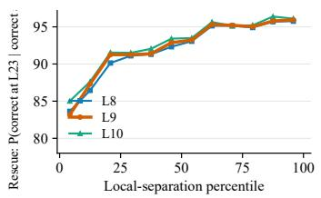

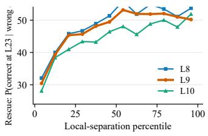  
Figure 20: Retention and rescue across alternative shallow reference layers. (a) Retain, P(correct at L23 | correct at the reference layer), and (b) Rescue, P(correct at L23 | wrong at the reference layer), plotted against within-dataset local-separation percentile. Results are shown for L8, L9, and L10, with L9 used as the main-text reference. Curves denote cohort means over 272 datasets.

Table 29: Standard depth-specific computation versus shared-weight iteration. Values are dataset means ± standard deviations. Wilcoxon tests are one-sided for the hypothesis that the standard model yields the larger quantity.
<table><tr><td>Metric</td><td>Standard</td><td>Shared</td><td>p</td></tr><tr><td>Compression ratio</td><td> $2 . 8 5 \pm 1 . 0 1$ </td><td> $1 . 0 5 \pm 0 . 0 8$ </td><td> $9 . 5 \times 1 0 ^ { - 7 }$ </td></tr><tr><td>FDR gain</td><td> $2 . 5 3 \pm 1 . 9 4$ </td><td> $0 . 8 4 \pm 0 . 2 6$ </td><td> $2 . 9 \times 1 0 ^ { - 6 }$ </td></tr></table>

All shared-weight runs have compression ratios below 1.3. The standard depth-specific sequence therefore exhibits substantially stronger late compression than repeated application of a fixed block. The FDR comparison shows a parallel difference in class-discriminative structure, which grows strongly across the standard sequence but remains much smaller under shared weights.

We next match the number of computational transformations by repeating the shared block for 24 steps. Expansion is defined as

$$
R _ { \mathrm { e x p } } = \frac { \mathrm { m a x } _ { \ell } \mathrm { E D } ^ { ( \ell ) } } { \mathrm { E D } ^ { ( 0 ) } } ,\tag{45}
$$

with compression defined as above.

Table 30: Matched-step shared-weight control. Each entry reports expansion/compression ratio. The shared block is iterated for 24 steps, matching the number of transformations in the standard network.
<table><tr><td>Dataset</td><td>Standard 24-layer</td><td>Shared ×24</td></tr><tr><td>vehicle</td><td>4.00/2.33</td><td>1.57/1.22</td></tr><tr><td>segment</td><td>4.67/2.33</td><td>1.33/1.14</td></tr><tr><td>satimage</td><td>7.50/3.33</td><td>2.50/1.00</td></tr><tr><td>diabetes</td><td>2.88/2.09</td><td>1.62/1.62</td></tr></table>

Across all four tasks, the 24-step shared-weight trajectory remains substantially different from the standard model. Expansion is weaker in every case, and compression remains below the corresponding standard value. Distinct depth-specific transformations therefore produce a different representation trajectory from repeated application of the same operation, even at matched computational depth.

## H.4 PREDICTIVE ROBUSTNESS UNDER DATA PERTURBATIONS

We further compare the standard and shared-weight models under perturbed evaluation conditions. For each dataset and condition, we report

$$
\Delta \mathrm { A c c } = \mathrm { A c c } _ { \mathrm { s t a n d a r d } } - \mathrm { A c c } _ { \mathrm { s h a r e d } } ,\tag{46}
$$

so that positive values favor the standard model.

Table 31 reports results on ten representative datasets. The clean condition is included alongside 20% label noise, feature noise, and reduced training-sample availability.  
Table 31: Predictive advantage of the standard model under data perturbations. Entries are $\Delta \mathrm { A c c } = \mathrm { A c c } _ { \mathrm { s t a n d a r d } } - \mathrm { A c c } _ { \mathrm { s h a r e d } }$ . Positive values indicate higher accuracy for the standard model.
<table><tr><td>Dataset</td><td>Clean</td><td>20% label noise</td><td>Feature noise</td><td>Half samples</td></tr><tr><td>adult</td><td>+.005</td><td>+.030</td><td>.000</td><td>+.050</td></tr><tr><td>cmc</td><td>+.030</td><td>+.065</td><td>+.035</td><td>+.090</td></tr><tr><td>credit-g</td><td>+.030</td><td>+.015</td><td>+.040</td><td>+.085</td></tr><tr><td>diabetes</td><td>-.019</td><td>+.045</td><td>+.013</td><td>.000</td></tr><tr><td>balance-scale</td><td>+.232</td><td>+.288</td><td>+.056</td><td>+.256</td></tr><tr><td>vehicle</td><td>+.312</td><td>+.194</td><td>+.153</td><td>+.171</td></tr><tr><td>car</td><td>+.205</td><td>+.180</td><td>+.070</td><td>+.235</td></tr><tr><td>bank-marketing</td><td>+.015</td><td>+.005</td><td>+.010</td><td>-.015</td></tr><tr><td>credit-approval</td><td>+.007</td><td>+.072</td><td>+.043</td><td>+.029</td></tr><tr><td>electricity</td><td>+.060</td><td>+.010</td><td>+.055</td><td>+.010</td></tr><tr><td>Mean</td><td>+.088</td><td>+.090</td><td>+.048</td><td>+.091</td></tr><tr><td>Standard &gt; Shared</td><td>9/10</td><td>10/10</td><td>9/10</td><td>8/10</td></tr></table>

The standard model has a positive mean accuracy advantage in all four conditions. Under 20% label noise, the advantage occurs on all ten datasets. Under feature noise, it occurs on nine datasets with one tie; with half the training samples, it occurs on eight datasets with one tie.  
The shared-weight and standard models therefore remain predictively distinct under clean and perturbed evaluation conditions, with the largest cross-dataset consistency observed under label noise.

## H.5 LAYER-ORDER PERTURBATION STATISTICS

Section 6.2 changes the execution order of the learned layers while preserving the blocks themselves and the number of computational steps. We consider both a shuffled ordering and complete reversal of the learned sequence.

Table 32 summarizes the dataset-level effects on effective-dimensional compression and predictive accuracy. Wilcoxon tests are paired and one-sided for the hypothesis that the learned ordering produces the larger value.

Table 32: Dataset-level effects of layer-order perturbation. “Learned better” reports the number of datasets on which the learned ordering yields the larger metric. Ties are omitted from this count.
<table><tr><td>Metric</td><td></td><td></td><td>Learned Perturbed Learned better</td><td>p</td></tr><tr><td>Compression, shuffled</td><td>1.935</td><td>1.053</td><td>60/60</td><td> $8 . 6 5 \times 1 0 ^ { - 7 }$ </td></tr><tr><td>Compression, reversed</td><td>1.935</td><td>1.012</td><td>60/60</td><td> $8 . 6 4 \times 1 0 ^ { - 7 }$ </td></tr><tr><td>Accuracy, shuffled</td><td>.806</td><td>.650</td><td>58/60</td><td> $1 . 4 2 \times 1 0 ^ { - 6 }$ </td></tr><tr><td>Accuracy, reversed</td><td>.806</td><td>.682</td><td>56/60</td><td> $5 . 5 3 \times 1 0 ^ { - 6 }$ </td></tr></table>

Effective-dimensional compression is lower after both shuffling and reversal on all 60 datasets. The learned ordering also yields higher accuracy than the shuffled ordering on 58 datasets and higher accuracy than the reversed ordering on 56 datasets.

Changing layer order therefore alters both the representation trajectory and predictive behavior. Together with the shared-weight controls, these results show that later computation is organized as an ordered sequence of distinct learned transformations.