# NOISE-SPACE REWARD ALIGNMENT FOR FEW-STEP GENERATIVE MODELS

Woocheol Shin1, Taeyoung Yun1, Jiwon Sung2, Hyeongyu Kang1, Jeongmin Park1,   
Jaewoo Lee1,4, Kyuil Sim1, Dohyun Kim1, Yutong He3†, Jinkyoo Park1,5†   
1KAIST, 2Stanford University, 3Carnegie Mellon University, 4MongooseAI, 5Omelet   
{woofe, 99yty, khg2000v, pjmin831}@kaist.ac.kr   
{jaewoo, kyuil.sim, dyun0317, jinkyoo.park}@kaist.ac.kr   
jwsung@stanford.edu, yutonghe@andrew.cmu.edu

## ABSTRACT

Few-step generative models produce high-quality samples in one or a few evaluations. However, steering them toward desired properties remains difficult, especially when only black-box reward evaluations are available. While one could apply approaches developed for iterative diffusion and flow-based models, such as direct RL fine-tuning or test-time scaling, we find that neither transfers well to the few-step regime: direct fine-tuning suffers from severe reward over-optimization, and test-time scaling sacrifices the efficiency advantage of few-step generation. We propose Noise Policy Optimization (NPO), which explicitly targets the alignment problem for few-step generative models. The key idea is to learn an amortized flow policy over the initial noise space of the generator. The trained policy transports Gaussian noise to a reward-tilted noise distribution, whose pushforward distribution through the frozen generator is exactly the reward-tilted output distribution. By keeping the generator frozen, we can effectively utilize the knowledge encoded in the pretrained model, yielding a better reward-quality trade-off than direct fine-tuning. The amortized policy moves the search cost into training, so inference adds only a lightweight noise sampling step on top of the pretrained model. To improve sample efficiency during training, we use ELBO-based likelihood estimation that requires only sampled endpoints rather than simulated trajectories. Across image, language, and protein structure generation, NPO consistently achieves a better reward-quality trade-off than direct fine-tuning, and matches test-time search methods with 16 to 549× lower inference cost.

## 1 INTRODUCTION

Recent advances in few-step generative modeling have enabled high-quality generation with only one or a few model evaluations (Song et al., 2023; Boffi et al., 2025; Chen et al., 2025; Geng et al., 2026; Hu et al., 2026; Xie et al., 2025). However, one may need to align the generator toward desired properties in downstream applications, such as human preferences in image and text generation or structural properties in biological design. Despite the growing importance of few-step generators, their reward alignment remains relatively underexplored. Moreover, most of these downstream objectives are available only as scalar values whose gradients cannot be propagated through the generator due to non-differentiable rewards or discretization. Together, these considerations motivate an important problem: how to align few-step generative models without access to reward gradients.

A straightforward way is to directly fine-tune the generator using reinforcement learning (RL) methods developed for iterative diffusion and flow-based models (Fan et al., 2023; Black et al., 2024; Liu et al., 2026). However, we find that direct fine-tuning transfers poorly to the few-step regime. As demonstrated in Figure 1, direct methods either make limited progress or suffer from severe reward over-optimization that degrades sample quality. We hypothesize that directly changing the parameters of a few-step generative model is prone to losing the knowledge encoded during pretraining.

(a) Reward alignment  
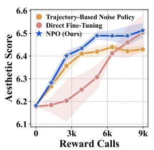

(b) Samples over training  
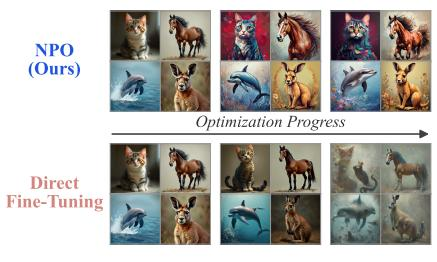

(c) Inference cost  
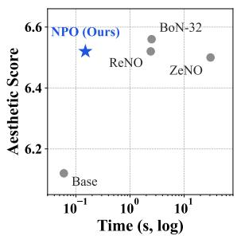  
Figure 1: Motivation Figure. (a) Reward learning curve of NPO, direct fine-tuning, and trajectorybased noise policy. (b) Generated samples over training for NPO and direct fine-tuning. (c) Comparison with test-time scaling methods. As shown in the figure, NPO achieves a better reward-quality trade-off than baselines while maintaining an inference cost comparable to the pretrained model.

A promising alternative is to keep the generator frozen and optimize its input noise at test time (Eyring et al., 2024; Kim et al., 2026; Yoon et al., 2026; Min et al., 2026). While searching the noise through test-time scaling can effectively improve the target reward without modifying the pretrained generator, the process must be repeated from scratch for every generated sample. This incurs substantial inference cost and sacrifices the efficiency advantage of few-step generation.

We propose Noise Policy Optimization (NPO), which learns an amortized flow policy over the input noise space of a frozen few-step generator. We use the identity that the problem of sampling from the reward-tilted output distribution can be reduced to sampling from the reward-tilted input noise distribution when the sampling path is deterministic. NPO learns this transformation with a flow policy that transports the standard Gaussian distribution toward the reward-tilted input noise distribution. By keeping the generator frozen, NPO preserves the knowledge in the pretrained model. By amortizing the noise transformation, it moves the cost of test-time search to training. To enable more efficient training, we use ELBO-based likelihood estimation from sampled noise endpoints instead of using conventional trajectory-based likelihood estimation (Black et al., 2024; Liu et al., 2026). We observe that it drastically improves the sample efficiency of our method, as depicted in Figure 1.

We evaluate NPO across image, language, and protein structure generation tasks, covering a diverse range of one- and few-step generators and reward functions. Compared to direct generator fine-tuning, NPO consistently achieves a better trade-off between improving reward and preserving sample quality and diversity. Relative to test-time noise optimization, NPO achieves comparable or higher rewards with 16 to 549× lower inference cost by learning an amortized policy. In comparison to trajectory-based noise-policy training, NPO reaches the same reward levels with fewer reward evaluations. Together, these results demonstrate that NPO efficiently aligns few-step generative models using only black-box rewards, without sacrificing sample quality or inference efficiency.

## 2 RELATED WORK

Few-step generative models. Recent advances have enabled high-quality generation with only one or a few model evaluations. Consistency models learn trajectory-consistent mappings (Song et al., 2023; Song & Dhariwal, 2024; Geng et al., 2025; Luo et al., 2023a), while distillation-based methods compress multi-step generators using objectives such as adversarial training or distribution matching (Sauer et al., 2024; Yin et al., 2024; Luo et al., 2023b). Flow-map-based and related approaches learn finite-time transport between noise levels or directly from noise to data (Kim et al., 2024; Frans et al., 2025; Geng et al., 2026; Boffi et al., 2025; 2026). While these methods substantially reduce sampling cost, aligning them with downstream rewards remains underexplored.

Reward alignment of generative models. Generative models can be aligned to downstream objectives by reward backpropagation (Prabhudesai et al., 2023; Xu et al., 2023; Kang et al., 2026), RLbased policy optimization (Black et al., 2024; Fan et al., 2023; Zhang et al., 2024; Liu et al., 2026), incorporating rewards during distillation (Duan et al., 2026), or using variational inference (Lee et al., 2026c). Recent work has also studied alignment of few-step generators through policy optimization for consistency models (Oertell et al., 2024), sample-based variational inference (Lee et al., 2026b), and flow-map-specific approaches (Mammadov et al., 2026; Potaptchik et al., 2026). Although promising, these approaches either directly modify the pretrained generator, which can lead to reward hacking, or rely on model-specific structures. In contrast, NPO keeps the pretrained generator frozen to preserve sample quality and applies across diverse few-step generators.

Initial-noise optimization. For deterministic generators, alignment can alternatively be performed by optimizing the input noise while keeping the generator fixed. Test-time methods optimize the initial noise for each sample using reward gradients (Eyring et al., 2024; Min et al., 2026; Yoon et al., 2026) or gradient-free optimization (Ma et al., 2025; Kim et al., 2026), but incur repeated inferencetime search. Amortized approaches instead learn reusable noise distributions or policies, including Gaussian noise policies (Chen et al., 2024; Miao et al., 2025), reward-gradient-based transformations (Eyring et al., 2026; Wagenmaker et al., 2025), and diffusion-based noise samplers (Venkatraman et al., 2025). NPO similarly amortizes noise-space optimization, while supporting black-box reward evaluations with an expressive flow policy trained using endpoint forward-noising updates to improve sample efficiency.

## 3 PROBLEM SETUP & BACKGROUND

In this section, we study reward alignment of pretrained few-step generative models. Given a generator and a scalar reward function, our goal is to steer generation toward high-reward outputs without assuming access to reward gradients. We first formalize the desired reward-tilted output distribution and review trajectory-based policy optimization.

## 3.1 PROBLEM SETUP AND REWARD-TILTED OUTPUT DISTRIBUTION

Let $g _ { \theta }$ denote a pretrained few-step generator that learns to transport from a source distribution $p _ { 1 }$ to a target distribution $p _ { \mathrm { d a t a } } = p _ { 0 }$ . We denote the input $x _ { 1 } \sim p _ { 1 } = { \mathcal { N } } ( 0 , I )$ , the output $x = g _ { \theta } ( x _ { 1 } )$ and the output distribution $p _ { \mathrm { b a s e } } = g _ { \theta \# } p _ { 1 }$ . Additionally, we have access to a scalar reward $r : \mathcal { X } $ R, which can be evaluated on generated samples but does not need to be differentiable.

Reward alignment seeks to improve the expected reward while limiting deviation from the pretrained distribution. A standard KL-regularized objective and its optimal output distribution are

$$
\operatorname* { m a x } _ { p } \left\{ \mathbb { E } _ { x \sim p } [ r ( x ) ] - \alpha D _ { \mathrm { K L } } ( p \| p _ { \mathrm { b a s e } } ) \right\} , \qquad p ^ { \star } ( x ) = \frac { 1 } { Z } p _ { \mathrm { b a s e } } ( x ) \exp \left( \frac { r ( x ) } { \alpha } \right) ,\tag{1}
$$

where $\alpha > 0$ controls the regularization strength and $Z$ is the normalizing constant. We call $p ^ { \star }$ the reward-tilted output distribution, which reweights the pretrained distribution toward high-reward outputs. Thus, reward alignment can equivalently be viewed as learning to sample from $p ^ { \star }$ . A detailed derivation is provided in Appendix A.1.

## 3.2 TRAJECTORY-BASED POLICY OPTIMIZATION

Let $p _ { \phi }$ denote a trainable output distribution. When reward gradients are unavailable, the reward term in Equation (1) can be optimized using the score-function, or likelihood-ratio, identity

$$
\nabla _ { \phi } \mathbb { E } _ { \boldsymbol { x } \sim p _ { \phi } } [ r ( \boldsymbol { x } ) ] = \mathbb { E } _ { \boldsymbol { x } \sim p _ { \phi } } \left[ r ( \boldsymbol { x } ) \nabla _ { \phi } \log p _ { \phi } ( \boldsymbol { x } ) \right] .\tag{2}
$$

Hence, policy-gradient optimization requires estimating the endpoint likelihood $p _ { \phi } ( x )$

For iterative diffusion and flow models, this likelihood is commonly estimated from simulated reverse trajectories. Given a simulated trajectory $x _ { \tau _ { K } } , \hat { x } _ { \tau _ { K - 1 } } , . . . , \hat { x } _ { \tau _ { 0 } }$ where $0 = \tau _ { 0 } < \tau _ { 1 } < \cdot \cdot \cdot <$ $\tau _ { K } = 1 , x _ { \tau _ { K } } = x _ { 1 } \sim p _ { 1 }$ is the initial noise, $\hat { x } _ { \tau _ { k } }$ is the k-th step intermediate sample and $x = \hat { x } _ { 0 }$ is the final generated sample, the endpoint log likelihood can be estimated as

$$
\log p _ { \phi } ( x ) \approx \sum _ { k = 1 } ^ { K - 1 } \log p _ { \phi } ( \hat { x } _ { \tau _ { k - 1 } } \mid \hat { x } _ { \tau _ { k } } ) + \log p _ { \phi } ( \hat { x } _ { \tau _ { K - 1 } } \mid x _ { \tau _ { K } } ) + C ( x )\tag{3}
$$

where $C ( x )$ is a ϕ-independent constant.

Prior works such as DDPO (Black et al., 2024) and Flow-GRPO (Liu et al., 2026) use this trajectorybased likelihood estimation to optimize the reward objective. While this construction is tractable for stochastic diffusion samplers because their discretized reverse transitions are Gaussian, it does not naturally apply to deterministic ODE and flow-map samplers. Existing approaches therefore resort to surrogate constructions, including introducing additional stochasticity into the sampling process (Liu et al., 2026), computing likelihoods through divergence estimators (Lipman et al., 2023), and learning auxiliary models for likelihood estimation (Ai et al., 2026). However, these techniques are prohibitively expensive and unstable (OuYang et al., 2026), or fundamentally change the sampling process and cause discrepancies between reward alignment and base model pretraining.

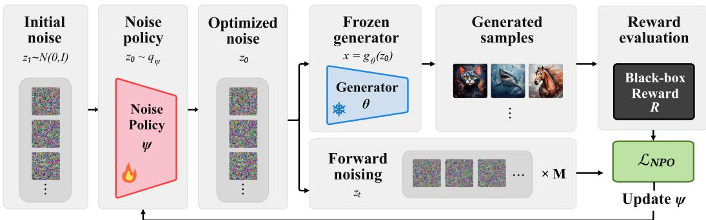  
Figure 2: Overview of NPO. NPO trains a noise policy $q _ { \psi }$ that maps Gaussian noise $z _ { 1 }$ to optimized noise $z _ { 0 }$ for a frozen generator $g _ { \boldsymbol { \theta } }$ . The policy is updated with $\mathcal { L } _ { \mathrm { N P O } }$ , computed from the black-box reward of $g _ { \boldsymbol { \theta } } ( z _ { 0 } )$ and M forward-noised points $z _ { t }$ of each $z _ { 0 } ,$ given by forward-noising pairs $( t , \epsilon )$

## 4 NOISE POLICY OPTIMIZATION

To address these challenges, we propose Noise Policy Optimization (NPO). NPO learns an amortized flow policy over the input noise of a frozen generator. We first show that learning the rewardtilted noise distribution is sufficient to realize the reward-tilted output distribution through the frozen generator. Then, we propose an ELBO-based objective that approximates the target noise distribution with the flow policy in the noise space.

## 4.1 NOISE-SPACE REPRESENTATION OF THE TARGET

Rather than modifying $g _ { \theta }$ to realize the reward-tilted output distribution $p ^ { \star }$ , we can instead change its input distribution while keeping the generator fixed. For notational simplicity, we denote the noise space as $\mathcal { Z }$ and the initial noise as $z \sim q _ { \mathrm { b a s e } } = p _ { 1 } = \mathcal { N } ( 0 , I )$ . Following prior noisespace formulations (Venkatraman et al., 2025; Eyring et al., 2026), we define the reward-tilted noise distribution

$$
q ^ { \star } ( z ) = \frac { 1 } { Z } q _ { \mathrm { b a s e } } ( z ) \exp \biggl ( \frac { r ( g _ { \theta } ( z ) ) } { \alpha } \biggr ) .\tag{4}
$$

Then, $g _ { \theta \# } q ^ { \star } = p ^ { \star }$ . In other words, the pushforward distribution of $q ^ { \star }$ is exactly the reward-tilted output distribution $p ^ { \star }$ . Therefore, sampling from $p ^ { \star }$ can be reduced to sampling $z \sim q ^ { \star }$ and passing the sampled noise through the deterministic mapping $g _ { \theta }$ . We provide the proof in Appendix ${ \mathrm { A } } . 2$

## 4.2 FLOW POLICIES AND FORWARD NOISING

Motivated by the insight above, we propose to learn an additional model to transform the original Gaussian noise distribution into the reward-tilted noise distribution. We parameterize a learned noise distribution $q _ { \psi }$ using another continuous flow. In particular, we aim to learn a velocity field $v _ { \psi } ( z _ { t } , t )$ that defines an ODE ${ d z _ { t } } / { d t } = v _ { \psi } ( z _ { t } , t )$ , whose integration from $t = 1 \tan t = 0$ transports a Gaussian source $z _ { 1 } \sim q _ { 1 } = p _ { 1 } = \mathcal { N } ( 0 , I )$ to an endpoint $z _ { 0 } \sim q _ { \psi } \approx q _ { 0 } = q ^ { * }$

For an endpoint $z _ { 0 } .$ , we construct the Gaussian forward-noising interpolation $z _ { t } = a _ { t } z _ { 0 } + \sigma _ { t } \epsilon$ , where $\epsilon \sim \mathcal { N } ( 0 , I ) , ( a _ { 0 } , \sigma _ { 0 } ) = ( 1 , 0 )$ , and $( a _ { 1 } , \sigma _ { 1 } ) = ( 0 , 1 )$ . The corresponding conditional target velocity is $u _ { t } = \dot { a } _ { t } z _ { 0 } + \dot { \sigma } _ { t } \epsilon$ , where dots denote derivatives with respect to t.

Algorithm 1 Noise Policy Optimization   
Require: Frozen generator gθ; reward r; noise policy $q _ { \psi }$ with velocity field $v _ { \psi } ;$ reference field $v _ { \mathrm { r e f } } ;$   
number of forward-noising pairs M; training rounds N; EMA decay γ   
1: Initialize $v _ { \psi }  v _ { \mathrm { r e f } } , \psi _ { \mathrm { o l d } }  \psi$   
2: for $k = 1 , \ldots , N$ do   
3: Sample a batch of $z _ { 1 } \sim q _ { \mathrm { b a s e } }$ and integrate $v _ { \psi _ { \mathrm { o l d } } }$ to obtain endpoints $z _ { \mathrm { 0 } }$   
4: Compute rewards $r ( g _ { \boldsymbol { \theta } } ( z _ { 0 } ) )$ and advantages $A = r ( g _ { \theta } ( z _ { 0 } ) ) - \bar { r }$   
5: Sample M forward-noising pairs $( t , \epsilon )$ per endpoint   
6: Update ψ by minimizing $\mathcal { L } _ { \mathrm { N P O } } ( \psi )$ from Equation (7)   
7: ψold $ \gamma \psi _ { \mathrm { o l d } } + ( 1 - \gamma ) \psi$   
8: end for   
4.3 NOISE-SPACE ALIGNMENT OBJECTIVE   
To match $q _ { \psi }$ to the target reward-tilted noise distribution $q ^ { * }$ , we minimize the reverse KL divergence   
to $q ^ { * }$ , which is equivalent to KL-regularized reward maximization in noise space:   
$\arg \operatorname* { m i n } _ { \psi } D _ { \mathrm { K L } } ( q _ { \psi } | | q ^ { \star } ) = \arg \operatorname* { m i n } _ { \psi } \left\{ \alpha D _ { \mathrm { K L } } ( q _ { \psi } | | q _ { \mathrm { b a s e } } ) - \mathbb { E } _ { z \sim q _ { \psi } } [ r ( g _ { \theta } ( z ) ) ] \right\} .$ (5)   
Thus, our objective maximizes the reward while regularizing the learned noise distribution $q _ { \psi }$ toward   
the initial noise distribution $q _ { \mathrm { b a s e } } .$ To implement this reference regularization, we introduce a fixed   
reference velocity field $\begin{array} { r } { v _ { \mathrm { r e f } } ( \bar { z } _ { t } , t ) = \frac { a _ { t } \dot { a } _ { t } ^ { \star } + \sigma _ { t } \dot { \sigma } _ { t } } { a _ { t } ^ { 2 } + \sigma _ { t } ^ { 2 } } z _ { t } . } \end{array}$ , whose source and endpoint distributions are both   
$q _ { \mathrm { b a s e } }$ . The forms of $v _ { r e f }$ under specific interpolation schedules are provided in Appendix B.1.   
4.4 ELBO-BASED POLICY OPTIMIZATION   
The objective in Equation (5) can be well optimized via policy gradients. As a result, it is crucial   
to obtain a reliable estimate of the endpoint likelihood $q _ { \psi } ( z _ { 0 } )$ . Prior works show that ELBO-based   
estimators provide substantially more efficient optimization than trajectory-based alternatives (Xue   
et al., 2025; Choi et al., 2026). We therefore use an ELBO-based estimator that operates on sampled   
endpoints and avoids dependence on simulated rollout trajectories.   
For endpoint $z _ { 0 } ,$ , defining the regression score on a forward-noising pair $( t , \epsilon )$ , with $t \sim \mathcal { U } ( 0 , 1 )$ and   
$\epsilon \sim \mathcal { N } ( 0 , I )$ , as $\ell _ { \psi } ( z _ { 0 } ; t , \epsilon ) = w ( t ) \| v _ { \psi } ( z _ { t } , t ) - u _ { t } \| _ { 2 } ^ { 2 }$ , we estimate the endpoint log likelihood as   
log q (z ) ≈ −E [ℓ (z ; t, ϵ)] + c(z ) (6)   
where $c ( z _ { 0 } )$ is a ψ-independent constant.   
In practice, we maintain an old policy $q _ { \psi _ { \mathrm { o l d } } }$ for sampling endpoints. The importance ratio between   
the current and old policies is estimated on the same forward-noising pair as $\widehat { \rho } _ { \psi } = \exp ( \ell _ { \psi _ { \mathrm { o l d } } } -$   
$\ell _ { \psi } )$ We use the advantage $A = r ( g _ { \theta } ( z _ { 0 } ) ) - \bar { r }$ , where r¯ is the group-mean reward. Following   
prior work Choi et al. (2026), we approximate the KL regularization term by the squared deviation   
between $v _ { \psi }$ and $v _ { \mathrm { r e f } } .$ . Combining these terms, our final loss is   
LNPO(ψ) = E hsg (Aρbψ) w(t) ∥vψ(zt, t) − ut∥2 + λref ∥vψ(zt, t) − vref(zt, t)∥ (7)   
Here, sg denotes stop-gradient and $\lambda _ { \mathrm { r e f } } > 0$ controls the strength of the reference regularization.   
We summarize the overall NPO training procedure in Algorithm 1 and provide additional method  
ological details in Appendix B.

## 5 EXPERIMENTS

We evaluate NPO across image, language, and protein structure generation, covering diverse oneand few-step generators and reward functions. Our experiments aim to address the following three questions: (1) Does NPO achieve a better reward-quality trade-off than direct generator fine-tuning? (2) Does NPO achieve competitive performance compared to test-time methods at lower inference cost? (3) Does NPO learn an amortized policy faster than trajectory-based approaches?

(a) Aesthetic vs ImageReward (b) Aesthetic vs LPIPS Div  
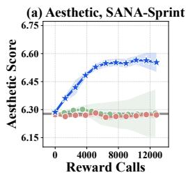

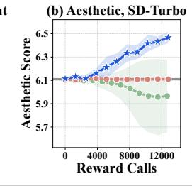

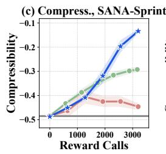  
Base FAV-B Flow-GRPO NPO (Ours)

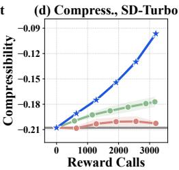

Figure 3: Reward learning curve of NPO and direct fine-tuning baselines on 1-step generation. NPO efficiently learns to generate high-rewarding samples compared to the baselines.  
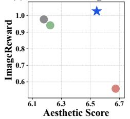

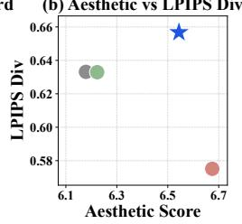

(c) Compress. vs ImageReward (d) Compress. vs LPIPS Div  
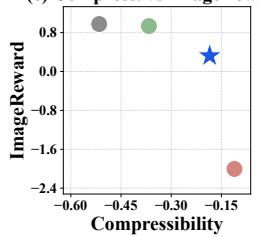  
SANA-Sprint (Base) FAV-B Flow-GRPO NPO (Ours)

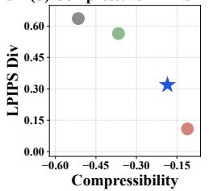  
Figure 4: Reward-quality trade-off of NPO and direct fine-tuning baselines on SANA-Sprint with 4-step sampling. NPO achieves a better trade-off than the baselines.

## 5.1 TEXT-TO-IMAGE GENERATION

We first evaluate NPO on text-to-image generation tasks. For pretrained few-step generators, we use SD-Turbo (Sauer et al., 2024) and SANA-Sprint (Chen et al., 2025), which support one- and four-step image generation. We provide additional experimental details in Appendix D.

## 5.1.1 EXPERIMENTAL SETUP

Rewards and Metrics. We optimize two target reward functions: the LAION aesthetic predictor (Schuhmann, 2022) and JPEG compressibility (Black et al., 2024), without using reward gradients. To measure reward over-optimization, we report ImageReward (Xu et al., 2023) for semantic fidelity and LPIPS diversity (Zhang et al., 2018) for sample diversity.

Baselines. We compare NPO against three categories of alignment methods. Implementation details for all baselines are provided in Appendix C.

(1) Direct generator fine-tuning. Flow-GRPO (Liu et al., 2026) applies policy-gradient updates directly to the generator using stochastic transition likelihoods. FAV-B (Lee et al., 2026b) fine-tunes the generator using amortized SVGD with zeroth-order gradient estimation from reward evaluations.

(2) Test-time noise optimization. Best-of-N (Karthik et al., 2023) samples N candidate noises and selects the highest-reward output. ReNO (Eyring et al., 2024) and ZeNO (Kim et al., 2026) perform gradient-based and gradient-free noise optimization at test-time, respectively.

(3) Noise-policy learning. ODS (Venkatraman et al., 2025) learns a score model in noise space using a trajectory-balance objective. We additionally implement Noise Flow-GRPO, a variant of our method that instead uses trajectory-based likelihood estimation.

## 5.1.2 RESULTS

NPO improves reward while preserving sample quality. Figure 3 compares NPO with direct generator fine-tuning under one-step sampling. Across both pretrained generators, NPO consistently improves the target rewards, whereas Flow-GRPO and FAV-B show limited or no improvement. Under four-step sampling, Figure 4 shows that Flow-GRPO improves the target rewards, but ImageReward and LPIPS diversity decrease substantially, indicating severe reward over-optimization.

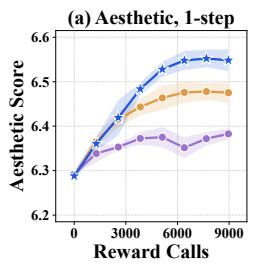

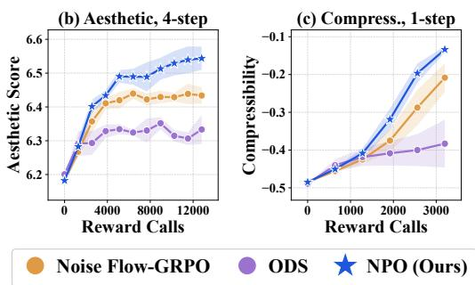

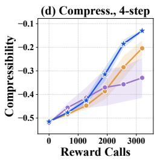  
Figure 5: Reward learning curve of NPO and noise-policy learning baselines on few-step generation. NPO efficiently learns to generate high-rewarding samples compared to the baselines.

In contrast, NPO improves the target rewards while better preserving semantic fidelity and diversity. By keeping the pretrained generator frozen and aligning in noise space, NPO achieves a more favorable reward-quality trade-off. Additional qualitative results are provided in Appendix H.1.

NPO preserves fast inference by amortizing test-time search. Table 1 compares NPO with test-time noise optimization in terms of the inference speed. NPO achieves comparable reward while reducing inference cost approximately 16–205× relative to the test-time baselines. By amortizing test-time search into a reusable flow policy, NPO achieves comparable alignment while preserving the fast inference of few-step generation.

<table><tr><td>Method</td><td>Aesthetic</td><td>NFE</td><td>Time (s)</td><td>Rel. cost</td></tr><tr><td>SD-Turbo (Base)</td><td>6.12</td><td>1</td><td>0.06</td><td>1.0×</td></tr><tr><td>BoN-32</td><td>6.56</td><td>32</td><td>2.51</td><td>44.2×</td></tr><tr><td>ReNO</td><td>6.52</td><td>13</td><td>2.42</td><td>42.6×</td></tr><tr><td>ZeNO</td><td>6.50</td><td>482</td><td>30.78</td><td>542.8×</td></tr><tr><td>NPO (Ours)</td><td>6.52</td><td>1</td><td>0.15</td><td>2.6×</td></tr></table>

Table 1: Comparison of NPO with test-time search methods on SD-Turbo. NPO achieves comparable aesthetic scores with a single generator evaluation.

NPO improves training efficiency with ELBO-based likelihood estimation. Figure 5 compares NPO with Noise Flow-GRPO and ODS across one- and four-step sampling. NPO reaches comparable reward levels with fewer reward evaluations across all settings. Since Noise Flow-GRPO uses the same amortized flow policy, this controlled experiment reveals that avoiding dependence on stochastic rollout trajectories yields a more efficient optimization signal. NPO also outperforms ODS, indicating that the advantage extends to a broader trajectory-based noise-policy baseline.

## 5.2 LANGUAGE GENERATION

Recent work has begun to explore few-step language generation with continuous-flow models (Hu et al., 2026; Lee et al., 2026a). To this end, we evaluate NPO on alignment of few-step language generation models. Additional experimental details on the language task are provided in Appendix E.

## 5.2.1 EXPERIMENTAL SETUP

We use the progressively distilled four-step variant of ELF (Hu et al., 2026) as the pretrained gen erator. We introduce a DeBERTa-v3-large NLI model (He et al., 2021), which is fine-tuned on MNLI (Williams et al., 2018), to define the target reward as the entailment probability for the hypothesis “This text is about [topic].”. We steer generation toward two topics, politics and science. To evaluate generation quality beyond the target reward, we report GPT-2 Large perplexity (Radford et al., 2019) for fluency and unigram entropy (Lee et al., 2026a) for diversity. We compare against the same baselines as in the image experiments. Note that as the reward is scored on the text only after sampling, the gradient is not straightforwardly available.

## 5.2.2 RESULTS

NPO improves reward while preserving sample quality. Figure 6 compares NPO with direct finetuning methods. The direct fine-tuning baselines achieve only modest improvements in topic reward while degrading generation quality. The simultaneous decrease in both perplexity and unigram entropy indicates degenerate repetition rather than improved fluency, as further illustrated by the qualitative samples in Appendix H.2. In contrast, NPO achieves higher topic rewards while keeping both perplexity and unigram entropy close to those of the frozen generator. These results show that NPO achieves a better reward–sample quality trade-off than direct fine-tuning.

(d) Politics vs Uni. Entropy  
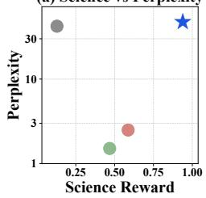

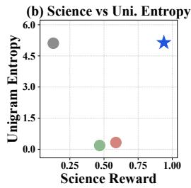

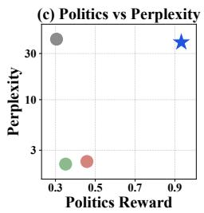  
ELF (Base) FAV-B Flow-GRPO NPO (Ours)

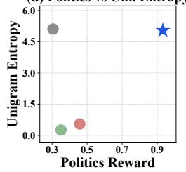  
Figure 6: Reward-quality trade-off of NPO against direct fine-tuning on the topic-steering task. NPO maintains perplexity and entropy comparable to those of the base model while achieving higher reward than the baselines. (a) Science (b) Politics

<table><tr><td>Method</td><td>Reward</td><td>NFE</td><td>Time (s)</td><td>Rel. cost</td></tr><tr><td>ELF (Base)</td><td>0.148</td><td>4</td><td>0.03</td><td>1.0×</td></tr><tr><td>BoN-64</td><td>0.960</td><td>256</td><td>5.87</td><td>218.2×</td></tr><tr><td>ZeNO</td><td>0.550</td><td>1,928</td><td>38.41</td><td>1427.8×</td></tr><tr><td>NPO (Ours)</td><td>0.951</td><td>4</td><td>0.07</td><td>2.5×</td></tr></table>

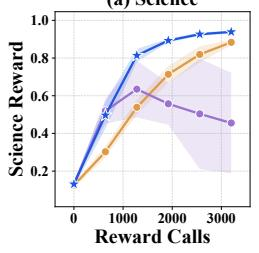  
(a) Comparison with test-time search methods.

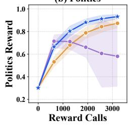  
(b) Learning curves of noise-policy learning methods.  
Figure 7: Results on the topic-steering task with ELF. (a) NPO achieves comparable reward to testtime search methods with only four generator evaluations. (b) NPO learns to generate high-reward samples more efficiently than noise-policy learning baselines.

NPO preserves fast inference by amortizing test-time search. Figure 7a compares NPO with test-time search methods. NPO achieves competitive scores while generating samples 84 to 549× faster. This shows that NPO effectively amortizes the cost of test-time search into training.

NPO improves training efficiency with ELBO-based likelihood estimation. Figure 7b compares the learning curves of NPO and noise-policy learning baselines. Across both topics, NPO achieves higher reward than the baselines under the same reward-evaluation budget. This shows that ELBObased likelihood estimation enables more efficient noise-policy optimization.

## 5.3 PROTEIN STRUCTURE GENERATION

Several works have been developed to utilize few-step generative models for protein backbone generation (Xie et al., 2025; Woo et al., 2026). However, protein generative models tend to under-sample β-sheet-rich structures, limiting the diversity of generated secondary structures (Venkatraman et al., 2025; Su et al., 2026). Therefore, we evaluate NPO on protein structure tasks to promote diverse secondary structures with increased β-sheet content. Additional details are provided in Appendix F.

## 5.3.1 EXPERIMENTAL SETUP

We use the five-step protein backbone generator of Xie et al. (2025) as a base pretrained model. Following Venkatraman et al. (2025), we use the secondary-structure diversity reward

$$
r _ { \mathrm { d i v } } ( x ) = \frac { e ^ { - 1 . 2 } w ^ { \top } p } { 1 . 2 - H [ p ] } , \qquad w = [ 1 , 2 , 0 . 5 ] ,\tag{8}
$$

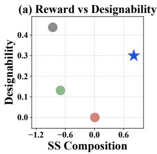

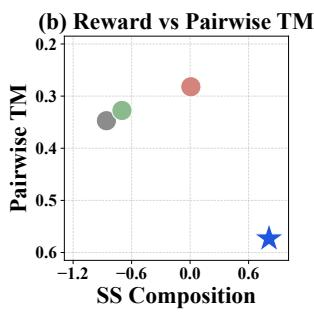

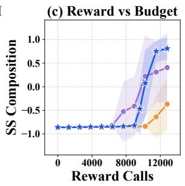  
Pretrained (Base) FAV-B Flow-GRPO Noise Flow-GRPO ODS NPO (Ours)

Figure 8: Comparison of NPO against baselines on biological structure generation. NPO achieves a better reward-quality trade-off and training efficiency than the baselines.

where $p = [ p _ { \alpha } , p _ { \beta } , p _ { c } ]$ denotes the proportions of residues in α-helices, β-sheets, and coils, respectively, and $H [ p ]$ is the entropy of $p .$ We optimize and report log $r _ { \mathrm { d i v } } ( x )$ , termed SS composition, which favors diverse secondary-structure compositions with additional emphasis on β-sheet content. To evaluate sample quality, we report designability and pairwise TM-score. Designability measures whether generated backbones can be self-consistently realized by designed amino-acid sequences, serving as a measure of plausibility. Pairwise TM-score measures structural similarity among backbones, with lower values indicating higher diversity.

## 5.3.2 RESULTS

NPO improves reward while preserving sample quality. Panels (a) and (b) of Figure 8 compare NPO with direct fine-tuning methods. Direct fine-tuning baselines achieve only limited reward improvements, while dramatically degrading designability. In particular, Flow-GRPO reduces designability to zero, meaning that none of the generated backbones are designable. In contrast, NPO substantially improves the reward while retaining much higher designability. Overall, NPO achieves a better reward–sample quality trade-off than direct fine-tuning.

NPO amortizes the cost of test-time noise optimization. Table 2 compares NPO with test-time optimization methods. NPO achieves a higher target reward while generating samples approximately 118–151× faster than the test-time baselines. These results show that NPO effectively amortizes test-time search into training, achieving higher reward at substantially lower inference cost.

<table><tr><td>Method</td><td>SS Composition</td><td>NFE</td><td>Time (s)</td><td>Rel. cost</td></tr><tr><td>SiD-Protein (Base)</td><td>-0.84</td><td>5</td><td>0.07</td><td>1.0×</td></tr><tr><td>BoN-256</td><td>-0.28</td><td>1,280</td><td>17.71</td><td>259.6×</td></tr><tr><td>ZeNO</td><td>-0.72</td><td>2,410</td><td>22.72</td><td>333.1×</td></tr><tr><td>NPO (Ours)</td><td>0.74</td><td>5</td><td>0.15</td><td>2.2×</td></tr></table>

Table 2: Comparison of NPO with test-time search on biological structure generation tasks. NPO achieves the highest composition score with five evaluations.

Efficiency of NPO compared to noise-policy baselines. Panel (c) of Figure 8 compares NPO with noise-policy learning baselines. NPO achieves higher target reward under the same rewardevaluation budget, consistently demonstrating that ELBO-based training improves sample efficiency.

## 6 CONCLUSION

We study reward alignment of few-step generative models without access to reward gradients. We introduce Noise Policy Optimization (NPO), which keeps the pretrained generator frozen and learn an amortized flow policy over its input noise to sample from a reward-tilted noise distribution. NPO further uses ELBO-based likelihood estimation to avoid dependence on trajectory-based objectives. Extensive experiments across image, language, and protein generation confirm that NPO provides an effective way to adapt few-step generators while preserving their sample quality and fast inference.

Limitation and future works. Although the noise policy is lightweight, it still requires about 2.2- 2.6× the inference cost of the frozen generator. Distilling the noise policy into a one-step or few-step map could further reduce this overhead to nearly match the speed of the frozen generator.

## AI USE STATEMENT

We use large language models (LLMs) only for two auxiliary tasks: (1) minor polishing of the manuscript text for improving grammar and readability, and (2) limited assistance in code implementation for debugging syntax or refactoring functions. LLMs did not contribute to the research problem formulation, core methodology, or the design of experiments. All critical ideas, methods, and analyses presented in this paper are the original work of the authors.

## REFERENCES

Xinyue Ai, Yutong Kelly He, Albert Gu, Russ Salakhutdinov, Zico Kolter, Nicholas Boffi, and Max Simchowitz. Joint distillation for fast likelihood evaluation and sampling in flow-based models. In International Conference on Learning Representations, volume 2026, pp. 44940–44977, 2026.

Kevin Black, Michael Janner, Yilun Du, Ilya Kostrikov, and Sergey Levine. Training diffusion models with reinforcement learning. In International Conference on Learning Representations, volume 2024, pp. 4965–4987, 2024.

Nicholas Boffi, Michael Albergo, and Eric Vanden-Eijnden. How to build a consistency model: Learning flow maps via self-distillation. Advances in Neural Information Processing Systems, 38: 33346–33382, 2026.

Nicholas Matthew Boffi, Michael Samuel Albergo, and Eric Vanden-Eijnden. Flow map matching with stochastic interpolants: A mathematical framework for consistency models. Transactions on Machine Learning Research, 2025. ISSN 2835-8856. URL https://openreview.net/ forum?id=cqDH0e6ak2.

Changgu Chen, Libing Yang, Xiaoyan Yang, Lianggangxu Chen, Gaoqi He, Changbo Wang, and Yang Li. FIND: Fine-tuning initial noise distribution with policy optimization for diffusion models. In Proceedings of the 32nd ACM International Conference on Multimedia, pp. 6735–6744, 2024.

Junsong Chen, Shuchen Xue, Yuyang Zhao, Jincheng Yu, Sayak Paul, Junyu Chen, Han Cai, Song Han, and Enze Xie. SANA-Sprint: One-step diffusion with continuous-time consistency distillation. arXiv preprint arXiv:2503.09641, 2025.

Jaemoo Choi, Yuchen Zhu, Wei Guo, Petr Molodyk, Bo Yuan, Jinbin Bai, Yi Xin, Molei Tao, and Yongxin Chen. Rethinking the design space of reinforcement learning for diffusion models: On the importance of likelihood estimation beyond loss design. In Forty-third International Conference on Machine Learning, 2026. URL https://openreview.net/forum?id= 3mJ9eTU319.

Justas Dauparas, Ivan Anishchenko, Nathaniel Bennett, Hua Bai, Robert J Ragotte, Lukas F Milles, Basile IM Wicky, Alexis Courbet, Rob J de Haas, Neville Bethel, et al. Robust deep learning– based protein sequence design using ProteinMPNN. Science, 378(6615):49–56, 2022.

Xintong Duan, Yutong Kelly He, Fahim Tajwar, Russ Salakhutdinov, Zico Kolter, and Jeff Schneider. Accelerating diffusion planners in offline RL via reward-aware consistency trajectory distillation. In International Conference on Learning Representations, volume 2026, pp. 85654–85671, 2026.

Luca Eyring, Shyamgopal Karthik, Karsten Roth, Alexey Dosovitskiy, and Zeynep Akata. ReNO: Enhancing one-step text-to-image models through reward-based noise optimization. Advances in Neural Information Processing Systems, 37:125487–125519, 2024.

Luca Eyring, Shyamgopal Karthik, Alexey Dosovitskiy, Nataniel Ruiz, and Zeynep Akata. Noise hypernetworks: Amortizing test-time compute in diffusion models. Advances in Neural Information Processing Systems, 38:95429–95462, 2026.

Ying Fan, Olivia Watkins, Yuqing Du, Hao Liu, Moonkyung Ryu, Craig Boutilier, Pieter Abbeel, Mohammad Ghavamzadeh, Kangwook Lee, and Kimin Lee. DPOK: Reinforcement learning for fine-tuning text-to-image diffusion models. Advances in Neural Information Processing Systems, 36:79858–79885, 2023.

Kevin Frans, Danijar Hafner, Sergey Levine, and Pieter Abbeel. One step diffusion via shortcut models. In International Conference on Learning Representations, volume 2025, pp. 34668– 34684, 2025.

Tomas Geffner, Kieran Didi, Zuobai Zhang, Danny Reidenbach, Zhonglin Cao, Jason Yim, Mario Geiger, Christian Dallago, Emine Kucukbenli, Arash Vahdat, et al. Proteina: Scaling flow-based protein structure generative models. In International Conference on Learning Representations, volume 2025, pp. 98803–98851, 2025.

Zhengyang Geng, Ashwini Pokle, Weijian Luo, Justin Lin, and Zico Kolter. Consistency models made easy. In International Conference on Learning Representations, volume 2025, pp. 75158– 75185, 2025.

Zhengyang Geng, Mingyang Deng, Xingjian Bai, Zico Kolter, and Kaiming He. Mean flows for one-step generative modeling. Advances in Neural Information Processing Systems, 38:75460– 75482, 2026.

Pengcheng He, Jianfeng Gao, and Weizhu Chen. DeBERTaV3: Improving DeBERTa using ELECTRA-style pre-training with gradient-disentangled embedding sharing. arXiv preprint arXiv:2111.09543, 2021.

Jonathan Ho, Ajay Jain, and Pieter Abbeel. Denoising diffusion probabilistic models. Advances in neural information processing systems, 33:6840–6851, 2020.

Edward J Hu, yelong shen, Phillip Wallis, Zeyuan Allen-Zhu, Yuanzhi Li, Shean Wang, Lu Wang, and Weizhu Chen. LoRA: Low-rank adaptation of large language models. In International Conference on Learning Representations, 2022. URL https://openreview.net/forum? id=nZeVKeeFYf9.

Keya Hu, Linlu Qiu, Yiyang Lu, Hanhong Zhao, Tianhong Li, Yoon Kim, Jacob Andreas, and Kaiming He. ELF: Embedded language flows. arXiv preprint arXiv:2605.10938, 2026.

Hyeongyu Kang, Jaewoo Lee, Woocheol Shin, Kiyoung Om, and Jinkyoo Park. Diffusion finetuning via reparameterized policy gradient of the soft q-function. In International Conference on Learning Representations, volume 2026, pp. 78690–78725, 2026.

Tero Karras, Miika Aittala, Timo Aila, and Samuli Laine. Elucidating the design space of diffusionbased generative models. Advances in neural information processing systems, 35:26565–26577, 2022.

Shyamgopal Karthik, Karsten Roth, Massimiliano Mancini, and Zeynep Akata. If at first you don’t succeed, try, try again: Faithful diffusion-based text-to-image generation by selection. arXiv preprint arXiv:2305.13308, 2023.

Dongjun Kim, Chieh-Hsin Lai, WeiHsiang Liao, Naoki Murata, Yuhta Takida, Toshimitsu Uesaka, Yutong He, Yuki Mitsufuji, and Stefano Ermon. Consistency trajectory models: Learning probability flow ODE trajectory of diffusion. In International Conference on Learning Representations, volume 2024, pp. 44493–44525, 2024.

Jeongsol Kim, Hongeun Kim, Jian Wang, and Jong Chul Ye. Gradient-free noise optimization for reward alignment in generative models. arXiv preprint arXiv:2605.11347, 2026.

Gilles Labesse, Nathalie Colloc’h, Joel Pothier, and J-P Mornon. P-SEA: a new efficient assignment¨ of secondary structure from Cα trace of proteins. Bioinformatics, 13(3):291–295, 1997.

Chanhyuk Lee, Jaehoon Yoo, Manan Agarwal, Sheel Shah, Jerry Huang, Aditi Raghunathan, Seunghoon Hong, Nicholas M Boffi, and Jinwoo Kim. Flow map language models: One-step language modeling via continuous denoising. arXiv preprint arXiv:2602.16813, 2026a.

Jaewoo Lee, Hyeongyu Kang, Dohyun Kim, Kyuil Sim, Woocheol Shin, Minsu Kim, Taeyoung Yun, Jeongjae Lee, Sanghyeok Choi, Tabitha Edith Lee, Jong Chul Ye, and Jinkyoo Park. Aligning few-step generative model via amortizing sample-based variational inference. In ICML 2026 Workshop on Structured Probabilistic Inference & Generative Modeling, 2026b. URL https: //openreview.net/forum?id=5CNn617yWW.

Jaewoo Lee, Minsu Kim, Sanghyeok Choi, Inhyuck Song, Sujin Yun, Hyeongyu Kang, Woocheol Shin, Taeyoung Yun, Kiyoung Om, and Jinkyoo Park. Diffusion alignment as variational expectation-maximization. In International Conference on Learning Representations, volume 2026, pp. 31062–31093, 2026c.

Zeming Lin, Halil Akin, Roshan Rao, Brian Hie, Zhongkai Zhu, Wenting Lu, Nikita Smetanin, Robert Verkuil, Ori Kabeli, Yaniv Shmueli, et al. Evolutionary-scale prediction of atomic-level protein structure with a language model. Science, 379(6637):1123–1130, 2023.

Yaron Lipman, Ricky T. Q. Chen, Heli Ben-Hamu, Maximilian Nickel, and Matthew Le. Flow matching for generative modeling. In The Eleventh International Conference on Learning Representations, 2023. URL https://openreview.net/forum?id=PqvMRDCJT9t.

Jie Liu, Gongye Liu, Jiajun Liang, Yangguang Li, Jiaheng Liu, Xintao Wang, Pengfei Wan, Di Zhang, and Wanli Ouyang. Flow-GRPO: Training flow matching models via online RL. Advances in neural information processing systems, 38:40783–40818, 2026.

Ilya Loshchilov and Frank Hutter. Decoupled weight decay regularization. In International Conference on Learning Representations, 2019. URL https://openreview.net/forum?id= Bkg6RiCqY7.

Simian Luo, Yiqin Tan, Longbo Huang, Jian Li, and Hang Zhao. Latent consistency models: Synthesizing high-resolution images with few-step inference. arXiv preprint arXiv:2310.04378, 2023a.

Weijian Luo, Tianyang Hu, Shifeng Zhang, Jiacheng Sun, Zhenguo Li, and Zhihua Zhang. Diff-Instruct: A universal approach for transferring knowledge from pre-trained diffusion models. Advances in Neural Information Processing Systems, 36:76525–76546, 2023b.

Nanye Ma, Shangyuan Tong, Haolin Jia, Hexiang Hu, Yu-Chuan Su, Mingda Zhang, Xuan Yang, Yandong Li, Tommi Jaakkola, Xuhui Jia, et al. Inference-time scaling for diffusion models beyond scaling denoising steps. arXiv preprint arXiv:2501.09732, 2025.

Abbas Mammadov, So Takao, Bohan Chen, Ricardo Baptista, Morteza Mardani, Yee Whye Teh, and Julius Berner. Variational flow maps: Make some noise for one-step conditional generation. In Forty-third International Conference on Machine Learning, 2026. URL https: //openreview.net/forum?id=XHI7FCd1w1.

Yanting Miao, William Loh, Pascal Poupart, and Suraj Kothawade. A minimalist method for finetuning text-to-image diffusion models. arXiv preprint arXiv:2506.12036, 2025.

Yunhong Min, Daehyeon Choi, Kyeongmin Yeo, Jihyun Lee, and Minhyuk Sung. ORIGEN: Zeroshot 3D orientation grounding in text-to-image generation. Advances in Neural Information Processing Systems, 38:151684–151717, 2026.

Owen Oertell, Jonathan D Chang, Yiyi Zhang, Kiante Brantley, and Wen Sun. RL for consistency ´ models: Faster reward guided text-to-image generation. arXiv preprint arXiv:2404.03673, 2024.

RuiKang OuYang, Hanlin Yu, Xinyue Ai, Yutong He, Nicholas Matthew Boffi, Pradeep Ravikumar, Jose Miguel Hern´ andez-Lobato, Max Simchowitz, Benjamin Kurt Miller, and Omar´ Chehab. Few-step boltzmann generators via scalable likelihood flow maps. In ICML 2026 Workshop on Structured Probabilistic Inference & Generative Modeling, 2026. URL https: //openreview.net/forum?id=mfdTHHRIid.

William Peebles and Saining Xie. Scalable diffusion models with transformers. In 2023 IEEE/CVF International Conference on Computer Vision (ICCV), pp. 4172–4182. IEEE, 2023.

Peter Potaptchik, Adhi Saravanan, Abbas Mammadov, Alvaro Prat, Michael S Albergo, and Yee Whye Teh. Meta flow maps enable scalable reward alignment. arXiv preprint arXiv:2601.14430, 2026.

Mihir Prabhudesai, Anirudh Goyal, Deepak Pathak, and Katerina Fragkiadaki. Aligning text-toimage diffusion models with reward backpropagation. arXiv preprint arXiv:2310.03739, 2023.

Alec Radford, Jeffrey Wu, Rewon Child, David Luan, Dario Amodei, Ilya Sutskever, et al. Language models are unsupervised multitask learners. OpenAI blog, 1(8):9, 2019.

Alec Radford, Jong Wook Kim, Chris Hallacy, Aditya Ramesh, Gabriel Goh, Sandhini Agarwal, Girish Sastry, Amanda Askell, Pamela Mishkin, Jack Clark, et al. Learning transferable visual models from natural language supervision. In International conference on machine learning, pp. 8748–8763. PMLR, 2021.

Axel Sauer, Dominik Lorenz, Andreas Blattmann, and Robin Rombach. Adversarial diffusion distillation. In European Conference on Computer Vision, pp. 87–103. Springer, 2024.

Christoph Schuhmann. LAION aesthetics. URL https://laion.ai/blog/laion-aesthetics/, 2022.

Yang Song and Prafulla Dhariwal. Improved techniques for training consistency models. In Inter national Conference on Learning Representations, volume 2024, pp. 15078–15097, 2024.

Yang Song, Jascha Sohl-Dickstein, Diederik P Kingma, Abhishek Kumar, Stefano Ermon, and Ben Poole. Score-based generative modeling through stochastic differential equations. In International Conference on Learning Representations, 2021.

Yang Song, Prafulla Dhariwal, Mark Chen, and Ilya Sutskever. Consistency models. In Andreas Krause, Emma Brunskill, Kyunghyun Cho, Barbara Engelhardt, Sivan Sabato, and Jonathan Scarlett (eds.), Proceedings of the 40th International Conference on Machine Learning, volume 202 of Proceedings ofMachine Learning Research, pp. 32211–32252. PMLR, 23–29 Jul 2023. URL https://proceedings.mlr.press/v202/song23a.html.

Xingyu Su, Xiner Li, Masatoshi Uehara, Sunwoo Kim, Yulai Zhao, Gabriele Scalia, Ehsan Hajiramezanali, Tommaso Biancalani, Degui Zhi, and Shuiwang Ji. Iterative distillation for rewardguided fine-tuning of diffusion models in biomolecular design. In International Conference on Learning Representations, volume 2026, pp. 139443–139469, 2026.

Siddarth Venkatraman, Mohsin Hasan, Minsu Kim, Luca Scimeca, Marcin Sendera, Yoshua Bengio, Glen Berseth, and Nikolay Malkin. Outsourced diffusion sampling: Efficient posterior inference in latent spaces of generative models. arXiv preprint arXiv:2502.06999, 2025.

Andrew Wagenmaker, Yunchu Zhang, Mitsuhiko Nakamoto, Seohong Park, Waleed Yagoub, Anusha Nagabandi, Abhishek Gupta, and Sergey Levine. Steering your diffusion policy with latent space reinforcement learning. In Joseph Lim, Shuran Song, and Hae-Won Park (eds.), Proceedings of The 9th Conference on Robot Learning, volume 305 of Proceedings of Machine Learning Research, pp. 258–282. PMLR, 27–30 Sep 2025. URL https://proceedings. mlr.press/v305/wagenmaker25a.html.

Adina Williams, Nikita Nangia, and Samuel R Bowman. A broad-coverage challenge corpus for sentence understanding through inference. In Proceedings of the 2018 conference of the North American chapter of the association for computational linguistics: human language technologies, volume 1 (long papers), pp. 1112–1122, 2018.

Dongyeop Woo, Marta Skreta, Seonghyun Park, Kirill Neklyudov, and Sungsoo Ahn. Riemannian meanflow. arXiv preprint arXiv:2602.07744, 2026.

Liyang Xie, Haoran Zhang, Zhendong Wang, Wesley Tansey, and Mingyuan Zhou. Distilled protein backbone generation. arXiv preprint arXiv:2510.03095, 2025.

Jiazheng Xu, Xiao Liu, Yuchen Wu, Yuxuan Tong, Qinkai Li, Ming Ding, Jie Tang, and Yuxiao Dong. ImageReward: Learning and evaluating human preferences for text-to-image generation. Advances in Neural Information Processing Systems, 36:15903–15935, 2023.

Shuchen Xue, Chongjian Ge, Shilong Zhang, Yichen Li, and Zhi-Ming Ma. Advantage weighted matching: Aligning RL with pretraining in diffusion models. arXiv preprint arXiv:2509.25050, 2025.

Tianwei Yin, Michael Gharbi, Richard Zhang, Eli Shechtman, Fredo Durand, William T Freeman, ¨ and Taesung Park. One-step diffusion with distribution matching distillation. In 2024 IEEE/CVF Conference on Computer Vision and Pattern Recognition (CVPR), pp. 6613–6623. IEEE, 2024.

Taehoon Yoon, Yunhong Min, Kyeongmin Yeo, and Minhyuk Sung. ψ-sampler: Initial particle sampling for SMC-based inference-time reward alignment in score models. Advances in Neural Information Processing Systems, 38:104745–104781, 2026.

Richard Zhang, Phillip Isola, Alexei A Efros, Eli Shechtman, and Oliver Wang. The unreasonable effectiveness of deep features as a perceptual metric. In 2018 IEEE/CVF conference on computer vision and pattern recognition, pp. 586–595. IEEE, 2018.

Yang Zhang and Jeffrey Skolnick. Scoring function for automated assessment of protein structure template quality. Proteins: Structure, Function, and Bioinformatics, 57(4):702–710, 2004.

Yang Zhang and Jeffrey Skolnick. TM-align: a protein structure alignment algorithm based on the TM-score. Nucleic acids research, 33(7):2302–2309, 2005.

Ziyi Zhang, Sen Zhang, Yibing Zhan, Yong Luo, Yonggang Wen, and Dacheng Tao. Confronting reward overoptimization for diffusion models: A perspective of inductive and primacy biases. In Ruslan Salakhutdinov, Zico Kolter, Katherine Heller, Adrian Weller, Nuria Oliver, Jonathan Scarlett, and Felix Berkenkamp (eds.), Proceedings of the 41st International Conference on Machine Learning, volume 235 of Proceedings of Machine Learning Research, pp. 60396–60413. PMLR, 21–27 Jul 2024. URL https://proceedings.mlr.press/v235/zhang24ch.html.

Kaiwen Zheng, Huayu Chen, Haotian Ye, Haoxiang Wang, Qinsheng Zhang, Kai Jiang, Hang Su, Stefano Ermon, Jun Zhu, and Ming-Yu Liu. DiffusionNFT: Online diffusion reinforcement with forward process. In International Conference on Learning Representations, volume 2026, pp. 134129–134150, 2026.

## A REWARD-TILTED TARGET DISTRIBUTIONS

## A.1 SOLUTION TO KL-REGULARIZED REWARD MAXIMIZATION

Let $\mu$ be a reference distribution, $F ( y )$ a reward function, and $\alpha \ > \ 0$ Define $\begin{array} { r l } { Z _ { F } } & { { } = } \end{array}$ $\mathbb { E } _ { y \sim \dot { \mu } } [ \exp ( F ( y ) / \alpha ) ]$ , and assume that $0 < Z _ { F } < \infty$ and that the required reward expectations and KL divergences are finite. For

$$
J ( \nu ) = \mathbb { E } _ { y \sim \nu } { [ F ( y ) ] } - \alpha D _ { \mathrm { K L } } ( \nu | | \mu ) ,
$$

define the reward-tilted distribution $\nu ^ { \star } ( y ) = \mu ( y ) \exp ( F ( y ) / \alpha ) / Z _ { F }$ . Substituting its definition gives

$$
\begin{array} { r } { J ( \nu ) = \alpha \log Z _ { F } - \alpha D _ { \mathrm { K L } } ( \nu \| \nu ^ { \star } ) . } \end{array}\tag{A.1}
$$

Hence, maximizing $J ( \nu )$ is equivalent to minimizing $D _ { \mathrm { K L } } ( \nu \| \nu ^ { \star } )$ , and the optimal solution is $\nu =$ $\nu ^ { \star }$ . We apply this result to the output and noise spaces as follows.

Output-space target. Setting $y = x , \mu = p _ { \mathrm { b a s e } } ,$ , and $F ( x ) = r ( x )$ yields the reward-tilted output distribution $p ^ { \star }$ in Equation (1), with $Z _ { F } = Z$

Noise-space target. Setting $y = z , \mu = q _ { \mathrm { b a s e } }$ , and $F ( z ) = r ( g _ { \boldsymbol { \theta } } ( z ) )$ yields the reward-tilted noise distribution $q ^ { \star }$ in Equation $( 4 )$ , with the same normalizer $Z$

## A.2 PROOF OF THE NOISE-SPACE PUSHFORWARD IDENTITY

We show that $g _ { \theta \# } q ^ { \star } = p ^ { \star }$ . For any bounded measurable function $f ,$

$$
\begin{array} { l } { \displaystyle \mathbb { E } _ { z \sim q ^ { \star } } \big [ f ( g _ { \theta } ( z ) ) \big ] = \frac { 1 } { Z } \mathbb { E } _ { z \sim q _ { \mathrm { b a s e } } } \Big [ f ( g _ { \theta } ( z ) ) e ^ { r ( g _ { \theta } ( z ) ) / \alpha } \Big ] } \\ { \displaystyle \quad = \frac { 1 } { Z } \mathbb { E } _ { x \sim p _ { \mathrm { b a s e } } } \Big [ f ( x ) e ^ { r ( x ) / \alpha } \Big ] = \mathbb { E } _ { x \sim p ^ { \star } } \big [ f ( x ) \big ] . } \end{array}\tag{A.2}
$$

The second equality follows from $p _ { \mathrm { b a s e } } = g _ { \theta \# } q _ { \mathrm { b a s e } }$ . Since the equality holds for every bounded measurable $f ,$ , we obtain $g _ { \boldsymbol { \theta } \# } \boldsymbol { q } ^ { \star } = \boldsymbol { p } ^ { \star }$

## B IMPLEMENTATION DETAILS OF NPO

This section describes the implementation details of NPO: the reference flow (Appendix B.1), the reference regularization (Appendix B.2), the estimation of the ELBO-based likelihood (Appendix B.3), and the architecture and training of the noise policy (Appendix B.4).

## B.1 REFERENCE FLOW

To construct the Gaussian reference flow, let $\xi , \epsilon \overset { \mathrm { i . i . d . } } { \sim } \mathcal { N } ( 0 , I )$ and consider $z _ { t } = a _ { t } \xi + \sigma _ { t } \epsilon$ . Its conditional velocity is $\dot { a } _ { t } \xi + \dot { \sigma } _ { t } \epsilon .$ , and taking the conditional expectation given $z _ { t }$ gives

$$
v _ { \mathrm { r e f } } ( z _ { t } , t ) = \frac { a _ { t } \dot { a } _ { t } + \sigma _ { t } \dot { \sigma } _ { t } } { a _ { t } ^ { 2 } + \sigma _ { t } ^ { 2 } } z _ { t } ,\tag{B.1}
$$

which has $q _ { \mathrm { b a s e } } = \mathcal { N } ( 0 , I )$ at both $t = 0$ and $t = 1$ . We use the linear interpolation $a _ { t } = 1 - t$ and $\sigma _ { t } = t ,$ which gives $\begin{array} { r } { v _ { \mathrm { r e f } } ( z _ { t } , t ) ~ = ~ \frac { 2 t - 1 } { ( 1 - t ) ^ { 2 } + t ^ { 2 } } z _ { t } } \end{array}$ The variance-preserving interpolation $a _ { t } =$ cos(πt/2) and $\sigma _ { t } = \sin ( \pi t / 2 )$ , which gives $v _ { \mathrm { r e f } } = 0$ , is compared in Appendix G.2.

## B.2 REFERENCE REGULARIZATION

The KL divergence in Equation (5) can be approximated through the Girsanov theorem as a weighted velocity difference between the policy and the reference flow,

$$
D _ { \mathrm { K L } } ( q _ { \psi } | | q _ { \mathrm { b a s e } } ) \approx \mathbb { E } _ { t } \mathbb { E } _ { z _ { t } } [ w _ { \mathrm { K L } } ( t ) | | v _ { \psi } ( z _ { t } , t ) - v _ { \mathrm { r e f } } ( z _ { t } , t ) | | _ { 2 } ^ { 2 } ] ,\tag{B.2}
$$

where the weight $w _ { \mathrm { K L } } ( t )$ is determined by the interpolation schedule. As in prior work (Choi et al., 2026; Zheng et al., 2026; Xue et al., 2025), we use the uniform approximation $w _ { \mathrm { K L } } ( t ) = 1$ . We additionally scale this penalty by a constant coefficient $\lambda _ { \mathrm { r e f } } > 0$ , which gives the reference term $\lambda _ { \mathrm { r e f } } \| v _ { \psi } ( z _ { t } , t ) - v _ { \mathrm { r e f } } ( \bar { z _ { t } } , t ) \| _ { 2 } ^ { 2 }$ in Equation (7). The value of $\lambda _ { \mathrm { r e f } }$ is chosen separately for each experiment and is specified in Appendices D to F. Other values of $\lambda _ { \mathrm { r e f } }$ are compared in Appendix G.2.

## B.3 ELBO WEIGHTING AND ESTIMATION

The ELBO-based likelihood estimator in Equation (6) uses the regression score $\ell _ { \psi } ( z _ { 0 } ; t , \epsilon ) \ =$ $w ( t ) \lVert v _ { \psi } ( z _ { t } , t ) - u _ { t } \rVert _ { 2 } ^ { 2 }$ , where $z _ { t } = a _ { t } z _ { 0 } + \sigma _ { t } \epsilon$ and $u _ { t } = \dot { a } _ { t } z _ { 0 } + \dot { \sigma } _ { t } \epsilon$ with $t \sim \mathcal { U } ( 0 , 1 )$ and $\epsilon \sim \mathcal { N } ( 0 , I )$ Estimators differ mainly in the weighting w(t), and following Choi et al. (2026) we consider three choices. The path-KL weighting $w ( t ) = ( 1 - t ) / t$ follows from the original derivation of scorebased diffusion models, which simplifies the KL divergence between the forward and reverse path measures (Song et al., 2021). The simple weighting $w ( t ) = 1$ is the constant weighting used in standard diffusion training (Ho et al., 2020). The adaptive weighting self-normalizes the objective for numerical robustness (Yin et al., 2024; Zheng et al., 2026),

$$
\ell _ { \psi } ^ { \mathrm { a d a p t i v e } } = \frac { t \cdot d \cdot \| v _ { \psi } ( z _ { t } , t ) - u _ { t } \| _ { 2 } ^ { 2 } } { \operatorname { s g } ( \| v _ { \psi } ( z _ { t } , t ) - u _ { t } \| _ { 1 } ) } ,\tag{B.3}
$$

where d is the dimension of $z _ { \mathrm { 0 } }$ . We use the adaptive weighting in all experiments. The three weightings are compared in Appendix G.2.

Monte Carlo estimation. The expectation over $( t , \epsilon )$ in Equation (6) is estimated with M independently sampled forward-noising pairs per endpoint,

$$
\mathbb { E } _ { t , \epsilon } \left[ \ell _ { \psi } ( z _ { 0 } ; t , \epsilon ) \right] \approx \frac { 1 } { M } \sum _ { j = 1 } ^ { M } \ell _ { \psi } ( z _ { 0 } ; t _ { j } , \epsilon _ { j } ) .\tag{B.4}
$$

We use $M = 3$ in all experiments. Other values of M are compared in Appendix G.2.

## B.4 NOISE POLICY ARCHITECTURE AND TRAINING

Table 3 lists the architecture and optimization settings of the noise policy. For images, we use a conditional 2D U-Net from diffusers, conditioned on the prompt embedding of the generator’s text encoder through cross-attention. For language and protein backbones, the noise is a

one-dimensional sequence without a spatial grid, so we use a DiT (Peebles & Xie, 2023) whose tokens are the positions of the generator input. The flow time t enters through a sinusoidal embedding in both architectures. Within each domain, NPO and the noise-policy baselines, Noise Flow-GRPO and ODS, use the same backbone. We draw endpoints $z _ { 0 } \sim q _ { \psi }$ by integrating the policy flow from $z _ { 1 } \sim q _ { \mathrm { b a s e } }$ with a Heun solver (Karras et al., 2022). We train the policy with AdamW (Loshchilov & Hutter, 2019) and set the EMA decay in Algorithm 1 to $\gamma _ { k }$ at round k. The learning rate and $\lambda _ { \mathrm { r e f } }$ are specified per domain in Appendices D to F, and the batch size in Appendix C.
<table><tr><td colspan="4">Domain-specific</td></tr><tr><td></td><td>Image</td><td>Language</td><td>Protein</td></tr><tr><td>Backbone Channel widths / hidden size</td><td>U-Net (48, 96, 192)</td><td>DiT 256</td><td>DiT 256</td></tr><tr><td>Layers</td><td>2 per resolution</td><td>depth 6, 4 heads</td><td>depth 6, 4 heads</td></tr><tr><td>Weight decay</td><td> $1 0 ^ { - 4 }$ </td><td> $1 0 ^ { - 4 }$ </td><td>0</td></tr><tr><td colspan="4">Shared across domains</td></tr><tr><td>Policy solver</td><td></td><td>Heun, 10 steps</td><td></td></tr><tr><td></td><td colspan="3">AdamW,  $( \beta _ { 1 } , \beta _ { 2 } ) = ( 0 . 9 , 0 . 9 9 9 )$ </td></tr><tr><td>Optimizer Gradient-norm clipping</td><td colspan="3">5.0</td></tr><tr><td>Gradient updates per round</td><td colspan="3">1</td></tr><tr><td>EMA decay γk</td><td colspan="3"></td></tr><tr><td>Interpolation / ELBO weighting / M</td><td colspan="3">min(0.001 k, 0.5) linear / adaptive / 3</td></tr></table>

Table 3: Architecture and optimization settings of the noise policy.

## C IMPLEMENTATION OF THE BASELINES

We reimplement all baselines in our experimental framework, using their official implementations as references when available. For ZeNO, whose official implementation is not publicly available, we follow the algorithm of Kim et al. (2026). Within each domain, all methods share the generator, the reward, and the evaluation protocol. Noise Flow-GRPO and ODS use the noise-policy backbone of NPO (Table 3). Flow-GRPO and FAV-B fine-tune the attention layers of the generator with LoRA (Hu et al., 2022). We set the LoRA scale to $\alpha = 2 r$ and choose the rank r so that the number of trainable parameters matches that of the noise policy (Table 4). All methods except FAV-B draw 64 samples per training step. For images, NPO, Noise Flow-GRPO, and Flow-GRPO use $B = 8$ prompts with a group of $G = 8$ samples each, and ODS uses 64 prompts with one sample each. The language and protein generators are unconditional, and all methods draw 64 samples per step.

<table><tr><td>Generator</td><td>LoRA rank r</td><td>LoRA parameters</td><td>Noise-policy parameters</td></tr><tr><td>SANA-Sprint</td><td>28</td><td>14.45M</td><td>14.43M</td></tr><tr><td>SD-Turbo</td><td>68</td><td>14.11M</td><td>14.16M</td></tr><tr><td>ELF</td><td>137</td><td>7.58M</td><td>7.58M</td></tr><tr><td>Protein</td><td>106</td><td>7.33M</td><td>7.32M</td></tr></table>

Table 4: LoRA rank of the direct baselines and the resulting number of trainable parameters.

Noise Flow-GRPO. Noise Flow-GRPO trains the noise policy with the GRPO objective of Liu et al. (2026), with the reference flow of Appendix B.1 as the reference model. During training, it samples the policy flow with a 10-step Euler–Maruyama discretization of an SDE with noise level $a = 0 . 7 ,$ , and it clips the importance ratio at $\epsilon = 1 \mathrm { e } { \cdot } 4 .$ . At evaluation, it samples the policy flow with a 10-step Heun solver. We train with AdamW, $( \beta _ { 1 } , \beta _ { 2 } ) = ( 0 . 9 , 0 . 9 9 9 )$ ), weight decay $\mathrm { i 0 ^ { - 4 } }$ (0 for proteins), and gradient-norm clipping at 1.0 (5.0 for proteins).

Flow-GRPO. Flow-GRPO fine-tunes the generator with the GRPO objective of Liu et al. (2026), with the frozen generator as the reference model. To obtain transition likelihoods, we add Gaussian noise after each sampling step for multi-step sampling and to the output for one-step sampling. We clip the importance ratio at $\epsilon = 0 . 2$ for images and $\epsilon = 1 \mathrm { e } { \cdot } 4$ otherwise. At evaluation, the generator samples without the added noise. We train with AdamW, $( \beta _ { 1 } , \beta _ { 2 } ) = ( 0 . 9 , 0 . 9 9 9 )$ , weight decay $1 0 ^ { - \hat { 4 } }$ , and gradient-norm clipping at 1.0.

FAV-B. We follow the black-box variant of Lee et al. (2026b). For each of C conditions, FAV-B draws K particles from the fine-tuned generator and K particles from the frozen generator. It estimates the reward gradient at each particle with an antithetic evolution-strategies estimate over N random perturbations of scale σ, which costs $K ( 2 N + 1 )$ reward calls per condition. It adds $\beta$ times this gradient to the kernel density estimate of the prior score and regresses the LoRA onto the particles moved by the resulting velocity. We use $K = 8$ and $N = 4$ , with $C = 4$ and $\sigma = 0 . 1$ for images, $C = 1$ and $\sigma = 0 . 1$ for language, and $C = 1 , N = 1 6 .$ , and σ equal to $0 . 0 1$ times the particle scale for proteins. The kernel bandwidths follow the median heuristic. We train with AdamW, $( \beta _ { 1 } , \beta _ { 2 } ) = ( \bar { 0 } . 9 , 0 . 9 5 )$ ), weight decay 0.01, and gradient-norm clipping at 2.0.

ODS. We follow Venkatraman et al. (2025) and use the noise-policy backbone of NPO as the score network. ODS samples the noise with a 25-step Euler–Maruyama discretization of a cosine variance-preserving SDE, during training and at evaluation. It trains with the relative trajectory balance objective toward $q _ { \mathrm { b a s e } } ( \overline { { z } } ) r ( g _ { \theta } ( \overline { { z } } ) ) ^ { \beta }$ and sets log Z to the batch mean. Each step draws trajectories from the prior with probability 0.2, from a uniform replay buffer of size 10,000 with probability 0.2, and from the current policy otherwise. We use $\log ( r + 2 )$ for compressibility and the exponential of the secondary-structure diversity score for proteins so that log r is defined. We train with Adam and gradient-norm clipping at 0.1.

Test-time baselines. Best-of-N (BoN), ReNO (Eyring et al., 2024), and ZeNO (Kim et al., 2026) search the initial noise of each sample at inference time and leave the generator unchanged. For each method, we search as many samples as the evaluation protocol of each domain uses and evaluate them in the same way as the other methods.

• BoN draws N initial noises for each sample and keeps the one with the highest reward.

• ReNO optimizes the initial noise by gradient ascent on the reward, which requires a differentiable reward, so we run it only on SD-Turbo with one sampling step under the aesthetic reward. We use the default hyperparameters of Eyring et al. (2024): SGD with Nesterov momentum 0.9, learning rate 5.0, gradient-norm clipping at 0.1, and a norm regularization weight of 0.01.

• ZeNO optimizes the initial noise with a zeroth-order estimate of the reward gradient. We use the default hyperparameters of Kim et al. (2026), β = 0.01, η = 1.5, and $N = 1 6$ perturbations per iteration, in all domains.

## D IMAGE EXPERIMENT DETAILS

## D.1 GENERATOR, REWARDS AND EVALUATION METRICS

Generator. We use two frozen text-to-image generators. SANA-Sprint (Chen et al., 2025) is a distilled 0.6B-parameter model that generates 1024 × 1024 images from a $3 2 \times 3 2 \times 3 2$ latent. We run it at one and four sampling steps with guidance scale 4.5. SD-Turbo (Sauer et al., 2024) is an adversarially distilled Stable Diffusion 2.1 model that generates 512×512 images from a $4 \times 6 4 \times 6 4$ latent. We run it at one and four sampling steps.

Target rewards. We use two target rewards. The LAION aesthetic predictor (Schuhmann, 2022) is a linear head on a frozen CLIP image embedding (Radford et al., 2021) and maps an image to a scalar aesthetic score. JPEG compressibility (Black et al., 2024) is the negative file size of the image after JPEG encoding.

Evaluation metrics. We measure semantic collapse with ImageReward (Xu et al., 2023), a learned reward model of prompt–image alignment that no method optimizes. We measure diversity collapse with LPIPS (Zhang et al., 2018), the perceptual distance between two images, averaged over all pairs of samples that share a prompt.

## D.2 HYPERPARAMETERS

The learning rate and the coefficient of each method are swept over the ranges in Table 5. For each method, we select the setting whose target reward rises stably across seeds. Tables 6 and 7 list the selected settings.

<table><tr><td colspan="2">Method Coefficient</td></tr><tr><td colspan="2">SANA-Sprint, learning  $\mathrm { r a t e } \in \{ 3 \mathrm { e } { - } 5 , 1 \mathrm { e } { - } 4 , 3 \mathrm { e } { - } 4 , 1 \mathrm { e } { - } 3 , 3 \mathrm { e } { - } 3 \}$ </td></tr><tr><td>NPO (ours) Noise Flow-GRPO</td><td> $\lambda _ { \mathrm { { r e f } } } \in \{ 0 , 3 \mathrm { { e } } \mathrm { - } 5 , 1 \mathrm { { e } } \mathrm { - } 4 , 3 \mathrm { { e } } \mathrm { - } 4 , 1 \mathrm { { e } } \mathrm { - } 3 \}$   $\beta \in \{ 0 , \mathrm { { 4 e - 3 } , 1 e - 2 , 4 e - 2 , 1 e - 1 } \}$ </td></tr><tr><td>ODS Flow-GRPO FAV-B</td><td> $\beta \in \{ 5 0 , 1 0 0 , 5 0 0 , 1 0 0 0 , 5 0 0 0 \}$   $\beta \in \{ 0 , 1 \mathrm  { e } \mathrm { { - } } 3 , 1 \mathrm { { e } \mathrm { { - } } 2 , 1 \mathrm { { e } \mathrm { { - } } 1 , 1 } \} }$   $\beta \in \{ 1 \mathrm { e } \mathrm { - } 3 , 1 \mathrm { e } \mathrm { - } 2 , 1 \mathrm { e } \mathrm { - } 1 , 1 \}$ </td></tr><tr><td colspan="2">SD-Turbo, learning rate  $\in \{ 1 \mathrm { e } \mathrm { - } 5 , 3 \mathrm { e } \mathrm { - } 5 , 1 \mathrm { e } \mathrm { - } 4 , 3 \mathrm { e } \mathrm { - } 4 , 1 \mathrm { e } \mathrm { - } 3 , 3 \mathrm { e } \mathrm { - } 3 \}$ </td></tr><tr><td>NPO (ours)</td><td> $\lambda _ { \mathrm { { r e f } } } \in \{ 3 \mathrm { { e } } \mathrm { { - } } 5 , 1 \mathrm { { e } } \mathrm { { - } } 4 , 3 \mathrm { { e } } \mathrm { { - } } 4 , 1 \mathrm { { e } } \mathrm { { - } } 3 , 3 \mathrm { { e } } \mathrm { { - } } 3 \}$ </td></tr><tr><td>Noise Flow-GRPO</td><td> $\beta \in \{ 4 \dot { \mathrm { e } } \mathrm { - } 3 , 1 \mathrm { e } \mathrm { - } 2 , 4 \mathrm { e } \mathrm { - } 2 , 1 \mathrm { e } \mathrm { - } 1 \}$ </td></tr><tr><td>ODS</td><td> $\beta \in \{ 5 0 , 1 0 0 , 5 0 0 , 1 0 0 0 , 5 0 0 0 \}$ </td></tr><tr><td>Flow-GRPO FAV-B</td><td> $\beta \in \{ 1 \mathrm { e } \mathrm { - } 3 , 1 \mathrm { e } \mathrm { - } 2 , 1 \mathrm { e } \mathrm { - } 1 , 1 \}$   $\beta \in \{ 1 \mathrm { e } \mathrm { - } 3 , 1 \mathrm { e } \mathrm { - } 2 , 1 \mathrm { e } \mathrm { - } 1 , 1 \}$ </td></tr></table>

Table 5: Swept ranges in the image domain. $\lambda _ { \mathrm { { r e f } } }$ is the reference coefficient of NPO. β is the KL coefficient of Noise Flow-GRPO and Flow-GRPO, the reward exponent of ODS, and the rewardgradient scale of FAV-B.

<table><tr><td></td><td colspan="2">Aesthetic</td><td colspan="2">Compressibility</td></tr><tr><td>Method</td><td>Learning rate</td><td>Coefficient</td><td>Learning rate</td><td>Coefficient</td></tr><tr><td>NPO (ours)</td><td>3e-5</td><td> $\lambda _ { \mathrm { r e f } } = 1 \mathrm { e } { - } 4$ </td><td>3e-5</td><td> $\lambda _ { \mathrm { r e f } } = 3 \mathrm { e } { \mathrm { - } } 4$ </td></tr><tr><td>Noise Flow-GRPO</td><td>3e-5</td><td> $\beta = 1 \mathrm { e } { - 2 }$ </td><td>3e-5</td><td> $\beta = 1 \mathrm { e } { - } 1$ </td></tr><tr><td>ODS</td><td>3e-5</td><td> $\beta = 5 0 0$ </td><td>3e-5</td><td> $\beta = 5 0 0$ </td></tr><tr><td>Flow-GRPO</td><td>3e-4</td><td> $\beta = 1 \mathrm { e } { - 3 }$ </td><td>1e-3</td><td> $\beta = 1 \mathrm { e } { - 3 }$ </td></tr><tr><td>FAV-B</td><td>3e-4</td><td> $\beta = 1$ </td><td>1e-3</td><td>β= 1</td></tr><tr><td>NPO (ours)</td><td>3e-5</td><td> $\lambda _ { \mathrm { r e f } } = 3 \mathrm { e } { - } 4$ </td><td>1e-5</td><td> $\lambda _ { \mathrm { r e f } } = 1 \mathrm { e } { - } 4$ </td></tr><tr><td>Noise Flow-GRPO</td><td>3e-5</td><td> $\beta = 4 \mathrm { e } { - 2 }$ </td><td>1e-5</td><td>β = 1e-1</td></tr><tr><td>ODS</td><td>3e-5</td><td>β = 500</td><td>1e-5</td><td>β = 500</td></tr><tr><td>Flow-GRPO (four steps)</td><td>3e-4</td><td> $\beta = 1 \mathrm { e } { - 2 }$ </td><td>1e-4</td><td>β = 1e-3</td></tr><tr><td>Flow-GRPO (one step)</td><td>3e-4</td><td> $\beta = 1 \mathrm { e } { - 2 }$ </td><td>1e-4</td><td>β = 1e-3</td></tr><tr><td>FAV-B</td><td>1e-4</td><td> $\beta = 1$ </td><td>1e-4</td><td>β = 1</td></tr></table>

Table 6: Selected settings on SANA-Sprint.

Table 7: Selected settings on SD-Turbo.

## D.3 EVALUATION PROTOCOL

We evaluate on 45 simple-animal prompts (Black et al., 2024) with 16 samples per prompt. We score every sample with the target reward and ImageReward and report their means. We compute LPIPS between all pairs of samples that share a prompt and report the mean distance. We run each setting with five seeds and report the mean and standard deviation across seeds.

## E LANGUAGE EXPERIMENT DETAILS

## E.1 GENERATOR, REWARDS AND EVALUATION METRICS

Generator. We use the progressively distilled four-step ELF model (Hu et al., 2026) trained on OpenWebText. The model is unconditional and generates sequences of 1024 tokens from a 1024 × 512 continuous latent. We run it with its probability-flow ODE sampler. ELF draws its sampling times at random from a logit-normal distribution. We instead place them at the quantiles of the same distribution, which makes the sampler deterministic given the initial noise.

Target reward. The target reward is the entailment probability of the DeBERTa-v3-large NLI model (He et al., 2021) fine-tuned on MNLI and related NLI corpora (Williams et al., 2018). The premise is the generated text, and the hypothesis is “This text is about topic.” for topic ∈ {politics, science}.

Evaluation metrics. We measure fluency with the perplexity of GPT-2 Large (Radford et al., 2019), the exponentiated mean negative log-likelihood of a generated sequence. We measure diversity with the unigram entropy (Lee et al., 2026a) $\begin{array} { r } { H = - \sum _ { v } p _ { v } \log p _ { v } } \end{array}$ of a sample, where $p _ { v }$ is the frequency of token v in the sample under the GPT-2 tokenizer.

## E.2 HYPERPARAMETERS

The learning rate and the coefficient of each method are swept over the ranges in Table 8. For each method, we select the setting whose target reward rises stably across seeds. Table 9 lists the selected settings.

<table><tr><td>Method Coefficient</td></tr><tr><td>All methods, learning rate  $\in \{ 1 \mathrm { e } \mathrm { - } 4 , 3 \mathrm { e } \mathrm { - } 4 , 1 \mathrm { e } \mathrm { - } 3 , 3 \mathrm { e } \mathrm { - } 3 \}$ </td></tr><tr><td>NPO (ours)  $\lambda _ { \mathrm { { r e f } } } \in \{ 0 , 3 \mathrm { { e } } \mathrm { - } 5 , 1 \mathrm { { e } } \mathrm { - } 4 , 3 \mathrm { { e } } \mathrm { - } 4 , 1 \mathrm { { e } } \mathrm { - } 3 \}$ </td></tr><tr><td>Noise Flow-GRPO  $\beta \in \{ 0 , 4 \mathrm { e } \mathrm { - } 3 , 1 \mathrm { e } \mathrm { - } 2 , 4 \mathrm { e } \mathrm { - } 2 , 1 \mathrm { e } \mathrm { - } 1 \}$ </td></tr><tr><td>ODS  $\beta \in \{ 5 0 , 1 0 0 , 5 0 0 , 1 0 0 0 , 5 0 0 0 \}$ </td></tr><tr><td>Flow-GRPO  $\beta \in \{ 0 , 1 \mathrm  { e } \mathrm { { - } 3 } , 1 \mathrm { { e } \mathrm { { - } 2 } , 1 \mathrm { { e } \mathrm { { - } 1 } , 1 \} } }$ </td></tr><tr><td>FAV-B  $\beta \in \{ 1 \mathrm { e } \mathrm { - } 3 , 1 \mathrm { e } \mathrm { - } 2 , 1 \mathrm { e } \mathrm { - } 1 , 1 \}$ </td></tr></table>

Table 8: Swept ranges on the topic-steering task. $\lambda _ { \mathrm { r e f } }$ is the reference coefficient of NPO. β is the KL coefficient of Noise Flow-GRPO and Flow-GRPO, the reward exponent of ODS, and the reward-gradient scale of FAV-B.

<table><tr><td></td><td colspan="2">Politics</td><td colspan="2">Science</td></tr><tr><td>Method</td><td>Learning rate</td><td>Coefficient</td><td>Learning rate</td><td>Coefficient</td></tr><tr><td>NPO (ours)</td><td>1e-4</td><td> $\lambda _ { \mathrm { r e f } } = 3 \mathrm { e } { - } 4$ </td><td>1e-4</td><td> $\lambda _ { \mathrm { r e f } } = 3 \mathrm { e } { \mathrm { - } } 4$ </td></tr><tr><td>Noise Flow-GRPO</td><td>1e-4</td><td> $\beta = 1 \mathrm { e } { - 2 }$ </td><td>1e-4</td><td> $\beta = 1 \mathrm { e } { - 2 }$ </td></tr><tr><td>ODS</td><td>1e-4</td><td> $\beta = 5 0$ </td><td>1e-4</td><td> $\beta = 5 0$ </td></tr><tr><td>Flow-GRPO</td><td>1e-3</td><td> $\beta = 1 \mathrm { e } { - 3 }$ </td><td>1e-3</td><td> $\beta = 1 \mathrm { e } { - 2 }$ </td></tr><tr><td>FAV-B</td><td>1e-3</td><td> $\beta = 1$ </td><td>1e-3</td><td> $\beta = 1$ </td></tr></table>

Table 9: Selected settings on the topic-steering task.

## E.3 EVALUATION PROTOCOL

We evaluate on 256 samples. We score every sample with the target reward, perplexity, and unigram entropy and report their means. We run each setting with five seeds and report the mean and standard deviation across seeds.

## F BIOLOGICAL EXPERIMENT DETAILS

## F.1 GENERATOR, REWARD AND EVALUATION METRICS

Generator. We use the five-step protein backbone generator of Xie et al. (2025), distilled from Proteina (Geffner et al., 2025) with score identity distillation. We run it at K = 5 sampling steps and generate backbones of L = 150 residues. We sample without re-injecting noise between steps, which makes the sampler deterministic given the initial noise.

Target reward. The target reward is the secondary-structure diversity score of Venkatraman et al. (2025), computed from the proportions of α-helix, β-sheet, and coil residues in a backbone. We assign the secondary structure with P-SEA (Labesse et al., 1997) from the Cα trace instead of DSSP, which requires backbone atoms that the generator does not produce.

Evaluation metrics. We measure designability with the self-consistency protocol of Geffner et al. (2025) and Xie et al. (2025). ProteinMPNN (Dauparas et al., 2022) designs eight sequences for each backbone, and ESMFold (Lin et al., 2023) folds each sequence. A backbone is designable when the smallest Cα RMSD between the backbone and a refolded structure is below 2 A, and we report the ˚ designable fraction. We measure diversity with the mean TM-score (Zhang & Skolnick, 2004) over all pairs of backbones, computed with TM-align (Zhang & Skolnick, 2005). A lower value indicates higher diversity.

## F.2 HYPERPARAMETERS

The learning rate and the coefficient of each method are swept over the ranges in Table 10. For each method, we select the setting whose target reward rises stably across seeds. Table 11 lists the selected settings.

<table><tr><td>Method Coefficient</td></tr><tr><td>All methods, learning rate ∈  $\{ 1 \mathrm { e } { - } 4 , 3 \mathrm { e } { - } 4 , 1 \mathrm { e } { - } 3 , 3 \mathrm { e } { - } 3 \}$ </td></tr><tr><td>NPO (ours)  $\lambda _ { \mathrm { { r e f } } } \in \{ 3 \mathrm { { e } } \mathrm { { - } } 5 , 1 \mathrm { { e } } \mathrm { { - } } 4 , 3 \mathrm { { e } } \mathrm { { - } } 4 , 1 \mathrm { { e } } \mathrm { { - } } 3 \}$  Noise Flow-GRPO  $\beta \in \{ 1 \dot { \mathrm { e } } \mathrm { - } 2 , 4 \mathrm { e } \mathrm { - } 2 , 1 \mathrm { e } \mathrm { - } 1 , 4 \mathrm { e } \mathrm { - } 1 \}$ </td></tr></table>

Table 10: Swept ranges in the biological domain. $\lambda _ { \mathrm { r e f } }$ is the reference coefficient of NPO. β is the KL coefficient of Noise Flow-GRPO and Flow-GRPO, the reward exponent of ODS, and the reward-gradient scale of FAV-B.

<table><tr><td>Method</td><td>Learning rate</td><td>Coefficient</td></tr><tr><td>NPO (ours)</td><td>3e-4</td><td> $\lambda _ { \mathrm { { r e f } } } = 1 \mathrm { { e } } { \mathrm { { - } } } 4$ </td></tr><tr><td>Noise Flow-GRPO</td><td>3e-4</td><td>β = 1e-2</td></tr><tr><td>ODS</td><td>3e-4</td><td>β = 500</td></tr><tr><td>Flow-GRPO</td><td>1e-4</td><td>β = 4e-4</td></tr><tr><td>FAV-B</td><td>1e-4</td><td> $\beta = 3 \mathrm { e } { \mathrm { - } } 4$ </td></tr></table>

Table 11: Selected settings at L = 150.

## F.3 EVALUATION PROTOCOL

We evaluate on 256 backbones. We compute the target reward on all 256 backbones and designability and pairwise TM-score on the first 32. We run each setting with five seeds and report the mean and standard deviation across seeds.

## G ADDITIONAL RESULTS

## G.1 COMPARISON WITH DIRECT FINE-TUNING ON SD-TURBO

SD-Turbo (Base) FAV-B  
(a) Aesthetic  
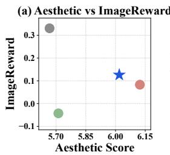

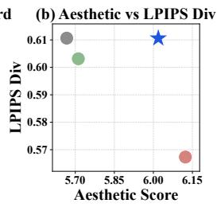

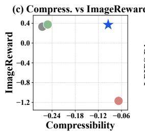

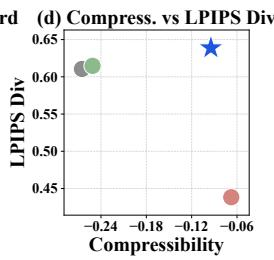  
Figure 9: Reward-quality trade-off of NPO and direct fine-tuning baselines on SD-Turbo with four sampling steps. (a, b) Aesthetic score against ImageReward and LPIPS diversity. (c, d) Compressibility against ImageReward and LPIPS diversity.

Figure 9 repeats the four-step comparison of Figure 4 on SD-Turbo. FAV-B barely improves either target reward. Flow-GRPO reaches the highest target reward, but its ImageReward and LPIPS diversity decrease substantially, most severely under compressibility. NPO reaches a comparable target reward while keeping LPIPS diversity at or above that of the frozen generator and ImageReward above that of Flow-GRPO.

## G.2 ABLATION OF THE NPO OBJECTIVE

We ablate the design choices of the NPO objective described in Appendix B on SANA-Sprint with one sampling step under the aesthetic reward. Each ablation changes one choice from the default setting and is run with three seeds. NPO is insensitive to most of these choices. Except for the path-KL weighting, every variant performs similarly to the default setting, which shows that NPO is robust to its design choices.

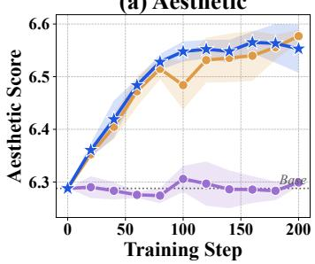

(b) ImageReward  
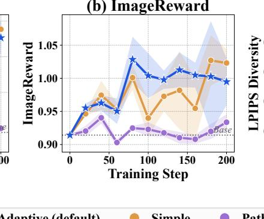

(c) LPIPS Diversity  
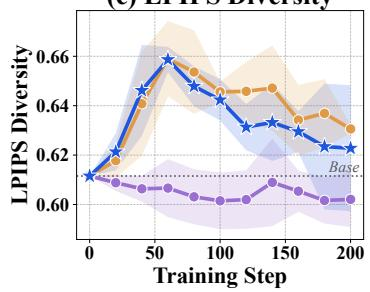  
Figure 10: Ablation of the ELBO weighting.

ELBO weighting. Figure 10 compares the three weightings of Appendix B.3. The adaptive and simple weightings perform similarly, whereas the path-KL weighting barely improves the reward. We use the adaptive weighting.

(c) LPIPS Diversity  
(c) LPIPS Diversity  
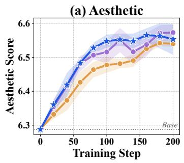

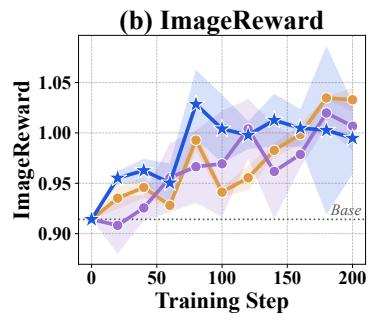

(c) LPIPS Diversity  
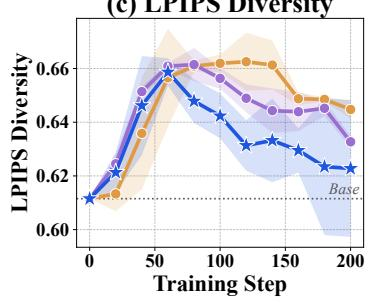  
Figure 11: Ablation of the number of forward-noising pairs.

Number of forward-noising pairs. Figure 11 varies the number M of forward-noising pairs per endpoint in Equation (B.4). Increasing M beyond 3 brings no gain, so we use $M = 3$ to limit the cost of the likelihood estimate.

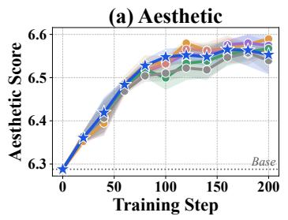

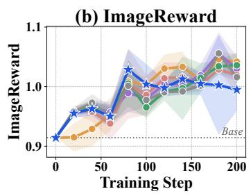

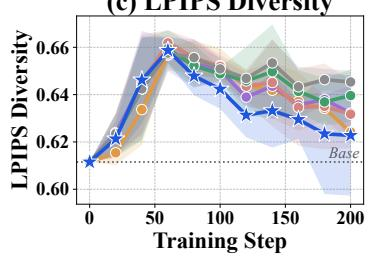  
Figure 12: Sensitivity to the regularization strength.

Sensitivity to the regularization strength. Figure 12 varies $\lambda _ { \mathrm { { r e f } } }$ over two orders of magnitude, including $\lambda _ { \mathrm { r e f } } ~ = ~ 0$ . All settings train stably and perform similarly on every metric, so NPO is insensitive to $\lambda _ { \mathrm { r e f } }$

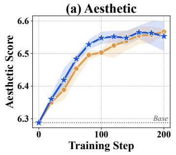

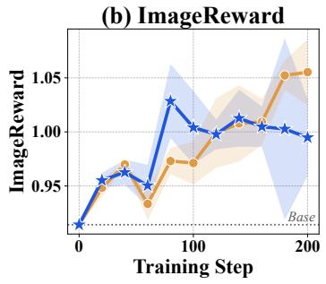  
Linear (default) VP

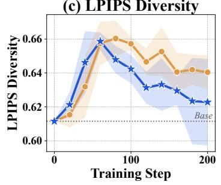  
Figure 13: Ablation of the interpolation.

(c) LPIPS Diversity

Interpolation. Figure 13 replaces the linear interpolation of the reference flow with the variancepreserving interpolation of Appendix B.1. The two interpolations perform similarly, so we use the linear interpolation.

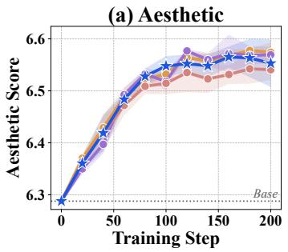

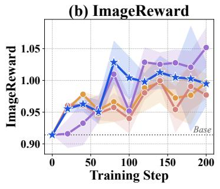

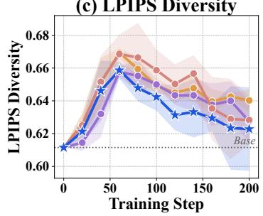  
Figure 14: Ablation of the policy-gradient objective.

Policy-gradient objective. Choi et al. (2026) find that the choice of policy-gradient objective matters less than the likelihood estimator. For simplicity and fewer hyperparameters, NPO omits the within-group standard-deviation normalization of the advantage and the ratio clipping of GRPO. Figure 14 adds them back one at a time and together, which recovers the GRPO objective. None of them changes the results, so we keep the simpler update.

## H QUALITATIVE COMPARISON

## H.1 IMAGE DOMAIN

We show samples on SANA-Sprint with four sampling steps under the aesthetic reward (Figure 15) and the compressibility reward (Figure 16). All samples are taken at a matched reward-call budget.

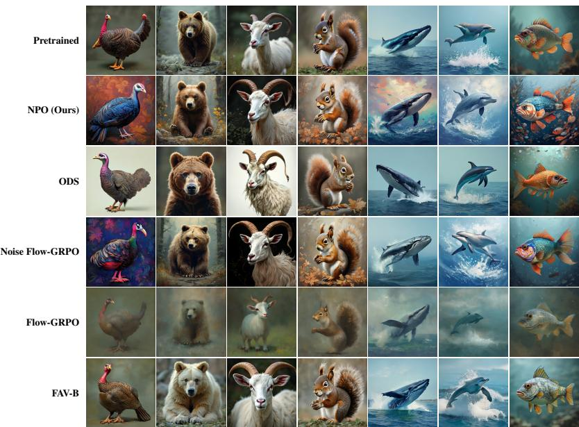  
Figure 15: Qualitative comparison under the aesthetic reward.

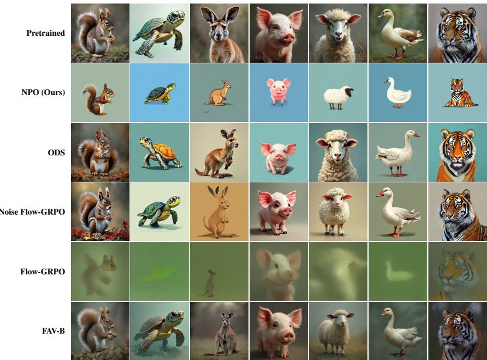  
Figure 16: Qualitative comparison under the compressibility reward.

## H.2 LANGUAGE DOMAIN

We conduct a qualitative analysis on the topic-steering task and compare NPO with the direct finetuning methods on ELF. Figure 6 shows that the perplexity and unigram entropy of the direct finetuning methods decrease together as optimization proceeds. Figures 17 and 18 show how this collapse appears in the samples. We fix two initial noises and show their samples at three checkpoints of increasing training step. As optimization proceeds, the samples of the direct fine-tuning methods collapse into repetitions of a few tokens, which explains the simultaneous decrease in perplexity and unigram entropy.

<table><tr><td>Base</td><td></td><td>1 As everyone has seen in the NFL, Tyry Johnson didn&#x27;t appear, but he&#x27;s one of the best runers in the NFL. We&#x27;ll get to see from this. 22 DeJ McCrney,WR, WR, WR, Hardt : He&#x27;s been a guy. 2 If you&#x27;re one of the most adventured fans on the game, we&#x27;ll look at you a little to let you to see what Global Wring is up for. World Wring is one as one of the most engagingd games on the console that plays absolutely well about world order.</td></tr><tr><td>NPO</td><td></td><td>1 As everything happens in a pond, modern scientists can&#x27;t exactly understand how energy is pumped by any thing that is moving through the air. But they might be able to do something from a piece of the lake into an atmosphere or through a piece inside ...</td></tr><tr><td></td><td>2</td><td>This week, the nine month since Elson launched, we&#x27;ve talked with ToE and developers and producer Peter Chaleon to see what ORon is looking for. It&#x27;s one of the big features that we&#x27;ve seen into the Nintendo- game slate.</td></tr><tr><td>Flow-GRPO</td><td></td><td>1 In an interview released late Sunday, House President Donald Trump didn&#x27;t say if he would place a tax on same-sex couples. His comments would be made public on July 5 at a seven-day music festival in Wilmington, Va.</td></tr><tr><td></td><td>2</td><td>&quot;We&#x27;re not in a final situation, and we&#x27;ven&#x27;t known what could happen next,&quot;Kailke said. While House Republican Republicans are voting against the seven-point vote, the Senate&#x27;s Financeding Committee and the House Republi- can National Committee didn&#x27; ...</td></tr><tr><td>FAV-B</td><td></td><td>1 Other people who live in the world who have&#x27;t known or not never known knew other who have often two good friends who liked both met each other other others who who talked to other on Twitter and after each other often many times and talked with othe ...</td></tr><tr><td></td><td>2</td><td>“We&#x27;re fortunate to be with our friends previously two previously and both met out to family and friends and others Derek Yel Walter said, Chief Executive and CEO of both day each two of our two two of our friends other close and known friends and pr ...</td></tr><tr><td>NPO</td><td></td><td>1 As everything happens in a physical world, academics can&#x27;t exactly understand how energy is poured by an item that is moving through the air. But they might be able to push energy from a chunk of the mountain into an atmosphere or about a chunk below ..</td></tr><tr><td></td><td></td><td>2 This week, the study was published in September in the Journal of Science, in the American Science Journal of Medicine. John Kailberg and several other Space Department researchers are working on the seven-wheel sensor</td></tr><tr><td>Flow-GRPO</td><td></td><td>from the NASA&#x27;s Department Depa ... 1 In his remarks earlier on Thursday, US President Donald Trump didn&#x27;t public, what he regarded as major threat to climate change in the Mediterranean. His remarks will be made public in 2017, including a seven-day wildlife</td></tr><tr><td></td><td></td><td>festival in Edinburgh, Franc ... 2 Last month, the day before President Obama announced his presidential election. He also visited the European House, China and on Thursday. He also outlined stronger climate change goals — in his seven-day speech as the</td></tr><tr><td>FAV-B</td><td></td><td>world&#x27;s highest-elected preside ... 1 [1022 characters, all whitespace except “%&quot;]</td></tr><tr><td></td><td></td><td>2 [1021 characters, all whitespace except “%”]</td></tr><tr><td>NPO</td><td></td><td>1 As everything happens nowadays in the physical world, investigators can&#x27;t completely understand how chemical</td></tr><tr><td></td><td></td><td>objects shaped a thing that is moving through the air. 2 This study has been published in the journal Journal of Science Science. Research is supported by National Space</td></tr><tr><td></td><td></td><td>Research Foundation and. John Cailski and other AEA researchers are working on the three-part study from the NASA&#x27;s State Department of S ... 1</td></tr><tr><td>Flow-GRPO</td><td></td><td>[1024 characters in 1 unbroken token(s): “.&quot; repeated]</td></tr><tr><td></td><td></td><td>2 [1024 characters in 1 unbroken token(s): &quot;.&quot; repeated]</td></tr><tr><td>FAV-B</td><td></td><td>1 [1051 characters, all whitespace except “gone arrested arrested arreste&quot;]</td></tr><tr><td></td><td></td><td>2 [1031 characters, all whitespace except “gone gone&quot;]</td></tr></table>

Figure 17: Generated text samples on the science topic. Red characters indicate a collapsed sample with no content left to quote.

## H.3 PROTEIN DOMAIN

We show protein backbones generated by NPO on the protein structure generation task. NPO optimizes the SS composition reward, which favors diverse secondary-structure compositions with additional emphasis on β-sheet content (Section 5.3.1). Figure 19 compares the backbones that the pretrained generator and NPO generate from the same initial noise. The backbones of the pretrained generator consist mostly of α-helices, whereas the backbones of NPO contain substantially more β-sheet content while keeping well-formed structures.

<table><tr><td>Base</td><td></td><td>1 As everyone has seen in the NFL, Tyry Johnson didn&#x27;t appear, but he&#x27;s one of the best runers in the NFL. We&#x27;ll get to see from this. 22 DeJ McCrney,WR, WR, WR, Hardt : He&#x27;s been a guy. 2 If you&#x27;re one of the most adventured fans on the game, we&#x27;ll look at you a little to let you to see what Global Wring</td></tr><tr><td>NPO</td><td></td><td>1 As it appeared earlier this month, House President Donald Trump didn&#x27;t express the reason he acted the right way about gun change in the country. The issue will be on display on TV, at a six-day music event in Detroit, Texas where he lost the 2016 el ... 2 This week, the year-Julsith anniversary of Microsoft gathered with U&amp;C President and CEO Mike Melbeck to</td></tr><tr><td>Flow-GRPO</td><td></td><td>discuss what OpRon is working on its three-year project, the company&#x27;s chief of development officer and vice president of computer design. 1 STTE: GETE: I don&#x27;t don&#x27;t believe it. He&#x27;s a little bit odd. he&#x27;s tricky. I&#x27;m attempting to get him get a bit cranky.</td></tr><tr><td></td><td></td><td>He doesn&#x27;t dance. he doesn&#x27;t. He&#x27;s very anxious. He think he&#x27;s more delicate and he&#x27;s so intelligent at something. 2 Tese: I&#x27;m perseted [I&#x27;m really so intrigued]. What does that perspective Peter how would you get ask? Tese: I get. I&#x27;m one of the two. He&#x27;s a very sophisticated player. I he&#x27;s competent. he&#x27;s a very basic rate. He&#x27;s very remarkably sophisticated.</td></tr><tr><td>FAV-B</td><td>2</td><td>1 &quot;All the happens in the batting is very well kept and working extremely and he&#x27;s a great guy that is efficient at the speed and I&#x27;ll be able to play and at great level in the defensive and is able to quickly as he handles the punch and that&#x27;s the how ... &quot;We&#x27; are thrilled to be able to play and we&#x27;re really looking forward to see him and see how he will and see what NBA he is looking at. He&#x27;s one of the best stars from all on the world and player in the game really very well and</td></tr><tr><td>NPO</td><td></td><td>1 As in the past three months, House Speaker Pe Carter didn&#x27;t publicly confirm that President Trump did a good job decreasing gun change in the country. 2 On Thursday, the EU-Omitsieur Presidenty Peen visited the White House with Secretary of State John Peilson to discuss what Global New Energy is doing after its three-day speech between the EU&#x27;s chief of the staff and the</td></tr><tr><td>Flow-GRPO</td><td></td><td>secretary of National Securit ... 1 Rocker: In a way Stefan Franzens can&#x27;t explain it. It&#x27;s just this little thing that is flowing in the air. We&#x27;re being able to pog into a trench that spills into an ocean of oil that ges into the ocean.</td></tr><tr><td>FAV-B</td><td></td><td>2 Tese: We&#x27;re crusing out what we&#x27;re running the archaeological to looking the fossil and Peter Grelstein to see what Gresen is working at. These&#x27;s one of the ones we&#x27;re developing a piece of software that runs spatial graph maps. 1 [1023 characters, all whitespace except “a&quot;]</td></tr><tr><td>NPO</td><td></td><td>2 [1023 characters, all whitespace] 1 As it appeared earlier this month, House Speaker Rand Paul didn&#x27;t say the way he stepped up how to reduce</td></tr><tr><td></td><td></td><td>economic growth in the country. But things would be noticeable on screen, after a five-year restaurant production slump and 30 years after he le ... 2 This Wednesday, about seven hours after Overselection President Donald Trump, visited the White House with</td></tr><tr><td>Flow-GRPO</td><td></td><td>Secretary of State John Caillke to discuss what Seranon is talking about. 1 Wimbledon Pour Pour Pour Pour Pour Pour impression impression impression Wimbledon impression impression</td></tr><tr><td></td><td></td><td></td></tr><tr><td></td><td></td><td>impression impression impression impression impression impression impression impression impression impres-</td></tr><tr><td></td><td></td><td>sion impression impression impression im ...</td></tr><tr><td></td><td></td><td>2 Pour Pour Pour Pour Pour Pour Pour Pour Pour impression impression impression impression impression im-</td></tr><tr><td></td><td></td><td></td></tr><tr><td></td><td></td><td>pression impression impression impression impression impression impression impression impression impression</td></tr><tr><td></td><td></td><td></td></tr><tr><td></td><td></td><td></td></tr><tr><td></td><td></td><td></td></tr><tr><td></td><td></td><td></td></tr><tr><td></td><td></td><td></td></tr><tr><td></td><td></td><td>impression impression impression impress ...</td></tr><tr><td></td><td></td><td></td></tr><tr><td></td><td></td><td></td></tr><tr><td></td><td></td><td></td></tr><tr><td></td><td></td><td></td></tr><tr><td></td><td></td><td></td></tr><tr><td>FAV-B</td><td></td><td></td></tr><tr><td></td><td></td><td></td></tr><tr><td></td><td></td><td>1 [337 tokens, 1 distinct: “a&quot; repeated]</td></tr><tr><td></td><td></td><td></td></tr><tr><td></td><td></td><td></td></tr><tr><td></td><td></td><td></td></tr><tr><td></td><td></td><td></td></tr><tr><td></td><td></td><td></td></tr><tr><td></td><td></td><td></td></tr><tr><td></td><td></td><td></td></tr><tr><td></td><td></td><td></td></tr><tr><td></td><td></td><td></td></tr><tr><td></td><td></td><td></td></tr><tr><td></td><td></td><td></td></tr><tr><td></td><td></td><td></td></tr><tr><td></td><td></td><td></td></tr><tr><td></td><td></td><td></td></tr><tr><td></td><td>2 [360 tokens, 1 distinct: “a&quot; repeated]</td><td></td></tr></table>

Figure 18: Generated text samples on the politics topic. Red characters indicate a collapsed sample with no content left to quote.

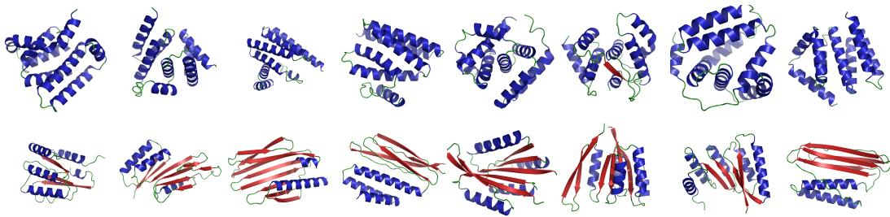  
Figure 19: Qualitative comparison on protein structure generation. Top: backbones generated by the pretrained generator. Bottom: backbones generated by NPO from the same initial noise. α- helices are drawn in blue, β-sheets in red, and coils in green.