# Online Quantile Omniprediction for Proper Losses

Hyunsuk Kim Department of Statistics University of California, Berkeley

Michael W. Mahoney ICSI, LBNL, and Dept. of Statistics University of California, Berkeley

Isaac Gibbs Department of Statistics University of Toronto

Ryan J. Tibshirani Department of Statistics University of California, Berkeley

## Abstract

The task of constructing a predictor that is simultaneously accurate under multiple evaluation metrics has been popularized recently under the name omniprediction. Prior work in this area has largely focused on binary prediction tasks, and existing results for multiclass and continuous outcomes typically suffer from slow error rates. In this paper, we consider forecasts expressed as a set of quantiles over a discrete but otherwise arbitrary set of probability levels. We develop sample-efficient algorithms for constructing forecasts that are accurate simultaneously across all proper losses that satisfy mild regularity conditions, where proper losses are those minimized by predicting the true quantiles. Our algorithms are online and can operate in a dynamic environment, while simultaneously taking multiple losses into account, and their forecasts offer the potential to provide diverse end-users with rich information for evaluating risk and informing a range of practical decision-making tasks. As an example, we demonstrate how our procedure can be used to ensemble quantile forecasts of COVID-19 hospitalizations made by experts during the pandemic. Code is available at https://github.com/hysk79/online-quantile-omniprediction.

## 1 Introduction

Probabilistic forecasting, i.e., forecasting the distribution of a target variable, has become a popular framework across a variety of prediction tasks [GK14, VBD+21, SWM+18, CRL+22]. In contrast to point predictions, probabilistic forecasts provide a richer description of uncertainty and offer endusers greater information with which to evaluate risk and guide effective decision-making [Raf16]. This flexibility is particularly valuable in settings in which a single prediction is shown to a diverse set of users with varying and unknown objectives, as it allows users to extract the information most relevant to their needs.

A conventional approach for training and evaluating a probabilistic forecast is to measure its distance from the true distribution using a proper loss [GRWG05, GR07]. In general, we say that a loss is proper if (in expectation) it is minimized by predicting the true distribution of the outcome. There are a number of popular proper losses in the literature, and a key difficulty is determining which loss one should use for training. Indeed, while all proper losses share the same global optimum, they penalize distance from the ground truth asymmetrically, and thus obtaining a near minimizer in one loss does not guarantee good performance for other losses [BRT25].

In response to this, a recent line of work aims to construct “omnipredictors" that achieve optimal performance on multiple losses simultaneously [GKR+22, GKR23, GJRR24, GOR+24, NRRX25,

LRS25, OKK25, GT26]. Much of this work has focused on binary prediction tasks. In that context, it has been shown that, given a baseline class of prediction functions, one can construct a single unified predictor that approximately matches the performance of the best baseline on every proper loss simultaneously [GJRR24, OKK25, GT26]. Notably, the error rates achieved in these works are identical (up to logarithmic factors) to the standard error rates for minimizing a single loss function: $( \tilde { O } ( \sqrt { 1 / T } )$ in the online setting over $T$ timesteps; and ${ \tilde { O } } ( { \sqrt { 1 / n } } )$ in the offline setting over n samples). Thus, omniprediction offers the potential to provide a practical path to improving existing learning algorithms.

In contrast to this work on binary prediction tasks, results for multiclass and continuous targets are much more modest. Prior work in [GKR+22, GOR+24, LRS25] gives algorithms for multiclass or continuous outcome omniprediction over restricted classes of losses satisfying various convexity and Lipschitz conditions, while [NRRX25] considers multiclass Bregman losses that are separable in the predicted probability for each class. In all of these cases, omniprediction is achieved at significantly slower rates than in the binary setting. For more general losses, [HTY26] propose a method for obtaining omniprediction over all proper losses in the multiclass setting. However, its error rate deteriorates rapidly as the number of classes grows, with realized rates of $( k / n ) ^ { 1 / ( k + 1 ) }$ and $( k / T ) ^ { 1 / ( k + 1 ) }$ for online/offline k-class classification, respectively.

To achieve more practical methods, we pursue omniprediction guarantees for simplified probabilistic forecasts expressed as dense grids of quantile predictions for the outcome. Our motivation for considering such quantile forecasts is two-fold. First, on a technical level, proper losses for quantiles admit a decomposition as mixtures over a smaller two-parameter class of elementary losses. This will allow us to focus our algorithms on a small, tractable set of losses and thus enable the development of efficient omniprediction algorithms that mirror those for the binary prediction setting. Second, quantile forecasts are a popular way to summarize uncertainty in many real-world forecasting domains [HF16, $\mathrm { C R L } ^ { + } 2 2 ]$ . As a demonstration, we will show how our methods can be used to improve quantile-level forecasts of COVID-19 hospitalizations made by expert forecasting groups during the pandemic.

The remainder of this paper is structured as follows. Section 2 formally defines our prediction framework and presents the key structural results for proper quantile losses used throughout this paper. Section 3 develops our main method, which is an online forecasting algorithm for constructing quantile predictions that achieve low regret on all (sufficiently smooth) proper losses simultaneously. Analogous to results for the binary setting, we show that the omniprediction error of this method over $T$ timesteps scales as $\tilde { O } ( \sqrt { 1 / T } )$ and thus matches rates for learning under a single loss (up to logarithmic factors). Section 4 gives our main empirical results, where we show that our procedure can be used to improve quantile forecasts made during the COVID-19 pandemic. We conclude in Section 5 with a discussion of limitations and directions for future work. Additional technical details, including proofs of all theoretical results, efficient subroutines for faster implementation of our algorithm, and additional empirical results and plots, are deferred to the appendix.

## 2 Preliminaries

## 2.1 Problem statement

We consider an online adversarial setting in which at each timestep $t \in [ T ]$ the goal is to forecast an outcome $Y _ { t }$ whose distribution is allowed to depend on the entire history of previous outcomes and predictions. For simplicity, we assume that $Y _ { t }$ lies in $[ 0 , 1 ]$ , although our results readily extend to any bounded interval by translation and rescaling.

Given quantile levels $0 < \tau _ { 1 } < \tau _ { 2 } < \cdot \cdot \cdot < \tau _ { N } < 1$ , our forecasts take the form of a vector $q ( t ) =$ $( q _ { 1 } ( t ) , \ldots , q _ { N } ( t ) )$ where $q _ { n } ( t )$ denotes our estimate of the $\tau _ { n }$ quantile of $Y _ { t }$ . We evaluate the performance of these predictions by comparing them to a finite set of $B$ base forecasters ${ \mathcal { F } } =$ $\{ \{ f _ { b } ^ { n } ( t ) \} _ { n \in [ N ] , t \in [ T ] } : \bar { b } \in [ B ] \}$ , where $f _ { b } ^ { n } ( t ) \in [ 0 , 1 ]$ denotes the forecast of the $\tau _ { n }$ -quantile made by base forecaster $f _ { b }$ at timestep t.

As motivating examples, one may consider problems in which $\mathcal { F }$ is a collection of parametric functions mapping some covariates $X _ { t }$ to $Y _ { t }$ or problems in which $\mathcal { F }$ contains candidate forecasts from many different baseline learning algorithms. In either case, at every timestep $t ,$ we will observe the previous sequence of outcomes $( \breve { Y } _ { s } ) _ { s < t } ^ { - }$ and the current and preceding base forecasts $\{ \{ f _ { b } ^ { n } ( s ) \} _ { n \in [ N ] , s \leq t }$ $b \in [ B ] \}$ , and our goal will be to construct $q ( t )$ so that it matches the performance of the best base forecaster on every loss l in some collection $\dot { \mathcal { L } } .$ More precisely, following $[ \mathrm { G K R } ^ { + } 2 2 ]$ , we aim to minimize the omniprediction error, defined as

$$
\operatorname* { s u p } _ { \ell \in \mathcal { L } , b \in [ B ] } \frac { 1 } { T } \sum _ { t = 1 } ^ { T } \ell ( q ( t ) , Y _ { t } ) - \ell ( f _ { b } ( t ) , Y _ { t } ) ,\tag{1}
$$

where $\mathcal { F } = \{ f _ { b } \} _ { b = 1 } ^ { B }$ and $f _ { b } ( t ) : = ( f _ { b } ^ { 1 } ( t ) , . . . , f _ { b } ^ { N } ( t ) )$ . It is important to emphasize that in this definition the comparator forecaster in $\mathcal { F }$ is allowed to depend on the loss $\ell \in { \mathcal { L } } .$ As a result, to achieve low omniprediction error it is not sufficient to set $q ( t )$ to be a fixed element of $\mathcal { F }$ , as the best base forecaster may vary between losses.

We will be interested in pursuing low omniprediction error with respect to the class of proper losses. Broadly, we say that a loss function is proper for forecasting a given set of quantiles if it is minimized by forecasting the true quantiles of the target.¹ This is formalized in the following definition.

Definition 1 (Proper loss for quantile levels). For a distribution $P ^ { y }$ on $[ 0 , 1 ]$ , denote its τ-level quantile by $q _ { \tau } ^ { * } ( P ^ { \bar { y _ { } } } ) : = \operatorname* { i n f } \{ q \in [ 0 , 1 ] : \mathbb { P } _ { Y \sim P ^ { y } } ( Y \geq q ) \geq \tau \}$ . A loss function $\mathring { \ell : } [ 0 , 1 ] ^ { N } \times [ 0 , 1 ] $ $\mathbb { R } _ { \geq 0 }$ is referred to as a proper loss for quantile levels $0 < \tau _ { 1 } < \tau _ { 2 } < \cdot \cdot \cdot < \tau _ { N } < 1 i f$

$$
\begin{array} { r } { ( q _ { \tau _ { n } } ^ { * } ( P ^ { y } ) ) _ { n = 1 } ^ { N } \in \underset { q \in \mathbb { R } ^ { N } } { \mathrm { a r g m i n } } \mathbb { E } _ { Y \sim P ^ { y } } [ \ell ( q , Y ) ] , \quad f o r a l l d i s t r i b u t i o n s P ^ { y } s u p p o r t e d o n [ 0 , 1 ] . } \end{array}
$$

By definition, the class of proper losses is the largest class of losses that share the true quantiles as their common minimizer, and thus it is the largest class over which we can reasonably expect to achieve low omniprediction error.

## 2.2 Existing characterizations of proper losses

In order to make our omniprediction objective tractable, we will rely on structural characterizations of proper losses for quantiles. Such characterizations have a long history in the forecasting literature, dating back to the pioneering work of [Sav71]. We will in particular rely on results for quantiles developed in [Tho79, Sae00, Gne11, EGJK16] which show that any (sufficiently smooth) proper loss for a single quantile level can be decomposed as a mixture over a one-dimensional family of elementary losses. To outline this result, [EGJK16] summarizes the characterization of proper loss for single quantile level from previous works as follows:

Characterization. For any non-decreasing function $g : [ 0 , 1 ]  \mathbb { R }$ , the loss function $\ell : [ 0 , 1 ] \times$ $[ 0 , 1 ] \to { \mathbb { R } } _ { \geq 0 }$ given by

$$
\ell ( q , y ) = ( 1 ( y < q ) - \tau ) ( g ( q ) - g ( y ) )\tag{2}
$$

is proper for the τ-level quantile. Moreover, this representation is exhaustive, in the sense that any proper loss function for the τ-level quantile that satisfies the mild regularity conditions: (L0) $\ell ( q , y ) \geq 0$ with equality if $q = y ; ( \mathrm { L } 1 )$ l is continuous; and (L2) l is twice continuously differentiable for $q \neq y$ can be expressed in this form.

Let ${ \mathcal { L } } _ { \tau }$ - denote the class of loss functions of the form $( 2 )$ with $g$ being a left-continuous, non-decreasing function. Then, [EGJK16] shows that every loss in $\scriptstyle { \mathcal { L } } _ { \tau }$ can be decomposed as a mixture of so-called elementary losses as follows.

Theorem 1 (Theorem 1a in [EGJK16]). Fix any $\tau \in ( 0 , 1 )$ . For any loss function $\ell \in \mathcal { L } _ { \tau }$ , there exists a non-negative Lebesgue-Stieltjes measure H on $[ 0 , 1 ]$ , given by $\dot { d H } ( \theta \dot { ) } = d g ( \theta )$ , such that for all $q , y \in [ 0 , 1 ]$

$$
\ell ( q , y ) = \int _ { 0 } ^ { 1 } \ell _ { \tau , \theta } ( q , y ) d H ( \theta ) ,\tag{3}
$$

where for any $\theta \in [ 0 , 1 ] , \ell _ { \tau , \theta }$ is the elementary loss

$$
\ell _ { \tau , \theta } ( q , y ) = ( \mathbb { 1 } ( y < q ) - \tau ) ( \mathbb { 1 } ( \theta < q ) - \mathbb { 1 } ( \theta < y ) ) = \left\{ \begin{array} { l l } { 1 - \tau , } & { y \leq \theta < q , } \\ { \tau , } & { q \leq \theta < y , } \\ { 0 , } & { o t h e r w i s e . } \end{array} \right.\tag{4}
$$

It may be instructive to note that for any $\tau , \theta \in [ 0 , 1 ]$ the elementary loss $\ell _ { \tau , \theta }$ is itself proper. To see this, fix any $\tau , \theta \in ( 0 , 1 ) ^ { 2 }$ and note that by definition $\ell _ { \tau , \theta }$ essentially only admits two forecasts: namely, we may either forecast a value $q > \theta$ or a value $q \leq \theta$ . Which of these forecasts is optimal will depend on the sign of

$$
\begin{array} { r } { \mathbb { E } _ { Y \sim P ^ { y } } [ \ell _ { \tau , \theta } ( 1 , Y ) ] - \mathbb { E } _ { Y \sim P ^ { y } } [ \ell _ { \tau , \theta } ( 0 , Y ) ] = ( 1 - \tau ) \mathbb { P } ( y \le \theta ) - \tau \mathbb { P } ( y > \theta ) , } \end{array}
$$

which is nonnegative (resp. nonpositive) exactly when θ is below (resp. above) the τ-quantile of $P ^ { y }$

Decision-making interpretation of elementary losses. Following the exposition in $[ \mathrm { M I T } ^ { + } 2 5 ]$ , one may also interpret $\ell _ { \tau , \theta }$ in terms of a decision-making task in which one must decide whether to take a preventative action against an adverse event. More formally, let $\bar { C }$ denote the cost of taking this action $( \mathrm { e . g . }$ , expanding hospital capacity) and $L$ denote the price paid if the adverse event occurs (e.g., COVID-19 cases surge) and no preventative action was taken. Let $a = \mathbb { 1 } .$ {action taken} and $o = 1 \cdot$ {adverse event occurs } denote binary indicators for the action and outcome, respectively, and define a utility s expressing the payoffs for these outcomes as in Table 1. Finally, suppose the adverse event occurs exactly when some outcome $Y \left( \mathrm { e . g . } \right.$ , COVID-19 cases) exceeds a given threshold $\theta \left( \mathrm { e . g . } \right.$ , the hospital's current capacity). Then, if we take the preventative action if and only if the forecast quantile $q$ exceeds θ, one can check that

Table 1: Payoff table
<table><tr><td rowspan=1 colspan=1> $s ( a , o )$ </td><td rowspan=1 colspan=1> $o = 1$ </td><td rowspan=1 colspan=1> $o = 0$ </td></tr><tr><td rowspan=1 colspan=1> $a = 1$ </td><td rowspan=1 colspan=1> $C$ </td><td rowspan=1 colspan=1>C</td></tr><tr><td rowspan=1 colspan=1> $a = 0$ </td><td rowspan=1 colspan=1> $L$ </td><td rowspan=1 colspan=1>0</td></tr></table>

$$
s \left( \mathbb { 1 } \{ q > \theta \} , \mathbb { 1 } \{ Y > \theta \} \right) - s \left( \mathbb { 1 } \{ Y > \theta \} , \mathbb { 1 } \{ Y > \theta \} \right) = L \cdot \ell _ { 1 - C / L , \theta } ( q , Y ) ,
$$

and thus up to renormalization correctly forecasting the $( 1 - C / L )$ -level quantile of $Y$ is equivalent to choosing the correct action.

To extend beyond single quantile forecasts we will use a result of [FZ16] which shows that proper losses for vectors of quantiles decompose as sums of proper losses for single quantiles.

Theorem 2 (Simplified version of Proposition 4.2 in [FZ16]). Fix any $0 < \tau _ { 1 } < \cdots < \tau _ { N } < 1$ and let $\ell : [ 0 , 1 ] ^ { \hat { N } } \times [ 0 , 1 ] \to \mathbb { R } _ { \ge 0 }$ be a proper loss for quantile levels $\left\{ \tau _ { n } \right\} _ { n = 1 } ^ { N }$ that satisies mild regularity conditions (See Appendix F.1). Then, there exists losses $\ell _ { 1 } , \ldots , \ell _ { N } : [ 0 , 1 ] \times [ 0 , 1 ] \to \mathbb { R } _ { \ge 0 }$ such that $\ell _ { n }$ is a proper loss for the $\tau _ { n }$ -level quantile and

$$
\ell ( q _ { 1 } , \dots , q _ { N } , y ) = \sum _ { n = 1 } ^ { N } \ell _ { n } ( q _ { n } , y ) .\tag{5}
$$

Now, define the following two classes of loss functions $\ell : [ 0 , 1 ] ^ { N } \times [ 0 , 1 ] \to \mathbb { R } _ { \ge 0 }$

$$
\mathcal { L } : = \left\{ \ell = \sum _ { n = 1 } ^ { N } \ell _ { n } \Big | \ell _ { n } ( q _ { n } , y ) = \left( 1 \left( y < q _ { n } \right) - \tau _ { n } \right) \left( g _ { n } ( q _ { n } ) - g _ { n } ( y ) \right) \right\} , \ C _ { 1 } : = \left\{ \ell \in \mathcal { L } \mid \| \ell \| _ { \infty } \leq 1 \right\} ,\tag{6}
$$

where each $g _ { n }$ is non-decreasing and left-continuous. Putting the results above together, any loss function $\ell \in \mathcal L$ can be expressed as $\begin{array} { r } { \ell ( q _ { 1 } , \dots , q _ { N } , y ) = \sum _ { n = 1 } ^ { N } \int _ { - \infty } ^ { \infty } \ell _ { \tau _ { n } , \theta } ( q _ { n } , y ) d H _ { n } ( \theta ) } \end{array}$ for some non-negative mixing measures $H _ { n }$ and is a proper loss for quantile levels $\{ \tau _ { n } \} _ { n = 1 } ^ { N }$ Moreover, this representation is exhaustive: $\mathcal { L }$ contains all proper losses for quantile levels $\{ \bar { \tau _ { n } } \} _ { n = 1 } ^ { N }$ that satisfies mild regularity conditions. Finally, we add the additional restriction in $\mathcal { L } _ { 1 }$ that l is bounded because this will give a common scale to our definition of omniprediction and will ensure that the mixing distributions have bounded total measure.

## 3 Main theoretical results

We now turn to our main theoretical results which develop an algorithm for constructing quantile forecasts that achieves low omniprediction error with respect to the loss class $\mathcal { L } _ { 1 }$

$$
\begin{array}{c} \begin{array} { r } { \overbrace { \mathbf { \Gamma } \underbrace { \theta _ { 1 } = \frac { 1 } { 2 m } \mathrm { ~  ~ \omega ~ } \mathrm { ~ \wedge ~ } \theta _ { 2 } = \frac { 1 } { 2 m } + \frac { 1 } { m } \mathrm { ~  ~ \omega ~ } \theta _ { 2 } = \frac { 1 } { 2 m } + \frac { 2 } { m } \mathrm { ~  ~ \omega ~ } \cdots \mathrm { ~  ~ \omega ~ } \theta _ { m } = \frac { 1 } { 2 m } + \frac { m - 1 } { m } \mathrm { ~  ~ \omega ~ } \mathrm { ~ \wedge ~ } \theta _ { m } = \frac { 1 } { 2 m } + \frac { m - 1 } { m } \mathrm { ~  ~ \omega ~ } \mathrm { ~ \wedge ~ } \theta _ { m } = \frac { 1 } { 2 m } } \end{array} } ^ { \theta _ { 1 } = \mathrm { ~ \tiny ~ { ~ d ~ } ~ } } \overbrace { \mathbf { \Gamma } \mathrm { ~  ~ \omega ~ } \mathrm { ~ \wedge ~ } \mathrm { ~  ~ \Omega ~ } \mathrm { ~ \wedge ~ } \mathrm { ~ \tiny ~ { ~ \Omega ~ } ~ } \mathrm { ~ \otimes ~ \ i ~ } \mathrm { ~ \tiny ~ { ~ \Omega ~ } ~ } \mathrm { ~ \otimes ~ \{ ~ \otimes ~ \{ ~ \otimes ~ \{ ~ \otimes ~ \{ ~ \otimes \{ ~ \otimes ~ \{ \otimes ~ \{ ~ \chi ~ } ~ } \mathrm { ~ \tiny ~ { ~ \otimes ~ \otimes \chi ~ } ~ } \mathrm { ~ \otimes ~ \ddots ~ } ~ } \mathrm { ~  ~ \Omega ~ } ~   ~    ^ { \theta _ { m } = \mathrm { ~ \wedge ~ } \mathrm { ~ \wedge ~ } \mathrm { ~ \otimes ~ \{ ~ \xi ~ } ~ }   \end{array}
$$

Figure 1: Visualization of the discretization on the real line. Outcomes $Y _ { t }$ and forecasts $f _ { b } ^ { n } ( t )$ take values in the grid $\{ 0 , 1 / m , . . . , 1 \}$ that is interleaved by the values of $\theta _ { i }$

## 3.1 Discretization

Our first step towards deriving our main method will be to reduce from optimization over all losses in $\mathcal { L } _ { 1 }$ to optimization over a finite class. To accomplish this, we will combine the characterizations of proper losses from Section 2 with a discretization lemma that reduces the number of elementary losses that we need to consider to a finite set. For simplicity, we will assume that the outcomes $\dot { Y _ { t } }$ and base forecasts $f _ { b } ^ { n } ( t )$ lie in the discrete grid $\{ 0 , { \frac { 1 } { m } } , \ldots , 1 \}$ , for some large fixed value m $\in \mathbb { N }$ This assumption is relatively minor and is made primarily for technical convenience to avoid edge cases in which the elementary loss $\ell _ { \tau , \theta }$ varies significantly at nearby values of θ. In our experiments we will enforce these conditions explicitly by rounding the base forecasters and target outcomes to an appropriate grid. More broadly, our results can be readily extended to other sets of assumptions. For example, $\operatorname { i f } Y _ { t }$ is continuously distributed with a bounded density the same discretization lemma holds up to an extra additive error of size $O ( 1 / m )$

Now, let $\begin{array} { r } { \theta _ { i } = \frac { i } { m } - \frac { 1 } { 2 m } } \end{array}$ for $i \in [ m ]$ . The following lemma shows that to control the omniprediction error over the class $\mathcal { L } _ { 1 }$ , it suffices to control the error over the finite collection of elementary losses $\{ \ell _ { \tau _ { n } , \theta _ { i } } \} _ { i \in [ m ] , n \in [ N ] }$ . This discretization scheme is visualized in Figure 1; and a proof of this result can be found in Appendix A.1.

Lemma 1. Let $\mathcal { L } _ { 1 }$ denote the class of bounded proper losses defined in (6) and suppose $Y _ { t } , q _ { n } ( t ) , f _ { b } ^ { n } ( t ) \in \{ 0 , 1 / m , . . . , 1 \}$ for all $\dot { t } \in [ T ] , n \in \bar { [ N ] } ,$ and $b \in [ B ]$ . Then,

$$
1 \leq \frac { \operatorname* { s u p } _ { \ell \in \mathcal { L } _ { 1 } , b } \frac { 1 } { T } \sum _ { t = 1 } ^ { T } \left[ \ell ( q ( t ) , Y _ { t } ) - \ell ( f _ { b } ( t ) , Y _ { t } ) \right] } { \operatorname* { s u p } _ { i , n , b } \frac { 1 } { T } \sum _ { t = 1 } ^ { T } \left[ \ell _ { \tau _ { n } , \theta _ { i } } ( q _ { n } ( t ) , Y _ { t } ) - \ell _ { \tau _ { n } , \theta _ { i } } ( f _ { b } ^ { n } ( t ) , Y _ { t } ) \right] } \leq 2 .
$$

Results analogous to Lemma 1 have been used in many places in the omniprediction problem to simplify an infinite class of losses to a more tractable finite set. Most similar to our work, [GT26] gives a similar discretization result for binary outcomes $Y \in \{ 0 , 1 \}$ and the class of bounded proper losses for the probability that $Y = 1$ . In all cases, the key conclusion is that in order to achieve low omniprediction error it sufficies to work with the discretized collection of losses. In particular, in our problem it suffices to minimize the objective

$$
\operatorname* { s u p } _ { i \in [ m ] , n \in [ N ] , b \in [ B ] } \frac { 1 } { T } \sum _ { t = 1 } ^ { T } \left[ \ell _ { \tau _ { n } , \theta _ { i } } ( q _ { n } ( t ) , Y _ { t } ) - \ell _ { \tau _ { n } , \theta _ { i } } ( f _ { b } ^ { n } ( t ) , Y _ { t } ) \right] .\tag{7}
$$

This will be the focus of the next section.

## 3.2 Algorithm

We now introduce our main method as Algorithm 1.

To accomplish this, we will apply an algorithmic framework for multiobjective learning developed in [LNPR22] and popularized in a number of recent works on omniprediction and related problems [e.g., NRRX25, GJRR24, LRS25, GT26]. The core idea proposed by [LNPR22] is to consider a two-player game in which one player constructs a mixture of the elementary loss functions $\ell _ { \tau _ { n } , \theta _ { i } }$ and the other player best responds with a (randomized) predictor that minimizes the worst-case loss gap on the mixture. Following that work, in Algorithm 1, this is implemented by having the first player use the well-known Hedge algorithm [Vov90, LW94, FS97] to learn weights $\dot { w } _ { i b } ^ { n } ( t )$ over the quantiles levels $\tau _ { n }$ , parameters $\theta _ { i }$ , and baselines $f _ { b } ^ { n }$ appearing in (7), so that the time-average weighted mixture loss,

$$
\frac { 1 } { T } \sum _ { t = 1 } ^ { T } \sum _ { i , n , b } w _ { i b } ^ { n } ( t ) \left[ \ell _ { \tau _ { n } , \theta _ { i } } ( q _ { n } ( t ) , Y _ { t } ) - \ell _ { \tau _ { n } , \theta _ { i } } ( f _ { b } ^ { n } ( t ) , Y _ { t } ) \right] ,
$$

is guaranteed to be close to the supremum in (7). Then, letting $\Delta _ { m }$ denote the set of distributions over [m], the second player constructs their (randomized) forecast as ${ \bf q } ( t ) = ( q _ { n } ( t ) ) _ { n = 1 } ^ { N } \sim \hat { \bf P } ( t )$ where ${ \hat { \mathbf { P } } } ( t ) : = ( { \hat { P } } _ { n } ( t ) ) _ { n = 1 } ^ { N }$ solves the minmax program,

$$
\hat { \mathbf { P } } ( t ) = \operatorname * { a r g m i n } _ { P _ { 1 } , \ldots , P _ { N } \in \Delta _ { m } } \operatorname* { m a x } _ { P ^ { y } \in \Delta _ { m } } \sum _ { i = 1 } ^ { m } \sum _ { n = 1 } ^ { N } \sum _ { b = 1 } ^ { B } w _ { i b } ^ { n } \mathbb { E } _ { q _ { n } \sim P _ { n } , Y \sim P ^ { y } } [ \ell _ { \tau _ { n } , \theta _ { i } } ( q _ { n } , Y ) - \ell _ { \tau _ { n } , \theta _ { i } } ( f _ { b } ^ { n } ( t ) , Y ) ] .\tag{8}
$$

By definition, this forecast minimizes the mixture loss over the worst-case (and potentially adversarially chosen) value of $Y _ { t }$

The following theorem shows that Algorithm 1 achieves our desired omniprediction guarantee; and the proof of this result can be found in Appendix A.3.

Theorem 3. Suppose target values $Y _ { t } ,$ forecaster predictions $f _ { b } ^ { n } ( t ) f o r t \in [ T ] , n \in [ N ] , b \in [ B ]$ each takes values in a uniform grid of size m. With learning rate $\eta = c \sqrt { ( \log m N B ) / T }$ the predictions $\hat { \mathbf { P } } ( t ) = ( \hat { P } _ { n } ( t ) ) _ { n = 1 } ^ { N }$ from Algorithm 1 achieve the omniprediction error bound

$$
\operatorname* { s u p } _ { \ell \in \mathcal { L } _ { 1 } , b \in [ B ] } \frac { 1 } { T } \sum _ { t = 1 } ^ { T } \mathbb { E } _ { q _ { n } \sim \hat { P } _ { n } ( t ) } \left[ \ell \left( ( q _ { n } ) _ { n = 1 } ^ { N } , Y _ { t } \right) - \ell ( f _ { b } ( t ) , Y _ { t } ) \right] \leq 2 \left( c + \frac { 1 } { c } \right) \left( \sqrt { \frac { \log m N B } { T } } \right) .
$$

```latex
Algorithm 1 Omniprediction under all proper losses for multiple quantile levels
1: Data: Data stream $( Y _ { t } ) _ { t = 1 } ^ { T }$ , quantile levels $\{ \tau _ { n } \} _ { n = 1 } ^ { N }$ , grid size $m \in \mathbb { N } ,$ learning rate $\eta > 0 ,$ base
forecasters $\mathcal { F } = \{ f _ { b } \} _ { b = 1 } ^ { B ^ { ' } }$
2: Initialize: $\begin{array} { r } { w _ { i b } ^ { n } ( \underline { { 1 } } ) = \frac { 1 } { m n B } . } \end{array}$ for all $i \in [ m ] , n \in [ N ] , b \in [ B ]$
3: for $t = 1 , \ldots , T$ do
4: 1) Make prediction at time t:
$\hat { \mathbf { P } } ( t ) = \operatorname * { a r g m i n } _ { P _ { 1 } , \dots , P _ { N } \in \Delta _ { m } } \operatorname* { m a x } _ { P ^ { y } \in \Delta _ { m } } \sum _ { i = 1 } ^ { m } \sum _ { n = 1 } ^ { N } \sum _ { b = 1 } ^ { B } w _ { i b } ^ { n } \mathbb { E } _ { q _ { n } \sim P _ { n } , Y \sim P ^ { y } } [ \ell _ { \tau _ { n } , \theta _ { i } } ( q _ { n } , Y ) - \ell _ { \tau _ { n } , \theta _ { i } } ( f _ { b } ^ { n } ( t ) , Y ) ] ;$
(9)
5: 2) Update the weights: For all $i , n , b ,$
$w _ { i b } ^ { n } ( t + 1 ) = \frac { w _ { i b } ^ { n } ( t ) \exp \big ( \eta \big ( \mathbb { E } _ { q _ { n } \sim \hat { P } _ { n } ( t ) } [ \ell _ { \tau _ { n } , \theta _ { i } } ( q _ { n } , Y _ { t } ) ] - \ell _ { \tau _ { n } , \theta _ { i } } ( f _ { b } ^ { n } ( t ) , Y _ { t } ) \big ) \big ) } { \sum _ { i ^ { \prime } , n ^ { \prime } , b ^ { \prime } } w _ { i ^ { \prime } b ^ { \prime } } ^ { n ^ { \prime } } ( t ) \exp \big ( \eta \big ( \mathbb { E } _ { q _ { n ^ { \prime } } \sim \hat { P } _ { n ^ { \prime } } ( t ) } [ \ell _ { \tau _ { n ^ { \prime } } , \theta _ { i ^ { \prime } } } ( q _ { n ^ { \prime } } , Y _ { t } ) ] - \ell _ { \tau _ { n ^ { \prime } } , \theta _ { i ^ { \prime } } } ( f _ { b ^ { \prime } } ^ { n ^ { \prime } } ( t ) , Y _ { t } ) \big ) \big ) } .$
(10)
6: end for
```

A critical issue when implementing Algorithm 1 is solving the minmax program (8) in an efficient manner. Our detailed procedure for accomplishing this is given in Appendix B. As a summary of those results, the following theorem states the key structural properties of our computed solution. Briefly, the first property states that although $\hat { \mathbf { P } } ( t )$ is randomized, this randomization is supported on only two nearby values; the second property states that the quantile forecasts produced by $\hat { \mathbf { P } } ( t )$ follow the anticipated order $q _ { 1 } ( t ) \leq \cdots \leq q _ { N } ( t )$ ; and the third property gives a bound on the range of $\hat { \mathbf { P } } ( t ) \mathbf { \bar { s } }$ support. We provide more details and the proof of this theorem in Appendix A.2.

Theorem 4. There exists a solution for ${ \hat { \mathbf { P } } } ( t ) = ( { \hat { P } } _ { n } ( t ) ) _ { n = 1 } ^ { N }$ in Algorithm 1 such that:

1. For all n $\mathbf { \Psi } \in [ N ] , \hat { P } _ { n } ( t )$ is supported on a maximum of two values.

2. There exists a coupling of $( \hat { P } _ { 1 } ( t ) , . . . , \hat { P } _ { n } ( t ) )$ such that any sampled value ${ \bf q } ( t ) \sim \hat { \bf P } ( t )$ is ordered as $q _ { 1 } ( t ) \leq \cdots \leq q _ { N } ( t )$

$$
n \in [ N ] , \hat { P } _ { n } ( t )
$$

$$
\begin{array} { r } { [ \operatorname* { m i n } _ { n \in [ N ] , b \in [ B ] } f _ { b } ^ { n } ( t ) , \operatorname* { m a x } _ { n \in [ N ] , b \in [ B ] } f _ { b } ^ { n } ( t ) ] . } \end{array}
$$

Theorem 4 demonstrates that $\hat { \mathbf { P } } ( t )$ produces sensible quantile forecasts with minimal randomization.

Our second key result shows that $\hat { \mathbf { P } } ( t )$ can be computed in a highly efficient manner. This is crucial because although the minimax program in (8) is convex-concave, it involves optimization over a high-dimensional parameter space consisting of N distributions on [m], making standard solution methods computationally intractable. As above, our detailed method for computing $\hat { \mathbf { P } } ( t )$ is deferred to Appendix B, where we also provide an empirical runtime analysis that confirms the linear scaling in m, N, and B.

Proposition 1. At each step of Algorithm $I , \hat { \mathbf { P } } ( t )$ can be computed in $O ( m N B )$ time. Consequently Algorithm 1 can be implemented in $O ( m N B )$ time complexity per step.

The next proposition shows that Algorithm 1's forecasts depend on the discretization only through its resolution $1 / m ,$ , not through the interval one starts with. Consequently, the data range need not be known in advance: one may start on any interval and, whenever an out-of-range value appears, enlarge the grid. Additional detail and the proof is deferred to Appendix A.4.

Proposition 2 (Consistency under grid expansion). Consider two runs of Algorithm 1 on the same data stream and at the same resolution $1 / m ,$ differing only in their initial discretization interval, the second being an enlargement of the first. Suppose that up to round t every forecast $f _ { b } ^ { n } ( s )$ and every target $Y _ { s } \left( s \leq t \right)$ lies in the smaller interval. Then the two runs produce identical outputs $\hat { \mathbf { P } } ( s ) f o r$ all $s \leq t .$

## 3.3 Comparison with Separate Optimization of Quantile Levels

Here, we illustrate an advantage of optimizing multiple quantile levels jointly as in Algorithm 1. In particular, in light of Theorem 2, one might ask whether running a separate omniprediction algorithm, analogous to Algorithm 1, for each quantile level individually would suffice. In that case, the minimax program (9) would be replaced by

$$
\hat { P } _ { n } ( t ) = \underset { P \in \Delta _ { m } } { \mathrm { a r g m i n } } \underset { P ^ { y } \in \Delta _ { m } } { \operatorname* { m a x } } \sum _ { i = 1 } ^ { m } \sum _ { b = 1 } ^ { B } w _ { i b } ^ { n } \mathbb { E } _ { q _ { n } \sim P , Y \sim P ^ { y } } [ \ell _ { \tau _ { n } , \theta _ { i } } ( q _ { n } , Y ) - \ell _ { \tau _ { n } , \theta _ { i } } ( f _ { b } ^ { n } ( t ) , Y ) ] , \quad \forall n \in [ N ] .
$$

By Theorem 4, Algorithm 1 outputs a vector of quantile estimates that is ordered according to the quantile levels. In contrast, no such guarantee holds when each quantile level is optimized separately. Moreover, simple procedures such as post-sorting the resulting quantile estimates may increase the loss and thus fail to provide an omniprediction guarantee (see Appendix E).

## 4 Empirical example

To illustrate Algorithm 1, we consider a real epidemiological forecasting task from the COVID-19 forecasting hub, a repository of real-time forecasts made during the COVID-19 pandemic $[ \mathrm { C H W } ^ { + } 2 2 ]$ In particular, we consider forecasting weekly aggregated COVID-19 hospitalizations across 51 statelevel series (50 states + DC) and the U.S. aggregate (US-agg), at $N = 2 3$ quantile levels and horizons of $h \in \{ 1 , 2 , 3 , 4 \}$ weeks ahead. We evaluate performance across all location-horizon pairs (each defining a time series). During the pandemic, research groups throughout the country submitted forecasts to this repository. We use the predictions from B = 18 of these groups as the base forecasts for our algorithm. We compare our method against two ensembles constructed from the submitted forecasts by researchers during the pandemic, COVIDhub-Ens and JHUAPL-SLPEns, as well as Algorithm 6 (Hedge-QL, in Appendix C). Hedge-QL applies the Hedge algorithm independently at each quantile level, forming predictions as weighted averages of base forecasts with weights chosen to minimize the pinball loss. This method acts as a simple baseline for ensembling quantile forecasts against which we compare our omniprediction procedure. We use 127 weeks of data from December 2020 to June 2023. Additional details about the data can be found in Appendix D.1.

Metrics. We evaluate performance using three metrics. The first is the approximate cumulative omniprediction error at time t (referred to as the omni-error at time t):

$$
\operatorname* { s u p } _ { i , n , b } \frac { 1 } { t } \sum _ { s = 1 } ^ { t } \left[ \ell _ { \tau _ { n } , \theta _ { i } } ( q _ { n } ( s ) , Y _ { s } ) - \ell _ { \tau _ { n } , \theta _ { i } } ( f _ { b } ^ { n } ( s ) , Y _ { s } ) \right] .\tag{11}
$$

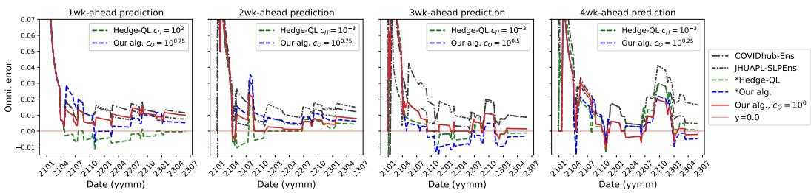  
Figure 2: Omni-error (Eq. (11)) over time for 1- to 4-week-ahead forecasting horizons (left to right panels) on the US-agg data for \*Our algorithm (blue), \*Hedge-QL (green) and the COVIDhub-Ens and JHUAPL-SLPEns ensembles (both black). The values of $c _ { H } , c _ { O }$ shown in the legend of each panel correspond to the learning rate which achieved the lowest total omni-error. The red line shows the results of our algorithm with a fixed learning rate constant $c _ { O } = 1$ . Lower values indicate better performance.

Note that Lemma 1 shows that this quantity approximates the true omniprediction error (Eq. (1)) within a factor of 2. The second is the cumulative quantile loss at time t, defined as

$$
\frac { 1 } { Y _ { \mathrm { m a x } } } \frac { 1 } { t } \sum _ { s = 1 } ^ { t } \sum _ { n = 1 } ^ { N } \mathbb { E } _ { q _ { n } \sim \hat { P } _ { n } ( s ) } \left[ \rho _ { \tau _ { n } } ( Y _ { s } - q _ { n } ) \right] ,
$$

where $\rho _ { \tau } ( x ) = \tau x - \operatorname* { m i n } \{ x , 0 \}$ is the canonical pinball loss for the τ-quantile and $Y _ { \mathrm { m a x } }$ is the maximum value of the ground truth in the given time-series. To clarify terminology, we refer to the omni-error and cumulative quantile loss at the final time step $T$ as the total omni-error and total quantile loss, respectively. Finally, as our last metric, we also consider the instantaneous normalized quantile loss at time $\begin{array} { r } { t \colon \frac { 1 } { Y _ { t } } \sum _ { n = 1 } ^ { N } \mathbb { E } _ { q _ { n } \sim \hat { P } _ { n } ( t ) } \left[ \rho _ { \tau _ { n } } ( Y _ { t } - q _ { n } ) \right] } \end{array}$

Discretization. As introduced in Section 3.1, we discretize both the predictions and the ground truth into a finite set of values. We use grid spacings from {2, 5, 10, 20, 50, 100, 500} depending on the range of forecast values. This results in more than 500 grid points for all $2 0 \dot { 8 } = 5 2 \times 4$ time-series, and more than 1,000 grid points for over 150 time-series. Additional details on the choice of discretization are provided in Appendix D.1.

Learning rates. Our algorithm and Hedge-QL each use a learning rate hyperparameter. Rather than tuning it explicitly, we evaluate each method over a range of learning rates, and we report results for the best-performing value on each metric, along with a sensitivity analysis showing how performance varies with learning rate. In plots and legends, the best performing learning rates are denoted by \*Our algorithm and \*Hedge-QL. For some plots, we also report results using a fixed learning rate. Finally, consistent with our theory, when referring to an instance of our algorithm with learning rate constant $c _ { O }$ , this corresponds to an implemented learning rate of $\eta = c _ { O } \sqrt { ( \log m N B ) / T }$ . Similarly, for Hedge-QL with constant $c _ { H }$ , the learning rate is set as $\eta = c _ { H } \sqrt { ( \log B ) / T } / Y _ { \mathrm { m a x } }$ We evaluate our algorithm over $c _ { O } \in \{ 1 0 ^ { i / 4 } \mid i = - 8 , \ldots , 5 \}$ and Hedge-QL over $c _ { H } \in \{ 1 0 ^ { i / 4 } \mid i = - 4 , . . . , 1 2 \}$ (note that larger constants are needed for Hedge-QL to account for the normalization by $1 / Y _ { \mathrm { m a x } }$ which gives it a smaller effective learning rate).

Results. We present plots of omni-error over time, as well as total omni-error and total quantile loss for our algorithm and baseline ensembles. We also provide a sensitivity analysis with respect to the learning rate. Overall, the results show that our algorithm is comparable to or outperforms the baseline ensembles, with particularly strong performance on more difficult prediction tasks. Additional plots, including comparisons of quantile forecast trajectories and distributions of ranks of each model at each (horizon, location, time) tuple, are provided in Appendix D.2.

As a first evaluation, Figure 2 shows the omni-error over time for our algorithm, Hedge-QL, and the two existing ensembling models on the US-agg data. We find that our algorithm outperforms the COVIDhub-Ens and JHUAPL-SLPEns ensembles across all time horizons, with larger performance gaps occurring at longer time horizons where forecasting is more challenging. On the other hand, Hedge-QL performs similarly to our algorithm, with the precise relative performance varying across horizons and learning rates. As a sensitivity check, this figure shows results for our algorithm obtained with both the best performing learning rate in hindsight and a fixed value of $c _ { O } = 1$ This latter value was chosen as it minimizes the theoretical bound given in Theorem 3. Across all time horizons, forecasts from our algorithm with $c _ { O } = 1$ perform as well as or better than the baseline ensembles.

To evaluate the generalizability of these results, the left panel of Figure 3 shows the differences in total omni-error (left column) and total quantile loss (right column) between our algorithm and each of the three comparators (rows). Similar to the results for US-agg, we find that our algorithm consistently outperforms the COVIDhub-Ens and JHUAPL-SLPEns across all time horizons with greater gaps being observed for longer horizons. In comparison to Hedge-QL, we find that our algorithm has a small advantage in terms of the total omni-error and realizes a much bigger performance improvement in terms of the total quantile error, especially at three and four week horizons.

The preceding results indicate that our algorithm shows the biggest performance gains on larger time horizons where forecasting is most difficult. To further investigate this trend, the right panel of Figure 3 displays the instantaneous quantile losses realized by our algorithm and Hedge-QL at each timestep. The color spectrum in this plot represents the difficulty of prediction at a given (horizon, location, time) tuple as measured by the average pinball loss of the base forecasters, $\begin{array} { r } { { \frac { 1 } { Y _ { t } } } { \frac { 1 } { B N } } \sum _ { n = 1 } ^ { N } \sum _ { b = 1 } ^ { B } \rho _ { \tau _ { n } } ( Y _ { t } { - } f _ { b } ^ { n } ( t ) ) } \end{array}$ . We find that more difficult (darker red) points are predominantly located above the $y = x$ line indicating that our algorithm achieves lower quantile loss than Hedge-QL on harder prediction instances.

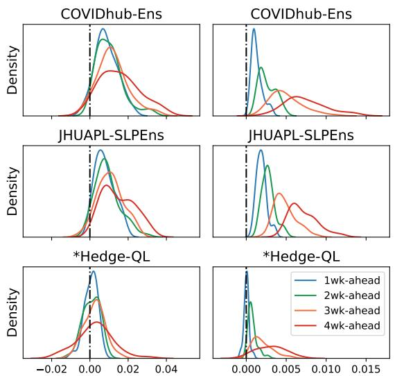

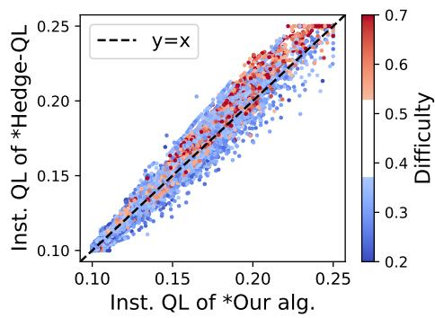  
Omni. error rel. to \*our alg. Quantile loss rel. to \*our alg.  
Figure 3: Left: State-level comparison of performance relative to \*Our algorithm. Rows show comparisons with three baseline ensembles. Each curve shows a Gaussian kernel density estimate of the difference in total omni-error (left column) or total quantile error (right column) across the 51 state-level time series for a given forecasting horizon. Values to the right of zero (vertical black dotted line) indicate better performance of our algorithm. Right: Comparison of instantaneous quantile loss realized by \*Our algorithm (x-axis) and \*Hedge-QL (y-axis). See text for detailed descriptions.

We conclude this section with a sensitivity analysis evaluating how the performance of our algorithm varies with the learning rate. Figure 4 shows the realized total omni-error and total quantile loss realized by our algorithm for 1- to 4-week-ahead horizons on the US-agg data with learning rate constants $c _ { O } \in \{ 1 0 ^ { i / 4 } \mid i = - 8 , \ldots , 5 \}$ . We see that across almost all horizons and learning rates our algorithm outperforms COVIDhub-Ens and JHUAPL-SLPEns and matches or improves on the performance of Hedge-QL. In general, we find that the total quantile loss varies more smoothly with respect to the learning rate than the total omni-error, although neither metric appears to be significantly sensitive to its value. A similar sensitivity plot for Hedge-QL is given in Appendix D.2.

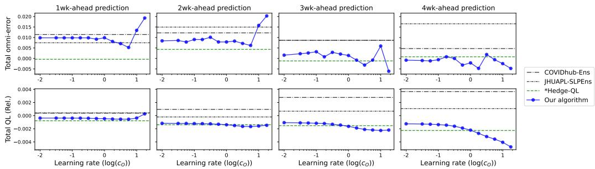  
Figure 4: Sensitivity of our algorithm to the choice of learning rate. Each panel shows the performance of our algorithm as a function of the learning rate (blue curve) as measured by the total omni-error (top row) or total quantile loss relative to best base forecaster (bottom row) on the US-agg data. Panels from left to right show results at 1- to 4-week time horizons, while horizontal lines indicate the performance of three baseline methods. Lower values indicate better performance.

## 5 Limitations and future work

In this paper, we develop computationally and sample efficient omniprediction methods for continuous prediction targets. To make this problem tractable, our results focus on bounded proper losses for a finite set of quantile levels. While this setting captures a broad and practically relevant class of evaluation criteria, it does not cover unbounded losses or proper losses defined on the full predictive distribution. For example, the log-loss $\ell ( f , y ) = - \log { \bar { f ( y ) } }$ falls into both categories and requires access to a forecasted density f. In general, quantile-based representations may be insufficient to evaluate such density-based proper losses, suggesting the need for new representations and algorithms beyond quantile aggregation. Exploring alternative aggregation criteria and determining the full scope of tractable omniprediction problems remain interesting directions for future work.

## Acknowledgments and Disclosure of Funding

MWM would like to acknowledge DARPA, NSF, the DOE Competitive Portfolios grant, and the DOE SciGPT grant for partial support of this work.

## References

[BRT25] Erez Buchweitz, João Vitor Romano, and Ryan J. Tibshirani. Asymmetric penalties underlie proper loss functions in probabilistic forecasting, 2025.

[CHW+22] Estee Y Cramer, Yuxin Huang, Yijin Wang, Evan L Ray, Matthew Cornell, Johannes Bracher, Andrea Brennen, Alvaro J Castro Rivadeneira, Aaron Gerding, Katie House, Dasuni Jayawardena, Abdul H Kanji, Ayush Khandelwal, Khoa Le, Jarad Niemi, Ariane Stark, Apurv Shah, Nutcha Wattanachit, Martha W Zorn, Nicholas G Reich, and US COVID-19 Forecast Hub Consortium. The united states covid-19 forecast hub dataset. Scientific Data, 2022.

[CRL+22] Estee Y Cramer, Evan L Ray, Velma K Lopez, Johannes Bracher, Andrea Brennen, Alvaro J Castro Rivadeneira, Aaron Gerding, Tilmann Gneiting, Katie H House, Yuxin Huang, et al. Evaluation of individual and ensemble probabilistic forecasts of covid-19 mortality in the united states. Proceedings of the National Academy of Sciences, 119(15):e2113561119, 2022.

[EGJK16] Werner Ehm, Tilmann Gneiting, Alexander Jordan, and Fabian Krüger. Of quantiles and expectiles: consistent scoring functions, choquet representations and forecast rankings. Journal of the Royal Statistical Society Series B: Statistical Methodology, 78(3):505–562, 2016.

[FKM+23] Rasool Fakoor, Taesup Kim, Jonas Mueller, Alexander J Smola, and Ryan J Tibshirani. Flexible model aggregation for quantile regression. Journal of Machine Learning Research, 24(162):1–45, 2023.

[FS97] Yoav Freund and Robert E. Schapire. A decision-theoretic generalization of on-line learning and an application to boosting. Journal of Computer and System Sciences, 55(1):119–139, 1997.

[FZ16] Tobias Fissler and Johanna F. Ziegel. Higher order elicitability and osband's principle. The Annals of Statistics, 44(4), August 2016.

[GJRR24] Sumegha Garg, Christopher Jung, Omer Reingold, and Aaron Roth. Oracle efficient online multicalibration and omniprediction. In Proceedings of the 2024 Annual ACM-SIAM Symposium on Discrete Algorithms (SODA), pages 2725–2792. SIAM, 2024.

[GK14] Tilmann Gneiting and Matthias Katzfuss. Probabilistic forecasting. Annual Review of Statistics and Its Application, 1(Volume 1, 2014):125–151, 2014.

[GKR+22] Parikshit Gopalan, Adam Tauman Kalai, Omer Reingold, Vatsal Sharan, and Udi Wieder. Omnipredictors. In 13th Innovations in Theoretical Computer Science Conference (ITCS 2022), pages 79–1. Schloss Dagstuhl–Leibniz-Zentrum für Informatik, 2022.

[GKR23] Parikshit Gopalan, Michael Kim, and Omer Reingold. Swap agnostic learning, or characterizing omniprediction via multicalibration. Advances in Neural Information Processing Systems, 36:39936–39956, 2023.

[Gne11] Tilmann Gneiting. Making and evaluating point forecasts. Journal of the American Statistical Association, 106(494):746–762, 2011.

[GOR+24] Parikshit Gopalan, Princewill Okoroafor, Prasad Raghavendra, Abhishek Shetty, and Mihir Singhal. Omnipredictors for regression and the approximate rank of convex functions, 2024.

[GR07] Tilmann Gneiting and Adrian E Raftery. Strictly proper scoring rules, prediction, and estimation. Journal of the American Statistical Association, 102(477):359–378, 2007.

[GRWG05] Tilmann Gneiting, Adrian E. Raftery, Anton H. Westveld, and Tom Goldman. Calibrated probabilistic forecasting using ensemble model output statistics and minimum crps estimation. Monthly Weather Review, 133(5):1098 – 1118, 2005.

[GT26] Isaac Gibbs and Ryan J. Tibshirani. Sample-efficient omniprediction for proper losses. In Proceedings of the 39th Annual Conference on Learning Theory (COLT), volume 336, pages 2679–2719. PMLR, 2026.

[Haz19] Elad Hazan. Introduction to online convex optimization. CoRR, abs/1909.05207, 2019.

[HF16] Tao Hong and Shu Fan. Probabilistic electric load forecasting: A tutorial review. International Journal of Forecasting, 32(3):914–938, 2016.

[HTY26] Lunjia Hu, Kevin Tian, and Chutong Yang. Simultaneous blackwell approachability and applications to multiclass omniprediction, 2026.

[LJGCW13] Kenneth C Lichtendahl Jr, Yael Grushka-Cockayne, and Robert L Winkler. Is it better to average probabilities or quantiles? Management Science, 59(7):1594–1611, 2013.

[LNPR22] Daniel Lee, Georgy Noarov, Mallesh Pai, and Aaron Roth. Online minimax multiobjective optimization: Multicalibeating and other applications. In Advances in Neural Information Processing Systems, 2022.

[LRS25] Jiuyao Lu, Aaron Roth, and Mirah Shi. Sample efficient omniprediction and downstream swap regret for non-linear losses, 2025.

[LW94] Nick Littlestone and Manfred K. Warmuth. The weighted majority algorithm. Information and Computation, 108(2):212–261, 1994.

[MIT+25] Cathal Mills, Nicholas J Irons, Joseph L-H Tsui, Sarah Sparrow, Luiz M Carvalho, Adam J Kucharski, Oliver Ratmann, Ben Lambert, Christl A Donnelly, and Moritz UG Kraemer. From metric to action: An evaluation framework to translate infectious disease forecasts into policy decisions. medRxiv, pages 2025–07, 2025.

[Mul24] Luke C Mullany. Jhuapl-slphospens. https://github.com/1mullany/ JHUAPL-SLPHospEns, 2024.

[NRRX25] Georgy Noarov, Ramya Ramalingam, Aaron Roth, and Stephan Xie. High-dimensional prediction for sequential decision making. In Forty-second International Conference on Machine Learning, 2025.

[OKK25] Princewill Okoroafor, Robert Kleinberg, and Michael P Kim. Near-optimal algorithms for omniprediction. arXiv preprint arXiv:2501.17205, 2025.

[Raf16] Adrian E. Raftery. Use and communication of probabilistic forecasts. Statistical analysis and data mining, 9(6):397–410, 2016.

[Sae00] M. Saerens. Building cost functions minimizing to some summary statistics. IEEE Transactions on Neural Networks, 11(6):1263–1271, 2000.

[Sav71] Leonard J Savage. Elicitation of personal probabilities and expectations. Journal of the American Statistical Association, 66(336):783–801, 1971.

[SWM+18] Danijel Schorlemmer, Maximilian J Werner, Warner Marzocchi, Thomas H Jordan, Yosihiko Ogata, David D Jackson, Sum Mak, David A Rhoades, Matthew C Gerstenberger, Naoshi Hirata, et al. The collaboratory for the study of earthquake predictability: Achievements and priorities. Seismological Research Letters, 89(4):1305–1313, 2018.

[Tho79] William Thomson. Eliciting production possibilities from a well-informed manager. Journal of Economic Theory, 20(3):360–380, 1979.

[VBD+21] Stéphane Vannitsem, John Bjørnar Bremnes, Jonathan Demaeyer, Gavin R Evans, Jonathan Flowerdew, Stephan Hemri, Sebastian Lerch, Nigel Roberts, Susanne Theis, Aitor Atencia, et al. Statistical postprocessing for weather forecasts: Review, challenges, and avenues in a big data world. Bulletin of the American Meteorological Society, 102(3):E681–E699, 2021.

[Vov90] Volodimir Vovk. Aggregating strategies. In Proceedings of the Workshop on Computational Learning Theory, 1990.

## A Proofs of Theoretical Results

## A.1 Proof of Lemma 1

Proof. Let $\theta _ { i ^ { * } } \in \{ \theta _ { i } \} _ { i = 1 } ^ { m }$ be the closest value from θ, where the ties are broken by rounding up. Observe that 1 $( \theta < a ) = \mathbb { 1 } ( \theta _ { i ^ { * } } < a )$ for $\textstyle a \in \{ { \frac { j } { m } } \} _ { j = 0 } ^ { m }$ . This gives

$$
\begin{array} { r l } & { \ell _ { \tau , \theta } ( x , y ) = ( \mathbb { 1 } ( y < x ) - \tau ) ( \mathbb { 1 } ( \theta < x ) - \mathbb { 1 } ( \theta < y ) ) } \\ & { \qquad = ( \mathbb { 1 } ( y < x ) - \tau ) ( \mathbb { 1 } ( \theta _ { i ^ { * } } < x ) - \mathbb { 1 } ( \theta _ { i ^ { * } } < y ) ) = \ell _ { \tau , \theta _ { i ^ { * } } } ( x , y ) , } \end{array}
$$

for $\textstyle x , y \in \{ { \frac { j } { m } } \} _ { j = 0 } ^ { m }$ and $\theta \in [ 0 , 1 )$ and $\ell _ { \tau , 1 } ( x , y ) = 0$ . Putting this together with characterization of $\ell \in \mathcal { L } _ { 1 }$ in Section 2.2, we obtain

$$
\begin{array} { r l } & { \underset { \ell \in \bar { \mathcal { L } } _ { 1 } , \ell \in \bar { \mathcal { L } } } { \operatorname* { s u p } } \frac { 1 } { T } \underset { \mathrm { t } = 1 } { \overset { T } { \sum } } [ \ell \ell ( q ( t ) , Y _ { t } ) - \ell ( f ( \ell ) , Y _ { t } ) ] } \\ & { = \underset { H = \underset { \ell \in [ m , \mathrm { s u p } , T ] } { \operatorname* { s u p } } } { \operatorname* { s u p } } \underset { \ell \in \mathcal { T } } { \overset { T } { \sum } } \underset { \ell = 1 } { \overset { X } { \sum } } \underset { m = 1 } { \overset { N } { \sum } } [ \int _ { 0 } ^ { 1 } \ell _ { T _ { n , \theta } } ( q _ { \alpha } ( t ) , Y _ { t } ) - \ell _ { \mathrm { r } _ { n } , \theta } ( f ^ { m } ( t ) , Y _ { t } ) d H _ { m } ( \theta ) ] } \\ & { \underset { \ell \in \mathop { \mathcal { L } } _ { 1 } = 0 } { \overset { \mathrm { s u p } } { \operatorname* { s u p } } } \underset { \ell \in \bar { \mathcal { T } } } { \overset { T } { \sum } } \underset { \mathrm { t } = 1 } { \overset { X } { \sum } } \underset { \ell = 1 } { \overset { D } { \sum } } [ \ell _ { \mathrm { r } _ { n , \theta } } ( q _ { \alpha } ( t ) , Y _ { t } ) - \ell _ { \mathrm { r } _ { n } , \theta } ( f ^ { m } ( t ) , Y _ { t } ) ] H _ { m } ( \theta \in [ \theta _ { i } - \frac { 1 } { 2 m } , \theta _ { i } + \frac { 1 } { 2 m } ) ) } \\ &  = \underset { H = \ell } { \overset { N } { \operatorname* { s u p } } } \underset { \ell = 1 } { \overset { N } { \sum } } \frac { 1 } { \underset { \ell = 1 } { \overset { D } { \sum } } } [ \underset { \ell = 1 } { \overset { N } { \sum } } \ell _ { \mathrm { r } _ { n , \theta } } ( q _ \end{array}
$$

Now we compute an upper bound of $\begin{array} { r } { \left( \sum _ { n = 1 } ^ { N } H _ { n } ( [ 0 , 1 ) ) \right) } \end{array}$ in terms of maximum possible value of $\ell ( ( x _ { n } ) _ { n = 1 } ^ { N } , y )$ . Observe that

$$
\begin{array} { r l } & { \ell ( 0 , . . . , 0 , 1 ) = \displaystyle \sum _ { n = 1 } ^ { N } \ell _ { n } ( 0 , 1 ) = \sum _ { n = 1 } ^ { N } \tau _ { n } ( g _ { n } ( 1 ) - g _ { n } ( 0 ) ) \underset { \mathrm { T h } = . 1 } { = } \sum _ { n = 1 } ^ { N } \tau _ { n } H _ { n } ( [ 0 , 1 ) ) } \\ & { \ell ( 1 , . . . , 1 , 0 ) = \displaystyle \sum _ { n = 1 } ^ { N } \ell _ { n } ( 1 , 0 ) = \sum _ { n = 1 } ^ { N } ( 1 - \tau _ { n } ) ( g _ { n } ( 1 ) - g _ { n } ( 0 ) ) \underset { \mathrm { T h } = . 1 } { = } \sum _ { n = 1 } ^ { N } ( 1 - \tau _ { n } ) H _ { n } ( [ 0 , 1 ) ) . } \end{array}
$$

Note that $g _ { n } ( 1 ) \ - \ g _ { n } ( 0 ) = H _ { n } ( [ 0 , 1 ) )$ from left-continuity of $g _ { n }$ . Since max l is larger than $\ell ( 0 , . . . , 0 , 1 )$ and $\ell ( 1 , . . . , 1 , 0 )$ , it's also larger than the average of these two, which is $\begin{array} { r } { ( 1 / 2 ) \sum _ { n = 1 } ^ { N } H _ { n } ( [ 0 , 1 ) ) } \end{array}$ . Putting together with the condition $| \ell | \leq 1$ , we have $\begin{array} { r } { \sum _ { n = 1 } ^ { N } H _ { n } ( [ 0 , 1 ) ) \leq 2 } \end{array}$ and this proves

$$
\begin{array} { r l } & { \frac { \operatorname* { s u p } _ { \ell \in \mathcal { L } _ { 1 } , f \in \mathcal { F } } \frac { 1 } { T } \sum _ { t = 1 } ^ { T } \left[ \ell ( q ( t ) , Y _ { t } ) - \ell ( f ( t ) , Y _ { t } ) \right] } { \operatorname* { s u p } _ { i , n , f } \frac { 1 } { T } \sum _ { t = 1 } ^ { T } \left[ \ell _ { \tau _ { n } , \theta _ { i } } ( q _ { n } ( t ) , Y _ { t } ) - \ell _ { \tau _ { n } , \theta _ { i } } ( f ^ { n } ( t ) , Y _ { t } ) \right] } \leq 2 . } \end{array}
$$

It remains to prove that the ratio above is at least 1. It follows from the fact that $\ell _ { \tau _ { n } , \theta _ { i } } \in \mathcal { L } _ { 1 }$ □

## A.2 Proof of Theorem 4

In this proof, we denote $\hat { \mathbf { P } } ( t ) \ = \ ( \hat { P } _ { n } ( t ) ) _ { n = 1 } ^ { N }$ by $( P _ { n } ^ { * } ) _ { n = 1 } ^ { N }$ . We introduce one lemma and two propositions that are essential for proving that the minimax solution $P _ { n } ^ { * }$ satisfies the monotonicity constraint (Property 2 in the theorem statement). First, Lemma 2 defines a quantity $V _ { n } ^ { * }$ , on which our closed-form solution $P _ { n } ^ { * }$ depends, for each $n \in [ N - 1 ]$ , and shows that there exists a non-decreasing sequence $\{ j _ { n } ^ { * } \} _ { n = 1 } ^ { N - 1 }$ , where each $j _ { n } ^ { * }$ is an index that minimizes $V _ { n } ( j )$

Lemma 2. Denote $[ m ] _ { 0 } : = [ m ] \cup \{ 0 \}$ and define a function $V _ { n } ( j )$ and a quantity $V _ { n } ^ { * } f o r n \in [ N - 1 ]$ as

$$
\begin{array} { r l r } {  { V _ { n } ( j ) : = \sum _ { i = j + 1 } ^ { m } \sum _ { s = 1 } ^ { n } \sum _ { b = 1 } ^ { B } w _ { i b } ^ { s } \mathbb { 1 } \{ \theta _ { i } < f _ { b } ^ { s } ( t ) \} + \sum _ { i = 1 } ^ { j } \sum _ { s = n + 1 } ^ { N } \sum _ { b = 1 } ^ { b } w _ { i b } ^ { s } ( 1 - \mathbb { 1 } \{ \theta _ { i } < f _ { b } ^ { s } ( t ) \} ) \geq 0 , } } \\ & { } & { V _ { n } ^ { * } : = \operatorname* { m i n } _ { j \in [ m ] _ { 0 } } V _ { n } ( j ) , } \end{array}\tag{12}
$$

$V _ { 0 } ^ { * } = V _ { N } ^ { * } : = 0 .$ Let $J _ { n } ^ { * }$ be the set of indices $j \in [ m ] _ { 0 }$ that minimizes the $V _ { n } ( j )$

Then, there exists a sorted sequence $0 = j _ { 0 } ^ { * } \le j _ { 1 } ^ { * } \le \ldots \le j _ { N - 1 } ^ { * } \le j _ { N } ^ { * } = m$ such that $j _ { n } ^ { * } \in J _ { n } ^ { * } f o r$ $n \in [ N - 1 ]$

Proof of Lemma 2. Define $w _ { i } ^ { s } : = ( w _ { i b } ^ { s } ) _ { b = 1 } ^ { B } , \mathbb { 1 } _ { i } ^ { s } : = ( \mathbb { 1 } \{ \theta _ { i } < f _ { b } ^ { s } ( t ) \} ) _ { b = 1 } ^ { B }$ , and $\mathbb { 1 } _ { B } : = ( 1 , . . . , 1 ) \in \mathbb { R } ^ { B }$ Then, $V _ { n } ^ { * }$ can be rewritten as

$$
V _ { n } ^ { * } = \operatorname* { m i n } _ { j \in [ m ] _ { 0 } } \left( \sum _ { i = j + 1 } ^ { m } \sum _ { s = 1 } ^ { n } w _ { i } ^ { s } \cdot \mathbb { 1 } _ { i } ^ { s } + \sum _ { i = 1 } ^ { j } \sum _ { s = n + 1 } ^ { N } w _ { i } ^ { s } \cdot \left( \mathbb { 1 } _ { B } - \mathbb { 1 } _ { i } ^ { s } \right) \right) .
$$

Suppose there exists a pair of indices $n , n + 1$ such that $j _ { n } ^ { * } > j _ { n + 1 } ^ { * }$ . Using the definition of $V _ { n } ^ { * }$ , we have

$$
\begin{array} { c } { { \displaystyle j _ { n } ^ { * } = \underset { j \in [ m ] _ { 0 } } { \operatorname { a r g m i n } } \left( \sum _ { i = j + 1 } ^ { m } \sum _ { s = 1 } ^ { n } w _ { i } ^ { s } \cdot \mathbb { I } _ { i } ^ { s } + \sum _ { i = 1 } ^ { j } \sum _ { s = n + 2 } ^ { N } w _ { i } ^ { s } \cdot ( \mathbb { I } _ { B } - \mathbb { I } _ { i } ^ { s } ) + \sum _ { i = 1 } ^ { j } w _ { i } ^ { n + 1 } \cdot ( \mathbb { I } _ { B } - \mathbb { I } _ { i } ^ { n + 1 } ) \right) , \displaystyle \medskip } } \\ { { \displaystyle j _ { n + 1 } ^ { * } = \underset { j \in [ m ] _ { 0 } } { \operatorname { a r g m i n } } \left( \sum _ { i = j + 1 } ^ { m } \sum _ { s = 1 } ^ { n } w _ { i } ^ { s } \cdot \mathbb { I } _ { i } ^ { s } + \sum _ { i = 1 } ^ { j } \sum _ { s = n + 2 } ^ { N } w _ { i } ^ { s } \cdot ( \mathbb { I } _ { F } - \mathbb { I } _ { i } ^ { s } ) + \sum _ { i = j + 1 } ^ { m } w _ { i } ^ { n + 1 } \cdot \mathbb { I } _ { i } ^ { n + 1 } \right) . \displaystyle } } \end{array}
$$

Two expressions share the first two terms and differ in the last term. We abbreviate these terms as the following:

$$
\begin{array} { l } { { C _ { j } : = \displaystyle \sum _ { i = j + 1 } ^ { m } \sum _ { s = 1 } ^ { n } w _ { i } ^ { s } \cdot \mathbb { 1 } _ { i } ^ { s } + \sum _ { i = 1 } ^ { j } \sum _ { s = n + 2 } ^ { N } w _ { i } ^ { s } \cdot \left( \mathbb { 1 } _ { B } - \mathbb { 1 } _ { i } ^ { s } \right) } } \\ { { \displaystyle D _ { j } : = \sum _ { i = 1 } ^ { j } w _ { i } ^ { n + 1 } \cdot \left( \mathbb { 1 } _ { B } - \mathbb { 1 } _ { i } ^ { n + 1 } \right) } } \\ { { \displaystyle E _ { j } : = \sum _ { i = j + 1 } ^ { m } w _ { i } ^ { n + 1 } \cdot \mathbb { 1 } _ { i } ^ { n + 1 } } . } \end{array}
$$

Note that $D _ { j }$ is non-decreasing in $j$ and $E _ { j }$ is non-increasing in j. Since $j _ { n } ^ { * }$ and $j _ { n + 1 } ^ { * }$ are the indices that minimize the $V _ { n } ( j )$ and ${ \overset { \cdot } { V } } _ { n + 1 } ( j )$ , respectively, we have $\dot { C } _ { j _ { n } ^ { \ast } } + \dot { D _ { j _ { n } ^ { \ast } } } \leq \dot { C } _ { j _ { n + 1 } ^ { \ast } } ^ { \ast } + D _ { j _ { n + } ^ { \ast } }$ and 1 $C _ { j _ { n } ^ { * } } + E _ { j _ { n } ^ { * } } \geq C _ { j _ { n + 1 } ^ { * } } + E _ { j _ { n + 1 } ^ { * } }$ . This implies that

$$
E _ { j _ { n + 1 } ^ { \ast } } - E _ { j _ { n } ^ { \ast } } \leq C _ { j _ { n } ^ { \ast } } - C _ { j _ { n + 1 } ^ { \ast } } \leq D _ { j _ { n + 1 } ^ { \ast } } - D _ { j _ { n } ^ { \ast } } .
$$

Because of the monotonicity of $D _ { j }$ and $E _ { j }$ and the assumption that $j _ { n } ^ { * } > j _ { n + 1 } ^ { * }$ , the leftmost term should be non-negative and the rightmost term should be non-positive. Therefore, we obtain

$$
C _ { j _ { n } ^ { * } } - C _ { j _ { n + 1 } ^ { * } } = D _ { j _ { n } ^ { * } } - D _ { j _ { n + 1 } ^ { * } } = E _ { j _ { n } ^ { * } } - E _ { j _ { n + 1 } ^ { * } } = 0 \quad \Rightarrow j _ { n + 1 } ^ { * } \in J _ { n } ^ { * } , \ j _ { n } ^ { * } \in J _ { n + 1 } ^ { * } .
$$

By choosing $j _ { n + 1 } ^ { * }$ as a minimizer of $V _ { n } ( j )$ and $j _ { n } ^ { * }$ as a minimizer of $V _ { n + 1 } ( j )$ , we resolve the unsorted pair of indices. Repeating this process yields a sorted sequence $0 = j _ { 0 } ^ { * } \le j _ { 1 } ^ { * } \le \ldots \le j _ { N - 1 } ^ { * } \le j _ { N } ^ { * } =$ m and this proves the existence of sorted sequence.

Due to its existence, we can simply obtain a sorted sequence by choosing jn = min $J _ { n } ^ { * }$ for all $n \in [ N ]$ □

Next, we introduce two propositions. The first proposition (Proposition 3) constructs $( P _ { n } ^ { * } ) _ { n = 1 } ^ { N }$ and prove their properties. The second proposition (Proposition 4) then show this $( P _ { n } ^ { * } ) _ { n = 1 } ^ { N }$ is indeed a solution for the minimax program (9) in Algorithm 1. Note that Property 1 in 3 statement below proves Property 1 in the original theorem (Theorem 4) statement.

Proposition 3. Given a sorted sequence $0 = j _ { 0 } ^ { * } \le j _ { 1 } ^ { * } \le \ldots \le j _ { N - 1 } ^ { * } \le j _ { N } ^ { * } = m$ from Lemma 2, there exists a distribution $P _ { n } ^ { * } f o r n \in [ N ]$ of the form

$$
P _ { n } ^ { * } = ( 1 - C _ { n } ) \delta _ { k _ { n } / m } + C _ { n } \delta _ { ( k _ { n } + 1 ) / m } ,\tag{13}
$$

such that the following properties hold:

1. $j _ { n - 1 } ^ { * } \leq k _ { n }$

2. $k _ { n } < j _ { n } ^ { * } i f j _ { n - 1 } ^ { * } \neq j _ { n } ^ { * }$ and $k _ { n } = j _ { n } ^ { * }$ with $C _ { n } = 0 ~ i f j _ { n - 1 } ^ { * } = j _ { n } ^ { * }$

3. The support of $P _ { n } ^ { * }$ is contained in $[ j _ { n - 1 } ^ { * } / m , j _ { n } ^ { * } / m ]$

$$
\begin{array} { r } { \mathcal { I } . \mathbb { E } _ { q _ { n } \sim P _ { n } ^ { * } } \left[ \sum _ { i = 1 } ^ { m } \sum _ { b = 1 } ^ { B } w _ { i b } ^ { n } \left( \mathbb { 1 } \left\{ \theta _ { i } < q _ { n } \right\} - \mathbb { 1 } \left\{ \theta _ { i } < f _ { b } ^ { n } ( t ) \right\} \right) \right] = V _ { n - 1 } ^ { * } - V _ { n } ^ { * } . } \end{array}
$$

Proof of Proposition 3. We use the notation $w _ { i } ^ { s } , \mathbb { 1 } _ { i } ^ { s }$ , and $\mathbb { 1 } _ { B }$ from the proof of Lemma 2. Note that the quantity ${ \hat { V } } _ { n } ^ { * }$ defined in Lemma 2 is equal to $V _ { n } ( j _ { n } ^ { * } )$ for all $n \in [ N { \bar { - } } 1 ]$ and that $V _ { n } ( j ) \geq V _ { n } ( j _ { n } ^ { * } )$ for all $j \in [ m ] _ { 0 }$   
Using the fact that $\mathbb { 1 } \{ \theta _ { i } < k / m \} = \mathbb { 1 } \{ i \leq k \}$ , the last property in the proposition statement is equivalent to

$$
\begin{array} { r l } & { V _ { n - 1 } ^ { n } - V _ { n } ^ { n } } \\ & { = \mathbb { E } _ { \mu \sim \mathcal { P } _ { n } ^ { n } } \Bigg \{ \displaystyle \sum _ { i = 1 } ^ { \infty } \sum _ { \ell = i } ^ { \infty } w _ { i i \ell } ^ { n } \big ( 1 \big ( \ell _ { i } < \ell _ { \ell } \big ) - 1 \big \{ \ell _ { i } < \ell _ { n } ^ { n } ( \ell ) \big \} \Big ) \Bigg \} } \\ & { = ( 1 - C _ { n } ) \displaystyle \sum _ { \ell = 1 } ^ { \infty } \sum _ { \ell = 1 } ^ { \infty } w _ { i \ell } ^ { n } \big ( 1 \big \{ \xi \big _ { i } < \ell _ { n } \big > - 1 \big \} \big \{ \ell _ { i } < \ell _ { k } ^ { n } ( \ell ) \big \} \big ) } \\ & { \qquad + C _ { n } \displaystyle \sum _ { i = 1 } ^ { \infty } \sum _ { \ell = 1 } ^ { \infty } w _ { i i \ell } ^ { n } \big ( 1 \big \{ \xi \big _ { i } \leq k _ { n } + 1 \big \} - 1 \big \{ \ell _ { i } < \ell _ { n } ^ { n } ( \ell ) \big \} \big \} } \\ & { = ( 1 - C _ { n } ) \displaystyle \sum _ { \ell = 1 } ^ { \infty } w _ { i \ell } ^ { n } \cdot ( 1 \big \{ \xi \big _ { i } \leq k _ { n } \big \} 1 _ { D } - 1 \big ) C _ { n } \displaystyle \sum _ { \ell = 1 } ^ { \infty } w _ { i \ell } ^ { n } \cdot \big ( 1 \big \{ \xi \big \} \leq k _ { n } + 1 \big ) \mathbb { I } _ { D } - 1 _ { i } ^ { n } \big \} } \\ & { \qquad \quad \times \displaystyle \sum _ { i = 1 } ^ { \infty } w _ { i \ell } ^ { n } \cdot ( 1 - C _ { n } ) ^ { n } \displaystyle \sum _ { \ell = 1 } ^ { \infty } w _ { i \ell } ^ { n } \cdot 1 _ { i } ^ { n } , } \end{array}
$$

The equality between the first and the last line is equivalent to

$$
\sum _ { i = 1 } ^ { k _ { n } } w _ { i } ^ { n } \cdot \mathbb { 1 } _ { B } + C _ { n } w _ { k _ { n } } ^ { n } \cdot \mathbb { 1 } _ { B } = \sum _ { i = 1 } ^ { m } w _ { i } ^ { n } \cdot \mathbb { 1 } _ { i } ^ { n } + V _ { n - 1 } ^ { * } - V _ { n } ^ { * } = \sum _ { i = 1 } ^ { j _ { n - 1 } ^ { * } } w _ { i } ^ { n } \cdot \mathbb { 1 } _ { B } + V _ { n } ( j _ { n - 1 } ^ { * } ) - V _ { n } ( j _ { n } ^ { * } ) ,\tag{14}
$$

where we used the identity $\begin{array} { r } { \sum _ { i = 1 } ^ { m } w _ { i } ^ { n } \cdot \mathbb { 1 } _ { i } ^ { n } + V _ { n - 1 } ( j ) = \sum _ { i = 1 } ^ { j } w _ { i } ^ { n } \cdot \mathbb { 1 } _ { B } + V _ { n } ( j ) } \end{array}$ evaluated at $j = j _ { n - 1 } ^ { * }$

Now we divide the cases into three cases. First, consider the case where $j _ { n - 1 } ^ { * } = j _ { n } ^ { * }$ . In this case, simply $k _ { n } = j _ { n - 1 } ^ { \ast }$ with $C _ { n } = 0$ satisfies the equation (14). Therefore, $P _ { n } ^ { * } = \delta _ { j _ { n - 1 } ^ { * } / m }$ satisfies the conditions. Second, consider the case where $j _ { n - 1 } ^ { * } < j _ { n } ^ { * }$ but $V _ { n } ( j _ { n - 1 } ^ { * } ) = V _ { n } ( j _ { n } ^ { * } ) . \ k _ { n } = j _ { n - 1 } ^ { * }$ with $C _ { n } = 0$ again satisfies the equation (14) and $k _ { n } = j _ { n - 1 } ^ { * } < j _ { n } ^ { * }$ in this case. Lastly, consider the case where $V _ { n } \big ( j _ { n - 1 } ^ { * } \big ) > V _ { n } ( j _ { n } ^ { * } )$ . We have

$$
\begin{array} { r l r } {  { \sum _ { i = 1 } ^ { j _ { n - 1 } ^ { * } } w _ { i } ^ { n } \cdot \mathbb { 1 } _ { F } < \sum _ { i = 1 } ^ { j _ { n - 1 } ^ { * } } w _ { i } ^ { n } \cdot \mathbb { 1 } _ { F } + V _ { n } ( j _ { n - 1 } ^ { * } ) - V _ { n } ( j _ { n } ^ { * } ) } } \\ & { } & \\ & { } & { \quad = \displaystyle \sum _ { i = 1 } ^ { m } w _ { i } ^ { n } \cdot \mathbb { 1 } _ { i } ^ { n } + V _ { n - 1 } ^ { * } - V _ { n } ^ { * } } \\ & { } & \\ & { } & { \quad = \displaystyle \sum _ { i = 1 } ^ { j _ { n } ^ { * } } w _ { i } ^ { n } \cdot \mathbb { 1 } _ { F } + V _ { n - 1 } ( j _ { n - 1 } ^ { * } ) - V _ { n - 1 } ( j _ { n } ^ { * } ) \leq \sum _ { i = 1 } ^ { j _ { n } ^ { * } } w _ { i } ^ { n } \cdot \mathbb { 1 } _ { F } , } \end{array}
$$

where two equalities used the identity $\begin{array} { r } { \sum _ { i = 1 } ^ { m } w _ { i } ^ { n } \cdot \mathbb { 1 } _ { i } ^ { n } + V _ { n - 1 } ( j ) = \sum _ { i = 1 } ^ { j } w _ { i } ^ { n } \cdot \mathbb { 1 } _ { B } + V _ { n } ( j ) } \end{array}$ evaluated at $j = j _ { n } ^ { * } - \bar { 1 }$ and $j = j _ { n } ^ { * }$ respectively. This implies that there exists a $j _ { n - 1 } ^ { * } \leq k _ { n } < j _ { n } ^ { * }$ such that

$$
\sum _ { i = 1 } ^ { k _ { n } } w _ { i } ^ { n } \cdot \mathbb { 1 } _ { B } < \sum _ { i = 1 } ^ { m } w _ { i } ^ { n } \cdot \mathbb { 1 } _ { i } ^ { n } - V _ { n } ^ { * } + V _ { n - 1 } ^ { * } \quad \mathrm { a n d } \quad \sum _ { i = 1 } ^ { k _ { n } + 1 } w _ { i } ^ { n } \cdot \mathbb { 1 } _ { B } \geq \sum _ { i = 1 } ^ { m } w _ { i } ^ { n } \cdot \mathbb { 1 } _ { i } ^ { n } - V _ { n } ^ { * } + V _ { n - 1 } ^ { * } .\tag{15}
$$

With such $k _ { n }$ , we define $P _ { n } ^ { * }$ with

$$
C _ { n } = \frac { 1 } { w _ { k _ { n } + 1 } ^ { n } \cdot \mathbb { 1 } _ { B } } \left( \sum _ { i = 1 } ^ { m } w _ { i } ^ { n } \cdot \mathbb { 1 } _ { i } ^ { n } - V _ { n } ^ { * } + V _ { n - 1 } ^ { * } - \sum _ { i = 1 } ^ { k _ { n } } w _ { i } ^ { n } \cdot \mathbb { 1 } _ { B } \right) ,\tag{16}
$$

and this satisfies supp $( P _ { n } ^ { * } ) \in [ j _ { n - 1 } ^ { * } / m , j _ { n } ^ { * } / m ]$ since $k _ { n } + 1 \leq j _ { n } ^ { * }$

The following theorem shows that $( P _ { n } ^ { * } ) _ { n = 1 } ^ { N }$ is a solution for the minimax program (9) in Algorithm 1.

Proposition 4. Given quantile levels $\tau _ { 1 } < \tau _ { 2 } < . . . < \tau _ { N }$ and quantile forecasts $f _ { b } ^ { n } ( t ) f o r b \in [ B ]$ $n \in [ N ]$ , define $V _ { n } ^ { * } f o r \bar { n } \in [ N - 1 ]$ as in equation (12), with $V _ { 0 } ^ { * } = V _ { N } ^ { * } : = 0 .$ Due to Lemma 2, there exists an increasing sequence $\{ j _ { n } ^ { * } \} _ { n = 1 } ^ { N - 1 }$ where $j _ { n } ^ { * }$ is an index that minimizes $V _ { n } ( j )$ . Define $j _ { 0 } ^ { * } = 0$ and $j _ { N } ^ { * } = m$

Then, $P _ { n } ^ { * } f o r n \in [ N ]$ given by (13) with

$$
P ^ { y * } = \tau _ { 1 } \delta _ { 0 } + ( 1 - \tau _ { N } ) \delta _ { 1 } + \sum _ { n = 1 } ^ { N - 1 } ( \tau _ { n + 1 } - \tau _ { n } ) \delta _ { j _ { n } ^ { * } / m }
$$

is a solution of the minimax program (9) and the value of the minimax program is

$$
- \sum _ { n = 1 } ^ { N - 1 } ( \tau _ { n + 1 } - \tau _ { n } ) V _ { n } ^ { \ast } \leq 0 .
$$

Proof of Proposition 4. Denote the minimax objective function by

$$
\mathcal { O } \left( ( P _ { n } ) _ { n = 1 } ^ { N } , P ^ { y } \right) = \sum _ { n = 1 } ^ { N } \sum _ { i = 1 } ^ { m } \sum _ { b = 1 } ^ { B } w _ { i b } ^ { n } \mathbb { E } _ { q _ { n } \sim P _ { n } , Y \sim P ^ { y } } \big [ \ell _ { \tau _ { n } , \theta _ { i } } ( q _ { n } , Y ) - \ell _ { \tau _ { n } , \theta _ { i } } ( f _ { b } ^ { n } ( t ) , Y ) \big ] .
$$

It suffices to show that $P ^ { y * }$ maximizes $O ( ( P _ { n } ^ { * } ) _ { n = 1 } ^ { N } , P ^ { y } )$ over $P ^ { y }$ , and that $( P _ { n } ^ { * } ) _ { n = 1 } ^ { N }$ minimizes $O ( ( P _ { n } ) _ { n = 1 } ^ { N } , P ^ { y * } )$ over $P _ { n } \in \Delta _ { m } , n \in [ N ]$ . We start with decomposing $O \left( ( P _ { n } ) _ { n = 1 } ^ { N } , P ^ { y } \right)$ . First, observe the following equality:

$$
\begin{array} { r l } & { \ell _ { \tau _ { n } , \theta _ { i } } ( q _ { n } , Y ) - \ell _ { \tau _ { n } , \theta _ { i } } ( f _ { b } ^ { n } ( t ) , Y ) } \\ & { \quad = ( \mathbb { 1 } ( Y < q _ { n } ) - \tau _ { n } ) \big ( \mathbb { 1 } ( \theta _ { i } < q _ { n } ) - \mathbb { 1 } ( \theta _ { i } < Y ) \big ) } \\ & { \qquad - \big ( \mathbb { 1 } ( Y < f _ { b } ^ { n } ( t ) ) - \tau _ { n } \big ) \big ( \mathbb { 1 } ( \theta _ { i } < f _ { b } ^ { n } ( t ) ) - \mathbb { 1 } ( \theta _ { i } < Y ) \big ) } \\ & { \qquad = \mathbb { 1 } ( Y , \theta _ { i } < q _ { n } ) - \tau _ { n } \mathbb { 1 } \big ( \theta _ { i } < q _ { n } \big ) - \mathbb { 1 } \big ( \theta _ { i } < Y < q _ { n } \big ) } \\ & { \qquad - \mathbb { 1 } ( Y , \theta _ { i } < f _ { b } ^ { n } ( t ) ) + \tau _ { n } \mathbb { 1 } \big ( \theta _ { i } < f _ { b } ^ { n } ( t ) \big ) + \mathbb { 1 } \big ( \theta _ { i } < Y < f _ { b } ^ { n } ( t ) \big ) } \\ & { \qquad = \mathbb { 1 } \big ( Y \leq \theta _ { i } < p \big ) - \tau _ { n } \mathbb { 1 } \big ( \theta _ { i } < q _ { n } \big ) - \mathbb { 1 } \big ( Y \leq \theta _ { i } < f _ { b } ( t ) \big ) + \tau _ { n } \mathbb { 1 } \big ( \theta _ { i } < f _ { b } ^ { n } ( t ) \big ) . } \end{array}\tag{17}
$$

Then, $O \left( ( P _ { n } ) _ { n = 1 } ^ { N } , P ^ { y } \right)$ can be written as

$$
\begin{array} { r l } {  { O ( ( P _ { n } ) _ { n = 1 } ^ { N } , P ^ { y } ) } \quad } & { } \\ & { = \displaystyle \sum _ { n = 1 } ^ { N } \sum _ { i = 1 } ^ { m } \sum _ { b = 1 } ^ { B } w _ { i b } ^ { n } \mathbb { E } _ { q _ { n } \sim P _ { n } , Y \sim P ^ { y } } [ \mathbb { 1 } ( Y \leq \theta _ { i } < q _ { n } ) - \tau _ { n } \mathbb { 1 } ( \theta _ { i } < q _ { n } ) - \mathbb { 1 } ( Y \leq \theta _ { i } < f _ { b } ^ { n } ( t ) ) ] + C _ { n } , } \end{array}\tag{18}
$$

where $\begin{array} { r } { C _ { n } = \tau _ { n } \sum _ { i = 1 } ^ { m } \sum _ { b = 1 } ^ { B } w _ { i b } ^ { n } \mathbb { 1 } \{ \theta _ { i } < f _ { b } ^ { n } ( t ) \} } \end{array}$ which does not depend on $P _ { n } \ \mathrm { o r } \ P ^ { y }$

Using this decomposition, we prove $O \left( ( P _ { n } ^ { * } ) _ { n = 1 } ^ { N } , P ^ { y * } \right) = \operatorname* { m a x } _ { P ^ { y } } O \left( ( P _ { n } ^ { * } ) _ { n = 1 } ^ { N } , P ^ { y } \right)$ . Let $p _ { y j } =$ $\begin{array} { r } { P ^ { y } ( \frac { j } { m } ) \operatorname { f o r } j = 0 , . . . , m } \end{array}$ . Then, again using the notation $w _ { i } ^ { s } , \mathbb { 1 } _ { i } ^ { s }$ , and $\mathbb { 1 } _ { B }$ from the proof of Lemma $^ { 2 , }$ $O \left( ( \overbrace { P _ { n } ^ { * } } ) _ { n = 1 } ^ { N } , P ^ { y } \right)$ is rephrased as the following:

$$
\mathcal { O } \left( \left( P _ { n } ^ { * } \right) _ { n = 1 } ^ { N } , P ^ { y } \right) = \sum _ { n = 1 } ^ { N } \mathbb { E } _ { q _ { n } \sim P _ { n } ^ { * } } \left[ \sum _ { j } p _ { y j } \sum _ { i = j + 1 } ^ { m } w _ { i } ^ { n } \cdot \left( \mathbb { 1 } \left\{ \theta _ { i } < q _ { n } \right\} \mathbb { 1 } _ { F } - \mathbb { 1 } _ { i } ^ { n } \right) \right] + C ( P _ { n } ^ { * } ) ,\tag{19}
$$

where $\begin{array} { r } { C ( P _ { n } ^ { * } ) = - \tau _ { n } \mathbb { E } _ { q _ { n } \sim P _ { n } ^ { * } } \sum _ { i = 1 } ^ { m } w _ { i } ^ { n } \cdot ( \mathbb { 1 } \left\{ \theta _ { i } < q _ { n } \right\} \mathbb { 1 } _ { F } - \mathbb { 1 } _ { i } ^ { n } ) } \end{array}$ only depends on $P _ { n } ^ { * }$ and does not depend on $\ddot { P } ^ { y }$

Plugging in $P _ { n } ^ { * }$ given as (13), the summand can be expressed as

$$
\begin{array} { r l } & { A _ { j } ^ { n } : = \mathbb { E } _ { q _ { n } \sim P _ { n } ^ { * } } \left[ \displaystyle \sum _ { i = j + 1 } ^ { m } w _ { i } ^ { n } \cdot ( \mathbb { 1 } \left\{ \theta _ { i } < q _ { n } \right\} \mathbb { 1 } _ { F } - \mathbb { 1 } _ { i } ^ { n } ) \right] } \\ & { \quad = \left\{ - \displaystyle \sum _ { i = 1 } ^ { j } w _ { i } ^ { n } \cdot ( \mathbb { 1 } _ { B } - \mathbb { 1 } _ { i } ^ { n } ) - V _ { n } ^ { * } + V _ { n - 1 } ^ { * } \qquad j \le k _ { n } ^ { * } \right. } \\ & { \qquad \quad - \displaystyle \sum _ { i = j + 1 } ^ { m } w _ { i } ^ { n } \cdot \mathbb { 1 } _ { i } ^ { n } \qquad } & { j > k _ { n } ^ { * } . } \end{array}
$$

This leads to

$$
{ \begin{array} { r l } & { A _ { j } : = \displaystyle \sum _ { n = 1 } ^ { N } A _ { j } ^ { n } } \\ & { = \left\{ { \begin{array} { l } { - \sum _ { n = 1 } ^ { N } \sum _ { i = 1 } ^ { j } w _ { i } ^ { n } \cdot ( \mathbb { 1 } _ { B } - \mathbb { 1 } _ { i } ^ { n } ) + V _ { 0 } ^ { * } \ } \\ { - \sum _ { n = 1 } ^ { n } \sum _ { i = j + 1 } ^ { m } w _ { i } ^ { s } \cdot \mathbb { 1 } _ { i } ^ { s } } \end{array} } \right. \quad j \leq k _ { 1 } } \\ & { \qquad - \sum _ { s = n + 1 } ^ { N } \sum _ { i = 1 } ^ { j } w _ { i } ^ { s } \cdot ( \mathbb { 1 } _ { B } - \mathbb { 1 } _ { i } ^ { s } ) + V _ { n } ^ { * } \quad \quad j \in ( k _ { n } , k _ { n + 1 } ] , \ n \in [ N - 1 ] } \\ & { \qquad - \sum _ { n = 1 } ^ { N } \sum _ { i = j + 1 } ^ { m } w _ { i } ^ { n } \cdot \mathbb { 1 } _ { i } ^ { n } + V _ { N } ^ { * } \quad \ \quad j > k _ { N } . } \end{array} }
$$

Notice that $A _ { j }$ is non-increasing on $j \leq k _ { 1 }$ and non-decreasing on $j > k _ { N } . ~ A _ { 0 } = 0$ and $A _ { m } = 0$ is the maximum value of $A _ { j }$ in these ranges, respectively. Next, observe that $A _ { j } \leq 0$ for all $j =$ $0 , 1 , . . . , m$ since $V _ { n } ^ { * }$ is the minimum value that $\begin{array} { r } { \sum _ { s = 1 } ^ { n } \sum _ { i = j + 1 } ^ { m } w _ { i } ^ { s } \cdot \mathbb { 1 } _ { i } ^ { s } + \sum _ { s = n + 1 } ^ { N } \sum _ { i = 1 } ^ { j } w _ { i } ^ { s } \cdot ( \mathbb { 1 } _ { B } - \mathbb { 1 } _ { i } ^ { s } ) } \end{array}$ can achieve by its definition. It suffices to show that $A _ { j _ { r } ^ { * } } = 0$ for $n \in [ N - 1 ]$ since $P ^ { y * }$ only puts mass on these points. Note that $A _ { j _ { 0 } } = A _ { 0 } = 0$ and $A _ { j N } = A _ { m } = 0$

From the first and second properties in the statement of Proposition 3, we have $k _ { n } < j _ { n } ^ { * } \leq k _ { n + 1 }$ $\mathrm { i f } \ j _ { n - 1 } ^ { * } \neq j _ { n } ^ { * }$ and $j _ { n - 1 } ^ { * } = { \bar { j } } _ { n } ^ { * } \stackrel { - } { = } k _ { n } \mathrm { i f } j _ { \nu - 1 } ^ { * } = j _ { \nu } ^ { * }$ , for $n \in [ \bar { N } - 1 ]$ . In the former case, we obtain $A _ { j _ { n } ^ { * } } = 0$ from $j \in ( k _ { n } , k _ { n + 1 } ]$ case in the definition of $A _ { j }$ above. In the latter case, $j _ { n } ^ { * } = k _ { n }$ does not fall into the range $\left( k _ { n } , k _ { n + 1 } \right]$ . Still, from $j \in ( k _ { n - 1 } , k _ { n } ]$ case $( j \leq k _ { 1 }$ case if $n = 1 )$ in the definition of $A _ { j }$ , we have

$$
\begin{array} { l } { { \displaystyle { A _ { j _ { n } ^ { * } } = - \sum _ { s = 1 } ^ { n - 1 } \sum _ { i = j + 1 } ^ { m } w _ { i } ^ { s } \cdot \mathbb { 1 } _ { i } ^ { s } - \sum _ { s = n } ^ { N } \sum _ { i = 1 } ^ { j } w _ { i } ^ { s } \cdot ( \mathbb { 1 } _ { B } - \mathbb { 1 } _ { i } ^ { s } ) + V _ { n - 1 } ^ { * } } } } \\ { { \displaystyle ~ = - V _ { n - 1 } ( j _ { n } ^ { * } ) + V _ { n - 1 } ^ { * } = - V _ { n - 1 } ( j _ { n - 1 } ^ { * } ) + V _ { n - 1 } ^ { * } = 0 , } } \end{array}
$$

where $V _ { n } ( j )$ is defined as equation (12). Therefore, $A _ { j _ { n } ^ { * } } ~ = ~ 0$ for all $n ~ \in ~ [ N \mathrm { ~ - ~ } 1 ]$ and $O \left( ( P _ { n } ^ { * } ) _ { n = 1 } ^ { N } , P ^ { y * } \right) = \operatorname* { m a x } _ { P ^ { y } } O \left( ( P _ { n } ^ { * } ) _ { n = 1 } ^ { N } , P ^ { y } \right)$

Next, we show that $\begin{array} { r } { O \left( ( P _ { n } ^ { * } ) _ { n = 1 } ^ { N } , P ^ { y * } \right) = \operatorname* { m i n } _ { P _ { n } \in \Delta _ { m } , n \in [ N ] } O \left( ( P _ { n } ) _ { n = 1 } ^ { N } , P ^ { y * } \right) } \end{array}$ . This follows directly from the propriety of $\ell _ { \tau _ { n } , \theta _ { i } }$ losses and the third property in Proposition 3. Any point in the support of $P _ { n } ^ { * }$ is $\tau _ { n } \cdot$ level quantile of $P ^ { y * }$ since $P ^ { y * } ( Y \leq \stackrel { \cdot } { j _ { n - 1 } ^ { * } } ^ { * } / \stackrel { \cdot } { m } ) = \tau _ { n }$ and $P ^ { y * } ( Y \geq \hat { j } _ { n } ^ { * } / m ) = \tau _ { n }$

Lastly, we compute the value of the minimax program. Decomposition (19) can be rewritten as

$$
O \left( ( P _ { n } ^ { * } ) _ { n = 1 } ^ { N } , P ^ { y } \right) = \sum _ { j = 0 } ^ { m } p _ { y j } A _ { j } + \sum _ { n = 1 } ^ { N } C ( P _ { n } ^ { * } ) .
$$

Since $P ^ { y * }$ only puts mass on points $j / m$ such that $A _ { j } = 0$ , plugging in $P ^ { y * }$ into the equation above yields

$$
\begin{array} { l } { { \displaystyle { \cal O } \left( \bigl ( P _ { n } ^ { * } \bigr ) _ { n = 1 } ^ { N } , P ^ { y * } \right) = \sum _ { n = 1 } ^ { N } C \bigl ( P _ { n } ^ { * } \bigr ) = - \sum _ { n = 1 } ^ { N } \tau _ { n } \mathbb { E } _ { q _ { n } \sim P _ { n } ^ { * } } \sum _ { i = 1 } ^ { m } w _ { i } ^ { n } \cdot \bigl ( \mathbb { 1 } \left\{ \theta _ { i } < q _ { n } \right\} \mathbb { 1 } _ { F } - \mathbb { 1 } _ { i } ^ { n } \bigr ) } } \\ { { \displaystyle \quad \quad = - \sum _ { n = 1 } ^ { N } \tau _ { n } \bigl ( V _ { n - 1 } ^ { * } - V _ { n } ^ { * } \bigr ) = - \sum _ { n = 1 } ^ { N - 1 } ( \tau _ { n + 1 } - \tau _ { n } ) V _ { n } ^ { * } \le 0 , } } \end{array}
$$

where the second from the last equality used the fourth property in Proposition 3.

Lastly, we prove the second and third property in Theorem 4 statment using Proposition 3 and Proposition 4.

Proof of Property 2 in Theorem 4. It suffices to prove that $P _ { n + 1 }$ is stochastically larger than $P _ { n }$ since we can couple these two by $U \sim \mathrm { U n i f } ( 0 , 1 )$ and $P _ { n } = F _ { P _ { n } } ^ { - 1 } ( U )$ and $P _ { n + 1 } = \dot { F } _ { P _ { n + 1 } } ^ { - 1 } ( U )$ where $F _ { X } ^ { - 1 }$ denotes a inverse of cumulative distribution function of X.

Combining the first three properties in the statement in Proposition 3, we have $k _ { n } < j _ { n } ^ { * } \leq k _ { n + 1 }$ if $j _ { n - 1 } ^ { * } \neq j _ { n } ^ { * }$ . In this case, $P _ { n + 1 } ^ { \mp }$ is stochastically larger than $P _ { n } ^ { * }$ since $P _ { n } ^ { * }$ is supported on $\{ k _ { n } / m , ( k _ { n } +$ $1 ) / m \}$ and $k _ { n + 1 } > k _ { n }$ . In case $j _ { n - 1 } ^ { * } = j _ { n } ^ { * } , \bar { P } _ { n } ^ { * } \equiv \bar { j } _ { n } ^ { * }$ and $P _ { n + 1 }$ is stochastically larger than $P _ { n }$ since $k _ { n + 1 } \geq j _ { n } ^ { * }$ □

Proof of Property 3 in Theorem 4. Since $P _ { n } ^ { * }$ is stochastically ordered, it suffices to prove that $P _ { 1 } ^ { * } \geq$ $m _ { 1 } / m$ and $\bar { P } _ { N } ^ { * } \overset {  } { \leq } m _ { 2 } / m$ almost surely. First we prove that $P _ { 1 } ^ { * } \ge m _ { 1 } / m$ almost surely. Observe that, for $i \leq \ddot { m _ { 1 } } , \mathbb { 1 } \{ \bar { \theta _ { i } } < f _ { b } ^ { n } ( t ) \} = 1$ for all $b \in [ B ]$ and $n \in [ N ]$ . This implies that $\mathbb { 1 } _ { i } ^ { n } = \mathbb { 1 } _ { B }$ for all $n \in [ N ]$ and $i \leq m _ { 1 }$ . Therefore, for $j \leq m _ { 1 }$

$$
V _ { 1 } ( j ) = \sum _ { i = j + 1 } ^ { m } w _ { i } ^ { 1 } \cdot \mathbb { 1 } _ { i } ^ { 1 } + \sum _ { i = 1 } ^ { j } \sum _ { s = 2 } ^ { N } w _ { i } ^ { s } \cdot ( \mathbb { 1 } _ { B } - \mathbb { 1 } _ { i } ^ { s } ) = \sum _ { i = j + 1 } ^ { m _ { 1 } } w _ { i } ^ { 1 } \cdot \mathbb { 1 } _ { B } + \sum _ { i = m _ { 1 } + 1 } ^ { m } w _ { i } ^ { 1 } \cdot \mathbb { 1 } _ { i } ^ { 1 }
$$

holds and $V _ { 1 } ( j )$ is non-increasing in $j \ \mathrm { o n } \ j \le m _ { 1 }$ . This implies that $\begin{array} { r } { V _ { 1 } ^ { * } \leq V _ { 1 } ( m _ { 1 } ) = \sum _ { i = m _ { 1 } + 1 } ^ { m } w _ { i } ^ { 1 } } \end{array}$ $\mathbb { 1 } _ { i } ^ { 1 }$ and thus

$$
\sum _ { i = 1 } ^ { m _ { 1 } } w _ { i } ^ { 1 } \cdot \mathbb { 1 } _ { B } = \sum _ { i = 1 } ^ { m _ { 1 } } w _ { i } ^ { 1 } \cdot \mathbb { 1 } _ { i } ^ { 1 } \leq \sum _ { i = 1 } ^ { m } w _ { i } ^ { 1 } \cdot \mathbb { 1 } _ { i } ^ { 1 } - V _ { 1 } ^ { * } + V _ { 0 } ^ { * } ,
$$

since $\mathbb { 1 } _ { i } ^ { s } = \mathbb { 1 } _ { B }$ for $i \leq m _ { 1 }$ and $V _ { 0 } ^ { * } = 0$ . In case the inequality is strict, $k _ { 1 }$ that satisfies the condition (15) should be at least $m _ { 1 }$ , which proves $P _ { 1 } ^ { * } \ge m _ { 1 } / m$ almost surely. In case the equality holds, $k _ { 1 } + 1 = m _ { 1 }$ since $\begin{array} { r } { w _ { m _ { 1 } } ^ { 1 } \cdot \mathbb { 1 } _ { B } = \sum _ { b = 1 } ^ { B } w _ { m _ { 1 } } ^ { 1 } > 0 } \end{array}$ from the corollary condition. However, $C _ { 1 } = 1$ in this case and $P _ { 1 } ^ { * } = \delta _ { m _ { 1 } / m }$ which satisfies $P _ { 1 } ^ { * } \ge m _ { 1 } / m$ almost surely.

Next, we prove that $P _ { N } ^ { * } \leq m _ { 2 }$ /m almost surely in a similar manner. For $i > m _ { 2 } , \mathbb { 1 } \{ \theta _ { i } < f _ { b } ^ { n } ( t ) \} = 0$ for all $b \in [ B ]$ and $n \in [ N ]$ . This implies that $\mathbb { 1 } _ { i } ^ { n } = \mathbb { 1 } _ { B }$ for all $n \in [ N ]$ and $i > m _ { 2 }$ . Therefore, for $j \geq m _ { 2 }$

$$
V _ { N _ { 1 } } ( j ) = \sum _ { i = j + 1 } ^ { m } \sum _ { s = 1 } ^ { N - 1 } w _ { i } ^ { s } \cdot \mathbb { 1 } _ { i } ^ { s } + \sum _ { i = 1 } ^ { j } w _ { i } ^ { N } \cdot ( \mathbb { 1 } _ { B } - \mathbb { 1 } _ { i } ^ { N } ) = \sum _ { i = 1 } ^ { m _ { 2 } } w _ { i } ^ { N } \cdot ( \mathbb { 1 } _ { B } - \mathbb { 1 } _ { i } ^ { N } ) + \sum _ { i = m _ { 2 } + 1 } ^ { m } w _ { i } ^ { N } \cdot \mathbb { 1 } _ { B }
$$

holds and $V _ { N - 1 } ( j )$ is non-decreasing in j on $j \geq m _ { 2 }$ . This implies that $V _ { N - 1 } \leq V _ { N - 1 } ( m _ { 2 } ) =$ $\begin{array} { r } { \sum _ { i = 1 } ^ { m _ { 2 } } w _ { i } ^ { N } \cdot ( \mathbf { \dot { \mathbb { 1 } } } _ { B } - \mathbf { \mathbb { 1 } } _ { i } ^ { N } ) } \end{array}$ and thus

$$
\sum _ { i = 1 } ^ { m } w _ { i } ^ { N } \cdot \mathbb { 1 } _ { i } ^ { N } - V _ { N } ^ { * } + V _ { N - 1 } ^ { * } \leq \sum _ { i = 1 } ^ { m } w _ { i } ^ { N } \cdot \mathbb { 1 } _ { i } ^ { N } + \sum _ { i = 1 } ^ { m _ { 2 } } w _ { i } ^ { N } \cdot \left( \mathbb { 1 } _ { B } - \mathbb { 1 } _ { i } ^ { N } \right) = \sum _ { i = 1 } ^ { m _ { 2 } } w _ { i } ^ { N } \cdot \mathbb { 1 } _ { B }
$$

since $\mathbf { 1 } _ { i } ^ { N } = \mathbf { 0 }$ for $i > m _ { 2 }$ and $V _ { N } ^ { * } = 0$ . Because $\begin{array} { r } { w _ { m _ { 2 } } ^ { N } \cdot \mathbb { 1 } _ { B } = \sum _ { b = 1 } ^ { B } w _ { m _ { 2 } } ^ { N } > 0 } \end{array}$ from the corollary condition, $k _ { n }$ that satisfies the condition (15) should satisfy $k _ { N } < m _ { 2 } .$ , which proves $P _ { N } ^ { * } \leq m _ { 2 } / m$ almost surely. □

## A.3 Proof of Theorem 3

Theorem 5 (Full statement of Theorem 3). For a set of quantile levels $\tau _ { 1 } < \tau _ { 2 } < . . . < \tau _ { N }$ , let $\mathcal { L } _ { 1 }$ denote the class of proper losses for multiple quantile levels defined as equation (6). Consider base forecasters $\{ f _ { b } \} _ { b = 1 } ^ { B }$ where each forecaster $f _ { b }$ provides $\{ \tau _ { n } \} _ { n = 1 } ^ { N }$ -level quantile forecasts $\{ f _ { b } ^ { n } ( t ) \} _ { n = 1 } ^ { N }$ at each time $\ddot { t } \in [ \overline { { T } } ]$ . With the target values $Y _ { t } ,$ forecaster predictions $\bar { f } _ { b } ^ { n } ( t ) f o r t \in [ T ] , \bar { n } \in [ \bar { N } ] , \bar { b } \in$ $[ B ]$ each taking values in a uniform grid of size m, and the learning rate $\eta = c \sqrt { ( \log m N B ) / T }$ , the output ${ \hat { \mathbf { P } } } ( t ) = ( { \hat { P } } _ { n } ( t ) ) _ { n = 1 } ^ { N }$ from Algorithm 1 achieves the following omniprediction error:

$$
\operatorname* { s u p } _ { \ell \in \mathcal { L } _ { 1 } , b \in [ B ] } \frac { 1 } { T } \sum _ { t = 1 } ^ { T } \mathbb { E } _ { q _ { n } \sim \hat { P } _ { n } ( t ) , \forall n } [ \ell ( ( q _ { n } ) _ { n = 1 } ^ { N } , Y _ { t } ) ] - \ell ( f _ { b } ( t ) , Y _ { t } ) ] \leq 2 \left( c + \frac { 1 } { c } \right) \left( \sqrt { \frac { \log m N B } { T } } \right)
$$

Proof. Observe that $\ell _ { \tau _ { n } , \theta _ { i } } ( x , y ) \in \{ 0 , \tau _ { n } , 1 - \tau _ { n } \}$ and thus $\vert \ell _ { \tau _ { n } , \theta _ { i } } ( x _ { 1 } , y _ { 1 } ) - S _ { \tau _ { n } , \theta _ { i } } ( x _ { 2 } , y _ { 2 } ) \vert \leq 1$ Without loss of generality, we assume that $Y _ { t } , f _ { b } ( t ) \in \{ 0 , \frac { 1 } { m } , . . . , 1 \}$ for all $t \in [ T ] , b \in [ B ]$ , as this construction extends to any bounded interval $[ - B _ { \ell } , B _ { u } ]$ via rescaling.

The regret bound of hedge algorithm (Theorem 7) gives the following:

$$
\begin{array} { l } { \displaystyle \operatorname* { m a x } _ { i \in [ m ] , n \in [ N ] , b \in [ B ] } \frac { 1 } { T } \sum _ { t = 1 } ^ { T } \mathbb { E } _ { q _ { n } \sim \hat { P } _ { n } ( t ) , \forall n } \left[ \ell _ { \tau _ { n } , \theta _ { i } } ( q _ { n } , Y _ { t } ) - \ell _ { \tau _ { n } , \theta _ { i } } \big ( f _ { b } ^ { n } ( t ) , Y _ { t } \big ) \right] } \\ { \displaystyle \leq \frac { 1 } { T } \sum _ { t = 1 } ^ { T } \sum _ { i = 1 } ^ { m } \sum _ { n = 1 } ^ { N } \sum _ { b = 1 } ^ { B } w _ { i b } ^ { n } ( t ) \mathbb { E } _ { q _ { n } \sim \hat { P } _ { n } ( t ) , \forall n } \left[ \ell _ { \tau _ { n } , \theta _ { i } } ( q _ { n } , Y _ { t } ) - \ell _ { \tau _ { n } , \theta _ { i } } \big ( f _ { b } ^ { n } ( t ) , Y _ { t } \big ) \right] + \eta + \frac { \log m N B } { T \eta } . } \end{array}\tag{20}
$$

Proposition 4 states that the value of the minimax program (9) is non-positive. Putting these together with previous lemmas, we have:

$$
\begin{array} { l } { { \displaystyle \operatorname* { s u p } _ { \ell \in S _ { \ell } , I \in F } \frac { 1 } { T } \sum _ { \ell = 1 } ^ { T } \mathbb { E } _ { \sigma _ { n } \sim \hat { P } _ { n } ( \ell ) , \forall n } [ \ell ( ( q _ { n } ) _ { n } ^ { N } - 1 , Y _ { \ell } ) - \ell ( f ( \ell ) , Y _ { \ell } ) ] } } \\ { { \displaystyle \operatorname* { s u p } _ { \ell \in S _ { \ell } , I \in F } \sum _ { i \in [ m , 1 ) \in [ N ] } ^ { \infty } \mathbb { E } \sum _ { \ell = 1 } ^ { T } \mathbb { E } _ { \sigma _ { n } \sim \hat { P } _ { n } ( \ell ) , \forall n } [ \ell _ { \tau _ { n } , \theta _ { i } } ( \hat { q } _ { n } , Y _ { \ell } ) - \ell \sigma _ { n , \theta _ { i } } ( f _ { k } ^ { \mathrm { a n } } ( \ell ) , Y _ { \ell } ) ] } } \\ { { \displaystyle \operatorname* { s u p } _ { \ell \in \{ 0 , 1 \} ^ { N } \geq \infty } \sum _ { i \in [ m , 1 ) \in [ N ] } ^ { T } \sum _ { k = 1 } ^ { N } \mathbb { E } _ { \sigma _ { n } \sim \hat { P } _ { n } ( \ell ) } ^ { \infty } \mathbb { E } _ { \sigma _ { n } \sim \hat { P } _ { n } ( \ell ) , \forall n } [ \ell _ { \tau _ { n } , \theta _ { i } } ( \hat { q } _ { n } , Y _ { \ell } ) - \ell _ { \tau _ { n } , \theta _ { i } } ( f _ { k } ^ { \mathrm { a n } } ( \ell ) , Y _ { \ell } ) ] } } \\   \displaystyle \operatorname* { s u p } _ { \ell \in \{ 0 , 1 \} ^ { N } \geq \infty } \sum _ { i = 1 } ^ { T } \sum _ { i = 1 } ^ { N } \sum _ { n = 1 } ^ { N } \mathbb { E } _ { \sigma _ { n } \sim \hat { P } _ { n } ( \ell ) , \forall n } [ \ell _ { \tau _ { n } , \theta _ { i } } ( \hat { q } _  \end{array}
$$

## A.4 Proof of Proposition 2

It suffices to treat an enlargement by one cell; the general case follows by iterating. Concretely, we compare two scenarios:

S1: grid $\{ 0 , { \frac { 1 } { m } } , \dots , { \frac { m } { m } } \}$ , weights $w _ { i b } ^ { n } , i \in [ m ]$

S2: grid $\{ 0 , \frac { 1 } { m } , \ldots , \frac { m + 1 } { m } \}$ , weights $\tilde { w } _ { i b } ^ { n } , i \in [ m + 1 ]$

and we mark S2 quantities with a tilde.

Consider un-normalized weights $u _ { i b } ^ { n } ( t )$ and their sum $U ( t )$

$$
u _ { i b } ^ { n } ( t ) = \frac { 1 } { m N B } \exp \Bigl ( \eta \sum _ { s = 1 } ^ { t - 1 } \ell _ { i b } ^ { n } ( s ) \Bigr ) , \quad U ( t ) = \sum _ { i , b , n } u _ { i b } ^ { n } ( t ) ,
$$

where $\ell _ { i b } ^ { n } ( s ) : = \mathbb { E } _ { q _ { n } \sim \hat { P } _ { n } ( s ) } [ \ell _ { \tau _ { n } , \theta _ { i } } ( q _ { n } , Y _ { s } ) ] - \ell _ { \tau _ { n } , \theta _ { i } } ( f _ { b } ^ { n } ( s ) , Y _ { s } )$ is the update exponent in equation $( 1 0 )$ , and the analogous $\tilde { u } , \tilde { U }$ use initial mass $\frac { 1 } { ( m + 1 ) N B }$ . Note that $u _ { i b } ^ { n } ( t ) = w _ { i b } ^ { n } ( t ) U ( t )$ and that $U ( t { + } 1 ) = U ( t ) D ( t )$ , where $\begin{array} { r } { D ( t ) = \sum _ { i , b , n } w _ { i b } ^ { \dot { n } } ( t ) e ^ { \eta \ell _ { i b } ^ { n } ( t ) } } \end{array}$ is the normalizing denominator already computed in equation (10); thus maintaining $U ( t )$ requires only one additional computation.

In-range equivalence. We proceed by induction. We claim the following:

$$
\begin{array} { r } { \mathrm { ( a ) } \left( \tilde { w } _ { i b } ^ { n } ( s ) \right) _ { i , b , n } = c ( s ) \big ( w _ { i b } ^ { n } ( s ) \big ) _ { i \in [ m ] , b , n } \quad \mathrm { a n d } \quad \mathrm { ( b ) } \ \hat { P } _ { n } ( s ) = \hat { P } _ { n } ( s ) , \quad \forall s \leq t . } \end{array}
$$

First, (a) holds for $s = 1$ since $\begin{array} { r } { w \equiv \frac { 1 } { m N B } } \end{array}$ and $\begin{array} { r } { \tilde { w } \equiv \frac { 1 } { ( m + 1 ) N B } } \end{array}$ . Next, we show that if (a) holds at round s, then (b) holds at round s. Property 4 of Proposition 3 states that

$$
\mathbb { E } _ { q _ { n } \sim \tilde { \hat { P } } _ { n } ( t ) } \left[ \sum _ { i = 1 } ^ { m + 1 } \sum _ { b = 1 } ^ { B } \tilde { w } _ { i b } ^ { n } \left( \mathbb { 1 } \left\{ \theta _ { i } < q _ { n } \right\} - \mathbb { 1 } \left\{ \theta _ { i } < f _ { b } ^ { n } ( t ) \right\} \right) \right] = \tilde { V } _ { n - 1 } ^ { * } - \tilde { V } _ { n } ^ { * } .\tag{21}
$$

Since $f _ { b } ^ { n } ( t ) \leq 1 < \theta _ { m + 1 }$ , we have 1 $\{ \theta _ { m + 1 } < f _ { b } ^ { n } ( t ) \} = 0 \mathrm { ~ ~ }$ so index $m + 1$ contributes nothing to $\tilde { V } _ { n } ( j ) ~ ( \mathrm { e q . } ~ ( 1 2 ) )$ for $j \leq m$ , and $\begin{array} { r } { \tilde { V } _ { n } ( m + 1 ) - \tilde { V } _ { n } ( m ) = \sum _ { s = n + 1 } ^ { N } \sum _ { b } \tilde { w } _ { m + 1 , b } ^ { s } > 0 . } \end{array}$ This gives $\tilde { j } _ { n } ^ { * } = j _ { n } ^ { * }$ and $\tilde { V } _ { n } ^ { * } = c ( s ) V _ { n } ^ { * }$ at round s. The proof of Proposition 3 implies $\tilde { k } _ { n } = k _ { n } \leq$ m and $\tilde { C } _ { n } = C _ { n } \left( \mathrm { e q . } \left( 1 6 \right) \right)$ ), and thus (b) holds at round s. Lastly, we show that if (b) holds at round s and $( f _ { b } ^ { n } ( s ) ) _ { b , n } , Y _ { s } \leq 1$ , then (a) holds at round $s + 1$ . This follows from the fact that, for all $i \in [ m ]$ and all $b , n , w _ { i b } ^ { n } ( s )$ and $\tilde { w } _ { i b } ^ { n } ( s )$ are multiplied by the same quantity, $\ell _ { i b } ^ { n } ( s ) = \tilde { \ell } _ { i b } ^ { n } ( s )$ , in the weight update (eq. (10)). This closes the induction and proves in-range equivalence.

Reconstruction. Note that $\tilde { \ell } _ { m + 1 , b } ^ { n } ( s ) = 0$ for $s \leq t .$ and thus $\begin{array} { r } { \tilde { u } _ { m + 1 , b } ^ { n } ( s ) = \frac { 1 } { ( m + 1 ) N B } } \end{array}$ for $s \leq t .$ Also note that

$$
\begin{array} { l } { { \displaystyle \tilde { u } _ { i b } ^ { n } ( s ) = \frac { 1 } { ( m + 1 ) N B } \exp \left( \eta \sum _ { s = 1 } ^ { t - 1 } \tilde { \ell } _ { i b } ^ { n } ( s ) \right) } } \\ { { \displaystyle \quad = \frac { m } { m + 1 } \frac { 1 } { m N B } \exp \left( \eta \sum _ { s = 1 } ^ { t - 1 } \ell _ { i b } ^ { n } ( s ) \right) = \frac { m } { m + 1 } u _ { i b } ^ { n } ( s ) } , \quad i \in [ m ] . }  \end{array}
$$

With $u _ { i b } ^ { n } ( s ) = U ( s ) w _ { i b } ^ { n } ( s )$ , we can recover $\tilde { w } ( s )$ from $w ( s )$

Expansion protocol. Within a round, the forecasts $f _ { b } ^ { n } ( t )$ (hence $\hat { P } ( t ) )$ precede the target $Y _ { t }$ (hence the weight update). If the first out-of-range value is a target $Y _ { t } ,$ then $\hat { P } ( t )$ was computed in range and carries no mass at $\frac { m + 1 } { m }$ . We reconstruct $\tilde { w } ( t )$ from $w ( \bar { t } )$ before updating. If the first out-of-range value is a forecast $f _ { b } ^ { n } ( t ) ^ { \prime \prime }$ , the enlarged grid is already needed at prediction time, so we reconstruct @(t) at the start of round t.

## A.5 Single quantile level case

In case $N = 1$ with single quantile level τ, the minimax program (9) in Algorithm 1 is replaced by

$$
\hat { P } ( t ) = \arg \operatorname* { m i n } _ { P \in \Delta _ { m } } \operatorname* { m a x } _ { P ^ { y } \in \Delta _ { m } } \sum _ { i = 1 } ^ { m } \sum _ { b = 1 } ^ { B } w _ { i b } \mathbb { E } _ { q \sim P , Y \sim P ^ { y } } [ \ell _ { \tau , \theta _ { i } } ( q , Y ) - \ell _ { \tau , \theta _ { i } } ( f _ { b } ( t ) , Y ) ] .\tag{22}
$$

The following proposition provides a closed-form expression for $\hat { P } ( t )$ and show that the value of the minimax program is 0.

Proposition 5. Define $\begin{array} { r } { B _ { k } : = \sum _ { i = 1 } ^ { k } \sum _ { b = 1 } ^ { B } w _ { i b } - \sum _ { i = 1 } ^ { m } \sum _ { b = 1 } ^ { B } w _ { i b } \mathbb { 1 } \big ( \theta _ { i } < f _ { b } ( t ) \big ) } \end{array}$ and let $k ^ { * } =$ max $\left. k : B _ { k } \leq 0 \right\}$ . Note that $B _ { k ^ { * } } \leq 0$ and $B _ { k ^ { * } + 1 } > 0 .$ Then,

$$
P ^ { * } = \frac { B _ { k ^ { * } + 1 } } { B _ { k ^ { * } + 1 } + | B _ { k ^ { * } } | } \delta _ { \frac { k ^ { * } } { m } } + \frac { | B _ { k ^ { * } } | } { B _ { k ^ { * } + 1 } + | B _ { k ^ { * } } | } \delta _ { \frac { k ^ { * } + 1 } { m } } \quad a n d \quad P ^ { y * } = \tau \delta _ { 0 } + ( 1 - \tau ) \delta _ { 1 }
$$

solves equation (22), and the value of the minimax program is 0.

Proof. Let $\begin{array} { r } { O ( P , P ^ { y } ) : = \sum _ { i = 1 } ^ { m } \sum _ { b = 1 } ^ { B } w _ { i b } \mathbb { E } _ { q \sim P , Y \sim P ^ { y } } [ \ell _ { \tau , \theta _ { i } } ( q , Y ) - \ell _ { \tau , \theta _ { i } } ( f _ { b } ( t ) , Y ) ] } \end{array}$ . It suffices to prove that $O ( P ^ { * } , P ^ { y * } ) = { \overrightarrow { \operatorname* { m a x } _ { P ^ { y } } } } { \overrightarrow { O } } ( { \hat { P } } ^ { * } , P ^ { y } ) = \operatorname* { m i n } _ { P } O ( { \dot { P } } , P ^ { y * } )$ . Using the decomposition result from equation (17), we have

$$
O ( P , P ^ { y } ) = \sum _ { i = 1 } ^ { m } \sum _ { b = 1 } ^ { B } w _ { i b } \mathbb { E } _ { q \sim P , Y \sim P ^ { y } } \Big [ \mathbb { 1 } ( Y \leq \theta _ { i } < q ) - \tau \mathbb { 1 } ( \theta _ { i } < q ) - \mathbb { 1 } ( Y \leq \theta _ { i } < f _ { b } ( t ) ) \Big ] + C _ { \tau } ,\tag{23}
$$

where $\begin{array} { r } { C _ { \tau } = \tau \sum _ { i = 1 } ^ { m } \sum _ { b = 1 } ^ { B } w _ { i b } \mathbb { 1 } \big ( \theta _ { i } < f _ { b } ( t ) \big ) } \end{array}$ which does not depend on P or $P ^ { y }$

We first prove $O ( P ^ { * } , P ^ { y * } ) = \operatorname* { m a x } _ { P ^ { y } } O ( P ^ { * } , P ^ { y } )$ . Let $\begin{array} { r } { P ^ { y } ( \frac { j } { m } ) = p _ { y j } \ \mathrm { f o r } \ j = 0 , . . . , m } \end{array}$ . Using the fact that $\bar { 1 } ( \theta _ { i } < \dot { k } / m ) = \bar { 1 } ( i \leq k ) , O ( P ^ { \ast } , P ^ { y } )$ is rephrased as the following:

$$
\begin{array} { r l } & { \displaystyle O ( P ^ { * } , P ^ { y } ) = \mathbb { E } _ { q \sim P ^ { * } } \left[ \sum _ { j = 0 } ^ { m } p _ { y j } \left( \sum _ { i = j + 1 } ^ { m } \sum _ { b = 1 } ^ { B } w _ { i b } \left( 1 ( \theta _ { i } < q ) - 1 ( \theta _ { i } < f _ { b } ( t ) ) \right) \right) \right] + C ( P ^ { * } ) } \\ & { \displaystyle \quad = \frac { B _ { k ^ { * } + 1 } } { B _ { k ^ { * } + 1 } + | B _ { k ^ { * } } | } \left[ \sum _ { j = 0 } ^ { m } p _ { y j } \left( \sum _ { i = j + 1 } ^ { k ^ { * } } \sum _ { b = 1 } ^ { B } w _ { i b } - \sum _ { i = j + 1 } ^ { m } \sum _ { b = 1 } ^ { B } w _ { i b } 1 ( \theta _ { i } < f _ { b } ( t ) ) \right) \right] } \\ & { \displaystyle \quad + \frac { | B _ { k ^ { * } } | } { B _ { k ^ { * } + 1 } + | B _ { k ^ { * } } | } \left[ \sum _ { j = 0 } ^ { m } p _ { y j } \left( \sum _ { i = j + 1 } ^ { k ^ { * } + 1 } \sum _ { b = 1 } ^ { B } w _ { i b } - \sum _ { i = j + 1 } ^ { m } \sum _ { b = 1 } ^ { B } w _ { i b } 1 ( \theta _ { i } < f _ { b } ( t ) ) \right) \right] + C ( P ^ { * } ) , } \end{array}\tag{24}
$$

where $C ( P ^ { * } )$ is a value that does not depend on $P ^ { y }$ and we ignore the term hereafter.

Now observe that $\begin{array} { r } { A _ { k } ^ { j } : = \sum _ { i = j + 1 } ^ { k } \sum _ { b = 1 } ^ { B } w _ { i b } - \sum _ { i = j + 1 } ^ { m } \sum _ { b = 1 } ^ { B } w _ { i b } \mathbb { 1 } \big ( \theta _ { i } < f _ { b } ( t ) \big ) } \end{array}$ is non-increasing on $j \le k$ ; and non-decreasing on $j \in [ k , m )$ since $\mathbb { 1 } ( \theta _ { i } < f _ { b } ( t ) )$ is 0 or 1. Also note that $A _ { k } ^ { 0 } \geq A _ { k } ^ { m - 1 }$ ${ \mathrm { i f ~ } } k = m$ and $A _ { k } ^ { m } = 0 \geq A _ { k } ^ { m - 1 }$ if $k \neq m$ . Therefore, $A _ { k } ^ { j }$ achieves maximum at $j = 0 \mathrm { o r } j = m ;$

$$
\begin{array} { r l } { \displaystyle \operatorname* { m a x } _ { \sum _ { j } p _ { y j } = 1 } \sum _ { j = 0 } ^ { m } p _ { y j } \left( \sum _ { i = j + 1 } ^ { k } \sum _ { b = 1 } ^ { B } w _ { i b } - \sum _ { i = j + 1 } ^ { m } \sum _ { b = 1 } ^ { B } w _ { i b } \mathbb { 1 } \big ( \theta _ { i } < f _ { b } ( t ) \big ) \right) } & { } \\ { \displaystyle = \operatorname* { m a x } _ { p _ { y 0 } + p _ { y m } = 1 } p _ { y 0 } \left( \sum _ { i = 1 } ^ { k } \sum _ { b = 1 } ^ { B } w _ { i b } - \sum _ { i = 1 } ^ { m } \sum _ { b = 1 } ^ { B } w _ { i b } \mathbb { 1 } \big ( \theta _ { i } < f _ { b } ( t ) \big ) \right) + p _ { y m } \cdot 0 } & { } \\ { \displaystyle = \operatorname* { m a x } _ { p _ { y 0 } + p _ { y m } = 1 } p _ { y 0 } \cdot B _ { k } + p _ { y m } \cdot 0 . } \end{array}
$$

Putting this together with equation (24) and the fact that $B _ { k ^ { * } } \leq 0$ gives

$$
\begin{array} { l } { \displaystyle \operatorname* { m a x } _ { P ^ { y } } O ( P ^ { * } , P ^ { y } ) } \\ { = \displaystyle \operatorname* { m a x } _ { p _ { y 0 } + p _ { y m } = 1 } p _ { y 0 } \left( \frac { B _ { k ^ { * } + 1 } } { B _ { k ^ { * } + 1 } + | B _ { k ^ { * } } | } \cdot B _ { k ^ { * } } + \frac { | B _ { k ^ { * } } | } { B _ { k ^ { * } + 1 } + | B _ { k ^ { * } } | } \cdot B _ { k ^ { * } + 1 } \right) + p _ { y m } \cdot 0 + C ( P ^ { * } ) , } \end{array}
$$

which is achieved by $P ^ { y * }$ since $P ^ { y * }$ only puts mass on $j = 0 , m$ . This proves that $O ( P ^ { * } , P ^ { y * } ) =$ max $_ { P ^ { y } } O ( P ^ { * } , P ^ { y } )$

Next, we prove $O ( P ^ { * } , P ^ { y * } ) = \operatorname* { m i n } _ { P } O ( P , P ^ { y * } )$ . The decomposition (23) of $O ( P , P ^ { y } )$ reduces to

$$
\begin{array} { l } { { \displaystyle O ( P , P ^ { y * } ) = \tau \sum _ { i = 1 } ^ { m } \sum _ { b = 1 } ^ { B } w _ { i b } \mathbb { E } _ { q \sim P } [ ( 1 - \tau ) \mathbb { 1 } ( \theta _ { i } < q ) - \mathbb { 1 } ( \theta _ { i } < f _ { b } ( t ) ) ] + } } \\ { { \displaystyle ~ ( 1 - \tau ) \sum _ { i = 1 } ^ { m } \sum _ { b = 1 } ^ { B } w _ { i b } \mathbb { E } _ { q \sim P } [ - \tau \mathbb { 1 } ( \theta _ { i } < q ) ] + C _ { \tau } } } \\ { { \displaystyle ~ = - \tau \sum _ { i = 1 } ^ { m } \sum _ { b = 1 } ^ { B } w _ { i b } \mathbb { 1 } \big ( \theta _ { i } < f _ { b } ( t ) \big ) + C = 0 } , } \end{array}
$$

which does not depend on P. Thus, $O ( P ^ { * } , P ^ { y * } ) = \operatorname* { m i n } _ { P } O ( P , P ^ { y * } )$

## B Additional algorithmic details

In this section, we provide additional algorithmic details. To start, Algorithm 2 provides the full description of our main omniprediction algorithm, Algorithm 1. Appendix B.1 discusses an efficient subroutine for computing $\hat { V _ { n } ^ { * } }$ and $j _ { n } ^ { * }$ , defined in equations (25); and Appendix B.2 discusses an efficient subroutine for computing $\theta _ { n } ^ { * } .$ defined in equations (27).

Algorithm 2 Full description of Algorithm 1   
1: Data: Data stream $( Y _ { t } ) _ { t = 1 } ^ { T } ,$ quantile levels $\tau _ { 1 } < \tau _ { 2 } < . . . < \tau _ { N }$ , Grid size $m \in \mathbb { N } ,$ Learning rate   
$\eta > 0 ;$ , Base forecasters: $\bar { \{ f _ { b } \} } _ { b = 1 } ^ { B }$ where $f _ { b }$ outputs $f _ { b } ^ { n } ( t )$ as $\tau _ { n }$ -level quantile estimate at time $t ;$   
2: Initialize: $\begin{array} { r } { w _ { i b } ^ { n } ( 1 ) = \frac { 1 } { m N B } , \dot { \forall i } \in [ m ] , n \in [ N ] , b \in [ \dot { B } ] } \end{array}$ •0   
3: for $t = 1 , \dots , T$ do   
4: 1) Make prediction at time t:   
5: Define $V _ { 0 } ^ { \ast } = V _ { N } ^ { \ast } = 0 , j _ { 0 } ^ { \ast } = 0 , j _ { N } ^ { \ast } = m ;$   
6: Define $\overset { \vartriangle } { \boldsymbol { w } _ { i } ^ { n } } = ( \overset { \cdot } { \boldsymbol { w } _ { i \underline { b } } ^ { n } } ( t ) ) _ { b = 1 } ^ { B } , \mathbb { 1 } _ { i } ^ { n } = ( \mathbb { 1 } \{ \theta _ { i } < f _ { b } ^ { n } ( t ) \} ) _ { b = 1 } ^ { B }$ and $\mathbb { 1 } _ { B } = ( 1 , . . , 1 ) \in \mathbb { R } ^ { B }$ for $\forall i , n$   
7: for $n = 1 , \ldots , N - 1$ do   
8: Define $V _ { n } ( j )$ as $\begin{array} { r } { V _ { n } ( j ) = \sum _ { i = j + 1 } ^ { m } \sum _ { s = 1 } ^ { n } w _ { i } ^ { s } \cdot \mathbb { 1 } _ { i } ^ { s } + \sum _ { i = 1 } ^ { j } \sum _ { s = n + 1 } ^ { N } w _ { i } ^ { s } \cdot ( \mathbb { 1 } _ { B } - \mathbb { 1 } _ { i } ^ { s } ) } \end{array}$   
9: Compute $V _ { n } ^ { * }$ and $j _ { n } ^ { * } i$   
$V _ { n } ^ { * } = \operatorname* { m i n } _ { i \in [ m ] } V _ { n } ( j ) , \qquad j _ { n } ^ { * } = \operatorname* { m i n } \big \{ j \mid j \in [ j _ { n - 1 } ^ { * } , m ] , V _ { n } ( j ) = V _ { n } ^ { * } \big \}$ (25)   
19 end for   
12: for $n = 1 , \ldots , N$ do   
13: if $V _ { n } ( j _ { n - 1 } ^ { * } ) = V _ { n } ( j _ { n } ^ { * } )$ then   
14: $\hat { P } _ { n } ( t ) = \delta _ { j _ { n - 1 } ^ { * } / m } ;$   
15: else   
16: Define $\begin{array} { r } { B _ { k } : = \sum _ { i = 1 } ^ { k } w _ { i } ^ { n } \cdot \mathbb { 1 } _ { B } - \sum _ { i = 1 } ^ { m } w _ { i } ^ { n } \cdot \mathbb { 1 } _ { i } ^ { n } } \end{array}$   
17: Find $j _ { n - 1 } ^ { \ast } \leq k _ { n } ^ { - } < j _ { n } ^ { \ast } \mathrm { ~ s . t . ~ } B _ { k _ { n } } < \overline { { { V } } } _ { n - 1 } ^ { \ast - } - \mathrm { ~ \bar { ~ } } V _ { n } ^ { \ast } \leq B _ { k _ { n } + 1 }$ (Existence proved in Prop. 3)   
18: $\hat { P } _ { n } ( t ) = ( 1 { - } C _ { n } ) \delta _ { k _ { n } / m } { + } C _ { n } \delta _ { ( ( k _ { n } + 1 ) / m ) }$ , where $C _ { n } = \left( V _ { n - 1 } ^ { * } - V _ { n } ^ { * } - B _ { k _ { n } } \right) / ( w _ { k _ { n } } ^ { n } . \mathbb { 1 } _ { B } )$   
19: end if   
20: end for   
21: Output $\hat { \mathbf { P } } ( t ) = ( \hat { P } _ { n } ( t ) ) _ { n = 1 } ^ { N } ;$   
22:   
23: 2) Update the weights for each $S _ { n , i }$ and $f _ { b } { \mathrm { : } }$   
$w _ { i b } ^ { n } ( t + 1 ) = \frac { w _ { i b } ^ { n } ( t ) \exp \big ( \eta \big ( \mathbb { E } _ { q _ { n } \sim \hat { P } _ { n } ( t ) } [ \ell _ { \tau _ { n } , \theta _ { i } } ( q _ { n } , Y _ { t } ) ] - \ell _ { \tau _ { n } , \theta _ { i } } ( f _ { b } ^ { n } ( t ) , Y _ { t } ) \big ) \big ) } { \sum _ { i , n , b } w _ { i b } ^ { n } ( t ) \exp \big ( \eta \big ( \mathbb { E } _ { q _ { n } \sim \hat { P } _ { n } ( t ) } [ \ell _ { \tau _ { n } , \theta _ { i } } ( q _ { n } , Y _ { t } ) ] - \ell _ { \tau _ { n } , \theta _ { i } } ( f _ { b } ^ { n } ( t ) , Y _ { t } ) \big ) \big ) } , \forall i , n , b$   
24: end for

## B.1 Efficient subroutine for Algorithm 2

This subsection introduces Algorithm 3, an efficient subroutine to compute $V _ { n } ^ { * }$ and $j _ { n } ^ { * }$ for each $n \in [ N - 1 ]$ in $O ( m N B )$ time. Recall the definition of $V _ { n } ^ { * }$ from Lemma 2:

$$
V _ { n } ^ { * } : = \operatorname* { m i n } _ { j \in [ m ] _ { 0 } } \left( \sum _ { i = j + 1 } ^ { m } \sum _ { s = 1 } ^ { n } \sum _ { b = 1 } ^ { B } w _ { i b } ^ { s } \mathbb { I } \left\{ \theta _ { i } < f _ { b } ^ { s } ( t ) \right\} + \sum _ { i = 1 } ^ { j } \sum _ { s = n + 1 } ^ { N } \sum _ { b = 1 } ^ { B } w _ { i b } ^ { s } ( 1 - \mathbb { 1 } \left\{ \theta _ { i } < f _ { b } ^ { s } ( t ) \right\} ) \right) .
$$

## B.2 Efficient subroutine for Algorithm 7

This subsection introduces Algorithm 4 that computes $\{ \theta _ { n } ^ { * } \} _ { n = 0 } ^ { N }$ in $O ( K \log ( K ) )$ time, where $K$ is number of unique values in $\{ \bar { f } _ { b } ^ { n } ( t ) \} _ { b , n }$ . With this algorithm, now the computational bottleneck lies in computing $V _ { n } ^ { * } = V _ { n } ( \theta _ { n } ^ { * } )$ for each $\dot { n } \in [ N - 1 ]$ , which takes $O ( N ^ { 2 } B )$ in total. To reduce the time complexity even further, we introduce Algorithm 5 that computes $V _ { n - 1 } ^ { * } - V _ { n } ^ { * }$ for all $n \in [ N - 1 ]$ which is all we need to to compute the minimax solution $q _ { n } ^ { G } ( t )$ (See Proposition 6), in $O ( N B )$ time.

Algorithm 3 Efficient computation of $V _ { n }$ and its minimizer $j _ { n } ^ { * }$   
1: Input: Weights $( w _ { i b } ^ { s } ) _ { s \in [ N ] , i \in [ m ] , b \in [ B ] }$ , indicators $( \Omega \{ \theta _ { i } < f _ { b } ^ { s } ( t ) \} ) _ { s \in [ N ] , i \in [ m ] , b \in [ B ] }$   
2: Output: Values $( V _ { n } ) _ { n = 1 } ^ { N - 1 }$ and minimizers $( j _ { n } ^ { * } ) _ { n = 1 } ^ { N - 1 }$   
3: 1) Compute aggregated weights and indicators:   
$w _ { i } ^ { s } = \sum _ { b = 1 } ^ { B } w _ { i b } ^ { s } , \qquad I _ { i } ^ { s } = \sum _ { b = 1 } ^ { B } w _ { i b } ^ { s } \mathbb { 1 } \{ \theta _ { i } < f _ { b } ^ { s } ( t ) \} , \qquad \forall i \in [ m ] , s \in [ N ] .$   
4: 2) Compute cumulative sums:   
FrontSum[n, $i ] = \sum _ { s = 1 } ^ { n } I _ { i } ^ { s } ,$ BackSum[n, $i ] = \sum ^ { N } { { { \left( w _ { i } ^ { s } - I _ { i } ^ { s } \right) } } }$ $\forall i \in [ m ] , n \in [ N - 1 ] .$   
s=n+1   
5: 3) Find $j _ { n } ^ { * }$ for each $n \in [ N - 1 ] \colon$   
6: Define $j _ { 0 } ^ { * } = 0 .$ Initialize cost $\left[ j \right] ^ { \cdot } = 0 , \forall j \in [ m ] _ { 0 }$   
7: for $n = \mathsf { 1 } , \ldots , N - 1$ do   
8: Compute the cost at $j = j _ { n - 1 } ^ { * } \colon$   
$j _ { n - 1 } ^ { * }$   
cost $\lbrack j _ { n - 1 } ^ { \ast } ] = \sum ^ { m }$ FrontSum $[ n , i ] + \sum _ { i = 1 }$ BackSum[n, i], $V _ { n }  \mathrm { c o s t } [ j _ { n - 1 } ^ { * } ]$   
$\scriptstyle i = j _ { n - 1 } ^ { * } + 1$   
9: for $j = j _ { n - 1 } ^ { * } + 1 , \ldots ,$ m do   
10: cost $[ j ] \doteq \mathrm { c o s t } [ j - 1 ] -$ FrontSum[n, j − 1] + BackSum[n, j − 1]   
11: $V _ { n } \gets \operatorname* { m i n } ( V _ { n } ,$ cost[j])   
12: end for   
13: $\begin{array} { r } { j _ { n } ^ { * } = \mathrm { a r g m i n } _ { j _ { n - 1 } ^ { * } \leq j \leq m } \mathrm { c o s t } [ j ] } \end{array}$   
14: end for   
15: Return: $( V _ { n } ) _ { n = 1 } ^ { N - 1 }$ and $( j _ { n } ^ { * } ) _ { n = 1 } ^ { N - 1 }$

We begin with introducing an efficient algorithm to compute $\{ \theta _ { n } ^ { * } \} _ { n = 0 } ^ { N }$ in $O ( K \log ( K ) )$ time. Recall the definition of $V _ { n } ^ { * }$ in Proposition 6:

$$
V _ { n } ( \theta ) : = \sum _ { s = 1 } ^ { n } \sum _ { b = 1 } ^ { B } w _ { b } ^ { s } \operatorname* { m a x } ( f _ { b } ^ { s } ( t ) - \theta , 0 ) + \sum _ { s = n + 1 } ^ { N } \sum _ { b = 1 } ^ { B } w _ { b } ^ { s } \operatorname* { m a x } ( \theta - f _ { b } ^ { s } ( t ) , 0 ) , \qquad V _ { n } ^ { * } : = \operatorname* { m i n } _ { \theta \in \mathbb { R } } V _ { n } ( \theta ) .
$$

The key point in efficiently computing $V _ { n } ^ { * }$ is that $V _ { n } ( \theta )$ is a sum of piecewise linear functions (hinge functions) in $\theta .$ This implies that the minimizer $\theta _ { n } ^ { * }$ is the point where the slope of $V _ { n } ( \theta )$ changes from negative to positive. Another key observation is that the slope of $V _ { n } ( \theta )$ only changes at $\{ \bar { f } _ { b } ^ { s } ( t ) \} _ { b , s }$ and it increases by $w _ { b } ^ { s }$ . More precisely, the change of slope at $\begin{array} { r } { f _ { b } ^ { s } ( t ) \mathrm { i s } \sum _ { \{ ( x , z ) : f _ { x } ^ { z } ( t ) = f _ { b } ^ { s } ( t ) \} } w _ { x } ^ { z } } \end{array}$ . It is important to note that the amount of change at each $f _ { b } ^ { s } ( t )$ is same for all $V _ { n } ( \theta ) , n \in [ \bar { N } - 1 ]$

Then, we observe that the slope of $V _ { n } ( \theta )$ at $\theta <$ minb,n $\begin{array} { r } { f _ { b } ^ { n } ( t ) \mathrm { i s } - \sum _ { s = 1 } ^ { n } \sum _ { b = 1 } ^ { B } w _ { b } ^ { s } } \end{array}$ This implies that finding $\theta _ { n } ^ { * }$ reduces to find the smallest ${ \dot { f } } _ { b } ^ { s } ( t )$ such that cumulative slope increase is larger than or equal to $\textstyle \sum _ { s = 1 } ^ { n } \sum _ { b = 1 } ^ { B } w _ { b } ^ { s }$ . Formally, $\theta _ { n } ^ { * }$ equals to the smallest $f _ { b } ^ { s } ( t )$ such that $\sum _ { \{ ( x , z ) : f _ { x } ^ { z } ( t ) \leq f _ { b } ^ { s } ( t ) \} } w _ { x } ^ { z } \geq$ $\textstyle \sum _ { s = 1 } ^ { n } \sum _ { b = 1 } ^ { B } w _ { b } ^ { s }$

Next, we introduce an algorithm that computes $V _ { n - 1 } ^ { * } - V _ { n } ^ { * }$ for all $n \in [ N - 1 ]$ in $O ( N B )$ time. Note that naive computation of $V _ { n } ^ { * }$ using $\theta _ { n } *$ takes $O ( N B )$ time and thus $O ( N ^ { 2 } B )$ in total. Before introducing the algorithm, we observe what $V _ { n - 1 } ^ { * } - V _ { n } ^ { * }$ is:

```latex
Algorithm 4 Efficient computation of $\{ \theta _ { n } ^ { * } \} _ { n = 0 } ^ { N }$
1: Input: Weights $( w _ { b } ^ { n } ) _ { n \in [ N ] , b \in [ B ] }$ , forecasts $\{ f _ { b } ^ { n } ( t ) \} _ { n \in [ N ] } ,$ b∈[B]
2: 1) Compute cumulative row sums:
3: Define $\begin{array} { r } { W [ n ] = \sum _ { s = 1 } ^ { n } \sum _ { b = 1 } ^ { B } w _ { b } ^ { s } , \quad n \in [ N ] . } \end{array}$
4: 2) Compute the slope increases at each $f _ { b } ^ { \bar { s } } ( t ) { : }$
5: Flatten $\{ ( w _ { b } ^ { n } , f _ { b } ^ { n } ( t ) ) \} _ { b , n }$ into pairs $\{ ( \tilde { w } _ { k } , \tilde { f } _ { k } ) \} _ { k = 1 } ^ { N B }$ and sort them by $\tilde { f } _ { k }$ in nondecreasing order.
6: Group equal forecast values and let the distinct sorted values be $\{ g _ { k } \} _ { k = 1 } ^ { K } \mathrm { w i t h } g _ { 1 } < g _ { 2 } < \cdot \cdot \cdot < g _ { K }$
7: For each $\dot { k } \in [ K ]$ , compute the sum of corresponding weights: $\begin{array} { r } { v _ { k } = \sum _ { \left\{ ( b , n ) : f _ { b } ^ { n } ( t ) = g _ { k } \right\} } w _ { b } ^ { n } . } \end{array}$
8: Compute the cumulative sum of $\begin{array} { r } { v _ { k } \colon V c u m [ k ] = \sum _ { \ell = 1 } ^ { k } v _ { \ell } . } \end{array}$
9: 3) Find $\theta _ { n } ^ { * }$ for each $n \in [ N - 1 ] ;$
10: for $n = 1 , \ldots , N - 1$ do
11: Binary search on V cum (sorted b/c $v _ { k } > 0 )$ to find smallest $k _ { n } ^ { * }$ such that $V c u m [ k _ { n } ^ { * } ] \geq W [ n ]$
12: ${ \theta _ { n } ^ { * } } \gets { g _ { k _ { n } ^ { * } } }$
13: end for
```

n-1 B   
Vn−1(θn−1) − Vn(θn) = ∑ ∑ wδ (max(fδ(t) − θn−1, 0) − max(fb(t) − θn, 0))   
s=1 b=1   
N B   
+∑ wδ (max(θn−1 − fb (t), 0) − max(θn − fb (t), 0))   
s=n+1b=1   
B   
十 wn (max(θn−1 − fh (t), 0) − max(fD (t) − θn, 0)) .   
b=1

Each component results in different values depending on whether $f _ { b } ^ { n } ( t ) < \theta _ { n - 1 } ^ { * }$ or $\theta _ { n - 1 } ^ { * } \leq f _ { b } ^ { n } ( t ) <$ $\theta _ { n } ^ { * }$ or $\theta _ { n } ^ { * } \leq f _ { b } ^ { n } ( t )$ . Fortunately, some calculations on the quantity above (divide cases, etc.) gives the following simple formula:

$$
\begin{array} { r l } & { V _ { n - 1 } ( \theta _ { n - 1 } ^ { * } ) - V _ { n } ( \theta _ { n } ^ { * } ) } \\ & { = \displaystyle \sum _ { s = 1 } ^ { N } \displaystyle \sum _ { b = 1 } ^ { B } w _ { b } ^ { n } \big ( \theta _ { n - 1 } ^ { * } \mathbb { 1 } \{ f _ { b } ^ { s } ( t ) < \theta _ { n - 1 } ^ { * } \} + f _ { b } ^ { s } ( t ) \mathbb { 1 } \{ \theta _ { n - 1 } ^ { * } \leq f _ { b } ^ { s } ( t ) < \theta _ { n } ^ { * } \} + \theta _ { n } ^ { * } \mathbb { 1 } \{ \theta _ { n } ^ { * } \leq f _ { b } ^ { s } ( t ) \} \big ) } \\ & { \quad - \theta _ { n - 1 } ^ { * } \displaystyle \left( \displaystyle \sum _ { s = 1 } ^ { n - 1 } \displaystyle \sum _ { b = 1 } ^ { B } w _ { b } ^ { s } \right) - \theta _ { n } ^ { * } \left( \displaystyle \sum _ { s = n + 1 } ^ { N } \displaystyle \sum _ { b = 1 } ^ { B } w _ { b } ^ { s } \right) - \displaystyle \sum _ { b = 1 } ^ { B } w _ { b } ^ { n } f _ { b } ^ { n } ( t ) . } \end{array}
$$

Observe that most quantities can be precomputed in $O ( N B )$ time. Algorithm 5 shows the details.

## B.3 Runtime analysis

100   
50 m=36800   
Run i(s) m=9200 m=18400   
10   
5 m=3680   
m=1840   
m=920   
1   
1000 500 250 100 50 25   
Grid unit

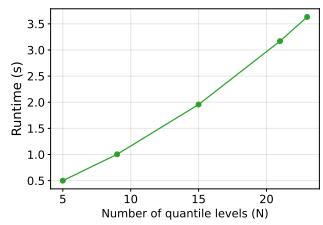

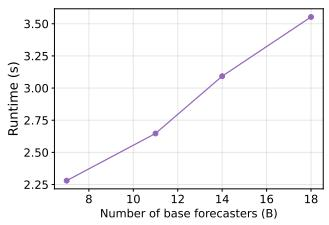  
Figure 5: Runtime of Algorithm 1 with $c _ { O } = 1$ on U.S.-aggregate, 4-week-ahead prediction data versus grid size m (Left), number of quantile levels N (Middle), and number of base forecasters B (Right). Middle and right plots use grid size 500.

We empirically verify the $O ( m N B )$ per-step complexity established in Proposition 1. Figure 5 shows the runtime of Algorithm 1 while varying one of grid size $m ,$ number of quantile levels $N _ { \ast }$

```latex
Algorithm 5 Efficient computation of $V _ { n - 1 } ^ { * } - V _ { n } ^ { * }$ for all $n \in [ N - 1 ]$
1: Input: Weights $( w _ { b } ^ { n } ) _ { b , n } ,$ forecasts $\{ f _ { b } ^ { n } ( t ) \} _ { b , n } , ( g _ { k } ) _ { k = 1 } ^ { K } , \{ \theta _ { n } ^ { * } = g _ { k _ { n } ^ { * } } \} _ { n = 0 } ^ { N }$ from Algorithm 4
2: Output: $( V _ { n - 1 } ^ { * } - V _ { n } ^ { * } ) _ { n = 1 } ^ { N - 1 }$
3: 1) Compute cumulative row sums:
4: Define $\begin{array} { r } { \dot { W } [ n ] = \sum _ { s = \underline { { 1 } } } ^ { n } \sum _ { b = 1 } ^ { B } w _ { \underline { { b } } } ^ { s } , \quad n \in [ N ] , W [ 0 ] = 0 . } \end{array}$
5: Define $\begin{array} { r } { { W B } [ n ] = \sum _ { s = n + 1 } ^ { N } \sum _ { b = 1 } ^ { B } w _ { b } ^ { s } , \quad n \in [ N - 1 ] , W B [ N ] = 0 . } \end{array}$
6: Define $\begin{array} { r } { V [ k ] = \sum _ { \{ ( b , n ) : f _ { b } ^ { n } ( t ) = g _ { k } \} } w _ { b } ^ { n } , \quad k \in [ K ] . } \end{array}$
7: Define $\begin{array} { r } { V F [ k ] = \sum _ { \{ ( b , n ) : f _ { b } ^ { n } ( t ) = g _ { k } \} } w _ { b } ^ { n } * f _ { b } ^ { n } ( t ) , \quad k \in [ K ] . } \end{array}$
8: Define $\begin{array} { r } { V c u m [ k ] = \sum _ { \ell = 1 } ^ { k } V [ k ] , \quad k \in [ K ] , V c u m [ 0 ] = 0 . } \end{array}$
9: Define $\begin{array} { r } { V { F c u m [ k ] } = \sum _ { \ell = 1 } ^ { k } V { F [ k ] } , \quad k \in [ K ] , V { F c u m [ 0 ] } = 0 . } \end{array}$
10: 2) Compute $V _ { n - 1 } ^ { * } - V _ { n } ^ { * }$ for each $n \in [ N - 1 ] ;$
11: for $n = 1 , \ldots , \overset { \cdot \cdot } { N } - 1$ do
$V _ { n - 1 } ^ { * } - V _ { n } ^ { * } = \theta _ { n - 1 } ^ { * } ( V c u m [ \operatorname* { m a x } ( k _ { n - 1 } ^ { * } , 0 ) ] ) + ( V F c u m [ k _ { n } ^ { * } - 1 ] - V F c u m [ \operatorname* { m a x } ( k _ { n - 1 } ^ { * } , 0 ) ] )$
$+ \theta _ { n } ^ { * } ( 1 - V c u m [ k _ { n } ^ { * } - 1 ] ) - \theta _ { n - 1 } ^ { * } ( W [ n - 1 ] ) - \theta _ { n } ^ { * } ( W B [ n ] ) - \sum _ { b = 1 } ^ { B } w _ { b } ^ { n } f _ { b } ^ { n } ( t ) .$
12: end for
```

or number of base forecasters B and holding the other two fixed. In each case the runtime grows linearly, consistent with the result of Proposition 1.

## C Omniprediction under weighted quantile losses

In this section, we develop omnipredictors for the restricted subset of proper loss functions that can be expressed as weighted combinations of pinball losses. Although this is a much smaller set than the set of all proper losses for multiple quantile levels, which we discussed in Section 3, it has the advantage of not requiring any discretization of the target outcome or base forecasters’ predictions.

We introduce two algorithms for omniprediction for weighted quantile losses. In Appendix C.1, we discuss the first algorithm which runs the Hedge algorithm on each quantile level then combines quantile estimates from each level. In Appendix C.2, we introduce a two-player game based algorithm that has a similar form to the omniprediction algorithm for multiple quantile levels given in Algorithm 1. Finally, in Appendix C.3, we compare the two algorithm in terms of time complexity quantile crossing, and omniprediction error bound.

Notation. Define the pinball loss at quantile level τ as $\rho _ { \tau } ( x ) : = \tau x \mathbb { 1 } \{ x \geq 0 \} + ( 1 - \tau ) | x | \mathbb { 1 } \{ x <$ $0 \} = ( \tau - 1 \{ x < 0 \} ) \dot { x }$ . The weighted quantile loss at quantile levels $\{ \tau _ { n } \} _ { n = 1 } ^ { N }$ is defined as

$$
\ell \left( ( x _ { n } ) _ { n = 1 } ^ { N } , y \right) : = \sum _ { n = 1 } ^ { N } w _ { n } \rho _ { \tau _ { n } } ( y - x _ { n } ) ,
$$

where $w _ { n }$ is the weight for the $\tau _ { n }$ -level quantile prediction and $\begin{array} { r } { \sum _ { n = 1 } ^ { N } w _ { n } = 1 } \end{array}$ . We denote $\mathcal { L } _ { w q l }$ as the set of all weighted quantile loss functions and use $\rho _ { n } ( x , y )$ to denote $\rho _ { \tau _ { n } } ( y - x )$ for $n \in [ N ]$ We define $\begin{array} { r } { f _ { \operatorname* { m i n } } ( t ) = \operatorname* { m i n } _ { n \in [ N ] , b \in [ B ] } f _ { b } ^ { n } ( t ) } \end{array}$ and $\begin{array} { r } { f _ { \operatorname* { m a x } } ( t ) = \operatorname* { m a x } _ { n \in [ N ] , b \in [ B ] } f _ { b } ^ { n } ( t ) } \end{array}$ for each time t.

We aim to come up with $\mathbf { q } ( t ) = ( q _ { n } ( t ) ) _ { n = 1 } ^ { N }$ that minimizes the following omniprediction objective:

$$
\operatorname* { s u p } _ { \ell \in \mathcal { L } _ { w q l } , b \in [ B ] } \frac { 1 } { T } \sum _ { t = 1 } ^ { T } [ \ell ( \mathbf { q } ( t ) , Y _ { t } ) - \ell ( f _ { b } ( t ) , Y _ { t } ) ] ,
$$

where $f _ { b } ( t ) : = ( f _ { b } ^ { n } ( t ) ) _ { n = 1 } ^ { N }$

## C.1 Hedge algorithm on each quantile level

In this subsection, we introduce the first algorithm that essentially runs Hedge algorithm on each quantile level then provide the omniprediction error bound for this algorithm. We denote the output from Algorithm 6 by $\mathbf { q } ^ { H } ( t ) : = ( q _ { n } ^ { H } ( t ) ) _ { n = 1 } ^ { N }$ , where the superscript $\check { H }$ denotes it is from the Hedge algorithm.

```latex
Algorithm 6 Hedge algorithm for multiple quantile levels in parallel
1: Data: Data stream $( Y _ { t } ) _ { t = 1 } ^ { T } ,$ Quantile levels $\lbrace \tau _ { n } \rbrace _ { n = 1 } ^ { N }$ , Learning rate $\eta > 0 .$ Base forecasters:
$\{ f _ { b } \} _ { b = 1 } ^ { B }$ where $f _ { b }$ outputs $\bar { f } _ { b } ^ { n } ( t )$ as $\tau _ { n }$ -level quantile estimate at time $t ;$
2: Initialize: $\begin{array} { r } { w _ { b } ^ { n } ( 1 ) = \frac { 1 } { B } , \forall b \in [ B ] , n \in [ N ] } \end{array}$ •0
3: for $t = 1 , \dots , T$ do
4: Output: Output $\mathbf { q } ^ { H } ( t ) : = ( q _ { n } ^ { H } ( t ) ) _ { n = 1 } ^ { N }$ where $\begin{array} { r } { q _ { n } ^ { H } ( t ) = \sum _ { b = 1 } ^ { B } w _ { b } ^ { n } ( t ) f _ { b } ^ { n } ( t ) } \end{array}$
5: Update weights wn for $b \in [ \ddot { B } ] , n \in [ \bar { N } ] ;$
$w _ { b } ^ { n } ( t + 1 ) = \frac { w _ { b } ^ { n } ( t ) \exp { ( - \eta \rho _ { n } ( f _ { b } ^ { n } ( t ) , Y _ { t } ) ) } } { \sum _ { b = 1 } ^ { B } w _ { b } ^ { n } ( t ) \exp { ( - \eta \rho _ { n } ( f _ { b } ^ { n } ( t ) , Y _ { t } ) ) } }$
6: end for
```

This algorithms yields the following guarantee for each quantile level $\tau _ { n } \colon$

$$
\leq \operatorname* { m i n } _ { b } \frac { 1 } { T } \sum _ { t = 1 } ^ { T } \rho _ { n } ( f _ { b } ^ { n } ( t ) , Y _ { t } ) + \frac { \eta } { T } \sum _ { t = 1 } ^ { T } \sum _ { b = 1 } ^ { B } w _ { b } ^ { n } ( t ) \rho _ { n } ( f _ { b } ^ { n } ( t ) , Y _ { t } ) ^ { 2 } + \frac { \log B } { \eta T } ,
$$

where the first inequality is due to convexity of $\rho _ { \tau }$ and the second inequality is due to the regret bound of the Hedge algorithm (Theorem 7). This gives the omniprediction error bound for Algorithm 6 as follows:

$$
\begin{array} { r l r } {  { \operatorname* { s u p } _ { \ell \in \mathcal { L } _ { w + 1 } , b \in [ B ] } \frac { 1 } { T } \sum _ { t = 1 } ^ { T } [ \ell ( { \bf q } ^ { H } ( t ) , Y _ { t } ) - \ell ( f _ { b } ( t ) , Y _ { t } ) ] } } \\ & { } & { = \operatorname* { s u p } _ { n \in [ N , b \in [ B ] ] } \frac { 1 } { T } \sum _ { t = 1 } ^ { T } [ \rho _ { n } ( q _ { n } ^ { H } ( t ) , Y _ { t } ) - \rho _ { n } ( f _ { b } ^ { n } ( t ) , Y _ { t } ) ] } \\ & { } & { \le \eta \operatorname* { m a x } _ { n \in [ N ] } ( \frac { 1 } { T } \sum _ { t = 1 } ^ { T } \sum _ { b = 1 } ^ { B } w _ { b } ^ { n } ( t ) \rho _ { n } ( f _ { b } ^ { n } ( t ) , Y _ { t } ) ^ { 2 } ) + \frac { \log B } { \eta T } } \\ & { } & { \le \eta \operatorname* { m a x } _ { n \in [ N ] } ( \frac { 1 } { T } \sum _ { t = 1 } ^ { T } \operatorname* { m a x } \rho _ { n } ( f _ { b } ^ { n } ( t ) , Y _ { t } ) ^ { 2 } ) + \frac { \log B } { \eta T } . } \end{array}\tag{26}
$$

## C.2 Two-player game based algorithm

In this subsection, we introduce a second algorithm that is based on two-player game that is similar to Algorithm 1 in Section 3, and then we provide the omniprediction error bound for this algorithm. In the process, we prove that the output from this algorithm does not exhibit quantile crossing. We denote the output from Algorithm 7 by $\mathbf { q } ^ { G } ( t ) : = ( q _ { n } ^ { \breve { G } } ( t ) ) _ { n = 1 } ^ { N }$ , where the superscript G denotes it is from the two-player Game based algorithm

We show that $( q _ { n } ^ { G } ( t ) ) _ { n = 1 } ^ { N }$ does not exhibit quantile crossing.

Proposition 6. Define a function $V _ { n } ( \theta )$ and a quantity $V _ { n } ^ { * } f o r n \in [ N - 1 ]$ as

$$
\begin{array} { r l r } & { } & { V _ { n } ( \theta ) : = \displaystyle \sum _ { s = 1 } ^ { n } \sum _ { b = 1 } ^ { B } w _ { b } ^ { s } \operatorname* { m a x } ( f _ { b } ^ { s } ( t ) - \theta , 0 ) + \displaystyle \sum _ { s = n + 1 } ^ { N } \sum _ { b = 1 } ^ { B } w _ { b } ^ { s } \operatorname* { m a x } ( \theta - f _ { b } ^ { s } ( t ) , 0 ) \ge 0 } \\ & { } & { V _ { n } ^ { * } : = \displaystyle \operatorname* { m i n } _ { \theta \in \mathbb { R } } V _ { n } ( \theta ) , } \end{array}
$$

Algorithm 7 Two-player game based omniprediction for weighted quantile losses   
1: Data: Data stream $( Y _ { t } ) _ { t = 1 } ^ { T } ,$ quantile levels $\tau _ { 1 } < \tau _ { 2 } < . . . < \tau _ { N } .$ , Learning rate $\eta > 0$ Base   
forecasters: $\{ f _ { b } \} _ { b = 1 } ^ { B }$ where $f _ { b }$ outputs $f _ { b } ^ { n } ( t )$ as τn-level quantile estimate at time $t ;$   
2: Initialize: $\begin{array} { r } { w _ { b } ^ { \dot { n } } ( \dot { 1 } ) \stackrel { \sim } { = } \frac { 1 } { N B } , \forall n \in [ N ] , b \in [ B ] ; } \end{array}$   
3: for $t = 1 , \dots , T$ do   
4: 1) Make prediction at time $t { : }$   
5: Define $V _ { 0 } ^ { \ast } = V _ { N } ^ { \ast } = 0 , \theta _ { 0 } ^ { \ast } = f _ { \operatorname* { m i n } } ( t ) , \theta _ { N } ^ { \ast } = f _ { \operatorname* { m a x } } ( t ) ;$   
6: for $n = \ddot { 1 } , \dotsc , \dot { N } - 1$ do   
7: Define $V _ { n } ( \theta )$ as:   
$V _ { n } ( \theta ) = \sum _ { s = 1 } ^ { n } \sum _ { b = 1 } ^ { B } w _ { b } ^ { s } \operatorname* { m a x } ( f _ { b } ^ { s } ( t ) - \theta , 0 ) + \sum _ { s = n + 1 } ^ { N } \sum _ { b = 1 } ^ { B } w _ { b } ^ { s } \operatorname* { m a x } ( \theta - f _ { b } ^ { s } ( t ) , 0 )$   
8: Compute $V _ { n } ^ { * }$ and $\theta _ { n } ^ { * } \mathrm { : }$   
$V _ { n } ^ { * } : = \operatorname* { m i n } _ { \theta \in [ f _ { \operatorname* { m i n } } ( t ) , f _ { \operatorname* { m a x } } ( t ) ] } V _ { n } ( \theta ) , \qquad \theta _ { n } ^ { * } = \operatorname* { m i n } \big \{ \theta \mid \theta \in [ \theta _ { n - 1 } ^ { * } , f _ { \operatorname* { m a x } } ( t ) ] , V _ { n } ( \theta ) = V _ { n } ^ { * } \big \}$ (27)   
10 end for   
11: Output $\mathbf { q } ^ { G } ( t ) : = ( q _ { n } ^ { G } ( t ) ) _ { n = 1 } ^ { N }$ where   
$q _ { n } ^ { G } ( t ) = \frac { 1 } { \sum _ { b = 1 } ^ { B } w _ { b } ^ { n } ( t ) } \left( \sum _ { b = 1 } ^ { B } w _ { b } ^ { n } ( t ) f _ { b } ^ { n } ( t ) + V _ { n - 1 } ^ { * } - V _ { n } ^ { * } \right)$ ·2   
12: 2) Update the weights for each $\rho _ { n }$ and $f _ { b } { \mathrm { : } }$   
$w _ { b } ^ { n } ( t + 1 ) = \frac { w _ { b } ^ { n } ( t ) \exp \left( \eta \big [ \rho _ { n } ( q _ { n } ^ { G } ( t ) , Y _ { t } ) - \rho _ { n } ( f _ { b } ^ { n } ( t ) , Y _ { t } ) \big ] \right) } { \sum _ { n = 1 } ^ { N } \sum _ { b = 1 } ^ { B } w _ { b } ^ { n } ( t ) \exp \left( \eta \big [ \rho _ { n } ( q _ { n } ^ { G } ( t ) , Y _ { t } ) - \rho _ { n } ( f _ { b } ^ { n } ( t ) , Y _ { t } ) \big ] \right) } , \quad \forall n \in [ N ] , b \in [ B ] ;$   
13: end for

and $V _ { 0 } ^ { * } = V _ { N } ^ { * } = 0 .$ Let $J _ { n } ^ { * }$ be the set of θs that minimizes the $V _ { n } ( \theta )$ . Then, there exists a sorted sequence $f _ { m i n } ( t ) \le \theta _ { 0 } ^ { * } \le \theta _ { 1 } ^ { * } \le \dots \le \theta _ { N - 1 } ^ { * } \le \theta _ { N } ^ { * } = f _ { m a x } ( t )$ such that $\theta _ { n } ^ { * } \in J _ { n } ^ { * } f o r n \in [ N - 1 ]$

Additionally, $q _ { n }$ defned as

$$
q _ { n } = \frac { 1 } { \sum _ { b = 1 } ^ { B } w _ { b } ^ { n } ( t ) } \left( \sum _ { b = 1 } ^ { B } w _ { b } ^ { n } ( t ) f _ { b } ^ { n } ( t ) + V _ { n - 1 } ^ { * } - V _ { n } ^ { * } \right)\tag{28}
$$

satisfies $\theta _ { n - 1 } ^ { * } \leq q _ { n } \leq \theta _ { n } ^ { * }$ for $n \in [ N - 1 ] ,$ and thus $f _ { m i n } ( t ) \leq q _ { 1 } \leq q _ { 2 } . . . \leq q _ { N } \leq f _ { m a x } ( t ) h o l d s .$

Proof. Since $V _ { n } ( \theta )$ shares the same structure with $V _ { n } ( j )$ defined in equation (12), existence of a sorted sequence follows the same proof in Lemma 2. To prove that such $\theta _ { n } ^ { * }$ takes values in $[ f _ { \operatorname* { m i n } } ( t ) , f _ { \operatorname* { m a x } } ( t ) ]$ for all $n \in [ N - 1 ]$ , it suffices to show that $J _ { n } ^ { * } \cap [ f _ { \operatorname* { m i n } } ( t ) , f _ { \operatorname* { m a x } } ( t ) ] \neq \emptyset$ for all $n \in [ N - 1 ]$ On $\theta \leq f _ { \mathrm { m i n } } ( \dot { t } )$ , the second sum in $V _ { n } ( \theta )$ is simply zero and thus $\bar { V } _ { n } ( \theta )$ is nonincreasing. On $\theta \geq f _ { \operatorname* { m a x } } ( t )$ , the first sum in $V _ { n } ( \theta )$ is zero and thus $V _ { n } ( \theta )$ is non-decreasing. Therefore, $J _ { n } ^ { * }$ cannot only contain values that are not in $[ f _ { \operatorname* { m i n } } ( t ) , f _ { \operatorname* { m a x } } ( t ) ]$

Next, we prove that $\theta _ { n - 1 } ^ { * } \leq q _ { n } \leq \theta _ { n } ^ { * }$ for $n \in [ N - 1 ]$ . Observe the identity:

$$
V _ { n - 1 } ( \theta ) - V _ { n } ( \theta ) = \sum _ { b = 1 } ^ { B } w _ { b } ^ { n } ( t ) ( \operatorname* { m a x } ( \theta - f _ { b } ^ { n } ( t ) , 0 ) - \operatorname* { m a x } ( f _ { b } ^ { n } ( t ) - \theta , 0 ) ) = \sum _ { b = 1 } ^ { B } w _ { b } ^ { n } ( t ) ( \theta - f _ { b } ^ { n } ( t ) ) ,
$$

which implies that

$$
q _ { n } = \frac { 1 } { \sum _ { b = 1 } ^ { B } w _ { b } ^ { n } ( t ) } \left( \sum _ { b = 1 } ^ { B } w _ { b } ^ { n } ( t ) f _ { b } ^ { n } ( t ) + V _ { n - 1 } ^ { * } - V _ { n - 1 } ( \theta _ { n } ^ { * } ) + \sum _ { b = 1 } ^ { B } w _ { b } ^ { n } ( t ) ( \theta _ { n } ^ { * } - f _ { b } ^ { n } ( t ) ) \right) \leq \theta _ { n } ^ { * } ,
$$

since $V _ { n - 1 } ^ { * } - V _ { n - 1 } ( \theta _ { n } ^ { * } ) \leq 0$ by the definition of $V _ { n } ^ { * }$ . Similarly,

$$
q _ { n } = \frac { 1 } { \sum _ { b = 1 } ^ { B } w _ { b } ^ { n } ( t ) } \left( \sum _ { b = 1 } ^ { B } w _ { b } ^ { n } ( t ) f _ { b } ^ { n } ( t ) + V _ { n - 1 } ( \theta _ { n - 1 } ^ { * } ) - V _ { n } ^ { * } + \sum _ { b = 1 } ^ { B } w _ { b } ^ { n } ( t ) ( \theta _ { n - 1 } ^ { * } - f _ { b } ^ { n } ( t ) ) \right) \geq \theta _ { n - 1 } ^ { * } ,
$$

which completes the proof.

Next, we show that $( q _ { n } ) _ { n = 1 } ^ { N }$ are a solution to the minimax program .

Theorem 6. Given quantile levels $\tau _ { 1 } < \tau _ { 2 } < . . . < \tau _ { N }$ and quantile forecasts $f _ { b } ^ { n } ( t ) f o r b \in [ B ]$ $n \in [ N ]$ , deine $V _ { n } ^ { * }$ and $\theta _ { n } ^ { * }$ for $n \in [ N ] \cap \{ 0 \}$ as in Proposition 6 and define $p _ { n } ^ { * } , n \in [ N ]$ as in equation (28). Then, $P _ { n } ^ { * } \equiv { } _ { q _ { n } } f o r n \in \mathbf { \bar { \Gamma } } [ \bar { N } ]$ with

$$
P ^ { y * } = \tau _ { 1 } \delta _ { f _ { m i n } ( t ) } + ( 1 - \tau _ { N } ) \delta _ { f _ { m a x } ( t ) } + \sum _ { n = 1 } ^ { N - 1 } ( \tau _ { n + 1 } - \tau _ { n } ) \delta _ { \theta _ { n } ^ { * } }
$$

is a solution of the minimax program

$$
\operatorname* { m i n } _ { P _ { 1 } , P _ { 2 } , . . . , P _ { N } \in \mathcal { P } ( \mathbb { R } ) } \operatorname* { m a x } _ { P ^ { y } \in \mathcal { P } ( \mathbb { R } ) } \sum _ { n = 1 } ^ { N } \sum _ { b = 1 } ^ { B } w _ { b } ^ { n } ( t ) \mathbb { E } _ { q _ { n } \sim P _ { n } , Y \sim P ^ { y } } \big [ \rho _ { n } ( q _ { n } , Y ) - \rho _ { n } ( f _ { b } ^ { n } ( t ) , Y ) \big ]
$$

and the value of the minimax program $\begin{array} { r } { i s - \sum _ { n = 1 } ^ { N - 1 } ( \tau _ { n + 1 } - \tau _ { n } ) V _ { n } ^ { * } \leq 0 . } \end{array}$

Proof. Similar to the proof of Proposition 4, define $O \left( ( P _ { n } ) _ { n = 1 } ^ { N } , P ^ { y } \right)$ as

$$
O \left( ( P _ { n } ) _ { n = 1 } ^ { N } , P ^ { y } \right) = \sum _ { n = 1 } ^ { N } \sum _ { b = 1 } ^ { B } w _ { b } ^ { n } ( t ) \mathbb { E } _ { q _ { n } \sim P _ { n } , Y \sim P ^ { y } } [ \rho _ { n } ( q _ { n } , Y ) - \rho _ { n } ( f _ { b } ^ { n } ( t ) , Y ) ] .
$$

It suffices to prove

$$
\small O \left( ( P _ { n } ^ { * } ) _ { n = 1 } ^ { N } , P ^ { y * } \right) = \operatorname* { m a x } _ { P ^ { y } } O \left( ( P _ { n } ^ { * } ) _ { n = 1 } ^ { N } , P ^ { y } \right) = \operatorname* { m i n } _ { P _ { n } \in \mathcal { P } ( \mathbb { R } ) , n \in [ N ] } O \left( ( P _ { n } ) _ { n = 1 } ^ { N } , P ^ { y * } \right) .
$$

Observe that $\rho _ { \tau } ( x , y ) = \tau ( y - x ) + \mathrm { m a x } ( x - y , 0 )$ . This simplifies $O \left( ( P _ { n } ) _ { n = 1 } ^ { N } , P ^ { y } \right)$ to

$$
\begin{array} { r l } & { \mathcal { O } \left( ( P _ { n } ) _ { n = 1 } ^ { N } , P ^ { y } \right) } \\ & { = \mathbb { E } _ { Y \sim P ^ { y } } \displaystyle \sum _ { n = 1 } ^ { N } \sum _ { b = 1 } ^ { B } w _ { b } ^ { n } ( t ) [ \tau _ { n } ( Y - q _ { n } ) + \operatorname* { m a x } ( q _ { n } - Y , 0 ) - \tau _ { n } ( Y - f _ { b } ^ { n } ( t ) ) - \operatorname* { m a x } ( f _ { b } ^ { n } ( t ) - q _ { n } , 0 ) ] } \\ & { = \mathbb { E } _ { Y \sim P ^ { y } } \displaystyle \sum _ { n = 1 } ^ { N } \sum _ { b = 1 } ^ { B } w _ { b } ^ { n } ( t ) [ \operatorname* { m a x } ( q _ { n } - Y , 0 ) - \operatorname* { m a x } ( f _ { b } ^ { n } ( t ) - q _ { n } , 0 ) ] + C , } \end{array}
$$

where $\begin{array} { r } { C = - \sum _ { n = 1 } ^ { N } ( V _ { n } ^ { * } - V _ { n - 1 } ^ { * } ) \tau _ { n } = - \sum _ { n = 1 } ^ { N - 1 } ( \tau _ { n + 1 } - \tau _ { n } ) V _ { n } ^ { * } } \end{array}$ does not depend on $P ^ { y }$ . Now we divide cases into $y < q _ { 1 } , q _ { 1 } \leq y < q _ { 2 } , . . . , q _ { N - 1 } \leq y < q _ { N } .$

$$
\begin{array} { r l } {  { \sum _ { n = 1 } ^ { N } \sum _ { b = 1 } ^ { B } w _ { b } ^ { n } ( t ) [ \operatorname* { m a x } ( q _ { n } - y , 0 ) - \operatorname* { m a x } ( f _ { b } ^ { n } ( t ) - q _ { n } , 0 ) ] } } \\ & { = \{ \begin{array} { l l } { - \sum _ { n = 1 } ^ { N } \sum _ { b = 1 } ^ { B } w _ { b } ^ { n } \operatorname* { m a x } ( y - f _ { b } ^ { n } ( t ) , 0 ) } & { y < q _ { 1 } } \\ { - \big ( \sum _ { s = n + 1 } ^ { N } \sum _ { b = 1 } ^ { B } w _ { b } ^ { s } \operatorname* { m a x } ( y - f _ { b } ^ { s } ( t ) , 0 ) } \\ { + \sum _ { s = 1 } ^ { n } \sum _ { b = 1 } ^ { B } w _ { b } ^ { s } \operatorname* { m a x } ( f _ { b } ^ { s } ( t ) - y , 0 ) \big ) + V _ { n } ^ { * } } & { y \in [ q _ { n } , q _ { n + 1 } ) , n \in [ N - 1 ] } \\ { - \sum _ { n = 1 } ^ { N } \sum _ { b = 1 } ^ { B } w _ { b } ^ { n } \operatorname* { m a x } ( f _ { b } ^ { n } ( t ) - y , 0 ) } & { y \geq q _ { N } . } \end{array}  } \end{array}
$$

In the interval $( - \infty , q _ { 1 } )$ , the quantity is maximized at $y = \theta _ { 0 } ^ { * } = f _ { \operatorname* { m i n } } ( t )$ , and its maximum value is 0. In interval $[ q _ { n } , q _ { n + 1 } )$ , the quantity is maximized at $y = \theta _ { n } ^ { * }$ (contained in the interval as shown in Proposition 6), and its maximum value is 0. In interval $\left( q _ { N - 1 } , \infty \right)$ , the quantity is maximized at $y = \bar { \theta _ { N } ^ { * } } = f _ { \operatorname* { m a x } } ( t )$ , and its maximum value is 0. Since $P ^ { y * }$ only puts mass on the points $\{ \theta _ { n } ^ { * } \} _ { n = 0 } ^ { N } ,$ $\begin{array} { r } { O \left( ( P _ { n } ^ { * } ) _ { n = 1 } ^ { N } , P ^ { y * } \right) = \operatorname* { m a x } _ { P ^ { y } } O \left( ( P _ { n } ^ { * } ) _ { n = 1 } ^ { N } , P ^ { y } \right) = C = - \sum _ { n = 1 } ^ { N - 1 } ( \tau _ { n + 1 } - \tau _ { n } ) V _ { n } ^ { * } \le 0 . } \end{array}$

Next, $\begin{array} { r } { O \left( ( P _ { n } ^ { * } ) _ { n = 1 } ^ { N } , P ^ { y * } \right) = \operatorname* { m i n } _ { P _ { n } \in \mathcal { P } ( \mathbb { R } ) , n \in [ N ] } O \left( ( P _ { n } ) _ { n = 1 } ^ { N } , P ^ { y * } \right) | } \end{array}$ follows directly from the propriety of $\rho _ { \tau }$ and the fact that $q _ { n } \mathrm { i s } \tau _ { n }$ -level quantile of $P ^ { y * }$ □

Putting all these together, the omniprediction error bound for Algorithm 7 is the following:

$$
\begin{array} { r l r } {  { \underset { \ell \in \mathcal { L } _ { w q l } , b \in [ B ] } { \operatorname* { s u p } } \frac { 1 } { T } \sum _ { t = 1 } ^ { T } [ \ell ( \mathbf { q } ^ { G } ( t ) , Y _ { t } ) - \ell ( f _ { b } ( t ) , Y _ { t } ) ] } } \\ & { } & { \leq \eta ( \frac { 1 } { T } \sum _ { t = 1 } ^ { T } \underset { n , b } { \operatorname* { m a x } } ( \rho _ { n } ( q _ { n } ^ { G } ( t ) , Y _ { t } ) - \rho _ { n } ( f _ { b } ^ { n } ( t ) , Y _ { t } ) ) ^ { 2 } ) + \frac { \log B N } { \eta T } . } \end{array}\tag{29}
$$

Proof.

$$
\begin{array} { r l } & { \underset { r \in \mathcal { E } _ { u + 1 } ; \{ k \in B \} } { \operatorname* { s u p } } \frac { 1 } { T } \underset { t = 1 } { \overset { T } { \sum } } [ \ell ( \mathbf { G } ^ { G } ( \ell ) , Y _ { t } ) - \ell ( J _ { b } ( \ell ) , Y _ { t } ) ] } \\ & { = \underset { m \in \mathbb { R } } { \operatorname* { m a x } } \frac { 1 } { T } \underset { t = 1 } { \overset { T } { \sum } } [ \ell _ { m } ( \mathbf { G } _ { \ell } ^ { G } ( \ell ) , Y _ { t } ) - \rho _ { m } ( J _ { b } ^ { m } ( \ell ) , Y _ { t } ) ] } \\ & { \leq \frac { 1 } { T } \underset { t = 1 } { \overset { T } { \sum } } \underset { m = 1 } { \overset { N } { \sum } } \underset { b = 1 } { \overset { B } { \sum } } ( \ell ) [ p _ { m } ( \underset { m } { G } _ { \ell } ^ { G } ( t ) , Y _ { t } ) - \rho _ { n } ( f _ { b } ^ { m } ( \ell ) , Y _ { t } ) ] } \\ & { \quad + \frac { \eta } { T } \underset { t = 1 } { \overset { T } { \sum } } \underset { m = 1 } { \overset { N } { \sum } } \underset { b = 1 } { \overset { B } { \sum } } ( \ell ) \underset { ( \rho _ { n } ( \underset { q } { G } _ { \ell } ^ { G } ( \ell ) , Y _ { t } ) ) } { \operatorname* { m a x } } \rho _ { n } ( f _ { b } ^ { m } ( \ell ) , Y _ { t } ) - \rho _ { n } ( f _ { b } ^ { m } ( \ell ) , Y _ { t } ) ) ^ { 2 } + \frac { \log B N } { \eta T } } \\ &  \underset { \mathrm { r a m } } { \overset { \leq } { \sum } } \underset { q } { \overset { n } { \sum } } ( \frac { 1 } { T } \underset { t = 1 } { \overset { T } { \sum } } \underset { n , b , b } { \operatorname* { m a x } } ( \rho _ { n } ( \underset { q } { G } _  \end{array}
$$

## C.3 Comparison between two algorithms

We conclude the section by comparing the two algorithms in terms of time complexity, quantile crossing, and omniprediction error bound.

Time complexity. The time complexity of Algorithm 6 is $O ( N B )$ per time step. Algorithm 7 is more complicated, where the main computational bottleneck lies in computing $\hat { V _ { n } ^ { * } }$ and $\theta _ { n } ^ { * }$ for each $n \in [ N - 1 ]$ (see Equation (27)). A naive computation of the minimizers $\{ \theta _ { n } ^ { * } \}$ requires $\ddot { O } ( N ^ { 3 } B ^ { 2 } )$ per each time step. Appendix B.2 introduces a subroutine that computes all $\{ \bar { \theta _ { n } ^ { * } } \}$ and $\left\{ V _ { n } ^ { * } \right\}$ in $O ( K$ log $K + N { \bar { B } } )$ time, where K is the number of unique values in $\{ f _ { b } ^ { n } ( t ) \} _ { b , n } ,$ by exploiting the structure of $( V _ { n } ^ { * } ) _ { n = 0 } ^ { N }$

Quantile crossing. Due to Proposition 6, quantile forecasts from Algorithm 7 do not exhibit quantile crossing. On the other hand, Algorithm 6 does not guarantee such a property, and postsorting the resulting quantile does not always decrease the loss. Appendix E provides examples where post-sorting rather increases the loss.

Omniprediction error bound. Comparing the omniprediction error bound (26) and (29), we notice that the former bound is a function of the error of base forecasters, $\rho _ { n } ( f _ { b } ^ { n } ( t ) , Y _ { t } )$ , while the latter bound is a function of relative error of two-player game based algorithm output with respect to base forecasters, $\rho _ { n } ( q _ { n } ^ { G } ( t ) , Y _ { t } ) - \rho _ { n } ( f _ { b } ^ { n } ( t ) , Y _ { t } )$ . This suggests that the two-player based algorithm would achieve a better omniprediction error for harder prediction tasks since the error of base forecasters is likely to be larger compared to the relative error.

## D Experiment details and additional plots

## D.1 Experiment details

During the pandemic, the United States Center for Disease Control and Prevention solicited forecasts of future disease outcomes from research groups throughout the country $[ \mathrm { C H W } ^ { + } 2 2 ]$ . In our empirical illustration of our method, we focus in particular on forecasts of the future number of people that will be hospitalized with Covid-19 on a given day. Below is the detailed information about the data:

• Horizon: 1, 2, 3, 4 weeks ahead

• Location (total 52): 51 state-level series (50 states + DC) and the U.S. aggregate series

• Dates: 2020-12-29 to 2023-06-05 (127 weeks)

• Base forecasters (total 18): CU-select, GT-DeepCOVID, COVIDhub-baseline, Karlenpypm, JHU\_IDD-CovidSP, MOBS-GLEAM\_COVID, USC-SI\_kJalpha, JHUAPL-Bucky, JHUAPL-Gecko, MUNI-ARIMA, CMU-TimeSeries, UMass-trends\_ensemble, PSI-DICE, IHME-CurveFit, CUB\_PopCouncil-SLSTM, BPagano-RtDriven, LANL-GrowthRate, UVA-Ensemble

• Ensemble models (total 2): COVIDhub-4\_week\_ensemble (COVIDhub-Ens), JHUAPL-SLPHospEns (JHUAPL-SLPEns)

• Quantile levels (total 23): [0.01, 0.025, 0.05, 0.1, 0.15, 0.2, 0.25, 0.3, 0.35, 0.4, 0.45, 0.5, 0.55, 0.6, 0.65, 0.7, 0.75, 0.8, 0.85, 0.9, 0.95, 0.975, 0.99]

We choose the grid spacing for each region so that the resulting discretization yields sufficiently fine resolution across time series based on their respective ranges. In particular, this choice ensures more than 500 grid points for all 208 = 52 × 4 time series, and more than 1,000 grid points for over 150 time series. The corresponding grid spacing used for each region is as follows:

• RI, ND, AK, VT, WY: 2

• NM, ID, NE, WV, HI, NH, ME, DE, SD: 5

• OR, UT, NV, IA, KS, MS, MT, DC: 10

• VA, WA, AZ, TN, MA, IN, MO, MD, CO, WI, MN, SC, AL, LA, KY, OK, CT, AR: 20

• PA, IL, OH, GA, NC, MI, NJ: 50

• CA, TX, FL, NY: 100

• US: 500

## D.2 Additional plots

Figure 6 compares quantile forecasts for US-agg hospitalizations. During the pandemic, COVIDhub-Ens was constructed as a weighted average of the quantile estimates of the base forecasters, whereas JHUAPL-SLPEns was obtained by first constructing predictive distributions and then averaging the resulting CDFs [Mul24]. Hedge-QL also aggregates quantile estimates via weighted averaging. It is well-known that averaging quantile forecasts produces sharper intervals than averaging predictive distributions [LJGCW13]. Consistent with this, COVIDhub-Ens and Hedge-QL produce relatively sharp prediction bands, whereas JHUAPL-SLPEns yields wider intervals. Interestingly, although our algorithm only uses quantile forecasts, it produces intervals that are slightly wider than those of COVIDhub-Ens and Hedge-QL, yet noticeably sharper than JHUAPL-SLPEns, while still closely tracking the observed trajectory.

Figure 7, analogous to Figure 4, shows how the performance of Hedge-QL varies with the learning rate. The figure shows the realized total omni-error and total quantile loss realized by Hedge-QL for 1- to 4- week-ahead horizons on the US-agg data with learning rate constants $c _ { H } \in \{ 1 0 ^ { i / 4 } \mid i = - 4 , \dots , 1 2 \}$ In addition, the bottom row shows that the quantile crossing of quantile estimates of Hedge-QL could be substantial, especially for large $c _ { H } \mathbf { S } .$ Our algorithm, by construction, never produces crossings.

Figure 8 shows the effect of the grid resolution, which determines the trade-off between the computational cost of our algorithm (Proposition 1) and the granularity of its predictions. Across all four horizons, the total quantile loss of our algorithm with a fixed learning rate constant $c _ { O }$ varies little with the grid unit. This indicates that a coarse grid, and hence a small m, suffices in practice: the accuracy of our method is largely insensitive to this discretization choice.

Lastly, Figure 9 summarizes performance of all algorithms, including 18 base forecasters using standardized ranks. Models in the column of the figure are ordered by their first-quartile performance (lowest quartile of standardized rank), with higher placement indicating better performance. Besides

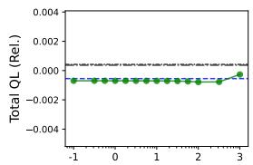

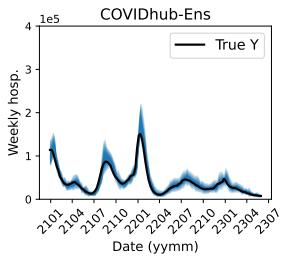

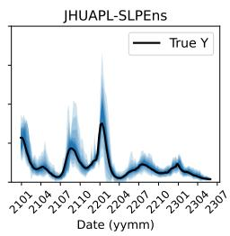

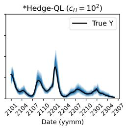  
(a) 1-week-ahead prediction.

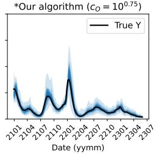

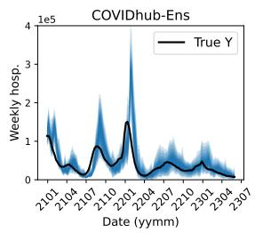

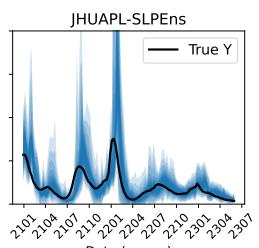

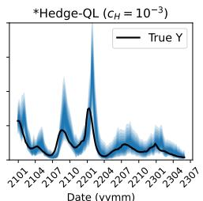  
(b) 4-week-ahead prediction.

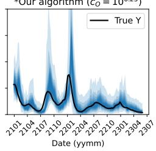

Figure 6: Quantile forecasts for US-agg weekly COVID-19 hospitalizations at 1-week-ahead and 4- week-ahead horizons. The learning rate for \*Hedge-QL and \*Our algorithm is selected to achieve the best total omni-error. The black curve shows the observed hospitalizations. The blue shaded regions show nested quantile prediction bands: darker regions correspond to more central quantile intervals, while lighter regions correspond to wider intervals.

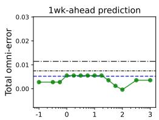

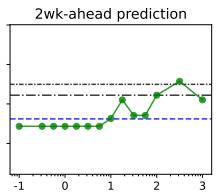

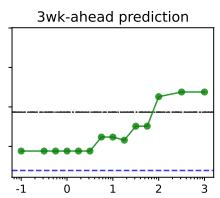

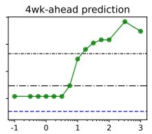

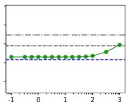

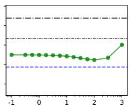

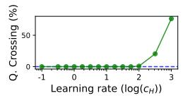

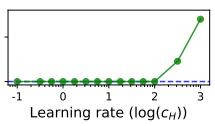

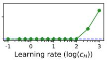

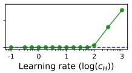  
Figure 7: Sensitivity of Hedge-QL to the choice of learning rate. Each panel shows the performance of Hedge-QL as a function of the learning rate (green curve) as measured by the total omni-error (top row) or total quantile loss relative to best base forecaster (middle row) on the US-agg data. Panels from left to right shows results at one to four week time horizons, while horizontal lines indicate the performance of \*Our algorithm and the two baseline ensembles. Lower values indicate better performance. The bottom row shows the percentage of time steps at which the quantile estimates of Hedge-QL exhibit quantile crossing.

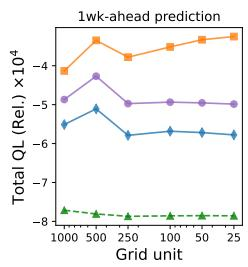

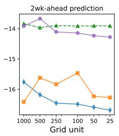

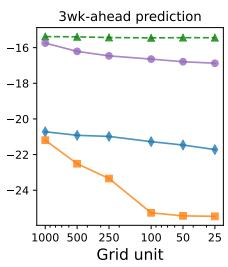

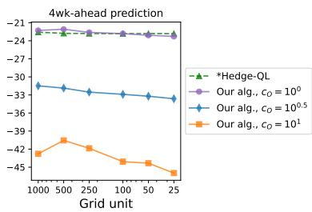  
Figure 8: Sensitivity of our algorithm to the grid resolution. Each panel shows the total quantile loss relative to the best base forecaster on the US-agg data as a function of the grid unit {1000, 500, 250, 100, 50, 25} (a smaller unit yields a larger grid size m). Lower values indicate better performance.

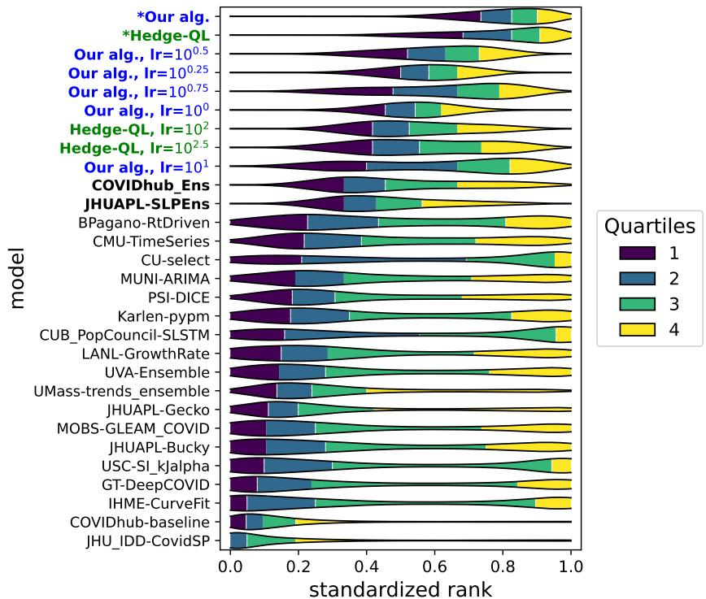  
Figure 9: Distribution of standardized ranks of instantaneous quantile loss across all (horizon, location, time) tuples for the 51 state-level series. For each tuple, we rank the available forecasts by quantile loss and normalize the ranks to [0, 1]. The colored segments represent the empirical distribution of ranks grouped into quartiles.

\*Our algorithm and \*Hedge-QL, multiple instances of our algorithm with a fixed learning rate are ranked higher than COVIDHUB-Ens and JHUAPL-SLPEns as well as all of the base forecasters. In particular, the both the first and third quartile of standardized ranks of all instances of our algorithm are comparable to or higher than the two ensemble models. This implies that our method, for a wide range of learning rates, can be viewed as better and more robust model compared to existing ensemble models, COVIDHUB-Ens and JHUAPL-SLPEns.

## E The effect of post-sorting on proper loss functions

Prior work $[ \mathrm { F K M } ^ { + } 2 3 ]$ showed that post-sorting never increases the loss for unweighted sums of pinball losses at different quantile levels. Unfortunately, the same does not hold for weighted sums of pinball losses. We present two results in this section. First, for a class of weighted sums of pinball losses at two quantile levels, we fully characterize the conditions under which post-sorting always decreases the loss. Conversely, when these conditions fail, there exists an instance $( Y , x _ { 1 } , x _ { 2 } )$ for which post-sorting increases the loss. Second, we present a subclass of loss functions where post-sorting does not increase the loss.

Define the pinball loss at quantile level τ as $\rho _ { \tau } ( x ) : = \tau x \mathbb { 1 } \{ x \geq 0 \} + ( 1 - \tau ) | x | \mathbb { 1 } \{ x < 0 \} =$ $( \tau - \mathbb { 1 } \{ x < 0 \} ) x$

Proposition 7. For $( \alpha , \beta ) \in ( 0 , 1 ) ^ { 2 }$ with $\alpha < \beta ,$ define a weighted quantile loss as

$$
\ell ( x _ { 1 } , x _ { 2 } ) : = \mathbb { E } _ { Y } [ w _ { \alpha } \rho _ { \alpha } ( Y - x _ { 1 } ) + w _ { \beta } \rho _ { \beta } ( Y - x _ { 2 } ) ] .
$$

${ \cal I } f \left( w _ { \alpha } , w _ { \beta } \right)$ satisfies one of the following conditions, then post-sorting does not increase the loss:

1. $w _ { \alpha } = w _ { \beta }$

2. $w _ { \alpha } < w _ { \beta } a n d ( 1 - \alpha ) w _ { \alpha } \geq ( 1 - \beta ) w _ { \beta }$

3. $w _ { \alpha } > w _ { \beta }$ and $\beta w _ { \beta } \geq \alpha w _ { \alpha }$

Conversely, $i f \left( w _ { \alpha } , w _ { \beta } \right)$ does not satisfy any of the above conditions, then there exists $( Y , x _ { 1 } , x _ { 2 } )$ such that post-sorting increases the loss.

Proof. Choose any $x _ { 1 } > x _ { 2 }$ . The loss before post-sorting is $\ell ( x _ { 1 } , x _ { 2 } )$ and the loss after post-sorting is $\ell ( x _ { 2 } , x _ { 1 } )$

$$
\begin{array} { r l } & { \ell ( x _ { 1 } , x _ { 2 } ) - \ell ( x _ { 2 } , x _ { 1 } ) } \\ & { = w _ { \alpha } \mathbb { E } _ { Y } [ ( \alpha - \mathbb { 1 } \{ Y < x _ { 1 } \} ) ( Y - x _ { 1 } ) - ( \alpha - \mathbb { 1 } \{ Y < x _ { 2 } \} ) ( Y - x _ { 2 } ) ] + } \\ & { \qquad w _ { \beta } \mathbb { E } _ { Y } [ ( \beta - \mathbb { 1 } \{ Y < x _ { 2 } \} ) ( Y - x _ { 2 } ) - ( \beta - \mathbb { 1 } \{ Y < x _ { 1 } \} ) ( Y - x _ { 1 } ) ] } \\ & { = w _ { \alpha } { E } _ { Y } [ \{ - \alpha ( x _ { 1 } - x _ { 2 } ) + \mathbb { 1 } \{ Y < x _ { 1 } \} x _ { 1 } - \mathbb { 1 } \{ Y < x _ { 2 } \} x _ { 2 } - \mathbb { 1 } \{ x _ { 2 } \leq Y < x _ { 1 } \} Y \} ] + } \\ & { \qquad w _ { \beta } { E } _ { Y } [ \{ \beta ( x _ { 1 } - x _ { 2 } ) + \mathbb { 1 } \{ Y < x _ { 2 } \} x _ { 2 } - \mathbb { 1 } \{ Y < x _ { 1 } \} x _ { 1 } + \mathbb { 1 } \{ x _ { 2 } \leq Y < x _ { 1 } \} Y ] ] } \\ & { = \mathbb { E } _ { Y } [ \{ - \alpha ( x _ { 1 } - x _ { 2 } ) + \mathbb { 1 } \{ x _ { 2 } \leq Y < x _ { 1 } \} ( x _ { 1 } - Y ) + \mathbb { 1 } \{ Y < x _ { 2 } \} ( x _ { 1 } - x _ { 2 } ) \} ] w _ { \alpha } + } \\ & { \qquad \mathbb { E } _ { Y } [ \{ \beta ( x _ { 1 } - x _ { 2 } ) - \mathbb { 1 } \{ x _ { 2 } \leq Y < x _ { 1 } \} ( x _ { 1 } - Y ) - \mathbb { 1 } \{ Y < x _ { 2 } \} ( x _ { 1 } - x _ { 2 } ) \} ] w _ { \beta } }  \end{array}
$$

Denote the coefficient of $w _ { \alpha } , w _ { \beta }$ as $c _ { \alpha } , c _ { \beta }$ respectively. Notice that $c _ { \alpha } + c _ { \beta } = ( \beta - \alpha ) ( x _ { 1 } - x _ { 2 } ) > 0$ Therefore $\ell ( x _ { 1 } , x _ { 2 } ) - \ell ( x _ { 2 } , x _ { 1 } ) > 0$ if $w _ { \alpha } = w _ { \beta }$ (Condition I).

Now, we consider Condition II: $w _ { \alpha } < w _ { \beta }$ and $( 1 - \alpha ) w _ { \alpha } \geq ( 1 - \beta ) w _ { \beta }$ . Denote $A = \mathbb { P } ( Y < x _ { 2 } )$ $B = \mathbb { P } ( x _ { 2 } \leq Y < x _ { 1 } )$ and observe that E $\mathfrak { i } _ { Y } \mathbb { 1 } \{ x _ { 2 } \leq Y < x _ { 1 } \} ( x _ { 1 } - Y ) \in [ 0 , B ( x _ { 1 } - x _ { 2 } ) ]$ . Then the difference in loss is written as:

$$
\begin{array} { r l } & { \ell ( x _ { 1 } , x _ { 2 } ) - \ell ( x _ { 2 } , x _ { 1 } ) } \\ & { = ( w _ { \alpha } ( A - \alpha ) + w _ { \beta } ( \beta - A ) ) ( x _ { 1 } - x _ { 2 } ) - ( w _ { \beta } - w _ { \alpha } ) \mathbb { E } _ { Y } \mathbb { 1 } \{ x _ { 2 } \leq Y < x _ { 1 } \} ( x _ { 1 } - Y ) } \\ & { \geq - ( w _ { \beta } - w _ { \alpha } ) A + \beta w _ { \beta } - \alpha w _ { \alpha } - ( w _ { \beta } - w _ { \alpha } ) B ( x _ { 1 } - x _ { 2 } ) } \\ & { \geq - ( w _ { \beta } - w _ { \alpha } ) A + ( w _ { \beta } - w _ { \alpha } ) - ( w _ { \beta } - w _ { \alpha } ) B ( x _ { 1 } - x _ { 2 } ) } \\ & { \geq ( w _ { \beta } - w _ { \alpha } ) ( 1 - A - B ) ( x _ { 1 } - x _ { 2 } ) \geq 0 . } \end{array}
$$

Note that the second inequality used $\beta w _ { \beta } - \alpha w _ { \alpha } \geq w _ { \beta } - w _ { \alpha }$ which follows from Condition II and $A + B = \mathbb { P } ( Y < x _ { 1 } ) \leq 1$ . Condition II can be proved in a similar manner.

Next, we prove that there exists $( Y , x _ { 1 } , x _ { 2 } )$ such that post-sorting increases the loss if $( w _ { \alpha } , w _ { \beta } )$ does not satisfy any of three conditions. First consider the case $w _ { \alpha } < w _ { \beta }$ and $( 1 - \alpha ) w _ { \alpha } < ( 1 - \beta ) w _ { \beta }$ Let $Y \equiv x _ { 2 }$ almost surely. Then $A = 0 , B = 1$ , and $\mathbb { E } _ { Y } \mathbb { 1 } \{ x _ { 2 } \leq Y < { \dot { x } } _ { 1 } \} ( x _ { 1 } - Y ) = x _ { 1 } - { \dot { x } } _ { 2 }$ Therefore,

$$
\begin{array} { r l } & { \ell ( x _ { 1 } , x _ { 2 } ) - \ell ( x _ { 2 } , x _ { 1 } ) } \\ & { \ = ( w _ { \alpha } ( A - \alpha ) + w _ { \beta } ( \beta - A ) ) ( x _ { 1 } - x _ { 2 } ) - ( w _ { \beta } - w _ { \alpha } ) \mathbb { E } _ { Y } \mathbb { 1 } \{ x _ { 2 } \leq Y < x _ { 1 } \} ( x _ { 1 } - Y ) } \\ & { \ = ( w _ { \alpha } ( 0 - \alpha ) + w _ { \beta } ( \beta - 0 ) ) ( x _ { 1 } - x _ { 2 } ) - ( w _ { \beta } - w _ { \alpha } ) ( x _ { 1 } - x _ { 2 } ) } \\ & { \ = ( w _ { \beta } - w _ { \alpha } ) ( x _ { 1 } - x _ { 2 } ) > 0 . } \end{array}
$$

Therefore, post-sorting increases the loss. Next, consider the case where $w _ { \alpha } > w _ { \beta }$ and $\beta w _ { \beta } < \alpha w _ { \alpha }$ Let $Y \equiv x _ { 1 }$ almost surely. Similar calculation shows that post-sorting increases the loss. □

We prove another subclass of proper loss functions where post-sorting does not increase the loss. From Theorem 1 and Theorem 2, a proper loss for multiple quantile levels can be written as the following form under mild regularity conditions:

$$
\ell ( ( q _ { n } ) _ { n = 1 } ^ { N } ) = \operatorname { \mathbb { E } } _ { Y } \sum _ { n = 1 } ^ { N } ( \mathbb { 1 } \{ Y < q _ { n } \} - \tau _ { n } ) ( g _ { n } ( q _ { n } ) - g _ { n } ( Y ) ) ,\tag{30}
$$

where $g _ { n }$ is a non-decreasing left-continuous function, for $n \in [ N ]$

Proposition 8. If a loss function l defined as (30) satisfies $g _ { n } ( x ) = g ( x )$ for all $i \in [ N ]$ then post-sorting does not increase the loss.

Proof. Due to additivity of the loss function, it suffices to show $\ell ( x _ { 1 } , x _ { 2 } , y ) - \ell ( x _ { 2 } , x _ { 1 } , y ) \geq 0$ for $x _ { 1 } > x _ { 2 }$ where $x _ { n }$ corresponds to the $\tau _ { n }$ -level quantile estimate.

$$
\begin{array} { r l } & { \ell ( x _ { 1 } , x _ { 2 } ) - \ell ( x _ { 2 } , x _ { 1 } ) } \\ & { \quad = \mathbb { E } _ { Y } [ ( \mathbf { 1 } \{ Y < x _ { 1 } \} - \tau _ { 1 } ) ( g _ { 1 } ( x _ { 1 } ) - g _ { 1 } ( Y ) ) - ( \mathbf { 1 } \{ Y < x _ { 2 } \} - \tau _ { 1 } ) ( g _ { 1 } ( x _ { 2 } ) - g _ { 1 } ( Y ) ) + } \\ & { \qquad ( \mathbf { 1 } \{ Y < x _ { 2 } \} - \tau _ { 2 } ) ( g _ { 2 } ( x _ { 2 } ) - g _ { 2 } ( Y ) ) - ( \mathbf { 1 } \{ Y < x _ { 1 } \} - \tau _ { 2 } ) ( g _ { 2 } ( x _ { 1 } ) - g _ { 2 } ( Y ) ) ] } \\ & { \qquad = \mathbb { E } _ { Y } [ \tau _ { 1 } ( g _ { 1 } ( x _ { 2 } ) - g _ { 1 } ( x _ { 1 } ) ) + \mathbf { 1 } \{ Y < x _ { 1 } \} g _ { 1 } ( x _ { 1 } ) - \mathbf { 1 } \{ Y < x _ { 2 } \} g _ { 1 } ( x _ { 2 } ) - \mathbf { 1 } \{ x _ { 2 } \leq Y < x _ { 1 } \} g _ { 1 } ( Y ) + } \\ & { \qquad \tau _ { 2 } ( g _ { 2 } ( x _ { 1 } ) - g _ { 2 } ( x _ { 2 } ) ) + \mathbf { 1 } \{ Y < x _ { 2 } \} g _ { 2 } ( x _ { 2 } ) - \mathbf { 1 } \{ Y < x _ { 1 } \} g _ { 2 } ( x _ { 1 } ) + \mathbf { 1 } \{ x _ { 2 } \leq Y < x _ { 1 } \} g _ { 2 } ( Y ) ] } \end{array}
$$

Now using the fact that $g _ { 1 } \equiv g _ { 2 } \equiv g$ , most of the terms cancel out and we have

$$
\ell ( x _ { 1 } , x _ { 2 } ) - \ell ( x _ { 2 } , x _ { 1 } ) = ( \tau _ { 2 } - \tau _ { 1 } ) ( g ( x _ { 1 } ) - g ( x _ { 2 } ) ) \geq 0 .
$$

□

## F Additional details

## F.1 Regularity conditions

This subsection provides details of the regularity conditions in Theorem 2. In Proposition $4 . 2$ in [FZ16], the conditions are stated in terms of the identification function V and its expectation over $Y$ V (see Definition 2.2 in [FZ16]). For the τ-level quantile functional, the identification function on $q , y \in [ 0 , 1 ]$ and $F$ a cdf supported on [0, 1] is as follows:

$$
V ( q , y ) = \mathbb { 1 } ( y \leq x ) - \tau \qquad \mathrm { a n d } \qquad { \bar { V } } ( q , F ) : = \mathbb { E } _ { Y \sim F } V ( q , Y ) = F ( q ) - \tau .
$$

For multiple quantile levels, $\{ \tau _ { n } \} _ { n = 1 } ^ { N }$ , the identification function is as follows:

$$
\begin{array} { r l } & { V ( ( q _ { n } ) _ { n = 1 } ^ { N } , y ) = \left( \mathbb { 1 } ( y \leq q _ { 1 } ) - \tau _ { 1 } , \ \mathbb { 1 } ( y \leq q _ { 2 } ) - \tau _ { 2 } , \ \dots , \mathbb { 1 } ( y \leq q _ { N } ) - \tau _ { N } \right) , } \\ & { \bar { V } ( ( q _ { n } ) _ { n = 1 } ^ { N } , F ) = \left( F ( q _ { 1 } ) - \tau _ { 1 } , \ F ( q _ { 2 } ) - \tau _ { 2 } , \ \dots , F ( q _ { N } ) - \tau _ { N } \right) . } \end{array}
$$

We now state the regularity conditions for Theorem 2. The conditions are referred to as (V1), (V3), (V4), (VS1), (S2), and (F1) in [FZ16]. Among these, it is straightforward to check that (V1), (V3), (V4), and (F1) hold for quantile functionals. We state the remaining conditions (S2) and (VS1), which are conditions on the loss function, below.

Assumption (VS1) The complement of the set

$$
C : = \{ \left( ( x _ { n } ) _ { n = 1 } ^ { N } , y \right) \in \mathbb { R } ^ { N } \times \mathbb { R } \mid \ell \left( ( x _ { n } ) _ { n = 1 } ^ { N } , \cdot \right) \mathrm { { ~ a r e ~ c o n t i n u o u s ~ a t } } y \}
$$

has (N + 1)-dimensional Lebesgue measure zero.

Assumption (S2) For every continuously differentiable cumulative distribution function $F$ supported on [0, 1], the function $\bar { \ell } ( \cdot , F ) : = \bar { \mathbb { E } } _ { Y \sim F } \ell ( \cdot , Y )$ is continuously differentiable, and its gradient is locally Lipschitz continuous. Furthermore, $\bar { \ell } ( \cdot , F )$ is twice continuously differentiable at $( x _ { n } ) _ { n = 1 } ^ { N } = ( \check { q _ { \tau _ { n } } } ( \dot { \bar { F } } ) ) _ { n = 1 } ^ { N }$

## F.2 Omniprediction for multi-horizon forecast

We note that our omniprediction framework can be extended to multi-horizon prediction task, where the ground truth $Y _ { t }$ and base forecasters' predictions $f _ { b } ^ { n } ( t )$ are not scalars but vectors. By denoting such vector ground truth and vector predictions as $\mathbf { \widetilde { \cal Y } } _ { t } ~ = ~ ( { \cal Y } _ { t , 1 } , . . . , { \cal Y } _ { t , H } )$ and $f _ { b } ^ { n } ( t ) =$ $( f _ { b } ^ { n } ( t , 1 \big ) , . . . , f _ { b } ^ { n } ( t , H ) )$ ), respectively, we can define the omniprediction objective for multiple-horizon prediction as

$$
\operatorname* { s u p } _ { \ell \in \mathcal { L } _ { 1 } , b \in [ B ] , h \in [ H ] } \frac { 1 } { T } \sum _ { t = 1 } ^ { T } \mathbb { E } _ { q _ { n , h } \sim P _ { n , h } ( t ) } [ \ell \left( ( q _ { n , h } ) _ { n = 1 } ^ { N } , Y _ { t , h } \right) ] - \mathbb { E } [ \ell \left( ( f _ { b } ^ { n } ( t , h ) ) _ { n = 1 } ^ { N } , Y _ { t , h } \right) ] ,
$$

which means we want to minimize the maximum of regret for each horizon rather than the average of regret over all horizons, which is commonly used in practice. Then, with Algorithm 1 in hand, the task reduces into solving the following minimax program:

$$
\operatorname* { m i n } _ { \stackrel { { h \in \Delta _ { m } , P _ { h } ^ { y } \in \Delta _ { m } , } } { \forall n , h } } \operatorname* { m a x } _ { \sqrt { h } } \sum _ { h = 1 } ^ { H } \sum _ { n = 1 } ^ { N } \sum _ { b = 1 } ^ { B } w _ { i b h } ^ { n } \mathbb { E } _ { q _ { n , h } \sim P _ { n , h } , Y _ { h } \sim P _ { h } ^ { y } } [ \ell _ { \tau _ { n } , \theta _ { i } } ( q _ { n , h } , Y _ { h } ) - \ell _ { \tau _ { n } , \theta _ { i } } ( f _ { b } ^ { n } ( t , h ) , Y _ { h } ) ] .
$$

However, this minimax program is of form

$$
\operatorname* { m i n } _ { \stackrel { { P _ { n , h } ^ { h } \in \Delta _ { m } } } { \forall n , h } } \operatorname* { m a x } _ { \stackrel { { P _ { h } ^ { y } \in \Delta _ { m } } } { \forall h } } \sum _ { h = 1 } ^ { H } g _ { h } \left( ( P _ { n , h } ) _ { n = 1 } ^ { N } , P _ { h } ^ { y } \right) = \sum _ { h = 1 } ^ { H } \operatorname* { m i n } _ { \stackrel { { P _ { n , h } ^ { y } \in \Delta _ { m } } } { \forall n } } \operatorname* { m a x } _ { \stackrel { { P _ { h } ^ { y } \in \Delta _ { m } } } { \forall n } } g _ { h } \left( ( P _ { n , h } ) _ { n = 1 } ^ { N } , P _ { h } ^ { y } \right) ,
$$

and this reduces into solving H minimax program of form (9), solution of which is provided in Theorem 3, separately for each horizon. Therefore, running Algorithm 1 for each horizon separately, and combining the solutions together, will solve the omniprediction problem for multiple-horizon prediction.

## F.3 Regret bound of Hedge algorithm

We provide the well-known regret bound of the Hedge algorithm, which is used frequently applied in the proofs of this paper.

Theorem 7 (Regret of Hedge (e.g., Theorem 1.5 of [Haz19])). Consider an online learning problem with B experts receiving bounded losses $\{ \ell _ { b } ( t ) \} _ { b \in [ B ] , t \in [ T ] } .$

Suppose that at time step t we make the same prediction as expert i with probability

$$
w _ { b } ( t ) = \frac { \exp \left( - \eta \sum _ { s < t } \ell _ { b } ( s ) \right) } { \sum _ { b ^ { \prime } = 1 } ^ { m } \exp \left( - \eta \sum _ { s < t } \ell _ { b ^ { \prime } } ( s ) \right) } ,
$$

for some $\eta > 0 .$ Then,

$$
\sum _ { t = 1 } ^ { T } \sum _ { b = 1 } ^ { B } w _ { b } ( t ) \ell _ { b } ( t ) \ \leq \ \operatorname* { m i n } _ { 1 \leq b \leq B } \sum _ { t = 1 } ^ { T } \ell _ { b } ( t ) \ + \ \eta \sum _ { t = 1 } ^ { T } \sum _ { b = 1 } ^ { B } w _ { b } ( t ) \ell _ { b } ^ { 2 } ( t ) \ + \ \frac { \log B } { \eta } .
$$