# Pairwise AUC Optimization Needs Corrective Power: A Unified View

Jia Chen1 Zhiyong Yang1,∗ Shilong Bao2 Qianqian Xu2 Qingming Huang1,∗

1School of Computer Science and Technology, University of Chinese Academy of Sciences

2Institute of Computing Technology, Chinese Academy of Sciences

Beijing, China

chenjia26@mails.ucas.ac.cn, {yangzhiyong21,qmhuang}@ucas.ac.cn {baoshilong,xuqianqian}@ict.ac.cn

## Abstract

Direct pairwise AUC-surrogate training is attractive because it trains toward the ranking metric used at test time, especially under class imbalance. This creates a direct alignment between the training objective and the evaluation metric, but such metric alignment alone does not guarantee that stochastic training remains corrective. We study this gap through Corrective Power: whether pairwise minibatch updates produce stronger and more reliable improvements for more severe positive-negative ranking errors. Our main observation is that direct pairwise training can enter regions where severe errors remain common but no longer produce useful corrective motion. In such regions, even the mini-batch noise that would normally help SGD move along the steepest severe-error correction direction can become much weaker. In this paper, we seek a theoretical explanation for this by exploring the degenerate property of the U-statistics formed from the pairwise gradients therein. Our results provide a mechanistic explanation for several empirical patterns: (a) squared-hinge loss is often an effective AUC surrogate; (b) cross-entropy warm-up can help models that enter the AUC phase from a poor starting region; and (c) parameter-efficient fine-tuning from a pretrained model can reduce that need by starting closer to a favorable ranking geometry. Experiments on 8 CV tasks and 8 NLP tasks, using ResNet50, DenseNet121, DistilBERT-base, and Qwen2.5-1.5B-Instruct, support these predictions.

## 1 Introduction

AUC has a simple but important appeal: it is a threshold-free measure of ranking quality, evaluating whether positives receive higher scores than negatives rather than fixing a single operating point [1– 3]. This perspective is especially important under class imbalance, where error rate and pointwise classification losses can be poor proxies for the positive-negative ordering that AUC measures [4–6]. A natural response is to optimize pairwise AUC surrogates directly, as studied in both classical and modern AUC maximization [7–11]. The difficulty we study is that the same pairwise structure that aligns training with AUC can also make the stochastic optimization dynamics fragile.

Several empirical patterns indicate that pairwise AUC training cannot be achieved simply by replacing pointwise empirical risk minimization (ERM). First, direct pairwise AUC-surrogate training from an ordinary starting point can be slow or unstable. Deep-AUC pipelines therefore often use crossentropy (CE) warm-up or staged optimization before switching to an AUC-family objective [10–15]. Second, the choice of a pairwise surrogate can determine whether training makes progress once the AUC phase begins. On difficult tasks, squared-hinge-style AUC margins have shown strong

Direct squared-hinge CE Warm-up -> squared-hinge Direct hinge Warm-up phase Warm-up -> hinge

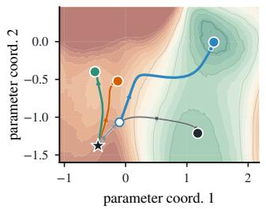  
(a) Bad initialization

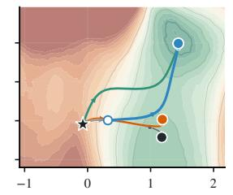  
parameter coord. 1  
(b) Slightly better initialization

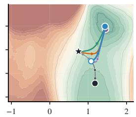  
parameter coord. 1  
(c) Good initialization  
Figure 1: AUC dynamics comparison under different initialization. The background color shows AUC on a fixed two-dimensional parameter slice. Curves are simulated training paths; stars and large circles mark starts and final iterates. Panels (a), (b), and (c) use bad, slightly better, and good initializations. Details are in Appendix B.1.

empirical performance. A deep AUC system built around this margin achieved first place in the Stanford CheXpert competition [11]. Third, the dependence on warm-up becomes much weaker when performing parameter-efficient fine-tuning (e.g., using LoRA or adapters) for LLMs [16–18]. Taken together, these patterns highlight the difficulty of training: the model may already contain many ranking errors, but the next pairwise update might not focus on the worst ones. A useful explanation must therefore look beyond objective alignment and ask whether the stochastic update still allocates its corrective effort to severely misranked pairs. Rather than treating the observations as separate heuristics or implementation choices, we argue that they are symptoms of one mechanism.

Figure 1 checks the training dynamics with the AUC landscape fixed while the initialization and update rule vary. In this controlled simulation, from a bad start, direct pairwise training moves weakly, and CE warm-up reaches a basin where squared-hinge succeeds. From a slightly better start, direct squared-hinge can already make corrective progress while hinge remains weak. From a good start, both hinge and squared-hinge can work without a warm-up. This motivates Corrective Power: reliable direct pairwise training requires severe ranking errors not merely to incur pairwise loss, but to generate finite-batch updates that actively push the model toward correcting them.

This paper examines under what conditions such corrective power becomes weak. The main clue is the useful motion along a severe-error correction direction, meaning a direction that locally decreases the loss contributed by severely misranked pairs. In a bad region, many severely misranked pairs do not automatically create such motion. Their gradient contributions may cancel, point away from the correction direction, or receive too little surrogate weight. Along this direction, SGD has a projected mean drift and finite-batch noise. In a bad region, severe errors remain common, but the projected mean drift is weak. Then progress depends on the noise in the same direction. For pairwise AUC training, the U-statistic structure can reduce this useful projected variance from order B−1 to order B−2, changing the projected escape-time scale from order B to order B2.

Based on this, we figure out two ways to enter or leave the bad regions. The first is the choice of surrogate losses. A useful pairwise loss should put enough update mass on severe active violations while ignoring already separated pairs. Squared-hinge has this profile within the standard surrogate family. The second is changing where the pairwise dynamics begin. Warm-up and pretrained parameter-efficient fine-tuning exactly serve this purpose. They can therefore help avoid the poorstart issue.

In short, this paper uses Corrective Power to explain when direct pairwise AUC-surrogate training works and when it loses corrective strength. The contributions are:

1. A mechanism for loss of Corrective Power. We define bad regions through two observable ingredients: many severe positive-negative misrankings and weak projected motion along the steepest severe-error correction direction (Section 2).

2. A weight-based explanation of surrogate behavior. We analyze standard pairwise losses by examining the weights they assign to margins during updates. Squared-hinge is well matched to difficult active pairs within this family: it increases correction with violation severity while turning off easy pairs (Section 3).

3. Understanding warm-up and pretraining. The corrective-power view predicts that CE warm-up can help when the AUC-surrogate phase starts in a poor region, while pretrained low-dimensional trainable subspaces can make a separate warm-up less necessary. We test these predictions on computer vision and NLP tasks with ResNet, DenseNet, DistilBERT, and Qwen models (Sections 4 and 5).

## 2 Bad Regions in the Stochastic Dynamics of Pairwise AUC Optimization

We now formalize the failure mode from the introduction. Let $f _ { \theta } : \mathcal { X }  \mathbb { R }$ be the scoring function. Let $X ^ { + } \sim P ^ { + }$ and $X ^ { - } \sim P ^ { - }$ be independent positive and negative examples. We use the positivemargin convention

$$
m _ { \theta } ( x ^ { + } , x ^ { - } ) = f _ { \theta } ( x ^ { + } ) - f _ { \theta } ( x ^ { - } ) .
$$

For a pairwise surrogate ℓ, define

$$
R _ { \ell } ( \theta ) = \mathbb { E } [ \ell ( m _ { \theta } ( X ^ { + } , X ^ { - } ) ) ] , \qquad w _ { \ell } ( x ) = - \ell ^ { \prime } ( x ) .
$$

Although training minimizes the surrogate risk $R _ { \ell }$ , the quantity we ultimately seek to reduce is the hard pairwise error $\mathbb { P } ( m _ { \theta } ( X ^ { + } , X ^ { - } ) \bar { \leq } 0 )$ , with particular attention to its severe-error subset. For sampled examples, let $x _ { i } ^ { + }$ and $\boldsymbol { x } _ { i } ^ { - }$ denote the i-th sampled positive example and the j-th sampled negative example, respectively, and write

$$
m _ { i j } = f _ { \theta } ( x _ { i } ^ { + } ) - f _ { \theta } ( x _ { j } ^ { - } ) , \quad g _ { i } ^ { + } = \nabla _ { \theta } f _ { \theta } ( x _ { i } ^ { + } ) , \quad g _ { j } ^ { - } = \nabla _ { \theta } f _ { \theta } ( x _ { j } ^ { - } ) .
$$

Given $B _ { + }$ positives and $B _ { - }$ negatives in a batch, the pairwise mini-batch update is

$$
\widehat { g } _ { B _ { + } , B _ { - } } ^ { \ell } ( \theta ) = \frac { 1 } { B _ { + } B _ { - } } \sum _ { i = 1 } ^ { B _ { + } } \sum _ { j = 1 } ^ { B _ { - } } w _ { \ell } ( m _ { i j } ) ( g _ { j } ^ { - } - g _ { i } ^ { + } ) ,\tag{1}
$$

With fresh mini-batches, the estimator is unbiased in the sense that $\mathbb { E } [ \widehat { g } _ { B _ { + } , B _ { - } } ^ { \ell } ( \theta ) ] = \nabla R _ { \ell } ( \theta )$

Pairwise SGD updates the parameters by

$$
\theta _ { t + 1 } = \theta _ { t } - \eta \widehat { g } _ { B _ { + } , B _ { - } } ^ { \ell } ( \theta _ { t } ) ,
$$

where $\widehat { g } _ { B _ { + } , B _ { - } } ^ { \ell } ( \theta _ { t } )$ is a stochastic estimate of $\nabla R _ { \ell } ( \theta _ { t } )$ . Thus the update direction has two parts: the mean descent direction $- \nabla R _ { \ell } ( \theta _ { t } )$ and the finite-batch noise around it. Here, the finite-batch noise is the mini-batch gradient fluctuation $\widehat { g } _ { B _ { + } , B _ { - } } ^ { \ell } ( \theta _ { t } ) - \nabla R _ { \ell } ( \theta _ { t } )$ relative to the full-sample gradient. We ask whether these two parts still give useful motion in a direction that reduces severe ranking errors.

Here, local correction direction is terminology introduced in this paper for a direction that locally reduces the loss contributed by severely misranked pairs. We are now ready to measure the useful motion along the local correction direction v. Along this direction, the mean drift is

$$
d _ { v } \mathopen { } \mathclose \bgroup \left( \theta \aftergroup \egroup \right) = \mathopen { } \mathclose \bgroup \left. - \nabla R _ { \ell } \mathopen { } \mathclose \bgroup \left( \theta \aftergroup \egroup \right) , v \aftergroup \egroup \right. .
$$

If $d _ { v } ( \theta )$ is large, SGD can progress even with small noise. Many severe misranked pairs do not by themselves make $d _ { v } ( \theta )$ large. The mean drift is a weighted directional average, and these terms may not add up along v. The hard case is when severe errors remain common but $d _ { v } ( \theta )$ is small. Then progress depends on the finite-batch noise along the same direction.

The next question is which direction to measure. We focus on hard, severely misranked pairs. To isolate this part, we introduce an intermediate loss $\Phi _ { M , \ell } ( \theta )$ . For $M > 0$ , define

$$
\Phi _ { M , \ell } ( \theta ) = \mathbb { E } \bigl [ { \bf 1 } \{ m _ { \theta } ( X ^ { + } , X ^ { - } ) \leq - M \} \ell ( m _ { \theta } ( X ^ { + } , X ^ { - } ) ) \bigr ] .
$$

This is the severe-error part of the current pairwise objective. At a reference point $\theta _ { 0 } , \mathrm { i f } \nabla \Phi _ { M , \ell } ( \theta _ { 0 } ) \neq$ 0, set

$$
{ v } _ { \mathrm { s e v } } ( \theta _ { 0 } ) = - \frac { \nabla \Phi _ { M , \ell } ( \theta _ { 0 } ) } { \| \nabla \Phi _ { M , \ell } ( \theta _ { 0 } ) \| _ { 2 } } .
$$

The direction is fixed before projected drift or variance is measured. It is the steepest local direction for reducing the hard pairs, which makes perturbations along ${ \pmb v } _ { \mathrm { s e v } }$ a targeted probe of local corrective motion. Motion in other directions may change easy pairs or other parts of the objective, but it does not directly reduce the loss from hard examples. We therefore measure corrective motion along ${ \pmb v } _ { \mathrm { s e v } }$ and interpret finite interventions in light of the step size, local curvature, and subsequent trajectory. See Appendix B.5 for the implementation details.

We now study the finite-batch noise along the fixed correction direction v. For this direction, define the scalar pairwise-gradient kernel

$$
\psi _ { \theta , v } ( x ^ { + } , x ^ { - } ) = \left. w _ { \ell } ( m _ { \theta } ( x ^ { + } , x ^ { - } ) ) \big ( \nabla _ { \theta } f _ { \theta } ( x ^ { - } ) - \nabla _ { \theta } f _ { \theta } ( x ^ { + } ) \big ) , v \right. .
$$

For the sampled positive-negative pair indexed by (i, j), define

$$
\phi _ { \theta , v } ( i , j ) = \psi _ { \theta , v } ( x _ { i } ^ { + } , x _ { j } ^ { - } ) = \left. w _ { \ell } ( m _ { i j } ) ( g _ { j } ^ { - } - g _ { i } ^ { + } ) , \pmb v \right. .
$$

A two-sample U-statistic averages a kernel over all sampled positive-negative pairs; its Hoeffding decomposition separates the resulting fluctuation into positive-example, negative-example, and resid ual pair-interaction components. In the equal-size case, write $\widehat { g } _ { B } ^ { \ell } ( \theta ) \overline { { { \theta } } } = \widehat { g } _ { B , B } ^ { \ell } ( \theta )$ . Then $\langle \widehat { g } _ { B } ^ { \ell } ( \theta ) , v \rangle$ is the average of $\phi _ { \theta , v } ( i , j )$ , equivalently a two-sample U-statistic built from $\psi _ { \boldsymbol { \theta } , \boldsymbol { v } } .$ The unequal-size case only changes the normalizing factors: the two first-order terms scale as $B _ { + } ^ { - 1 }$ and $B _ { - } ^ { - 1 }$ , and the residual interaction term scales as $( B _ { + } B _ { - } ) ^ { - 1 }$ . All conclusions below remain the same.

The next result identifies the variance structure by decomposing the first-order Hoeffding projections and the residual pair-interaction term [19, 20]. The first two components are the leading $B ^ { - 1 }$ stochastic term. They are the only Hoeffding terms that contribute at order $B ^ { - 1 }$ below.

## Proposition 1 (Projected Hoeffding variance split)

Fix θ and a unit direction v. Assume $\mathbb { E } [ \psi _ { \theta , v } ( X ^ { + } , X ^ { - } ) ^ { 2 } ] < \infty$ . Let $\psi _ { \boldsymbol { \theta } , \boldsymbol { v } } ^ { ( 1 , 0 ) } , \psi _ { \boldsymbol { \theta } , \boldsymbol { v } } ^ { ( 0 , 1 ) }$ , and $\psi _ { \boldsymbol { \theta } , \boldsymbol { v } } ^ { ( 1 , 1 ) }$ be the positive-example, negative-example, and residual Hoeffding components of $\psi _ { \boldsymbol { \theta } , \boldsymbol { v } } .$ . Then, with B positives and B negatives,

$$
\operatorname { V a r } \bigl ( \langle \hat { g } _ { B } ^ { \ell } ( \theta ) , v \rangle \bigr ) = \frac { \operatorname { V a r } ( \psi _ { \theta , v } ^ { ( 1 , 0 ) } ( X ^ { + } ) ) + \operatorname { V a r } ( \psi _ { \theta , v } ^ { ( 0 , 1 ) } ( X ^ { - } ) ) } { B } + \frac { \operatorname { V a r } ( \psi _ { \theta , v } ^ { ( 1 , 1 ) } ( X ^ { + } , X ^ { - } ) ) } { B ^ { 2 } } .
$$

Thus the projected variance has an order- $B ^ { - 1 }$ term unless the first-order components vanish;   
exact order- $\check { B } ^ { - 2 }$ scaling additionally requires a nonzero residual pair-interaction variance.

See Appendix D for the proof. In ordinary mini-batch behavior, replacing one example changes the projected update at the order $B ^ { - 1 }$ variance scale. Pairwise AUC mini-batches have a second possibility: the two first-order projections can vanish, leaving only the weaker pair-interaction randomness at order $B ^ { - 2 }$ . Proposition 9 gives a sufficient condition: the severe-truncated row and column effects are nearly constant across examples; a large severe-misranking mass alone does not imply collapse. Partial compression leaves a small but nonzero order- $B ^ { - 1 }$ coefficient, so real checkpoints can move toward without attaining exact $B ^ { - 2 }$ behavior. Thus the update may remain noisy at the raw pair level while being weak in the parameter direction needed for hard example correction. Appendix D gives the local argument, and Appendix G gives Transformer realizations with the same projected bad-component structure.

Recall that if the projected descent drift $- \mathbb { E } \left[ \left. \widehat { g } _ { B } ^ { \ell } ( \boldsymbol { \theta } ) , \boldsymbol { v } \right. \right]$ is weak, then the remaining mini-batch variance is what can move the iterate along that direction. When the projected conditional second moment changes from order $B ^ { - 1 }$ to order $\breve { B } ^ { - 2 }$ , the time needed to move a fixed projected distance should increase substantially. The next corollary makes this projected escape-time calculation explicit.

## Corollary 1 (Projected escape-time scale)

Fix a unit direction v, and let $\tau _ { v , r } = \operatorname* { i n f } \{ t \geq 0 : | \langle \theta _ { t } - \theta _ { 0 } , { \pmb v } \rangle | \geq r \}$ be the first time the stopped SGD trajectory moves distance r along v. In the bad-region application, v is the optimistic steepest severe-error correction direction at the reference point. Under the weakdrift and bounded-second-moment conditions stated precisely in Appendix H, if the projected increment has conditional second-moment scale $\nu _ { B } ^ { 2 }$ , then $\mathbb { E } [ \tau _ { v , r } ] = \Omega ( r ^ { 2 } / \nu _ { B } ^ { 2 } )$ . With fixed step size η, Proposition 1 makes the projected gradient variance contribute at scale $\eta ^ { 2 } / B$ when the first-order term is present and at scale $\eta ^ { 2 } / B ^ { 2 }$ after first-order projection collapse. Thus the optimistic projected escape-time lower-bound scale changes from order $B$ to order $B ^ { 2 }$

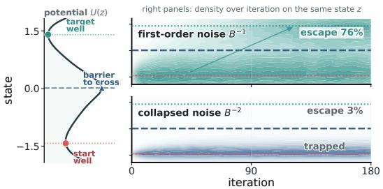  
(a) Escape-time simulation

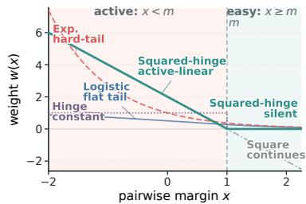  
(b) Canonical surrogate weights  
Figure 2: Noise scale and surrogate weights illustrate two ingredients of corrective motion. (a) A one-dimensional projected escape simulation comparing a first-order $B ^ { - 1 }$ variance regime with a collapsed $B ^ { - 2 }$ variance regime. The left potential and the right heatmaps use the same state axis z. (b) Update weights for five standard pairwise surrogates as functions of the pairwise margin x. Simulation details are in Appendix B.2.

Appendix H proves the stopped-process escape-time bound. Figure $2 ( \mathrm { a } )$ illustrates it with a onedimensional potential $U ( z ) \bar { : }$ the left curve marks the start well, barrier, and target well, while the right heatmaps show where simulated iterates concentrate on the same state axis. With first-order $B ^ { - 1 }$ noise, 76% of runs cross the barrier by the plotted horizon; with collapsed $B ^ { - 2 }$ noise, only 3% do. This echoes the main claim: a bad region is not merely high-error; it is a region where severe errors remain but the current update loses projected motion along a severe-error correction direction.

Above all, we can now identify a bad region in the following.

A bad region is not merely a high-error region and need not be a local minimum. It is a high-severeerror region where SGD loses useful motion along the severe-error correction direction $v _ { \mathrm { s e v } } \colon$ the projected mean drift is weak, and the leading projected noise term is small or, in the exact case, vanishes. Because these ingredients are defined independently of escape time, the result above quantifies their local consequence: under the stated conditions, variance contraction slows motion over a fixed distance along ${ \pmb v } _ { \mathrm { s e v } }$ , even though the full trajectory may still progress through other directions.

We next ask how the update can be changed to enter or leave a bad region.

## 3 Surrogate Losses and Their Weight Geometry

The first way to change the update is to change the surrogate loss. The surrogate loss choice changes the weight function in the pairwise gradient. For a differentiable surrogate, the key object is the scalar pairwise weight $\boldsymbol { w _ { \ell } } ( \boldsymbol { x } ) = - \boldsymbol { \ell ^ { \prime } } ( \boldsymbol { x } ) ^ { \intercal }$ . More severe ranking mistakes have more negative x. For a margin $m > 0 ,$ , active pairs satisfy $x < m ,$ , and easy pairs satisfy $x \geq m$ . A corrective weight profile emphasizes severe active mistakes while stopping already separated pairs from consuming update mass.

Figure 2(b) compares popular surrogates in this sense. The relevant quantity is the allocation of update mass across pairs. The comparison is therefore organized by update weight, because the weight determines which pairs enter the mini-batch gradient and how strongly they enter. The five canonical losses lead to visibly different structures. Hinge is constant on active pairs, logistic flattens in the severe tail, exponential over-amplifies the hard tail, and square keeps nonzero easy-side weight. Within this five-loss comparison, squared-hinge realizes the desired combination of active-side severity sensitivity and easy-side silence: it grows linearly on active pairs while becoming exactly silent for pairs that already satisfy the margin. For the active-batch comparison below, afully active mini-batch means that every sampled positive-negative pair violates the margin. Appendix E gives the exact weights, the within-family characterization, and the active-batch decomposition used below.

## Theorem 1 (Informal surrogate-weight geometry)

Among logistic, exponential, square, hinge, and squared-hinge, squared-hinge is the only one in this canonical set that both ignores easy pairs and upweights active violations linearly by severity. On a fully active mini-batch, hinge contains only the class-mean score-gradient direction. Squared-hinge contains this direction plus a severity-dependent within-class correction. Thus squared-hinge, and more generally any surrogate with the same severity-increasing, easypair-suppressing weight structure, can retain corrective motion outside the hinge direction.

The theorem gives a loss-level reason for the empirical gap between hinge and squared-hinge. Hinge ignores easy pairs, but on a fully active mini-batch it treats all active violations equally, so the update is driven only by the two class-mean score-gradient averages. If that class-mean direction is weak or poorly aligned with the direction that would correct the severe misranking pairs, hinge has no additional severity-dependent term to use. Squared-hinge also ignores easy pairs, but its active-side weight grows with violation size, letting the mini-batch update react to the distribution of active margins inside the positive and negative classes. Appendix E gives the calculation showing where this within-class correction enters.

The other four canonical losses considered here miss either the active-side severity weighting or the easy-pair silence that make squared-hinge useful in this comparison. Logistic has bounded hard-tail weights, so increasingly severe violations eventually receive almost the same weight. Exponential has the opposite problem: it can concentrate the update on the extreme tail. Square has the same affine active-side response as squared-hinge, but it continues to spend update mass on already separated pairs. Appendix E gives the hard-tail, easy-side, active-batch, and projected-variance calculations behind these comparisons. In a fully active setting, hinge can have zero projected mini-batch variance, while squared-hinge keeps a nonzero order- $B ^ { - 1 }$ term under class-score variation. Thus the surrogate can change both deterministic correction and projected stochastic motion along the steepest correction direction.

## 4 Changing Where Pairwise AUC Optimization Begins

Section 3 treated surrogate choice as a way to change the pairwise update. A second intervention is to change where the AUC phase begins. This is the role of CE warm-up and pretrained parameterefficient fine-tuning. CE warm-up can move an ordinary model away from many severe misranking pairs before pairwise training starts. A pretrained representation with a low-dimensional trainable module can instead start in a region where severe misrankings are already controlled and first-order stochastic motion remains present. This starting-region effect is the second lesson of Figure 1: warm-up helps in the bad-start panel because it changes the starting region of the pairwise phase, while the good-start panel shows that the same pairwise objective can succeed without a separate warm-up when training already begins on the favorable side of the bad-region mechanism.

Define the balanced cross-entropy risk, obtained by averaging the positive and negative classes separately, as $R _ { \mathrm { C E } } ( \theta ) = \mathbb { E } [ \log ( 1 + e ^ { - f _ { \theta } ( X ^ { + } ) } ) ] + \mathbb { E } [ \log ( 1 + e ^ { f _ { \theta } ( X ^ { - } ) } ) ]$ . For $M > 0$ , let $\pi _ { M } ( \theta ) =$ $\bar { \mathbb { P } } \bar { ( m _ { \theta } ( X ^ { + } , X ^ { - } ) \leq - M ) }$ be the misranking mass. The following result links the pointwise warm-up and the severe-misranking mass.

## Proposition 2 (CE risk controls severe misrankings)

For every $M > 0 , \pi _ { M } ( \theta ) \leq R _ { \mathrm { C E } } ( \theta ) / \log ( 1 + e ^ { M / 2 } )$ . Consequently, if a CE warm-up endpoint $\theta _ { \mathrm { w u } }$ satisfies $R _ { \mathrm { C E } } ( \theta _ { \mathrm { w u } } ) \leq \delta \cdot \log ( 1 + e ^ { M / 2 } )$ , then $\pi _ { M } ( \theta _ { \mathrm { w u } } ) \leq \delta$

The proof appears in Appendix F.1: if a positive is scored far below a negative by at least $M ,$ then either the positive score is low or the negative score is high, and CE penalizes these events. Thus CE warm-up can improve the later pairwise AUC-surrogate phase even though CE itself does not optimize a pairwise AUC surrogate. The role of CE warm-up is to reduce the mass of severe misranking pairs before the pairwise phase starts.

This gives a precise condition under which warm-up improves the pairwise starting state. The bound controls the severe-misranking mass at the AUC starting point. When the subsequent AUC trajectory remains near the warm-up endpoint, local continuity of the margins transfers this low severe-misranking mass to the early pairwise phase; Appendix F.1 gives the finite-horizon statement. A poor warm-up endpoint, or a pairwise trajectory that quickly leaves that neighborhood, falls outside this local argument. We therefore treat warm-up as a starting-region intervention.

Pretrained parameter-efficient fine-tuning addresses the same question about starting regions in a different way. Let $\boldsymbol { \xi }$ denote the trainable coordinates of a head, adapter, or LoRA module, with the pretrained base absorbed into $f _ { \xi } .$ The pairwise gradient identity and Hoeffding split remain valid after replacing θ by ξ, because they use only the score map and its gradient with respect to the trainable variable. The relevant question is therefore whether the pretrained starting neighborhood is already favorable for AUC optimization. In this subspace, write $\overset { \bullet } { \pi } _ { M } ( \pmb { \xi } ) = \mathbb { P } ( m _ { \pmb { \xi } } ( \mathbf { \check { X } } ^ { + } , \mathbf { \check { X } } ^ { - } ) \leq - M )$ , where $m _ { \pm } ( x ^ { + } , x ^ { - } ) = f _ { \xi } ( x ^ { + } ) - f _ { \xi } ( x ^ { - } )$ .

## Proposition 3 (Finite-horizon transfer from a favorable pretrained subspace)

Let $\psi _ { \xi , v }$ be the scalar projected pairwise-gradient kernel from Section 2, with θ replaced by the trainable coordinate ξ. Suppose a trainable-subspace neighborhood U satisfies $\operatorname { s u p } _ { \pmb { \xi } \in \mathcal { U } } \pi _ { M } ( \pmb { \xi } ) \leq$ $\delta _ { M }$ . Suppose also that, for some unit direction v, $\operatorname { V a r } ( \psi _ { \xi , v } ^ { ( 1 , 0 ) } ( X ^ { + } ) ) + \operatorname { V a r } ( \psi _ { \xi , v } ^ { ( 0 , 1 ) } ( X ^ { - } ) ) \geq$ $\sigma _ { 1 , v } ^ { 2 } > 0$ for $\xi \in \mathcal { U }$ . If the direct pairwise AUC-surrogate trajectory remains in U for the finite horizon of interest, then every iterate on that horizon satisfies $\pi _ { M } ( \pmb { \xi } _ { t } ) ~ \leq ~ \delta _ { M }$ and $\mathrm { V a r } ( \langle \widehat { \pmb g } _ { B } ^ { \ell } ( { \pmb \xi } _ { t } ) , { \pmb v } \rangle ) \geq \sigma _ { 1 , { \pmb v } } ^ { 2 } / B$

The proposition is a local finite-horizon transfer statement conditional on a verified favorable trainablesubspace neighborhood and trajectory containment; Appendix F gives sufficient score-perturbation, confinement, and local descent checks for this verification. Along such a trajectory, severe misrankings stay controlled and the first-order projected stochastic component remains present, making a separate warm-up stage less necessary.

Under the same LoRA-style fine-tuning protocol, a pretrained base with more favorable starting geometry can place the trainable trajectory closer to a favorable ranking region, reducing the marginal value of a separate CE warm-up; a weaker starting geometry leaves more room for warm-up to help. The experiments test this starting-state explanation across CV and NLP tasks.

## 5 Experiments

The experiments focus on a specific question: when the evaluation metric is held fixed as AUC, which training choices preserve Corrective Power in finite-batch deep optimization? We compare CE, direct pairwise AUC-surrogate training, and CE-warm-started pairwise AUC-surrogate training on binary CV and NLP ranking tasks using ResNet50 [21], DenseNet121 [22], DistilBERT-base [23], and Qwen2.5-1.5B-Instruct [24]. Table 1 reports the compact DenseNet121 and Qwen direct and warm-up rows with sample standard deviations, while Table 2 gives the corresponding ResNet50 and DistilBERT-base blocks. Figure 3 gives trajectory-level mechanism measurements, and Figure 4 gives aggregate warm-up and weight-allocation summaries. Appendix B gives the data construction, trainable-module details, optimization protocol, and full reporting rules. We use the tables and trajectory measurements to examine four questions about when pairwise AUC training works reliably.

## RQ1. Is metric-aligned pairwise training enough by itself?

No. Directly optimizing a pairwise AUC surrogate can improve held-out AUC, but it is not automatically reliable. Table 1 should be read task by task: the CE column is the pointwise baseline, the direct row starts pairwise training immediate $^ { \mathrm { l y , } }$ and the warm-up row first runs CE before switching to the specified pairwise surrogate. Bold and underlined entries mark the best and second-best validation-selected test AUC values within each task. This comparison shows that pairwise losses can beat CE, but it also shows failures in which a metric-aligned pairwise objective falls below CE or becomes much worse than other pairwise surrogates. The trajectory evidence gives the same message from inside training: Figure 3(c) plots the logged-batch misranking ratio, namely the fraction of logged positive-negative training pairs with $f _ { \theta } ( x ^ { + } ) - f _ { \theta } ( x ^ { - } ) < 0 ,$ . Direct hinge training can keep this ratio high for many pairwise updates, meaning that the loss is aligned with AUC but the trajectory is not quickly correcting the wrong pairs. The matched intervention in Appendix B.5 provides a direct mechanism check: perturbations confined to $\widehat { \pmb { v } } _ { \mathrm { s e v } }$ produce markedly more finite-horizon changes than equal-energy isotropic controls. This identifies $\widehat { \pmb { v } } _ { \mathrm { s e v } }$ as a mechanism-relevant direction while showing that the realized effect depends on the perturbation sequence and subsequent trajectory. The experiments therefore support the paper’s central claim that objective–metric alignment must be paired with Corrective Power.

Table 1: Held-out AUC (%) for direct and CE-warm-started pairwise training. Representative DenseNet121 and Qwen2.5-1.5B-Instruct results are shown; ResNet50 and DistilBERT-base are reported in Table 2. Direct starts pairwise training immediately; Warm-up first runs CE and then switches to the indicated pairwise loss. Values are mean AUC (%) with sample standard deviations as subscripts; bold and underline mark the best and second-best results within each task.
<table><tr><td>Task</td><td>Mode</td><td>CE</td><td>Square</td><td>Hinge</td><td>Exp.</td><td>Logistic</td><td>Sq.-hinge</td></tr><tr><td colspan="8">DenseNet121</td></tr><tr><td>Apple Disease</td><td>Direct Warm-up</td><td> $6 0 . 6 4 _ { \pm 2 . 6 3 }$  一</td><td> $6 1 . 1 0 { \scriptstyle \pm 1 . 8 5 }$   $6 1 . 1 0 { \scriptstyle \pm 1 . 8 5 }$ </td><td> $5 8 . 8 1 _ { \pm 2 . 4 6 }$   $5 9 . 9 1 _ { \pm 2 . 6 0 }$ </td><td> $6 0 . 1 8 _ { \pm 1 . 2 1 }$   $6 1 . 0 3 _ { \pm 1 . 9 2 }$ </td><td> $6 0 . 4 6 _ { \pm 3 . 0 9 }$   $6 0 . 5 4 _ { \pm 2 . 0 2 }$ </td><td> ${ \bf 6 2 . 6 9 } _ { \pm 4 . 8 6 }$   $6 2 . 6 9 { \scriptstyle \pm 4 . 8 6 }$ </td></tr><tr><td>Rice Disease</td><td>Direct Warm-up</td><td> $7 2 . 4 5 _ { \pm 6 . 5 7 }$ </td><td> $7 1 . 4 3 { \scriptstyle \pm 7 . 2 3 }$   $\underline { { 7 4 . 9 0 { \scriptstyle \pm 6 . 3 1 } } }$ </td><td> $7 0 . 9 2 { \scriptstyle \pm 7 . 6 6 }$   $7 3 . 9 8 { \scriptstyle \pm 6 . 2 6 }$ </td><td> $7 0 . 6 1 \pm 6 . 8 1$   $7 4 . 9 0 { \scriptstyle \pm 6 . 4 1 }$ </td><td> $7 1 . 6 3 { \scriptstyle \pm 7 . 3 0 }$   $7 1 . 6 3 { \scriptstyle \pm 7 . 3 0 }$ </td><td> $7 1 . 5 3 { \scriptstyle \pm 7 . 3 0 }$   $7 5 . 7 1 { \scriptstyle \pm 8 . 6 1 }$ </td></tr><tr><td>APTOS Sev./Mod.</td><td>Direct Warm-up</td><td> $8 2 . 7 5 _ { \pm 0 . 9 5 }$ </td><td> $8 3 . 8 3 _ { \pm 1 . 4 1 }$   $8 3 . 9 6 _ { \pm 1 . 0 4 }$ </td><td> $\mathbf { 8 5 . 1 0 _ { \pm 0 . 7 6 } }$   $8 3 . 8 6 _ { \pm 0 . 9 9 }$ </td><td> $8 3 . 6 8 _ { \pm 1 . 6 6 }$   $8 3 . 9 3 _ { \pm 1 . 2 5 }$ </td><td> $8 4 . 1 8 _ { \pm 1 . 3 7 }$   $8 3 . 7 6 _ { \pm 1 . 4 7 }$ </td><td> $\underline { { 8 4 . 2 0 } } \pm 1 . 1 2 $   $8 3 . 0 8 _ { \pm 1 . 4 9 }$ </td></tr><tr><td>HAM10000 M/N</td><td>Direct  $\mathrm { W a r m - u p }$ </td><td> $9 6 . 5 0 { \scriptstyle \pm 0 . 5 8 }$ </td><td> $9 6 . 8 8 _ { \pm 0 . 5 7 }$   $9 6 . 8 1 _ { \pm 1 . 0 2 }$ </td><td> $9 4 . 1 3 _ { \pm 0 . 8 1 }$   $9 6 . 0 8 _ { \pm 0 . 6 4 }$ </td><td> $9 5 . 9 7 _ { \pm 0 . 5 0 }$   $9 6 . 2 9 _ { \pm 0 . 4 6 }$ </td><td> $9 5 . 3 5 _ { \pm 0 . 5 6 }$   $9 6 . 5 1 _ { \pm 0 . 7 4 }$ </td><td> $\underline { { 9 7 . 3 2 } } \pm \mathbf { 0 . 4 2 }$   $\mathbf { 9 7 . 7 0 _ { \pm 0 . 2 1 } }$ </td></tr><tr><td colspan="8">Qwen2.5-1.5B-Instruct</td></tr><tr><td>GoEmotions Annoy.</td><td>Direct Warm-up</td><td> $8 2 . 9 7 { \scriptstyle \pm 1 . 2 7 }$ </td><td> $8 3 . 7 4 { \scriptstyle \pm 1 . 4 5 }$   $8 4 . 3 4 { \scriptstyle \pm 0 . 6 9 }$ </td><td> $8 3 . 4 4 { \scriptstyle \pm 1 . 1 3 }$   $8 3 . 2 7 { \scriptstyle \pm 1 . 0 3 }$ </td><td> $8 1 . 1 6 { \scriptstyle \pm 1 . 6 3 }$   $8 3 . 3 6 { \scriptstyle \pm 0 . 6 2 }$ </td><td> $8 0 . 7 1 { \scriptstyle \pm 1 . 8 7 }$   $8 3 . 0 7 _ { \pm 0 . 7 2 }$ </td><td> $\underline { { 8 4 . 8 9 } } \pm \mathrm { 0 . 6 5 }$   $\mathbf { 8 4 . 9 2 _ { \pm 0 . 6 6 } }$ </td></tr><tr><td>GoEmotions Fear</td><td>Direct Warm-up</td><td> $9 5 . 1 9 _ { \pm 1 . 2 2 }$ </td><td> $9 4 . 9 3 _ { \pm 1 . 0 2 }$   $9 6 . 6 9 { \scriptstyle \pm 0 . 5 4 }$ </td><td> $9 3 . 4 2 _ { \pm 0 . 7 7 }$   $9 4 . 8 8 _ { \pm 0 . 9 9 }$ </td><td> $9 3 . 7 5 _ { \pm 1 . 2 8 }$   $9 4 . 2 8 _ { \pm 1 . 2 6 }$ </td><td> $9 2 . 6 8 _ { \pm 0 . 7 6 }$   $9 4 . 5 1 _ { \pm 0 . 6 0 }$ </td><td> $9 6 . 3 3 { \scriptstyle \pm 0 . 9 1 }$   $\mathbf { 9 6 . 9 8 _ { \pm 0 . 6 2 } }$ </td></tr><tr><td>ANLI R1 E/N</td><td>Direct Warm-up</td><td> $8 6 . 0 1 _ { \pm 0 . 7 4 }$ </td><td> $8 4 . 8 7 _ { \pm 1 . 8 7 }$   $8 5 . 4 1 _ { \pm 1 . 4 0 }$ </td><td> $7 0 . 8 8 { \scriptstyle \pm 1 2 . 9 4 }$   $8 3 . 2 3 _ { \pm 1 . 7 0 }$ </td><td> $7 9 . 0 1 _ { \pm 1 . 5 3 }$   $8 3 . 4 4 _ { \pm 1 . 4 2 }$ </td><td> $7 7 . 8 2 _ { \pm 2 . 7 2 }$   $8 3 . 0 9 _ { \pm 1 . 7 2 }$ </td><td>_  $\mathbf { 8 6 . 8 5 _ { \pm 0 . 7 3 } }$   $8 6 . 4 5 _ { \pm 0 . 8 4 }$ </td></tr><tr><td>ANLI R3 C/N</td><td>Direct Warm-up</td><td> $7 2 . 3 9 { \scriptstyle \pm 1 . 4 9 }$  0</td><td> $7 2 . 0 4 { \scriptstyle \pm 0 . 9 7 }$   $7 1 . 7 1 { \scriptstyle \pm 0 . 7 0 }$ </td><td> $5 2 . 0 2 { \scriptstyle \pm 2 . 0 9 }$   $7 0 . 3 7 _ { \pm 1 . 6 5 }$ </td><td> $6 9 . 1 2 { \scriptstyle \pm 2 . 1 1 }$   $7 0 . 8 0 { \scriptstyle \pm 1 . 2 1 }$ </td><td> $6 9 . 3 3 { \scriptstyle \pm 1 . 2 2 }$   $7 0 . 4 7 _ { \pm 0 . 9 7 }$ </td><td> $7 1 . 9 9 { \scriptstyle \pm 0 . 9 4 }$  1  $\underline { { 7 2 . 1 5 } } { \scriptstyle \pm 0 . 6 4 }$ </td></tr><tr><td>ANLI R3 E/N</td><td>Direct Warm-up</td><td> $\underline { { 7 9 . 9 8 } } \pm \mathrm { 0 . 9 4 }$  一</td><td> $7 8 . 2 7 _ { \pm 0 . 8 7 }$   $7 9 . 4 0 _ { \pm 0 . 6 2 }$ </td><td> $6 3 . 9 7 _ { \pm 1 2 . 4 9 }$   $7 7 . 0 3 _ { \pm 1 . 4 5 }$ </td><td> $7 4 . 4 6 _ { \pm 1 . 6 9 }$   $7 7 . 8 6 _ { \pm 0 . 8 8 }$ </td><td> $7 5 . 0 3 _ { \pm 1 . 6 8 }$   $7 8 . 3 5 _ { \pm 0 . 7 9 }$ </td><td> $7 9 . 7 2 _ { \pm 0 . 4 4 }$  ²  $\mathbf { 8 0 . 6 0 _ { \pm 1 . 2 7 } }$ </td></tr><tr><td>SNLI E/N</td><td>Direct Warm-up</td><td> $9 6 . 6 9 _ { \pm 0 . 2 7 }$ </td><td> $9 6 . 7 9 { \scriptstyle \pm 0 . 4 4 }$   ${ \bf 9 6 . 9 3 _ { \pm 0 . 3 1 } }$ </td><td> $8 0 . 5 8 { \scriptstyle \pm 1 4 . 3 9 }$   $9 4 . 7 3 { \scriptstyle \pm 2 . 3 0 }$ </td><td> $9 0 . 0 6 _ { \pm 4 . 2 7 }$   $9 4 . 1 1 { \scriptstyle \pm 1 . 7 5 }$ </td><td> $9 1 . 2 1 { \scriptstyle \pm 2 . 0 1 }$   $9 4 . 6 0 _ { \pm 0 . 7 1 }$ </td><td> $9 6 . 6 4 _ { \pm 0 . 3 3 }$   $9 6 . 6 5 _ { \pm 0 . 3 6 }$ </td></tr><tr><td>WANLI C/N</td><td>Direct Warm-up</td><td> $\underline { { 8 9 . 8 1 } } \pm \mathrm { 0 . 4 6 }$  </td><td> $8 9 . 3 5 _ { \pm 0 . 5 6 }$   $8 9 . 4 7 _ { \pm 0 . 3 9 }$ </td><td> $6 7 . 5 7 { \scriptstyle \pm 1 4 . 7 3 }$   $8 5 . 8 7 _ { \pm 3 . 0 5 }$ </td><td> $7 9 . 7 2 { \scriptstyle \pm 1 5 . 4 9 }$   $8 7 . 4 8 _ { \pm 1 . 1 1 }$ </td><td> $8 5 . 4 6 _ { \pm 2 . 5 2 }$   $8 8 . 1 2 _ { \pm 0 . 7 5 }$ </td><td> $8 9 . 7 7 _ { \pm 0 . 6 0 }$  一  $\mathbf { 8 9 . 8 3 _ { \pm 0 . 4 3 } }$  </td></tr><tr><td>WANLI E/N</td><td>Direct Warm-up</td><td> $8 6 . 5 0 { \scriptstyle \pm 0 . 2 5 }$ </td><td>_  $\mathbf { 8 6 . 6 1 _ { \pm 0 . 1 7 } }$   $\underline { { 8 6 . 5 0 } } \pm \mathrm { 0 . 2 0 }$ </td><td> $6 2 . 2 0 { \scriptstyle \pm 5 . 3 4 }$   $8 2 . 6 6 _ { \pm 0 . 8 5 }$ </td><td> $7 5 . 4 1 \pm 1 4 . 8 3$   $8 3 . 8 8 _ { \pm 1 . 2 5 }$ </td><td> $7 1 . 0 9 { \scriptstyle \pm 1 6 . 1 0 }$   $8 3 . 9 0 { \scriptstyle \pm 1 . 3 8 }$ </td><td> $8 6 . 4 0 { \scriptstyle \pm 0 . 7 5 }$   $8 6 . 2 9 _ { \pm 0 . 4 1 }$ </td></tr></table>

## RQ2. Which surrogate most consistently preserves useful correction?

Squared-hinge gives the highest AUC values in the representative summary. Among the displayed DenseNet121 and Qwen rows in Table 1, the best result across CE and all direct/warm-started pairwise settings is usually obtained by squared-hinge, while the second-best result varies across CE and square. The weight plots in Figure $^ { 4 ( \mathrm { c } , \mathrm { d } ) }$ explain how to read this beyond the final AUC numbers. For each logged positive-negative pair, we compute the current margin $m _ { \theta } = f _ { \theta } ( x ^ { + } ) - f _ { \theta } ( x ^ { - } )$ wrong pairs have $m _ { \theta } ~ < ~ 0$ , and more negative intervals correspond to more severe misranking. For an interval I, $P _ { I } ^ { \mathrm { r e l } }$ is the proportion of total gradient weight assigned to pairs in I, divided by the frequency of pairs in I. Thus $P _ { I } ^ { \mathrm { r e l } } > 1$ means that the interval receives more update weight than its frequency alone would imply, while $P _ { I } ^ { \mathrm { r e l } } < 1$ means that it is relatively down-weighted. The useful visual signal is therefore not just whether a loss has many wrong pairs, but whether the leftmost wrong-margin intervals receive extra corrective weight. Squared-hinge assigns larger relative weight to more severe wrong-margin intervals, while hinge treats active violations uniformly; this is the empirical weight-profile counterpart of the surrogate analysis. Appendix B.5 gives the finite-batch formula, row/column projection definitions, and logging protocol, and Table 2 reports the corresponding ResNet50 and DistilBERT-base splits.

## RQ3. When is CE warm-up helpful?

Warm-up helps most when it changes a poor pairwise starting state. The direct/warm-up rows in Table 1 show that warm-up can give large gains for fragile pairwise settings, especially hinge on harder NLP tasks, but the gains are not uniform across losses or models. Figure 4(a) summarizes this

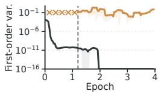  
(a) Hinge variance term

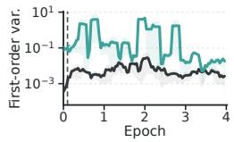  
(b) Sq.-hinge variance term

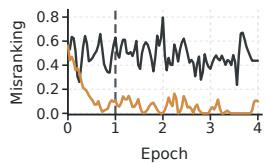  
(c) Hinge trajectory

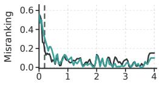  
(d) Sq.-hinge trajectory

Figure 3: Real-run trajectory measures support the Corrective Power explanation. Four trainingtrajectory quantities computed from experiment runs. Panels (a,b) show the scaled first-order Hoeffding variance term on SNLI E/N along the steepest severe-error correction direction; shaded bands show one standard error after the same smoothing used for the displayed mean. x marks denote the CE warm-up interval before the pairwise variance term is recorded. Panels (c,d) show ANLI R1 E/N trajectories and mark the CE-to-AUC switch. Definitions are in Appendix B.5.

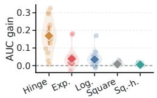  
(a) Warm-up gain by loss

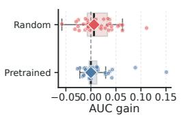  
(b) Warm-up gain by initialization

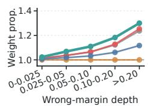  
(c) Direct weight distribution

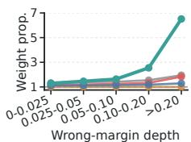  
(d) Warm-up weight distribution  
Figure 4: Aggregate real-run measures support the Corrective Power explanation. Four aggregate quantities computed from the same experiment runs. Panels (a,b) report warm-up gains by loss and initialization, respectively. Panels (c,d) report relative weight proportions over wrong-margin intervals. Definitions are in Appendix B.5.

with warm-up gain, defined as validation-selected test AUC after CE-warm-started pairwise training minus validation-selected test AUC after direct pairwise training. Positive values mean that CE improves the starting point for the later pairwise phase; values near zero mean that the direct pairwise run already starts from, or quickly reaches, a usable region. The largest and most variable gains appear for hinge, matching the view that warm-up is most valuable when direct pairwise optimization enters a poor high-misranking state. Figure 3(a,b) then checks the stochastic side of the same explanation: it records the scaled first-order Hoeffding variance term along the steepest severe-error correction direction. This term measures whether the mini-batch update still has first-order stochastic motion in the favorable projected direction; when it is small, the leading mini-batch component along that direction is weak. Figure 3(c,d) records the logged-batch misranking ratio, which measures how many logged training pairs are still ordered incorrectly. In these trajectory panels, the black curve is direct pairwise AUC-surrogate training, the colored curve is CE warm-up followed by pairwise training, and the vertical dashed line marks the CE-to-AUC switch. The hinge trajectory shows the intended warm-up effect: CE lowers the misranking state before the pairwise phase begins, after which pairwise training starts from an easier region. The squared-hinge trajectory shows a different regime: direct squared-hinge can already reduce misranking quickly and preserve stronger corrective motion, so a separate warm-up has smaller marginal value. Appendix B.5 gives the finite-batch construction and independent logging-batch protocol, and Figure 5 in Appendix B.5 reports the all-loss trajectory counterpart.

Fixed-checkpoint batch-size scaling provides a complementary check of this stochastic explanation. Across APTOS, SNLI, and ANLI-R1, weakly corrective regions show more attenuated severecomponent variance scaling than their matched corrective regions, matching the predicted shift toward the residual pair-interaction component as first-order projected motion weakens. Appendix B.5 gives the protocol and complete results.

The two trajectory quantities should be interpreted together. A low misranking ratio alone would show that the run is improving the ordering, but it would not explain whether the pairwise mini-batch update still has the stochastic component emphasized by the theory. The warm-up panels therefore support the mechanism when both signals move in the expected direction: CE changes the state before the AUC phase, the later pairwise updates operate from a lower-misranking region, and the projected first-order term remains more visible along the steepest correction direction.

## RQ4. What changes under pretrained initialization and parameter-efficient tuning?

A pretrained start can reduce the need for a separate warm-up stage when it places the trainable trajectory in a favorable region. The Qwen block in Table 1 often has small squared-hinge warm-up gains, and the direct squared-hinge entries are already close to the corresponding warm-up entries on several NLP tasks. Figure 4(b) provides a matched same-backbone comparison between random and ImageNet-pretrained initialization. The aggregate shift and reduced dispersion of warm-up gains under pretrained initialization support that pretraining places optimization closer to a favorable ranking state and reduces the average marginal benefit of an additional warm-up stage. This is consistent with the starting-state explanation: when the pretrained representation and trainable subspace place AUC training closer to a favorable ranking geometry, warm-up has smaller marginal value, although it remains useful in some settings.

Together, the experiments support a conditional prescription: pairwise AUC-surrogate training is most dependable when the surrogate keeps corrective gradient weight on severe wrong pairs, and warm-up or pretraining is most useful when it moves the trajectory into a state where such corrective updates remain available.

## 6 Conclusion

This paper studies why direct pairwise AUC-surrogate training can still be unreliable despite matching the evaluation metric. The key issue is Corrective Power: whether SGD keeps useful motion on severe ranking errors. We identify bad regions where severe misranked pairs remain common, but the projected mean drift along the severe-error correction direction is weak. In these regions, progress depends on the finite-batch noise in the same direction. The pairwise mini-batch gradient is a twosample U-statistic, so this projected noise has a leading order- $B ^ { - 1 }$ term and a residual order- $B ^ { - 2 }$ interaction term in the equal-size case. When the leading term vanishes, the useful noise drops to order $B ^ { - 2 }$ , and the projected escape-time scale changes from order B to order $B ^ { 2 }$ . This view explains two ways to improve corrective power. First, the surrogate loss controls the gradient weigh assigned to severe wrong pairs; squared-hinge is effective because it gives larger weight to severe active violations while ignoring easy pairs. Second, warm-up and PEFT change where pairwise training begins; CE warm-up can move a model away from a poor start, while pretrained PEFT can start closer to a favorable ranking region. The CV and NLP experiments are consistent with these two predictions.

## Acknowledgements

This work was supported in part by National Natural Science Foundation of China: 62525212, U23B2051, 62236008, 62441232, 62521007, U21B2038, 62502496, and 62576332, in part by Youth Innovation Promotion Association CAS, in part by the Strategic Priority Research Program of the Chinese Academy of Sciences, Grant No. XDB0680201, in part by Beijing Natural Science Foundation–Xiaomi Innovation Joint Fund (Grant No. 26L030072), and in part by the project ZR2025ZD01 supported by Shandong Provincial Natural Science Foundation. The authors declare no competing interests.

## References

[1] James A Hanley and Barbara J McNeil. The meaning and use of the area under a receiver operating characteristic (roc) curve. Radiology, 143(1):29–36, 1982.

[2] Andrew P Bradley. The use of the area under the roc curve in the evaluation of machine learning algorithms. Pattern recognition, 30(7):1145–1159, 1997.

[3] Tom Fawcett. An introduction to roc analysis. Pattern recognition letters, 27(8):861–874, 2006.

[4] Corinna Cortes and Mehryar Mohri. Auc optimization vs. error rate minimization. Advances in neural information processing systems, 16, 2003.

[5] Aditya Krishna Menon and Robert C Williamson. Bipartite ranking: a risk-theoretic perspective. Journal ofMachine Learning Research, 17(195):1–102, 2016.

[6] Tianbao Yang and Yiming Ying. Auc maximization in the era of big data and ai: A survey. ACM computing surveys, 55(8):1–37, 2022.

[7] Lian Yan, Robert H Dodier, Michael Mozer, and Richard H Wolniewicz. Optimizing classifier performance via an approximation to the wilcoxon-mann-whitney statistic. In Proceedings of the 20th international conference on machine learning (icml-03), pages 848–855, 2003.

[8] Alan Herschtal and Bhavani Raskutti. Optimising area under the roc curve using gradient descent. In Proceedings of the twenty-first international conference on Machine learning, page 49, 2004.

[9] Alain Rakotomamonjy. Optimizing area under roc curve with svms. In ROCAI, pages 71–80, 2004.

[10] Mingrui Liu, Zhuoning Yuan, Yiming Ying, and Tianbao Yang. Stochastic auc maximization with deep neural networks. arXiv preprint arXiv:1908.10831, 2019.

[11] Zhuoning Yuan, Yan Yan, Milan Sonka, and Tianbao Yang. Large-scale robust deep auc maximization: A new surrogate loss and empirical studies on medical image classification. In 2021 IEEE/CVF International Conference on Computer Vision (ICCV), pages 3020–3029. IEEE, 2021.

[12] Zhuoning Yuan, Zhishuai Guo, Nitesh Chawla, and Tianbao Yang. Compositional training for end-to-end deep auc maximization. In International conference on learning representations, 2021.

[13] Tianbao Yang. Deep auc maximization for medical image classification: Challenges and opportunities. arXiv preprint arXiv:2111.02400, 2021.

[14] Zhiyong Yang, Qianqian Xu, Shilong Bao, Yuan He, Xiaochun Cao, and Qingming Huang. When all we need is a piece of the pie: A generic framework for optimizing two-way partial auc. In International Conference on Machine Learning, pages 11820–11829. PMLR, 2021.

[15] Zhiyong Yang, Qianqian Xu, Shilong Bao, Yuan He, Xiaochun Cao, and Qingming Huang. Optimizing two-way partial auc with an end-to-end framework. IEEE Transactions on Pattern Analysis and Machine Intelligence, 45(8):10228–10246, 2022.

[16] Neil Houlsby, Andrei Giurgiu, Stanislaw Jastrzebski, Bruna Morrone, Quentin De Laroussilhe, Andrea Gesmundo, Mona Attariyan, and Sylvain Gelly. Parameter-efficient transfer learning for nlp. In International conference on machine learning, pages 2790–2799. PMLR, 2019.

[17] Edward J Hu, Yelong Shen, Phillip Wallis, Zeyuan Allen-Zhu, Yuanzhi Li, Shean Wang, Lu Wang, and Weizhu Chen. Lora: Low-rank adaptation of large language models. arXiv preprint arXiv:2106.09685, 2021.

[18] Tim Dettmers, Artidoro Pagnoni, Ari Holtzman, and Luke Zettlemoyer. Qlora: Efficient finetuning of quantized llms. Advances in neural information processing systems, 36:10088– 10115, 2023.

[19] Alan J Lee. U-statistics: Theory and Practice. Routledge, 2019.

[20] Robert J Serfling. Approximation theorems of mathematical statistics. John Wiley & Sons, 2009.

[21] Kaiming He, Xiangyu Zhang, Shaoqing Ren, and Jian Sun. Deep residual learning for image recognition. In Proceedings of the IEEE conference on computer vision and pattern recognition, pages 770–778, 2016.

[22] Gao Huang, Zhuang Liu, Laurens Van Der Maaten, and Kilian Q Weinberger. Densely connected convolutional networks. In 2017 IEEE conference on computer vision and pattern recognition (CVPR), pages 2261–2269. Ieee, 2017.

[23] Victor Sanh, Lysandre Debut, Julien Chaumond, and Thomas Wolf. Distilbert, a distilled version of bert: smaller, faster, cheaper and lighter. arXiv preprint arXiv:1910.01108, 2019.

[24] An Yang, Baosong Yang, Beichen Zhang, Binyuan Hui, Bo Zheng, Bowen Yu, Chengyuan Li, D Liu, F Huang, H Wei, et al. Qwen2. 5 technical report. arxiv. 2024.

[25] Thorsten Joachims. A support vector method for multivariate performance measures. In Proceedings ofthe 22nd international conference on Machine learning, pages 377–384, 2005.

[26] Harikrishna Narasimhan, Purushottam Kar, and Prateek Jain. Optimizing non-decomposable performance measures: A tale of two classes. In International Conference on Machine Learning, pages 199–208. PMLR, 2015.

[27] Tino Werner. A review on instance ranking problems in statistical learning. Machine Learning, 111(2):415–463, 2022.

[28] Zhiyong Yang, Qianqian Xu, Shilong Bao, Xiaochun Cao, and Qingming Huang. Learning with multiclass auc: Theory and algorithms. IEEE Transactions on Pattern Analysis and Machine Intelligence, 44(11):7747–7763, 2021.

[29] Huiyang Shao, Qianqian Xu, Zhiyong Yang, Peisong Wen, Gao Peifeng, and Qingming Huang. Weighted roc curve in cost space: Extending auc to cost-sensitive learning. Advances in Neural Information Processing Systems, 36:17357–17368, 2023.

[30] Zitai Wang, Qianqian Xu, Zhiyong Yang, Yuan He, Xiaochun Cao, and Qingming Huang. Openauc: Towards auc-oriented open-set recognition. Advances in Neural Information Processing Systems, 35:25033–25045, 2022.

[31] Boyu Han, Qianqian Xu, Zhiyong Yang, Shilong Bao, Peisong Wen, Yangbangyan Jiang, and Qingming Huang. Aucseg: Auc-oriented pixel-level long-tail semantic segmentation. Advances in Neural Information Processing Systems, 37:126863–126907, 2024.

[32] Zhaoda Ye, Xiangteng He, and Yuxin Peng. Unsupervised cross-media hashing learning via knowledge graph. Chinese Journal of Electronics, 31(6):1081–1091, 2022. doi: 10.1049/cje. 2021.00.455.

[33] Ye Tian, Ying Fu, and Jun Zhang. Transformer-based under-sampled single-pixel imaging. Chinese Journal ofElectronics, 32(5):1151–1159, 2023. doi: 10.23919/cje.2022.00.284.

[34] Tao Zhang, Ying Fu, and Jun Zhang. Deep guided attention network for joint denoising and demosaicing in real image. Chinese Journal of Electronics, 33(1):303–312, 2024. doi: 10.23919/cje.2022.00.414.

[35] Peilin Zhao, Steven CH Hoi, Rong Jin, and Tianbo Yang. Online auc maximization. 2011.

[36] Purushottam Kar, Bharath Sriperumbudur, Prateek Jain, and Harish Karnick. On the generalization ability of online learning algorithms for pairwise loss functions. In International Conference on Machine Learning, pages 441–449. PMLR, 2013.

[37] Wei Gao, Rong Jin, Shenghuo Zhu, and Zhi-Hua Zhou. One-pass auc optimization. In International conference on machine learning, pages 906–914. PMLR, 2013.

[38] Stephan Clémençon, Igor Colin, and Aurélien Bellet. Scaling-up empirical risk minimization: optimization of incomplete u-statistics. Journal of Machine Learning Research, 17(76):1–36, 2016.

[39] Michael Natole, Yiming Ying, and Siwei Lyu. Stochastic proximal algorithms for auc maximization. In International Conference on Machine Learning, pages 3710–3719. PMLR, 2018.

[40] Yunwen Lei and Yiming Ying. Stochastic proximal auc maximization. Journal of Machine Learning Research, 22(61):1–45, 2021.

[41] Zhishuai Guo, Mingrui Liu, Zhuoning Yuan, Li Shen, Wei Liu, and Tianbao Yang. Communication-efficient distributed stochastic auc maximization with deep neural networks. In International conference on machine learning, pages 3864–3874. PMLR, 2020.

[42] Zhiyuan Dang, Xiang Li, Bin Gu, Cheng Deng, and Heng Huang. Large-scale nonlinear auc maximization via triply stochastic gradients. IEEE Transactions on Pattern Analysis and Machine Intelligence, 44(3):1385–1398, 2020.

[43] Wenzheng Hou, Qianqian Xu, Zhiyong Yang, Shilong Bao, Yuan He, and Qingming Huang. Adauc: End-to-end adversarial auc optimization against long-tail problems. In International Conference on Machine Learning, pages 8903–8925. PMLR, 2022.

[44] Siran Dai, Qianqian Xu, Zhiyong Yang, Xiaochun Cao, and Qingming Huang. Drauc: an instance-wise distributionally robust auc optimization framework. Advances in Neural Information Processing Systems, 36:44658–44670, 2023.

[45] Aditya Krishna Menon and Robert C Williamson. Bayes-optimal scorers for bipartite ranking. In Conference on Learning Theory, pages 68–106. PMLR, 2014.

[46] Wojciech Kotlowski, Krzysztof J Dembczynski, and Eyke Huellermeier. Bipartite ranking through minimization of univariate loss. In Proceedings ofthe 28th International Conference on Machine Learning (ICML-11), pages 1113–1120, 2011.

[47] Shivani Agarwal. Surrogate regret bounds for the area under the roc curve via strongly proper losses. In Conference on Learning Theory, pages 338–353. PMLR, 2013.

[48] Shivani Agarwal. Surrogate regret bounds for bipartite ranking via strongly proper losses. The Journal ofMachine Learning Research, 15(1):1653–1674, 2014.

[49] Wei Gao and Zhi-Hua Zhou. On the consistency of auc pairwise optimization. arXiv preprint arXiv:1208.0645, 2012.

[50] Yiming Ying, Longyin Wen, and Siwei Lyu. Stochastic online auc maximization. Advances in neural information processing systems, 29, 2016.

[51] Mengdi Wang, Ethan X Fang, and Han Liu. Stochastic compositional gradient descent: algorithms for minimizing compositions of expected-value functions. Mathematical Programming, 161(1):419–449, 2017.

[52] Bokun Wang and Tianbao Yang. Finite-sum coupled compositional stochastic optimization: Theory and applications. arXiv preprint arXiv:2202.12396, 2022.

[53] Harikrishna Narasimhan and Shivani Agarwal. A structural SVM based approach for optimizing partial auc. In Sanjoy Dasgupta and David McAllester, editors, Proceedings of the 30th International Conference on Machine Learning, volume 28 of Proceedings of Machine Learning Research, pages 516–524. PMLR, 2013. URL https://proceedings.mlr.press/v28/ narasimhan13.html.

[54] Huiyang Shao, Qianqian Xu, Zhiyong Yang, Shilong Bao, and Qingming Huang. Asymptotically unbiased instance-wise regularized partial auc optimization: Theory and algorithm. Advances in Neural Information Processing Systems, 35:38667–38679, 2022.

[55] Dixian Zhu, Gang Li, Bokun Wang, Xiaodong Wu, and Tianbao Yang. When auc meets dro: Optimizing partial auc for deep learning with non-convex convergence guarantee. In International Conference on Machine Learning, pages 27548–27573. PMLR, 2022.

[56] Linli Zhou, Bokun Wang, My T Thai, and Tianbao Yang. Stochastic primal-dual double block-coordinate for two-way partial auc maximization. arXiv preprint arXiv:2505.21944, 2025.

[57] Xiang Lisa Li and Percy Liang. Prefix-tuning: Optimizing continuous prompts for generation, jan. arXiv preprint arXiv:2101.00190, 2(3), 2021.

[58] Brian Lester, Rami Al-Rfou, and Noah Constant. The power of scale for parameter-efficient prompt tuning. In Proceedings of the 2021 conference on empirical methods in natural language processing, pages 3045–3059, 2021.

[59] Yuxin Peng, Zishuo Wang, Geng Li, Xiangtian Zheng, Sibo Yin, and Hulingxiao He. A survey on fine-grained multimodal large language models. Chinese Journal of Electronics, 35(2): 771–803, 2026. doi: 10.23919/cje.2025.00.336.

[60] Linhui Xiao, Guiping Cao, Mingyue Guo, Xianchao Guan, Fan Yang, Ming Tao, Xin Li, Yuxin Peng, and Yaowei Wang. A survey on the green development of large models: From resourceefficient architectures to hardware-software co-design. Chinese Journal of Electronics, 35(5): 1–24, 2026. doi: 10.23919/cje.2025.00.438.

[61] Dumitru Erhan, Aaron Courville, Yoshua Bengio, and Pascal Vincent. Why does unsupervised pre-training help deep learning? In Proceedings of the thirteenth international conference on artificial intelligence and statistics, pages 201–208. JMLR Workshop and Conference Proceedings, 2010.

[62] Emmanuel Abbe, Elisabetta Cornacchia, Jan Hazla, and Christopher Marquis. An initial alignment between neural network and target is needed for gradient descent to learn. In International Conference on Machine Learning, pages 33–52. PMLR, 2022.

[63] Herbert Robbins and Sutton Monro. A stochastic approximation method. The annals of mathematical statistics, pages 400–407, 1951.

[64] Harold J Kushner and G George Yin. Stochastic approximation and recursive algorithms and applications. Springer, 2003.

[65] Stewart N Ethier and Thomas G Kurtz. Markov processes: characterization and convergence. John Wiley & Sons, 2009.

[66] Qianxiao Li, Cheng Tai, et al. Stochastic modified equations and dynamics of stochastic gradient algorithms i: Mathematical foundations. Journal ofMachine Learning Research, 20(40):1–47, 2019.

[67] Xavier Fontaine, Valentin De Bortoli, and Alain Durmus. Convergence rates and approximation results for sgd and its continuous-time counterpart. In Conference on Learning Theory, pages 1965–2058. PMLR, 2021.

[68] Ziwei Liu, Zhongqi Miao, Xiaohang Zhan, Jiayun Wang, Boqing Gong, and Stella X Yu. Largescale long-tailed recognition in an open world. In 2019 IEEE/CVF conference on computer vision and pattern recognition (CVPR), pages 2532–2541. IEEE, 2019.

[69] Jia Deng, Wei Dong, Richard Socher, Li-Jia Li, Kai Li, and Li Fei-Fei. Imagenet: A largescale hierarchical image database. In 2009 IEEE conference on computer vision and pattern recognition, pages 248–255. Ieee, 2009.

[70] E Dataset. Novel datasets for fine-grained image categorization. In First workshop on fine grained visual categorization, CVPR. Citeseer. Citeseer. Citeseer, volume 5, page 2. Citeseer, 2011.

[71] Subhransu Maji, Esa Rahtu, Juho Kannala, Matthew Blaschko, and Andrea Vedaldi. Finegrained visual classification of aircraft. arXiv preprint arXiv:1306.5151, 2013.

[72] Asia Pacific Tele-Ophthalmology Society. APTOS 2019 blindness detection. Kaggle Competition Dataset, 2019. URL https://www.kaggle.com/c/ aptos2019-blindness-detection.

[73] Alex Olsen, Dmitry A Konovalov, Bronson Philippa, Peter Ridd, Jake C Wood, Jamie Johns, Wesley Banks, Benjamin Girgenti, Owen Kenny, James Whinney, et al. Deepweeds: A multiclass weed species image dataset for deep learning. Scientific reports, 9(1):2058, 2019.

[74] Himanshu Sharma, Devanand Padha, and Nahida Bashir. D-kap: A deep learning-based kashmiri apple plant disease prediction framework. In 2022 Seventh International Conference on Parallel, Distributed and Grid Computing (PDGC), pages 576–581. IEEE, 2022.

[75] Harshadkumar B Prajapati, Jitesh P Shah, and Vipul K Dabhi. Detection and classification of rice plant diseases. Intelligent Decision Technologies, 11(3):357–373, 2017.

[76] Philipp Tschandl, Cliff Rosendahl, and Harald Kittler. The ham10000 dataset, a large collection of multi-source dermatoscopic images of common pigmented skin lesions. Scientific data, 5(1): 180161, 2018.

[77] Ekin Dogus Cubuk, Barret Zoph, Jon Shlens, and Quoc Le. Randaugment: Practical automated data augmentation with a reduced search space. Advances in neural information processing systems, 33:18613–18624, 2020.

[78] Alex Krizhevsky, Geoffrey Hinton, et al. Learning multiple layers of features from tiny images. 2009.

[79] Grant Van Horn, Oisin Mac Aodha, Yang Song, Yin Cui, Chen Sun, Alex Shepard, Hartwig Adam, Pietro Perona, and Serge Belongie. The inaturalist species classification and detection dataset. In 2018 IEEE/CVF conference on computer vision and pattern recognition, pages 8769–8778. IEEE, 2018.

[80] Jeremy Irvin, Pranav Rajpurkar, Michael Ko, Yifan Yu, Silviana Ciurea-Ilcus, Chris Chute, Henrik Marklund, Behzad Haghgoo, Robyn Ball, Katie Shpanskaya, et al. Chexpert: A large chest radiograph dataset with uncertainty labels and expert comparison. In Proceedings ofthe AAAI conference on artificial intelligence, volume 33, pages 590–597, 2019.

[81] Dorottya Demszky, Dana Movshovitz-Attias, Jeongwoo Ko, Alan Cowen, Gaurav Nemade, and Sujith Ravi. Goemotions: A dataset of fine-grained emotions. In Proceedings of the 58th annual meeting of the association for computational linguistics, pages 4040–4054, 2020.

[82] Yixin Nie, Adina Williams, Emily Dinan, Mohit Bansal, Jason Weston, and Douwe Kiela. Adversarial nli: A new benchmark for natural language understanding. In Proceedings ofthe 58th annual meeting of the association for computational linguistics, pages 4885–4901, 2020.

[83] Samuel R Bowman, Gabor Angeli, Christopher Potts, and Christopher D Manning. A large annotated corpus for learning natural language inference. In Proceedings ofthe 2015 conference on empirical methods in natural language processing, pages 632–642, 2015.

[84] Alisa Liu, Swabha Swayamdipta, Noah A Smith, and Yejin Choi. Wanli: Worker and ai collaboration for natural language inference dataset creation. In Findings ofthe Associationfor Computational Linguistics: EMNLP 2022, pages 6826–6847, 2022.

[85] Ilya Loshchilov and Frank Hutter. Decoupled weight decay regularization. arXiv preprint arXiv:1711.05101, 2017.

[86] Bolei Zhou, Agata Lapedriza, Aditya Khosla, Aude Oliva, and Antonio Torralba. Places: A 10 million image database for scene recognition. IEEE transactions on pattern analysis and machine intelligence, 40(6):1452–1464, 2017.

[87] Zhuoning Yuan, Dixian Zhu, Zi-Hao Qiu, Gang Li, Xuanhui Wang, and Tianbao Yang. Libauc: A deep learning library for x-risk optimization. In Proceedings of the 29th ACM SIGKDD conference on knowledge discovery and data mining, pages 5487–5499, 2023.

## Appendix

## Table of Contents

A Related Work 17   
B Experimental Details. 18   
B.1 Details of the Controlled Two-Dimensional Simulation 18   
B.2 Details of the Noise-Scale Escape Simulation 19   
B.3 Main Experimental Protocol. .20   
B.4 Data Sources and Task Constructio .21   
B.5 Models, Optimization, and Reporting Protocol 23   
B.6 Multiclass, Multilabel, and Deep-AUC Extensions 29   
B.7 Assets, Licenses, and Terms 31   
B.8 Ethics, Broader Impacts, and Safeguards 32   
C Direct Pairwise SGD as a Stochastic Dynamics 32   
C.1 Extensions Beyond Binary AUC . 36   
D Bad Regions and Hoeffding Projection Collapse . . 36   
E Surrogate Weight Calculations 48   
E.1 Canonical Weights 48   
E.2 Active-Side Correction Versus Class-Mean Collapse . 49   
E.3 Easy-Side Silence Versus Overshoot . .51   
E.4 Hard-Tail Alignment 52   
E.5 Projected Stochastic Separation . 53   
F Changing Where Pairwise AUC Optimization Begins .53   
F.1 CE Warm-Up and Severe-Misranking Mass 53   
F.2 Parameter-Efficient Fine-Tuning in a Stable Trainable Subspace . 56   
F.3 Local Pairwise AUC-Surrogate Descent in a Favorable Subspace 58   
G Model-Class Realizations of Projected Bad Components 60   
G.1 Data-Dependent One-Layer Construction . 60   
G.2 Projected Bad Components in Trainable Transformer Neighborhoods 63   
H Localized Escape-Time Bounds for Stopped SGD 67   
Limitations

How to read the appendix. Appendix A gives the extended related work. Appendix B records the controlled simulations, the full protocol behind the reported CV and NLP experiments, and the asset, license, and ethics information relevant to the experiments. The remaining appendices give the proofs: Appendix C fixes the direct pairwise SGD process and its local Langevin interface; Appendix D proves the bad-region and Hoeffding-projection statements used in Section 2; Appendix E proves the surrogate-weight claims used in Section 3; Appendix F proves the warm-up and parameter-efficient fine-tuning statements behind Section 4; Appendix G shows that the projected bad-component conditions can be realized inside Transformer-style model classes; Appendix H gives the stopped-SGD escape-time tool that converts directional drift and second-moment bounds into the projected B versus $B ^ { 2 ^ { \bullet } }$ scale contrast; and Appendix I states the scope and limitations of the theory.

## A Related Work

This appendix organizes the literature behind the paper’s main question: when direct pairwise AUC-surrogate training uses finite mini-batch SGD, do severe ranking mistakes still generate useful parameter motion? We group the discussion by statistical target, scalable AUC algorithms, surrogate validity, U-statistic structure, related auxiliary-state methods, partial-AUC variants, warm-up and pretraining practice, and local stochastic dynamics.

AUC, ranking, and non-decomposable learning. AUC is a bipartite-ranking objective rather than a decomposable classification loss: it evaluates whether positives receive larger scores than negatives across opposite-class pairs. Classical and structural views of ROC area and multivariate performance measures formalize this non-decomposable nature [25, 26]. Broader surveys place AUC beside bipartite ranking, partial AUC, top-focused ranking, and precision-style criteria [27]. Related work also adapts the AUC target itself to multiclass learning, cost-sensitive decision making, open-set recognition, and pixel-level long-tail segmentation [28–31]. Cross-media retrieval provides another ranking-oriented application context, including unsupervised cross-media hashing based on knowledge graphs [32]. Adjacent learning-based vision problems include under-sampled singlepixel reconstruction and joint denoising and demosaicing [33, 34], but these are reconstruction and restoration tasks rather than the binary-ranking problem studied here. This literature fixes the target of interest. Our analysis focuses on the training dynamics induced by that target: a pairwise SGD update must convert opposite-class ranking errors into corrective motion of the scorer.

AUC optimization algorithms. The quadratic coupling between positives and negatives makes AUC maximization structurally different from pointwise ERM. This has motivated online AUC optimization, pairwise stochastic methods, one-pass and incomplete-pair methods, proximal methods, triply stochastic methods, distributed methods, and nonlinear extensions [35–42]. Deep AUC training adds representation learning, robust surrogates, warm-up, and task-dependent optimization design [10, 12]. AUC-oriented algorithms have also been developed for long-tail adversarial training and domain robust or distributionally robust settings [43, 44]. These works make pairwise AUC computable at scale. Our contribution is complementary: even when the pairwise update is computable, its local drift and covariance can stop turning severe misrankings into effective motion.

Surrogate validity versus surrogate dynamics. Population-level theory explains why several losses are meaningful for ranking. Bayes-optimal bipartite ranking, univariate surrogate control, proper-loss regret transfers, and pairwise consistency results address calibration, regret, and statistical validity [5, 45–49]. The present paper studies a different property of the same losses. Logistic, exponential, square, hinge, and squared-hinge losses assign different weights to pairwise margins; those weights determine whether severe mistakes receive stronger correction, whether easy pairs continue to consume update mass, and whether useful stochastic variation remains available along difficult trajectories.

U-statistics and finite-batch stochastic structure. Empirical AUC risks are two-sample Ustatistics. Classical U-statistic theory gives the Hoeffding projection decomposition and the corresponding first-order and canonical components [19, 20]. We use this decomposition as a stochasticdynamics tool. For pairwise mini-batches with $B _ { + }$ positives and B− negatives, the first-order projection scales are $B _ { + } ^ { - 1 }$ and $B _ { - } ^ { - 1 }$ , while the residual pair-interaction scale is $( B _ { + } B _ { - } ) ^ { - 1 }$ . When the first-order projections vanish in a bad region, the remaining canonical term has scale $( B _ { + } B _ { - } ) ^ { - 1 }$ which becomes $\check { B } ^ { - 2 }$ in the equal-size case. This variance split is the technical source of the escapetime contrast used in the main text.

Auxiliary-state AUC methods. Several scalable AUC methods reformulate the update process rather than optimize a raw pairwise objective in the most direct mini-batch form. Stochastic saddlepoint AUC maximization [50], stochastic proximal AUC methods [39], deep AUC [10], robust deep-AUC surrogates [11], compositional AUC training [12, 51, 52], and adversarial or distributionally robust AUC formulations [43, 44] introduce dual variables, proximal structure, auxiliary trackers, nested stochastic updates, or robustness-oriented inner problems. These methods are related because they redesign the stochastic process used for AUC training. The main text studies direct pairwise mini-batch SGD; auxiliary-state methods provide broader algorithmic context.

Partial AUC and top-focused variants. Partial AUC and top-focused ranking sharpen the same non-decomposable structure by emphasizing selected portions of the ROC curve or the highestranked examples. Structural partial-AUC optimization [53], generic and end-to-end two-way partial-AUC frameworks [14, 15], asymptotically unbiased instance-wise partial-AUC optimization [54], distributionally robust deep partial-AUC methods [55], and stochastic primal-dual algorithms for twoway partial AUC [56] introduce selection, sorting, distributional robustness, min-max reformulations, or primal-dual state. We use full pairwise AUC as the clean setting for the proofs, while these variants reinforce the need for optimization analyses that ${ \bf g 0 }$ beyond pointwise ERM.

Warm-up, pretraining, and parameter-efficient fine-tuning. Practical deep-AUC pipelines often use pointwise warm-up, pretrained backbones, or low-dimensional trainable modules before or during AUC optimization [10–12]. In large-model settings, adapters, prefix tuning, prompt tuning, LoRA, and QLoRA are standard forms of parameter-efficient fine-tuning from pretrained models [16– 18, 57, 58]. These questions become increasingly relevant as pretrained systems extend to fine-grained multimodal large models and as resource-efficient architectures and hardware–software co-design receive growing attention [59, 60]. Initialization and alignment results further show that the starting point can change learnability and optimization behavior [61, 62]. Our theory separates the roles of these practices: CE warm-up changes the starting region of the AUC phase, while the pretrained base and trainable subspace can place the pairwise phase closer to a favorable starting region.

Local stochastic dynamics and escape. The bridge from discrete SGD updates to local stochastic dynamics uses standard stochastic-approximation and Markov-process tools [63–67]. In our setting, the drift is governed by severity-weighted pairwise correction, while the covariance is governed by the Hoeffding projection structure of the mini-batch U-statistic. Appendix H turns the $\mathsf { \bar { B } } ^ { - 1 }$ versus $B ^ { - 2 }$ directional second-moment regimes into the projected escape-time statement used in the main text.

## B Experimental Details

## B.1 Details of the Controlled Two-Dimensional Simulation

This subsection gives the full configuration for Figure 1. The simulation makes the local dynamical mechanism in the introduction reproducible on a fixed two-dimensional parameter plane. All curves in the figure are generated by running the stated update rules; no trajectory is hand drawn or smoothed.

Data generation. The controlled simulation uses a fixed synthetic binary ranking dataset generated from the following configuration. The random seed is 1136848004. Each group parameter is $n _ { \mathrm { p e r \ g r o u p } } = 1 2$ , giving four groups with counts

$$
\mathrm { m a x } ( 2 , \lfloor n _ { \mathrm { p e r ~ g r o u p } } / 3 \rfloor ) , \quad 2 \cdot n _ { \mathrm { p e r ~ g r o u p } } , \quad n _ { \mathrm { p e r ~ g r o u p } } , \quad 4 \cdot n _ { \mathrm { p e r ~ g r o u p } } ,
$$

where groups 0 and 2 are positive and groups 1 and 3 are negative. The data-generation parameters are

$$
\begin{array} { r } { \alpha = 0 . 0 1 2 , \qquad \beta = 0 . 6 4 , \qquad \mathrm { h a r d \_ o f f s e t } = 0 . 1 6 , \qquad \mathrm { n o n l i n e a r } = 0 . 1 6 , } \\ { \qquad \mathrm { b u m p } = 0 . 4 6 , \qquad \mathrm { r b f \_ s c a l e } = 0 . 0 8 , \qquad \mathrm { f o u r i e r \_ s c a l e } = 0 . 1 5 . \qquad } \end{array}
$$

For a point $\theta = \left( \theta _ { 1 } , \theta _ { 2 } \right)$ , the sample score has the form

$$
f _ { \theta } ( x _ { i } ) = a _ { i } { \cdot } \theta _ { 1 } + b _ { i } { \cdot } \theta _ { 2 } + c _ { 1 i } { \cdot } h _ { 1 i } ( \theta _ { 1 } , \theta _ { 2 } ) + c _ { 2 i } { \cdot } h _ { 2 i } ( \theta _ { 1 } , \theta _ { 2 } ) + c _ { 3 i } { \cdot } q _ { i } ( \theta _ { 1 } , \theta _ { 2 } ) + r _ { i } ( \theta _ { 1 } , \theta _ { 2 } ) + s _ { i } ( \theta _ { 1 } , \theta _ { 2 } ) + o _ { i } .
$$

Here $h _ { 1 i }$ is a tanh feature, $h _ { 2 i }$ is a sinusoidal feature, $q _ { i }$ is a Gaussian bump, $r _ { i }$ is a sum of 14 radial-basis features, $s _ { i }$ is a sum of 8 Fourier features, and $o _ { i }$ is a sample offset. Their coefficients are generated once from the seed above and then held fixed for all panels and all update rules.

Landscape definition. The displayed landscape is the empirical AUC of the same fixed sample set on a two-dimensional parameter slice. For each grid point $( { \bar { \theta } } _ { 1 } , \theta _ { 2 } )$ , the positive-margin convention is

$$
m _ { \theta } ( x _ { i } ^ { + } , x _ { j } ^ { - } ) = f _ { \theta } ( x _ { i } ^ { + } ) - f _ { \theta } ( x _ { j } ^ { - } ) ,
$$

and the plotted value is

$$
\widehat { \mathrm { A U C } } ( \theta ) = \frac { 1 } { N _ { + } \cdot N _ { - } } \sum _ { i : y _ { i } = + 1 } \sum _ { j : y _ { j } = - 1 } \left\{ \mathbf { 1 } _ { \{ m _ { \theta } ( x _ { i } , x _ { j } ) > 0 \} } + \frac { 1 } { 2 } \cdot \mathbf { 1 } _ { \{ m _ { \theta } ( x _ { i } , x _ { j } ) = 0 \} } \right\} .
$$

The contour is evaluated on the fixed window

$$
\begin{array} { r } { \theta _ { 1 } \in [ - 1 . 0 8 , 2 . 1 8 ] , \qquad \theta _ { 2 } \in [ - 1 . 6 0 , 0 . 4 6 ] , } \end{array}
$$

using a $3 0 0 \times 2 5 0$ grid. The filled contour levels are evenly spaced between 0.50 and 1.00.

Surrogate losses and update rules. Figure 1 displays direct hinge and direct squared-hinge AUC trajectories, together with CE warm-up trajectories that switch to hinge or squared-hinge after the warm-up phase. The pairwise losses used in the displayed AUC phases are

$$
\ell _ { \mathrm { h i n g e } } ( x ) = ( m - x ) _ { + } , \qquad \ell _ { \mathrm { s q u a r e d - h i n g e } } ( x ) = ( m - x ) _ { + } ^ { 2 } ,
$$

with margin $m = 0 . 8 .$ . The AUC vector field uses the full finite-sample pair average

$$
\frac { 1 } { N _ { + } \cdot N _ { - } } \sum _ { \substack { i : y _ { i } = + 1 } } \sum _ { j : y _ { j } = - 1 } w _ { \ell } ( m _ { \theta } ( x _ { i } , x _ { j } ) ) \cdot \nabla _ { \theta } m _ { \theta } ( x _ { i } , x _ { j } ) , \qquad w _ { \ell } ( x ) = - \ell ^ { \prime } ( x ) .
$$

The CE vector field is the full finite-sample gradient direction of the binary cross-entropy objective on the same samples. Direct pairwise AUC-surrogate curves repeatedly apply the corresponding pairwise surrogate vector field. Warm-up curves apply the CE field first and then switch to the chosen pairwise surrogate field.

Optimization settings. The AUC step size is

$$
\eta _ { \mathrm { a u c } } = 0 . 1 5 ,
$$

the CE step size is

$$
\eta _ { \mathrm { c e } } = 0 . 1 0 5 ,
$$

the warm-up length is 26 steps, and the maximum trajectory length is 360 steps. The severemisranking threshold used by the scan is $M = 0 . 2$ , and the severe-badness exit threshold is 0.0015, used only to detect when a trajectory leaves the severe-start region. The trajectories are clamped to the numerical box $[ - 8 , 8 ] ^ { 2 }$ only as a stability guard; the displayed trajectories stay in the plotted window.

Panel initializations. All three panels use the same generated sample set, the same landscape, and the same optimization hyperparameters. They differ only in the initialization:

$$
\begin{array} { r l } { \mathrm { p a n e l ~ ( a ) } } & { : \quad ( \theta _ { 1 , 0 } , \theta _ { 2 , 0 } ) = ( - 0 . 4 5 0 , - 1 . 3 7 7 5 ) , } \\ { \mathrm { p a n e l ~ ( b ) } } & { : \quad ( \theta _ { 1 , 0 } , \theta _ { 2 , 0 } ) = ( - 0 . 0 7 5 , - 1 . 0 4 5 0 ) , } \\ { \mathrm { p a n e l ~ ( c ) } } & { : \quad ( \theta _ { 1 , 0 } , \theta _ { 2 , 0 } ) = ( 0 . 7 5 0 , - 0 . 5 3 7 5 ) . } \end{array}
$$

The corresponding initial severe-misranking fractions are 0.3993, 0.2752, and 0.1372, respectively. Final empirical AUC values for the trajectories emphasized in the main figure are:

<table><tr><td>panel</td><td>CE</td><td>hinge</td><td>squared-hinge</td><td>warm → hinge</td><td>warm → squared-hinge</td></tr><tr><td>(a)</td><td>0.9106</td><td>0.6016</td><td>0.6207</td><td>0.9028</td><td>0.9766</td></tr><tr><td>(b)</td><td>0.9106</td><td>0.9028</td><td>0.9766</td><td>0.9028</td><td>0.9766</td></tr><tr><td>(c)</td><td>0.9106</td><td>0.9757</td><td>0.9766</td><td>0.9757</td><td>0.9766</td></tr></table>

Plotting choices. The plotted paths are raw simulated iterates. Stars mark initializations, large circles mark final iterates, and small dots mark every 20 update steps. The contour is evaluated once on the fixed grid above and reused across all panels. The displayed runs are fixed reproducible simulations corresponding to the three regimes discussed in the introduction: weak correction from a severe start, recovery from a milder start, and favorable-start behavior. All reported trajectories are raw iterates from the corresponding update rules.

## B.2 Details of the Noise-Scale Escape Simulation

This subsection gives the configuration for panel (a) of Figure 2. The simulation serves as a controlled visualization of the escape-time mechanism in Corollary 1. It keeps the potential, initialization, drift, and time horizon fixed, and changes only the variance scale from the first-order $B ^ { - 1 }$ regime to the collapsed $B ^ { - 2 }$ regime.

Potential and landscape. The one-dimensional state is denoted by z. The unnormalized potential is

$$
\begin{array} { r l } & { U _ { \mathrm { r a w } } ( z ) = 0 . 1 0 5 \cdot ( z + 1 . 4 5 ) ^ { 2 } \cdot ( z - 1 . 3 4 ) ^ { 2 } } \\ & { \qquad + 0 . 1 8 \cdot \exp \left( - \left( \frac { z - 0 . 0 5 } { 0 . 3 7 } \right) ^ { 2 } \right) - 0 . 0 7 5 \cdot z } \\ & { \qquad + 0 . 0 1 8 \cdot \sin ( 2 . 6 \cdot z + 0 . 2 ) . } \end{array}
$$

For plotting and simulation, this potential is rescaled on the grid $z \in [ - 2 . 1 0 , 2 . 0 2 ] \ : \mathrm { b } _ { \mathrm { } }$ y

$$
U ( z ) = 0 . 0 4 + 0 . 9 0 \cdot \frac { U _ { \mathrm { r a w } } ( z ) - \operatorname* { m i n } _ { \tilde { z } } U _ { \mathrm { r a w } } ( \tilde { z } ) } { \operatorname* { m a x } _ { \tilde { z } } U _ { \mathrm { r a w } } ( \tilde { z } ) - \operatorname* { m i n } _ { \tilde { z } } U _ { \mathrm { r a w } } ( \tilde { z } ) } .
$$

The grid has 3000 points. The displayed state window is $z \in [ - 1 . 9 2 , 1 . 8 2 ]$ . The left well minimum, barrier, right well minimum, and escape threshold are

$$
z _ { \mathrm { l e f t } } = - 1 . 3 6 9 1 , \qquad z _ { \mathrm { b a r r i e r } } = 0 . 0 1 7 0 , \qquad z _ { \mathrm { r i g h t } } = 1 . 4 0 3 2 , \qquad z _ { \mathrm { e s c } } = 0 . 5 3 7 0 .
$$

The initialization is $z _ { 0 } = - 1 . 4 2$

Stochastic update. The simulation uses an Euler discretization of overdamped motion in the potential:

$$
z _ { t + 1 } = z _ { t } - \Delta t \cdot U ^ { \prime } ( z _ { t } ) + \sigma _ { B } \cdot \xi _ { t } , \qquad \xi _ { t } \sim \mathcal { N } ( 0 , 1 ) ,
$$

with independent $\xi _ { t } ^ { \ \cdot } \mathrm { s }$ across time and replicates. The derivative $U ^ { \prime }$ is computed by finite differences on the same 3000-point grid and linearly interpolated at the current state. States are clipped to [−2.05, 1.95] as a numerical guard.

Noise regimes and hyperparameters. Both regimes use

$$
B = 8 , \qquad \Delta t = 0 . 0 2 5 , \qquad \mathrm { n o i s e \_ b a s e } = 4 . 5 , \qquad T = 1 8 0
$$

iterations. The first-order regime uses

$$
\sigma _ { B } = \mathrm { n o i s e \_ b a s e } \cdot \sqrt { \Delta t / B } ,
$$

while the collapsed regime uses

$$
\sigma _ { B } = \tt { n o i s e \_ b a s e } \cdot \sqrt { \Delta t } / B .
$$

The empirical density in Figure 2(a) is computed from 12000 independent replicates per regime and sampled every 2 iterations. The random seeds are 20260524 for the $B ^ { - 1 }$ regime and 20260512 for the $B ^ { - 2 }$ regime. A replicate is counted as escaped once $z _ { t } \geq z _ { \mathrm { e s c } }$ for some $t \leq T$ . With the above configuration, the final escape fractions are 0.76275 for the first-order regime and 0.0265 for the collapsed regime, shown in the figure as 76% and 3%.

Rendering choices. The left curve in panel (a) is the same potential U, rotated so that the vertical axis is the state variable z. The two right subpanels show smoothed empirical state-density heatmaps over iteration and state. Horizontal guide lines mark the initialization, barrier, and target well. The density smoothing is used only for rendering; the escape fractions are computed from the raw simulated paths.

## B.3 Main Experimental Protocol

This subsection fixes the reporting protocol behind Table 1 and the expanded tables below. Each experiment is a binary ranking task evaluated by held-out AUC. For every model–task pair, the protocol compares CE with five pairwise surrogate families: square, hinge, exponential, logistic, and squared-hinge. Pairwise AUC training is run either directly from the beginning or after a CE warm-up phase.

Reported quantity. Every number in the result tables is the held-out test AUC of the validation-best checkpoint, averaged over matching runs. The main table and the expanded appendix tables report mean held-out AUC values with sample standard deviations. When a dataset does not provide fixed train, validation, and test splits, the same seed convention is used to create stratified splits before training.

Direct and warm-started rows. For CE, the main table reports the CE run. For each pairwise surrogate family, we run both direct pairwise AUC-surrogate training and CE-warm-started pairwise AUC-surrogate training when both are part of the grid. Table 1 reports these two modes as separate direct and warm-up rows for each task, with bold and underline marking the best and second-best results within each task. The expanded appendix tables keep the same direct/warm-started separation for the remaining model-family blocks.

Expanded results corresponding to Table 1. Table 1 displays DenseNet121 and Qwen2.5-1.5B-Instruct with direct and CE-warm-started rows for all five pairwise surrogate families. Table 2 gives the corresponding ResNet50 and DistilBERT-base results: each task is split into a direct row and a CE-warm-started row, and each cell reports the mean held-out AUC together with the corresponding sample standard deviation.

Table 2: Expanded direct and CE-warm-started results (AUC %) for ResNet50 and DistilBERTbase. This table reports the model-family blocks not shown in Table 1. Each task has a direct row and a warm-up row. Values are mean held-out AUC (%), with the ± sample standard deviation shown as a subscript. Within each task, the best and second-best configurations are bolded with darker shading and underlined with lighter shading, respectively.
<table><tr><td rowspan=1 colspan=11>Task                    Mode      CE       Square      Hinge       Exp.      Logistic    Sq.-hinge</td></tr><tr><td rowspan=1 colspan=11>ResNet50</td></tr><tr><td rowspan=1 colspan=10>ImageNet-LT Dogs         Direct  91.34±1.00  93.56±0.38  79.50±3.75  91.35±0.86  93.67±0.47</td><td rowspan=1 colspan=1>95.83±0.14</td></tr><tr><td rowspan=2 colspan=6>Warm-upDog Breeds              Direct</td><td rowspan=1 colspan=1>93.84±0.34</td><td rowspan=1 colspan=3>82.33±2.75  91.00±1.48  93.51±0.54</td><td rowspan=1 colspan=1>94.42±0.41</td></tr><tr><td rowspan=1 colspan=4></td><td rowspan=1 colspan=1>85.09±1.08</td><td rowspan=1 colspan=1>84.63±1.28</td><td rowspan=1 colspan=2>84.68±0.84  84.82±1.28</td><td rowspan=1 colspan=1>85.65±1.04</td></tr><tr><td rowspan=4 colspan=6>CRJ700/CRJ900Warm-upAPTOS Sev./Mod.          Direct  81.02±1.47</td><td rowspan=1 colspan=3></td><td rowspan=2 colspan=2></td></tr><tr><td rowspan=1 colspan=1> $5 4 . 9 9 _ { \pm 8 . 3 2 }$ </td><td rowspan=1 colspan=1>54.77±8.25</td><td rowspan=1 colspan=2>54.93±8.27  55.54±7.40</td><td rowspan=1 colspan=1>55.57±8.12</td></tr><tr><td rowspan=1 colspan=1>54.66±7.30</td><td rowspan=1 colspan=1>54.77±8.25</td><td rowspan=1 colspan=1>54.73±7.27</td><td rowspan=1 colspan=1>54.51±7.30</td><td rowspan=1 colspan=1>56.62±6.45</td></tr><tr><td rowspan=1 colspan=3>/Mod. Direct 81.02±1.47</td><td rowspan=1 colspan=1> $\underline { { 8 2 . 7 0 { \scriptstyle \pm 0 . 6 3 } } }$ </td><td rowspan=1 colspan=1>81.54±0.84</td><td rowspan=1 colspan=1>82.01±0.34</td><td rowspan=1 colspan=1>81.79±1.04</td><td rowspan=1 colspan=1>83.92±1.09</td></tr><tr><td rowspan=1 colspan=3></td><td rowspan=2 colspan=3>Warm-upDeepWeeds P/S           Direct</td><td rowspan=1 colspan=1></td><td rowspan=1 colspan=1>80.49±0.95</td><td rowspan=1 colspan=1>80.62±1.61</td><td rowspan=1 colspan=1>80.70±1.22</td><td rowspan=1 colspan=1>80.38±0.78</td></tr><tr><td></td><td></td><td></td><td rowspan=1 colspan=1>96.39±1.37</td><td rowspan=1 colspan=1> $9 6 . 9 8 { \scriptstyle \pm 2 . 3 5 }$ </td><td rowspan=1 colspan=2>96.99±2.36  96.98±2.37</td><td rowspan=1 colspan=1>96.90±2.41</td><td rowspan=1 colspan=1>97.04±2.38</td></tr><tr><td rowspan=1 colspan=6>Warm-up      一</td><td rowspan=1 colspan=4>96.98±2.35  96.15±2.76  96.98±2.37  96.90±2.41</td><td rowspan=1 colspan=1>97.12±2.61</td></tr><tr><td rowspan=1 colspan=11>DistilBERT-base</td></tr><tr><td rowspan=3 colspan=6>GoEmotions Annoy.        Direct  83.97±0.35</td><td rowspan=3 colspan=1>82.73±1.61</td><td></td><td></td><td></td><td></td></tr><tr><td rowspan=2 colspan=1>80.39±3.96</td><td rowspan=2 colspan=1>79.91±4.16</td><td rowspan=2 colspan=1>79.20±4.16</td><td></td></tr><tr><td rowspan=1 colspan=1>83.87±0.50</td></tr><tr><td rowspan=1 colspan=5>Warm-up</td><td rowspan=1 colspan=1></td><td rowspan=1 colspan=1>83.97±0.35</td><td rowspan=1 colspan=1>82.75±1.16</td><td rowspan=1 colspan=1>83.98±0.35</td><td rowspan=1 colspan=1>83.97±0.35</td><td rowspan=1 colspan=1>84.31±0.38</td></tr><tr><td rowspan=1 colspan=5>GoEmotions Fear          Direct</td><td rowspan=1 colspan=1>94.74±0.58</td><td rowspan=1 colspan=1>94.05±1.65</td><td rowspan=1 colspan=1>93.50±0.73</td><td rowspan=1 colspan=1>93.07±0.80</td><td rowspan=1 colspan=1>94.67±1.48</td><td rowspan=1 colspan=1>95.62±0.82</td></tr><tr><td rowspan=1 colspan=5>Warm-up</td><td rowspan=1 colspan=1></td><td rowspan=1 colspan=1>93.89±2.03</td><td rowspan=1 colspan=1>93.84±1.74</td><td rowspan=1 colspan=1>94.25±1.22</td><td rowspan=1 colspan=1>93.26±0.60</td><td rowspan=1 colspan=1>96.48±0.31</td></tr><tr><td rowspan=1 colspan=5>ANLI R1 E/N             Direct</td><td rowspan=1 colspan=1>70.21±1.21</td><td rowspan=1 colspan=1>66.37±2.07</td><td rowspan=1 colspan=1>61.51±5.60</td><td rowspan=1 colspan=1>64.44±1.84</td><td rowspan=1 colspan=1>63.32±2.28</td><td rowspan=1 colspan=1>67.84±1.63</td></tr><tr><td rowspan=1 colspan=5>Warm-up</td><td rowspan=1 colspan=1></td><td rowspan=1 colspan=1>69.07±1.52</td><td rowspan=1 colspan=1>69.86±1.40</td><td rowspan=1 colspan=1>69.09±1.10</td><td rowspan=1 colspan=1>68.48±2.16</td><td rowspan=1 colspan=1>69.77±1.35</td></tr><tr><td rowspan=1 colspan=5>ANLI R3 C/N            Direct</td><td rowspan=1 colspan=1>62.09±0.84</td><td rowspan=1 colspan=1>61.48±0.63</td><td rowspan=1 colspan=1>57.40±2.26</td><td rowspan=1 colspan=1>62.47±2.17</td><td rowspan=1 colspan=1>61.76±1.62</td><td rowspan=1 colspan=1>61.22±1.30</td></tr><tr><td rowspan=1 colspan=5>Warm-up</td><td rowspan=1 colspan=1></td><td rowspan=1 colspan=1>61.88±0.64</td><td rowspan=1 colspan=1>61.09±0.77</td><td rowspan=1 colspan=1>59.64±1.35</td><td rowspan=1 colspan=1>61.31±0.98</td><td rowspan=1 colspan=1>61.81±0.69</td></tr><tr><td rowspan=1 colspan=5>ANLI R3 E/N             Direct</td><td rowspan=1 colspan=1>63.49±0.62</td><td rowspan=1 colspan=1>62.40+1.23</td><td rowspan=1 colspan=1>58.85±0.79</td><td rowspan=1 colspan=1>58.49±2.04</td><td rowspan=1 colspan=1>60.11±0.85</td><td rowspan=1 colspan=1>62.24±0.86</td></tr><tr><td rowspan=1 colspan=5>Warm-up</td><td rowspan=1 colspan=1></td><td rowspan=1 colspan=1>62.59±1.60</td><td rowspan=1 colspan=1>62.86±0.59</td><td rowspan=1 colspan=1>63.00±0.67</td><td rowspan=1 colspan=1>63.14±0.57</td><td rowspan=1 colspan=1>63.87±0.51</td></tr><tr><td rowspan=1 colspan=4>SNLI E/N</td><td rowspan=1 colspan=1>Direct</td><td rowspan=1 colspan=1>92.56±0.34</td><td rowspan=1 colspan=1>89.07±2.98</td><td rowspan=1 colspan=1>86.21±1.25</td><td rowspan=1 colspan=1>86.69±1.06</td><td rowspan=1 colspan=1>84.42±3.97</td><td rowspan=1 colspan=1>92.52±0.43</td></tr><tr><td rowspan=1 colspan=4></td><td rowspan=1 colspan=1>Warm-up</td><td rowspan=1 colspan=1></td><td rowspan=1 colspan=1>92.21±0.44</td><td rowspan=1 colspan=1>92.21±0.49</td><td rowspan=1 colspan=1>92.37±0.20</td><td rowspan=1 colspan=1>92.21±0.44</td><td rowspan=1 colspan=1>92.98±0.22</td></tr><tr><td rowspan=1 colspan=4>WANLI C/N</td><td rowspan=1 colspan=1>Direct</td><td rowspan=1 colspan=1>82.39±0.49</td><td rowspan=1 colspan=1>80.58±0.35</td><td rowspan=1 colspan=1>75.51±3.21</td><td rowspan=1 colspan=1>79.54±0.61</td><td rowspan=1 colspan=1>77.89±0.61</td><td rowspan=1 colspan=1>82.08±0.36</td></tr><tr><td rowspan=1 colspan=4></td><td rowspan=1 colspan=1>Warm-up</td><td rowspan=1 colspan=1></td><td rowspan=1 colspan=1>81.74±0.43</td><td rowspan=1 colspan=1> $8 1 . 7 9 _ { \pm 0 . 4 8 }$ </td><td rowspan=1 colspan=1>81.90±0.34</td><td rowspan=1 colspan=1>81.84±0.40</td><td rowspan=1 colspan=1>82.41±0.32</td></tr><tr><td rowspan=1 colspan=5>WANLI E/N              Direct</td><td rowspan=1 colspan=1>75.44±0.50</td><td rowspan=1 colspan=2>74.43±0.27  65.37±4.09</td><td rowspan=1 colspan=1>73.42±0.35</td><td rowspan=1 colspan=1>71.60±1.88</td><td rowspan=1 colspan=1>74.76±0.67</td></tr><tr><td rowspan=1 colspan=6>Warm-up</td><td rowspan=1 colspan=2>74.72±0.27  73.99±0.68</td><td rowspan=1 colspan=2>74.63±0.36  74.24±0.56</td><td rowspan=1 colspan=1>75.41±0.29</td></tr></table>

## B.4 Data Sources and Task Construction

The main experiments use binary ranking tasks. Appendix B.6 further reports long-tailed multiclass, multilabel, and large-scale multiclass settings. For the binary tasks, each row defines a positive class and a negative class or negative class set, and all models are evaluated by held-out AUC on the resulting binary task. When a source dataset provides official train, validation, and test splits, those splits are used. Otherwise, stratified splits follow the reporting protocol. Text fields are converted into a single model input for NLP tasks, and labels are binarized before training.

CV tasks. The CV tasks are constructed from public image datasets and trained with ImageNetnormalized image pipelines. The CV rows use the following sources and binary definitions. The public CV sources are ImageNet-LT split files derived from ImageNet [68, 69], Stanford Dogs [70],

Table 3: CV task construction. Each row gives the source dataset and the binary ranking task used in the experiments.
<table><tr><td>Task</td><td>Source</td><td>Binary construction</td></tr><tr><td>ImageNet-LT Dogs</td><td>ImageNet-LT split files with ImageNet images</td><td>Tail dog classes versus sibling dog classes.</td></tr><tr><td>Dog Breeds</td><td>Stanford Dogs</td><td>Spitz, husky, and malamute versus Eskimo dog and Samoyed.</td></tr><tr><td>CRJ700/CRJ900</td><td>FGVC-Aircraft</td><td>Bombardier CRJ700 versus Bombardier CRJ900.</td></tr><tr><td>APTOS Sev./Mod.</td><td>APTOS diabetic-retinopathy fundus images</td><td>Severe-or-worse retinopathy versus moderate retinopathy.</td></tr><tr><td>DeepWeeds P/S</td><td>DeepWeeds</td><td>Parthenium weed versus Siam weed, with low-shot training construction.</td></tr><tr><td>Apple Disease</td><td>D-KAP apple leaf disease archive</td><td>Apple scab versus apple rot, with low-shot training construction.</td></tr><tr><td>Rice Disease</td><td>Rice Leaf Diseases</td><td>Brown spot versus leaf smut, with low-shot training construction.</td></tr><tr><td>HAM10000 M/N</td><td>HAM10000</td><td>Melanoma versus melanocytic nevus.</td></tr></table>

Table 4: NLP task construction. DistilBERT and Qwen use the same binary task definitions.
<table><tr><td>Task</td><td>Source</td><td>Binary construction</td></tr><tr><td>GoEmotions Annoyance</td><td>GoEmotions, simplified</td><td>Annoyance label versus all other examples.</td></tr><tr><td>GoEmotions Fear</td><td>GoEmotions, simplified</td><td>Fear label versus all other examples.</td></tr><tr><td>ANLI R1 Ent./Neu.</td><td>ANLI Round 1 prepared split</td><td>Entailment versus neutral.</td></tr><tr><td>ANLI R3 Con./Neu.</td><td>ANLI Round 3 prepared split</td><td>Contradiction versus neutral.</td></tr><tr><td>ANLI R3 Ent./Neu.</td><td>ANLI Round 3 prepared split</td><td>Entailment versus neutral.</td></tr><tr><td>SNLI High-Overlap</td><td>SNLI prepared high-overlap split</td><td>Entailment versus neutral on a</td></tr><tr><td>WANLI Con./Neu.</td><td>WANLI prepared split</td><td>high-overlap slice. Contradiction versus neutral.</td></tr><tr><td>WANLI Ent./Neu.</td><td>WANLI prepared split</td><td>Entailment versus neutral.</td></tr></table>

FGVC-Aircraft [71], APTOS 2019 [72], DeepWeeds [73], D-KAP [74], Rice Leaf Diseases [75], and HAM10000 [76]. Public releases are available for Stanford Dogs, FGVC-Aircraft, APTOS 2019, DeepWeeds, D-KAP, Rice Leaf Diseases, and HAM10000. The image preprocessing uses random resized crop to 224, random horizontal flip, RandAugment [77] with 2 operations and magnitude 9, conversion to tensor, and ImageNet normalization for training; validation and test use resize, center crop, tensor conversion, and ImageNet normalization.

The extension experiments additionally use CIFAR-100 [78], iNaturalist 2018 [79], and CheXpert [80]. The CIFAR-100 experiments construct long-tailed medium-mammals and vehicles tasks from the official classes; iNaturalist 2018 uses the official training and validation sets for an 8,142- class long-tailed task; and CheXpert uses patient-disjoint training and internal-validation data, with the official validation set reserved for final testing. The task compositions, split sizes, and evaluation metrics are specified in Appendix B.6.

NLP tasks. The DistilBERT and Qwen experiments use the same NLP task definitions. GoEmotions tasks are one-versus-rest emotion detection tasks; the official test split is used and a stratified validation split is carved from the official training split. ANLI, SNLI, and WANLI rows are prepared binary natural-language-inference contrasts with train, validation, and test splits fixed before model training. The NLP sources are Hugging Face go\_emotions with the simplified configuration [81], anli [82], snli [83], and alisawuffles/WANLI [84]. GoEmotions uses the official text field. NLI examples are formatted as premise–hypothesis inputs. The Qwen2.5-1.5B-Instruct experiments use the same prepared binary NLP tasks as the DistilBERT experiments, so the comparison changes the pretrained model family, tokenizer, scale, and resulting LoRA trainable-subspace geometry rather than the task distribution.

Table 5: CV split sizes. In the split columns, N is the total number of examples and pos./neg. gives the positive/negative counts.
<table><tr><td>CV task</td><td>Train (N; pos./neg.)</td><td>Val. (N; pos./neg.)</td><td>Test (N; pos./neg.)</td></tr><tr><td>ImageNet-LT Dogs</td><td>6788 (202/6586)</td><td>1080 (360/720)</td><td>2700 (900/1800)</td></tr><tr><td>Dog Breeds</td><td>517 (259/258)</td><td>111 (56/55)</td><td>110 (55/55)</td></tr><tr><td>CRJ700/CRJ900</td><td>50 (25/25)</td><td>30 (15/15)</td><td>66 (33/33)</td></tr><tr><td>APTOS Sev./Mod.</td><td>1041 (342/699)</td><td>223 (73/150)</td><td>223 (73/150)</td></tr><tr><td>DeepWeeds P/S</td><td>50 (25/25)</td><td>30 (15/15)</td><td>80 (40/40)</td></tr><tr><td>Apple Disease</td><td>50 (25/25)</td><td>30 (15/15)</td><td>80 (40/40)</td></tr><tr><td>Rice Disease</td><td>36 (18/18)</td><td>16 (8/8)</td><td>28 (14/14)</td></tr><tr><td>HAM10000 M/N</td><td>5473 (779/4694)</td><td>1173 (167/1006)</td><td>1172 (167/1005)</td></tr></table>

Table 6: NLP split sizes. In the split columns, N is the total number of examples and pos./neg. gives the positive/negative counts.
<table><tr><td>NLP task</td><td>Train (N; pos./neg.)</td><td>Val. (N; pos./neg.)</td><td>Test (N; pos./neg.)</td></tr><tr><td>GoEmotions Annoy.</td><td>39069 (2223/36846)</td><td>4341 (247/4094)</td><td>5427 (320/5107)</td></tr><tr><td>GoEmotions Fear</td><td>39069 (536/38533)</td><td>4341 (60/4281)</td><td>5427 (78/5349)</td></tr><tr><td>ANLI R1 E/N</td><td>12423 (5371/7052)</td><td>667 (334/333)</td><td>667 (334/333)</td></tr><tr><td>ANLI R3 C/N</td><td>20000 (10000/10000)</td><td>798 (396/402)</td><td>798 (396/402)</td></tr><tr><td>ANLI R3 E/N</td><td>20000 (10000/10000)</td><td>804 (402/402)</td><td>804 (402/402)</td></tr><tr><td>SNLI High-Overlap</td><td>20000 (10000/10000)</td><td>4000 (2000/2000)</td><td>4000 (2000/2000)</td></tr><tr><td>WANLI C/N</td><td>20000 (10000/10000)</td><td>3540 (1540/2000)</td><td>3142 (745/2397)</td></tr><tr><td>WANLI E/N</td><td>20000 (10000/10000)</td><td>4000 (2000/2000)</td><td>3858 (1858/2000)</td></tr></table>

Split sizes. The following tables report the exact sample counts used by the result tables. Counts are written as total examples with positive/negative counts in parentheses.

## B.5 Models, Optimization, and Reporting Protocol

All deep-learning experiments were run on a server with four NVIDIA RTX 3090 GPUs, each with 24GB of memory. Each training run uses one GPU; runs are scheduled independently across available devices rather than by distributed data-parallel training. Device assignment is not used as a statistical unit. Based on the available experiment logs, all experiments involved in this paper required approximately $1 . 8 \times 1 0 ^ { 3 }$ GPU-hours in total.

Models. The CV experiments use ImageNet-pretrained ResNet50 [21] and DenseNet121 [22] backbones with a binary classification head. The NLP experiments use DistilBERT-base-uncased [23] and Qwen2.5-1.5B-Instruct [24] sequence-classification models. The Qwen experiments use LoRA adapters [17] with rank 16, LoRA alpha 32, dropout 0.05, and bfloat16 computation. The DistilBERT runs use the same binary sequence-classification pipeline with LoRA rank 16, LoRA alpha 32, dropout 0.05, and float32 computation.

Losses. The pairwise losses are square, hinge, exponential, logistic, and squared-hinge, using the positive margin convention

$$
m _ { \theta } ( x ^ { + } , x ^ { - } ) = f _ { \theta } ( x ^ { + } ) - f _ { \theta } ( x ^ { - } ) .
$$

Direct pairwise AUC-surrogate training starts immediately with the specified pairwise loss. CEwarm-started AUC training uses CE for an initial fraction of the update budget and then switches to the specified pairwise loss.

Base training settings. The following settings define the training configurations used in the final tables. ImageNet-LT uses a separate ResNet50 configuration because the training split is much larger than the low-shot and medium-scale CV tasks. APTOS Sev./Mod. is the only CV task that appears under both ResNet50 and DenseNet121; it uses the same binary construction and split protocol in both rows. The positive batch fraction fixes the class-batch ratio used in the experiments. Thus the implementation uses unequal class counts $B _ { + }$ and $B _ { - }$ , while the B-positive and B-negative notation in the main text gives the same $B ^ { - 1 }$ versus $\dot { B } ^ { - 2 }$ Hoeffding scaling up to constants.

Table 7: Base training settings for the experimental regimes.
<table><tr><td>Regime</td><td>Models/tasks</td><td>Optimization settings</td></tr><tr><td>CV, ImageNet-LT</td><td>ResNet50 on ImageNet-LT Dogs</td><td>20 epochs, batch/eval batch 128/256, SGD with momentum 0.9, learning rate 0.05, weight decay  $1 0 ^ { - 4 }$  , cosine annealing, positive batch fraction 0.25, CE-to-AUC switch LR scale 1.0.</td></tr><tr><td>CV, other ResNet50</td><td>Dog Breeds, CRJ700/CRJ900, APTOS Sev./Mod., DeepWeeds P/S</td><td>10 epochs, batch/eval batch 64/128, AdamW [85], learning rate  $1 0 ^ { \dot { - } 4 } .$  weight decay  $1 0 ^ { - 4 } ,$  cosine annealing, positive batch fraction 0.25, CE-to-AUC switch LR scale 0.5.</td></tr><tr><td>CV, DenseNet121</td><td>Apple Disease, Rice Disease, AP- TOS Sev./Mod., HAM10000 M/N</td><td>10 epochs, batch/eval batch 48/128, AdamW, learning rate  $1 0 ^ { - 4 }$  , weight decay  $1 0 ^ { - 4 }$  , cosine annealing, positive batch fraction 0.25, CE-to-AUC switch LR scale 0.5.</td></tr><tr><td>DistilBERT NLP</td><td>Eight NLP tasks in Appendix B.4</td><td>4 epochs, batch/eval batch 32/64, gradient accumulation 1, AdamW, learning rate  $2 \cdot 1 0 ^ { - 4 }$  , weight decay 0.01, cosine schedule with warm-up steps equal to 5% of total optimizer updates, maximum length 128, positive batch fraction 0.25, max gradient</td></tr><tr><td>Qwen NLP</td><td>Same eight NLP tasks</td><td>norm 1.0, CE-to-AUC switch LR scale 0.5. 4 epochs, batch/eval batch 24/48, gradient accumulation 1, AdamW, learning rate  $8 \cdot 1 0 ^ { - 5 } .$  weight decay 0.01, cosine schedule with warm-up steps equal to 5% of total optimizer updates, maximum length 256, positive batch fraction 0.25, max gradient</td></tr></table>

Table 8: Warm-up-ratio and pairwise-margin grids used for pairwise AUC-surrogate runs.
<table><tr><td>Regime</td><td>Grid</td></tr><tr><td>CV</td><td>Warm-up ratios 0, 0.01, 0.025, 0.03, 0.05, 0.075, 0.10, 0.15, 0.20, 0.25, 0.30. Margins 0.1, 0.2, 0.3, 0.4, 0.5, 0.6, 0.7,0.8, 0.9.</td></tr><tr><td>DistilBERT</td><td>Warm-up ratios 0, 0.01, 0.025, 0.05, 0.075, 0.10, 0.15, 0.20, 0.25, 0.30. Margins</td></tr><tr><td>Qwen</td><td> $0 . 1 , 0 . 2 , 0 . 4 , 0 . 6 , 0 . 7 .$  Warm-up ratios 0, 0.02, 0.04, 0.06, 0.08, 0.10. Margins 0.1, 0.2, 0.4, 0.6.</td></tr></table>

Warm-up and margin grids. The result grids tune the CE warm-up ratio and the pairwise margin.   
Direct pairwise AUC-surrogate training is the zero-warm-up case.

Configuration selection and statistics. Within every individual run, train, validation, and test AUC are evaluated once per epoch, so candidate checkpoints are the end-of-epoch states and no intra-epoch checkpoint is used for table selection. The test AUC reported for that run is taken from the epoch with the largest validation AUC. The table-generation step groups runs with identical model, task, loss, mode, warm-up ratio, margin, epoch count, batch size, and learning rate. Each configuration is summarized by the arithmetic mean and sample standard deviation of the validation-best test AUC values across matching runs. Hyperparameters are selected by mean validation AUC across seeds; the reported value is the corresponding held-out test AUC. For the expanded direct/warm-up tables, ties are broken by smaller sample standard deviation.

Matched initialization control. To isolate initialization from backbone architecture, we compare random and ImageNet-pretrained initialization over 45 matched settings, holding the backbone, task, surrogate, direct/warm-up configuration, and model-selection rule fixed. Warm-up gain is computed within each setting as the validation-selected test AUC after CE-warm-started pairwise training minus that after direct pairwise training. All matched settings are retained, and the mean and interquartile range are reported. The comparison is treated as descriptive because no paired inferential test is added.

Splits, seeds, and reproducibility. The reported seed set is {123, 124, 125, 126, 127} for all exper iments. Means, sample standard deviations, and validation-selected hyperparameters are computed over the corresponding seed set for each model family. Seeds are used for model initialization, data-loader shuffling, stratified batch sampling, and any stratified split construction when the source task does not provide the exact split used by the pipeline. Thus the split construction is reproducible from the stated seed and task script, while the split-size tables in Appendix B.4 give the resulting positive and negative counts. Prepared NLI splits are written once before model training; GoEmotions one-versus-rest runs use the official test split and a stratified validation split carved from the officia training split by seed.

Implementation environment. The experiments are implemented in Python with PyTorch, torchvision, Hugging Face Transformers, Hugging Face Datasets, PEFT, NumPy, pandas, and scikitlearn ROC-AUC evaluation. The recorded Python environment uses Python 3.12.10, PyTorch 2.6.0 + cu124, torchvision 0.21.0 + cu124, Transformers 4.51.3, tokenizers 0.21.1, huggingface-hub 0.30.2, safetensors 0.5.3, NumPy 2.1.2, pandas 2.3.3, and scikit-learn 1.7.2. CV preprocessing uses torchvision image transforms, and NLP preprocessing uses Hugging Face tokenizers with dynamic padding.

Evaluation, checkpointing, and mechanism logs. Validation and test AUC are computed with the standard ROC-AUC estimator. The same training pipeline also records the pairwise quantities used for the mechanism measurements in Figures 3 and 4. These mechanism measurements are computed on logged training mini-batches rather than on the held-out test set. Scores are converted to sigmoid scores before pairwise margin statistics are computed. This logged sigmoid-margin scale is used for cross-model comparability; it only changes the empirical logging scale and does not change the score-margin convention or theoretical results. Thus the logged severe-misranking thresholds are fixed thresholds in sigmoid-score difference units. The primary unthresholded statistic is the logged-batch misranking ratio

$$
\mathbb { P } \{ m _ { \theta } ( X ^ { + } , X ^ { - } ) < 0 \} ,
$$

which measures the fraction of logged positive-negative training pairs whose score margin has the wrong sign. We additionally log thresholded severe-misranking ratios at thresholds −0.01, −0.025, $- 0 . 0 \bar { 5 } , \bar { - 0 } . 0 7 5 , - 0 . 1 , - 0 . \bar { 1 } 5$ , and −0.2. At the start of pairwise training, namely the first pairwise update for direct pairwise training and the first update after the CE-to-AUC switch for warm-started training, logged positive-negative pairs are binned by their current margin. Figure 4(c,d) uses disjoint wrong-pair intervals I and reports the relative weight proportion

$$
P _ { I } ^ { \mathrm { r e l } } = \frac { \sum _ { ( i , j ) : m _ { i j } \in I } q _ { i j } \big / \sum _ { i = 1 } ^ { B _ { + } } \sum _ { j = 1 } ^ { B _ { - } } q _ { i j } } { \# \{ ( i , j ) : m _ { i j } \in I \} / ( B _ { + } B _ { - } ) } , \qquad q _ { i j } = \big \| w _ { \ell } ( m _ { i j } ) \cdot ( g _ { j } ^ { - } - g _ { i } ^ { + } ) \big \| _ { 2 } .
$$

Thus the numerator is the proportion of weighted pair-gradient contribution assigned to interval $I ,$ and the denominator is the pair proportion in the same interval. This quantity is the empirical counterpart of the surrogate-weight calculations in Appendix E: a value above 1 means that the interval receives more gradient weight than its frequency alone would imply, and a value below 1 means that it receives less. These logs support the two state-level checks used in Section 5: favorable surrogate weights should place more relative gradient weight on severe wrong pairs, and CE warm-up should reduce the misranking ratio at the point where pairwise AUC optimization begins.

For checks involving the severe-misranking mass and correction-direction criterion in Appendix D, the direction is fixed mechanically before the projected quantities are measured. On a selection batch, define the severe-pair set $\mathcal { S } _ { M } ( \boldsymbol { \theta } ) = \{ ( i , j ) : \overline { { m _ { i j } } } \leq - \bar { M } \}$ . The empirical severe-pair objective on this batch has first-order directional change proportional to

$$
\frac { 1 } { | S _ { M } ( \theta ) | } \sum _ { \substack { ( i , j ) \in S _ { M } ( \theta ) } } w _ { \ell } ( m _ { i j } ) \big < \pmb { g } _ { j } ^ { - } - \pmb { g } _ { i } ^ { + } , \pmb { u } \big > .
$$

Thus the vector below is the finite-batch severe-error normal: its negative gives the steepest local direction for reducing the surrogate-weighted severe-pair margin error among unit directions in

the trainable parameter space. The sign convention is immaterial for the variance term and for the absolute projected update size reported in the mechanism measurements. When ${ \mathcal { S } } _ { M } ( \theta )$ is nonempty, compute

$$
\widehat { \pmb { u } } _ { \mathrm { s e v } } = \frac { 1 } { | S _ { M } ( \theta ) | } \sum _ { ( i , j ) \in S _ { M } ( \theta ) } { w _ { \ell } ( m _ { i j } ) \cdot ( { \pmb { g } } _ { j } ^ { - } - { \pmb { g } } _ { i } ^ { + } ) } .
$$

If ${ \mathcal { S } } _ { M } ( \theta )$ is empty or $\lVert \widehat { \pmb { u } } _ { \mathrm { s e v } } \rVert _ { 2 }$ is negligible, the checkpoint is recorded as having no stable severe-pair correction direction. Otherwise, the empirical severe-error direction is

$$
\widehat { v } _ { \mathrm { s e v } } = - \frac { \widehat { u } _ { \mathrm { s e v } } } { | | \widehat { \mathbf { u } } _ { \mathrm { s e v } } | | _ { 2 } } .\tag{1}
$$

This matches the steepest-decrease orientation in Appendix D. The deterministic rule is applied to every method, task, seed, and checkpoint before the projected update and Hoeffding terms are computed. On an independent logging batch, write

$$
\widehat { \psi } _ { i j } = \big \langle \boldsymbol { w } _ { \ell } ( m _ { i j } ) \cdot ( \boldsymbol { g } _ { j } ^ { - } - \boldsymbol { g } _ { i } ^ { + } ) , \widehat { \boldsymbol { v } } _ { \mathrm { s e v } } \big \rangle , \qquad \overline { { \psi } } = \frac { 1 } { B _ { + } B _ { - } } \sum _ { i = 1 } ^ { B _ { + } } \sum _ { j = 1 } ^ { B _ { - } } \widehat { \psi } _ { i j } .
$$

The projected update size is $| \overline { { \psi } } |$ . The first-order Hoeffding variance estimate uses the row and column means

$$
\widehat { r } _ { i } = \frac 1 { B _ { - } } \sum _ { j = 1 } ^ { B _ { - } } \widehat { \psi } _ { i j } , \qquad \widehat { c } _ { j } = \frac 1 { B _ { + } } \sum _ { i = 1 } ^ { B _ { + } } \widehat { \psi } _ { i j } ,
$$

and records

$$
\widehat { V } _ { 1 } = \widehat { \mathrm { V a r } } _ { i } ( \widehat { r } _ { i } - \overline { { \psi } } ) + \widehat { \mathrm { V a r } } _ { j } ( \widehat { c } _ { j } - \overline { { \psi } } ) .
$$

The first-order variance term reported in Figure 3(a,b) is the scaled quantity

$$
{ \widehat { V } } _ { \mathrm { 1 , s c a l e d } } = { \frac { \widehat { \mathrm { V a r } } _ { i } ( \widehat { r } _ { i } - \overline { { \psi } } ) } { B _ { + } } } + { \frac { \widehat { \mathrm { V a r } } _ { j } ( \widehat { c } _ { j } - \overline { { \psi } } ) } { B _ { - } } } .
$$

This is the finite-batch counterpart of the order- $. B ^ { - 1 }$ term in Proposition 1. The residual pairinteraction estimate is obtained from

$$
\begin{array} { r } { \widehat { V } _ { 2 } = \widehat { \mathrm { V a r } } _ { i , j } ( \widehat \psi _ { i j } - \widehat r _ { i } - \widehat c _ { j } + \overline { \psi } ) , } \end{array}
$$

which enters the same Hoeffding split at scale $( B _ { + } B _ { - } ) ^ { - 1 }$ , reducing to $B ^ { - 2 }$ in the equal-size case. Proposition 14 gives the finite-pair check for severe-misranking mass, and Proposition 9 states when severe-pair compression makes $\widehat { V } _ { 1 }$ small.

Practical diagnose–intervene–recheck protocol. First, use the logging-batch severe-misranking ratio as an error gate: if it decreases, continue direct pairwise training; if it remains high, proceed to the motion gate. Second, construct $\widehat { \pmb { v } } _ { \mathrm { s e v } }$ on a selection batch and estimate the projected drift |ψ| and first-order variance $\widehat { V } _ { \mathrm { 1 , s c a l e d } }$ on an independent logging batch. If either source of corrective motion remains substantial, continue direct pairwise training; if both are weak, apply CE warm-up and repeat both checks before switching to pairwise training. Among the five losses studied here, squared-hinge provides the intended severity-increasing and easy-pair-suppressing weight profile; other surrogates with the same profile can be used analogously. These diagnostics are interpreted along the observed training trajectory rather than through a universal numerical threshold.

Fixed-checkpoint batch-size variance scaling. We measure fixed-checkpoint batch-size scaling on APTOS, SNLI, and ANLI-R1. At each checkpoint, the empirical severe-error direction $\widehat { \boldsymbol { v } } _ { \mathrm { s e v } }$ is constructed by Eq. (1) from a fixed reference pool of 64 positive and 64 negative examples and is then held fixed across all batch-size measurements at that checkpoint. A disjoint logging pool contains 128 examples per class. Matched checkpoints use the same sample indices but compute their own checkpoint-specific directions.

Severe pairs satisfy $f _ { \theta } ( x ^ { + } ) - f _ { \theta } ( x ^ { - } ) \leq - 0 . 0 5$ on the sigmoid-score difference scale used by the mechanism logs. For each per-class batch size $B \in \{ 4 , 8 , 1 6 , 3 2 , 6 4 \}$ , we use 5,000 with-replacement draws from the logging pool and float64 aggregation to estimate the variance of the severe-truncated pairwise mini-batch update projected onto $\widehat { \boldsymbol { v } } _ { \mathrm { s e v } }$ . We fit the log empirical variance against log B. Each setting is repeated over three independent reference/logging-pool splits, and Table 9 reports the ranges of severe projected drift and fitted slope across the three splits. Slope stability is checked with 1,000 bootstrap repetitions. Good and bad regions are identified by severe projected drift before the slopes are fitted.

For equal positive and negative batch sizes, the measured projected variance uses the decomposition in Eq. (12), written as

$$
\operatorname { V a r } ( { \widehat { g } } _ { B } ) = { \frac { V _ { 1 } } { B } } + { \frac { V _ { 2 } } { B ^ { 2 } } } ,
$$

where $V _ { 1 }$ is the sum of the first-order row and column Hoeffding projection variances and $V _ { 2 }$ is the residual pair-interaction variance.

Table 9: Fixed-checkpoint batch-size scaling of the severe-truncated projected variance. Good and bad regions are determined by severe projected drift. Entries report ranges over three independent reference/logging-pool splits.
<table><tr><td>Task / surrogate</td><td>Region</td><td>Severe projected drift</td><td>Log-variance-log-B slope</td></tr><tr><td></td><td>Good</td><td></td><td></td></tr><tr><td>APTOS / direct square</td><td></td><td>+0.273 to +1.043</td><td>-1.102 to -1.070</td></tr><tr><td>APTOS / direct square</td><td>Bad</td><td>−0.187 to +0.105</td><td>-1.250 to -1.185 -1.099 to -1.081</td></tr><tr><td>APTOS / direct exponential APTOS / direct exponential</td><td>Good Bad</td><td>+0.574 to +1.304 −0.104 to +0.164</td><td>-1.470 to -1.351</td></tr><tr><td>APTOS / direct logistic</td><td>Good</td><td>+0.552 to +0.687</td><td>-1.091 to -1.060</td></tr><tr><td>APTOS / direct logistic</td><td>Bad</td><td>−0.003 to +0.016</td><td>-1.562 to -1.412</td></tr><tr><td>SNLI / direct squared-hinge</td><td>Good</td><td>+0.213 to +0.384</td><td>-1.091 to -1.032</td></tr><tr><td>SNLI / direct squared-hinge</td><td>Bad</td><td>-0.0004 to +0.0011</td><td>-1.595 to -1.492</td></tr><tr><td>ANLI-R1 / direct squared-hinge</td><td>Good</td><td>+0.107 to +0.151</td><td>-1.062 to -1.038</td></tr><tr><td>ANLI-R1 / direct squared-hinge</td><td>Bad</td><td>+0.011 to +0.037</td><td>-1.201 to -1.141</td></tr></table>

All variance calculations record the corresponding float64 numerical floor. The smallest measured severe projected variance remains $1 . 3 9 \times \mathrm { 1 0 ^ { 9 } }$ times its corresponding numerical floor. As a separate numerical control, applying the same scaling procedure to an exact-degeneracy construction satisfying Corollary 7 gives a log-variance–log-B slope of approximately −2.000; this controlled result is not included in Table 9.

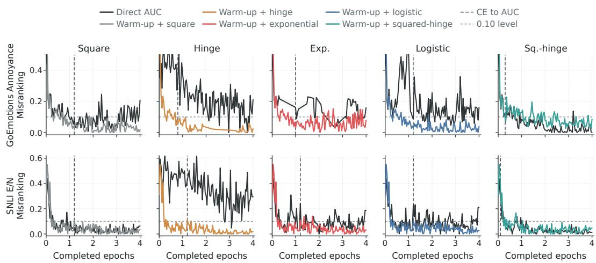  
Figure 5: Misranking trajectories for all five pairwise losses on DistilBERT GoEmotions Annoyance and SNLI E/N. Black curves are direct pairwise training; colored curves are CE warm-up followed by AUC training, with loss colors shown in the legend. Vertical dashed lines mark the CE-to-AUC switch.

Figure 5 extends the trajectory check in Figure $^ { 3 ( \mathrm { c } , \mathrm { d } ) }$ . On GoEmotions Annoyance and SNLI E/N, direct training remains visibly separated from warm-started training for square, hinge, exponential, and logistic losses, while squared-hinge shows much smaller separation. This supports the use of the main-text trajectory panels as representative examples rather than isolated cases.

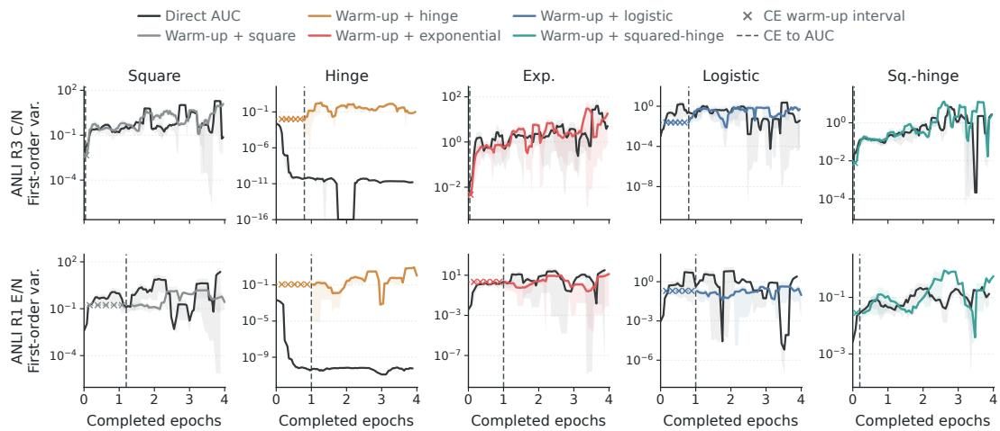  
Figure 6: Scaled first-order Hoeffding variance trajectories for all five pairwise losses on DistilBERT ANLI R3 C/N and ANLI R1 E/N. Black curves are direct pairwise training; colored curves are CE warm-up followed by AUC training, with loss colors shown in the legend. Shaded bands show one standard error across matching runs after the same trajectory smoothing used for the displayed mean. x marks denote the CE warm-up interval before the pairwise variance term is recorded, and vertical dashed lines mark the CE-to-AUC switch.

Figure 6 complements Figure 5 by plotting the corresponding first-order Hoeffding variance term rather than the misranking ratio. The panels use the same correction-direction construction as Figure 3(a,b), but show all five pairwise losses on two representative NLP tasks.

Matched directional intervention. We run matched interventions from fixed direct-hinge checkpoints on ImageNet-LT dog-tail versus siblings and APTOS severe-plus versus moderate. At each checkpoint, the empirical severe-pair normal is computed from a fixed reference pool of 64 positive and 64 negative training examples with $M = 0 ,$ , and $\widehat { \pmb { v } } _ { \mathrm { s e v } }$ is obtained by Eq. (1) and then held fixed throughout the intervention. A disjoint pool of 128 examples per class is retained for mechanism logging. All arms use training/data seed 123 and pool seed 20260725, and share the same checkpoint, data order, augmentations, optimizer, and learning-rate schedule.

For ImageNet-LT dog-tail versus siblings, the intervention starts from update 690, uses learning rate 0.025 and per-update parameter $L _ { 2 }$ magnitude $\sigma ~ = ~ 0 . 0 5$ , and continues for three epochs (207 optimizer updates) over 16 noise seeds 20262000–20262015. For APTOS severe-plus versus moderate, it starts from update 110, uses learning rate $5 \times 1 0 ^ { - 5 }$ and $\sigma = 0 . 0 1$ , and continues for three epochs (66 optimizer updates) over 24 noise seeds 20263000–20263023. All 40 realizations are retained.

After each optimizer step, the directional arm adds $\epsilon _ { t } \sigma \widehat { \pmb { v } } _ { \mathrm { s e v } }$ , where the $\epsilon _ { t } \in \{ - 1 , + 1 \}$ are independent Rademacher signs. The matched isotropic arm adds an independent normalized Gaussian direction with the same per-update $L _ { 2 }$ magnitude, refreshed at every update. One deterministic no-noise run provides the shared baseline for each task. Endpoint effects are measured at the end of the third intervention epoch on the test set. Let ∆AUC and $\Delta S _ { \mathrm { s e v } }$ denote the changes in test AUC and test severe-misranking mass $S _ { \mathrm { s e v } } = \mathbb { P } \{ m _ { \theta } ( X ^ { + } , X ^ { - } ) \le 0 \}$ relative to this baseline. A realization is classified as rescue when $\Delta \mathrm { A U C } \geq 0 . 5$ and $\Delta S _ { \mathrm { s e v } } \le - 0 . 5$ percentage points, as harm when $\Delta \mathrm { A U C } \leq - 0 . 5$ and $\Delta S _ { \mathrm { s e v } } \geq 0 . 5$ percentage points, and as no clear effect otherwise. The same rule is applied to the directional and isotropic arms.

Table 10: Matched directional-intervention data at fixed direct-hinge checkpoints. R/H/N denotes rescue/harm/no clear effect. Endpoint changes are measured at the final intervention epoch relative to the shared no-noise baseline and are reported in percentage points; D/I denotes directional/isotropic.
<table><tr><td>Task</td><td></td><td>Directional R/H/N</td><td>Isotropic R/H/N</td><td>Mean ∆AUC D/I</td><td>Mean  $\Delta S _ { \mathrm { s e v } }$  D/I</td></tr><tr><td rowspan="2">ImageNet-LT dog-tail APTOS</td><td>16</td><td>2/6/8</td><td>0/0/16</td><td>-2.541/ - 0.001</td><td>+6.036/ - 0.046</td></tr><tr><td>24</td><td>6/13/5</td><td>1/1/22</td><td>-1.316/+ 0.035</td><td>+1.317/- 0.033</td></tr><tr><td>Total</td><td>40</td><td>8/19/13</td><td>1/1/38</td><td></td><td></td></tr></table>

## B.6 Multiclass, Multilabel, and Deep-AUC Extensions

Small-scale multiclass experiments. We evaluate CE, direct hinge, warm-up hinge, direct squaredhinge, and warm-up squared-hinge on three long-tailed multiclass tasks. Aircraft Airbus-6 LT contains the A318, A319, A320, A321, A330-200, and A330-300 classes, with 93/200/200 training/validation/test examples. CIFAR-100 Medium-Mammals-5 LT contains camel, cattle, chimpanzee, elephant, and kangaroo, with 431/250/250 examples. CIFAR-100 Vehicles-10 LT contains bicycle, bus, motorcycle, pickup truck, train, lawn mower, rocket, streetcar, tank, and tractor, with 818/500/500 examples.

The experiments use a randomly initialized ResNet18 trained for 10 epochs, with 24 batches per epoch, 64 × 64 inputs, learning rate 0.002, and weight decay $1 0 ^ { - 4 }$ . Pairwise training uses a macro one-vs-rest objective over class logits, and checkpoints are selected by validation Macro-OVO-AUC.

Table 11: Results on three long-tailed multiclass tasks (AUC%).
<table><tr><td>Multiclass task</td><td>CE</td><td>Direct hinge</td><td>Warm-up hinge</td><td>Direct squared-hinge</td><td>Warm-up squared-hinge</td></tr><tr><td>Aircraft Airbus-6 LT</td><td>60.92</td><td>61.43</td><td>61.61</td><td>61.68</td><td>60.91</td></tr><tr><td>CIFAR-100 Medium-Mammals-5 LT</td><td>81.08</td><td>81.13</td><td>82.91</td><td>83.62</td><td>84.44</td></tr><tr><td>CIFAR-100 Vehicles-10 LT</td><td>86.47</td><td>88.30</td><td>88.64</td><td>87.97</td><td>89.08</td></tr></table>

Multilabel experiments. We also evaluate multilabel AUC optimization on CheXpert. Competition-5 uses Cardiomegaly, Edema, Consolidation, Atelectasis, and Pleural Effusion; Cardiac/Fluid-4 uses Cardiomegaly, Edema, Atelectasis, and Pleural Effusion; and Consolidation/Cardiac-2 uses Consolidation and Cardiomegaly. Each image may have multiple positive labels.

The experiments use an ImageNet-pretrained DenseNet121 with a randomly initialized multilabel head. Under the U-Zero rule, uncertain labels (−1) and missing labels are mapped to zero. Patientdisjoint training and internal-validation splits are constructed from train.csv, and the official valid.csv is used only as the test set. The training and internal-validation sets contain at most 12,000 and 3,000 examples, respectively. Models are trained for 8 epochs with batch size 64, 224 × 224 inputs, learning rate $1 0 ^ { - 4 }$ , and weight decay $1 0 ^ { - 4 }$

The pairwise loss is computed separately between positive and negative examples for each label and macro-averaged over labels that contain both classes in the current batch. Checkpoints are selected by internal-validation macro ROC-AUC, and the final metric is the macro-average of label-wise test ROC-AUC.

Table 12: Results on three CheXpert multilabel tasks (AUC%).
<table><tr><td>Multilabel task</td><td>BCE</td><td>Direct hinge</td><td>Warm-up hinge</td><td>Direct squared-hinge</td><td>Warm-up squared-hinge</td></tr><tr><td>Competition-5</td><td>80.86</td><td>82.75</td><td>83.40</td><td>81.51</td><td>83.09</td></tr><tr><td>Cardiac/Fluid-4</td><td>80.76</td><td>81.14</td><td>82.13</td><td>79.96</td><td>81.44</td></tr><tr><td>Consolidation/Cardiac-2</td><td>51.52</td><td>57.28</td><td>56.09</td><td>57.08</td><td>59.69</td></tr></table>

Large-scale multiclass experiments. We further evaluate large-scale multiclass learning on iNaturalist 2018 and ImageNet-LT, retaining their natural long-tailed training distributions without class resampling. iNaturalist 2018 contains 437,513 training examples and 24,426 official validation examples, for 461,939 samples over 8,142 classes. ImageNet-LT contains 115,845 valid training examples, 20,000 validation examples, and 50,000 test examples, for 185,845 samples over 1,000 classes.

The iNaturalist 2018 experiment uses an ImageNet-supervised pretrained ResNet50 with a randomly initialized 8,142-class head. It is trained for 3 epochs with training and evaluation batch size 128 and 128 × 128 inputs; the official validation set is evaluated once after the fixed training budget. The ImageNet-LT experiment uses a Places365-supervised pretrained ResNet50 [86] with a randomly initialized classification head. It is trained for 4 epochs with training batch size 128, evaluation batch size 256, and 128 × 128 inputs; checkpoints are selected by validation Macro-OVO-AUC, and the test set is evaluated only after the selected checkpoint is restored.

We compare CE, direct hinge, warm-up hinge, direct squared-hinge, and warm-up squared-hinge, and report Macro-OVO-AUC and Macro-OVR-AUC.

Table 13: Large-scale multiclass results on iNaturalist 2018 and ImageNet-LT (AUC%).
<table><tr><td>Dataset</td><td>Metric</td><td>CE</td><td>Hinge direct</td><td>Hinge warm-up</td><td>Sq.-hinge direct</td><td>Sq.-hinge wārm-up</td></tr><tr><td>iNaturalist</td><td>Macro-OVO-AUC</td><td>96.64</td><td>92.45</td><td>99.70</td><td>89.18</td><td>99.74</td></tr><tr><td>ImageNet-LT</td><td>Macro-OVO-AUC</td><td>98.50</td><td>97.87</td><td>98.45</td><td>97.69</td><td>98.91</td></tr><tr><td>iNaturalist</td><td>Macro-OVR-AUC</td><td>97.70</td><td>88.72</td><td>97.31</td><td>79.94</td><td>98.13</td></tr><tr><td>ImageNet-LT</td><td>Macro-OVR-AUC</td><td>94.80</td><td>93.21</td><td>94.81</td><td>92.95</td><td>96.08</td></tr></table>

Deep-AUC comparison. We compare the results in this paper with Deep-AUC as implemented by LibAUC [87] using AUCMLoss(v2) and the PESG optimizer. AUCMLoss(v2) uses the squared AUC-margin objective with margin 1.0; PESG uses SGD mode, momentum 0.9, epoch decay 0.002, weight decay 10−5, and positive fraction 0.25.

The squared AUC-margin objective can be reconstructed with auxiliary variables in a min–max form, avoiding explicit construction of all positive–negative pairs at each update. This reconstruction uses class-dependent first- and second-order statistics. In contrast, hinge, logistic, exponential, and squared-hinge assign weights that depend on each pair’s margin and generally cannot be reconstructed from fixed class means and second moments alone.

More explicitly, for a target margin c, the quadratic objective

$$
\mathbb { E } \big [ ( c - f _ { \theta } ( X ^ { + } ) + f _ { \theta } ( X ^ { - } ) ) ^ { 2 } \big ]
$$

expands exactly into the positive- and negative-class score means, second moments, and their interaction. Auxiliary primal and dual variables represent these quantities as an instance-wise min–max problem, thereby removing explicit pair construction and the corresponding two-sample pairwise estimator for this quadratic objective. By contrast, the margin-dependent weights of hinge, logistic, exponential, and squared-hinge are not generally determined by fixed class means and second moments; reproducing them without explicit pairs would require a different loss-specific reconstruction.

Table 14: Deep-AUC and our results on 17 task–model settings (AUC%).
<table><tr><td>Task-model setting</td><td>Deep-AUC</td><td>Ours</td></tr><tr><td>Apple Disease-DenseNet121</td><td>55.56</td><td>62.69</td></tr><tr><td>Rice Disease-DenseNet121</td><td>77.76</td><td>75.71</td></tr><tr><td>APTOS Sev./Mod.-DenseNet121</td><td>82.12</td><td>84.20</td></tr><tr><td>HAM10000 M/N-DenseNet121</td><td>97.16</td><td>97.70</td></tr><tr><td>ImageNet-LT Dogs-ResNet50</td><td>94.56</td><td>95.83</td></tr><tr><td>Dog Breeds-ResNet50</td><td>85.74</td><td>87.00</td></tr><tr><td>CRJ700/CRJ900–ResNet50</td><td>53.52</td><td>56.62</td></tr><tr><td>APTOS Sev./Mod.-ResNet50</td><td>82.40</td><td>83.92</td></tr><tr><td>DeepWeeds P/S-ResNet50</td><td>98.43</td><td>98.72</td></tr><tr><td>GoEmotions Annoyance-DistilBERT</td><td>84.51</td><td>84.38</td></tr><tr><td>GoEmotions Fear-DistilBERT</td><td>96.11</td><td>96.48</td></tr><tr><td>ANLI R1 E/N-DistilBERT</td><td>71.67</td><td>70.21</td></tr><tr><td>ANLI R3 C/N-DistilBERT</td><td>62.63</td><td>62.47</td></tr><tr><td>ANLI R3 E/N-DistilBERT</td><td>63.65</td><td>63.87</td></tr><tr><td>SNLI E/N-DistilBERT</td><td>92.94</td><td>92.98</td></tr><tr><td>WANLI C/N-DistilBERT</td><td>82.38</td><td>82.41</td></tr><tr><td>WANLI E/N-DistilBERT</td><td>75.40</td><td>75.44</td></tr></table>

Deep-AUC is stronger in 4 of the 17 task–model settings, while our validation-selected direct configuration is stronger in 13. The comparison identifies Deep-AUC as a strong scalable solution when its quadratic reconstruction is appropriate, while showing that direct pairwise optimization remains competitive and supports a broader range of surrogate dynamics.

## B.7 Assets, Licenses, and Terms

The experiments use existing public datasets, pretrained models, and standard software assets. Dataset sources and task constructions are listed in Appendix B.4 and Appendix B.6. The CV experiments use ImageNet-LT split files derived from ImageNet, Stanford Dogs, FGVC-Aircraft, CIFAR-100, iNaturalist 2018, CheXpert, APTOS 2019, DeepWeeds, D-KAP, Rice Leaf Diseases, and HAM10000. The NLP experiments use the Hugging Face releases or prepared splits of GoEmotions, ANLI, SNLI, and WANLI. The model assets are randomly initialized ResNet18, ImageNet- or Places365-supervised pretrained ResNet50, ImageNet-pretrained DenseNet121, DistilBERT-base, and Qwen2.5-1.5B-Instruct; the DistilBERT and Qwen NLP runs both use LoRA as the parameterefficient fine-tuning method. The Deep-AUC comparison uses LibAUC AUCMLoss(v2) and PESG.

The asset licenses and terms are as follows. ImageNet/ImageNet-LT and Stanford Dogs are used under ImageNet-style non-commercial research and educational terms; FGVC-Aircraft is non-commercial research only, with original photographer copyright retained. CIFAR-100 is distributed through its official project page and used subject to its source terms; iNaturalist 2018 is used subject to the competition data terms and the licenses attached to its images; and CheXpert is obtained through Stanford’s official release channel and used under its data-use terms. APTOS 2019 224 × 224 is CC0 1.0; DeepWeeds is CC BY 4.0; D-KAP is listed as “Database: Open Database, Contents: Database Contents”; the Rice Leaf Diseases release used here does not list a license; and HAM10000 is CC BY-NC-SA 4.0 in the Kaggle release used here. GoEmotions is Apache 2.0, ANLI is CC BY-NC 4.0, SNLI is CC BY-SA 4.0, and WANLI is CC BY 4.0. DistilBERT-base-uncased and Qwen2.5-1.5B-Instruct are Apache 2.0; TorchVision ImageNet-pretrained weights are used subject to TorchVision notices and ImageNet-derived terms, and Places365-pretrained weights are used subject to their release terms. The software stack uses standard open-source licenses, including Apache 2.0 for Hugging Face Transformers/Datasets/PEFT and BSD-style licenses for PyTorch/TorchVision, NumPy, pandas, and scikit-learn; LibAUC is used under its project license.

Source and use details for these datasets and models appear in Appendix B.4, Appendix B.5, and Appendix B.6. We used the assets for research experiments and did not redistribute the original datasets, pretrained checkpoints, or derived datasets as part of this manuscript. Users who reproduce the experiments should obtain each dataset and pretrained model from the official source or public release and follow the corresponding license, data-use terms, and model-use terms. Any anonymized code or reproduction package should include its own license file and instructions for separately downloading third-party assets from their official sources.

## B.8 Ethics, Broader Impacts, and Safeguards

This work studies optimization dynamics for AUC training and does not introduce a deployed decision system. The potential positive impact is improved understanding of when pairwise AUC optimization is reliable under class imbalance and ranking-based evaluation. Potential negative impact could arise if AUC-optimized models are deployed in high-stakes domains without suitable validation, calibration, uncertainty assessment, subgroup analysis, or human oversight. The experiments include public medical-image and natural-language datasets, so any downstream use of the trained models should follow the dataset terms and the safeguards required by the target application.

We do not release a new high-risk model, scraped dataset, or human-subject dataset. The manuscript reports experiments on existing public datasets and pretrained models, and it does not involve new data collection, crowdsourcing, interaction with human subjects, or interventions on human participants. Accordingly, no new compensation protocol, participant instruction text, or institution-specific IRB information is part of this work. No additional release safeguard is introduced beyond respecting the original asset terms.

## C Direct Pairwise SGD as a Stochastic Dynamics

This section fixes the direct pairwise SGD process used in the paper and states its local stochasticdynamics interface. When each step uses a fresh positive-negative mini-batch, the parameter update is Markov in the current parameter: its drift is the negative population pairwise gradient, and its covariance is the mini-batch covariance later decomposed by Hoeffding projections.

Pairwise setup. We use the positive-margin convention

$$
m _ { \theta } ( x ^ { + } , x ^ { - } ) = f _ { \theta } ( x ^ { + } ) - f _ { \theta } ( x ^ { - } ) .
$$

For a pairwise surrogate ℓ, define

$$
R _ { \ell } ( \theta ) = \mathbb { E } [ \ell ( m _ { \theta } ( X ^ { + } , X ^ { - } ) ) ] , \qquad w _ { \ell } ( x ) = - \ell ^ { \prime } ( x ) ,
$$

where $X ^ { + } \sim P _ { + } , X ^ { - } \sim P _ { - }$ , and the two draws are independent. Given $B _ { + }$ positives and $B _ { - }$ negatives, let

$$
\begin{array} { r } { m _ { i j } = f _ { \theta } ( \boldsymbol { x } _ { i } ^ { + } ) - f _ { \theta } ( \boldsymbol { x } _ { j } ^ { - } ) , \qquad \boldsymbol { g } _ { i } ^ { + } = \nabla _ { \theta } f _ { \theta } ( \boldsymbol { x } _ { i } ^ { + } ) , \qquad \boldsymbol { g } _ { j } ^ { - } = \nabla _ { \theta } f _ { \theta } ( \boldsymbol { x } _ { j } ^ { - } ) . } \end{array}
$$

The direct pairwise mini-batch gradient is

$$
\widehat { \pmb { g } } _ { B _ { + } , B _ { - } } ^ { \ell } ( \theta ) = \frac { 1 } { B _ { + } B _ { - } } \sum _ { i = 1 } ^ { B _ { + } } \sum _ { j = 1 } ^ { B _ { - } } w _ { \ell } ( m _ { i j } ) \cdot ( \pmb { g } _ { j } ^ { - } - \pmb { g } _ { i } ^ { + } ) .\tag{2}
$$

When $B _ { + } = B _ { - } = B$ , we write $\widehat { \pmb { g } } _ { B } ^ { \ell } ( \theta ) = \widehat { \pmb { g } } _ { B , B } ^ { \ell } ( \theta )$ , so the equal-size specialization is

$$
\widehat { g } _ { B } ^ { \ell } ( \boldsymbol { \theta } ) = \frac { 1 } { B ^ { 2 } } \sum _ { i = 1 } ^ { B } \sum _ { j = 1 } ^ { B } w _ { \ell } ( m _ { i j } ) \cdot ( { \pmb { g } } _ { j } ^ { - } - { \pmb { g } } _ { i } ^ { + } ) .\tag{3}
$$

For local uses, we follow the localization convention in Li et al. [66, Remark 11]: when the smoothness and Lipschitz assumptions hold only on a neighborhood, the analysis is applied to the stopped process until it exits that neighborhood, or to a globally regularized objective that agrees with the original objective on the neighborhood. The drift and covariance identities below are unchanged before the exit time.

Theorem 2 (Markov-state finite-time weak SGD diffusion bridge). Let $( \Gamma _ { k } ) _ { k \geq 0 }$ be i.i.d. random variables, let $F ( \cdot , \Gamma _ { k } )$ be random objectives on Rq, and let the Markov state $\boldsymbol { y _ { k } } \in \mathbb { R } ^ { q }$ , initialized at $y _ { \mathrm { 0 } } = y _ { \mathrm { i n i t } }$ , evolve by constant-step SGD

$$
y _ { k + 1 } = y _ { k } - \eta \cdot \nabla F ( y _ { k } , \Gamma _ { k } ) , \qquad k = 0 , \dots , N - 1 , \quad N = \lfloor T / \eta \rfloor .
$$

Assume the random objective family satisfies the hypotheses of Li et al. [66, Corollary 10] with $f _ { \gamma } = F ( \cdot , \Gamma _ { 0 } )$ and $f = { \bar { F } }$ , where

$$
\bar { F } ( \pmb { y } ) = \mathbb { E } [ F ( \pmb { y } , \Gamma _ { 0 } ) ] .
$$

Define

$$
\begin{array} { r } { \pmb { A } ( \pmb { y } ) = \mathrm { C o v } \big ( \nabla F ( \pmb { y } , \Gamma _ { 0 } ) \big ) . } \end{array}
$$

Then the Itô SDE

$$
d \widetilde { \pmb { y } } _ { t } = - \nabla \bar { F } ( \widetilde { \pmb { y } } _ { t } ) d t + ( \eta \cdot \pmb { A } ( \widetilde { \pmb { y } } _ { t } ) ) ^ { 1 / 2 } d W _ { t } , \qquad \widetilde { \pmb { y } } _ { 0 } = \pmb { y } _ { \mathrm { i n i t } } ,
$$

where $W _ { t }$ is a standard Brownian motion in $\mathbb { R } ^ { q } .$ , is an order-1finite-time weak approximation to the discrete dynamics: for every testfunction g in the $G _ { 2 }$ class ofLi et al. [66, Corollary 10], there is a constant $C _ { T , g }$ independent of η such that

$$
\operatorname* { m a x } _ { 0 \leq k \leq N } | \mathbb { E } [ g ( \pmb { y } _ { k } ) ] - \mathbb { E } [ g ( \widetilde { \pmb { y } } _ { k \eta } ) ] | \leq C _ { T , g } \cdot \eta .
$$

Proof. The state process is Markov by assumption: the conditional law of $_ { { \pmb { y } } _ { k + 1 } }$ given the past is determined by the current state ${ \bf { \nabla } } _ { \bf { { y } } _ { k } }$ and a fresh noise variable $\Gamma _ { k } .$ . Thus the update has the constant-step stochastic-gradient form required by Li et al. [66, Corollary 10]:

$$
\begin{array} { r } { { \pmb y } _ { k + 1 } = { \pmb y } _ { k } - \eta \cdot \nabla F ( { \pmb y } _ { k } , \Gamma _ { k } ) . } \end{array}
$$

The mean objective is

$$
\bar { F } ( \pmb { y } ) = \mathbb { E } [ F ( \pmb { y } , \Gamma _ { 0 } ) ] .
$$

Under the exchange-of-derivative and regularity conditions included in Li et al. [66, Corollary 10],

$$
\mathbb { E } [ \nabla F ( \pmb { y } , \Gamma _ { 0 } ) ] = \nabla \bar { F } ( \pmb { y } ) .
$$

Hence the conditional first moment of one step is

$$
\begin{array} { r } { \mathbb { E } [ \pmb { y } _ { k + 1 } - \pmb { y } _ { k } \ \vert \ \pmb { y } _ { k } = \pmb { y } ] = - \eta \cdot \nabla \bar { F } ( \pmb { y } ) , } \end{array}
$$

so the continuous-time drift is $- \nabla \bar { F } ( \boldsymbol { y } )$ . The stochastic-gradient covariance is

$$
\operatorname { C o v } ( \nabla F ( y , \Gamma _ { k } ) \mid y _ { k } = y ) = \operatorname { C o v } ( \nabla F ( y , \Gamma _ { 0 } ) ) = A ( y ) ,
$$

where the second equality uses the identical distribution of the noise variables. Therefore the finite-time weak modified equation has diffusion coefficient

$$
( \eta \cdot A ( { \pmb y } ) ) ^ { 1 / 2 } .
$$

Applying Li et al. [66, Corollary 10] with $f _ { \gamma } = F ( \cdot , \Gamma _ { 0 } )$ , mean objective ${ \bar { F } } ,$ and covariance field A gives the displayed SDE and the weak-error bound for every $G _ { 2 }$ test function g. □

Proposition 4 (Plain pairwise mini-batch gradients are unbiased). Assume $\nabla _ { \theta } \ell ( m _ { \theta } ( X ^ { + } , X ^ { - } ) )$ is integrable and differentiation can be exchanged with expectation. Then the direct pairwise mini-batch gradient in Eq. (2) satisfies

$$
\begin{array} { r } { \mathbb E [ \widehat { \pmb g } _ { B _ { + } , B _ { - } } ^ { \ell } ( \theta ) ] = \nabla R _ { \ell } ( \theta ) . } \end{array}
$$

The equal-size shorthand $\widehat { \pmb { g } } _ { B } ^ { \ell }$ satisfies the same identity.

Proof. For one independent positive-negative pair,

$$
\nabla _ { \theta } \ell ( m _ { \theta } ( X ^ { + } , X ^ { - } ) ) = \ell ^ { \prime } ( m _ { \theta } ( X ^ { + } , X ^ { - } ) ) \cdot \big ( \nabla f _ { \theta } ( X ^ { + } ) - \nabla f _ { \theta } ( X ^ { - } ) \big ) .
$$

Since $w _ { \ell } = - \ell ^ { \prime }$ , the same vector can be written as

$$
w _ { \ell } ( m _ { \theta } ( X ^ { + } , X ^ { - } ) ) \cdot \big ( \nabla f _ { \theta } ( X ^ { - } ) - \nabla f _ { \theta } ( X ^ { + } ) \big ) .
$$

The exchange assumption gives

$$
\nabla R _ { \ell } ( \theta ) = \mathbb { E } [ \nabla _ { \theta } \ell ( m _ { \theta } ( X ^ { + } , X ^ { - } ) ) ] .
$$

Every pair $( X _ { i } ^ { + } , X _ { j } ^ { - } )$ inside the mini-batch has the same product distribution as $( X ^ { + } , X ^ { - } )$ , although the $B _ { + } B _ { - }$ pair terms are not mutually independent. Therefore linearity of expectation yields

$$
\mathbb { E } [ \widehat { g } _ { B _ { + } , B _ { - } } ^ { \ell } ( \theta ) ] = \frac { 1 } { B _ { + } B _ { - } } \sum _ { i = 1 } ^ { B _ { + } } \sum _ { j = 1 } ^ { B _ { - } } \mathbb { E } [ w _ { \ell } ( m _ { \theta } ( X _ { i } ^ { + } , X _ { j } ^ { - } ) ) \cdot ( \nabla f _ { \theta } ( X _ { j } ^ { - } ) - \nabla f _ { \theta } ( X _ { i } ^ { + } ) ) ] = \nabla R _ { \ell } ( \theta ) .
$$

Proposition 5 (One-step conditional moments for pairwise dynamics). Consider the parameter dynamics

$$
\theta _ { k + 1 } = \theta _ { k } - \eta _ { k } \cdot \widehat { \pmb { g } } _ { B _ { + } , B _ { - } , k } ^ { \ell } ( \theta _ { k } ) ,
$$

where, conditionally on $\theta _ { k } , \widehat { \pmb { g } } _ { B _ { + } , B _ { - } , k } ^ { \ell } ( \theta _ { k } )$ is computed from a fresh positive-negative mini-batch. Let

$$
\Delta _ { k } = \theta _ { k + 1 } - \theta _ { k } .
$$

Under Proposition $^ { 4 , }$

$$
\mathbb { E } [ \Delta _ { k } \ | \ \theta _ { k } ] = - \eta _ { k } \cdot \nabla R _ { \ell } ( \theta _ { k } ) .
$$

Ifthe conditional second moment isfinite, then

$$
\begin{array} { r } { \mathbb { E } [ \Delta _ { k } \cdot \Delta _ { k } ^ { \top } \mid \theta _ { k } ] = \eta _ { k } ^ { 2 } \cdot \Big \{ \mathrm { C o v } ( \widehat { g } _ { B _ { + } , B _ { - } , k } ^ { \ell } ( \theta _ { k } ) \mid \theta _ { k } ) + \nabla R _ { \ell } ( \theta _ { k } ) \cdot \nabla R _ { \ell } ( \theta _ { k } ) ^ { \top } \Big \} . } \end{array}
$$

Proof. The increment is

$$
\Delta _ { k } = - \eta _ { k } \cdot \widehat { \pmb { g } } _ { B _ { + } , B _ { - } , k } ^ { \ell } ( \theta _ { k } ) .
$$

Because the fresh mini-batch used at step k is independent of the past, the conditional law of $\widehat { \pmb { g } } _ { B _ { + } , B _ { - } , k } ^ { \ell } ( \theta _ { k } )$ given the full history depends on the history only through $\theta _ { k }$ . Proposition 4 therefore applies conditionally:

$$
\mathbb { E } [ \widehat { g } _ { B _ { + } , B _ { - } , k } ^ { \ell } ( \theta _ { k } ) \mid \theta _ { k } ] = \nabla R _ { \ell } ( \theta _ { k } ) .
$$

Multiplying $\boldsymbol { \mathrm { b y } } - \eta _ { k }$ gives the displayed drift identity.

For the second moment,

$$
\begin{array} { r } { \mathbb E [ \Delta _ { k } \cdot \Delta _ { k } ^ { \top } \mid \theta _ { k } ] = \eta _ { k } ^ { 2 } \cdot \mathbb E [ \widehat { \pmb g } _ { B _ { + } , B _ { - } , k } ^ { \ell } ( \theta _ { k } ) \cdot \widehat { \pmb g } _ { B _ { + } , B _ { - } , k } ^ { \ell } ( \theta _ { k } ) ^ { \top } \mid \theta _ { k } ] . } \end{array}
$$

For any square-integrable vector $Y ,$

$$
\mathbb { E } [ Y \cdot Y ^ { \top } ] = \operatorname { C o v } ( Y ) + \mathbb { E } [ Y ] \cdot \mathbb { E } [ Y ] ^ { \top } .
$$

Applying this identity conditionally with

$$
Y = \widehat { \pmb { g } } _ { B _ { + } , B _ { - } , k } ^ { \ell } ( \theta _ { k } )
$$

and substituting the conditional unbiasedness identity proves the formula.

Corollary 2 (Mean-ODE generator for decreasing steps). In Proposition 5, suppose $\eta _ { k } \downarrow 0 .$ . For the one-step kernel

$$
( K _ { k } \varphi ) ( \theta ) = \mathbb { E } [ \varphi ( \theta - \eta _ { k } \cdot \widehat { \pmb { g } } _ { B _ { + } , B _ { - } } ^ { \ell } ( \theta ) ) ] ,
$$

assume that for every compact C in a local open set U,

$$
\operatorname* { s u p } _ { \theta \in C } \mathbb { E } [ \| \widehat { \pmb { g } } _ { B _ { + } , B _ { - } } ^ { \ell } ( \theta ) \| _ { 2 } ^ { 3 } ] < \infty .
$$

Then for every $\varphi \in C _ { b } ^ { 3 } (  { \mathbb { R } } ^ { d } )$ and every compact $C \subset U$

$$
\operatorname* { s u p } _ { \theta \in C }  \frac { ( K _ { k } \varphi ) ( \theta ) - \varphi ( \theta ) } { \eta _ { k } } + \langle \nabla \varphi ( \theta ) , \nabla R _ { \ell } ( \theta ) \rangle   0 .
$$

Proof. Taylor expand around θ. For $G = \widehat { \pmb { g } } _ { B _ { + } , B _ { - } } ^ { \ell } ( \theta )$

$$
\varphi ( \theta - \eta _ { k } \cdot G ) = \varphi ( \theta ) - \eta _ { k } \cdot \langle \nabla \varphi ( \theta ) , G \rangle + \frac { \eta _ { k } ^ { 2 } } { 2 } \cdot G ^ { \top } \cdot \nabla ^ { 2 } \varphi ( \theta ) \cdot G + \mathcal { R } _ { k } ( \theta , G ) ,
$$

where, uniformly over $\theta \in C .$

$$
| \mathcal { R } _ { k } ( \theta , G ) | \leq C _ { \varphi } \cdot \eta _ { k } ^ { 3 } \cdot \| G \| _ { 2 } ^ { 3 }
$$

because $\varphi \in C _ { b } ^ { 3 } (  { \mathbb { R } } ^ { d } )$ . Taking expectation and dividing by $\eta _ { k }$ gives

$$
\begin{array} { r l } & { \frac { ( K _ { k } \varphi ) ( \theta ) - \varphi ( \theta ) } { \eta _ { k } } = - \langle \nabla \varphi ( \theta ) , \mathbb { E } [ \widehat { \pmb { g } } _ { B _ { + } , B _ { - } } ^ { \ell } ( \theta ) ] \rangle } \\ & { \qquad + \frac { \eta _ { k } } { 2 } \cdot \mathbb { E } [ \widehat { \pmb { g } } _ { B _ { + } , B _ { - } } ^ { \ell } ( \theta ) ^ { \top } \cdot \nabla ^ { 2 } \varphi ( \theta ) \cdot \widehat { \pmb { g } } _ { B _ { + } , B _ { - } } ^ { \ell } ( \theta ) ] } \\ & { \qquad + O \Big ( \eta _ { k } ^ { 2 } \cdot \mathbb { E } [ \| \widehat { \pmb { g } } _ { B _ { + } , B _ { - } } ^ { \ell } ( \theta ) \| _ { 2 } ^ { 3 } ] \Big ) . } \end{array}
$$

The first term equals

$$
- \langle \nabla \varphi ( { \boldsymbol { \theta } } ) , \nabla R _ { \ell } ( { \boldsymbol { \theta } } ) \rangle
$$

by Proposition 4. On the compact set C,

$$
\Big | \frac { \eta _ { k } } { 2 } \cdot \mathbb { E } [ \widehat { g } _ { B _ { + } , B _ { - } } ^ { \ell } ( \theta ) ^ { \top } \cdot \nabla ^ { 2 } \varphi ( \theta ) \cdot \widehat { g } _ { B _ { + } , B _ { - } } ^ { \ell } ( \theta ) ] \Big | \leq \frac { \eta _ { k } } { 2 } \cdot \| \nabla ^ { 2 } \varphi \| _ { \infty , C } \cdot \mathbb { E } [ \| \widehat { g } _ { B _ { + } , B _ { - } } ^ { \ell } ( \theta ) \| _ { 2 } ^ { 2 } ] .
$$

Since $\| u \| _ { 2 } ^ { 2 } \leq 1 + \| u \| _ { 2 } ^ { 3 }$ , the uniform third-moment assumption makes this term converge to 0 uniformly on C. The remainder term also converges to 0 uniformly on C. This proves the displayed convergence. □

Corollary 3 (Pairwise AUC SGD Langevin interface). Consider constant-step direct pairwise AUC SGD

$$
\theta _ { k + 1 } = \theta _ { k } - \eta \cdot \widehat { \pmb { g } } _ { B _ { + } , B _ { - } , k } ^ { \ell } ( \theta _ { k } ) ,
$$

withfresh pairwise mini-batches at each step. Define

$$
\pmb { \Sigma } _ { B _ { + } , B _ { - } , \ell } ( \theta ) = \mathrm { C o v } ( \widehat { \pmb { g } } _ { B _ { + } , B _ { - } } ^ { \ell } ( \theta ) ) .
$$

For a unit direction v, define the scalar kernel

$$
\psi _ { \boldsymbol \theta , \boldsymbol v } ( \boldsymbol x ^ { + } , \boldsymbol x ^ { - } ) = \left. \ell ^ { \prime } ( m _ { \boldsymbol \theta } ( \boldsymbol x ^ { + } , \boldsymbol x ^ { - } ) ) \cdot \big ( \nabla f _ { \boldsymbol \theta } ( \boldsymbol x ^ { + } ) - \nabla f _ { \boldsymbol \theta } ( \boldsymbol x ^ { - } ) \big ) , \boldsymbol v \right. .
$$

Let $\psi _ { \boldsymbol { \theta } , \boldsymbol { v } } ^ { ( 1 , 0 ) } , \psi _ { \boldsymbol { \theta } , \boldsymbol { v } } ^ { ( 0 , 1 ) }$ , and $\psi _ { \boldsymbol { \theta } , \boldsymbol { v } } ^ { ( 1 , 1 ) }$ denote the positive-classfirst-order projection, the negative-classfirstorder projection, and the residual pair-interaction component ofthis kernel, as defined explicitly in Theorem 3. Under the usual local smoothness and moment assumptionsfor stochastic-approximation diffusion approximations $I 6 4 { - } 6 7 I$ , the local Langevin interfacefor the pairwise dynamics is

$$
d \pmb { \Theta } _ { t } = - \nabla R e ( \pmb { \Theta } _ { t } ) d t + ( \eta \cdot \pmb { \Sigma } _ { B _ { + } , B _ { - } , \ell } ( \pmb { \Theta } _ { t } ) ) ^ { 1 / 2 } d \pmb { W } _ { t } .
$$

Moreover, along every unit direction v,

$$
v ^ { \top } \cdot \Sigma _ { B _ { + } , B _ { - } , \ell } ( \theta ) \cdot v = \frac { \mathrm { V a r } ( \psi _ { \theta , v } ^ { ( 1 , 0 ) } ( X ^ { + } ) ) } { B _ { + } } + \frac { \mathrm { V a r } ( \psi _ { \theta , v } ^ { ( 0 , 1 ) } ( X ^ { - } ) ) } { B _ { - } } + \frac { \mathrm { V a r } ( \psi _ { \theta , v } ^ { ( 1 , 1 ) } ( X ^ { + } , X ^ { - } ) ) } { B _ { + } B _ { - } } .
$$

In the equal-size case $B _ { + } = B _ { - } = B _  $ , this reduces to the $B ^ { - 1 }$ versus $B ^ { - 2 }$ split used below.

Proof. Let

$$
\Gamma = ( X _ { 1 } ^ { + } , \ldots , X _ { B _ { + } } ^ { + } , X _ { 1 } ^ { - } , \ldots , X _ { B _ { - } } ^ { - } )
$$

denote one full positive-negative mini-batch, and define the random batch objective

$$
F _ { B _ { + } , B _ { - } } ^ { \ell } ( \theta , \Gamma ) = { \frac { 1 } { B _ { + } B _ { - } } } \sum _ { i = 1 } ^ { B _ { + } } \sum _ { j = 1 } ^ { B _ { - } } \ell ( m _ { \theta } ( X _ { i } ^ { + } , X _ { j } ^ { - } ) ) .
$$

Its gradient is exactly the direct pairwise mini-batch gradient because

$$
\nabla _ { \theta } \ell ( m _ { \theta } ( X _ { i } ^ { + } , X _ { j } ^ { - } ) ) = \ell ^ { \prime } ( m _ { i j } ) \cdot ( g _ { i } ^ { + } - g _ { j } ^ { - } ) = w _ { \ell } ( m _ { i j } ) \cdot ( g _ { j } ^ { - } - g _ { i } ^ { + } ) .
$$

Thus

$$
\nabla F _ { B + , B _ { - } } ^ { \ell } ( \theta , \Gamma ) = \widehat { \pmb { g } } _ { B _ { + } , B _ { - } } ^ { \ell } ( \theta ) .
$$

The population objective associated with $F _ { B _ { + } , B _ { - } } ^ { \ell }$ is

$$
\mathbb { E } [ F _ { B _ { + } , B _ { - } } ^ { \ell } ( \theta , \Gamma ) ] = R _ { \ell } ( \theta ) ,
$$

because each pair $( X _ { i } ^ { + } , X _ { j } ^ { - } )$ has the same product distribution as $( X ^ { + } , X ^ { - } )$ . Theorem 2, applied with Markov state $\begin{array} { r } { \boldsymbol { y } _ { k } = \boldsymbol { \theta } _ { k } , } \end{array}$ gives the local Langevin interface. Equivalently, the first two conditional moments in Proposition 5 identify the local drift as

$$
- \nabla R _ { \ell } ( \theta )
$$

and the local diffusion covariance as

$$
\eta \cdot \pmb { \Sigma } _ { B _ { + } , B _ { - } , \ell } ( \theta ) ,
$$

under the stated local regularity and moment assumptions.

For the directional coefficient, use

$$
\pmb { v } ^ { \top } \cdot \pmb { \Sigma } _ { B _ { + } , B _ { - } , \ell } ( \theta ) \cdot \pmb { v } = \mathrm { V a r } ( \langle \widehat { \pmb { g } } _ { B _ { + } , B _ { - } } ^ { \ell } ( \theta ) , \pmb { v } \rangle ) .
$$

The exact variance split in Corollary 4 gives

$$
\operatorname { V a r } ( \langle \widehat { g } _ { B _ { + } , B _ { - } } ^ { \ell } ( \theta ) , v \rangle ) = \frac { \operatorname { V a r } ( \psi _ { \theta , v } ^ { ( 1 , 0 ) } ( X ^ { + } ) ) } { B _ { + } } + \frac { \operatorname { V a r } ( \psi _ { \theta , v } ^ { ( 0 , 1 ) } ( X ^ { - } ) ) } { B _ { - } } + \frac { \operatorname { V a r } ( \psi _ { \theta , v } ^ { ( 1 , 1 ) } ( X ^ { + } , X ^ { - } ) ) } { B _ { + } B _ { - } } .
$$

Thus the first-order Hoeffding projections are the directional variance terms with scales $B _ { + } ^ { - 1 }$ and $B _ { - } ^ { - 1 }$ in the diffusion covariance of the local Langevin interface. When those projections vanish, the directional variance contribution is governed by the canonical term with scale $( B _ { + } B _ { - } ) ^ { - 1 }$ , which is $B ^ { - 2 }$ in the equal-size case. □

## C.1 Extensions Beyond Binary AUC

Multiclass one-vs-one AUC is a weighted combination of binary AUC comparisons between class pairs, while one-vs-rest AUC combines binary comparisons between each class and the remaining classes. Multilabel macro-AUC is an average of label-wise binary AUC objectives. The corresponding pairwise gradients can therefore be decomposed through the binary comparisons that constitute each metric.

In these settings, the same example may participate in several class-pair or label-wise objectives. All first-order contributions produced by that example must be aggregated before the variance of the first-order Hoeffding term $V _ { 1 }$ is computed. The disappearance of a first-order projection for one class pair or one label is not sufficient for the complete multiclass or multilabel first-order term to vanish. Exact $B ^ { - 2 }$ scaling requires the aggregated first-order projection to vanish as a whole.

Partial AUC and fixed top-k metrics can likewise be written as restricted or weighted pairwise objectives, with weights selecting pairs in a specified false-positive-rate region or ranking position. If a partial-AUC threshold or top-k boundary is estimated from the current mini-batch, the sampling fluctuation of that threshold or boundary contributes an additional first-order random term. The corresponding degeneracy condition must therefore apply to the complete aggregated gradient, including the effect of boundary estimation. These decompositions provide a unified form for applying our first-order projection and variance-scaling analysis to multiclass, multilabel, and restricted ranking objectives, while making the corresponding aggregate degeneracy conditions explicit.

## D Bad Regions and Hoeffding Projection Collapse

This section collects the technical statements used by Section 2. The statements isolate three ingredients: severe misrankings, loss of deterministic corrective motion, and collapse of the firstorder stochastic term in the two-sample mini-batch gradient.

The section begins by defining the severe-error functional and its steepest local correction direction; the corrective-cone formulation is recorded only as an appendix-level extension. Proposition 6 through Corollary 5 then prove the U-statistic variance decomposition, and Proposition 8 records the corresponding appendix-level cone extension. Proposition 9 through Corollary 7 give conditional sufficient conditions under which severe-misranking regions make the first-order stochastic term small, increasingly small as severe-misranking mass grows, or exactly degenerate. Proposition 10 through Corollary 8 give elementary constructions and initialization-distribution lower bounds for severe-misranking mass. Proposition 14 through Corollary 9 give finite-sample verification statements. Proposition 17 and Corollary 10 combine high-error mass, weak drift, and projection collapse into the correction-direction bad-region sufficient condition used in the main text.

Severe-misranking mass and bad-region criterion. For $M > 0 _ { : }$ , define

$$
\pi _ { M } ( \theta ) = \mathbb { P } ( m _ { \theta } ( X ^ { + } , X ^ { - } ) \leq - M ) .
$$

A region U is high-error at level $( M , \rho )$ if

$$
\operatorname* { i n f } _ { \theta \in \mathcal { U } } \pi _ { M } ( \theta ) \geq \rho .
$$

It is bad for SGD in a specified correction direction v when high-error mass persists while both local correction components are weak: the projected drift $| \langle \nabla R _ { \ell } ( \theta ) , { \pmb v } \rangle |$ | is small, and the first-order Hoeffding variance defined below is small relative to the residual pair-interaction variance. The next two paragraphs give the canonical steepest construction of this direction from the severe-error statistic and the corresponding cone version for comparable first-order corrections.

Severe-error functional and steepest correction direction. The directional conditions above are local statements about motion that can reduce the severe-misranking statistic. To make this explicit, fix a nonnegative severe-pair weight $a _ { M } ( x )$ . For the differentiable statements below, take $a _ { M }$ to be a smooth approximation of $1 \{ \bar { x } \leq - M \}$ ; the hard-mask version is used only in the finite-batch logging rule in Appendix B.5. Let $A _ { M , \ell }$ be a differentiable margin-error potential satisfying

$$
A _ { M , \ell } ^ { \prime } ( x ) = - a _ { M } ( x ) \cdot w _ { \ell } ( x ) , \qquad w _ { \ell } ( x ) = - \ell ^ { \prime } ( x ) .\tag{4}
$$

Define the local severe-error functional

$$
\Phi _ { M , \ell } ( \theta ) = \mathbb { E } \big [ A _ { M , \ell } ( m _ { \theta } ( X ^ { + } , X ^ { - } ) ) \big ] .\tag{5}
$$

When differentiation under the expectation is justified, for example under the same local smoothness and integrability assumptions used for the pairwise gradient in Appendix C, its gradient is

$$
\nabla \Phi _ { M , \ell } ( \theta ) = \mathbb { E } \bigl [ a _ { M } ( m _ { \theta } ( X ^ { + } , X ^ { - } ) ) \cdot w _ { \ell } ( m _ { \theta } ( X ^ { + } , X ^ { - } ) ) \cdot \left( \nabla f _ { \theta } ( X ^ { - } ) - \nabla f _ { \theta } ( X ^ { + } ) \right) \bigr ] .\tag{6}
$$

When $\nabla \Phi _ { M , \ell } ( \theta ) \neq \mathbf { 0 }$ , the unit direction

$$
v _ { \mathrm { s e v } } ( \theta ) = - \frac { \nabla \Phi _ { M , \ell } ( \theta ) } { \| \nabla \Phi _ { M , \ell } ( \theta ) \| _ { 2 } }\tag{7}
$$

is the steepest local direction for reducing $\Phi _ { M , \ell }$ under the Euclidean parameter norm. Indeed, by Cauchy–Schwarz, for any unit ${ \mathbf { } } ^ { \mathbf { } } \mathbf { \Delta } \mathbf { u } .$

$$
- \langle \nabla \Phi _ { M , \ell } ( \theta ) , { \boldsymbol u } \rangle \leq \| \nabla \Phi _ { M , \ell } ( \theta ) \| _ { 2 } ,\tag{8}
$$

with equality at ${ \pmb u } = { \pmb v } _ { \mathrm { s e v } } ( { \boldsymbol \theta } )$ . Thus a mini-batch update $\Delta \theta$ gives first-order improvement of the severe-error functional according to

$$
\begin{array} { r } { \Phi _ { M , \ell } ( \theta + \Delta \theta ) - \Phi _ { M , \ell } ( \theta ) = \langle \nabla \Phi _ { M , \ell } ( \theta ) , \Delta \theta \rangle + o ( \| \Delta \theta \| _ { 2 } ) . } \end{array}\tag{9}
$$

For this mechanism, stochastic motion is measured after projection onto the steepest direction that decreases $\Phi _ { M , \ell } ,$ , with ${ \pmb v } _ { \mathrm { s e v } }$ being the canonical direction.

Corrective cone. The projected statements used in the main text can be stated for a fixed correction direction or for a cone of comparable first-order corrections. For $\alpha > 0$ , define

$$
\mathcal { C } _ { \alpha } ( \boldsymbol { \theta } ) = \{ \boldsymbol { u } : \| \boldsymbol { u } \| _ { 2 } = 1 , \langle \nabla \Phi _ { M , \ell } ( \boldsymbol { \theta } ) , \boldsymbol { u } \rangle \le - \alpha \} .\tag{10}
$$

Directions in $\mathcal { C } _ { \alpha } ( \theta )$ all reduce the severe-error functional at first order by at least $\alpha .$ . The single direction ${ \pmb v } _ { \mathrm { s e v } }$ in Eq. (7) gives the steepest correction direction, while the cone formulation records the appendix-level comparison class. When $\| \nabla \Phi _ { M , \ell } ( \theta ) \| _ { 2 } \geq \alpha$ , this steepest direction belongs to $\mathcal { C } _ { \alpha } ( \theta )$

Proposition 6 (Directional pairwise gradients are two-sample U-statistics). Fix θ and a unit vector v. Define

$$
\psi _ { \boldsymbol \theta , \boldsymbol v } ( \boldsymbol x ^ { + } , \boldsymbol x ^ { - } ) = \left. \ell ^ { \prime } ( m _ { \boldsymbol \theta } ( \boldsymbol x ^ { + } , \boldsymbol x ^ { - } ) ) \cdot \big ( \nabla f _ { \boldsymbol \theta } ( \boldsymbol x ^ { + } ) - \nabla f _ { \boldsymbol \theta } ( \boldsymbol x ^ { - } ) \big ) , \boldsymbol v \right. .
$$

Then

$$
\langle \widehat { \pmb g } _ { B } ^ { \ell } ( \theta ) , \pmb v \rangle = \frac { 1 } { B ^ { 2 } } \sum _ { i = 1 } ^ { B } \sum _ { j = 1 } ^ { B } \psi _ { \theta , \pmb v } ( X _ { i } ^ { + } , X _ { j } ^ { - } ) .
$$

Proof. Taking the inner product of Eq. (3) with v and using $w _ { \ell } = - \ell ^ { \prime }$ gives

$$
\langle \widehat { \pmb { g } } _ { B } ^ { \ell } ( \theta ) , { \pmb v } \rangle = \frac { 1 } { B ^ { 2 } } \sum _ { i = 1 } ^ { B } \sum _ { j = 1 } ^ { B } \left. - \ell ^ { \prime } ( m _ { i j } ) \cdot ( { \pmb g } _ { j } ^ { - } - { \pmb g } _ { i } ^ { + } ) , { \pmb v } \right. .
$$

This equals

$$
\frac { 1 } { B ^ { 2 } } \sum _ { i = 1 } ^ { B } \sum _ { j = 1 } ^ { B } \left. \ell ^ { \prime } ( m _ { i j } ) \cdot ( g _ { i } ^ { + } - g _ { j } ^ { - } ) , { \pmb v } \right. .
$$

Substituting $m _ { i j } = m _ { \theta } ( X _ { i } ^ { + } , X _ { j } ^ { - } ) , \pmb { \mathscr { g } } _ { i } ^ { + } = \nabla f _ { \theta } ( X _ { i } ^ { + } )$ , and $\pmb { g } _ { j } ^ { - } = \nabla f _ { \theta } ( X _ { j } ^ { - } )$ yields the displayed two-sample U-statistic representation. □

Theorem 3 (Two-sample Hoeffding decomposition and variance split). Assume the positive batch is i.i.d., the negative batch is i.i.d., the two classes are independent, and

$$
\mathbb { E } [ \psi _ { \theta , v } ( X ^ { + } , X ^ { - } ) ^ { 2 } ] < \infty .
$$

Let

$$
\begin{array} { r l } & { \mu _ { \theta , v } = \mathbb { E } [ \psi _ { \theta , v } ( X ^ { + } , X ^ { - } ) ] , } \\ { \psi _ { \theta , v } ^ { ( 1 , 0 ) } ( x ^ { + } ) = \mathbb { E } [ \psi _ { \theta , v } ( x ^ { + } , X ^ { - } ) ] - \mu _ { \theta , v } , \qquad \psi _ { \theta , v } ^ { ( 0 , 1 ) } ( x ^ { - } ) = \mathbb { E } [ \psi _ { \theta , v } ( X ^ { + } , x ^ { - } ) ] - \mu _ { \theta , v } , } \end{array}
$$

and

$$
\psi _ { \theta , v } ^ { ( 1 , 1 ) } ( x ^ { + } , x ^ { - } ) = \psi _ { \theta , v } ( x ^ { + } , x ^ { - } ) - \mathbb { E } [ \psi _ { \theta , v } ( x ^ { + } , X ^ { - } ) ] - \mathbb { E } [ \psi _ { \theta , v } ( X ^ { + } , x ^ { - } ) ] + \mu _ { \theta , v } .
$$

Then

$$
\begin{array} { r l r } {  { \langle \widehat { \pmb { g } } _ { B } ^ { \ell } ( \theta ) , \pmb { v } \rangle - \mu _ { \theta , v } = \frac { 1 } { B } \sum _ { i = 1 } ^ { B } \psi _ { \theta , v } ^ { ( 1 , 0 ) } ( X _ { i } ^ { + } ) + \frac { 1 } { B } \sum _ { j = 1 } ^ { B } \psi _ { \theta , v } ^ { ( 0 , 1 ) } ( X _ { j } ^ { - } ) } } \\ & { } & { \quad + \frac { 1 } { B ^ { 2 } } \sum _ { i = 1 } ^ { B } \sum _ { j = 1 } ^ { B } \psi _ { \theta , v } ^ { ( 1 , 1 ) } ( X _ { i } ^ { + } , X _ { j } ^ { - } ) , } \end{array}\tag{11}
$$

and

$$
\operatorname { V a r } ( \langle \hat { g } _ { B } ^ { \ell } ( \theta ) , v \rangle ) = \frac { \operatorname { V a r } ( \psi _ { \theta , v } ^ { ( 1 , 0 ) } ( X ^ { + } ) ) + \operatorname { V a r } ( \psi _ { \theta , v } ^ { ( 0 , 1 ) } ( X ^ { - } ) ) } { B } + \frac { \operatorname { V a r } ( \psi _ { \theta , v } ^ { ( 1 , 1 ) } ( X ^ { + } , X ^ { - } ) ) } { B ^ { 2 } } .\tag{12}
$$

Proof. For every $( x ^ { + } , x ^ { - } )$ ),

$$
\psi _ { \theta , v } ( x ^ { + } , x ^ { - } ) - \mu _ { \theta , v } = \psi _ { \theta , v } ^ { ( 1 , 0 ) } ( x ^ { + } ) + \psi _ { \theta , v } ^ { ( 0 , 1 ) } ( x ^ { - } ) + \psi _ { \theta , v } ^ { ( 1 , 1 ) } ( x ^ { + } , x ^ { - } ) ,
$$

which follows by expanding the definition of $\psi _ { \boldsymbol { \theta } , \boldsymbol { v } } ^ { ( 1 , 1 ) }$ . Averaging this identity over the $B ^ { 2 }$ pairs proves Eq. (11).

The two first-order projections are centered:

$$
\mathbb { E } [ \psi _ { \theta , v } ^ { ( 1 , 0 ) } ( X ^ { + } ) ] = 0 , \qquad \mathbb { E } [ \psi _ { \theta , v } ^ { ( 0 , 1 ) } ( X ^ { - } ) ] = 0 .
$$

The canonical term satisfies

$$
\mathbb { E } [ \psi _ { \boldsymbol { \theta } , \boldsymbol { v } } ^ { ( 1 , 1 ) } ( \boldsymbol { X } ^ { + } , \boldsymbol { X } ^ { - } ) \mid \boldsymbol { X } ^ { + } ] = 0 , \qquad \mathbb { E } [ \psi _ { \boldsymbol { \theta } , \boldsymbol { v } } ^ { ( 1 , 1 ) } ( \boldsymbol { X } ^ { + } , \boldsymbol { X } ^ { - } ) \mid \boldsymbol { X } ^ { - } ] = 0 ,
$$

because the positive and negative classes are independent and the conditional expectations subtracted in its definition match the corresponding conditional means.

Let

$$
P _ { B } ^ { + } = \frac { 1 } { B } \sum _ { i = 1 } ^ { B } \psi _ { \theta , v } ^ { ( 1 , 0 ) } ( X _ { i } ^ { + } ) , \quad P _ { B } ^ { - } = \frac { 1 } { B } \sum _ { j = 1 } ^ { B } \psi _ { \theta , v } ^ { ( 0 , 1 ) } ( X _ { j } ^ { - } ) ,
$$

and

$$
H _ { B } = \frac { 1 } { B ^ { 2 } } \sum _ { i = 1 } ^ { B } \sum _ { j = 1 } ^ { B } \psi _ { \theta , v } ^ { ( 1 , 1 ) } ( X _ { i } ^ { + } , X _ { j } ^ { - } ) .
$$

The decomposition gives

$$
\begin{array} { r } { \langle \widehat { \pmb { g } } _ { B } ^ { \ell } ( \theta ) , { \pmb v } \rangle - \mu _ { \theta , { \pmb v } } = P _ { B } ^ { + } + P _ { B } ^ { - } + H _ { B } . } \end{array}
$$

The positive and negative batches are independent, so

$$
\mathrm { C o v } ( P _ { B } ^ { + } , P _ { B } ^ { - } ) = 0 .
$$

Conditioning on the whole positive batch gives

$$
\mathbb { E } [ H _ { B } \mid X _ { 1 } ^ { + } , \ldots , X _ { B } ^ { + } ] = 0 ,
$$

and therefore Cov $( P _ { B } ^ { + } , H _ { B } ) ~ = ~ 0$ . Conditioning on the whole negative batch similarly gives $\mathrm { C o v } ( P _ { B } ^ { - } , H _ { B } ) = 0 .$ . Thus

$$
\mathrm { V a r } ( P _ { B } ^ { + } + P _ { B } ^ { - } + H _ { B } ) = \mathrm { V a r } ( P _ { B } ^ { + } ) + \mathrm { V a r } ( P _ { B } ^ { - } ) + \mathrm { V a r } ( H _ { B } ) .
$$

Since the positive samples are i.i.d. and the first-order projection is centered,

$$
\mathrm { V a r } ( P _ { B } ^ { + } ) = \frac { 1 } { B } \mathrm { V a r } ( \psi _ { \theta , v } ^ { ( 1 , 0 ) } ( X ^ { + } ) ) , \qquad \mathrm { V a r } ( P _ { B } ^ { - } ) = \frac { 1 } { B } \mathrm { V a r } ( \psi _ { \theta , v } ^ { ( 0 , 1 ) } ( X ^ { - } ) ) .
$$

For $H _ { B } ,$ , every off-diagonal covariance is zero. If one index is shared, conditioning on the shared sample gives zero because the canonical term has zero conditional mean. If both indices differ, the two terms are independent and centered. Therefore only the $B ^ { 2 }$ diagonal terms remain:

$$
\operatorname { V a r } ( H _ { B } ) = { \frac { B ^ { 2 } } { B ^ { 4 } } } \cdot \operatorname { V a r } ( \psi _ { \theta , v } ^ { ( 1 , 1 ) } ( X ^ { + } , X ^ { - } ) ) = { \frac { \operatorname { V a r } ( \psi _ { \theta , v } ^ { ( 1 , 1 ) } ( X ^ { + } , X ^ { - } ) ) } { B ^ { 2 } } } .
$$

Combining the three variance identities proves Eq. (12). The same decomposition is the standard two-sample Hoeffding decomposition [19, 20]. □

Corollary 4 (Unequal positive and negative batch sizes). Let the positive and negative mini-batch sizes be $B _ { + }$ and $B _ { - } ,$ , and define

$$
\widehat { \pmb { g } } _ { B _ { + } , B _ { - } } ^ { \ell } ( \theta ) = \frac { 1 } { B _ { + } B _ { - } } \sum _ { i = 1 } ^ { B _ { + } } \sum _ { j = 1 } ^ { B _ { - } } w _ { \ell } ( m _ { i j } ) \cdot ( \pmb { g } _ { j } ^ { - } - \pmb { g } _ { i } ^ { + } ) .
$$

Under the assumptions ofTheorem $^ { 3 , }$

$$
\operatorname { V a r } ( \langle \widehat { g } _ { B _ { + } , B _ { - } } ^ { \ell } ( \theta ) , v \rangle ) = \frac { \operatorname { V a r } ( \psi _ { \theta , v } ^ { ( 1 , 0 ) } ( X ^ { + } ) ) } { B _ { + } } + \frac { \operatorname { V a r } ( \psi _ { \theta , v } ^ { ( 0 , 1 ) } ( X ^ { - } ) ) } { B _ { - } } + \frac { \operatorname { V a r } ( \psi _ { \theta , v } ^ { ( 1 , 1 ) } ( X ^ { + } , X ^ { - } ) ) } { B _ { + } B _ { - } } .
$$

Thus unequal class counts change only the constants attached to the two first-order class projections; when $B _ { + }$ and B grow proportionally, thefirst-order and residual terms retain the same $B ^ { - 1 }$ versus $B ^ { - 2 }$ scaling used in the main text.

Proof. The Hoeffding decomposition in Eq. (11) becomes

$$
\begin{array} { r l } { \langle \widehat { \pmb { g } } _ { B _ { + } , B _ { - } } ^ { \ell } ( \theta ) , \pmb { v } \rangle - \mu _ { \theta , \pmb { v } } = \displaystyle \frac { 1 } { B _ { + } } \sum _ { i = 1 } ^ { B _ { + } } \psi _ { \theta , \pmb { v } } ^ { ( 1 , 0 ) } ( X _ { i } ^ { + } ) + \displaystyle \frac { 1 } { B _ { - } } \sum _ { j = 1 } ^ { B _ { - } } \psi _ { \theta , \pmb { v } } ^ { ( 0 , 1 ) } ( X _ { j } ^ { - } ) } & { } \\ { + \displaystyle \frac { 1 } { B _ { + } B _ { - } } \sum _ { i = 1 } ^ { B _ { + } } \sum _ { j = 1 } ^ { B _ { - } } \psi _ { \theta , \pmb { v } } ^ { ( 1 , 1 ) } ( X _ { i } ^ { + } , X _ { j } ^ { - } ) . } & { } \end{array}
$$

The orthogonality arguments in the proof of Theorem 3 are unchanged. The two first-order averages have variances $B _ { + } ^ { - 1 } \mathrm { V a r } ( \psi _ { \theta , v } ^ { ( 1 , 0 ) } ( X ^ { + } ) )$ and $B _ { - } ^ { - 1 } \mathrm { V a r } ( \psi _ { \theta , v } ^ { ( 0 , 1 ) } ( X ^ { - } ) )$ . For the residual term, only the $B _ { + } B _ { - }$ − diagonal pair terms contribute, giving the factor $( B _ { + } B _ { - } ) ^ { - 1 }$ □

Proposition 7 (Pointwise projected-variance baseline). Let $Z _ { 1 } , \dots , Z _ { B }$ be i.i.d. and define

$$
\bar { H } _ { B } ( \theta ) = \frac { 1 } { B } \sum _ { i = 1 } ^ { B } h _ { \theta } ( Z _ { i } ) .
$$

For any unit vector v with

$$
\begin{array} { r } { \mathrm { V a r } ( \langle h _ { \theta } ( Z ) , v \rangle ) > 0 , } \end{array}
$$

one has

$$
\mathrm { V a r } ( \langle \bar { H } _ { B } ( \theta ) , \pmb { v } \rangle ) = \frac { 1 } { B } \mathrm { V a r } ( \langle h _ { \theta } ( Z ) , \pmb { v } \rangle ) .
$$

Proof. Set $Y _ { i } = \langle h _ { \theta } ( Z _ { i } ) , v \rangle$ . Then $Y _ { 1 } , \dots , Y _ { B }$ are i.i.d., and

$$
\langle \bar { H } _ { B } ( \boldsymbol { \theta } ) , \pmb { v } \rangle = \frac { 1 } { B } \sum _ { i = 1 } ^ { B } Y _ { i } .
$$

Expanding the variance gives

$$
\mathrm { V a r } \left( { \frac { 1 } { B } } \sum _ { i = 1 } ^ { B } Y _ { i } \right) = { \frac { 1 } { B ^ { 2 } } } \sum _ { i = 1 } ^ { B } \mathrm { V a r } ( Y _ { i } ) + { \frac { 1 } { B ^ { 2 } } } \sum _ { i \neq j } \mathrm { C o v } ( Y _ { i } , Y _ { j } ) .
$$

The cross-covariances vanish by independence, which gives the stated $B ^ { - 1 }$ variance.

Corollary 5 (First-order versus second-order stochasticity). If

$$
\mathrm { V a r } ( \psi _ { \theta , v } ^ { ( 1 , 0 ) } ( X ^ { + } ) ) + \mathrm { V a r } ( \psi _ { \theta , v } ^ { ( 0 , 1 ) } ( X ^ { - } ) ) > 0 ,
$$

then

$$
\operatorname { V a r } ( \langle { \widehat { \pmb g } } _ { B } ^ { \ell } ( \theta ) , { \pmb v } \rangle ) = \Omega ( B ^ { - 1 } ) .
$$

If

$$
\mathrm { V a r } ( \psi _ { \theta , v } ^ { ( 1 , 0 ) } ( X ^ { + } ) ) = \mathrm { V a r } ( \psi _ { \theta , v } ^ { ( 0 , 1 ) } ( X ^ { - } ) ) = 0
$$

and

$$
\mathrm { V a r } ( \psi _ { \theta , v } ^ { ( 1 , 1 ) } ( X ^ { + } , X ^ { - } ) ) > 0 ,
$$

then

$$
\operatorname { V a r } ( \langle { \hat { \pmb g } } _ { B } ^ { \ell } ( \theta ) , { \pmb v } \rangle ) = \Theta ( B ^ { - 2 } ) .
$$

Proof. The conclusion follows directly from Eq. (12). A nonzero coefficient on $B ^ { - 1 }$ gives the first claim. If both first-order variances vanish and the residual pair-interaction variance is positive, the variance equals

$$
{ \frac { \operatorname { V a r } ( \psi _ { \theta , v } ^ { ( 1 , 1 ) } ( X ^ { + } , X ^ { - } ) ) } { B ^ { 2 } } } .
$$

Proposition 8 (Cone-level sufficient bad-region criterion). Let $\mathcal { U } \subset \mathbb { R } ^ { d }$ be a neighborhood, and let $\mathcal { C } _ { \alpha } ( \bar { \theta } )$ be defined by Eq. (10). Suppose that U is high-error at level $( M , \rho )$ and that,for every $\theta \in \mathcal { U }$ and every $\ b { u } \in \mathcal { C } _ { \alpha } ( \theta )$

$$
\begin{array} { r } { | \langle \nabla R e ( \theta ) , { \mathbf { \boldsymbol { u } } } \rangle | \leq \varepsilon _ { \mathrm { d r i f t } } , } \end{array}
$$

and

$$
\operatorname { V a r } ( \psi _ { \theta , u } ^ { ( 1 , 0 ) } ( X ^ { + } ) ) + \operatorname { V a r } ( \psi _ { \theta , u } ^ { ( 0 , 1 ) } ( X ^ { - } ) ) \leq \varepsilon _ { 1 } .
$$

Then everyfirst-order corrective direction in $\mathcal { C } _ { \alpha } ( \theta )$ has projected deterministic correction bounded by $\varepsilon _ { \mathrm { d r i f t } }$ , and its order- $B ^ { - 1 }$ Hoeffding contribution is at most $\varepsilon _ { 1 } / B$ . In particular, $i f v _ { \mathrm { s e v } } ( \theta ) \in \mathcal { C } _ { \alpha } ( \theta )$ the same bound applies to the steepest severe-error correction direction.

Proof. Fix $\theta \in \mathcal { U }$ and $u \in { \mathcal { C } } _ { \alpha } ( \theta )$ . Since u is fixed after θ is fixed, Proposition 6 gives the scalar two-sample U-statistic representation of $\langle \widehat { \pmb { g } } _ { B } ^ { \ell } ( \theta ) , { \pmb u } \rangle$ , and Theorem 3 gives

$$
\operatorname { V a r } ( \langle \widehat { g } _ { B } ^ { \ell } ( \theta ) , u \rangle ) = \frac { \operatorname { V a r } ( \psi _ { \theta , u } ^ { ( 1 , 0 ) } ( X ^ { + } ) ) + \operatorname { V a r } ( \psi _ { \theta , u } ^ { ( 0 , 1 ) } ( X ^ { - } ) ) } { B } + \frac { \operatorname { V a r } ( \psi _ { \theta , u } ^ { ( 1 , 1 ) } ( X ^ { + } , X ^ { - } ) ) } { B ^ { 2 } } .
$$

The order- $B ^ { - 1 }$ coefficient is exactly

$$
\operatorname { V a r } ( \psi _ { \theta , u } ^ { ( 1 , 0 ) } ( X ^ { + } ) ) + \operatorname { V a r } ( \psi _ { \theta , u } ^ { ( 0 , 1 ) } ( X ^ { - } ) ) .
$$

By assumption, this coefficient is at most $\varepsilon _ { 1 }$ , so the first-order Hoeffding contribution is at most $\varepsilon _ { 1 } / B$ . The drift assumption gives

$$
\begin{array} { r } { | \langle \nabla R e ( \theta ) , { \mathbf { \boldsymbol { u } } } \rangle | \leq \varepsilon _ { \mathrm { d r i f t } } . } \end{array}
$$

Because the argument holds for an arbitrary $\theta \in \mathcal { U }$ and an arbitrary $u \in { \mathcal { C } } _ { \alpha } ( \theta )$ , the bounds are uniform over the stated cone. Finally, ${ \pmb v } _ { \mathrm { s e v } } ( \theta )$ is a unit direction by $\operatorname { E q . } ( 7 ) ;$ if it also satisfies the cone membership condition, substituting ${ \pmb u } = { \pmb v } _ { \mathrm { s e v } } ( \theta )$ gives the last claim. □

Proposition 9 (Severe-pair compression makes first-order projections small). Fix θ, a unit direction v, and $M > 0$ . Write

$$
S _ { M } ^ { \theta } = \{ ( x ^ { + } , x ^ { - } ) : m _ { \theta } ( x ^ { + } , x ^ { - } ) \leq - M \} , \qquad \delta _ { M } ( \theta ) = \mathbb { P } ( ( X ^ { + } , X ^ { - } ) \notin S _ { M } ^ { \theta } ) ,
$$

and abbreviate $\psi = \psi _ { \theta , v } .$ . Assume

$$
| \psi ( X ^ { + } , X ^ { - } ) | \leq K \qquad a . s .
$$

for some $K < \infty$ . Define the severe-truncated row and column means

$$
m _ { + , M } ( x ^ { + } ) = \mathbb { E } \Bigl [ \psi ( x ^ { + } , X ^ { - } ) \cdot \mathbf { 1 } _ { \{ ( x ^ { + } , X ^ { - } ) \in S _ { M } ^ { \theta } \} } \Bigr ] ,
$$

$$
m _ { - , M } ( x ^ { - } ) = \mathbb { E } \Bigl [ \psi ( X ^ { + } , x ^ { - } ) \cdot \mathbf { 1 } _ { \{ ( X ^ { + } , x ^ { - } ) \in S _ { M } ^ { \theta } \} } \Bigr ] .
$$

Ifthere exist constants $a _ { + }$ and a such that

$$
\begin{array} { r } { { \mathbb { E } } [ ( m _ { + , M } ( X ^ { + } ) - a _ { + } ) ^ { 2 } ] \leq \varepsilon _ { + } ^ { 2 } , \qquad { \mathbb { E } } [ ( m _ { - , M } ( X ^ { - } ) - a _ { - } ) ^ { 2 } ] \leq \varepsilon _ { - } ^ { 2 } , } \end{array}
$$

then the coefficient of the order- $B ^ { - 1 }$ term in the Hoeffding variance split satisfies

$$
\mathrm { V a r } ( \psi _ { \theta , v } ^ { ( 1 , 0 ) } ( X ^ { + } ) ) + \mathrm { V a r } ( \psi _ { \theta , v } ^ { ( 0 , 1 ) } ( X ^ { - } ) ) \leq 2 \cdot \varepsilon _ { + } ^ { 2 } + 2 \cdot \varepsilon _ { - } ^ { 2 } + 4 \cdot K ^ { 2 } \cdot \delta _ { M } ( \theta ) .
$$

Proof. Let

$$
\begin{array} { r } { m _ { + } ( x ^ { + } ) = \mathbb { E } [ \psi ( x ^ { + } , X ^ { - } ) ] , \qquad m _ { - } ( x ^ { - } ) = \mathbb { E } [ \psi ( X ^ { + } , x ^ { - } ) ] . } \end{array}
$$

By definition,

$$
\psi _ { \theta , v } ^ { ( 1 , 0 ) } ( X ^ { + } ) = m _ { + } ( X ^ { + } ) - \mu _ { \theta , v } , \qquad \psi _ { \theta , v } ^ { ( 0 , 1 ) } ( X ^ { - } ) = m _ { - } ( X ^ { - } ) - \mu _ { \theta , v } .
$$

Therefore, for any constant a+, $a _ { + }$

$$
\begin{array} { r } { \mathrm { V a r } ( \psi _ { \theta , v } ^ { ( 1 , 0 ) } ( X ^ { + } ) ) = \mathrm { V a r } ( m _ { + } ( X ^ { + } ) ) \leq \mathbb { E } [ ( m _ { + } ( X ^ { + } ) - a _ { + } ) ^ { 2 } ] . } \end{array}
$$

Decompose

$$
m _ { + } ( x ^ { + } ) = m _ { + , M } ( x ^ { + } ) + r _ { + } ( x ^ { + } ) ,
$$

where

$$
r _ { + } ( x ^ { + } ) = \mathbb { E } \Big [ \psi ( x ^ { + } , X ^ { - } ) \cdot \mathbf { 1 } _ { \{ ( x ^ { + } , X ^ { - } ) \notin S _ { M } ^ { \theta } \} } \Big ] .
$$

The inequality $( u + v ) ^ { 2 } \leq 2 \cdot u ^ { 2 } + 2 \cdot v ^ { 2 }$ gives

$$
\begin{array} { r } { \mathbb { E } [ ( m _ { + } ( X ^ { + } ) - a _ { + } ) ^ { 2 } ] \leq 2 \cdot \mathbb { E } [ ( m _ { + , M } ( X ^ { + } ) - a _ { + } ) ^ { 2 } ] + 2 \cdot \mathbb { E } [ r _ { + } ( X ^ { + } ) ^ { 2 } ] . } \end{array}
$$

Let

$$
q _ { + } ( x ^ { + } ) = \mathbb { P } ( ( x ^ { + } , X ^ { - } ) \notin S _ { M } ^ { \theta } ) .
$$

Since $| \psi | \leq K ,$

$$
| r _ { + } ( x ^ { + } ) | \leq K \cdot q _ { + } ( x ^ { + } ) ,
$$

and hence

$$
\begin{array} { r } { \mathbb { E } [ r _ { + } ( X ^ { + } ) ^ { 2 } ] \leq K ^ { 2 } \cdot \mathbb { E } [ q _ { + } ( X ^ { + } ) ^ { 2 } ] \leq K ^ { 2 } \cdot \mathbb { E } [ q _ { + } ( X ^ { + } ) ] = K ^ { 2 } \cdot \delta _ { M } ( \theta ) . } \end{array}
$$

Thus

$$
\begin{array} { r } { \mathrm { V a r } ( \psi _ { \theta , v } ^ { ( 1 , 0 ) } ( X ^ { + } ) ) \leq 2 \cdot \varepsilon _ { + } ^ { 2 } + 2 \cdot K ^ { 2 } \cdot \delta _ { M } ( \theta ) . } \end{array}
$$

The column projection is identical. Namely, with

$$
r _ { - } ( x ^ { - } ) = \mathbb { E } \Big [ \psi ( X ^ { + } , x ^ { - } ) \cdot \mathbf { 1 } _ { \{ ( X ^ { + } , x ^ { - } ) \notin S _ { M } ^ { \theta } \} } \Big ] , \qquad q _ { - } ( x ^ { - } ) = \mathbb { P } ( ( X ^ { + } , x ^ { - } ) \notin S _ { M } ^ { \theta } ) ,
$$

we have

$$
\mathbb { E } [ q _ { - } ( X ^ { - } ) ] = \delta _ { M } ( \theta )
$$

and therefore

$$
\begin{array} { r } { \mathrm { V a r } ( \psi _ { \theta , v } ^ { ( 0 , 1 ) } ( X ^ { - } ) ) \leq 2 \cdot \varepsilon _ { - } ^ { 2 } + 2 \cdot K ^ { 2 } \cdot \delta _ { M } ( \theta ) . } \end{array}
$$

Adding the two bounds proves the claim.

Corollary 6 (Conditional monotonicity in severe-misranking mass). Fix $M > 0 ,$ , a unit direction v, and $K < \infty$ . Consider any collection of parameters for which the assumptions of Proposition 9 hold with the same envelope K. For each such θ, let $\varepsilon _ { + } ( \theta )$ and $\varepsilon _ { - } ( \theta )$ be admissible row and column compression errors in Proposition 9. Then

$$
\begin{array} { r } { \mathrm { V a r } ( \psi _ { \theta , v } ^ { ( 1 , 0 ) } ( X ^ { + } ) ) + \mathrm { V a r } ( \psi _ { \theta , v } ^ { ( 0 , 1 ) } ( X ^ { - } ) ) \leq 2 \cdot \varepsilon _ { + } ( \theta ) ^ { 2 } + 2 \cdot \varepsilon _ { - } ( \theta ) ^ { 2 } + 4 \cdot K ^ { 2 } \cdot ( 1 - \pi _ { M } ( \theta ) ) . } \end{array}
$$

Consequently, if two parameters $\theta _ { 1 } , \theta _ { 2 }$ have the same admissible compression errors and

$$
\pi _ { M } ( \theta _ { 1 } ) \geq \pi _ { M } ( \theta _ { 2 } ) ,
$$

then the projection-collapse upper bound for $\theta _ { 1 }$ is no larger than that for $\theta _ { 2 }$ . More generally, along any sequence $( \theta _ { n } ) _ { n \geq 1 }$ for which

$$
\pi _ { M } ( \theta _ { n } ) \to 1 , \qquad \varepsilon _ { + } ( \theta _ { n } ) \to 0 , \qquad \varepsilon _ { - } ( \theta _ { n } ) \to 0 ,
$$

the order- $B ^ { - 1 }$ coefficient in the Hoeffding variance split converges to 0. If, in addition,

$$
\operatorname* { l i m } _ { n \to \infty } \operatorname* { i n f } _ { \bf { \Phi } } \mathrm { V a r } ( \psi _ { \theta _ { n } , v } ^ { ( 1 , 1 ) } ( X ^ { + } , X ^ { - } ) ) > 0 ,
$$

then the leading single-class stochastic term disappears along the sequence while the canonical pair-interaction term remains nontrivial.

Proof. The displayed bound is Proposition 9 with

$$
\delta _ { M } ( \theta ) = \mathbb { P } ( ( X ^ { + } , X ^ { - } ) \notin S _ { M } ^ { \theta } ) = 1 - \pi _ { M } ( \theta ) .
$$

If the admissible compression errors are the same for $\theta _ { 1 }$ and $\theta _ { 2 }$ , the only term in the bound that depends on the severe-misranking mass is

$$
4 \cdot K ^ { 2 } \cdot ( 1 - \pi _ { M } ( \theta ) ) .
$$

This term is nonincreasing in $\pi _ { M } ( \theta )$ , proving the monotonic comparison. For the sequence statement, the right-hand side satisfies

$$
2 \cdot \varepsilon _ { + } ( \theta _ { n } ) ^ { 2 } + 2 \cdot \varepsilon _ { - } ( \theta _ { n } ) ^ { 2 } + 4 \cdot K ^ { 2 } \cdot ( 1 - \pi _ { M } ( \theta _ { n } ) ) \to 0 .
$$

Therefore

$$
\operatorname { V a r } ( \psi _ { \theta _ { n } , v } ^ { ( 1 , 0 ) } ( X ^ { + } ) ) + \operatorname { V a r } ( \psi _ { \theta _ { n } , v } ^ { ( 0 , 1 ) } ( X ^ { - } ) ) \to 0 .
$$

The final claim follows by combining this convergence with the assumed positive lower limit of the canonical variance in the variance split of Theorem 3. □

Corollary 7 (Exact collapse in a fully severe compressed region). In the setting of Proposition $^ { 9 , }$ suppose

$$
\mathbb { P } ( ( X ^ { + } , X ^ { - } ) \in S _ { M } ^ { \theta } ) = 1
$$

and the row and column conditional means are constant:

$$
\mathbb { E } [ \psi _ { \theta , v } ( X ^ { + } , X ^ { - } ) \mid X ^ { + } ] = a _ { + } \quad a . s . , \qquad \mathbb { E } [ \psi _ { \theta , v } ( X ^ { + } , X ^ { - } ) \mid X ^ { - } ] = a _ { - } \quad a . s .
$$

Then $a _ { + } = a _ { - } = \mu _ { \theta , v } ,$ , bothfirst-order Hoeffding projections vanish, and

$$
\operatorname { V a r } ( \langle \widehat { \pmb { g } } _ { B } ^ { \ell } ( \theta ) , { \pmb v } \rangle ) = \frac { \operatorname { V a r } ( \psi _ { \theta , { \pmb v } } ^ { ( 1 , 1 ) } ( X ^ { + } , X ^ { - } ) ) } { B ^ { 2 } } .
$$

Proof. Taking expectations in the row-mean identity gives

$$
a _ { + } = \mathbb { E } [ \mathbb { E } [ \psi _ { \theta , v } ( X ^ { + } , X ^ { - } ) \mid X ^ { + } ] ] = \mu _ { \theta , v } .
$$

Taking expectations in the column-mean identity gives $a _ { - } = \mu _ { \theta , v }$ . Hence

$$
\psi _ { \theta , v } ^ { ( 1 , 0 ) } ( X ^ { + } ) = \mathbb { E } [ \psi _ { \theta , v } ( X ^ { + } , X ^ { - } ) \mid X ^ { + } ] - \mu _ { \theta , v } = 0 \quad \mathrm { a . s . } ,
$$

and similarly

$$
\psi _ { \theta , v } ^ { ( 0 , 1 ) } ( X ^ { - } ) = 0 \quad \mathrm { a . s . }
$$

The variance identity follows from Theorem 3.

Proposition 9 is deliberately conditional. A large value of $\pi _ { M } ( \theta )$ alone does not force projection collapse. It makes collapse relevant when the severe pairs that dominate the local pair distribution have nearly constant row and column effects in the projected update. Corollary 6 states the precise monotonic consequence: under such compression, increasing severe-misranking mass tightens the upper bound on the first-order projections. Corollary 7 records the corresponding exact case.

Proposition 10 (Elementary severe-misranking and projection-collapse constructions). The two ingredients used in the bad-region mechanism are nonempty.

1. Let the sample space contain one positive point $x ^ { + }$ and one negative point $x ^ { - }$ , and define

$$
f _ { \theta } ( x ^ { + } ) = - \theta , \qquad f _ { \theta } ( x ^ { - } ) = \theta .
$$

Then $m _ { \theta } ( x ^ { + } , x ^ { - } ) = - 2 \cdot \theta ,$ , and for every $M > 0$ , the ray $\lbrace \theta \geq M / 2 \rbrace$ satisfies $\pi _ { M } ( \theta ) = 1$

2. Let A and C be independent Rademacher random variables, let $f _ { \boldsymbol { \theta } } ( z ) = \boldsymbol { \theta } \cdot \boldsymbol { z } ,$ and use $\ell ( x ) = x ^ { 2 } .$ For $v = 1$ , the scalar pairwise-gradient kernel is

$$
G _ { \theta } ( A , C ) = 2 \cdot \theta \cdot ( A - C ) ^ { 2 } = 4 \cdot \theta - 4 \cdot \theta \cdot A \cdot C .
$$

Bothfirst-order Hoeffding projections vanish, and

$$
\operatorname { V a r } ( \langle \widehat { \pmb { g } } _ { B } ^ { \ell } ( \theta ) , { \pmb v } \rangle ) = \frac { 1 6 \cdot \theta ^ { 2 } } { B ^ { 2 } } .
$$

Proof. The first claim follows from

$$
m _ { \theta } ( x ^ { + } , x ^ { - } ) = ( - \theta ) - \theta = - 2 \cdot \theta .
$$

If $\theta \geq M / 2 .$ , then $m _ { \theta } ( x ^ { + } , x ^ { - } ) \leq - M$ , so the severe-misranking event has probability 1.

For the second claim,

$$
m _ { \theta } ( A , C ) = \theta \cdot ( A - C ) .
$$

Since $w ( x ) = - \ell ^ { \prime } ( x ) = - 2 \cdot x ,$ the scalar gradient kernel in direction 1 is

$$
G _ { \theta } ( A , C ) = w ( m _ { \theta } ( A , C ) ) \cdot ( C - A ) = 2 \cdot \theta \cdot ( A - C ) ^ { 2 } .
$$

Using $A ^ { 2 } = C ^ { 2 } = 1$ gives

$$
( A - C ) ^ { 2 } = 2 - 2 \cdot A \cdot C ,
$$

and hence

$$
G _ { \theta } ( A , C ) = 4 \cdot \theta - 4 \cdot \theta \cdot A \cdot C .
$$

Its mean is 4 · θ. Conditioning on $A = a$ gives

$$
\begin{array} { r } { \mathbb { E } [ G _ { \theta } ( a , C ) ] - 4 \cdot \theta = - 4 \cdot \theta \cdot a \cdot \mathbb { E } [ C ] = 0 , } \end{array}
$$

and conditioning on $C = c$ gives the same result. Therefore both first-order projections vanish. The centered canonical term is

$$
- 4 \cdot \theta \cdot A \cdot C ,
$$

whose variance is $1 6 \cdot \theta ^ { 2 }$ . Applying Eq. (12) gives the displayed $B ^ { - 2 }$ variance.

Proposition 11 (High-error starts under random or label-blind initialization). High-error starts can be phrased as probability statements.

1. In the severe-misranking ray ofProposition 10, $i f \Theta _ { 0 } \sim \cal N ( 0 , \sigma ^ { 2 } )$ , then

$$
\mathbb { P } ( \Theta _ { 0 } \ge M / 2 ) = 1 - \Phi \left( { \frac { M } { 2 \cdot \sigma } } \right) .
$$

2. Let $\Theta _ { 0 }$ be a random initialization. Conditional on $\Theta _ { 0 } , d e \ f i$ ne

$$
Y ^ { + } = f _ { \Theta _ { 0 } } ( X ^ { + } ) , \qquad Y ^ { - } = f _ { \Theta _ { 0 } } ( X ^ { - } ) .
$$

$I f Y ^ { + }$ and $Y ^ { - }$ are conditionally independent and identically distributed, then

$$
\pi _ { 0 } ( \Theta _ { 0 } ) \geq \frac { 1 } { 2 } \qquad a . s .
$$

If additionally

$Y ^ { + } , Y ^ { - } \overset { \mathrm { i . i . d . } } { \sim } N ( 0 , \sigma ^ { 2 } )$ conditional on $\Theta _ { 0 }$

then for every $M \geq 0 ,$

$$
\pi _ { M } ( \Theta _ { 0 } ) = 1 - \Phi \left( \frac { M } { \sqrt { 2 } \cdot \sigma } \right) .
$$

Proof. The Gaussian ray formula follows by standardization. For the label-blind statement, conditional on $\Theta _ { 0 } .$ , the distribution of $Y ^ { + } - Y ^ { - }$ is symmetric about 0 because $( Y ^ { + } , Y ^ { - } )$ and $( Y ^ { - } , Y ^ { + } )$ have the same conditional law. Hence

$$
\mathbb { P } ( Y ^ { + } - Y ^ { - } \leq 0 \mid \Theta _ { 0 } ) = \frac { 1 + \mathbb { P } ( Y ^ { + } - Y ^ { - } = 0 \mid \Theta _ { 0 } ) } { 2 } \geq \frac { 1 } { 2 } .
$$

Under the conditional Gaussian assumption,

$$
Y ^ { + } - Y ^ { - } \mid \Theta _ { 0 } \sim N ( 0 , 2 \cdot \sigma ^ { 2 } ) ,
$$

which gives the displayed formula for $\pi _ { M } ( \Theta _ { 0 } )$

Proposition 12 (Random isotropic linear heads give severe-misranking lower bounds). Let $h : \mathcal { X } $ $\mathbb { R } ^ { d }$ be measurable and consider

$$
f _ { w } ( x ) = w ^ { \top } h ( x ) .
$$

Let

$$
W _ { 0 } \sim { \cal N } ( 0 , \alpha ^ { 2 } \cdot I _ { d } ) , \qquad \alpha > 0 ,
$$

independently of $( X ^ { + } , X ^ { - } )$ . Define

$$
D = h ( X ^ { + } ) - h ( X ^ { - } ) , \qquad \pi _ { M } ( \pmb { w } ) = \mathbb { P } ( \pmb { w } ^ { \top } \pmb { D } \leq - M ) .
$$

Then

$$
\mathbb { E } [ \pi _ { 0 } ( W _ { 0 } ) ] = \frac { 1 } { 2 } + \frac { 1 } { 2 } \cdot \mathbb { P } ( D = \mathbf { 0 } ) \geq \frac { 1 } { 2 } .
$$

For $M > 0 _ { ; }$

$$
\mathbb { E } [ \pi _ { M } ( \boldsymbol { W } _ { 0 } ) ] = \mathbb { E } [ H _ { M } ( \| \boldsymbol { D } \| _ { 2 } ) ] ,
$$

where

$$
H _ { M } ( r ) = \left\{ \begin{array} { l l } { 1 - \Phi \left( \frac { M } { \alpha \cdot r } \right) , } & { r > 0 , } \\ { 0 , } & { r = 0 . } \end{array} \right.
$$

If $R > 0$ and $\mathbb { P } ( \| D \| _ { 2 } \geq R ) \geq q$ , then

$$
\mathbb { E } [ \pi _ { M } ( { \cal W } _ { 0 } ) ] \ge q \cdot \left\{ 1 - \Phi \Big ( \frac { M } { \alpha \cdot R } \Big ) \right\} .
$$

Proof. Condition on $D = d .$ If $\mathbf { \nabla } d \neq \mathbf { 0 }$ , then

$$
W _ { 0 } ^ { \top } d \sim N ( 0 , \alpha ^ { 2 } \cdot \Vert d \Vert _ { 2 } ^ { 2 } ) .
$$

If $\mathbf { \nabla } d = \mathbf { 0 }$ , then $W _ { 0 } ^ { \top } d = 0$ almost surely. This proves the $M = 0$ identity and the exact $H _ { M }$ formula. If $R > 0$ and $\| D \| _ { 2 } \geq R$ , then

$$
{ \frac { M } { \alpha \cdot \| D \| _ { 2 } } } \leq { \frac { M } { \alpha \cdot R } } ,
$$

and $1 - \Phi ( \cdot )$ is nonincreasing. Taking expectation over this event gives the lower bound. □

Lemma 1 (One-sided second-moment lower bound). Let $X \geq 0 , 0 < \mathbb { E } [ X ] < \infty$ , and $\mathbb { E } [ X ^ { 2 } ] < \infty$ For every $\lambda \in [ 0 , 1 )$

$$
\mathbb { P } ( X \ge \lambda \cdot \mathbb { E } [ X ] ) \ge \frac { ( 1 - \lambda ) ^ { 2 } \cdot \mathbb { E } [ X ] ^ { 2 } } { \mathbb { E } [ X ^ { 2 } ] } .
$$

Proof. Let $A _ { \lambda } = \{ X \geq \lambda \cdot \mathbb { E } [ X ] \}$ . On $A _ { \lambda } ^ { c } , X < \lambda \cdot \mathbb { E } [ X ]$ , so

$$
\mathbb { E } [ X \cdot \mathbf { 1 } _ { A _ { \lambda } } ] = \mathbb { E } [ X ] - \mathbb { E } [ X \cdot \mathbf { 1 } _ { A _ { \lambda } ^ { c } } ] \geq ( 1 - \lambda ) \cdot \mathbb { E } [ X ] .
$$

By Cauchy-Schwarz,

$$
\mathbb { E } [ X \cdot \mathbf { 1 } _ { A _ { \lambda } } ] ^ { 2 } \leq \mathbb { E } [ X ^ { 2 } ] \cdot \mathbb { P } ( A _ { \lambda } ) .
$$

Combining the two inequalities proves the claim.

Proposition 13 (High-dimensional scaled random heads retain nontrivial bad mass). For each $d \geq 1$ let $\bar { h } _ { d } : \mathcal { X }  \mathbb { R } ^ { d }$ and

$$
d _ { d } = h _ { d } ( X ^ { + } ) - h _ { d } ( X ^ { - } ) .
$$

Let

$$
{ \pmb w } _ { 0 , d } \sim N \bigg ( 0 , \frac { \sigma ^ { 2 } } { d } \cdot { \pmb I } _ { d } \bigg ) , \qquad \sigma > 0 ,
$$

independently $o f ( X ^ { + } , X ^ { - } )$ . Assume there exist constants $a , b > 0$ , independent of d, such that

$$
\begin{array} { r } { \mathbb { E } [ \| d _ { d } \| _ { 2 } ^ { 2 } ] \geq a ^ { 2 } \cdot d , \qquad \mathbb { E } [ \| d _ { d } \| _ { 2 } ^ { 4 } ] \leq b ^ { 4 } \cdot d ^ { 2 } . } \end{array}
$$

Then for every $M > 0$

$$
\mathbb { E } [ \pi _ { M , d } ( { \boldsymbol w } _ { 0 , d } ) ] \ge \frac { a ^ { 4 } } { 4 \cdot b ^ { 4 } } \left\{ 1 - \Phi \left( \frac { \sqrt { 2 } \cdot M } { \sigma \cdot a } \right) \right\} ,
$$

where $\pi _ { M , d } ( \pmb { w } ) = \mathbb { P } ( \pmb { w } ^ { \top } \pmb { d } _ { d } \leq - M )$

Proof. Let $X _ { d } = \| d _ { d } \| _ { 2 } ^ { 2 }$ . Lemma 1 with $\lambda = 1 / 2$ gives

$$
\mathbb { P } \bigg ( X _ { d } \geq \frac { 1 } { 2 } \cdot \mathbb { E } [ X _ { d } ] \bigg ) \geq \frac { \mathbb { E } [ X _ { d } ] ^ { 2 } } { 4 \cdot \mathbb { E } [ X _ { d } ^ { 2 } ] } \geq \frac { a ^ { 4 } } { 4 \cdot b ^ { 4 } } .
$$

Since $\mathbb { E } [ X _ { d } ] \geq a ^ { 2 } \cdot d .$ , this event implies

$$
\| \pmb { d } _ { d } \| _ { 2 } \geq a \cdot \sqrt { d / 2 } .
$$

Apply Proposition 12 with

$$
\alpha = \frac { \sigma } { \sqrt { d } } , \qquad R = a \cdot \sqrt { d / 2 } , \qquad q = \frac { a ^ { 4 } } { 4 \cdot b ^ { 4 } } .
$$

Because $\alpha \cdot R = \sigma \cdot a / \sqrt { 2 }$ , the result follows.

Corollary 8 (Average severe-misranking mass gives a nontrivial high-error initialization probability). Let W0 be any random initialization and $Y _ { M } = \pi _ { M } ( W _ { 0 } ) \in [ 0 , 1 ] . \ I f \mathbb { E } [ Y _ { M } ] \geq \mu _ { M } f o r \ \mu _ { M } \in ( 0 , 1 ]$ then for every $\tau \in [ 0 , \mu _ { M } )$

$$
\mathbb { P } ( Y _ { M } \ge \tau ) \ge \frac { \mu _ { M } - \tau } { 1 - \tau } .
$$

In particular,

$$
\mathbb { P } \Big ( Y _ { M } \geq \frac { \mu _ { M } } { 2 } \Big ) \geq \frac { \mu _ { M } } { 2 - \mu _ { M } } \geq \frac { \mu _ { M } } { 2 } .
$$

Proof. Since $0 \leq Y _ { M } \leq 1$

$$
\begin{array} { r } { Y _ { M } \le \tau + ( 1 - \tau ) \cdot { \bf 1 } _ { \{ Y _ { M } \ge \tau \} } . } \end{array}
$$

Taking expectations and using $\mathbb { E } [ Y _ { M } ] \ge \mu _ { M }$ gives the first inequality. The final display follows by taking $\tau = \mu _ { M } / 2$ □

Proposition 14 (Finite-pair high-error check). Fix $\theta , M \geq 0$ , and

$$
\pi _ { M } ( \theta ) = \mathbb { P } ( m _ { \theta } ( X ^ { + } , X ^ { - } ) \leq - M ) .
$$

Let $( \widetilde X _ { k } ^ { + } , \widetilde X _ { k } ^ { - } ) _ { k = 1 } ^ { K }$ be independent positive-negative pairs and define

$$
\widehat { \pi } _ { M , K } ( \theta ) = \frac { 1 } { K } \sum _ { k = 1 } ^ { K } \mathbf { 1 } _ { \{ m _ { \theta } ( \widetilde { X } _ { k } ^ { + } , \widetilde { X } _ { k } ^ { - } ) \leq - M \} } .
$$

Then

$$
\mathbb { E } [ \widehat { \pi } _ { M , K } ( \theta ) ] = \pi _ { M } ( \theta ) , \qquad \mathrm { V a r } ( \widehat { \pi } _ { M , K } ( \theta ) ) \leq \frac { 1 } { 4 \cdot K } .
$$

Consequently, for every $\varepsilon > 0 ,$

$$
\mathbb { P } ( | \widehat { \pi } _ { M , K } ( \theta ) - \pi _ { M } ( \theta ) | \geq \varepsilon ) \leq \frac { 1 } { 4 \cdot K \cdot \varepsilon ^ { 2 } } .
$$

Equivalently,

$$
\mathbb { P } ( \pi _ { M } ( \theta ) \geq \widehat { \pi } _ { M , K } ( \theta ) - \varepsilon ) \geq 1 - \frac { 1 } { 4 \cdot K \cdot \varepsilon ^ { 2 } } ,
$$

and

$$
\mathbb { P } ( \pi _ { M } ( \theta ) \leq \widehat { \pi } _ { M , K } ( \theta ) + \varepsilon ) \geq 1 - \frac { 1 } { 4 \cdot K \cdot \varepsilon ^ { 2 } } .
$$

Proof. The indicators in the empirical average are i.i.d. Bernoulli random variables with mean $\pi _ { M } ( \theta )$ Their average has expectation $\pi _ { M } ( \theta )$ and variance

$$
\frac { \pi _ { M } ( \theta ) \cdot ( 1 - \pi _ { M } ( \theta ) ) } { K } \leq \frac { 1 } { 4 \cdot K } .
$$

Chebyshev’s inequality gives the deviation bound. The one-sided lower and upper statements follow because the events

$$
\{ { \widehat { \pi } } _ { M , K } ( \theta ) - \pi _ { M } ( \theta ) \geq \varepsilon \} , \qquad \{ \pi _ { M } ( \theta ) - { \widehat { \pi } } _ { M , K } ( \theta ) \geq \varepsilon \}
$$

are both contained in

$$
\left\{ \left| { \widehat { \pi } } _ { M , K } ( \theta ) - \pi _ { M } ( \theta ) \right| \geq \varepsilon \right\} .
$$

Proposition 15 (Finite-initialization lower bound for high-error starts). Fix $M \geq 0$ and a seed-level threshold $\tau \in [ 0 , 1 ]$ . Let

$$
\theta ^ { ( 1 ) } , \ldots , \theta ^ { ( S ) }
$$

be $S$ parameter points. For each seed $s ,$ construct an independent pairwise estimate

$$
\widehat { \pi } _ { M , K _ { s } } ^ { ( s ) } ( \theta ^ { ( s ) } )
$$

as in Proposition $^ { l 4 , }$ choose $\varepsilon _ { s } > 0 ,$ , and define

$$
\begin{array} { r } { C _ { s } = \mathbf { 1 } _ { \{ \widehat { \pi } _ { M , K _ { s } } ^ { ( s ) } ( \theta ^ { ( s ) } ) - \varepsilon _ { s } \geq \tau \} } . } \end{array}
$$

Then

$$
\mathbb { P } \Bigg ( \frac { 1 } { S } \sum _ { s = 1 } ^ { S } \mathbf { 1 } _ { \{ \pi _ { M } ( \theta ^ { ( s ) } ) \geq \tau \} } \geq \frac { 1 } { S } \sum _ { s = 1 } ^ { S } C _ { s } \Bigg ) \geq 1 - \sum _ { s = 1 } ^ { S } \frac { 1 } { 4 \cdot K _ { s } \cdot \varepsilon _ { s } ^ { 2 } } .
$$

Proof. For each $s ,$ define

$$
E _ { s } = \left\{ \pi _ { M } ( \theta ^ { ( s ) } ) \geq \widehat { \pi } _ { M , K _ { s } } ^ { ( s ) } ( \theta ^ { ( s ) } ) - \varepsilon _ { s } \right\} .
$$

By Proposition 14,

$$
\mathbb { P } ( E _ { s } ) \geq 1 - \frac { 1 } { 4 \cdot K _ { s } \cdot \varepsilon _ { s } ^ { 2 } } .
$$

The union bound gives

$$
\mathbb { P } \Bigg ( \bigcap _ { s = 1 } ^ { S } E _ { s } \Bigg ) \geq 1 - \sum _ { s = 1 } ^ { S } \frac { 1 } { 4 \cdot K _ { s } \cdot \varepsilon _ { s } ^ { 2 } } .
$$

On $\bigcap _ { s = 1 } ^ { S } E _ { s } , { \mathrm { i f } } C _ { s } = 1$ , then

$$
\widehat { \pi } _ { M , K _ { s } } ^ { ( s ) } ( \theta ^ { ( s ) } ) - \varepsilon _ { s } \geq \tau
$$

and therefore

$$
\pi _ { M } ( \theta ^ { ( s ) } ) \geq \tau .
$$

Thus

$$
C _ { s } \leq { \bf 1 } _ { \{ \pi _ { M } ( \theta ^ { ( s ) } ) \geq \tau \} }
$$

for every s. Averaging over $s = 1 , \ldots , S$ proves the claim.

Corollary 9 (Initialization-distribution lower bound for high-error starts). Let $W _ { 0 }$ be a random initialization and define

$$
p _ { M , \tau } = \mathbb { P } ( \pi _ { M } ( W _ { 0 } ) \geq \tau ) .
$$

Let $W _ { 0 } ^ { ( 1 ) } , \dots , W _ { 0 } ^ { ( S ) }$ be independent draws from the same initialization distribution. For each s, build $C _ { s }$ as in Proposition 15, using pairwise samples independent ofthe initializations. Thenfor every $\rho > 0$

$$
\mathbb { P } \Bigg ( p _ { M , \tau } \geq \frac { 1 } { S } \sum _ { s = 1 } ^ { S } C _ { s } - \rho \Bigg ) \geq 1 - \sum _ { s = 1 } ^ { S } \frac { 1 } { 4 \cdot K _ { s } \cdot \varepsilon _ { s } ^ { 2 } } - \frac { 1 } { 4 \cdot S \cdot \rho ^ { 2 } } .
$$

Proof. Define the true seed indicators

$$
B _ { s } = { \bf 1 } _ { \{ \pi _ { M } ( W _ { 0 } ^ { ( s ) } ) \geq \tau \} } , \qquad s = 1 , \ldots , S .
$$

Then $B _ { 1 } , \ldots , B _ { S }$ are i.i.d. Bernoulli random variables with mean $p _ { M , \tau }$ , and

$$
\mathrm { V a r } \Bigg ( \frac { 1 } { S } \sum _ { s = 1 } ^ { S } B _ { s } \Bigg ) = \frac { p _ { M , \tau } \cdot ( 1 - p _ { M , \tau } ) } { S } \leq \frac { 1 } { 4 \cdot S } .
$$

Chebyshev’s inequality gives

$$
\mathbb { P } \Bigg ( p _ { M , \tau } \geq \frac { 1 } { S } \sum _ { s = 1 } ^ { S } B _ { s } - \rho \Bigg ) \geq 1 - \frac { 1 } { 4 \cdot S \cdot \rho ^ { 2 } } .
$$

By Proposition 15,

$$
\mathbb { P } \Bigg ( \frac { 1 } { S } \sum _ { s = 1 } ^ { S } B _ { s } \geq \frac { 1 } { S } \sum _ { s = 1 } ^ { S } C _ { s } \Bigg ) \geq 1 - \sum _ { s = 1 } ^ { S } \frac { 1 } { 4 \cdot K _ { s } \cdot \varepsilon _ { s } ^ { 2 } } .
$$

On the intersection of these two events,

$$
p _ { M , \tau } \geq \frac { 1 } { S } \sum _ { s = 1 } ^ { S } B _ { s } - \rho \geq \frac { 1 } { S } \sum _ { s = 1 } ^ { S } C _ { s } - \rho .
$$

Another union bound proves the result.

Proposition 16 (Severe-misranking neighborhoods persist under local score stability). Fix $M > 0$ and $\bar { \delta } \in ( 0 , 1 )$ . Suppose there exist ¯θ, $\rho > 0 ,$ , and $L _ { \mathrm { s c } } > 0$ such that

$$
\begin{array} { r } { \mathbb { P } ( m _ { \bar { \theta } } ( X ^ { + } , X ^ { - } ) \leq - ( M + \rho ) ) \geq 1 - \delta } \end{array}
$$

and

$$
| m _ { \theta } ( x ^ { + } , x ^ { - } ) - m _ { \bar { \theta } } ( x ^ { + } , x ^ { - } ) | \leq L _ { \mathrm { s c } } \cdot \| \theta - \bar { \theta } \| _ { 2 }
$$

for all relevant pairs. Then every θ with

$$
\lVert \theta - \bar { \theta } \rVert _ { 2 } \leq \rho / L _ { \mathrm { s c } }
$$

satisfies

$$
\pi _ { M } ( \theta ) \geq 1 - \delta .
$$

Proof. On the event $m _ { \bar { \theta } } ( X ^ { + } , X ^ { - } ) \leq - ( M + \rho )$ , the score-stability bound gives

$$
m _ { \theta } ( X ^ { + } , X ^ { - } ) \le - ( M + \rho ) + L _ { \mathrm { s c } } \cdot \| \theta - \bar { \theta } \| _ { 2 } \le - M .
$$

Thus the severe event at $\bar { \theta }$ is contained in the severe event at $\theta .$ Taking probabilities proves the claim. □

Proposition 17 (Single-coordinate degenerate high-error near-stationary regions are bad). Let $\boldsymbol { \mathcal { U } } \subset$ $\mathbb { R } ^ { d }$ be a neighborhood andfix $M , \rho > 0$ , a unit direction $_ { v , }$ and constants $\varepsilon _ { \mathrm { d r i f t } } , \varepsilon _ { 1 } , c _ { 2 } \ge 0$ with $c _ { 2 } > 0 .$ . Assume

$$
\operatorname* { i n f } _ { \theta \in \mathcal { U } } \pi _ { M } ( \theta ) \geq \rho , \quad \quad \operatorname* { s u p } _ { \theta \in \mathcal { U } } | \langle \nabla R _ { \ell } ( \theta ) , \pmb { v } \rangle | \leq \varepsilon _ { \mathrm { d r i f t } } ,
$$

$$
\operatorname* { s u p } _ { \theta \in \mathcal { U } } \Big \{ \mathrm { V a r } \big ( \psi _ { \theta , v } ^ { ( 1 , 0 ) } ( X ^ { + } ) \big ) + \mathrm { V a r } \big ( \psi _ { \theta , v } ^ { ( 0 , 1 ) } ( X ^ { - } ) \big ) \Big \} \leq \varepsilon _ { 1 } , \qquad \operatorname* { i n f } _ { \theta \in \mathcal { U } } \mathrm { V a r } \big ( \psi _ { \theta , v } ^ { ( 1 , 1 ) } ( X ^ { + } , X ^ { - } ) \big ) \geq c _ { 2 } .
$$

Then U is badfor SGD in the specified correction direction v: severe misrankings persist, deterministic correction along v is bounded by $\varepsilon _ { \mathrm { d r i f t } }$ , and thefirst-order Hoeffding contribution to the projected variance is at most $\varepsilon _ { 1 } / B .$ . Thisfixed-direction statement is theform used in the projected escape-time argument. When the steepest direction ${ \pmb v } _ { \mathrm { s e v } } ( \theta )$ varies with θ, Proposition 8 gives the corresponding cone-level uniform version. $I f \varepsilon _ { 1 } = 0$ , then

$$
\operatorname { V a r } ( \langle \widehat { \pmb { g } } _ { B } ^ { \ell } ( \theta ) , { \pmb v } \rangle ) = \frac { \operatorname { V a r } ( \psi _ { \theta , { \pmb v } } ^ { ( 1 , 1 ) } ( X ^ { + } , X ^ { - } ) ) } { B ^ { 2 } } \qquad f o r a l l \theta \in \mathcal { U } .
$$

Proof. The first assumption says exactly that U is high-error at level $( M , \rho )$ . The second assumption gives the stated projected-drift bound. The variance split in Theorem 3 gives, for each $\theta \in \mathcal { U }$

$$
\operatorname { V a r } ( \langle \hat { g } _ { B } ^ { \ell } ( \theta ) , v \rangle ) = \frac { \operatorname { V a r } ( \psi _ { \theta , v } ^ { ( 1 , 0 ) } ( X ^ { + } ) ) + \operatorname { V a r } ( \psi _ { \theta , v } ^ { ( 0 , 1 ) } ( X ^ { - } ) ) } { B } + \frac { \operatorname { V a r } ( \psi _ { \theta , v } ^ { ( 1 , 1 ) } ( X ^ { + } , X ^ { - } ) ) } { B ^ { 2 } } .
$$

The first-order contribution is therefore at most $\varepsilon _ { 1 } / B _ { \cdot }$ , while the residual pair-interaction component remains nontrivial because its variance is at least $c _ { 2 } . \mathrm { I f } \varepsilon _ { 1 } = 0$ , the $B ^ { - 1 }$ term vanishes identically and the displayed $B ^ { - 2 }$ identity follows. □

Corollary 10 (Degenerate stationary neighborhoods are bad in a correction direction). Let $\theta _ { \star }$ be a stationary point of $R _ { \ell } ,$ let $\mathcal { U } = \bar { B } ( \theta _ { \star } , \bar { r } )$ , and fix $M , \rho > 0 ,$ , a unit direction v, and constants $\varepsilon _ { 1 } , c _ { 2 } \geq 0$ with $c _ { 2 } > 0 .$ . Assume $\nabla R _ { \ell } \ i s \ L _ { R ^ { - } }$ Lipschitz on U. If

$$
\operatorname* { i n f } _ { \theta \in \mathcal { U } } \pi _ { M } ( \theta ) \geq \rho ,
$$

$$
\operatorname* { s u p } _ { \theta \in \mathcal { U } } \Big \{ \mathrm { V a r } ( \psi _ { \theta , v } ^ { ( 1 , 0 ) } ( X ^ { + } ) ) + \mathrm { V a r } ( \psi _ { \theta , v } ^ { ( 0 , 1 ) } ( X ^ { - } ) ) \Big \} \leq \varepsilon _ { 1 } , \qquad \operatorname* { i n f } _ { \theta \in \mathcal { U } } \mathrm { V a r } ( \psi _ { \theta , v } ^ { ( 1 , 1 ) } ( X ^ { + } , X ^ { - } ) ) \geq c _ { 2 } > 0 ,
$$

then U is badfor SGD in the sense ofProposition 17, with

$$
\left| \left. \nabla R e ( { \boldsymbol { \theta } } ) , { \pmb v } \right. \right| \leq L _ { R } \cdot r \qquad f o r e \nu e r y { \boldsymbol { \theta } } \in \mathcal { U } .
$$

Proof. Since $\theta _ { \star }$ is stationary, $\nabla R _ { \ell } ( \theta _ { \star } ) = \mathbf { 0 }$ . For every $\theta \in B ( \theta _ { \star } , r )$

$$
\begin{array} { r } { \| \nabla R _ { \ell } ( \theta ) \| _ { 2 } = \| \nabla R _ { \ell } ( \theta ) - \nabla R _ { \ell } ( \theta _ { \star } ) \| _ { 2 } \leq L _ { R } \cdot \| \theta - \theta _ { \star } \| _ { 2 } \leq L _ { R } \cdot r . } \end{array}
$$

Hence

$$
| \langle \nabla R _ { \ell } ( \theta ) , { \pmb v } \rangle | \leq L _ { R } \cdot r .
$$

Apply Proposition 17 with $\varepsilon _ { \mathrm { d r i f t } } = L _ { R } \cdot r$

## E Surrogate Weight Calculations

This section records the surrogate-weight calculations used by Section 3. The comparison is local and weight-based. It asks how the pairwise weight

$$
w _ { \ell } ( x ) = - \ell ^ { \prime } ( x )
$$

changes as a positive-negative margin x moves from severe violation to easy separation. The five canonical profiles studied in the main text are logistic, exponential, square, hinge, and squared-hinge.

## E.1 Canonical Weights

Proposition 18 (Canonical pairwise weights). For

$$
\begin{array} { c } { { \ell _ { \mathrm { l o g } } ( x ) = \log ( 1 + e ^ { - x } ) , \qquad \ell _ { \mathrm { e x p } } ( x ) = e ^ { - x } , \qquad \ell _ { \mathrm { s q } , m } ( x ) = ( m - x ) ^ { 2 } , } } \\ { { \ell _ { \mathrm { h } , m } ( x ) = ( m - x ) _ { + } , \qquad \ell _ { \mathrm { s q h } , m } ( x ) = ( m - x ) _ { + } ^ { 2 } , } } \end{array}
$$

the corresponding weights are

$$
w _ { \mathrm { l o g } } ( x ) = \frac { 1 } { 1 + e ^ { x } } , \qquad w _ { \mathrm { e x p } } ( x ) = e ^ { - x } , \qquad w _ { \mathrm { s q } , m } ( x ) = 2 \cdot ( m - x ) ,
$$

$$
w _ { \mathrm { h } , m } ( x ) = \mathbf { 1 } _ { \{ x < m \} } , \qquad w _ { \mathrm { s q h } , m } ( x ) = 2 \cdot ( m - x ) _ { + } .
$$

For hinge, the boundary subgradient at $x = m$ is chosen to be zero.

Proof. For logistic,

$$
\ell _ { \log } ^ { \prime } ( x ) = \frac { - e ^ { - x } } { 1 + e ^ { - x } } = - \frac { 1 } { 1 + e ^ { x } } ,
$$

and hence $w _ { \mathrm { l o g } } ( x ) = 1 / ( 1 + e ^ { x } )$ . For exponential,

$$
\ell _ { \mathrm { e x p } } ^ { \prime } ( x ) = - e ^ { - x } ,
$$

so $w _ { \mathrm { e x p } } ( x ) = e ^ { - x }$ . For square,

$$
\ell _ { \mathrm { s q } , m } ^ { \prime } ( x ) = 2 \cdot ( m - x ) \cdot ( - 1 ) = - 2 \cdot ( m - x ) ,
$$

so ${ w _ { \mathrm { s q } , m } ( x ) = 2 \cdot ( m - x ) }$

For hinge, $( m - x ) _ { + }$ has derivative −1 on $x < m$ and derivative 0 on $x > m$ . With the stated boundary convention, $w _ { \mathrm { h } , m } ( x ) = \mathbf { 1 } _ { \{ x < m \} }$ . For squared-hinge, the derivative is $- 2 \cdot ( m - x )$ on $x < m$ and 0 on $x \geq m ,$ which gives $w _ { \mathrm { s q h } , m } ( x ) = 2 \cdot ( m - x ) _ { + }$ □

## E.2 Active-Side Correction Versus Class-Mean Collapse

The next statements describe what happens on a batch where all pairs are active, $m _ { i j } < m$ . Define

$$
\bar { s } _ { + } = \frac { 1 } { B } \sum _ { i = 1 } ^ { B } f _ { \theta } ( x _ { i } ^ { + } ) , \qquad \bar { s } _ { - } = \frac { 1 } { B } \sum _ { j = 1 } ^ { B } f _ { \theta } ( x _ { j } ^ { - } ) ,
$$

$$
\bar { g } _ { + } = \frac { 1 } { B } \sum _ { i = 1 } ^ { B } g _ { i } ^ { + } , \qquad \bar { g } _ { - } = \frac { 1 } { B } \sum _ { j = 1 } ^ { B } g _ { j } ^ { - } , \qquad d _ { B } = \bar { g } _ { - } - \bar { g } _ { + } ,
$$

and the centered score-gradient terms

$$
\begin{array} { l } { \displaystyle { c _ { + } = \frac { 1 } { B } \sum _ { i = 1 } ^ { B } \bigl ( f _ { \theta } ( x _ { i } ^ { + } ) - \bar { s } _ { + } \bigr ) \cdot g _ { i } ^ { + } , \qquad c _ { - } = \frac { 1 } { B } \sum _ { j = 1 } ^ { B } \bigl ( f _ { \theta } ( x _ { j } ^ { - } ) - \bar { s } _ { - } \bigr ) \cdot g _ { j } ^ { - } , } } \end{array}
$$

$$
\pmb { c } _ { B } = \pmb { c } _ { + } + \pmb { c } _ { - } .
$$

The vector $d _ { B }$ is the class-mean gradient direction, while $c _ { B }$ records within-class score-gradient variation.

Proposition 19 (Hinge exact decoupling on the active region). If all current pairs satisfy $m _ { i j } < m$ then the hinge mini-batch gradient satisfies

$$
\widehat { \pmb g } _ { B } ^ { \mathrm { h } , m } ( \theta ) = \bar { \pmb g } _ { - } - \bar { \pmb g } _ { + } , \qquad \bar { \pmb g } _ { + } = \frac { 1 } { B } \sum _ { i = 1 } ^ { B } \pmb { g } _ { i } ^ { + } , \quad \bar { \pmb g } _ { - } = \frac { 1 } { B } \sum _ { j = 1 } ^ { B } \pmb { g } _ { j } ^ { - } .
$$

Proof. If $m _ { i j } < m$ for every pair, then $w _ { \mathrm { h } , m } ( m _ { i j } ) = 1$ . Substituting this into $\operatorname { E q . } \left( 3 \right)$ gives

$$
\widehat { { \pmb g } } _ { B } ^ { { \mathrm h } , m } ( \theta ) = \frac { 1 } { B ^ { 2 } } \sum _ { i = 1 } ^ { B } \sum _ { j = 1 } ^ { B } ( { \pmb g } _ { j } ^ { - } - { \pmb g } _ { i } ^ { + } ) = \bar { { \pmb g } } _ { - } - \bar { { \pmb g } } _ { + } .
$$

Lemma 2 (Affine active-side decomposition). Suppose $w _ { \ell } ( x ) = a \cdot x + b$ on the current batch. Then

$$
\widehat { \pmb { g } } _ { B } ^ { \ell } ( \theta ) = \left( a \cdot ( \bar { s } _ { + } - \bar { s } _ { - } ) + b \right) \cdot { \pmb d } _ { B } - a \cdot { \pmb c } _ { B } .
$$

Proof. Split the weight into constant and affine parts. The constant part gives

$$
\frac { b } { B ^ { 2 } } \sum _ { i = 1 } ^ { B } \sum _ { j = 1 } ^ { B } ( { \pmb g } _ { j } ^ { - } - { \pmb g } _ { i } ^ { + } ) = b \cdot { \pmb d } _ { B } .
$$

For the affine part, using $m _ { i j } = f _ { \theta } ( x _ { i } ^ { + } ) - f _ { \theta } ( x _ { j } ^ { - } )$ ,

$$
\begin{array} { l } { \displaystyle \frac { 1 } { B ^ { 2 } } \sum _ { i , j } m _ { i j } \cdot ( g _ { j } ^ { - } - g _ { i } ^ { + } ) = \frac { 1 } { B ^ { 2 } } \sum _ { i , j } f _ { \theta } ( x _ { i } ^ { + } ) \cdot g _ { j } ^ { - } - \frac { 1 } { B ^ { 2 } } \sum _ { i , j } f _ { \theta } ( x _ { i } ^ { + } ) \cdot g _ { i } ^ { + } } \\ { \displaystyle - \frac { 1 } { B ^ { 2 } } \sum _ { i , j } f _ { \theta } ( x _ { j } ^ { - } ) \cdot g _ { j } ^ { - } + \frac { 1 } { B ^ { 2 } } \sum _ { i , j } f _ { \theta } ( x _ { j } ^ { - } ) \cdot g _ { i } ^ { + } } \\ { \displaystyle = \bar { s } _ { + } \cdot \bar { g } _ { - } - \frac { 1 } { B } \sum _ { i } f _ { \theta } ( x _ { i } ^ { + } ) \cdot g _ { i } ^ { + } - \frac { 1 } { B } \sum _ { j } f _ { \theta } ( x _ { j } ^ { - } ) \cdot g _ { j } ^ { - } } \\ { \displaystyle ~ + \bar { s } _ { - } \cdot \bar { g } _ { + } . } \end{array}
$$

By the definitions of $c _ { + }$ and $c _ { - }$

$$
\frac { 1 } { B } \sum _ { i } f _ { \theta } ( x _ { i } ^ { + } ) \cdot g _ { i } ^ { + } = c _ { + } + \bar { s } _ { + } \cdot \bar { g } _ { + } , \qquad \frac { 1 } { B } \sum _ { j } f _ { \theta } ( x _ { j } ^ { - } ) \cdot g _ { j } ^ { - } = c _ { - } + \bar { s } _ { - } \cdot \bar { g } _ { - } .
$$

Substitution gives

$$
\frac { 1 } { B ^ { 2 } } \sum _ { i , j } m _ { i j } \cdot ( g _ { j } ^ { - } - g _ { i } ^ { + } ) = ( \bar { s } _ { + } - \bar { s } _ { - } ) \cdot ( \bar { g } _ { - } - \bar { g } _ { + } ) - ( c _ { + } + c _ { - } ) ,
$$

or equivalently

$$
\frac { 1 } { B ^ { 2 } } \sum _ { i , j } m _ { i j } \cdot ( { \pmb g } _ { j } ^ { - } - { \pmb g } _ { i } ^ { + } ) = ( \bar { s } _ { + } - \bar { s } _ { - } ) \cdot { \pmb d } _ { B } - { \pmb c } _ { B } .
$$

Multiplying this identity by a and adding the constant part proves the claim.

Corollary 11 (Squared-hinge retains within-class correction). If all current pairs satisfy $m _ { i j } < m$ then

$$
\widehat { \pmb { g } } _ { B } ^ { \mathrm { s q h } , m } ( \theta ) = 2 \cdot ( m - \bar { s } _ { + } + \bar { s } _ { - } ) \cdot { \pmb { d } } _ { B } + 2 \cdot { \pmb { c } } _ { B } .
$$

Consequently,

$$
\operatorname { d i s t } \Bigl ( \widehat { \pmb { g } } _ { B } ^ { \mathrm { s g h } , m } ( \theta ) , \mathrm { s p a n } \{ \pmb { d } _ { B } \} \Bigr ) = 2 \cdot \operatorname { d i s t } ( \pmb { c } _ { B } , \mathrm { s p a n } \{ \pmb { d } _ { B } \} ) .
$$

Proof. On the active region, squared-hinge has

$$
w _ { \mathrm { s q h } , m } ( x ) = 2 \cdot ( m - x ) = - 2 \cdot x + 2 \cdot m .
$$

Lemma 2 applies with $a = - 2$ and $b = 2 \cdot m$ , giving the displayed decomposition.

Let $L _ { \theta } = \mathrm { s p a n } \{ d _ { B } \}$ . The first term in the decomposition lies in $L _ { \theta }$ , so the distance from $\widehat { \pmb { g } } _ { B } ^ { \mathrm { s q h } , m } ( \theta )$ to $L _ { \theta }$ is exactly the distance from $2 \cdot c _ { B }$ to $L _ { \theta }$ . This proves the distance identity, including the case $d _ { B } = \mathbf { 0 }$ , where $L _ { \theta } = \{ \mathbf { 0 } \}$ □

Proposition 20 (Logistic near-decoupling on severe tails). Assume

$$
\| \pmb { g } _ { i } ^ { + } \| _ { 2 } \leq L _ { B } ( \theta ) , \qquad \| \pmb { g } _ { j } ^ { - } \| _ { 2 } \leq L _ { B } ( \theta )
$$

for all $i , j ,$ , and define

$$
{ q _ { B , M } ( \theta ) = \frac { 1 } { B ^ { 2 } } \sum _ { i = 1 } ^ { B } \sum _ { j = 1 } ^ { B } \mathbf { 1 } _ { \{ m _ { i j } ( \theta ) \leq - M \} } . }
$$

Then

$$
\begin{array} { r } { \left\| \widehat { \pmb g } _ { B } ^ { \mathrm { l o g } } ( \theta ) - ( \bar { \pmb g } _ { - } - \bar { \pmb g } _ { + } ) \right\| _ { 2 } \leq 2 \cdot L _ { B } ( \theta ) \cdot \{ 1 - q _ { B , M } ( \theta ) \cdot ( 1 - e ^ { - M } ) \} . } \end{array}
$$

Proof. Let $\delta _ { i j } = 1 - w _ { \mathrm { l o g } } ( m _ { i j } )$ . Since

$$
w _ { \mathrm { l o g } } ( x ) = \frac { 1 } { 1 + e ^ { x } } ,
$$

we have

$$
\widehat { \pmb { g } } _ { B } ^ { \mathrm { l o g } } ( \theta ) - ( \bar { \pmb { g } } _ { - } - \bar { \pmb { g } } _ { + } ) = - \frac { 1 } { B ^ { 2 } } \sum _ { i = 1 } ^ { B } \sum _ { j = 1 } ^ { B } \delta _ { i j } \cdot ( \pmb { g } _ { j } ^ { - } - \pmb { g } _ { i } ^ { + } ) .
$$

Taking norms and using

$$
\lVert \pmb { g } _ { j } ^ { - } - \pmb { g } _ { i } ^ { + } \rVert _ { 2 } \leq 2 \cdot L _ { B } ( \theta )
$$

gives

$$
\left\| \hat { \pmb g } _ { B } ^ { \mathrm { l o g } } ( \theta ) - \left( \bar { \pmb g } _ { - } - \bar { \pmb g } _ { + } \right) \right\| _ { 2 } \le \frac { 2 \cdot L _ { B } ( \theta ) } { B ^ { 2 } } \sum _ { i = 1 } ^ { B } \sum _ { j = 1 } ^ { B } \delta _ { i j } .
$$

If $m _ { i j } \leq - M$ , then

$$
\delta _ { i j } = \frac { e ^ { m _ { i j } } } { 1 + e ^ { m _ { i j } } } \leq e ^ { - M } .
$$

If $m _ { i j } > - M$ , then $\delta _ { i j } \leq 1$ . Hence

$$
\frac { 1 } { B ^ { 2 } } \sum _ { i , j } \delta _ { i j } \leq q _ { B , M } ( \theta ) \cdot e ^ { - M } + ( 1 - q _ { B , M } ( \theta ) ) = 1 - q _ { B , M } ( \theta ) \cdot ( 1 - e ^ { - M } ) .
$$

Substituting this bound proves the result.

## E.3 Easy-Side Silence Versus Overshoot

Proposition 21 (Active-linear easy-side silent profile of squared-hinge within the studied family). Among logistic, exponential, square, hinge, and squared-hinge, squared-hinge has a weight that is affine with nonzero slope on the whole active region $x < m$ and identically zero on the whole easy region $x \geq m$

Proof. Use the explicit weights in Proposition 18. Logistic has

$$
w _ { \mathrm { l o g } } ( x ) = \frac { 1 } { 1 + e ^ { x } } ,
$$

which is not affine on $x < m$ and is strictly positive for every $x .$ Exponential has

$$
w _ { \mathrm { e x p } } ( x ) = e ^ { - x } ,
$$

which is also non-affine on $x < m$ and strictly positive everywhere. Hinge has

$$
w _ { \mathrm { h } , m } ( x ) = \mathbf { 1 } _ { \{ x < m \} } ,
$$

so it is silent on $x \geq m$ , but it is constant on the active side and has zero active-side slope. Square has

$$
w _ { \mathrm { s q } , m } ( x ) = 2 \cdot ( m - x ) ,
$$

which is affine with nonzero slope and remains nonzero on the easy side. Squared-hinge has

$$
w _ { \mathrm { s q h } , m } ( x ) = 2 \cdot ( m - x ) _ { + } ,
$$

which equals $2 \cdot ( m - x )$ on $x <$ m and $0 \ \mathrm { o n } \ x \ge m$ . It is therefore the only member of the five with both properties. □

Proposition 22 (Exact square-versus-squared-hinge separation). Square and squared-hinge satisfy

$$
\widehat { g } _ { B } ^ { \mathrm { s q } , m } ( \theta ) = \widehat { g } _ { B } ^ { \mathrm { s q h } , m } ( \theta ) - \frac { 2 } { B ^ { 2 } } \sum _ { i , j } ( m _ { i j } - m ) _ { + } \cdot ( g _ { j } ^ { - } - g _ { i } ^ { + } ) .
$$

Consequently, if

$$
\| \pmb { g } _ { i } ^ { + } \| _ { 2 } \leq L _ { B } ( \theta ) , \qquad \| \pmb { g } _ { j } ^ { - } \| _ { 2 } \leq L _ { B } ( \theta )
$$

for all $i , j ,$ then

$$
\left\| \widehat { \pmb { g } } _ { B } ^ { \mathrm { s q } , m } ( \theta ) - \widehat { \pmb { g } } _ { B } ^ { \mathrm { s q h } , m } ( \theta ) \right\| _ { 2 } \leq 4 \cdot L _ { B } ( \theta ) \cdot \frac { 1 } { B ^ { 2 } } \sum _ { i , j } ( m _ { i j } - m ) _ { + } .
$$

Proof. For every scalar x,

$$
m - x = ( m - x ) _ { + } - ( x - m ) _ { + } .
$$

Multiplying by 2 gives

$$
w _ { \mathrm { s q } , m } ( x ) = 2 \cdot ( m - x ) = 2 \cdot ( m - x ) _ { + } - 2 \cdot ( x - m ) _ { + } = w _ { \mathrm { s q h } , m } ( x ) - 2 \cdot ( x - m ) _ { + } .
$$

Substituting this identity into Eq. (3) proves the exact separation formula.

For the norm bound, apply the triangle inequality:

$$
\left\| \widehat { \pmb { g } } _ { B } ^ { \mathrm { s q } , m } ( \theta ) - \widehat { \pmb { g } } _ { B } ^ { \mathrm { s q h } , m } ( \theta ) \right\| _ { 2 } \leq \frac { 2 } { B ^ { 2 } } \sum _ { i , j } ( m _ { i j } - m ) _ { + } \cdot \| \pmb { g } _ { j } ^ { - } - \pmb { g } _ { i } ^ { + } \| _ { 2 } .
$$

The assumed bounds imply

$$
\begin{array} { r } { \| \pmb { g } _ { j } ^ { - } - \pmb { g } _ { i } ^ { + } \| _ { 2 } \leq \| \pmb { g } _ { j } ^ { - } \| _ { 2 } + \| \pmb { g } _ { i } ^ { + } \| _ { 2 } \leq 2 \cdot L _ { B } ( \theta ) , } \end{array}
$$

which gives the displayed inequality.

## E.4 Hard-Tail Alignment

Proposition 23 (Hard-pair reweighting increments). $F i x t > 0$ . Then

$$
\operatorname* { l i m } _ { x  - \infty } \bigl ( w _ { \mathrm { l o g } } ( x - t ) - w _ { \mathrm { l o g } } ( x ) \bigr ) = 0 ,
$$

$$
w _ { \mathrm { s q h } , m } ( x - t ) - w _ { \mathrm { s q h } , m } ( x ) = 2 \cdot t \qquad w h e n e \nu e r x < m - t ,
$$

and

$$
w _ { \mathrm { e x p } } ( x - t ) - w _ { \mathrm { e x p } } ( x ) = ( e ^ { t } - 1 ) \cdot e ^ { - x } \to \infty \qquad a s x \to - \infty .
$$

Proof. For logistic, $w _ { \mathrm { l o g } } ( x ) = 1 / ( 1 + e ^ { x } )$ , and both $w _ { \mathrm { l o g } } ( x )$ and $w _ { \mathrm { l o g } } ( x - t )$ converge to 1 as $x \to - \infty$ . This proves the first limit.

For squared-hinge, if $x < m - t$ , then both x and $x - t$ are active. Hence

$$
w _ { \mathrm { s q h } , m } ( x - t ) - w _ { \mathrm { s q h } , m } ( x ) = 2 \cdot ( m - x + t ) - 2 \cdot ( m - x ) = 2 \cdot t .
$$

For exponential,

$$
w _ { \mathrm { e x p } } ( x - t ) - w _ { \mathrm { e x p } } ( x ) = e ^ { - ( x - t ) } - e ^ { - x } = ( e ^ { t } - 1 ) \cdot e ^ { - x } ,
$$

which diverges because $t > 0$ and $e ^ { - x } \to \infty$

Proposition 24 (Loss-gradient coupling in the hard tail). The hard-tail ratios satisfy

$$
\frac { w _ { \mathrm { l o g } } ( x ) ^ { 2 } } { \ell _ { \mathrm { l o g } } ( x ) } \to 0 \qquad a s x \to - \infty ,
$$

$$
\frac { w _ { \mathrm { s q h } , m } ( x ) ^ { 2 } } { \ell _ { \mathrm { s q h } , m } ( x ) } = 4 \qquad f o r e \nu e r y \ x < m ,
$$

and

$$
{ \frac { w _ { \mathrm { e x p } } ( x ) ^ { 2 } } { \ell _ { \mathrm { e x p } } ( x ) } } = e ^ { - x } \to \infty \qquad a s x \to - \infty .
$$

Proof. For logistic, $w _ { \mathrm { l o g } } ( x )  1$ as $x \to - \infty$ , while

$$
\ell _ { \log } ( x ) = \log ( 1 + e ^ { - x } ) \sim - x  \infty .
$$

Thus $w _ { \mathrm { l o g } } ( x ) ^ { 2 } / \ell _ { \mathrm { l o g } } ( x ) \to 0$ . For squared-hinge and $x < m$

$$
w _ { \mathrm { s q h } , m } ( \boldsymbol { x } ) = 2 \cdot ( m - \boldsymbol { x } ) , \qquad \ell _ { \mathrm { s q h } , m } ( \boldsymbol { x } ) = ( m - \boldsymbol { x } ) ^ { 2 } ,
$$

so the ratio is 4. For exponential,

$$
\frac { w _ { \mathrm { e x p } } ( x ) ^ { 2 } } { \ell _ { \mathrm { e x p } } ( x ) } = \frac { e ^ { - 2 x } } { e ^ { - x } } = e ^ { - x } ,
$$

which diverges as $x \to - \infty$

## E.5 Projected Stochastic Separation

Proposition 25 (Variance separation example: hinge versus squared-hinge). Fix θ and a unit vector v. Assume all sampled pairs satisfy $m _ { i j } < m$ almost surely, and there exist constants $c _ { + }$ and $c _ { - }$ such that

$$
\langle \nabla _ { \theta } f _ { \theta } ( X ^ { + } ) , { \pmb v } \rangle = c _ { + } \quad a . s . , \qquad \langle \nabla _ { \theta } f _ { \theta } ( X ^ { - } ) , { \pmb v } \rangle = c _ { - } \quad a . s .
$$

Then

$$
\operatorname { V a r } \Bigl ( \langle \widehat { \pmb { g } } _ { B } ^ { \mathrm { h } , m } ( \theta ) , \pmb { v } \rangle \Bigr ) = 0 ,
$$

whereas

$$
\mathrm { V a r } \Big ( \langle \widehat { g } _ { B } ^ { \mathrm { s q h } , m } ( \theta ) , v \rangle \Big ) = \frac { 4 \cdot ( c _ { - } - c _ { + } ) ^ { 2 } } { B } \cdot \big \{ \mathrm { V a r } ( f _ { \theta } ( X ^ { + } ) ) + \mathrm { V a r } ( f _ { \theta } ( X ^ { - } ) ) \big \} .
$$

Proof. By Proposition 19,

$$
\widehat { \pmb { g } } _ { B } ^ { \mathrm { h } , m } ( \theta ) = \bar { \pmb { g } } _ { - } - \bar { \pmb { g } } _ { + } .
$$

Projecting onto v gives

$$
\langle \widehat { \pmb { g } } _ { B } ^ { \mathrm { h } , m } ( \theta ) , \pmb { v } \rangle = c _ { - } - c _ { + } ,
$$

which is deterministic, so the hinge variance is zero.

For squared-hinge, Corollary 11 gives

$$
\widehat { \pmb g } _ { B } ^ { \mathrm { s q h } , m } ( \theta ) = 2 \cdot ( m - \bar { s } _ { + } + \bar { s } _ { - } ) \cdot { \pmb d } _ { B } + 2 \cdot { \pmb c } _ { B } .
$$

The constant projected-gradient assumptions imply

$$
\langle d _ { B } , \pmb { v } \rangle = c _ { - } - c _ { + } .
$$

They also imply

$$
\langle c _ { B } , v \rangle = \frac { 1 } { B } \sum _ { i } \bigl ( f _ { \theta } ( X _ { i } ^ { + } ) - \bar { s } _ { + } \bigr ) \cdot c _ { + } + \frac { 1 } { B } \sum _ { j } \bigl ( f _ { \theta } ( X _ { j } ^ { - } ) - \bar { s } _ { - } \bigr ) \cdot c _ { - } = 0 ,
$$

because both centered sums vanish. Hence

$$
\langle \widehat { \pmb { g } } _ { B } ^ { \mathrm { s q h } , m } ( \theta ) , \pmb { v } \rangle = 2 \cdot ( c _ { - } - c _ { + } ) \cdot ( m - \bar { s } _ { + } + \bar { s } _ { - } ) .
$$

The constant m does not affect variance, and the positive and negative batches are independent. Therefore

$$
\mathrm { V a r } ( m - \bar { s } _ { + } + \bar { s } _ { - } ) = \mathrm { V a r } ( \bar { s } _ { + } ) + \mathrm { V a r } ( \bar { s } _ { - } ) = { \frac { \mathrm { V a r } ( f _ { \theta } ( X ^ { + } ) ) + \mathrm { V a r } ( f _ { \theta } ( X ^ { - } ) ) } { B } } .
$$

Multiplying by $4 \cdot ( c _ { - } - c _ { + } ) ^ { 2 }$ proves the displayed formula.

## F Changing Where Pairwise AUC Optimization Begins

This section gives the formal statements behind Section 4. The results have a common structure. CE warm-up can change the starting point of the AUC phase by reducing severe positive-negative misrankings. Parameter-efficient fine-tuning can reduce the need for a separate warm-up stage when the trainable subspace starts in, and remains inside, a favorable neighborhood where severe misranking is controlled and first-order projected stochastic motion persists over the finite training horizon.

## F.1 CE Warm-Up and Severe-Misranking Mass

Proposition 26 (Pointwise CE risk controls severe-misranking mass). Define the pointwise logistic risk

$$
R _ { \mathrm { C E } } ( \theta ) = \mathbb { E } [ \log ( 1 + e ^ { - f _ { \theta } ( X ^ { + } ) } ) ] + \mathbb { E } [ \log ( 1 + e ^ { f _ { \theta } ( X ^ { - } ) } ) ] .
$$

Then, for every $M > 0 ,$

$$
\pi _ { M } ( \theta ) \leq \frac { R _ { \mathrm { C E } } ( \theta ) } { \log ( 1 + e ^ { M / 2 } ) } .
$$

Proof. The severe-misranking event is

$$
A = \{ m _ { \theta } ( X ^ { + } , X ^ { - } ) \leq - M \} = \{ f _ { \theta } ( X ^ { - } ) - f _ { \theta } ( X ^ { + } ) \geq M \} .
$$

Let

$$
B _ { + } = \{ f _ { \theta } ( X ^ { + } ) \leq - M / 2 \} , \qquad B _ { - } = \{ f _ { \theta } ( X ^ { - } ) \geq M / 2 \} .
$$

If A occurs and neither $B _ { + }$ nor $B _ { - }$ occurs, then

$$
f _ { \theta } ( X ^ { + } ) > - M / 2 , \qquad f _ { \theta } ( X ^ { - } ) < M / 2 ,
$$

so $f _ { \theta } ( X ^ { - } ) - f _ { \theta } ( X ^ { + } ) < M$ , contradicting A. Therefore $A \subseteq B _ { + } \cup B _ { - }$ , and

$$
\pi _ { M } ( \theta ) \leq \mathbb { P } ( B _ { + } ) + \mathbb { P } ( B _ { - } ) .
$$

On $B _ { + }$

$$
\log ( 1 + e ^ { - f _ { \theta } ( X ^ { + } ) } ) \geq \log ( 1 + e ^ { M / 2 } ) ,
$$

and Markov’s inequality gives

$$
\mathbb { P } ( B _ { + } ) \le \frac { \mathbb { E } [ \log ( 1 + e ^ { - f _ { \theta } ( X ^ { + } ) } ) ] } { \log ( 1 + e ^ { M / 2 } ) } .
$$

The same argument gives

$$
\mathbb { P } ( B _ { - } ) \le \frac { \mathbb { E } [ \log ( 1 + e ^ { f _ { \theta } ( X ^ { - } ) } ) ] } { \log ( 1 + e ^ { M / 2 } ) } .
$$

Adding the two inequalities proves the claim.

Corollary 12 (Small CE risk implies low severe-misranking mass). If a warm-up endpoint $\theta _ { \mathrm { w u } }$ satisfies

$$
R _ { \mathrm { C E } } ( \theta _ { \mathrm { w u } } ) \leq \delta \cdot \log ( 1 + e ^ { M / 2 } ) ,
$$

then

$$
\pi _ { M } ( \theta _ { \mathrm { w u } } ) \leq \delta .
$$

Proof. Apply Proposition 26 at $\theta _ { \mathrm { w u } }$ and substitute the assumed upper bound on $R _ { \mathrm { C E } } ( \theta _ { \mathrm { w u } } )$ □

Proposition 27 (Finite-step CE warm-up under local PL and smoothness). Assume $L _ { \mathrm { C E } } > 0$ $\mu _ { \mathrm { C E } } > 0 , R _ { \mathrm { C E } }$ has L -Lipschitz gradient on a region U, and the Polyak-Lojasiewicz condition

$$
\frac { 1 } { 2 } \cdot \| \nabla R _ { \mathrm { C E } } ( \theta ) \| ^ { 2 } \geq \mu _ { \mathrm { C E } } \cdot \big ( R _ { \mathrm { C E } } ( \theta ) - R _ { \mathrm { C E } } ^ { \star } \big ) \qquad ( \theta \in \mathcal { U } ) ,
$$

where $R _ { \mathrm { C E } } ^ { \star } = \operatorname* { i n f } _ { \theta \in \mathcal { U } } R _ { \mathrm { C E } } ( \theta )$ . Consider thefixed-step CE dynamics

$$
\theta _ { t + 1 } = \theta _ { t } - \alpha \cdot \nabla R _ { \mathrm { C E } } ( \theta _ { t } ) , \qquad 0 < \alpha \leq \operatorname* { m i n } \{ 1 / L _ { \mathrm { C E } } , 1 / \mu _ { \mathrm { C E } } \} ,
$$

and suppose $\begin{array} { r } { \theta _ { 0 } , \dots , \theta _ { T } \in \mathcal { U } . } \end{array}$ Then

$$
R _ { \mathrm { C E } } ( \theta _ { t } ) - R _ { \mathrm { C E } } ^ { \star } \leq ( 1 - \alpha \cdot \mu _ { \mathrm { C E } } ) ^ { t } \cdot \big ( R _ { \mathrm { C E } } ( \theta _ { 0 } ) - R _ { \mathrm { C E } } ^ { \star } \big ) \qquad ( 0 \leq t \leq T ) .
$$

Consequently, if

$$
\begin{array} { r } { R _ { \mathrm { C E } } ^ { \star } + ( 1 - \alpha \cdot \mu _ { \mathrm { C E } } ) ^ { T } \cdot \left( R _ { \mathrm { C E } } ( \theta _ { 0 } ) - R _ { \mathrm { C E } } ^ { \star } \right) \leq \delta \cdot \log ( 1 + e ^ { M / 2 } ) , } \end{array}
$$

then $\pi _ { M } ( \theta _ { T } ) \leq \delta .$

Proof. For $t < T$ , smoothness gives

$$
R _ { \mathrm { C E } } ( \theta _ { t + 1 } ) \leq R _ { \mathrm { C E } } ( \theta _ { t } ) + \langle \nabla R _ { \mathrm { C E } } ( \theta _ { t } ) , \theta _ { t + 1 } - \theta _ { t } \rangle + \frac { L _ { \mathrm { C E } } } { 2 } \cdot \Vert \theta _ { t + 1 } - \theta _ { t } \Vert ^ { 2 } .
$$

Substituting the CE gradient step,

$$
\theta _ { t + 1 } - \theta _ { t } = - \alpha \cdot \nabla R _ { \mathrm { C E } } ( \theta _ { t } ) ,
$$

gives

$$
R _ { \mathrm { C E } } ( \theta _ { t + 1 } ) \leq R _ { \mathrm { C E } } ( \theta _ { t } ) - \left( \alpha - \frac { L _ { \mathrm { C E } } \cdot \alpha ^ { 2 } } { 2 } \right) \cdot \| \nabla R _ { \mathrm { C E } } ( \theta _ { t } ) \| ^ { 2 } .
$$

Because $\alpha \leq 1 / L _ { \mathrm { C E } }$

$$
\alpha - \frac { L _ { \mathrm { C E } } \cdot \alpha ^ { 2 } } { 2 } \geq \frac { \alpha } { 2 } .
$$

The PL inequality therefore gives

$$
R _ { \mathrm { C E } } ( \theta _ { t + 1 } ) - R _ { \mathrm { C E } } ^ { \star } \leq ( 1 - \alpha \cdot \mu _ { \mathrm { C E } } ) \cdot \big ( R _ { \mathrm { C E } } ( \theta _ { t } ) - R _ { \mathrm { C E } } ^ { \star } \big ) .
$$

Iterating the one-step contraction proves the displayed risk bound. The final severe-misranking bound follows by evaluating the risk bound at $T$ and applying Corollary 12. □

Proposition 28 (Warm-up transfer to a low-error endpoint). Fix $M ^ { \prime } > 0$ and $r \geq 0 .$ . Assume pairwise margins are locally $L _ { \mathrm { s c } } – L i p s c h i t z$ on a neighborhood containing ¯θ and $\theta _ { \mathrm { w u } } \colon$

$$
\vert m _ { \theta } ( x ^ { + } , x ^ { - } ) - m _ { \theta ^ { \prime } } ( x ^ { + } , x ^ { - } ) \vert \leq L _ { \mathrm { s c } } \cdot \vert \vert \theta - \theta ^ { \prime } \vert \vert
$$

for all relevant $\theta , \theta ^ { \prime }$ and all $p a i r s \left( x ^ { + } , x ^ { - } \right) . I f$

$$
\| \theta _ { \mathrm { w u } } - \bar { \theta } \| \leq r \qquad a n d \qquad \pi _ { M ^ { \prime } } ( \bar { \theta } ) \leq \delta ,
$$

then

$$
\pi _ { M ^ { \prime } + L _ { \mathrm { s c } } \cdot r } ( \theta _ { \mathrm { w u } } ) \leq \delta .
$$

Proof. On the event

$$
\{ m _ { \theta _ { \mathrm { w u } } } ( X ^ { + } , X ^ { - } ) \leq - ( M ^ { \prime } + L _ { \mathrm { s c } } \cdot r ) \} ,
$$

the Lipschitz condition and $\lvert \lvert \theta _ { \mathrm { w u } } - \bar { \theta } \rvert \rvert \leq r$ imply

$$
m _ { \bar { \theta } } ( X ^ { + } , X ^ { - } ) \leq m _ { \theta _ { \mathrm { w u } } } ( X ^ { + } , X ^ { - } ) + L _ { \mathrm { s c } } \cdot \| \theta _ { \mathrm { w u } } - \bar { \theta } \| \leq - M ^ { \prime } .
$$

Thus

$$
\{ m _ { \theta _ { \mathrm { w u } } } ( X ^ { + } , X ^ { - } ) \le - ( M ^ { \prime } + L _ { \mathrm { s c } } \cdot r ) \} \subseteq \{ m _ { \bar { \theta } } ( X ^ { + } , X ^ { - } ) \le - M ^ { \prime } \} .
$$

Taking probabilities proves the claim.

Proposition 29 (Post-warm-up low severe-misranking neighborhood). Fix $M > 0 , r \geq 0 ,$ and $L _ { \mathrm { s c } } \geq 0$ such that $M - L _ { \mathrm { s c } } \cdot r > 0$ . Assume that the pairwise margin map is locally $L _ { \mathrm { s c } } – L i p s c h i t z$ around a warm-up endpoint $\theta _ { \mathrm { w u } } .$

$$
| m _ { \theta } ( x ^ { + } , x ^ { - } ) - m _ { \theta _ { \mathrm { w u } } } ( x ^ { + } , x ^ { - } ) | \leq L _ { \mathrm { s c } } \cdot \| \theta - \theta _ { \mathrm { w u } } \|
$$

for all θ with $\lvert \lvert \theta - \theta _ { \mathrm { w u } } \rvert \rvert \leq r$ and all sample pairs. If

$$
\begin{array} { r } { \pi _ { M - L _ { \mathrm { s c } } \cdot r } ( \theta _ { \mathrm { w u } } ) \leq \delta , } \end{array}
$$

then every θ satisfying $\lvert \lvert \theta - \theta _ { \mathrm { w u } } \rvert \rvert \leq r$ also satisfies

$$
\pi _ { M } ( \theta ) \leq \delta .
$$

Proof. If $m _ { \theta } ( X ^ { + } , X ^ { - } ) \leq - M$ and $\lVert \theta - \theta _ { \mathrm { w u } } \rVert \leq r ,$ then

$$
m _ { \theta _ { \mathrm { w u } } } ( X ^ { + } , X ^ { - } ) \leq m _ { \theta } ( X ^ { + } , X ^ { - } ) + L _ { \mathrm { s c } } \cdot r \leq - ( M - L _ { \mathrm { s c } } \cdot r ) .
$$

Therefore

$$
\{ m _ { \theta } ( X ^ { + } , X ^ { - } ) \leq - M \} \subseteq \{ m _ { \theta _ { \mathrm { w u } } } ( X ^ { + } , X ^ { - } ) \leq - ( M - L _ { \mathrm { s c } } \cdot r ) \} .
$$

Taking probabilities gives $\pi _ { M } ( \theta ) \leq \delta $

Corollary 13 (Finite-horizon post-warm-up neighborhood check). Under the assumptions ofProposition 29, let

$$
\widehat { \pi } _ { M - L _ { \mathrm { s c } } \cdot r , K } \left( \theta _ { \mathrm { w u } } \right)
$$

be an independent finite-pair estimator as in Proposition 14. Consider a second-stage trajectory

$$
\theta _ { 0 } , \theta _ { 1 } , \ldots , \theta _ { T } , \qquad \theta _ { 0 } = \theta _ { \mathrm { w u } } ,
$$

such that $\lVert \theta _ { t } - \theta _ { \mathrm { w u } } \rVert \leq r .$ for all $0 \leq t \leq T$ . Then, for $e \nu e r y \varepsilon > 0$ , with probability at least

$$
1 - { \frac { 1 } { 4 \cdot K \cdot \varepsilon ^ { 2 } } } ,
$$

one has the implication

$$
\widehat { \pi } _ { M - L _ { \mathrm { s c } } \cdot r , K } ( \theta _ { \mathrm { w u } } ) + \varepsilon \leq \delta \quad \Longrightarrow \quad \pi _ { M } ( \theta _ { t } ) \leq \delta \quad f o r a l l 0 \leq t \leq T .
$$

Proof. By Proposition 14, with probability at least $1 - 1 / ( 4 \cdot K \cdot \varepsilon ^ { 2 } )$

$$
\begin{array} { r } { \pi _ { M - L _ { \mathrm { s c } } \cdot r } ( \theta _ { \mathrm { w u } } ) \leq \widehat { \pi } _ { M - L _ { \mathrm { s c } } \cdot r , K } ( \theta _ { \mathrm { w u } } ) + \varepsilon . } \end{array}
$$

On this event, the premise of the implication gives

$$
\pi _ { M - L _ { \mathrm { s c } } \cdot r } ( \theta _ { \mathrm { w u } } ) \leq \delta .
$$

Since every $\theta _ { t }$ lies within radius r of $\theta _ { \mathrm { w u } }$ , Proposition 29 yields $\pi _ { M } ( \theta _ { t } ) \leq \delta$ for all $0 \leq t \leq T$

## F.2 Parameter-Efficient Fine-Tuning in a Stable Trainable Subspace

We now consider a pretrained model with a frozen base and a low-dimensional trainable subspace, such as a head, adapter, or LoRA module. Let $\boldsymbol { \xi }$ denote the trainable coordinates and absorb the frozen base into the score map $f _ { \xi } .$ . The results below state sufficient conditions under which direct pairwise AUC-surrogate training starts in a favorable neighborhood and remains there for the finite horizon of interest.

Proposition 30 (Trainable-subspace transfer of pairwise identities). Let the trainable parameter be $\xi ,$ and let thefrozen pretrained base be absorbed into $f _ { \xi } . \ f f _ { \xi }$ and $\nabla _ { \xi } f _ { \xi }$ are locally well defined, then the pairwise gradient identity, Hoeffding variance split, and surrogate-weight identitiesfrom Appendices D and $E$ remain valid after replacing $\theta b y \xi .$

Proof. Each identity used in those appendices depends only on the score map, its gradient with respect to the trainable variable, the positive margin

$$
m _ { \pm } ( x ^ { + } , x ^ { - } ) = f _ { \xi } ( x ^ { + } ) - f _ { \xi } ( x ^ { - } ) ,
$$

and algebraic operations such as pair averaging, conditioning, variance decomposition, and applying $\boldsymbol { w } \boldsymbol { \ell } ( \boldsymbol { x } ) \bar { \boldsymbol { \mathbf { \ell } } } = - \boldsymbol { \ell } ^ { \prime } ( \bar { \boldsymbol { x } } )$ . If the pretrained base is frozen, the same objects exist with $\boldsymbol { \xi }$ as the trainable variable:

$$
f _ { \theta } \mapsto f _ { \xi } , \qquad \nabla _ { \theta } f _ { \theta } \mapsto \nabla _ { \xi } f _ { \xi } .
$$

No derivation requires the frozen coordinates to be trainable. Therefore the same identities hold verbatim in the trainable subspace. □

Proposition 31 (Score perturbation in a trainable subspace). Fix a trainable-subspace initialization $\xi _ { 0 }$ and radius $\rho > 0$ . Suppose

$$
\operatorname* { s u p } _ { \zeta \in B ( \xi _ { 0 } , \rho ) } \operatorname* { s u p } _ { x } \| \nabla _ { \xi } f _ { \zeta } ( x ) \| \leq L _ { f } .
$$

Then, for any $\xi , \xi ^ { \prime } \in B ( \xi _ { 0 } , \rho )$ and every input x,

$$
| f _ { \pmb \xi } ( \pmb x ) - f _ { \pmb \xi ^ { \prime } } ( \pmb x ) | \le L _ { f } \cdot \| \pmb \xi - \pmb \xi ^ { \prime } \| ,
$$

and for every pair,

$$
\begin{array} { r } { | m _ { \xi } ( x ^ { + } , x ^ { - } ) - m _ { \xi ^ { \prime } } ( x ^ { + } , x ^ { - } ) | \leq 2 \cdot L _ { f } \cdot \| \xi - \xi ^ { \prime } \| . } \end{array}
$$

Proof. For a fixed $x ,$ define

$$
\phi ( t ) = f _ { \pmb { \xi } ^ { \prime } + t \cdot ( \pmb { \xi } - \pmb { \xi } ^ { \prime } ) } ( x ) , \qquad t \in [ 0 , 1 ] .
$$

The line segment between $\xi ^ { \prime }$ and $\boldsymbol { \xi }$ lies in $B ( \xi _ { 0 } , \rho )$ . By the fundamental theorem of calculus and Cauchy’s inequality,

$$
\begin{array} { r l r } & { } & { \displaystyle \left. f _ { \xi } ( x ) - f _ { \xi ^ { \prime } } ( x ) \right. = \displaystyle \left. \int _ { 0 } ^ { 1 } \left. \nabla _ { \xi } f _ { \xi ^ { \prime } + t \cdot ( \xi - \xi ^ { \prime } ) } ( x ) , \xi - \xi ^ { \prime } \right. d t \right. } \\ & { } & { \displaystyle \leq \int _ { 0 } ^ { 1 } L _ { f } \cdot \left. \xi - \xi ^ { \prime } \right. d t = L _ { f } \cdot \left. \xi - \xi ^ { \prime } \right. . } \end{array}
$$

The margin bound follows from

$$
m _ { \pm } ( x ^ { + } , x ^ { - } ) - m _ { \pmb { \xi } ^ { \prime } } ( x ^ { + } , x ^ { - } ) = \left( f _ { \pmb { \xi } } ( x ^ { + } ) - f _ { \pmb { \xi } ^ { \prime } } ( x ^ { + } ) \right) - \left( f _ { \pmb { \xi } } ( x ^ { - } ) - f _ { \pmb { \xi } ^ { \prime } } ( x ^ { - } ) \right)
$$

and the triangle inequality.

Proposition 32 (Uniform severe-misranking control in a stable trainable subspace). Under the assumptions ofProposition $3 l ,$ , suppose $M > 4 \cdot L _ { f } \cdot \rho$ and a reference point $\bar { \pmb { \xi } } \in B ( \pmb { \xi } _ { 0 } , \rho )$ satisfies

$$
\pi _ { M - 4 \cdot L _ { f } \cdot \rho } ( \bar { \pmb { \xi } } ) \leq \delta _ { M } .
$$

Then every $\pmb { \xi } \in B ( \pmb { \xi } _ { 0 } , \rho )$ satisfies

$$
\pi _ { M } ( \pmb { \xi } ) \leq \delta _ { M } .
$$

Proof. Fix $\pmb { \xi } \in B ( \pmb { \xi } _ { 0 } , \rho )$ . On the event $m _ { \pm } ( X ^ { + } , X ^ { - } ) \leq - M$ , Proposition 31 gives

$$
m _ { \bar { \xi } } ( X ^ { + } , X ^ { - } ) \leq - M + 2 \cdot L _ { f } \cdot \| \xi - \bar { \xi } \| .
$$

Since both $\boldsymbol { \xi }$ and $\bar { \xi }$ lie in $B ( \xi _ { 0 } , \rho )$

$$
\| \pmb { \xi } - \pmb { \xi } \| \leq \| \pmb { \xi } - \pmb { \xi } _ { 0 } \| + \| \pmb { \bar { \xi } } - \pmb { \xi } _ { 0 } \| \leq 2 \cdot \rho .
$$

Therefore

$$
m _ { \bar { \xi } } ( X ^ { + } , X ^ { - } ) \leq - ( M - 4 \cdot L _ { f } \cdot \rho ) .
$$

Thus

$$
\{ m _ { \xi } ( X ^ { + } , X ^ { - } ) \leq - M \} \subseteq \{ m _ { \bar { \xi } } ( X ^ { + } , X ^ { - } ) \leq - ( M - 4 \cdot L _ { f } \cdot \rho ) \} .
$$

Taking probabilities proves the claim.

Proposition 33 (Persistence of first-order projected variance). Fix a unit vector v. Suppose that, on a neighborhood U of a trainable-subspace initialization, the maps

$$
\xi \mapsto \psi _ { \xi , v } ^ { ( 1 , 0 ) } ( X ^ { + } ) , \qquad \xi \mapsto \psi _ { \xi , v } ^ { ( 0 , 1 ) } ( X ^ { - } )
$$

are continuous in $L _ { 2 } . \mathit { I f } ,$ for some reference point $\bar { \xi } \in \mathcal { U } _ { : }$

$$
\mathrm { V a r } ( \psi _ { \bar { \xi } , v } ^ { ( 1 , 0 ) } ( X ^ { + } ) ) + \mathrm { V a r } ( \psi _ { \bar { \xi } , v } ^ { ( 0 , 1 ) } ( X ^ { - } ) ) > 0 ,
$$

then there is a smaller neighborhood $u ^ { \prime } \subseteq \mathcal { U }$ and a constant $\sigma _ { 1 , v } ^ { 2 } > 0$ such that

$$
\operatorname { V a r } ( \psi _ { \xi , v } ^ { ( 1 , 0 ) } ( X ^ { + } ) ) + \operatorname { V a r } ( \psi _ { \xi , v } ^ { ( 0 , 1 ) } ( X ^ { - } ) ) \geq \sigma _ { 1 , v } ^ { 2 } \qquad ( \xi \in \mathcal { U } ^ { \prime } ) .
$$

Proof. Let

$$
V ( \pmb { \xi } ) = \mathrm { V a r } ( \psi _ { \pmb { \xi } , \pmb { v } } ^ { ( 1 , 0 ) } ( X ^ { + } ) ) + \mathrm { V a r } ( \psi _ { \pmb { \xi } , \pmb { v } } ^ { ( 0 , 1 ) } ( X ^ { - } ) ) .
$$

L2-continuity of each projection implies continuity of its second moment and its mean, hence continuity of its variance. Therefore $\hat { V }$ is continuous. Since $V ( \bar { \xi } ) > 0$ , there exists a neighborhood $u ^ { \prime } \subseteq \mathcal { U }$ such that

$$
| V ( \pmb { \xi } ) - V ( \bar { \pmb { \xi } } ) | \leq \frac { V ( \bar { \pmb { \xi } } ) } { 2 } \qquad ( \pmb { \xi } \in \mathcal { U } ^ { \prime } ) .
$$

Setting $\sigma _ { 1 , v } ^ { 2 } = V ( \bar { \pmb { \xi } } ) / 2$ proves the result.

Proposition 34 (Finite-horizon confinement from a bounded update budget). Consider discrete dynamics

$$
\pmb { \xi } _ { t + 1 } = \pmb { \xi } _ { t } - \eta _ { t } \cdot \pmb { \widehat { g } } _ { t } , \qquad t = 0 , \ldots , T - 1 .
$$

Assume there are $\rho > 0$ and $g _ { * } < \infty$ such that $B ( \xi _ { 0 } , \rho ) \subseteq \mathcal { U } ,$

$$
\begin{array} { r } { \| \widehat { \pmb { g } } _ { t } \| \le g _ { * } \qquad w h e n e \nu e r \pmb { \xi } _ { t } \in \mathcal { U } , } \end{array}
$$

and

$$
\sum _ { t = 0 } ^ { T - 1 } \eta _ { t } \cdot g _ { * } \leq \rho .
$$

Then $\pmb { \xi } _ { t } \in B ( \pmb { \xi } _ { 0 } , \rho ) \subseteq \mathcal { U }$ for every $0 \leq t \leq T$

Proof. We prove by induction that $\pmb { \xi } _ { t } \in B ( \pmb { \xi } _ { 0 } , \rho )$ . The claim is trivial at $t = 0$ . If it holds up to time t, then $\xi _ { s } \in \mathcal { U }$ for ${ \dot { 0 } } \leq s \leq t .$ , and hence

$$
\xi _ { t + 1 } - \xi _ { 0 } = - \sum _ { s = 0 } ^ { t } \eta _ { s } \cdot \widehat { \pmb g } _ { s } .
$$

Taking norms gives

$$
\lVert \pmb { \xi } _ { t + 1 } - \pmb { \xi } _ { 0 } \rVert \leq \sum _ { s = 0 } ^ { t } \eta _ { s } \cdot \lVert \widehat { \pmb { g } } _ { s } \rVert \leq \sum _ { s = 0 } ^ { T - 1 } \eta _ { s } \cdot g _ { * } \leq \rho .
$$

Thus $\pmb { \xi } _ { t + 1 } \in B ( \pmb { \xi } _ { 0 } , \rho )$ , closing the induction.

Proposition 35 (Finite-horizon reduced need for warm-up). Suppose a neighborhood U of the trainable-subspace initialization satisfies

$$
\operatorname* { s u p } _ { \pmb { \xi } \in \mathcal { U } } \pi _ { M } ( \pmb { \xi } ) \leq \delta _ { M }
$$

and, for some unit vector $v ,$

$$
\operatorname { V a r } ( \psi _ { \pmb { \xi } , \pmb { v } } ^ { ( 1 , 0 ) } ( X ^ { + } ) ) + \operatorname { V a r } ( \psi _ { \pmb { \xi } , \pmb { v } } ^ { ( 0 , 1 ) } ( X ^ { - } ) ) \geq \sigma _ { 1 , \pmb { v } } ^ { 2 } > 0 \qquad ( \pmb { \xi } \in \mathcal { U } ) .
$$

Ifafinite-horizon trajectory remains in $u ,$ then every iterate on that horizon satisfies

$$
\pi _ { M } ( \pmb { \xi } _ { t } ) \leq \delta _ { M } , \qquad \mathrm { V a r } ( \langle \widehat { \pmb { g } } _ { B } ^ { \ell } ( \pmb { \xi } _ { t } ) , \pmb { v } \rangle ) \geq \frac { \sigma _ { 1 , v } ^ { 2 } } { B } .
$$

Proof. The severe-misranking bound follows directly from the uniform hypothesis. For the variance bound, Proposition 30 transfers the variance split in Eq. (12) to the trainable coordinate $\boldsymbol { \xi } _ { t } .$

$$
\operatorname { V a r } ( \langle \widehat { g } _ { B } ^ { \ell } ( \xi _ { t } ) , v \rangle ) = \frac { \operatorname { V a r } ( \psi _ { \xi _ { t } , v } ^ { ( 1 , 0 ) } ( X ^ { + } ) ) + \operatorname { V a r } ( \psi _ { \xi _ { t } , v } ^ { ( 0 , 1 ) } ( X ^ { - } ) ) } { B } + \frac { \operatorname { V a r } ( \psi _ { \xi _ { t } , v } ^ { ( 1 , 1 ) } ( X ^ { + } , X ^ { - } ) ) } { B ^ { 2 } } .
$$

The residual variance is nonnegative, and the first-order term is bounded below by $\sigma _ { 1 , v } ^ { 2 }$ throughout U. The displayed lower bound follows. □

Proposition 36 (Three checks for finite-horizon direct pairwise AUC-surrogate training from a pretrained start). A finite-horizon conclusion oftheform in Proposition 35followsfrom three checks:

1. Favorable initialization. Verify a neighborhood U ofthe pretrained trainable-subspace initialization where severe-misranking mass is uniformly controlled and the first-order projected variance has a uniform positive lower bound.

2. Finite-horizon confinement. Verify that the direct pairwise AUC-surrogate trajectory remains in U,for example by Proposition 34.

3. Pointwise transfer. Once each iterate lies in U, the severe-misranking andfirst-order variance bounds transfer to every iterate by Proposition 35.

Proof. The first check supplies the two uniform hypotheses of Proposition 35. The second check sup plies its trajectory containment assumption. Substituting each iterate into the uniform neighborhood bounds gives the pointwise severe-misranking control and first-order variance lower bound on the whole finite horizon. □

## F.3 Local Pairwise AUC-Surrogate Descent in a Favorable Subspace

Proposition 37 (Local pairwise AUC-surrogate descent in a favorable trainable subspace). Let

$$
R _ { \ell } ( \pmb { \xi } ) = \mathbb { E } [ \ell ( m _ { \pmb { \xi } } ( X ^ { + } , X ^ { - } ) ) ]
$$

be the pairwise AUC surrogate risk in the trainable subspace. Suppose $L _ { \ell } > 0$ and $R _ { \ell }$ has $L _ { \ell } .$ Lipschitz gradient on a neighborhood U. Consider dynamics

$$
\pmb { \xi } _ { t + 1 } = \pmb { \xi } _ { t } - \eta _ { t } \cdot \pmb { \widehat { g } } _ { t } , \qquad t = 0 , \ldots , T - 1 ,
$$

adapted to a filtration $( \mathcal { F } _ { t } ) _ { t \geq 0 } ,$ , with $\xi _ { 0 } , \dots , \xi _ { T } \in \mathcal { U }$ almost surely. Assume

$$
\begin{array} { r } { \mathbb { E } [ \widehat { { \pmb g } } _ { t } \mid { \mathcal F } _ { t } ] = \nabla R _ { \ell } ( { \pmb \xi } _ { t } ) , \qquad \mathbb { E } [ \| \widehat { { \pmb g } } _ { t } - \nabla R _ { \ell } ( { \pmb \xi } _ { t } ) \| ^ { 2 } \mid { \mathcal F } _ { t } ] \le \sigma ^ { 2 } , } \end{array}
$$

and $0 < \eta _ { t } \leq 1 / L _ { \ell } .$ . Then

$$
\mathbb { E } [ R _ { \ell } ( \pmb { \xi } _ { t + 1 } ) \ | \ \mathcal { F } _ { t } ] \le R _ { \ell } ( \pmb { \xi } _ { t } ) - \frac { \eta _ { t } } { 2 } \cdot | | \nabla R _ { \ell } ( \pmb { \xi } _ { t } ) | | ^ { 2 } + \frac { L _ { \ell } \cdot \eta _ { t } ^ { 2 } } { 2 } \cdot \sigma ^ { 2 } .
$$

Consequently, $i f R _ { \ell , \mathcal { U } } ^ { \star } = \operatorname* { i n f } _ { \pmb { \xi } \in \mathcal { U } } R _ { \ell } ( \pmb { \xi } )$ , then

$$
\sum _ { t = 0 } ^ { T - 1 } \frac { \eta _ { t } } { 2 } \cdot \mathbb { E } [ \| \nabla R _ { \ell } ( \pmb { \xi } _ { t } ) \| ^ { 2 } ] \leq R _ { \ell } ( \pmb { \xi } _ { 0 } ) - R _ { \ell , \mathcal { U } } ^ { \star } + \frac { L _ { \ell } \cdot \sigma ^ { 2 } } { 2 } \sum _ { t = 0 } ^ { T - 1 } \eta _ { t } ^ { 2 } .
$$

Proof. Smoothness gives

$$
R _ { \ell } ( \pmb { \xi } _ { t + 1 } ) \leq R _ { \ell } ( \pmb { \xi } _ { t } ) + \langle \nabla R _ { \ell } ( \pmb { \xi } _ { t } ) , \pmb { \xi } _ { t + 1 } - \pmb { \xi } _ { t } \rangle + \frac { L _ { \ell } } { 2 } \cdot \| \pmb { \xi } _ { t + 1 } - \pmb { \xi } _ { t } \| ^ { 2 } .
$$

Substitute $\pmb { \xi } _ { t + 1 } - \pmb { \xi } _ { t } = - \eta _ { t } \cdot \widehat { \pmb { g } } _ { t }$ and condition on $\mathcal { F } _ { t }$ :

$$
\begin{array} { r l } & { \mathbb { E } [ R _ { \ell } ( \pmb { \xi } _ { t + 1 } ) \ | \ \mathcal { F } _ { t } ] \leq R _ { \ell } ( \pmb { \xi } _ { t } ) - \eta _ { t } \cdot \langle \nabla R _ { \ell } ( \pmb { \xi } _ { t } ) , \mathbb { E } [ \widehat { \pmb { g } } _ { t } \ | \ \mathcal { F } _ { t } ] \rangle } \\ & { \quad \quad \quad \quad \quad \quad + \frac { L _ { \ell } \cdot \eta _ { t } ^ { 2 } } { 2 } \cdot \mathbb { E } [ \| \widehat { \pmb { g } } _ { t } \| ^ { 2 } \ | \ \mathcal { F } _ { t } ] . } \end{array}
$$

The conditional unbiasedness assumption gives the inner product $\| \nabla R _ { \ell } ( \pmb { \xi } _ { t } ) \| ^ { 2 }$ . Also,

$$
\begin{array} { r } { \mathbb { E } [ \| \widehat { \pmb g } _ { t } \| ^ { 2 } \vert \mathcal { F } _ { t } ] \le \| \nabla R _ { \ell } ( { \pmb \xi } _ { t } ) \| ^ { 2 } + \sigma ^ { 2 } , } \end{array}
$$

because the cross term in $\widehat { \pmb { g } } _ { t } = ( \widehat { \pmb { g } } _ { t } - \nabla R _ { \ell } ( { \pmb { \xi } } _ { t } ) ) + \nabla R _ { \ell } ( { \pmb { \xi } } _ { t } )$ has conditional expectation zero. Thus

$$
\mathbb { E } [ R _ { \ell } ( \pmb { \xi } _ { t + 1 } ) \ | \ \mathcal { F } _ { t } ] \le R _ { \ell } ( \pmb { \xi } _ { t } ) - \eta _ { t } \cdot \left( 1 - \frac { L _ { \ell } \cdot \eta _ { t } } { 2 } \right) \cdot \| \nabla R _ { \ell } ( \pmb { \xi } _ { t } ) \| ^ { 2 } + \frac { L _ { \ell } \cdot \eta _ { t } ^ { 2 } } { 2 } \cdot \sigma ^ { 2 } .
$$

Since $\eta _ { t } \leq 1 / L _ { \ell } , 1 - L _ { \ell } \cdot \eta _ { t } / 2 \geq 1 / 2$ , proving the one-step bound. Taking expectations, summing over t, and using $\mathbb { E } [ R _ { \ell } ( \pmb { \xi } _ { T } ) ] \geq R _ { \ell , \mathcal { U } } ^ { \star }$ proves the finite-horizon inequality. 口

Corollary 14 (Local PL contraction in a favorable trainable subspace). In the setting ofProposition 37, assume additionally that $\mu > 0$ and $R _ { \ell }$ satisfies the local PL inequality on U:

$$
\frac { 1 } { 2 } \cdot \| \nabla R _ { \ell } ( { \pmb \xi } ) \| ^ { 2 } \geq \mu \cdot \big ( R _ { \ell } ( { \pmb \xi } ) - R _ { \ell , \mathcal { U } } ^ { \star } \big ) \qquad ( { \pmb \xi } \in \mathcal { U } ) .
$$

For a constant step size $0 < \eta \leq \operatorname* { m i n } \{ 1 / L _ { \ell } , 1 / \mu \} , i f \xi _ { 0 } , \ldots , \xi _ { T } \in \mathcal { U }$ almost surely, then

$$
\mathbb { E } [ R _ { \ell } ( \xi _ { t } ) - R _ { \ell , \mathcal { U } } ^ { \star } ] \le \left( 1 - \eta \cdot \mu \right) ^ { t } \cdot \left( R _ { \ell } ( \xi _ { 0 } ) - R _ { \ell , \mathcal { U } } ^ { \star } \right) + \frac { L _ { \ell } \cdot \eta \cdot \sigma ^ { 2 } } { 2 \cdot \mu } \cdot \left( 1 - \left( 1 - \eta \cdot \mu \right) ^ { t } \right)
$$

for every $0 \leq t \leq T .$

Proof. With $\eta _ { t } = \eta$ , Proposition 37 gives

$$
\mathbb { E } [ R _ { \ell } ( \pmb { \xi } _ { t + 1 } ) \mid \mathcal { F } _ { t } ] \le R _ { \ell } ( \pmb { \xi } _ { t } ) - \frac { \eta } { 2 } \cdot \Vert \nabla R _ { \ell } ( \pmb { \xi } _ { t } ) \Vert ^ { 2 } + \frac { L _ { \ell } \cdot \eta ^ { 2 } } { 2 } \cdot \sigma ^ { 2 } .
$$

The PL inequality gives

$$
\frac { 1 } { 2 } \cdot \| \nabla R _ { \ell } ( \pmb { \xi } _ { t } ) \| ^ { 2 } \geq \mu \cdot \big ( R _ { \ell } ( \pmb { \xi } _ { t } ) - R _ { \ell , \mathcal { U } } ^ { \star } \big ) .
$$

After subtracting $R _ { \ell , \mathcal { U } } ^ { \star } ,$ taking expectations, and iterating the resulting scalar inequality,

$$
a _ { t + 1 } \leq ( 1 - \eta \cdot \mu ) \cdot a _ { t } + \frac { L _ { \ell } \cdot \eta ^ { 2 } } { 2 } \cdot \sigma ^ { 2 } , \qquad a _ { t } = \mathbb { E } [ R _ { \ell } ( \pmb { \xi } _ { t } ) - R _ { \ell , \mathcal { U } } ^ { \star } ] ,
$$

we obtain

$$
a _ { t } \leq ( 1 - \eta \cdot \mu ) ^ { t } a _ { 0 } + \frac { L _ { \ell } \cdot \eta ^ { 2 } } { 2 } \cdot \sigma ^ { 2 } \sum _ { s = 0 } ^ { t - 1 } ( 1 - \eta \cdot \mu ) ^ { s } .
$$

The geometric sum equals

$$
\frac { 1 - ( 1 - \eta \cdot \mu ) ^ { t } } { \eta \cdot \mu } ,
$$

which proves the claim.

Proposition 38 (Direct pairwise AUC-surrogate training in a favorable trainable subspace). Suppose a trainable-subspace neighborhood U satisfies

$$
\operatorname* { s u p } _ { \pmb { \xi } \in \mathcal { U } } \pi _ { M } ( \pmb { \xi } ) \leq \delta _ { M }
$$

and,for some unit vector v,

$$
\operatorname { V a r } ( \psi _ { \xi , v } ^ { ( 1 , 0 ) } ( X ^ { + } ) ) + \operatorname { V a r } ( \psi _ { \xi , v } ^ { ( 0 , 1 ) } ( X ^ { - } ) ) \geq \sigma _ { 1 , v } ^ { 2 } > 0 \qquad ( \xi \in \mathcal { U } ) .
$$

Assume the direct pairwise AUC-surrogate dynamics in the trainable subspace are conditionally unbiased, satisfy the moment bound of Proposition 37, and stay in U on the finite horizon. Then, on that horizon,

$$
\pi _ { M } ( \pmb { \xi } _ { t } ) \leq \delta _ { M } , \qquad \mathrm { V a r } ( \langle \widehat { \pmb { g } } _ { B } ^ { \ell } ( \pmb { \xi } _ { t } ) , \pmb { v } \rangle ) \geq \frac { \sigma _ { 1 , v } ^ { 2 } } { B } ,
$$

and thefinite-horizon descent bound in Proposition 37 holds. Ifthe local PL condition also holds, the contraction bound in Corollary 14 holds as well.

Proof. The severe-misranking and first-order variance statements follow from Proposition 35. The conditional unbiasedness and moment assumptions place the same trajectory in the setting of Proposition 37, so the descent bound holds. If the local PL condition is added, Corollary 14 applies.

## G Model-Class Realizations of Projected Bad Components

This section supports the model-class side of Section 2. It constructs Transformer-style scorers in which the projected bad-component conditions from Appendix D hold inside the model parameterization, beyond the abstract linear example. The attention map is genuinely data-dependent: the query, key, value, and output maps are nonzero, and the classification token assigns different attention weights to the data token for the two possible inputs. The results are existence statements. They produce neighborhoods in which a specified trainable direction has weak drift, collapsed first-order stochastic variation, and nonzero residual pair-interaction variance. Degeneracy is established for the constructed projected direction.

## G.1 Data-Dependent One-Layer Construction

Proposition 39 (Data-dependent one-layer Transformer region with high error and first-order variance collapse). Fix $M > 0 ,$ , a local radius $r > 0$ , a deterministic-drift tolerance $\delta > 0 ,$ , and any $\lambda > 0$ There is a one-head, one-layer residual self-attention scorer with nonzero query, key, value, and output maps, a single trainable scalar θ, and a scale $\gamma > 0$ such that the classification-token attention weight depends on the input and, on the nonempty interval

$$
\mathcal { U } _ { \gamma , M , r } : = \left[ \frac { M } { \gamma } , \frac { M } { \gamma } + r \right] ,
$$

thefollowing properties holdfor the pairwise square loss $\ell ( x ) = x ^ { 2 }$ . For this loss, let

$$
G _ { \theta } ( A , C ) : = { \frac { d } { d \theta } } \ell ( m _ { \theta } ( A , C ) )
$$

denote the scalar gradient kernel in the trainable direction.

1. The attention weight placed by the classification token on the data token is

$$
\alpha _ { z } = \frac { \exp ( \lambda \cdot z ) } { 1 + \exp ( \lambda \cdot z ) } , \qquad z \in \{ - 1 , 1 \} ,
$$

so $\alpha _ { + 1 } \neq \alpha _ { - 1 }$

2. The severe-misranking mass at level M is

$$
\pi _ { M } ( \theta ) : = \mathbb { P } ( m _ { \theta } ( X ^ { + } , X ^ { - } ) \leq - M ) = \frac { 1 } { 4 } , \qquad \theta \in \mathcal { U } _ { \gamma , M , r } .
$$

3. The expected scalar gradient in the trainable direction satisfies

$$
\begin{array} { r } { \operatorname* { s u p } _ { \theta \in \mathcal { U } _ { \gamma , M , r } } \left| \mathbb { E } [ G _ { \theta } ( X ^ { + } , X ^ { - } ) ] \right| \leq \delta } \end{array}
$$

whenever $\gamma > 0$ is chosen sufficiently small.

4. Both first-order Hoeffding projections of the scalar pairwise-gradient kernel vanish for every θ:

$$
\operatorname { \mathbb { E } } [ G _ { \theta } ( A , C ) \mid A ] - \operatorname { \mathbb { E } } [ G _ { \theta } ( A , C ) ] = 0 , \qquad \operatorname { \mathbb { E } } [ G _ { \theta } ( A , C ) \mid C ] - \operatorname { \mathbb { E } } [ G _ { \theta } ( A , C ) ] = 0 .
$$

Consequently, for a mini-batch with B positives and B negatives,

$$
\mathrm { V a r } \left( \frac { 1 } { B ^ { 2 } } \sum _ { i = 1 } ^ { B } \sum _ { j = 1 } ^ { B } G _ { \theta } ( A _ { i } , C _ { j } ) \right) = \frac { \gamma ^ { 4 } \cdot \theta ^ { 2 } } { B ^ { 2 } } .
$$

Proof. Let A and C be independent Rademacher random variables. A positive example is the two-token sequence $X ^ { + } = s _ { A }$ , and a negative example is the two-token sequence $X ^ { - } = s _ { C }$ . For $z \in \{ - 1 , 1 \}$ , the sequence $s _ { z }$ consists of a classification token and a data token with embeddings

$$
\begin{array} { r } { e _ { \mathrm { c l s } } = ( 1 , 0 , 0 ) , \qquad e _ { z } = ( 0 , z , 0 ) \qquad \mathrm { i n } \mathbb { R } ^ { 3 } . } \end{array}
$$

There are no positional embeddings. Consider a single-head residual self-attention block without layer normalization. For a two-token hidden-state matrix $H \in \mathbb { R } ^ { 2 \times 3 }$ , the attention output is

$$
\mathrm { A t t n } ( \pmb { H } ) = \mathrm { s o f t m a x } \big ( ( \pmb { H } \cdot \pmb { W } _ { Q } ) \cdot ( \pmb { H } \cdot \pmb { W } _ { K } ) ^ { \top } \big ) \cdot ( \pmb { H } \cdot \pmb { W } _ { V } ) \cdot \pmb { W } _ { O } .
$$

Choose

$$
\begin{array} { r } { W _ { Q } = \left( \begin{array} { l } { 1 } \\ { 0 } \\ { 0 } \end{array} \right) , \qquad W _ { K } = \left( \begin{array} { l } { 0 } \\ { \lambda } \\ { 0 } \end{array} \right) , \qquad W _ { V } = \left( \begin{array} { l } { 0 } \\ { 1 } \\ { 0 } \end{array} \right) , \qquad W _ { O } = ( 0 \mathrm { ~ 1 ~ } 0 ) . } \end{array}
$$

All four maps are nonzero. For the classification token, the query is 1, the classification-token key is 0, and the data-token key is $\lambda \cdot z$ . Hence the classification-token attention weight on the data token is

$$
\alpha _ { z } = \frac { \exp ( \lambda \cdot z ) } { 1 + \exp ( \lambda \cdot z ) } .
$$

Since $\lambda > 0 , \alpha _ { + 1 } \neq \alpha _ { - 1 }$ . The value at the classification token is 0, while the value at the data token is z:

$$
e _ { \mathrm { c l s } } \cdot W _ { V } = 0 , \qquad e _ { z } \cdot W _ { V } = z .
$$

Thus the attention output added to the classification token is

$$
( 0 , \alpha _ { z } \cdot z , 0 ) .
$$

The residual addition leaves the classification-token representation equal to

$$
r _ { z } = ( 1 , \alpha _ { z } \cdot z , 0 ) .
$$

Let the feed-forward map be identically zero, so the residual feed-forward sublayer leaves $r _ { z }$ unchanged.

Now attach the trainable scalar head

$$
\mathbf { 0 } _ { \theta } = ( 0 , \gamma \cdot \theta , 0 ) ^ { \top } , \qquad \gamma > 0 ,
$$

and define the score by

$$
f _ { \theta } ( s _ { z } ) = { \pmb a } _ { \theta } ^ { \top } \cdot { \pmb r } _ { z } .
$$

Substituting $\pmb { r } _ { z } = ( 1 , \alpha _ { z } \cdot z , 0 )$ gives

$$
f _ { \theta } ( s _ { z } ) = ( 0 , \gamma \cdot \theta , 0 ) \cdot ( 1 , \alpha _ { z } \cdot z , 0 ) = \gamma \cdot \theta \cdot \alpha _ { z } \cdot z .
$$

Thus the one-layer Transformer realizes a one-dimensional scorer through a nonconstant attention weight. Define

$$
h _ { z } = \alpha _ { z } \cdot z .
$$

Because $\alpha _ { + 1 } + \alpha _ { - 1 } = 1$ , we have

$$
h _ { + 1 } - h _ { - 1 } = 1 .
$$

For a positive value A and a negative value $C ,$ the positive margin is

$$
m _ { \theta } ( A , C ) = f _ { \theta } ( s _ { A } ) - f _ { \theta } ( s _ { C } ) = \gamma \cdot \theta \cdot ( h _ { A } - h _ { C } ) .
$$

If $\theta \in \mathcal { U } _ { \gamma , M , r }$ , then $\theta \ge M / \gamma$ . On the event $\{ A = - 1 , C = 1 \}$ , which has probability $1 / 4$

$$
m _ { \theta } ( A , C ) = - \gamma \cdot \theta \leq - M .
$$

On the other three Rademacher outcomes, $h _ { A } - h _ { C } \in \{ 0 , 1 \}$ , so $m _ { \theta } ( A , C ) \geq 0$ . Hence

$$
\pi _ { M } ( \theta ) = \mathbb { P } ( m _ { \theta } ( A , C ) \leq - M ) = { \frac { 1 } { 4 } } .
$$

For $\ell ( x ) = x ^ { 2 }$ , the scalar gradient kernel in the trainable direction is

$$
G _ { \theta } ( A , C ) = \frac { d } { d \theta } \ell ( m _ { \theta } ( A , C ) ) = 2 \cdot m _ { \theta } ( A , C ) \cdot \frac { d } { d \theta } m _ { \theta } ( A , C ) .
$$

Since

$$
{ \frac { d } { d \theta } } m _ { \theta } ( A , C ) = \gamma \cdot ( h _ { A } - h _ { C } ) ,
$$

we obtain

$$
G _ { \theta } ( A , C ) = 2 \cdot \gamma ^ { 2 } \cdot \theta \cdot ( h _ { A } - h _ { C } ) ^ { 2 } .
$$

Because $h _ { A } - h _ { C }$ equals 0 when $A = C$ , equals 1 when $( A , C ) = ( 1 , - 1 )$ , and equals −1 when $( A , C ) = ( - 1 , 1 )$

$$
( h _ { A } - h _ { C } ) ^ { 2 } = { \frac { 1 - A \cdot C } { 2 } } ,
$$

and therefore

$$
G _ { \theta } ( A , C ) = \gamma ^ { 2 } \cdot \theta \cdot ( 1 - A \cdot C ) .
$$

Its mean is

$$
\mathbb { E } [ G _ { \theta } ( A , C ) ] = \gamma ^ { 2 } \cdot \theta ,
$$

because $\mathbb { E } [ A \cdot C ] = \mathbb { E } [ A ] \cdot \mathbb { E } [ C ] = 0$ . For $\theta \in \mathcal { U } _ { \gamma , M , r }$

$$
| \mathbb { E } [ G _ { \theta } ( A , C ) ] | \leq \gamma ^ { 2 } \left( { \frac { M } { \gamma } } + r \right) = \gamma \cdot M + \gamma ^ { 2 } \cdot r .
$$

Choosing $\gamma > 0$ small enough that

$$
\gamma \cdot M + \gamma ^ { 2 } \cdot r \leq \delta
$$

gives the stated drift bound.

It remains to verify the Hoeffding projections and the mini-batch variance. Conditioning on $A = a$ gives

$$
\begin{array} { r } { \mathbb { E } [ G _ { \theta } ( a , C ) ] = \gamma ^ { 2 } \cdot \theta - \gamma ^ { 2 } \cdot \theta \cdot a \cdot \mathbb { E } [ C ] = \gamma ^ { 2 } \cdot \theta = \mathbb { E } [ G _ { \theta } ( A , C ) ] . } \end{array}
$$

The same calculation conditioning on $C = c$ gives

$$
\mathbb { E } [ G _ { \theta } ( A , c ) ] = \boldsymbol { \gamma } ^ { 2 } \cdot \theta - \boldsymbol { \gamma } ^ { 2 } \cdot \theta \cdot \mathbb { E } [ A ] \cdot c = \mathbb { E } [ G _ { \theta } ( A , C ) ] .
$$

Thus both first-order Hoeffding projections vanish identically. The centered canonical term is

$$
G _ { \theta } ( A , C ) - \mathbb { E } [ G _ { \theta } ( A , C ) ] = - \gamma ^ { 2 } \cdot \theta \cdot A \cdot C .
$$

Since $A \cdot C$ is Rademacher,

$$
\operatorname { V a r } ( G _ { \theta } ( A , C ) - \mathbb { E } [ G _ { \theta } ( A , C ) ] ) = \gamma ^ { 4 } \cdot \theta ^ { 2 } .
$$

For independent positive samples $A _ { 1 } , \dotsc , A _ { B }$ and negative samples $C _ { 1 } , \ldots , C _ { B }$ , the first-order projections are zero, so only the canonical second-order term remains in the two-sample Hoeffding variance split. Equivalently, the only nonzero covariances among the centered terms occur when both indices match. Hence

$$
\operatorname { V a r } \left( { \frac { 1 } { B ^ { 2 } } } \sum _ { i = 1 } ^ { B } \sum _ { j = 1 } ^ { B } G _ { \theta } ( A _ { i } , C _ { j } ) \right) = { \frac { B ^ { 2 } } { B ^ { 4 } } } \cdot \gamma ^ { 4 } \cdot \theta ^ { 2 } = { \frac { \gamma ^ { 4 } \cdot \theta ^ { 2 } } { B ^ { 2 } } } .
$$

## G.2 Projected Bad Components in Trainable Transformer Neighborhoods

The next two corollaries move from a single trainable scalar to neighborhoods in the trainable Transformer parameter space. In both statements, $\Psi _ { \omega , v } ( A , C )$ denotes the scalar projected pairwisegradient kernel

$$
\Psi _ { \omega , v } ( A , C ) = \langle \nabla _ { \omega } \ell ( m _ { \omega } ( A , C ) ) , v \rangle .
$$

Its components $\Psi _ { \omega , v } ^ { ( 1 , 0 ) } , \Psi _ { \omega , v } ^ { ( 0 , 1 ) }$ , and $\Psi _ { \omega , v } ^ { ( 1 , 1 ) }$ are defined by the same two-sample Hoeffding projection formulas as in Theorem 3.

Corollary 15 (Full-parameter one-layer Transformer neighborhood with a projected bad component). Fix $M > 0 ,$ a slack $s > 0 ,$ , a line radius $r > 0 ,$ , and tolerances

$$
\delta _ { \mathrm { d r i f t } } > 0 , \qquad \varepsilon _ { 1 } > 0 .
$$

In the one-layer architecture ofProposition 39, let the trainable parameter vector ω collect all query, key, value, output, and feed-forward parameters, together with the scaled scalar head coordinate θ in the parameterization

$$
\mathbf { { a } } _ { \theta } = ( 0 , \gamma \cdot \theta , 0 ) ^ { \top } .
$$

Let $v _ { \theta }$ be the unit direction corresponding to this scalar coordinate. Then there are $\gamma > 0 ,$ a compact line segment

$$
\mathcal { L } _ { \gamma , M , s , r } = \left\{ \omega ( \theta ) : \theta \in \left[ \frac { M + s } { \gamma } , \frac { M + s } { \gamma } + r \right] \right\} ,
$$

and an open neighborhood $\mathcal { U } _ { \mathrm { t r } }$ of this segment in the corresponding trainable parameter space such that the following statements hold for the pairwise square loss.

1. Severe misrankings persist:

$$
\operatorname* { i n f } _ { \omega \in \mathcal { U } _ { \mathrm { t r } } } \mathbb { P } ( m _ { \omega } ( X ^ { + } , X ^ { - } ) \leq - M ) \geq \frac { 1 } { 4 } .
$$

2. The projected deterministic drift is small:

$$
\operatorname* { s u p } _ { \omega \in \mathcal { U } _ { \mathrm { t r } } } \left. \langle \nabla R _ { \ell } ( \omega ) , \mathbf { v } _ { \theta } \rangle \right. \leq \delta _ { \mathrm { d r i f t } } .
$$

3. The leading projected stochastic component is small:

$$
\operatorname* { s u p } _ { \omega \in \mathcal { U } _ { \mathrm { t r } } } \left\{ \operatorname { V a r } ( \Psi _ { \omega , v _ { \theta } } ^ { ( 1 , 0 ) } ( A ) ) + \operatorname { V a r } ( \Psi _ { \omega , v _ { \theta } } ^ { ( 0 , 1 ) } ( C ) ) \right\} \leq \varepsilon _ { 1 } .
$$

4. The residual pair-interaction component remains nonzero:

$$
\operatorname* { i n f } _ { \omega \in \mathcal { U } _ { \mathrm { t r } } } \mathrm { V a r } ( \Psi _ { \omega , \pmb { v } _ { \theta } } ^ { ( 1 , 1 ) } ( A , C ) ) > 0 .
$$

Thus a one-layer Transformer with all listedparameters trainable contains a neighborhood that is bad in the projected trainable direction ${ \pmb v } _ { \pmb { \theta } } .$ . This is a projected-component statementfor the constructed direction.

Proof. Use the base construction in Proposition 39, but replace M there by $M + s$ . Along the compact segment $\mathcal { L } _ { \gamma , M , s , r }$ , the pair $( A , { \dot { C } } ) = ( - 1 , 1 )$ has probability $1 / 4$ and margin

$$
m _ { \omega ( \theta ) } ( - 1 , 1 ) = - \gamma \cdot \theta \leq - ( M + s ) .
$$

All score values on the finite input family $\{ s _ { - 1 } , s _ { + 1 } \}$ are smooth functions of the trainable parameter vector ω, because they are obtained by matrix multiplication and softmax. Therefore, for each point $\omega ( \theta )$ on the compact segment, there is a trainable-parameter neighborhood on which

$$
m _ { \omega } ( - 1 , 1 ) \leq - M .
$$

A finite subcover of the compact segment gives an open neighborhood $\mathcal { U } _ { \mathrm { 0 } }$ of $\mathcal { L } _ { \gamma , M , s , r }$ such that this inequality holds throughout $\mathcal { U } _ { 0 }$ . Hence

$$
\mathbb { P } ( m _ { \omega } ( X ^ { + } , X ^ { - } ) \leq - M ) \geq \mathbb { P } ( A = - 1 , C = 1 ) = \frac { 1 } { 4 }
$$

for every $\omega \in \mathcal { U } _ { \mathrm { 0 } }$

Next consider the scalar projected pairwise-gradient kernel

$$
\Psi _ { \omega , v _ { \theta } } ( A , C ) = \langle \nabla _ { \omega } \ell ( m _ { \omega } ( A , C ) ) , { \pmb v } _ { \theta } \rangle .
$$

Define its positive-class, negative-class, and residual pair-interaction components by

$$
\mu _ { \omega } = \mathbb { E } [ \Psi _ { \omega , v _ { \theta } } ( A , C ) ] ,
$$

$$
\Psi _ { \omega , v _ { \theta } } ^ { ( 1 , 0 ) } ( a ) = \mathbb { E } [ \Psi _ { \omega , v _ { \theta } } ( a , C ) ] - \mu _ { \omega } , \qquad \Psi _ { \omega , v _ { \theta } } ^ { ( 0 , 1 ) } ( c ) = \mathbb { E } [ \Psi _ { \omega , v _ { \theta } } ( A , c ) ] - \mu _ { \omega } ,
$$

and

$$
\Psi _ { \omega , v _ { \theta } } ^ { ( 1 , 1 ) } ( a , c ) = \Psi _ { \omega , v _ { \theta } } ( a , c ) - \mathbb { E } [ \Psi _ { \omega , v _ { \theta } } ( a , C ) ] - \mathbb { E } [ \Psi _ { \omega , v _ { \theta } } ( A , c ) ] + \mu _ { \omega } .
$$

On the segment $\mathcal { L } _ { \gamma , M , s , r } ,$ this is exactly the scalar kernel $G _ { \theta } ( A , C )$ in Proposition 39, with M replaced by $M + s ,$ . Therefore

$$
\mathbb { E } [ \Psi _ { \omega ( \boldsymbol { \theta } ) , \boldsymbol { v } _ { \boldsymbol { \theta } } } ( A , C ) ] = \gamma ^ { 2 } \cdot \boldsymbol { \theta } ,
$$

and hence

$$
\left| \mathbb { E } [ \Psi _ { \omega ( \theta ) , v _ { \theta } } ( A , C ) ] \right| \leq \gamma ^ { 2 } \left( { \frac { M + s } { \gamma } } + r \right) = \gamma \cdot ( M + s ) + \gamma ^ { 2 } \cdot r .
$$

Choose $\gamma > 0$ small enough that

$$
\gamma \cdot \left( M + s \right) + \gamma ^ { 2 } \cdot r \leq { \frac { \delta _ { \mathrm { d r i f t } } } { 2 } } .
$$

The map

$$
\omega \mapsto \mathbb { E } [ \Psi _ { \omega , v _ { \theta } } ( A , C ) ]
$$

is continuous on the finite input family, so after possibly shrinking $\mathcal { U } _ { 0 }$ to a smaller open neighborhood $\mathcal { U } _ { 1 }$ of the same compact segment,

$$
\operatorname* { s u p } _ { \omega \in \mathcal { U } _ { 1 } } \left| \langle \nabla R _ { \ell } ( \omega ) , \pmb { v } _ { \theta } \rangle \right| \leq \delta _ { \mathrm { d r i f t } } .
$$

On the segment, Proposition 39 gives exact first-order projection collapse:

$$
\operatorname { V a r } ( \Psi _ { \omega ( \theta ) , v _ { \theta } } ^ { ( 1 , 0 ) } ( A ) ) + \operatorname { V a r } ( \Psi _ { \omega ( \theta ) , v _ { \theta } } ^ { ( 0 , 1 ) } ( C ) ) = 0 .
$$

The two first-order projection variances are continuous functions of $\omega ,$ again because the input family is finite and the score map is smooth. Thus, after shrinking to an open neighborhood $\mathcal { U } _ { 2 } \subseteq \mathcal { U } _ { 1 }$ ,

$$
\operatorname* { s u p } _ { \omega \in \mathcal { U } _ { 2 } } \left\{ \mathrm { V a r } ( \Psi _ { \omega , v _ { \theta } } ^ { ( 1 , 0 ) } ( A ) ) + \mathrm { V a r } ( \Psi _ { \omega , v _ { \theta } } ^ { ( 0 , 1 ) } ( C ) ) \right\} \leq \varepsilon _ { 1 } .
$$

Finally, on the segment the canonical variance is

$$
\operatorname { V a r } ( \Psi _ { \omega ( \theta ) , v _ { \theta } } ^ { ( 1 , 1 ) } ( A , C ) ) = \gamma ^ { 4 } \cdot \theta ^ { 2 } \geq \gamma ^ { 2 } \cdot ( M + s ) ^ { 2 } > 0 .
$$

By continuity and compactness, after one last shrinking to an open neighborhood

$$
\mathcal { U } _ { \mathrm { t r } } \subseteq \mathcal { U } _ { 2 }
$$

of $\mathcal { L } _ { \gamma , M , s , r }$ , we have

$$
\operatorname* { i n f } _ { \omega \in \mathcal { U } _ { \mathrm { t r } } } \mathrm { V a r } ( \Psi _ { \omega , v _ { \theta } } ^ { ( 1 , 1 ) } ( A , C ) ) \geq \frac { 1 } { 2 } \cdot \gamma ^ { 2 } \cdot ( M + s ) ^ { 2 } > 0 .
$$

All four displayed properties now hold on $\mathcal { U } _ { \mathrm { t r } }$ , which proves the corollary.

Corollary 16 (Two-layer and finite-depth Transformer embedding). There is a two-layer residual self-attention scorer whose pairwise square-loss dynamics satisfy all conclusions of Proposition 39 on the same interval $\mathcal { U } _ { \gamma , M , r }$ . More generally, for every finite integer $L \geq 1$ , the same conclusions holdfor some L-layer residual self-attention scorer.

Proof. Use Proposition 39 as the first layer. For the second layer, choose the value map and feedforward map to be zero while keeping the residual connections. The self-attention output and feed-forward output of the second layer are then zero, so the second residual block is the identity map on every token representation. In particular, the classification-token representation remains

$$
r _ { z } = ( 1 , \alpha _ { z } \cdot z , 0 )
$$

for every $z \in \{ - 1 , 1 \}$ . Attach the same trainable scalar head

$$
\mathbf { { a } } _ { \theta } = ( 0 , \gamma \cdot \theta , 0 ) ^ { \top } .
$$

The resulting two-layer scorer is therefore identical to the scorer in Proposition 39 on the input family $\{ s _ { - 1 } , s _ { + 1 } \}$ . The pairwise margins, square-loss gradient kernel, conditional expectations, Hoeffding projections, and mini-batch variance are identical as well. Hence all conclusions of Proposition 39 hold for the two-layer scorer.

The finite-depth statement is the same embedding repeated. For any $L > 2 ,$ , choose the value map and feed-forward map of every additional layer $\mathbf { \bar { \rho } } _ { \ell } = 2 , \dots , L$ to be zero while keeping residual connections. Each added block is again the identity map, so the final scorer remains identical to the one-layer scorer on $\{ s _ { - 1 } , s _ { + 1 } \}$ . The same pairwise dynamics and variance identities therefore hold for every finite $L \geq \bar { 1 }$ □

Corollary 17 (Full-parameter two-layer Transformer neighborhood with a projected bad component). Fix $M > 0 ,$ a slack $s > 0 ,$ , a line radius $r > 0 ,$ , and tolerances

$$
\delta _ { \mathrm { d r i f t } } > 0 , \qquad \varepsilon _ { 1 } > 0 .
$$

Consider the two-layer residual self-attention architecture obtained by embedding the one-layer construction of Proposition 39 into the first layer and initializing the second layer as an identity residual block, as in Corollary 16. Let the trainable parameter vector ω collect all query, key, value, output, andfeed-forward parameters in both layers, together with the scaled scalar head coordinate θ in

$$
\mathbf { \delta } \mathbf { a } _ { \theta } = ( 0 , \gamma \cdot \theta , 0 ) ^ { \top } .
$$

Let $v _ { \theta }$ be the unit direction corresponding to this scalar coordinate. Then there are $\gamma > 0 ,$ a compact line segment

$$
\mathcal { L } _ { \gamma , M , s , r } ^ { ( 2 ) } = \left. \omega ^ { ( 2 ) } ( \theta ) : \theta \in \left[ \frac { M + s } { \gamma } , \frac { M + s } { \gamma } + r \right] \right. ,
$$

and an open neighborhood $\mathcal { U } _ { \mathrm { t r } } ^ { ( 2 ) }$ ofthis segment in thefull two-layer trainable parameter space such that the following statements hold for the pairwise square loss.

1. Severe misrankings persist:

$$
\operatorname* { i n f } _ { \omega \in \mathcal { U } _ { \mathrm { t r } } ^ { ( 2 ) } } \mathbb { P } ( m _ { \omega } ( X ^ { + } , X ^ { - } ) \leq - M ) \geq \frac { 1 } { 4 } .
$$

2. The projected deterministic drift is small:

$$
\operatorname* { s u p } _ { \omega \in \mathcal { U } _ { \mathrm { t r } } ^ { ( 2 ) } } \left| \left. \nabla R _ { \ell } ( \omega ) , \pmb { v } _ { \theta } \right. \right| \leq \delta _ { \mathrm { d r i f t } } .
$$

3. The leading projected stochastic component is small:

$$
\operatorname* { s u p } _ { \omega \in \mathcal { U } _ { \mathrm { t r } } ^ { ( 2 ) } } \left\{ \operatorname { V a r } ( \Psi _ { \omega , v _ { \theta } } ^ { ( 1 , 0 ) } ( A ) ) + \operatorname { V a r } ( \Psi _ { \omega , v _ { \theta } } ^ { ( 0 , 1 ) } ( C ) ) \right\} \leq \varepsilon _ { 1 } .
$$

4. The residual pair-interaction component remains nonzero:

$$
\operatorname* { i n f } _ { \omega \in \mathcal { U } _ { \mathrm { t r } } ^ { ( 2 ) } } \mathrm { V a r } ( \Psi _ { \omega , v _ { \theta } } ^ { ( 1 , 1 ) } ( A , C ) ) > 0 .
$$

Thus a two-layer Transformer with all listed parameters trainable contains a neighborhood that is bad in the projected trainable direction vθ. This is a projected-component statement for the constructed direction.

Proof. Start from the one-layer construction in Proposition 39, replacing M there by $M + s .$ . Embed it as the first layer of a two-layer residual self-attention scorer. Initialize the second layer as in Corollary 16: its value map and feed-forward map are zero, and residual connections are kept. Along the line segment $\mathcal { L } _ { \gamma , M , s , r } ^ { ( 2 ) } ,$ all first-layer and second-layer parameters are fixed at these values, and only the scalar head coordinate θ varies.

At every point of $\mathcal { L } _ { \gamma , M , s , r } ^ { ( 2 ) }$ , the second residual block is the identity map on the finite input family $\{ s _ { - 1 } , s _ { + 1 } \}$ . Therefore the two-layer score agrees exactly with the one-layer score:

$$
f _ { \omega ^ { ( 2 ) } ( \theta ) } ( s _ { z } ) = \gamma \cdot \theta \cdot \alpha _ { z } \cdot z , \qquad z \in \{ - 1 , 1 \} .
$$

Consequently, for a positive value A and a negative value C,

$$
m _ { \omega ^ { ( 2 ) } ( \theta ) } ( A , C ) = \gamma \cdot \theta \cdot ( h _ { A } - h _ { C } ) , \qquad h _ { z } = \alpha _ { z } \cdot z .
$$

On the event $( A , C ) = ( - 1 , 1 )$ , which has probability $1 / 4$

$$
m _ { \omega ^ { ( 2 ) } ( \theta ) } ( - 1 , 1 ) = - \gamma \cdot \theta \leq - ( M + s )
$$

for every

$$
\theta \in \left[ \frac { M + s } { \gamma } , \frac { M + s } { \gamma } + r \right] .
$$

All score values on $\{ s _ { - 1 } , s _ { + 1 } \}$ are smooth functions of the full two-layer parameter vector ω: they are obtained by matrix multiplication, softmax, residual addition, and the final linear head. Since $\mathcal { L } _ { \gamma , M , s , r } ^ { ( 2 ) }$ is compact, the strict slack $s > 0$ implies that there is an open neighborhood $\mathcal { U } _ { 0 } ^ { ( 2 ) }$ of the segment such that

$$
\begin{array} { r } { m _ { \omega } ( - 1 , 1 ) \leq - M \qquad \mathrm { f o r ~ a l l } \omega \in \mathcal { U } _ { 0 } ^ { ( 2 ) } . } \end{array}
$$

Hence

$$
\mathbb { P } ( m _ { \omega } ( X ^ { + } , X ^ { - } ) \leq - M ) \geq \mathbb { P } ( A = - 1 , C = 1 ) = \frac { 1 } { 4 }
$$

throughout $\mathcal { U } _ { 0 } ^ { ( 2 ) }$

Next define the scalar projected pairwise-gradient kernel

$$
\Psi _ { \omega , v _ { \theta } } ( A , C ) = \langle \nabla _ { \omega } \ell ( m _ { \omega } ( A , C ) ) , { \pmb v } _ { \theta } \rangle .
$$

Because $\scriptstyle { v _ { \theta } }$ is the unit direction of the scalar head coordinate, on the segment this projected kernel is exactly the one-dimensional kernel from Proposition 39, with M replaced by $M + s { \mathrm { : } }$

$$
\Psi _ { \omega ^ { ( 2 ) } ( \theta ) , { \upsilon _ { \theta } } } ( A , C ) = \gamma ^ { 2 } \cdot \theta \cdot ( 1 - A \cdot C ) .
$$

Therefore

$$
\mathbb { E } \big [ \Psi _ { \omega ^ { ( 2 ) } ( \theta ) , { v _ { \theta } } } \big ( A , C \big ) \big ] = \gamma ^ { 2 } \cdot \theta ,
$$

and for $\theta$ on the segment,

$$
\left| \mathbb { E } [ \Psi _ { \omega ^ { ( 2 ) } ( \theta ) , v _ { \theta } } ( A , C ) ] \right| \leq \gamma ^ { 2 } \left( { \frac { M + s } { \gamma } } + r \right) = \gamma \cdot ( M + s ) + \gamma ^ { 2 } \cdot r .
$$

Choose $\gamma > 0$ so that

$$
\gamma \cdot \left( M + s \right) + \gamma ^ { 2 } \cdot r \leq { \frac { \delta _ { \mathrm { d r i f t } } } { 2 } } .
$$

The map

$$
\omega \mapsto \mathbb { E } [ \Psi _ { \omega , v _ { \theta } } ( A , C ) ]
$$

is continuous on the finite input family. Shrinking $\mathcal { U } _ { 0 } ^ { ( 2 ) }$ if necessary gives an open neighborhood $\mathcal { U } _ { 1 } ^ { ( 2 ) }$ of the segment such that

$$
\operatorname* { s u p } _ { \omega \in \mathcal { U } _ { 1 } ^ { ( 2 ) } } \left. \left. \nabla R _ { \ell } ( \omega ) , \pmb { v } _ { \theta } \right. \right. \leq \delta _ { \mathrm { d r i f t } } .
$$

For the Hoeffding projections, define

$$
\mu _ { \omega } = \mathbb { E } [ \Psi _ { \omega , v _ { \theta } } ( A , C ) ] ,
$$

$$
\Psi _ { \omega , v _ { \theta } } ^ { ( 1 , 0 ) } ( a ) = \mathbb { E } [ \Psi _ { \omega , v _ { \theta } } ( a , C ) ] - \mu _ { \omega } , \qquad \Psi _ { \omega , v _ { \theta } } ^ { ( 0 , 1 ) } ( c ) = \mathbb { E } [ \Psi _ { \omega , v _ { \theta } } ( A , c ) ] - \mu _ { \omega } ,
$$

and

$$
\Psi _ { \omega , v _ { \theta } } ^ { ( 1 , 1 ) } ( a , c ) = \Psi _ { \omega , v _ { \theta } } ( a , c ) - \mathbb { E } [ \Psi _ { \omega , v _ { \theta } } ( a , C ) ] - \mathbb { E } [ \Psi _ { \omega , v _ { \theta } } ( A , c ) ] + \mu _ { \omega } .
$$

On the line segment,

$$
\begin{array} { r } { \mathbb { E } [ \Psi _ { \omega ^ { ( 2 ) } ( \theta ) , { \pmb v } _ { \theta } } ( a , C ) ] = \mathbb { E } [ \Psi _ { \omega ^ { ( 2 ) } ( \theta ) , { \pmb v } _ { \theta } } ( A , C ) ] } \end{array}
$$

for each $a \in \{ - 1 , 1 \}$ , and the analogous identity holds when conditioning on $C = c .$ . Thus

$$
\operatorname { V a r } ( \Psi _ { \omega ^ { ( 2 ) } ( \theta ) , { v _ { \theta } } } ^ { ( 1 , 0 ) } ( A ) ) + \operatorname { V a r } ( \Psi _ { \omega ^ { ( 2 ) } ( \theta ) , { v _ { \theta } } } ^ { ( 0 , 1 ) } ( C ) ) = 0 .
$$

The two projection variances are continuous functions of ω, again because the input family is finite and the score map is smooth. Hence there is an open neighborhood $\mathcal { U } _ { 2 } ^ { ( 2 ) } \subseteq \mathcal { U } _ { 1 } ^ { ( 2 ) }$ of the same segment such that

$$
\operatorname* { s u p } _ { \omega \in \mathcal { U } _ { 2 } ^ { ( 2 ) } } \left\{ \operatorname { V a r } ( \Psi _ { \omega , v _ { \theta } } ^ { ( 1 , 0 ) } ( A ) ) + \operatorname { V a r } ( \Psi _ { \omega , v _ { \theta } } ^ { ( 0 , 1 ) } ( C ) ) \right\} \leq \varepsilon _ { 1 } .
$$

Finally, on the segment the residual pair-interaction term is

$$
\Psi _ { \omega ^ { ( 2 ) } ( \theta ) , v _ { \theta } } ^ { ( 1 , 1 ) } ( A , C ) = - \gamma ^ { 2 } \cdot \theta \cdot A \cdot C ,
$$

so

$$
\operatorname { V a r } ( \Psi _ { \omega ^ { ( 2 ) } ( \theta ) , v _ { \theta } } ^ { ( 1 , 1 ) } ( A , C ) ) = \gamma ^ { 4 } \cdot \theta ^ { 2 } \geq \gamma ^ { 2 } \cdot ( M + s ) ^ { 2 } > 0 .
$$

By continuity and compactness, after shrinking once more to an open neighborhood

$$
\mathcal { U } _ { \mathrm { t r } } ^ { ( 2 ) } \subseteq \mathcal { U } _ { 2 } ^ { ( 2 ) }
$$

of $\mathcal { L } _ { \gamma , M , s , r } ^ { ( 2 ) } ,$ we obtain

$$
\operatorname* { i n f } _ { \omega \in \mathcal { U } _ { \mathrm { t r } } ^ { ( 2 ) } } \mathrm { V a r } ( \Psi _ { \omega , \pmb { v } _ { \theta } } ^ { ( 1 , 1 ) } ( A , C ) ) \geq \frac { 1 } { 2 } \cdot \gamma ^ { 2 } \cdot ( M + s ) ^ { 2 } > 0 .
$$

The severe-misranking, drift, first-order projection, and residual-variance conclusions all hold on $\mathcal { U } _ { \mathrm { t r } } ^ { ( 2 ) }$ . The proof controls a full two-layer parameter neighborhood, while the bad component is the projected direction ${ \pmb v } _ { \theta }$ □

## H Localized Escape-Time Bounds for Stopped SGD

This section supplies the general probability tool used by Section 2. Formally, the escape time is the hitting time of the complement of a stopped region, or of a projected interval along a fixed direction. The main-text use is the projected interval along the optimistic steepest correction direction. The result is stated for a stopped SGD trajectory rather than for a specific loss, so that the escape-time argument remains separate from the AUC-specific Hoeffding calculation. Appendix D determines whether the local directional second moment scales as $B ^ { - 1 } \ \mathrm { { o r } \ } B ^ { - 2 }$ ; this section converts that scale into the corresponding projected escape-time lower bound used in the main text.

We first record two one-dimensional forms. They are useful when the relevant movement is projected onto a single direction v. The subsequent proposition is the vector-valued local version used by the main text.

Proposition 40 (One-dimensional stopped local escape). Consider an adapted process

$$
S _ { t + 1 } = S _ { t } + \Delta _ { t + 1 } , \qquad S _ { 0 } = 0 ,
$$

with respect to afiltration $( \mathcal { F } _ { t } ) _ { t \geq 0 }$ , and define

$$
\tau _ { r } = \operatorname* { i n f } \{ t \geq 0 : | S _ { t } | \geq r \} .
$$

Assume that, on $\{ t < \tau _ { r } \}$

$$
\begin{array} { r } { \mathbb { E } [ \Delta _ { t + 1 } ~ | ~ \mathcal { F } _ { t } ] = 0 , \qquad \mathbb { E } [ \Delta _ { t + 1 } ^ { 2 } ~ | ~ \mathcal { F } _ { t } ] \le \nu _ { B } ^ { 2 } \qquad a . s . } \end{array}
$$

Assume also that $\mathbb { E } [ ( S _ { t \wedge \tau _ { r } } ) ^ { 2 } ] < \infty$ for everyfinite t, and that either $\mathbb { P } ( \tau _ { r } < \infty ) = 1 o r \mathbb { E } [ \tau _ { r } ] = \infty$ Then

$$
\nu _ { B } = 0 \quad \Longrightarrow \quad \tau _ { r } = \infty a . s . ,
$$

and otherwise

$$
\mathbb { E } [ \tau _ { r } ] \geq \frac { r ^ { 2 } } { \nu _ { B } ^ { 2 } } .
$$

Consequently, $\begin{array} { r } { i f \nu _ { B } ^ { 2 } \leq C _ { 1 } / B , } \end{array}$ , then $\mathbb { E } [ \tau _ { r } ] \ge ( r ^ { 2 } / C _ { 1 } ) \cdot B ; i f \nu _ { B } ^ { 2 } \le C _ { 2 } / B ^ { 2 }$ , then $\mathbb { E } [ \tau _ { r } ] \geq ( r ^ { 2 } / C _ { 2 } ) \cdot B ^ { 2 }$

Proof. If $\nu _ { B } = 0$ , then on $\{ t < \tau _ { r } \}$

$$
\mathbb { E } [ \Delta _ { t + 1 } ^ { 2 } \mid \mathcal { F } _ { t } ] \leq 0 ,
$$

so $\Delta _ { t + 1 } = 0$ almost surely before exit. Since $S _ { 0 } = 0$ , induction gives $S _ { t } = 0$ for every t, and $\tau _ { r } = \infty$ almost surely.

Assume $\nu _ { B } > 0 . \ \mathrm { I f } \ \mathbb { E } [ \tau _ { r } ] = \infty$ , the lower bound is immediate. It remains to consider the case $\tau _ { r } < \infty$ almost surely and $\mathbb { E } [ \tau _ { r } ] < \infty$ . Define

$$
M _ { t } = S _ { t \wedge \tau _ { r } } .
$$

Then

$$
M _ { t + 1 } = M _ { t } + \Delta _ { t + 1 } \cdot \mathbf { 1 } _ { \{ t < \tau _ { r } \} } .
$$

Because $\mathbf { 1 } _ { \{ t < \tau _ { r } \} }$ is $\mathcal { F } _ { t }$ -measurable and $\mathbb { E } [ \Delta _ { t + 1 } \mid \mathcal { F } _ { t } ] = 0 \mathrm { o n } \big \{ t < \tau _ { r } \big \} , ( M _ { t } )$ is a square-integrable martingale. Moreover,

$$
\begin{array} { r } { \mathbb { E } [ M _ { t + 1 } ^ { 2 } - M _ { t } ^ { 2 } \ | \ \mathcal { F } _ { t } ] = \mathbb { E } [ \Delta _ { t + 1 } ^ { 2 } \cdot \mathbf { 1 } _ { \{ t < \tau _ { r } \} } \ | \ \mathcal { F } _ { t } ] \leq \nu _ { B } ^ { 2 } \cdot \mathbf { 1 } _ { \{ t < \tau _ { r } \} } . } \end{array}
$$

Taking expectations and summing from 0 to $n - 1$ gives

$$
\mathbb { E } [ M _ { n } ^ { 2 } ] \leq \nu _ { B } ^ { 2 } \cdot \mathbb { E } [ n \wedge \tau _ { r } ] .
$$

On $\{ \tau _ { r } \leq n \}$ , one has $| M _ { n } | = | S _ { \tau _ { r } } | \ge r .$ , hence

$$
r ^ { 2 } \cdot \mathbb { P } ( \tau _ { r } \leq n ) \leq \mathbb { E } [ M _ { n } ^ { 2 } ] \leq \nu _ { B } ^ { 2 } \cdot \mathbb { E } [ n \wedge \tau _ { r } ] .
$$

Letting $n \to \infty$ , the probability converges to 1, and monotone convergence gives

$$
r ^ { 2 } \leq \nu _ { B } ^ { 2 } \cdot \mathbb { E } [ \tau _ { r } ] .
$$

The two scaling statements follow by substituting the corresponding upper bounds on $\nu _ { B } ^ { 2 }$ □

Proposition 41 (Small-drift one-dimensional stopped local escape). Under the setup of Proposition 40, replace the zero-drift condition by

$$
\begin{array} { r } { | \mathbb { E } [ \Delta _ { t + 1 } ~ | ~ \mathcal { F } _ { t } ] | \leq m _ { B } , \qquad \mathbb { E } [ \Delta _ { t + 1 } ^ { 2 } ~ | ~ \mathcal { F } _ { t } ] \leq \nu _ { B } ^ { 2 } \qquad a . s . ~ o n ~ \{ t < \tau _ { r } \} . } \end{array}
$$

Then for every integer $T \geq 1$

$$
\left( r - m _ { B } \cdot T \right) _ { + } ^ { 2 } \cdot \mathbb { P } ( \tau _ { r } \leq T ) \leq \nu _ { B } ^ { 2 } \cdot T .
$$

Proof. For $s \geq 1$ , define

$$
\mu _ { s } = \operatorname { \mathbb { E } } [ \Delta _ { s } \mid { \mathcal { F } } _ { s - 1 } ] , \qquad { \widetilde { \mu } } _ { s } = \mu _ { s } \cdot \mathbf { 1 } _ { \{ s - 1 < \tau _ { r } \} } ,
$$

and

$$
\widetilde { \xi } _ { s } = ( \Delta _ { s } - \mu _ { s } ) \cdot \mathbf { 1 } _ { \{ s - 1 < \tau _ { r } \} } .
$$

Let

$$
\widetilde { A } _ { t } = \sum _ { s = 1 } ^ { t } \widetilde { \mu } _ { s } , \qquad \widetilde { M } _ { t } = \sum _ { s = 1 } ^ { t } \widetilde { \xi } _ { s } .
$$

The stopped process decomposes as

$$
S _ { t \wedge \tau _ { r } } = \widetilde { A } _ { t } + \widetilde { M } _ { t } .
$$

Since $\mathbf { 1 } _ { \left\{ s - 1 < \tau _ { r } \right\} }$ is $\mathcal { F } _ { s - 1 }$ -measurable,

$$
\mathbb { E } [ \widetilde { \xi } _ { s } \ | \ \mathcal { F } _ { s - 1 } ] = 0 ,
$$

so $( \widetilde { M _ { t } } )$ is a martingale. Its increments satisfy

$$
\mathbb { E } [ \widetilde { \xi } _ { s } ^ { 2 } \ | \ \mathcal { F } _ { s - 1 } ] = \mathbf { 1 } _ { \left\{ s - 1 < \tau _ { r } \right\} } \mathrm { V a r } ( \Delta _ { s } \ | \ \mathcal { F } _ { s - 1 } ) \leq \nu _ { B } ^ { 2 } .
$$

Therefore

$$
\mathbb { E } [ \widetilde { M } _ { T } ^ { 2 } ] \leq \nu _ { B } ^ { 2 } \cdot T .
$$

Doob’s $L ^ { 2 }$ maximal inequality gives, for every $a > 0 .$

$$
\mathbb { P } \bigg ( \operatorname* { m a x } _ { 0 \le t \le T } | \widetilde { M } _ { t } | \ge a \bigg ) \le \frac { \nu _ { B } ^ { 2 } \cdot T } { a ^ { 2 } } .
$$

The stopped drift satisfies

$$
| \widetilde { A } _ { t } | \leq \sum _ { s = 1 } ^ { t } m _ { B } \cdot \mathbf { 1 } _ { \left\{ s - 1 < \tau _ { r } \right\} } \leq m _ { B } \cdot t \leq m _ { B } \cdot T \qquad \mathrm { f o r } t \leq T .
$$

If $\tau _ { r } \leq T$ , then

$$
r \leq | S _ { \tau _ { r } } | \leq | \widetilde M _ { \tau _ { r } } | + | \widetilde A _ { \tau _ { r } } | \leq | \widetilde M _ { \tau _ { r } } | + m _ { B } \cdot T .
$$

Hence

$$
\left\{ \tau _ { r } \leq T \right\} \subseteq \left\{ \operatorname* { m a x } _ { 0 \leq t \leq T } | { \widetilde { M } } _ { t } | \geq ( r - m _ { B } \cdot T ) _ { + } \right\} .
$$

If $r - m _ { B } \cdot T \leq 0 .$ , the desired inequality is trivial. Otherwise apply Doob’s inequality with $a = r - m _ { B } \cdot T$ and multiply both sides by $( r - m _ { B } \cdot T ) ^ { 2 }$ □

Let $( \mathcal { F } _ { t } ) _ { t \geq 0 }$ be a filtration and let $( \theta _ { t } ) _ { t \geq 0 }$ be an adapted parameter trajectory in $\mathbb { R } ^ { d }$ . Fix a measurable region $\mathcal { U } \subset \mathbb { R } ^ { d }$ , an initial point $\theta _ { 0 } \in \mathcal { U } .$ , and define the first hitting time of the complement of U by

$$
\tau _ { \mathcal { U } } = \operatorname* { i n f } \{ t \geq 0 : \theta _ { t } \notin \mathcal { U } \} .
$$

Assume that the Euclidean ball $\mathcal { B } ( \theta _ { 0 } , r ) = \{ \theta \in \mathbb { R } ^ { d } : \| \theta - \theta _ { 0 } \| _ { 2 } < r \}$ is contained in U. Then leaving U before time T requires a displacement of at least r before time T. The next proposition turns this geometric fact into an escape-time bound.

Proposition 42 (Localized SGD escape-time lower bound). Let

$$
\Delta _ { t + 1 } : = \theta _ { t + 1 } - \theta _ { t }
$$

and suppose that, on the event $\{ t < \tau _ { \mathcal { U } } \}$ , the stopped increments satisfy

$$
\begin{array} { r } { \big \| \mathbb { E } [ \Delta _ { t + 1 } \mid \mathcal { F } _ { t } ] \big \| _ { 2 } \leq m _ { B } , \qquad \mathbb { E } [ \| \Delta _ { t + 1 } \| _ { 2 } ^ { 2 } \mid \mathcal { F } _ { t } ] \leq \nu _ { B } ^ { 2 } \qquad a . s . } \end{array}
$$

for constants $m _ { B } , \nu _ { B } \geq 0 .$ . Then, for every integer $T \geq 1$

$$
\big ( r - m _ { B } \cdot T \big ) _ { + } ^ { 2 } \cdot \mathbb { P } ( \tau _ { \mathcal { U } } \leq T ) \leq \nu _ { B } ^ { 2 } \cdot T .
$$

$I f \nu _ { B } = 0$ and $m _ { B } = 0$ , then $\tau _ { \mathcal { U } } = \infty$ almost surely. $I f m _ { B } \leq 8 \cdot \nu _ { B } ^ { 2 } / r$ and $0 < \nu _ { B } ^ { 2 } \leq r ^ { 2 } / 3 2$ , then

$$
\mathbb { E } [ \tau _ { \mathcal { U } } ] \geq \frac { 3 \cdot r ^ { 2 } } { 1 2 8 \cdot \nu _ { B } ^ { 2 } } .
$$

In particular, the positive-variance zero-drift case $m _ { B } = 0$ is included. Consequently, under the same small-drift and small-step conditions, $i f \nu _ { B } ^ { 2 } \leq C _ { 1 } / B _ { . }$ for a B-independent constant $C _ { 1 } > 0$ thenfor all sufficiently large B,

$$
\mathbb { E } [ \tau _ { \mathcal { U } } ] \geq \frac { 3 \cdot r ^ { 2 } } { 1 2 8 \cdot C _ { 1 } } \cdot B ,
$$

whereas $i f \nu _ { B } ^ { 2 } \le C _ { 2 } / B ^ { 2 }$ for a B-independent constant $C _ { 2 } > 0 ,$ , then for all sufficiently large $B ,$

$$
\mathbb { E } [ \tau _ { \mathcal { U } } ] \geq \frac { 3 \cdot r ^ { 2 } } { 1 2 8 \cdot C _ { 2 } } \cdot B ^ { 2 } .
$$

Proof. Define the stopped increment

$$
\widetilde { \Delta } _ { t + 1 } : = \Delta _ { t + 1 } \cdot \mathbf { 1 } _ { \{ t < \tau _ { \mathcal { U } } \} } ,
$$

and decompose it into its predictable and centered parts:

$$
\mu _ { t + 1 } : = \mathbb { E } [ \widetilde { \Delta } _ { t + 1 } ~ | ~ \mathcal { F } _ { t } ] , \qquad \xi _ { t + 1 } : = \widetilde { \Delta } _ { t + 1 } - \mu _ { t + 1 } .
$$

Let

$$
A _ { T } : = \sum _ { t = 0 } ^ { T - 1 } \pmb { \mu } _ { t + 1 } , \qquad M _ { T } : = \sum _ { t = 0 } ^ { T - 1 } \pmb { \xi } _ { t + 1 } .
$$

Then $( M _ { T } ) _ { T \geq 0 }$ is a square-integrable martingale with respect to $( \mathcal { F } _ { T } )$ , because

$$
\mathbb { E } [ \pmb { \xi } _ { t + 1 } \mid \mathcal { F } _ { t } ] = \mathbf { 0 } .
$$

Moreover, since $\mathbf { 1 } _ { \{ t < \pi _ { d } \} }$ is $\mathcal { F } _ { t }$ -measurable,

$$
\begin{array} { r } { \| \pmb { \mu } _ { t + 1 } \| _ { 2 } = \big \| \mathbf { 1 } _ { \{ t < \tau _ { \mathcal I } \} } \mathbb E [ \Delta _ { t + 1 } \mid \mathcal I _ { t } ] \big \| _ { 2 } \le m _ { B } \cdot \mathbf { 1 } _ { \{ t < \tau _ { \mathcal I } \} } \le m _ { B } . } \end{array}
$$

Therefore

$$
\| A _ { T } \| _ { 2 } \leq m _ { B } \cdot T .
$$

For the martingale term, use

$$
\begin{array} { r } { \| \pmb { \xi } _ { t + 1 } \| _ { 2 } ^ { 2 } \leq 2 \cdot \| \widetilde { \Delta } _ { t + 1 } \| _ { 2 } ^ { 2 } + 2 \cdot \| \pmb { \mu } _ { t + 1 } \| _ { 2 } ^ { 2 } . } \end{array}
$$

This bound is sufficient for a finite-time small-drift inequality, but it introduces an unnecessary factor. A sharper route uses the Hilbert-space variance identity:

$$
\begin{array} { r } { \mathbb { E } [ \| \pmb { \xi } _ { t + 1 } \| _ { 2 } ^ { 2 } \ | \ \mathcal { F } _ { t } ] = \mathbb { E } [ \| \widetilde { \Delta } _ { t + 1 } \| _ { 2 } ^ { 2 } \ | \ \mathcal { F } _ { t } ] - \| \mu _ { t + 1 } \| _ { 2 } ^ { 2 } \leq \mathbb { E } [ \| \widetilde { \Delta } _ { t + 1 } \| _ { 2 } ^ { 2 } \ | \ \mathcal { F } _ { t } ] . } \end{array}
$$

The stopped second moment is

$$
\begin{array} { r } { \mathbb { E } [ \| \widetilde { \Delta } _ { t + 1 } \| _ { 2 } ^ { 2 } \ | \ \mathcal { F } _ { t } ] = \mathbf { 1 } _ { \{ t < \tau _ { \mathcal { U } } \} } \mathbb { E } [ \| \Delta _ { t + 1 } \| _ { 2 } ^ { 2 } \ | \ \mathcal { F } _ { t } ] \le \nu _ { B } ^ { 2 } \cdot \mathbf { 1 } _ { \{ t < \tau _ { \mathcal { U } } \} } \le \nu _ { B } ^ { 2 } . } \end{array}
$$

Martingale increments are orthogonal in $L ^ { 2 } .$ , so

$$
\mathbb { E } [ \| M _ { T } \| _ { 2 } ^ { 2 } ] = \sum _ { t = 0 } ^ { T - 1 } \mathbb { E } [ \| \pmb { \xi } _ { t + 1 } \| _ { 2 } ^ { 2 } ] \le \nu _ { B } ^ { 2 } \cdot T .
$$

Thus Markov’s inequality gives, for every $a > 0$

$$
\mathbb { P } ( \| M _ { T } \| _ { 2 } \ge a ) \le \frac { \nu _ { B } ^ { 2 } \cdot T } { a ^ { 2 } } .
$$

If $\tau _ { \mathscr { U } } \leq T$ , then because $B ( \theta _ { 0 } , r ) \subset \mathcal { U }$ , the stopped trajectory must satisfy

$$
\| \theta _ { \tau _ { \mathcal { U } } } - \theta _ { 0 } \| _ { 2 } \geq r .
$$

The stopped displacement equals

$$
\theta _ { \tau _ { \mathcal U } \wedge T } - \theta _ { 0 } = \sum _ { t = 0 } ^ { T - 1 } \widetilde { \Delta } _ { t + 1 } = A _ { T } + M _ { T } .
$$

Therefore, on $\{ \tau _ { \mathcal { U } } \leq T \}$

$$
r \leq \| \mathbf { A } _ { T } + M _ { T } \| _ { 2 } \leq \| \mathbf { A } _ { T } \| _ { 2 } + \| M _ { T } \| _ { 2 } \leq m _ { B } \cdot T + \| M _ { T } \| _ { 2 } .
$$

Hence

$$
\left\{ \tau _ { \mathcal { U } } \leq T \right\} \subseteq \left\{ \| M _ { T } \| _ { 2 } \geq \left( r - m _ { B } \cdot T \right) _ { + } \right\} .
$$

I ${ \bf { \dot { r } } } - m _ { B } \cdot T \le 0 .$ , the desired inequality is trivial. Otherwise applying the preceding Markov bound with $a = r - m _ { B } \cdot T$ yields

$$
\mathbb { P } ( \tau _ { \mathcal { U } } \le T ) \le \frac { \nu _ { B } ^ { 2 } \cdot T } { ( r - m _ { B } \cdot T ) ^ { 2 } } ,
$$

which proves the finite-time bound.

If $\nu _ { B } = 0$ and $m _ { B } = 0$ , the finite-time bound gives

$$
r ^ { 2 } \cdot \mathbb { P } ( \tau _ { \mathcal { U } } \leq T ) \leq 0
$$

for every $T \geq 1$ . Hence $\mathbb { P } ( \tau _ { \mathcal { U } } \le T ) = 0$ for every finite T, and $\tau _ { \mathcal { U } } = \infty$ almost surely.

It remains to prove the expected escape-time statement. Let

$$
T _ { \star } : = \left\lfloor \frac { r ^ { 2 } } { 1 6 \cdot \nu _ { B } ^ { 2 } } \right\rfloor .
$$

The condition $\nu _ { B } ^ { 2 } \leq r ^ { 2 } / 3 2$ implies $r ^ { 2 } / ( 1 6 \cdot \nu _ { B } ^ { 2 } ) \geq 2$ , and hence

$$
T _ { \star } \geq \frac { r ^ { 2 } } { 3 2 \cdot \nu _ { B } ^ { 2 } } .
$$

If $m _ { B } \leq 8 \cdot \nu _ { B } ^ { 2 } / r$ , then

$$
m _ { B } \cdot T _ { \star } \leq \frac { 8 \cdot \nu _ { B } ^ { 2 } } { r } \cdot \frac { r ^ { 2 } } { 1 6 \cdot \nu _ { B } ^ { 2 } } = \frac { r } { 2 } .
$$

Applying the finite-time bound at the integer time $T _ { \star }$ gives

$$
\mathbb { P } ( \tau _ { \mathcal { U } } \le T _ { \star } ) \le \frac { \nu _ { B } ^ { 2 } \cdot T _ { \star } } { ( r / 2 ) ^ { 2 } } \le \frac { \nu _ { B } ^ { 2 } } { ( r / 2 ) ^ { 2 } } \cdot \frac { r ^ { 2 } } { 1 6 \cdot \nu _ { B } ^ { 2 } } = \frac { 1 } { 4 } .
$$

Therefore

$$
\mathbb { P } ( \tau _ { \mathcal { U } } > T _ { \star } ) \ge \frac { 3 } { 4 } .
$$

Since $\tau _ { \mathcal { U } }$ is nonnegative,

$$
\mathbb { E } [ \tau \boldsymbol { u } ] \geq T _ { \star } \cdot \mathbb { P } ( \tau _ { \boldsymbol { u } } > T _ { \star } ) \geq \frac { 3 } { 4 } \cdot \frac { r ^ { 2 } } { 3 2 \cdot \nu _ { B } ^ { 2 } } = \frac { 3 \cdot r ^ { 2 } } { 1 2 8 \cdot \nu _ { B } ^ { 2 } } .
$$

The final two bounds follow by substituting $\nu _ { B } ^ { 2 } \leq C _ { 1 } / B$ and $\nu _ { B } ^ { 2 } \leq C _ { 2 } / B ^ { 2 }$ , respectively.

Corollary 18 (Projected escape-time consequence of first-order variance collapse). Fix a unit direction v, and define the projected process

$$
S _ { t } = \langle \theta _ { t } - \theta _ { 0 } , v \rangle , \qquad \tau _ { v , r } = \operatorname* { i n f } \{ t \geq 0 : | S _ { t } | \geq r \} .
$$

If, before $\tau _ { v , r } ,$ the projected stopped SGD increment satisfies the small-drift and small-step conditions in Proposition 42 and has conditional second moment oforder $B ^ { - 1 }$ , then the proposition gives an order-B lower-bound scalefor $\mathbb { E } [ \tau _ { v , r } ]$ ]. Ifthe first-order stochastic term vanishes in direction v and the projected conditional second moment is oforder $B ^ { - 2 }$ , then the lower-bound scale becomes order $B ^ { 2 }$

Proof. Apply Proposition 42 to the one-dimensional trajectory $S _ { t }$ with region $( - r , r )$ , first with $\nu _ { B } ^ { 2 } = O ( \bar { B } ^ { \bar { - } 1 } )$ and then with $\nu _ { B } ^ { 2 } = O ( B ^ { - 2 } )$ . The AUC-specific reason these two cases arise is the two-sample Hoeffding variance split of the directional pairwise mini-batch gradient: nonzero first-order projections produce a $B ^ { - 1 }$ term, while vanishing first-order projections leave only the $B ^ { - 2 }$ canonical term. For a fixed step size, the centered variance contribution is multiplied by $\eta ^ { 2 }$ . The corollary applies to the conditional second moment after the projected drift is separately controlled by the small-drift condition, so the order in B is unchanged. □

## I Limitations

The theory studies projected escape along the steepest severe-error correction direction because this is an optimistic direction for escape. Among unit directions, it is the most direct local direction for reducing the severe-error functional, and therefore gives a favorable projected direction to test. Since there are infinitely many possible directions and they cannot all be enumerated, we focus on this steepest and most optimistic escape direction. If escape is slow even along this direction, escape along other directions may be even harder.