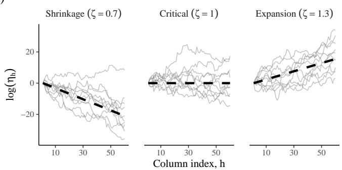
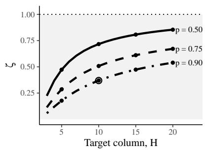

# Pathwise Shrinkage and Probabilistic Calibration of the Multiplicative Half-Cauchy Process

Siddhesh Kulkarnia,∗

a Bristol Myers Squibb, 5 Giralda Farms, Madison, NJ 07940, USA

## Abstract

We characterize the multiplicative half-Cauchy process through its log-scale random-walk representation, establishing shrinkage, expansion, and critical regimes, almost-sure summability, local rebounds, and efective dimension. We also derive a semi-analytic calibration rule linking interpretable prior probability statements to its scale parameter.

Keywords: Bayesian shrinkage, multiplicative half-Cauchy process, ordered shrinkage priors, infinite factor models, prior calibration, efective dimension

## 1. Introduction

Bayesian over-complete factorization models often introduce more latent components than are expected to be required and use ordered shrinkage priors to suppress redundant ones. Examples include the multiplicative gamma process (Bhattacharya and Dunson, 2011; Durante, 2017), cumulative shrinkage (Legramanti et al., 2020), and generalized infinite factorizations (Schiavon et al., 2022). A practical challenge is to understand both the efective dimension induced by such priors and how their hyperparameters should be selected.

The multiplicative half-Cauchy process (MHCP) and its use within a Bayesian factor model for sparse canonical correlation analysis were first developed in Kulkarni (2022) and later published in Kulkarni et al. (2026). In its motivating model,

$$
a _ { j h } ^ { ( m ) } \mid \tau _ { m } , \eta _ { h } , \lambda _ { j h } ^ { ( m ) } \sim N \left( 0 , \tau _ { m } ^ { 2 } \eta _ { h } ^ { 2 } \{ \lambda _ { j h } ^ { ( m ) } \} ^ { 2 } \right) .\tag{1}
$$

Thus $\eta _ { h }$ is a column-specific standard-deviation multiplier. Earlier work established full support, increasing concentration near zero, upper-tail flexibility, and med $( \eta _ { h } ) = \zeta ^ { h - 1 }$

Here we study the MHCP itself. We derive its pathwise phase behavior, summability and thresholdexceedance properties, local rebound probabilities, and an interpretable calibration for $\zeta .$ Throughout, “increasing shrinkage” refers to decreasing typical scale and long-run behavior, not monotone sample paths or first-order stochastic ordering.

## 2. Log-scale representation

The MHCP of Kulkarni et al. (2026) is

$$
\widetilde { \eta } _ { 1 } = 1 , \qquad \widetilde { \eta } _ { h } \sim \mathbf { C } ^ { + } ( 0 , \zeta ) , \quad h \geq 2 ,\tag{2}
$$

independently, with

$$
\eta _ { h } = \prod _ { \ell = 1 } ^ { h } \widetilde { \eta } _ { \ell } .\tag{3}
$$

For $h \geq 2 .$ , define

$$
U _ { h } = \widetilde \eta _ { h } / \zeta , \qquad Y _ { h } = \log U _ { h } .
$$

Proposition 1 (Centered log representation). The variables $Y _ { 2 } , Y _ { 3 } , \ldots$ are i.i.d. with

$$
f _ { Y } ( y ) = \frac { 1 } { \pi \cosh y } , \qquad \phi _ { Y } ( t ) = \operatorname { s e c h } \left( \frac { \pi t } { 2 } \right) ,\tag{4}
$$

and

$$
\log \eta _ { h } = ( h - 1 ) \log \zeta + \sum _ { \ell = 2 } ^ { h } Y _ { \ell } ,\tag{5}
$$

where

$$
\mathbb { E } ( Y _ { \ell } ) = 0 , \qquad { \mathrm { V a r } } ( Y _ { \ell } ) = { \frac { \pi ^ { 2 } } { 4 } } .
$$

Proof. For $U \sim { \bf C } ^ { + } ( 0 , 1 )$ , the transformation Y = log U gives

$$
f _ { Y } ( y ) = \frac { 2 e ^ { y } } { \pi ( 1 + e ^ { 2 y } ) } = \frac { 1 } { \pi \cosh y } .
$$

Its characteristic function is $\operatorname { s e c h } ( \pi t / 2 )$ (Harkness and Harkness, 1968; Ding, 2014). Equation (5) follows from $\widetilde { \eta } _ { h } = \zeta U _ { h }$ □

Consequently,

$$
\mathbb { E } ( \log \eta _ { h } ) = ( h - 1 ) \log \zeta , \qquad \mathrm { V a r } ( \log \eta _ { h } ) = ( h - 1 ) \frac { \pi ^ { 2 } } { 4 } .\tag{6}
$$

Thus $\zeta$ changes the global log-scale drift without changing the centered increment law. Symmetry gives

$$
\mathrm { m e d } ( \eta _ { h } ) = \zeta ^ { h - 1 } .\tag{7}
$$

For $\begin{array} { r } { \cdot - 1 < q < 1 . } \end{array}$

$$
E ( \eta _ { h } ^ { q } ) = \zeta ^ { q ( h - 1 ) } \left\{ \sec \left( \frac { \pi q } { 2 } \right) \right\} ^ { h - 1 } ,\tag{8}
$$

while $E ( \eta _ { h } ) = \infty$ for $h \geq 2$

## 3. Local and pathwise behavior

The process need not decrease from one component to the next.

Proposition 2 (Multiplicative excursions). For $h \geq 2$ and $c > 0 _ { ; }$

$$
\mathbb { P } ( \eta _ { h } > c \eta _ { h - 1 } ) = \frac { 2 } { \pi } \arctan \left( \frac { \zeta } { c } \right) .\tag{9}
$$

Proof. Since $\eta _ { h } / \eta _ { h - 1 } = \widetilde { \eta _ { h } }$ , the result follows directly from the half-Cauchy distribution function.

For $\zeta = 0 . 7$ , one-, two-, and five-fold upward moves have probabilities approximately 0 389, 0 214, and 0 089, respectively. Hence substantial local rebounds remain possible even under global shrinkage.

Theorem 1 (Pathwise phase behavior). As $h  \infty ,$

$$
\frac { \log \eta _ { h } } { h - 1 } \longrightarrow \log \zeta , \qquad \eta _ { h } ^ { 1 / ( h - 1 ) } \longrightarrow \zeta \quad a . s .\tag{10}
$$

Hence

$$
0 < \zeta < 1 \Longrightarrow \eta _ { h }  0 , \qquad \zeta > 1 \Longrightarrow \eta _ { h }  \infty \quad a . s .
$$

At $\zeta = 1$

$$
\operatorname* { l i m } _ { h \to \infty } \operatorname* { i n f } \eta _ { h } = 0 , \qquad \operatorname* { l i m } _ { h \to \infty } \operatorname* { s u p } \eta _ { h } = \infty \quad a . s .\tag{11}
$$

Proof. Apply the strong law to (5). $\mathrm { A t } \zeta = 1$ , log $\eta _ { h }$ is a zero-drift finite-variance random walk and oscillates almost surely (Chung and Fuchs, 1951). □

Corollary 1 (Summability and finite exceedances). $H 0 < \zeta < 1$ , thenfor every $r > 0$

$$
\sum _ { h = 1 } ^ { \infty } \eta _ { h } ^ { r } < \infty \quad a . s . , \qquad N _ { \varepsilon } = \# \{ h : \eta _ { h } > \varepsilon \} < \infty \quad a . s .\tag{12}
$$

Proof. The root test follows from $\eta _ { h } ^ { 1 / ( h - 1 ) } \to \zeta < 1$ ; finite threshold exceedances are then immediate.

For $r = 2$ , this applies directly to the column-specific variance multiplier in (1). The result is almost sure rather than integrable: $\mathbb { E } ( \eta _ { h } ^ { 2 } ) = \infty$ for $h \geq 2$ , so $\begin{array} { r } { \mathbb { E } ( \sum _ { h } \eta _ { h } ^ { 2 } ) = \infty } \end{array}$ despite almost-sure summability.

Theorem 2 (Central limit theorem). As $h  \infty ,$

$$
\frac { \log \eta _ { h } - ( h - 1 ) \log \zeta } { ( \pi / 2 ) \sqrt { h - 1 } } \overset { d } { \to } N ( 0 , 1 ) .\tag{13}
$$

Proof. Apply the classical central limit theorem to the sum in (5).

## 4. Probability calibration and efective dimension

Let

$$
Z _ { H } = \sum _ { \ell = 2 } ^ { H } Y _ { \ell } , \qquad H \geq 2 .
$$

Its characteristic function is

$$
\phi _ { Z _ { H } } ( t ) = \mathrm { s e c h } ^ { H - 1 } \left( \frac { \pi t } { 2 } \right) .
$$

The Gil–Pelaez inversion formula (Gil-Pelaez, 1951) gives

$$
F _ { H } ( z ) = { \frac { 1 } { 2 } } + { \frac { 1 } { \pi } } \int _ { 0 } ^ { \infty } { \frac { \sin ( t z ) } { t } } \operatorname { s e c h } ^ { H - 1 } \left( { \frac { \pi t } { 2 } } \right) d t .\tag{14}
$$

Let $q _ { p , H } = F _ { H } ^ { - 1 } ( p )$

Proposition 3 (Probability-based calibration). For $H \geq 2 \mathrm { { \AA } }$

$$
Q _ { p } ( \eta _ { H } ) = \zeta ^ { H - 1 } e ^ { q _ { p , H } } , \qquad { \mathbb { P } } ( \eta _ { H } \leq \varepsilon ) = p \Longrightarrow | \zeta = \exp \{ { \frac { \log { \varepsilon } - q _ { p , H } } { H - 1 } } \} \cdot | { \mathbf { p } } ( \eta _ { H } \leq \varepsilon ) | = \exp { \{ { \frac { \log { \varepsilon } - q _ { p , H } } { H - 1 } } \} } .\tag{15}
$$

Proof. Since $\eta _ { H } = \zeta ^ { H - 1 } \exp ( Z _ { H } )$ , monotonicity of the exponential gives the quantile expression; solving $Q _ { p } ( \eta _ { H } ) = \varepsilon$ gives (15). □

The calibrated value satisfies $\zeta < 1$ if and only if log $\varepsilon < q _ { p , H }$

Symmetry implies

$$
q _ { 1 - p , H } = - q _ { p , H } , \qquad q _ { 0 . 5 , H } = 0 ,
$$

recovering median calibration

$$
\zeta = \varepsilon ^ { 1 / \left( H - 1 \right) } .\tag{16}
$$

For fixed $h , \eta _ { h }$ is increasing in $\zeta$ under a common-increment coupling. Therefore $\mathbb { P } ( \eta _ { H } \le \varepsilon )$ is decreasing in $\zeta ,$ guaranteeing uniqueness of the calibration.

Equation (15) is a marginal statement about the specific column $H ;$ it does not imply that all subsequent columns remain below ε. In the motivating model, $\mathbb { P } ( \eta _ { H } \le \varepsilon ) = p$ means that the MHCP contribution to the column-H standard deviation is at most ε with probability $p .$

For example,

$$
H = 1 0 , \qquad \varepsilon = 0 . 0 5 , \qquad p = 0 . 9 0
$$

gives

$$
q _ { 0 . 9 0 , 1 0 } \approx 5 . 9 6 7 , \qquad \zeta \approx 0 . 3 6 9 .\tag{17}
$$

Median calibration instead gives $\zeta \approx 0 . 7 1 7$

A Monte Carlo check using $2 \times 1 0 ^ { 5 }$ draws gave empirical probabilities 0 5001, 0 7483, and 0 9012 for target probabilities 0 50, 0 75, and 0 90, respectively.

For large H, Theorem 2 gives

$$
q _ { p , H } \approx \frac { \pi } { 2 } \sqrt { H - 1 } \Phi ^ { - 1 } ( p ) .\tag{18}
$$

For $( \varepsilon , p ) = ( 0 . 0 5 , 0 . 9 0 )$ , the semi-analytic and normal-approximate values of $\zeta$ are respectively (0 1773 0 1728), (0 3694 0 3665), and (0 5397 0 5382) at $H = 5 , 1 0$ and 20.

For a global threshold-based summary, write

$$
N _ { \varepsilon } = \sum _ { h = 1 } ^ { \infty } \mathbf { 1 } \{ \eta _ { h } > \varepsilon \} .
$$

Tonelli’s theorem gives

$$
\mathbb { E } ( N _ { \varepsilon } ) = \mathbf { 1 } \{ \varepsilon < 1 \} + \sum _ { h = 2 } ^ { \infty } \left[ 1 - F _ { h } \{ \log \varepsilon - ( h - 1 ) \log \zeta \} \right] .\tag{19}
$$

For $0 < \zeta < 1$ , this expectation is finite. Indeed, for suficiently small $q \in ( 0 , 1 )$

$$
\rho _ { q } = \zeta ^ { q } \sec \left( \frac { \pi q } { 2 } \right) < 1 ,
$$

Table 1: Efect of the target probability on MHCP calibration and threshold-based efective dimension for $H = 1 0$ and $\varepsilon = 0 . 0 5 .$
<table><tr><td> $p$ </td><td>Calibrated  $\zeta$ </td><td>E  $N _ { 0 . 0 5 } )$ </td></tr><tr><td>0.50</td><td>0.7169</td><td>20.63</td></tr><tr><td>0.75</td><td>0.5077</td><td>7.60</td></tr><tr><td>0.90</td><td>0.3694</td><td>4.75</td></tr></table>

(a)  
  
(b)

  
Figure 1: MHCP pathwise behavior and calibration. (a) Ten simulated log-scale trajectories in shrinking $( \zeta = 0 . 7 )$ , critical $( \zeta = 1 )$ and expanding $( \zeta = 1 . 3 )$ regimes, with theoretical median trends; simulation seed 2026. (b) Values of $\zeta$ satisfying $P ( \eta _ { H } \leq 0 . 0 5 ) = p$ for $p = 0 . 5 0 , 0 . 7 5$ , and 0 90. At $H = 1 0$ , the corresponding values are 0 7169, 0 5077, and 0 3694. The dotted line marks $\zeta = 1 ;$ the open circle denotes $( H , p ) = ( 1 0 , 0 . 9 0 )$

and Markov’s inequality together with (8) gives

$$
\begin{array} { r } { \mathbb { P } ( \eta _ { h } > \varepsilon ) \le \varepsilon ^ { - q } \rho _ { q } ^ { h - 1 } , } \end{array}
$$

which is geometrically summable.

Thus $\mathbb { P } ( \eta _ { H } \le \varepsilon ) = p$ and $N _ { \varepsilon }$ answer complementary questions: the former controls one chosen column, whereas the latter summarizes overall threshold-based efective dimension.

Numerical evaluation of (19) gives $\mathbb { E } ( N _ { 0 . 0 5 } )$ ≈ 4 75 for the worked calibration, whereas median calibration gives approximately 20 63.

Increasing the target probability therefore induces more aggressive shrinkage and a substantially smaller threshold-based efective dimension.

## 5. Relation to existing shrinkage processes

For a positive multiplicative process $\begin{array} { r } { \Lambda _ { h } = \prod _ { \ell = 1 } ^ { h } D _ { \ell } } \end{array}$ with i.i.d. increments satisfying E| log $D _ { 1 } | < \infty$

$$
h ^ { - 1 } \log \Lambda _ { h } \longrightarrow \mathbb { E } \{ \log D _ { 1 } \} \qquad \mathrm { a . s . }
$$

The multiplicative gamma process (Bhattacharya and Dunson, 2011; Durante, 2017) uses gamma increments, whereas cumulative shrinkage uses an ordered mixture mechanism (Legramanti et al., 2020). The MHCP has the particularly transparent representation (5), in which $\zeta$ changes the drift without changing the centered increment law. These are structural prior comparisons rather than claims of universal posterior superiority.

## 6. Illustration and discussion

Figure 1 summarizes the main interpretation. Individual paths can exhibit substantial local variation while their long-run behavior is governed by $\zeta ,$ and interpretable column-specific probability statements can be converted directly into prior choices. This combination of almost-sure summability with infinite marginal moments illustrates how the MHCP can enforce strong pathwise regularization without eliminating heavy-tailed prior protection against occasional large components.

For $\zeta < 1$ , an infinite MHCP sequence is almost surely efectively finite at every fixed positive threshold while retaining explicit probabilities of local rebounds. The marginal calibration $\mathbb { P } ( \eta _ { H } \le \varepsilon ) = p$ and the global summary $N _ { \varepsilon }$ therefore provide complementary views of shrinkage and efective dimension.

Although motivated by canonical correlation analysis, the same ordered-scale mechanism applies to Bayesian factor, matrix, tensor, and multi-view latent representations. An accompanying R package, mhcp, provides simulation, probability calibration, threshold-exceedance summaries, and reproducible figure code. Version 0.1.0 is archived on Zenodo (DOI: 10.5281/zenodo.23355811) and development is available on GitHub: https://github.com/SiddheshKulkarni-source/mhcp.

Declaration of competing interest: The author declares no conflict of interest.

## References

Bhattacharya, A., Dunson, D.B., 2011. Sparse Bayesian Infinite Factor Models. Biometrika 98, 291–306. doi:10.1093/biomet/asr013.

Chung, K.L., Fuchs, W.H.J., 1951. On the Distribution of Values of Sums of Random Variables. Number 6 in Memoirs of the American Mathematical Society, American Mathematical Society.

Ding, P., 2014. Three occurrences of the hyperbolic-secant distribution. The American Statistician 68, 32–35.

Durante, D., 2017. A note on the multiplicative gamma process. Statistics & Probability Letters 122, 198–204. doi:10.1016/j.spl.2016.11.014.

Gil-Pelaez, J., 1951. Note on the inversion theorem. Biometrika 38, 481–482.

Harkness, W., Harkness, M., 1968. Generalized hyperbolic secant distributions. Journal of the American Statistical Association 63, 329–337.

Kulkarni, S., 2022. Bayesian Methodologies for Constrained Spaces. Ph.D. thesis. University of Louisville. doi:10.18297/etd/3956.

Kulkarni, S., Pal, S., Gaskins, J.T., 2026. A Bayesian methodology for estimation for sparse canonical correlation. Statistics in Biosciences doi:10.1007/s12561-026-09520-0.

Legramanti, S., Durante, D., Dunson, D.B., 2020. Bayesian cumulative shrinkage for infinite factorizations. Biometrika 107, 745–752.

Schiavon, L., Canale, A., Dunson, D.B., 2022. Generalized infinite factorization models. Biometrika 109, 817–835.