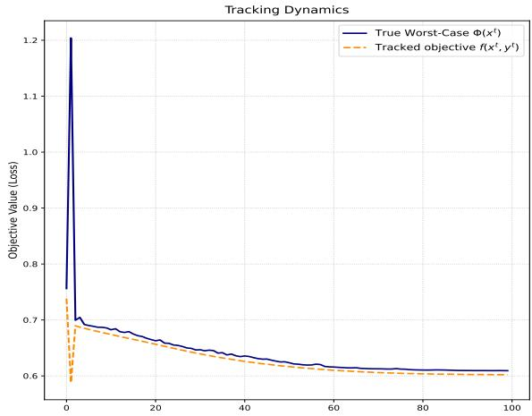
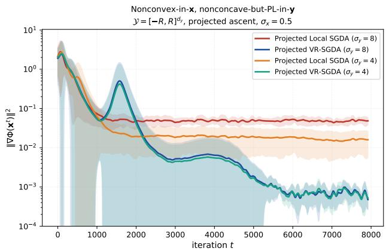

# Personalized Projected Ascent for Federated Stackelberg Optimization

M Yashwanth Indian Institute of Science, Bangalore yashwanthm@iisc.ac.in

SaiKiran Bulusu IIIT-Hyderabad saikiran.bulusu@iiit.ac.in

Sharannya Ghosh CISPA, Germany sharannyaghosh31@gmail.com

Anirban Chakraborty Indian Institute of Science, Bangalore anirban@iisc.ac.in

## Abstract

Federated minimax problems, such as distributionally robust optimization and adversarial training, include an inner maximization variable built from each client’s local data. These variables difer in meaning and dimension from one client to the next, so averaging them across clients, as standard federated minimax methods do, is ill-posed. We therefore study a federated minimax problem where the minimization variable x is shared and aggregated, while each client retains the maximization variable $\mathbf { y } _ { i }$ (personalized). Because these applications constrain $\mathbf { y } _ { i }$ to a compact convex set, we analyze projected ascent directly. We show that, in the nonconvex-concave regime, this projected personalized scheme attains the standard sublinear rate. In the nonconvex-PL regime, however, it hits a stepsize-invariant noise floor due to stochastic $\mathbf { y } _ { i }$ updates. To mitigate this, we propose VR-SGDA, incorporating a variance-reduced ascent step where each client maintains a private variable snapshot. By evaluating current and snapshot gradients on the same sample, the constant variance is replaced by a vanishing drift under a two-timescale regime. VR-SGDA eliminates the noise floor, attaining sublinear leading rates while preserving personalization and projection. Experiments on subpopulationrobustness and NLP adversarial training confirm both the worst-group robustness benefits and the two-timescale tracking mechanism.

## 1 INTRODUCTION

Federated Learning (FL) [17] is a distributed learning framework to train a shared model across clients whose data cannot be centralized. In many of the settings where this matters most, the goal is not merely good average performance but robust performance: the learner must account for worst-case distribution shifts in the data. Two canonical instances are distributionally robust optimization (DRO), where one optimizes against the worst reweighting of the data within an ambiguity set [1, 12, 19], and adversarial training, where one optimizes against worst-case input perturbations [16, 30]. Both are naturally minimax problems: an outer minimization over the model and an inner maximization that constructs the worst case. Bringing either into the federated setting therefore requires solving a federated minimax problem over heterogeneous clients.

The key feature of these problems, and the one that has been overlooked, is that the inner maximization variable is associated with the client’s own data: in federated DRO it is a reweighting $p _ { i } \in \Delta _ { m _ { i } }$ of client i’s local samples; in federated adversarial training it is a perturbation of client i’s local inputs. These variables live in client-specific spaces, $\Delta _ { m _ { i } } ~ \mathrm { v s . } ~ \Delta _ { m _ { j } }$ when clients hold diferent sample counts, with client-specific feasible sets, so aggregating them at the server is not a meaningful operation. Existing federated minimax methods nonetheless maintain a single global inner variable and average it at the server [6, 7]; while one could define aggregation rules, the resulting shared variable would not correspond to the per-client robust objective that DRO and adversarial training are designed to optimize.

This motivates maintaining the maximization variable locally: the model is what is ultimately deployed and remains shared, but the inner variable must be personalized, maintained locally, per client, and never communicated. We are therefore led, not by design preference but by the structure of the applications, to the objec tive min $\begin{array} { r } { \mathbf { \Delta x } _ { \ n } \stackrel { 1 } { \mathop { \ b { n } } } \sum _ { i = 1 } ^ { n } \operatorname* { m a x } _ { \mathbf { y } _ { i } \in \mathcal { Y } _ { i } } f _ { i } \big ( \mathbf { x } , \mathbf { y } _ { i } \big ) } \end{array}$ , in which a shared model x is trained against a personalized worst-case variable $\mathbf { y } _ { i }$ on each client, with $y _ { i }$ a compact convex set. This is strictly diferent from the shared-variable problem min $\begin{array} { r } { \iota _ { \mathbf { x } } \operatorname* { m a x } _ { \mathbf { y } } \frac { 1 } { n } \sum _ { i } f _ { i } ( \mathbf { x } , \mathbf { y } ) } \end{array}$ studied previously. Personalizing the inner variable places the problem outside existing federated minimax analyses, which rest on controlling the consensus error of an averaged inner variable, a quantity that no longer exists when $\mathbf { y } _ { i }$ is per-client and never shared. What remains is a different coupling: each client’s personalized ascent runs against a gradient evaluated at its own drifting local model, tracking a client-specific moving target ${ \bf y } _ { i } ^ { \star } ( { \bf x } _ { i } )$ where $\mathbf { x } _ { i }$ is the locally updated parameters of global model x at client i. In the nonconvex-concave regime, the bounded domain controls the inner tracking via a telescoping argument, and the two-timescale separation [15] transfers the centralized guarantee additively, with bounded client-drift terms and no snapshot device required. Here, the diameter D (maximum of the diameters of $y _ { i } )$ enters the bound through the problem constraints, not an assumption imposed on the iterates. The nonconvex-PL regime reveals a deeper issue. Under the gradient-mapping PL condition, the vanilla projected SGDA (Algorithm 1) produces a stepsizeinvariant noise floor $\bar { O } ( \sigma _ { y } ^ { 2 } / \mu ^ { 2 } )$ in the inner tracking error: the stochastic noise in the y-ascent accumulates in a way that PL contraction cannot fully absorb, so the iterates converge to a neighborhood of stationarity whose radius is controlled by the noise variance, not the step sizes. This floor is invisible in unconstrained analyses. To eliminate it, we propose Personalized VR-SGDA (Algorithm 1), which applies per-client SVRGstyle variance reduction to the inner ascent: each client maintains a snapshot of the shared and personalized parameters and uses it as a control variate, reducing the efective inner-gradient variance, which vanishes as the learning rate $\eta _ { x }  0$ . This removes the noise floor and yields convergence to a true stationary point. The snapshot here is taken at synchronization boundaries, and is used for variance reduction in the personalized inner ascent, not for the cross-client reconciliation that motivated snapshot devices in prior work [6]. Our contributions are summarized as

Table 1: Comparison of related federated robust optimization frameworks. Our method is the only one that maintains personalized maximization variables $\mathbf { y } _ { i }$ updated by projected ascent on constrained set, under a general adversary coupling.
<table><tr><td>Method</td><td>X</td><td>y</td><td>Application motivated</td><td>Per-client y</td><td>Inner coupling</td><td>Projected ascent on y</td></tr><tr><td>Local SGDA [6]</td><td>shared</td><td>shared</td><td>×</td><td>X</td><td>general</td><td>×</td></tr><tr><td>DRFA [7]</td><td>shared</td><td>shared</td><td>partial</td><td>X</td><td>client-weight</td><td>X</td></tr><tr><td>Minimax Convergence Analysis [28]</td><td>shared</td><td>shared</td><td>X</td><td>X</td><td>general</td><td>X</td></tr><tr><td>FLRA [25]</td><td>shared</td><td>personalized</td><td>√</td><td>√</td><td>affine input shift</td><td>×</td></tr><tr><td>Partial model [23]</td><td>partial</td><td></td><td>n/a</td><td>n/a</td><td> $\mathrm { n / a }$ </td><td>n/a</td></tr><tr><td>Ours</td><td>shared</td><td>personalized</td><td>√</td><td> $\checkmark$ </td><td>general</td><td> $\checkmark$ </td></tr></table>

• We formalize federated minimax optimization with a shared minimization variable x and personalized, maximization variables $\mathbf { y } _ { i } ,$ each constrained to a compact convex set $\mathcal { \mathrm { V } } _ { i }$ fixed by client i’s own data.

• First, in the nonconvex-concave (NC-C) regime, we show that personalized projected Local SGDA attains standard sublinear federated rates without a noise floor. Second, in the nonconvex-PL (NC-PL) regime, we show the vanilla scheme incurs a stepsize-invariant noise floor $O ( \sigma _ { y } ^ { 2 } / \mu ^ { 2 } )$ under the gradient-mapping PL condition. To eliminate this floor, we propose Personalized VR-SGDA, which uses model snapshots at synchronization boundaries as per-client control variates to remove inner-gradient variance and restore convergence to a true stationary point.

• We instantiate both use cases concretely, the DRO and adversarial training, and confirm the predicted behavior empirically.

## 2 RELATED WORK

Convergence theory for minimax problems is well understood in the convex-concave regime, first-order primaldual and mirror-prox methods achieve sub-linear rates [9, 20, 21], and in the strongly-convex–strongly-concave regime, gradient descent-ascent and its variants converge linearly [18]. Our setting sits outside this spectrum on every axis: the outer problem is nonconvex, the inner problem is only concave or $\mathrm { P L }$ , the feasible set is constrained, and the whole is solved in a federated, personalized configuration. The federated minimax literature that does address nonconvex outer problems inherits further assumptions we discard. We organize it along four axes: what the maximization variable is (a single global object or per-client); whether the analysis is tied to a specific adversary or application structure, or holds for a general coupling between the inner and outer variables; whether the inner ascent is projected onto a constraint set, or left unconstrained; and whether the analysis requires a snapshot iterate to control the inner update. As Table 1 summarizes our configuration, shared model, personalized maximization variable, general coupling, projected ascent, no snapshot for nonconvex-concave is covered by no prior federated minimax analysis, and the resulting simplification stems from the modeling choice rather than a new proof technique.

Deng and Mahdavi [6] establish convergence of Local SGDA in the federated nonconvex-concave setting, with a single global maximization variable y averaged at the server. Their analysis controls an inner-variable consensus error from averaging y across clients, a quantity with no analogue in our setting, where $\mathbf { y } _ { i }$ is per-client and never communicated. To handle the federated nonconvex regime, they introduce Local SGDA<sup>+</sup>, which uses a snapshot of the outer variable inside the inner update to decouple the inner-maximization analysis from the moving local iterates. Sharma et al. [28, 29] extend this line to broader nonconvex-nonconcave regimes, again with an unconstrained shared maximization variable and a snapshot-style algorithm.

The closest application precedent is (DRFA) Deng et al. [7], also about federated DRO but with a fundamentally diferent configuration. DRFA’s maximization variable is a single global $\lambda \in \Delta _ { N }$ over clients, optimizing min $_ w \mathrm { m a x } _ { \lambda \in \Delta _ { N } } \sum _ { i } \lambda _ { i } f _ { i } ( w )$ and updated only at the server via a snapshot iterate. Our $p _ { i } \in \Delta _ { m _ { i } }$ has dimension equal to client i’s local sample count, is updated locally, and expresses the worst case within client i’s data. DRFA asks “which client to protect against”; ours asks “which examples within each client are its worst case.” Prior federated minimax analyses rely on a snapshot iterate to decouple the maximization update from the moving outer trajectory, reconciling a single shared maximization variable with n clients drifting iterates [6, 28]. Personalization removes this dificulty at its source: each $\mathbf { y } _ { i }$ tracks its own x<sub>i</sub> via the two-timescale separation, with no cross-client object to reconcile. The resulting simplification (no snapshot, additive drift only) is a structural consequence of our configuration rather than a new proof technique.

Closest to our configuration is Reisizadeh et al. [25], which also maintains per-client maximization variables, but assumes PL on both variables (excluding our NC-C/DRO regime, in their work $\mathbf { y } _ { i }$ , being the afine transform on $\mathbf { x } _ { i }$ which is very restrictive) states $\mathrm { P L }$ on the raw gradient (inappropriate for projected ascent), and restricts to afine-shift adversaries. FedNest [31] requires a strongly-convex inner problem with secondorder hypergradient computation, excluding both the merely-concave and constrained-PL regimes we treat. Wu et al. [32] address federated minimax with a shared maximization variable, unconstrained inner update, and raw-gradient PL in the cross-device regime. Pillutla et al. [23] personalize part of the minimization variable under a standard (non-minimax) objective.

## 3 METHOD

Motivation for Stackelberg: The minimax problem admits two solution concepts. The symmetric Nash equilibrium guarantees existence and order-invariance in convex-concave settings, but fails under non-convexity: pure equilibria often do not exist, and computing approximate local min-max points is PPAD-complete [4]. Therefore, the asymmetric Stackelberg equilibrium, where the leader commits to x and followers best-respond with Y is adopted [15]. This matches our sequential objective, guarantees well-posedness via our compact $\mathcal { \mathrm { V } } _ { i }$ assumption, and serves as the proper local optimality notion for nonconvex problems by respecting the inherent min − max asymmetry.

```latex
Algorithm 1 Personalized Local SGDA & VR-SGDA
1: Input: synchronization interval τ, iterations $T ,$
initial $\mathbf { x } _ { i } ^ { ( 0 ) } = \mathbf { x } ^ { ( 0 ) } , \mathbf { y } _ { i } ^ { ( 0 ) } \in \mathcal { N } _ { i }$ for $i \in [ n ] ;$ stepsizes
η<sub>x</sub>, η<sub>y</sub>.
2: Initialize snapshots $\bar { \mathbf { x } } = \mathbf { x } ^ { ( 0 ) } , \bar { \mathbf { y } } _ { i } = \mathbf { y } _ { i } ^ { ( 0 ) }$ and com
pute snapshot full gradient $\begin{array} { r } { \hat { v } _ { i } ^ { ( 0 ) } = \nabla _ { \mathbf { y } } f _ { i } ( \bar { \mathbf { x } } , \bar { \mathbf { y } } _ { i } ) . } \end{array}$
3: for $t = 0 , \ldots , T - 1$ in parallel for clients $i =$
$1 , \ldots , n$ do
4: Sample batch $\xi _ { i } ^ { t } \sim \mathcal { D } _ { i }$
5: $\begin{array} { r } { \mathbf { x } _ { i } ^ { ( t + 1 ) } = \mathbf { x } _ { i } ^ { ( t ) } - \eta _ { x } \nabla _ { \mathbf { x } } f _ { i } ( \mathbf { x } _ { i } ^ { ( t ) } , \mathbf { y } _ { i } ^ { ( t ) } ; \xi _ { i } ^ { t } ) } \end{array}$
6: Compute base ascent direction $\begin{array} { r l } { v _ { i } ^ { t } } & { { } = } \end{array}$
$\nabla _ { \mathbf { y } } f _ { i } ( \mathbf { x } _ { i } ^ { ( t ) } , \mathbf { y } _ { i } ^ { ( t ) } ; \xi _ { i } ^ { t } )$
7: Apply Variance-Reduced correction using the
same $\xi _ { i } ^ { t } \colon$
$v _ { i } ^ { t }  v _ { i } ^ { t } - \nabla _ { \mathbf { y } } f _ { i } ( \bar { \mathbf { x } } , \bar { \mathbf { y } } _ { i } ; \xi _ { i } ^ { t } ) + \hat { v } _ { i } ^ { ( s ) }$ where $s = \lfloor t / \tau \rfloor \tau$
8: $\mathbf { y } _ { i } ^ { ( t + 1 ) } = \mathcal { P } y _ { i } \left( \mathbf { y } _ { i } ^ { ( t ) } + \eta _ { y } v _ { i } ^ { t } \right)$
9: $\mathbf { i f } \ \tau \mid \ ( t + 1 )$ then
10: Clients send $\mathbf { x } _ { i } ^ { ( t + 1 ) }$ to the server
11: Server computes $\begin{array} { r } { \mathbf { x } ^ { ( t + 1 ) } = \frac { 1 } { n } \sum _ { i = 1 } ^ { n } \mathbf { x } _ { i } ^ { ( t + 1 ) } } \end{array}$ and
broadcasts it
12: Each client sets $\mathbf { x } _ { i } ^ { ( t + 1 ) } = \mathbf { x } ^ { ( t + 1 ) }$
13: Refresh snapshot $\bar { \mathbf { x } } = \mathbf { x } ^ { ( t + 1 ) } , \bar { \mathbf { y } } _ { i } = \mathbf { y } _ { i } ^ { ( t + 1 ) }$
14: Recompute full gradient $\hat { v } _ { i } ^ { ( t + 1 ) } = \nabla _ { \mathbf y } f _ { i } ( \bar { \mathbf x } , \bar { \mathbf y } _ { i } )$
15: end if
16: end for
17: Note: $\mathbf { y } _ { i }$ is personalized and never communicated.
Blue steps are executed exclusively for the VR-
SGDA variant.
```

## 3.1 Problem Formulation and Algorithm

We study the federated minimax problem over n clients,

$$
\operatorname* { m i n } _ { \mathbf { x } } \operatorname* { m a x } _ { \mathbf { y } _ { 1 } , \ldots , \mathbf { y } _ { n } } f ( \mathbf { x } , \mathbf { Y } ) = { \frac { 1 } { n } } \sum _ { i = 1 } ^ { n } f _ { i } ( \mathbf { x } , \mathbf { y } _ { i } ) ,\tag{1}
$$

where $\mathbf { Y } : = ( \mathbf { y } _ { 1 } , \ldots , \mathbf { y } _ { n } )$ and $\mathbf { y } _ { i } \in \mathcal { V } _ { i }$ , is the personalized maximization variable of client i, constrained to a compact convex set $\mathcal { \mathrm { V } } _ { i }$ determined by that client’s own preferences. Adopting the Stackelberg concept, we seek a stationary point of the value function $\Phi ( \mathbf { x } )$

$$
\begin{array} { l } { \displaystyle \Phi ( \mathbf { x } ) = \underset { \mathbf { Y } } { \operatorname* { m a x } } f ( \mathbf { x } , \mathbf { Y } ) = \frac { 1 } { n } \sum _ { i = 1 } ^ { n } \underset { \mathbf { y } _ { i } \in \mathcal { Y } _ { i } } { \operatorname* { m a x } } f _ { i } ( \mathbf { x } , \mathbf { y } _ { i } ) } \\ { \displaystyle = \frac { 1 } { n } \sum _ { i = 1 } ^ { n } \Phi _ { i } ( \mathbf { x } ) . } \end{array}\tag{2}
$$

The second equality makes the personalized configuration tractable rather than merely well-motivated. Since y<sub>i</sub> appears only in $f _ { i } ,$ , the joint maximization separates completely across clients: each client’s follower problem is decoupled from every other’s, and Φ is the average of n independent value functions. No consensus over Y is required, none is meaningful, and as we made precise in Section 2 that none is properly defined when the $\mathcal { \mathrm { V } } _ { i }$ difer. The leader’s problem is federated; the followers’ problems are local. Algorithm 1 instantiates this directly. The leader variable x is updated by local descent and periodically averaged, exactly as in FedAvg. Each follower variable $\mathbf { y } _ { i }$ is updated by projected local ascent onto $\mathcal { \mathrm { V } } _ { i }$ and never leaves the client. The two step sizes are kept in the two-timescale regime $\eta _ { x } \ll \eta _ { y }$ of Lin et al. [15], which supplies the inner quasi-stationarity the analysis needs. We analyze two regimes: one nonconvex in x and concave in Y, the other nonconvex in x and PL in Y.

## 4 CONVERGENCE ANALYSIS

We first give overview of all the assumptions

Assumption 4.1 (Smoothness). There exists a constant $L \ > \ 0$ such that for all $\textit { i } \in \ [ n ]$ and all pairs $( \mathbf { x } _ { 1 } , \mathbf { y } _ { 1 } ) , ( \mathbf { x } _ { 2 } , \mathbf { y } _ { 2 } ) \ \in \ \mathbb { R } ^ { d _ { x } } \times \mathbb { R } ^ { d _ { y } }$ , the gradients are Lipschitz continuous, satisfying $\parallel \nabla f _ { i } ( { \bf x } _ { 1 } , { \bf y } _ { 1 } ) \ -$ $\nabla f _ { i } ( \mathbf { x } _ { 2 } , \mathbf { y } _ { 2 } ) \| \leq L \| ( \mathbf { x } _ { 1 } , \mathbf { y } _ { 1 } ) - ( \mathbf { x } _ { 2 } , \mathbf { y } _ { 2 } ) \|$

Assumption 4.2 (Unbiased and Bounded Variance). For all $i \in [ n ]$ , the local stochastic gradients are unbiased and have bounded variance. That is, for any sample $\xi , \mathbb { E } [ \nabla _ { x } f _ { i } ( { \bf x } , { \bf y } ; \xi ) ] ~ = ~ \nabla _ { x } f _ { i } ( { \bf x } , { \bf y } )$ and $\begin{array} { r } { \mathbb { E } [ \| \nabla _ { x } f _ { i } ( \mathbf { x } , \mathbf { y } ; \boldsymbol { \xi } ) - \nabla _ { x } f _ { i } ( \mathbf { x } , \mathbf { y } ) \| ^ { 2 } ] \leq \sigma _ { x } ^ { 2 } } \end{array}$ . Identical unbiasedness and variance bounds (denoted $\sigma _ { y } ^ { 2 } )$ hold for the stochastic y gradients. For the NC-C setting, we assume that $\sigma _ { x } ^ { 2 } = \sigma _ { y } ^ { 2 } = \sigma ^ { 2 }$

Assumption 4.3 (Lipschitz Continuity in $\mathbf { x } ) , f ( \mathbf { x } , \mathbf { y } )$ is said to be $G _ { x } \mathrm { - L i p s c h i t z }$ in $\textbf { x } \mathrm { i f } \ \forall \mathbf { x } , \mathbf { x ^ { \prime } } \ \in \ \mathbb { R } ^ { d _ { x } } ;$ $\| f ( \mathbf { x } , \mathbf { y } ) - f ( \mathbf { x } ^ { \prime } , \mathbf { y } ) \| \leq G _ { x } \| \mathbf { x } - \mathbf { x } ^ { \prime } \| .$

Definition 4.4 (Gradient Mapping). For a step size $\lambda > 0$ and a closed convex set $\mathcal { V } \subseteq \mathbb { R } ^ { d _ { y } }$ , the gradient mapping of F in y is defined as $\begin{array} { r } { G _ { \lambda } ( \mathbf { x } , \mathbf { y } ) : = \frac { 1 } { \lambda } ( \mathcal { P } _ { \mathcal { y } } ( \mathbf { y } + } \end{array}$ $\lambda \nabla _ { \mathbf { y } } F ( \mathbf { x } , \mathbf { y } ) ) - \mathbf { y } )$ , where $\mathcal { P } _ { \mathcal { Y } }$ denotes the Euclidean projection onto Y.

Assumption 4.5 (Gradient-Mapping PL [13]). Fix $\lambda ~ \in ~ ( 0 , 1 / L ]$ The function $F ( \mathbf { x } , \mathbf { y } )$ satisfies the gradient-mapping Polyak-Łojasiewicz (PL) condition in y over Y with modulus $\mu > 0$ if, for all $\mathbf { x } \in \mathbb { R } ^ { d _ { x } }$ and $\mathbf { y } \in \mathcal { V }$ , it holds that $\begin{array} { r } { \frac 1 2 \| G _ { \lambda } ( \mathbf x , \mathbf y ) \| ^ { 2 } \ge \mu \big ( F ( \mathbf x , \mathbf y ^ { * } ( \mathbf x ) ) - } \end{array}$ $F ( \mathbf { x } , \mathbf { y } ) )$ , where $\mathbf { y } ^ { * } ( \mathbf { x } ) \in \arg \operatorname* { m a x } _ { \mathbf { y } \in \mathcal { Y } } F ( \mathbf { x } , \mathbf { y } )$

Remark 4.6. When $\mathcal { V } = \mathbb { R } ^ { d _ { y } }$ the projection is the identity and $G _ { \lambda } ( { \bf x } , { \bf y } ) = \nabla _ { \bf y } F ( { \bf x } , { \bf y } )$ for every $\lambda ,$ so Assumption 4.5 recovers the classical PL condition.

Assumption 4.7 (Non-Convex Concave). $f ( \mathbf { x } , \mathbf { y } )$ is assumed to be non-convex in x and concave in y. This implies for each x the function is concave in y.

Assumption 4.8 (Component-wise smoothness). For each client i and each sample $k \in \mathbf { \textit { D } } _ { i } .$ , the persample function $F _ { i , k } ( { \bf x } , { \bf y } )$ has L-Lipschitz gradients: $\| \nabla F _ { i , k } ( \mathbf { x } _ { 1 } , \mathbf { y } _ { 1 } ) - \nabla F _ { i , k } ( \mathbf { x } _ { 2 } , \mathbf { y } _ { 2 } ) \| \leq L \| \mathbf { x } _ { 1 } - \mathbf { x } _ { 2 } \| + L \| \mathbf { y } _ { 1 } -$ $\mathbf { y } _ { 2 } \|$

We define the following quantity to measure the gradient dissimilarity between the local and the global loss [23]:

$$
\zeta _ { x } = \operatorname* { s u p } _ { ( \mathbf { x } , \mathbf { y } ) \in \mathbb { R } ^ { d _ { x } } \times \mathbb { R } ^ { d _ { y } } } \frac { 1 } { n } \sum _ { i = 1 } ^ { n } \| \nabla _ { x } f _ { i } ( \mathbf { x } , \mathbf { Y } ) - \nabla _ { x } f ( \mathbf { x } , \mathbf { Y } ) \| ^ { 2 }
$$

As a consequence of the above definition we have

$$
\frac { 1 } { n } \sum _ { i = 1 } ^ { n } \left\| \nabla _ { x } f _ { i } ( \mathbf { x } , \mathbf { Y } ) - \nabla _ { x } f ( \mathbf { x } , \mathbf { Y } ) \right\| ^ { 2 } \leq \zeta _ { x }\tag{3}
$$

## 4.1 Convergence Analysis of NC-C Setting

The Moreau envelope [26] of the function $\Phi ( \mathbf { x } )$ is defined as below

$$
\Phi _ { 1 / 2 L } ( \mathbf { x } ) : = \operatorname* { m i n } _ { \mathbf { z } } \left[ \Phi ( \mathbf { z } ) + L \| \mathbf { z } - \mathbf { x } \| ^ { 2 } \right]\tag{4}
$$

The minimizer is denoted as $\mathrm { p r o x } _ { \phi / 2 L } ( \mathbf { x } )$

$$
\mathrm { p r o x } _ { \phi / 2 L } ( \mathbf { x } ) : = \arg \operatorname* { m i n } _ { \mathbf { z } } \left[ \Phi ( \mathbf { z } ) + L \| \mathbf { z } - \mathbf { x } \| ^ { 2 } \right]\tag{5}
$$

our aim is to minimize the following potential

$$
U = \mathbb { E } \Vert \nabla \Phi _ { 1 / 2 L } ( \mathbf { x } ) \Vert ^ { 2 }\tag{6}
$$

In the nonconvex-concave regime, the value function $\Phi ( \mathbf { x } ) = \mathrm { m a x } _ { y _ { 1 } , \ldots , y _ { n } } f ( \mathbf { x } , \mathbf { Y } )$ is generally non-smooth, even when each $f _ { i }$ is smooth in both arguments. Nonsmoothness arises because the maximizer ${ \bf y } _ { i } ^ { \star } ( x ) ~ = ~$ arg max ${ \bf \cdot } _ { y _ { i } \in { \mathcal { Y } } _ { i } } f _ { i } ( { \bf x } , { \bf y } _ { i } )$ can change discontinuously with $\mathbf { x }$ when $f _ { i }$ is merely concave (not strongly concave) in $\mathbf { y } _ { i } \mathrm { - t h e }$ argmax of a linear function over a polytope jumps between vertices. By Danskin’s theorem [2, 3], which would deliver ∇Φ via the envelope theorem, requires the maximizer to be unique and continuous; mere concavity does not guarantee this.

Since $\nabla \Phi ( \mathbf { x } )$ may not exist, the standard stationarity criterion $\| \vec { \nabla } \Phi ( \mathbf { x } ) \| ^ { 2 } \leq \epsilon ^ { 2 }$ is not well-defined. Following [5, 14], we instead minimize the Moreau envelope $\Phi _ { 1 / 2 L } ( \mathbf { x } )$ which is L-smooth regardless of whether Φ itself is smooth, and the convergence criterion becomes $\| \nabla \Phi _ { 1 / 2 L } ( \mathbf { x } ) \| ^ { 2 } \leq \epsilon ^ { 2 }$ , the standard measure for nonsmooth nonconvex optimization [5, 14].

Theorem 4.9 (Convergence for NonConvex-Concave). The iterates generated by the projected SGDA Algorithm. 1 satisfy the following convergence bound for the Moreau envelope: $\begin{array} { r l } { \frac { 1 } { T } \sum _ { t = 1 } ^ { T } \mathbb { E } \left\lceil \left\| \nabla \Phi _ { 1 / 2 L } \left( \mathbf { x } ^ { ( t - 1 ) } \right) \right\| ^ { 2 } \right\rceil } & { { } \leq } \end{array}$ $\begin{array} { r l r } {  { } } & { { } } & { \frac { 8 \Delta _ { \phi } } { \eta _ { x } T } + 8 L \eta _ { x } ( G _ { x } ^ { 2 } + \frac { \sigma ^ { 2 } } { n } ) + 1 6 0 \hat { L } ^ { 2 } ( 2 \tau ^ { 2 } \eta _ { x } ^ { 2 } \sigma ^ { 2 } + \tau ^ { 2 } \eta _ { x } ^ { 2 } \zeta _ { x } ^ { 2 } ) + } \end{array}$ $\begin{array} { r l r } { \frac { 8 L D ^ { 2 } } { \tau \eta _ { y } } } & { { } + } & { 1 6 L \eta _ { y } \sigma ^ { 2 } \quad + \quad 6 4 L \eta _ { x } G _ { x } \sqrt { G _ { x } ^ { 2 } + \sigma ^ { 2 } } . \quad \quad I f } \end{array}$ we select the primal stepsize $\begin{array} { r l r l } { a s \colon } & { { } \quad } & { \eta _ { x } } & { { } \quad = } \end{array}$ min $\left\{ \frac { \epsilon ^ { 2 } } { 8 L \Big ( G _ { x } ^ { 2 } + \frac { \sigma ^ { 2 } } { n } \Big ) + 6 4 L G _ { x } \sqrt { G _ { x } ^ { 2 } + \sigma ^ { 2 } } } , \quad \frac { ( G _ { x } ^ { 2 } + \sigma ^ { 2 } ) \epsilon ^ { 4 } } { 2 5 6 0 D ^ { 2 } L ^ { 3 } \sigma ^ { 2 } ( 2 \sigma ^ { 2 } + \zeta _ { x } ^ { 2 } ) } , \ : \ : \ : \right.$ $\left. \frac { \epsilon ^ { 6 } } { 1 0 2 4 D ^ { 2 } L ^ { 3 } \sigma ^ { 2 } ( G _ { x } ^ { 2 } + \sigma ^ { 2 } ) } \right\}$ . ,the dual stepsize is strictly separated as $\begin{array} { r } { \eta _ { y } = \operatorname* { m i n } \left( \frac { 1 } { 2 L } , \frac { \epsilon ^ { 2 } } { 1 6 L \sigma ^ { 2 } } \right) } \end{array}$ and $\begin{array} { r } { \tau = \frac { D } { \sqrt { \eta _ { x } \eta _ { y } \left( G _ { x } ^ { 2 } + \sigma ^ { 2 } \right) } } . } \end{array}$ then we have:   
$\begin{array} { r } { \frac { 1 } { T } \sum _ { t = 1 } ^ { T } \mathbb { E } \left[ \left\| \nabla \Phi _ { 1 / 2 L } \left( \mathbf { x } ^ { ( t - 1 ) } \right) \right\| ^ { 2 } \right] \leq \frac { 8 \Delta _ { \phi } } { \eta _ { x } T } + 4 \epsilon ^ { 2 } } \end{array}$ . This establishes that achieving an $\mathcal { O } ( \bar { \epsilon } ^ { 2 } )$ stationary point requires $\begin{array} { r } { T \geq \mathcal { O } \left( \frac { 1 } { \epsilon ^ { 8 } } \right) } \end{array}$ gradient computations and $\begin{array} { r } { \mathcal { O } \left( \frac { 1 } { \epsilon ^ { 4 } } \right) } \end{array}$ communication rounds.

Theorem 4.9 says that personalization and projection together cost nothing in the nonconvex-concave regime: the leading term matches the centralized two-timescale rate of [15], and the federated overhead enters only through the usual lower-order terms in the local-step count τ and the heterogeneity $\zeta _ { x } ^ { 2 } .$ . Two features of the bound are: First, the client-drift contribution splits into two terms carrying diferent variance scales, $\bar { \sigma } ^ { 2 } / n$ and $\sigma ^ { 2 } ;$ : the first is the averaged x-noise, which the n clients suppress, while the second is the un-averaged $\mathbf { y } _ { i } \mathrm { - n o i s e } .$ which they cannot, and this asymmetry is the analytical signature of the personalized configuration. Second, the compact domain enters only through projected sets, a genuine problem constant fixed by the ambiguity set, not a bound assumed on the iterates. The detailed proof is provided in the Appendix under Theorem A.4.

## 4.2 Convergence Analysis of NC-PL

Under the PL condition 4.5, it can be shown that Φ is smooth and no envelope is needed. The stationarity measure is $\| \nabla \Phi ( \mathbf { x } ) \| ^ { 2 }$ directly. We show that Φ is smooth in the Appendix in Lemma A.3.

Theorem 4.10 (Non-convex PL Convergence). Suppose Assumptions $\ 4 . 1$ to 4.5 hold, and suppose the step sizes satisfy (a) $\begin{array} { r } { \eta _ { y } \quad \le \quad \frac { 1 } { 2 L } \quad , \quad ( b ) } \end{array}$ $\begin{array} { r } { \frac { \eta _ { x } } { \eta _ { u } } \ \leq \ \frac { \mu ^ { 2 } } { 1 6 L ^ { 2 } } , \ ( c ) \ 1 0 \tau ^ { 2 } \eta _ { x } ^ { 2 } L ^ { 2 } \ \leq \ \frac { 1 } { 2 } \ ( d ) \ \eta _ { x } \ \leq \ \frac { 1 } { \beta } } \end{array}$ and (e) $\begin{array} { r } { \frac { 8 \check { \eta } _ { x } ^ { 2 } L ^ { 2 } } { \mu ^ { 2 } \eta _ { y } } \Big [ \frac { L + \beta } { 2 } + 6 \eta _ { y } L ^ { 2 } \Big ] \ \leq \ \frac { 1 } { 2 } \big ( 1 - \beta \eta _ { x } \big ) . \quad ( a ) , ( b ) , ( c ) , ( d ) } \end{array}$ arises due to smoothness, two-timescale, consenusstability, outer-smoothness respectively. With $\begin{array} { r } { T \ge \hat { T _ { 0 } } = \operatorname* { m a x } \{ 4 L ^ { 2 } , \frac { 2 5 \mu ^ { 8 } } { 4 0 9 6 L ^ { 4 } } , \frac { \mu ^ { 2 } } { 2 5 6 } \} } \end{array}$ . The iterates $o f$ Algorithm 1 satisfy $\begin{array} { r l r } { \frac { 1 } { T } \sum _ { t = 0 } ^ { T - 1 } \mathbb { E } \| \nabla \Phi ( { \mathbf x } ^ { t } ) \| ^ { 2 } } & { \leq } & { \frac { 4 \Delta _ { \Phi } } { \eta _ { x } T } \ + } \end{array}$ $\begin{array} { r l r } & { } & { \frac { 3 2 L ^ { 2 } A _ { 0 } } { \mu ^ { 2 } \eta _ { y } T } + \frac { 9 6 L ^ { 2 } \sigma _ { y } ^ { 2 } } { \mu ^ { 2 } } + \frac { 2 \beta \eta _ { x } \sigma _ { x } ^ { 2 } } { n } + \frac { 3 2 L ^ { 2 } \eta _ { x } ^ { 2 } \sigma _ { x } ^ { 2 } } { \mu ^ { 2 } \eta _ { y } n } \Big ( \frac { L + \beta } { 2 } + 6 \eta _ { y } L ^ { 2 } \Big ) } \end{array}$ + $\begin{array} { r } { \bigg ( 4 L ^ { 2 } + \frac { 3 2 L ^ { 4 } ( \eta _ { x } + 6 \eta _ { y } ) } { \mu ^ { 2 } \eta _ { y } } \bigg ) } \end{array}$ $\begin{array} { r } { 1 0 \tau \eta _ { x } ^ { 2 } \big [ \sigma _ { x } ^ { 2 } \big ( 1 + \frac { 1 } { n } \big ) + \zeta _ { x } \big ] } \end{array}$ .Choosing $\begin{array} { r l r } { \eta _ { y } } & { { } = } & { \Theta ( 1 / \sqrt { T } ) } \end{array}$ $\begin{array} { r } { \eta _ { x } = \frac { \mu ^ { 2 } } { 1 6 L ^ { 2 } } \eta _ { y } = \Theta ( 1 / \sqrt { T } ) } \end{array}$ , we obtain the rate $\begin{array} { r l r } { \frac { 1 } { T } \sum _ { t = 0 } ^ { T - 1 } \mathbb { E } \| \nabla \Phi ( \mathbf { x } ^ { t } ) \| ^ { 2 } } & { { } \le } & { O \Big ( \frac { L ^ { 2 } ( \Delta _ { \Phi } + A _ { 0 } ) + \mu \sigma _ { x } ^ { 2 } } { \mu ^ { 2 } \sqrt { T } } \Big ) \quad + } \end{array}$ $\begin{array} { r } { O \Big ( \frac { L ^ { 2 } \sigma _ { y } ^ { 2 } } { \mu ^ { 2 } } \Big ) + O \Big ( \frac { L ^ { 2 } \mu ^ { 2 } ( \sigma _ { x } ^ { 2 } + \zeta _ { x } ) } { T ^ { 3 / 4 } } \Big ) + O ( \frac { 1 } { T } ) } \end{array}$

Theorem 4.10 (vanilla projected SGDA under gradientmapping PL) establishes a rate with a non-vanishing $\mathcal { O } \Big ( \frac { \bar { L } ^ { 2 } \sigma _ { y } ^ { 2 } } { \mu ^ { 2 } } \Big )$ noise floor. This floor arises intrinsically from the personalized- $\mathbf { - y } _ { i }$ structure: since $\mathbf { y } _ { i }$ is never communicated, the stochastic-gradient variance of $_ \mathrm { y }$ on the inner ascent cannot be reduced through serverside averaging, unlike in shared-y analyses. The floor quantifies the statistical cost of personalization under SGDA. The proof details are provided in the Appendix under Theorem. A.12.

Inspired from SVRG [8, 24, 33], we eliminate the floor via a per-client gradient correction on the inner ascent. Each client i maintains a snapshot of its $\mathbf { y } _ { i }$ and $\mathbf { x } _ { i }$ variables at every synchronization round and uses a variance-reduced gradient estimator during the intervening local updates. Towards this end we propose the correction to the y-updates in the algorithm. Following the standard convention in the SVRG literature Algorithm 2 requires component-wise smoothness of the per-sample functions:

Assumption 4.8 implies that any batch mean $\textstyle { \frac { 1 } { | B | } } \sum _ { k \in B } F _ { i , k }$ is also L-smooth (convex combination of L-smooth functions), so the population objective $f _ { i }$ is L-smooth as well. In machine learning applications where each “component” corresponds to a training data point, this assumption holds whenever the per-sample loss is smooth in the parameters.

The two stochastic gradient evaluations $\nabla _ { \mathbf { y } } f _ { i } ( \mathbf { x } _ { i } ^ { t } , \mathbf { y } _ { i } ^ { t } ; \xi _ { i } ^ { t } )$ and $\nabla _ { \mathbf { y } } f _ { i } ( \bar { \mathbf { x } } , \bar { \mathbf { y } } _ { i } ; \xi _ { i } ^ { t } )$ use the same realization $\xi _ { i } ^ { t }$ . This shared randomness is what enables the variance reduction: the two noisy terms are perfectly coupled through $\xi _ { i } ^ { t } ,$ and their diference reduces to a smoothnessbounded spatial change rather than a sum of independent noises.

Theorem 4.11 (Non-convex PL Convergence under VR-SGDA). Suppose Assumptions $\ 4 . 1$ to $4 . 5$ and Assumption $4 . 8$ (component-wise smoothness) hold, and suppose the stepsizes and synchronization interval satisfy $\begin{array} { r l r } { ( a ) \eta _ { y } \ \le \ \frac { 1 } { 2 L } , \left( b \right) \frac { \eta _ { x } } { \eta _ { y } } \ \le \ \frac { \mu ^ { 2 } } { 1 6 L ^ { 2 } } , \left( c \right) } \end{array}$ $\begin{array} { r } { \eta _ { x } \ \leq \ \frac { 1 } { \beta } , \ ( d ) \ 8 L ^ { 2 } \tau ^ { 2 } \eta _ { y } ^ { 2 } \ \leq \ \frac { 1 } { 2 } , \ ( e ) \ \overset { \cdot \cdot } { 1 0 } \tau ^ { 2 } \eta _ { x } ^ { 2 } L ^ { 2 } \ \leq \ \frac { 1 } { 2 } \eta _ { y } ^ { 2 } \tau ^ { 2 } \eta _ { y } ^ { 2 } \ } \end{array}$ $\begin{array} { r l r } { ( f ) } & { { } \frac { 8 \eta _ { x } ^ { 2 } L ^ { 2 } } { \mu ^ { 2 } \eta _ { y } } \Big [ \frac { L + \beta } { 2 } + 6 \eta _ { y } L ^ { 2 } \Big ] } & { \leq } & { \frac { 1 } { 2 } ( 1 - \beta \eta _ { x } ) } \end{array}$ Where $( a ) , ( b ) , ( c ) \bar { , } ( d )$ arises because of smoothness, twotimescale, outer smoothness, block length and consensus stability respectively. Then VR-SGDA Algorithm 1 satisfies $\begin{array} { r } { \frac { 1 } { T } \sum _ { t = 0 } ^ { T - 1 } \mathop { \mathbb { E } } \| \nabla \Phi ( { \mathbf x } ^ { t } ) \| ^ { 2 } \leq \frac { 4 \Delta _ { \Phi } } { \eta _ { x } T } + \frac { 3 2 L ^ { 2 } A _ { 0 } } { \mu ^ { 2 } \eta _ { y } T } + \frac { 2 \beta \eta _ { x } \sigma _ { x } ^ { 2 } } { n } + } \end{array}$ $\begin{array} { r l r } { \frac { 3 2 L ^ { 2 } \eta _ { x } ^ { 2 } \sigma _ { x } ^ { 2 } } { \mu ^ { 2 } \eta _ { y } n } \Big [ \frac { L + \beta } { 2 } + 6 \eta _ { y } L ^ { 2 } \Big ] } & { { } + } & { \Big ( 4 L ^ { 2 } + \frac { 3 2 L ^ { 4 } ( \eta _ { x } + 2 4 \eta _ { y } ) } { \mu ^ { 2 } \eta _ { y } } \Big ) } \end{array}$ $\begin{array} { r l } & { 1 0 \tau \eta _ { x } ^ { 2 } [ \sigma _ { x } ^ { 2 } ( 1 + 1 / n ) + \zeta _ { x } ] + \frac { 3 8 4 L ^ { 4 } } { \mu ^ { 2 } } \cdot \tau ^ { 2 } \eta _ { x } ^ { 2 } ( G _ { x } ^ { 2 } + \sigma _ { x } ^ { 2 } / n ) + } \end{array}$ $\begin{array} { r l r } { \frac { 1 9 2 L ^ { 4 } } { \mu ^ { 2 } } \cdot \left[ 4 \tau ^ { 2 } \eta _ { y } ^ { 2 } G _ { y } ^ { 2 } + 1 6 L ^ { 2 } \tau ^ { 4 } \eta _ { x } ^ { 2 } \eta _ { y } ^ { 2 } ( G _ { x } ^ { 2 } + \sigma _ { x } ^ { 2 } / n ) \right] } & { { } } & { } \\ { \frac { 1 9 2 L ^ { 4 } } { \mu ^ { 2 } } \cdot \left[ 4 \tau ^ { 2 } \eta _ { y } ^ { 2 } G _ { y } ^ { 2 } + 1 6 L ^ { 2 } \tau ^ { 4 } \eta _ { x } ^ { 2 } \eta _ { y } ^ { 2 } ( G _ { x } ^ { 2 } + \sigma _ { x } ^ { 2 } / n ) \right] } \end{array}$ . Choosing $\begin{array} { r } { \eta _ { y } = \Theta ( 1 / \sqrt { T } ) , \ \eta _ { x } = \frac { \mu ^ { 2 } } { 1 6 L ^ { 2 } } \eta _ { y } = \Theta ( 1 / \sqrt { T } ) } \end{array}$ (tight on the two-timescale condition $( b ) )$ , and $\tau = T ^ { 1 / 4 }$ and T large enough to satisfy all stepsize conditions $( T \geq T _ { 0 } = \operatorname* { m a x } \left( 4 L ^ { 2 } , 2 5 6 L ^ { 4 } , \frac { 2 5 \mu ^ { 8 } } { 4 0 9 6 L ^ { 4 } } \right) . )$ , we obtain the asymptotic rate $\begin{array} { r } { \frac { 1 } { T } \sum _ { t = 0 } ^ { T - 1 } \mathbb { E } \| \nabla \Phi ( \mathbf { x } ^ { t } ) \| ^ { 2 } \leq } \end{array}$ $\begin{array} { r } { O \bigg ( \frac { L ^ { 2 } ( \Delta _ { \Phi } + A _ { 0 } ) + \mu \sigma _ { x } ^ { 2 } + \mu ^ { 2 } G _ { x } ^ { 2 } + L ^ { 4 } G _ { y } ^ { 2 } / \mu ^ { 2 } } { \sqrt { T } } \bigg ) + O \bigg ( \frac { L ^ { 2 } \mu ^ { 2 } ( \sigma _ { x } ^ { 2 } + \zeta _ { x } ) } { T ^ { 3 / 4 } } \bigg ) + } \end{array}$ $O ( \mathrm { { 1 } } / T )$

Theorem 4.11 restores the $\mathcal { O } ( 1 / \sqrt { T } )$ rate with no additive floor, under projection and personalization both. The correction works for the reason identified above: the floor is a constant proportional to $\sigma _ { y } ^ { 2 }$ that no choice of stepsizes can remove, since it enters the innertracking recursion without an $\eta _ { y }$ factor. Any fix must therefore replace $\sigma _ { y } ^ { 2 }$ with a quantity that itself vanishes under the two-timescale regime.

Coupling the current-iterate and snapshot gradients to a common sample $\xi _ { i } ^ { t }$ does exactly this: the two stochastic terms share their randomness, so their diference is controlled by the iterate drift from the snapshot, $\| \mathbf x _ { i } ^ { t } - \bar { \mathbf x } \|$ and $\| \mathbf { y } _ { i } ^ { t } - \bar { \mathbf { y } } _ { i } \|$ , rather than by the noise level. The residual variance therefore inherits the drift’s decay instead of remaining a constant. This difers from of-the-shelf variance reduction as the snapshot is necessarily client-side and over $\mathbf { y } _ { i }$ alone. Since $\mathbf { y } _ { i }$ is never communicated and no server-side full-gradient anchor exists like SCAFFOLD [11] style control variates, which correct drift on the shared variable, address a diferent quantity.

Table 2: Comprehensive Subpopulation Group Composition of the Colored MNIST Dataset
<table><tr><td>Group</td><td>Shape (True Label)</td><td> $( \mathbf { S p u r i o u s } )$ </td><td>Train Count</td><td>Train %</td><td>Test Count</td><td>Test %</td></tr><tr><td>Group 0</td><td>Low (0–4)</td><td>Red</td><td>~24,000</td><td>40%</td><td>~2,500</td><td>25%</td></tr><tr><td>Group 1</td><td>Low (0–4)</td><td>Green</td><td>~6,000</td><td>10%</td><td>~2,500</td><td>25%</td></tr><tr><td>Group 2</td><td>High (5–9)</td><td>Red</td><td>~6,000</td><td>10%</td><td>~2,500</td><td>25%</td></tr><tr><td>Group 3</td><td>High (5–9)</td><td>Green</td><td>~24,000</td><td>40%</td><td>~2,500</td><td>25%</td></tr></table>

The cost is one extra gradient evaluation per client per step and $\mathcal { O } ( d _ { y } )$ local storage, both paid entirely on-device; the communication profile of Algorithm 1 is unchanged. This establishes that achieving an $O ( \epsilon ^ { 2 } )$ stationary point requires $T = { \cal O } ( 1 / \epsilon ^ { 4 } )$ gradient computations and $K = { \cal O } ( 1 / \epsilon ^ { 3 } )$ communication rounds. Our Theorem 4.11 achieves the same leading rate as [28] under the strictly personalized-y<sub>i</sub> setting (no y-averaging), due to per-client VR-SGDA. This closes the personalization/statistics gap identified in Theorem 4.10. The detailed proof is provided in the appendix under the Theorem A.17.

Personalizing the ascent keeps each client’s maximization variable $\mathbf { y } _ { i }$ entirely local, so it is never transmitted to the server. Only the shared model x is communicated, reducing per-round communication to the model alone, independent of the adversary’s size.

Scope: We currently consider full participation setting and extending this personalized framework to partial client participation introduces challenges centered on asynchronous primal-dual coupling. The issue is that when a dormant client is eventually re-sampled, its local ascent step must be evaluated using a severely stale inner variable $\mathbf { y } _ { i } ^ { t - d }$ against a global model $\mathbf { x } ^ { t }$ that has drifted across the network for d communication rounds. This mismatch potentially breaks the tracking bounds established in the current analysis.

## 5 EXPERIMENTS

## 5.1 Federated Adversarial Training

The main goal of this experiment is to provide evidence for our modeling claim, personalizing the maximizing parameters rather than a sharing, improves the robustness. We refer to [27] to design experiments for adversarial training. The federated adversarial training objective is formulated as a minimax optimization problem, where the task model minimizes the classification loss while the noise generator maximizes it by producing adversarial perturbations in the embedding space. Formally, the objective is

$$
\operatorname* { m i n } _ { \theta } \operatorname* { m a x } _ { \phi } \mathcal { L } \big ( f _ { \theta } ( \mathbf { x } + G _ { \phi } ( \pmb { \xi } ) ) , \mathbf { y } \big ) ,\tag{7}
$$

where $f _ { \theta }$ denotes the BERT model with parameters $\theta ,$ $G _ { \phi }$ is the noise generator parameterized by $\phi \ ( \mathrm { a } $ two layer fully connected network with ReLU), x denotes the token embeddings produced by the embedding layer, y is the ground-truth label, and ${ \pmb \xi } \sim \mathcal { N } ( 0 , I )$ is a Gaussian noise tensor. During local training on each federated client, the model parameters are updated using stochastic gradient descent (SGD). Conversely, the noise generator solves the inner maximization problem using projected stochastic gradient ascent.

We evaluate the proposed method on intent classification benchmarks: the 20-class variant of Banking77 . We first select the 20 most frequent intent classes to obtain a balanced subset of the original dataset. The training data are then partitioned among 10 federated clients using a Dirichlet distribution with concentration parameter $\alpha = 0 . 1$ . This partitioning induces a highly non-IID data distribution, resulting in significant heterogeneity in the class distributions across clients. For all experiments, federated training is performed for 100 communication rounds with full client participation in every round. The BERT model (minimizer) is optimized using SGD with a learning rate of $1 0 ^ { - 3 }$ , while the adversarial noise generator (maximizer) is optimized using a learning rate of $1 0 ^ { - 1 }$ . After each communication round, the model parameters are aggregated using the standard Federated Averaging (FedAvg) algorithm.

We compare the proposed personalized adversarial training framework against two baseline methods. The first baseline is Empirical Risk Minimization (ERM), which is standard federated learning objective without any adversarial perturbations. The second baseline employs adversarial training with a shared noise generator, where a single generator is collaboratively optimized across all clients and aggregated along with the model parameters during each round. Our approach maintains personalized noise generator for every client, allowing each client to learn adversarial perturbations that are tailored to its local data distribution while only the task model is globally aggregated. The results on Banking-77 are shown in Table 3.

Performance is evaluated using two complementary metrics. The first is the average test accuracy, computed by averaging the test accuracies over all participating clients. The second is the worst-client test accuracy, defined as the minimum test accuracy among all clients, which assesses robustness under highly heterogeneous data distributions and reflects the performance on the most challenging client.

## 5.2 Federated Group DRO

We demonstrate the DRO experiment for the NC-C setting, we instantiate Algorithm 1 for federated group DRO, in which robustness is sought against the worst reweighting of predefined subpopulations on each client.

Table 3: Federated-Adversarial performance evaluated on clean samples across Banking-77 dataset.
<table><tr><td>Framework</td><td>Worst-Client (%)</td><td>Mean (%)</td></tr><tr><td>ERM (Baseline)</td><td>34.09 (0.00)</td><td>55.56 (1.02)</td></tr><tr><td>Shared Model (SGDA)</td><td>34.09 (1.61)</td><td>55.60 (0.89)</td></tr><tr><td>Personalized Model (Ours)</td><td>38.18 (1.90)</td><td>54.50 (0.33)</td></tr></table>

Let the data domain be partitioned into G disjoint groups (defined by, e.g., a demographic attribute crossed with the label), and let client i hold $m _ { i , g }$ samples in group g, with $S _ { i } \subseteq \{ 1 , \dots , G \}$ denoting the set of groups observed on client i (some groups may have zero samples on some clients). Let $\mathbf { x } = { \boldsymbol { \theta } }$ be the shared model. The personalized maximization variable is a reweighting $\mathbf { y } _ { i } = p _ { i } \in \Delta _ { | S _ { i } | }$ over client i’s observed groups, constrained to the per-client $\chi ^ { 2 } .$ -ambiguity set $\begin{array} { r c l } { \mathcal { P } _ { i } } & { = } & { \Big \{ p _ { i } \in \Delta _ { | S _ { i } | } : D _ { \chi ^ { 2 } } \big ( p _ { i } \| u _ { i } \big ) \leq \rho _ { i } \Big \} , \qquad u _ { i } } & { = } \end{array}$ $\frac { 1 } { | S _ { i } | } \mathbf { 1 } ,$ , where $u _ { i }$ is uniform over the observed groups and $\rho _ { i }$ is a per-client radius. Restricting the reweighting to $s _ { i }$ rather than to the full group set is essential: allocating mass to a group with zero samples on client i would leak $\chi ^ { 2 } { \mathrm { - b u d g e t } }$ onto unobservable directions and inflate the efective adversary. The local objective is the worst-case group-reweighted risk, $\begin{array} { r l r } { f _ { i } ( x , p _ { i } ) } & { { } = } & { \sum _ { g \in { \cal S } _ { i } } p _ { i , g } \widehat { \mathcal { L } } _ { i , g } ( x ) , \widehat { \mathcal { L } } _ { i , g } ( x ) = } \end{array}$ $\begin{array} { r } { \frac { 1 } { m _ { i , g } } \sum _ { j : \mathrm { g r o u p } ( \xi _ { i , j } ) = g } \ell ( x ; \xi _ { i , j } ) } \end{array}$ where $\widehat { \mathcal { L } } _ { i , g } ( x )$ is client $i \mathrm { \ ' } _ { \mathrm { S } }$ empirical group-g loss and $\ell ( \cdot ; \xi )$ is a per-sample loss (cross-entropy in our experiments), L-smooth in x. The federated objective is $\begin{array} { r l r } { \operatorname* { m i n } _ { x } } & { { } \frac { 1 } { n } \sum _ { i = 1 } ^ { n } \operatorname* { m a x } _ { p _ { i } \in \mathcal { P } _ { i } } f _ { i } ( x , p _ { i } ) } & { = } \end{array}$ min<sub>x</sub> $\begin{array} { r } { \frac { 1 } { n } \sum _ { i = 1 } ^ { n } \operatorname* { m a x } _ { p _ { i } \in \mathcal { P } _ { i } } \sum _ { g \in { \mathcal { S } _ { i } } } p _ { i , g } \widehat { \mathcal { L } } _ { i , g } ( x ) } \end{array}$

The derivation of gradient updates and implementation details are in the appendix in Section A.2.

The Colored MNIST (CMNIST) dataset is engineered to evaluate optimization robustness against simplicity bias under severe subpopulation shifts. The original digit space is mapped to a binary label where the causal feature is the structural shape categorized as Low $( Y = 0$ for digits 0–4) or High $( Y = 1$ for digits 5–9), and the spurious feature is the foreground color, painted either Red or Green. The label-color Cartesian product yields $G = 4$ subpopulation groups. Training data features an 80% spurious correlation $( P ( { \mathrm { R e d } } \ )$ $Y = 0 ) = 0 . 8 , P ( \mathrm { G r e e n } \mid Y = 1 ) = 0 . 8 )$ , creating a shortcut that standard ERM exploits over shape features. Testing severs this to a uniform 50% split, causing a distribution shift that penalizes color-reliant models on minority trap groups. To simulate federated heterogeneity, training data is partitioned across 10 clients via a Dirichlet distribution $( \alpha = 2 . 0 )$ , ensuring suficient local support for all groups (Table 2). We use Resnet-20 as client model for this experiment, with

100 rounds, with descent and scent learning rates of $1 0 ^ { - 3 }$ and $1 0 ^ { - 2 }$ respectively.

Table 4: Generalization and subpopulation robustness on Federated Colored MNIST (mean ± std over three seeds). Baseline ERM memorizes the spurious color correlation, collapsing on minority groups (0.19%). The Shared Model (Global DRO) stays near chance $( \sim 5 2 \% )$ Our Fully Personalized Min-Max framework leverages decoupled local Stackelberg adversaries to unlearn color biases and extract invariant shape features, achieving a superior 72.37% worst-group accuracy.

<table><tr><td>Framework</td><td>Worst-Group Accuracy (%)</td><td>Average Accuracy (%)</td></tr><tr><td>ERM (Baseline)</td><td>0.19 (0.20)</td><td>53.00 (4.57)</td></tr><tr><td>Shared Model(SGDA)</td><td>52.23 (2.19)</td><td>57.23 (0.87)</td></tr><tr><td>Personalized Model (Ours)</td><td>72.37 (0.88)</td><td>75.63 (1.25)</td></tr></table>

  
Figure 1: Dual-tracking analysis showing the convergence of $\Phi ( x ^ { t } )$

Figure 1 tracks how our model improves during training. Initially, the algorithm targets the model’s weaknesses by focusing on the hardest data examples, causing a brief, sharp spike in errors. However, the model adapts, reducing this performance gap to near zero. Table 4 captures the final outcome of this process: while standard methods completely fail on the hardest data groups, scoring only 0.19%, and older shared methods stall at 52.23%, our personalized approach forces the model to ignore misleading shortcuts. As a result, it achieves a superior 72.37% accuracy on the absolute hardest cases, alongside a 75.63% average overall score.

## 5.3 NC-PL

To verfy our theory we perform the controlled synthetic experiment to mimic the NC-PL conditions. Each client solves $f _ { i } ( \mathbf { x } , \mathbf { y } _ { i } ) = - a \psi \big ( \mathbf { y } _ { i } - b _ { i } ( \mathbf { x } ) \big ) +$ $g ( \mathbf { x } )$ $\mathbf { y } _ { i } \in [ - R , R ] ^ { d _ { y } }$ , where $\begin{array} { r } { \psi ( \mathbf { u } ) = \sum _ { j } \left( \frac { 1 } { 2 } u _ { j } ^ { 2 } + \right. } \end{array}$ ${ \textstyle \frac { 3 } { 2 } } \sin ^ { 2 } u _ { j } )$ is the PL-but-nonconcave function of Karimi et al. [10] $( \psi _ { 1 } ^ { \prime \prime } \in [ - 2 , 4 ]$ , so $- \psi$ is nonconcave, yet

  
Figure 2: $\| \nabla \Phi ( \mathbf { x } ^ { t } ) \| ^ { 2 }$ for projected Local SGDA vs. Personalized VR-SGDA (mean of 5 seeds, band ±1 $\mathrm { s . d . } )$ . SGDA plateaus at the noise floor; VR-SGDA removes it.

PL holds. $b _ { i } ( { \bf x } ) = A _ { i } \operatorname { t a n h } ( W { \bf x } )$ is a client-specific moving target that the inner variable must track; and $\begin{array} { r } { g ( \mathbf { x } ) ~ = ~ \frac { \alpha } { 4 } \| \mathbf { \bar { x } } \| ^ { 4 } - \frac { \beta } { 2 } \| \mathbf { x } \| ^ { 2 } } \end{array}$ is nonconvex in x (doublewell potential). Since $\psi _ { 1 }$ is even and unimodal, the constrained maximizer is $\mathbf { y } _ { i } ^ { \star } ( \mathbf { x } ) = \Pi _ { \mathcal { Y } } ( b _ { i } ( \mathbf { x } ) )$ and ∇Φ follows in closed form by Danskin’s theorem, so the stationarity measure is computed exactly.

The NC-PL conditions are verified in Section. A.3. We use $d _ { x } = 5 , d _ { y } = 3$ , number of clients $( n ) \ : = \ : 1 0 , R \ : =$ $0 . 2 5 , \alpha = 1 , \beta = 2$ W is drawn once at construction as a random Gaussian matrix, $W ~ \in ~ \mathbb { R } ^ { d _ { x } \times d _ { x } }$ with entries $\sim \mathcal { N } ( 0 , 1 / d _ { x } )$ To mimic SGD, the inner gradient carries unbiased state-dependent noise $\widetilde { \nabla } _ { y } f _ { i } = \nabla _ { y } f _ { i } + \sigma _ { y } \xi \odot ( { \bf 1 } + \gamma \sin { \bf y } _ { i } ) , \xi \sim { \mathcal N } ( 0 , I )$ , and the outer gradient carries additive noise of scale $\sigma _ { x } .$ Figure 2 plots $\| \nabla \Phi ( \mathbf { x } ^ { t } ) \| ^ { 2 }$ for two levels of $\sigma _ { y } .$ . Under the gradient-mapping PL condition, vanilla projected SGDA settles at a nonzero, stepsize-invariant floor, whereas Personalized VR-SGDA removes the σ -dependent term and settles roughly two orders of magnitude lower.

The bump in the middle of the plot appears only on the VR-SGDA curves because it lies on the part of the descent that only VR-SGDA reaches. It comes from the shape of the double-well objective: as the iterate moves toward the minimizer it passes through a region where the gradient temporarily grows before shrinking again, producing a brief rise in the curve. VR-SGDA travels through this region on its way down, so the rise shows up. SGDA has already plateaued at its floor by then and never travels through that part of the landscape, so its curve stays flat and shows no bump.

## 6 CONCLUSION

We introduce a practical framework for federated minimax problems by keeping the maximization variables personalized to each client and using projected ascent. This approach succeeds in standard nonconvex-concave settings without requiring snapshot mechanism. In the nonconvex-pl regime, the standard ascent projection step creates a persistent noise floor, a baseline level of error that cannot be fixed simply by tuning the learning rate. We empirically demonstrate that this is a limitation of the algorithm. To fix this, we introduce Personalized VR-SGDA. By using local snapshots of the variables, our method smoothly phases out this constant noise and restores the optimal convergence speed. Finally, this solution works perfectly when all clients participate. In the partial participation setting when inactive clients are sampled, their outdated local variables severely clash with the newly updated global model, potentially breaking the current techniques and the extension remains open.

## REFERENCES

[1] Aharon Ben-Tal, Dick den Hertog, Anja De Waegenaere, Bertrand Melenberg, and Gijs Rennen. Robust solutions of optimization problems afected by uncertain probabilities. Management Science, 59(2):341–357, 2013.

[2] Dimitri P. Bertsekas. Nonlinear Programming. Athena Scientific, Belmont, MA, second edition, 1999. ISBN 1-886529-00-0.

[3] John M. Danskin. The Theory of Max-Min and its Application to Weapons Allocation Problems, volume 5 of Ökonometrie und Unternehmensforschung / Econometrics and Operations Research. Springer, New York, 1967.

[4] Constantinos Daskalakis, Stratis Skoulakis, and Manolis Zampetakis. The complexity of constrained min-max optimization. In Proceedings of the 53rd Annual ACM SIGACT Symposium on Theory of Computing, pages 1466–1478, 2021.

[5] Damek Davis and Dmitriy Drusvyatskiy. Stochastic model-based minimization of weakly convex functions. SIAM Journal on Optimization, 29(1): 207–239, 2019.

[6] Yuyang Deng and Mehrdad Mahdavi. Local stochastic gradient descent ascent: Convergence analysis and communication eficiency. In Proceedings of the 24th International Conference on Artificial Intelligence and Statistics (AISTATS), volume 130 of PMLR, pages 1387–1395, 2021.

[7] Yuyang Deng, Mohammad Mahdi Kamani, and Mehrdad Mahdavi. Distributionally robust feder-

ated averaging. In Advances in Neural Information Processing Systems (NeurIPS), volume 33, pages 15111–15122, 2020.

[8] Rie Johnson and Tong Zhang. Accelerating stochastic gradient descent using predictive variance reduction. In Advances in Neural Information Processing Systems (NIPS), volume 26, 2013.

[9] Anatoli Juditsky, Arkadi Nemirovski, and Claire Tauvel. Solving variational inequalities with stochastic mirror-prox algorithm. Stochastic Systems, 1(1):17–58, 2011.

[10] Hamed Karimi, Julie Nutini, and Mark Schmidt. Linear convergence of gradient and proximalgradient methods under the polyak-łojasiewicz condition. In Joint European conference on machine learning and knowledge discovery in databases, pages 795–811. Springer, 2016.

[11] Sai Praneeth Karimireddy, Satyen Kale, Mehryar Mohri, Sashank Reddi, Sebastian Stich, and Ananda Theertha Suresh. Scafold: Stochastic controlled averaging for federated learning. In International Conference on Machine Learning, pages 5132–5143. PMLR, 2020.

[12] Daniel Levy, Yair Carmon, John C. Duchi, and Aaron Sidford. Large-scale methods for distributionally robust optimization. In Advances in Neural Information Processing Systems (NeurIPS), volume 33, 2020.

[13] Zhize Li and Jian Li. A simple proximal stochastic gradient method for nonsmooth nonconvex optimization. Advances in neural information processing systems, 31, 2018.

[14] Tianyi Lin, Chi Jin, and Michael I. Jordan. On gradient descent ascent for nonconvex-concave minimax problems. In Proceedings of the 37th International Conference on Machine Learning (ICML), volume 119 of PMLR, pages 6083–6093, 2020.

[15] Tianyi Lin, Chi Jin, and Michael I. Jordan. Twotimescale gradient descent ascent algorithms for nonconvex minimax optimization. Journal of Machine Learning Research, 26(11):1–45, 2025.

[16] Aleksander Madry, Aleksandar Makelov, Ludwig Schmidt, Dimitris Tsipras, and Adrian Vladu. Towards deep learning models resistant to adversarial attacks. In International Conference on Learning Representations (ICLR), 2018.

[17] Brendan McMahan, Eider Moore, Daniel Ramage, Seth Hampson, and Blaise Aguera y Arcas. Communication-eficient learning of deep networks from decentralized data. In Artificial intelligence and statistics, pages 1273–1282. PMLR, 2017.

[18] Aryan Mokhtari, Asuman Ozdaglar, and Sarath Pattathil. A unified analysis of extra-gradient and optimistic gradient methods for saddle point problems: Proximal point approach. In International Conference on Artificial Intelligence and Statistics, pages 1497–1507. PMLR, 2020.

[19] Hongseok Namkoong and John C. Duchi. Stochastic gradient methods for distributionally robust optimization with f-divergences. In Advances in Neural Information Processing Systems (NeurIPS), volume 29, 2016.

[20] Angelia Nedic and Asuman Ozdaglar. Subgradient methods for saddle-point problems. Journal of Optimization Theory and Applications, 142(1):205– 228, 2009.

[21] Arkadi Nemirovski. Prox-method with rate of convergence o(1/t) for variational inequalities with lipschitz continuous monotone operators and smooth convex-concave saddle point problems. SIAM J. Optim., 15:229–251, 2004. URL https://api. semanticscholar.org/CorpusID:11145819.

[22] Maher Nouiehed, Maziar Sanjabi, Tianjian Huang, Jason D Lee, and Meisam Razaviyayn. Solving a class of non-convex min-max games using iterative first order methods. Advances in Neural Information Processing Systems, 32, 2019.

[23] Krishna Pillutla, Kshitiz Malik, Abdel-Rahman Mohamed, Mike Rabbat, Maziar Sanjabi, and Lin Xiao. Federated learning with partial model personalization. In International Conference on Machine Learning, pages 17716–17758. PMLR, 2022.

[24] Sashank J Reddi, Ahmed Hefny, Suvrit Sra, Barnabas Poczos, and Alex Smola. Stochastic variance reduction for nonconvex optimization. In International conference on machine learning, pages 314–323. PMLR, 2016.

[25] Amirhossein Reisizadeh, Farzan Farnia, Ramtin Pedarsani, and Ali Jadbabaie. Robust federated learning: The case of afine distribution shifts. Advances in neural information processing systems, 33:21554–21565, 2020.

[26] R. Tyrrell Rockafellar and Roger J.-B. Wets. Variational Analysis, volume 317 of Grundlehren der mathematischen Wissenschaften. Springer Berlin Heidelberg, 1998. ISBN 978-3-642-02431-3. doi: 10.1007/978-3-642-02431-3.

[27] Evgenia Rusak, Lukas Schott, Roland S Zimmermann, Julian Bitterwolf, Oliver Bringmann, Matthias Bethge, and Wieland Brendel. A simple way to make neural networks robust against diverse image corruptions. In European conference on computer vision, pages 53–69. Springer, 2020.

[28] Pranay Sharma, Rohan Panda, Gauri Joshi, and Pramod Varshney. Federated minimax optimization: Improved convergence analyses and algorithms. In Kamalika Chaudhuri, Stefanie Jegelka, Le Song, Csaba Szepesvari, Gang Niu, and Sivan Sabato, editors, Proceedings of the 39th International Conference on Machine Learning, volume 162 of Proceedings of Machine Learning Research, pages 19683–19730. PMLR, 17–23 Jul 2022. URL https://proceedings.mlr.press/ v162/sharma22c.html.

[29] Pranay Sharma, Rohan Panda, and Gauri Joshi. Federated minimax optimization with client heterogeneity. Transactions on Machine Learning Research, 2023.

[30] Aman Sinha, Hongseok Namkoong, and John Duchi. Certifying some distributional robustness with principled adversarial training. In International Conference on Learning Representations (ICLR), 2018. arXiv:1710.10571.

[31] Davoud Ataee Tarzanagh, Mingchen Li, Christos Thrampoulidis, and Samet Oymak. FedNest: Federated bilevel, minimax, and compositional optimization. In International Conference on Machine Learning (ICML), volume 162 of PMLR, pages 21146–21179, 2022.

[32] Xidong Wu, Jianhui Sun, Zhengmian Hu, Aidong Zhang, and Heng Huang. Solving a class of nonconvex minimax optimization in federated learning. Advances in Neural Information Processing Systems, 36:11232–11245, 2023.

[33] Junchi Yang, Negar Kiyavash, and Niao He. Global convergence and variance reduction for a class of nonconvex-nonconcave minimax problems. In H. Larochelle, M. Ranzato, R. Hadsell, M.F. Balcan, and H. Lin, editors, Advances in Neural Information Processing Systems, volume 33, pages 1153–1165. Curran Associates, Inc., 2020. URL https://proceedings. neurips.cc/paper\_files/paper/2020/file/ 0cc6928e741d75e7a92396317522069e-Paper. pdf.

## A TECHNICAL APPENDICES AND SUPPLEMENTARY MATERIAL

## CONTENTS

A.1 Notation 11   
A.2 DRO Implementation details 11   
A.3 Verification of NC-PL for the synthetic FL problem . 14   
A.4 Smoothness of ϕ(x) under Gradient mapping nonconvex-PL 15   
A.5 Convergence Analysis of NonConvex-Concave 19   
A.6 Nonconvex-PL Convergence 29   
A.7 Convergence Proof of VR-SGDA 37

## A.1 Notation

Problem and variables. n: number of clients; $[ n ] = \{ 1 , \dots , n \} . \ \mathbf { x } \in \mathbb { R } ^ { d _ { x } }$ : shared minimization variable (model). $\mathbf { y } _ { i } \in \mathcal { V } _ { i }$ : personalized maximization variable of client $i ; \mathbf { Y } = \left( \mathbf { y } _ { 1 } , \ldots , \mathbf { y } _ { n } \right)$ . Y : compact convex constrain set of client i; $D = \dim ( { \mathcal { V } } _ { i } )$

Group DRO. G: number of groups (subpopulations). $S _ { i } \subseteq \{ 1 , \dots , G \}$ : groups observed on client i (support). $m _ { i , g } \colon$ samples in group g on client i $. . \ p _ { i } \in \Delta _ { | S _ { i } | } .$ personalized group reweighting. $u _ { i } = { \bf 1 } / | S _ { i } |$ : uniform reference on client i’s support. $\rho _ { i } \colon$ per-client $\chi ^ { 2 } .$ -ambiguity radius; $r ^ { 2 } = \rho _ { i } \bar { / } | S _ { i } | ;$ rescaled radius. $\mathcal { P } _ { i } = \{ p \in \Delta _ { | \mathcal { S } _ { i } | } : D _ { \chi ^ { 2 } } ( p | | u _ { i } ) \leq$ $\rho _ { i } \}$ : ambiguity set, with $\begin{array} { r } { D _ { \chi ^ { 2 } } ( p \| u ) = | S _ { i } | \| p - u _ { i } \| ^ { 2 } . \ \widehat { \mathcal { L } } _ { i , g } ( x ) = \frac { 1 } { m _ { i , q } } \sum _ { j : \mathrm { g r o u p } ( \xi _ { i , j } ) = g } \ell ( x ; \xi _ { i , j } ) } \end{array}$ : empirical group-g loss. $L _ { i } = ( \widehat { \mathcal { L } } _ { i , g } ) _ { g \in { \mathcal { S } } _ { i } }$ : group-loss vector. $\Pi _ { \Delta _ { C } } \colon$ simplex projection; $\Pi _ { \mathcal { P } _ { i } } \mathrm { ; }$ : projection onto the $\chi ^ { 2 } .$ -restricted simplex.

Objectives. $f _ { i } ( \mathbf { x } , \mathbf { y } _ { i } )$ : local objective of client i.

$\begin{array} { r } { f ( \mathbf { x } , \mathbf { Y } ) = \frac { 1 } { n } \sum _ { i } f _ { i } ( \mathbf { x } , \mathbf { y } _ { i } ) } \end{array}$ : global objective. $\begin{array} { r } { \Phi ( \mathbf { x } ) = \frac { 1 } { n } \sum _ { i } \Phi _ { i } ( \mathbf { x } ) } \end{array}$ : value function, with $\Phi _ { i } ( \mathbf { x } ) = \operatorname* { m a x } _ { \mathbf { y } _ { i } \in \mathcal { Y } _ { i } } f _ { i } ( \mathbf { x } , \mathbf { y } _ { i } )$ $\mathbf { y } _ { i } ^ { \star } ( \mathbf { x } ) = \arg \operatorname* { m a x } _ { \mathbf { y } _ { i } \in \mathcal { Y } _ { i } } f _ { i } ( \mathbf { x } , \mathbf { y } _ { i } )$ : per-client maximizer. $\begin{array} { r } { \Phi _ { 1 / 2 L } ( \mathbf { x } ) = \operatorname* { m i n } _ { z } \{ \Phi ( z ) + L \Vert z - x \Vert ^ { 2 } \} } \end{array}$ : Moreau envelope (NC-concave only). $\Delta _ { \Phi } \colon$ initialization gap.

Personalized Local SGDA and Personalized VR-SGDA . $t = 0 , \ldots , T - 1 ;$ : iteration index; $T \colon$ total gradient steps. τ : synchronization interval; $K = T / \tau$ : communication rounds. r: round index; $s = r \tau ;$ block-start index. $\eta _ { x } , \eta _ { y } \colon$ primal (slow) and dual (fast) stepsizes. $\mathbf x _ { i } ^ { ( t ) } , \mathbf y _ { i } ^ { ( t ) }$ : local iterates; $\begin{array} { r } { \mathbf { x } ^ { ( t ) } = \frac { 1 } { n } \sum _ { i } \mathbf { x } _ { i } ^ { ( t ) } } \end{array}$ : virtual average. $\xi _ { i } ^ { t } \colon$ stochastic sampling realization. $\bar { \mathbf { x } } , \bar { \mathbf { y } } _ { i } \colon$ snapshots at synchronization boundary. $\mu _ { y } = \nabla _ { y } f ( { \bar { x } } , { \bar { y } } )$ : full-batch anchor gradient. $\widetilde { \nabla } _ { y } ^ { \mathrm { V R } } = \nabla _ { y } f ( x ^ { t } , y ^ { t } ; \xi ) - \nabla _ { y } f ( x ^ { t } , \bar { y } ; \xi ) + \mu _ { y } \mathrm { . }$ variance-reduced inner gradient.

Assumptions and constants. L: smoothness $( \mathrm { A 1 } ) . ~ \sigma _ { x } ^ { 2 } , \sigma _ { y } ^ { 2 } \colon$ gradient variance bounds (A2). $G _ { x }$ : Lipschitz bound in $\textbf { x } ( \mathrm { A 3 } )$ . µ: gradient-mapping PL modulus $( \mathrm { A } 4 ) ; \kappa = \mathsf { \bar { L } } / \mu \colon$ condition number; $\beta = L ( 1 { + } \kappa )$ : smoothness of Φ under PL. $\zeta _ { x } ^ { 2 } \colon$ gradient dissimilarity bound.

Convergence quantities. $\begin{array} { r } { \gamma ^ { t } = \frac { 1 } { n } \sum _ { i } \| \mathbf { x } ^ { t } - \mathbf { x } _ { i } ^ { t } \| ^ { 2 } } \end{array}$ : consensus error. $\Delta _ { i } ^ { t } = \Phi _ { i } ( \mathbf { x } ^ { t } ) - f _ { i } ( \mathbf { x } ^ { t } , \mathbf { y } _ { i } ^ { t } )$ : per-client tracking gap. $A _ { t } = \mathbb { E } [ \Phi ( \mathbf { x } ^ { t } ) - F ( \mathbf { x } ^ { t } , \mathbf { Y } ^ { t } ) ]$ : averaged tracking gap. ϵ: target stationarity accuracy.

## A.2 DRO Implementation details

For clarity and reproducibility, we clearly derive the DRO solution that is being implemented.

SGDA Descent step ( Algorithm 1). The gradient with respect to the model is a p -reweighted mixture of per-group empirical gradients,

$$
\begin{array} { l } { \nabla _ { x } f _ { i } ( x , p _ { i } ) = \displaystyle \sum _ { g \in \mathcal { S } _ { i } } p _ { i , g } \nabla _ { x } \widehat { \mathcal { L } } _ { i , g } ( x ) } \\ { = \displaystyle \sum _ { g \in \mathcal { S } _ { i } } \frac { p _ { i , g } } { m _ { i , g } } \displaystyle \sum _ { j : \mathrm { { g r o u p } } ( \xi _ { i , j } ) = g } \nabla _ { x } \ell ( x ; \xi _ { i , j } ) . } \end{array}\tag{8}
$$

In practice, the stochastic version is computed on a mini-batch by weighting each sample $j$ by $p _ { i , \mathrm { g r o u p } ( \xi _ { i , j } ) } / m _ { i , \mathrm { g r o u p } ( \xi _ { i , j } ) }$ , which is unbiased for (8). Then

$$
\begin{array} { r } { \mathbf { x } _ { i } ^ { ( t + 1 ) } = \mathbf { x } _ { i } ^ { ( t ) } - \eta _ { x } \widetilde { \nabla } _ { x } f _ { i } \left( \mathbf { x } _ { i } ^ { ( t ) } , p _ { i } ^ { ( t ) } ; \xi _ { i } ^ { t } \right) , } \end{array}\tag{9}
$$

which increases the model’s weight on groups the personalized adversary has concentrated mass on, and does so client-locally between synchronizations.

SGDA-Ascent step (Algorithm 1). The gradient with respect to the group reweighting is the vector of per-group empirical losses,

$$
\nabla _ { p _ { i } } f _ { i } ( x , p _ { i } ) \ = \ \Big ( \widehat { \mathcal { L } } _ { i , g } ( x ) \Big ) _ { g \in { \mathcal S } _ { i } } \ \in \ \mathbb R ^ { | { \mathcal S } _ { i } | } ,\tag{10}
$$

so ascent on $p _ { i }$ moves mass toward groups on which the current model incurs the highest loss. projected ascent step of SGDA Algorithm 1 is the

$$
p _ { i } ^ { ( t + 1 ) } = \mathcal { P } _ { \mathcal { P } _ { i } } \Big ( p _ { i } ^ { ( t ) } + \eta _ { y } \widetilde { \nabla } _ { p _ { i } } f _ { i } \Big ( \mathbf { x } _ { i } ^ { ( t ) } , p _ { i } ^ { ( t ) } ; \xi _ { i } ^ { t } \Big ) \Big ) ,\tag{11}
$$

where $\mathcal { P } _ { \mathcal { P } _ { i } }$ denotes projection onto the support-restricted $\chi ^ { 2 } .$ -ball-simplex ambiguity set defined in Section 5.2. This projection couples the probability simplex and the $\chi ^ { 2 } \cdot$ -ball centred at the uniform-on-support $u _ { i } ;$ it has no coordinate-wise closed form.

Because $p _ { i }$ is personalized, maintained locally on client i and never communicated, each client’s ascent step operates on its own $| S _ { i }$ |-dimensional group simplex, with a potentially diferent radius $\rho _ { i }$

The projection ${ \mathcal { P } } _ { Y }$ appearing in Algorithm ${ 1 \ \mathrm { i s } } ,$ for the DRO it is projection onto the $\chi ^ { 2 } .$ -ball-restricted simplex

$$
\mathcal { P } _ { i } \ = \ \Big \{ q \in \mathbb { R } ^ { | S _ { i } | } : q \geq 0 , \ \mathbf { 1 } ^ { \top } q = 1 , \ D _ { \chi ^ { 2 } } ( q \| u _ { i } ) \leq \rho _ { i } \Big \} ,
$$

where $u _ { i } = { \bf 1 } / | S _ { i } |$ denotes the uniform reference distribution on client i and $D _ { \chi ^ { 2 } } ( q \| u _ { i } ) = | S _ { i } | \| q - u _ { i } \| ^ { 2 }$ . The projection couples two constraints, the probability simplex $\Delta _ { | S _ { i } | }$ and the $\chi ^ { 2 }$ -ball centred at $u _ { i }$ and admits no coordinate-wise closed form. We derive it explicitly via the KKT conditions and because the derivation is the same on every client, we suppress the client index i throughout this subsection and write $C : = | S _ { i } | , u : = u _ { i }$ , and $r ^ { 2 } : = \rho _ { i } / C$ so that the $\chi ^ { 2 } .$ -constraint reads $\| q - u \| ^ { 2 } \leq r ^ { 2 }$

Given the raw ascent iterate $\tilde { p } : = p ^ { t } + \eta _ { y } \nabla _ { p } f ( x , p ^ { t } )$ (where $\nabla _ { p } f$ is the vector of per-group losses), the projection step in the SGDA Algorithm 1 solves

$$
p ^ { \star } = \underset { q \in \mathbb { R } ^ { C } } { \mathrm { a r g m i n } } \ \frac { 1 } { 2 } \left\| q - \tilde { p } \right\| ^ { 2 } \mathrm { ~ s . t . ~ } q \geq 0 , \ \mathbf { 1 } ^ { \top } q = 1 , \ \left\| q - u \right\| ^ { 2 } \leq r ^ { 2 } .\tag{12}
$$

This is a convex quadratic program with linear equality, non-negativity, and a single quadratic ball constraint. It is feasible (u itself satisfies all three constraints) and strictly convex, so $p ^ { \star }$ is unique.

Introduce dual variables $\mu \in \mathbb { R }$ for the sum-to-one constraint, $\lambda \in \mathbb { R } _ { \geq 0 } ^ { C }$ for the non-negativity constraints, and $\nu \geq 0$ for the $\chi ^ { 2 } \cdot$ ball constraint. The Lagrangian is

$$
\begin{array} { r } { \mathcal { L } ( q , \mu , \lambda , \nu ) ~ = ~ \frac { 1 } { 2 } \| q - \tilde { p } \| ^ { 2 } ~ - ~ \mu \big ( \mathbf { 1 } ^ { \top } q - 1 \big ) ~ - ~ \lambda ^ { \top } q ~ + ~ \frac { \nu } { 2 } \big ( \| q - u \| ^ { 2 } - r ^ { 2 } \big ) . } \end{array}
$$

Stationarity in q gives, coordinate-wise,

$$
q _ { c } - { \tilde { p } } _ { c } - \mu - \lambda _ { c } + \nu ( q _ { c } - u _ { c } ) = 0 \quad \Longleftrightarrow \quad ( 1 + \nu ) q _ { c } = { \tilde { p } } _ { c } + \mu + \nu u _ { c } + \lambda _ { c } ,
$$

so

$$
q _ { c } = \frac { \tilde { p } _ { c } + \mu + \nu u _ { c } + \lambda _ { c } } { 1 + \nu } .\tag{13}
$$

Complementary slackness $\lambda _ { c } q _ { c } = 0$ with $\lambda _ { c } \geq 0$ and $q _ { c } \geq 0$ enforces $\lambda _ { c } = 0$ on the active support $( q _ { c } > 0 )$ and $\lambda _ { c } \geq 0$ of-support $( q _ { c } = 0 )$ , giving the positive-part form

$$
q _ { c } = \frac { 1 } { 1 + \nu } \Big ( \tilde { p } _ { c } + \mu + \nu u _ { c } \Big ) _ { + } .
$$

The KKT form (13) can be rewritten in a more useful shape. Substituting $u _ { c } = 1 / C$ and rearranging,

$$
q _ { c } = u _ { c } + \frac { 1 } { 1 + \nu } \big ( \tilde { p } _ { c } - u _ { c } \big ) + \frac { \mu + \lambda _ { c } } { 1 + \nu } .
$$

The scalar $\mu$ and the non-negativity multipliers $\lambda _ { c }$ are exactly what the simplex projection determines: the projection $\Pi _ { \Delta _ { C } } ( v )$ of a vector v onto the probability simplex has the form $\left( v _ { c } - \mu ^ { \star } \right) _ { + }$ with $\mu ^ { \star }$ chosen by the sum-to-one constraint. It follows that the KKT solution to (12) equals

$$
\begin{array} { r } { q ^ { \star } = \Pi _ { \Delta _ { C } } \Big ( \ * u + \frac { 1 } { 1 + \nu } \big ( \tilde { p } - \ * u \big ) \Big ) , } \end{array}\tag{14}
$$

that is: shrink $\tilde { p }$ toward the uniform distribution u by a factor $\frac { 1 } { 1 { + } \nu }$ , then project onto the simplex. The dual variable $\nu \geq 0$ is determined by the $\chi ^ { 2 } .$ -constraint via complementary slackness $\nu \big ( \| q ^ { \star } - u \| ^ { 2 } - r ^ { 2 } \big ) = 0 \colon$ either the ball constraint is slack $( \nu = 0$ , no shrinkage) or it is active $( \nu > 0 )$ , shrinkage tuned so the constraint binds).

Introduce the scalar shrinkage parameter

$$
t : = \frac { \nu } { 1 + \nu } \in [ 0 , 1 ) ,
$$

so that $\begin{array} { r } { \frac { 1 } { 1 + \nu } = 1 - t } \end{array}$ . Then (14) becomes

$$
q ^ { \star } ( t ) \ = \ \Pi _ { \Delta _ { C } } \Big ( u + ( 1 - t ) ( \tilde { p } - u ) \Big ) ,\tag{15}
$$

with $t = 0$ corresponding to the unshrunk case $( \nu = 0 )$ and $t \to 1$ corresponding to full collapse toward u. The projection map is now parameterized by a single scalar on the bounded interval [0, 1].

Define $g ( t ) : = \| q ^ { \star } ( t ) - u \| ^ { 2 }$ . As t increases from 0 to 1, the pre-projection vector $u + ( 1 - t ) ( \tilde { p } - u )$ moves linearly from $\tilde { p } \ ( \mathrm { a t } \ t = 0 )$ toward $\textit { \textbf { \em } } ( \mathrm { a t } ~ t = 1 )$ . Because the projection onto a convex set is non-expansive (1-Lipschitz), $g ( t )$ is non-increasing in t, with $g ( 1 ) = 0$ . Consequently:

• If $g ( 0 ) = \| \Pi _ { \Delta _ { C } } ( \tilde { p } ) - u \| ^ { 2 } \leq r ^ { 2 }$ , the $\chi ^ { 2 } .$ -constraint is already satisfied by the simplex projection alone and $p ^ { \star } = \Pi _ { \Delta _ { C } } ( \tilde { p } ) \ ( \mathrm { w i t h } \ t ^ { \star } = 0 , \nu = 0 )$

• Otherwise $g ( 0 ) > r ^ { 2 } > g ( 1 ) = 0$ , and by monotonicity there is a unique $t ^ { \star } \in ( 0 , 1 ]$ with $g ( t ^ { \star } ) = r ^ { 2 }$ . This $t ^ { \star }$ can be found by bisection on [0, 1].

Exact Solution for computing the tracking error

Given a group-loss vector $L = ( \widehat { \mathcal { L } } _ { i , g } ( x ) ) _ { g \in { \mathcal { S } } _ { i } } \in \mathbb { R } ^ { C }$ (with $C = | S _ { i } | )$ , solve

$$
p ^ { \star } \ = \ \underset { q \in \mathbb { R } ^ { C } } { \arg \operatorname* { m a x } } \ \langle L , q \rangle \quad \mathrm { s . t . } \quad q \geq 0 , \ \mathbf { 1 } ^ { \top } q = 1 , \ \| q - u \| ^ { 2 } \leq r ^ { 2 } ,\tag{16}
$$

where $u = { \bf 1 } / C$ and $r ^ { 2 } = \rho / C$ as before. This is a linear program over the intersection of the simplex and a Euclidean ball, a convex program with a unique maximizer (the feasible set is strictly convex due to the ball constraint).

KKT conditions. Since we are maximizing a linear objective, equivalently minimizing $- \langle L , q \rangle$ , the Lagrangian is

$$
\begin{array} { r } { \mathcal { L } ( q , \mu , \lambda , \nu ) = - \langle L , q \rangle - \mu \big ( \mathbf { 1 } ^ { \top } q - 1 \big ) - \lambda ^ { \top } q + \frac { \nu } { 2 } \big ( \| q - u \| ^ { 2 } - r ^ { 2 } \big ) , } \end{array}
$$

with $\mu \in \mathbb { R }$ for sum-to-one, $\lambda _ { c } \geq 0$ for non-negativity, and $\nu \geq 0$ for the $\chi ^ { 2 } { \mathrm { - b a l l } } .$ . Stationarity $\nabla _ { q } { \mathcal { L } } = 0$ gives

$$
- { \cal L } _ { c } - \mu - \lambda _ { c } + \nu ( q _ { c } - u _ { c } ) = 0 \Longrightarrow \nu q _ { c } = { \cal L } _ { c } + \mu + \lambda _ { c } + \nu u _ { c } .
$$

For $\nu > 0$ (constraint active), dividing through:

$$
q _ { c } = u _ { c } + \frac { L _ { c } } { \nu } + \frac { \mu + \lambda _ { c } } { \nu } .\tag{17}
$$

As in the projection derivation, the terms $\mu$ and $\lambda _ { c }$ are exactly the Lagrange multipliers that a simplex projection would produce. Grouping the terms involving $L _ { c }$ and $u _ { c }$ separately from the simplex multipliers:

$$
q _ { c } = \underbrace { u _ { c } + \frac { L _ { c } } { \nu } } _ { v _ { c } ( \nu ) } + \frac { \mu + \lambda _ { c } } { \nu } .
$$

For fixed $\nu > 0 .$ , the remaining KKT conditions (complementary slackness $\lambda _ { c } q _ { c } = 0$ , feasibility $\textstyle \sum _ { c } q _ { c } = 1 , q _ { c } \geq 0$ $\lambda _ { c } \geq 0 )$ are identical to the KKT conditions for projecting $v ( \nu )$ onto $\Delta _ { C }$ . Therefore

$$
\begin{array} { r } { p ^ { \star } = \Pi _ { \Delta c } \Big ( \boldsymbol { u } + \frac { 1 } { \nu } \boldsymbol { L } \Big ) , } \end{array}\tag{18}
$$

with $\nu > 0$ chosen so the $\chi ^ { 2 } .$ -constraint binds: $\| \boldsymbol { p } ^ { \star } - \boldsymbol { u } \| ^ { 2 } = r ^ { 2 }$

Define $s : = 1 / \nu \in ( 0 , \infty )$ so that

$$
p ^ { \star } ( s ) = \Pi _ { \Delta _ { C } } \big ( u + s L \big ) .\tag{19}
$$

The parameter s controls how aggressively the solution points in the direction of $L \colon$ at $s = 0$ we get $p ^ { \star } = u$ (uniform, zero objective improvement), and as $s  \infty$ the solution approaches the unconstrained simplex maximizer $\Pi _ { \Delta _ { C } } ( L )$ (all mass on the highest-loss group).

Two cases.

• Constraint inactive $( \nu = 0 )$ . If $\| \Pi _ { \Delta _ { \cal C } } ( L ) - u \| ^ { 2 } \leq r ^ { 2 }$ , then the unconstrained simplex maximizer already lies inside the $\chi ^ { 2 } { \mathrm { - b a l l } }$ . In this case $p ^ { \star } = \Pi _ { \Delta _ { C } } ( L )$ and the $\chi ^ { 2 } .$ -constraint does not bind. In the code this is checked by evaluating Π $\mathrm { I } _ { \Delta _ { C } } ( u + s _ { \operatorname* { m a x } } L )$ for a large s<sub>max</sub>.

• Constraint active $( \nu > 0 )$ . Otherwise, there exists a unique $s ^ { \star } \in ( 0 , \infty )$ such that $\| p ^ { \star } ( s ^ { \star } ) - u \| ^ { 2 } = r ^ { 2 }$ , found by bisection.

Define $h ( s ) : = \| p ^ { \star } ( s ) - u \| ^ { 2 } = \| \Pi _ { \Delta _ { C } } ( u + s L ) - u \| ^ { 2 }$ . As s increases from 0, the pre-projection vector $u + s L$ moves away from u in the direction of $L ,$ and by non-expansiveness of projection:

$$
h ( s ) \ = \ \| \Pi _ { \Delta _ { C } } \big ( u + s L \big ) - \Pi _ { \Delta _ { C } } ( u ) \| ^ { 2 } \ \leq \ \| s L \| ^ { 2 } \ = \ s ^ { 2 } \| L \| ^ { 2 } ,
$$

so $h ( 0 ) = 0$ and h is non-decreasing. (More precisely, h is non-decreasing because scaling s up moves the pre-projection vector monotonically away from u, and projection onto a convex set containing u can only increase the distance from u.) Therefore:

$h ( 0 ) = 0 < r ^ { 2 }$ , and

• for suficiently large $s , h ( s ) \geq r ^ { 2 }$ (unless $L = 0$ , in which case $p ^ { \star } = u \mathrm { ~ t r i v i a l l y } )$

By monotonicity, the equation $h ( s ) = r ^ { 2 }$ has a unique root $s ^ { \star } > 0$ , which bisection on $[ 0 , s _ { \mathrm { m a x } } ]$ finds to arbitrary precision.

## A.3 Verification of NC-PL for the synthetic FL problem

The synthetic inner function is nonconcave but PL. Write the inner objective at fixed x in the shifted variable $\mathbf { u } = \mathbf { y } - b _ { i } ( \mathbf { x } )$ . Since $\begin{array} { r } { \psi ( \mathbf { u } ) = \sum _ { j } \psi _ { 1 } ( u _ { j } ) } \end{array}$ is separable with $\begin{array} { r } { \psi _ { 1 } ( v ) = \frac { 1 } { 2 } v ^ { 2 } + \overline { { \frac { 3 } { 2 } } } \sin ^ { 2 } v , } \end{array}$ both claims reduce to the scalar function $\psi _ { 1 }$

Nonconcavity. The maximization objective is $- \psi _ { 1 }$ , with

$$
\begin{array} { r } { \psi _ { 1 } ^ { \prime \prime } ( v ) = 1 + 3 \cos ( 2 v ) \in [ - 2 , 4 ] . } \end{array}
$$

Since $\psi _ { 1 } ^ { \prime \prime } ( v ) < 0$ whenever cos $\left( 2 v \right) < - { \textstyle { \frac { 1 } { 3 } } } , - \psi _ { 1 }$ has regions of positive curvature and is therefore not concave; in particular it is not strongly concave. The same Hessian bound gives the smoothness constant $\begin{array} { r } { L _ { y } = a \operatorname* { s u p } _ { v } | \psi _ { 1 } ^ { \prime \prime } ( v ) | = } \end{array}$ 4a.

We show $\psi _ { 1 }$ satisfies the PL inequality $\begin{array} { r } { \frac 1 2 \psi _ { 1 } ^ { \prime } ( v ) ^ { 2 } \geq \mu _ { 1 } \big ( \psi _ { 1 } ( v ) - \psi _ { 1 } ^ { \star } \big ) } \end{array}$ with $\psi _ { 1 } ^ { \star } = \psi _ { 1 } ( 0 ) = 0$ , which transfers to $f _ { i }$ with modulus $\mu = a \mu _ { 1 }$

With $\begin{array} { r } { \psi _ { 1 } ^ { \prime } ( v ) = v + \frac { 3 } { 2 } \sin ( 2 v ) } \end{array}$ : for $\begin{array} { r } { 0 < v \le \frac { \pi } { 2 } } \end{array}$ we have sin $( 2 v ) \geq 0$ , so $\psi _ { 1 } ^ { \prime } ( v ) \geq v > 0 ;$ for v $> \frac { \pi } { 2 } > \frac { 3 } { 2 } , \psi _ { 1 } ^ { \prime } ( v ) \geq v - \frac { 3 } { 2 } > 0$ Hence $\psi _ { 1 } ^ { \prime } > 0$ on $( 0 , \infty )$ , and by oddness $\psi _ { 1 } ^ { \prime } < 0$ on $( - \infty , 0 )$ , so $v = 0$ is the unique stationary point and the global minimum.

Let $\begin{array} { r } { R ( v ) : = \frac { 1 } { 2 } \psi _ { 1 } ^ { \prime } ( v ) ^ { 2 } / \psi _ { 1 } ( v ) \ \mathrm { f o r } \ v \neq 0 , } \end{array}$

$$
\begin{array} { r } { \bullet \mathrm { ~ F o r ~ } | v | \geq 3 \colon | \psi _ { 1 } ^ { \prime } ( v ) | \geq | v | - \frac 3 2 \geq \frac { | v | } { 2 } \mathrm { ~ a n d ~ } \psi _ { 1 } ( v ) \leq \frac { 1 } { 2 } v ^ { 2 } + \frac { 3 } { 2 } \leq \frac { 2 } { 3 } v ^ { 2 } , \mathrm { ~ s o ~ } R ( v ) \geq \frac { 1 } { 2 } ( \frac { v } { 2 } ) ^ { 2 } / ( \frac { 2 } { 3 } v ^ { 2 } ) = \frac { 3 } { 1 6 } = 0 . 1 8 7 5 . } \end{array}
$$

• For $0 ~ < ~ | v | ~ < ~ 3 \colon ~ R$ is continuous and strictly positive (numerator and denominator are smooth, the denominator positive), and extends continuously to $v = 0$ with $R ( 0 ^ { + } ) = 4$ since $\psi _ { 1 } ( v ) = 2 v ^ { 2 } + O ( v ^ { 4 } )$ $\psi _ { 1 } ^ { \prime } ( v ) = 4 v + O ( v ^ { 3 } )$ . Thus R attains a positive minimum on the compact set $[ - 3 , 3 ]$

Taking the smaller of the two gives $\mu _ { 1 } = \operatorname* { i n f } _ { v } R ( v ) > 0$ . Hence $\psi _ { 1 }$ , and therefore the inner objective, satisfies PL with $\mu = a \mu _ { 1 }$ , while being nonconcave.

Gradient-mapping PL holds for appropriately large R. We show that when the box radius R is large enough tha the unconstrained inner maximizer lies strictly interior, the gradient-mapping PL condition on $\mathcal { Y } = [ - R , R ] ^ { d _ { y } }$ coincides with the ordinary PL condition, which we established for $\psi _ { 1 }$

Setup. At fixed x, write the inner objective in the shifted variable $\mathbf { u } = \mathbf { y } - b _ { i } ( \mathbf { x } )$ . The maximization objective is $- \psi ( \mathbf { u } )$ , whose unconstrained maximizer is $\mathbf u = 0$ , i.e. $\mathbf { y } = b _ { i } ( \mathbf { x } )$ . The gradient mapping with stepsize λ is

$$
\begin{array} { r } { \mathcal { G } _ { \lambda } ( \mathbf { y } ) = \frac { 1 } { \lambda } \big ( \Pi _ { \mathcal { V } } ( \mathbf { y } + \lambda \nabla _ { \mathbf { y } } f _ { i } ( \mathbf { x } , \mathbf { y } ) ) - \mathbf { y } \big ) , \qquad \nabla _ { \mathbf { y } } f _ { i } = - a \psi ^ { \prime } \big ( \mathbf { y } - b _ { i } ( \mathbf { x } ) \big ) . } \end{array}
$$

Interior condition. Let $B : = \mathrm { s u p } _ { { \bf x } , i , j } | b _ { i , j } ( { \bf x } ) |$ ; since $b _ { i } ( { \bf x } ) = A _ { i } \operatorname { t a n h } ( W { \bf x } )$ and tanh $\in ( - 1 , 1 )$ , B is finite and bounded by max $_ i \parallel A _ { i } \parallel _ { \infty }$ . The per-coordinate gradient is bounded, $| \nabla _ { y _ { j } } f _ { i } | \le a G _ { \psi }$ with $\begin{array} { r } { G _ { \psi } : = \operatorname* { s u p } _ { | v | \leq 2 R } | \psi _ { 1 } ^ { \prime } ( v ) | < } \end{array}$ $\infty$ . Fix any $\lambda \le 1 / L _ { y } = 1 / ( 4 a )$ and choose

$$
R > B + \lambda a G _ { \psi } .\tag{20}
$$

Under (20) the constrained maximizer is the interior point $\mathbf { y } _ { i } ^ { \star } ( \mathbf { x } ) = b _ { i } ( \mathbf { x } )$ , with $| y _ { i , j } ^ { \star } | \leq B < R$ . Consider any y in the ball $B = \{ \mathbf { y } : | y _ { j } - y _ { i , j } ^ { \star } | \leq \lambda a G _ { \psi } \ \forall j \}$ . For such y, every coordinate of the ascent step satisfies

$$
| y _ { j } + \lambda \nabla _ { y _ { j } } f _ { i } | \le | y _ { j } | + \lambda a G _ { \psi } \le B + \lambda a G _ { \psi } < R ,
$$

so $\mathbf { y } + \lambda \nabla _ { \mathbf { y } } f _ { i } \in \mathcal { V }$ and the projection is inactive:

$$
\begin{array} { r } { \mathcal { G } _ { \lambda } ( \mathbf { y } ) = \frac { 1 } { \lambda } \big ( ( \mathbf { y } + \lambda \nabla _ { \mathbf { y } } f _ { i } ) - \mathbf { y } \big ) = \nabla _ { \mathbf { y } } f _ { i } ( \mathbf { x } , \mathbf { y } ) \qquad \forall \mathbf { y } \in \mathcal { B } . } \end{array}\tag{21}
$$

In particular $\mathcal { G } _ { \lambda } ( \mathbf { y } _ { i } ^ { \star } ) = \nabla _ { \mathbf { y } } f _ { i } ( \mathbf { x } , \mathbf { y } _ { i } ^ { \star } ) = 0$ , confirming $\mathbf { y } _ { i } ^ { \star }$ is the (unique) stationary point of the gradient mapping. On B, (21) gives $\| \mathcal { G } _ { \lambda } ( \mathbf { y } ) \| ^ { 2 } = \| \nabla _ { \mathbf { y } } f _ { i } ( \mathbf { x } , \mathbf { y } ) \| ^ { 2 }$ . Since $f _ { i }$ is separable in the shifted coordinates, the ordinary PL inequality $\begin{array} { r } { \frac { 1 } { 2 } \| \nabla _ { \mathbf { y } } f _ { i } \| ^ { 2 } \geq \mu \big ( \operatorname* { m a x } _ { \mathbf { y } ^ { \prime } } \breve { f } _ { i } ( \mathbf { x } , \mathbf { y } ^ { \prime } ) - f _ { i } ( \mathbf { x } , \mathbf { y } ) \big ) } \end{array}$ with $\mu = a \mu _ { 1 }$ , holds on B. Combining,

$$
\begin{array} { r } { \frac 1 2 \| \mathcal { G } _ { \lambda } ( \mathbf { y } ) \| ^ { 2 } \geq \mu \big ( \Phi _ { i } ( \mathbf { x } ) - f _ { i } ( \mathbf { x } , \mathbf { y } ) \big ) , \qquad \forall \mathbf { y } \in \mathcal { B } , } \end{array}\tag{22}
$$

which is the gradient-mapping PL condition.

## A.4 Smoothness of $\phi ( \mathbf { x } )$ under Gradient mapping nonconvex-PL

Lemma A.1 (Projected PL Implies Quadratic Growth for Maximizers). Let $\mathcal { V } \subseteq \mathbb { R } ^ { d }$ be a non-empty closed convex set, and let $\begin{array} { r } { P y ( z ) = \arg \operatorname* { m i n } _ { y \in \mathcal { Y } } \| z - y \| } \end{array}$ denote the Euclidean projection operator onto $\mathcal { V }$

Let $f : \mathcal { V } $ R be a continuously diferentiable function with optimal set $\mathcal { V } ^ { * } = \arg \operatorname* { m a x } _ { y \in \mathcal { V } } f ( y )$ and optimal value $f ^ { * } = \operatorname* { m a x } _ { y \in { \mathcal { Y } } } f ( y )$ . Let $P _ { \mathcal { Y } ^ { \ast } } ( y )$ denote the projection of y onto ${ \mathcal { V } } ^ { * }$

Define the projected gradient mapping $G ( y ) = P y ( y + \nabla f ( y ) ) - y$ . Suppose f satisfies the constrained Polyak– Łojasiewicz $( P L )$ inequality with constant $\mu > 0 .$

$$
\| G ( y ) \| ^ { 2 } \geq 2 \mu ( f ^ { \ast } - f ( y ) ) , \quad \forall y \in \mathcal { V } .\tag{23}
$$

Then f satisfies the Quadratic Growth (QG) condition:

$$
f ^ { \ast } - f ( y ) \geq \frac { \mu } { 2 } \| y - P y \ast ( y ) \| ^ { 2 } , \quad \forall y \in \mathcal { V } .\tag{24}
$$

Proof. We use the proof technique present in [10].

Define $g ( y ) = \sqrt { f ^ { * } - f ( y ) }$ for $y \notin \mathcal { V } ^ { * }$ . The standard gradient of g is defined solely via the unconstrained gradient $\nabla f { \mathrm { : } }$

$$
\nabla g ( y ) = - \frac { \nabla f ( y ) } { 2 \sqrt { f ^ { * } - f ( y ) } } .\tag{25}
$$

By the non-expansiveness of $P _ { 3 }$ , we have $\| G ( y ) \| \leq \| \nabla f ( y ) \|$ . Taking the norm of $\nabla g ( y )$ and applying the constrained PL inequality (23) yields:

$$
\Vert \nabla g ( y ) \Vert = \frac { \Vert \nabla f ( y ) \Vert } { 2 \sqrt { f ^ { * } - f ( y ) } } \geq \frac { \Vert G ( y ) \Vert } { 2 \sqrt { f ^ { * } - f ( y ) } } \geq \sqrt { \frac { \mu } { 2 } } .\tag{26}
$$

To show $\mathrm { Q G } ,$ it is suficient to prove that $g ( y ) \geq \sqrt { \frac { \mu } { 2 } } \| y - P y \ast ( y ) \|$

For any initial point y<sub>0</sub> $\notin \mathcal { V } ^ { * }$ , consider the projected dynamical flow:

$$
\frac { d y ( t ) } { d t } = - \frac { G ( y ( t ) ) } { 2 \sqrt { f ^ { * } - f ( y ( t ) ) } } , \quad y ( 0 ) = y _ { 0 } .\tag{27}
$$

Since $g ( y ( t ) )$ strictly decreases along this path, the trajectory reaches the optimal set at some finite time $T > 0$ with $y ( T ) \in \mathcal { D } ^ { * }$ and $g ( y ( T ) ) = 0$

By the variational property of projection onto ${ \mathcal { V } } ,$ we have the inequality:

$$
\left. \nabla f ( y ) , G ( y ) \right. \geq \| G ( y ) \| ^ { 2 } .\tag{28}
$$

Evaluating $g ( y _ { 0 } ) - g ( y ( T ) )$ via line integration along $y ( t )$ :

$$
g ( y _ { 0 } ) - g ( y ( T ) ) = - \int _ { 0 } ^ { T } \left. \nabla g ( y ( t ) ) , \frac { d y ( t ) } { d t } \right. d t .
$$

Substituting $\nabla g$ from (25) and the flow definition (27) gives:

$$
g ( y _ { 0 } ) - g ( y ( T ) ) = \int _ { 0 } ^ { T } { \frac { \langle \nabla f ( y ( t ) ) , G ( y ( t ) ) \rangle } { 4 ( f ^ { * } - f ( y ( t ) ) ) } } d t .
$$

Applying the convex projection inequality (28):

$$
g ( y _ { 0 } ) - g ( y ( T ) ) \geq \int _ { 0 } ^ { T } { \frac { \| G ( y ( t ) ) \| ^ { 2 } } { 4 ( f ^ { * } - f ( y ( t ) ) ) } } d t .
$$

Rewriting in terms of trajectory velocity $\| d y ( t ) / d t \|$ and applying the PL lower bound (26):

$$
g ( y _ { 0 } ) - g ( y ( T ) ) \geq { \sqrt { \frac { \mu } { 2 } } } \int _ { 0 } ^ { T } \left\| { \frac { d y ( t ) } { d t } } \right\| d t .
$$

Relating the path length $\begin{array} { r } { \mathcal { L } ( y _ { 0 } ) = \int _ { 0 } ^ { T } \| d y ( t ) / d t \| d t } \end{array}$ to the projection distance $P _ { 3 \mathrm { * } } ( y _ { 0 } )$

$$
g ( y _ { 0 } ) - g ( y ( T ) ) \geq \sqrt { \frac { \mu } { 2 } } \mathcal L ( y _ { 0 } ) \geq \sqrt { \frac { \mu } { 2 } } \| y _ { 0 } - P y * ( y _ { 0 } ) \| .
$$

Since $g ( y ( T ) ) = 0$ , we obtain:

$$
g ( y _ { 0 } ) \geq \sqrt { \frac { \mu } { 2 } } \| y _ { 0 } - P y _ { * } ( y _ { 0 } ) \| .\tag{29}
$$

Squaring both sides yields the Quadratic Growth condition:

$$
f ^ { \ast } - f ( y _ { 0 } ) \geq \frac { \mu } { 2 } \| y _ { 0 } - P y \ast ( y _ { 0 } ) \| ^ { 2 } .\tag{30}
$$

Lemma A.2. Assume that $\{ h _ { \pmb \theta } ( \pmb \alpha ) = - f ( \pmb \theta , \pmb \alpha ) \mid \pmb \theta \}$ is a class of $\mu { - } P L$ functions in α defined on a non-empty closed convex set C. Define $A ( \pmb \theta ) = \arg \operatorname* { m a x } _ { \pmb { \alpha } \in \mathcal { C } } f ( \pmb \theta , \pmb \alpha )$ and assume $A ( \pmb \theta )$ is closed. Then for any $\theta _ { 1 } , \theta _ { 2 }$ and $\alpha _ { 1 } \in A ( \theta _ { 1 } )$ , there exists an $\alpha _ { 2 } \in A ( \theta _ { 2 } )$ such that

$$
\| { \pmb \alpha } _ { 1 } - { \pmb \alpha } _ { 2 } \| \leq \frac { L _ { 1 2 } } { \mu } \| { \pmb \theta } _ { 1 } - { \pmb \theta } _ { 2 } \| .\tag{31}
$$

Proof. We refer to the proof technique used in [22]. Let $P _ { \cal C } ( \cdot )$ denote the Euclidean projection operator onto the convex set $\mathcal { C } .$ For any step size parameter $\eta > 0 .$ , define the projected gradient of $- f ( \pmb { \theta } , \pmb { \alpha } )$ on $\mathcal { C }$ as:

$$
G _ { \theta } ( \alpha ) = \frac { 1 } { \eta } \left( \alpha - P _ { \mathcal { C } } \left( \alpha + \eta \nabla _ { \alpha } f ( \theta , \alpha ) \right) \right) .
$$

Since $\alpha _ { 1 } \in A ( \theta _ { 1 } )$ , it satisfies the first-order optimality condition for constrained maximization over $\mathcal { C } \mathrm { : }$

$$
\alpha _ { 1 } = P _ { \mathcal { C } } \left( \alpha _ { 1 } + \eta \nabla _ { \alpha } f ( \theta _ { 1 } , \alpha _ { 1 } ) \right) \implies G _ { \theta _ { 1 } } ( \alpha _ { 1 } ) = 0 .
$$

Now, consider the projected gradient at $\left( \pmb { \theta } _ { 2 } , \pmb { \alpha } _ { 1 } \right)$ :

$$
G _ { \theta _ { 2 } } ( \alpha _ { 1 } ) = \frac { 1 } { \eta } \left( \alpha _ { 1 } - P _ { \mathrm { } } \left( \alpha _ { 1 } + \eta \nabla _ { \alpha } f ( \theta _ { 2 } , \alpha _ { 1 } ) \right) \right) .
$$

Substituting $\pmb { \alpha } _ { 1 } = P c \left( \pmb { \alpha } _ { 1 } + \eta \nabla _ { \pmb { \alpha } } f ( \pmb { \theta } _ { 1 } , \pmb { \alpha } _ { 1 } ) \right)$ ), we obtain:

$$
G _ { \theta _ { 2 } } ( \alpha _ { 1 } ) = \frac { 1 } { \eta } \left( P _ { \mathcal { C } } \left( \alpha _ { 1 } + \eta \nabla _ { \alpha } f ( \theta _ { 1 } , \alpha _ { 1 } ) \right) - P _ { \mathcal { C } } \left( \alpha _ { 1 } + \eta \nabla _ { \alpha } f ( \theta _ { 2 } , \alpha _ { 1 } ) \right) \right) .
$$

By the non-expansiveness property of the projection operator onto convex sets $\left( \| P \mathcal { C } ( \mathbf { u } ) - P \mathcal { C } ( \mathbf { v } ) \| \leq \| \mathbf { u } - \mathbf { v } \| \right)$ :

$$
\begin{array} { l } { \displaystyle \| G _ { \theta _ { 2 } } ( \alpha _ { 1 } ) \| \le \frac { 1 } { \eta } \| \big ( \alpha _ { 1 } + \eta \nabla _ { \alpha } f ( \theta _ { 1 } , \alpha _ { 1 } ) \big ) - \big ( \alpha _ { 1 } + \eta \nabla _ { \alpha } f ( \theta _ { 2 } , \alpha _ { 1 } ) \big ) \| } \\ { \displaystyle = \| \nabla _ { \alpha } f ( \theta _ { 1 } , \alpha _ { 1 } ) - \nabla _ { \alpha } f ( \theta _ { 2 } , \alpha _ { 1 } ) \| . } \end{array}
$$

By $L _ { 1 2 ^ { - } }$ Lipschitz continuity of the gradient with respect to $\theta ,$ , we bound the true gradient diference:

$$
\begin{array} { r } { \| G _ { \pmb { \theta } _ { 2 } } ( \pmb { \alpha } _ { 1 } ) \| \le L _ { 1 2 } \| \pmb { \theta } _ { 1 } - \pmb { \theta } _ { 2 } \| . } \end{array}
$$

Using the constrained PL condition, and with

$g ( \pmb \theta _ { 2 } ) = \operatorname* { m a x } _ { \pmb { \alpha } \in A } f ( \pmb \theta _ { 2 } , \pmb \alpha )$ we have:

$$
g ( \pmb \theta _ { 2 } ) + h _ { \pmb \theta _ { 2 } } ( \pmb \alpha _ { 1 } ) \leq \frac { L _ { 1 2 } ^ { 2 } } { 2 \mu } \lVert \pmb \theta _ { 1 } - \pmb \theta _ { 2 } \rVert ^ { 2 } .\tag{32}
$$

Now we use the result of Lemma A.1 to show that there exists $\begin{array} { r } { \pmb { \alpha } _ { 2 } = \arg \operatorname* { m i n } _ { \pmb { \alpha } \in A ( \pmb { \theta } _ { 2 } ) } \| \pmb { \alpha } - \pmb { \alpha } _ { 1 } \| ^ { 2 } \in A ( \pmb { \theta } _ { 2 } ) } \end{array}$ such that

$$
\frac { \mu } { 2 } \| { \pmb \alpha } _ { 1 } - { \pmb \alpha } _ { 2 } \| ^ { 2 } \leq \frac { L _ { 1 2 } ^ { 2 } } { 2 \mu } \| { \pmb \theta } _ { 1 } - { \pmb \theta } _ { 2 } \| ^ { 2 } .\tag{33}
$$

Re-arranging the terms, we get the desired result that

$$
\| { \pmb \alpha } _ { 1 } - { \pmb \alpha } _ { 2 } \| \leq \frac { L _ { 1 2 } } { \mu } \| { \pmb \theta } _ { 1 } - { \pmb \theta } _ { 2 } \| .\tag{34}
$$

Lemma A.3 (Danskin-type Lemma for Constrained PL Functions). Under Assumption 2.5 and PL-game assumption over a non-empty closed convex set $\mathcal { A } _ { : }$ , let $g ( \pmb \theta ) = \operatorname* { m a x } _ { \pmb { \alpha } \in \mathcal { A } } f ( \pmb \theta , \pmb \alpha )$ . Then g is diferentiable with gradient

$$
\nabla _ { \pmb { \theta } } g ( \pmb { \theta } ) = \nabla _ { \pmb { \theta } } f ( \pmb { \theta } , \pmb { \alpha } ^ { * } ) , \quad w h e r e \ \pmb { \alpha } ^ { * } \in \arg \operatorname* { m a x } _ { \pmb { \alpha } \in \mathcal { A } } f ( \pmb { \theta } , \pmb { \alpha } ) .
$$

Moreover, g is $\beta \ – L$ ipschitz smooth with $\begin{array} { r } { \beta = L _ { 1 1 } + \frac { L _ { 1 2 } ^ { 2 } } { \mu } } \end{array}$

Proof. We again refer to the proof technique in [22]. Let $\alpha ^ { * } \in \arg \operatorname* { m a x } _ { \alpha \in \mathcal { A } } f ( \theta , \alpha )$ . By Lemma $\mathrm { { A . 2 } } .$ , for any scalar $\tau > 0$ and direction $d ,$ there exists $\pmb { \alpha } ^ { * } ( \tau ) \in$ arg $\operatorname { n a x } _ { \pmb { \alpha } \in \mathcal { A } } f ( \pmb { \theta } + \tau d , \pmb { \alpha } )$ such that

$$
\| { \pmb { \alpha } } ^ { * } ( \tau ) - { \pmb { \alpha } } ^ { * } \| \leq \frac { L _ { 1 2 } } { \mu } \tau \| d \| .
$$

To compute the directional derivative of $g ( \cdot )$ , we first establish an upper bound. Consider the diference:

$$
g ( \pmb \theta + \tau d ) - g ( \pmb \theta ) = f ( \pmb \theta + \tau d , \pmb \alpha ^ { * } ( \tau ) ) - f ( \pmb \theta , \pmb \alpha ^ { * } ) .
$$

Writing the first-order Taylor expansion of $f ( \cdot , \cdot )$ around $( \theta , \alpha ^ { * } )$ , we get:

$$
g ( \pmb \theta + \tau d ) - g ( \pmb \theta ) = \tau \nabla _ { \pmb \theta } f ( \pmb \theta , \pmb \alpha ^ { * } ) ^ { T } d + \nabla _ { \pmb \alpha } f ( \pmb \theta , \pmb \alpha ^ { * } ) ^ { T } ( \pmb \alpha ^ { * } ( \tau ) - \pmb \alpha ^ { * } ) + \mathcal { O } ( \tau ^ { 2 } ) .
$$

Since $\mathcal { A }$ is convex and $\pmb { \alpha } ^ { * } \in \arg \operatorname* { m a x } _ { \pmb { \alpha } \in \mathcal { A } } f ( \pmb { \theta } , \pmb { \alpha } ) , \pmb { \alpha } ^ { * }$ satisfies the first-order optimality condition for constrained maximization:

$$
\nabla _ { \alpha } f ( \pmb \theta , \pmb \alpha ^ { * } ) ^ { T } ( \pmb \alpha - \pmb \alpha ^ { * } ) \leq 0 , \quad \forall \pmb \alpha \in \mathcal { A } .
$$

Since $\pmb { \alpha } ^ { \ast } ( \tau ) \in { \mathcal { A } }$ , taking $\pmb { \alpha } = \pmb { \alpha } ^ { * } ( \tau )$ yields:

$$
\nabla _ { \alpha } f ( \pmb \theta , \pmb \alpha ^ { * } ) ^ { T } \big ( \pmb \alpha ^ { * } ( \tau ) - \pmb \alpha ^ { * } \big ) \leq 0 .
$$

Dividing by $\tau > 0$ and taking the limit as $\tau \to 0 ^ { + }$ , we obtain:

$$
g ^ { \prime } ( \pmb \theta ; d ) = \operatorname* { l i m } _ { \tau  0 ^ { + } } \frac { g ( \pmb \theta + \tau d ) - g ( \pmb \theta ) } { \tau } \leq \nabla _ { \pmb \theta } f ( \pmb \theta , \pmb \alpha ^ { * } ) ^ { T } d .\tag{35}
$$

Next, we establish a lower bound. Because $\pmb { \alpha } ^ { * } \in \mathcal { A }$ is a feasible point for $g ( \pmb \theta + \tau d ) = \operatorname* { m a x } _ { \pmb { \alpha } \in \mathcal { A } } f ( \pmb \theta + \tau d , \pmb \alpha )$ , it holds that:

$$
g ( \pmb \theta + \tau d ) \geq f ( \pmb \theta + \tau d , \pmb \alpha ^ { * } ) .
$$

Therefore,

$$
\frac { g ( \pmb \theta + \tau d ) - g ( \pmb \theta ) } { \tau } \geq \frac { f ( \pmb \theta + \tau d , \pmb \alpha ^ { * } ) - f ( \pmb \theta , \pmb \alpha ^ { * } ) } { \tau } .
$$

Taking the limit as $\tau \to 0 ^ { + }$ gives:

$$
g ^ { \prime } ( \pmb \theta ; d ) = \operatorname* { l i m } _ { \tau  0 ^ { + } } \frac { g ( \pmb \theta + \tau d ) - g ( \pmb \theta ) } { \tau } \geq \nabla _ { \pmb \theta } f ( \pmb \theta , \pmb \alpha ^ { * } ) ^ { T } d .\tag{36}
$$

Combining (35) and (36), we conclude that:

$$
g ^ { \prime } ( \pmb { \theta } ; d ) = \nabla _ { \pmb { \theta } } f ( \pmb { \theta } , \pmb { \alpha } ^ { * } ) ^ { T } d .
$$

Since this relationship holds for any direction $d , g ( \pmb \theta )$ is diferentiable with $\nabla _ { \pmb { \theta } } g ( \pmb { \theta } ) = \nabla _ { \pmb { \theta } } f ( \pmb { \theta } , \pmb { \alpha } ^ { * } )$ . Furthermore, the directional derivative is independent of the choice of $\alpha ^ { * }$ , implying $\nabla _ { \pmb { \theta } } f ( \pmb { \theta } , \pmb { \alpha } _ { 1 } ) = \nabla _ { \pmb { \theta } } f ( \pmb { \theta } , \pmb { \alpha } _ { 2 } )$ for any $\alpha _ { 1 } , \alpha _ { 2 } \in A ( \theta )$ Finally, we prove the Lipschitz smoothness of $g .$ Let $\pmb { \alpha } _ { 1 } ^ { * } \in A ( \pmb { \theta } _ { 1 } )$ and select $\begin{array} { r } { \pmb { \alpha } _ { 2 } ^ { * } = \arg \operatorname* { m i n } _ { \pmb { \alpha } \in A ( \pmb { \theta } _ { 2 } ) } \| \pmb { \alpha } - \pmb { \alpha } _ { 1 } ^ { * } \| ^ { 2 } \in } \end{array}$ $A ( \pmb { \theta } _ { 2 } )$ :

$$
\begin{array} { r l r } & { } & { \| \nabla g ( \pmb { \theta } _ { 1 } ) - \nabla g ( \pmb { \theta } _ { 2 } ) \| = \| \nabla _ { \pmb { \theta } } f ( \pmb { \theta } _ { 1 } , \pmb { \alpha } _ { 1 } ^ { * } ) - \nabla _ { \pmb { \theta } } f ( \pmb { \theta } _ { 2 } , \pmb { \alpha } _ { 2 } * ) \| } \\ & { } & { \qquad \leq \| \nabla _ { \pmb { \theta } } f ( \pmb { \theta } _ { 1 } , \pmb { \alpha } _ { 1 } ^ { * } ) - \nabla _ { \pmb { \theta } } f ( \pmb { \theta } _ { 2 } , \pmb { \alpha } _ { 1 } ^ { * } ) \| } \\ & { } & { \qquad + \| \nabla _ { \pmb { \theta } } f ( \pmb { \theta } _ { 2 } , \pmb { \alpha } _ { 1 } ^ { * } ) - \nabla _ { \pmb { \theta } } f ( \pmb { \theta } _ { 2 } , \pmb { \alpha } _ { 2 } ^ { * } ) \| } \\ & { } & { \qquad \leq L _ { 1 1 } \| \pmb { \theta } _ { 1 } - \pmb { \theta } _ { 2 } \| + L _ { 1 2 } \| \pmb { \alpha } _ { 1 } ^ { * } - \pmb { \alpha } _ { 2 } ^ { * } \| . } \end{array}
$$

Applying Lemma A.2 to bound $\begin{array} { r l } { \| \pmb { \alpha } _ { 1 } ^ { * } - \pmb { \alpha } _ { 2 } ^ { * } \| \le \frac { L _ { 1 2 } } { \mu } \| \pmb { \theta } _ { 1 } - \pmb { \theta } _ { 2 } \| } & { { } } \end{array}$ , we arrive at:

$$
\| \nabla g ( \pmb \theta _ { 1 } ) - \nabla g ( \pmb \theta _ { 2 } ) \| \leq \left( L _ { 1 1 } + \frac { L _ { 1 2 } ^ { 2 } } { \mu } \right) \| \pmb \theta _ { 1 } - \pmb \theta _ { 2 } \| .
$$

## A.5 Convergence Analysis of NonConvex-Concave

Theorem A.4 (Non Convex-Concave Convergence Theorem). The iterates generated by the projected SGDA Algorithm. 1 satisfy the following convergence bound for the Moreau envelope:

$$
\begin{array} { r l } & { \displaystyle \frac { 1 } { T } \sum _ { t = 1 } ^ { T } \mathbb { E } \left[ \left\| \nabla \Phi _ { 1 / 2 L } \left( \mathbf { x } ^ { ( t - 1 ) } \right) \right\| ^ { 2 } \right] \leq \frac { 8 \Delta _ { \phi } } { \eta _ { x } T } + 8 L \eta _ { x } \left( G _ { x } ^ { 2 } + \frac { \sigma ^ { 2 } } { n } \right) } \\ & { \qquad \quad + 1 6 0 L ^ { 2 } \left( 2 \tau ^ { 2 } \eta _ { x } ^ { 2 } \sigma ^ { 2 } + \tau ^ { 2 } \eta _ { x } ^ { 2 } \zeta _ { x } ^ { 2 } \right) + \frac { 8 L D ^ { 2 } } { \tau \eta _ { y } } } \\ & { \qquad \quad + 1 6 \eta _ { y } \sigma ^ { 2 } + 6 4 L \eta _ { x } G _ { x } \sqrt { G _ { x } ^ { 2 } + \sigma ^ { 2 } } . } \end{array}\tag{37}
$$

Furthermore, $i f$ we select the primal stepsize as:

$$
\eta _ { x } = \operatorname* { m i n } \Bigg \{ \frac { \epsilon ^ { 2 } } { 8 L \Big ( G _ { x } ^ { 2 } + \frac { \sigma ^ { 2 } } { n } \Big ) + 6 4 L G _ { x } \sqrt { G _ { x } ^ { 2 } + \sigma ^ { 2 } } } , \frac { ( G _ { x } ^ { 2 } + \sigma ^ { 2 } ) \epsilon ^ { 4 } } { 2 5 6 0 D ^ { 2 } L ^ { 3 } \sigma ^ { 2 } ( 2 \sigma ^ { 2 } + \zeta _ { x } ^ { 2 } ) } ,
$$

,the dual stepsize is strictly separated as $\begin{array} { r } { \eta _ { y } = \operatorname* { m i n } \left( \frac { 1 } { 2 L } , \frac { \epsilon ^ { 2 } } { 1 6 L \sigma ^ { 2 } } \right) } \end{array}$ and $\begin{array} { r } { \tau = \frac { D } { \sqrt { \eta _ { x } \eta _ { y } \left( G _ { x } ^ { 2 } + \sigma ^ { 2 } \right) } } } \end{array}$ . then we guarantee:

$$
\frac { 1 } { T } \sum _ { t = 1 } ^ { T } \mathbb { E } \left[ \left\| \nabla \Phi _ { 1 / 2 L } \left( \mathbf { x } ^ { ( t - 1 ) } \right) \right\| ^ { 2 } \right] \leq \frac { 8 \Delta _ { \phi } } { \eta _ { x } T } + 4 \epsilon ^ { 2 } .\tag{38}
$$

This establishes that achieving an $\mathcal { O } ( \epsilon ^ { 2 } )$ stationary point requires $\begin{array} { r } { T \ge \mathcal { O } \left( \frac { 1 } { \epsilon ^ { 8 } } \right) } \end{array}$ gradient computations and $\begin{array} { r } { \mathcal { O } \left( \frac { 1 } { \epsilon ^ { 4 } } \right) } \end{array}$ communication rounds.

Proof. We begin by rearranging the one-iterate descent inequality (Lemma. A.5) to isolate the gradient norm of the Moreau envelope. Moving the gradient norm to the left-hand side yields:

$$
\begin{array} { r l } & { \frac { \eta _ { x } } { 8 } \mathbb { E } \left[ \left\| \nabla \Phi _ { 1 / 2 L } \left( \mathbf { x } ^ { ( t - 1 ) } \right) \right\| ^ { 2 } \right] \leq \mathbb { E } \left[ \Phi _ { 1 / 2 L } \Big ( \mathbf { x } ^ { ( t - 1 ) } \Big ) \right] } \\ & { \qquad - \mathbb { E } \left[ \Phi _ { 1 / 2 L } \Big ( \mathbf { x } ^ { ( t ) } \Big ) \right] + L \eta _ { x } ^ { 2 } \left( G _ { x } ^ { 2 } + \frac { \sigma ^ { 2 } } { n } \right) } \\ & { \qquad + 2 \eta _ { x } L ^ { 2 } \gamma ^ { t - 1 } + 2 L \eta _ { x } \Delta ^ { t - 1 } , } \end{array}\tag{39}
$$

where we use the substitutions $\begin{array} { r } { \gamma ^ { t } = \frac { 1 } { n } \sum _ { i = 1 } ^ { n } \mathbb { E } \| \mathbf { x } _ { i } ^ { t } - \mathbf { x } ^ { t } \| ^ { 2 } } \end{array}$ for the synchronization error and $\Delta ^ { t } = \mathbb { E } [ \Phi ( \mathbf { x } ^ { ( t ) } ) ] -$ $\mathbb { E } [ f ( \mathbf { x } ^ { t } , \mathbf { y } ^ { t } ) ]$ for the dual tracking gap.

Summing this inequality over the trajectory from $t = 1$ to T allows the Moreau envelope evaluations to telescope cleanly. Dividing the result by $T$ and defining the global initialization gap as $\Delta _ { \phi } = \Phi _ { 1 / 2 L } ( \mathbf { x } ^ { ( 0 ) } ) - \operatorname* { m i n } \Phi _ { 1 / 2 L } ( \mathbf { x } ^ { ( 0 ) } )$ we obtain:

$$
\begin{array} { r l r } {  { \frac { \eta _ { x } } { 8 } \frac { 1 } { T } \sum _ { t = 1 } ^ { T } \mathbb { E } [ \| \nabla \Phi _ { 1 / 2 L } ( \mathbf { x } ^ { ( t - 1 ) } ) \| ^ { 2 } ] \leq \frac { \Delta _ { \phi } } { T } + L \eta _ { x } ^ { 2 } ( G _ { x } ^ { 2 } + \frac { \sigma ^ { 2 } } { n } ) } } \\ & { } & { \qquad + 2 \eta _ { x } L ^ { 2 } ( \frac { 1 } { T } \sum _ { t = 1 } ^ { T } \gamma ^ { t - 1 } ) + 2 L \eta _ { x } ( \frac { 1 } { T } \sum _ { t = 1 } ^ { T } \Delta ^ { t } ) . } \end{array}\tag{40}
$$

Multiplying the entire averaged inequality by $\frac { 8 } { \eta _ { x } }$ establishes our base global bound:

$$
\begin{array} { r l } & { \displaystyle \frac { 1 } { T } \sum _ { t = 1 } ^ { T } \mathbb { E } \left[ \left\| \nabla \Phi _ { 1 / 2 L } \left( \mathbf { x } ^ { ( t - 1 ) } \right) \right\| ^ { 2 } \right] \leq \frac { 8 \Delta _ { \phi } } { \eta _ { x } T } + 8 L \eta _ { x } \left( G _ { x } ^ { 2 } + \frac { \sigma ^ { 2 } } { n } \right) } \\ & { \qquad \quad + 1 6 L ^ { 2 } \left( \displaystyle \frac { 1 } { T } \sum _ { t = 1 } ^ { T } \gamma ^ { t - 1 } \right) + 1 6 L \left( \displaystyle \frac { 1 } { T } \sum _ { t = 1 } ^ { T } \Delta ^ { t } \right) . } \end{array}\tag{41}
$$

Next, we substitute the time-averaged synchronization error bound (Lemma. A.7) into the third term:

$$
\begin{array} { r l r } {  { 1 6 L ^ { 2 } ( \frac { 1 } { T } \sum _ { t = 1 } ^ { T } \gamma ^ { t - 1 } ) \le 1 6 L ^ { 2 } [ 1 0 \tau ^ { 2 } \eta _ { x } ^ { 2 } ( \sigma ^ { 2 } + \frac { \sigma ^ { 2 } } { n } ) + 1 0 \tau ^ { 2 } \eta _ { x } ^ { 2 } \zeta _ { x } ^ { 2 } ] } } \\ & { } & { \le 1 6 0 L ^ { 2 } ( 2 \tau ^ { 2 } \eta _ { x } ^ { 2 } \sigma ^ { 2 } + \tau ^ { 2 } \eta _ { x } ^ { 2 } \zeta _ { x } ^ { 2 } ) , } \end{array}\tag{42}
$$

where we employ the upper bound relaxation ${ \frac { \sigma ^ { 2 } } { n } } \leq \sigma ^ { 2 }$ to simplify the variance constants.

We then substitute the dual tracking bound (Lemma. A.5) into the final term of Equation 41:

$$
\begin{array} { r } { 1 6 L \left( \displaystyle \frac { 1 } { T } \sum _ { t = 1 } ^ { T } \Delta ^ { t } \right) \le 1 6 L \left[ 4 G _ { x } \eta _ { x } \sqrt { G _ { x } ^ { 2 } + \displaystyle \frac { \sigma ^ { 2 } } { n } } + \displaystyle \frac { D ^ { 2 } } { 2 \tau \eta _ { y } } + \eta _ { y } \sigma ^ { 2 } \right] } \\ { \le 6 4 L \eta _ { x } G _ { x } \sqrt { G _ { x } ^ { 2 } + \sigma ^ { 2 } } + \displaystyle \frac { 8 L D ^ { 2 } } { \tau \eta _ { y } } + 1 6 L \eta _ { y } \sigma ^ { 2 } . } \end{array}\tag{43}
$$

Combining these substituted bounds into Equation 41 directly yields the full theoretical bound presented in Equation 37.

We verify the stepsize choices make each residual term at most $\epsilon ^ { 2 }$ . Set $\begin{array} { r } { \eta _ { y } = \operatorname* { m i n } \bigl ( \frac { 1 } { 2 L } , \frac { \epsilon ^ { 2 } } { 1 6 L \sigma ^ { 2 } } \bigr ) } \end{array}$ ; in the small-ϵ regime the second branch is active, so $\begin{array} { r } { \eta _ { y } = \frac { \epsilon ^ { 2 } } { 1 6 L \sigma ^ { 2 } } } \end{array}$ and the dual-noise term is $1 6 L \eta _ { y } \sigma ^ { 2 } = 1 6 L \cdot \frac { \epsilon ^ { 2 } } { 1 6 L \sigma ^ { 2 } } \cdot \sigma ^ { 2 } = \epsilon ^ { 2 }$ The two terms linear in $\eta _ { x }$ , namely $8 L \eta _ { x } ( G _ { x } ^ { 2 } + \frac { \sigma ^ { 2 } } { n } )$ and 64 $L \eta _ { x } G _ { x } \sqrt { G _ { x } ^ { 2 } + \sigma ^ { 2 } }$ , are bounded together: their sum is at most $\epsilon ^ { 2 }$ provided $\begin{array} { r } { \eta _ { x } \leq \epsilon ^ { 2 } / [ 8 L ( G _ { x } ^ { 2 } + \frac { \sigma ^ { 2 } } { n } ) + 6 4 L G _ { x } \sqrt { G _ { x } ^ { 2 } + \sigma ^ { 2 } } ] } \end{array}$ , the $\epsilon ^ { 2 }$ branch of the schedule. For the consensus term, substitute $\tau = D / \sqrt { \eta _ { x } \eta _ { y } ( G _ { x } ^ { 2 } + \sigma ^ { 2 } ) }$ , so that $\begin{array} { r } { \tau ^ { 2 } \eta _ { x } ^ { \overline { { 2 } } } = \frac { D ^ { 2 } \eta _ { x } ^ { 2 } } { \eta _ { x } \eta _ { y } ( G _ { x } ^ { 2 } + \sigma ^ { 2 } ) } = \frac { D ^ { 2 } \eta _ { x } } { \eta _ { y } ( G _ { x } ^ { 2 } + \sigma ^ { 2 } ) } } \end{array}$ ; hence $\begin{array} { r } { 1 6 0 L ^ { 2 } \tau ^ { 2 } \eta _ { x } ^ { 2 } ( 2 \sigma ^ { 2 } + \zeta _ { x } ^ { 2 } ) = \frac { 1 6 0 L ^ { 2 } D ^ { 2 } \eta _ { x } ( 2 \sigma ^ { 2 } + \zeta _ { x } ^ { 2 } ) } { \eta _ { y } ( G _ { x } ^ { 2 } + \sigma ^ { 2 } ) } } \end{array}$ , and with $\begin{array} { r } { \eta _ { y } = \frac { \epsilon ^ { 2 } } { 1 6 L \sigma ^ { 2 } } } \end{array}$ this equals $\begin{array} { r l r } { } & { { } } & { \frac { 2 5 6 0 L ^ { 3 } D ^ { 2 } \sigma ^ { 2 } ( 2 \sigma ^ { 2 } + \zeta _ { x } ^ { 2 } ) } { \epsilon ^ { 2 } ( G _ { x } ^ { 2 } + \sigma ^ { 2 } ) } \eta _ { x } . } \end{array}$ , which is at most $\epsilon ^ { 2 }$ when $\begin{array} { r } { \eta _ { x } \leq \frac { ( G _ { x } ^ { 2 } + \sigma ^ { 2 } ) \epsilon ^ { 4 } } { 2 5 6 0 D ^ { 2 } L ^ { 3 } \sigma ^ { 2 } ( 2 \sigma ^ { 2 } + \zeta _ { x } ^ { 2 } ) } } \end{array}$ , the $\Theta ( \epsilon ^ { 4 } )$ branch. For the diameter term, the same substitution gives $\begin{array} { r } { \frac { 1 } { \tau } = \frac { \sqrt { \eta _ { x } \eta _ { y } ( G _ { x } ^ { 2 } + \sigma ^ { 2 } ) } } { D } , \mathrm { s o } \ \frac { 8 L D ^ { 2 } } { \tau \eta _ { y } } = \frac { 8 L D \sqrt { \eta _ { x } ( G _ { x } ^ { 2 } + \sigma ^ { 2 } ) } } { \sqrt { \eta _ { y } } } } \end{array}$ ; squaring the requirement that this be at most $\epsilon ^ { 2 }$ and inserting $\begin{array} { r } { \eta _ { y } = \frac { \epsilon ^ { 2 } } { 1 6 L \sigma ^ { 2 } } } \end{array}$ yields $\begin{array} { r } { \eta _ { x } \leq \frac { \epsilon ^ { 6 } } { 1 0 2 4 D ^ { 2 } L ^ { 3 } \sigma ^ { 2 } \left( G _ { x } ^ { 2 } + \sigma ^ { 2 } \right) } } \end{array}$ , the $\Theta ( \epsilon ^ { 6 } )$ branch. Taking $\eta _ { x }$ as the minimum of the three branches makes each of the four residual contributions, $1 6 L \eta _ { y } \sigma ^ { 2 }$ , the combined linear-in-η<sub>x</sub> pair, the consensus term, and the diameter term, at most $\epsilon ^ { 2 }$ , so the right-hand side is bounded by $\frac { 8 \Delta _ { \phi } } { \eta _ { x } T } + 4 \epsilon ^ { 2 }$ . For small ϵ the $\Theta ( \epsilon ^ { 6 } )$ branch binds, giving $\eta _ { x } = \Theta ( \epsilon ^ { 6 } )$ , and requiring $\frac { 8 \Delta _ { \phi } } { \eta _ { x } T } \le \epsilon ^ { 2 }$ gives $T \geq 8 \Delta _ { \phi } / ( \eta _ { x } \epsilon ^ { 2 } ) = \mathcal { O } ( 1 / \epsilon ^ { 8 } )$ gradient computations and $K = T / \tau = \mathcal { O } ( 1 / \epsilon ^ { 4 } )$ communication rounds.

Substituting these stepsize selections reduces the tracking constants such that:

$$
\frac { 1 } { T } \sum _ { t = 1 } ^ { T } \mathbb { E } \left[ \left\| \nabla \Phi _ { 1 / 2 L } \left( \mathbf { x } ^ { ( t - 1 ) } \right) \right\| ^ { 2 } \right] \leq \frac { 8 \Delta _ { \phi } } { \eta _ { x } T } + 4 \epsilon ^ { 2 } .\tag{44}
$$

To ensure the initialization gap term $\frac { 8 \Delta _ { \phi } } { \eta _ { x } T }$ is bounded by $\mathcal { O } ( \epsilon ^ { 2 } )$ , we require the total iterations $T$ to satisfy:

$$
T \geq \frac { 8 \Delta _ { \phi } } { \eta _ { x } \epsilon ^ { 2 } } .\tag{45}
$$

Because $\eta _ { x } = \mathcal { O } ( \epsilon ^ { 4 } )$ , evaluating this limit establishes the required computational complexity of $\begin{array} { r } { T \ge \mathcal { O } \left( \frac { 1 } { \epsilon ^ { 8 } } \right) } \end{array}$ local gradient evaluations and $\begin{array} { r } { K = \frac { T } { \tau } = \mathcal { O } \left( \frac { 1 } { \epsilon ^ { 4 } } \right) } \end{array}$ global communication rounds. □

## Proofs of supporting Lemmas for nonconvex-concave

We derive our results based on the proof techniques presented in the works of. [6, 15].

Lemma A.5. The iterates generated by the SGDA Algorithm. 1 satisfy the following one iterate update

$$
\begin{array} { l } { \mathbb { E } \Big [ \Phi _ { 1 / 2 L } \Big ( \mathbf { x } ^ { ( t ) } \Big ) \Big ] \leq \mathbb { E } \Big [ \Phi _ { 1 / 2 L } \Big ( \mathbf { x } ^ { ( t - 1 ) } \Big ) \Big ] + L \eta _ { x } ^ { 2 } \Bigg ( G _ { x } ^ { 2 } + \frac { \sigma ^ { 2 } } { n } \Bigg ) } \\ { \qquad + 2 \eta _ { x } L ^ { 2 } \frac { 1 } { n } \displaystyle \sum _ { i = 1 } ^ { n } \mathbb { E } \left\| \mathbf { x } _ { i } ^ { ( t - 1 ) } - \mathbf { x } ^ { ( t - 1 ) } \right\| ^ { 2 } } \\ { \qquad + 2 L \eta _ { x } \Big ( \mathbb { E } \Big [ \Phi \Big ( \mathbf { x } ^ { ( t - 1 ) } \Big ) \Big ] - \mathbb { E } \Big [ f \Big ( \mathbf { x } ^ { ( t - 1 ) } , y ^ { ( t - 1 ) } \Big ) \Big ] \Big ) } \\ { \qquad - \frac { \eta _ { x } } { 8 } \mathbb { E } \Big [ \Big \| \nabla \Phi _ { 1 / 2 L } \Big ( \mathbf { x } ^ { ( t - 1 ) } \Big ) \Big \| ^ { 2 } \Big ] . } \end{array}
$$

Proof. By definition, we have

$$
\Phi _ { 1 / 2 L } ( \mathbf { x } ^ { t } ) : = \operatorname* { m i n } _ { \mathbf { x } } \Phi ( \mathbf { x } ) + L \| \mathbf { x } - \mathbf { x } ^ { t } \| ^ { 2 }
$$

Let us define

$$
\tilde { \mathbf { x } } ^ { t - 1 } : = \mathrm { p r o x } _ { \phi / 2 L } \big ( \mathbf { x } ^ { t - 1 } \big )
$$

By the definition 5 we have the following inequality

$$
\Phi _ { 1 / 2 L } ( \mathbf { x } ^ { t } ) \leq \Phi ( \tilde { \mathbf { x } } ^ { t - 1 } ) + L \lVert \tilde { \mathbf { x } } ^ { t - 1 } - \mathbf { x } ^ { t } \rVert ^ { 2 }\tag{46}
$$

By the projected-SGDA update rule of the Algorithm 1 we have the following

$$
\mathbf { x } ^ { t } = \mathbf { x } ^ { t - 1 } - \frac { \eta _ { x } } { n } \sum _ { i = 1 } ^ { n } \nabla _ { \mathbf { x } } f _ { i } ( \mathbf { x } _ { i } ^ { t - 1 } , \mathbf { y } _ { i } ^ { t - 1 } ; \boldsymbol { \xi } _ { i } ^ { t - 1 } )
$$

We now bound the term $\mathbb { E } \lVert \tilde { \mathbf { x } } ^ { t - 1 } - \mathbf { x } ^ { t } \rVert ^ { 2 }$ in Eq. 46

$$
\begin{array} { r l } & { \mathbb { E } \| \bar { \mathbf { x } } ^ { t - 1 } - \mathbf { x } ^ { t } \| ^ { 2 } = \mathbb { E } \| \bar { \mathbf { x } } ^ { t - 1 } - \mathbf { x } ^ { t - 1 } + \mathbf { x } ^ { t - 1 } - \mathbf { x } ^ { t } \| ^ { 2 } } \\ & { \qquad = \mathbb { E } \| \bar { \mathbf { x } } ^ { t - 1 } - \mathbf { x } ^ { t - 1 } + \frac { \eta _ { x } } { n } \displaystyle \sum _ { i = 1 } ^ { n } \nabla _ { \mathbf { x } } f _ { i } ( \mathbf { x } _ { i } ^ { t - 1 } , \mathbf { y } _ { i } ^ { t - 1 } ; \xi _ { i } ^ { t - 1 } ) \| ^ { 2 } } \\ & { \qquad = \mathbb { E } \| \bar { \mathbf { x } } ^ { t - 1 } - \mathbf { x } ^ { t - 1 } \| ^ { 2 } + \eta _ { x } ^ { 2 } \underbrace { \mathbb { E } \| \frac { 1 } { n } \displaystyle \sum _ { i = 1 } ^ { n } \nabla _ { \mathbf { x } } f _ { i } ( \mathbf { x } _ { i } ^ { t - 1 } , \mathbf { y } _ { i } ^ { t - 1 } ; \xi _ { i } ^ { t - 1 } ) \| ^ { 2 } } _ { T _ { 1 } } } \\ & { \qquad + \underbrace { 2 \eta _ { x } \langle \tilde { \mathbf { x } } ^ { t - 1 } - \mathbf { x } ^ { t - 1 } , \frac { 1 } { n } \displaystyle \sum _ { i = 1 } ^ { n } \nabla _ { \mathbf { x } } f _ { i } ( \mathbf { x } _ { i } ^ { t - 1 } , \mathbf { y } _ { i } ^ { t - 1 } ) \rangle } _ { T _ { 2 } } } \end{array}\tag{47}
$$

We now bound $\begin{array} { r } { T _ { 1 } : = \mathbb { E } \| \frac { 1 } { n } \sum _ { i = 1 } ^ { n } \nabla _ { \mathbf { x } } f _ { i } ( \mathbf { x } _ { i } ^ { t - 1 } , \mathbf { y } _ { i } ^ { t - 1 } ; \boldsymbol { \xi } _ { i } ^ { t - 1 } ) \| ^ { 2 } } \end{array}$ as below

$$
\begin{array} { l } { \displaystyle \mathbb { E } \| \frac { 1 } { n } \sum _ { i = 1 } ^ { n } \nabla _ { \mathbf x } f _ { i } ( \mathbf x _ { i } ^ { t - 1 } , \mathbf y _ { i } ^ { t - 1 } ; \xi _ { i } ^ { t - 1 } ) \| ^ { 2 } } \\ { = \mathbb { E } \| \frac { 1 } { n } \sum _ { i = 1 } ^ { n } \nabla _ { \mathbf x } f _ { i } ( \mathbf x _ { i } ^ { t - 1 } , \mathbf y _ { i } ^ { t - 1 } ; \xi _ { i } ^ { t - 1 } ) - \nabla _ { \mathbf x } f _ { i } ( \mathbf x _ { i } ^ { t - 1 } , \mathbf y _ { i } ^ { t - 1 } ) + \nabla _ { \mathbf x } f _ { i } ( \mathbf x _ { i } ^ { t - 1 } , \mathbf y _ { i } ^ { t - 1 } ) \| ^ { 2 } } \\ { = \mathbb { E } \| \frac { 1 } { n } \sum _ { i = 1 } ^ { n } \nabla _ { \mathbf x } f _ { i } ( \mathbf x _ { i } ^ { t - 1 } , \mathbf y _ { i } ^ { t - 1 } ; \xi _ { i } ^ { t - 1 } ) - \nabla _ { \mathbf x } f _ { i } ( \mathbf x _ { i } ^ { t - 1 } , \mathbf y _ { i } ^ { t - 1 } ) \| ^ { 2 } } \\ { + \mathbb { E } \| \frac { 1 } { n } \sum _ { i = 1 } ^ { n } \nabla _ { \mathbf x } f _ { i } ( \mathbf x _ { i } ^ { t - 1 } , \mathbf y _ { i } ^ { t - 1 } ) \| ^ { 2 } \leq \frac { \sigma ^ { 2 } } { n } + G _ { x } ^ { 2 } } \end{array}\tag{48}
$$

In the last inequality we have used the assumption of bounded variance and Lipschitzness in x. We can rewrite the $T _ { 2 }$ as below

$$
\begin{array} { r l } & { \quad 2 \eta _ { x } \langle \widetilde { \mathbf { x } } ^ { t - 1 } - \mathbf { x } ^ { t - 1 } , \displaystyle \frac { 1 } { n } \sum _ { i = 1 } ^ { n } \nabla _ { \mathbf { x } } f _ { i } ( \mathbf { x } _ { i } ^ { t - 1 } , \mathbf { y } _ { i } ^ { t - 1 } ) \rangle } \\ & { = \eta _ { x } \underbrace { 2 \langle \widetilde { \mathbf { x } } ^ { t - 1 } - \mathbf { x } ^ { t - 1 } , \displaystyle \frac { 1 } { n } \sum _ { i = 1 } ^ { n } \nabla _ { \mathbf { x } } f _ { i } ( \mathbf { x } _ { i } ^ { t - 1 } , \mathbf { y } _ { i } ^ { t - 1 } ) - \nabla _ { \mathbf { x } } f _ { i } ( \mathbf { x } ^ { t - 1 } , \mathbf { y } _ { i } ^ { t - 1 } ) \rangle } _ { T _ { 3 } } } \\ & { \quad + \ : 2 \eta _ { x } \underbrace { \langle \widetilde { \mathbf { x } } ^ { t - 1 } - \mathbf { x } ^ { t - 1 } , \displaystyle \frac { 1 } { n } \sum _ { i = 1 } ^ { n } \nabla _ { \mathbf { x } } f _ { i } ( \mathbf { x } ^ { t - 1 } , \mathbf { y } _ { i } ^ { t - 1 } ) \rangle } _ { T _ { 4 } } } \end{array}\tag{49}
$$

We bound $T _ { 3 }$ by Young’s inequality as

$$
\begin{array} { l } { T _ { 3 } \leq \displaystyle \frac { L } { 2 } \| { \tilde { \mathbf { x } } } ^ { t - 1 } - { \mathbf { x } } ^ { t - 1 } \| ^ { 2 } + \displaystyle \frac { 2 } { L } \| \frac { 1 } { n } \displaystyle \sum _ { i = 1 } ^ { n } \nabla _ { \mathbf { x } } f _ { i } ( { \mathbf { x } } _ { i } ^ { t - 1 } , { \mathbf { y } } _ { i } ^ { t - 1 } ) - \nabla _ { \mathbf { x } } f _ { i } ( { \mathbf { x } } ^ { t - 1 } , { \mathbf { y } } _ { i } ^ { t - 1 } ) \| ^ { 2 } } \\ { \leq \displaystyle \frac { L } { 2 } \| { \tilde { \mathbf { x } } } ^ { t - 1 } - { \mathbf { x } } ^ { t - 1 } \| ^ { 2 } + 2 L \displaystyle \frac { 1 } { n } \displaystyle \sum _ { i = 1 } ^ { n } \| { \mathbf { x } } _ { i } ^ { t - 1 } - { \mathbf { x } } ^ { t - 1 } \| ^ { 2 } } \end{array}\tag{50}
$$

We now bound the $i ^ { t h }$ term in $T _ { 4 } ( i ) : = \langle \tilde { \mathbf { x } } ^ { t - 1 } - \mathbf { x } ^ { t - 1 } , \nabla _ { \mathbf { x } } f _ { i } ( \mathbf { x } ^ { t - 1 } , \mathbf { y } _ { i } ^ { t - 1 } ) \rangle$ ⟩. By using the smoothness assumption, we have the following identity

$$
\begin{array} { r l } & { T _ { 4 } ( i ) \leq f _ { i } ( \tilde { \mathbf { x } } ^ { t - 1 } , \mathbf { y } _ { i } ^ { t - 1 } ) - f _ { i } ( { \mathbf { x } } ^ { t - 1 } , \mathbf { y } _ { i } ^ { t - 1 } ) + \displaystyle \frac { L } { 2 } \| \tilde { \mathbf { x } } ^ { t - 1 } - { \mathbf { x } } ^ { t - 1 } \| ^ { 2 } } \\ & { \qquad \leq \Phi _ { i } ( \tilde { \mathbf { x } } ^ { t - 1 } ) + L \| \tilde { \mathbf { x } } ^ { t - 1 } - { \mathbf { x } } ^ { t - 1 } \| ^ { 2 } - f _ { i } ( { \mathbf { x } } ^ { t - 1 } , \mathbf { y } _ { i } ^ { t - 1 } ) - \displaystyle \frac { L } { 2 } \| \tilde { \mathbf { x } } ^ { t - 1 } - { \mathbf { x } } ^ { t - 1 } \| ^ { 2 } } \\ & { \qquad \leq \Phi _ { i } ( { \mathbf { x } } ^ { t - 1 } ) - f _ { i } ( { \mathbf { x } } ^ { t - 1 } , \mathbf { y } ^ { t - 1 } ) - \displaystyle \frac { L } { 2 } \| \tilde { \mathbf { x } } ^ { t - 1 } - { \mathbf { x } } ^ { t - 1 } \| ^ { 2 } } \\ & { \qquad = \Delta _ { i } ^ { t - 1 } - \displaystyle \frac { L } { 2 } \| \tilde { \mathbf { x } } ^ { t - 1 } - { \mathbf { x } } ^ { t - 1 } \| ^ { 2 } } \end{array}
$$

Here we have defined

$$
\Delta _ { i } ^ { t - 1 } : = \Phi _ { i } ( \mathbf { x } ^ { t - 1 } ) - f _ { i } ( \mathbf { x } ^ { t - 1 } , \mathbf { y } ^ { t - 1 } )\tag{51}
$$

So $T _ { 4 }$ is bounded as

$$
T _ { 4 } \le \frac { 1 } { n } \sum _ { k = 1 } ^ { n } \Delta _ { i } ^ { t - 1 } - \frac { L } { 2 } \| \tilde { { \mathbf x } } ^ { t - 1 } - { \mathbf x } ^ { t - 1 } \| ^ { 2 }\tag{52}
$$

By substituting the bounds for $T _ { 3 }$ and $T _ { 4 }$ in Eq. 49 i.e $T _ { 2 }$ . Further substituting the $T _ { 1 }$ and $T _ { 2 }$ in the $\operatorname { E q }$ . 54 we have the following

By using $T _ { 3 }$ and $T _ { 4 }$ we bound the $T _ { 2 }$ as follows

$$
T _ { 2 } \le 2 \eta _ { x } L \gamma ^ { t - 1 } + \frac { 2 \eta _ { x } } { n } \sum _ { i = 1 } ^ { n } \Delta _ { i } ^ { t - 1 } - \frac { \eta _ { x } L } { 2 } \| \tilde { \mathbf { x } } ^ { t - 1 } - \mathbf { x } ^ { t - 1 } \| ^ { 2 }
$$

Here we have defined

$$
\gamma ^ { t } : = \frac { 1 } { n } \sum _ { i = 1 } ^ { n } \| \mathbf { x } _ { i } ^ { t } - \mathbf { x } ^ { t } \| ^ { 2 }\tag{53}
$$

$$
\begin{array} { r l r } {  { \mathbb { E } \| \tilde { \mathbf { x } } ^ { t - 1 } - \mathbf { x } ^ { t } \| ^ { 2 } = \mathbb { E } \| \tilde { \mathbf { x } } ^ { t - 1 } - \mathbf { x } ^ { t - 1 } \| ^ { 2 } + \eta _ { x } ^ { 2 } ( \frac { \sigma ^ { 2 } } { n } + G _ { x } ) } } \\ & { } & { \qquad + 2 \eta _ { x } L \gamma ^ { t - 1 } + \frac { 2 \eta _ { x } } { n } \displaystyle \sum _ { i = 1 } ^ { n } \Delta _ { i } ^ { t - 1 } - \frac { \eta _ { x } L } { 2 } \| \tilde { \mathbf { x } } ^ { t - 1 } - \mathbf { x } ^ { t - 1 } \| ^ { 2 } } \end{array}\tag{54}
$$

By substituting the $\operatorname { E q }$ . 54 in $\operatorname { E q . }$ 46 we get the following

$$
\begin{array} { r l } & { \mathbb { E } [ \Phi _ { 1 / 2 L } ( \mathbf { x } ^ { t } ) ] \leq \mathbb { E } [ \Phi ( \widetilde \mathbf { x } ^ { t - 1 } ) ] + L \mathbb { E } \Vert \widetilde \mathbf { x } ^ { t - 1 } - \mathbf { x } ^ { t - 1 } \Vert ^ { 2 } + L \eta _ { x } ^ { 2 } ( \displaystyle \frac { \sigma ^ { 2 } } { n } + G _ { x } ) } \\ & { \qquad + 2 \eta _ { x } L ^ { 2 } \mathbb { E } [ \gamma ^ { t - 1 } ] + \displaystyle \frac { 2 L \eta _ { x } } { n } \sum _ { i = 1 } ^ { n } \mathbb { E } \Delta _ { i } ^ { t - 1 } - \displaystyle \frac { \eta _ { x } L ^ { 2 } } { 2 } \mathbb { E } \Vert \widetilde \mathbf { x } ^ { t - 1 } - \mathbf { x } ^ { t - 1 } \Vert ^ { 2 } } \\ & { \qquad = \mathbb { E } [ \Phi _ { 1 / 2 L } ( \mathbf { x } ^ { t - 1 } ) ] + L \eta _ { x } ^ { 2 } ( \displaystyle \frac { \sigma ^ { 2 } } { n } + G _ { x } ) + 2 \eta _ { x } L ^ { 2 } \mathbb { E } [ \gamma ^ { t - 1 } ] } \\ & { \qquad + \displaystyle \frac { 2 L \eta _ { x } } { n } \sum _ { i = 1 } ^ { n } \mathbb { E } [ \Delta _ { i } ^ { t - 1 } ] - \displaystyle \frac { \eta _ { x } } { 8 } \mathbb { E } \Vert \nabla \Phi _ { 1 / 2 L } ( \mathbf { x } ^ { t - 1 } ) \Vert ^ { 2 } } \end{array}\tag{55}
$$

In the above, we get the second equality by using the definition of Moreau Envelope 4 and the identity $2 L ( \tilde { \mathbf { x } } ^ { t - 1 } - \mathbf { x } ^ { t - 1 } ) = \top \Phi _ { 1 / 2 L } ( \mathbf { x } ^ { t - 1 } )$

In the following, we now bound the quantities $\Delta ^ { t }$ and the synchronization error $\gamma ^ { t }$

$$
\begin{array} { r } { \mathbf { L e m m a ~ A . e . } \frac { 1 } { n } \sum _ { i = 1 } ^ { n } \frac { 1 } { T } \sum _ { t = 1 } ^ { T } \mathbb { E } \big [ \Phi _ { i } \big ( \mathbf { x } ^ { ( t - 1 ) } \big ) \big ] - \mathbb { E } \Big [ f _ { i } \Big ( \mathbf { x } ^ { ( t - 1 ) } , y _ { i } ^ { ( t - 1 ) } \Big ) \Big ] \leq 2 G _ { x } \eta _ { x } \sqrt { G _ { x } ^ { 2 } + \frac { \sigma ^ { 2 } } { n } + \frac { D ^ { 2 } } { \tau \eta _ { y } } + \eta _ { y } \sigma ^ { 2 } } } \end{array}
$$

Proof. We decompose the

$$
{ \boldsymbol { \Delta } } _ { i } ^ { t - 1 } = \mathbb { E } \left[ \Phi _ { i } { \big ( } \mathbf { x } ^ { ( t - 1 ) } { \big ) } \right] - \mathbb { E } { \bigg [ } f _ { i } { \Big ( } \mathbf { x } ^ { ( t - 1 ) } , \mathbf { y } _ { i } ^ { ( t - 1 ) } { \Big ) } { \bigg ] }
$$

By the definition of $\Phi ( . )$ we have the following

$$
\Delta _ { i } ^ { t } = \mathbb { E } \left[ f _ { i } \left( \mathbf { x } ^ { t } , \mathbf { y } _ { i } ^ { * } ( \mathbf { x } ^ { t } ) \right) - f _ { i } \left( \mathbf { x } ^ { t } , \mathbf { y } _ { i } ^ { t } \right) \right]
$$

$$
\begin{array} { r l } & { \mathbb { E } \left[ f _ { i } ( \mathbf { x } ^ { t } , \mathbf { y } _ { i } ^ { * } ( \mathbf { x } ^ { t } ) ) - f _ { i } ( \mathbf { x } ^ { t } , \mathbf { y } _ { i } ^ { t } ) \right] \leq \underbrace { \mathbb { E } \left[ f _ { i } ( \mathbf { x } ^ { t } , \mathbf { y } _ { i } ^ { * } ( \mathbf { x } ^ { t } ) ) - f _ { i } ( \mathbf { x } ^ { s } , \mathbf { y } _ { i } ^ { * } ( \mathbf { x } ^ { t } ) ) \right] } _ { T _ { 1 } } + \underbrace { \mathbb { E } \left[ f _ { i } ( \mathbf { x } ^ { s } , \mathbf { y } _ { i } ^ { * } ( \mathbf { x } ^ { s } ) ) - f _ { i } ( \mathbf { x } ^ { s } , \mathbf { y } _ { i } ^ { t } ) \right] } _ { T _ { 2 } } } \\ & { \phantom { m m m m m m m m m } + \underbrace { \mathbb { E } \left[ f _ { i } ( \mathbf { x } ^ { s } , \mathbf { y } _ { i } ^ { t } ) - f _ { i } ( \mathbf { x } ^ { t } , \mathbf { y } _ { i } ^ { t } ) \right] } _ { T _ { 3 } } } \end{array}\tag{56}
$$

Here we take $s \leq t - 1$ , the inequality follows from $f _ { i } ( \mathbf { x } ^ { s } , \mathbf { y } _ { i } ^ { * } ( \mathbf { x } ^ { t } ) ) \leq f _ { i } ( \mathbf { x } ^ { s } , \mathbf { y } _ { i } ^ { * } ( \mathbf { x } ^ { s } ) )$

$$
\begin{array} { r l } { T _ { 1 } + T _ { 3 } \leq 2 G _ { * } \mathbb { E } \| \mathbf { x } ^ { t } - \mathbf { x } ^ { t } \| } \\ & { \qquad = 2 G _ { * } \eta _ { * } \mathbb { E } \| \frac { 1 } { n } \displaystyle \sum _ { i = 1 } ^ { n } \sum _ { k = s } ^ { n - 1 } \nabla _ { \mathbf { x } } f _ { i } ( \mathbf { x } _ { 1 } ^ { k } , \mathbf { y } _ { i } ^ { k } ; \xi _ { i } ^ { k } ) \| } \\ & { \qquad \leq 2 G _ { * } \eta _ { * } \displaystyle \sum _ { k = s } ^ { n - 1 } \mathbb { E } \| \frac { 1 } { n } \displaystyle \sum _ { i = 1 } ^ { n } \nabla _ { \mathbf { x } } f _ { i } ( \mathbf { x } _ { 1 } ^ { k } , \mathbf { y } _ { i } ^ { k } ; \xi _ { i } ^ { k } ) \| } \\ & { \qquad \leq 2 G _ { * } \eta _ { * } \displaystyle \sum _ { k = s } ^ { t - 1 } \| \nabla _ { \mathbf { x } } \| \frac { 1 } { n - 1 } \sum _ { \mathbf { x } \in \mathcal { I } _ { i } ( \mathbf { x } _ { 1 } ^ { k } , \mathbf { y } _ { i } ^ { k } ; \xi _ { i } ^ { k } ) \| ^ { 2 } } \| } \\ & { \qquad \leq 2 G _ { * } \eta _ { * } ( t - s ) \sqrt { G _ { * } ^ { 2 } + \frac { \sigma ^ { 2 } } { n } } } \\ & { \qquad \leq 2 G _ { * } \eta _ { * } ( t - s ) \sqrt { G _ { * } ^ { 2 } + \frac { \sigma ^ { 2 } } { n } } } \\ & { \qquad \leq 2 G _ { * } \eta _ { * } ( t - s ) \sqrt { G _ { * } ^ { 2 } + \sigma ^ { 2 } } } \end{array}\tag{57}
$$

The first inequality follows from the assumption of Lipchitz continuous in x. The subsequent inequality uses the Jensen’s and the bounded variance assumption.

$$
\begin{array} { r l } & { T _ { 2 } = \mathbb { E } \left[ f _ { i } ( \mathbf { x } _ { i } ^ { ( t - 1 ) } , \mathbf { y } _ { i } ^ { * } ( \mathbf { x } ^ { s } ) ) - f _ { i } ( \mathbf { x } _ { i } ^ { ( t - 1 ) } , \mathbf { y } _ { i } ^ { t } ) \right] } \\ & { \quad + \mathbb { E } \left[ f _ { i } ( \mathbf { x } ^ { s } , \mathbf { y } _ { i } ^ { * } ( \mathbf { x } ^ { \mathbf { s } } ) ) - f _ { i } ( \mathbf { x } _ { i } ^ { t - 1 } , \mathbf { y } _ { i } ^ { * } ( \mathbf { x } ^ { \mathbf { s } } ) ) + f _ { i } ( \mathbf { x } _ { i } ^ { t - 1 } , \mathbf { y } _ { i } ^ { t } ) - f _ { i } ( \mathbf { x } ^ { s } , \mathbf { y } _ { i } ^ { t } ) \right] } \end{array}\tag{58}
$$

We now bound the first expectation, following the lemma. $\mathrm { A } . 8$ we have the following bound with $\begin{array} { r } { \eta _ { y } \le \frac { 1 } { 2 L } } \end{array}$

$$
\mathbb { E } [ f ( \mathbf { x } ^ { t - 1 } , \mathbf { y } ) - f ( \mathbf { x } ^ { t - 1 } , \mathbf { y } ^ { t } ) ] \leq \frac { 1 } { 2 \eta _ { y } } \Big ( \mathbb { E } [ \| \mathbf { y } - \mathbf { y } ^ { t - 1 } \| ^ { 2 } ] - \mathbb { E } [ \| \mathbf { y } - \mathbf { y } ^ { t } \| ^ { 2 } ] \Big ) + \eta _ { y } \sigma ^ { 2 } .
$$

By substituting y as $\mathbf { y } _ { i } ^ { * } ( \mathbf { x } ^ { s } )$ and $\mathbf { y } ^ { t }$ as $\mathbf { y } _ { i } ^ { t }$ . And using the fact the diameter of the set $\mathcal { \mathrm { V } } _ { i }$ is $D _ { i }$ and let D be the maximum of all $D _ { i }$ , we bound the term $T _ { 2 }$ as below

$$
\mathbb { E } \left[ f _ { i } ( \mathbf { x } _ { i } ^ { ( t - 1 ) } , \mathbf { y } _ { i } ^ { \ast } ( \mathbf { x } ^ { s } ) ) - f _ { i } ( \mathbf { x } _ { i } ^ { ( t - 1 ) } , \mathbf { y } _ { i } ^ { t } ) \right] \leq \frac { 1 } { 2 \eta _ { y } } \Big ( \mathbb { E } [ \| \mathbf { y } _ { i } ^ { \ast } ( \mathbf { x } ^ { s } ) - \mathbf { y } _ { i } ^ { t - 1 } \| ^ { 2 } ] - \mathbb { E } [ \| \mathbf { y } _ { i } ^ { \ast } ( \mathbf { x } ^ { s } ) - \mathbf { y } _ { i } ^ { t } \| ^ { 2 } ] \big ) + \eta _ { y } \sigma ^ { 2 }\tag{59}
$$

$$
T _ { 2 } \leq \frac { D ^ { 2 } } { 2 \tau \eta _ { y } } + \eta _ { y } \sigma ^ { 2 } + 2 G _ { x } \Vert \mathbf { x } _ { i } ^ { t - 1 } - \mathbf { x } ^ { s } \Vert\tag{60}
$$

we now bound

$$
\frac { 1 } { T } \sum _ { t = 1 } ^ { T } \Delta _ { i } ^ { t } = \frac { \tau } { T } \sum _ { r = 0 } ^ { \frac { T - \tau } { \tau } } \frac { 1 } { \tau } \sum _ { t = r \tau } ^ { ( r + 1 ) \tau - 1 } \Delta _ { i } ^ { t }
$$

We assume that $\begin{array} { r } { { } \frac { T } { \tau } } \end{array}$ is an integer. Under the synchronization rule of Algorithm 1 (the reset fires when $\tau \mid ( t { + } 1 ) )$ , consecutive synchronizations occur at indices $t = \tau - 1 , 2 \tau - 1 , 3 \tau - 1 , . . . ,$ so the fresh blocks begin at $t = 0 , \tau , 2 \tau , \ldots$ Writing block $r$ as the index range $t \in \{ r \tau , r \tau + 1 , \ldots , ( r + 1 ) \tau - 1 \}$ and the block-start index as $s = r \tau$ , the reset at the start of the block gives

$$
\mathbf { x } _ { i } ^ { s } = x ^ { s } \qquad { \mathrm { f o r ~ e v e r y ~ c l i e n t ~ } } i ,\tag{61}
$$

an equality that holds only at the block-start index $t = s$ (it does not hold at $t > s$ within the same block, because clients then drift independently until the next synchronization). Substituting (61) into the bridge term replaces the global $x ^ { s }$ by client i’s own block-start iterate,

$$
\left\| x ^ { s } - \mathbf { x } _ { i } ^ { t - 1 } \right\| = \left\| \mathbf { x } _ { i } ^ { s } - \mathbf { x } _ { i } ^ { t - 1 } \right\| ,
$$

a single client’s drift from its own starting point over the local steps $k = s , \ldots , t - 2$ . Since the next synchronization after s occurs at $s + \tau - 1$ , and the step indices $k = s , \ldots , t - 2$ satisfy $k \leq t - 2 \leq s + \tau - 2 < s + \tau - 1$ , none

of these steps is itself a synchronization: the range $k = s , \ldots , t - 2$ is a single uninterrupted local trajectory on client i. Following the single-client analysis of Eq. (57) (variance $\sigma ^ { 2 } )$

$$
\begin{array} { l } { \displaystyle \mathbf { x } _ { i } ^ { t - 1 } - \mathbf { x } _ { i } ^ { s } \ = \ - \eta _ { x } \sum _ { k = s } ^ { t - 2 } \nabla _ { x } f _ { i } \big ( \mathbf { x } _ { i } ^ { k } , \mathbf { y } _ { i } ^ { k } ; \xi _ { i } ^ { k } \big ) , } \\ { \displaystyle \mathbb { E } \big \| \mathbf { x } _ { i } ^ { t - 1 } - \mathbf { x } _ { i } ^ { s } \big \| \ \leq \ \eta _ { x } \big ( t - 1 - s \big ) \sqrt { G _ { x } ^ { 2 } + \sigma ^ { 2 } } \ \leq \ \eta _ { x } \big ( \tau - 1 \big ) \sqrt { G _ { x } ^ { 2 } + \sigma ^ { 2 } } . } \end{array}\tag{62}
$$

The drift vanishes at $t - 1 = s$ (an empty sum) and grows linearly over the $\tau - 1$ local steps available within a block. Combining with the global progress term gives the per-iteration bound

$$
T _ { 2 } \ \leq \ 2 \eta _ { x } ( \tau - 1 ) \sqrt { G _ { x } ^ { 2 } + \sigma ^ { 2 } } ,
$$

Averaging over the trajectory. Substituting the bounds $T _ { 1 } + T _ { 3 }$ and $T _ { 2 }$ into Eq. 56 and averaging $\Delta _ { i } ^ { t }$ over $t = 0 , \ldots , T - 1$ via the block decomposition

$$
\frac { 1 } { T } \sum _ { t = 0 } ^ { T - 1 } \Delta _ { i } ^ { t } = \frac { 1 } { T } \sum _ { r = 0 } ^ { T / \tau - 1 ( r + 1 ) \tau - 1 } \Delta _ { i } ^ { t } ,
$$

where $s = r \tau$ is used within each block, gives

$$
\frac { 1 } { T } \sum _ { t = 0 } ^ { T - 1 } \Delta _ { i } ^ { t } \ : \le \ : 4 G _ { x } \eta _ { x } \tau \sqrt { G _ { x } ^ { 2 } + \sigma ^ { 2 } } + \frac { D ^ { 2 } } { 2 \tau \eta _ { y } } + \eta _ { y } \sigma ^ { 2 } .
$$

The block-structured inner analysis of Lin et al. [14, 15], in which the inner variable is updated through τ consecutive steps with intra-block drift controlled by stepsize separation, was originally introduced as an algorithmic batching device in the centralized setting; the parameter τ had no operational meaning beyond internal accounting. We observe that the same algebraic structure admits a natural federated reinterpretation: the block boundary is precisely a synchronization point, and $\tau$ is the communication gap, the number of local steps between successive server-synchronizations. Under this reinterpretation, the algebra (single-client drift over an uninterrupted local trajectory) becomes a direct statement about federated communication architecture, and the centralized two-timescale guarantee transfers additively, with the bound reducing exactly to its centralized form at $\tau = 1$ (full synchronization). The contribution is not in the intra-block analysis itself, which is Lin’s, but in identifying that Lin’s block primitive is operationally a communication-interval primitive, a reinterpretation that, combined with the personalized maximization variable, removes the consensus-error machinery prior federated minimax analyses required.

Lemma A.7. $\begin{array} { r } { \frac { 1 } { T } \sum _ { t = 0 } ^ { T - 1 } \gamma ^ { t } = 1 0 \tau ^ { 2 } \eta _ { x } ^ { 2 } \big ( \sigma ^ { 2 } + \frac { \sigma ^ { 2 } } { n } \big ) + 1 0 \tau ^ { 2 } \eta _ { x } ^ { 2 } \zeta _ { x } ^ { 2 } } \end{array}$ . As long as $\eta _ { x }$ and τ are chosen to satisfy 10 $\begin{array} { r } { \gamma ^ { 2 } \tau ^ { 2 } \eta _ { x } ^ { 2 } \le \frac { 1 } { 2 } } \end{array}$

Proof. Let $s = r \tau$ denote the start of the current synchronization interval such that $s \leq t < s + \tau$ . Under the execution rules of Algorithm 1, all local primal models are synchronized at the beginning of each communication block:

$$
\mathbf { x } _ { i } ^ { s } = x ^ { s } , \quad \forall i \in [ n ] ,\tag{63}
$$

which implies that the initial consensus error at the block boundary is zero $( \gamma ^ { s } = 0 )$

For any iteration t within the current block, the deviation of client i’s local model from the network average is determined by the accumulation of local gradients since the last synchronization point s:

$$
\begin{array} { l } { { \displaystyle x ^ { t } - x _ { i } ^ { t } } } \\ { { \displaystyle \quad = \left( x ^ { s } - \frac { \eta _ { x } } { n } \sum _ { k = 1 } ^ { n } \sum _ { j = s } ^ { t - 1 } \nabla _ { x } f _ { k } ( x _ { k } ^ { j } , y _ { k } ^ { j } ; \xi _ { k } ^ { j } ) \right) - \left( x ^ { s } - \eta _ { x } \sum _ { j = s } ^ { t - 1 } \nabla _ { x } f _ { i } ( \mathbf { x } _ { i } ^ { j } , \mathbf { y } _ { i } ^ { j } ; \xi _ { i } ^ { j } ) \right) . } } \end{array}\tag{64}
$$

Regrouping these terms allows us to express the discrepancy as a combination of local and global update trajectories:

$$
x ^ { t } - x _ { i } ^ { t } = \frac { \eta _ { x } } { n } \sum _ { k = 1 } ^ { n } \sum _ { j = s } ^ { t - 1 } \left[ \nabla _ { x } f _ { i } ( \mathbf { x } _ { i } ^ { j } , \mathbf { y } _ { i } ^ { j } ; \xi _ { i } ^ { j } ) - \nabla _ { x } f _ { k } ( x _ { k } ^ { j } , y _ { k } ^ { j } ; \xi _ { k } ^ { j } ) \right] .\tag{65}
$$

To isolate the separate efects of sampling noise, local iterate drift, and spatial data heterogeneity, we expand the inner summand by adding and subtracting the true local gradients $\nabla _ { x } f _ { i } ( \mathbf { x } _ { i } ^ { j } , \mathbf { y } _ { i } ^ { j } )$ , the globalized client gradients at the synchronized state $\nabla _ { x } f _ { i } ( \mathbf { x } ^ { j } , \mathbf { y } _ { i } ^ { j } )$ , and their cross-client counterparts:

$$
\begin{array} { r l } { x ^ { t } - x _ { i } ^ { t } = \eta _ { x } \displaystyle \sum _ { j = s } ^ { t - 1 } \Bigg \{ ( \nabla _ { x } f _ { i } ( \mathbf { x } _ { j } ^ { j } , \mathbf { y } _ { i } ^ { j } ; \xi _ { i } ^ { j } ) - \nabla _ { x } f _ { i } ( \mathbf { x } _ { i } ^ { j } , \mathbf { y } _ { i } ^ { j } ) ) } & { } \\ { + ( \nabla _ { x } f _ { i } ( \mathbf { x } _ { j } ^ { j } , \mathbf { y } _ { i } ^ { j } ) - \nabla _ { x } f _ { i } ( x ^ { j } , \mathbf { y } _ { i } ^ { j } ) ) } & { } \\ { + ( \nabla _ { x } f _ { i } ( \mathbf { x } ^ { j } , \mathbf { y } _ { i } ^ { j } ) - \frac { 1 } { n } \displaystyle \sum _ { k = 1 } ^ { n } \nabla _ { x } f _ { k } ( x ^ { j } , \mathbf { y } _ { k } ^ { j } ) ) } & { } \\ { + \frac { 1 } { n } \displaystyle \sum _ { k = 1 } ^ { n } ( \nabla _ { x } f _ { k } ( \mathbf { x } ^ { j } , \mathbf { y } _ { k } ^ { j } ) - \nabla _ { x } f _ { k } ( \mathbf { x } _ { k } ^ { j } , \mathbf { y } _ { k } ^ { j } ) ) } & { } \\ { + \frac { 1 } { n } \displaystyle \sum _ { k = 1 } ^ { n } ( \nabla _ { x } f _ { k } ( \mathbf { x } _ { k } ^ { j } , \mathbf { y } _ { k } ^ { j } ) - \nabla _ { x } f _ { k } ( \mathbf { x } _ { k } ^ { j } , \mathbf { y } _ { k } ^ { j } ; \xi _ { k } ^ { j } ) ) } & { } \\  + \frac { 1 } { n } \displaystyle \sum _ { k = 1 } ^ { n } ( \nabla _ { x } f _ { k } ( \mathbf { x } _ { k } ^ { j } , \mathbf { y } _ { k } ^ { j } ) - \nabla _ { x } f _ { k } ( \mathbf { x } _ { k } ^ { j } , \ \end{array}\tag{66}
$$

Taking the squared norm, applying the conditional expectation $\mathbb { E } [ \cdot ] .$ , and utilizing the algebraic identity $\begin{array} { r } { \| \sum _ { m = 1 } ^ { 5 } a _ { m } \| ^ { 2 } \leq 5 \sum _ { m = 1 } ^ { 5 } \| a _ { m } \| ^ { 2 } } \end{array}$ alongside Jensen’s Inequality over the $( t - s ) \leq \tau$ steps inside the block outer sum establishes:

$$
\begin{array} { r l } & { \mathbb { E } [ \| x ^ { t } - \mathbf { x } _ { i } ^ { t } \| ^ { 2 } ] \leq 5 \tau \eta _ { x } ^ { 2 } \displaystyle \sum _ { j = s } ^ { t - 1 } \mathbb { E } [ \| \nabla _ { x } f _ { i } ( \mathbf { x } _ { i } ^ { j } , \mathbf { y } _ { i } ^ { j } ; \xi _ { i } ^ { j } ) - \nabla _ { x } f _ { i } ( \mathbf { x } _ { i } ^ { j } , \mathbf { y } _ { i } ^ { j } ) \| ^ { 2 }  } \\ & { \qquad + \| \nabla _ { x } f _ { i } ( \mathbf { x } _ { i } ^ { j } , \mathbf { y } _ { i } ^ { j } ) - \nabla _ { x } f _ { i } ( x ^ { j } , \mathbf { y } _ { i } ^ { j } ) \| ^ { 2 }  } \\ & { \qquad + \| \nabla _ { x } f _ { i } ( x ^ { j } , \mathbf { y } _ { i } ^ { j } ) - \nabla _ { x } f ( x ^ { j } , \mathbf { y } _ { i } ^ { j } ) \| ^ { 2 }  } \\ & { \qquad + \frac { 1 } { n } \displaystyle \sum _ { k = 1 } ^ { n } \| \nabla _ { x } f _ { k } ( x ^ { j } , \mathbf { y } _ { k } ^ { j } ) - \nabla _ { x } f _ { k } ( x _ { k } ^ { j } , \mathbf { y } _ { k } ^ { j } ) \| ^ { 2 }  } \\ & { \qquad + \frac { 1 } { n } \displaystyle \sum _ { k = 1 } ^ { n } \| \nabla _ { x } f _ { k } ( x _ { k } ^ { j } , \mathbf { y } _ { k } ^ { j } ) - \nabla _ { x } f _ { k } ( x _ { k } ^ { j } , \mathbf { y } _ { k } ^ { j } ) \| ^ { 2 }  } \\ &  \qquad + \frac { 1 } { n } \displaystyle \sum _ { k = 1 } ^ { n } \| \nabla _ { x } f _ { k } ( x _ { k } ^ { j } , \mathbf { y } _ { k } ^ { j } ) - \nabla _ { x } f _ { k } ( x _ { k } ^ { j } ,  \end{array}\tag{67}
$$

Averaging across all clients $i \in [ n ]$ , we bound the individual components by applying our core assumptions:

1. Bounded Variance $( A _ { 2 } ) \colon$ : The local stochastic gradient variance satisfies $\mathbb { E } [ \| \nabla _ { x } { f } _ { i } ( \mathbf { x } _ { i } ^ { j } , \mathbf { y } _ { i } ^ { j } ; \xi _ { i } ^ { j } ) \ -$ $\nabla _ { x } f _ { i } ( \mathbf { x } _ { i } ^ { j } , \mathbf { y } _ { i } ^ { j } ) \| ^ { 2 } ] \leq \sigma _ { x } ^ { 2 }$ , and the network-wide average sampling variance is bounded by $\frac { \sigma _ { x } ^ { 2 } } { n }$

2. Primal Smoothness $\left( A _ { 1 } \right)$ : Under L-smoothness, the iterate deviations translate directly to gradient bounds: $\| \nabla _ { x } f _ { i } ( \mathbf { x } _ { i } ^ { j } , \mathbf { y } _ { i } ^ { j } ) - \nabla _ { x } f _ { i } ( x ^ { j } , \mathbf { y } _ { i } ^ { j } ) \| ^ { 2 } \leq L ^ { 2 } \| \mathbf { x } _ { i } ^ { j } - x ^ { j } \| ^ { 2 }$

3. Gradient Dissimilarity: The spatial dataset heterogeneity across the network is bounded by $\zeta _ { x } ^ { 2 }$

Substituting these bounds into our consensus metric

$\begin{array} { r } { \gamma ^ { t } : = \frac { 1 } { n } \sum _ { i = 1 } ^ { n } { \mathbb E } [ \| x ^ { t } - x _ { i } ^ { t } \| ^ { 2 } ] } \end{array}$ simplifies the recurrence relation to:

$$
\gamma ^ { t } \leq 5 \tau \eta _ { x } ^ { 2 } \sum _ { j = s } ^ { t - 1 } \left[ 2 L ^ { 2 } \gamma ^ { j } + \sigma _ { x } ^ { 2 } \left( 1 + \frac { 1 } { n } \right) + \zeta _ { x } ^ { 2 } \right] ,\tag{68}
$$

$$
\gamma ^ { t } \leq 1 0 L ^ { 2 } \tau \eta _ { x } ^ { 2 } \sum _ { j = s } ^ { t - 1 } \gamma ^ { j } + 5 \tau ^ { 2 } \eta _ { x } ^ { 2 } \left[ \sigma _ { x } ^ { 2 } \left( 1 + \frac { 1 } { n } \right) + \zeta _ { x } ^ { 2 } \right] .\tag{69}
$$

Summing this relationship over all iterations within the single communication interval block $t = s , \ldots , s + \tau - 1$ yields:

$$
\sum _ { t = s } ^ { s + \tau - 1 } \gamma ^ { t } \leq \sum _ { t = s } ^ { s + \tau - 1 } \left( 1 0 L ^ { 2 } \tau \eta _ { x } ^ { 2 } \sum _ { j = s } ^ { t - 1 } \gamma ^ { j } \right) + \sum _ { t = s } ^ { s + \tau - 1 } \left( 5 \tau ^ { 2 } \eta _ { x } ^ { 2 } \left[ \sigma _ { x } ^ { 2 } \left( 1 + \frac { 1 } { n } \right) + \zeta _ { x } ^ { 2 } \right] \right) .\tag{70}
$$

Because $\gamma ^ { j } \geq 0$ , we can strictly upper-bound the inner recursive sum by extending its limit to the end of the block $( s + \tau - 1 )$ ). This removes its dependence on $t ,$ allowing us to evaluate the outer sums by multiplying by τ :

$$
\sum _ { t = s } ^ { s + \tau - 1 } \gamma ^ { t } \leq 1 0 L ^ { 2 } \tau ^ { 2 } \eta _ { x } ^ { 2 } \sum _ { t = s } ^ { s + \tau - 1 } \gamma ^ { t } + 5 \tau ^ { 3 } \eta _ { x } ^ { 2 } \left[ \sigma _ { x } ^ { 2 } \left( 1 + \frac { 1 } { n } \right) + \zeta _ { x } ^ { 2 } \right] .\tag{71}
$$

By enforcing the step size stability constraint $\begin{array} { r } { 1 0 L ^ { 2 } \tau ^ { 2 } \eta _ { x } ^ { 2 } \leq \frac { 1 } { 2 } } \end{array}$ , we move the recursive summation to the left-hand side:

$$
\left( 1 - 1 0 L ^ { 2 } \tau ^ { 2 } \eta _ { x } ^ { 2 } \right) \sum _ { t = s } ^ { s + \tau - 1 } \gamma ^ { t } \leq 5 \tau ^ { 3 } \eta _ { x } ^ { 2 } \left[ \sigma _ { x } ^ { 2 } \left( 1 + \frac { 1 } { n } \right) + \zeta _ { x } ^ { 2 } \right] ,\tag{72}
$$

$$
\sum _ { t = s } ^ { s + \tau - 1 } \gamma ^ { t } \leq 1 0 \tau ^ { 3 } \eta _ { x } ^ { 2 } \left[ \sigma _ { x } ^ { 2 } \left( 1 + \frac { 1 } { n } \right) + \zeta _ { x } ^ { 2 } \right] .\tag{73}
$$

To calculate the total consensus error over the entire training envelope, we sum over all $\begin{array} { r } { M = { \frac { T } { \tau } } } \end{array}$ blocks across the horizon:

$$
\begin{array} { r l } & { \displaystyle \frac { 1 } { T } \sum _ { t = 0 } ^ { T - 1 } \gamma ^ { t } = \frac { 1 } { T } \sum _ { m = 0 } ^ { \frac { T } { \tau } - 1 } \left( { \sum _ { t = m \tau } ^ { ( m + 1 ) \tau - 1 } \gamma ^ { t } } \right) } \\ & { \qquad \quad \leq \displaystyle \frac { 1 } { T } \left( \frac { T } { \tau } \right) \cdot 1 0 \tau ^ { 3 } \eta _ { x } ^ { 2 } \left[ \sigma _ { x } ^ { 2 } \left( 1 + \frac { 1 } { n } \right) + \zeta _ { x } ^ { 2 } \right] } \\ & { \qquad \quad \leq 1 0 \tau ^ { 2 } \eta _ { x } ^ { 2 } \left[ \sigma _ { x } ^ { 2 } \left( 1 + \frac { 1 } { n } \right) + \zeta _ { x } ^ { 2 } \right] . } \end{array}\tag{74}
$$

Distributing the product parameters matches the final analytical goal statement:

$$
\frac { 1 } { T } \sum _ { t = 0 } ^ { T - 1 } \gamma ^ { t } = 1 0 \tau ^ { 2 } \eta _ { x } ^ { 2 } \left( \sigma _ { x } ^ { 2 } + \frac { \sigma _ { x } ^ { 2 } } { n } \right) + 1 0 \tau ^ { 2 } \eta _ { x } ^ { 2 } \zeta _ { x } ^ { 2 } .\tag{75}
$$

Lemma A.8 (Projected SGA descent for smooth concave functions). Let $g : \mathbb { R } ^ { d _ { y } }  \mathbb { R }$ be concave and L-smooth, $\mathcal { V } \subseteq \mathbb { R } ^ { d _ { y } }$ closed and convex, and let $\tilde { \nabla } g ( y ; \xi )$ be an unbiased stochastic gradient with bounded variance, i.e. $\mathbb { E } [ \tilde { \nabla } g ( y ; \xi ) ] = \nabla g ( y )$ and $\mathbb { E } \| \tilde { \nabla } g ( y ; \xi ) - \nabla g ( y ) \| ^ { 2 } \leq \sigma ^ { 2 }$ . Consider the projected stochastic gradient ascent update

$$
\boldsymbol { y } ^ { t + 1 } = \Pi _ { \mathcal { V } } \Big ( \boldsymbol { y } ^ { t } + \eta _ { \boldsymbol { y } } \tilde { \nabla } \boldsymbol { g } ( \boldsymbol { y } ^ { t } ; \boldsymbol { \xi } ^ { t } ) \Big ) .
$$

$I f$ the stepsize satisfies $\begin{array} { r } { \eta _ { y } \le \frac { 1 } { 2 L } } \end{array}$ , then for every $y \in \mathcal { V }$

$$
\mathbb { E } \big [ g ( y ) - g ( y ^ { t + 1 } ) \big ] \ \leq \ \frac { 1 } { 2 \eta _ { y } } \Big ( \mathbb { E } \| y - y ^ { t } \| ^ { 2 } \ - \ \mathbb { E } \| y - y ^ { t + 1 } \| ^ { 2 } \Big ) \ + \ \eta _ { y } \sigma ^ { 2 } .\tag{76}
$$

Proof. We proceed in three steps: a projection inequality, a smoothness-and-concavity bound on the deterministic part, and a noise-control step using Young’s inequality with a constant chosen to be absorbed by the smoothness slack.

For any closed convex $\mathcal { V } ,$ the projection $\Pi _ { \mathcal { V } }$ satisfies, for every $z \in \mathbb { R } ^ { d _ { y } }$ and $y \in \mathcal { V }$

$$
\langle z - \Pi _ { \mathcal { Y } } ( z ) , \ y - \Pi _ { \mathcal { Y } } ( z ) \rangle \ \le \ 0 .
$$

Applying this with $z = y ^ { t } + \eta _ { y } \tilde { \nabla } g ( y ^ { t } ; \xi ^ { t } )$ and $\Pi _ { \mathcal { V } } ( z ) = y ^ { t + 1 }$ gives

$$
\begin{array} { r } { \big \langle y ^ { t } + \eta _ { y } \tilde { \nabla } g ( y ^ { t } ; \xi ^ { t } ) - y ^ { t + 1 } , y - y ^ { t + 1 } \big \rangle \ \leq \ 0 , } \end{array}
$$

so that

$$
\langle y ^ { t } - y ^ { t + 1 } , y - y ^ { t + 1 } \rangle \leq \eta _ { y } \langle \tilde { \nabla } g ( y ^ { t } ; \xi ^ { t } ) , y ^ { t + 1 } - y \rangle .\tag{77}
$$

Using the three-point identity $\begin{array} { r } { \langle a - b , c - b \rangle = \frac { 1 } { 2 } \| a - b \| ^ { 2 } + \frac { 1 } { 2 } \| c - b \| ^ { 2 } - \frac { 1 } { 2 } \| a - c \| ^ { 2 } } \end{array}$ with $a = y ^ { t } , b = y ^ { t + 1 } , c = y ,$ the left side of (96) becomes $\begin{array} { r } { \frac 1 2 \| y ^ { t } - y ^ { t + 1 } \| ^ { 2 } + \frac 1 2 \| y - y ^ { t + 1 } \| ^ { 2 } - \frac 1 2 \| y - y ^ { t } \| ^ { 2 } . } \end{array}$ . Multiplying by 2 and rearranging,

$$
\begin{array} { r } { \| y - y ^ { t + 1 } \| ^ { 2 } \ \leq \ \| y - y ^ { t } \| ^ { 2 } \ - \ \| y ^ { t } - y ^ { t + 1 } \| ^ { 2 } \ + \ 2 \eta _ { y } \big \langle \tilde { \nabla } g ( y ^ { t } ; \xi ^ { t } ) , \ y ^ { t + 1 } - y \big \rangle . } \end{array}\tag{78}
$$

Write

$$
\begin{array} { r l } & { \langle \tilde { \nabla } g ( y ^ { t } ; \xi ^ { t } ) , y ^ { t + 1 } - y \rangle = \langle \nabla g ( y ^ { t } ) , y ^ { t + 1 } - y \rangle } \\ & { \qquad + \langle \tilde { \nabla } g ( y ^ { t } ; \xi ^ { t } ) - \nabla g ( y ^ { t } ) , y ^ { t + 1 } - y \rangle , } \end{array}
$$

and split the first term using $y ^ { t + 1 } - y = ( y ^ { t + 1 } - y ^ { t } ) + ( y ^ { t } - y )$

For the displacement piece, L-smoothness of g gives

$$
\begin{array} { r } { g ( y ^ { t + 1 } ) ~ \ge ~ g ( y ^ { t } ) + \langle \nabla g ( y ^ { t } ) , { y ^ { t + 1 } - y ^ { t } } \rangle - \frac { L } { 2 } \| y ^ { t + 1 } - y ^ { t } \| ^ { 2 } , } \end{array}
$$

equivalently

$$
\begin{array} { r } { \langle \nabla g ( y ^ { t } ) , y ^ { t + 1 } - y ^ { t } \rangle \ \leq \ g ( y ^ { t + 1 } ) - g ( y ^ { t } ) + \frac { L } { 2 } \| y ^ { t + 1 } - y ^ { t } \| ^ { 2 } . } \end{array}\tag{79}
$$

For the comparator piece, concavity of g gives $g ( y ) \leq g ( y ^ { t } ) + \langle \nabla g ( y ^ { t } ) , y - y ^ { t } \rangle$ , equivalently

$$
\langle \nabla g ( y ^ { t } ) , y ^ { t } - y \rangle \leq g ( y ^ { t } ) - g ( y ) .\tag{80}
$$

Adding (83) and (80),

$$
\begin{array} { r } { \langle \nabla g ( y ^ { t } ) , y ^ { t + 1 } - y \rangle \ \leq \ g ( y ^ { t + 1 } ) - g ( y ) + \frac { L } { 2 } \| y ^ { t + 1 } - y ^ { t } \| ^ { 2 } . } \end{array}\tag{81}
$$

Substituting back into (78),

$$
\begin{array} { r l } { \| y - y ^ { t + 1 } \| ^ { 2 } \leq \| y - y ^ { t } \| ^ { 2 } - \| y ^ { t } - y ^ { t + 1 } \| ^ { 2 } } & { } \\ { + 2 \eta _ { y } \big [ g ( y ^ { t + 1 } ) - g ( y ) + \frac { L } { 2 } \| y ^ { t + 1 } - y ^ { t } \| ^ { 2 } \big ] } & { } \\ { + 2 \eta _ { y } \big \langle \tilde { \nabla } g ( y ^ { t } ; \xi ^ { t } ) - \nabla g ( y ^ { t } ) , y ^ { t + 1 } - y \big \rangle . } \end{array}
$$

Collecting the deterministic terms and isolating $g ( y ) - g ( y ^ { t + 1 } )$ ),

$$
\begin{array} { r l } { 2 \eta _ { y } \big [ g ( y ) - g ( y ^ { t + 1 } ) \big ] } & { \le \| y - y ^ { t } \| ^ { 2 } - \| y - y ^ { t + 1 } \| ^ { 2 } } \\ & { - \mathbf { \eta } ( 1 - \eta _ { y } L ) \| y ^ { t } - y ^ { t + 1 } \| ^ { 2 } } \\ & { + 2 \eta _ { y } \big \langle \tilde { \nabla } g ( y ^ { t } ; \xi ^ { t } ) - \nabla g ( y ^ { t } ) , \ y ^ { t + 1 } - y \big \rangle . } \end{array}\tag{82}
$$

The stepsize condition $\begin{array} { r } { \eta _ { y } \le \frac { 1 } { 2 L } } \end{array}$ ensures $\begin{array} { r } { 1 - \eta _ { y } L \geq \frac { 1 } { 2 } > 0 } \end{array}$ , so the term $- ( 1 - \eta _ { y } L ) \| y ^ { t } - y ^ { t + 1 } \| ^ { 2 }$ is nonpositive and provides slack to absorb the residual that arises from the noise inner product.

Decompose $y ^ { t + 1 } - y = ( y ^ { t + 1 } - y ^ { t } ) + ( y ^ { t } - y )$ . Conditional on the history $\mathcal { F } _ { t - 1 }$ , the iterate $y ^ { t }$ is measurable and the noise $\tilde { \nabla } g ( y ^ { t } ; \xi ^ { t } ) - \nabla g ( y ^ { t } )$ is zero-mean, so

$$
\mathbb { E } \Big [ \big \langle \tilde { \nabla } g ( y ^ { t } ; \xi ^ { t } ) - \nabla g ( y ^ { t } ) , y ^ { t } - y \big \rangle \Big | \mathcal { F } _ { t - 1 } \Big ] = 0 .
$$

Only the displacement component contributes after taking expectations. By Young’s inequality with constant $\alpha > 0 .$

$$
\begin{array} { r l } & { 2 \eta _ { y } \left. \tilde { \nabla } g ( y ^ { t } ; \xi ^ { t } ) - \nabla g ( y ^ { t } ) , y ^ { t + 1 } - y ^ { t } \right. \leq \frac { \eta _ { y } ^ { 2 } } { \alpha } \| \tilde { \nabla } g ( y ^ { t } ; \xi ^ { t } ) - \nabla g ( y ^ { t } ) \| ^ { 2 } } \\ & { \qquad + \left. \alpha \right\| y ^ { t + 1 } - y ^ { t } \| ^ { 2 } . } \end{array}
$$

We choose $\alpha = 1 - \eta _ { y } L$ so that the squared-norm residual exactly cancels the slack in (82). Taking expectations and applying the variance bound,

$$
\mathbb { E } \Big [ 2 \eta _ { y } \big \langle \tilde { \nabla } g - \nabla g , y ^ { t + 1 } - y \big \rangle \Big ] \leq \frac { \eta _ { y } ^ { 2 } } { 1 - \eta _ { y } L } \sigma ^ { 2 } + ( 1 - \eta _ { y } L ) \mathbb { E } \| y ^ { t + 1 } - y ^ { t } \| ^ { 2 } .
$$

Substituting this bound into the expectation of (82), the $( 1 - \eta _ { y } L ) \| y ^ { t } - y ^ { t + 1 } \| ^ { 2 }$ slack and residual cancel, leaving

$$
2 \eta _ { y } \mathbb { E } \big [ g ( y ) - g ( y ^ { t + 1 } ) \big ] \ \leq \ \mathbb { E } \| y - y ^ { t } \| ^ { 2 } - \mathbb { E } \| y - y ^ { t + 1 } \| ^ { 2 } \ + \ \frac { \eta _ { y } ^ { 2 } \sigma ^ { 2 } } { 1 - \eta _ { y } L } .
$$

Under $\begin{array} { r } { \eta _ { y } \le \frac { 1 } { 2 L } } \end{array}$ we have $\begin{array} { r } { 1 - \eta _ { y } L \ge \frac { 1 } { 2 } } \end{array}$ , giving $\frac { \eta _ { y } ^ { 2 } \sigma ^ { 2 } } { 1 - \eta _ { y } L } \leq 2 \eta _ { y } ^ { 2 } \sigma ^ { 2 }$ . Dividing through by $2 \eta _ { y }$ yields (76).

## A.6 Nonconvex-PL Convergence

Proofs of supporting Lemmas for nonconvex-PL

Lemma A.9 (One-step outer descent). Under Assumptions $\it 4 . 1$ to $4 . 5 ,$ the SGDA iterates of Algorithm 1 satisfy

$$
\begin{array} { r l } & { \mathbb { E } \big [ \Phi \big ( { \mathbf x } ^ { t + 1 } \big ) - \Phi \big ( { \mathbf x } ^ { t } \big ) \big ] \leq - \frac { \eta _ { x } } { 2 } \mathbb { E } \big \| \nabla \Phi \big ( { \mathbf x } ^ { t } \big ) \big \| ^ { 2 } - \Big ( \frac { \eta _ { x } } { 2 } - \frac { \beta \eta _ { x } ^ { 2 } } { 2 } \Big ) \mathbb { E } \bigg \| \frac { 1 } { n } \displaystyle \sum _ { i = 1 } ^ { n } \nabla _ { \mathbf { x } } f _ { i } \big ( { \mathbf x } _ { i } ^ { t } , \mathbf y _ { i } ^ { t } \big ) \bigg \| ^ { 2 } } \\ & { \qquad + \frac { 2 \eta _ { x } L ^ { 2 } } { \mu } A _ { t } + \frac { \eta _ { x } L ^ { 2 } } { n } \displaystyle \sum _ { i = 1 } ^ { n } \mathbb { E } \big \| { \mathbf x } ^ { t } - { \mathbf x } _ { i } ^ { t } \big \| ^ { 2 } + \frac { \beta \eta _ { x } ^ { 2 } \sigma _ { x } ^ { 2 } } { 2 n } . } \end{array}
$$

where $A _ { t } = \mathbb { E } [ \Phi ( \mathbf { x } ^ { t } ) - F ( \mathbf { x } ^ { t } , \mathbf { Y } ^ { t } ) ]$

Proof. By β-smoothness of Φ as proven in A.3, applied at $\mathbf { x } ^ { t + 1 }$ and $\mathbf { x } ^ { t } .$

$$
\begin{array} { r } { \Phi ( { \mathbf x } ^ { t + 1 } ) \le \Phi ( { \mathbf x } ^ { t } ) + \langle \nabla \Phi ( { \mathbf x } ^ { t } ) , { \mathbf x } ^ { t + 1 } - { \mathbf x } ^ { t } \rangle + \frac { \beta } { 2 } \left\| { \mathbf x } ^ { t + 1 } - { \mathbf x } ^ { t } \right\| ^ { 2 } . } \end{array}\tag{83}
$$

Substituting the update rule $\begin{array} { r } { { \mathbf x } ^ { t + 1 } - { \mathbf x } ^ { t } = - \eta _ { x } \cdot \frac { 1 } { n } \sum _ { i = 1 } ^ { n } \nabla _ { \mathbf x } f _ { i } ( { \mathbf x } _ { i } ^ { t } , { \mathbf y } _ { i } ^ { t } ; \xi _ { i } ^ { t } ) } \end{array}$ into (83),

$$
\Phi ( { \bf x } ^ { t + 1 } ) \le \Phi ( { \bf x } ^ { t } ) - \eta _ { x } \left. \nabla \Phi ( { \bf x } ^ { t } ) , \frac { 1 } { n } \sum _ { i = 1 } ^ { n } \nabla _ { \bf x } f _ { i } ( { \bf x } _ { i } ^ { t } , { \bf y } _ { i } ^ { t } ; \xi _ { i } ^ { t } ) \right. + \frac { \beta \eta _ { x } ^ { 2 } } { 2 } \left\| \frac { 1 } { n } \sum _ { i = 1 } ^ { n } \nabla _ { \bf x } f _ { i } ( { \bf x } _ { i } ^ { t } , { \bf y } _ { i } ^ { t } ; \xi _ { i } ^ { t } ) \right\| ^ { 2 } .\tag{84}
$$

Taking expectations, using the unbiasedness of stochastic gradients (Assumption 4.2) on the inner-product term and the bias–variance decomposition on the squared-norm term,

$$
\mathbb { E } \Bigg \Vert \frac { 1 } { n } \sum _ { i = 1 } ^ { n } \nabla _ { \mathbf { x } } f _ { i } ( \mathbf { x } _ { i } ^ { t } , \mathbf { y } _ { i } ^ { t } ; \xi _ { i } ^ { t } ) \Bigg \Vert ^ { 2 } = \mathbb { E } \Bigg \Vert \frac { 1 } { n } \sum _ { i = 1 } ^ { n } \nabla _ { \mathbf { x } } f _ { i } ( \mathbf { x } _ { i } ^ { t } , \mathbf { y } _ { i } ^ { t } ) \Bigg \Vert ^ { 2 } + \frac { \sigma _ { x } ^ { 2 } } { n } .\tag{85}
$$

Substituting (85) into (84) after taking expectations,

$$
\begin{array} { r l } { \mathbb { E } [ \Phi ( { \mathbf x } ^ { t + 1 } ) ] } & { \le \ \mathbb { E } [ \Phi ( { \mathbf x } ^ { t } ) ] - \eta _ { x } \mathbb { E } \Bigg \langle \nabla \Phi ( { \mathbf x } ^ { t } ) , \frac { 1 } { n } \displaystyle \sum _ { i = 1 } ^ { n } \nabla _ { { \mathbf x } } f _ { i } ( { \mathbf x } _ { i } ^ { t } , { \mathbf y } _ { i } ^ { t } ) \Bigg \rangle + \frac { \beta \eta _ { x } ^ { 2 } } { 2 } \mathbb { E } \Bigg \| \frac { 1 } { n } \displaystyle \sum _ { i = 1 } ^ { n } \nabla _ { { \mathbf x } } f _ { i } ( { \mathbf x } _ { i } ^ { t } , { \mathbf y } _ { i } ^ { t } ) \Bigg \| ^ { 2 } + \frac { \beta \eta _ { x } ^ { 2 } \sigma _ { x } ^ { 2 } } { 2 n } . } \end{array}\tag{86}
$$

$$
\begin{array} { r } { \mathrm { A p p l y i n g ~ t h e ~ i d e n t i t y } - \langle a , b \rangle = \frac { 1 } { 2 } \| a - b \| ^ { 2 } - \frac { 1 } { 2 } \| a \| ^ { 2 } - \frac { 1 } { 2 } \| b \| ^ { 2 } \mathrm { ~ w i t h ~ } a = \nabla \Phi ( \mathbf { x } ^ { t } ) \mathrm { ~ a n d ~ } b = \frac { 1 } { n } \sum _ { i } \nabla _ { \mathbf { x } } f _ { i } ( \mathbf { x } _ { i } ^ { t } , \mathbf { y } _ { i } ^ { t } ) . } \end{array}
$$

$$
\begin{array} { r l r } { - \eta _ { x } \mathbb { R } \langle a , b \rangle } & { = } & { - \frac { \eta _ { x } } { 2 } \mathbb { E } \| \nabla \Phi ( { \bf x } ^ { t } ) \| ^ { 2 } - \frac { \eta _ { x } } { 2 } \mathbb { E } \bigg \| \frac { 1 } { n } \displaystyle \sum _ { i = 1 } ^ { n } \nabla _ { { \bf x } } f _ { i } ( { \bf x } _ { i } ^ { t } , { \bf y } _ { i } ^ { t } ) \bigg \| ^ { 2 } + \frac { \eta _ { x } } { 2 } \mathbb { E } \bigg \| \nabla \Phi ( { \bf x } ^ { t } ) - \frac { 1 } { n } \displaystyle \sum _ { i = 1 } ^ { n } \nabla _ { { \bf x } } f _ { i } ( { \bf x } _ { i } ^ { t } , { \bf y } _ { i } ^ { t } ) \bigg \| ^ { 2 } . } \end{array}\tag{87}
$$

Substituting (87) into (86),

$$
\begin{array} { r l } & { \mathbb { E } [ \Phi ( { \bf x } ^ { t + 1 } ) - \Phi ( { \bf x } ^ { t } ) ] \le - \frac { \eta _ { x } } { 2 } \mathbb { E } \| \nabla \Phi ( { \bf x } ^ { t } ) \| ^ { 2 } - \left( \frac { \eta _ { x } } { 2 } - \frac { \beta \eta _ { x } ^ { 2 } } { 2 } \right) \mathbb { E } \bigg \| \frac { 1 } { n } \displaystyle \sum _ { i = 1 } ^ { n } \nabla _ { \bf x } f _ { i } ( { \bf x } _ { i } ^ { t } , { \bf y } _ { i } ^ { t } ) \bigg \| ^ { 2 } } \\ & { \qquad + \frac { \eta _ { x } } { 2 } \mathbb { E } \bigg \| \nabla \Phi ( { \bf x } ^ { t } ) - \frac { 1 } { n } \displaystyle \sum _ { i = 1 } ^ { n } \nabla _ { \bf x } f _ { i } ( { \bf x } _ { i } ^ { t } , { \bf y } _ { i } ^ { t } ) \bigg \| ^ { 2 } + \frac { \beta \eta _ { x } ^ { 2 } \sigma _ { x } ^ { 2 } } { 2 n } . } \end{array}\tag{88}
$$

Bounding the gradient-error term. Decompose the diference through the virtual iterate $\mathbf { x } ^ { t }$

$$
\begin{array} { r c l } { \nabla \Phi ( { \mathbf x } ^ { t } ) } & { - \frac { 1 } { n } \displaystyle \sum _ { i = 1 } ^ { n } \nabla _ { { \mathbf x } } f _ { i } ( { \mathbf x } _ { i } ^ { t } , { \mathbf y } _ { i } ^ { t } ) } & { = } & { \underbrace { \Bigg [ \nabla \Phi ( { \mathbf x } ^ { t } ) - \frac { 1 } { n } \displaystyle \sum _ { i = 1 } ^ { n } \nabla _ { { \mathbf x } } f _ { i } ( { \mathbf x } ^ { t } , { \mathbf y } _ { i } ^ { t } ) \Bigg ] } _ { E _ { y } \mathrm { ~ ( i n e r - t r a c k i n g ~ e r r o r ) } } + \underbrace { \frac { 1 } { n } \sum _ { i = 1 } ^ { n } \big [ \nabla _ { { \mathbf x } } f _ { i } ( { \mathbf x } ^ { t } , { \mathbf y } _ { i } ^ { t } ) - \nabla _ { { \mathbf x } } f _ { i } ( { \mathbf x } _ { i } ^ { t } , { \mathbf y } _ { i } ^ { t } ) \big ] } _ { E _ { x } \mathrm { ~ ( c o n s e n s u s ~ e r r o r ) } } . } \end{array}
$$

By relaxed triangle inequality $\| E _ { y } + E _ { x } \| ^ { 2 } \leq 2 \| E _ { y } \| ^ { 2 } + 2 \| E _ { x } \| ^ { 2 }$

$$
\begin{array} { r } { \frac { \eta _ { x } } { 2 } \mathbb { E } \bigg \| \nabla \Phi ( { \mathbf x } ^ { t } ) - \frac { 1 } { n } \displaystyle \sum _ { i = 1 } ^ { n } \nabla _ { \mathbf x } f _ { i } ( { \mathbf x } _ { i } ^ { t } , \mathbf y _ { i } ^ { t } ) \bigg \| ^ { 2 } \leq \eta _ { x } \mathbb { E } \| E _ { y } \| ^ { 2 } + \eta _ { x } \mathbb { E } \| E _ { x } \| ^ { 2 } . } \end{array}\tag{89}
$$

Bounding $\| E _ { y } \| ^ { 2 }$ . By Danskin’s theorem, $\nabla \Phi _ { i } ( \mathbf { x } ) = \nabla _ { \mathbf { x } } f _ { i } ( \mathbf { x } , \mathbf { y } _ { i } ^ { * } ( \mathbf { x } ) )$ , so

$$
\begin{array} { r } { E _ { y } = \frac { 1 } { n } \displaystyle \sum _ { i = 1 } ^ { n } \left[ \nabla _ { \mathbf { x } } f _ { i } ( \mathbf { x } ^ { t } , \mathbf { y } _ { i } ^ { * } ( \mathbf { x } ^ { t } ) ) - \nabla _ { \mathbf { x } } f _ { i } ( \mathbf { x } ^ { t } , \mathbf { y } _ { i } ^ { t } ) \right] . } \end{array}
$$

By Jensen’s inequality and L-smoothness of $\nabla _ { \mathbf x } f _ { i }$ in y (Assumption 4.1),

$$
\begin{array} { r } { \| E _ { y } \| ^ { 2 } \leq \frac { 1 } { n } \displaystyle \sum _ { i = 1 } ^ { n } \big \| \nabla _ { \mathbf { x } } f _ { i } ( \mathbf { x } ^ { t } , \mathbf { y } _ { i } ^ { * } ( \mathbf { x } ^ { t } ) ) - \nabla _ { \mathbf { x } } f _ { i } ( \mathbf { x } ^ { t } , \mathbf { y } _ { i } ^ { t } ) \big \| ^ { 2 } \leq \frac { L ^ { 2 } } { n } \displaystyle \sum _ { i = 1 } ^ { n } \big \| \mathbf { y } _ { i } ^ { * } ( \mathbf { x } ^ { t } ) - \mathbf { y } _ { i } ^ { t } \big \| ^ { 2 } . } \end{array}\tag{90}
$$

Bounding $\| E _ { x } \| ^ { 2 }$ . By Jensen’s inequality and L-smoothness of $\nabla _ { \mathbf x } f _ { i }$ in x,

$$
\begin{array} { r } { \| E _ { x } \| ^ { 2 } \leq \frac { 1 } { n } \displaystyle \sum _ { i = 1 } ^ { n } \left\| \nabla _ { \mathbf { x } } f _ { i } ( \mathbf { x } ^ { t } , \mathbf { y } _ { i } ^ { t } ) - \nabla _ { \mathbf { x } } f _ { i } ( \mathbf { x } _ { i } ^ { t } , \mathbf { y } _ { i } ^ { t } ) \right\| ^ { 2 } \leq \frac { L ^ { 2 } } { n } \displaystyle \sum _ { i = 1 } ^ { n } \left\| \mathbf { x } ^ { t } - \mathbf { x } _ { i } ^ { t } \right\| ^ { 2 } . } \end{array}\tag{91}
$$

The PL condition (Assumption 4.5) implies the quadratic growth condition ( [10] Appendix A):

$$
\begin{array} { r } { \left\| \mathbf { y } _ { i } ^ { t } - \mathbf { y } _ { i } ^ { * } ( \mathbf { x } ^ { t } ) \right\| ^ { 2 } \leq \frac { 2 } { \mu } \left( \Phi _ { i } ( \mathbf { x } ^ { t } ) - f _ { i } ( \mathbf { x } ^ { t } , \mathbf { y } _ { i } ^ { t } ) \right) . } \end{array}\tag{92}
$$

Substituting (92) into (90) and averaging,

$$
\begin{array} { r } { \mathbb { E } \| E _ { y } \| ^ { 2 } \leq \frac { L ^ { 2 } } { n } \displaystyle \sum _ { i = 1 } ^ { n } \frac { 2 } { \mu } \mathbb { E } \big [ \Phi _ { i } ( \mathbf { x } ^ { t } ) - f _ { i } ( \mathbf { x } ^ { t } , \mathbf { y } _ { i } ^ { t } ) \big ] = \frac { 2 L ^ { 2 } } { \mu } \mathbb { E } \big [ \Phi ( \mathbf { x } ^ { t } ) - F ( \mathbf { x } ^ { t } , \mathbf { Y } ^ { t } ) \big ] = \frac { 2 L ^ { 2 } } { \mu } A _ { t } . } \end{array}\tag{93}
$$

Substituting (89), (91), (93) into (88) gives desired result

$$
\begin{array} { r l } & { \mathbb { E } [ \Phi ( { \mathbf x } ^ { t + 1 } ) - \Phi ( { \mathbf x } ^ { t } ) ] \le - \frac { \eta _ { x } } { 2 } \mathbb { E } \| \nabla \Phi ( { \mathbf x } ^ { t } ) \| ^ { 2 } - \left( \frac { \eta _ { x } } { 2 } - \frac { \beta \eta _ { x } ^ { 2 } } { 2 } \right) \mathbb { E } \left\| \frac { 1 } { n } \displaystyle \sum _ { i = 1 } ^ { n } \nabla _ { \mathbf { x } } f _ { i } ( { \mathbf x } _ { i } ^ { t } , \mathbf { y } _ { i } ^ { t } ) \right\| ^ { 2 } } \\ & { \qquad + \frac { 2 \eta _ { x } L ^ { 2 } } { \mu } A _ { t } + \frac { \eta _ { x } L ^ { 2 } } { n } \displaystyle \sum _ { i = 1 } ^ { n } \mathbb { E } \left\| { \mathbf x } ^ { t } - { \mathbf x } _ { i } ^ { t } \right\| ^ { 2 } + \frac { \beta \eta _ { x } ^ { 2 } \sigma _ { x } ^ { 2 } } { 2 n } , } \end{array}
$$

Lemma A.10 (One-step y-side contraction). Under the Assumptions 4.1 to $\zeta . 5 , \ i f \eta _ { y } \leq 1 / ( 2 L )$ , then for each client i the iterates of Algorithm 1 satisfy

$$
\begin{array} { r l } & { \mathbb { E } \Big [ \Phi _ { i } \big ( \mathbf { x } ^ { t + 1 } \big ) - f _ { i } \big ( \mathbf { x } ^ { t + 1 } , \mathbf { y } _ { i } ^ { t + 1 } \big ) \Big ] \leq \big ( 1 - \frac { \mu \eta _ { y } } { 2 } \Big ) \mathbb { E } \Big [ \Phi _ { i } \big ( \mathbf { x } ^ { t + 1 } \big ) - f _ { i } \big ( \mathbf { x } ^ { t + 1 } , \mathbf { y } _ { i } ^ { t } \big ) \Big ] } \\ & { \qquad + 3 \eta _ { y } \sigma _ { y } ^ { 2 } + 6 \eta _ { y } L ^ { 2 } \left( \eta _ { x } ^ { 2 } \mathbb { E } \Bigg [ \Bigg | \frac { 1 } { n } \displaystyle \sum _ { j = 1 } ^ { n } \nabla _ { x } f _ { j } \big ( \mathbf { x } _ { j } ^ { t } , \mathbf { y } _ { j } ^ { t } \big ) \Bigg | ^ { 2 } + \frac { \eta _ { x } ^ { 2 } \sigma _ { x } ^ { 2 } } { n } + \mathbb { E } \big \| \mathbf { x } ^ { t } - \mathbf { x } _ { i } ^ { t } \big \| ^ { 2 } \right) . } \end{array}
$$

Proof. Let

$$
\begin{array} { r } { \small g _ { i } ^ { t } : = \nabla _ { \mathbf y } f _ { i } ( \mathbf x _ { i } ^ { t } , \mathbf y _ { i } ^ { t } ; \xi _ { i } ^ { t } ) , \quad \bar { g } _ { i } ^ { t } : = \nabla _ { \mathbf y } f _ { i } ( \mathbf x _ { i } ^ { t } , \mathbf y _ { i } ^ { t } ) , \quad \hat { g } _ { i } ^ { t } : = \nabla _ { \mathbf y } f _ { i } ( \mathbf x ^ { t + 1 } , \mathbf y _ { i } ^ { t } ) . } \end{array}
$$

The stochastic gradient mapping is $\hat { G } _ { i } ^ { t } = ( \mathbf { y } _ { i } ^ { t + 1 } - \mathbf { y } _ { i } ^ { t } ) / \eta _ { y }$ (using $g _ { i } ^ { t }$ in the projection), and the true gradient mapping used in Assumption 4.5 is $\begin{array} { r } { G _ { i } ^ { \star , \widehat { t } } = \frac { 1 } { \eta _ { u } } \widetilde [ \mathcal { P } _ { \mathcal { V } } ( \mathbf { y } _ { i } ^ { t } + \eta _ { y } \widehat { g } _ { i } ^ { t } ) - \mathbf { y } _ { i } ^ { t } ] } \end{array}$

By L-smoothness of $f _ { i }$ in $\mathbf { y } ,$

$$
\begin{array} { r } { f _ { i } ( \mathbf { x } ^ { t + 1 } , \mathbf { y } _ { i } ^ { t + 1 } ) \geq f _ { i } ( \mathbf { x } ^ { t + 1 } , \mathbf { y } _ { i } ^ { t } ) + \langle \hat { g } _ { i } ^ { t } , \mathbf { y } _ { i } ^ { t + 1 } - \mathbf { y } _ { i } ^ { t } \rangle - \frac { L } { 2 } \left. \mathbf { y } _ { i } ^ { t + 1 } - \mathbf { y } _ { i } ^ { t } \right. ^ { 2 } . } \end{array}\tag{94}
$$

Rewriting with $\mathbf { y } _ { i } ^ { t + 1 } - \mathbf { y } _ { i } ^ { t } = \eta _ { y } \hat { G } _ { i } ^ { t }$

$$
\begin{array} { r } { f _ { i } ( \mathbf { x } ^ { t + 1 } , \mathbf { y } _ { i } ^ { t + 1 } ) \geq f _ { i } ( \mathbf { x } ^ { t + 1 } , \mathbf { y } _ { i } ^ { t } ) + \eta _ { y } \langle \hat { g } _ { i } ^ { t } , \hat { G } _ { i } ^ { t } \rangle - \frac { L \eta _ { y } ^ { 2 } } { 2 } \| \hat { G } _ { i } ^ { t } \| ^ { 2 } . } \end{array}\tag{95}
$$

Since $\mathbf { y } _ { i } ^ { t + 1 } = \mathcal { P } _ { { y } _ { i } } ( \mathbf { y } _ { i } ^ { t } + \eta _ { y } g _ { i } ^ { t } )$ , the first-order optimality of projection gives, for all $\mathbf { y } \in \mathcal { V } _ { i }$ ，

$$
\left. \mathbf { y } _ { i } ^ { t + 1 } - \mathbf { y } _ { i } ^ { t } - \eta _ { y } g _ { i } ^ { t } , \mathbf { y } - \mathbf { y } _ { i } ^ { t + 1 } \right. \geq 0 .
$$

Taking $\mathbf { y } = \mathbf { y } _ { i } ^ { t }$ and simplifying,

$$
\| \mathbf { y } _ { i } ^ { t + 1 } - \mathbf { y } _ { i } ^ { t } \| ^ { 2 } \leq \eta _ { y } \langle g _ { i } ^ { t } , \mathbf { y } _ { i } ^ { t + 1 } - \mathbf { y } _ { i } ^ { t } \rangle , \mathrm { e q u i v a l e n t l y } \langle g _ { i } ^ { t } , \hat { G } _ { i } ^ { t } \rangle \geq \| \hat { G } _ { i } ^ { t } \| ^ { 2 } .\tag{96}
$$

Decompose $\hat { g } _ { i } ^ { t }$ into stochastic and x-drift components:

$$
\hat { g } _ { i } ^ { t } = g _ { i } ^ { t } + ( \bar { g } _ { i } ^ { t } - g _ { i } ^ { t } ) + ( \hat { g } _ { i } ^ { t } - \bar { g } _ { i } ^ { t } ) ,
$$

where the middle term is the stochastic noise at $( \mathbf { x } _ { i } ^ { t } , \mathbf { y } _ { i } ^ { t } )$ and the last is the x-drift from $\mathbf { x } _ { i } ^ { t }$ to $\mathbf { x } ^ { t + 1 }$ . Then

$$
\eta _ { y } \langle \hat { g } _ { i } ^ { t } , \hat { G } _ { i } ^ { t } \rangle = \eta _ { y } \langle g _ { i } ^ { t } , \hat { G } _ { i } ^ { t } \rangle + \eta _ { y } \langle \bar { g } _ { i } ^ { t } - g _ { i } ^ { t } , \hat { G } _ { i } ^ { t } \rangle + \eta _ { y } \langle \hat { g } _ { i } ^ { t } - \bar { g } _ { i } ^ { t } , \hat { G } _ { i } ^ { t } \rangle .
$$

Using the projection inequality (96) on the first term:

$$
\eta _ { y } \langle \hat { g } _ { i } ^ { t } , \hat { G } _ { i } ^ { t } \rangle \geq \eta _ { y } \Vert \hat { G } _ { i } ^ { t } \Vert ^ { 2 } + \eta _ { y } \langle \bar { g } _ { i } ^ { t } - g _ { i } ^ { t } , \hat { G } _ { i } ^ { t } \rangle + \eta _ { y } \langle \hat { g } _ { i } ^ { t } - \bar { g } _ { i } ^ { t } , \hat { G } _ { i } ^ { t } \rangle .\tag{97}
$$

By Young’s inequalities. Applying $\begin{array} { r } { \pm \langle a , b \rangle \le \frac { \alpha } { 2 } \| a \| ^ { 2 } + \frac { 1 } { 2 \alpha } \| b \| ^ { 2 } } \end{array}$ with $\alpha = 4$ to both error inner products,

$$
\begin{array} { r } { \eta _ { y } \langle \bar { g } _ { i } ^ { t } - g _ { i } ^ { t } , \hat { G } _ { i } ^ { t } \rangle \geq - 2 \eta _ { y } \Vert \bar { g } _ { i } ^ { t } - g _ { i } ^ { t } \Vert ^ { 2 } - \frac { \eta _ { y } } { 8 } \Vert \hat { G } _ { i } ^ { t } \Vert ^ { 2 } , } \end{array}\tag{98}
$$

$$
\begin{array} { r } { \eta _ { y } \langle \hat { g } _ { i } ^ { t } - \bar { g } _ { i } ^ { t } , \hat { G } _ { i } ^ { t } \rangle \geq - 2 \eta _ { y } \Vert \hat { g } _ { i } ^ { t } - \bar { g } _ { i } ^ { t } \Vert ^ { 2 } - \frac { \eta _ { y } } { 8 } \Vert \hat { G } _ { i } ^ { t } \Vert ^ { 2 } . } \end{array}\tag{99}
$$

Substituting (98) and (99) into (97),

$$
\begin{array} { r } { \eta _ { y } \langle \hat { g } _ { i } ^ { t } , \hat { G } _ { i } ^ { t } \rangle \geq \frac { 3 \eta _ { y } } { 4 } \| \hat { G } _ { i } ^ { t } \| ^ { 2 } - 2 \eta _ { y } \| \bar { g } _ { i } ^ { t } - g _ { i } ^ { t } \| ^ { 2 } - 2 \eta _ { y } \| \hat { g } _ { i } ^ { t } - \bar { g } _ { i } ^ { t } \| ^ { 2 } . } \end{array}\tag{100}
$$

Plugging (100) into (95),

$$
\begin{array} { r l } & { f _ { i } ( \mathbf x ^ { t + 1 } , \mathbf y _ { i } ^ { t + 1 } ) \geq f _ { i } ( \mathbf x ^ { t + 1 } , \mathbf y _ { i } ^ { t } ) + \eta _ { y } \left( \frac 3 4 - \frac { L \eta _ { y } } 2 \right) \| \hat { G } _ { i } ^ { t } \| ^ { 2 } } \\ & { \qquad - 2 \eta _ { y } \| \bar { g } _ { i } ^ { t } - g _ { i } ^ { t } \| ^ { 2 } - 2 \eta _ { y } \| \hat { g } _ { i } ^ { t } - \bar { g } _ { i } ^ { t } \| ^ { 2 } . } \end{array}\tag{101}
$$

Under $\eta _ { y } \leq 1 / ( 2 L )$ , the coeficient satisfies $\begin{array} { r } { \frac { 3 } { 4 } - \frac { L \eta _ { y } } { 2 } \ge \frac { 1 } { 2 } } \end{array}$ , so

$$
\begin{array} { r l } & { f _ { i } ( \mathbf { x } ^ { t + 1 } , \mathbf { y } _ { i } ^ { t + 1 } ) \geq f _ { i } ( \mathbf { x } ^ { t + 1 } , \mathbf { y } _ { i } ^ { t } ) + \frac { \eta _ { y } } { 2 } \| \hat { G } _ { i } ^ { t } \| ^ { 2 } } \\ & { \qquad - 2 \eta _ { y } \| \bar { g } _ { i } ^ { t } - g _ { i } ^ { t } \| ^ { 2 } - 2 \eta _ { y } \| \hat { g } _ { i } ^ { t } - \bar { g } _ { i } ^ { t } \| ^ { 2 } . } \end{array}\tag{102}
$$

By non-expansiveness of the projection,

$$
\begin{array} { r l } & { \| \hat { G } _ { i } ^ { t } - { G } _ { i } ^ { \star , t } \| = \frac { 1 } { \eta _ { y } } \left\| \mathcal { P } _ { \mathcal { V } } ( \mathbf { y } _ { i } ^ { t } + \eta _ { y } g _ { i } ^ { t } ) - \mathcal { P } _ { \mathcal { V } } ( \mathbf { y } _ { i } ^ { t } + \eta _ { y } \hat { g } _ { i } ^ { t } ) \right\| } \\ & { \qquad \leq \| g _ { i } ^ { t } - \hat { g } _ { i } ^ { t } \| \leq \| g _ { i } ^ { t } - \bar { g } _ { i } ^ { t } \| + \| \bar { g } _ { i } ^ { t } - \hat { g } _ { i } ^ { t } \| . } \end{array}
$$

Applying the inequality $\begin{array} { r } { \| \hat { G } _ { i } ^ { t } \| ^ { 2 } \geq \frac { 1 } { 2 } \| G _ { i } ^ { \star , t } \| ^ { 2 } - \| \hat { G } _ { i } ^ { t } - G _ { i } ^ { \star , t } \| ^ { 2 } } \end{array}$ (a consequence of $\begin{array} { r } { \| a \| ^ { 2 } \geq \frac { 1 } { 2 } \| b \| ^ { 2 } - \| a - b \| ^ { 2 } ) } \end{array}$

$$
\begin{array} { r } { \| \hat { G } _ { i } ^ { t } \| ^ { 2 } \geq \frac { 1 } { 2 } \| G _ { i } ^ { \star , t } \| ^ { 2 } - 2 \| g _ { i } ^ { t } - \bar { g } _ { i } ^ { t } \| ^ { 2 } - 2 \| \bar { g } _ { i } ^ { t } - \hat { g } _ { i } ^ { t } \| ^ { 2 } . } \end{array}\tag{103}
$$

Substituting (103) into (102),

$$
\begin{array} { r } { f _ { i } ( \mathbf { x } ^ { t + 1 } , \mathbf { y } _ { i } ^ { t + 1 } ) \geq f _ { i } ( \mathbf { x } ^ { t + 1 } , \mathbf { y } _ { i } ^ { t } ) + \frac { \eta _ { y } } { 4 } \| G _ { i } ^ { \star , t } \| ^ { 2 } - 3 \eta _ { y } \| \bar { g } _ { i } ^ { t } - g _ { i } ^ { t } \| ^ { 2 } - 3 \eta _ { y } \| \hat { g } _ { i } ^ { t } - \bar { g } _ { i } ^ { t } \| ^ { 2 } . } \end{array}\tag{104}
$$

By Assumption 4.5 at $( \mathbf x ^ { t + 1 } , \mathbf y _ { i } ^ { t } )$

$$
\| G _ { i } ^ { \star , t } \| ^ { 2 } \geq 2 \mu \big ( \Phi _ { i } ( \mathbf { x } ^ { t + 1 } ) - f _ { i } ( \mathbf { x } ^ { t + 1 } , \mathbf { y } _ { i } ^ { t } ) \big ) .
$$

Substituting into (104),

$$
\begin{array} { r } { f _ { i } ( { \bf x } ^ { t + 1 } , { \bf y } _ { i } ^ { t + 1 } ) \geq f _ { i } ( { \bf x } ^ { t + 1 } , { \bf y } _ { i } ^ { t } ) + \frac { \mu \eta _ { y } } { 2 } \big ( \Phi _ { i } ( { \bf x } ^ { t + 1 } ) - f _ { i } ( { \bf x } ^ { t + 1 } , { \bf y } _ { i } ^ { t } ) \big ) - 3 \eta _ { y } \| \bar { g } _ { i } ^ { t } - g _ { i } ^ { t } \| ^ { 2 } - 3 \eta _ { y } \| \hat { g } _ { i } ^ { t } - \bar { g } _ { i } ^ { t } \| ^ { 2 } . } \end{array}
$$

Subtracting both sides from $\boldsymbol { \Phi } _ { i } ( \mathbf { x } ^ { t + 1 } )$ and rearranging,

$$
\begin{array} { r l } & { \Phi _ { i } ( { \mathbf x } ^ { t + 1 } ) - f _ { i } ( { \mathbf x } ^ { t + 1 } , { \mathbf y } _ { i } ^ { t + 1 } ) \leq \big ( 1 - \frac { \mu \eta _ { y } } { 2 } \big ) \big ( \Phi _ { i } ( { \mathbf x } ^ { t + 1 } ) - f _ { i } ( { \mathbf x } ^ { t + 1 } , { \mathbf y } _ { i } ^ { t } ) \big ) } \\ & { \qquad + 3 \eta _ { y } \| \bar { g } _ { i } ^ { t } - g _ { i } ^ { t } \| ^ { 2 } + 3 \eta _ { y } \| \hat { g } _ { i } ^ { t } - \bar { g } _ { i } ^ { t } \| ^ { 2 } . } \end{array}\tag{105}
$$

By Assumption 4.2, the stochastic noise term is bounded in expectation:

$$
\begin{array} { r } { \mathbb { E } \| \bar { g } _ { i } ^ { t } - g _ { i } ^ { t } \| ^ { 2 } = \mathbb { E } \| \nabla _ { \mathbf { y } } f _ { i } ( \mathbf { x } _ { i } ^ { t } , \mathbf { y } _ { i } ^ { t } ) - \nabla _ { \mathbf { y } } f _ { i } ( \mathbf { x } _ { i } ^ { t } , \mathbf { y } _ { i } ^ { t } ; \xi _ { i } ^ { t } ) \| ^ { 2 } \leq \sigma _ { y } ^ { 2 } . } \end{array}\tag{106}
$$

The x-drift term is bounded by L-smoothness of $\nabla _ { \mathbf { y } } f _ { i }$ in x (Assumption 4.1):

$$
\| \hat { g } _ { i } ^ { t } - \bar { g } _ { i } ^ { t } \| ^ { 2 } = \| \nabla _ { \mathbf { y } } f _ { i } ( \mathbf { x } ^ { t + 1 } , \mathbf { y } _ { i } ^ { t } ) - \nabla _ { \mathbf { y } } f _ { i } ( \mathbf { x } _ { i } ^ { t } , \mathbf { y } _ { i } ^ { t } ) \| ^ { 2 } \leq L ^ { 2 } \| \mathbf { x } ^ { t + 1 } - \mathbf { x } _ { i } ^ { t } \| ^ { 2 } .
$$

Split $\| { \mathbf { x } } ^ { t + 1 } - { \mathbf { x } } _ { i } ^ { t } \| ^ { 2 } \leq 2 \| { \mathbf { x } } ^ { t + 1 } - { \mathbf { x } } ^ { t } \| ^ { 2 } + 2 \| { \mathbf { x } } ^ { t } - { \mathbf { x } } _ { i } ^ { t } \| ^ { 2 }$ . For the outer step,

$$
\begin{array} { r } { \mathbb { E } \| { \mathbf x } ^ { t + 1 } - { \mathbf x } ^ { t } \| ^ { 2 } = \eta _ { x } ^ { 2 } \mathbb { E } \Bigg \| \frac { 1 } { n } \displaystyle \sum _ { j = 1 } ^ { n } \nabla _ { \mathbf x } f _ { j } ( { \mathbf x } _ { j } ^ { t } , { \mathbf y } _ { j } ^ { t } ) \Bigg \| ^ { 2 } + \frac { \eta _ { x } ^ { 2 } \sigma _ { x } ^ { 2 } } { n } . } \end{array}
$$

Combining,

$$
\mathbb { E } \| \hat { g } _ { i } ^ { t } - \bar { g } _ { i } ^ { t } \| ^ { 2 } \leq 2 L ^ { 2 } \eta _ { x } ^ { 2 } \mathbb { E } \Bigg \| \frac { 1 } { n } \sum _ { j = 1 } ^ { n } \nabla _ { \mathbf { x } } f _ { j } ( \mathbf { x } _ { j } ^ { t } , \mathbf { y } _ { j } ^ { t } ) \Bigg \| ^ { 2 } + \frac { 2 L ^ { 2 } \eta _ { x } ^ { 2 } \sigma _ { x } ^ { 2 } } { n } + 2 L ^ { 2 } \mathbb { E } \| \mathbf { x } ^ { t } - \mathbf { x } _ { i } ^ { t } \| ^ { 2 } .\tag{107}
$$

Taking expectations in (105) and substituting (106), (107),

$$
\begin{array} { r l } & { \mathbb { E } \big [ \Phi _ { i } ( { \mathbf x } ^ { t + 1 } ) - f _ { i } ( { \mathbf x } ^ { t + 1 } , { \mathbf y } _ { i } ^ { t + 1 } ) \big ] } \\ & { \le \big ( 1 - \frac { \mu \eta _ { y } } { 2 } \big ) \mathbb { E } \big [ \Phi _ { i } ( { \mathbf x } ^ { t + 1 } ) - f _ { i } ( { \mathbf x } ^ { t + 1 } , { \mathbf y } _ { i } ^ { t } ) \big ] + 3 \eta _ { y } \sigma _ { y } ^ { 2 } } \\ & { \quad + 6 \eta _ { y } L ^ { 2 } \left( \eta _ { x } ^ { 2 } \mathbb { E } \Bigg \| \frac { 1 } { n } \displaystyle \sum _ { j = 1 } ^ { n } \nabla _ { \mathbf x } f _ { j } ( { \mathbf x } _ { j } ^ { t } , { \mathbf y } _ { j } ^ { t } ) \Bigg \| ^ { 2 } + \frac { \eta _ { x } ^ { 2 } \sigma _ { x } ^ { 2 } } { n } + \mathbb { E } \| { \mathbf x } ^ { t } - { \mathbf x } _ { i } ^ { t } \| ^ { 2 } \right) , } \end{array}
$$

which is the claimed inequality.

Lemma A.11. Under Assumptions 4.1 to $4 . 5 ,$ the iterates of Algorithm 1 satisfy

$$
\begin{array} { r l } & { \mathbb { E } \big [ \Phi ( { \bf x } ^ { t + 1 } ) - F ( { \bf x } ^ { t + 1 } , { \bf Y } ^ { t } ) \big ] \le \left( 1 + \frac { 4 L ^ { 2 } \eta _ { z } } { \mu } \right) A _ { t } + \frac { \eta _ { z } } { 2 } \mathbb { E } \big \| \nabla \Phi ( { \bf x } ^ { t } ) \big \| ^ { 2 } + \frac { \eta _ { x } ^ { 2 } ( L + \beta ) } { 2 } \mathbb { E } \Bigg \| \frac { 1 } { n } \displaystyle \sum _ { i = 1 } ^ { n } \nabla _ { { \bf x } } f _ { i } ( { \bf x } _ { i } ^ { t } , { \bf y } _ { i } ^ { t } ) \Bigg \| ^ { 2 } } \\ & { \quad \quad \quad \quad + \frac { \eta _ { z } L ^ { 2 } } { n } \displaystyle \sum _ { i = 1 } ^ { n } \mathbb { E } \| { \bf x } ^ { t } - { \bf x } _ { i } ^ { t } \| ^ { 2 } + \frac { ( L + \beta ) \eta _ { z } ^ { 2 } \sigma _ { x } ^ { 2 } } { 2 n } . } \end{array}
$$

Combining this bound with Lemma A.10 (averaged over clients) yields the coupled recursion

$$
\begin{array} { r } { A _ { t + 1 } \leq \tilde { \rho } A _ { t } + \frac { \eta _ { x } } { 2 } \mathbb { E } \| \nabla \Phi ( \mathbf { x } ^ { t } ) \| ^ { 2 } + \tilde { R } ( t ) , } \end{array}
$$

where

$$
\begin{array} { r } { \tilde { \rho } : = \left( 1 - \frac { \mu \eta _ { y } } { 2 } \right) \left( 1 + \frac { 4 L ^ { 2 } \eta _ { x } } { \mu } \right) , } \end{array}
$$

and

$$
\begin{array} { r l } & { \displaystyle \tilde { R } ( t ) = 3 \eta _ { y } \sigma _ { y } ^ { 2 } + \eta _ { x } ^ { 2 } \Big [ \frac { L + \beta } { 2 } + 6 \eta _ { y } L ^ { 2 } \Big ] \mathbb { E } \bigg \| \frac { 1 } { n } \sum _ { i = 1 } ^ { n } \nabla _ { \mathbf { x } } f _ { i } ( \mathbf { x } _ { i } ^ { t } , \mathbf { y } _ { i } ^ { t } ) \bigg \| ^ { 2 } } \\ & { \quad \quad \quad \quad \quad + L ^ { 2 } ( \eta _ { x } + 6 \eta _ { y } ) \cdot \frac { 1 } { n } \sum _ { i = 1 } ^ { n } \mathbb { E } \| \mathbf { x } ^ { t } - \mathbf { x } _ { i } ^ { t } \| ^ { 2 } + \frac { \eta _ { x } ^ { 2 } \sigma _ { x } ^ { 2 } } { n } \Big [ \frac { L + \beta } { 2 } + 6 \eta _ { y } L ^ { 2 } \Big ] . } \end{array}
$$

Proof. We use the identity

$$
\begin{array} { r l } & { \mathbb { E } [ \Phi ( \mathbf { x } ^ { t + 1 } ) - F ( \mathbf { x } ^ { t + 1 } , \mathbf { Y } ^ { t } ) ] = \underbrace { \mathbb { E } [ \Phi ( \mathbf { x } ^ { t } ) - F ( \mathbf { x } ^ { t } , \mathbf { Y } ^ { t } ) ] } _ { \textcircled { 1 } = A _ { t } } } \\ & { \qquad + \underbrace { \mathbb { E } [ \Phi ( \mathbf { x } ^ { t + 1 } ) - \Phi ( \mathbf { x } ^ { t } ) ] } _ { \textcircled { 2 } } } \\ & { \qquad + \underbrace { \mathbb { E } [ F ( \mathbf { x } ^ { t } , \mathbf { Y } ^ { t } ) - F ( \mathbf { x } ^ { t + 1 } , \mathbf { Y } ^ { t } ) ] } _ { \textcircled { 3 } } . } \end{array}
$$

Term ○1 equals $A _ { t }$ by definition. Term $\textcircled{2}$ is bounded by Lemma A.9. Term $\textcircled{3}$ is bounded below.

Bounding $\textcircled{3}$ . By L-smoothness of $F ( \cdot , \mathbf { Y } ^ { t } )$ in $\mathbf { x } ,$

$$
\begin{array} { r } { F ( { \mathbf x } ^ { t + 1 } , { \mathbf Y } ^ { t } ) \geq F ( { \mathbf x } ^ { t } , { \mathbf Y } ^ { t } ) + \langle \nabla _ { \mathbf x } F ( { \mathbf x } ^ { t } , { \mathbf Y } ^ { t } ) , { \mathbf x } ^ { t + 1 } - { \mathbf x } ^ { t } \rangle - \frac { L } { 2 } \Vert { \mathbf x } ^ { t + 1 } - { \mathbf x } ^ { t } \Vert ^ { 2 } , } \end{array}
$$

which can be rearranged to

$$
\begin{array} { r } { F ( { \mathbf x } ^ { t } , { \mathbf Y } ^ { t } ) - F ( { \mathbf x } ^ { t + 1 } , { \mathbf Y } ^ { t } ) \leq - \langle \nabla _ { { \mathbf x } } F ( { \mathbf x } ^ { t } , { \mathbf Y } ^ { t } ) , { \mathbf x } ^ { t + 1 } - { \mathbf x } ^ { t } \rangle + \frac { L } { 2 } \| { \mathbf x } ^ { t + 1 } - { \mathbf x } ^ { t } \| ^ { 2 } . } \end{array}
$$

Substituting $\begin{array} { r } { { \mathbf x } ^ { t + 1 } - { \mathbf x } ^ { t } = - \eta _ { x } \cdot \frac { 1 } { n } \sum _ { i } \nabla _ { \mathbf x } f _ { i } ( { \mathbf x } _ { i } ^ { t } , { \mathbf y } _ { i } ^ { t } ; \xi _ { i } ^ { t } ) } \end{array}$ and taking expectations, together with the bias-variance decomposition on the squared-norm term,

$$
\begin{array} { r l } & { \displaystyle \textcircled { 3 } \leq \eta _ { x } \mathbb { E } \bigg \langle \nabla _ { \mathbf { x } } F ( \mathbf { x } ^ { t } , \mathbf { Y } ^ { t } ) , \frac { 1 } { n } \sum _ { i = 1 } ^ { n } \nabla _ { \mathbf { x } } f _ { i } ( \mathbf { x } _ { i } ^ { t } , \mathbf { y } _ { i } ^ { t } ) \bigg \rangle + \frac { L \eta _ { x } ^ { 2 } } { 2 } \mathbb { E } \bigg \| \frac { 1 } { n } \sum _ { i = 1 } ^ { n } \nabla _ { \mathbf { x } } f _ { i } ( \mathbf { x } _ { i } ^ { t } , \mathbf { y } _ { i } ^ { t } ) \bigg \| ^ { 2 } + \frac { L \eta _ { x } ^ { 2 } \sigma _ { x } ^ { 2 } } { 2 n } . } \end{array}
$$

Applying Young’s inequality $\begin{array} { r } { \langle a , b \rangle \leq \frac { 1 } { 2 } \| a \| ^ { 2 } + \frac { 1 } { 2 } \| b \| ^ { 2 } } \end{array}$ on the inner-product term,

$$
\begin{array} { r } { \textcircled { 3 } \leq \frac { \eta _ { x } } { 2 } \operatorname { \mathbb { E } } \| \nabla _ { \mathbf { x } } F ( \mathbf { x } ^ { t } , \mathbf { Y } ^ { t } ) \| ^ { 2 } + \left( \frac { \eta _ { x } } { 2 } + \frac { L \eta _ { x } ^ { 2 } } { 2 } \right) \operatorname { \mathbb { E } } \bigg \| \bigg \vert \frac { 1 } { n } \sum _ { i = 1 } ^ { n } \nabla _ { \mathbf { x } } f _ { i } ( \mathbf { x } _ { i } ^ { t } , \mathbf { y } _ { i } ^ { t } ) \bigg \| ^ { 2 } + \frac { L \eta _ { x } ^ { 2 } \sigma _ { x } ^ { 2 } } { 2 n } . } \end{array}\tag{108}
$$

We split the gradient error term. By relaxed triangle inequality $\| a + b \| ^ { 2 } \leq 2 \| a \| ^ { 2 } + 2 \| b \| ^ { 2 }$ with $a = \nabla \Phi ( \mathbf { x } ^ { t } )$ and $b = \nabla _ { \mathbf { x } } F ( \mathbf { x } ^ { t } , \mathbf { Y } ^ { t } ) - \nabla \Phi ( \mathbf { x } ^ { t } )$

$$
\begin{array} { r } { \frac { \eta _ { x } } { 2 } \mathbb { E } \| \nabla _ { \mathbf { x } } F ( \mathbf { x } ^ { t } , \mathbf { Y } ^ { t } ) \| ^ { 2 } \leq \eta _ { x } \mathbb { E } \| \nabla \Phi ( \mathbf { x } ^ { t } ) \| ^ { 2 } + \eta _ { x } \mathbb { E } \| \nabla _ { \mathbf { x } } F ( \mathbf { x } ^ { t } , \mathbf { Y } ^ { t } ) - \nabla \Phi ( \mathbf { x } ^ { t } ) \| ^ { 2 } . } \end{array}
$$

By L-smoothness of $f _ { i }$ in $\mathbf { y }$ and Danskin’s theorem $\left( \nabla \Phi _ { i } ( \mathbf { x } ) = \nabla _ { \mathbf { x } } f _ { i } ( \mathbf { x } , \mathbf { y } _ { i } ^ { * } ( \mathbf { x } ) ) \right)$ ,

$$
\begin{array} { r l } & { \displaystyle \mathbb { E } \| \nabla _ { \mathbf { x } } F ( \mathbf { x } ^ { t } , \mathbf { Y } ^ { t } ) - \nabla \Phi ( \mathbf { x } ^ { t } ) \| ^ { 2 } = \mathbb { E } \left\| \frac { 1 } { n } \sum _ { j = 1 } ^ { n } \big ( \nabla _ { \mathbf { x } } f _ { j } ( \mathbf { x } ^ { t } , \mathbf { y } _ { j } ^ { t } ) - \nabla _ { \mathbf { x } } f _ { j } ( \mathbf { x } ^ { t } , \mathbf { y } _ { j } ^ { * } ( \mathbf { x } ^ { t } ) ) \big ) \right\| ^ { 2 } } \\ & { \qquad \leq \frac { L ^ { 2 } } { n } \displaystyle \sum _ { j = 1 } ^ { n } \mathbb { E } \| \mathbf { y } _ { j } ^ { t } - \mathbf { y } _ { j } ^ { * } ( \mathbf { x } ^ { t } ) \| ^ { 2 } . } \end{array}
$$

Applying the quadratic-growth consequence of Assumption 4.5

$$
\begin{array} { r } { \mathop { \mathbb { E } } \| \nabla _ { \mathbf { x } } F ( \mathbf { x } ^ { t } , \mathbf { Y } ^ { t } ) - \nabla \Phi ( \mathbf { x } ^ { t } ) \| ^ { 2 } \leq \frac { 2 L ^ { 2 } } { n \mu } \displaystyle \sum _ { j = 1 } ^ { n } \mathop { \mathbb { E } } [ \Phi _ { j } ( \mathbf { x } ^ { t } ) - f _ { j } ( \mathbf { x } ^ { t } , \mathbf { y } _ { j } ^ { t } ) ] = \frac { 2 L ^ { 2 } } { \mu } A _ { t } . } \end{array}\tag{109}
$$

Substituting (109) back into (108),

$$
\begin{array} { r l } & { \{ 3 \} \leq \eta _ { x } \mathbb { E } \| \nabla \Phi ( { \mathbf x } ^ { t } ) \| ^ { 2 } + \frac { 2 \eta _ { x } L ^ { 2 } } { \mu } A _ { t } + \left( \frac { \eta _ { x } } { 2 } + \frac { L \eta _ { x } ^ { 2 } } { 2 } \right) \mathbb { E } \bigg \| \frac { 1 } { n } \displaystyle \sum _ { i = 1 } ^ { n } \nabla _ { \mathbf { x } } f _ { i } ( \mathbf { x } _ { i } ^ { t } , \mathbf { y } _ { i } ^ { t } ) \bigg \| ^ { 2 } + \frac { L \eta _ { x } ^ { 2 } \sigma _ { x } ^ { 2 } } { 2 n } . } \end{array}\tag{110}
$$

Combining $\textcircled { 1 } + \textcircled { 2 } + \textcircled { 3 }$ . Adding $A _ { t }$ , the bound on $\textcircled{2}$ from Lemma A.9, and (110),

Coeficient $\begin{array} { r } { o f \mathbb { E } \| \nabla \Phi ( \mathbf { x } ^ { t } ) \| ^ { 2 } \colon - \frac { \eta _ { x } } { 2 } + \eta _ { x } = + \frac { \eta _ { x } } { 2 } } \end{array}$

Coeficient of $\begin{array} { r } { A _ { t } \colon 1 + \frac { 2 \eta _ { x } L ^ { 2 } } { \mu } + \frac { 2 \eta _ { x } L ^ { 2 } } { \mu } = 1 + \frac { 4 \eta _ { x } L ^ { 2 } } { \mu } . } \end{array}$

Coeficient $\begin{array} { r } { \begin{array} { r } { \jmath f \mathbb { E } \| \frac { 1 } { n } \sum _ { i } \nabla _ { \mathbf { x } } f _ { i } \| ^ { 2 } ; ~ - \left( \frac { \eta _ { x } } { 2 } - \frac { \beta \eta _ { x } ^ { 2 } } { 2 } \right) + \frac { \eta _ { x } } { 2 } + \frac { L \eta _ { x } ^ { 2 } } { 2 } = \frac { \eta _ { x } ^ { 2 } ( L + \beta ) } { 2 } . } \end{array} } \end{array}$

Coeficient of $\begin{array} { r } { \frac { 1 } { n } \sum _ { i } \mathbb { E } \| { \bf x } ^ { t } - { \bf x } _ { i } ^ { t } \| ^ { 2 } \colon \eta _ { x } L ^ { 2 } } \end{array}$ (from Lemma A.9).

Coeficient of $\begin{array} { r } { \sigma _ { x } ^ { 2 } / n \colon \frac { \beta \eta _ { x } ^ { 2 } } { 2 } + \frac { L \eta _ { x } ^ { 2 } } { 2 } = \frac { ( L + \beta ) \eta _ { x } ^ { 2 } } { 2 } } \end{array}$

Gathering,

$$
\begin{array} { r l } & { \mathbb { E } [ \Phi ( { \mathbf x } ^ { t + 1 } ) - F ( { \mathbf x } ^ { t + 1 } , { \mathbf Y } ^ { t } ) ] \le \left( 1 + \frac { 4 L ^ { 2 } \eta _ { x } } { \mu } \right) A _ { t } + \frac { \eta _ { x } } { 2 } \mathbb { E } \| \nabla \Phi ( { \mathbf x } ^ { t } ) \| ^ { 2 } } \\ & { \qquad + \frac { \eta _ { x } ^ { 2 } ( L + \beta ) } { 2 } \mathbb { E } \bigg \| \frac { 1 } { n } \displaystyle \sum _ { i = 1 } ^ { n } \nabla _ { x } f _ { i } ( { \mathbf x } _ { i } ^ { t } , { \mathbf y } _ { i } ^ { t } ) \bigg \| ^ { 2 } + \frac { \eta _ { x } L ^ { 2 } } { n } \displaystyle \sum _ { i = 1 } ^ { n } \mathbb { E } \| { \mathbf x } ^ { t } - { \mathbf x } _ { i } ^ { t } \| ^ { 2 } + \frac { ( L + \beta ) \eta _ { x } ^ { 2 } \sigma _ { x } ^ { 2 } } { 2 n } , } \end{array}\tag{111}
$$

gives is the first claim.

Coupling with the y-side contraction. Averaging Lemma A.10 over clients,

$$
\begin{array} { r l } & { A _ { t + 1 } = \mathbb { E } [ \Phi ( { \mathbf x } ^ { t + 1 } ) - F ( { \mathbf x } ^ { t + 1 } , { \mathbf Y } ^ { t + 1 } ) ] } \\ & { \qquad \le \left( 1 - \frac { \mu \eta _ { y } } { 2 } \right) \mathbb { E } [ \Phi ( { \mathbf x } ^ { t + 1 } ) - F ( { \mathbf x } ^ { t + 1 } , { \mathbf Y } ^ { t } ) ] + 3 \eta _ { y } \sigma _ { y } ^ { 2 } } \\ & { \qquad + 6 \eta _ { y } L ^ { 2 } \left( \eta _ { x } ^ { 2 } \mathbb { E } \bigg \| \frac { 1 } { n } \displaystyle \sum _ { i = 1 } ^ { n } \nabla _ { \mathbf { x } } f _ { i } ( { \mathbf x } _ { i } ^ { t } , \mathbf { y } _ { i } ^ { t } ) \bigg \| ^ { 2 } + \frac { \eta _ { x } ^ { 2 } \sigma _ { x } ^ { 2 } } { n } + \frac { 1 } { n } \displaystyle \sum _ { i = 1 } ^ { n } \mathbb { E } \| { \mathbf x } ^ { t } - { \mathbf x } _ { i } ^ { t } \| ^ { 2 } \right) . } \end{array}\tag{112}
$$

Substituting (111) into (112) and using $( 1 - \frac { \mu \eta _ { y } } { 2 } ) \le 1$ on the non-A<sub>t</sub> (the $A _ { t }$ coeficient itself remains multiplicative): Coeficient of $\begin{array} { r } { A _ { t } \colon \left( 1 - \frac { \mu \eta _ { y } } { 2 } \right) \left( 1 + \frac { 4 L ^ { 2 } \eta _ { x } } { \mu } \right) = \tilde { \rho } . } \end{array}$

Coeficient of $\mathbb { E } \| \nabla \Phi ( \mathbf { x } ^ { t } ) \| ^ { 2 }$ : at most $\frac { \eta _ { x } } { 2 }$

Coeficient of $\begin{array} { r } { \mathbb { E } \| \frac { 1 } { n } \sum _ { i } \nabla _ { \mathbf { x } } f _ { i } \| ^ { 2 } } \end{array}$ : at most

$$
\begin{array} { r } { \frac { \eta _ { x } ^ { 2 } ( L + \beta ) } { 2 } + 6 \eta _ { y } L ^ { 2 } \eta _ { x } ^ { 2 } = \eta _ { x } ^ { 2 } \Big [ \frac { L + \beta } { 2 } + 6 \eta _ { y } L ^ { 2 } \Big ] . } \end{array}
$$

Coeficient of $\begin{array} { r } { \frac { 1 } { n } \sum _ { i } \mathbb { E } \| \mathbf { x } ^ { t } - \mathbf { x } _ { i } ^ { t } \| ^ { 2 } . } \end{array}$ : at most $\eta _ { x } L ^ { 2 } + 6 \eta _ { y } L ^ { 2 } = L ^ { 2 } ( \eta _ { x } + 6 \eta _ { y } )$

Coeficient of $\sigma _ { x } ^ { 2 } / n                  \cdot$ at most $\begin{array} { r } { \frac { ( L + \beta ) \eta _ { x } ^ { 2 } } { 2 } + 6 \eta _ { y } L ^ { 2 } \eta _ { x } ^ { 2 } } \end{array}$

Coeficient $o f \sigma _ { y } ^ { 2 } \colon 3 \eta _ { y }$

Collecting,

$$
\begin{array} { r } { A _ { t + 1 } \leq \tilde { \rho } A _ { t } + \frac { \eta _ { x } } { 2 } \mathbb { E } \| \nabla \Phi ( \mathbf { x } ^ { t } ) \| ^ { 2 } + \tilde { R } ( t ) , } \end{array}
$$

with $\tilde { R } ( t )$ as stated. This proves the second claim.

We now finally provide the Convergence Theorem nonconvex-PL setting.

Theorem A.12 (Non-convex PL Convergence). Suppose Assumptions $\it 4 . 1$ to $4 . 5$ hold, and suppose the step sizes satisfy

$$
\begin{array} { r } { \left( a \right) \eta _ { y } \leq \frac { 1 } { 2 L } , \left( b \right) \frac { \eta _ { x } } { \eta _ { y } } \leq \frac { \mu ^ { 2 } } { 1 6 L ^ { 2 } } , \left( c \right) 1 0 \tau ^ { 2 } \eta _ { x } ^ { 2 } L ^ { 2 } \leq \frac { 1 } { 2 } \left( d \right) \eta _ { x } \leq \frac { 1 } { \beta } } \end{array}
$$

and $\begin{array} { r l } { ( e ) } & { { } \frac { 8 \eta _ { x } ^ { 2 } L ^ { 2 } } { \mu ^ { 2 } \eta _ { y } } \Big [ \frac { L + \beta } { 2 } + 6 \eta _ { y } L ^ { 2 } \Big ] \leq \frac { 1 } { 2 } \big ( 1 - \beta \eta _ { x } \big ) . ~ ( a ) , ( b ) , ( c ) , ( d ) } \end{array}$ arises due to smoothness, two-timescale, consenusstability, outer-smoothness respectively. With $\begin{array} { r } { T \ge T _ { 0 } = \operatorname* { m a x } \{ 4 L ^ { 2 } , \frac { 2 5 \mu ^ { 8 } } { 4 0 9 L ^ { 4 } } , \frac { \mu ^ { 2 } } { 2 5 6 } \} } \end{array}$ . The iterates of Algorithm 1 satisfy

$$
\begin{array} { r l } & { \displaystyle \frac { 1 } { T } \sum _ { t = 0 } ^ { T - 1 } \mathbb { E } \| \nabla \Phi ( { \mathbf x } ^ { t } ) \| ^ { 2 } \leq \frac { 4 \Delta _ { \Phi } } { \eta _ { x } T } + \frac { 3 2 L ^ { 2 } A _ { 0 } } { \mu ^ { 2 } \eta _ { y } T } + \frac { 9 6 L ^ { 2 } \sigma _ { y } ^ { 2 } } { \mu ^ { 2 } } + \frac { 2 \beta \eta _ { x } \sigma _ { x } ^ { 2 } } { n } + \frac { 3 2 L ^ { 2 } \eta _ { x } ^ { 2 } \sigma _ { x } ^ { 2 } } { \mu ^ { 2 } \eta _ { y } n } \Big ( \frac { L + \beta } { 2 } + 6 \eta _ { y } L ^ { 2 } \Big ) } \\ & { \quad \quad \quad \quad \quad \quad \quad \quad \quad \quad \quad + \left( 4 L ^ { 2 } + \frac { 3 2 L ^ { 4 } ( \eta _ { x } + 6 \eta _ { y } ) } { \mu ^ { 2 } \eta _ { y } } \right) \cdot 1 0 \tau \eta _ { x } ^ { 2 } \big [ \sigma _ { x } ^ { 2 } \big ( 1 + \frac { 1 } { n } \big ) + \zeta _ { x } \big ] . } \end{array}
$$

Choosing $\begin{array} { r } { \eta _ { y } = \Theta ( 1 / \sqrt { T } ) , \eta _ { x } = \frac { \mu ^ { 2 } } { 1 6 L ^ { 2 } } \eta _ { y } = \Theta ( 1 / \sqrt { T } ) } \end{array}$ , we obtain the rate

$$
\frac { 1 } { T } \sum _ { t = 0 } ^ { T - 1 } \mathbb { E } \| \nabla \Phi ( { \mathbf x } ^ { t } ) \| ^ { 2 } \leq O \Big ( \frac { L ^ { 2 } ( \Delta _ { \Phi } + A _ { 0 } ) + \mu \sigma _ { x } ^ { 2 } } { \mu ^ { 2 } \sqrt { T } } \Big ) + O \Big ( \frac { L ^ { 2 } \sigma _ { y } ^ { 2 } } { \mu ^ { 2 } } \Big ) + O \Big ( \frac { L ^ { 2 } \mu ^ { 2 } ( \sigma _ { x } ^ { 2 } + \zeta _ { x } ) } { T ^ { 3 / 4 } } \Big ) + O ( \frac { 1 } { T } )
$$

Proof. From Lemma A.9, telescoping $t = 0 , \ldots , T - 1$

$$
\begin{array} { r l } & { \mathbb { E } [ \Phi ( { \mathbf x } ^ { T } ) - \Phi ( { \mathbf x } ^ { 0 } ) ] \le - \frac { \eta _ { x } } { 2 } T G _ { T } + \frac { 2 \eta _ { x } L ^ { 2 } } { \mu } \displaystyle \sum _ { t = 0 } ^ { T - 1 } A _ { t } + \eta _ { x } L ^ { 2 } \displaystyle \sum _ { t = 0 } ^ { T - 1 } \frac { 1 } { n } \displaystyle \sum _ { i = 1 } ^ { n } \mathbb { E } \| { \mathbf x } ^ { t } - { \mathbf x } _ { i } ^ { t } \| ^ { 2 } + \frac { \beta \eta _ { x } ^ { 2 } \sigma _ { x } ^ { 2 } T } { 2 n } , } \end{array}
$$

where we have dropped the (non-positive under $\begin{array} { r } { \eta _ { x } \leq 1 / \beta ) \ \| \frac { 1 } { n } \sum \nabla _ { \mathbf { x } } f _ { i } \| ^ { 2 } } \end{array}$ term. Rearranging with $\Phi ( \mathbf { x } ^ { T } ) \geq \Phi ^ { * }$

$$
\frac { \eta _ { x } } { 2 } G _ { T } \leq \frac { \Delta _ { \Phi } } { T } + \frac { 2 \eta _ { x } L ^ { 2 } } { \mu } \cdot \frac { 1 } { T } \sum _ { t = 0 } ^ { T - 1 } A _ { t } + \eta _ { x } L ^ { 2 } \cdot \frac { 1 } { T } \sum _ { t } \frac { 1 } { n } \sum _ { i } \mathbb { E } \| { \mathbf x } ^ { t } - { \mathbf x } _ { i } ^ { t } \| ^ { 2 } + \frac { \beta \eta _ { x } ^ { 2 } \sigma _ { x } ^ { 2 } } { 2 n } .\tag{113}
$$

Summing the coupled recursion. From Lemma A.11,

$$
\begin{array} { r } { A _ { t + 1 } \leq \tilde { \rho } A _ { t } + \frac { \eta _ { x } } { 2 } \mathbb { E } \| \nabla \Phi ( { \mathbf x } ^ { t } ) \| ^ { 2 } + \tilde { R } ( t ) , \qquad \tilde { \rho } = \big ( 1 - \frac { \mu \eta _ { y } } { 2 } \big ) \Big ( 1 + \frac { 4 L ^ { 2 } \eta _ { x } } { \mu } \Big ) . } \end{array}
$$

Using the two-timescale condition $\eta _ { x } / \eta _ { y } \leq \mu ^ { 2 } / ( 1 6 L ^ { 2 } )$ , which gives $\begin{array} { r } { \frac { 4 L ^ { 2 } \eta _ { x } } { \mu } \leq \frac { \mu \eta _ { y } } { 4 } } \end{array}$ , and dropping the non-positive cross term $- \frac { \mu \eta _ { y } } { 2 } \cdot \frac { 4 L ^ { 2 } \eta _ { x } } { \mu }$ ,

$$
\begin{array} { r } { \tilde { \rho } = \left( 1 - \frac { \mu \eta _ { y } } { 2 } \right) \left( 1 + \frac { 4 L ^ { 2 } \eta _ { x } } { \mu } \right) \le 1 + \frac { 4 L ^ { 2 } \eta _ { x } } { \mu } - \frac { \mu \eta _ { y } } { 2 } \le 1 + \frac { \mu \eta _ { y } } { 4 } - \frac { \mu \eta _ { y } } { 2 } = 1 - \frac { \mu \eta _ { y } } { 4 } < 1 . } \end{array}\tag{114}
$$

Unrolling and averaging,

$$
\begin{array} { r } { \frac { 1 } { T } \displaystyle \sum _ { t = 0 } ^ { T - 1 } A _ { t } \le \frac { A _ { 0 } } { ( 1 - \tilde { \rho } ) T } + \frac { \eta _ { x } / 2 } { 1 - \tilde { \rho } } G _ { T } + \frac { 1 } { ( 1 - \tilde { \rho } ) T } \displaystyle \sum _ { t = 0 } ^ { T - 1 } \tilde { R } ( t ) . } \end{array}
$$

Using $1 - \tilde { \rho } \geq \mu \eta _ { y } / 4$

$$
\begin{array} { r } { \frac { 1 } { T } \displaystyle \sum _ { t = 0 } ^ { T - 1 } A _ { t } \leq \frac { 4 A _ { 0 } } { \mu \eta _ { y } T } + \frac { 2 \eta _ { x } } { \mu \eta _ { y } } G _ { T } + \frac { 4 } { \mu \eta _ { y } T } \displaystyle \sum _ { t = 0 } ^ { T - 1 } \tilde { R } ( t ) . } \end{array}\tag{115}
$$

Substituting (115) into (113) and solving for $G _ { T }$

Substituting and collecting the $G _ { T }$ terms on the left,

$$
\begin{array} { r l } & { \left[ \frac { \eta _ { x } } { 2 } - \frac { 4 L ^ { 2 } \eta _ { x } ^ { 2 } } { \mu ^ { 2 } \eta _ { y } } \right] G _ { T } \leq \frac { \Delta _ { \Phi } } { T } + \frac { 8 L ^ { 2 } \eta _ { x } A _ { 0 } } { \mu ^ { 2 } \eta _ { y } T } + \frac { 8 L ^ { 2 } \eta _ { x } } { \mu ^ { 2 } \eta _ { y } T } \displaystyle \sum _ { t } \tilde { R } ( t ) } \\ & { \qquad + \eta _ { x } L ^ { 2 } \cdot \frac { 1 } { T } \displaystyle \sum _ { t } \frac { 1 } { n } \displaystyle \sum _ { i } \mathbb { E } \| \mathbf { x } ^ { t } - \mathbf { x } _ { i } ^ { t } \| ^ { 2 } + \frac { \beta \eta _ { x } ^ { 2 } \sigma _ { x } ^ { 2 } } { 2 n } . } \end{array}\tag{116}
$$

By the two-timescale condition $\begin{array} { r } { ( \ \eta _ { x } / \eta _ { y } \leq \mu ^ { 2 } / ( 1 6 L ^ { 2 } ) ) , \ \frac { 4 L ^ { 2 } \eta _ { x } ^ { 2 } } { \mu ^ { 2 } \eta _ { y } } \leq \frac { \eta _ { x } } { 4 } } \end{array}$ , so the coeficient on $G _ { T }$ is at least $\eta _ { x } / 4 \colon$

$$
\begin{array} { r } { \frac { \eta _ { x } } { 4 } G _ { T } \leq \frac { \Delta _ { \Phi } } { T } + \frac { 8 L ^ { 2 } \eta _ { x } A _ { 0 } } { \mu ^ { 2 } \eta _ { y } T } + \frac { 8 L ^ { 2 } \eta _ { x } } { \mu ^ { 2 } \eta _ { y } T } \displaystyle \sum _ { t } { \tilde { R } } ( t ) + \eta _ { x } L ^ { 2 } \cdot \frac { 1 } { T } \displaystyle \sum _ { t } \frac { 1 } { n } \displaystyle \sum _ { i } \| \mathbf { x } ^ { t } - \mathbf { x } _ { i } ^ { t } \| ^ { 2 } + \frac { \beta \eta _ { x } ^ { 2 } \sigma _ { x } ^ { 2 } } { 2 n } . } \end{array}\tag{117}
$$

Substituting $\tilde { R } ( t )$ and the consensus bound A.7. From Lemma A.11,

$$
\tilde { R } ( t ) = 3 \eta _ { y } \sigma _ { y } ^ { 2 } + \eta _ { x } ^ { 2 } \left[ \frac { L + \beta } { 2 } + 6 \eta _ { y } L ^ { 2 } \right] \mathbb { E } \bigg \| \frac { 1 } { n } \sum _ { i } \nabla _ { \mathbf { x } } f _ { i } \bigg \| ^ { 2 } + L ^ { 2 } ( \eta _ { x } + 6 \eta _ { y } ) \cdot \frac { 1 } { n } \sum _ { i } \mathbb { E } \| \mathbf { x } ^ { t } - \mathbf { x } _ { i } ^ { t } \| ^ { 2 } + \frac { \eta _ { x } ^ { 2 } \sigma _ { x } ^ { 2 } } { n } \left[ \frac { L + \beta } { 2 } + 6 \eta _ { y } L ^ { 2 } \right] .
$$

The $\begin{array} { r } { \| \frac { 1 } { n } \sum \nabla _ { \mathbf { x } } f _ { i } \| ^ { 2 } } \end{array}$ term is absorbed by the (previously dropped) non-positive coeficient from (113) under the stepsize conditions.

Summing and expanding the consensus terms,

$$
\begin{array} { r } { \frac { 8 L ^ { 2 } \eta _ { x } } { \mu ^ { 2 } \eta _ { y } T } \displaystyle \sum _ { t } { { \tilde { R } } ( t ) } \leq \frac { 2 4 \eta _ { z } L ^ { 2 } \sigma _ { y } ^ { 2 } } { \mu ^ { 2 } } + \frac { 8 L ^ { 2 } \eta _ { y } ^ { 3 } \sigma _ { x } ^ { 2 } } { \mu ^ { 2 } \eta _ { y } \eta _ { x } } \Big [ \frac { L + \beta } { 2 } + 6 \eta _ { y } L ^ { 2 } \Big ] + \frac { 8 L ^ { 4 } ( \eta _ { x } + 6 \eta _ { y } ) } { \mu ^ { 2 } \eta _ { y } } \cdot 1 0 \tau \eta _ { x } ^ { 3 } \big [ \sigma _ { x } ^ { 2 } \big ( 1 + \textstyle \frac 1 n \big ) + \zeta _ { x } \big ] , } \end{array}
$$

and the consensus term in (117) contributes an additional

$$
\begin{array} { r } { \eta _ { x } L ^ { 2 } \cdot 1 0 \tau \eta _ { x } ^ { 2 } \big [ \sigma _ { x } ^ { 2 } \big ( 1 + \frac { 1 } { n } \big ) + \zeta _ { x } \big ] . } \end{array}
$$

Multiplying (117) by $4 / \eta _ { x }$ <sub>x</sub> and collecting,

$$
\begin{array} { r l } & { G _ { T } \leq \frac { 4 \Delta \phi } { \eta _ { x } T } + \frac { 3 2 L ^ { 2 } A _ { 0 } } { \mu ^ { 2 } \eta _ { y } T } + \frac { 9 6 L ^ { 2 } \sigma _ { y } ^ { 2 } } { \mu ^ { 2 } } + \frac { 2 \beta \eta _ { x } \sigma _ { x } ^ { 2 } } { n } + \frac { 3 2 L ^ { 2 } \eta _ { x } ^ { 2 } \sigma _ { x } ^ { 2 } } { \mu ^ { 2 } \eta _ { y } n } \left[ \frac { L + \beta } { 2 } + 6 \eta _ { y } L ^ { 2 } \right] } \\ & { \qquad + \left( 4 L ^ { 2 } + \frac { 3 2 L ^ { 4 } \left( \eta _ { x } + 6 \eta _ { y } \right) } { \mu ^ { 2 } \eta _ { y } } \right) \cdot 1 0 \tau \eta _ { x } ^ { 2 } \big [ \sigma _ { x } ^ { 2 } \big ( 1 + \frac { 1 } { n } \big ) + \zeta _ { x } \big ] , } \end{array}
$$

which is the bound stated in the theorem.

Choose $\begin{array} { r } { \eta _ { y } = \Theta ( 1 / \sqrt { T } ) , \eta _ { x } = \frac { \mu ^ { 2 } } { 1 6 L ^ { 2 } } \eta _ { y } = \Theta ( 1 / \sqrt { T } ) } \end{array}$ (tight on the two-timescale condition (b)), and $\tau = O ( T ^ { 1 / 4 } )$ computing $T _ { 0 }$ . Under $\begin{array} { r } { \eta _ { y } = 1 / \sqrt { T } , \eta _ { x } = \frac { \mu ^ { 2 } } { 1 6 L ^ { 2 } } \eta _ { y } } \end{array}$ , and $\tau = T ^ { 1 / 4 }$ , condition (b) holds with equality for all T, and the remaining conditions give thresholds

$$
\begin{array} { r } { \mathrm { ( a ) } T \geq 4 L ^ { 2 } , \qquad \mathrm { ( c ) } T \geq \frac { 2 5 \mu ^ { 8 } } { 4 0 9 6 L ^ { 4 } } , \qquad \mathrm { ( d ) } T \geq \frac { \mu ^ { 2 } } { 2 5 6 } , } \end{array}
$$

with (e) satisfied for any $\eta _ { x } = \Theta ( 1 / \sqrt { T } )$ . Since $\mu \leq L$ , the thresholds from (c) and (d) are dominated by (a), so $\begin{array} { r } { T _ { 0 } = \operatorname* { m a x } \{ 4 L ^ { 2 } , \frac { 2 5 \mu ^ { 8 } } { 4 0 9 L ^ { 4 } } , \frac { \mu ^ { 2 } } { 2 5 6 } \} } \end{array}$

All conditions (a)to (e) hold for $T \geq T _ { 0 }$ , and with $\beta = L ( 1 + \kappa ) = O ( L ^ { 2 } / \mu )$ each term reduces as follows.

• Init in Φ: $\begin{array} { r } { \frac { 4 \Delta _ { \Phi } } { \eta _ { x } T } = O \big ( L ^ { 2 } \Delta _ { \Phi } / ( \mu ^ { 2 } \sqrt { T } ) \big ) = O ( 1 / \sqrt { T } ) . } \end{array}$

• Init in $A _ { 0 } \colon \mathsf { \Pi } _ { \mu ^ { 2 } \eta _ { u } T } ^ { 3 2 L ^ { 2 } A _ { 0 } } = { O } \bigl ( L ^ { 2 } A _ { 0 } / ( \mu ^ { 2 } \sqrt { T } ) \bigr ) = { O } ( 1 / \sqrt { T } ) .$

• Noise floor: ${ \frac { 9 6 L ^ { 2 } \sigma _ { y } ^ { 2 } } { \mu ^ { 2 } } } = O ( L ^ { 2 } \sigma _ { y } ^ { 2 } / \mu ^ { 2 } )$ , constant in $T ;$ does not vanish.

• Outer stochastic noise: $\begin{array} { r } { \frac { 2 \beta \eta _ { x } \sigma _ { x } ^ { 2 } } { n } = O \big ( \mu \sigma _ { x } ^ { 2 } / ( n \sqrt { T } ) \big ) = O ( 1 / ( n \sqrt { T } ) ) . } \end{array}$

• Inner-variance: $\begin{array} { r } { \frac { 3 2 L ^ { 2 } \eta _ { x } ^ { 2 } \sigma _ { x } ^ { 2 } } { \mu ^ { 2 } \eta _ { y } n } \big [ \frac { L + \beta } { 2 } + 6 \eta _ { y } L ^ { 2 } \big ] = O \big ( \mu \sigma _ { x } ^ { 2 } / ( n \sqrt { T } ) \big ) + O \big ( \mu ^ { 2 } \sigma _ { x } ^ { 2 } / ( n T ) \big ) } \end{array}$ , the two bracket pieces give $O ( 1 / ( n { \sqrt { T } } ) )$ and $O ( 1 / ( n T ) )$ .

$$
\begin{array} { r } { \bullet \mathrm { ~ \mathrm { C o n s e n s u s : ~ } } \left( 4 L ^ { 2 } + \frac { 3 2 L ^ { 4 } ( \eta _ { x } + 2 4 \eta _ { y } ) } { \mu ^ { 2 } \eta _ { y } } \right) 1 0 \tau \eta _ { x } ^ { 2 } [ \sigma _ { x } ^ { 2 } ( 1 + \frac { 1 } { n } ) + \zeta _ { x } ] = O \big ( L ^ { 2 } \mu ^ { 2 } ( \sigma _ { x } ^ { 2 } + \zeta _ { x } ) / T ^ { 3 / 4 } \big ) = O ( 1 / T ^ { 3 / 4 } ) . } \end{array}
$$

The $O ( 1 / \sqrt { T } )$ terms (initialization in Φ and $A _ { 0 } )$ vanish; the remaining stochastic and consensus terms vanish faster. The one term that does not vanish is the noise floor $O ( L ^ { 2 } \sigma _ { y } ^ { 2 } / \mu ^ { \overset { \cdot } { 2 } } )$ , which is independent of the stepsizes. Collecting,

$$
\begin{array} { r } { G _ { T } = O \Big ( \frac { L ^ { 2 } ( \Delta _ { \Phi } + A _ { 0 } ) + \mu \sigma _ { x } ^ { 2 } } { \mu ^ { 2 } \sqrt { T } } \Big ) + O \Big ( \frac { L ^ { 2 } \sigma _ { y } ^ { 2 } } { \mu ^ { 2 } } \Big ) + O \Big ( \frac { L ^ { 2 } \mu ^ { 2 } ( \sigma _ { x } ^ { 2 } + \zeta _ { x } ) } { T ^ { 3 / 4 } } \Big ) + O ( \frac { 1 } { T } ) . } \end{array}
$$

Thus plain projected SGDA converges only to a neighborhood of radius $O ( L ^ { 2 } \sigma _ { y } ^ { 2 } / \mu ^ { 2 } )$ . schedule.

## A.7 Convergence Proof of VR-SGDA

Lemma A.13 (SVRG variance bound). Under Assumption ${ 4 . 8 } ,$ the SVRG-corrected gradient $\boldsymbol { v } _ { i } ^ { t }$ from Algorithm 1 satisfies

$$
\begin{array} { r } { \mathbb { E } \| v _ { i } ^ { t } - \bar { v } _ { i } ^ { t } \| ^ { 2 } \leq 4 L ^ { 2 } \big ( \mathbb { E } \| \mathbf { x } ^ { t } - \mathbf { x } _ { i } ^ { t } \| ^ { 2 } + \mathbb { E } \| \mathbf { x } ^ { t } - \bar { \mathbf { x } } \| ^ { 2 } \big ) + 2 L ^ { 2 } \mathbb { E } \| \mathbf { y } _ { i } ^ { t } - \bar { \mathbf { y } } _ { i } \| ^ { 2 } , } \end{array}
$$

where $\bar { v } _ { i } ^ { t } : = \nabla _ { \mathbf y } f _ { i } ( \mathbf x _ { i } ^ { t } , \mathbf y _ { i } ^ { t } )$ is the true gradient at the current iterate, $\begin{array} { r } { \mathbf { x } ^ { t } = \frac { 1 } { n } \sum _ { i } \mathbf { x } _ { i } ^ { t } } \end{array}$ is the virtual-average iterate, and $\bar { \mathbf { x } } = \mathbf { x } ^ { s }$ is the snapshot at the last synchronization time.

Proof. Let $W ( \xi ) : = \nabla _ { \mathbf { y } } f _ { i } ( \mathbf { x } _ { i } ^ { t } , \mathbf { y } _ { i } ^ { t } ; \xi ) - \nabla _ { \mathbf { y } } f _ { i } ( \bar { \mathbf { x } } , \bar { \mathbf { y } } _ { i } ; \xi )$ . Then

$$
v _ { i } ^ { t } - \bar { v } _ { i } ^ { t } = W ( \xi _ { i } ^ { t } ) - \mathbb { E } _ { \xi } [ W ( \xi ) ] ,
$$

and

$$
\begin{array} { r } { \mathbb { E } \| v _ { i } ^ { t } - \bar { v } _ { i } ^ { t } \| ^ { 2 } = \operatorname { V a r } _ { \xi _ { i } ^ { t } } ( W ( \xi _ { i } ^ { t } ) ) \leq \mathbb { E } \| W ( \xi _ { i } ^ { t } ) \| ^ { 2 } . } \end{array}
$$

Bounding $\| W ( \xi ) \| ^ { 2 }$ pointwise. By Assumption 4.8,

$$
\begin{array} { r } { \| W ( \xi ) \| ^ { 2 } \leq \left( L \| \mathbf { x } _ { i } ^ { t } - \bar { \mathbf { x } } \| + L \| \mathbf { y } _ { i } ^ { t } - \bar { \mathbf { y } } _ { i } \| \right) ^ { 2 } \leq 2 L ^ { 2 } \| \mathbf { x } _ { i } ^ { t } - \bar { \mathbf { x } } \| ^ { 2 } + 2 L ^ { 2 } \| \mathbf { y } _ { i } ^ { t } - \bar { \mathbf { y } } _ { i } \| ^ { 2 } , } \end{array}
$$

where the second inequality uses $( a + b ) ^ { 2 } \leq 2 ( a ^ { 2 } + b ^ { 2 } )$

Decomposing $\| \mathbf x _ { i } ^ { t } - \bar { \mathbf x } \| ^ { 2 }$ , The quantity $\bar { \mathbf { x } } = \mathbf { x } ^ { s }$ is the virtual-average iterate at the last synchronization time; it is not the same as either the current local iterate $\mathbf { x } _ { i } ^ { t }$ or the current virtual average $\mathbf { x } ^ { t }$ . By the triangle inequality,

$$
\| { \bf x } _ { i } ^ { t } - \bar { { \bf x } } \| ^ { 2 } = \| ( { \bf x } _ { i } ^ { t } - { \bf x } ^ { t } ) + ( { \bf x } ^ { t } - \bar { { \bf x } } ) \| ^ { 2 } \leq 2 \| { \bf x } ^ { t } - { \bf x } _ { i } ^ { t } \| ^ { 2 } + 2 \| { \bf x } ^ { t } - \bar { { \bf x } } \| ^ { 2 } .
$$

The first term is the consensus error (bounded by the draft’s Lemma on client drift); the second is the virtualaverage drift-from-snapshot, bounded in Lemma A.14 below.

Combining above and taking expectations:

$$
\begin{array} { r } { \mathbb { E } \| v _ { i } ^ { t } - \bar { v } _ { i } ^ { t } \| ^ { 2 } \leq 2 L ^ { 2 } \big ( 2 \mathbb { E } \| { \bf x } ^ { t } - { \bf x } _ { i } ^ { t } \| ^ { 2 } + 2 \mathbb { E } \| { \bf x } ^ { t } - \bar { { \bf x } } \| ^ { 2 } \big ) + 2 L ^ { 2 } \mathbb { E } \| { \bf y } _ { i } ^ { t } - \bar { { \bf y } } _ { i } \| ^ { 2 } } \\ { = 4 L ^ { 2 } \big ( \mathbb { E } \| { \bf x } ^ { t } - { \bf x } _ { i } ^ { t } \| ^ { 2 } + \mathbb { E } \| { \bf x } ^ { t } - \bar { { \bf x } } \| ^ { 2 } \big ) + 2 L ^ { 2 } \mathbb { E } \| { \bf y } _ { i } ^ { t } - \bar { { \bf y } } _ { i } \| ^ { 2 } , } \end{array}
$$

which is the claimed bound.

Lemma A.14 (Virtual-average drift from snapshot). For $t \in [ s , s + \tau )$ with $s = \lfloor t / \tau \rfloor \cdot \tau$

$$
\mathbb { E } \| { \bf x } ^ { t } - \bar { { \bf x } } \| ^ { 2 } \leq \tau \eta _ { x } ^ { 2 } \sum _ { j = s } ^ { t - 1 } \mathbb { E } \bigg \| \frac { 1 } { n } \sum _ { k } \nabla _ { { \bf x } } f _ { k } ( { \bf x } _ { k } ^ { j } , { \bf y } _ { k } ^ { j } ) \bigg \| ^ { 2 } + \frac { \tau \eta _ { x } ^ { 2 } \sigma _ { x } ^ { 2 } } { n } \cdot ( t - s ) .
$$

In particular, $i f$ the outer gradient magnitude is uniformly bounded by $G _ { x } ^ { 2 }$ (as ensured under gradient-mapping $P L$ and bounded gap),

$$
\begin{array} { r l } & { \underset { t \in [ s , s + \tau ) } { \operatorname* { m a x } } \mathbb { E } \| \mathbf { x } ^ { t } - \bar { \mathbf { x } } \| ^ { 2 } \leq \tau ^ { 2 } \eta _ { x } ^ { 2 } G _ { x } ^ { 2 } + \frac { \tau ^ { 2 } \eta _ { x } ^ { 2 } \sigma _ { x } ^ { 2 } } { n } . } \end{array}
$$

Proof. Since $\bar { \mathbf { x } } = \mathbf { x } ^ { s }$

$$
\mathbf { x } ^ { t } - \bar { \mathbf { x } } = \sum _ { j = s } ^ { t - 1 } ( \mathbf { x } ^ { j + 1 } - \mathbf { x } ^ { j } ) = - \eta _ { x } \sum _ { j = s } ^ { t - 1 } \frac { 1 } { n } \sum _ { k } \nabla _ { \mathbf { x } } f _ { k } ( \mathbf { x } _ { k } ^ { j } , \mathbf { y } _ { k } ^ { j } ; \boldsymbol { \xi } _ { k } ^ { j } ) .
$$

By Cauchy–Schwarz (over j),

$$
\| \mathbf { x } ^ { t } - \bar { \mathbf { x } } \| ^ { 2 } \leq ( t - s ) \eta _ { x } ^ { 2 } \sum _ { j = s } ^ { t - 1 } \left\| \frac { 1 } { n } \sum _ { k } \nabla _ { \mathbf { x } } f _ { k } ( \mathbf { x } _ { k } ^ { j } , \mathbf { y } _ { k } ^ { j } ; \zeta _ { k } ^ { j } ) \right\| ^ { 2 } .
$$

Taking expectations and using the bias–variance decomposition $\begin{array} { r } { \mathbb { E } \| \frac { 1 } { n } \sum _ { k } \nabla _ { \mathbf x } f _ { k } ( \cdot ; \zeta _ { k } ^ { j } ) \| ^ { 2 } = \mathbb { E } \| \frac { 1 } { n } \sum _ { k } \nabla _ { \mathbf x } f _ { k } ( \cdot ) \| ^ { 2 } + \frac { \sigma _ { x } ^ { 2 } } { n } } \end{array}$ we obtain the first claim. Bounding the true-gradient term by $G _ { x } ^ { 2 }$ and using $( t - s ) \leq \tau$ gives the second. □

Lemma A.15 (y-drift from snapshot within a synchronization block). Suppose the block-length constraint $8 L ^ { 2 } \tau ^ { 2 } \eta _ { u } ^ { 2 } \le 1 / 2$ holds. Under Assumptions $\it 4 . 1 \mathrm { - } \it 4 . 5$ and $\eta _ { y } \leq 1 / ( 2 L )$ , and defining $\begin{array} { r } { \gamma _ { y } ^ { t } : = \frac { 1 } { n } \sum _ { i } \mathbb { E } \| \mathbf { y } _ { i } ^ { t } - \bar { \mathbf { y } } _ { i } \| ^ { 2 } } \end{array}$ $\begin{array} { r } { \gamma ^ { t } : = \frac { 1 } { n } \sum _ { i } \mathbb { E } \| \mathbf { x } ^ { t } - \mathbf { x } _ { i } ^ { t } \| ^ { 2 } } \end{array}$ , and letting $G _ { y } ^ { 2 }$ be a uniform bound on the true inner gradient norm $\| \bar { v } _ { i } ^ { j } \| ^ { 2 }$ , we have

$$
\operatorname* { m a x } _ { t \in [ s , s + \tau ) } \gamma _ { y } ^ { t } \leq 4 \tau ^ { 2 } \eta _ { y } ^ { 2 } G _ { y } ^ { 2 } + 1 6 L ^ { 2 } \tau ^ { 2 } \eta _ { y } ^ { 2 } \operatorname* { m a x } _ { j \in [ s , s + \tau ) } \gamma ^ { j } + 1 6 L ^ { 2 } \tau ^ { 4 } \eta _ { x } ^ { 2 } \eta _ { y } ^ { 2 } \Big ( G _ { x } ^ { 2 } + \frac { \sigma _ { x } ^ { 2 } } { n } \Big ) .
$$

Proof. The proof proceeds in following steps.

One-step decomposition. Since $\bar { \mathbf { y } } _ { i } = \mathbf { y } _ { i } ^ { s }$

$$
{ \bf y } _ { i } ^ { t } - \bar { \bf y } _ { i } = \sum _ { j = s } ^ { t - 1 } ( { \bf y } _ { i } ^ { j + 1 } - { \bf y } _ { i } ^ { j } ) .\tag{118}
$$

By non-expansiveness of $\mathcal { P } _ { \mathcal { V } } , \| \mathbf { y } _ { i } ^ { j + 1 } - \mathbf { y } _ { i } ^ { j } \| \leq \eta _ { y } \| v _ { i } ^ { j } \|$ . Applying Cauchy–Schwarz over $j \colon$

$$
\| \mathbf { y } _ { i } ^ { t } - \bar { \mathbf { y } } _ { i } \| ^ { 2 } \leq ( t - s ) \eta _ { y } ^ { 2 } \sum _ { j = s } ^ { t - 1 } \| v _ { i } ^ { j } \| ^ { 2 } \leq \tau \eta _ { y } ^ { 2 } \sum _ { j = s } ^ { t - 1 } \| v _ { i } ^ { j } \| ^ { 2 } .\tag{119}
$$

We Bound $\mathbb { E } \Vert v _ { i } ^ { j } \Vert ^ { 2 }$ by Splitting via Young’s inequality,

$$
\begin{array} { r } { \| v _ { i } ^ { j } \| ^ { 2 } \leq 2 \| \bar { v } _ { i } ^ { j } \| ^ { 2 } + 2 \| v _ { i } ^ { j } - \bar { v } _ { i } ^ { j } \| ^ { 2 } . } \end{array}
$$

The first term is bounded uniformly: $\| \bar { v } _ { i } ^ { j } \| ^ { 2 } \leq G _ { y } ^ { 2 }$ . The second term is bounded by Lemma A.13 in expectation:

$$
\begin{array} { r } { \mathbb { E } \| v _ { i } ^ { j } - \bar { v } _ { i } ^ { j } \| ^ { 2 } \leq 4 L ^ { 2 } \Big ( \mathbb { E } \| \mathbf { x } ^ { j } - \mathbf { x } _ { i } ^ { j } \| ^ { 2 } + \mathbb { E } \| \mathbf { x } ^ { j } - \bar { \mathbf { x } } \| ^ { 2 } \Big ) + 2 L ^ { 2 } \mathbb { E } \| \mathbf { y } _ { i } ^ { j } - \bar { \mathbf { y } } _ { i } \| ^ { 2 } . } \end{array}
$$

Combining,

$$
\begin{array} { r } { \mathbb { E } \| v _ { i } ^ { j } \| ^ { 2 } \leq 2 G _ { y } ^ { 2 } + 8 L ^ { 2 } \Big ( \mathbb { E } \| \mathbf { x } ^ { j } - \mathbf { x } _ { i } ^ { j } \| ^ { 2 } + \mathbb { E } \| \mathbf { x } ^ { j } - \bar { \mathbf { x } } \| ^ { 2 } \Big ) + 4 L ^ { 2 } \mathbb { E } \| \mathbf { y } _ { i } ^ { j } - \bar { \mathbf { y } } _ { i } \| ^ { 2 } . } \end{array}\tag{120}
$$

Averaging over clients.

Taking expectations in (119) and averaging over $i ,$

$$
\gamma _ { y } ^ { t } \leq \tau \eta _ { y } ^ { 2 } \sum _ { j = s } ^ { t - 1 } \bigl [ 2 G _ { y } ^ { 2 } + 8 L ^ { 2 } \gamma ^ { j } + 8 L ^ { 2 } \mathbb { E } \| { \bf x } ^ { j } - \bar { \bf x } \| ^ { 2 } + 4 L ^ { 2 } \gamma _ { y } ^ { j } \bigr ] .
$$

Here we used $\begin{array} { r } { \frac { 1 } { n } \sum _ { i } \mathbb { E } \| \mathbf { x } ^ { j } - \mathbf { x } _ { i } ^ { j } \| ^ { 2 } = \gamma ^ { j } } \end{array}$ and $\mathbb { E } \lVert \mathbf { x } ^ { j } - \bar { \mathbf { x } } \rVert ^ { 2 }$ is common to all clients.

Taking the maximum over the block.

Define $\begin{array} { r } { \gamma _ { y , \operatorname* { m a x } } : = \operatorname* { m a x } _ { t \in [ s , s + \tau ) } \gamma _ { y } ^ { t } , \gamma _ { \operatorname* { m a x } } : = \operatorname* { m a x } _ { j \in [ s , s + \tau ) } \gamma ^ { j } . } \end{array}$ , and

$\begin{array} { r } { \Delta _ { \bar { x } , \mathrm { m a x } } : = \operatorname* { m a x } _ { j \in [ s , s + \tau ) } \mathbb { E } \| { \bf x } ^ { j } - \bar { \bf x } \| ^ { 2 } } \end{array}$ . Bounding each summand by the maximum and using $( t - s ) \leq \tau { : }$

$$
\begin{array} { r l } & { \gamma _ { y , \mathrm { m a x } } \leq \tau \eta _ { y } ^ { 2 } \cdot \tau \cdot \left[ 2 G _ { y } ^ { 2 } + 8 L ^ { 2 } \gamma _ { \mathrm { m a x } } + 8 L ^ { 2 } \Delta _ { \bar { x } , \mathrm { m a x } } + 4 L ^ { 2 } \gamma _ { y , \mathrm { m a x } } \right] } \\ & { } \\ & { = 2 \tau ^ { 2 } \eta _ { y } ^ { 2 } G _ { y } ^ { 2 } + 8 L ^ { 2 } \tau ^ { 2 } \eta _ { y } ^ { 2 } \gamma _ { \mathrm { m a x } } + 8 L ^ { 2 } \tau ^ { 2 } \eta _ { y } ^ { 2 } \Delta _ { \bar { x } , \mathrm { m a x } } + 4 L ^ { 2 } \tau ^ { 2 } \eta _ { y } ^ { 2 } \gamma _ { y , \mathrm { m a x } } . } \end{array}
$$

Solving the inequality. Rearranging,

$$
\begin{array} { r } { \gamma _ { y , \mathrm { m a x } } \bigl ( 1 - 4 L ^ { 2 } \tau ^ { 2 } \eta _ { y } ^ { 2 } \bigr ) \leq 2 \tau ^ { 2 } \eta _ { y } ^ { 2 } G _ { y } ^ { 2 } + 8 L ^ { 2 } \tau ^ { 2 } \eta _ { y } ^ { 2 } ( \gamma _ { \mathrm { m a x } } + \Delta _ { \bar { x } , \mathrm { m a x } } ) . } \end{array}
$$

Under the block-length constraint 8 $L ^ { 2 } \tau ^ { 2 } \eta _ { y } ^ { 2 } \le 1 / 2$ (which implies $4 L ^ { 2 } \tau ^ { 2 } \eta _ { y } ^ { 2 } \leq 1 / 4$ , hence $1 / ( 1 - 4 L ^ { 2 } \tau ^ { 2 } \eta _ { y } ^ { 2 } ) \le 4 / 3 \le 2 )$ we obtain

$$
\gamma _ { y , \mathrm { m a x } } \leq 4 \tau ^ { 2 } \eta _ { y } ^ { 2 } G _ { y } ^ { 2 } + 1 6 L ^ { 2 } \tau ^ { 2 } \eta _ { y } ^ { 2 } ( \gamma _ { \mathrm { m a x } } + \Delta _ { \bar { x } , \mathrm { m a x } } ) .\tag{121}
$$

Substituting $\Delta _ { \bar { x } , \mathrm { m a x } } \leq \tau ^ { 2 } \eta _ { x } ^ { 2 } ( G _ { x } ^ { 2 } + \sigma _ { x } ^ { 2 } / n )$ from Lemma A.14 yields the claimed bound.

The recursion $\gamma _ { y , \mathrm { m a x } } \ \leq$ const + const $\cdot \gamma _ { y , \mathrm { m a x } }$ closes only when the self-referential coeficient is strictly less than 1. The block-length constraint $8 L ^ { 2 } \bar { \tau } ^ { 2 } \eta _ { u } ^ { 2 } \le 1 / 2$ ensures this. Under the stepsize regime $\eta _ { y } = \Theta ( 1 / \sqrt { T } )$ $\tau = { \cal O } ( T ^ { 1 / 4 } / \sqrt { n } )$ , the constraint becomes $8 L ^ { 2 } \cdot T ^ { 1 / 2 } / n \cdot 1 / T = 8 L ^ { 2 } / ( n \sqrt { T } ) \leq 1 / 2$ , which holds for $T \geq 2 5 6 L ^ { 4 } / n ^ { 2 }$ a mild condition.

Lemma A.16 (One-step y-side gap contraction under SVRG). Under Assumptions 1 to $\it 4$ and Assumption on component-wise smoothness (Assumption 1’), ${ i f \eta _ { y } \leq 1 / ( 2 L ) }$ , then Algorithm $\mathcal { Q }$ satisfies

$$
\begin{array} { r l } & { \mathbb { E } \big [ \Phi _ { i } ( { \mathbf x } ^ { t + 1 } ) - f _ { i } ( { \mathbf x } ^ { t + 1 } , { \mathbf y } _ { i } ^ { t + 1 } ) \big ] \leq \big ( 1 - \frac { \mu \eta _ { y } } { 2 } \big ) \mathbb { E } \big [ \Phi _ { i } ( { \mathbf x } ^ { t + 1 } ) - f _ { i } ( { \mathbf x } ^ { t + 1 } , { \mathbf y } _ { i } ^ { t } ) \big ] + 1 8 \eta _ { y } L ^ { 2 } \mathbb { E } \| { \mathbf x } ^ { t } - { \mathbf x } _ { i } ^ { t } \| ^ { 2 } } \\ & { \qquad + 1 2 \eta _ { y } L ^ { 2 } \mathbb { E } \| { \mathbf x } ^ { t } - \bar { \mathbf x } \| ^ { 2 } + 6 \eta _ { y } L ^ { 2 } \mathbb { E } \| { \mathbf y } _ { i } ^ { t } - \bar { \mathbf y } _ { i } \| ^ { 2 } } \\ & { \qquad + 6 \eta _ { y } L ^ { 2 } \eta _ { x } ^ { 2 } \mathbb { E } \Bigg \| \frac { 1 } { n } \displaystyle \sum _ { j = 1 } ^ { n } \nabla _ { \mathbf x } f _ { j } ( { \mathbf x } _ { j } ^ { t } , \mathbf y _ { j } ^ { t } ) \Bigg \| ^ { 2 } + \frac { 6 \eta _ { y } L ^ { 2 } \eta _ { z } ^ { 2 } \sigma _ { x } ^ { 2 } } { n } . } \end{array}
$$

Proof. The derivation follows the Lemma. A.10, with the stochastic gradient $g _ { i } ^ { t }$ replaced by the SVRG-corrected estimator $\boldsymbol { v } _ { i } ^ { t }$ . Two substantive diferences: (i) the projection variational inequality now involves $\boldsymbol { v } _ { i } ^ { t }$ instead of $g _ { i } ^ { t }$ (ii) the “noise term $\textsuperscript { \scriptsize 7 } \lVert \bar { g } _ { i } ^ { t } - v _ { i } ^ { t } \rVert ^ { 2 }$ is now bounded by Lemma A.15 instead of by $\sigma _ { y } ^ { 2 } .$ Let

$$
\begin{array} { r } { \boldsymbol { g } _ { i } ^ { t } : = \nabla _ { \mathbf { y } } f _ { i } ( \mathbf { x } _ { i } ^ { t } , \mathbf { y } _ { i } ^ { t } ; \boldsymbol { \xi } _ { i } ^ { t } ) , \quad \bar { \boldsymbol { g } } _ { i } ^ { t } : = \nabla _ { \mathbf { y } } f _ { i } ( \mathbf { x } _ { i } ^ { t } , \mathbf { y } _ { i } ^ { t } ) , \quad \hat { \boldsymbol { g } } _ { i } ^ { t } : = \nabla _ { \mathbf { y } } f _ { i } ( \mathbf { x } ^ { t + 1 } , \mathbf { y } _ { i } ^ { t } ) . } \end{array}
$$

Smoothness at $\mathbf { x } ^ { t + 1 }$

By L-smoothness of $f _ { i }$ in $\mathbf { y } _ { \mathrm { : } }$

$$
\begin{array} { r } { f _ { i } ( \mathbf { x } ^ { t + 1 } , \mathbf { y } _ { i } ^ { t + 1 } ) \geq f _ { i } ( \mathbf { x } ^ { t + 1 } , \mathbf { y } _ { i } ^ { t } ) + \langle \hat { g } _ { i } ^ { t } , \mathbf { y } _ { i } ^ { t + 1 } - \mathbf { y } _ { i } ^ { t } \rangle - \frac { L } { 2 } \| \mathbf { y } _ { i } ^ { t + 1 } - \mathbf { y } _ { i } ^ { t } \| ^ { 2 } . } \end{array}\tag{122}
$$

Substituting $\mathbf { y } _ { i } ^ { t + 1 } - \mathbf { y } _ { i } ^ { t } = \eta _ { y } \hat { G } _ { i } ^ { t }$

$$
\begin{array} { r } { f _ { i } ( \mathbf { x } ^ { t + 1 } , \mathbf { y } _ { i } ^ { t + 1 } ) \geq f _ { i } ( \mathbf { x } ^ { t + 1 } , \mathbf { y } _ { i } ^ { t } ) + \eta _ { y } \langle \hat { g } _ { i } ^ { t } , \hat { G } _ { i } ^ { t } \rangle - \frac { L \eta _ { y } ^ { 2 } } { 2 } \Vert \hat { G } _ { i } ^ { t } \Vert ^ { 2 } . } \end{array}\tag{123}
$$

Since $\mathbf { y } _ { i } ^ { t + 1 } = \mathcal { P } _ { \mathcal { Y } } ( \mathbf { y } _ { i } ^ { t } + \boldsymbol { \eta } _ { y } \boldsymbol { v } _ { i } ^ { t } )$ , first-order optimality of the projection gives

$$
\begin{array} { r } { \langle \mathbf y _ { i } ^ { t + 1 } - \mathbf y _ { i } ^ { t } - \eta _ { y } v _ { i } ^ { t } , \mathbf y _ { i } ^ { t } - \mathbf y _ { i } ^ { t + 1 } \rangle \geq 0 , } \end{array}
$$

which simplifies to

$$
\langle v _ { i } ^ { t } , \hat { G } _ { i } ^ { t } \rangle \geq \| \hat { G } _ { i } ^ { t } \| ^ { 2 } .\tag{124}
$$

Write

$$
\hat { g } _ { i } ^ { t } = v _ { i } ^ { t } + ( \bar { g } _ { i } ^ { t } - v _ { i } ^ { t } ) + ( \hat { g } _ { i } ^ { t } - \bar { g } _ { i } ^ { t } ) ,
$$

where the middle term is the SVRG error (mean-zero, variance bounded by Lemma A.13) and the last term is the outer-step drift (deterministic given the iterates, bounded by L-smoothness in x). Thus

$$
\eta _ { y } \langle \hat { g } _ { i } ^ { t } , \hat { G } _ { i } ^ { t } \rangle = \eta _ { y } \langle v _ { i } ^ { t } , \hat { G } _ { i } ^ { t } \rangle + \eta _ { y } \langle \bar { g } _ { i } ^ { t } - v _ { i } ^ { t } , \hat { G } _ { i } ^ { t } \rangle + \eta _ { y } \langle \hat { g } _ { i } ^ { t } - \bar { g } _ { i } ^ { t } , \hat { G } _ { i } ^ { t } \rangle .
$$

Applying the projection inequality (124) to the first term:

$$
\eta _ { y } \langle \hat { g } _ { i } ^ { t } , \hat { G } _ { i } ^ { t } \rangle \geq \eta _ { y } \Vert \hat { G } _ { i } ^ { t } \Vert ^ { 2 } + \eta _ { y } \langle \bar { g } _ { i } ^ { t } - v _ { i } ^ { t } , \hat { G } _ { i } ^ { t } \rangle + \eta _ { y } \langle \hat { g } _ { i } ^ { t } - \bar { g } _ { i } ^ { t } , \hat { G } _ { i } ^ { t } \rangle .\tag{125}
$$

Applying Young’s inequality, $\begin{array} { r } { \pm \langle a , b \rangle \ge - \frac { \alpha } { 2 } \| a \| ^ { 2 } - \frac { 1 } { 2 \alpha } \| b \| ^ { 2 } } \end{array}$ with $\alpha = 4 \cdot$

$$
\begin{array} { r } { \eta _ { y } \langle \bar { g } _ { i } ^ { t } - v _ { i } ^ { t } , \hat { G } _ { i } ^ { t } \rangle \geq - 2 \eta _ { y } \Vert \bar { g } _ { i } ^ { t } - v _ { i } ^ { t } \Vert ^ { 2 } - \frac { \eta _ { y } } { 8 } \Vert \hat { G } _ { i } ^ { t } \Vert ^ { 2 } , } \end{array}\tag{126}
$$

$$
\begin{array} { r } { \eta _ { y } \langle \hat { g } _ { i } ^ { t } - \bar { g } _ { i } ^ { t } , \hat { G } _ { i } ^ { t } \rangle \geq - 2 \eta _ { y } \Vert \hat { g } _ { i } ^ { t } - \bar { g } _ { i } ^ { t } \Vert ^ { 2 } - \frac { \eta _ { y } } { 8 } \Vert \hat { G } _ { i } ^ { t } \Vert ^ { 2 } . } \end{array}\tag{127}
$$

Substituting into (125):

$$
\begin{array} { r } { \eta _ { y } \langle \hat { g } _ { i } ^ { t } , \hat { G } _ { i } ^ { t } \rangle \geq \frac { 3 \eta _ { y } } { 4 } \| \hat { G } _ { i } ^ { t } \| ^ { 2 } - 2 \eta _ { y } \| \bar { g } _ { i } ^ { t } - v _ { i } ^ { t } \| ^ { 2 } - 2 \eta _ { y } \| \hat { g } _ { i } ^ { t } - \bar { g } _ { i } ^ { t } \| ^ { 2 } . } \end{array}\tag{128}
$$

Substituting (128) into (123):

$$
\begin{array} { r l } & { f _ { i } ( \mathbf x ^ { t + 1 } , \mathbf y _ { i } ^ { t + 1 } ) \geq f _ { i } ( \mathbf x ^ { t + 1 } , \mathbf y _ { i } ^ { t } ) + \eta _ { y } \left( \frac 3 4 - \frac { L \eta _ { y } } 2 \right) \| \hat { G } _ { i } ^ { t } \| ^ { 2 } } \\ & { \qquad - 2 \eta _ { y } \| \bar { g } _ { i } ^ { t } - v _ { i } ^ { t } \| ^ { 2 } - 2 \eta _ { y } \| \hat { g } _ { i } ^ { t } - \bar { g } _ { i } ^ { t } \| ^ { 2 } . } \end{array}\tag{129}
$$

Under $\eta _ { y } \leq 1 / ( 2 L )$ , we have $3 / 4 - L \eta _ { y } / 2 \ge 1 / 2$ , so

$$
\begin{array} { r l } & { f _ { i } ( \mathbf { x } ^ { t + 1 } , \mathbf { y } _ { i } ^ { t + 1 } ) \geq f _ { i } ( \mathbf { x } ^ { t + 1 } , \mathbf { y } _ { i } ^ { t } ) + \frac { \eta _ { y } } { 2 } \Vert \hat { G } _ { i } ^ { t } \Vert ^ { 2 } - 2 \eta _ { y } \Vert \bar { g } _ { i } ^ { t } - v _ { i } ^ { t } \Vert ^ { 2 } } \\ & { \qquad - 2 \eta _ { y } \Vert \hat { g } _ { i } ^ { t } - \bar { g } _ { i } ^ { t } \Vert ^ { 2 } . } \end{array}\tag{130}
$$

Bridge from $\hat { G } _ { i } ^ { t }$ to the true gradient mapping $G _ { i } ^ { \star , t }$ . By non-expansiveness of the projection,

$$
\begin{array} { r l } & { \| \hat { G } _ { i } ^ { t } - { G } _ { i } ^ { \star , t } \| = \frac { 1 } { \eta _ { y } } \| \mathcal { P } _ { \mathcal { V } } ( \mathbf { y } _ { i } ^ { t } + \eta _ { y } v _ { i } ^ { t } ) - \mathcal { P } _ { \mathcal { V } } ( \mathbf { y } _ { i } ^ { t } + \eta _ { y } \hat { g } _ { i } ^ { t } ) \| } \\ & { \qquad \leq \| v _ { i } ^ { t } - \hat { g } _ { i } ^ { t } \| \leq \| v _ { i } ^ { t } - \bar { g } _ { i } ^ { t } \| + \| \bar { g } _ { i } ^ { t } - \hat { g } _ { i } ^ { t } \| . } \end{array}
$$

Squaring and applying Young’s,

$$
\lVert \hat { G } _ { i } ^ { t } - { G } _ { i } ^ { \star , t } \rVert ^ { 2 } \leq 2 \lVert v _ { i } ^ { t } - \bar { g } _ { i } ^ { t } \rVert ^ { 2 } + 2 \lVert \bar { g } _ { i } ^ { t } - \hat { g } _ { i } ^ { t } \rVert ^ { 2 } .
$$

Using the standard inequality $\begin{array} { r } { \| a \| ^ { 2 } \geq \frac { 1 } { 2 } \| b \| ^ { 2 } - \| a - b \| ^ { 2 } } \end{array}$

$$
\begin{array} { r } { \| \hat { G } _ { i } ^ { t } \| ^ { 2 } \geq \frac { 1 } { 2 } \| G _ { i } ^ { \star , t } \| ^ { 2 } - 2 \| v _ { i } ^ { t } - \bar { g } _ { i } ^ { t } \| ^ { 2 } - 2 \| \bar { g } _ { i } ^ { t } - \hat { g } _ { i } ^ { t } \| ^ { 2 } . } \end{array}\tag{131}
$$

Substituting (131) into (130):

$$
\begin{array} { r l } & { f _ { i } ( \mathbf { x } ^ { t + 1 } , \mathbf { y } _ { i } ^ { t + 1 } ) \geq f _ { i } ( \mathbf { x } ^ { t + 1 } , \mathbf { y } _ { i } ^ { t } ) + \frac { \eta _ { y } } { 4 } \| G _ { i } ^ { \star , t } \| ^ { 2 } } \\ & { \qquad - 3 \eta _ { y } \| v _ { i } ^ { t } - \bar { g } _ { i } ^ { t } \| ^ { 2 } - 3 \eta _ { y } \| \hat { g } _ { i } ^ { t } - \bar { g } _ { i } ^ { t } \| ^ { 2 } . } \end{array}\tag{132}
$$

By Assumption 4.5 (gradient-mapping form of PL) at $( \mathbf x ^ { t + 1 } , \mathbf y _ { i } ^ { t } )$ ，

$$
\| G _ { i } ^ { \star , t } \| ^ { 2 } \geq 2 \mu \big ( \Phi _ { i } ( \mathbf { x } ^ { t + 1 } ) - f _ { i } ( \mathbf { x } ^ { t + 1 } , \mathbf { y } _ { i } ^ { t } ) \big ) .
$$

Substituting into (132),

$$
\begin{array} { r l r } { f _ { i } ( { \bf x } ^ { t + 1 } , { \bf y } _ { i } ^ { t + 1 } ) } & { \ge } & { f _ { i } ( { \bf x } ^ { t + 1 } , { \bf y } _ { i } ^ { t } ) \ + \ \frac { \mu \eta _ { i } } { 2 } \big ( \Phi _ { i } ( { \bf x } ^ { t + 1 } ) - f _ { i } ( { \bf x } ^ { t + 1 } , { \bf y } _ { i } ^ { t } ) \big ) \ - \ 3 \eta _ { y } \| v _ { i } ^ { t } \ - \ \bar { g } _ { i } ^ { t } \| ^ { 2 } \ - \ 3 \eta _ { y } \| \bar { g } _ { i } ^ { t } \ - \ \frac { \mu t } { \bar { g } _ { i } ^ { t } } \| ^ { 2 } . } \end{array}
$$

Subtracting from $\boldsymbol { \Phi } _ { i } ( \mathbf { x } ^ { t + 1 } )$ and rearranging,

$$
\begin{array} { r l } & { \Phi _ { i } ( { \mathbf { x } } ^ { t + 1 } ) - f _ { i } ( { \mathbf { x } } ^ { t + 1 } , { \mathbf { y } } _ { i } ^ { t + 1 } ) \leq \left( 1 - \frac { \mu \eta _ { y } } { 2 } \right) \left( \Phi _ { i } ( { \mathbf { x } } ^ { t + 1 } ) - f _ { i } ( { \mathbf { x } } ^ { t + 1 } , { \mathbf { y } } _ { i } ^ { t } ) \right) } \\ & { \qquad + 3 \eta _ { y } \| v _ { i } ^ { t } - \bar { g } _ { i } ^ { t } \| ^ { 2 } + 3 \eta _ { y } \| \hat { g } _ { i } ^ { t } - \bar { g } _ { i } ^ { t } \| ^ { 2 } . } \end{array}\tag{133}
$$

We now bound the two error terms in expectation.

SVRG variance term. By Lemma A.13,

$$
\begin{array} { r } { \mathbb { E } \| v _ { i } ^ { t } - \bar { g } _ { i } ^ { t } \| ^ { 2 } \leq 4 L ^ { 2 } \big ( \mathbb { E } \| { \mathbf { x } } ^ { t } - { \mathbf { x } } _ { i } ^ { t } \| ^ { 2 } + \mathbb { E } \| { \mathbf { x } } ^ { t } - \bar { \mathbf { x } } \| ^ { 2 } \big ) + 2 L ^ { 2 } \mathbb { E } \| { \mathbf { y } } _ { i } ^ { t } - \bar { \mathbf { y } } _ { i } \| ^ { 2 } . } \end{array}\tag{134}
$$

No $\sigma _ { y } ^ { 2 }$ term appears. This is the key structural diference from vanilla SGDA.

Outer-step drift term. $\hat { g } _ { i } ^ { t } - \bar { g } _ { i } ^ { t } = \nabla _ { \mathbf y } f _ { i } ( \mathbf x ^ { t + 1 } , \mathbf y _ { i } ^ { t } ) - \nabla _ { \mathbf y } f _ { i } ( \mathbf x _ { i } ^ { t } , \mathbf y _ { i } ^ { t } )$ . By L-smoothness of $\nabla _ { \mathbf { y } } f _ { i }$ in $\mathbf { x }$

$$
\lVert \hat { g } _ { i } ^ { t } - \bar { g } _ { i } ^ { t } \rVert ^ { 2 } \leq L ^ { 2 } \lVert { \bf x } ^ { t + 1 } - { \bf x } _ { i } ^ { t } \rVert ^ { 2 } .
$$

Splitting via triangle: $\| { \mathbf { x } } ^ { t + 1 } - { \mathbf { x } } _ { i } ^ { t } \| ^ { 2 } \leq 2 \| { \mathbf { x } } ^ { t + 1 } - { \mathbf { x } } ^ { t } \| ^ { 2 } + 2 \| { \mathbf { x } } ^ { t } - { \mathbf { x } } _ { i } ^ { t } \| ^ { 2 }$ . For the outer step,

$$
\begin{array} { r } { \mathbb { E } \| { \mathbf x } ^ { t + 1 } - { \mathbf x } ^ { t } \| ^ { 2 } = \eta _ { x } ^ { 2 } \mathbb { E } \Bigg \| \frac { 1 } { n } \displaystyle \sum _ { j = 1 } ^ { n } \nabla _ { \mathbf x } f _ { j } ( { \mathbf x } _ { j } ^ { t } , \mathbf y _ { j } ^ { t } ) \Bigg \| ^ { 2 } + \frac { \eta _ { x } ^ { 2 } \sigma _ { x } ^ { 2 } } { n } . } \end{array}
$$

Combining,

$$
\begin{array} { r } { \mathbb { E } \| \hat { g } _ { i } ^ { t } - \bar { g } _ { i } ^ { t } \| ^ { 2 } \leq 2 L ^ { 2 } \eta _ { x } ^ { 2 } \mathbb { E } \bigg \| \frac { 1 } { n } \displaystyle \sum _ { j } \nabla _ { \mathbf { x } } f _ { j } \bigg \| ^ { 2 } + \frac { 2 L ^ { 2 } \eta _ { x } ^ { 2 } \sigma _ { x } ^ { 2 } } { n } + 2 L ^ { 2 } \mathbb { E } \| \mathbf { x } ^ { t } - \mathbf { x } _ { i } ^ { t } \| ^ { 2 } . } \end{array}\tag{135}
$$

Assembling everything Taking expectations in (133) and substituting (134) and (135):

$$
\begin{array} { r l } & { \mathbb { E } [ \Phi _ { i } ( { \mathbf x } ^ { t + 1 } ) - f _ { i } ( { \mathbf x } ^ { t + 1 } , { \mathbf y } _ { i } ^ { t + 1 } ) ] \leq \left( 1 - \frac { \mu \eta _ { y } } { 2 } \right) \mathbb { E } [ \Phi _ { i } ( { \mathbf x } ^ { t + 1 } ) - f _ { i } ( { \mathbf x } ^ { t + 1 } , { \mathbf y } _ { i } ^ { t } ) ] } \\ & { \qquad + 3 \eta _ { y } \cdot \left[ 4 L ^ { 2 } \big ( \mathbb { E } \| { \mathbf x } ^ { t } - { \mathbf x } _ { i } ^ { t } \| ^ { 2 } + \mathbb { E } \| { \mathbf x } ^ { t } - \bar { \mathbf x } \| ^ { 2 } \big ) + 2 L ^ { 2 } \mathbb { E } \| { \mathbf y } _ { i } ^ { t } - \bar { \mathbf y } _ { i } \| ^ { 2 } \right] } \\ & { \qquad + 3 \eta _ { y } \cdot \Big [ 2 L ^ { 2 } \eta _ { x } ^ { 2 } \mathbb { E } \Big \| \frac { 1 } { n } \sum _ { j } \nabla _ { \mathbf x } f _ { j } \Big \| ^ { 2 } + \frac { 2 L ^ { 2 } \eta _ { x } ^ { 2 } \sigma _ { x } ^ { 2 } } { n } + 2 L ^ { 2 } \mathbb { E } \| { \mathbf x } ^ { t } - { \mathbf x } _ { i } ^ { t } \| ^ { 2 } \Big ] . } \end{array}
$$

Expanding coeficients:

$$
\begin{array} { r l } & { = \left( 1 - \frac { \mu \eta _ { y } } { 2 } \right) \mathbb { E } [ \Phi _ { i } ( \mathbf { x } ^ { t + 1 } ) - f _ { i } ( \mathbf { x } ^ { t + 1 } , \mathbf { y } _ { i } ^ { t } ) ] } \\ & { \quad + 1 2 \eta _ { y } L ^ { 2 } \mathbb { E } \| \mathbf { x } ^ { t } - \mathbf { x } _ { i } ^ { t } \| ^ { 2 } + 1 2 \eta _ { y } L ^ { 2 } \mathbb { E } \| \mathbf { x } ^ { t } - \bar { \mathbf { x } } \| ^ { 2 } + 6 \eta _ { y } L ^ { 2 } \mathbb { E } \| \mathbf { y } _ { i } ^ { t } - \bar { \mathbf { y } } _ { i } \| ^ { 2 } } \\ & { \quad + 6 \eta _ { y } L ^ { 2 } \eta _ { x } ^ { 2 } \mathbb { E } \Bigg \| \frac { 1 } { n } \sum _ { j } \nabla _ { \mathbf { x } } f _ { j } \Bigg \| ^ { 2 } + \frac { 6 \eta _ { y } L ^ { 2 } \eta _ { x } ^ { 2 } \sigma _ { x } ^ { 2 } } { n } + 6 \eta _ { y } L ^ { 2 } \mathbb { E } \| \mathbf { x } ^ { t } - \mathbf { x } _ { i } ^ { t } \| ^ { 2 } . } \end{array}
$$

Consolidating the two $\mathbb { E } \Vert \mathbf { x } ^ { t } - \mathbf { x } _ { i } ^ { t } \Vert ^ { 2 }$ terms,

$$
\begin{array} { r l } & { \leq \left( 1 - \frac { \mu \eta _ { y } } { 2 } \right) \mathbb { E } [ \Phi _ { i } ( \mathbf { x } ^ { t + 1 } ) - f _ { i } ( \mathbf { x } ^ { t + 1 } , \mathbf { y } _ { i } ^ { t } ) ] } \\ & { \quad + 1 8 \eta _ { y } L ^ { 2 } \mathbb { E } \| \mathbf { x } ^ { t } - \mathbf { x } _ { i } ^ { t } \| ^ { 2 } + 1 2 \eta _ { y } L ^ { 2 } \mathbb { E } \| \mathbf { x } ^ { t } - \bar { \mathbf { x } } \| ^ { 2 } + 6 \eta _ { y } L ^ { 2 } \mathbb { E } \| \mathbf { y } _ { i } ^ { t } - \bar { \mathbf { y } } _ { i } \| ^ { 2 } } \\ & { \quad + 6 \eta _ { y } L ^ { 2 } \eta _ { x } ^ { 2 } \mathbb { E } \bigg \| \frac { 1 } { n } \displaystyle \sum _ { j } \nabla _ { \mathbf { x } } f _ { j } \bigg \| ^ { 2 } + \frac { 6 \eta _ { y } L ^ { 2 } \eta _ { x } ^ { 2 } \sigma _ { x } ^ { 2 } } { n } , } \end{array}
$$

which is the claimed inequality.

For the VR-SGDA Convergence, we build on the following results from earlier sections, which are re-used:

• Lemma. A.9 (outer descent), gives $\mathbb { E } [ \Phi ( \mathbf { x } ^ { t + 1 } ) - \Phi ( \mathbf { x } ^ { t } ) ]$ bound in terms of $A _ { t }$ and consensus error. Depends only on the outer x-update, not on the inner ascent mechanism.

• Lemma. A.16 (SVRG y-contraction, expanded derivation): Contraction factor $( 1 - \mu \eta _ { y } / 2 )$ preserved; noise term $3 \eta _ { y } \sigma _ { y } ^ { 2 }$ replaced by drift-from-snapshot quantities.

• Lemma. A.11 (bridge to coupled recursion): gives E $\mathbf { \xi } [ \Phi ( \mathbf { x } ^ { t + 1 } ) - F ( \mathbf { x } ^ { t + 1 } , \mathbf { Y } ^ { t } ) ]$ bound via the ○1 ○2 ○3 decomposition. Independent of the inner update mechanism.

• Consensus bound: $\begin{array} { r } { \frac { 1 } { T } \sum _ { t } \frac { 1 } { n } \sum _ { i } \mathbb { E } \| \mathbf { x } ^ { t } - \mathbf { x } _ { i } ^ { t } \| ^ { 2 } \leq 1 0 \tau \eta _ { x } ^ { 2 } [ \sigma _ { x } ^ { 2 } ( 1 + 1 / n ) + \zeta _ { x } ] } \end{array}$ under $1 0 \tau ^ { 2 } \eta _ { x } ^ { 2 } L ^ { 2 } \leq 1 / 2$

The following are new auxiliaries needed under SVRG:

• Lemma. A.13 (SVRG variance): $\begin{array} { r } { \mathbb { E } \| v _ { i } ^ { t } - \bar { v } _ { i } ^ { t } \| ^ { 2 } \leq 4 L ^ { 2 } ( \mathbb { E } \| \mathbf { x } ^ { t } - \mathbf { x } _ { i } ^ { t } \| ^ { 2 } + \mathbb { E } \| \mathbf { x } ^ { t } - \bar { \mathbf { x } } \| ^ { 2 } ) + 2 L ^ { 2 } \mathbb { E } \| \mathbf { y } _ { i } ^ { t } - \bar { \mathbf { y } } _ { i } \| ^ { 2 } . } \end{array}$

• Lemma. A.14: m $\begin{array} { r } { \operatorname { l a x } _ { t \in [ s , s + \tau ) } \mathbb { E } \| \mathbf { x } ^ { t } - \bar { \mathbf { x } } \| ^ { 2 } \leq \tau ^ { 2 } \eta _ { x } ^ { 2 } ( G _ { x } ^ { 2 } + \sigma _ { x } ^ { 2 } / n ) . } \end{array}$

• Lemma. A.15 (y-drift): ma $\begin{array} { r } { \mathfrak { c } _ { t } \gamma _ { y } ^ { t } \le 4 \tau ^ { 2 } \eta _ { y } ^ { 2 } G _ { y } ^ { 2 } + 1 6 L ^ { 2 } \tau ^ { 2 } \eta _ { y } ^ { 2 } \gamma _ { \mathrm { m a x } } + 1 6 L ^ { 2 } \tau ^ { 4 } \eta _ { x } ^ { 2 } \eta _ { y } ^ { 2 } ( G _ { x } ^ { 2 } + \sigma _ { x } ^ { 2 } / n ) } \end{array}$ under $8 L ^ { 2 } \tau ^ { 2 } \eta _ { y } ^ { 2 } \le 1 / 2$

Notation: $\begin{array} { r } { A _ { t } : = \mathbb { E } [ \Phi ( { \mathbf x } ^ { t } ) - F ( { \mathbf x } ^ { t } , { \mathbf Y } ^ { t } ) ] , G _ { T } : = \frac { 1 } { T } \sum _ { t = 0 } ^ { T - 1 } \mathbb { E } \| \nabla \Phi ( { \mathbf x } ^ { t } ) \| ^ { 2 } , \Delta _ { \Phi } : = \Phi ( { \mathbf x } ^ { 0 } ) - \Phi ^ { * } . } \end{array}$

$A _ { t }$ Recursion under SVRG Averaging Lemma A.16 over clients, we obtain the y-side contraction (client-averaged):

$$
\begin{array} { r l } & { \mathbb { E } [ \Phi ( { \mathbf x } ^ { t + 1 } ) - F ( { \mathbf x } ^ { t + 1 } , { \mathbf Y } ^ { t + 1 } ) ] \leq ( 1 - \frac { \mu \eta _ { y } } { 2 } ) \mathbb { E } [ \Phi ( { \mathbf x } ^ { t + 1 } ) - F ( { \mathbf x } ^ { t + 1 } , { \mathbf Y } ^ { t } ) ] } \\ & { \qquad + 1 8 \eta _ { y } L ^ { 2 } \gamma ^ { t } + 1 2 \eta _ { y } L ^ { 2 } \Delta _ { \bar { x } } ^ { t } + 6 \eta _ { y } L ^ { 2 } \gamma _ { y } ^ { t } } \\ & { \qquad + 6 \eta _ { y } L ^ { 2 } \eta _ { x } ^ { 2 } \mathbb { E } \Bigg \| \frac { 1 } { n } \displaystyle \sum _ { j } \nabla _ { \mathbf x } f _ { j } \Bigg \| ^ { 2 } + \frac { 6 \eta _ { y } L ^ { 2 } \eta _ { x } ^ { 2 } \sigma _ { x } ^ { 2 } } { n } , } \end{array}
$$

where $\begin{array} { r } { \gamma ^ { t } : = \frac { 1 } { n } \sum _ { i } \mathbb { E } \| { \bf x } ^ { t } - { \bf x } _ { i } ^ { t } \| ^ { 2 } , \Delta _ { \bar { x } } ^ { t } : = \mathbb { E } \| { \bf x } ^ { t } - \bar { \bf x } \| ^ { 2 } , \mathrm { a n d } \gamma _ { y } ^ { t } : = \frac { 1 } { n } \sum _ { i } \mathbb { E } \| { \bf y } _ { i } ^ { t } - \bar { \bf y } _ { i } \| ^ { 2 } . } \end{array}$

Combining with Lemma A.11, the coupled recursion is

$$
\begin{array} { r } { A _ { t + 1 } \leq \tilde { \rho } A _ { t } + \frac { \eta _ { x } } { 2 } \mathbb { E } \| \nabla \Phi ( \mathbf { x } ^ { t } ) \| ^ { 2 } + \tilde { R } _ { \mathrm { S V R G } } ( t ) , } \end{array}\tag{136}
$$

with $\tilde { \rho } = ( 1 - \mu \eta _ { y } / 2 ) ( 1 + 4 L ^ { 2 } \eta _ { x } / \mu ) \le 1 - \mu \eta _ { y } / 4$ under two-timescale, and

$$
\begin{array} { r l } & { \tilde { R } _ { \mathrm { S V R G } } ( t ) = 1 8 \eta _ { y } L ^ { 2 } \gamma ^ { t } + 1 2 \eta _ { y } L ^ { 2 } \Delta _ { x } ^ { t } + 6 \eta _ { y } L ^ { 2 } \gamma _ { y } ^ { t } + \eta _ { x } ^ { 2 } \bigg [ \frac { L + \beta } { 2 } + 6 \eta _ { y } L ^ { 2 } \bigg ] \mathbb { E } \bigg \| \frac { 1 } { n } \sum _ { j } \nabla _ { \mathbf { x } } f _ { j } \bigg \| ^ { 2 } } \\ & { \qquad + L ^ { 2 } ( \eta _ { x } + 6 \eta _ { y } ) \gamma ^ { t } + \frac { \eta _ { x } ^ { 2 } \sigma _ { x } ^ { 2 } } { n } \bigg [ \frac { L + \beta } { 2 } + 6 \eta _ { y } L ^ { 2 } \bigg ] . } \end{array}\tag{137}
$$

Compared to Theorem A.12’s $\tilde { R } ( t )$ , the constant noise term $3 \eta _ { y } \sigma _ { y } ^ { 2 }$ is replaced by the three drift-scaled contributions $\{ 1 8 \eta _ { y } L ^ { 2 } \gamma ^ { t } , 1 2 \eta _ { y } L ^ { 2 } \Delta _ { \bar { x } } ^ { t } , 6 \eta _ { y } L ^ { 2 } \gamma _ { y } ^ { t } \}$ . Note that $\gamma ^ { t }$ receives an additional $1 2 \eta _ { y } L ^ { 2 }$ from the SVRG variance (giving total coeficient $1 8 \eta _ { y } L ^ { 2 }$ in the first grouping, plus the standard $L ^ { 2 } ( \eta _ { x } + 6 \eta _ { y } )$ from Lemma A.11).

## VR-SGDA CONVERGENCE FOR NONCONVEX-PL

Theorem A.17 (Non-convex PL Convergence under VR-SGDA). Suppose Assumptions 4.1 to 4.5 and Assumption 4.8 (component-wise smoothness) hold, and suppose the stepsizes and synchronization interval satisfy (a) $\begin{array} { r } { \eta _ { y } \le \frac { 1 } { 2 L } , \ \textup { ( b ) } \frac { \eta _ { x } } { \eta _ { y } } \le \frac { \mu ^ { 2 } } { 1 6 L ^ { 2 } } , \ \textup { ( c ) } \eta _ { x } \le \frac { 1 } { \beta } , \ \textup { ( d ) } 8 L ^ { 2 } \tau ^ { 2 } \eta _ { y } ^ { 2 } \le \frac { 1 } { 2 } , \ \textup { ( e ) } 1 0 \tau ^ { 2 } \eta _ { x } ^ { 2 } L ^ { 2 } \le \frac { 1 } { 2 } , \ \textup { ( f ) } \frac { 8 \eta _ { x } ^ { 2 } L ^ { 2 } } { \mu ^ { 2 } \eta _ { y } } \left[ \frac { L + \beta } { 2 } + 6 \eta _ { y } L ^ { 2 } \right] \le \frac { 1 } { 2 } ( 1 - \beta \eta _ { x } ) } \end{array}$

Where $( a ) , ( b ) , ( c ) , ( d ) , ( e )$ arises beacuse of smoothness, two-timsecalse, outer smoothness, svrg-block length and consensus stability respectively. Then VR-SGDA Algorithm 1 satisfies

$$
\begin{array} { r l } { \displaystyle \frac { 1 } { T } \sum _ { t = 0 } ^ { T - 1 } \mathbb { E } \| \nabla \Phi ( \mathbf { x } ^ { t } ) \| ^ { 2 } \leq \frac { 4 \Delta \Phi } { \eta _ { x } T } + \frac { 3 2 L ^ { 2 } A _ { 0 } } { \mu ^ { 2 } \eta _ { y } T } + \frac { 2 \beta \eta _ { x } \sigma _ { x } ^ { 2 } } { n } + \frac { 3 2 L ^ { 2 } \eta _ { x } ^ { 2 } \sigma _ { x } ^ { 2 } } { \mu ^ { 2 } \eta _ { y } n } \Big [ \frac { L + \beta } { 2 } + 6 \eta _ { y } L ^ { 2 } \Big ] } & { } \\ { + \left( 4 L ^ { 2 } + \frac { 3 2 L ^ { 4 } ( \eta _ { x } + 2 4 \eta _ { y } ) } { \mu ^ { 2 } \eta _ { y } } \right) \cdot 1 0 \tau \eta _ { x } ^ { 2 } [ \sigma _ { x } ^ { 2 } ( 1 + 1 / n ) + \zeta _ { x } ] } & { } \\ { + \frac { 3 8 4 L ^ { 4 } } { \mu ^ { 2 } } \cdot \tau ^ { 2 } \eta _ { x } ^ { 2 } ( G _ { x } ^ { 2 } + \sigma _ { x } ^ { 2 } / n ) } & { } \\ { + \frac { 1 9 2 L ^ { 4 } } { \mu ^ { 2 } } \cdot \left[ 4 \tau ^ { 2 } \eta _ { y } ^ { 2 } G _ { y } ^ { 2 } + 1 6 L ^ { 2 } \tau ^ { 4 } \eta _ { x } ^ { 2 } \eta _ { y } ^ { 2 } ( G _ { x } ^ { 2 } + \sigma _ { x } ^ { 2 } / n ) \right] , } \end{array}
$$

Choosing $\begin{array} { r } { \eta _ { y } = \Theta ( 1 / \sqrt { T } ) , \eta _ { x } = \frac { \mu ^ { 2 } } { 1 6 L ^ { 2 } } \eta _ { y } = \Theta ( 1 / \sqrt { T } ) } \end{array}$ (tight on the two-timescale condition $( b ) )$ , and $\tau = T ^ { 1 / 4 }$ and T large enough to satisfy all stepsize conditions $T \geq T _ { 0 } = \operatorname* { m a x } \left( 4 L ^ { 2 } , 2 5 6 L ^ { 4 } , { \frac { 2 5 \mu ^ { 8 } } { 4 0 9 6 L ^ { 4 } } } \right)$ ., we obtain the asymptotic rate

$$
\frac { 1 } { T } \sum _ { t = 0 } ^ { T - 1 } \mathbb { E } \| \nabla \Phi ( \mathbf { x } ^ { t } ) \| ^ { 2 } \leq O \left( \frac { L ^ { 2 } ( \Delta _ { \Phi } + A _ { 0 } ) + \mu \sigma _ { x } ^ { 2 } + \mu ^ { 2 } G _ { x } ^ { 2 } + L ^ { 4 } G _ { y } ^ { 2 } / \mu ^ { 2 } } { \sqrt { T } } \right) + O \bigg ( \frac { L ^ { 2 } \mu ^ { 2 } ( \sigma _ { x } ^ { 2 } + \zeta _ { x } ) } { T ^ { 3 / 4 } } \bigg ) + O ( 1 / T ) .
$$

In particular, the $\mathcal { O } ( L ^ { 2 } \sigma _ { y } ^ { 2 } / \mu ^ { 2 } )$ noise floor is eliminated.

Proof. Summing Lemma A.9 over $t = 0 , \ldots , T - 1$ and rearranging (using $\eta _ { x } \leq 1 / \beta$ to drop the non-positive gradient-magnitude term for now; the absorption argument below will show this drop is valid even after re-including the positive contribution from $\tilde { R } _ { \mathrm { S V R G } } )$ ,

$$
\begin{array} { r } { \frac { \eta _ { x } } { 2 } G _ { T } \leq \frac { \Delta _ { \Phi } } { T } + \frac { 2 \eta _ { x } L ^ { 2 } } { \mu } \cdot \frac { 1 } { T } \displaystyle \sum _ { t } A _ { t } + \eta _ { x } L ^ { 2 } \cdot \frac { 1 } { T } \displaystyle \sum _ { t } \gamma ^ { t } + \frac { \beta \eta _ { x } ^ { 2 } \sigma _ { x } ^ { 2 } } { 2 n } . } \end{array}\tag{138}
$$

Recursion summation. From (136) with $\tilde { \rho } \le 1 - \mu \eta _ { y } / 4$

$$
\begin{array} { r } { \frac { 1 } { T } \displaystyle \sum _ { t } A _ { t } \leq \frac { 4 A _ { 0 } } { \mu \eta _ { y } T } + \frac { 2 \eta _ { x } } { \mu \eta _ { y } } G _ { T } + \frac { 4 } { \mu \eta _ { y } T } \sum _ { t } \tilde { R } _ { \mathrm { S V R G } } ( t ) . } \end{array}\tag{139}
$$

Substituting (139) into (138). Collecting $G _ { T }$ terms and using the two-timescale condition to ensure the coeficient on $G _ { T }$ is at least $\eta _ { x } / 4$

$$
\begin{array} { r } { \frac { \eta _ { x } } { 4 } G _ { T } \leq \frac { \Delta _ { \Phi } } { T } + \frac { 8 L ^ { 2 } \eta _ { x } A _ { 0 } } { \mu ^ { 2 } \eta _ { y } T } + \frac { 8 L ^ { 2 } \eta _ { x } } { \mu ^ { 2 } \eta _ { y } T } \displaystyle \sum _ { t } \tilde { R } _ { \mathrm { S V R G } } ( t ) + \eta _ { x } L ^ { 2 } \cdot \frac { 1 } { T } \displaystyle \sum _ { t } \gamma ^ { t } + \frac { \beta \eta _ { x } ^ { 2 } \sigma _ { x } ^ { 2 } } { 2 n } . } \end{array}\tag{140}
$$

Bounding $\begin{array} { r l } { \sum _ { t } \tilde { R } _ { \mathrm { S V R G } } ( t ) } & { { } } \end{array}$ . Split $\tilde { R } _ { \mathrm { S V R G } } ( t )$ 137 into :

(a) Consensus terms. The two contributions $1 8 \eta _ { y } L ^ { 2 } \gamma ^ { t }$ (from SVRG variance) and $L ^ { 2 } ( \eta _ { x } + 6 \eta _ { y } ) \gamma ^ { t }$ sum to $L ^ { 2 } ( 1 8 \eta _ { y } + \eta _ { x } + 6 \eta _ { y } ) \gamma ^ { t } = L ^ { 2 } ( \eta _ { x } + 2 4 \eta _ { y } ) \gamma ^ { t }$ . Applying the consensus lemma:

$$
\frac { 8 L ^ { 2 } \eta _ { x } } { \mu ^ { 2 } \eta _ { y } T } \cdot \sum _ { t } L ^ { 2 } ( \eta _ { x } + 2 4 \eta _ { y } ) \gamma ^ { t } \leq \frac { 8 L ^ { 4 } ( \eta _ { x } + 2 4 \eta _ { y } ) } { \mu ^ { 2 } \eta _ { y } } \cdot 1 0 \tau \eta _ { x } ^ { 3 } [ \sigma _ { x } ^ { 2 } ( 1 + 1 / n ) + \zeta _ { x } ] .\tag{141}
$$

(b) Virtual-average drift $1 2 \eta _ { y } L ^ { 2 } \Delta _ { \bar { x } } ^ { t }$ . By the virtual-avg drift lemma,

$$
\begin{array} { r } { \frac { 8 L ^ { 2 } \eta _ { x } } { \mu ^ { 2 } \eta _ { y } T } \cdot \displaystyle \sum _ { t } 1 2 \eta _ { y } L ^ { 2 } \Delta _ { \bar { x } } ^ { t } \leq \frac { 9 6 L ^ { 4 } } { \mu ^ { 2 } } \cdot \tau ^ { 2 } \eta _ { x } ^ { 3 } ( G _ { x } ^ { 2 } + \sigma _ { x } ^ { 2 } / n ) . } \end{array}\tag{142}
$$

(c) y-drift $6 \eta _ { y } L ^ { 2 } \gamma _ { y } ^ { t }$ . By Lemma A.15,

$$
\begin{array} { r l r } {  { \frac { 8 L ^ { 2 } \eta _ { x } } { \mu ^ { 2 } \eta _ { y } T } \cdot \sum _ { t } 6 \eta _ { y } L ^ { 2 } \gamma _ { y } ^ { t } \le \frac { 4 8 \eta _ { x } L ^ { 4 } } { \mu ^ { 2 } } \cdot \operatorname* { m a x } _ { t } \gamma _ { y } ^ { t } } } \\ & { } & \\ & { } & { \le \frac { 4 8 \eta _ { x } L ^ { 4 } } { \mu ^ { 2 } } \cdot [ 4 \tau ^ { 2 } \eta _ { y } ^ { 2 } G _ { y } ^ { 2 } + 1 6 L ^ { 2 } \tau ^ { 4 } \eta _ { x } ^ { 2 } \eta _ { y } ^ { 2 } ( G _ { x } ^ { 2 } + \sigma _ { x } ^ { 2 } / n ) ] , } \end{array}\tag{143}
$$

where we have dropped the sub-leading $1 6 L ^ { 2 } \tau ^ { 2 } \eta _ { y } ^ { 2 } \gamma _ { \mathrm { m a x } }$ contribution (it is absorbed into the consensus term at a higher order).

(d) Outer-step magnitude $\begin{array} { r } { \eta _ { x } ^ { 2 } [ \frac { L + \beta } { 2 } + 6 \eta _ { y } L ^ { 2 } ] \| \frac { 1 } { n } \sum \nabla _ { \mathbf x } f _ { j } \| ^ { 2 } } \end{array}$ . This positive contribution to $\tilde { R } _ { \mathrm { S V R G } } ( t )$ is dominated by the negative $\begin{array} { r } { - \eta _ { x } / 2 ( 1 - \beta \eta _ { x } ) \| \frac { \mathbb { I } } { n } \sum \nabla _ { \mathbf { x } } \dot { f } _ { j } \| ^ { 2 } } \end{array}$ from the outer descent lemma under the condition

$$
\begin{array} { r } { \frac { 8 \eta _ { x } ^ { 3 } L ^ { 2 } } { \mu ^ { 2 } \eta _ { y } } \Bigl [ \frac { L + \beta } { 2 } + 6 \eta _ { y } L ^ { 2 } \Bigr ] \leq \frac { 1 } { 2 } \eta _ { x } \bigl ( 1 - \beta \eta _ { x } \bigr ) . } \end{array}
$$

Under this condition, the net coeficient on $\begin{array} { r } { \| \frac { 1 } { n } \sum \nabla _ { \mathbf { x } } f _ { j } \| ^ { 2 } } \end{array}$ is non-positive and the term drops from the final bound.

(e) Outer stochastic noise $\frac { \eta _ { x } ^ { 2 } \sigma _ { x } ^ { 2 } } { n } [ \frac { L + \beta } { 2 } + 6 \eta _ { y } L ^ { 2 } ]$ . Sums to

$$
\begin{array} { r } { \frac { 8 L ^ { 2 } \eta _ { x } } { \mu ^ { 2 } \eta _ { y } T } \cdot T \cdot \frac { \eta _ { x } ^ { 2 } \sigma _ { x } ^ { 2 } } { n } \Big [ \frac { L + \beta } { 2 } + 6 \eta _ { y } L ^ { 2 } \Big ] = \frac { 8 L ^ { 2 } \eta _ { x } ^ { 3 } \sigma _ { x } ^ { 2 } } { \mu ^ { 2 } \eta _ { y } n } \Big [ \frac { L + \beta } { 2 } + 6 \eta _ { y } L ^ { 2 } \Big ] . } \end{array}\tag{144}
$$

We now do the final merging, multiplying (140) by $4 / \eta _ { x }$ and collecting all terms from Step 4, plus the standalone consensus contribution $\textstyle { \frac { 4 L ^ { 2 } } { T } } \sum \gamma ^ { t }$ from the outer descent:

$$
\begin{array} { r l } & { G _ { T } \leq \frac { 4 \Delta _ { \Phi } } { \eta _ { x } T } + \frac { 3 2 L ^ { 2 } A _ { 0 } } { \mu ^ { 2 } \eta _ { y } T } + \frac { 2 \beta \eta _ { x } \sigma _ { x } ^ { 2 } } { n } + \frac { 3 2 L ^ { 2 } \eta _ { x } ^ { 2 } \sigma _ { x } ^ { 2 } } { \mu ^ { 2 } \eta _ { y } n } \Big [ \frac { L + \beta } { 2 } + 6 \eta _ { y } L ^ { 2 } \Big ] } \\ & { \qquad + \left( 4 L ^ { 2 } + \frac { 3 2 L ^ { 4 } ( \eta _ { x } + 2 4 \eta _ { y } ) } { \mu ^ { 2 } \eta _ { y } } \right) \cdot 1 0 \tau \eta _ { x } ^ { 2 } [ \sigma _ { x } ^ { 2 } ( 1 + 1 / n ) + \zeta _ { x } ] } \\ & { \qquad + \frac { 3 8 4 L ^ { 4 } } { \mu ^ { 2 } } \cdot \tau ^ { 2 } \eta _ { x } ^ { 2 } ( G _ { x } ^ { 2 } + \sigma _ { x } ^ { 2 } / n ) } \\ & { \qquad + \frac { 1 9 2 L ^ { 4 } } { \mu ^ { 2 } } \cdot \left[ 4 \tau ^ { 2 } \eta _ { y } ^ { 2 } G _ { y } ^ { 2 } + 1 6 L ^ { 2 } \tau ^ { 4 } \eta _ { x } ^ { 2 } \eta _ { y } ^ { 2 } ( G _ { x } ^ { 2 } + \sigma _ { x } ^ { 2 } / n ) \right] , } \end{array}
$$

which is the claimed bound.

Final rate. Choose $\begin{array} { r } { \eta _ { y } = \Theta ( 1 / \sqrt { T } ) , \eta _ { x } = \frac { \mu ^ { 2 } } { 1 6 L ^ { 2 } } \eta _ { y } = \Theta ( 1 / \sqrt { T } ) } \end{array}$ (tight on the two-timescale condition (b)), and $\tau = T ^ { 1 / 4 }$ . All stepsize conditions hold for T past the burn-in $T _ { 0 }$ . Writing $\beta = L ( 1 + \kappa ) = O ( L ^ { 2 } / \mu )$ , each term reduces as follows.

• Init in $\Delta _ { \Phi } \colon \mathrm { ~ \frac { 4 \Delta \Delta _ \Phi } { \eta _ { x } T } = { O \big ( } L ^ { 2 } \Delta _ \Phi / ( \mu ^ { 2 } \sqrt { T } ) \big ) } = { O ( 1 / \sqrt { T } ) } .$

• Init in $A _ { 0 } \colon \mathrm { ~ } \frac { 3 2 L ^ { 2 } A _ { 0 } } { \mu ^ { 2 } \eta _ { y } T } = O \bigl ( L ^ { 2 } A _ { 0 } / ( \mu ^ { 2 } \sqrt { T } ) \bigr ) = O ( 1 / \sqrt { T } )$

• Virtual-average drift: $\frac { 3 8 4 L ^ { 4 } } { \mu ^ { 2 } } \tau ^ { 2 } \eta _ { x } ^ { 2 } G _ { x } ^ { 2 } = { \cal O } \big ( \mu ^ { 2 } G _ { x } ^ { 2 } / \sqrt { T } \big ) = { \cal O } ( 1 / \sqrt { T } ) .$

• y-drift : ${ \frac { 7 6 8 L ^ { 4 } } { \mu ^ { 2 } } } \tau ^ { 2 } \eta _ { y } ^ { 2 } G _ { y } ^ { 2 } = { \cal O } \bigl ( L ^ { 4 } G _ { y } ^ { 2 } / ( \mu ^ { 2 } \sqrt { T } ) \bigr ) = { \cal O } ( 1 / \sqrt { T } ) .$

• Outer stochastic noise: $\frac { 2 \beta \eta _ { x } \sigma _ { x } ^ { 2 } } { n } = O \big ( \mu \sigma _ { x } ^ { 2 } / ( n \sqrt { T } ) \big ) ~ O ( 1 / ( n \sqrt { T } ) ) .$

• Coupled outer noise: $\frac { 3 2 L ^ { 2 } \eta _ { x } ^ { 2 } \sigma _ { x } ^ { 2 } } { \mu ^ { 2 } \eta _ { y } n } \bigl [ \frac { L + \beta } { 2 } + 6 \eta _ { y } L ^ { 2 } \bigr ] = O \bigl ( \mu \sigma _ { x } ^ { 2 } / ( n \sqrt { T } ) \bigr ) + O \bigl ( \mu ^ { 2 } \sigma _ { x } ^ { 2 } / ( n T ) \bigr )$ , the two bracket pieces give $O ( 1 / ( n { \sqrt { T } } ) )$ and $O ( 1 / ( n T ) )$ respectively; both faster than the leading $1 / \sqrt { T }$

$$
\begin{array} { r l } & { \bullet \ \mathrm { C o n s e n s u s : } \ \left( 4 L ^ { 2 } + \frac { 3 2 L ^ { 4 } ( \eta _ { x } + 2 4 \eta _ { y } ) } { \mu ^ { 2 } \eta _ { y } } \right) 1 0 \tau \eta _ { x } ^ { 2 } \big [ \sigma _ { x } ^ { 2 } ( 1 + \frac { 1 } { n } ) + \zeta _ { x } \big ] = O \big ( \mu ^ { 2 } L ^ { 2 } ( \sigma _ { x } ^ { 2 } + \zeta _ { x } ) / T ^ { 3 / 4 } \big ) = O \big ( 1 / T ^ { 3 / 4 } \big ) . } \end{array}
$$

$$
\bullet y \mathrm { - } \mathrm { d r i f t : } \quad \frac { 3 0 7 2 L ^ { 6 } } { \mu ^ { 2 } } \tau ^ { 4 } \eta _ { x } ^ { 2 } \eta _ { y } ^ { 2 } G _ { x } ^ { 2 } = { \cal O } \bigl ( L ^ { 2 } \mu ^ { 2 } G _ { x } ^ { 2 } / T \bigr ) = { \cal O } ( 1 / T ) .
$$

The leading terms are all $O ( 1 / \sqrt { T } )$ ; the remaining terms vanish faster. Crucially, no constant $\sigma _ { y } ^ { 2 } / \mu ^ { 2 }$ floor appears. Collecting,

$$
G _ { T } = O \left( \frac { L ^ { 2 } ( \Delta _ { \Phi } + A _ { 0 } ) + \mu \sigma _ { x } ^ { 2 } + \mu ^ { 2 } G _ { x } ^ { 2 } + L ^ { 4 } G _ { y } ^ { 2 } / \mu ^ { 2 } } { \sqrt { T } } \right) + O \left( \frac { L ^ { 2 } \mu ^ { 2 } ( \sigma _ { x } ^ { 2 } + \zeta _ { x } ) } { T ^ { 3 / 4 } } \right) + O ( 1 / T ) .
$$

Thus Personalized VR-SGDA attains the $O ( 1 / \sqrt { T } )$ rate with no noise floor, whereas vanilla projected SGDA retains the non-vanishing term $O ( L ^ { 2 } \sigma _ { y } ^ { 2 } / \mu ^ { 2 } )$ regardless of stepsizes. □